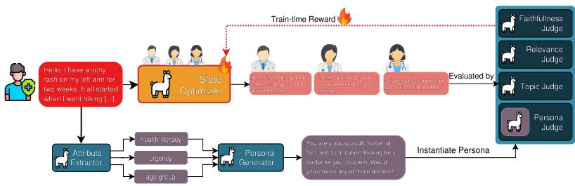
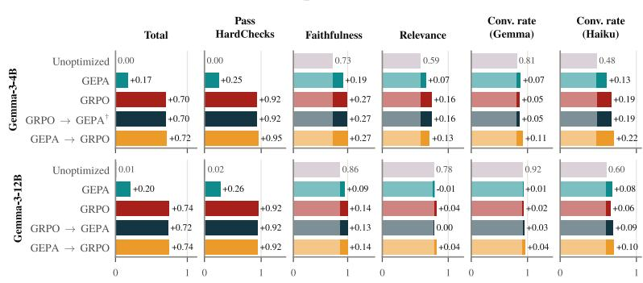
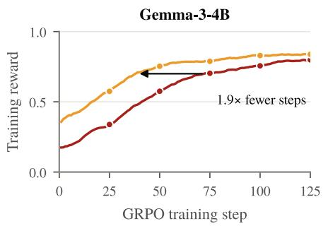
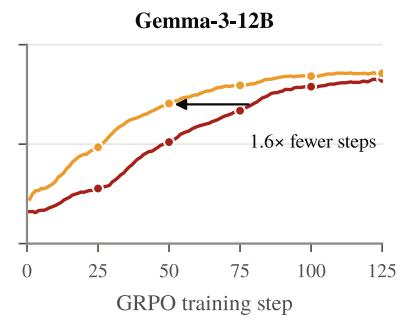

# Prompt or Policy? Optimizing Physician Slate Presentations with LLM User Simulators

Andrei Niculae1 , Adrian Cosma2 , and Emilian Radoi1

1 National University of Science and Technology POLITEHNICA Bucharest, Romania 2 IDSIA, Dalle Molle Institute for Artificial Intelligence, Lugano, Switzerland Correspondence: emilian.radoi@upb.ro

Abstract. Choosing the right physician is a key challenge for patients seeking medical care. Physician recommendation systems identify relevant doctors, but patients still find it dificult to compare their profiles to make a decision. We formulate slate presentation optimization: given a patient’s medical case and a fixed, ranked list of physicians, we generate short, case-specific summaries that make doctors easier to compare, while remaining grounded in the information in their profiles. To optimize physician presentations without relying on real pa- tient interactions, we develop an ofline framework that uses persona-conditioned LLMs to simulate patient choices. We generate patient personas from attributes extracted from each medical case and evaluate presentations for factual accu- racy, relevance, naturalness and simulated patient choice. We also use a second LLM judge, unseen during optimization, to assess simulator-specific overfitting. We compare automatic prompt-level optimization with GEPA, parameter-level optimization with GRPO, and their combination across two model sizes. GRPO substantially outperforms GEPA in satisfying the full set of constraints, and its gains in simulated conversion persist under the unseen judge. GEPA alone brings smaller improvements, but using its optimized prompt to initialize GRPO speeds up training and achieves the highest simulated conversion. These results show that prompt-level and parameter-level optimization play complementary roles in improving how physician recommendations are presented.

Keywords: Physician recommendation · Slate presentation optimization · Simulated patient choice · Automatic Prompt Optimization · RLAIF

## 1 Introduction and Related Work

Choosing the right physician can be dificult, as patients often lack the medical knowledge needed to assess which doctor is best suited to their needs. Physician recommendation systems help address this problem by identifying relevant doctors based on patients medical cases. Existing research has largely focused on retrieving and ranking physi- cians [20,13,34,19]. However, even when relevant physicians are identified, patients must still interpret and compare information about their expertise, experience and pa- tient feedback to make a decision [28,12,11,26,32,23]. In this work, we formulate slate presentation optimization: given a patient’s medical case and a fixed, ranked list of physicians, we generate concise, case-specific summaries that help patients understand and compare the doctors while remaining grounded in their profiles. The goal is to sup- port patient choice, including the option not to consult any physician, without changing the ranking or making the decision for the patient.

  
Fig. 1. Ofline slate-presentation optimization. SlateOptimizer summarizes a fixed physician slate, while case-derived attributes instantiate a simulated patient. Quality and persona-choice judges provide the reward for prompt-level (GEPA) or parameter-level (GRPO) optimization.

Optimizing these presentations using real patient interactions is dificult: historical logs only capture responses to previously shown presentations [5], while testing new alternatives requires live experiments. User simulation [27,3,35,2] allows us to evaluate alternatives ofline. LLM simulators can model richer patient behaviour, while persona conditioning captures diferences in health literacy, urgency and afect [17,22]. How-ever, LLM simulators may be overly deterministic, insensitive to personas, or difer from real patients [10,4,16,21,18]. We treat simulated conversion as an ofline evaluation signal and test whether improvements persist under a second judge unseen during optimization. Synthetic feedback from LLM judges can optimize either the instructions (i.e., the prompt) or the model weights. We compare both approaches, as well as their composition, under the same constrained presentation objective. To optimize the prompt, Automatic Prompt Optimization (APO) revises the instructions through examples, search, or textual feedback [25,33,1,6]; in our experiments, we use GEPA [1]. Such updates are lightweight, but their gains may depend on the base model and transfer poorly across model families [36,31]. To optimize the weights, Reinforcement Learning from AI Feedback (RLAIF) trains the model on the judges’ scores. We use GRPO, which avoids a learned value model by comparing several outputs sampled for the same input [29]. Compared with prompt optimization, this requires full training runs, and the model can learn to over-optimize an imperfect reward [7].

Our framework evaluates each presentation for format compliance, faithfulness, rel- evance and safety, linguistic quality, topic coverage, and persona-conditioned simulated conversion. Across gemma-3-4b and gemma-3-12b [9], GRPO satisfies the full con-straint set substantially more reliably than GEPA alone. GEPA is nevertheless useful as a starting point for GRPO: the composition reaches high reward earlier and achieves the strongest simulated conversion, with gains persisting under the unseen judge.

Our contributions are twofold:

1. We formulate physician-slate presentation as a post-retrieval optimization problem with explicit factuality, safety and interface constraints, and introduce an ofline protocol using persona-conditioned simulated choice and an unseen judge.

2. We compare prompt-level, parameter-level and composed optimization across two model sizes, identifying their asymmetric roles: in-weight optimization enforces the constraints, while prompt optimization provides an efective initialization.

## 2 Method

An overview of our method is shown in Figure 1. Optimizing simulated conversion alone could reward persuasive but unsupported or unsafe text. Consequently, we introduce additional judges that act as regularizers of the slate presentation, ensuring the text is grounded in physician profiles. This suite of judges is used as reward for both GEPA and GRPO approaches.

## 2.1 Suite of Judge LLMs for Slate Optimization

SlateOptimizer. Let � denote the patient medical case and $\boldsymbol { D } \ = \ ( d _ { 1 } , d _ { 2 } , d _ { 3 } )$ the fixed, ranked slate of physician profiles. Each profile contains structured and free-text evidence, including the physician’s specialty and experience, education, response time, patient feedback, and previous consultations. SlateOptimizer maps (�, �) to an ordered presentation ${ \boldsymbol { S } } = ( s _ { 1 } , s _ { 2 } , s _ { 3 } )$ , where $s _ { i }$ is a concise, case-specific summary of physician $d _ { i } .$ SlateOptimizer observes all three profiles jointly so that the cards can emphasize complementary evidence, but it may neither change the physicians nor reorder the slate.

Constraint and quality judges. HardChecks assigns zero reward unless the out-put preserves physician order, keeps each card below 40 words, and avoids prohibited patterns such as superlatives, promises and urgency-inducing language. Faithfulness- Judge checks every claim against � and the corresponding $d _ { i } ;$ RelevanceJudge rates medical case relevance on a five-point scale and checks for medical advice; and Style- Judge rates naturalness on a five-point scale. A deterministic trigram-overlap score penalizes repetition. TopicJudge scores whether the patient’s problem is contextually identified: 1 if relevant, 0 if mentioned irrelevantly and 0.5 if absent.

Persona-conditioned choice judges. To model heterogeneous patient choices, we instantiate one simulated patient per medical case. Following PatientSim [17], Attribute-Extractor combines the reported mood with medical case-derived descriptors (patient role and age group, afect, urgency, health literacy and request type), and PersonaGen-erator verbalizes them as a first-person prompt. These attributes remain hidden from SlateOptimizer, whose input is the original medical case.

Reward and simulator transfer. PersonaJudge receives the persona and generated slate and rates willingness to consult any physician, with no consultation remaining valid. For outputs that pass HardChecks, this choice signal and the quality scores constitute the scalar reward. Since we are evaluating each training example under its associated persona, we are targeting performance across heterogeneous simulated patients. To test for simulator-specific overfitting, we also evaluate with a second choice judge never exposed during optimization (Claude Haiku 5.5).

## 2.2 Experimental Setup

We used patient-reported medical cases from medical forums and a physician database. Physician profiles and patient medical cases are written in Romanian. For each medical case, a retrieval model ranks physicians from this database, and we select the top three to form a slate. We sample 10,000 slates, stratified by specialty, and split them into 8,000 training, 1,000 validation and 1,000 test slates. We used gemma-3-4b and gemma-3-12b [9] as the backbones of two SlateOptimizer variants. Each SlateOptimizer is a DSPy [14] program with a fixed seed instruction, which is also the unoptimized baseline. GRPO trains the weights behind this same prompt, so the two optimizers can be composed. We used gemma-4-31b [8] as the underlying LM for the judge modules and as a reflection model for GEPA. All ex eriments run on NVIDIA H200 GPUs. We run GEPA with a budget of 4,000 metric calls and reflection minibatches of 5 slates drawn from 300 train slates. The first 100 validation slates form the Pareto set on which candidates are selected. For GRPO, we fully fine-tune the two SlateOptimizer variants in prime-rl [24], using AdamW optimizer [15] with a constant learning rate of 10−6 (4B) and $5 \cdot 1 0 ^ { - 7 } $ (12B). Each step samples 8 rollouts for each of 32 train slates (256 rollouts). We train for 125 gradient steps and evaluate the final checkpoint.

Evaluation. For each SlateOptimizer variant, we compare the unoptimized prompt, GEPA, GRPO and two compositions. These compositions are inspired by prior work showing that prompt and weight optimization are complementary: alternating the two outperforms either alone [30]. GEPA → GRPO runs GRPO initialized from the optimized GEPA prompt, and GRPO → GEPA reruns GEPA on the GRPO-trained model. Every final program is scored once on the 1,000 test slates, and a slate without a readable output scores 0.

## 3 Results

Quantitative results. In Figure 2(a) we report the test results of each final program. Before optimization, both SlateOptimizer variants already write slates on which the training persona judge would consult a physician. Almost none of these slates pass HardChecks with every claim supported, and most of the gains in total score come from satisfying these constraints: GRPO raises the pass rate from below 2% to over 90% for both variants, while the trainingjudge’s conversion rate changes only slightly. Prompt optimization improves individual criteria, such as faithfulness and relevance, but rarely satisfies all of them at once: GEPA reaches a pass rate of at most 28%. GRPO learns the constraints directly from the reward. In-weight optimization also largely removes the advantage of the larger model. Before optimization, gemma-3-12b is better on every criterion; after GRPO, both variants perform similarly. In practice, a model three times smaller sufices, which lowers the cost of self-hosting, a relevant option for platforms that handle patient data.

In our experiments, we evaluate both composition directions, because we expected GRPO to mainly teach the hard checks, leaving room for a subsequent GEPA run to improve the quality and conversion judges. We find, however, that for 4B none of GEPA’s candidates outperformed the GRPO prompt. The reverse order does help: starting GRPO from the GEPA prompt reaches the same training reward in 1.6–1.9× fewer steps (Figure 2(b)). The reason is that a slate failing HardChecks receives a low reward, and GRPO computes advantages relative to the other rollouts for the same slate, so a group in which all rollouts fail provides no learning signal. A prompt that passes the checks more often yields more informative groups early in training.

(b) GRPO training reward  
(a) Test performance  

  
Fig. 2. Quantitative results. (a) Test performance on 1,000 slates. The first bar is the unoptimized prompt (absolute value); subsequent bars show its diference. Pass HardChecks: fraction of slates that pass it with every claim supported. Conversion: fraction rated 4–5 by the training (gemma) or unseen (Claude Haiku) persona judge. (b) GRPO training reward from the original or GEPAoptimized prompt. †GEPA kept the GRPO prompt (none of its candidates beat it on the Pareto set), so GRPO → GEPA is the GRPO program.

We also observe that the conversion judge has a regularization efect for the quality judges during optimization. In preliminary runs where we used the conversion judge only for evaluation, the optimized cards satisfied the quality criteria but the conversion rate decreased. Having the conversion judge as part of the reward function, conversion remains high while the constraint and quality scores increase. The gains also transfer to the external judge: under Claude Haiku 5.5, which never provided a training signal, every optimized program raises the conversion rate, and GEPA → GRPO brings both variants to the same rate.

Qualitative examples. In Table 1 we show two test slates for gemma-3-12b. The unopti-mized cards describe the physician’s profile generically, often with expertise unrelated to the medical case (diabetes for a feverish toddler) or with promotional wording (“natural beauty of your skin”). The optimized cards name the patient’s problem and then cite the same two pieces of evidence: the share of positive patient votes and the typical reply time. These are among the factors that prior work identifies as influencing patients’ choice of physician [28,12,11].

Table 1. Qualitative gemma-3-12b examples before and after GEPA → GRPO. Medical cases are paraphrased; cards are translated from Romanian and anonymized. Persona: judge-only attributes. Judge: Claude Haiku 5.5’s unseen appeal score (1–5).
<table><tr><td colspan="2">Patient: Since last week my 15-month-old son has had a fever of 38.7–39 C that comes back after ibuprofen and very swollen gums, and since yesterday diarrhea; his head is very hot and he refuses food. Please help me with some advice and treatment. Persona: parent, child, worried, mood: sad, high urgency, low health literacy, treatment advice</td></tr><tr><td>“This pediatrician has expertise in diabetes and nutrition, offering consultations and glucose monitoring systems. They have helped many patients, with 12 positive votes, and have been on the platform for over a year.&quot; Unoptimized Judge: 1/5</td><td>“For your child&#x27;s problems, you can consult this pediatric specialist. They get 100% positive votes from patients and reply relatively quickly.&quot; GEPA → GRPO Judge: 5/5</td></tr><tr><td colspan="2">Patient: I am 35, and for about two years I have had a 3–4 mm mole on my forearm, darker than my others. It does not bother me and has not changed, but I would like an opinion; I will attach a photo.</td></tr><tr><td>Persona: self, adult, calm, low urgency, medium health literacy, what is it “This dermatologist, also specialized in dermatoscopy and aesthetics, offers you an approach centered on the health and natural beauty of your skin, combining classic treatments with modern therapies for long-term care.&quot; Judge: 2/5</td><td>“This dermatologist, specialized in dermatoscopy, can evaluate your mole. They have 98% positive votes and usually reply in under 4 hours.&quot;</td></tr></table>

## 4 Conclusions

We introduced slate presentation optimization as a post-retrieval task that aims to help patients compare recommended physicians through concise, case-specific summaries grounded in their profiles. We developed an ofline framework that combines presentation quality assessments with persona-conditioned LLM simulations of patient choice to optimize these summaries without relying on real patient interactions.

Our experiments show that parameter-level optimization with GRPO is substantially more efective than prompt-level optimization with GEPA at meeting the requirements of this task. GRPO increased the proportion of slates passing all constraints from below 2% to over 90%, while GEPA alone reached at most 28%. This improvement came from satisfying the constraints; the already high simulated conversion changed little. However, prompt optimization proved valuable as an initialization for GRPO. Starting from a GEPA-optimized prompt reduced the training steps needed to reach the same reward by a factor of 1.6–1.9 and achieved the highest simulated conversion. Applying GEPA after GRPO did not improve the overall score. We also found that the smaller 4B model performed comparably to the 12B model after GRPO, suggesting that smaller models may be suficient for this task.

The gains in simulated conversion also persisted under a second LLM judge that was not used during optimization. This suggests that the improvements are not specific to the training judge. However, both evaluations rely on LLM simulators, which may share biases or difer from real patients. Moreover, higher simulated conversion does not necessarily imply better physician choices.

## References

1. Agrawal, L.A., Tan, S., Soylu, D., Ziems, N., Khare, R., Opsahl-Ong, K., Singhvi, A., Shandilya, H., Ryan, M.J., Jiang, M., et al.: GEPA: Reflective prompt evolution can outperform reinforcement learning. In: International Conference on Learning Representations (2026)

2. Balog, K., Bernard, N., Zerhoudi, S., Zhai, C.: Theory and toolkits for user simulation in the era of generative AI: user modeling, synthetic data generation, and system evaluation. In: Proceedings of the 48th International ACM SIGIR Conference on Research and Development in Information Retrieval. pp. 4138–4141 (2025)

3. Bernard, N., Balog, K.: UserSimCRS v2: Simulation-Based Evaluation for Conversational Recommender Systems. In: Campos, R., Jatowt, A., Lan, Y., Aliannejadi, M., Bauer, C., MacAvaney, S., Anand, A., Ren, Z., Verberne, S., Bai, N., Mansoury, M. (eds.) Advances in Information Retrieval - 48th European Conference on Information Retrieval, ECIR 2026, Delft, The Netherlands, March 29 - April 2, 2026, Proceedings, Part IV. Lecture Notes in Computer Science, vol. 16486, pp. 496–510. Springer (2026)

4. Califano, G., Caracciolo, F.: Do large language models shop like people? Comparing GPT and human food choices using discrete choice experiments. Food Quality and Preference p. 105930 (2026)

5. Cosma, A., Basoc, N.N., Niculae, A., Dumitrache, C., Radoi, E.: Improving Medical Communication using Rubric-Guided Counterfactual Recommendations. arXiv preprint arXiv:2606.18889 (2026)

6. Cosma, A., Szehr, O., Kletz, D., Antonucci, A., Pelletier, O.: Automatic Prompt Optimization for Dataset-Level Feature Discover . arXiv preprint arXiv:2601.13922 (2026)

7. Gao, L., Schulman, J., Hilton, J.: Scaling Laws for Reward Model Overoptimization. In: Proceedings of the 40th International Conference on Machine Learning. Proceed ings of Machine Learning Research, vol. 202, pp. 10835–10866. PMLR (2023), https: //proceedings.mlr.press/v202/gao23h.html

8. Gemma Team, Abd, S.E., Aggarwal, V., Algayres, R., Andreev, A., Bachem, O., Ballantyne, I., Brick, C., Cărbune, V., Casbon, M., et al.: Gemma 4 Technical Report (2026), https: //arxiv.org/abs/2607.02770

9. Gemma Team, Kamath, A., Ferret, J., Pathak, S., Vieillard, N., Merhej, R., Perrin, S., Matejovicova, T., Ramé, A., Rivière, M., et al.: Gemma 3 Technical Report (2025), https://arxiv.org/abs/2503.19786

10. Goli, A., Singh, A.: Frontiers: Can large language models capture human preferences? Mar keting Science 43(4), 709–722 (2024)

11. Gong, Y., Wang, H., Xia, Q., Zheng, L., Shi, Y.: Factors that determine a patient’s willingness to physician selection in online healthcare communities: a trust theory perspective. Technology in Society 64, 101510 (2021)

12. Han, X., Qu, J., Zhang, T.: Exploring the impact of review valence, disease risk, and trust on patient choice based on online physician reviews. Telematics and Informatics 45, 101276 (2019)

13. Jiang, H., Mi, Z., Xu, W.: Online Medical Consultation Service–Oriented Recommendations: Systematic Review. Journal of Medical Internet Research 26, e46073 (2024). https://doi. org/10.2196/46073, https://www.jmir.org/2024/1/e46073

14. Khattab, O., Singhvi, A., Maheshwari, P., Zhang, Z., Santhanam, K., Vardhamanan, S., Haq, S., Sharma, A., Joshi, T.T., Moazam, H., et al.: DSPy: Compiling Declarative Language Model Calls into State-of-the-Art Pipelines. In: The Twelfth International Conference on Learning Representations (2024)

15. Kingma, D.P., Ba, J.: Adam: A Method for Stochastic Optimization. In: International Conference on Learning Representations (2015), https://openreview.net/forum?id= 8gmWwjFyLj

16. Kruf, A.K., Bernard, N., Schaer, P.: Validating search query simulations: a taxonomy of measures. In: European Conference on Information Retrieval. pp. 243–256. Springer (2026)

17. Kyung, D., Chung, H., Bae, S., Kim, J., Sohn, J.H., Kim, T., Kim, S.K., Choi, E.: PatientSim: A persona-driven simulator for realistic doctor-patient interactions. Advances in Neural In formation Processing Systems 38 (2026)

18. Li, L., Li, D., Chen, C., Ma, R., Yu, R., Lin, M., Yin, R., Fan, L., Shyr, C., Ma, S., et al.: LLM-as-a-Judge in Healthcare: A Scoping Analysis of Applications, Methods, and Human Alignment. arXiv preprint arXiv:2605.25273 (2026)

19. Liao, H., Zheng, Y., Wu, X., Wu, P.: Patient preference analysis for online consultation based on user-generated content. Artificial Intelligence in Medicine p. 103427 (2026)

20. Lu, X., Zhang, Y., Li, J., Zong, S.: Doctor Recommendation in Online Health Fo- rums via Expertise Learning. In: Muresan, S., Nakov, P., Villavicencio, A. (eds.) Pro-ceedings of the 60th Annual Meeting of the Association for Computational Linguis- tics (Volume 1: Long Papers). pp. 1111–1123. Association for Computational Linguistics, Dublin, Ireland (May 2022). https://doi.org/10.18653/v1/2022.acl-long.79, https://aclanthology.org/2022.acl-long.79/

21. Meshi, O., Balog, K., Goldman, S., Caciularu, A., Tennenholtz, G., Jeong, J., Globerson, A., Boutilier, C.: ConvApparel: A Benchmark Dataset and Validation Framework for User Simulators in Conversational Recommenders. In: Demberg, V., Inui, K., Marquez, L. (eds.) Proceedings of the 19th Conference of the European Chapter of the Association for Com- putational Linguistics (Volume 1: Long Papers). pp. 5270–5304. Association for Computational Linguistics, Rabat, Morocco (Mar 2026). https://doi.org/10.18653/v1/2026. eacl-long.244, https://aclanthology.org/2026.eacl-long.244/

22. Mohtadi, S., Bernardelle, P., Mackenzie, J., Demartini, G.: Persona Conditioning as an Assessor-Sensitivity Probe for LLM-Based IR Evaluation. arXiv preprint arXiv:2608.10385 (2026)

23. Niculae, A., Cosma, A., Dumitrache, C., Radoi, E.: Dr. Copilot: A Multi-Agent Prompt Optimized Assistant for Improving Patient-Doctor Communication in Romanian. In: Pot- dar, S., Rojas-Barahona, L., Montella, S. (eds.) Proceedings of the 2025 Conference on Empirical Methods in Natural Language Processing: Industry Track. pp. 1780–1792. Association for Computational Linguistics, Suzhou (China) (Nov 2025). https://doi. org/10.18653/v1/2025.emnlp-industry.125, https://aclanthology.org/2025. emnlp-industry.125/

24. Prime Intellect: PRIME-RL: Decentralized RL Training at Scale. https://github.com/ PrimeIntellect-ai/prime-rl (2025)

25. Pryzant, R., Iter, D., Li, J., Lee, Y., Zhu, C., Zeng, M.: Automatic Prompt Optimization with “Gradient Descent” and Beam Search. In: Proceedings of the 2023 Conference on Empirical Methods in Natural Language Processing. pp. 7957–7968. Association for Com- putational Linguistics, Singapore (Dec 2023). https://doi.org/10.18653/v1/2023. emnlp-main.494, https://aclanthology.org/2023.emnlp-main.494/

26. Qin, M., Zhu, W., You, C., Li, S., Qiu, S.: Patient’s behavior of selection physician in online health communities: based on an elaboration likelihood model. Frontiers in Public Health 10, 986933 (2022)

27. Rahdari, B., Kveton, B., Brusilovsky, P.: From Ranked Lists to Carousels: A Carousel Click Model. arXiv preprint arXiv:2209.13426 (2022)

28. Shan, W., Wang, Y., Luan, J., Tang, P.: The Influence of physician information on patients choice of physician in mHealth services using China’s chunyu doctor app: eye-tracking and questionnaire study. JMIR mHealth and uHealth 7(10), e15544 (2019)

29. Shao, Z., Wang, P., Zhu, Q., Xu, R., Song, J., Bi, X., Zhang, H., Zhang, M., Li, Y.K., Wu, Y., et al.: DeepSeekMath: Pushing the Limits of Mathematical Reasoning in Open Language Models. arXiv preprint arXiv:2402.03300 (2024), https://arxiv.org/abs/2402.03300

30. Soylu, D., Potts, C., Khattab, O.: Fine-Tuning and Prompt Optimization: Two Great Steps that Work Better Together. In: Al-Onaizan, Y., Bansal, M., Chen, Y.N. (eds.) Proceedings of the 2024 Conference on Empirical Methods in Natural Language Processing. pp. 10696–10710. Association for Computational Linguistics, Miami, Florida, USA (Nov 2024). https:// doi.org/10.18653/v1/2024.emnlp-main.597, https://aclanthology.org/2024. emnlp-main.597/

31. Wang, Y., Liu, Q., Wang, Z., Li, Z., Wei, W., Liu, Y., Bao, Y.: PromptBridge: Cross-model prompt transfer for large language models. arXiv preprint arXiv:2512.01420 (2025)

32. Ward, P.: Trust and communication in a doctor-patient relationship: a literature review. Journal of Healthcare Communications 3(3), 3 (2018)

33. Yang, C., Wang, X., Lu, Y., Liu, H., Le, Q.V., Zhou, D., Chen, X.: Large Language Models as Optimizers. In: International Conference on Learning Representations (2024), https: //openreview.net/forum?id=Bb4VGOWELI

34. Zeng, Z., Li, D., Yang, Y.: A Zero-Shot Explainable Doctor Ranking Framework with Large Language Models. Big Data Mining and Analytics 9(5), 1197–1215 (2026)

35. Zhang, A., Chen, Y., Sheng, L., Wang, X., Chua, T.S.: On generative agents in recommen- dation. In: Proceedings of the 47th international ACM SIGIR conference on research and development in Information Retrieval. pp. 1807–1817 (2024)

36. Zhou, Z., Wu, Y., Yang, J., Xiao, Z., Li, R.: Evaluating the Efectiveness of Black-Box Prompt Optimization as the Scale of LLMs Continues to Grow. arXiv preprint arXiv:2505.08303 (2025)