# SkillS<sub>ca</sub>f<sub>o</sub>ld<sub>:</sub> S<sub>ca</sub>f<sub>o</sub>ldin<sub>g</sub> A<sub>ge</sub>nti<sub>c</sub> R<sub>e</sub>inf<sub>o</sub>r<sub>ce</sub>m<sub>e</sub>nt L<sub>ea</sub>rnin<sub>g</sub> <sub>w</sub>ith P<sub>o</sub>li<sub>cy-</sub>Ad<sub>ap</sub>ti<sub>ve</sub> Skill Cr<sub>e</sub>dit A<sub>ss</sub>i<sub>g</sub>nm<sub>e</sub>nt and Selective Injection

Wenlin Zhon<sub>g</sub><sup>1,3</sup><sub>,</sub> Hao Wan<sub>g</sub><sup>2,3</sup><sub>,</sub> Kun Yuan<sup>3‡</sup><sub>,</sub> Fan Yan<sub>g</sub><sup>3</sup><sub>,</sub> Jinluan Yan<sub>g</sub><sup>1</sup> Dian Jin<sup>1</sup><sub>,</sub> Xu Tan<sup>4</sup><sub>,</sub> Yi<sub>q</sub>uan Wu<sup>1†</sup><sub>,</sub> Kun Kuan<sub>g</sub><sup>1†</sup>

<sup>1</sup>Zhejiang University, <sup>2</sup>University of the Chinese Academy of Sciences, <sup>3</sup>Kuaishou Technology, <sup>4</sup>Zhejiang University of Science and Technology {zhongwenlin, wuyiquan, kuangkun}@zju.edu.cn, yuankun03@kuaishou.com

## Abstract

A<sub>g</sub>entic reinforcement learnin<sub>g</sub> (RL) enables lar<sub>g</sub>e lan<sub>g</sub>ua<sub>g</sub>e models (LLMs) to learn f<sub>rom mu</sub>lti<sub>-</sub>t<sub>urn</sub> i<sub>n</sub>t<sub>erac</sub>ti<sub>ons w</sub>ith <sub>ver</sub>ifi<sub>a</sub>bl<sub>e ou</sub>t<sub>comes.</sub> T<sub>ex</sub>t<sub>ua</sub>l <sub>s</sub>kill<sub>s can</sub> i<sub>mprove</sub> <sub>exp</sub>l<sub>ora</sub>ti<sub>on</sub> b<sub>y</sub> di<sub>s</sub>tilli<sub>ng</sub> <sub>pr</sub>i<sub>or</sub> i<sub>n</sub>t<sub>erac</sub>ti<sub>ons</sub> i<sub>n</sub>t<sub>o</sub> <sub>reusa</sub>bl<sub>e</sub> <sub>gu</sub>id<sub>ance.</sub> H<sub>owever,</sub> <sub>ex</sub>i<sub>s</sub>ti<sub>ng</sub> skill-based RL approaches often either assume skill injection is beneficial or rely <sub>on</sub> i<sub>n</sub>di<sub>rec</sub>t f<sub>ee</sub>db<sub>ac</sub>k <sub>or</sub> <sub>ro</sub>ll<sub>ou</sub>t<sub>-</sub>i<sub>n</sub>t<sub>ens</sub>i<sub>ve</sub> <sub>eva</sub>l<sub>ua</sub>ti<sub>on</sub> t<sub>o</sub> <sub>assess</sub> it<sub>s</sub> <sub>u</sub>tilit<sub>y.</sub> O<sub>ur</sub> <sub>p</sub>il<sub>o</sub>t <sub>s</sub>t<sub>u</sub>di<sub>es s</sub>h<sub>ow</sub> th<sub>a</sub>t <sub>ro</sub>ll<sub>ou</sub>t<sub>-</sub>b<sub>ase</sub>d <sub>u</sub>tilit<sub>y es</sub>ti<sub>ma</sub>ti<sub>on</sub> f<sub>or s</sub>kill <sub>cre</sub>dit <sub>ass</sub>i<sub>gnmen</sub>t i<sub>s cos</sub>tl<sub>y</sub> <sub>an</sub>d <sub>uns</sub>t<sub>a</sub>bl<sub>e un</sub>d<sub>er</sub> li<sub>m</sub>it<sub>e</sub>d <sub>samp</sub>li<sub>ng, w</sub>hil<sub>e s</sub>kill b<sub>ene</sub>fit<sub>s vary across can</sub>did<sub>a</sub>t<sub>es</sub> <sub>an</sub>d d<sub>epen</sub>d <sub>on</sub> th<sub>e curren</sub>t <sub>po</sub>li<sub>cy</sub>’<sub>s compe</sub>t<sub>ence on eac</sub>h <sub>query.</sub> T<sub>o a</sub>dd<sub>ress</sub> th<sub>ese</sub> <sub>c</sub>h<sub>a</sub>ll<sub>enges, we</sub> i<sub>n</sub>t<sub>ro</sub>d<sub>uce</sub> S<sub>kill</sub>S<sub>caffold, a po</sub>li<sub>cy-a</sub>d<sub>ap</sub>ti<sub>ve</sub> t<sub>ra</sub>i<sub>n</sub>i<sub>ng sca</sub>f<sub>o</sub>ld th<sub>a</sub>t combines low-cost skill-utility estimation with selective skill injection. By reusing outcome-verified training trajectories, SkillScaffold generates candidate skills <sub>an</sub>d <sub>es</sub>ti<sub>ma</sub>t<sub>es</sub> th<sub>e</sub>i<sub>r u</sub>tilit<sub>y</sub> th<sub>roug</sub>h <sub>ou</sub>t<sub>come-aware</sub> lik<sub>e</sub>lih<sub>oo</sub>d <sub>compar</sub>i<sub>sons, w</sub>ith<sub>ou</sub>t <sub>can</sub>did<sub>a</sub>t<sub>e-spec</sub>ifi<sub>c env</sub>i<sub>ronmen</sub>t <sub>ro</sub>ll<sub>ou</sub>t<sub>s.</sub> Th<sub>e resu</sub>lti<sub>ng u</sub>tilit<sub>y gu</sub>id<sub>es w</sub>h<sub>e</sub>th<sub>er an</sub>d which skill to inject, retaining skill-free execution when no candidate is estimated t<sub>o</sub> h<sub>e</sub>l<sub>p.</sub> J<sub>o</sub>i<sub>n</sub>t t<sub>ra</sub>i<sub>n</sub>i<sub>ng ena</sub>bl<sub>es</sub> th<sub>e</sub> G<sub>enera</sub>t<sub>or</sub> t<sub>o pro</sub>d<sub>uce s</sub>kill<sub>s</sub> t<sub>a</sub>il<sub>ore</sub>d t<sub>o</sub> th<sub>e</sub> <sub>evo</sub>l<sub>v</sub>i<sub>ng</sub> E<sub>xecu</sub>t<sub>or.</sub> S<sub>ca</sub>f<sub>o</sub>ld<sub>e</sub>d RL <sub>encourages s</sub>kill i<sub>n</sub>t<sub>erna</sub>li<sub>za</sub>ti<sub>on</sub> f<sub>or s</sub>kill<sub>-</sub>f<sub>ree</sub> i<sub>n</sub>f<sub>erence.</sub> E<sub>xper</sub>i<sub>men</sub>t<sub>s on</sub> ALFW<sub>or</sub>ld<sub>,</sub> W<sub>e</sub>bSh<sub>op,</sub> S<sub>c</sub>i<sub>ence</sub>W<sub>or</sub>ld<sub>, an</sub>d <sub>�</sub><sup>2</sup><sub>-</sub>B<sub>enc</sub>h d<sub>emons</sub>t<sub>ra</sub>t<sub>e a</sub>i<sub>ns over s</sub>t<sub>ron a en</sub>ti<sub>c-</sub>RL <sub>an</sub>d <sub>s</sub>kill<sub>-</sub>b<sub>ase</sub>d RL b<sub>ase</sub>li<sub>nes across</sub> b<sub>o</sub>th <sub>s</sub>h<sub>or</sub>t<sub>- an</sub>d l<sub>ong-</sub>h<sub>or</sub>i<sub>zon</sub> t<sub>as</sub>k<sub>s.</sub> Abl<sub>a</sub>ti<sub>ons an</sub>d f<sub>ur</sub>th<sub>er ana</sub>l<sub>yses suppor</sub>t th<sub>e</sub> i<sub>mpor</sub>t<sub>ance o</sub>f <sub>u</sub>tilit<sub>y-</sub>b<sub>ase</sub>d <sub>se</sub>l<sub>ec</sub>ti<sub>on an</sub>d <sub>a</sub>b<sub>s</sub>t<sub>en</sub>ti<sub>on.</sub> O<sub>ur co</sub>d<sub>e</sub> i<sub>s ava</sub>il<sub>a</sub>bl<sub>e a</sub>t https://github.com/Vaidurya00/SkillScaffold.

## 1 Intr<sub>o</sub>d<sub>uc</sub>ti<sub>o</sub>n

A<sub>g</sub>entic reinforcement learnin<sub>g</sub> (RL) enables lan<sub>g</sub>ua<sub>g</sub>e-model a<sub>g</sub>ents to im<sub>p</sub>rove throu<sub>g</sub>h multi-turn i<sub>n</sub>t<sub>erac</sub>ti<sub>on w</sub>ith <sub>ver</sub>ifi<sub>a</sub>bl<sub>e env</sub>i<sub>ronmen</sub>t<sub>s,</sub> b<sub>u</sub>t l<sub>ong</sub> h<sub>or</sub>i<sub>zons an</sub>d <sub>sparse ou</sub>t<sub>come rewar</sub>d<sub>s ma</sub>k<sub>e</sub> successful behavior dificult to discover and reinforce (Shao et al., 2024; Don<sub>g</sub> et al., 2026b). Textual skills can ease this challenge by compressing trajectories or feedback into reusable procedural guidance for subsequent decisions (Shinn et al., 2023; Zhao et al., 2024). Existin<sub>g</sub> a<sub>pp</sub>roaches extract, refine, and retrieve such <sub>g</sub>uidance usin<sub>g</sub> external memor<sub>y</sub> or teacher models (Nottin<sub>g</sub>ham et al., 2024; Fu et al., 2024; Chen et al., 2024; Wan<sub>g</sub> et al., 2024; Zhou et al., 2025; Fan<sub>g</sub> et al., 2026). SkillRL, for example, uses a stronger teacher to build an evolving SkillBank, turning sparse trajectory-level feedback into <sub>g</sub>uidance for subsequent ex<sub>p</sub>loration (Xia et al., 2026).

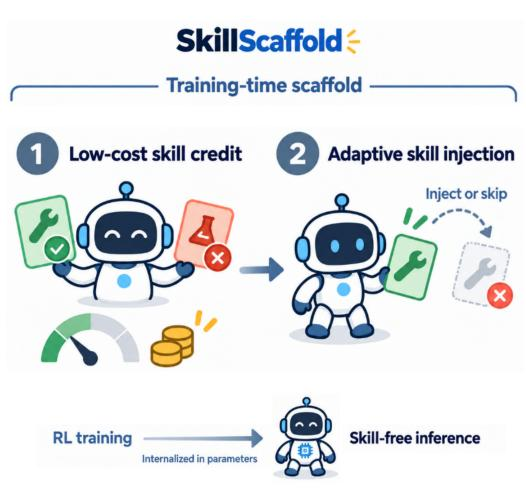

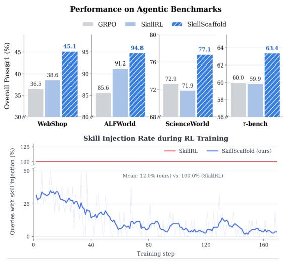  
Fi<sub>gure</sub> 1<sub>.</sub> O<sub>verv</sub>i<sub>ew an</sub>d <sub>emp</sub>i<sub>r</sub>i<sub>ca</sub>l <sub>summary o</sub>f S<sub>kill</sub>S<sub>caffold.</sub> L<sub>ow-cos</sub>t<sub>, po</sub>li<sub>cy-re</sub>l<sub>a</sub>ti<sub>ve s</sub>kill<sub>-u</sub>tilit<sub>y</sub> estimates guide selective skill injection during training, while inference remains skill-free. Across four agentic benchmarks, SkillScaffold consistently outperforms GRPO and SkillRL while injecting skills for only a small f<sub>rac</sub>ti<sub>on</sub> <sub>o</sub>f t<sub>ra</sub>i<sub>n</sub>i<sub>ng</sub> <sub>quer</sub>i<sub>es.</sub>

R<sub>ecen</sub>t <sub>wor</sub>k <sub>s</sub>h<sub>ows</sub> th<sub>a</sub>t <sub>a s</sub>h<sub>are</sub>d <sub>po</sub>li<sub>cy can genera</sub>t<sub>e s</sub>kill<sub>s</sub> f<sub>rom exper</sub>i<sub>ence an</sub>d <sub>use</sub> th<sub>em</sub> f<sub>or</sub> subsequent <sub>p</sub>roblem solvin<sub>g</sub>, allowin<sub>g g</sub>eneration and execution ca<sub>p</sub>abilities to co-evolve (Wan<sub>g</sub> et al., 2026b<sub>;</sub> Xi<sub>a e</sub>t <sub>a</sub>l<sub>.,</sub> 2026<sub>;</sub> Shi <sub>e</sub>t <sub>a</sub>l<sub>.,</sub> 2026<sub>;</sub> F<sub>an e</sub>t <sub>a</sub>l<sub>.,</sub> 2026<sub>;</sub> Zh<sub>ou e</sub>t <sub>a</sub>l<sub>.,</sub> 2025<sub>;</sub> Zh<sub>ang e</sub>t <sub>a</sub>l<sub>.,</sub> 2026<sub>;</sub> H<sub>e</sub> et al., 2026). Com<sub>p</sub>lementar<sub>y</sub> work internalizes skill-conditioned behavior via curriculum learnin<sub>g</sub> or self-distillation, enablin<sub>g</sub> skill-free inference (Lu et al., 2026; Wan<sub>g</sub> et al., 2026a). Buildin<sub>g</sub> on these directions, we study skills as policy-adaptive training scafolds, focusing on evaluating and selectively <sub>us</sub>i<sub>ng</sub> <sub>gu</sub>id<sub>ance</sub> f<sub>or</sub> th<sub>e</sub> <sub>curren</sub>t <sub>po</sub>li<sub>cy</sub> <sub>an</sub>d <sub>query.</sub>

Under this training-time scafold view, skill credit assignment uses a scalar skill utility for each <sub>can</sub>did<sub>a</sub>t<sub>e</sub> t<sub>o</sub> d<sub>e</sub>t<sub>erm</sub>i<sub>ne</sub> <sub>w</sub>h<sub>e</sub>th<sub>er</sub> <sub>any</sub> <sub>s</sub>kill <sub>s</sub>h<sub>ou</sub>ld b<sub>e</sub> <sub>use</sub>d <sub>an</sub>d <sub>w</sub>hi<sub>c</sub>h <sub>one</sub> t<sub>o</sub> <sub>se</sub>l<sub>ec</sub>t<sub>.</sub> E<sub>x</sub>i<sub>s</sub>ti<sub>ng</sub> <sub>approac</sub>h<sub>es</sub> either use <sub>g</sub>enerated skills without testin<sub>g</sub> their benefit (Xia et al., 2026; Zhan<sub>g</sub> et al., 2026), rel<sub>y</sub> on indirect and dela<sub>y</sub>ed feedback (Shi et al., 2026; Zhan<sub>g</sub> et al., 2026), or estimate utilit<sub>y</sub> throu<sub>g</sub>h additional skill-conditioned environment rollouts (Fan et al., 2026; He et al., 2026; Shen et al., 2026). O<sub>ur</sub> <sub>p</sub>il<sub>o</sub>t <sub>s</sub>t<sub>u</sub>di<sub>es</sub> <sub>s</sub>h<sub>ow</sub> th<sub>a</sub>t <sub>ro</sub>ll<sub>ou</sub>t<sub>-</sub>b<sub>ase</sub>d <sub>es</sub>ti<sub>ma</sub>t<sub>es</sub> <sub>are</sub> <sub>cos</sub>tl<sub>y</sub> <sub>an</sub>d <sub>uns</sub>t<sub>a</sub>bl<sub>e</sub> <sub>un</sub>d<sub>er</sub> li<sub>m</sub>it<sub>e</sub>d <sub>samp</sub>li<sub>ng,</sub> <sub>w</sub>hil<sub>e</sub> <sub>s</sub>kill b<sub>ene</sub>fit<sub>s</sub> <sub>vary</sub> <sub>across</sub> <sub>can</sub>did<sub>a</sub>t<sub>es</sub> <sub>an</sub>d <sub>w</sub>ith h<sub>ow</sub> <sub>re</sub>li<sub>a</sub>bl<sub>y</sub> th<sub>e</sub> <sub>curren</sub>t <sub>po</sub>li<sub>cy</sub> <sub>so</sub>l<sub>ves</sub> <sub>eac</sub>h <sub>query</sub> without skills (Don<sub>g</sub> et al., 2026a). These findin<sub>g</sub>s motivate a low-cost, <sub>p</sub>olic<sub>y</sub>-relative utilit<sub>y</sub> si<sub>g</sub>nal f<sub>or can</sub>did<sub>a</sub>t<sub>e ran</sub>ki<sub>ng an</sub>d <sub>a</sub>b<sub>s</sub>t<sub>en</sub>ti<sub>on.</sub>

T<sub>o a</sub>dd<sub>ress</sub> th<sub>ese c</sub>h<sub>a</sub>ll<sub>enges, we propose</sub> S<sub>kill</sub>S<sub>caffold, a po</sub>li<sub>cy-a</sub>d<sub>ap</sub>ti<sub>ve</sub> t<sub>ra</sub>i<sub>n</sub>i<sub>ng sca</sub>f<sub>o</sub>ld f<sub>or</sub> <sub>agen</sub>ti<sub>c</sub> RL<sub>, summar</sub>i<sub>ze</sub>d i<sub>n</sub> Fi<sub>gure</sub> 1<sub>.</sub> It<sub>s core</sub> id<sub>ea</sub> i<sub>s</sub> t<sub>o rep</sub>l<sub>ace can</sub>did<sub>a</sub>t<sub>e-spec</sub>ifi<sub>c env</sub>i<sub>ronmen</sub>t evaluation with outcome-aware likelihood comparisons on existing training trajectories. A shared policy serves as both an Executor, which collects skill-free Scout trajectories, and a Generator, which <sub>pro</sub>d<sub>uces can</sub>did<sub>a</sub>t<sub>e s</sub>kill<sub>s</sub> f<sub>rom ou</sub>t<sub>come-</sub>l<sub>a</sub>b<sub>e</sub>l<sub>e</sub>d S<sub>cou</sub>t <sub>ev</sub>id<sub>ence.</sub> F<sub>or eac</sub>h <sub>can</sub>did<sub>a</sub>t<sub>e,</sub> S<sub>kill</sub>S<sub>caffold</sub> <sub>rescores</sub> fi<sub>xe</sub>d S<sub>cou</sub>t <sub>ev</sub>id<sub>ence un</sub>d<sub>er can</sub>did<sub>a</sub>t<sub>e-s</sub>kill <sub>an</sub>d <sub>no-s</sub>kill <sub>con</sub>t<sub>ex</sub>t<sub>s</sub> t<sub>o o</sub>bt<sub>a</sub>i<sub>n a po</sub>li<sub>cy-re</sub>l<sub>a</sub>ti<sub>ve</sub> <sub>u</sub>tilit<sub>y es</sub>ti<sub>ma</sub>t<sub>e.</sub> Thi<sub>s proxy</sub> f<sub>avors</sub> i<sub>ncrease</sub>d lik<sub>e</sub>lih<sub>oo</sub>d <sub>o</sub>f <sub>success</sub>f<sub>u</sub>l b<sub>e</sub>h<sub>av</sub>i<sub>or an</sub>d <sub>re</sub>d<sub>uce</sub>d lik<sub>e</sub>lih<sub>oo</sub>d <sub>o</sub>f <sub>o</sub>b<sub>serve</sub>d f<sub>a</sub>il<sub>ures, accor</sub>di<sub>ng</sub> t<sub>o</sub> th<sub>e ava</sub>il<sub>a</sub>bl<sub>e ou</sub>t<sub>come ev</sub>id<sub>ence.</sub> Th<sub>e</sub> hi<sub>g</sub>h<sub>es</sub>t<sub>-u</sub>tilit<sub>y can</sub>did<sub>a</sub>t<sub>e</sub> <sub>gu</sub>id<sub>es</sub> f<sub>res</sub>h E<sub>xecu</sub>t<sub>or ro</sub>ll<sub>ou</sub>t<sub>s on</sub>l<sub>y w</sub>h<sub>en</sub> it<sub>s es</sub>ti<sub>ma</sub>t<sub>e</sub>d <sub>u</sub>tilit<sub>y</sub> i<sub>s pos</sub>iti<sub>ve; o</sub>th<sub>erw</sub>i<sub>se, execu</sub>ti<sub>on rema</sub>i<sub>ns</sub> <sub>s</sub>kill<sub>-</sub>f<sub>ree.</sub> E<sub>nv</sub>i<sub>ronmen</sub>t <sub>rewar</sub>d<sub>s superv</sub>i<sub>se</sub> th<sub>e</sub> E<sub>xecu</sub>t<sub>or, w</sub>hil<sub>e s</sub>kill <sub>u</sub>tilit<sub>y superv</sub>i<sub>ses</sub> th<sub>e</sub> G<sub>enera</sub>t<sub>or</sub> through role-specific GRPO objectives, enabling the Generator to adapt its guidance to the evolving E<sub>xecu</sub>t<sub>or.</sub>

Skill-free Scouts and selectively scafolded Executor trajectories jointly update the shared policy, <sub>encourag</sub>i<sub>ng</sub> <sub>s</sub>kill i<sub>n</sub>t<sub>erna</sub>li<sub>za</sub>ti<sub>on.</sub> At d<sub>ep</sub>l<sub>oymen</sub>t<sub>,</sub> th<sub>e</sub> G<sub>enera</sub>t<sub>or</sub> <sub>an</sub>d th<sub>e</sub> <sub>en</sub>ti<sub>re</sub> <sub>s</sub>kill <sub>pa</sub>th<sub>way</sub> <sub>are</sub> <sub>remove</sub>d<sub>.</sub> W<sub>e eva</sub>l<sub>ua</sub>t<sub>e</sub> S<sub>kill</sub>S<sub>caffold on</sub> ALFW<sub>or</sub>ld<sub>,</sub> W<sub>e</sub>bSh<sub>op,</sub> S<sub>c</sub>i<sub>ence</sub>W<sub>or</sub>ld<sub>, an</sub>d <sub>�</sub><sup>2</sup><sub>-</sub>B<sub>enc</sub>h<sub>,</sub> <sub>cover</sub>i<sub>ng</sub> di<sub>verse mu</sub>lti<sub>-</sub>t<sub>urn env</sub>i<sub>ronmen</sub>t<sub>s.</sub> A<sub>cross</sub> th<sub>ese se</sub>tti<sub>ngs,</sub> S<sub>kill</sub>S<sub>caffold</sub> i<sub>mproves over</sub> <sub>s</sub>t<sub>rong agen</sub>ti<sub>c-</sub>RL <sub>an</sub>d <sub>s</sub>kill<sub>-</sub>b<sub>ase</sub>d RL b<sub>ase</sub>li<sub>nes un</sub>d<sub>er</sub> f<sub>u</sub>ll<sub>y s</sub>kill<sub>-</sub>f<sub>ree</sub> i<sub>n</sub>f<sub>erence.</sub> Abl<sub>a</sub>ti<sub>ons an</sub>d f<sub>ur</sub>th<sub>er</sub> <sub>ana</sub>l<sub>yses suppor</sub>t th<sub>e</sub> i<sub>mpor</sub>t<sub>ance o</sub>f <sub>u</sub>tilit<sub>y-</sub>b<sub>ase</sub>d <sub>se</sub>l<sub>ec</sub>ti<sub>on an</sub>d <sub>a</sub>b<sub>s</sub>t<sub>en</sub>ti<sub>on.</sub>

I<sub>n summary,</sub> th<sub>e</sub> k<sub>ey con</sub>t<sub>r</sub>ib<sub>u</sub>ti<sub>ons o</sub>f thi<sub>s wor</sub>k <sub>are as</sub> f<sub>o</sub>ll<sub>ows:</sub> • We identif<sub>y</sub> two ke<sub>y</sub> challen<sub>g</sub>es in skill credit assi<sub>g</sub>nment: rollout-based evaluation is costl<sub>y</sub> and <sub>uns</sub>t<sub>a</sub>bl<sub>e, w</sub>hil<sub>e s</sub>kill b<sub>ene</sub>fit<sub>s</sub> d<sub>epen</sub>d <sub>on</sub> b<sub>o</sub>th th<sub>e can</sub>did<sub>a</sub>t<sub>e an</sub>d h<sub>ow re</sub>li<sub>a</sub>bl<sub>y</sub> th<sub>e curren</sub>t <sub>po</sub>li<sub>cy can</sub> <sub>so</sub>l<sub>ve</sub> th<sub>e</sub> <sub>query</sub> <sub>w</sub>ith<sub>ou</sub>t <sub>s</sub>kill<sub>s,</sub> <sub>mo</sub>ti<sub>va</sub>ti<sub>ng</sub> <sub>can</sub>did<sub>a</sub>t<sub>e</sub> <sub>ran</sub>ki<sub>ng</sub> <sub>an</sub>d <sub>a</sub>b<sub>s</sub>t<sub>en</sub>ti<sub>on.</sub>

• We <sub>p</sub>ro<sub>p</sub>ose SkillScaffold<sub>,</sub> a shared-<sub>p</sub>olic<sub>y</sub> trainin<sub>g</sub> scafold that estimates candidate utilit<sub>y</sub> through outcome-aware likelihood comparisons on existing trajectories. The resulting signal <sub>gu</sub>id<sub>es s</sub>kill <sub>se</sub>l<sub>ec</sub>ti<sub>on, a</sub>b<sub>s</sub>t<sub>en</sub>ti<sub>on, an</sub>d G<sub>enera</sub>t<sub>or</sub> l<sub>earn</sub>i<sub>ng w</sub>ith<sub>ou</sub>t <sub>can</sub>did<sub>a</sub>t<sub>e-spec</sub>ifi<sub>c env</sub>i<sub>ronmen</sub>t <sub>ro</sub>ll<sub>ou</sub>t<sub>s.</sub>

• Ex<sub>p</sub>eriments on ALFWorld<sub>,</sub> WebSho<sub>p,</sub> ScienceWorld<sub>,</sub> and $\tau ^ { 2 } .$ <sub>-</sub>B<sub>enc</sub>h d<sub>emons</sub>t<sub>ra</sub>t<sub>e</sub> i<sub>mprovemen</sub>t<sub>s</sub> <sub>over s</sub>t<sub>rong agen</sub>ti<sub>c-</sub>RL <sub>an</sub>d <sub>s</sub>kill<sub>-</sub>b<sub>ase</sub>d RL b<sub>ase</sub>li<sub>nes un</sub>d<sub>er s</sub>kill<sub>-</sub>f<sub>ree</sub> i<sub>n</sub>f<sub>erence.</sub> Abl<sub>a</sub>ti<sub>ons an</sub>d f<sub>ur</sub>th<sub>er ana</sub>l<sub>yses suppor</sub>t th<sub>e</sub> i<sub>mpor</sub>t<sub>ance o</sub>f <sub>u</sub>tilit<sub>y-</sub>b<sub>ase</sub>d <sub>se</sub>l<sub>ec</sub>ti<sub>on an</sub>d <sub>a</sub>b<sub>s</sub>t<sub>en</sub>ti<sub>on.</sub>

## 2 P<sub>re</sub>li<sub>m</sub>i<sub>nar</sub>i<sub>es</sub>

A<sub>gen</sub>ti<sub>c re</sub>i<sub>n</sub>f<sub>orcemen</sub>t l<sub>earn</sub>i<sub>ng w</sub>ith <sub>s</sub>kill<sub>s.</sub> W<sub>e cons</sub>id<sub>er an</sub> LLM <sub>po</sub>li<sub>cy</sub> $\pi _ { \theta }$ th<sub>a</sub>t i<sub>n</sub>t<sub>erac</sub>t<sub>s w</sub>ith <sub>an env</sub>i<sub>ronmen</sub>t <sub>over mu</sub>lti<sub>p</sub>l<sub>e</sub> t<sub>urns</sub> th<sub>roug</sub>h <sub>a</sub> t<sub>oo</sub>l <sub>eng</sub>i<sub>ne</sub> $\mathcal { T }$ <sub>.</sub> Gi<sub>ven a</sub> t<sub>as</sub>k $x \sim \mathcal { D }$ <sub>an</sub>d <sub>an op</sub>ti<sub>ona</sub>l t<sub>ex</sub>t<sub>ua</sub>l <sub>s</sub>kill $s ,$ the Executor generates an interaction trajectory $\tau = \left( a _ { 0 } , o _ { 0 } , \dots , a _ { K } , o _ { K } \right)$ <sub>con</sub>diti<sub>one</sub>d on (�, �), where

$$
a _ { t } \sim \pi _ { \theta } ^ { \mathrm { e x e c } } ( \cdot \mid x , s , \tau _ { < t } ; \mathcal { T } ) , \qquad o _ { t } = \mathcal { T } ( a _ { t } ) .\tag{1}
$$

H<sub>ere</sub> $s = \emptyset$ d<sub>eno</sub>t<sub>es s</sub>kill<sub>-</sub>f<sub>ree execu</sub>ti<sub>on.</sub> A <sub>ru</sub>l<sub>e-</sub>b<sub>ase</sub>d O<sub>u</sub>t<sub>come</sub> V<sub>er</sub>ifi<sub>er ass</sub>i<sub>gns an ou</sub>t<sub>come rewar</sub>d $R ( \tau ; x )$ <sub>, an</sub>d th<sub>e</sub> E<sub>xecu</sub>t<sub>or</sub> i<sub>s op</sub>ti<sub>m</sub>i<sub>ze</sub>d t<sub>o max</sub>i<sub>m</sub>i<sub>ze expec</sub>t<sub>e</sub>d <sub>env</sub>i<sub>ronmen</sub>t <sub>re</sub>t<sub>urn:</sub>

$$
\operatorname* { m a x } _ { \theta } J _ { \mathrm { e n v } } ( \theta ) = \operatorname* { \mathbb { E } } _ { x \sim \mathcal { D } , \tau \sim \pi _ { \theta } ^ { \mathrm { e x c c } } ( \cdot | x , s ; \mathcal { T } ) } [ R ( \tau ; x ) ] .\tag{2}
$$

Group Relative Policy Optimization (GRPO). GRPO (Shao et al., 2024) o<sub>p</sub>timizes the <sub>p</sub>olic<sub>y</sub> using group-relative advantages. For each task �, a group of � trajectories $\{ \tau _ { i } \} _ { i = 1 } ^ { G }$ i<sub>s samp</sub>l<sub>e</sub>d f<sub>rom</sub> th<sub>e o</sub>ld <sub>po</sub>li<sub>cy, an</sub>d th<sub>e po</sub>li<sub>cy</sub> i<sub>s up</sub>d<sub>a</sub>t<sub>e</sub>d <sub>w</sub>ith

$$
J _ { \mathrm { G R P O } } ( \theta ) = \mathbb { E } \left[ \frac { 1 } { G } \sum _ { i = 1 } ^ { G } \frac { 1 } { | \tau _ { i } | } \sum _ { t = 1 } ^ { | \tau _ { i } | } \left[ \operatorname* { m i n } \Bigl ( \rho _ { i , t } \widehat { A } _ { i } , \mathrm { c l i p } ( \rho _ { i , t } , 1 - \epsilon , 1 + \epsilon ) \widehat { A } _ { i } \Bigr ) - \beta D _ { \mathrm { K L } } ^ { i , t } \right] \right] .\tag{3}
$$

H<sub>ere</sub> $\rho _ { i , t }$ d<sub>eno</sub>t<sub>es</sub> th<sub>e</sub> t<sub>o</sub>k<sub>en-</sub>l<sub>eve</sub>l i<sub>mpor</sub>t<sub>ance ra</sub>ti<sub>o,</sub> $\widehat { A } _ { i }$ is the group-normalized trajectory advantage, � i<sub>s</sub> th<sub>e</sub> <sub>c</sub>li<sub>pp</sub>i<sub>ng</sub> th<sub>res</sub>h<sub>o</sub>ld<sub>,</sub> <sub>an</sub>d $\beta$ <sub>co</sub>ntr<sub>o</sub>l<sub>s</sub> th<sub>e</sub> KL <sub>pe</sub>n<sub>a</sub>lt<sub>y.</sub>

## 3 M<sub>o</sub>ti<sub>va</sub>tin<sub>g</sub> Ob<sub>se</sub>r<sub>va</sub>ti<sub>o</sub>n<sub>s</sub>

Skill<sub>-</sub>b<sub>ase</sub>d <sub>agen</sub>ti<sub>c</sub> RL <sub>mus</sub>t d<sub>ec</sub>id<sub>e</sub> <sub>w</sub>h<sub>e</sub>th<sub>er</sub> <sub>an</sub>d <sub>w</sub>hi<sub>c</sub>h <sub>genera</sub>t<sub>e</sub>d <sub>s</sub>kill <sub>s</sub>h<sub>ou</sub>ld <sub>gu</sub>id<sub>e</sub> <sub>su</sub>b<sub>sequen</sub>t <sub>exp</sub>l<sub>ora</sub>ti<sub>on.</sub> R<sub>o</sub>ll<sub>ou</sub>t<sub>-</sub>b<sub>ase</sub>d <sub>u</sub>tilit<sub>y es</sub>ti<sub>ma</sub>ti<sub>on</sub> i<sub>s cos</sub>tl<sub>y an</sub>d <sub>uns</sub>t<sub>a</sub>bl<sub>e un</sub>d<sub>er prac</sub>ti<sub>ca</sub>l <sub>samp</sub>li<sub>ng</sub> b<sub>u</sub>d<sub>ge</sub>t<sub>s,</sub> <sub>w</sub>hil<sub>e s</sub>kill <sub>u</sub>tilit<sub>y var</sub>i<sub>es across can</sub>did<sub>a</sub>t<sub>es an</sub>d <sub>w</sub>ith th<sub>e curren</sub>t <sub>po</sub>li<sub>cy.</sub> W<sub>e</sub> fi<sub>rs</sub>t <sub>c</sub>h<sub>arac</sub>t<sub>er</sub>i<sub>ze</sub> th<sub>ese</sub> t<sub>wo</sub> <sub>c</sub>h<sub>a</sub>ll<sub>enges</sub> b<sub>e</sub>f<sub>ore</sub> i<sub>n</sub>t<sub>ro</sub>d<sub>uc</sub>i<sub>ng</sub> S<sub>kill</sub>S<sub>caffold.</sub>

## 3<sub>.</sub>1 R<sub>o</sub>ll<sub>ou</sub>t<sub>-</sub>B<sub>ase</sub>d Skill<sub>-</sub>Utilit<sub>y</sub> E<sub>s</sub>ti<sub>ma</sub>ti<sub>on</sub> I<sub>s</sub> U<sub>ns</sub>t<sub>a</sub>bl<sub>e</sub> <sub>an</sub>d C<sub>os</sub>tl<sub>y</sub>

F<sub>or a</sub> t<sub>as</sub>k <sub>� w</sub>ith � <sub>can</sub>did<sub>a</sub>t<sub>e s</sub>kill<sub>s</sub> $C _ { x } = \{ s _ { i } \} _ { i = 1 } ^ { M }$ <sub>,</sub> di<sub>rec</sub>t <sub>s</sub>kill <sub>u</sub>tilit<sub>y</sub> i<sub>s</sub> th<sub>e</sub> d<sub>owns</sub>t<sub>ream</sub> i<sub>mprovemen</sub>t <sub>over s</sub>kill<sub>-</sub>f<sub>ree execu</sub>ti<sub>on:</sub>

$$
\begin{array} { r } { U _ { \mathrm { D R } } ( s ; x ) = \mathbb { E } _ { \tau \sim \pi _ { \theta } ^ { \mathrm { e x c } } ( \cdot | x , s ; \mathcal { T } ) } \left[ R ( \tau ; x ) \right] - \mathbb { E } _ { \tau \sim \pi _ { \theta } ^ { \mathrm { e x c } } ( \cdot | x , \varpi ; \mathcal { T } ) } \left[ R ( \tau ; x ) \right] . } \end{array}\tag{4}
$$

E<sub>s</sub>ti<sub>ma</sub>ti<sub>ng eac</sub>h <sub>con</sub>diti<sub>on w</sub>ith � <sub>ep</sub>i<sub>so</sub>d<sub>es an</sub>d <sub>s</sub>h<sub>ar</sub>i<sub>ng</sub> th<sub>e s</sub>kill<sub>-</sub>f<sub>ree</sub> b<sub>ase</sub>li<sub>ne requ</sub>i<sub>res</sub> $( M + 1 ) K$ <sub>a</sub>dditi<sub>ona</sub>l <sub>env</sub>i<sub>ronmen</sub>t <sub>ro</sub>ll<sub>ou</sub>t<sub>s</sub> <sub>per</sub> <sub>query.</sub>

Pil<sub>o</sub>t <sub>o</sub>b<sub>se</sub>r<sub>va</sub>ti<sub>o</sub>n<sub>.</sub> F<sub>or</sub> <sub>eac</sub>h <sub>can</sub>did<sub>a</sub>t<sub>e–query</sub> <sub>pa</sub>i<sub>r</sub> <sub>an</sub>d b<sub>u</sub>d<sub>ge</sub>t �<sub>,</sub> <sub>we</sub> f<sub>orm</sub> t<sub>wo</sub> i<sub>n</sub>d<sub>epen</sub>d<sub>en</sub>t <sub>es</sub>ti<sub>ma</sub>t<sub>es</sub> <sub>o</sub>f $U _ { \mathrm { D R } }$ and record a si<sub>g</sub>n disa<sub>g</sub>reement when both are non-zero but have o<sub>pp</sub>osite si<sub>g</sub>ns. Fi<sub>g</sub>ure 2(a) <sub>s</sub>h<sub>ows</sub> th<sub>a</sub>t di<sub>sagreemen</sub>t d<sub>ecreases on</sub>l<sub>y</sub> f<sub>rom</sub> 23% <sub>a</sub>t $K = 1$ t<sub>o</sub> 16% <sub>a</sub>t $K = 8$ un<sup>d</sup>er s<sub>p</sub>arse outcome <sub>rewar</sub>d<sub>s.</sub>

A <sub>query-</sub>l<sub>eve</sub>l <sub>can</sub>did<sub>a</sub>t<sub>e group</sub> i<sub>s non-</sub>ti<sub>e</sub>d <sub>w</sub>h<sub>en</sub> it<sub>s</sub> � <sub>can</sub>did<sub>a</sub>t<sub>es</sub> d<sub>o</sub> <sub>no</sub>t <sub>a</sub>ll <sub>rece</sub>i<sub>ve</sub> th<sub>e</sub> <sub>same</sub> <sub>emp</sub>i<sub>r</sub>i<sub>ca</sub>l <sub>u</sub>tilit<sub>y.</sub> Fi<sub>g</sub>ure 2(b) shows that increasin<sub>g</sub> the additional rollout b<sub>u</sub>d<sub>ge</sub>t <sub>e</sub>i<sub>g</sub>ht<sub>-</sub>f<sub>o</sub>ld<sub>,</sub> f<sub>rom</sub> 5 t<sub>o</sub> 40 <sub>per query, ra</sub>i<sub>ses</sub> th<sub>e</sub> f<sub>rac</sub>ti<sub>on</sub> <sub>o</sub>f <sub>non-</sub>ti<sub>e</sub>d <sub>groups on</sub>l<sub>y</sub> f<sub>rom</sub> 32% t<sub>o</sub> 55%<sub>,</sub> l<sub>eav</sub>i<sub>ng near</sub>l<sub>y</sub> h<sub>a</sub>lf <sub>unreso</sub>l<sub>ve</sub>d<sub>.</sub>

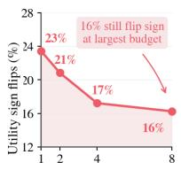

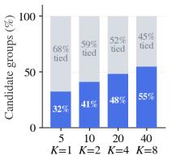  
Rollouts per condition, K (a) Rollout utility is unstable  
Extra environment rollouts/query (b) Reliable utility is costly

Online RL must immediately decide whether and which skill to inject, whereas reliable candidate-specific estimates <sub>requ</sub>i<sub>re a</sub>dditi<sub>ona</sub>l i<sub>n</sub>t<sub>erac</sub>ti<sub>on.</sub> W<sub>e</sub> th<sub>ere</sub>f<sub>ore see</sub>k <sub>a</sub> l<sub>ow-cos</sub>t <sub>u</sub>tilit<sub>y</sub> <sub>es</sub>ti<sub>ma</sub>t<sub>e</sub> th<sub>a</sub>t <sub>avo</sub>id<sub>s</sub> <sub>can</sub>did<sub>a</sub>t<sub>e-spec</sub>ifi<sub>c</sub> d<sub>owns</sub>t<sub>ream</sub> <sub>ro</sub>ll<sub>ou</sub>t<sub>s.</sub>

## 3.2 Skill Utility Is Query- and Policy-Dependent

Fi<sub>gure</sub> 2<sub>.</sub> R<sub>o</sub>ll<sub>ou</sub>t<sub>-</sub>b<sub>ase</sub>d <sub>u</sub>tilit<sub>y es</sub>ti<sub>ma</sub>ti<sub>on</sub> is costly and unstable. (a) Si<sub>g</sub>n di<sub>sagreemen</sub>t b<sub>e</sub>t<sub>ween</sub> i<sub>n</sub>d<sub>epen</sub>d<sub>en</sub>t <sub>es</sub>ti<sub>ma</sub>t<sub>es.</sub> (b) More rollout sam<sub>p</sub>les distin<sub>g</sub>uish more <sub>can</sub>did<sub>a</sub>t<sub>e groups.</sub>

L<sub>ow</sub> i<sub>n</sub>t<sub>erac</sub>ti<sub>on cos</sub>t <sub>a</sub>l<sub>one</sub> i<sub>s</sub> i<sub>nsu</sub>fi<sub>c</sub>i<sub>en</sub>t<sub>: s</sub>kill <sub>u</sub>tilit<sub>y var</sub>i<sub>es across quer</sub>i<sub>es, can</sub>did<sub>a</sub>t<sub>es, an</sub>d <sub>po</sub>li<sub>cy</sub> <sub>compe</sub>t<sub>ence, so cre</sub>dit <sub>ass</sub>i<sub>gnmen</sub>t <sub>mus</sub>t b<sub>o</sub>th <sub>ran</sub>k <sub>can</sub>did<sub>a</sub>t<sub>es an</sub>d <sub>a</sub>b<sub>s</sub>t<sub>a</sub>i<sub>n w</sub>h<sub>en none</sub> i<sub>s</sub> h<sub>e</sub>l<sub>p</sub>f<sub>u</sub>l<sub>.</sub>

Within<sub>-que</sub>r<sub>y</sub> <sub>va</sub>ri<sub>a</sub>ti<sub>o</sub>n<sub>.</sub> O<sub>n</sub> <sub>a</sub> <sub>non-sa</sub>t<sub>ura</sub>t<sub>e</sub>d <sub>p</sub>il<sub>o</sub>t <sub>su</sub>b<sub>se</sub>t where candidate diferences remain measurable, Fi<sub>g</sub>ure 3(a) <sub>compares</sub> th<sub>e</sub> b<sub>es</sub>t <sub>an</sub>d <sub>wors</sub>t <sub>o</sub>b<sub>serve</sub>d <sub>can</sub>did<sub>a</sub>t<sub>es</sub> f<sub>or eac</sub>h <sub>query, as measure</sub>d b<sub>y</sub> d<sub>owns</sub>t<sub>ream ro</sub>ll<sub>ou</sub>t<sub>s re</sub>l<sub>a</sub>ti<sub>ve</sub> t<sub>o</sub> <sub>s</sub>kill<sub>-</sub>f<sub>ree execu</sub>ti<sub>on.</sub> A<sub>mong</sub> 100 <sub>quer</sub>i<sub>es,</sub> 28 <sub>con</sub>t<sub>a</sub>i<sub>n</sub> b<sub>o</sub>th <sub>pos</sub>iti<sub>ve- an</sub>d <sub>nega</sub>ti<sub>ve-e</sub>f<sub>ec</sub>t <sub>can</sub>did<sub>a</sub>t<sub>es, s</sub>h<sub>ow</sub>i<sub>ng</sub> th<sub>a</sub>t <sub>genera</sub>ti<sub>ng p</sub>l<sub>aus</sub>ibl<sub>e s</sub>kill<sub>s</sub> i<sub>s</sub> i<sub>nsu</sub>fi<sub>c</sub>i<sub>en</sub>t<sub>; can</sub>did<sub>a</sub>t<sub>es mus</sub>t b<sub>e</sub> di<sub>s</sub>ti<sub>ngu</sub>i<sub>s</sub>h<sub>e</sub>d <sub>a</sub>t th<sub>e query</sub> l<sub>eve</sub>l<sub>.</sub>

De<sub>p</sub>endence on <sub>p</sub>olic<sub>y</sub> com<sub>p</sub>etence. We measure cur-<sub>ren</sub>t <sub>compe</sub>t<sub>ence us</sub>i<sub>ng</sub> f<sub>our</sub> i<sub>n</sub>d<sub>epen</sub>d<sub>en</sub>t <sub>s</sub>kill<sub>-</sub>f<sub>ree pro</sub>b<sub>e</sub> <sub>ro</sub>ll<sub>ou</sub>t<sub>s</sub> f<sub>rom</sub> th<sub>e same</sub> f<sub>rozen po</sub>li<sub>cy.</sub> H<sub>ere, a pro</sub>b<sub>e</sub> i<sub>s an</sub> <sub>eva</sub>l<sub>ua</sub>ti<sub>on-on</sub>l<sub>y ro</sub>ll<sub>ou</sub>t <sub>use</sub>d t<sub>o assess</sub> th<sub>e po</sub>li<sub>cy</sub>’<sub>s curren</sub>t <sub>s</sub>kill<sub>-</sub>f<sub>ree compe</sub>t<sub>ence.</sub> Thi<sub>s avo</sub>id<sub>s con</sub>fl<sub>a</sub>ti<sub>on w</sub>ith hi<sub>s</sub>t<sub>or-</sub> i<sub>ca</sub>l t<sub>ra</sub>i<sub>n</sub>i<sub>ng-</sub>ti<sub>me</sub> S<sub>cou</sub>t <sub>ou</sub>t<sub>comes.</sub> W<sub>e group quer</sub>i<sub>es</sub> b<sub>y</sub> their number of successful <sub>p</sub>robes (0–4). Fi<sub>g</sub>ure 3(b) re-<sub>por</sub>t<sub>s</sub> b<sub>o</sub>th th<sub>e mean can</sub>did<sub>a</sub>t<sub>e e</sub>f<sub>ec</sub>t <sub>an</sub>d th<sub>e</sub> b<sub>es</sub>t <sub>o</sub>b<sub>serve</sub>d <sub>can</sub>did<sub>a</sub>t<sub>e.</sub> A<sub>verage s</sub>kill <sub>ga</sub>i<sub>ns are pos</sub>iti<sub>ve w</sub>h<sub>en on</sub>l<sub>y a</sub> <sub>m</sub>i<sub>nor</sub>it<sub>y o</sub>f <sub>pro</sub>b<sub>es succee</sub>d<sub>; w</sub>h<sub>en mos</sub>t <sub>or a</sub>ll <sub>succee</sub>d<sub>,</sub> th<sub>e</sub> <sub>mean e</sub>f<sub>ec</sub>t b<sub>ecomes nega</sub>ti<sub>ve an</sub>d <sub>even</sub> th<sub>e</sub> b<sub>es</sub>t <sub>o</sub>b<sub>serve</sub>d <sub>can</sub>did<sub>a</sub>t<sub>e prov</sub>id<sub>es</sub> littl<sub>e or no a</sub>dditi<sub>ona</sub>l b<sub>ene</sub>fit<sub>.</sub>

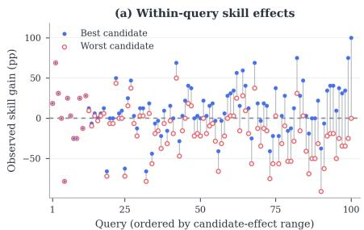

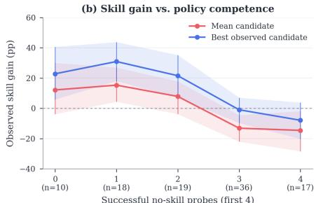  
Fi<sub>gu</sub>r<sub>e</sub> 3<sub>.</sub> Skill <sub>u</sub>tilit<sub>y</sub> i<sub>s</sub> <sub>que</sub>r<sub>y-</sub> <sub>a</sub>nd policy-dependent. (a) Candidate efects var<sub>y</sub> within a quer<sub>y</sub>. (b) Skill benefit d<sub>ecreases</sub> <sub>as</sub> <sub>s</sub>kill<sub>-</sub>f<sub>ree</sub> <sub>po</sub>li<sub>cy</sub> <sub>compe</sub>t<sub>ence</sub> <sup>i</sup>m<sub>p</sub>roves.

Thus, skill credit assignment requires a query- and policy  
relative utility to identify the most helpful candidate and ab-  
<sub>s</sub>t<sub>a</sub>i<sub>n</sub> <sub>w</sub>h<sub>en</sub> <sub>none</sub> <sub>prov</sub>id<sub>es</sub> <sub>pos</sub>iti<sub>ve</sub> <sub>a</sub>dditi<sub>ona</sub>l <sub>va</sub>l<sub>ue.</sub> Th<sub>ese</sub>   
d<sub>owns</sub>t<sub>ream measuremen</sub>t<sub>s are use</sub>d <sub>on</sub>l<sub>y</sub> f<sub>or</sub> di<sub>agnos</sub>i<sub>s, no</sub>t <sub>as</sub> t<sub>ra</sub>i<sub>n</sub>i<sub>ng s</sub>i<sub>gna</sub>l<sub>s</sub> f<sub>or</sub> S<sub>kill</sub>S<sub>caffold.</sub> downstream measurements are used only for diagnosis, not

## 4 SkillS<sub>ca</sub>f<sub>o</sub>ld

S<sub>kill</sub>S<sub>caffold uses one s</sub>h<sub>are</sub>d <sub>po</sub>li<sub>cy</sub> $\pi _ { \theta }$ in two roles: the Executor interacts with the environment, while the Generator produces candidate skills from outcome-labeled trajectories. As shown in Figure 4, each update collects skill-free Scouts, generates and scores candidate skills, and injects <sub>on</sub>l<sub>y</sub> th<sub>e</sub> hi<sub>g</sub>h<sub>es</sub>t<sub>-u</sub>tilit<sub>y pos</sub>iti<sub>ve can</sub>did<sub>a</sub>t<sub>e</sub> i<sub>n</sub>t<sub>o</sub> f<sub>res</sub>h E<sub>xecu</sub>t<sub>or ro</sub>ll<sub>ou</sub>t<sub>s.</sub> E<sub>nv</sub>i<sub>ronmen</sub>t <sub>rewar</sub>d<sub>s</sub> t<sub>ra</sub>i<sub>n</sub> th<sub>e</sub> E<sub>xecu</sub>t<sub>or, s</sub>kill <sub>u</sub>tilit<sub>y</sub> t<sub>ra</sub>i<sub>ns</sub> th<sub>e</sub> G<sub>enera</sub>t<sub>or, an</sub>d th<sub>e</sub>i<sub>r s</sub>h<sub>are</sub>d <sub>parame</sub>t<sub>ers ena</sub>bl<sub>e</sub> f<sub>u</sub>ll<sub>y s</sub>kill<sub>-</sub>f<sub>ree</sub> <sup>d</sup>e<sub>p</sub><sup>l</sup>o<sub>y</sub>ment.

## 4<sub>.</sub>1 Skill<sub>-</sub>F<sub>ree</sub> R<sub>o</sub>ll<sub>ou</sub>t

Skill<sub>-</sub>f<sub>ree</sub> S<sub>cou</sub>t <sub>co</sub>ll<sub>ec</sub>ti<sub>on.</sub> F<sub>or</sub> t<sub>as</sub>k $x ,$ the current Executor samples � skill-free trajectories:

$$
\tau _ { i } ^ { 0 } \sim \pi _ { \theta } ^ { \mathrm { e x e c } } ( \cdot \mid x , \emptyset ; \mathcal { T } ) , \qquad i = 1 , \dots , N .\tag{5}
$$

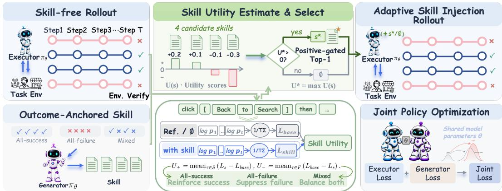  
Fi<sub>gure</sub> 4<sub>.</sub> O<sub>verv</sub>i<sub>ew o</sub>f S<sub>kill</sub>S<sub>caffold.</sub> Th<sub>e</sub> fi<sub>ve s</sub>t<sub>ages s</sub>h<sub>ow s</sub>kill<sub>-</sub>f<sub>ree scou</sub>ti<sub>ng, ou</sub>t<sub>come-anc</sub>h<sub>ore</sub>d generation, utility-based selection, adaptive injection, and joint policy optimization.

We call these trajectories Scouts. An environment verifier assigns each Scout an outcome $y _ { i } \in \{ 0 , 1 \}$ <sub>w</sub>hi<sub>c</sub>h d<sub>e</sub>fi<sub>nes</sub> $\bar { S _ { x } } = \{ i : y _ { i } = 1 \}$ } and $\mathcal { F } _ { x } = \{ i : y _ { i } = 0 \}$ <sub>.</sub> Th<sub>e</sub> <sub>resu</sub>lti<sub>ng</sub> <sub>group</sub> i<sub>s</sub> <sub>a</sub>ll<sub>-success,</sub> <sub>a</sub>ll<sub>-</sub>f<sub>a</sub>il<sub>ure,</sub> <sub>or m</sub>i<sub>xe</sub>d<sub>.</sub>

## 4<sub>.</sub>2 O<sub>u</sub>t<sub>co</sub>m<sub>e-</sub>An<sub>c</sub>h<sub>o</sub>r<sub>e</sub>d Skill

Gr<sub>oup-</sub>b<sub>ase</sub>d <sub>ev</sub>id<sub>e</sub>n<sub>ce.</sub> Th<sub>e</sub> G<sub>enera</sub>t<sub>or rece</sub>i<sub>ves</sub> th<sub>e</sub> t<sub>as</sub>k <sub>an</sub>d <sub>a</sub>ll <sub>ou</sub>t<sub>come-</sub>l<sub>a</sub>b<sub>e</sub>l<sub>e</sub>d S<sub>cou</sub>t<sub>s.</sub> It <sub>ex</sub>t<sub>rac</sub>t<sub>s</sub> <sub>reusa</sub>bl<sub>e</sub> d<sub>ec</sub>i<sub>s</sub>i<sub>ons</sub> f<sub>rom a</sub>ll<sub>-success groups,</sub> di<sub>agnoses recurr</sub>i<sub>ng errors</sub> f<sub>rom a</sub>ll<sub>-</sub>f<sub>a</sub>il<sub>ure groups, an</sub>d <sub>con</sub>t<sub>ras</sub>t<sub>s success</sub>f<sub>u</sub>l <sub>an</sub>d f<sub>a</sub>il<sub>e</sub>d b<sub>e</sub>h<sub>av</sub>i<sub>or</sub> i<sub>n m</sub>i<sub>xe</sub>d <sub>groups.</sub> Th<sub>us,</sub> b<sub>o</sub>th <sub>successes an</sub>d f<sub>a</sub>il<sub>ures prov</sub>id<sub>e</sub> <sub>query-spec</sub>ifi<sub>c</sub> <sub>ev</sub>id<sub>ence</sub> f<sub>or</sub> <sub>s</sub>kill <sub>genera</sub>ti<sub>on.</sub>

A<sub>nc</sub>h<sub>or-</sub>b<sub>ase</sub>d <sub>ev</sub>id<sub>ence.</sub> W<sub>e a</sub>l<sub>so cons</sub>id<sub>er a</sub> li<sub>g</sub>ht<sub>we</sub>i<sub>g</sub>ht <sub>var</sub>i<sub>an</sub>t th<sub>a</sub>t <sub>uses one ver</sub>ifi<sub>e</sub>d <sub>success</sub>f<sub>u</sub>l S<sub>cou</sub>t <sub>as</sub> it<sub>s ev</sub>id<sub>ence anc</sub>h<sub>or.</sub> Wh<sub>en</sub> $S _ { x } \neq \emptyset$ <sub>, we c</sub>h<sub>oose</sub> $a _ { x } = \operatorname* { m i n } S _ { x }$ <sub>an</sub>d <sub>prov</sub>id<sub>e</sub> $\tau _ { a _ { x } } ^ { 0 }$ t<sub>o</sub> th<sub>e</sub> G<sub>enera</sub>t<sub>or.</sub> If <sub>no</sub> S<sub>cou</sub>t <sub>succee</sub>d<sub>s,</sub> thi<sub>s var</sub>i<sub>an</sub>t <sub>s</sub>ki<sub>ps genera</sub>ti<sub>on an</sub>d k<sub>eeps</sub> th<sub>e su</sub>b<sub>sequen</sub>t E<sub>xecu</sub>t<sub>or</sub> <sub>ro</sub>ll<sub>ou</sub>t<sub>s s</sub>kill<sub>-</sub>f<sub>ree.</sub>

Candidate <sub>g</sub>eneration<sub>.</sub> L<sub>e</sub>t $E _ { x } ^ { \nu }$ d<sub>eno</sub>t<sub>e</sub> th<sub>e ev</sub>id<sub>ence recor</sub>d f<sub>or var</sub>i<sub>an</sub>t $\nu \in \{ \mathrm { g r p } , \mathrm { a n c } \}$ <sub>.</sub> Th<sub>e</sub> G<sub>e</sub>n<sub>e</sub>r<sub>a</sub>t<sub>o</sub>r i<sub>n</sub>d<sub>epen</sub>d<sub>en</sub>tl<sub>y samp</sub>l<sub>es</sub> � <sub>can</sub>did<sub>a</sub>t<sub>e s</sub>kill<sub>s,</sub>

$$
s _ { j } \sim \pi _ { \theta } ^ { \mathrm { g e n } } ( \cdot \mid E _ { x } ^ { \nu } ) , \qquad C _ { x } = \{ s _ { j } \} _ { j = 1 } ^ { M } .\tag{6}
$$

E<sub>ac</sub>h <sub>can</sub>did<sub>a</sub>t<sub>e</sub> i<sub>s</sub> <sub>a</sub> <sub>s</sub>t<sub>ruc</sub>t<sub>ure</sub>d <sub>s</sub>kill <sub>car</sub>d <sub>con</sub>t<sub>a</sub>i<sub>n</sub>i<sub>ng</sub> <sub>app</sub>li<sub>ca</sub>bilit<sub>y</sub> <sub>con</sub>diti<sub>ons,</sub> <sub>an</sub> <sub>execu</sub>t<sub>a</sub>bl<sub>e</sub> <sub>proce</sub>d<sub>ure,</sub> <sub>con</sub>diti<sub>ona</sub>l d<sub>ec</sub>i<sub>s</sub>i<sub>on ru</sub>l<sub>es, an</sub>d <sub>ver</sub>ifi<sub>ca</sub>ti<sub>on, recovery, or s</sub>t<sub>opp</sub>i<sub>ng cr</sub>it<sub>er</sub>i<sub>a.</sub> F<sub>orma</sub>t<sub>-</sub>i<sub>nva</sub>lid <sub>ou</sub>t<sub>pu</sub>t<sub>s are</sub> <sub>exc</sub>l<sub>u</sub>d<sub>e</sub>d f<sub>rom se</sub>l<sub>ec</sub>ti<sub>on.</sub>

## 4<sub>.</sub>3 Skill Utilit<sub>y</sub> E<sub>s</sub>ti<sub>ma</sub>t<sub>e</sub> & S<sub>e</sub>l<sub>ec</sub>t

A skill credit-assignment mechanism must assign each candidate a scalar skill utility $U ( s ; x )$ <sub>.</sub> A <sub>use</sub>f<sub>u</sub>l <sub>s</sub>kill <sub>s</sub>h<sub>ou</sub>ld b<sub>e compa</sub>tibl<sub>e w</sub>ith <sub>ver</sub>ifi<sub>e</sub>d <sub>success</sub>f<sub>u</sub>l b<sub>e</sub>h<sub>av</sub>i<sub>or an</sub>d i<sub>ncompa</sub>tibl<sub>e w</sub>ith <sub>o</sub>b<sub>serve</sub>d f<sub>a</sub>il<sub>e</sub>d b<sub>e</sub>h<sub>av</sub>i<sub>or.</sub> Di<sub>rec</sub>tl t<sub>es</sub>ti<sub>n</sub> thi<sub>s cr</sub>it<sub>er</sub>i<sub>on w</sub>ith f<sub>res</sub>h <sub>env</sub>i<sub>ronmen</sub>t <sub>ro</sub>ll<sub>ou</sub>t<sub>s wou</sub>ld <sub>re ro</sub>d<sub>uce</sub> th<sub>e cos</sub>t <sub>an</sub>d <sub>var</sub>i<sub>ance</sub> id<sub>en</sub>tifi<sub>e</sub>d i<sub>n</sub> S<sub>ec</sub>ti<sub>on</sub> 3<sub>.</sub>1<sub>.</sub> I<sub>ns</sub>t<sub>ea</sub>d<sub>,</sub> <sub>we</sub> k<sub>eep</sub> th<sub>e</sub> S<sub>cou</sub>t<sub>s</sub> fi<sub>xe</sub>d <sub>an</sub>d <sub>compare</sub> h<sub>ow</sub> th<sub>e</sub> <sub>curren</sub>t <sub>po</sub>li<sub>cy scores</sub> th<sub>e same</sub> b<sub>e</sub>h<sub>av</sub>i<sub>or w</sub>ith <sub>an</sub>d <sub>w</sub>ith<sub>ou</sub>t <sub>eac</sub>h <sub>can</sub>did<sub>a</sub>t<sub>e s</sub>kill<sub>.</sub>

Paired trajectory scoring. Write the Executor-generated reasoning and action tokens in a fixed Scout trajectory � as $u _ { 1 : T }$ <sub>.</sub> F<sub>or s</sub>kill <sub>con</sub>t<sub>ex</sub>t <sub>�,</sub> d<sub>e</sub>fi<sub>ne</sub>

$$
\ell _ { \boldsymbol { \theta } } ( c ; \tau ) = \frac { 1 } { T } \sum _ { t = 1 } ^ { T } \log \pi _ { \boldsymbol { \theta } } ^ { \mathrm { e x e c } } ( u _ { t } \mid \boldsymbol { x } , c , \tau _ { < t } ) , \qquad d ( \boldsymbol { s } , \tau ) = \ell _ { \boldsymbol { \theta } } ( \boldsymbol { s } ; \tau ) - \ell _ { \boldsymbol { \theta } } ( \boldsymbol { \varpi } ; \tau ) .\tag{7}
$$

H<sub>ere</sub> $\tau _ { < t }$ i<sub>s</sub> th<sub>e</sub> <sub>recor</sub>d<sub>e</sub>d i<sub>n</sub>t<sub>erac</sub>ti<sub>on</sub> <sub>pre</sub>fi<sub>x</sub> <sub>prece</sub>di<sub>ng</sub> $u _ { t } .$ <sub>,</sub> i<sub>nc</sub>l<sub>u</sub>di<sub>ng</sub> <sub>prev</sub>i<sub>ous</sub> E<sub>xecu</sub>t<sub>or</sub> <sub>ou</sub>t<sub>pu</sub>t<sub>s</sub> <sub>an</sub>d <sub>env</sub>i<sub>ronmen</sub>t <sub>o</sub>b<sub>serva</sub>ti<sub>ons.</sub> A <sub>pos</sub>iti<sub>ve</sub> $d ( s , \tau )$ <sub>means</sub> th<sub>a</sub>t <sub>con</sub>diti<sub>on</sub>i<sub>ng on �</sub> i<sub>ncreases</sub> th<sub>e</sub> lik<sub>e</sub>lih<sub>oo</sub>d <sub>o</sub>f th<sub>e o</sub>b<sub>serve</sub>d S<sub>cou</sub>t b<sub>e</sub>h<sub>av</sub>i<sub>or re</sub>l<sub>a</sub>ti<sub>ve</sub> t<sub>o s</sub>kill<sub>-</sub>f<sub>ree execu</sub>ti<sub>on.</sub>

Group-based utility. We aggregate the trajectory-level diferences according to the observed outcomes:

$$
U ^ { \mathrm { g r p } } ( s ; x ) = \left\{ \begin{array} { l l } { \displaystyle \frac { 1 } { | { \cal S } _ { x } | } \sum _ { i \in { \cal S } _ { x } } d ( s , { \tau } _ { i } ^ { 0 } ) , } & { \displaystyle \mathcal { F } _ { x } = \emptyset , } \\ { \displaystyle - \frac { 1 } { | \mathcal { F } _ { x } | } \sum _ { i \in \mathcal { F } _ { x } } d ( s , { \tau } _ { i } ^ { 0 } ) , } & { \displaystyle S _ { x } = \emptyset , } \\ { \displaystyle \frac { 1 } { 2 | { \cal S } _ { x } | } \sum _ { i \in { \cal S } _ { x } } d ( s , { \tau } _ { i } ^ { 0 } ) - \displaystyle \frac { 1 } { 2 | \mathcal { F } _ { x } | } \sum _ { i \in \mathcal { F } _ { x } } d ( s , { \tau } _ { i } ^ { 0 } ) , } & { \mathrm { o t h e r w i s e } . } \end{array} \right.\tag{8}
$$

F<sub>or an a</sub>ll<sub>-success group, u</sub>tilit<sub>y</sub> i<sub>ncreases w</sub>h<sub>en</sub> th<sub>e s</sub>kill <sub>ra</sub>i<sub>ses</sub> th<sub>e</sub> lik<sub>e</sub>lih<sub>oo</sub>d <sub>o</sub>f <sub>ver</sub>ifi<sub>e</sub>d <sub>success</sub>f<sub>u</sub>l b<sub>e</sub>h<sub>av</sub>i<sub>or.</sub> F<sub>or an a</sub>ll<sub>-</sub>f<sub>a</sub>il<sub>ure group,</sub> th<sub>e s</sub>i<sub>gn</sub> i<sub>s reverse</sub>d<sub>, so u</sub>tilit<sub>y</sub> i<sub>ncreases w</sub>h<sub>en</sub> th<sub>e s</sub>kill <sub>suppresses</sub> <sub>o</sub>b<sub>serve</sub>d f<sub>a</sub>il<sub>e</sub>d b<sub>e</sub>h<sub>av</sub>i<sub>or.</sub> F<sub>or a m</sub>i<sub>xe</sub>d <sub>group,</sub> th<sub>e success-suppor</sub>t <sub>an</sub>d f<sub>a</sub>il<sub>ure-suppress</sub>i<sub>on</sub> t<sub>erms</sub> <sub>rece</sub>i<sub>ve</sub> <sub>equa</sub>l t<sub>o</sub>t<sub>a</sub>l <sub>we</sub>i<sub>g</sub>ht <sub>regar</sub>dl<sub>ess</sub> <sub>o</sub>f th<sub>e</sub>i<sub>r</sub> <sub>re</sub>l<sub>a</sub>ti<sub>ve</sub> <sub>coun</sub>t<sub>s.</sub> W<sub>e</sub> <sub>re</sub>f<sub>er</sub> t<sub>o</sub> thi<sub>s</sub> b<sub>a</sub>l<sub>ance</sub>d <sub>quan</sub>tit<sub>y</sub> <sub>as</sub> th<sub>e</sub> group-aware skill utility.

A<sub>nc</sub>h<sub>or-</sub>b<sub>ase</sub>d <sub>u</sub>tilit<sub>y.</sub> Th<sub>e se</sub>l<sub>ec</sub>t<sub>e</sub>d <sub>success</sub>f<sub>u</sub>l S<sub>cou</sub>t <sub>supp</sub>li<sub>es</sub> th<sub>e scor</sub>i<sub>ng anc</sub>h<sub>or as we</sub>ll <sub>as</sub> th<sub>e</sub> <sub>genera</sub>ti<sub>on</sub> <sub>ev</sub>id<sub>ence:</sub>

$$
U ^ { \mathrm { a n c } } ( s ; x ) = d ( s , \tau _ { a _ { x } } ^ { 0 } ) , \qquad S _ { x } \neq \emptyset .\tag{9}
$$

A<sub>nc</sub>h<sub>or-</sub>b<sub>ase</sub>d <sub>u</sub>tilit<sub>y uses one success</sub>f<sub>u</sub>l S<sub>cou</sub>t<sub>, w</sub>h<sub>ereas group-</sub>b<sub>ase</sub>d <sub>u</sub>tilit<sub>y a</sub>l<sub>so</sub> i<sub>ncorpora</sub>t<sub>es</sub> f<sub>a</sub>il<sub>ure</sub> <sub>ev</sub>id<sub>ence.</sub>

Skill <sub>u</sub>tilit<sub>y</sub> <sub>prov</sub>id<sub>es</sub> <sub>a</sub> <sub>po</sub>li<sub>cy-re</sub>l<sub>a</sub>ti<sub>ve</sub> <sub>s</sub>i<sub>gna</sub>l f<sub>or</sub> <sub>can</sub>did<sub>a</sub>t<sub>e</sub> <sub>ran</sub>ki<sub>ng</sub> <sub>an</sub>d <sub>a</sub>b<sub>s</sub>t<sub>en</sub>ti<sub>on.</sub> B<sub>y</sub> <sub>compar</sub>i<sub>ng</sub> outcome-conditioned likelihoods over verified Scout trajectories, it identifies skills aligned with the <sub>curren</sub>t E<sub>xecu</sub>t<sub>or, w</sub>hil<sub>e env</sub>i<sub>ronmen</sub>t <sub>ou</sub>t<sub>comes superv</sub>i<sub>se</sub> E<sub>xecu</sub>t<sub>or</sub> l<sub>earn</sub>i<sub>ng.</sub> A<sub>ppen</sub>di<sub>x</sub> C <sub>prov</sub>id<sub>es a</sub> l<sub>og-</sub>lik<sub>e</sub>lih<sub>oo</sub>d<sub>-ra</sub>ti<sub>o</sub> i<sub>n</sub>t<sub>erpre</sub>t<sub>a</sub>ti<sub>on an</sub>d <sub>correspon</sub>di<sub>ng se</sub>l<sub>ec</sub>ti<sub>on guaran</sub>t<sub>ees.</sub>

P<sub>os</sub>iti<sub>ve</sub>-<sub>ga</sub>t<sub>e</sub>d <sub>se</sub>l<sub>ec</sub>ti<sub>o</sub>n<sub>.</sub> L<sub>e</sub>t $U _ { j } = U ^ { \nu } \big ( s _ { j } ; x \big )$ <sub>,</sub> <sub>an</sub>d l<sub>e</sub>t $\mathcal { V } _ { x }$ <sub>con</sub>t<sub>a</sub>i<sub>n</sub> <sub>can</sub>did<sub>a</sub>t<sub>es</sub> th<sub>a</sub>t <sub>sa</sub>ti<sub>s</sub>f<sub>y</sub> th<sub>e</sub> <sub>requ</sub>i<sub>re</sub>d f<sub>orma</sub>t <sub>an</sub>d h<sub>ave a</sub> fi<sub>n</sub>it<sub>e u</sub>tilit<sub>y.</sub> ${ \bar { \operatorname { I f } } } \mathbf { \mathcal { V } } _ { x }$ i<sub>s nonemp</sub>t<sub>y, we</sub> d<sub>e</sub>fi<sub>ne</sub> $j ^ { * } = \arg \operatorname* { m a x } _ { j \in \gamma _ { x } } U _ { j }$ <sub>an</sub>d <sub>se</sub>l<sub>ec</sub>t

$$
s _ { x } ^ { * } = \left\{ \begin{array} { l l } { s _ { j ^ { * } } , } & { \mathcal { V } _ { x } \neq \emptyset \mathrm { a n d } U _ { j ^ { * } } > 0 , } \\ { \emptyset , } & { \mathrm { o t h e r w i s e } . } \end{array} \right.\tag{10}
$$

Th<sub>e</sub> <sub>ran</sub>ki<sub>ng</sub> id<sub>en</sub>tifi<sub>es</sub> th<sub>e</sub> <sub>mos</sub>t <sub>compa</sub>tibl<sub>e</sub> <sub>can</sub>did<sub>a</sub>t<sub>e,</sub> <sub>w</sub>hil<sub>e</sub> th<sub>e</sub> <sub>s</sub>i<sub>gn</sub> t<sub>es</sub>t d<sub>e</sub>t<sub>erm</sub>i<sub>nes</sub> <sub>w</sub>h<sub>e</sub>th<sub>er</sub> <sub>any</sub> <sub>s</sub>kill should be injected.

## 4.4 Adaptive Skill Injection Rollout

Gi<sub>ven</sub> th<sub>e se</sub>l<sub>ec</sub>t<sub>e</sub>d <sub>con</sub>t<sub>ex</sub>t $s _ { x } ^ { * }$ , the Executor samples � fresh Post-Scout trajectories, $\tau _ { k } ^ { 1 } \sim \pi _ { \theta } ^ { \mathrm { e x e c } } ( \cdot \mid$ $x , s _ { x } ^ { * } ; \mathcal { T } ) , \ : k \ : = \ : 1 , \ldots , L$ <sub>.</sub> Th<sub>us, every query procee</sub>d<sub>s</sub> th<sub>roug</sub>h th<sub>e same</sub> E<sub>xecu</sub>t<sub>or</sub> i<sub>n</sub>t<sub>er</sub>f<sub>ace: a</sub> <sub>pos</sub>iti<sub>ve-u</sub>tilit<sub>y</sub> <sub>s</sub>kill i<sub>s</sub> <sub>supp</sub>li<sub>e</sub>d <sub>w</sub>h<sub>en</sub> <sub>ava</sub>il<sub>a</sub>bl<sub>e,</sub> <sub>an</sub>d $s _ { x } ^ { * } = \emptyset$ <sub>o</sub>th<sub>erw</sub>i<sub>se.</sub>

## 4.5 Joint Polic<sub>y</sub> O<sub>p</sub>timization

Role-specific learning signals. The � Scouts and � post-selection trajectories form one Executor GRPO <sub>group w</sub>h<sub>ose rewar</sub>d<sub>s come exc</sub>l<sub>us</sub>i<sub>ve</sub>l<sub>y</sub> f<sub>rom</sub> th<sub>e env</sub>i<sub>ronmen</sub>t <sub>ver</sub>ifi<sub>er.</sub> Th<sub>e</sub> � <sub>genera</sub>t<sub>e</sub>d <sub>s</sub>kill t<sub>ex</sub>t<sub>s</sub> f<sub>orm a separa</sub>t<sub>e</sub> G<sub>enera</sub>t<sub>or</sub> GRPO <sub>group.</sub> Th<sub>e</sub>i<sub>r</sub> d<sub>e</sub>t<sub>ac</sub>h<sub>e</sub>d <sub>rewar</sub>d<sub>s are</sub> d<sub>er</sub>i<sub>ve</sub>d f<sub>rom s</sub>kill <sub>u</sub>tilit<sub>y:</sub>

$$
r _ { j } ^ { \mathrm { g e n } } = \left\{ \begin{array} { l l } { \operatorname* { m a x } \{ 0 , \mathrm { s g } [ U _ { j } ] \} , } & { \nu = \mathrm { a n c } , } \\ { \mathrm { s g } [ U _ { j } ] , } & { \nu = \mathrm { g r p } , } \end{array} \right.\tag{11}
$$

B<sub>ecause</sub> <sub>anc</sub>h<sub>or</sub> <sub>ev</sub>id<sub>ence</sub> <sub>con</sub>t<sub>a</sub>i<sub>ns</sub> <sub>on</sub>l<sub>y</sub> <sub>successes,</sub> <sub>nonpos</sub>iti<sub>ve</sub> <sub>u</sub>tiliti<sub>es</sub> <sub>are</sub> <sub>c</sub>li<sub>ppe</sub>d t<sub>o</sub> <sub>zero;</sub> <sub>group-</sub> b<sub>ase</sub>d <sub>rewar</sub>d<sub>s re</sub>t<sub>a</sub>i<sub>n</sub> th<sub>e</sub>i<sub>r s</sub>i<sub>gns</sub> t<sub>o</sub> di<sub>s</sub>ti<sub>ngu</sub>i<sub>s</sub>h <sub>success-suppor</sub>ti<sub>ng</sub> f<sub>rom</sub> f<sub>a</sub>il<sub>ure-re</sub>i<sub>n</sub>f<sub>orc</sub>i<sub>ng can</sub>did<sub>a</sub>t<sub>es.</sub> E<sub>xecu</sub>t<sub>or an</sub>d G<sub>enera</sub>t<sub>or rewar</sub>d<sub>s are norma</sub>li<sub>ze</sub>d <sub>separa</sub>t<sub>e</sub>l<sub>y.</sub>

W<sub>e op</sub>ti<sub>m</sub>i<sub>ze</sub> th<sub>e s</sub>h<sub>are</sub>d <sub>parame</sub>t<sub>ers w</sub>ith

$$
\begin{array} { r } { J _ { \mathrm { S S } } ( \theta ) = J _ { \mathrm { G R P O } } ^ { \mathrm { e x e c } } ( \theta ; R ) + \lambda _ { \mathrm { g e n } } J _ { \mathrm { G R P O } } ^ { \mathrm { g e n } } ( \theta ; r ^ { \mathrm { g e n } } ) + \eta _ { \mathrm { g e n } } \mathcal { H } _ { \mathrm { g e n } } ( \theta ) , } \end{array}\tag{12}
$$

<sub>w</sub>h<sub>ere</sub> $\lambda _ { \mathrm { g e n } }$ <sub>we</sub>i<sub>g</sub>ht<sub>s</sub> G<sub>enera</sub>t<sub>or</sub> l<sub>earn</sub>i<sub>ng an</sub>d $\eta _ { \mathrm { g e n } }$ <sub>con</sub>t<sub>ro</sub>l<sub>s</sub> it<sub>s en</sub>t<sub>ropy regu</sub>l<sub>ar</sub>i<sub>za</sub>ti<sub>on.</sub> Th<sub>e</sub> E<sub>xecu</sub>t<sub>or</sub> l<sub>earns</sub> f<sub>rom</sub> <sub>ver</sub>ifi<sub>e</sub>d t<sub>as</sub>k <sub>ou</sub>t<sub>comes,</sub> <sub>w</sub>hil<sub>e</sub> th<sub>e</sub> G<sub>enera</sub>t<sub>or</sub> l<sub>earns</sub> f<sub>rom</sub> <sub>po</sub>li<sub>cy-re</sub>l<sub>a</sub>ti<sub>ve</sub> <sub>u</sub>tilit<sub>y.</sub> B<sub>ecause</sub> th<sub>ey</sub> <sub>s</sub>h<sub>are</sub> $\theta ,$ b<sub>o</sub>th <sub>s</sub>kill<sub>-</sub>f<sub>ree</sub> S<sub>cou</sub>t<sub>s</sub> <sub>an</sub>d <sub>se</sub>l<sub>ec</sub>ti<sub>ve</sub>l<sub>y</sub> <sub>sca</sub>f<sub>o</sub>ld<sub>e</sub>d P<sub>os</sub>t<sub>-</sub>S<sub>cou</sub>t<sub>s</sub> <sub>up</sub>d<sub>a</sub>t<sub>e</sub> th<sub>e</sub> <sub>same</sub> <sub>po</sub>li<sub>cy,</sub> <sub>re</sub>i<sub>n</sub>f<sub>orc</sub>i<sub>ng use</sub>f<sub>u</sub>l <sub>sca</sub>f<sub>o</sub>ld<sub>e</sub>d b<sub>e</sub>h<sub>av</sub>i<sub>or w</sub>ith<sub>ou</sub>t <sub>separa</sub>t<sub>e</sub> di<sub>s</sub>till<sub>a</sub>ti<sub>on.</sub>

Table 1. Performance on WebShop and ALFWorld with Qwen3-8B. We re<sub>p</sub>ort success rates (%) across task cate ories and their avera es. † denotes evaluation with skills, while ∗ denotes evaluation without skills. Best <sub>an</sub>d <sub>secon</sub>d<sub>-</sub>b<sub>es</sub>t <sub>resu</sub>lt<sub>s are mar</sub>k<sub>e</sub>d <sub>accor</sub>di<sub>ng</sub>l<sub>y.</sub>
<table><tr><td rowspan="3"></td><td colspan="8">WebShop</td><td rowspan="2"></td><td colspan="6">ALFWorld</td><td rowspan="2"></td></tr><tr><td colspan="4">ID</td><td colspan="4">OOD</td><td colspan="5">Task Type</td></tr><tr><td>Method</td><td>App. Ele.</td><td>Foo.</td><td>Oth.</td><td>ID</td><td>Acc.</td><td>Bea. Hom. OOD</td><td></td><td></td><td>Avg. Pic.</td><td>Hea.</td><td>Coo.</td><td>Cle.</td><td>Loo.</td><td>Pk2.</td><td>Avg.</td></tr><tr><td>ReAct</td><td>18.8</td><td>16.9</td><td>18.1</td><td>17.0</td><td>17.6</td><td>14.1</td><td>16.0 8.6</td><td>12.6</td><td>16.1</td><td>59.4</td><td>32.1</td><td>41.1</td><td>29.8</td><td>41.0 5.2</td><td></td><td>35.6</td></tr><tr><td colspan="15">Prompt-based Agentic / Memory-based Methods</td></tr><tr><td>Reflexion</td><td>22.7 19.5</td><td>20.8</td><td>21.1</td><td>20.9</td><td>16.7</td><td>24.5</td><td>13.0</td><td>17.5</td><td>19.8</td><td>59.9</td><td>21.7</td><td>42.9</td><td>41.5</td><td>38.9</td><td>25.7</td><td>39.3</td></tr><tr><td>Mem0</td><td>18.3</td><td>15.7</td><td>14.5</td><td>17.0</td><td>16.4</td><td>13.3</td><td>15.3</td><td>8.6</td><td>12.1</td><td>15.1</td><td>37.0</td><td>25.0</td><td>41.7</td><td>41.9</td><td>30.6 29.4</td><td>35.0</td></tr><tr><td>ExpeL</td><td>25.2</td><td>22.5</td><td>26.5</td><td>24.3</td><td>24.4</td><td>17.3</td><td>20.4</td><td>9.6</td><td>15.4</td><td>21.6</td><td>32.3</td><td>48.9</td><td>47.6</td><td>37.5</td><td>41.7 29.4</td><td>39.7</td></tr><tr><td>MemP</td><td>23.8</td><td>18.3</td><td>22.1</td><td>18.4</td><td>20.4</td><td>13.6</td><td>13.9</td><td>9.9</td><td>12.4</td><td>17.9</td><td>53.1 46.2</td><td>44.1</td><td>55.2</td><td>29.2</td><td>32.4</td><td>45.2</td></tr><tr><td>w/ Skill</td><td>12.5</td><td>13.2</td><td>17.7</td><td>14.9</td><td>14.3</td><td>11.1</td><td>18.5</td><td>6.3</td><td>11.4</td><td>13.4</td><td>56.3 8.2</td><td>43.5</td><td>45.6</td><td>43.1</td><td>16.9</td><td>36.8</td></tr><tr><td>RL Methods</td><td></td><td></td><td></td><td></td><td></td><td></td><td></td><td></td><td></td><td></td><td></td><td></td><td></td><td></td><td></td><td></td></tr><tr><td>GRPO</td><td>36.2 36.4</td><td></td><td>36.8</td><td>44.6</td><td>38.2</td><td>29.2</td><td>43.8</td><td>28.8 32.9</td><td></td><td>36.5</td><td>97.4</td><td>86.4</td><td>92.3</td><td>82.3</td><td>71.5 80.9</td><td>85.6</td></tr><tr><td colspan="9">GiGPO 33.7 46.6 28.5 52.8 41.2 39.4 54.4 30.0</td><td>40.0 40.8</td><td>87.0</td><td>82.1</td><td>92.3</td><td>75.8</td><td>61.1</td><td>53.7</td><td>76.7</td></tr><tr><td>Skill-based RL Methods</td><td></td><td></td><td></td><td></td><td></td><td></td><td></td><td></td><td></td><td></td><td></td><td></td><td></td><td></td><td></td><td></td></tr><tr><td>INSPO†</td><td>33.6</td><td>40.9</td><td>34.7</td><td>47.4</td><td>39.3</td><td>30.8</td><td>46.3</td><td>30.8</td><td>34.8</td><td>37.9</td><td>82.3</td><td>73.4</td><td>91.1 70.2</td><td>62.5</td><td>58.8</td><td>73.7</td></tr><tr><td>SkillRL†</td><td>31.9</td><td>37.3</td><td>38.6</td><td>50.3</td><td>39.1</td><td>36.7</td><td>46.5</td><td>31.5</td><td>37.4</td><td>38.6</td><td>84.7</td><td>82.8</td><td>90.2 95.8</td><td>98.6</td><td>96.8</td><td>91.2</td></tr><tr><td>SKILL1†</td><td>33.5</td><td>36.6</td><td>28.0</td><td>48.3</td><td>36.7</td><td>29.7</td><td>53.9</td><td>28.4</td><td>35.6</td><td>36.4</td><td>91.7</td><td>95.7</td><td>90.5 83.9</td><td>94.4</td><td>100.0</td><td>91.8</td></tr><tr><td>Evolving-RL†</td><td>41.7</td><td>41.1 41.9</td><td>36.4 30.6</td><td>52.0 53.4</td><td>42.7 40.3</td><td>36.1 36.6</td><td>55.8 52.1</td><td>31.7 33.2</td><td>39.7 39.4</td><td>41.8 40.1</td><td>92.2 84.4</td><td>71.2 83.7</td><td>76.2 89.3</td><td>61.3</td><td>66.0 87.5</td><td>74.8</td></tr><tr><td>SEED* Evolving-RL*</td><td>34.4 26.2</td><td>31.7</td><td>25.0</td><td>29.8</td><td>28.6</td><td>21.7</td><td>39.4</td><td>20.2</td><td>25.8</td><td>27.7</td><td>99.0</td><td>70.1</td><td>79.2</td><td>92.7 57.7</td><td>83.3 77.2 85.4 78.7</td><td>85.9 77.0</td></tr><tr><td>SKILLSCAFFOLD*</td><td></td><td>47.6</td><td>42.7</td><td>57.9</td><td>46.6</td><td>37.7</td><td>55.836.5</td><td></td><td>42.0</td><td>45.1</td><td>100.0</td><td>87.0</td><td>100.0 96.8</td><td></td><td></td><td></td></tr><tr><td></td><td>38.3</td><td></td><td></td><td></td><td></td><td></td><td></td><td></td><td></td><td></td><td></td><td></td><td></td><td></td><td>88.9 94.1</td><td>94.8</td></tr></table>

Skill<sub>-</sub>fr<sub>ee</sub> d<sub>ep</sub>l<sub>oy</sub>m<sub>e</sub>nt<sub>.</sub> At d<sub>ep</sub>l<sub>oymen</sub>t<sub>, we</sub> di<sub>sa</sub>bl<sub>e</sub> th<sub>e s</sub>kill <sub>pa</sub>th<sub>way an</sub>d <sub>use</sub> $\pi _ { \theta ^ { * } } ^ { \mathrm { e x e c } } ( \cdot \mid x , \emptyset , h _ { t } ; \mathcal { T } )$ <sub>e</sub>li<sub>m</sub>i<sub>na</sub>ti<sub>ng</sub> S<sub>cou</sub>t <sub>co</sub>ll<sub>ec</sub>ti<sub>on an</sub>d <sub>a</sub>ll <sub>s</sub>kill<sub>-re</sub>l<sub>a</sub>t<sub>e</sub>d i<sub>n</sub>f<sub>erence over</sub>h<sub>ea</sub>d<sub>.</sub>

## 5 Ex<sub>pe</sub>rim<sub>e</sub>nt<sub>s</sub>

## 5<sub>.</sub>1 E<sub>xpe</sub>rim<sub>e</sub>nt<sub>a</sub>l S<sub>e</sub>t<sub>up</sub>

Benchmarks. We evaluate SkillScaffold on four interactive benchmarks. ALFWorld (Shridhar et al., 2020) is a text-based household environment requiring multi-step planning and object interaction. WebShop (Yao et al., 2022a) is an online-sho<sub>pp</sub>in<sub>g</sub> simulator in which a<sub>g</sub>ents search for <sub>p</sub>roducts matchin<sub>g</sub> user s<sub>p</sub>ecifications. ScienceWorld (Wan<sub>g</sub> et al., 2022) evaluates interactive scientific reasonin<sub>g</sub> and ex<sub>p</sub>erimentation. These three are short-horizon settin<sub>g</sub>s. In contrast, �<sup>2</sup>-Bench (Yao et al., 2024) evaluates lon<sub>g</sub>-horizon tool-a<sub>g</sub>ent-user interaction across Airline, Retail, and Telecom. W<sub>e repor</sub>t <sub>success ra</sub>t<sub>e</sub> f<sub>or</sub> th<sub>e</sub> fi<sub>rs</sub>t th<sub>ree</sub> b<sub>enc</sub>h<sub>mar</sub>k<sub>s an</sub>d P<sub>ass</sub>@1 f<sub>or �</sub><sup>2</sup><sub>-</sub>B<sub>enc</sub>h<sub>.</sub> D<sub>a</sub>t<sub>ase</sub>t <sub>an</sub>d <sub>eva</sub>l<sub>ua</sub>ti<sub>on</sub> d<sub>e</sub>t<sub>a</sub>il<sub>s</sub> <sub>are</sub> <sub>prov</sub>id<sub>e</sub>d i<sub>n</sub> A<sub>ppen</sub>di<sub>x</sub> A<sub>.</sub>1<sub>.</sub>

Baselines and Implementation Details. All main runs use Qwen3-8B. Baselines include (1) Prompt- and memory-based methods: ReAct (Yao et al., 2022b), Reflexion (Shinn et al., 2023), Mem0 (Chhikara et al., 2025), Ex<sub>p</sub>eL (Zhao et al., 2024), MemP (Fan<sub>g</sub> et al., 2026), and direct skill <sub>p</sub>rom<sub>p</sub>tin<sub>g</sub>. (2) RL methods: GRPO (Shao et al., 2024) and GiGPO (Fen<sub>g</sub> et al., 2026) o<sub>p</sub>timize the <sub>p</sub>olic<sub>y</sub> without skill au<sub>g</sub>mentation. (3) Skill-based RL methods: INSPO (Zhou et al., 2025) and SkillRL (Xia et al., 2026) use teacher-<sub>g</sub>enerated <sub>g</sub>uidance, whereas Skill1 (Shi et al., 2026), Evolvin<sub>g</sub>-RL (Fan et al., 2026), and SEED (Wu et al., 2026) <sub>g</sub>enerate or distill <sub>g</sub>uidance from the <sub>po</sub>li<sub>cy</sub>’<sub>s own exper</sub>i<sub>ence.</sub> F<sub>u</sub>ll i<sub>mp</sub>l<sub>emen</sub>t<sub>a</sub>ti<sub>on</sub> d<sub>e</sub>t<sub>a</sub>il<sub>s are prov</sub>id<sub>e</sub>d i<sub>n</sub> A<sub>ppen</sub>di<sub>x</sub> A<sub>.</sub>

## 5<sub>.</sub>2 M<sub>a</sub>i<sub>n</sub> R<sub>esu</sub>lt<sub>s</sub>

O<sub>ve</sub>r<sub>a</sub>ll <sub>pe</sub>rf<sub>o</sub>rm<sub>a</sub>n<sub>ce.</sub> T<sub>a</sub>bl<sub>es</sub> 1 <sub>an</sub>d 2 <sub>s</sub>h<sub>ow a c</sub>l<sub>ear progress</sub>i<sub>on over</sub> i<sub>ncreas</sub>i<sub>ng</sub>l<sub>y compe</sub>titi<sub>ve</sub> b<sub>ase</sub>li<sub>nes.</sub> Fi<sub>rs</sub>t<sub>,</sub> S<sub>kill</sub>S<sub>caffold su</sub>b<sub>s</sub>t<sub>an</sub>ti<sub>a</sub>ll<sub>y ou</sub>t<sub>per</sub>f<sub>orms promp</sub>t<sub>- an</sub>d <sub>memory-</sub>b<sub>ase</sub>d <sub>me</sub>th<sub>o</sub>d<sub>s, w</sub>ith <sub>ga</sub>i<sub>ns o</sub>f 23<sub>.</sub>5 <sub>po</sub>i<sub>n</sub>t<sub>s on</sub> W<sub>e</sub>bSh<sub>op an</sub>d 49<sub>.</sub>6 <sub>on</sub> ALFW<sub>or</sub>ld <sub>over</sub> th<sub>e</sub>i<sub>r s</sub>t<sub>ronges</sub>t <sub>resu</sub>lt<sub>s.</sub> It th<sub>en surpasses</sub> <sub>s</sub>t<sub>an</sub>d<sub>ar</sub>d RL <sub>me</sub>th<sub>o</sub>d<sub>s across a</sub>ll f<sub>our</sub> b<sub>enc</sub>h<sub>mar</sub>k<sub>s,</sub> i<sub>nc</sub>l<sub>u</sub>di<sub>ng ga</sub>i<sub>ns o</sub>f 9<sub>.</sub>2 <sub>po</sub>i<sub>n</sub>t<sub>s on</sub> ALFW<sub>or</sub>ld <sub>an</sub>d 4<sub>.</sub>2 <sub>on</sub> S<sub>c</sub>i<sub>ence</sub>W<sub>or</sub>ld<sub>.</sub> Fi<sub>na</sub>ll<sub>y,</sub> S<sub>kill</sub>S<sub>caffold rema</sub>i<sub>ns</sub> b<sub>es</sub>t <sub>aga</sub>i<sub>ns</sub>t <sub>s</sub>kill<sub>-</sub>b<sub>ase</sub>d RL <sub>me</sub>th<sub>o</sub>d<sub>s on every</sub> b<sub>enc</sub>h<sub>mar</sub>k<sub>,</sub> i<sub>mprov</sub>i<sub>ng</sub> th<sub>e s</sub>t<sub>ronges</sub>t <sub>suc</sub>h <sub>resu</sub>lt<sub>s</sub> b<sub>y</sub> 3<sub>.</sub>3 <sub>po</sub>i<sub>n</sub>t<sub>s on</sub> W<sub>e</sub>bSh<sub>op an</sub>d 3<sub>.</sub>0 <sub>on</sub> ALFW<sub>or</sub>ld<sub>.</sub>

T<sub>a</sub>bl<sub>e</sub> 2<sub>.</sub> P<sub>e</sub>rf<sub>o</sub>rm<sub>a</sub>n<sub>ce o</sub>n S<sub>c</sub>i<sub>e</sub>n<sub>ce</sub>W<sub>o</sub>rld <sub>a</sub>nd $\tau ^ { 2 } .$ -Bench with Qwen3-8B. We re<sub>p</sub>ort success rates (%) on the S<sub>c</sub>i<sub>ence</sub>W<sub>or</sub>ld ID/OOD <sub>sp</sub>lit<sub>s</sub> <sub>an</sub>d th<sub>e</sub> th<sub>ree</sub> <sub>�</sub><sup>2</sup><sub>-</sub>B<sub>enc</sub>h d<sub>oma</sub>i<sub>ns.</sub> T<sub>ea</sub>l <sub>arrows</sub> i<sub>n</sub>di<sub>ca</sub>t<sub>e</sub> <sub>a</sub>b<sub>so</sub>l<sub>u</sub>t<sub>e</sub> <sub>ga</sub>i<sub>ns</sub> i<sub>n</sub> <sub>percen</sub>t<sub>age</sub> <sub>po</sub>i<sub>n</sub>t<sub>s over</sub> th<sub>e s</sub>t<sub>ronges</sub>t <sub>compe</sub>ti<sub>ng resu</sub>lt<sub>.</sub> B<sub>es</sub>t <sub>an</sub>d <sub>secon</sub>d<sub>-</sub>b<sub>es</sub>t <sub>resu</sub>lt<sub>s are mar</sub>k<sub>e</sub>d <sub>accor</sub>di<sub>ng</sub>l<sub>y.</sub>
<table><tr><td rowspan="3">Method</td><td colspan="3">ScienceWorld</td><td colspan="4"> $\tau ^ { 2 } \cdot$  Bench</td></tr><tr><td>ID</td><td>OOD</td><td>Avg.</td><td>Airline</td><td>Retail</td><td>Telecom</td><td>Avg.</td></tr><tr><td>ReAct</td><td>19.3</td><td>11.1</td><td>16.0</td><td>17.8</td><td>35.5</td><td>7.6</td><td>20.3</td></tr><tr><td>SFT</td><td></td><td></td><td></td><td>41.0</td><td>40.1</td><td>56.6</td><td>45.9</td></tr><tr><td>GRPO</td><td>92.6</td><td>43.6</td><td>72.9</td><td>45.8</td><td>57.2</td><td>77.0</td><td>60.0</td></tr><tr><td>SkillRL</td><td>88.2</td><td>47.7</td><td>71.9</td><td>46.0</td><td>57.9</td><td>75.7</td><td>59.9</td></tr><tr><td>SKILLSCAFFOLD</td><td>96.2↑3.6</td><td>48.8↑1.1 77.1 ↑4.2</td><td></td><td>46.0</td><td>60.8↑2.9</td><td>83.3↑6.3</td><td>63.4↑3.4</td></tr></table>

It<sub>s</sub> 6<sub>.</sub>3<sub>-po</sub>i<sub>n</sub>t <sub>ga</sub>i<sub>n</sub> <sub>on</sub> T<sub>e</sub>l<sub>ecom</sub> f<sub>ur</sub>th<sub>er</sub> <sub>ex</sub>t<sub>en</sub>d<sub>s</sub> thi<sub>s</sub> <sub>a</sub>d<sub>van</sub>t<sub>age</sub> t<sub>o</sub> l<sub>ong-</sub>h<sub>or</sub>i<sub>zon</sub> t<sub>oo</sub>l <sub>use.</sub> F<sub>u</sub>ll t<sub>ra</sub>i<sub>n</sub>i<sub>ng</sub> d<sub>ynam</sub>i<sub>cs are prov</sub>id<sub>e</sub>d i<sub>n</sub> A<sub>ppen</sub>di<sub>x</sub> B<sub>.</sub>

Skill<sub>-</sub>fr<sub>ee</sub> d<sub>ep</sub>l<sub>oy</sub>m<sub>e</sub>nt <sub>a</sub>nd <sub>ge</sub>n<sub>e</sub>r<sub>a</sub>li<sub>za</sub>ti<sub>o</sub>n<sub>.</sub> S<sub>kill</sub>S<sub>caffold removes</sub> th<sub>e</sub> G<sub>enera</sub>t<sub>or an</sub>d <sub>a</sub>ll t<sub>ex</sub>t<sub>ua</sub>l <sub>s</sub>kill<sub>s a</sub>t i<sub>n</sub>f<sub>erence, e</sub>t <sub>ou</sub>t <sub>er</sub>f<sub>orms s</sub>kill<sub>-con</sub>diti<sub>one</sub>d b<sub>ase</sub>li<sub>nes on</sub> b<sub>o</sub>th W<sub>e</sub>bSh<sub>o an</sub>d ALFW<sub>or</sub>ld<sub>.</sub> O<sub>n</sub> W<sub>e</sub>bSh<sub>op,</sub> it <sub>reac</sub>h<sub>es</sub> 45<sub>.</sub>1 <sub>w</sub>ith<sub>ou</sub>t <sub>s</sub>kill<sub>s, compare</sub>d <sub>w</sub>ith 41<sub>.</sub>8 f<sub>or</sub> E<sub>vo</sub>l<sub>v</sub>i<sub>ng-</sub>RL <sub>w</sub>ith <sub>s</sub>kill<sub>s an</sub>d 27<sub>.</sub>7 <sub>a</sub>ft<sub>er</sub> it<sub>s s</sub>kill<sub>s are remove</sub>d<sub>.</sub> Th<sub>e ga</sub>i<sub>ns a</sub>l<sub>so</sub> h<sub>o</sub>ld <sub>across</sub> ID <sub>an</sub>d OOD <sub>sp</sub>lit<sub>s:</sub> S<sub>kill</sub>S<sub>caffold reac</sub>h<sub>es</sub> 46<sub>.</sub>6/42<sub>.</sub>0 <sub>on</sub> W<sub>e</sub>bSh<sub>op</sub> <sub>an</sub>d 96<sub>.</sub>2/48<sub>.</sub>8 <sub>on</sub> S<sub>c</sub>i<sub>ence</sub>W<sub>or</sub>ld<sub>,</sub> <sub>excee</sub>di<sub>ng</sub> th<sub>e</sub> <sub>s</sub>t<sub>ronges</sub>t <sub>compe</sub>ti<sub>ng</sub> <sub>resu</sub>lt<sub>s</sub> <sub>on</sub> b<sub>o</sub>th <sub>sp</sub>lit<sub>s.</sub> Th<sub>us,</sub> th<sub>e</sub> i<sub>mprovemen</sub>t<sub>s</sub> d<sub>o no</sub>t <sub>re</sub>l<sub>y on re</sub>t<sub>a</sub>i<sub>n</sub>i<sub>ng an ex</sub>t<sub>erna</sub>l <sub>s</sub>kill <sub>pa</sub>th<sub>way an</sub>d <sub>genera</sub>li<sub>ze</sub> b<sub>eyon</sub>d th<sub>e</sub> t<sub>ra</sub>i<sub>n</sub>i<sub>ng ca</sub>t<sub>egor</sub>i<sub>es.</sub> F<sub>u</sub>ll P<sub>ass</sub>@� <sub>resu</sub>lt<sub>s are prov</sub>id<sub>e</sub>d i<sub>n</sub> A<sub>ppen</sub>di<sub>x</sub> T<sub>a</sub>bl<sub>e</sub> 6<sub>.</sub>

## 5<sub>.</sub>3 Abl<sub>a</sub>ti<sub>o</sub>n St<sub>u</sub>di<sub>es</sub>

T<sub>a</sub>bl<sub>e</sub> 3 i<sub>so</sub>l<sub>a</sub>t<sub>es u</sub>tilit<sub>y-superv</sub>i<sub>se</sub>d G<sub>enera</sub>t<sub>or</sub> l<sub>earn</sub>i<sub>ng, u</sub>tilit<sub>y-</sub>b<sub>ase</sub>d <sub>can</sub>did<sub>a</sub>t<sub>e se</sub>l<sub>ec</sub>ti<sub>on, an</sub>d positive-gated skill injection. Removing Generat<sub>or</sub> l<sub>earn</sub>i<sub>n re</sub>d<sub>uces</sub> ALFW<sub>or</sub>ld/W<sub>e</sub>bSh<sub>o er</sub>f<sub>or</sub> <sub>mance</sub> t<sub>o</sub> 89<sub>.</sub>6/39<sub>.</sub>5<sub>, s</sub>h<sub>ow</sub>i<sub>ng</sub> th<sub>a</sub>t <sub>s</sub>kill <sub>genera</sub>ti<sub>on</sub> <sub>mus</sub>t <sub>a</sub>d<sub>ap</sub>t t<sub>o</sub> th<sub>e evo</sub>l<sub>v</sub>i<sub>ng po</sub>li<sub>cy.</sub> R<sub>an</sub>d<sub>om se</sub>l<sub>ec</sub> ti<sub>on an</sub>d <sub>s</sub>h<sub>u</sub>fl<sub>e</sub>d <sub>can</sub>did<sub>a</sub>t<sub>e–u</sub>tilit<sub>y ass</sub>i<sub>gnmen</sub>t<sub>s</sub> <sub>y</sub>i<sub>e</sub>ld 79<sub>.</sub>9/39<sub>.</sub>2 <sub>a</sub>nd 82<sub>.</sub>8/37<sub>.</sub>1<sub>, s</sub>h<sub>ow</sub>in<sub>g</sub> th<sub>a</sub>t <sub>u</sub>tilit<sub>y</sub> <sub>mus</sub>t b<sub>o</sub>th <sub>gu</sub>id<sub>e se</sub>l<sub>ec</sub>ti<sub>on an</sub>d <sub>rema</sub>i<sub>n pa</sub>i<sub>re</sub>d <sub>w</sub>ith th<sub>e</sub> <sub>can</sub>did<sub>a</sub>t<sub>e</sub> it <sub>eva</sub>l<sub>ua</sub>t<sub>es.</sub> R<sub>emov</sub>i<sub>ng</sub> th<sub>e</sub> <sub>pos</sub>iti<sub>ve</sub> <sub>ga</sub>t<sub>e g</sub>i<sub>ves</sub> 85<sub>.</sub>8/39<sub>.</sub>6<sub>, con</sub>fi<sub>rm</sub>i<sub>ng</sub> th<sub>a</sub>t <sub>even</sub> th<sub>e</sub> t<sub>op-ran</sub>k<sub>e</sub>d <sub>s</sub>kill <sub>can</sub> b<sub>e</sub> h<sub>arm</sub>f<sub>u</sub>l <sub>w</sub>h<sub>en</sub> it<sub>s u</sub>tilit<sub>y</sub> i<sub>s</sub> <sub>nonpos</sub>iti<sub>ve.</sub> Fi<sub>na</sub>ll<sub>y,</sub> t<sub>ra</sub>i<sub>n</sub>i<sub>ng</sub> th<sub>e</sub> G<sub>enera</sub>t<sub>or</sub> without injecting selected skills into Executor <sub>ro</sub>ll<sub>ou</sub>t<sub>s g</sub>i<sub>ves</sub> 90<sub>.</sub>3/41<sub>.</sub>5<sub>, s</sub>h<sub>ow</sub>i<sub>ng</sub> th<sub>a</sub>t G<sub>enera</sub>t<sub>or</sub> <sub>superv</sub>i<sub>s</sub>i<sub>on</sub> <sub>a</sub>l<sub>one</sub> <sub>canno</sub>t <sub>rep</sub>l<sub>ace</sub> <sub>s</sub>kill<sub>-sca</sub>f<sub>o</sub>ld<sub>e</sub>d <sub>exp</sub>l<sub>ora</sub>ti<sub>on.</sub>

T<sub>a</sub>bl<sub>e</sub> 3<sub>.</sub> Abl<sub>a</sub>ti<sub>o</sub>n r<sub>esu</sub>lt<sub>s o</sub>n ALFW<sub>o</sub>rld <sub>a</sub>nd WebSho<sub>p.</sub>
<table><tr><td>Variant</td><td>ALF.</td><td>Web.</td></tr><tr><td>SKILLSCAFFOLD(Full)</td><td>94.8</td><td>45.1</td></tr><tr><td>Generator Learning</td><td></td><td></td></tr><tr><td>w/o Generator learning</td><td>89.6</td><td>39.5</td></tr><tr><td>No Gen. loss + random selection</td><td>81.3</td><td>40.3</td></tr><tr><td>Utility Selection</td><td></td><td></td></tr><tr><td>Random selection</td><td>79.9</td><td>39.2</td></tr><tr><td>Shuffled utility</td><td>82.8</td><td>37.1</td></tr><tr><td>Selective Scaffolding</td><td></td><td></td></tr><tr><td>w/o abstention</td><td>85.8</td><td>39.6</td></tr><tr><td>No Executor injection</td><td>90.3</td><td>41.5</td></tr></table>

## 5<sub>.</sub>4 V<sub>a</sub>lid<sub>a</sub>tin<sub>g</sub> Skill Utilit<sub>y</sub> f<sub>o</sub>r Cr<sub>e</sub>dit A<sub>ss</sub>i<sub>g</sub>nm<sub>e</sub>nt

W<sub>e reuse</sub> th<sub>e</sub> i<sub>n</sub>d<sub>epen</sub>d<sub>en</sub>tl<sub>y eva</sub>l<sub>ua</sub>t<sub>e</sub>d <sub>query–</sub> <sub>can</sub>did<sub>a</sub>t<sub>e se</sub>t<sub>s</sub> f<sub>rom</sub> th<sub>e p</sub>il<sub>o</sub>t <sub>s</sub>t<sub>u</sub>d<sub>y.</sub> F<sub>or eac</sub>h <sub>can</sub>did<sub>a</sub>t<sub>e,</sub> th<sub>e</sub> lik<sub>e</sub>lih<sub>oo</sub>d<sub>-</sub>b<sub>ase</sub>d <sub>u</sub>tilit<sub>y</sub> i<sub>s com-</sub> puted only from the fixed Scout trajectories, <sub>w</sub>ith<sub>ou</sub>t <sub>us</sub>i<sub>ng</sub> it<sub>s</sub> d<sub>owns</sub>t<sub>ream eva</sub>l<sub>ua</sub>ti<sub>on ro</sub>ll<sub>-</sub> outs. Fi<sub>g</sub>ure 5(a) a<sub>pp</sub>lies four decision rules to th<sub>e same can</sub>did<sub>a</sub>t<sub>e se</sub>t<sub>s: s</sub>kill<sub>-</sub>f<sub>ree execu</sub>ti<sub>on,</sub> random injection, forced injection of the utilityranked top-1 candidate, and top-1 injection only <sub>w</sub>h<sub>en</sub> it<sub>s u</sub>tilit<sub>y</sub> i<sub>s pos</sub>iti<sub>ve.</sub> Th<sub>e</sub>i<sub>r success ra</sub>t<sub>es</sub> <sub>a</sub>r<sub>e</sub> 61<sub>.</sub>8%<sub>,</sub> 60<sub>.</sub>1%<sub>,</sub> 63<sub>.</sub>0%<sub>, a</sub>nd 67<sub>.</sub>6%<sub>,</sub> r<sub>espec-</sub> ti<sub>ve</sub>l<sub>y.</sub> Thi<sub>s s</sub>h<sub>ows</sub> th<sub>a</sub>t <sub>ran</sub>ki<sub>ng a</sub>l<sub>one prov</sub>id<sub>es</sub>

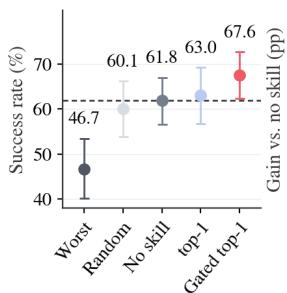

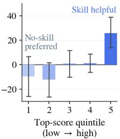  
(a) Selective skill injection (b) Top score predicts utility Fi<sub>gu</sub>r<sub>e</sub> 5<sub>.</sub> Skill<sub>-u</sub>tilit<sub>y va</sub>lid<sub>a</sub>ti<sub>o</sub>n<sub>.</sub>

only a modest gain, whereas positive gating is critical for avoiding unhelpful or harmful injections. Panel (b) artitions candidate– uer airs into five utilit uintiles and uses inde endent downstream <sub>ro</sub>ll<sub>ou</sub>t<sub>s on</sub>l<sub>y</sub> f<sub>or eva</sub>l<sub>ua</sub>ti<sub>on, repor</sub>ti<sub>ng ga</sub>i<sub>n over s</sub>kill<sub>-</sub>f<sub>ree execu</sub>ti<sub>on.</sub> Th<sub>e measure</sub>d <sub>ga</sub>i<sub>n r</sub>i<sub>ses w</sub>ith <sub>u</sub>tilit<sub>y,</sub> <sub>suppor</sub>ti<sub>ng</sub> it<sub>s</sub> <sub>use</sub> f<sub>or</sub> b<sub>o</sub>th <sub>ran</sub>ki<sub>ng</sub> <sub>an</sub>d <sub>a</sub>b<sub>s</sub>t<sub>en</sub>ti<sub>on.</sub>

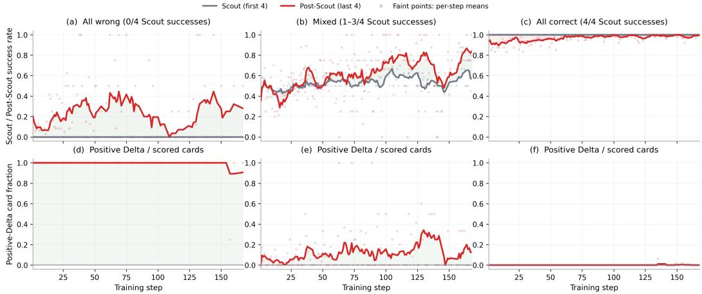  
Figure 6. ALFWorld exploration dynamics. Scout/Post-Scout success (to<sub>p</sub>) and skill-injection rates (bottom), <sub>groupe</sub>d b<sub>y a</sub>ll<sub>-wrong, m</sub>i<sub>xe</sub>d<sub>, an</sub>d <sub>a</sub>ll<sub>-correc</sub>t S<sub>cou</sub>t <sub>ou</sub>t<sub>comes.</sub>

## 5<sub>.</sub>5 SkillS<sub>ca</sub>f<sub>o</sub>ld Im<sub>p</sub>r<sub>oves</sub> Tr<sub>a</sub>inin<sub>g-</sub>Tim<sub>e</sub> E<sub>xp</sub>l<sub>o</sub>r<sub>a</sub>ti<sub>o</sub>n

Fi<sub>gure</sub> 6 <sub>s</sub>h<sub>ows</sub> th<sub>a</sub>t <sub>sca</sub>f<sub>o</sub>ldi<sub>ng concen</sub>t<sub>ra</sub>t<sub>es on quer</sub>i<sub>es w</sub>h<sub>ere s</sub>kill<sub>-</sub>f<sub>ree exp</sub>l<sub>ora</sub>ti<sub>on</sub> i<sub>s wea</sub>k<sub>es</sub>t<sub>.</sub> R<sub>e</sub>l<sub>a</sub>ti<sub>ve</sub> t<sub>o</sub> S<sub>cou</sub>t<sub>s,</sub> P<sub>os</sub>t<sub>-</sub>S<sub>cou</sub>t <sub>success</sub> i<sub>mproves</sub> b<sub>y</sub> 21<sub>.</sub>1 <sub>po</sub>i<sub>n</sub>t<sub>s</sub> f<sub>or</sub> <sub>a</sub>ll<sub>-wrong</sub> <sub>groups.</sub> Thi<sub>s</sub> i<sub>n</sub>di<sub>ca</sub>t<sub>es</sub> th<sub>a</sub>t <sub>se</sub>l<sub>ec</sub>t<sub>e</sub>d <sub>s</sub>kill<sub>s can un</sub>l<sub>oc</sub>k <sub>success</sub>f<sub>u</sub>l <sub>exp</sub>l<sub>ora</sub>ti<sub>on even w</sub>h<sub>en s</sub>kill<sub>-</sub>f<sub>ree</sub> S<sub>cou</sub>t<sub>s</sub> di<sub>scover no so</sub>l<sub>u</sub>ti<sub>on.</sub> The <sub>g</sub>ain is 5.4 <sub>p</sub>oints for mixed <sub>g</sub>rou<sub>p</sub>s, while <sub>p</sub>erformance chan<sub>g</sub>es little for all-correct <sub>g</sub>rou<sub>p</sub>s (−2.3 points). Correspondingly, the gate injects skills almost universally for all-wrong groups, selectively for <sub>m</sub>i<sub>xe</sub>d <sub>groups, an</sub>d <sub>rare</sub>l<sub>y</sub> f<sub>or a</sub>ll<sub>-correc</sub>t <sub>groups.</sub> C<sub>ross-</sub>b<sub>enc</sub>h<sub>mar</sub>k <sub>curves are repor</sub>t<sub>e</sub>d i<sub>n</sub> A<sub>ppen</sub>di<sub>x</sub> B<sub>.</sub>

## 5<sub>.</sub>6 Skill I<sub>n</sub>t<sub>erna</sub>li<sub>za</sub>ti<sub>on</sub> i<sub>n</sub>t<sub>o</sub> M<sub>o</sub>d<sub>e</sub>l P<sub>arame</sub>t<sub>ers</sub>

T<sub>a</sub>bl<sub>e</sub> 4 t<sub>es</sub>t<sub>s w</sub>h<sub>e</sub>th<sub>er s</sub>t<sub>ra</sub>t<sub>eg</sub>i<sub>es</sub> fi<sub>rs</sub>t <sub>expose</sub>d th<sub>roug</sub>h <sub>se</sub>l<sub>ec</sub>t<sub>e</sub>d <sub>s</sub>kill<sub>s</sub> b<sub>ecome enco</sub>d<sub>e</sub>d i<sub>n</sub> th<sub>e</sub> <sub>s</sub>h<sub>are</sub>d <sub>mo</sub>d<sub>e</sub>l <sub>parame</sub>t<sub>ers.</sub> W<sub>e</sub> fi<sub>x co</sub>h<sub>or</sub>t<sub>s o</sub>f t<sub>ra</sub>i<sub>n</sub>i<sub>ng quer</sub>i<sub>es</sub> th<sub>a</sub>t b<sub>ene</sub>fit f<sub>rom s</sub>kill<sub>-ass</sub>i<sub>s</sub>t<sub>e</sub>d <sub>exp</sub>l<sub>ora</sub>ti<sub>on a</sub>t <sub>an ear</sub>l<sub>y c</sub>h<sub>ec</sub>k<sub>po</sub>i<sub>n</sub>t <sub>an</sub>d <sub>reeva</sub>l<sub>ua</sub>t<sub>e</sub> th<sub>em a</sub>t l<sub>a</sub>t<sub>er c</sub>h<sub>ec</sub>k<sub>po</sub>i<sub>n</sub>t<sub>s w</sub>ith th<sub>e s</sub>kill <sub>pa</sub>th<sub>way</sub> di<sub>sa</sub>bl<sub>e</sub>d<sub>.</sub> Skill<sub>-</sub>f<sub>ree</sub> <sub>success</sub> i<sub>mproves</sub> b<sub>y</sub> 19<sub>.</sub>7 <sub>po</sub>i<sub>n</sub>t<sub>s on</sub> W<sub>e</sub>bSh<sub>op,</sub> 29<sub>.</sub>6 <sub>on</sub> ALFW<sub>or</sub>ld<sub>,</sub> 65<sub>.</sub>0 <sub>on</sub> S<sub>c</sub>i<sub>ence</sub>W<sub>or</sub>ld<sub>, an</sub>d 16<sub>.</sub>6 <sub>on �</sub><sup>2</sup><sub>-</sub>B<sub>enc</sub>h<sub>;</sub> i<sub>n</sub>t<sub>er-</sub> <sub>va</sub>l<sub>s exc</sub>l<sub>u</sub>d<sub>e zero on</sub> th<sub>e</sub> l<sub>a</sub>tt<sub>er</sub> th<sub>ree</sub> b<sub>enc</sub>h<sub>mar</sub>k<sub>s.</sub> B<sub>ecause</sub> th<sub>e</sub> l<sub>a</sub>t<sub>er</sub> E<sub>xecu</sub>t<sub>or rece</sub>i<sub>ves no s</sub>kill t<sub>ex</sub>t<sub>,</sub>

T<sub>a</sub>bl<sub>e</sub> 4<sub>.</sub> Skill<sub>-</sub>fr<sub>ee ev</sub>id<sub>e</sub>n<sub>ce o</sub>f int<sub>e</sub>rn<sub>a</sub>li<sub>za</sub>ti<sub>o</sub>n<sub>.</sub> L<sub>a</sub>t<sub>er-m</sub>i<sub>nus-ear</sub>l<sub>y</sub> <sub>s</sub>kill<sub>-</sub>f<sub>ree</sub> <sub>success</sub> <sub>on</sub> fi<sub>xe</sub>d <sub>ear</sub>l<sub>y</sub> <sub>s</sub>kill<sub>-ass</sub>i<sub>s</sub>t<sub>e</sub>d t<sub>ra</sub>i<sub>n</sub>i<sub>ng co</sub>h<sub>or</sub>t<sub>s, w</sub>ith 95% b<sub>oo</sub>t<sub>s</sub>t<sub>rap</sub> i<sub>n</sub>t<sub>erva</sub>l<sub>s.</sub>
<table><tr><td>Benchmark</td><td>N</td><td>Recovery (pp)</td></tr><tr><td>WebShop</td><td>19</td><td>+19.7 [0.0, 39.5]</td></tr><tr><td>ALFWorld</td><td></td><td>54 +29.6 [20.4, 38.9]</td></tr><tr><td>ScienceWorld</td><td></td><td>50 +65.0 [56.0, 73.5]</td></tr><tr><td>τ2-Bench</td><td></td><td>98 +16.6 [10.7, 22.5]</td></tr></table>

th<sub>ese</sub> <sub>ga</sub>i<sub>ns</sub> i<sub>n</sub>di<sub>ca</sub>t<sub>e</sub> th<sub>a</sub>t <sub>s</sub>h<sub>are</sub>d<sub>-parame</sub>t<sub>er</sub> t<sub>ra</sub>i<sub>n</sub>i<sub>ng</sub> t<sub>rans</sub>f<sub>ers</sub> <sub>s</sub>kill<sub>-gu</sub>id<sub>e</sub>d <sub>s</sub>t<sub>ra</sub>t<sub>eg</sub>i<sub>es</sub> i<sub>n</sub>t<sub>o</sub> th<sub>e</sub> <sub>po</sub>li<sub>cy</sub> it<sub>se</sub>lf<sub>.</sub> A <sub>qua</sub>lit<sub>a</sub>ti<sub>ve</sub> i<sub>n</sub>t<sub>erna</sub>li<sub>za</sub>ti<sub>on case</sub> i<sub>s prov</sub>id<sub>e</sub>d i<sub>n</sub> A<sub>ppen</sub>di<sub>x</sub> D<sub>.</sub>1<sub>.</sub>

## 6 C<sub>o</sub>n<sub>c</sub>l<sub>us</sub>i<sub>o</sub>n

W<sub>e</sub> i<sub>n</sub>t<sub>ro</sub>d<sub>uce</sub>d S<sub>kill</sub>S<sub>caffold, a po</sub>li<sub>cy-a</sub>d<sub>ap</sub>ti<sub>ve</sub> t<sub>ra</sub>i<sub>n</sub>i<sub>ng sca</sub>f<sub>o</sub>ld f<sub>or s</sub>kill <sub>cre</sub>dit <sub>ass</sub>i<sub>gnmen</sub>t i<sub>n</sub> <sub>agen</sub>ti<sub>c</sub> RL<sub>.</sub> R<sub>a</sub>th<sub>er</sub> th<sub>an assum</sub>i<sub>ng genera</sub>t<sub>e</sub>d <sub>s</sub>kill<sub>s are</sub> h<sub>e</sub>l<sub>p</sub>f<sub>u</sub>l <sub>or eva</sub>l<sub>ua</sub>ti<sub>ng every can</sub>did<sub>a</sub>t<sub>e</sub> th<sub>roug</sub>h additional environment interaction, SkillScaffold reuses outcome-verified trajectories to estimate <sub>po</sub>li<sub>cy-re</sub>l<sub>a</sub>ti<sub>ve</sub> <sub>u</sub>tilit<sub>y</sub> th<sub>roug</sub>h <sub>ou</sub>t<sub>come-aware</sub> lik<sub>e</sub>lih<sub>oo</sub>d <sub>compar</sub>i<sub>sons.</sub> Thi<sub>s</sub> <sub>s</sub>i<sub>gna</sub>l <sub>suppor</sub>t<sub>s</sub> <sub>can</sub>did<sub>a</sub>t<sub>e</sub> <sub>ran</sub>ki<sub>ng, a</sub>b<sub>s</sub>t<sub>en</sub>ti<sub>on, an</sub>d G<sub>enera</sub>t<sub>or</sub> l<sub>earn</sub>i<sub>ng, w</sub>hil<sub>e env</sub>i<sub>ronmen</sub>t <sub>ou</sub>t<sub>comes con</sub>ti<sub>nue</sub> t<sub>o superv</sub>i<sub>se</sub> th<sub>e</sub> E<sub>xecu</sub>t<sub>or.</sub> A<sub>cross</sub> di<sub>verse s</sub>h<sub>or</sub>t<sub>- an</sub>d l<sub>ong-</sub>h<sub>or</sub>i<sub>zon</sub> b<sub>enc</sub>h<sub>mar</sub>k<sub>s,</sub> S<sub>kill</sub>S<sub>caffold</sub> i<sub>mproves over s</sub>t<sub>rong</sub> <sub>agen</sub>ti<sub>c-</sub>RL <sub>an</sub>d <sub>s</sub>kill<sub>-</sub>b<sub>ase</sub>d RL b<sub>ase</sub>li<sub>nes</sub> <sub>un</sub>d<sub>er</sub> f<sub>u</sub>ll<sub>y</sub> <sub>s</sub>kill<sub>-</sub>f<sub>ree</sub> i<sub>n</sub>f<sub>erence.</sub> O<sub>vera</sub>ll<sub>,</sub> S<sub>kill</sub>S<sub>caffold</sub> <sub>se</sub>l<sub>ec</sub>ti<sub>ve</sub>l<sub>y</sub> <sub>uses</sub> <sub>s</sub>kill<sub>s</sub> t<sub>o</sub> i<sub>mprove</sub> t<sub>ra</sub>i<sub>n</sub>i<sub>ng-</sub>ti<sub>me</sub> <sub>exp</sub>l<sub>ora</sub>ti<sub>on,</sub> <sub>a</sub>b<sub>sor</sub>b<sub>s</sub> th<sub>e</sub>i<sub>r</sub> <sub>gu</sub>id<sub>ance</sub> i<sub>n</sub>t<sub>o</sub> th<sub>e</sub> <sub>po</sub>li<sub>cy,</sub> <sub>an</sub>d <sub>removes</sub> th<sub>e s</sub>kill <sub>pa</sub>th<sub>way a</sub>t d<sub>ep</sub>l<sub>oymen</sub>t<sub>.</sub>

## R<sub>ep</sub>r<sub>o</sub>d<sub>uc</sub>ibilit<sub>y</sub> St<sub>a</sub>t<sub>e</sub>m<sub>e</sub>nt

Section 4 describes SkillScaffold and its training objective. Appendices A–D provide imple-<sub>men</sub>t<sub>a</sub>ti<sub>on</sub> d<sub>e</sub>t<sub>a</sub>il<sub>s, a</sub>dditi<sub>ona</sub>l <sub>resu</sub>lt<sub>s, an</sub>d <sub>comp</sub>l<sub>e</sub>t<sub>e promp</sub>t<sub>s an</sub>d <sub>examp</sub>l<sub>es.</sub> W<sub>e w</sub>ill <sub>prov</sub>id<sub>e</sub> th<sub>e</sub> i<sub>mp</sub>l<sub>emen</sub>t<sub>a</sub>ti<sub>on co</sub>d<sub>e</sub> i<sub>n</sub> th<sub>e supp</sub>l<sub>emen</sub>t<sub>ary ma</sub>t<sub>er</sub>i<sub>a</sub>l<sub>.</sub>

## AI Use Statement

G<sub>enera</sub>ti<sub>ve</sub> AI t<sub>oo</sub>l<sub>s were use</sub>d t<sub>o ass</sub>i<sub>s</sub>t <sub>w</sub>ith l<sub>anguage e</sub>diti<sub>ng,</sub> L<sub>a</sub>T<sub>e</sub>X f<sub>orma</sub>tti<sub>ng, an</sub>d <sub>co</sub>d<sub>e nav</sub>i<sub>ga</sub>ti<sub>on.</sub> Th<sub>ey were no</sub>t t<sub>rea</sub>t<sub>e</sub>d <sub>as sources o</sub>f <sub>ev</sub>id<sub>ence or use</sub>d t<sub>o au</sub>t<sub>onomous</sub>l<sub>y</sub> d<sub>e</sub>t<sub>erm</sub>i<sub>ne</sub> th<sub>e exper</sub>i<sub>men</sub>t<sub>a</sub>l d<sub>es</sub>i<sub>gn, ana</sub>l<sub>ys</sub>i<sub>s, or conc</sub>l<sub>us</sub>i<sub>ons.</sub> Th<sub>e au</sub>th<sub>ors rev</sub>i<sub>ewe</sub>d <sub>an</sub>d <sub>ver</sub>ifi<sub>e</sub>d <sub>a</sub>ll AI<sub>-ass</sub>i<sub>s</sub>t<sub>e</sub>d t<sub>ex</sub>t <sub>an</sub>d <sub>co</sub>d<sub>e an</sub>d t<sub>a</sub>k<sub>e</sub> f<sub>u</sub>ll <sub>respons</sub>ibilit<sub>y</sub> f<sub>or</sub> th<sub>e sc</sub>i<sub>en</sub>tifi<sub>c c</sub>l<sub>a</sub>i<sub>ms an</sub>d fi<sub>na</sub>l <sub>manuscr</sub>i<sub>p</sub>t<sub>.</sub>

## R<sub>e</sub>f<sub>erences</sub>

Mi<sub>ng</sub>h<sub>ao</sub> Ch<sub>en,</sub> Yih<sub>ang</sub> Li<sub>,</sub> Y<sub>an</sub>ti<sub>ng</sub> Y<sub>ang,</sub> Shi<sub>yu</sub> Y<sub>u,</sub> Bi<sub>n</sub>bi<sub>n</sub> Li<sub>n, an</sub>d Xi<sub>ao</sub>f<sub>e</sub>i H<sub>e.</sub> A<sub>u</sub>t<sub>omanua</sub>l<sub>:</sub> Constructing instruction manuals by llm agents via interactive environmental learning. Advances in Neural Information Processing Systems, 37:589–631, 2024.

Prateek Chhikara, Dev Khant, Saket Aryan, Taranjeet Singh, and Deshraj Yadav. Mem0: Building production-ready ai agents with scalable long-term memory. arXiv preprint arXiv:2504.19413, 2025<sub>.</sub>

Gen Dong, Yanjie Gao, Liqun Li, Tianyin Xu, Yu Hua, and Fan Yang. Agent skills can be harmful: An empirical study of skill-induced failures in llm agents. arXiv preprint arXiv:2608.11888, 2026a.

G<sub>ua</sub>ntin<sub>g</sub> D<sub>o</sub>n<sub>g,</sub> H<sub>a</sub>n<sub>gyu</sub> M<sub>ao,</sub> K<sub>a</sub>i M<sub>a,</sub> Li<sub>c</sub>h<sub>e</sub>n<sub>g</sub> B<sub>ao,</sub> Yif<sub>e</sub>i Ch<sub>e</sub>n<sub>,</sub> Zh<sub>o</sub>n<sub>gyua</sub>n W<sub>a</sub>n<sub>g,</sub> Zh<sub>o</sub>n<sub>gx</sub>i<sub>a</sub> Ch<sub>e</sub>n<sub>,</sub> Ji<sub>az</sub>h<sub>en</sub> D<sub>u,</sub> H<sub>u</sub>i<sub>yang</sub> W<sub>ang,</sub> F<sub>uz</sub>h<sub>eng</sub> Zh<sub>ang, e</sub>t <sub>a</sub>l<sub>.</sub> A<sub>gen</sub>ti<sub>c re</sub>i<sub>n</sub>f<sub>orce</sub>d <sub>po</sub>li<sub>cy op</sub>ti<sub>m</sub>i<sub>za</sub>ti<sub>on.</sub> I<sub>n</sub> International Conference on Learning Representations, volume 2026, pp. 16981–17017, 2026b.

Zhi<sub>yua</sub>n F<sub>a</sub>n<sub>,</sub> W<sub>e</sub>n<sub>we</sub>i Jin<sub>,</sub> F<sub>e</sub>n<sub>g</sub> Zh<sub>a</sub>n<sub>g,</sub> Bin Li<sub>,</sub> Yih<sub>o</sub>n<sub>g</sub> D<sub>o</sub>n<sub>g,</sub> Y<sub>ao</sub> H<sub>u, a</sub>nd Ji<sub>awe</sub>i Li<sub>.</sub> E<sub>vo</sub>l<sub>v</sub>in<sub>g-</sub>rl<sub>:</sub> End-to-end optimization of experience-driven self-evolving capability within agents. arXiv preprint arXiv:2605.10663, 2026.

Runnan Fang, Yuan Liang, Xiaobin Wang, Jialong Wu, Shuofei Qiao, Pengjun Xie, Fei Huang, Huajun Chen, and Ningyu Zhang. Memp: Exploring agent procedural memory. In Findings of the Association for Computational Linguistics: ACL 2026, pp. 17490–17502, 2026.

L<sub>a</sub>n<sub>g</sub> F<sub>e</sub>n<sub>g,</sub> Zh<sub>e</sub>n<sub>g</sub>h<sub>a</sub>i X<sub>ue,</sub> Tin<sub>gco</sub>n<sub>g</sub> Li<sub>u, a</sub>nd B<sub>o</sub> An<sub>.</sub> Gr<sub>oup-</sub>in<sub>-g</sub>r<sub>oup po</sub>li<sub>cy op</sub>timi<sub>za</sub>ti<sub>o</sub>n f<sub>o</sub>r llm agent training. Advances in Neural Information Processing Systems, 38:46375–46408, 2026.

Yao Fu, Dong-Ki Kim, Jaekyeom Kim, Sungryull Sohn, Lajanugen Logeswaran, Kyunghoon Bae, and H<sub>ong</sub>l<sub>a</sub>k L<sub>ee.</sub> A<sub>u</sub>t<sub>ogu</sub>id<sub>e:</sub> A<sub>u</sub>t<sub>oma</sub>t<sub>e</sub>d <sub>genera</sub>ti<sub>on</sub> <sub>an</sub>d <sub>se</sub>l<sub>ec</sub>ti<sub>on</sub> <sub>o</sub>f <sub>con</sub>t<sub>ex</sub>t<sub>-aware</sub> <sub>gu</sub>id<sub>e</sub>li<sub>nes</sub> f<sub>or</sub> l<sub>arge</sub> language model agents. Advances in Neural Information Processing Systems, 37:119919–119948, 2024<sub>.</sub>

Ji<sub>axuan</sub> G<sub>ao,</sub> Ji<sub>aao</sub> Ch<sub>en,</sub> Ch<sub>uy</sub>i H<sub>e,</sub> Sh<sub>us</sub>h<sub>eng</sub> X<sub>u,</sub> Di Ji<sub>n,</sub> <sub>an</sub>d Yi W<sub>u.</sub> F<sub>rom</sub> <sub>se</sub>lf<sub>-evo</sub>l<sub>v</sub>i<sub>ng</sub> <sub>syn</sub>th<sub>e</sub>ti<sub>c</sub> data to verifiable-reward rl: Post-training multi-turn interactive tool-using agents. arXiv preprint arXiv:2601.22607, 2026.

Z<sub>e</sub>li<sub>n</sub> H<sub>e,</sub> H<sub>ao</sub>ti<sub>an</sub> Li<sub>n,</sub> B<sub>oran</sub> H<sub>an,</sub> W<sub>e</sub>i Zh<sub>u,</sub> H<sub>aoyang</sub> F<sub>ang,</sub> B<sub>ern</sub>i<sub>e</sub> W<sub>ang,</sub> X<sub>uan</sub> Zh<sub>u,</sub> R<sub>unze</sub> Li<sub>, an</sub>d Matthew Reimherr. Reskill: Reconciling skill creation with policy optimization in agentic rl. arXiv preprint arXiv:2606.01619, 2026.

Zhen<sub>g</sub>xi Lu, Zhi<sub>y</sub>uan Yao, Jin<sub>y</sub>an<sub>g</sub> Wu, Chen<sub>g</sub>chen<sub>g</sub> Han, Qi Gu, Xunlian<sub>g</sub> Cai, Weimin<sub>g</sub> Lu, Jun Xi<sub>ao,</sub> Y<sub>ue</sub>ti<sub>ng</sub> Zh<sub>uang, an</sub>d Y<sub>ong</sub>li<sub>ang</sub> Sh<sub>en.</sub> Skill0<sub>:</sub> I<sub>n-con</sub>t<sub>ex</sub>t <sub>agen</sub>ti<sub>c re</sub>i<sub>n</sub>f<sub>orcemen</sub>t l<sub>earn</sub>i<sub>ng</sub> f<sub>or</sub> skill internalization. arXiv preprint arXiv:2604.02268, 2026.

Kolby Nottingham, Bodhisattwa Prasad Majumder, Bhavana Dalvi Mishra, Sameer Singh, Peter Clark, <sub>an</sub>d R<sub>oy</sub> F<sub>ox.</sub> Skill <sub>se</sub>t <sub>op</sub>ti<sub>m</sub>i<sub>za</sub>ti<sub>on:</sub> R<sub>e</sub>i<sub>n</sub>f<sub>orc</sub>i<sub>ng</sub> l<sub>anguage mo</sub>d<sub>e</sub>l b<sub>e</sub>h<sub>av</sub>i<sub>or v</sub>i<sub>a</sub> t<sub>rans</sub>f<sub>era</sub>bl<sub>e s</sub>kill<sub>s.</sub> arXiv preprint arXiv:2402.03244, 2024.

Zhihon<sub>g</sub> Shao, Pei<sub>y</sub>i Wan<sub>g</sub>, Qihao Zhu, Runxin Xu, Junxiao Son<sub>g</sub>, Xiao Bi, Haowei Zhan<sub>g</sub>, Min<sub>g</sub>chuan Zh<sub>ang,</sub> YK Li<sub>,</sub> Y<sub>ang</sub> W<sub>u,</sub> <sub>e</sub>t <sub>a</sub>l<sub>.</sub> D<sub>eepsee</sub>k<sub>ma</sub>th<sub>:</sub> P<sub>us</sub>hi<sub>ng</sub> th<sub>e</sub> li<sub>m</sub>it<sub>s</sub> <sub>o</sub>f <sub>ma</sub>th<sub>ema</sub>ti<sub>ca</sub>l <sub>reason</sub>i<sub>ng</sub> i<sub>n</sub> open language models. arXiv preprint arXiv:2402.03300, 2024.

J<sub>un</sub>h<sub>ao</sub> Sh<sub>en,</sub> T<sub>eng</sub> Zh<sub>ang,</sub> Xi<sub>aoyan</sub> Zh<sub>ao, an</sub>d H<sub>ong</sub> Ch<sub>eng.</sub> D<sub>ynam</sub>i<sub>c s</sub>kill lif<sub>ecyc</sub>l<sub>e managemen</sub>t f<sub>or</sub> agentic reinforcement learning. arXiv preprint arXiv:2605.10923, 2026.

Yaorui Shi, Yuxin Chen, Zhen<sub>g</sub>xi Lu, Yuchun Miao, Shu<sub>g</sub>ui Liu, Qi Gu, Xunlian<sub>g</sub> Cai, Xian<sub>g</sub> Wan<sub>g</sub>, <sub>an</sub>d A<sub>n</sub> Zh<sub>ang.</sub> Skill1<sub>:</sub> U<sub>n</sub>ifi<sub>e</sub>d <sub>evo</sub>l<sub>u</sub>ti<sub>on o</sub>f <sub>s</sub>kill<sub>-augmen</sub>t<sub>e</sub>d <sub>agen</sub>t<sub>s v</sub>i<sub>a re</sub>i<sub>n</sub>f<sub>orcemen</sub>t l<sub>earn</sub>i<sub>ng.</sub> arXiv preprint arXiv:2605.06130, 2026.

N<sub>oa</sub>h Shi<sub>nn,</sub> F<sub>e</sub>d<sub>er</sub>i<sub>co</sub> C<sub>assano,</sub> A<sub>s</sub>h<sub>w</sub>i<sub>n</sub> G<sub>op</sub>i<sub>na</sub>th<sub>,</sub> K<sub>ar</sub>thik N<sub>aras</sub>i<sub>m</sub>h<sub>an, an</sub>d Sh<sub>unyu</sub> Y<sub>ao.</sub> R<sub>e</sub>fl<sub>ex</sub>i<sub>on:</sub> Language agents with verbal reinforcement learning. Advances in neural information processing systems, 36:8634–8652, 2023.

M<sub>o</sub>hit Sh<sub>r</sub>idh<sub>ar,</sub> Xi<sub>ng</sub>di Y<sub>uan,</sub> M<sub>arc-</sub>Al<sub>exan</sub>d<sub>re</sub> C<sub>o</sub>tˆ <sub>e,</sub> Y<sub>ona</sub>t<sub>an</sub> Bi<sub>s</sub>k<sub>,</sub> Ad<sub>am</sub> T<sub>r</sub>i<sub>sc</sub>hl<sub>er, an</sub>d M<sub>a</sub>tth<sub>ew</sub>´ Hausknecht. Alfworld: Aligning text and embodied environments for interactive learning. arXiv preprint arXiv:2010.03768, 2020.

H<sub>ao</sub> W<sub>a</sub>n<sub>g,</sub> G<sub>uoz</sub>hi W<sub>a</sub>n<sub>g,</sub> H<sub>a</sub>n Xi<sub>ao,</sub> Y<sub>u</sub>f<sub>e</sub>n<sub>g</sub> Zh<sub>ou,</sub> Y<sub>ue</sub> P<sub>a</sub>n<sub>,</sub> Ji<sub>c</sub>h<sub>ao</sub> W<sub>a</sub>n<sub>g,</sub> K<sub>e</sub> X<sub>u,</sub> Y<sub>a</sub>f<sub>e</sub>i W<sub>e</sub>n<sub>,</sub> Xi<sub>ao</sub>h<sub>u</sub> R<sub>uan,</sub> Xi<sub>aox</sub>i<sub>n</sub> Ch<sub>en, e</sub>t <sub>a</sub>l<sub>.</sub> Skill<sub>-s</sub>d<sub>:</sub> Skill<sub>-con</sub>diti<sub>one</sub>d <sub>se</sub>lf<sub>-</sub>di<sub>s</sub>till<sub>a</sub>ti<sub>on</sub> f<sub>or mu</sub>lti<sub>-</sub>t<sub>urn</sub> ll<sub>m agen</sub>t<sub>s.</sub> arXiv preprint arXiv:2604.10674, 2026a.

Jiongxiao Wang, Qiaojing Yan, Yawei Wang, Yijun Tian, Soumya Smruti Mishra, Zhichao Xu, Megha G<sub>an</sub>dhi<sub>,</sub> P<sub>anpan</sub> X<sub>u,</sub> <sub>an</sub>d Li<sub>n</sub> L<sub>ee</sub> Ch<sub>eong.</sub> R<sub>e</sub>i<sub>n</sub>f<sub>orcemen</sub>t l<sub>earn</sub>i<sub>ng</sub> f<sub>or</sub> <sub>se</sub>lf<sub>-</sub>i<sub>mprov</sub>i<sub>ng</sub> <sub>agen</sub>t <sub>w</sub>ith skill librar<sub>y</sub>, 2026b. URL https://arxiv.org/abs/2512.17102.

Ruoyao Wang, Peter Jansen, Marc-Alexandre Cotˆ e, and Prithviraj Ammanabrolu. Scienceworld: Is´ <sub>y</sub>our a<sub>g</sub>ent smarter than a 5th <sub>g</sub>rader?, 2022. URL https://arxiv.org/abs/2203.07540.

Zora Zhiruo Wang, Jiayuan Mao, Daniel Fried, and Graham Neubig. Agent workflow memory. arXiv preprint arXiv:2409.07429, 2024.

Jin<sub>ya</sub>n<sub>g</sub> W<sub>u,</sub> Sh<sub>uo</sub> Y<sub>a</sub>n<sub>g,</sub> Zh<sub>e</sub>n<sub>gx</sub>i L<sub>u,</sub> F<sub>a</sub>n Zh<sub>a</sub>n<sub>g,</sub> Y<sub>u</sub>h<sub>ao</sub> Sh<sub>e</sub>n<sub>,</sub> L<sub>a</sub>n<sub>g</sub> F<sub>e</sub>n<sub>g,</sub> H<sub>ao</sub>r<sub>a</sub>n L<sub>uo,</sub> Zh<sub>e</sub>n<sub>g</sub> Li<sub>an,</sub> Sh<sub>ua</sub>i Zh<sub>ang,</sub> Zh<sub>engq</sub>i W<sub>en,</sub> <sub>e</sub>t <sub>a</sub>l<sub>.</sub> S<sub>ee</sub>d<sub>:</sub> S<sub>e</sub>lf<sub>-evo</sub>l<sub>v</sub>i<sub>ng</sub> <sub>on-po</sub>li<sub>cy</sub> di<sub>s</sub>till<sub>a</sub>ti<sub>on</sub> f<sub>or</sub> <sub>agen</sub>ti<sub>c</sub> reinforcement learning. arXiv preprint arXiv:2607.14777, 2026.

P<sub>e</sub>n<sub>g</sub> Xi<sub>a,</sub> Ji<sub>a</sub>n<sub>we</sub>n Ch<sub>e</sub>n<sub>,</sub> H<sub>a</sub>n<sub>ya</sub>n<sub>g</sub> W<sub>a</sub>n<sub>g,</sub> Ji<sub>aq</sub>i Li<sub>u,</sub> K<sub>a</sub>id<sub>e</sub> Z<sub>e</sub>n<sub>g,</sub> Y<sub>u</sub> W<sub>a</sub>n<sub>g,</sub> Si<sub>we</sub>i H<sub>a</sub>n<sub>,</sub> Yi<sub>ya</sub>n<sub>g</sub> Zhou, Xujiang Zhao, Haifeng Chen, et al. Skillrl: Evolving agents via recursive skill-augmented reinforcement learning. arXiv preprint arXiv:2602.08234, 2026.

Sh<sub>unyu</sub> Y<sub>ao,</sub> H<sub>owar</sub>d Ch<sub>en,</sub> J<sub>o</sub>h<sub>n</sub> Y<sub>ang, an</sub>d K<sub>ar</sub>thik N<sub>aras</sub>i<sub>m</sub>h<sub>an.</sub> W<sub>e</sub>b<sub>s</sub>h<sub>op:</sub> T<sub>owar</sub>d<sub>s sca</sub>l<sub>a</sub>bl<sub>e</sub> real-world web interaction with grounded language agents. Advances in Neural Information Processing Systems, 35:20744–20757, 2022a.

Sh<sub>u</sub>n<sub>yu</sub> Y<sub>ao,</sub> J<sub>e</sub>fr<sub>ey</sub> Zh<sub>ao,</sub> Di<sub>a</sub>n Y<sub>u,</sub> N<sub>a</sub>n D<sub>u,</sub> I<sub>z</sub>h<sub>a</sub>k Sh<sub>a</sub>fr<sub>a</sub>n<sub>,</sub> K<sub>a</sub>rthik N<sub>a</sub>r<sub>as</sub>imh<sub>a</sub>n<sub>, a</sub>nd Y<sub>ua</sub>n C<sub>ao.</sub> React: Synergizing reasoning and acting in language models. arXiv preprint arXiv:2210.03629, 2022b<sub>.</sub>

Sh<sub>unyu</sub> Y<sub>ao,</sub> N<sub>oa</sub>h Shi<sub>nn,</sub> P<sub>e</sub>d<sub>ram</sub> R<sub>azav</sub>i<sub>, an</sub>d K<sub>ar</sub>thik N<sub>aras</sub>i<sub>m</sub>h<sub>an. �-</sub>b<sub>enc</sub>h<sub>:</sub> A b<sub>enc</sub>h<sub>mar</sub>k f<sub>or</sub> tool-a<sub>g</sub>ent-user interaction in real-world domains, 2024. URL https://arxiv.org/abs/2406. 12045.

Zhiwei Zhang, Yudi Lin, Nikki Lijing Kuang, Linlin Wu, Xiaomin Li, Songtao Liu, and Fenglong Ma. Co-evolving skill generation and policy optimization. arXiv preprint arXiv:2606.08755, 2026.

Andrew Zhao, Daniel Huan<sub>g</sub>, Quentin Xu, Matthieu Lin, Yon<sub>g</sub>-Jin Liu, and Gao Huan<sub>g</sub>. Expel: Llm agents are experiential learners. In Proceedings of the AAAI Conference on Artificial Intelligence, <sub>vo</sub>l<sub>ume</sub> 38<sub>,</sub> <sub>pp.</sub> 19632<sub>–</sub>19642<sub>,</sub> 2024<sub>.</sub>

H<sub>an</sub> Zh<sub>ou,</sub> Xi<sub>ngc</sub>h<sub>en</sub> W<sub>an,</sub> I<sub>van</sub> V<sub>u</sub>li<sub>c,</sub> <sub>an</sub>d A<sub>nna</sub> K<sub>or</sub>h<sub>onen.</sub> A<sub>gen</sub>ti<sub>c</sub> <sub>po</sub>li<sub>cy</sub> <sub>op</sub>ti<sub>m</sub>i<sub>za</sub>ti<sub>on</sub> <sub>v</sub>i<sub>a</sub> ´ instruction-policy co-evolution. arXiv preprint arXiv:2512.01945, 2025.

Jiapen<sub>g</sub> Zhu, Jianxian<sub>g</sub> Yu, Yibo Zhao, Chen<sub>g</sub>chen<sub>g</sub> Han, Qi Gu, Xunlian<sub>g</sub> Cai, Xian<sub>g</sub> Li, and Weinin<sub>g</sub> Qian. Skill0. 5: Joint skill internalization and utilization for out-of-distribution <sub>g</sub>eneralization in agentic reinforcement learning. arXiv preprint arXiv:2605.28424, 2026.

## A I<sub>mp</sub>l<sub>emen</sub>t<sub>a</sub>ti<sub>on</sub> D<sub>e</sub>t<sub>a</sub>il<sub>s</sub>

## A<sub>.</sub>1 B<sub>enc</sub>h<sub>mar</sub>k <sub>an</sub>d D<sub>a</sub>t<sub>a</sub> D<sub>e</sub>t<sub>a</sub>il<sub>s</sub>

ALFW<sub>o</sub>rld<sub>.</sub> ALFW<sub>or</sub>ld <sub>con</sub>t<sub>a</sub>i<sub>ns s</sub>i<sub>x</sub> h<sub>ouse</sub>h<sub>o</sub>ld t<sub>as</sub>k <sub>ca</sub>t<sub>egor</sub>i<sub>es:</sub> Pi<sub>c</sub>k<sub>,</sub> H<sub>ea</sub>t<sub>,</sub> C<sub>oo</sub>l<sub>,</sub> Cl<sub>ean,</sub> L<sub>oo</sub>k<sub>, an</sub>d Pi<sub>c</sub>k2<sub>.</sub> W<sub>e</sub> t<sub>ra</sub>i<sub>n on</sub> th<sub>e</sub> f<sub>u</sub>ll 3<sub>,</sub>553<sub>-</sub>t<sub>as</sub>k <sub>sp</sub>lit<sub>, compr</sub>i<sub>s</sub>i<sub>ng</sub> 790 Pi<sub>c</sub>k<sub>,</sub> 459 H<sub>ea</sub>t<sub>,</sub> 533 C<sub>oo</sub>l<sub>,</sub> 650 Cl<sub>ean,</sub> 308 L<sub>oo</sub>k<sub>, an</sub>d 813 Pi<sub>c</sub>k2 t<sub>as</sub>k<sub>s, an</sub>d <sub>eva</sub>l<sub>ua</sub>t<sub>e success ra</sub>t<sub>e on</sub> th<sub>e</sub> 134<sub>-</sub>t<sub>as</sub>k <sub>va</sub>lid<sub>-unseen sp</sub>lit<sub>.</sub>

WebShop. Followin<sub>g</sub> the cate<sub>g</sub>or<sub>y</sub>-<sub>g</sub>eneralization <sub>p</sub>rotocol of Skill0.5 (Zhu et al., 2026), we <sub>p</sub>artition th<sub>e</sub> 12<sub>,</sub>087 h<sub>uman-anno</sub>t<sub>a</sub>t<sub>e</sub>d W<sub>e</sub>bSh<sub>op goa</sub>l<sub>s</sub> i<sub>n</sub>t<sub>o seven</sub> d<sub>oma</sub>i<sub>ns us</sub>i<sub>ng</sub> k<sub>eywor</sub>d<sub>-</sub>b<sub>ase</sub>d <sub>c</sub>l<sub>ass</sub>ifi<sub>ca</sub>ti<sub>on</sub> <sub>o</sub>f <sub>goa</sub>l i<sub>ns</sub>t<sub>ruc</sub>ti<sub>ons.</sub> A<sub>ppare</sub>l<sub>,</sub> El<sub>ec</sub>t<sub>ron</sub>i<sub>cs,</sub> F<sub>oo</sub>t<sub>wear, an</sub>d Oth<sub>er are use</sub>d f<sub>or</sub> t<sub>ra</sub>i<sub>n</sub>i<sub>ng an</sub>d ID <sub>eva</sub>l<sub>ua</sub>ti<sub>on;</sub> A<sub>ccessor</sub>i<sub>es,</sub> B<sub>eau</sub>t<sub>y</sub> & H<sub>ea</sub>lth<sub>, an</sub>d H<sub>ome</sub> D<sub>ecor are</sub> h<sub>e</sub>ld <sub>ou</sub>t f<sub>or</sub> OOD <sub>eva</sub>l<sub>ua</sub>ti<sub>on.</sub> B<sub>ecause</sub> Oth<sub>er</sub> i<sub>n</sub>iti<sub>a</sub>ll<sub>y</sub> <sub>accoun</sub>t<sub>s</sub> f<sub>or</sub> <sub>over</sub> 60% <sub>o</sub>f th<sub>e</sub> <sub>goa</sub>l<sub>s,</sub> <sub>we</sub> <sub>app</sub>l<sub>y</sub> f<sub>ar</sub>th<sub>es</sub>t<sub>-po</sub>i<sub>n</sub>t <sub>samp</sub>li<sub>ng</sub> <sub>over</sub> <sub>sen</sub>t<sub>ence</sub> <sub>em</sub>b<sub>e</sub>ddi<sub>ngs</sub> t<sub>o</sub> b<sub>a</sub>l<sub>ance</sub> it<sub>s s</sub>i<sub>ze.</sub>

Th<sub>e</sub> r<sub>esu</sub>ltin<sub>g</sub> tr<sub>a</sub>inin<sub>g sp</sub>lit <sub>co</sub>nt<sub>a</sub>in<sub>s</sub> 3<sub>,</sub>320 ID <sub>goa</sub>l<sub>s:</sub> 776 A<sub>ppa</sub>r<sub>e</sub>l<sub>,</sub> 938 El<sub>ec</sub>tr<sub>o</sub>ni<sub>cs,</sub> 606 F<sub>oo</sub>t<sub>wea</sub>r<sub>,</sub> <sub>an</sub>d 1<sub>,</sub>000 Oth<sub>er</sub> <sub>goa</sub>l<sub>s,</sub> <sub>w</sub>ith Oth<sub>er</sub> d<sub>ownsamp</sub>l<sub>e</sub>d f<sub>rom</sub> <sub>approx</sub>i<sub>ma</sub>t<sub>e</sub>l<sub>y</sub> 6<sub>,</sub>600<sub>.</sub> Th<sub>e</sub> ID <sub>va</sub>lid<sub>a</sub>ti<sub>on</sub> <sub>sp</sub>lit <sub>con</sub>t<sub>a</sub>i<sub>ns</sub> 454 <sub>goa</sub>l<sub>s:</sub> 113 A<sub>ppare</sub>l<sub>,</sub> 152 El<sub>ec</sub>t<sub>ron</sub>i<sub>cs,</sub> 89 F<sub>oo</sub>t<sub>wear, an</sub>d 100 Oth<sub>er, w</sub>ith Oth<sub>er</sub> d<sub>ownsamp</sub>l<sub>e</sub>d f<sub>rom</sub> <sub>approx</sub>i<sub>ma</sub>t<sub>e</sub>l<sub>y</sub> 940<sub>.</sub> Th<sub>e</sub> OOD <sub>va</sub>lid<sub>a</sub>ti<sub>on</sub> <sub>sp</sub>lit <sub>con</sub>t<sub>a</sub>i<sub>ns</sub> 207 <sub>goa</sub>l<sub>s:</sub> 80 A<sub>ccessor</sub>i<sub>es,</sub> 54 B<sub>eau</sub>t<sub>y</sub> & H<sub>ea</sub>lth<sub>, an</sub>d 73 H<sub>ome</sub> D<sub>ecor.</sub> T<sub>ra</sub>i<sub>n</sub>i<sub>ng uses or</sub>i<sub>g</sub>i<sub>na</sub>l <sub>goa</sub>l i<sub>n</sub>di<sub>ces</sub> 1<sub>,</sub>500 <sub>onwar</sub>d<sub>, w</sub>hil<sub>e</sub> th<sub>e va</sub>lid<sub>a</sub>ti<sub>on poo</sub>l <sub>com</sub>bi<sub>nes</sub> th<sub>e or</sub>i<sub>g</sub>i<sub>na</sub>l t<sub>es</sub>t i<sub>n</sub>di<sub>ces</sub> 0<sub>–</sub>499 <sub>an</sub>d d<sub>eve</sub>l<sub>opmen</sub>t i<sub>n</sub>di<sub>ces</sub> 500<sub>–</sub>1<sub>,</sub>499<sub>.</sub>

ScienceWorld. Followin<sub>g</sub> ReSkill (He et al., 2026), we use the electricit<sub>y</sub> s<sub>p</sub>lit, which contains t<sub>wo</sub> t<sub>as</sub>k t<sub>ypes:</sub> id<sub>en</sub>tif<sub>y</sub>i<sub>ng</sub> <sub>power</sub> <sub>componen</sub>t<sub>s</sub> <sub>an</sub>d t<sub>es</sub>ti<sub>ng</sub> <sub>con</sub>d<sub>uc</sub>ti<sub>v</sub>it<sub>y.</sub> Th<sub>e</sub> <sub>ac</sub>ti<sub>on</sub> <sub>space</sub> <sub>con</sub>t<sub>a</sub>i<sub>ns</sub> <sub>approx</sub>i<sub>ma</sub>t<sub>e</sub>l<sub>y</sub> 26 <sub>ver</sub>b t<sub>emp</sub>l<sub>a</sub>t<sub>es,</sub> <sub>an</sub>d th<sub>e</sub> i<sub>n</sub>t<sub>erac</sub>ti<sub>on</sub> h<sub>or</sub>i<sub>zon</sub> i<sub>s</sub> <sub>a</sub>t <sub>mos</sub>t 50 <sub>s</sub>t<sub>eps.</sub> T<sub>ra</sub>i<sub>n</sub>i<sub>ng</sub> <sub>uses</sub> 460 variations: 10 power-component and 450 test-conductivity variations under the easy <sub>s</sub>i<sub>mp</sub>lifi<sub>ca</sub>ti<sub>on.</sub> T<sub>es</sub>t<sub>-</sub>ID <sub>uses</sub> 230 d<sub>eve</sub>l<sub>opmen</sub>t <sub>ep</sub>i<sub>so</sub>d<sub>es w</sub>ith h<sub>e</sub>ld<sub>-ou</sub>t <sub>var</sub>i<sub>a</sub>ti<sub>ons o</sub>f th<sub>e same</sub> t<sub>as</sub>k t<sub>ypes;</sub> T<sub>es</sub>t<sub>-</sub>OOD <sub>uses</sub> 155 <sub>ep</sub>i<sub>so</sub>d<sub>es</sub> f<sub>rom</sub> <sub>re</sub>l<sub>a</sub>t<sub>e</sub>d <sub>var</sub>i<sub>an</sub>t<sub>s</sub> i<sub>nvo</sub>l<sub>v</sub>i<sub>ng</sub> <sub>un</sub>k<sub>nown-ma</sub>t<sub>er</sub>i<sub>a</sub>l <sub>con</sub>d<sub>uc</sub>ti<sub>v</sub>it<sub>y</sub> <sub>a</sub>nd r<sub>e</sub>n<sub>ewa</sub>bl<sub>e e</sub>n<sub>e</sub>r<sub>gy.</sub> W<sub>e</sub> r<sub>epo</sub>rt ID <sub>a</sub>nd OOD <sub>success</sub> r<sub>a</sub>t<sub>es.</sub>

<sub>�</sub><sup>2</sup><sub>-</sub>B<sub>enc</sub>h<sub>. �</sub><sup>2</sup><sub>-</sub>B<sub>enc</sub>h <sub>eva</sub>l<sub>ua</sub>t<sub>es</sub> l<sub>ong-</sub>h<sub>or</sub>i<sub>zon</sub> di<sub>a</sub>l<sub>ogue,</sub> t<sub>oo</sub>l <sub>execu</sub>ti<sub>on, an</sub>d <sub>po</sub>li<sub>cy comp</sub>li<sub>ance</sub> i<sub>n</sub> Ai<sub>r</sub>li<sub>ne,</sub> R<sub>e</sub>t<sub>a</sub>il<sub>, an</sub>d T<sub>e</sub>l<sub>ecom.</sub> U<sub>n</sub>lik<sub>e</sub> th<sub>e o</sub>th<sub>er</sub> th<sub>ree</sub> b<sub>enc</sub>h<sub>mar</sub>k<sub>s, a</sub>ll RL<sub>-</sub>b<sub>ase</sub>d b<sub>ase</sub>li<sub>nes an</sub>d S<sub>kill</sub>S<sub>caffold are</sub> t<sub>ra</sub>i<sub>ne</sub>d f<sub>rom</sub> th<sub>e same</sub> SFT <sub>c</sub>h<sub>ec</sub>k<sub>po</sub>i<sub>n</sub>t<sub>.</sub> Th<sub>e user ro</sub>l<sub>e</sub> i<sub>s s</sub>i<sub>mu</sub>l<sub>a</sub>t<sub>e</sub>d b<sub>y</sub> D<sub>eep</sub>S<sub>ee</sub>k V4-Flash. Both the SFT and RL data are derived from the s<sub>y</sub>nthetic data released b<sub>y</sub> AReaL-SEA (Gao et al., 2026). We estimate task <sub>p</sub>ass rates with the SFT model and remove all-success and all-failure <sub>groups, w</sub>hi<sub>c</sub>h <sub>prov</sub>id<sub>e no group-re</sub>l<sub>a</sub>ti<sub>ve</sub> l<sub>earn</sub>i<sub>ng s</sub>i<sub>gna</sub>l<sub>.</sub> Th<sub>e resu</sub>lti<sub>ng</sub> RL <sub>poo</sub>l <sub>con</sub>t<sub>a</sub>i<sub>ns</sub> 300 <sub>en</sub>t<sub>r</sub>i<sub>es</sub> <sub>per</sub> d<sub>oma</sub>i<sub>n, or</sub> 900 i<sub>n</sub> t<sub>o</sub>t<sub>a</sub>l<sub>.</sub>

## A<sub>.</sub>2 B<sub>e</sub>n<sub>c</sub>hm<sub>a</sub>rk C<sub>o</sub>nfi<sub>gu</sub>r<sub>a</sub>ti<sub>o</sub>n<sub>s</sub>

T<sub>a</sub>bl<sub>e</sub> 5 <sub>summar</sub>i<sub>zes</sub> th<sub>e con</sub>fi<sub>gura</sub>ti<sub>ons use</sub>d d<sub>ur</sub>i<sub>ng</sub> t<sub>ra</sub>i<sub>n</sub>i<sub>ng.</sub> ALFW<sub>or</sub>ld<sub>,</sub> W<sub>e</sub>bSh<sub>op, an</sub>d S<sub>c</sub>i<sub>ence</sub>W<sub>or</sub>ld are initialized from the base Qwen3-8B model, whereas all RL-based methods on $\tau ^ { 2 } .$ <sub>-</sub>B<sub>enc</sub>h <sub>use</sub> th<sub>e</sub> <sub>same</sub> d<sub>oma</sub>i<sub>n-a</sub>d<sub>ap</sub>t<sub>e</sub>d SFT <sub>c</sub>h<sub>ec</sub>k<sub>po</sub>i<sub>n</sub>t<sub>.</sub>

T<sub>a</sub>bl<sub>e</sub> 5<sub>.</sub> T<sub>ra</sub>i<sub>n</sub>i<sub>ng</sub> <sub>con</sub>fi<sub>gura</sub>ti<sub>ons</sub> f<sub>or</sub> th<sub>e</sub> <sub>repor</sub>t<sub>e</sub>d S<sub>kill</sub>S<sub>caffold</sub> <sub>mo</sub>d<sub>e</sub>l<sub>s.</sub>
<table><tr><td>Parameter</td><td>ALFWorld</td><td>WebShop</td><td>ScienceWorld</td><td>τ2-Bench</td></tr><tr><td colspan="5">Reinforcement learning</td></tr><tr><td>Model family</td><td>Qwen3-8B</td><td>Qwen3-8B</td><td>Qwen3-8B</td><td>Qwen3-8B</td></tr><tr><td>Training steps</td><td>100</td><td>200</td><td>160</td><td>200</td></tr><tr><td>Optimizer</td><td>Adam</td><td>Adam</td><td>Adam</td><td>Adam</td></tr><tr><td>Learning rate (constant)</td><td>10⁻6</td><td>10-6</td><td>10-6</td><td>10⁻6</td></tr><tr><td>Adam (β1, β2)</td><td>(0.9,0.98)</td><td>(0.9,0.98)</td><td>(0.9,0.98)</td><td>(0.9,0.999)</td></tr><tr><td>Query batch size</td><td>16</td><td>16</td><td>16</td><td>32</td></tr><tr><td>Configured global batch size</td><td>128</td><td>128</td><td>128</td><td>32</td></tr><tr><td>Executor group size</td><td>8</td><td>8</td><td>8</td><td>8</td></tr><tr><td>PPO clip ∈ (lower / upper)</td><td>0.20 / 0.28</td><td>0.20 / 0.28</td><td>0.20 / 0.28</td><td>0.20 / 0.28</td></tr><tr><td>KL penalty</td><td>0</td><td>0</td><td>0</td><td>0</td></tr><tr><td>Executor entropy coefficient</td><td>0</td><td>0</td><td>0</td><td>0</td></tr><tr><td>Executor temperature</td><td>1.0</td><td>1.0</td><td>1.0</td><td>0.7</td></tr><tr><td>Executor top-p</td><td>0.85</td><td>0.85</td><td>0.85</td><td>1.0</td></tr><tr><td>Maximum interaction steps</td><td>50</td><td>15</td><td>50</td><td>160</td></tr><tr><td>Maximum Executor tokens / turn</td><td>512</td><td>512</td><td>384</td><td>1,024</td></tr><tr><td>Executor sequence token budget</td><td>32,768</td><td>16,384</td><td>32,768</td><td>32,768</td></tr><tr><td colspan="5">Skill generation and selection</td></tr><tr><td>Utility variant</td><td>Group-based</td><td>Anchor-based</td><td>Group-based</td><td>Group-based</td></tr><tr><td>N Scouts / M candidates / L Post-Scouts</td><td>4/4/4</td><td>4/4/4</td><td>4/4/4</td><td>4/4/4</td></tr><tr><td>Maximum Generator tokens</td><td>900</td><td>256</td><td>900</td><td>700</td></tr><tr><td>Generator-loss weight λgen</td><td>0.1</td><td>0.1</td><td>0.1</td><td>0.1</td></tr><tr><td>Generator entropy coefficient</td><td>0.002</td><td>0</td><td>0.002</td><td>0.002</td></tr><tr><td>Injection threshold</td><td>U &gt; 0</td><td>U &gt; 0</td><td>U &gt; 0</td><td>U &gt; 0</td></tr><tr><td>Test-time external skill</td><td>None</td><td>None</td><td>None</td><td>None</td></tr></table>

## A<sub>.</sub>3 End<sub>-</sub>t<sub>o-</sub>End Tr<sub>a</sub>inin<sub>g</sub> Pr<sub>oce</sub>d<sub>u</sub>r<sub>e</sub>

Al<sub>gor</sub>ith<sub>m</sub> 1 <sub>summar</sub>i<sub>zes</sub> <sub>one</sub> <sub>comp</sub>l<sub>e</sub>t<sub>e</sub> S<sub>kill</sub>S<sub>caffold</sub> t<sub>ra</sub>i<sub>n</sub>i<sub>ng</sub> <sub>up</sub>d<sub>a</sub>t<sub>e.</sub> E<sub>nv</sub>i<sub>ronmen</sub>t <sub>rewar</sub>d<sub>s</sub> <sub>superv</sub>i<sub>se</sub> th<sub>e</sub> E<sub>xecu</sub>t<sub>or,</sub> <sub>w</sub>h<sub>ereas</sub> d<sub>e</sub>t<sub>ac</sub>h<sub>e</sub>d <sub>po</sub>li<sub>cy-re</sub>l<sub>a</sub>ti<sub>ve</sub> <sub>u</sub>tilit<sub>y</sub> <sub>superv</sub>i<sub>ses</sub> th<sub>e</sub> G<sub>enera</sub>t<sub>or.</sub> B<sub>o</sub>th objectives update the same policy parameters.

## A<sub>.</sub>4 E<sub>v</sub>id<sub>e</sub>n<sub>ce</sub> C<sub>o</sub>n<sub>s</sub>tr<sub>uc</sub>ti<sub>o</sub>n <sub>a</sub>nd C<sub>a</sub>ndid<sub>a</sub>t<sub>e</sub> G<sub>e</sub>n<sub>e</sub>r<sub>a</sub>ti<sub>o</sub>n

For group-based training, the evidence record contains the task, all � Scout trajectories, and their <sub>ver</sub>ifi<sub>er</sub> <sub>ou</sub>t<sub>comes.</sub> All<sub>-success</sub> <sub>groups</sub> <sub>emp</sub>h<sub>as</sub>i<sub>ze</sub> <sub>reusa</sub>bl<sub>e</sub> <sub>success</sub>f<sub>u</sub>l d<sub>ec</sub>i<sub>s</sub>i<sub>ons,</sub> <sub>a</sub>ll<sub>-</sub>f<sub>a</sub>il<sub>ure</sub> <sub>groups</sub> <sub>reques</sub>t <sub>con</sub>diti<sub>ona</sub>l <sub>correc</sub>ti<sub>ons w</sub>ith<sub>ou</sub>t i<sub>nven</sub>ti<sub>ng an uno</sub>b<sub>serve</sub>d <sub>so</sub>l<sub>u</sub>ti<sub>on, an</sub>d <sub>m</sub>i<sub>xe</sub>d <sub>groups con</sub>t<sub>ras</sub>t <sub>success</sub>f<sub>u</sub>l <sub>an</sub>d f<sub>a</sub>il<sub>e</sub>d d<sub>ec</sub>i<sub>s</sub>i<sub>ons.</sub> F<sub>or anc</sub>h<sub>or-</sub>b<sub>ase</sub>d t<sub>ra</sub>i<sub>n</sub>i<sub>n ,</sub> th<sub>e</sub> fi<sub>rs</sub>t <sub>ver</sub>ifi<sub>e</sub>d <sub>success</sub>f<sub>u</sub>l S<sub>cou</sub>t i<sub>n</sub> <sub>samp</sub>li<sub>ng</sub> <sub>or</sub>d<sub>er</sub> i<sub>s</sub> <sub>use</sub>d <sub>as</sub> th<sub>e</sub> <sub>ev</sub>id<sub>ence</sub> <sub>anc</sub>h<sub>or.</sub> If <sub>no</sub> S<sub>cou</sub>t <sub>succee</sub>d<sub>s,</sub> <sub>can</sub>did<sub>a</sub>t<sub>e</sub> <sub>genera</sub>ti<sub>on</sub> <sub>an</sub>d G<sub>enera</sub>t<sub>or op</sub>ti<sub>m</sub>i<sub>za</sub>ti<sub>on are s</sub>ki<sub>ppe</sub>d f<sub>or</sub> th<sub>a</sub>t <sub>query, an</sub>d E<sub>xecu</sub>t<sub>or execu</sub>ti<sub>on rema</sub>i<sub>ns s</sub>kill<sub>-</sub>f<sub>ree.</sub>

E<sub>ac</sub>h <sub>ev</sub>id<sub>ence recor</sub>d <sub>pro</sub>d<sub>uces</sub> � i<sub>n</sub>d<sub>epen</sub>d<sub>en</sub>tl<sub>y samp</sub>l<sub>e</sub>d <sub>can</sub>did<sub>a</sub>t<sub>e s</sub>kill<sub>s.</sub> C<sub>an</sub>did<sub>a</sub>t<sub>es mus</sub>t <sub>sa</sub>ti<sub>s</sub>f<sub>y</sub> th<sub>e prescr</sub>ib<sub>e</sub>d <sub>car</sub>d f<sub>orma</sub>t <sub>an</sub>d <sub>express reusa</sub>bl<sub>e</sub> d<sub>ec</sub>i<sub>s</sub>i<sub>on gu</sub>id<sub>ance ra</sub>th<sub>er</sub> th<sub>an copy</sub> t<sub>as</sub>k<sub>-spec</sub>ifi<sub>c</sub> <sub>answers.</sub> F<sub>orma</sub>tti<sub>ng va</sub>lidit<sub>y</sub> i<sub>s c</sub>h<sub>ec</sub>k<sub>e</sub>d <sub>separa</sub>t<sub>e</sub>l<sub>y</sub> f<sub>rom u</sub>tilit<sub>y ava</sub>il<sub>a</sub>bilit<sub>y: an</sub> i<sub>nva</sub>lid <sub>can</sub>did<sub>a</sub>t<sub>e</sub> i<sub>s</sub> <sub>never se</sub>l<sub>ec</sub>t<sub>e</sub>d<sub>, w</sub>hil<sub>e an</sub> i<sub>ncomp</sub>l<sub>e</sub>t<sub>e</sub> G<sub>enera</sub>t<sub>or group</sub> i<sub>s om</sub>itt<sub>e</sub>d <sub>accor</sub>di<sub>ng</sub> t<sub>o</sub> th<sub>e ru</sub>l<sub>es</sub> i<sub>n</sub> S<sub>ec</sub>ti<sub>on</sub> 4<sub>.</sub>5<sub>.</sub>

## A<sub>.</sub>5 Di<sub>agnos</sub>ti<sub>c</sub> E<sub>va</sub>l<sub>ua</sub>ti<sub>on</sub> P<sub>ro</sub>t<sub>oco</sub>l<sub>s</sub>

Skill-utility validation. The comparison in Section 5.4 applies every injection rule to the same fixed query–candidate sets. Candidate utilities are computed from the fixed Scout trajectories, <sub>w</sub>hil<sub>e</sub> <sub>separa</sub>t<sub>e</sub> d<sub>owns</sub>t<sub>ream</sub> <sub>ro</sub>ll<sub>ou</sub>t<sub>s</sub> <sub>are</sub> <sub>reserve</sub>d f<sub>or</sub> <sub>eva</sub>l<sub>ua</sub>ti<sub>on.</sub> Th<sub>e</sub> <sub>u</sub>tilit<sub>y-qu</sub>i<sub>n</sub>til<sub>e</sub> <sub>ana</sub>l<sub>ys</sub>i<sub>s</sub> <sub>groups</sub> <sub>can</sub>did<sub>a</sub>t<sub>e–query</sub> <sub>pa</sub>i<sub>rs</sub> b<sub>y</sub> th<sub>e</sub> <sub>es</sub>ti<sub>ma</sub>t<sub>e</sub>d <sub>u</sub>tilit<sub>y</sub> <sub>an</sub>d <sub>repor</sub>t<sub>s</sub> th<sub>e</sub>i<sub>r</sub> i<sub>n</sub>d<sub>epen</sub>d<sub>en</sub>tl<sub>y</sub> <sub>measure</sub>d <sub>ga</sub>i<sub>n</sub> <sub>over</sub> <sub>s</sub>kill<sub>-</sub>f<sub>ree execu</sub>ti<sub>on.</sub>

Al<sub>gor</sub>ith<sub>m</sub> 1 S<sub>kill</sub>S<sub>caffold</sub> t<sub>ra</sub>i<sub>n</sub>i<sub>ng w</sub>ith <sub>po</sub>li<sub>cy-re</sub>l<sub>a</sub>ti<sub>ve s</sub>kill <sub>u</sub>tilit<sub>y</sub>   
R<sub>equ</sub>ir<sub>e:</sub> P<sub>o</sub>li<sub>cy</sub> $\pi _ { \theta } ,$ task distribution D, tool en<sub>g</sub>ine T, utilit<sub>y</sub> variant $\nu \in$ {<sub>g</sub>rp, anc}   
R<sub>equ</sub>ir<sub>e:</sub> � S<sub>cou</sub>t<sub>s,</sub> � <sub>can</sub>did<sub>a</sub>t<sub>e s</sub>kill<sub>s,</sub> � P<sub>os</sub>t<sub>-</sub>S<sub>cou</sub>t <sub>ro</sub>ll<sub>ou</sub>t<sub>s</sub>   
1<sub>:</sub> f<sub>or eac</sub>h t<sub>ra</sub>i<sub>n</sub>i<sub>ng up</sub>d<sub>a</sub>t<sub>e</sub> d<sub>o</sub>   
2<sub>:</sub> S<sub>a</sub>m<sub>p</sub>l<sub>e</sub> $x \sim \mathcal { D }$   
3<sub>:</sub> C<sub>o</sub>ll<sub>ec</sub>t <sub>s</sub>kill<sub>-</sub>f<sub>ree</sub> S<sub>cou</sub>t<sub>s</sub> $\{ ( \tau _ { i } ^ { 0 } , y _ { i } ) \} _ { i = 1 } ^ { N }$ <sub>w</sub>ith $\pi _ { \theta } ^ { \mathrm { e x e c } }$   
4<sub>:</sub> C<sub>ons</sub>t<sub>ruc</sub>t <sub>ev</sub>id<sub>ence</sub> $E _ { x } ^ { \nu }$ from Scout trajectories and outcomes   
5<sub>:</sub> if $\nu =$ <sub>anc an</sub>d <sub>no</sub> S<sub>cou</sub>t <sub>succee</sub>d<sub>s</sub> th<sub>e</sub>n   
6<sub>:</sub> S<sub>e</sub>t $C _ { x } \gets \emptyset$ <sub>an</sub>d $s _ { x } ^ { * } \gets \emptyset$   
7<sub>:</sub> <sub>e</sub>l<sub>se</sub>   
8<sub>:</sub> G<sub>e</sub>n<sub>e</sub>r<sub>a</sub>t<sub>e</sub> $C _ { x } = \{ s _ { j } \} _ { j = 1 } ^ { M }$ us<sup>i</sup>n<sub>g</sub> $\pi _ { \theta } ^ { \mathrm { g e n } } ( \cdot \mid E _ { x } ^ { \nu } )$   
9: f<sub>or eac</sub>h f<sub>orma</sub>t<sub>-va</sub>lid <sub>can</sub>did<sub>a</sub>t<sub>e</sub> $s _ { j }$ do   
10<sub>:</sub> S<sub>core</sub> th<sub>e</sub> fi<sub>xe</sub>d S<sub>cou</sub>t t<sub>o</sub>k<sub>ens un</sub>d<sub>er</sub> $s _ { j }$ <sub>an</sub>d th<sub>e s</sub>kill<sub>-</sub>f<sub>ree con</sub>t<sub>ex</sub>t   
11<sub>:</sub> C<sub>ompu</sub>t<sub>e</sub> <sub>u</sub>tilit<sub>y</sub> $U _ { j } \gets U ^ { \nu } ( s _ { j } ; x )$   
12<sub>:</sub> <sub>e</sub>nd f<sub>o</sub>r   
13<sub>:</sub> ${ \mathrm { L e t } } \gamma _ { x }$ <sub>con</sub>t<sub>a</sub>i<sub>n can</sub>did<sub>a</sub>t<sub>es w</sub>ith <sub>va</sub>lid f<sub>orma</sub>t <sub>an</sub>d fi<sub>n</sub>it<sub>e u</sub>tilit<sub>y</sub>   
14<sub>:</sub> i ${ \mathrm { ? } } { \mathcal { V } } _ { x } = \emptyset$ then   
15<sub>:</sub> $s _ { x } ^ { * } \gets \emptyset$   
16<sub>:</sub> <sub>e</sub>l<sub>se</sub>   
17<sub>:</sub> �<sup>∗</sup> ← arg max ${ } _ { \cdot j \in \mathcal { V } _ { x } } U _ { j }$   
18<sub>:</sub> $s _ { x } ^ { * }  s _ { j ^ { * } } \mathrm { i f } \bar { U _ { j ^ { * } } } > \mathrm { 0 } ;$ <sub>o</sub>th<sub>erw</sub>i<sub>se</sub> $s _ { x } ^ { * } \gets \emptyset$   
19<sub>:</sub> <sub>en</sub>d if   
20<sub>:</sub> <sub>en</sub>d if   
21<sub>:</sub> Collect � fresh Post-Scout trajectories conditioned on $s _ { x } ^ { * }$   
22<sub>:</sub> F<sub>o</sub>rm th<sub>e</sub> E<sub>xecu</sub>t<sub>o</sub>r GRPO <sub>g</sub>r<sub>oup</sub> fr<sub>o</sub>m th<sub>e</sub> $N + L$ trajectories using environment rewards   
23<sub>:</sub> F<sub>orm</sub> G<sub>enera</sub>t<sub>or</sub> <sub>rewar</sub>d<sub>s</sub> <sub>us</sub>i<sub>ng</sub> E<sub>qua</sub>ti<sub>on</sub> 11 <sub>w</sub>h<sub>en</sub> <sub>a</sub> <sub>comp</sub>l<sub>e</sub>t<sub>e</sub> t<sub>ra</sub>i<sub>na</sub>bl<sub>e</sub> <sub>group</sub> i<sub>s</sub> <sub>ava</sub>il<sub>a</sub>bl<sub>e</sub>   
24<sub>:</sub> U<sub>p</sub>d<sub>a</sub>t<sub>e s</sub>h<sub>are</sub>d <sub>parame</sub>t<sub>ers w</sub>ith $J _ { \mathrm { G R P O } } ^ { \mathrm { \bar { e x e c } } } + \lambda _ { \mathrm { g e n } } J _ { \mathrm { G R P O } } ^ { \mathrm { g e n } } + \eta _ { \mathrm { g e n } } \mathrm { \bar { \mathcal { H } } _ { \mathrm { g e n } } } ;$ <sub>; om</sub>it G<sub>enera</sub>t<sub>or</sub> t<sub>erms w</sub>h<sub>en</sub>   
<sub>unava</sub>il<sub>a</sub>bl<sub>e</sub>   
25<sub>:</sub> end for   
26<sub>: re</sub>t<sub>urn s</sub>kill<sub>-</sub>f<sub>ree po</sub>li<sub>cy</sub> $\pi _ { \theta ^ { * } } ^ { \mathrm { e x e c } } ( \cdot \mid x , \emptyset ; \mathcal { T } )$

Skill<sub>-</sub>f<sub>ree</sub> <sub>s</sub>t<sub>ra</sub>t<sub>egy</sub> <sub>acqu</sub>i<sub>s</sub>iti<sub>on.</sub> F<sub>or</sub> <sub>eac</sub>h b<sub>enc</sub>h<sub>mar</sub>k<sub>,</sub> <sub>we</sub> f<sub>orm</sub> <sub>a</sub> fi<sub>xe</sub>d <sub>co</sub>h<sub>or</sub>t <sub>a</sub>t <sub>an</sub> <sub>ear</sub>l<sub>y</sub> <sub>c</sub>h<sub>ec</sub>k<sub>po</sub>i<sub>n</sub>t f<sub>rom</sub> t<sub>ra</sub>i<sub>n</sub>i<sub>ng quer</sub>i<sub>es</sub> th<sub>a</sub>t b<sub>ene</sub>fit f<sub>rom s</sub>kill<sub>-ass</sub>i<sub>s</sub>t<sub>e</sub>d <sub>exp</sub>l<sub>ora</sub>ti<sub>on.</sub> C<sub>o</sub>h<sub>or</sub>t <sub>mem</sub>b<sub>ers</sub>hi<sub>p</sub> i<sub>s</sub> f<sub>rozen</sub> b<sub>e</sub>f<sub>ore</sub> l<sub>a</sub>t<sub>er eva</sub>l<sub>ua</sub>ti<sub>on.</sub> Th<sub>e same quer</sub>i<sub>es are</sub> th<sub>en reeva</sub>l<sub>ua</sub>t<sub>e</sub>d <sub>a</sub>t <sub>a</sub> l<sub>a</sub>t<sub>er c</sub>h<sub>ec</sub>k<sub>po</sub>i<sub>n</sub>t <sub>w</sub>ith th<sub>e s</sub>kill <sub>pa</sub>th<sub>way</sub> di<sub>sa</sub>bl<sub>e</sub>d<sub>, an</sub>d <sub>recover</sub> i<sub>s compu</sub>t<sub>e</sub>d <sub>as</sub> th<sub>e</sub> l<sub>a</sub>t<sub>er-m</sub>i<sub>nus-ear</sub>l <sub>s</sub>kill<sub>-</sub>f<sub>ree success ra</sub>t<sub>e.</sub> C<sub>on</sub>fid<sub>ence</sub> i<sub>n</sub>t<sub>erva</sub>l<sub>s</sub> <sub>use</sub> <sub>a</sub> <sub>query-</sub>l<sub>eve</sub>l b<sub>oo</sub>t<sub>s</sub>t<sub>rap.</sub>

## B Additi<sub>ona</sub>l E<sub>xper</sub>i<sub>men</sub>t<sub>a</sub>l R<sub>esu</sub>lt<sub>s</sub>

## B<sub>.</sub>1 F<sub>u</sub>ll <sub>�</sub><sup>2</sup><sub>-</sub>B<sub>enc</sub>h P<sub>ass</sub>@� R<sub>esu</sub>lt<sub>s</sub>

T<sub>a</sub>bl<sub>e</sub> 6 <sub>expan</sub>d<sub>s</sub> th<sub>e ma</sub>i<sub>n</sub> P<sub>ass</sub>@1 <sub>compar</sub>i<sub>son w</sub>ith P<sub>ass</sub>@4 <sub>an</sub>d P<sub>ass</sub>@8 f<sub>or every</sub> d<sub>oma</sub>i<sub>n.</sub> Th<sub>e</sub> <sub>average</sub> <sub>co</sub>l<sub>umns</sub> <sub>are</sub> <sub>macro</sub> <sub>averages</sub> <sub>over</sub> Ai<sub>r</sub>li<sub>ne,</sub> R<sub>e</sub>t<sub>a</sub>il<sub>,</sub> <sub>an</sub>d T<sub>e</sub>l<sub>ecom.</sub>

T<sub>a</sub>bl<sub>e</sub> 6<sub>.</sub> F<sub>u</sub>ll $\tau ^ { 2 }$ -Bench Pass@� results (%) with Qwen3-8B. Avera<sub>g</sub>e columns are macro avera<sub>g</sub>es over Airline, R<sub>e</sub>t<sub>a</sub>il<sub>, an</sub>d T<sub>e</sub>l<sub>ecom.</sub> T<sub>ea</sub>l <sub>arrows</sub> i<sub>n</sub>di<sub>ca</sub>t<sub>e a</sub>b<sub>so</sub>l<sub>u</sub>t<sub>e ga</sub>i<sub>ns</sub> i<sub>n percen</sub>t<sub>age po</sub>i<sub>n</sub>t<sub>s over</sub> th<sub>e s</sub>t<sub>ronges</sub>t <sub>compe</sub>ti<sub>ng resu</sub>lt<sub>.</sub>
<table><tr><td></td><td colspan="3">Airline</td><td colspan="3">Retail</td><td colspan="3">Telecom</td><td colspan="3">Average</td></tr><tr><td>Method</td><td>P@1</td><td>P@4</td><td>P@8</td><td>P@1</td><td>P@4 P@8</td><td></td><td>P@1</td><td>P@4</td><td>P@8</td><td>P@1</td><td>P@4</td><td>P@8</td></tr><tr><td>ReAct</td><td>17.8</td><td>34.0</td><td>46.0</td><td>35.5</td><td>61.7 70.2</td><td></td><td>7.6</td><td>23.1</td><td>32.5</td><td>20.3</td><td>39.6</td><td>49.5</td></tr><tr><td>SFT</td><td>41.0</td><td>62.1</td><td>74.0</td><td>40.1</td><td>71.3</td><td>84.2</td><td>56.6</td><td>91.8</td><td>97.4</td><td>45.9</td><td>75.1</td><td>85.2</td></tr><tr><td>GRPO</td><td>45.8</td><td>63.8</td><td>70.0</td><td>57.2</td><td>85.4</td><td>92.1</td><td>77.0</td><td>97.2</td><td>99.1</td><td>60.0</td><td>82.1</td><td>87.1</td></tr><tr><td>SkillRL</td><td>46.0</td><td>64.2</td><td>70.0</td><td>57.9</td><td>83.6</td><td>90.4</td><td>75.7</td><td>95.3</td><td>99.1</td><td>59.9</td><td>81.0</td><td>86.5</td></tr><tr><td>SKILLSCAFFOLD</td><td>46.070.3 ↑6.1</td><td></td><td>78.0 ↑4.0 60.82.9 85.6↑0.2</td><td></td><td></td><td>91.2</td><td>83.36.3 98.51.3</td><td></td><td>100.00.9 63.43.4 84.8 ↑2.7</td><td></td><td></td><td>89.7 ↑2.6</td></tr></table>

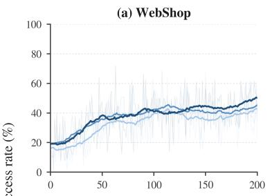  
(d) τ2-Bench: Retail

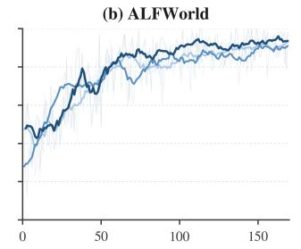  
(e) τ2-Bench: Telecom

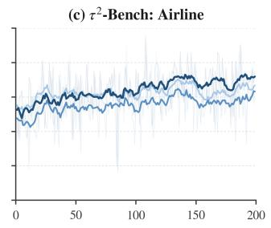  
(f) τ2-Bench: Overall

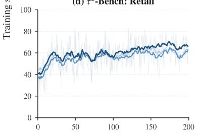

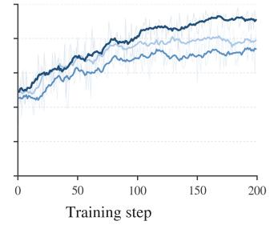

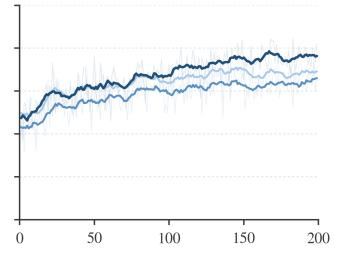

Figure 7. Training success-rate curves across benchmarks. GRPO, SkillRL, and SkillScaffold on (a) WebSho<sub>p</sub>, (b) ALFWorld, $( \mathrm { c } ) \tau ^ { 2 } .$ -Bench Airline, (d) Retail, (e) Telecom, and (f) the $\tau ^ { 2 } .$ <sub>-</sub>B<sub>e</sub>n<sub>c</sub>h m<sub>ac</sub>r<sub>o ave</sub>r<sub>age.</sub> D<sub>ar</sub>k <sub>curves s</sub>h<sub>ow smoo</sub>th<sub>e</sub>d t<sub>ren</sub>d<sub>s an</sub>d f<sub>a</sub>i<sub>n</sub>t <sub>curves s</sub>h<sub>ow raw measuremen</sub>t<sub>s.</sub>  
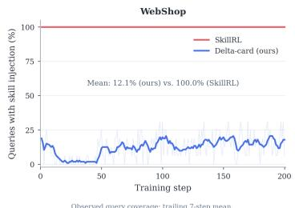  
(a) WebSho<sub>p</sub>

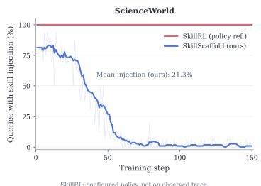  
(b) ScienceWorld

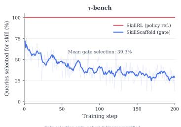  
(c) $\tau ^ { 2 } .$ B<sub>enc</sub>h  
Figure 8. Training-time skill injection and selection rates. Panels (a)–(b) re<sub>p</sub>ort skill injection on WebSho<sub>p</sub> and ScienceWorld; <sub>p</sub>anel (c) re<sub>p</sub>orts <sub>p</sub>ositive-utilit<sub>y</sub> selection on $\tau ^ { 2 } .$ <sub>-</sub>B<sub>enc</sub>h<sub>.</sub>

## B<sub>.</sub>2 T<sub>ra</sub>i<sub>n</sub>i<sub>ng</sub> D<sub>ynam</sub>i<sub>cs</sub> A<sub>cross</sub> B<sub>enc</sub>h<sub>mar</sub>k<sub>s</sub>

Fi<sub>gure</sub> 7 <sub>repor</sub>t<sub>s</sub> t<sub>ra</sub>i<sub>n</sub>i<sub>ng curves</sub> f<sub>or</sub> W<sub>e</sub>bSh<sub>op,</sub> ALFW<sub>or</sub>ld<sub>, an</sub>d th<sub>e</sub> th<sub>ree</sub> i<sub>n</sub>di<sub>v</sub>id<sub>ua</sub>l $\tau ^ { 2 } .$ <sub>-</sub>B<sub>enc</sub>h d<sub>oma</sub>i<sub>ns.</sub> Th<sub>e</sub> l<sub>arges</sub>t l<sub>a</sub>t<sub>e-</sub>t<sub>ra</sub>i<sub>n</sub>i<sub>ng separa</sub>ti<sub>on appears on</sub> T<sub>e</sub>l<sub>ecom, an</sub>d th<sub>e</sub> Ai<sub>r</sub>li<sub>ne an</sub>d R<sub>e</sub>t<sub>a</sub>il <sub>curves a</sub>l<sub>so re</sub>t<sub>a</sub>i<sub>n</sub> <sub>a</sub>d<sub>van</sub>t<sub>ages a</sub>t l<sub>a</sub>t<sub>er c</sub>h<sub>ec</sub>k<sub>po</sub>i<sub>n</sub>t<sub>s.</sub>

## B.3 Skill Injection Rates Across Benchmarks

Fi<sub>gure</sub> 8 <sub>repor</sub>t<sub>s</sub> h<sub>ow</sub> f<sub>requen</sub>tl<sub>y</sub> th<sub>e</sub> t<sub>ra</sub>i<sub>n</sub>i<sub>ng-</sub>ti<sub>me sca</sub>f<sub>o</sub>ld i<sub>s ac</sub>ti<sub>va</sub>t<sub>e</sub>d b<sub>eyon</sub>d ALFW<sub>or</sub>ld<sub>.</sub> Th<sub>e a</sub>l<sub>ways-</sub> <sub>on</sub> SkillRL <sub>re</sub>f<sub>erence supp</sub>li<sub>es a s</sub>kill t<sub>o every query, w</sub>h<sub>ereas</sub> S<sub>kill</sub>S<sub>caffold</sub> i<sub>nvo</sub>k<sub>es</sub> it<sub>s sca</sub>f<sub>o</sub>ld selectively. The mean observed injection rate is 12.1% on WebShop and 21.3% on ScienceWorld. On $\tau ^ { 2 } .$ <sub>-</sub>B<sub>enc</sub>h<sub>,</sub> th<sub>e</sub> <sub>pos</sub>iti<sub>ve-u</sub>tilit<sub>y</sub> <sub>ga</sub>t<sub>e</sub> <sub>se</sub>l<sub>ec</sub>t<sub>s</sub> <sub>a</sub> <sub>s</sub>kill f<sub>or</sub> 39<sub>.</sub>3% <sub>o</sub>f <sub>quer</sub>i<sub>es</sub> <sub>on</sub> <sub>average.</sub>

## B<sub>.</sub>4 C<sub>ross-</sub>B<sub>enc</sub>h<sub>mar</sub>k P<sub>os</sub>t<sub>-</sub>S<sub>cou</sub>t E<sub>xp</sub>l<sub>ora</sub>ti<sub>on</sub> D<sub>ynam</sub>i<sub>cs</sub>

Fi<sub>gures</sub> 9<sub>–</sub>12 t<sub>es</sub>t <sub>w</sub>h<sub>e</sub>th<sub>er</sub> th<sub>e se</sub>l<sub>ec</sub>ti<sub>ve-sca</sub>f<sub>o</sub>ldi<sub>ng</sub> b<sub>e</sub>h<sub>av</sub>i<sub>or o</sub>b<sub>serve</sub>d <sub>on</sub> ALFW<sub>or</sub>ld <sub>a</sub>l<sub>so genera</sub>li<sub>zes</sub> to the other benchmarks. Queries are <sub>g</sub>rouped b<sub>y</sub> the outcomes of four skill-free Scouts. The upper <sub>row</sub> <sub>compares</sub> S<sub>cou</sub>t <sub>an</sub>d f<sub>res</sub>h P<sub>os</sub>t<sub>-</sub>S<sub>cou</sub>t <sub>rewar</sub>d<sub>s,</sub> <sub>w</sub>hil<sub>e</sub> th<sub>e</sub> l<sub>ower</sub> <sub>row</sub> <sub>repor</sub>t<sub>s</sub> th<sub>e</sub> <sub>pos</sub>iti<sub>ve-u</sub>tilit<sub>y</sub> <sub>can</sub>did<sub>a</sub>t<sub>e ra</sub>t<sub>e.</sub>

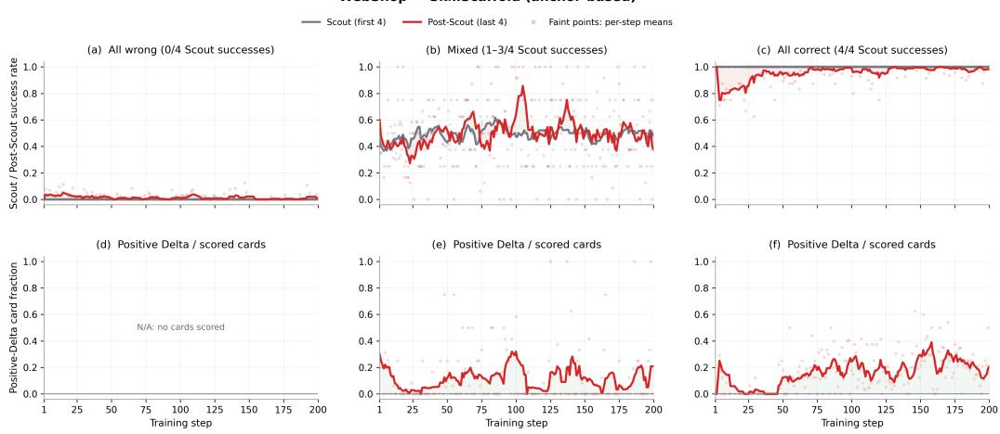  
Fi<sub>gu</sub>r<sub>e</sub> 9<sub>.</sub> S<sub>e</sub>l<sub>ec</sub>ti<sub>ve a</sub>n<sub>c</sub>h<sub>o</sub>r<sub>-gu</sub>id<sub>e</sub>d <sub>exp</sub>l<sub>o</sub>r<sub>a</sub>ti<sub>o</sub>n <sub>o</sub>n W<sub>e</sub>bSh<sub>op.</sub> U<sub>s</sub>i<sub>ng a ver</sub>ifi<sub>e</sub>d <sub>success</sub>f<sub>u</sub>l S<sub>cou</sub>t <sub>as ev</sub>id<sub>ence,</sub> th<sub>e anc</sub>h<sub>or-</sub>b<sub>ase</sub>d <sub>var</sub>i<sub>an</sub>t <sub>se</sub>l<sub>ec</sub>ti<sub>ve</sub>l<sub>y gu</sub>id<sub>es m</sub>i<sub>xe</sub>d <sub>groups an</sub>d <sub>ma</sub>i<sub>n</sub>t<sub>a</sub>i<sub>ns s</sub>t<sub>rong</sub> P<sub>os</sub>t<sub>-</sub>S<sub>cou</sub>t <sub>per</sub>f<sub>ormance as</sub> th<sub>e</sub> S<sub>cou</sub>t <sub>po</sub>li<sub>cy</sub> <sub>approac</sub>h<sub>es</sub> th<sub>e</sub> <sub>a</sub>ll<sub>-correc</sub>t <sub>reg</sub>i<sub>me.</sub>

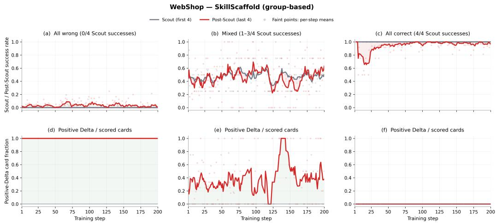  
Fi<sub>gu</sub>re 10<sub>.</sub> Correcti<sub>v</sub>e <sub>g</sub>ro<sub>up</sub>-<sub>gu</sub>ided ex<sub>p</sub>loration on WebSho<sub>p.</sub> O<sub>u</sub>t<sub>co</sub>m<sub>e-</sub>l<sub>a</sub>b<sub>e</sub>l<sub>e</sub>d S<sub>cou</sub>t <sub>g</sub>r<sub>oups</sub> <sub>suppo</sub>rt <sub>correc</sub>ti<sub>ve s</sub>kill <sub>genera</sub>ti<sub>on an</sub>d <sub>pro</sub>d<sub>uce pers</sub>i<sub>s</sub>t<sub>en</sub>t <sub>nonzero</sub> P<sub>os</sub>t<sub>-</sub>S<sub>cou</sub>t <sub>success</sub> f<sub>or</sub> i<sub>n</sub>iti<sub>a</sub>ll<sub>y a</sub>ll<sub>-wrong quer</sub>i<sub>es.</sub> Skill <sub>ac</sub>ti<sub>va</sub>ti<sub>on concen</sub>t<sub>ra</sub>t<sub>es on a</sub>ll<sub>-wrong an</sub>d <sub>m</sub>i<sub>xe</sub>d <sub>groups an</sub>d <sub>na</sub>t<sub>ura</sub>ll<sub>y</sub> di<sub>m</sub>i<sub>n</sub>i<sub>s</sub>h<sub>es once a</sub>ll S<sub>cou</sub>t<sub>s succee</sub>d<sub>.</sub>

A<sub>cross</sub> b<sub>enc</sub>h<sub>mar</sub>k<sub>s,</sub> S<sub>kill</sub>S<sub>caffold concen</sub>t<sub>ra</sub>t<sub>es pos</sub>iti<sub>ve-u</sub>tilit<sub>y s</sub>kill<sub>s on a</sub>ll<sub>-wrong an</sub>d <sub>m</sub>i<sub>xe</sub>d <sub>groups, w</sub>h<sub>ere</sub> P<sub>os</sub>t<sub>-</sub>S<sub>cou</sub>t <sub>ro</sub>ll<sub>ou</sub>t<sub>s recover a</sub>dditi<sub>ona</sub>l <sub>success</sub>f<sub>u</sub>l b<sub>e</sub>h<sub>av</sub>i<sub>or.</sub> Skill <sub>use</sub> d<sub>ec</sub>li<sub>nes as</sub> th<sub>e</sub> S<sub>cou</sub>t <sub>po</sub>li<sub>cy</sub> b<sub>ecomes compe</sub>t<sub>en</sub>t <sub>an</sub>d i<sub>s rare once a</sub>ll S<sub>cou</sub>t<sub>s succee</sub>d<sub>,</sub> f<sub>ocus</sub>i<sub>ng ex</sub>t<sub>erna</sub>l <sub>gu</sub>id<sub>ance on</sub> <sub>quer</sub>i<sub>es w</sub>h<sub>ere</sub> it i<sub>mproves exp</sub>l<sub>ora</sub>ti<sub>on.</sub>

## C Th<sub>eo</sub>r<sub>e</sub>ti<sub>ca</sub>l An<sub>a</sub>l<sub>ys</sub>i<sub>s o</sub>f Skill Utilit<sub>y</sub> f<sub>o</sub>r Cr<sub>e</sub>dit A<sub>ss</sub>i<sub>g</sub>nm<sub>e</sub>nt

Thi<sub>s</sub> <sub>sec</sub>ti<sub>on</sub> <sub>ana</sub>l<sub>yzes</sub> th<sub>e</sub> <sub>propose</sub>d lik<sub>e</sub>lih<sub>oo</sub>d<sub>-</sub>b<sub>ase</sub>d <sub>s</sub>kill <sub>u</sub>tilit<sub>y</sub> <sub>as</sub> <sub>a</sub> <sub>po</sub>li<sub>cy-re</sub>l<sub>a</sub>ti<sub>ve</sub> <sub>surroga</sub>t<sub>e.</sub> W<sub>e</sub> d<sub>er</sub>i<sub>ve</sub> it<sub>s</sub> l<sub>og-</sub>lik<sub>e</sub>lih<sub>oo</sub>d<sub>-ra</sub>ti<sub>o</sub> i<sub>n</sub>t<sub>erpre</sub>t<sub>a</sub>ti<sub>on,</sub> <sub>ran</sub>ki<sub>ng</sub> <sub>an</sub>d <sub>a</sub>b<sub>s</sub>t<sub>en</sub>ti<sub>on</sub> <sub>ro</sub>b<sub>us</sub>t<sub>ness,</sub> <sub>a</sub> <sub>ca</sub>lib<sub>ra</sub>t<sub>e</sub>d d<sub>owns</sub>t<sub>ream-re</sub>t<sub>urn</sub> b<sub>oun</sub>d<sub>,</sub> <sub>an</sub>d it<sub>s</sub> i<sub>n</sub>t<sub>erac</sub>ti<sub>on</sub> <sub>an</sub>d <sub>compu</sub>t<sub>a</sub>ti<sub>on</sub> <sub>comp</sub>l<sub>ex</sub>it<sub>y.</sub>

## C<sub>.</sub>1 L<sub>og-</sub>Lik<sub>e</sub>lih<sub>oo</sub>d<sub>-</sub>R<sub>a</sub>ti<sub>o</sub> I<sub>n</sub>t<sub>erpre</sub>t<sub>a</sub>ti<sub>on</sub>

F<sub>or</sub> th<sub>e</sub> E<sub>xecu</sub>t<sub>or-</sub>t<sub>o</sub>k<sub>en</sub> i<sub>n</sub>d<sub>ex</sub> <sub>se</sub>t $\boldsymbol { \tau } ( \boldsymbol { \tau } )$ , define the conditional trajectory likelihood

$$
p _ { \theta } ( \tau \mid x , c ) = \prod _ { t \in J ( \tau ) } \pi _ { \theta } ^ { \mathrm { e x e c } } ( u _ { t } \mid x , c , h _ { t } ^ { \tau } ) .\tag{13}
$$

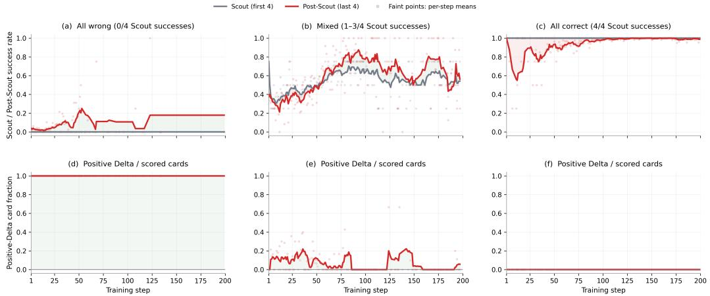  
Fi<sub>gu</sub>r<sub>e</sub> 11<sub>.</sub> C<sub>o</sub>m<sub>pe</sub>t<sub>e</sub>n<sub>ce-a</sub>d<sub>ap</sub>ti<sub>ve</sub> <sub>exp</sub>l<sub>o</sub>r<sub>a</sub>ti<sub>o</sub>n <sub>o</sub>n S<sub>c</sub>i<sub>e</sub>n<sub>ce</sub>W<sub>o</sub>rld<sub>.</sub> G<sub>roup-</sub>b<sub>ase</sub>d <sub>sca</sub>f<sub>o</sub>ldi<sub>ng</sub> <sub>crea</sub>t<sub>es</sub> <sub>success</sub>f<sub>u</sub>l trajectories for initially all-wrong groups and improves mixed-group performance during later training. P<sub>os</sub>iti<sub>ve-u</sub>tilit<sub>y can</sub>did<sub>a</sub>t<sub>es</sub> b<sub>ecome</sub> l<sub>ess</sub> f<sub>requen</sub>t <sub>as</sub> th<sub>e</sub> S<sub>cou</sub>t <sub>po</sub>li<sub>cy</sub> i<sub>mproves, re</sub>fl<sub>ec</sub>ti<sub>ng compe</sub>t<sub>ence-a</sub>d<sub>ap</sub>ti<sub>ve</sub> <sub>s</sub>kill <sub>use.</sub>

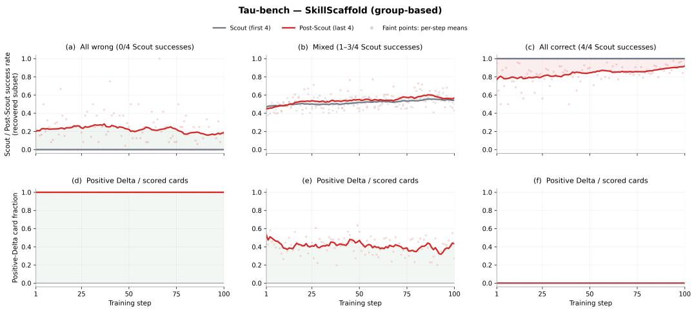  
Fi<sub>gu</sub>r<sub>e</sub> 12<sub>.</sub> C<sub>o</sub>m<sub>pe</sub>t<sub>e</sub>n<sub>ce</sub>-<sub>a</sub>d<sub>ap</sub>ti<sub>ve e</sub>x<sub>p</sub>l<sub>o</sub>r<sub>a</sub>ti<sub>o</sub>n <sub>o</sub>n $\tau ^ { 2 } { \cdot } \mathbf { B e n c h } .$ Post-Scout rollouts recover successful trajectories f<sub>rom</sub> i<sub>n</sub>iti<sub>a</sub>ll<sub>y</sub> <sub>a</sub>ll<sub>-wrong</sub> <sub>groups</sub> <sub>an</sub>d i<sub>mprove</sub> <sub>per</sub>f<sub>ormance</sub> <sub>across</sub> <sub>muc</sub>h <sub>o</sub>f th<sub>e</sub> <sub>m</sub>i<sub>xe</sub>d <sub>reg</sub>i<sub>me.</sub> P<sub>os</sub>iti<sub>ve-u</sub>tilit<sub>y</sub> <sub>can</sub>did<sub>a</sub>t<sub>es</sub> <sub>are</sub> f<sub>requen</sub>t f<sub>or</sub> <sub>a</sub>ll<sub>-wrong</sub> <sub>groups,</sub> <sub>se</sub>l<sub>ec</sub>ti<sub>ve</sub> f<sub>or</sub> <sub>m</sub>i<sub>xe</sub>d <sub>groups,</sub> <sub>an</sub>d <sub>unnecessary</sub> <sub>once</sub> <sub>a</sub>ll S<sub>cou</sub>t<sub>s</sub> <sub>succee</sub>d<sub>.</sub>

E<sub>qua</sub>ti<sub>on</sub> 7 th<sub>en</sub> <sub>sa</sub>ti<sub>s</sub>fi<sub>es</sub> th<sub>e</sub> <sub>exac</sub>t id<sub>en</sub>tit<sub>y</sub>

$$
d ( s , \tau ) = \frac { 1 } { | \mathscr { I } ( \tau ) | } \log \frac { p _ { \theta } ( \tau \mid x , s ) } { p _ { \theta } ( \tau \mid x , \emptyset ) } .\tag{14}
$$

A <sub>pos</sub>iti<sub>ve</sub> $d ( s , \tau )$ <sub>means</sub> th<sub>a</sub>t <sub>con</sub>diti<sub>on</sub>i<sub>ng on �</sub> i<sub>ncreases</sub> th<sub>e geome</sub>t<sub>r</sub>i<sub>c mean</sub> t<sub>o</sub>k<sub>en</sub> lik<sub>e</sub>lih<sub>oo</sub>d <sub>ass</sub>i<sub>gne</sub>d t<sub>o</sub> th<sub>e o</sub>b<sub>serve</sub>d E<sub>xecu</sub>t<sub>or</sub> b<sub>e</sub>h<sub>av</sub>i<sub>or.</sub>

Proposition 1 (balanced si<sub>g</sub>ned evidence). For a mixed Scout <sub>g</sub>rou<sub>p</sub>, <sub>g</sub>rou<sub>p</sub>-based utilit<sub>y</sub> can be <sub>wr</sub>itt<sub>en as</sub>

$$
U ^ { \mathrm { g r p } } ( s ; x ) = \frac { 1 } { 2 } \mathbb { E } _ { i \sim \mathrm { U n i f } ( S _ { x } ) } [ d ( s , \tau _ { i } ^ { 0 } ) ] - \frac { 1 } { 2 } \mathbb { E } _ { i \sim \mathrm { U n i f } ( \mathcal { F } _ { x } ) } [ d ( s , \tau _ { i } ^ { 0 } ) ] .\tag{15}
$$

C<sub>onsequen</sub>tl<sub>y,</sub> <sub>success</sub>f<sub>u</sub>l <sub>an</sub>d f<sub>a</sub>il<sub>e</sub>d <sub>ev</sub>id<sub>ence</sub> <sub>eac</sub>h <sub>rece</sub>i<sub>ve</sub> t<sub>o</sub>t<sub>a</sub>l <sub>we</sub>i<sub>g</sub>ht $1 / 2$ <sub>,</sub> i<sub>n</sub>d<sub>epen</sub>d<sub>en</sub>t <sub>o</sub>f th<sub>e</sub>i<sub>r</sub> <sub>re</sub>l<sub>a</sub>ti<sub>ve</sub> f<sub>requency</sub> i<sub>n</sub> th<sub>e</sub> S<sub>cou</sub>t <sub>group.</sub>

Proof. Substituting the uniform expectations into Equation 15 gives the mixed branch of Equation 8. Th<sub>e</sub> <sub>coe</sub>fi<sub>c</sub>i<sub>en</sub>t<sub>s</sub> <sub>sum</sub> t<sub>o</sub> $1 / 2$ <sub>w</sub>ithi<sub>n</sub> <sub>eac</sub>h <sub>ou</sub>t<sub>come</sub> <sub>c</sub>l<sub>ass,</sub> <sub>so</sub> <sub>c</sub>h<sub>ang</sub>i<sub>ng</sub> th<sub>e</sub> <sub>c</sub>l<sub>ass</sub> <sub>coun</sub>t<sub>s</sub> d<sub>oes</sub> <sub>no</sub>t <sub>c</sub>h<sub>ange</sub> th<sub>e</sub>i<sub>r</sub> t<sub>o</sub>t<sub>a</sub>l <sub>we</sub>i<sub>g</sub>ht<sub>s.</sub> □

Thi<sub>s</sub> b<sub>a</sub>l<sub>anc</sub>i<sub>ng</sub> k<sub>eeps success</sub>f<sub>u</sub>l <sub>an</sub>d f<sub>a</sub>il<sub>e</sub>d <sub>ev</sub>id<sub>ence equa</sub>ll<sub>y</sub> i<sub>n</sub>fl<sub>uen</sub>ti<sub>a</sub>l<sub>,</sub> i<sub>n</sub>d<sub>epen</sub>d<sub>en</sub>t <sub>o</sub>f th<sub>e</sub>i<sub>r re</sub>l<sub>a</sub>ti<sub>ve</sub> f<sub>requenc</sub>i<sub>es</sub> i<sub>n</sub> th<sub>e</sub> <sub>samp</sub>l<sub>e</sub>d S<sub>cou</sub>t <sub>group.</sub>

## C<sub>.</sub>2 S<sub>e</sub>l<sub>ec</sub>ti<sub>o</sub>n R<sub>o</sub>b<sub>us</sub>tn<sub>ess u</sub>nd<sub>e</sub>r Utilit<sub>y</sub> Err<sub>o</sub>r

L<sub>e</sub>t $U _ { j }$ denote the population proxy utility of candidate � under the current query and policy, and let $\widehat { U } _ { j }$ b<sub>e</sub> th<sub>e u</sub>tilit<sub>y es</sub>ti<sub>ma</sub>t<sub>e</sub>d f<sub>rom</sub> th<sub>e samp</sub>l<sub>e</sub>d S<sub>cou</sub>t <sub>group.</sub> A<sub>ssume a un</sub>if<sub>orm error</sub> b<sub>oun</sub>d

$$
| \widehat { U } _ { j } - U _ { j } | \leq \varepsilon \qquad \mathrm { f o r ~ e v e r y ~ e l i g i b l e ~ c a n d i d a t e ~ } j .\tag{16}
$$

Proposition 2 (rankin<sub>g</sub> and abstention bounds). Let $\widehat { j } = \arg \operatorname* { m a x } _ { j } \widehat { U } _ { j }$ <sub>an</sub>d $j ^ { * } = \arg \operatorname* { m a x } _ { j } U _ { j }$ Th<sub>en</sub>

$$
U _ { \widehat { j } } \geq U _ { j ^ { \ast } } - 2 \varepsilon .\tag{17}
$$

M<sub>oreover,</sub> if th<sub>e pos</sub>iti<sub>ve ga</sub>t<sub>e se</sub>l<sub>ec</sub>t<sub>s</sub> ${ \widehat { j , } }$ th<sub>en</sub> $U _ { \widehat { j } } > - \varepsilon ;$ if th<sub>e ga</sub>t<sub>e a</sub>b<sub>s</sub>t<sub>a</sub>i<sub>ns,</sub> th<sub>en max</sub> $U _ { j } \leq \varepsilon .$

Proof. By optimality of $\widehat { j }$ <sub>un</sub>d<sub>er</sub> th<sub>e es</sub>ti<sub>ma</sub>t<sub>e</sub>d <sub>u</sub>tiliti<sub>es,</sub>

$$
U _ { \widehat { j } } \geq \widehat { U } _ { \widehat { j } } - \varepsilon \geq \widehat { U } _ { j ^ { * } } - \varepsilon \geq U _ { j ^ { * } } - 2 \varepsilon .\tag{18}
$$

$\mathbb { f } \widehat { U } _ { \widehat { j } } > 0$ <sub>,</sub> th<sub>e</sub> <sub>error</sub> b<sub>oun</sub>d <sub>g</sub>i<sub>ves</sub> $U _ { \widehat { j } } > - \varepsilon .$ <sub>.</sub> If <sub>every</sub> <sub>es</sub>ti<sub>ma</sub>t<sub>e</sub>d <sub>u</sub>tilit<sub>y</sub> i<sub>s</sub> <sub>nonpos</sub>iti<sub>ve,</sub> th<sub>en</sub> $U _ { j } \leq \widehat { U } _ { j } + \varepsilon \leq \varepsilon$ f<sub>or every can</sub>did<sub>a</sub>t<sub>e.</sub> □

Th<sub>e propos</sub>iti<sub>on</sub> f<sub>orma</sub>li<sub>zes</sub> t<sub>wo ro</sub>l<sub>es o</sub>f <sub>u</sub>tilit<sub>y</sub> i<sub>n s</sub>kill <sub>cre</sub>dit <sub>ass</sub>i<sub>gnmen</sub>t<sub>.</sub> R<sub>an</sub>ki<sub>ng</sub> i<sub>ncurs a</sub>t <sub>mos</sub>t $2 \varepsilon$ <sub>proxy regre</sub>t<sub>, w</sub>hil<sub>e a</sub>b<sub>s</sub>t<sub>en</sub>ti<sub>on avo</sub>id<sub>s over</sub>l<sub>oo</sub>ki<sub>ng any can</sub>did<sub>a</sub>t<sub>e w</sub>h<sub>ose proxy a</sub>d<sub>van</sub>t<sub>age excee</sub>d<sub>s</sub> th<sub>e</sub> <sub>es</sub>ti<sub>ma</sub>ti<sub>on-error sca</sub>l<sub>e.</sub>

## C<sub>.</sub>3 C<sub>o</sub>nn<sub>ec</sub>ti<sub>o</sub>n t<sub>o</sub> D<sub>ow</sub>n<sub>s</sub>tr<sub>ea</sub>m R<sub>e</sub>t<sub>u</sub>rn

L<sub>e</sub>t

$$
G ( s ; x ) = \mathbb { E } [ R ( \tau ; x ) \mid x , s ] - \mathbb { E } [ R ( \tau ; x ) \mid x , \emptyset ]\tag{19}
$$

d<sub>eno</sub>t<sub>e</sub> th<sub>e</sub> t<sub>rue</sub> d<sub>owns</sub>t<sub>ream ga</sub>i<sub>n.</sub> Th<sub>e</sub> f<sub>o</sub>ll<sub>ow</sub>i<sub>ng</sub> l<sub>oca</sub>l <sub>ca</sub>lib<sub>ra</sub>ti<sub>on con</sub>diti<sub>on connec</sub>t<sub>s po</sub>li<sub>cy-re</sub>l<sub>a</sub>ti<sub>ve</sub> <sub>u</sub>tilit<sub>y</sub> t<sub>o</sub> thi<sub>s</sub> <sub>env</sub>i<sub>ronmen</sub>t<sub>-</sub>l<sub>eve</sub>l <sub>quan</sub>tit<sub>y.</sub>

Assumption 1 (local surro<sub>g</sub>ate calibration). For eli<sub>g</sub>ible candidates under the current <sub>q</sub>uer<sub>y</sub> and p<sup>olic</sup>y, <sup>s</sup>upp<sup>ose</sup> <sup>constants</sup> $a > 0$ <sub>an</sub>d $b \geq 0$ <sub>ex</sub>i<sub>s</sub>t <sub>suc</sub>h th<sub>a</sub>t

$$
G ( s _ { j } ; x ) \geq a U _ { j } - b .\tag{20}
$$

Proposition 3 (thresholded downstream bound). Under Assum<sub>p</sub>tion 1 and E<sub>q</sub>uation 16, selectin<sub>g</sub> <sub>a can</sub>did<sub>a</sub>t<sub>e on</sub>l<sub>y w</sub>h<sub>en</sub> $\widehat { U } _ { j } > t$ gu<sup>arantees</sup>

$$
G ( s _ { j } ; x ) > a ( t - \varepsilon ) - b .\tag{21}
$$

I<sub>n</sub> <sub>par</sub>ti<sub>cu</sub>l<sub>ar,</sub> $t \ge \varepsilon + b / a$ i<sub>s su</sub>fi<sub>c</sub>i<sub>en</sub>t f<sub>or a nonnega</sub>ti<sub>ve</sub> d<sub>owns</sub>t<sub>ream-ga</sub>i<sub>n guaran</sub>t<sub>ee.</sub>

Proof. The estimation bound implies $U _ { j } > t - \varepsilon$ <sub>.</sub> S<sub>u</sub>b<sub>s</sub>tit<sub>u</sub>ti<sub>on</sub> i<sub>n</sub>t<sub>o</sub> E<sub>qua</sub>ti<sub>on</sub> 20 i<sub>e</sub>ld<sub>s</sub> $G ( s _ { j } ; x ) >$ $a ( t - \varepsilon ) - b$ □

Th<sub>e</sub> b<sub>oun</sub>d <sub>exposes a</sub> di<sub>rec</sub>t t<sub>ra</sub>d<sub>eo</sub>f b<sub>e</sub>t<sub>ween</sub> th<sub>e</sub> th<sub>res</sub>h<sub>o</sub>ld <sub>an</sub>d th<sub>e guaran</sub>t<sub>ee</sub>d d<sub>owns</sub>t<sub>ream marg</sub>i<sub>n.</sub> O<sub>u</sub>r <sub>expe</sub>rim<sub>e</sub>nt<sub>s use</sub> $t = 0$ <sub>, w</sub>hil<sub>e</sub> th<sub>e same ga</sub>t<sub>e suppor</sub>t<sub>s a</sub> t<sub>una</sub>bl<sub>e pos</sub>iti<sub>ve marg</sub>i<sub>n w</sub>h<sub>en</sub> d<sub>es</sub>i<sub>re</sub>d<sub>.</sub>

## C<sub>.</sub>4 Int<sub>e</sub>r<sub>ac</sub>ti<sub>o</sub>n <sub>a</sub>nd C<sub>o</sub>m<sub>pu</sub>t<sub>a</sub>ti<sub>o</sub>n C<sub>o</sub>m<sub>p</sub>l<sub>e</sub>xit<sub>y</sub>

With � <sub>can</sub>did<sub>a</sub>t<sub>es</sub> <sub>an</sub>d � <sub>eva</sub>l<sub>ua</sub>ti<sub>on</sub> <sub>ep</sub>i<sub>so</sub>d<sub>es</sub> <sub>per</sub> <sub>con</sub>diti<sub>on,</sub> di<sub>rec</sub>t <sub>ro</sub>ll<sub>ou</sub>t <sub>u</sub>tilit<sub>y</sub> <sub>es</sub>ti<sub>ma</sub>ti<sub>on</sub> <sub>requ</sub>i<sub>res</sub> $( M + 1 ) K$ additional environment trajectories per query when the skill-free condition is shared. SkillScaffold launches no candidate-specific environment trajectories. It reuses � Scouts already collected for training and requires �� candidate-conditioned trajectory scores plus � cached skillfree scores, giving O(��) additional model scoring work. After selection, the � post-selection trajectories are ordinary Executor training data rather than candidate-evaluation rollouts. With the d<sub>e</sub>f<sub>au</sub>lt $N = M = L = { \dot { 4 } }$ , each update uses eight environment trajectories in the Executor group and twenty reusable trajectory-context scores for utility computation.

## D Skill<sub>-</sub>G<sub>u</sub>id<sub>e</sub>d E<sub>xecu</sub>ti<sub>on</sub> E<sub>xamp</sub>l<sub>es</sub>

Th<sub>e</sub> f<sub>o</sub>ll<sub>ow</sub>i<sub>ng</sub> <sub>pages</sub> <sub>prov</sub>id<sub>e</sub> th<sub>e</sub> <sub>s</sub>kill<sub>-genera</sub>ti<sub>on</sub> <sub>promp</sub>t<sub>,</sub> th<sub>e</sub> <sub>comp</sub>l<sub>e</sub>t<sub>e</sub> <sub>se</sub>l<sub>ec</sub>t<sub>e</sub>d <sub>s</sub>kill<sub>,</sub> <sub>an</sub>d <sub>one</sub> <sub>s</sub>kill<sub>-</sub> guided trajectory per benchmark. The ALFWorld and ScienceWorld prompts are abridged for space, <sub>w</sub>hil<sub>e</sub> <sub>preserv</sub>i<sub>ng</sub> th<sub>e</sub>i<sub>r</sub> <sub>ev</sub>id<sub>ence</sub> <sub>ru</sub>l<sub>es,</sub> i<sub>npu</sub>t <sub>s</sub>t<sub>ruc</sub>t<sub>ure,</sub> <sub>an</sub>d <sub>requ</sub>i<sub>re</sub>d <sub>ou</sub>t<sub>pu</sub>t f<sub>orma</sub>t<sub>.</sub>

## D.1 Qualitative Case of Skill-Free Strategy Acquisition

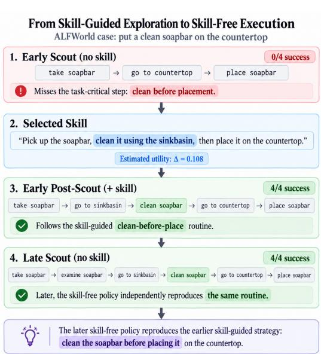  
Fi<sub>gu</sub>r<sub>e</sub> 13<sub>.</sub> Fr<sub>o</sub>m <sub>s</sub>kill<sub>-gu</sub>id<sub>e</sub>d <sub>exp</sub>l<sub>o</sub>r<sub>a</sub>ti<sub>o</sub>n t<sub>o</sub> <sub>s</sub>kill<sub>-</sub>fr<sub>ee</sub> <sub>execu</sub>ti<sub>o</sub>n<sub>.</sub> A<sub>n</sub> ALFW<sub>or</sub>ld <sub>examp</sub>l<sub>e</sub> i<sub>n</sub> <sub>w</sub>hi<sub>c</sub>h <sub>a</sub> <sub>se</sub>l<sub>ec</sub>t<sub>e</sub>d <sub>s</sub>kill i<sub>n</sub>t<sub>ro</sub>d<sub>uces</sub> th<sub>e m</sub>i<sub>ss</sub>i<sub>ng c</sub>l<sub>ean-</sub>b<sub>e</sub>f<sub>ore-p</sub>l<sub>ace s</sub>t<sub>ra</sub>t<sub>egy, w</sub>hi<sub>c</sub>h i<sub>s</sub> l<sub>a</sub>t<sub>er repro</sub>d<sub>uce</sub>d <sub>w</sub>ith<sub>ou</sub>t <sub>s</sub>kill i<sub>npu</sub>t<sub>.</sub>

Fi<sub>gure</sub> 13 <sub>s</sub>h<sub>ows</sub> th<sub>a</sub>t th<sub>e ear</sub>l<sub>y s</sub>kill<sub>-</sub>f<sub>ree</sub> S<sub>cou</sub>t<sub>s om</sub>it th<sub>e requ</sub>i<sub>re</sub>d <sub>c</sub>l<sub>ean</sub>i<sub>ng s</sub>t<sub>ep, w</sub>h<sub>ereas</sub> th<sub>e se</sub>l<sub>ec</sub>t<sub>e</sub>d <sub>pos</sub>iti<sub>ve-u</sub>tilit<sub>y s</sub>kill <sub>ena</sub>bl<sub>es a</sub>ll P<sub>os</sub>t<sub>-</sub>S<sub>cou</sub>t<sub>s</sub> t<sub>o comp</sub>l<sub>e</sub>t<sub>e</sub> th<sub>e</sub> t<sub>as</sub>k<sub>.</sub> At <sub>a</sub> l<sub>a</sub>t<sub>er c</sub>h<sub>ec</sub>k<sub>po</sub>i<sub>n</sub>t<sub>,</sub> th<sub>e s</sub>kill<sub>-</sub>f<sub>ree</sub> <sub>po</sub>li<sub>cy</sub> i<sub>n</sub>d<sub>epen</sub>d<sub>en</sub>tl<sub>y repro</sub>d<sub>uces</sub> th<sub>e same c</sub>l<sub>ean-</sub>b<sub>e</sub>f<sub>ore-p</sub>l<sub>ace rou</sub>ti<sub>ne,</sub> ill<sub>us</sub>t<sub>ra</sub>ti<sub>ng</sub> th<sub>a</sub>t th<sub>e</sub> l<sub>earne</sub>d <sub>po</sub>li<sub>cy</sub> l<sub>a</sub>t<sub>er</sub> <sub>execu</sub>t<sub>es</sub> th<sub>e</sub> <sub>s</sub>t<sub>ra</sub>t<sub>egy</sub> <sub>w</sub>ith<sub>ou</sub>t <sub>ex</sub>t<sub>erna</sub>l <sub>s</sub>kill i<sub>npu</sub>t<sub>.</sub>

## D<sub>.</sub>2 ALFW<sub>or</sub>ld<sub>:</sub> Cl<sub>ean</sub> B<sub>e</sub>f<sub>ore</sub> Pl<sub>acemen</sub>t

T<sub>as</sub>k<sub>:</sub> “<sub>pu</sub>t <sub>a</sub> <sub>c</sub>l<sub>ean</sub> <sub>soap</sub>b<sub>ar</sub> i<sub>n</sub> <sub>coun</sub>t<sub>er</sub>t<sub>op.</sub>” Th<sub>e</sub> <sub>se</sub>l<sub>ec</sub>t<sub>e</sub>d <sub>s</sub>kill i<sub>nser</sub>t<sub>s</sub> <sub>c</sub>l<sub>ean</sub>i<sub>ng</sub> b<sub>e</sub>t<sub>ween</sub> <sub>re</sub>t<sub>r</sub>i<sub>eva</sub>l <sub>an</sub>d <sub>p</sub><sup>l</sup>acement.

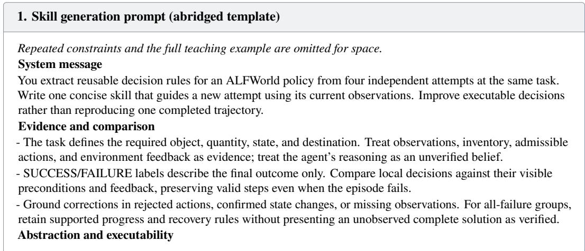

## 1. Skill <sub>g</sub>eneration prompt (abrid<sub>g</sub>ed template) (continued)

\- Express the target object, source, destination, required state, and appliance as semantic roles, then bind them to observed identifiers during execution. Track the same object instance across retrieval, transformation, and <sub>p</sub><sup>l</sup>acement.

\- Do not copy numbered objects, receptacles, fixed routes, or room layouts. Use only action forms supported by th<sub>e</sub> i<sub>n</sub>t<sub>er</sub>f<sub>ace,</sub> <sub>an</sub>d <sub>ver</sub>if<sub>y</sub> <sub>exp</sub>li<sub>c</sub>it <sub>s</sub>t<sub>a</sub>t<sub>e</sub> <sub>c</sub>h<sub>anges</sub> <sub>suc</sub>h <sub>as</sub> <sub>c</sub>l<sub>ean</sub>i<sub>ng,</sub> <sub>coo</sub>li<sub>ng,</sub> <sub>or</sub> h<sub>ea</sub>ti<sub>ng</sub> b<sub>e</sub>f<sub>ore</sub> <sub>p</sub>l<sub>acemen</sub>t<sub>.</sub>

<sub>-</sub> Di<sub>s</sub>ti<sub>ngu</sub>i<sub>s</sub>h <sub>v</sub>i<sub>s</sub>iti<sub>ng a</sub> l<sub>oca</sub>ti<sub>on</sub> f<sub>rom</sub> i<sub>nspec</sub>ti<sub>ng</sub> it<sub>s con</sub>t<sub>en</sub>t<sub>s.</sub> A f<sub>a</sub>il<sub>e</sub>d <sub>searc</sub>h d<sub>oes no</sub>t <sub>prove a</sub>b<sub>sence, an</sub>d <sub>a</sub> rejected action should not be repeated without checking its command or preconditions.

## O<sub>u</sub>t<sub>pu</sub>t di<sub>sc</sub>i<sub>p</sub>lin<sub>e</sub>

Return exactl<sub>y</sub> one concise card enclosed b<sub>y</sub> <skill> and </skill>. Each rule should connect an observable condition to an action, verification check, or recovery step. Do not mention trajectories, outcome labels, rewards, d<sub>emons</sub>t<sub>ra</sub>ti<sub>ons, or</sub> thi<sub>s promp</sub>t i<sub>n</sub> th<sub>e car</sub>d<sub>.</sub>

## User message

## Abrid<sub>g</sub>ed teachin<sub>g</sub> exam<sub>p</sub>le—all attem<sub>p</sub>ts fail

Th<sub>e a</sub>tt<sub>emp</sub>t<sub>s s</sub>h<sub>ow</sub> th<sub>ree recurr</sub>i<sub>ng</sub> l<sub>oca</sub>l <sub>errors:</sub> t<sub>rea</sub>ti<sub>ng a c</sub>l<sub>ose</sub>d <sub>con</sub>t<sub>a</sub>i<sub>ner as searc</sub>h<sub>e</sub>d<sub>, us</sub>i<sub>ng an</sub> id<sub>en</sub>tifi<sub>er</sub> i<sub>ncons</sub>i<sub>s</sub>t<sub>en</sub>t <sub>w</sub>ith th<sub>e o</sub>b<sub>serva</sub>ti<sub>on, an</sub>d <sub>repea</sub>ti<sub>ng p</sub>l<sub>acemen</sub>t <sub>w</sub>hil<sub>e s</sub>till <sub>a</sub>t th<sub>e source.</sub> Th<sub>e examp</sub>l<sub>e s</sub>kill th<sub>ere</sub>f<sub>ore</sub> recommends inspecting hidden contents, binding commands to observed identifiers, reading rejection feedback, <sub>an</sub>d <sub>correc</sub>ti<sub>ng</sub> th<sub>e re</sub>l<sub>evan</sub>t <sub>precon</sub>diti<sub>on</sub> b<sub>e</sub>f<sub>ore re</sub>t<sub>ry</sub>i<sub>ng.</sub>

W<sub>r</sub>it<sub>e one co</sub>h<sub>eren</sub>t <sub>s</sub>kill <sub>groun</sub>d<sub>e</sub>d i<sub>n</sub> th<sub>ese recor</sub>d<sub>s.</sub> K<sub>eep</sub> it <sub>w</sub>ithi<sub>n</sub> 400 E<sub>ng</sub>li<sub>s</sub>h <sub>wor</sub>d<sub>s an</sub>d <sub>use exac</sub>tl<sub>y</sub> th<sub>e</sub> f<sub>o</sub>ll<sub>ow</sub>i<sub>ng</sub> h<sub>ea</sub>di<sub>ngs:</sub>

\## V<sub>er</sub>ifi<sub>ca</sub>ti<sub>on an</sub>d <sub>recovery</sub>

Return onl<sub>y</sub> <skill>...</skill> with the headin<sub>g</sub>s above.

Assistant <sub>g</sub>eneration <sub>p</sub>refix   
<think>   
</think>

## 2. Selected skill (complete card)

## # Skill<sub>:</sub> l<sub>oca</sub>t<sub>e-a</sub>nd<sub>-c</sub>l<sub>ea</sub>n<sub>-soap</sub>b<sub>a</sub>r<sub>-</sub>b<sub>e</sub>f<sub>o</sub>r<sub>e-p</sub>l<sub>ace</sub>m<sub>e</sub>nt

\## Wh<sub>e</sub>n t<sub>o</sub> <sub>app</sub>l<sub>y</sub> U<sub>se</sub> <sub>w</sub>h<sub>en</sub> th<sub>e</sub> t<sub>as</sub>k <sub>requ</sub>i<sub>res</sub> l<sub>oca</sub>ti<sub>ng</sub> <sub>a</sub> <sub>soap</sub>b<sub>ar,</sub> <sub>c</sub>l<sub>ean</sub>i<sub>ng</sub> it<sub>,</sub> <sub>an</sub>d <sub>p</sub>l<sub>ac</sub>i<sub>ng</sub> it <sub>on</sub> <sub>a</sub> <sub>coun</sub>t<sub>er</sub>t<sub>op.</sub> Th<sub>e</sub> <sub>soap</sub>b<sub>ar</sub> <sub>mus</sub>t b<sub>e</sub> id<sub>en</sub>tifi<sub>e</sub>d<sub>,</sub> <sub>re</sub>t<sub>r</sub>i<sub>eve</sub>d<sub>,</sub> <sub>an</sub>d <sub>c</sub>l<sub>eane</sub>d b<sub>e</sub>f<sub>ore</sub> <sub>p</sub>l<sub>acemen</sub>t<sub>.</sub>

\## S<sub>uccess-p</sub>r<sub>ese</sub>r<sub>v</sub>in<sub>g</sub> <sub>s</sub>tr<sub>a</sub>t<sub>egy</sub> P<sub>reserve</sub> <sub>con</sub>fi<sub>rme</sub>d l<sub>oca</sub>l <sub>progress:</sub> k<sub>eep</sub> t<sub>rac</sub>k <sub>o</sub>f l<sub>oca</sub>ti<sub>ons</sub> i<sub>nspec</sub>t<sub>e</sub>d<sub>,</sub> objects found, and actions taken. Distinguish between observed states and unverified assumptions.

\## F<sub>a</sub>il<sub>u</sub>r<sub>e</sub> <sub>pa</sub>tt<sub>e</sub>rn<sub>s</sub> t<sub>o</sub> <sub>supp</sub>r<sub>ess</sub> D<sub>o</sub> <sub>no</sub>t <sub>assume</sub> th<sub>e</sub> <sub>soap</sub>b<sub>ar</sub> i<sub>s</sub> <sub>a</sub>b<sub>sen</sub>t <sub>a</sub>ft<sub>er</sub> <sub>searc</sub>hi<sub>ng</sub> <sub>common</sub> l<sub>oca</sub>ti<sub>ons.</sub> D<sub>o no</sub>t <sub>a</sub>tt<sub>emp</sub>t <sub>p</sub>l<sub>acemen</sub>t <sub>w</sub>ith<sub>ou</sub>t <sub>con</sub>fi<sub>rm</sub>i<sub>ng</sub> th<sub>e soap</sub>b<sub>ar</sub> i<sub>s c</sub>l<sub>ean.</sub> A<sub>vo</sub>id <sub>repea</sub>ti<sub>ng</sub> th<sub>e same ac</sub>ti<sub>on</sub> <sub>w</sub>ith<sub>ou</sub>t <sub>correc</sub>ti<sub>ng</sub> it<sub>s</sub> <sub>precon</sub>diti<sub>ons.</sub>

\## P<sub>roce</sub>d<sub>ure</sub> 1<sub>.</sub> I<sub>nspec</sub>t <sub>common</sub> l<sub>oca</sub>ti<sub>ons</sub> f<sub>or</sub> th<sub>e soap</sub>b<sub>ar,</sub> i<sub>nc</sub>l<sub>u</sub>di<sub>ng s</sub>i<sub>n</sub>kb<sub>as</sub>i<sub>n, ca</sub>bi<sub>ne</sub>t<sub>s,</sub> d<sub>rawers, an</sub>d <sub>s</sub>h<sub>e</sub>l<sub>ves.</sub>

2<sub>.</sub> O<sub>nce</sub> f<sub>oun</sub>d<sub>, p</sub>i<sub>c</sub>k <sub>up</sub> th<sub>e soap</sub>b<sub>ar an</sub>d <sub>c</sub>l<sub>ean</sub> it <sub>us</sub>i<sub>ng</sub> th<sub>e s</sub>i<sub>n</sub>kb<sub>as</sub>i<sub>n.</sub>

3<sub>.</sub> Aft<sub>er</sub> <sub>c</sub>l<sub>ean</sub>i<sub>ng,</sub> <sub>move</sub> t<sub>o</sub> th<sub>e</sub> d<sub>es</sub>i<sub>gna</sub>t<sub>e</sub>d <sub>coun</sub>t<sub>er</sub>t<sub>op</sub> <sub>an</sub>d <sub>p</sub>l<sub>ace</sub> th<sub>e</sub> <sub>soap</sub>b<sub>ar</sub> th<sub>ere.</sub>

\## D<sub>ec</sub>i<sub>s</sub>i<sub>on ru</sub>l<sub>es -</sub> If th<sub>e soap</sub>b<sub>ar</sub> i<sub>s no</sub>t f<sub>oun</sub>d i<sub>n common</sub> l<sub>oca</sub>ti<sub>ons, expan</sub>d th<sub>e searc</sub>h t<sub>o</sub> l<sub>ess o</sub>b<sub>v</sub>i<sub>ous</sub> <sub>p</sub>l<sub>aces</sub> lik<sub>e</sub> th<sub>e</sub> <sub>gar</sub>b<sub>agecan.</sub>

## 2. Selected skill (complete card) (continued)

<sub>-</sub> If th<sub>e</sub> <sub>soap</sub>b<sub>ar</sub> i<sub>s</sub> f<sub>oun</sub>d b<sub>u</sub>t <sub>no</sub>t <sub>c</sub>l<sub>ean,</sub> <sub>use</sub> th<sub>e</sub> <sub>s</sub>i<sub>n</sub>kb<sub>as</sub>i<sub>n</sub> t<sub>o</sub> <sub>c</sub>l<sub>ean</sub> it b<sub>e</sub>f<sub>ore</sub> <sub>a</sub>tt<sub>emp</sub>ti<sub>ng</sub> <sub>p</sub>l<sub>acemen</sub>t<sub>.</sub>

\- If placement is rejected, verify that the soapbar is clean and located at the correct destination. ## V<sub>er</sub>ifi<sub>ca</sub>ti<sub>on an</sub>d <sub>recovery</sub> Ch<sub>ec</sub>k th<sub>e</sub> f<sub>ee</sub>db<sub>ac</sub>k <sub>a</sub>ft<sub>er eac</sub>h <sub>ac</sub>ti<sub>on</sub> t<sub>o con</sub>fi<sub>rm s</sub>t<sub>a</sub>t<sub>e c</sub>h<sub>anges.</sub> If th<sub>e</sub> <sub>soap</sub>b<sub>ar</sub> i<sub>s no</sub>t <sub>c</sub>l<sub>ean, re</sub>t<sub>ry</sub> th<sub>e c</sub>l<sub>ean</sub>i<sub>ng s</sub>t<sub>ep.</sub> If <sub>p</sub>l<sub>acemen</sub>t f<sub>a</sub>il<sub>s, rec</sub>h<sub>ec</sub>k th<sub>e soap</sub>b<sub>ar</sub>’<sub>s s</sub>t<sub>a</sub>t<sub>e an</sub>d l<sub>oca</sub>ti<sub>on.</sub> ## St<sub>op co</sub>nditi<sub>o</sub>n<sub>s</sub> Wh<sub>en</sub> th<sub>e soap</sub>b<sub>ar</sub> i<sub>s c</sub>l<sub>ean an</sub>d <sub>p</sub>l<sub>ace</sub>d <sub>on</sub> th<sub>e coun</sub>t<sub>er</sub>t<sub>op,</sub> th<sub>e</sub> t<sub>as</sub>k i<sub>s comp</sub>l<sub>e</sub>t<sub>e.</sub> B<sub>u</sub>d<sub>ge</sub>t <sub>exp</sub>i<sub>ry or</sub> i<sub>ncomp</sub>l<sub>e</sub>t<sub>e searc</sub>h d<sub>oes no</sub>t <sub>prove a</sub>b<sub>sence; con</sub>ti<sub>nue searc</sub>hi<sub>ng un</sub>til th<sub>e soap</sub>b<sub>ar</sub> i<sub>s</sub> f<sub>oun</sub>d <sub>an</sub>d <sub>p</sub>l<sub>ace</sub>d<sub>.</sub>

## 3. Skill-<sub>g</sub>uided trajector<sub>y</sub> (one Post-Scout; ke<sub>y</sub> turns)

[Turns 0–19: search omitted. Original turn indices are zero-based.]

Turn 20. take soapbar 1 from toilet 1

Observation: You pick up the soapbar 1 from the toilet 1.

Turn 21. go to sinkbasin 1

Observation: You arrive at sinkbasin 1. On the sinkbasin 1, you see nothing.

Turn 22. clean soapbar 1 with sinkbasin 1

Observation: You clean the soapbar 1 using the sinkbasin 1.

Turn 23. go to countertop 1

Observation: You arrive at countertop 1. On the countertop 1, you see a toiletpaper 1.

Turn 24. move soapbar 1 to countertop 1

[Terminal metadata: won=true, done=true. No subsequent textual observation was saved.]

## D<sub>.</sub>3 W<sub>e</sub>bSh<sub>op:</sub> V<sub>e</sub>rif<sub>y</sub> th<sub>e</sub> R<sub>equ</sub>ir<sub>e</sub>d O<sub>p</sub>ti<sub>o</sub>n B<sub>e</sub>f<sub>o</sub>r<sub>e</sub> P<sub>u</sub>r<sub>c</sub>h<sub>ase</sub>

T<sub>as</sub>k<sub>:</sub> “i <sub>nee</sub>d <sub>a</sub> b<sub>u</sub>tt<sub>on</sub> d<sub>own s</sub>hi<sub>r</sub>t <sub>w</sub>ith <sub>a</sub> l<sub>ong s</sub>l<sub>eeve</sub> f<sub>or a evere</sub>d<sub>ay wear me</sub>di<sub>um s</sub>i<sub>ze w</sub>ith <sub>v nec</sub>k<sub>, an</sub>d <sub>pr</sub>i<sub>ce</sub> l<sub>ower</sub> th<sub>an</sub> 50<sub>.</sub>00 d<sub>o</sub>ll<sub>ars.</sub>” Thi<sub>s examp</sub>l<sub>e uses</sub> th<sub>e anc</sub>h<sub>or-</sub>b<sub>ase</sub>d <sub>var</sub>i<sub>an</sub>t <sub>an</sub>d it<sub>s ac</sub>t<sub>ua</sub>l <sub>success</sub>f<sub>u</sub>l S<sub>cou</sub>t <sub>as</sub> G<sub>enera</sub>t<sub>or ev</sub>id<sub>ence.</sub>

## 1. Skill <sub>g</sub>eneration prompt (complete template)

## <sup>S</sup>ystem message

You are the Skill Extractor in a reinforcement-learning WebShop agent. Given one trajectory that the <sub>env</sub>i<sub>ronmen</sub>t <sub>con</sub>fi<sub>rms</sub> <sub>succee</sub>d<sub>e</sub>d<sub>,</sub> <sub>ex</sub>t<sub>rac</sub>t <sub>exac</sub>tl<sub>y</sub> <sub>one</sub> <sub>reusa</sub>bl<sub>e</sub> <sub>po</sub>li<sub>cy</sub> <sub>s</sub>kill <sub>groun</sub>d<sub>e</sub>d <sub>on</sub>l<sub>y</sub> i<sub>n</sub> th<sub>e</sub> <sub>supp</sub>li<sub>e</sub>d evidence. Success does not imply that every action in the trajectory was useful or optimal.

## User message

Y<sub>ou</sub> <sub>are</sub> th<sub>e</sub> Skill E<sub>x</sub>t<sub>rac</sub>t<sub>or</sub> i<sub>n</sub> <sub>a</sub> <sub>re</sub>i<sub>n</sub>f<sub>orcemen</sub>t<sub>-</sub>l<sub>earn</sub>i<sub>ng</sub> W<sub>e</sub>bSh<sub>op</sub> <sub>agen</sub>t<sub>.</sub> E<sub>x</sub>t<sub>rac</sub>t th<sub>e</sub> <sub>s</sub>i<sub>ng</sub>l<sub>e</sub> <sub>mos</sub>t <sub>reusa</sub>bl<sub>e</sub> d<sub>ec</sub>i<sub>s</sub>i<sub>on</sub> <sub>mec</sub>h<sub>an</sub>i<sub>sm suppor</sub>t<sub>e</sub>d b<sub>y</sub> th<sub>e pr</sub>i<sub>va</sub>t<sub>e success</sub>f<sub>u</sub>l <sub>ev</sub>id<sub>ence</sub> b<sub>e</sub>l<sub>ow.</sub>

Private task: {task description} Private trajectory: {trajectory}

STRICT SERIALIZATION CONTRACT <sub>—</sub> <sub>v</sub>i<sub>o</sub>l<sub>a</sub>ti<sub>on</sub> <sub>ma</sub>k<sub>es</sub> th<sub>e</sub> <sub>en</sub>ti<sub>re</sub> <sub>ou</sub>t<sub>pu</sub>t i<sub>nva</sub>lid<sub>:</sub>

1. The first character of your response must be ‘{‘ and the last character must be ‘}‘.

2. Emit exactly one valid JSON object with exactly one key named ‘skill‘.

3<sub>.</sub> N<sub>ever</sub> <sub>em</sub>it b<sub>ac</sub>kti<sub>c</sub>k<sub>s,</sub> <sub>a</sub> <sub>co</sub>d<sub>e</sub> f<sub>ence,</sub> <sub>ana</sub>l<sub>ys</sub>i<sub>s,</sub> <sub>pre</sub>f<sub>ace,</sub> <sub>or</sub> t<sub>ra</sub>ili<sub>ng</sub> t<sub>ex</sub>t<sub>.</sub>

4. Encode newlines inside the JSON string normally; ensure ‘json.loads‘ can parse the complete response.

Th<sub>e</sub> ‘<sub>s</sub>kill‘ <sub>va</sub>l<sub>ue</sub> i<sub>s</sub> <sub>a</sub> 50<sub>-</sub>150 <sub>wor</sub>d M<sub>ar</sub>kd<sub>own</sub> <sub>car</sub>d <sub>w</sub>ith h<sub>ea</sub>di<sub>ngs</sub> i<sub>n</sub> thi<sub>s</sub> <sub>exac</sub>t <sub>or</sub>d<sub>er:</sub> ‘# Skill<sub>:</sub>‘<sub>,</sub> ‘## Wh<sub>en</sub> t<sub>o</sub> U<sub>se</sub>‘<sub>,</sub> ‘## I<sub>npu</sub>t<sub>s</sub> t<sub>o</sub> Id<sub>en</sub>tif<sub>y</sub>‘<sub>,</sub> ‘## W<sub>or</sub>kfl<sub>ow</sub>‘<sub>,</sub> ‘## D<sub>ec</sub>i<sub>s</sub>i<sub>on</sub> R<sub>u</sub>l<sub>es</sub>‘<sub>.</sub> U<sub>se no more</sub> th<sub>an s</sub>i<sub>x comp</sub>l<sub>e</sub>t<sub>e sen</sub>t<sub>ences;</sub> li<sub>s</sub>t f<sub>ragmen</sub>t<sub>s are a</sub>ll<sub>owe</sub>d<sub>.</sub>

Ch<sub>oose</sub> <sub>exac</sub>tl<sub>y</sub> <sub>one</sub> <sub>mec</sub>h<sub>an</sub>i<sub>sm</sub> <sub>name:</sub> ‘<sub>query-re</sub>f<sub>ormu</sub>l<sub>a</sub>ti<sub>on-a</sub>ft<sub>er-wea</sub>k<sub>-re</sub>t<sub>r</sub>i<sub>eva</sub>l‘<sub>,</sub>

‘<sub>exp</sub>li<sub>c</sub>it<sub>-con</sub>t<sub>ra</sub>di<sub>c</sub>ti<sub>on-screen</sub>i<sub>ng</sub>‘<sub>,</sub> ‘<sub>page-ev</sub>id<sub>ence-cons</sub>t<sub>ra</sub>i<sub>n</sub>t<sub>-ver</sub>ifi<sub>ca</sub>ti<sub>on</sub>‘<sub>,</sub>

‘<sub>requ</sub>i<sub>re</sub>d<sub>-op</sub>ti<sub>on-ver</sub>ifi<sub>ca</sub>ti<sub>on-</sub>b<sub>e</sub>f<sub>ore-purc</sub>h<sub>ase</sub>‘<sub>,</sub> ‘<sub>compa</sub>tibilit<sub>y-ev</sub>id<sub>ence-ver</sub>ifi<sub>ca</sub>ti<sub>on</sub>‘<sub>,</sub> <sub>or</sub>

‘b<sub>u</sub>d<sub>ge</sub>t<sub>-an</sub>d<sub>-cons</sub>t<sub>ra</sub>i<sub>n</sub>t<sub>-ga</sub>ti<sub>ng</sub>‘<sub>.</sub>

U<sub>se on</sub>l<sub>y</sub> th<sub>ese seman</sub>ti<sub>c ro</sub>l<sub>e</sub> l<sub>a</sub>b<sub>e</sub>l<sub>s</sub> f<sub>or reques</sub>t<sub>-spec</sub>ifi<sub>c concep</sub>t<sub>s: pro</sub>d<sub>uc</sub>t t<sub>ype,</sub> h<sub>ar</sub>d <sub>cons</sub>t<sub>ra</sub>i<sub>n</sub>t<sub>, con</sub>t<sub>ra</sub>di<sub>c</sub>t<sub>ory</sub> <sub>ev</sub>id<sub>ence, requ</sub>i<sub>re</sub>d <sub>op</sub>ti<sub>on, compa</sub>tibilit<sub>y requ</sub>i<sub>remen</sub>t<sub>, page ev</sub>id<sub>ence,</sub> b<sub>u</sub>d<sub>ge</sub>t<sub>, can</sub>did<sub>a</sub>t<sub>e, searc</sub>h <sub>resu</sub>lt<sub>.</sub> K<sub>eep</sub> th<sub>em</sub> <sub>ver</sub>b<sub>a</sub>ti<sub>m</sub> <sub>an</sub>d <sub>never</sub> <sub>a</sub>dd <sub>a</sub> <sub>concre</sub>t<sub>e</sub> <sub>examp</sub>l<sub>e</sub> <sub>or</sub> <sub>su</sub>bt<sub>ype.</sub> I<sub>nva</sub>lid<sub>:</sub> ‘d<sub>ev</sub>i<sub>ce</sub> <sub>compa</sub>tibilit<sub>y</sub>‘<sub>,</sub> ‘d<sub>ev</sub>i<sub>ce</sub> f<sub>am</sub>il<sub>y</sub>‘<sub>,</sub> ‘<sub>co</sub>l<sub>or</sub> <sub>or</sub> <sub>s</sub>i<sub>ze</sub>‘<sub>,</sub> ‘f<sub>ragrance</sub>‘<sub>,</sub> ‘<sub>power ra</sub>ti<sub>ng</sub>‘<sub>,</sub> ‘<sub>runn</sub>i<sub>ng use</sub>‘<sub>.</sub> V<sub>a</sub>lid <sub>rep</sub>l<sub>acemen</sub>t<sub>s:</sub> ‘<sub>compa</sub>tibilit<sub>y requ</sub>i<sub>remen</sub>t‘<sub>,</sub> ‘<sub>requ</sub>i<sub>re</sub>d <sub>op</sub>ti<sub>on</sub>‘<sub>, or</sub> ‘h<sub>ar</sub>d <sub>cons</sub>t<sub>ra</sub>i<sub>n</sub>t‘<sub>.</sub> D<sub>o no</sub>t <sub>ou</sub>t<sub>pu</sub>t <sub>any pro</sub>d<sub>uc</sub>t/<sub>ca</sub>t<sub>egory name,</sub> b<sub>ran</sub>d<sub>,</sub> id<sub>en</sub>tifi<sub>er, query p</sub>h<sub>rase, num</sub>b<sub>er,</sub> <sub>currency amoun</sub>t<sub>, s</sub>i<sub>ze, co</sub>l<sub>or, ma</sub>t<sub>er</sub>i<sub>a</sub>l<sub>, au</sub>di<sub>ence,</sub> d<sub>ev</sub>i<sub>ce, power ra</sub>ti<sub>ng, scen</sub>t<sub>, s</sub>ki<sub>n proper</sub>t<sub>y, spor</sub>t/<sub>use case, or</sub> re uested attribute. Do not mention rivate evidence, task, source, trajector , exam le, outcome, reward, or success.

D<sub>escr</sub>ib<sub>e</sub> <sub>on</sub>l<sub>y</sub> th<sub>e</sub> <sub>se</sub>l<sub>ec</sub>t<sub>e</sub>d <sub>mec</sub>h<sub>an</sub>i<sub>sm:</sub> it<sub>s</sub> <sub>o</sub>b<sub>serva</sub>bl<sub>e</sub> t<sub>r</sub>i<sub>gger,</sub> <sub>or</sub>d<sub>ere</sub>d <sub>ac</sub>ti<sub>on,</sub> <sub>an</sub>d <sub>ver</sub>ifi<sub>ca</sub>ti<sub>on</sub> <sub>or</sub> <sub>s</sub>t<sub>opp</sub>i<sub>ng</sub> <sub>con</sub>diti<sub>on.</sub> D<sub>o</sub> <sub>no</sub>t <sub>summar</sub>i<sub>ze</sub> th<sub>e</sub> f<sub>u</sub>ll <sub>ep</sub>i<sub>so</sub>d<sub>e,</sub> i<sub>nven</sub>t <sub>con</sub>t<sub>ro</sub>l<sub>s</sub> <sub>or</sub> f<sub>ac</sub>t<sub>s,</sub> <sub>or</sub> <sub>c</sub>l<sub>a</sub>i<sub>m</sub> <sub>un</sub>i<sub>versa</sub>l <sub>op</sub>ti<sub>ma</sub>lit<sub>y.</sub> Sil<sub>en</sub>tl<sub>y</sub> <sub>ver</sub>if<sub>y</sub> th<sub>a</sub>t th<sub>e</sub> <sub>car</sub>d <sub>wou</sub>ld <sub>rema</sub>i<sub>n</sub> <sub>va</sub>lid f<sub>or</sub> <sub>a</sub> dif<sub>eren</sub>t <sub>pro</sub>d<sub>uc</sub>t <sub>ca</sub>t<sub>egory</sub> <sub>w</sub>ith<sub>ou</sub>t <sub>e</sub>diti<sub>ng.</sub>

Your res<sub>p</sub>onse must be<sub>g</sub>in exactl<sub>y</sub> like this (with the selected name re<sub>p</sub>lacin<sub>g</sub> the <sub>p</sub>laceholder): {”skill”:”# Skill: mechanism-name\n

## Assistant <sub>g</sub>eneration <sub>p</sub>refix

<think>

</think>

## 2. Selected skill (complete card)

## # Skill<sub>:</sub> r<sub>equ</sub>ir<sub>e</sub>d<sub>-op</sub>ti<sub>o</sub>n<sub>-ve</sub>rifi<sub>ca</sub>ti<sub>o</sub>n<sub>-</sub>b<sub>e</sub>f<sub>o</sub>r<sub>e-pu</sub>r<sub>c</sub>h<sub>ase</sub>

\## Wh<sub>e</sub>n t<sub>o</sub> U<sub>se</sub> Wh<sub>en</sub> <sub>a</sub> <sub>pro</sub>d<sub>uc</sub>t <sub>mee</sub>t<sub>s</sub> <sub>a</sub>ll h<sub>ar</sub>d <sub>cons</sub>t<sub>ra</sub>i<sub>n</sub>t<sub>s</sub> b<sub>u</sub>t l<sub>ac</sub>k<sub>s</sub> <sub>a</sub> <sub>requ</sub>i<sub>re</sub>d <sub>op</sub>ti<sub>on.</sub>

\## In<sub>pu</sub>t<sub>s</sub> t<sub>o</sub> Id<sub>e</sub>ntif<sub>y</sub> A <sub>pro</sub>d<sub>uc</sub>t th<sub>a</sub>t <sub>sa</sub>ti<sub>s</sub>fi<sub>es pr</sub>i<sub>ce,</sub> t<sub>ype, an</sub>d <sub>compa</sub>tibilit<sub>y requ</sub>i<sub>remen</sub>t<sub>s</sub> b<sub>u</sub>t i<sub>s m</sub>i<sub>ss</sub>i<sub>ng a</sub> <sub>requ</sub>i<sub>re</sub>d <sub>op</sub>ti<sub>on.</sub>

\## W<sub>or</sub>kfl<sub>ow</sub> Ch<sub>ec</sub>k if th<sub>e</sub> <sub>requ</sub>i<sub>re</sub>d <sub>op</sub>ti<sub>on</sub> i<sub>s</sub> <sub>ava</sub>il<sub>a</sub>bl<sub>e</sub> i<sub>n</sub> th<sub>e</sub> <sub>spec</sub>ifi<sub>e</sub>d <sub>s</sub>i<sub>ze</sub> <sub>or</sub> <sub>co</sub>l<sub>or.</sub>

\## D<sub>ec</sub>i<sub>s</sub>i<sub>on</sub> R<sub>u</sub>l<sub>es</sub> If th<sub>e requ</sub>i<sub>re</sub>d <sub>op</sub>ti<sub>on</sub> i<sub>s ava</sub>il<sub>a</sub>bl<sub>e, procee</sub>d <sub>w</sub>ith <sub>purc</sub>h<sub>ase; o</sub>th<sub>erw</sub>i<sub>se,</sub> b<sub>ac</sub>kt<sub>rac</sub>k t<sub>o</sub> <sub>re</sub>fi<sub>ne searc</sub>h<sub>.</sub>

## 3. Skill-<sub>g</sub>uided trajector<sub>y</sub> (one Post-Scout; all four actions)

[Reasoning omitted; page observations excerpted. Turn indices are zero-based.]

Turn 0. search[button down shirt long sleeve v neck medium]

Observation: . . . B09KR6LR84 [SEP] Shirt for Women Button Down Tops Colorful Blouses Casual V Neck Sex<sub>y</sub> Lon<sub>g</sub> Sleeve T-Shirts [SEP] \$25.99 . . .

## Turn 1. click[b09kr6lr84]

Observation: . . . size [SEP] small [SEP] medium [SEP] large [SEP] xx-large [SEP] 3x-large . . . Price: \$25.99 . . .

## Turn 2. click[medium]

Observation: . . . size [SEP] small [SEP] medium [SEP] large [SEP] xx-large [SEP] 3x-large . . . Price: \$25.99 . . .

Turn 3. click[buy now] [Terminal metadata: won=true, done=true, task score=1. No subsequent textual observation was saved.]

<table><tr><td>1. Skill generation prompt (abridged template)</td></tr><tr><td>Repeated constraints and the full teaching example are omitted for space. System message</td></tr><tr><td>You extract reusable ScienceWorld laboratory skills from four attempts at the same task. Learn observable</td></tr><tr><td>decision rules from successful and unsuccessful attempts, and use only the supplied evidence. A failed or budget-limited attempt may still contain valid partial progress.</td></tr><tr><td>Never invent instruments, commands, object properties, causal effects, or experimental results. In particular, an absent signal is not a negative material test until the observed setup is complete and verified. Missing equipment, invalid commands, incomplete circuits, and action limits must not be converted into scientific conclusions.</td></tr><tr><td>Abstract exact object instances, rooms, colors, and destinations into roles read from the current task. Preserve scientific properties and action forms only when they are supported by the observed attempts. Return one evidence-grounded card of at most 400 English words, enclosed by &lt;ski11&gt; and &lt;/ski11&gt;.</td></tr><tr><td>User message</td></tr><tr><td>Task: {task} Four observed attempts with environment-confirmed outcomes:</td></tr><tr><td>{trajectories} Produce a reusable procedure rather than a transcript tied to one variation. Preserve verified progress, identify</td></tr><tr><td>supported failure-producing decisions, and bind commands to currently observable objects. Distinguish measured facts from hypotheses, and check equipment, material state, and prerequisites before interpreting an unsuccessful experiment.</td></tr><tr><td>Abridged teaching example—verify before classifying For a conductivity task with no clear signal, first inspect the available equipment and connections. Correct only</td></tr><tr><td>problems supported by feedback, then retest and classify the material only when the task&#x27;s observable criterion is met. If the setup remains incomplete, retain uncertainty rather than assigning an unsupported material property. Use exactly the following structure:</td></tr><tr><td>&lt;skill&gt;</td></tr><tr><td># Skill: short reusable mechanism name ## When to apply</td></tr><tr><td>## Success-preserving strategy</td></tr><tr><td>## Failure patterns to suppress</td></tr><tr><td>## Procedure</td></tr><tr><td>## Decision rules ## Verification and recovery</td></tr><tr><td>## Stop conditions</td></tr><tr><td></td></tr><tr><td>&lt;/skill&gt;</td></tr><tr><td>Output only the card. Do not mention rewards, trajectories, demonstrations, or fixed private box colors and room names.</td></tr><tr><td>Assistant generation prefix</td></tr><tr><td>&lt;think&gt;</td></tr><tr><td>&lt;/think&gt;</td></tr><tr><td>2. Selected skill (complete card)</td></tr><tr><td></td></tr><tr><td># Skill: Test Conductivity Using Available Setup</td></tr><tr><td>## When to apply A material is suspected to be electrically conductive, and a test setup involving a power</td></tr><tr><td>source and a light bulb is available.</td></tr><tr><td>## Success-preserving strategy Maintain the material in the inventory, confirm the presence of a power</td></tr><tr><td></td></tr><tr><td></td></tr><tr><td>classification.</td></tr><tr><td></td></tr><tr><td></td></tr><tr><td></td></tr><tr><td></td></tr><tr><td></td></tr><tr><td></td></tr><tr><td></td></tr><tr><td></td></tr><tr><td></td></tr><tr><td></td></tr><tr><td></td></tr><tr><td></td></tr><tr><td></td></tr><tr><td></td></tr><tr><td></td></tr><tr><td></td></tr><tr><td></td></tr><tr><td></td></tr><tr><td></td></tr><tr><td></td></tr><tr><td></td></tr><tr><td></td></tr><tr><td></td></tr><tr><td></td></tr><tr><td></td></tr><tr><td></td></tr><tr><td></td></tr><tr><td></td></tr><tr><td></td></tr><tr><td></td></tr><tr><td></td></tr><tr><td></td></tr><tr><td></td></tr><tr><td></td></tr><tr><td></td></tr><tr><td></td></tr><tr><td></td></tr><tr><td></td></tr><tr><td></td></tr><tr><td></td></tr><tr><td></td></tr><tr><td></td></tr><tr><td></td></tr><tr><td></td></tr><tr><td></td></tr><tr><td></td></tr><tr><td></td></tr><tr><td></td></tr><tr><td></td></tr><tr><td></td></tr><tr><td></td></tr><tr><td></td></tr><tr><td></td></tr><tr><td></td></tr><tr><td></td></tr><tr><td></td></tr><tr><td></td></tr><tr><td></td></tr><tr><td></td></tr><tr><td></td></tr><tr><td></td></tr><tr><td></td></tr><tr><td></td></tr><tr><td></td></tr><tr><td></td></tr><tr><td>source and light bulb, and ensure the setup is connected correctly. Use the task&#x27;s specified destination for</td></tr><tr><td></td></tr><tr><td></td></tr><tr><td></td></tr><tr><td></td></tr><tr><td></td></tr><tr><td></td></tr><tr><td></td></tr><tr><td></td></tr><tr><td></td></tr><tr><td></td></tr><tr><td></td></tr><tr><td></td></tr><tr><td></td></tr><tr><td></td></tr><tr><td></td></tr><tr><td></td></tr><tr><td></td></tr><tr><td></td></tr><tr><td></td></tr><tr><td></td></tr><tr><td></td></tr><tr><td></td></tr><tr><td></td></tr><tr><td></td></tr><tr><td></td></tr><tr><td></td></tr><tr><td></td></tr><tr><td></td></tr><tr><td></td></tr><tr><td></td></tr><tr><td></td></tr><tr><td></td></tr><tr><td></td></tr><tr><td></td></tr><tr><td></td></tr><tr><td></td></tr><tr><td></td></tr><tr><td></td></tr><tr><td></td></tr><tr><td></td></tr><tr><td></td></tr><tr><td></td></tr><tr><td></td></tr><tr><td></td></tr><tr><td></td></tr><tr><td></td></tr><tr><td></td></tr><tr><td></td></tr><tr><td></td></tr><tr><td></td></tr><tr><td></td></tr><tr><td></td></tr><tr><td></td></tr><tr><td></td></tr><tr><td></td></tr><tr><td></td></tr><tr><td></td></tr><tr><td></td></tr><tr><td></td></tr><tr><td></td></tr><tr><td></td></tr><tr><td></td></tr><tr><td></td></tr><tr><td></td></tr><tr><td></td></tr><tr><td></td></tr></table>

## D<sub>.</sub>4 S<sub>c</sub>i<sub>e</sub>n<sub>ce</sub>W<sub>o</sub>rld<sub>:</sub> C<sub>o</sub>m<sub>p</sub>l<sub>e</sub>t<sub>e</sub> th<sub>e</sub> Cir<sub>cu</sub>it B<sub>e</sub>f<sub>o</sub>r<sub>e</sub> Cl<sub>ass</sub>if<sub>y</sub>in<sub>g</sub>

Task (excerpt): “Your task is to determine if metal fork is electricall<sub>y</sub> conductive.” The task assi<sub>g</sub>ns conductive objects to the red box and nonconductive objects to the green box.

## 2. Selected skill (complete card) (continued)

\## P<sub>roce</sub>d<sub>ure</sub> 1<sub>.</sub> F<sub>ocus on</sub> th<sub>e me</sub>t<sub>a</sub>l f<sub>or</sub>k t<sub>o exam</sub>i<sub>ne</sub> it<sub>s proper</sub>ti<sub>es.</sub>

2<sub>.</sub> Pi<sub>c</sub>k <sub>up</sub> th<sub>e</sub> <sub>me</sub>t<sub>a</sub>l f<sub>or</sub>k t<sub>o</sub> <sub>p</sub>l<sub>ace</sub> it i<sub>n</sub> th<sub>e</sub> i<sub>nven</sub>t<sub>ory.</sub>

3<sub>.</sub> Ch<sub>ec</sub>k f<sub>or</sub> th<sub>e presence o</sub>f <sub>a power source an</sub>d li<sub>g</sub>ht b<sub>u</sub>lb i<sub>n</sub> th<sub>e env</sub>i<sub>ronmen</sub>t<sub>.</sub>

4<sub>.</sub> C<sub>onnec</sub>t th<sub>e</sub> <sub>me</sub>t<sub>a</sub>l f<sub>or</sub>k t<sub>o</sub> th<sub>e</sub> <sub>power</sub> <sub>source</sub> <sub>an</sub>d li<sub>g</sub>ht b<sub>u</sub>lb t<sub>o</sub> f<sub>orm</sub> <sub>a</sub> <sub>c</sub>i<sub>rcu</sub>it

5<sub>.</sub> Ob<sub>serve</sub> if th<sub>e</sub> li<sub>g</sub>ht b<sub>u</sub>lb ill<sub>um</sub>i<sub>na</sub>t<sub>es</sub> t<sub>o</sub> d<sub>e</sub>t<sub>erm</sub>i<sub>ne</sub> <sub>con</sub>d<sub>uc</sub>ti<sub>v</sub>it<sub>y.</sub>

6<sub>.</sub> If th<sub>e</sub> li<sub>g</sub>ht b<sub>u</sub>lb li<sub>g</sub>ht<sub>s up, p</sub>l<sub>ace</sub> th<sub>e me</sub>t<sub>a</sub>l f<sub>or</sub>k i<sub>n</sub> th<sub>e</sub> d<sub>es</sub>ti<sub>na</sub>ti<sub>on spec</sub>ifi<sub>e</sub>d b<sub>y</sub> th<sub>e curren</sub>t t<sub>as</sub>k<sub>.</sub>

\## D<sub>ec</sub>i<sub>s</sub>i<sub>on ru</sub>l<sub>es</sub> If th<sub>e</sub> li<sub>g</sub>ht b<sub>u</sub>lb d<sub>oes no</sub>t ill<sub>um</sub>i<sub>na</sub>t<sub>e, c</sub>h<sub>ec</sub>k th<sub>e connec</sub>ti<sub>ons an</sub>d <sub>ensure</sub> th<sub>e c</sub>i<sub>rcu</sub>it i<sub>s</sub> <sub>comp</sub>l<sub>e</sub>t<sub>e.</sub> If th<sub>e power source or</sub> li<sub>g</sub>ht b<sub>u</sub>lb i<sub>s no</sub>t <sub>ava</sub>il<sub>a</sub>bl<sub>e,</sub> d<sub>o no</sub>t <sub>procee</sub>d <sub>w</sub>ith th<sub>e</sub> t<sub>es</sub>t<sub>.</sub> If th<sub>e connec</sub>ti<sub>on</sub> command is rejected, verify the presence of the required objects before retrying.

\## V<sub>er</sub>ifi<sub>ca</sub>ti<sub>on an</sub>d <sub>recovery</sub> C<sub>on</sub>fi<sub>rm</sub> th<sub>a</sub>t th<sub>e</sub> li<sub>g</sub>ht b<sub>u</sub>lb li<sub>g</sub>ht<sub>s up as a c</sub>l<sub>ear s</sub>i<sub>gna</sub>l <sub>o</sub>f <sub>con</sub>d<sub>uc</sub>ti<sub>v</sub>it<sub>y.</sub> If th<sub>e</sub> li<sub>g</sub>ht b<sub>u</sub>lb d<sub>oes</sub> <sub>no</sub>t <sub>respon</sub>d<sub>,</sub> <sub>c</sub>h<sub>ec</sub>k th<sub>e</sub> <sub>se</sub>t<sub>up</sub> f<sub>or</sub> <sub>errors</sub> <sub>w</sub>ith<sub>ou</sub>t <sub>assum</sub>i<sub>ng</sub> <sub>a</sub> <sub>ma</sub>t<sub>er</sub>i<sub>a</sub>l <sub>proper</sub>t<sub>y.</sub> If th<sub>e</sub> <sub>se</sub>t<sub>up</sub> i<sub>s</sub> <sub>con</sub>fi<sub>rme</sub>d b<sub>u</sub>t th<sub>e s</sub>i<sub>gna</sub>l i<sub>s a</sub>b<sub>sen</sub>t<sub>, re</sub>t<sub>a</sub>i<sub>n uncer</sub>t<sub>a</sub>i<sub>n</sub>t<sub>y an</sub>d <sub>avo</sub>id <sub>c</sub>l<sub>ass</sub>ifi<sub>ca</sub>ti<sub>on.</sub>

\## St<sub>op</sub> <sub>con</sub>diti<sub>ons</sub> St<sub>op</sub> <sub>w</sub>h<sub>en</sub> th<sub>e</sub> li<sub>g</sub>ht b<sub>u</sub>lb ill<sub>um</sub>i<sub>na</sub>t<sub>es,</sub> <sub>con</sub>fi<sub>rm</sub>i<sub>ng</sub> <sub>con</sub>d<sub>uc</sub>ti<sub>v</sub>it<sub>y,</sub> <sub>or</sub> <sub>w</sub>h<sub>en</sub> th<sub>e</sub> <sub>se</sub>t<sub>up</sub> i<sub>s</sub> <sub>con</sub>fi<sub>rme</sub>d t<sub>o</sub> b<sub>e</sub> i<sub>ncom</sub> l<sub>e</sub>t<sub>e an</sub>d <sub>no</sub> f<sub>ur</sub>th<sub>er ac</sub>ti<sub>ons can</sub> b<sub>e</sub> t<sub>a</sub>k<sub>en.</sub>

## 3. Skill-<sub>g</sub>uided trajector<sub>y</sub> (one Post-Scout; ke<sub>y</sub> turns)

[Turns 0–10: search, pickup, and navigation omitted. Zero-based indices.]

Turn 11. connect metal fork to battery

Observation: Connections must specify specific points of contact on polarized electrical components (e.g. anode, cathode)

Turn 12. connect metal fork to anode in battery

Observation: terminal 1 on metal fork is now connected to anode on battery

Turn 13. connect metal fork to blue light bulb cathode

Observation: terminal 2 on metal fork is now connected to cathode on blue light bulb

Turn 14. look at blue light bulb

Observation: a blue light bulb, which is of. its anode is connected to: nothing. its cathode is connected to: <sub>a</sub> t<sub>erm</sub>i<sub>na</sub>l 2 <sub>on me</sub>t<sub>a</sub>l f<sub>or</sub>k<sub>.</sub>

[Turns 15–16: inspections omitted.]

Turn 17. connect battery cathode to blue light bulb anode

Observation: cathode on battery is now connected to anode on blue light bulb

Turn 18. look at blue light bulb

Observation: a blue light bulb, which is on. its anode is connected to: a cathode on battery. its cathode is <sub>connec</sub>t<sub>e</sub>d t<sub>o: a</sub> t<sub>erm</sub>i<sub>na</sub>l 2 <sub>on me</sub>t<sub>a</sub>l f<sub>or</sub>k<sub>.</sub>

Turn 19. move metal fork to red box

[Terminal metadata: won=true, done=true, task score=100. No subsequent textual observation was saved.]

## D<sub>.</sub>5 <sub>�</sub><sup>2</sup><sub>-</sub>B<sub>enc</sub>h<sub>:</sub> C<sub>on</sub>fi<sub>rm</sub> <sub>an</sub> E<sub>xc</sub>h<sub>ange</sub> B<sub>e</sub>f<sub>ore</sub> E<sub>xecu</sub>ti<sub>ng</sub> It

Task (summar<sub>y</sub>): Exchan<sub>g</sub>e a delivered action camera for an available 4K, water<sub>p</sub>roof, black variant <sub>o</sub>f th<sub>e same pro</sub>d<sub>uc</sub>t<sub>.</sub>

## 1. Skill <sub>g</sub>eneration prompt (complete template)

## <sup>S</sup>ystem message

Y<sub>ou</sub> <sub>are</sub> <sub>a</sub> <sub>s</sub>t<sub>ra</sub>t<sub>egy</sub> <sub>ex</sub>t<sub>rac</sub>t<sub>or</sub> f<sub>or</sub> <sub>a</sub> t<sub>oo</sub>l<sub>-us</sub>i<sub>ng</sub> <sub>cus</sub>t<sub>omer-serv</sub>i<sub>ce</sub> <sub>agen</sub>t<sub>.</sub> Y<sub>ou</sub> <sub>rece</sub>i<sub>ve</sub> th<sub>e</sub> <sub>exac</sub>t <sub>agen</sub>t<sub>-v</sub>i<sub>s</sub>ibl<sub>e</sub> <sub>con</sub>t<sub>ex</sub>t <sub>an</sub>d f<sub>our</sub> i<sub>n</sub>d<sub>epen</sub>d<sub>en</sub>t <sub>a</sub>tt<sub>emp</sub>t<sub>s</sub> f<sub>or one</sub> t<sub>as</sub>k<sub>.</sub> I<sub>n</sub>f<sub>er one reusa</sub>bl<sub>e s</sub>t<sub>ra</sub>t<sub>egy</sub> th<sub>a</sub>t <sub>preserves mec</sub>h<sub>an</sub>i<sub>sms s</sub>h<sub>are</sub>d b<sub>y</sub> <sub>goo</sub>d <sub>a</sub>tt<sub>emp</sub>t<sub>s an</sub>d <sub>suppresses mec</sub>h<sub>an</sub>i<sub>sms assoc</sub>i<sub>a</sub>t<sub>e</sub>d <sub>w</sub>ith b<sub>a</sub>d <sub>a</sub>tt<sub>emp</sub>t<sub>s.</sub> Th<sub>e</sub> d<sub>oma</sub>i<sub>n po</sub>li<sub>cy an</sub>d t<sub>oo</sub>l <sub>sc</sub>h<sub>emas</sub> <sub>a</sub>l<sub>ways overr</sub>id<sub>e</sub> th<sub>e s</sub>t<sub>ra</sub>t<sub>egy.</sub> N<sub>ever revea</sub>l <sub>or copy</sub> t<sub>as</sub>k<sub>-spec</sub>ifi<sub>c en</sub>titi<sub>es.</sub> R<sub>e</sub>t<sub>urn on</sub>l<sub>y</sub> th<sub>e reques</sub>t<sub>e</sub>d M<sub>ar</sub>kd<sub>own</sub> <sub>s</sub>kill <sub>car</sub>d <sub>an</sub>d <sub>no</sub>thi<sub>ng e</sub>l<sub>se.</sub>

## User message

DOMAIN<sub>: re</sub>t<sub>a</sub>il

## RETAIL FOCUS

<sub>-</sub> Di<sub>s</sub>ti<sub>ngu</sub>i<sub>s</sub>h <sub>or</sub>d<sub>er</sub>/it<sub>em</sub> l<sub>oo</sub>k<sub>up</sub> f<sub>rom</sub> <sub>re</sub>t<sub>urn,</sub> <sub>exc</sub>h<sub>ange,</sub> <sub>re</sub>f<sub>un</sub>d<sub>,</sub> <sub>a</sub>dd<sub>ress,</sub> <sub>paymen</sub>t<sub>,</sub> <sub>an</sub>d <sub>cance</sub>ll<sub>a</sub>ti<sub>on</sub> <sub>wr</sub>it<sub>es.</sub> <sub>-</sub> V<sub>er</sub>if<sub>y</sub> id<sub>en</sub>tit<sub>y,</sub> <sub>or</sub>d<sub>er</sub> <sub>s</sub>t<sub>a</sub>t<sub>us,</sub> it<sub>em</sub> <sub>e</sub>li<sub>g</sub>ibilit<sub>y,</sub> d<sub>e</sub>li<sub>very</sub> <sub>s</sub>t<sub>a</sub>t<sub>e,</sub> <sub>quan</sub>titi<sub>es,</sub> <sub>re</sub>f<sub>un</sub>d d<sub>es</sub>ti<sub>na</sub>ti<sub>on,</sub> <sub>rep</sub>l<sub>acemen</sub>t <sub>ava</sub>il<sub>a</sub>bilit<sub>y, an</sub>d <sub>con</sub>fi<sub>rma</sub>ti<sub>on</sub> b<sub>oun</sub>d<sub>ar</sub>i<sub>es</sub> b<sub>e</sub>f<sub>ore</sub> i<sub>rrevers</sub>ibl<sub>e ac</sub>ti<sub>ons.</sub>

<sub>-</sub> K<sub>eep</sub> <sub>o</sub>rd<sub>e</sub>r ID<sub>s,</sub> <sub>p</sub>r<sub>o</sub>d<sub>uc</sub>t ID<sub>s,</sub> n<sub>a</sub>m<sub>es,</sub> <sub>a</sub>ddr<sub>esses,</sub> d<sub>a</sub>t<sub>es,</sub> <sub>a</sub>m<sub>ou</sub>nt<sub>s,</sub> <sub>a</sub>nd <sub>pay</sub>m<sub>e</sub>nt ID<sub>s</sub> <sub>a</sub>b<sub>s</sub>tr<sub>ac</sub>t<sub>.</sub>

\- Do not name a product category or repeat a user’s subjective product preference; say ‘item‘ and ‘requested <sub>var</sub>i<sub>an</sub>t‘ <sub>so</sub> th<sub>e mec</sub>h<sub>an</sub>i<sub>sm</sub> t<sub>rans</sub>f<sub>ers across pro</sub>d<sub>uc</sub>t<sub>s.</sub>

<AGENT VISIBLE CONTEXT>

{visible context}

</AGENT VISIBLE CONTEXT>

<ATTEMPT index=0 outcome={outcomes[0]}>

{attempts[0]}

</ATTEMPT>

<ATTEMPT index=1 outcome={outcomes[1]}>

{attempts[1]}

</ATTEMPT>

<ATTEMPT index=2 outcome={outcomes[2]}>

{attempts[2]}

</ATTEMPT>

<ATTEMPT index=3 outcome={outcomes[3]}>

{attempts[3]}

</ATTEMPT>

## OUTPUT CONTRACT

R<sub>e</sub>t<sub>urn</sub> th<sub>e s</sub>kill <sub>car</sub>d di<sub>rec</sub>tl<sub>y as</sub> M<sub>ar</sub>kd<sub>own,</sub> b<sub>eg</sub>i<sub>nn</sub>i<sub>ng w</sub>ith ‘# Skill<sub>:</sub>‘ <sub>an</sub>d <sub>con</sub>t<sub>a</sub>i<sub>n</sub>i<sub>ng</sub> th<sub>ese sec</sub>ti<sub>ons</sub> i<sub>n or</sub>d<sub>er:</sub> ‘## Wh<sub>en</sub> t<sub>o app</sub>l<sub>y</sub>‘<sub>,</sub> ‘## P<sub>o</sub>li<sub>cy an</sub>d t<sub>oo</sub>l <sub>c</sub>h<sub>ec</sub>k<sub>s</sub>‘<sub>,</sub> ‘## P<sub>roce</sub>d<sub>ure</sub>‘<sub>,</sub> ‘## D<sub>ec</sub>i<sub>s</sub>i<sub>on ru</sub>l<sub>es</sub>‘<sub>,</sub> ‘## V<sub>er</sub>ifi<sub>ca</sub>ti<sub>on an</sub>d <sub>recovery</sub>‘<sub>,</sub> <sub>an</sub>d ‘## St<sub>op or esca</sub>l<sub>a</sub>ti<sub>on con</sub>diti<sub>ons</sub>‘<sub>.</sub> D<sub>o no</sub>t <sub>wrap</sub> it i<sub>n</sub> JSON <sub>or a co</sub>d<sub>e</sub> f<sub>ence.</sub>

Th<sub>e s</sub>kill <sub>s</sub>h<sub>ou</sub>ld b<sub>e</sub> 120<sub>-</sub>240 E<sub>ng</sub>li<sub>s</sub>h <sub>wor</sub>d<sub>s, w</sub>ith <sub>no more</sub> th<sub>an</sub> t<sub>wo conc</sub>i<sub>se sen</sub>t<sub>ences or</sub> b<sub>u</sub>ll<sub>e</sub>t<sub>s per sec</sub>ti<sub>on.</sub> It <sub>mus</sub>t b<sub>e opera</sub>ti<sub>ona</sub>l <sub>ra</sub>th<sub>er</sub> th<sub>an gener</sub>i<sub>c an</sub>d <sub>reusa</sub>bl<sub>e on a</sub> dif<sub>eren</sub>t <sub>query</sub> i<sub>n</sub> th<sub>e same</sub> d<sub>oma</sub>i<sub>n.</sub> St<sub>a</sub>bl<sub>e</sub> t<sub>oo</sub>l <sub>names</sub> <sub>an</sub>d <sub>argumen</sub>t <sub>ro</sub>l<sub>es</sub> <sub>are</sub> <sub>a</sub>ll<sub>owe</sub>d<sub>.</sub> D<sub>o</sub> <sub>no</sub>t <sub>copy</sub> <sub>any</sub> <sub>cus</sub>t<sub>omer</sub> <sub>name,</sub> <sub>accoun</sub>t/<sub>or</sub>d<sub>er</sub>/<sub>reserva</sub>ti<sub>on</sub>/<sub>paymen</sub>t id<sub>en</sub>tifi<sub>er,</sub> <sub>ema</sub>il<sub>, p</sub>h<sub>one num</sub>b<sub>er, a</sub>dd<sub>ress, rou</sub>t<sub>e,</sub> fli<sub>g</sub>ht <sub>num</sub>b<sub>er,</sub> d<sub>a</sub>t<sub>e, pr</sub>i<sub>ce, exac</sub>t t<sub>as</sub>k <sub>va</sub>l<sub>ue, or</sub> hidd<sub>en eva</sub>l<sub>ua</sub>t<sub>or</sub> l<sub>anguage.</sub> Do not compare or refer to the supplied examples, their outcome labels, trajectories, rewards, Delta, d<sub>emons</sub>t<sub>ra</sub>ti<sub>ons, or gra</sub>di<sub>ng.</sub> D<sub>o no</sub>t <sub>so</sub>l<sub>ve</sub> th<sub>e concre</sub>t<sub>e query.</sub> E<sub>x</sub>t<sub>rac</sub>t <sub>one mec</sub>h<sub>an</sub>i<sub>sm, no</sub>t <sub>a</sub> b<sub>roa</sub>d <sub>cus</sub>t<sub>omer-serv</sub>i<sub>ce</sub> h<sub>an</sub>db<sub>oo</sub>k<sub>.</sub>

## FINAL RETAIL CHECK

R<sub>ec</sub>h<sub>ec</sub>k th<sub>a</sub>t id<sub>en</sub>tifi<sub>ers an</sub>d <sub>pro</sub>d<sub>uc</sub>t <sub>pre</sub>f<sub>erences are a</sub>b<sub>s</sub>t<sub>rac</sub>t<sub>, every mu</sub>t<sub>a</sub>ti<sub>on</sub> h<sub>as</sub> it<sub>s requ</sub>i<sub>re</sub>d <sub>s</sub>t<sub>a</sub>t<sub>us</sub>/<sub>e</sub>li<sub>g</sub>ibilit<sub>y</sub>/<sub>con</sub>fi<sub>rma</sub>ti<sub>on c</sub>h<sub>ec</sub>k<sub>s, an</sub>d th<sub>e car</sub>d t<sub>rans</sub>f<sub>ers</sub> t<sub>o ano</sub>th<sub>er</sub> it<sub>em or or</sub>d<sub>er.</sub>

## 2. Selected skill (complete card)

\# Skill<sub>:</sub> E<sub>xc</sub>h<sub>a</sub>n<sub>ge</sub> it<sub>e</sub>m f<sub>o</sub>r <sub>sa</sub>m<sub>e p</sub>r<sub>o</sub>d<sub>uc</sub>t t<sub>ype</sub> in d<sub>e</sub>li<sub>ve</sub>r<sub>e</sub>d <sub>o</sub>rd<sub>e</sub>r

\## Wh<sub>en</sub> t<sub>o app</sub>l<sub>y</sub> U<sub>se</sub> t<sub>o exc</sub>h<sub>ange an</sub> it<sub>em</sub> f<sub>rom a</sub> d<sub>e</sub>li<sub>vere</sub>d <sub>or</sub>d<sub>er</sub> f<sub>or a</sub> dif<sub>eren</sub>t <sub>var</sub>i<sub>an</sub>t <sub>o</sub>f th<sub>e same</sub> p<sup>rod</sup>u<sup>ct</sup> <sup>t</sup>yp<sup>e</sup>.

## 2. Selected skill (complete card) (continued)

## P<sub>o</sub>li<sub>cy a</sub>nd t<sub>oo</sub>l <sub>c</sub>h<sub>ec</sub>k<sub>s -</sub> V<sub>er</sub>if<sub>y or</sub>d<sub>er</sub> i<sub>s</sub> d<sub>e</sub>li<sub>vere</sub>d   
<sub>-</sub> C<sub>on</sub>fi<sub>rm exc</sub>h<sub>angea</sub>bl<sub>e var</sub>i<sub>an</sub>t i<sub>s ava</sub>il<sub>a</sub>bl<sub>e</sub>   
- Request refund method (ori<sub>g</sub>inal <sub>p</sub>a<sub>y</sub>ment or <sub>g</sub>ift card)   
<sub>-</sub> En<sub>su</sub>r<sub>e</sub> <sub>o</sub>nl<sub>y</sub> <sub>o</sub>n<sub>e</sub> <sub>exc</sub>h<sub>a</sub>n<sub>ge</sub> <sub>pe</sub>r <sub>o</sub>rd<sub>e</sub>r   
## Pr<sub>oce</sub>d<sub>u</sub>r<sub>e</sub> 1<sub>.</sub> F<sub>e</sub>t<sub>c</sub>h <sub>user</sub> <sub>an</sub>d <sub>or</sub>d<sub>er</sub> d<sub>e</sub>t<sub>a</sub>il<sub>s</sub>   
2<sub>.</sub> Id<sub>en</sub>tif<sub>y</sub> t<sub>arge</sub>t it<sub>em an</sub>d <sub>e</sub>li<sub>g</sub>ibl<sub>e var</sub>i<sub>an</sub>t<sub>s</sub>   
3<sub>.</sub> P<sub>resen</sub>t <sub>op</sub>ti<sub>ons</sub> <sub>an</sub>d <sub>pr</sub>i<sub>ce</sub> dif<sub>erence</sub>   
4<sub>.</sub> C<sub>on</sub>fi<sub>rm</sub> <sub>exc</sub>h<sub>ange</sub> d<sub>e</sub>t<sub>a</sub>il<sub>s</sub> b<sub>e</sub>f<sub>ore</sub> <sub>procee</sub>di<sub>ng</sub>   
## Decision rules - Reject exchanges to diferent product types   
<sub>-</sub> P<sub>reven</sub>t <sub>mu</sub>lti<sub>p</sub>l<sub>e exc</sub>h<sub>anges per or</sub>d<sub>er</sub>   
<sub>-</sub> E<sub>sca</sub>l<sub>a</sub>t<sub>e</sub> if <sub>paymen</sub>t <sub>me</sub>th<sub>o</sub>d i<sub>ncompa</sub>tibilit<sub>y</sub> d<sub>e</sub>t<sub>ec</sub>t<sub>e</sub>d   
## V<sub>er</sub>ifi<sub>ca</sub>ti<sub>on an</sub>d <sub>recovery -</sub> C<sub>on</sub>fi<sub>rm re</sub>f<sub>un</sub>d <sub>me</sub>th<sub>o</sub>d <sub>ma</sub>t<sub>c</sub>h<sub>es e</sub>li<sub>g</sub>ibilit<sub>y</sub>   
<sub>-</sub> St<sub>ore</sub> <sub>exc</sub>h<sub>ange</sub> d<sub>e</sub>t<sub>a</sub>il<sub>s</sub> i<sub>n</sub> <sub>or</sub>d<sub>er</sub> hi<sub>s</sub>t<sub>ory</sub>   
<sub>-</sub> P<sub>rov</sub>id<sub>e</sub> <sub>re</sub>t<sub>urn</sub> i<sub>ns</sub>t<sub>ruc</sub>ti<sub>ons</sub> <sub>v</sub>i<sub>a</sub> <sub>ema</sub>il   
## Stop or escalation conditions Transfer if request exceeds exchan<sub>g</sub>e sco<sub>p</sub>e (e.<sub>g</sub>., full order   
modifications).

## 3. Skill-<sub>g</sub>uided trajector<sub>y</sub> (one Post-Scout; ke<sub>y</sub> turns)

```json
[Identity lookup and other dialogue omitted. Assistant turns are 1-based; tool results arefield excerpts.]
Turn 4. {"name": "get order details", "arguments": {"order id": "#W6759506"}}
Observation: ... "status": "delivered" ...
Turn 5. {"name": "get product details", "arguments": {"product id":
"3377618313"}}
Observation: ... "6700049080": {"item id": "6700049080", "options":
{"resolution": "4K", "waterproof": "yes", "color": "black"}, "available":
true, "price": 466.75} ...
Turn 7. A<sub>g</sub>ent (excerpt):
Price diference: -$36.76 (<sub>y</sub>ou’ll receive a refund)
Refund method: Gift Card (current balance: $200.00)
<sub>. . .</sub> D<sub>o you con</sub>fi<sub>rm</sub> thi<sub>s exc</sub>h<sub>ange</sub>? Pl<sub>ease rep</sub>l<sub>y yes or</sub> n<sub>o.</sub>
User: Yes, I confirm the exchange.
Turn 8. {"name": "exchange delivered order items", "arguments": {"new item ids":
["6700049080"], "payment method id": "gift card 4444444", "item ids":
["5925362855"], "order id": "#W6759506"}}
Observation: ... "status": "exchange requested" ... "exchange price difference":
-36.76 ...
[Recorded outcome: reward=1, database match=true. This confirms an exchange request, not physical
return or refund completion.]
```