# அகரம் / Agaram 2.5B: The First Tamil-First Language Model Trained from Scratch with Tool Calling A playbook for under-represented languages

Ramchand Kumaresan Murai Labs ramchand@murailabs.com

Madhusudhanan G Independent researcher smkp84@gmail.com

Kaushik Kezendirane Independent researcher 0xkaushik.eth@gmail.com

## Abstract

We trained அகரம் / Agaram 2.5B, a 2.5-billion-parameter Tamil–English language model, from scratch on about 50 billion tokens (58% Tamil, the rest English, math, code and parallel text) on one node of eight H100 GPUs in about six days, with a new tokenizer that, unlike our first model’s, keeps line breaks. Supervised fine-tuning on 134,428 conversations, whose replies an open-weight teacher model wrote, and three short targeted rounds turned it into a chat model that answers in Tamil script, romanized Tamil (Tanglish) and English and can call tools: on 25 tool prompts whose schemas appear in training it picks the right tool 23 times and gives exactly the expected arguments 13 times. The released model translates better than Sarvam-1, a 2B Indic base model, in all six FLORES and IN22 directions (FLORES chrF 54.3 into Tamil and 55.2 into English, against 49.2 and 44.2), and nearly doubles its base model on native-Tamil IndicIFEval (19.3% from 10.0%). It is weak on knowledge: reading-comprehension and knowledge benchmarks sit near chance, and on 50 held-out everyday questions written by one native speaker, one LLM judge rated 46% of its replies usable (22–24 of 50 over three passes; 95% interval for 23 of 50, 33–60%), with nearly every failure a wrong fact. Our two further SFT experiments changed answer format but not the knowledge measures. We also describe our first model, அகரம் / Agaram 1.5B, whose failures shaped the choices here; how the judge’s scores varied between passes on identical replies; and, item by item, what the targeted rounds trained against and where frontiermodel text entered the data. The project ran on compute credits and our own funds, about USD 13,300 across both models; the weights are released (licence to be announced after legal review), with GGUF files for llama.cpp, at https://huggingface.co/murai-labs/agaram-2.5b-instruct; code at https://github.com/Murai-Labs/Agaram2.5b

## 1 Introduction

Tamil has tens of millions of speakers and a literature more than two thousand years old, and much of its everyday digital use is in romanized form, Tanglish. Open language models serve it poorly, and part of the reason is mechanical. A model reads text as tokens, pieces of words drawn from a fixed vocabulary that is learned mostly from English. On our samples, Qwen2.5’s tokenizer splits an average Tamil word into 9.4 tokens but an English word into 1.35 (Table 2). For the same number of words, a Tamil text there needs about seven times as many tokens as an English one, so it fills the model’s context about seven times as fast and costs more to train on and to generate. For a small model trained on a small budget, that cost decides what is possible.

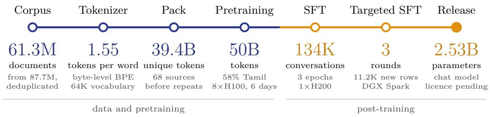  
Figure 1: How அகரம் / Agaram 2.5B was built, from corpus to released model (details in Sections 3–6). Tokens per word are for Tamil. Shares are of the 50B training tokens, which repeat the scarcer Tamil sources; the other 22% is math (10%), code (7%), parallel text (2%) and instruction data (3%).

We built அகரம் / Agaram 2.5B to see what a small model can do when it is designed for Tamil from the start. It is trained from scratch: its weights start from random values, not from another model, and its tokenizer was trained on our own mix of Tamil, English, code and chat text, so a Tamil word costs 1.55 tokens. We pretrained it on about 50 billion tokens, 58% of them Tamil, on one node of eight H100 GPUs in six days, then fine-tuned it on 134,428 conversations and three short rounds aimed at specific failures. The released model answers in Tamil script, Tanglish and English and calls tools: on the 25 tool prompts of our second evaluation set, whose tool schemas also appear in training, it chose the right tool 23 times and gave exactly the expected arguments 13 times. It translates better than Sarvam-1, a 2B model trained on many Indian languages, in all six directions we measured, but it is weak on knowledge: an LLM judge rated about half of its answers to everyday questions usable. Figure 1 shows the whole pipeline with its numbers.

Training from scratch costs more than adapting an existing model, and we chose it for two reasons. An adapted model keeps the tokenizer of its parent, and with it the token cost above; adding Tamil tokens to the vocabulary lowers the cost, but the new tokens start untrained inside a model that learned its language from the old ones. And with a model trained from scratch we know every document it has seen, which is what makes the contamination checks in this report possible: before we report a benchmark score we check whether the benchmark’s text was in our training data. Three further choices run through the work. The assistant replies in our generated training data were written by open-weight models; frontier models such as Claude and Codex helped plan the work and write code and may write the user side of a conversation, but not the replies the model learns from (Section 7.2 lists the one place this was not followed). The evaluation sets we report are checked against the training data before their numbers are reported, except four benchmarks we name (Section 7). And because a single pass of an LLM judge over the same replies moved by up to 11 points, chat quality is reported as a mean over several passes with its range (Section 8.2 ).

The report describes the full recipe at a scale a student team can reproduce. Section 2 explains why we built the model and what our first model taught us. Sections 3 and 4 cover the tokenizer, the data and a pretraining run that finished in one attempt. Section 5 evaluates the base model on public Tamil benchmarks, and Section 7 checks those benchmarks against the training data. Section 6 describes fine-tuning, including two negative results: three targeted rounds improved the probe items they aimed at but made no difference we could detect in chat quality on prompts they never saw (22.3 against 21.0 of 50), and two further experiments changed the form of the answers but did not improve the knowledge measures. Section 8 reports the released model, with a held-out chat set written by a native speaker and its known failures, and Section 9 the cost.

Related work. By a Tamil-first model we mean one for which Tamil is the majority of its pretraining tokens; அகரம் / Agaram 2.5B’s are 58% Tamil. Most open Tamil models adapt an existing model; Tamil-LLaMA, for example, continues Llama 2 with 16,000 added Tamil tokens [6]. Models trained from scratch that include Tamil are mostly multilingual. Sarvam-1 (about 2B parameters, ten Indic languages and English, about 4 trillion tokens) is a base model [19]. Sarvam 30B and 105B are trained from scratch, cover the 22 scheduled Indian languages and support tool calling [20]; both are mixture-of-experts models, and the 30B model activates 2.4B parameters per token, close to our 2.5B. BharatGen’s Param2, also a mixture of experts (17B total, 2.4B active), covers English and the 22 scheduled languages and supports tool calling [8]; its predecessor PARAM-1 (2.9B) was trained from scratch on Hindi and English [17]. Paramanu trains monolingual models from scratch for five Indian languages including Tamil, at 108M to 367M parameters [15]. The closest work to ours is Balaji V’s 1111AI-Tamil1B, released on 9 October 2026 [7]: a Tamil-first model trained from scratch with 1.24B parameters (1.12B without embeddings), pretrained on Tamil, Tanglish and English text (57.6B tokens seen) and instruction-tuned on 11,261 question–answer pairs; its card states that it has no tool use. Smaller Tamil models trained from scratch include GPT2-Tamil [1] and a 23M-parameter model [2]. As far as we know, as of 12 October 2026, அகரம் / Agaram 2.5B is the first Tamil-first model trained from scratch that does tool calling. It is also, to our knowledge, the largest openly released Tamil-first model trained from scratch.

## 2 Why அகரம் / Agaram, and what the first model taught us

## 2.1 Why Agaram

The first books I remember are copies of அம்புலிமாமா (Ambulimama) my father brought home, and I still connect them with the smell of coffee, idli and sambar. My favourite part was வேதாளம் சொல்லும் கதை the Vikram and Vetal stories. Every story ends with a question the king has to answer, and he cannot stay silent if he knows the answer. Through stories like these, and the other Tamil books my father kept bringing, I came to love the language and to feel I owed something to the generations who had kept it alive for more than two thousand years.

When I started working with language models, a question followed me: what would a model learn if Tamil guided it from the first token, with a tokenizer built for Tamil, data chosen for Tamil, and training from scratch rather than borrowed from an English model? The question became personal when I thought of my nephews and nieces. They will grow up asking machines questions, writing with them and learning from them. I want them to be able to do that in Tamil, as naturally as I read those books. I cannot accept a future in which those tools work well only in English.

So I tried. It started as a personal project: I began collecting data in December 2025 and wrote the first code in May 2026, and it kept growing. My earlier experiments had taught me how to build a language model, but Tamil was a different problem. Open Tamil datasets are few and small. Older writing is scarcer still: Project Madurai’s whole collection of digitised Tamil texts comes to about 45 million tokens, under a tenth of a percent of what அகரம் / Agaram 2.5B was trained on, and everything written in Tamil before 1900 that has been digitised would fit on a thumb drive. The language has also changed: the Tamil of those texts is far from the Tamil people speak and type today, which mixes in English and is often written in Latin script.

In June 2026 two volunteers, Madhusudhanan G and Kaushik Kezendirane, joined, and from then on it was our project. I built in public and posted weekly updates, and many people wrote in to support the work or offer help. That is when I decided the model’s name should come from the community: in a poll on X, people proposed their favourite names in 226 replies and voted, and the majority chose அகரம் (Agaram). Our first model, அகரம் / Agaram 1.5B, taught us more by failing than we expected; the rest of this section describes how.

அகரம் / Agaram 2.5B is the result. As far as we know, at the time of writing it is the first model trained from scratch with Tamil as its primary language that does tool calling, and the largest such model openly released (Section 1 lists the closest work). It is a small model with real gaps, which this report sets out, and we release it, with everything we learned, so that the larger Tamil models that follow do not have to start where we did. The books my father gave me made Tamil part of my life. I hope this work helps Tamil remain part of the tools the next generation grows up with.

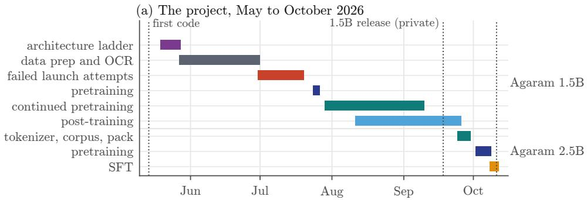

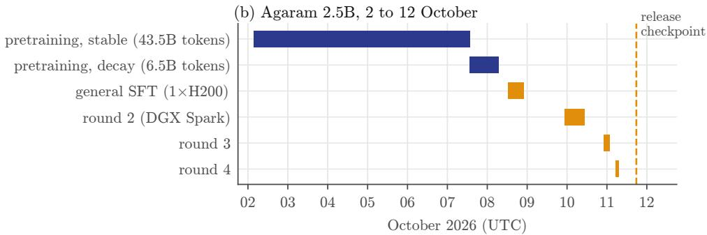  
Figure 2: (a) The project from its first code to the released 2.5B checkpoint; data collection began earlier, in December 2025. (b) The 2.5B run in detail; bars are training time only (the SFT bars exclude evaluation and copying).

## 2.2 The first model

Figure 2 shows how the two models were built over five months.

Choosing the architecture. We began in May 2026 planning a hybrid of Mamba and attention layers. Mamba is a state-space layer: it processes a sequence in time that grows linearly with its length, where attention grows with the square of the length, so a hybrid promised longer contexts for the same compute, which matters on a small budget. The risk is quality, so we set a rule before training anything: a hybrid would replace the standard Transformer only if it matched or beat the Transformer on held-out Tamil text and was also more efficient on long contexts. We tested it at small scale with a ladder of models of about 91M parameters, three random seeds each, trained for up to 75,000 steps (about 154M tokens) and scored on 1,400 held-out Tamil records in five registers. At 25,000 steps a hybrid with Mamba-2 layers matched the dense Transformer (held-out loss $6 . 8 9 1 \pm 0 . 0 \hat { 1 } 1$ against $6 . 9 0 1 \pm 0 . 0 0 6$ mean and standard deviation over three seeds, lower is better). At 75,000 steps the dense model was clearly ahead $( 7 . 0 0 3 \pm 0 . 0 5 5$ against $7 . 2 7 8 \pm 0 . 0 7 8 )$ , even though the Mamba-2 hybrid now had the lower training loss (5.675 against 5.792): it fitted its training text better and generalised worse. Held-out loss rose between the two rungs for both models while training loss kept falling, with the same held-out set and scoring at both rungs. We read this as the longer runs fitting the small training corpus (166M tokens) at the expense of the held-out text, but we did not test that explanation. A Mamba-3 hybrid was unstable: at 75,000 steps the standard deviation of its held-out loss across seeds was about ten times the dense model’s $( 7 . 2 7 6 \pm 0 . 5 5 9 )$ . A hybrid with Gated DeltaNet layers trailed the dense model at 25,000 steps. No hybrid met the rule, so both அகரம் / Agaram models use the dense Transformer block. The ladder stopped at about 100M parameters, so it shows that these hybrids lost under these conditions, not that hybrids cannot win at larger scale. A 64,000-token SentencePiece tokenizer was fixed early; a morphological tokenizer we measured in July split Tamil words far more finely and was not adopted.

Data and OCR. From late May to the end of June we assembled the first corpus: Tamil web crawls (FineWeb-2, HPLT, Sangraha) and the text of Tamil books from TamilBooksPDF and Archive.org. Much printed Tamil exists only as scanned images, so we ran Tesseract OCR over the Tamil Digital Library and the scanned part of the TamilBooksPDF collection. By 17 June the OCR pass had produced 477,284 accepted records from 3,571 works, about 183M tokens.

Pretraining. Getting a run to finish took longer than designing it. From 30 June our attempts on rented 8 H200 nodes failed on communication timeouts between GPUs and on resuming from checkpoints. After three weeks we stopped retrying, rewrote the launch process and moved to Lambda. The production run started on 24 July 2026: 1.56B parameters and 30B tokens on 8 H100. Its node shut itself down before the final checkpoint was copied off, so the last 4,221 steps had to be redone from an earlier checkpoint. Four rounds of continued pretraining followed, bringing the model’s total training to about 66B tokens.

Post-training. We then spent two months on post-training: SFT on a few thousand pairs, a fix for a wrong stop token, two runs of direct preference optimisation (DPO, which trains a model to prefer a chosen reply over a rejected one) that reached 96% preference accuracy and transferred nothing, an abstention patch, a run of group relative policy optimisation (GRPO, a reinforcement-learning method that scores several sampled replies against each other) on taste ratings, a 145,000-row SFT scale-up, safety and character runs, and finally SFT on native Tamil conversations. The scale-up taught us something specific: its general instruction corpora made the model copy passages, and a Qwen2.5-1.5B control trained on the same data copied too, which pointed to the data rather than to our model. We released the model privately to the volunteers on 18 September 2026; it was never made public.

The decision to start again. Graded by the same judge and prompts we later used for the new model, the first model’s release checkpoint gave a usable reply to 2 of 100 open chat prompts (Table 7). Fine-tuning it on about 14,000 native Tamil conversations from an open-weight teacher, data that the judge rated 88% usable, raised it only to 6–8 of 100. When good data moves a model that little, the base model is the limit, so we decided to train a new one.

## 2.3 What the first model taught us

Table 1 pairs each problem we found in the first model with the change we made in the second. The largest was the tokenizer: its normaliser erased every line break, so the model had never seen a newline, and could not learn lists, verse, code or where a chat turn ends.

## 3 Data and tokenizer

## 3.1 A tokenizer that keeps line breaks

The first model’s tokenizer (TOK\_BPE\_64K, a SentencePiece BPE) ran a normaliser that collapsed every run of whitespace into one space. Newlines and indentation never reached the model: a sample of 150M training tokens contained no newline token, and the chat stop marker never appeared in pretraining (Section 2). Without line breaks and indentation a model cannot represent verse, multi-line lists or indentation-sensitive code faithfully, and it never sees the stop marker that ends a chat turn, so the second model needed a new tokenizer before it needed anything else.

We compared two candidates, with the evaluation prompts and held-out texts excluded from their training text by hash and substring: a byte-level BPE in the Hugging Face tokenizers library, trained on a 930M-character sample (Tamil 58.0%, English 29.0%, code 5.6%, chat and tool text 4.3%, Tanglish 3.0%, parallel 0.1%), and a SentencePiece BPE with whitespace preserved, trained on half of that sample. Both learn their vocabulary the same way, by repeatedly merging the most frequent pair of adjacent pieces into a new token; they differ in what they start from. A byte-level BPE starts from the 256 possible bytes, so it can encode any text, while SentencePiece starts from characters and must fall back to raw bytes for characters it has not seen. Both have 64,000 ids and round-trip every test set exactly. We chose the byte-level BPE (TOK\_FRESH\_20260924). It matched SentencePiece on Tamil and was better on code, Tanglish, JSON and chat, and it never needs a fallback, where SentencePiece used 2,257 fallback tokens on code. A byte-level BPE trained on the same half sample as SentencePiece came within 0.01 tokens per word of the full one, so the difference comes from the algorithm, not the amount of training text.

Table 1: Problems in the first model and the corresponding choice in the second.
<table><tr><td> /Agara1.5B</td><td> /Agara 2.5B</td></tr><tr><td>The tokenizer&#x27;s normaliser erased every newline and indentation; the model never saw a line break, and the chat stop token never appeared in pretraining.</td><td>A byte-level tokenizer with no normaliser (Section 3.1).</td></tr><tr><td>75% of the 30B tokens were single-pass Tamil web crawl; English, math and code were thin, and instruction-shaped text was 0.7%.</td><td>A measured 50B-token mix: 58% Tamil, the rest English, math, code and parallel text, with instruction data in the decay stage (Section 3.2).</td></tr><tr><td>Continued pretraining packed documents with no separators, so free chat ran on into memorised instruction text.</td><td>Every document ends with an end-of-text token, and attention never crosses a document (Section 4.1).</td></tr><tr><td>OCR damage explained several failures, and an OCR filter judged only on clean text discarded good Tamil 37 times in 41.</td><td>Narrow OCR rules, each checked by reading what it removes (Section 3.2).</td></tr><tr><td>The final checkpoint was lost when the node shut itself down.</td><td>Checkpoints copied off the node every two hours; the node releases itself only after the final copy (Section 4.3).</td></tr><tr><td>Benchmark translations and story openings used in evaluation were found in training data after numbers had been reported.</td><td>Every evaluation set scanned against the training data before its numbers are reported (Section 7).</td></tr><tr><td>LLM judges disagreed with people and with themselves.</td><td>Judge scores reported as means over several passes with their range; a person decides between close checkpoints (Sections 6.3 and 8.2).</td></tr></table>

The pre-tokenizer is Qwen2’s split pattern with one change. In Qwen2 the class of characters that make up a word is Unicode letters only (\p{L}); ours also admits combining marks (\p{M}) and the two zero-width joiners, U+200C and U+200D. Tamil vowel signs are combining marks, so with letters alone every Tamil word is split at each vowel sign. We expect this is part of why Qwen2.5 spends 9.4 tokens per Tamil word on our samples (Table 2), alongside its English-heavy vocabulary, but we did not train a tokenizer without the change to measure its share. There is no normaliser; the pack builder applies Unicode NFC before tokenization.

On Tamil prose the new tokenizer is no cheaper than the old one (1.55 tokens per word for both); what it adds is an exact round trip, line breaks included, and cheaper Tanglish, code, JSON and chat. Two costs came with the change. Verse became more expensive (2.29 against 1.80 tokens per word): the tokenizer sample held only 0.3% classical text. And 14.3% of Tamil token boundaries fall inside a grapheme cluster, against 4.7% for the old tokenizer; no boundary falls inside a UTF-8 character. We did not measure what the grapheme splits cost the model. Romanized Tamil costs 1.67 times as many tokens as the same sentence in Tamil script (2.71 times with the old tokenizer).

Table 2: Tokens per whitespace-separated word (lower is cheaper). TOK\_FRESH keeps every byte; the old tokenizer round-trips nothing that spans more than one line (code 0/320, verse 0/204).
<table><tr><td>Sample</td><td>TOK_FRESH (this work)</td><td>TOK BPE_64K ( / Agara 1.5B)</td><td>Qwen2.5</td></tr><tr><td>Tamil prose</td><td>1.55</td><td>1.55</td><td>9.44</td></tr><tr><td>Tamil verse</td><td>2.29</td><td>1.80</td><td>9.19</td></tr><tr><td>English</td><td>1.41</td><td>1.67</td><td>1.35</td></tr><tr><td>Tanglish</td><td>1.95</td><td>2.95</td><td>2.44</td></tr><tr><td>Code (Stack-Edu)</td><td>3.54</td><td>4.54</td><td>3.01</td></tr><tr><td>Tool-call JSON</td><td>2.52</td><td>3.46</td><td>2.35</td></tr><tr><td>Plain-text chat</td><td>2.19</td><td>3.14</td><td>2.24</td></tr><tr><td>Exact round trip</td><td>100%</td><td>0% on multi-line text</td><td></td></tr></table>

Table 3: Planned share of the 50B training tokens by category.
<table><tr><td>Category</td><td>Share</td><td>Main sources</td></tr><tr><td>Tamil</td><td>58.2%</td><td>FineWeb2, Sangraha, CulturaX, HPLT, OSCAR, Wikipedia, Project Madurai, OCR of books</td></tr><tr><td>English</td><td>19.8%</td><td>FineWeb-Edu, Nemotron-CC (training only)</td></tr><tr><td>Math</td><td>10.0%</td><td>FineMath</td></tr><tr><td>Code</td><td>7.0%</td><td>Stack-Edu, Nemotron code (training only)</td></tr><tr><td>Parallel</td><td>2.0%</td><td>BPCC, FineTranslations, small parallel sets</td></tr><tr><td>Instruction</td><td>3.0%</td><td>decay stage only (23% of its tokens)</td></tr></table>

Ids 0–7 are special: end of text (0), the chat markers <|im\_start|> and <|im\_end|> (1, 2), tool-call and tool-response delimiters (3–6) and padding (7); ids 8–27 are reserved. In pretraining every document is encoded with special-token parsing switched off and closed with one end-of-text token. Chat transcripts in pretraining are plain text with User: /Assistant: lines, so the model learns turn structure from text, while the special markers are reserved for SFT, where <|im\_end|> is the stop token.

## 3.2 Pretraining corpus

The pack holds 39.39B unique tokens from 68 sources, drawn to 50B training tokens with repeats: 43.5B in the stable stage, which uses 63 of the sources, and 6.5B in the decay stage, which uses 27 (Section 4). Table 3 gives the planned shares by category, and Figure 3 the stable-stage mix by source. Tamil is the majority, but measured Tamil supply is the binding constraint: after near-duplicate removal the native Tamil web, books, OCR and curated text came to 16–19B tokens, not the 45B we had first estimated, so Tamil sources are repeated up to four times while English, math and code fill the rest.

The Tamil side includes three OCR passes over printed books: the first model’s Tesseract pass over the Tamil Digital Library, an indic-ocr pass over 976 PDFs (142,271 pages) and a Sarvam re-OCR of 358 books (59,841 pages). In the first model, damaged OCR text, not the model, explained several failures, and an OCR filter that we had judged only by how rarely it fired on clean text turned out to throw away good Tamil 37 times out of 41 (Section 2). A filter has to be judged by what it removes, so the OCR rules for this corpus are narrow and each was checked by reading its rejects: pages with runaway repetition are cut or dropped, scan watermarks, empty table markup and picture descriptions are removed, documents in legacy font encodings or with interleaved two-column text are dropped, and where an OCR book and a web or e-text copy hold the same text, the cleaner copy is kept. OCR-derived text is a small part of the result: about 1.8% of stable-stage tokens and 0.9% of decay-stage tokens.

Licences decide admission. Public datasets are used if they are on Hugging Face under an open licence; the six NVIDIA datasets are used for training only and are never redistributed.

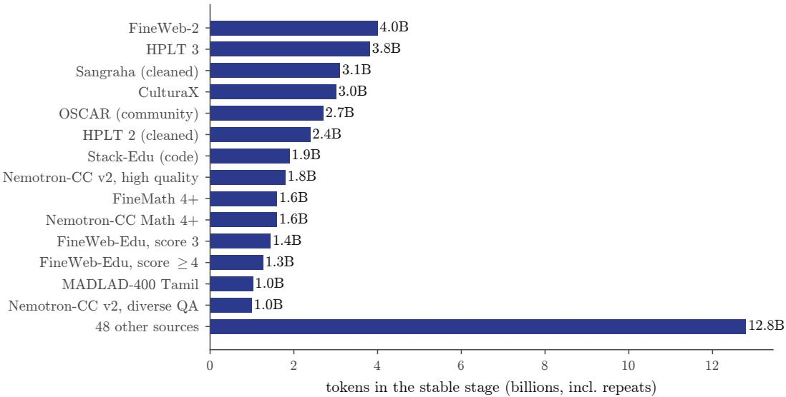  
Figure 3: Stable-stage mix by source (43.5B tokens including repeats, 63 sources).

The rest is Tamil text we collected ourselves: books, e-texts and the OCR passes above. Section 7.2 records the material whose terms differ from our release licence (two public instruction sets and two OCR tools) and how we chose the release licence. Frontier models (Claude, Codex, GPT, Gemini) planned the work and wrote code. Under our rule they may write the user side of a training conversation but not the assistant replies the model learns from; the replies we generated (Section 3.4) come from open-weight teacher models. Section 7.2 lists where frontier-model text did enter, including public datasets that frontier models produced upstream. Every new training source was scanned against the evaluation prompts before it was admitted.

## 3.3 The decay mix

Pretraining ends with a decay stage, in which the learning rate falls to a tenth of its peak (Section 4.2 ). Recent open models give their highest-quality data to this final stage [25], and we did the same: the decay stage changes the mix as well as the learning rate (Figure 4). It keeps 22 of the stable stage’s 63 sources, adds five new ones, and moves weight from broad web crawls (CulturaX, HPLT, OSCAR, MADLAD-400, a second Sangraha cut) to curated and higher-quality text: FineWeb2 Tamil rises from 9.2% to 25.8% of tokens, Sangrahaverified from 1.0% to 6.8%, Project Madurai from 0.2% to 1.4%, FineMath-4+ from 3.7% to 12.3% and FineWeb-Edu (score 4) from 2.9% to 10.8%. Five task and instruction sources appear only in decay, together about 23% of its tokens: passage tasks, Tanglish, formatting, tool use and translation in plain-text chat form (Section 3.1 ). One of them, a pool of earlier instruction data, includes Tamil translations of SmolTalk’s constraint-following conversations, whose instruction templates are IFEval’s; Section 7 reports what that does to one benchmark.

## 3.4 SFT data

The final SFT set has 134,428 training conversations and 2,736 validation conversations, rendered in ChatML with loss on assistant turns only. We built a base set of 121,465 training conversations before pretraining and added three training-only sets while pretraining ran: 444 crisis-support conversations repeated eight times (3,552 rows), 3,411 tool-call conversations whose arguments must be computed from the request, and 6,000 translation conversations built from the human-translated subsets of BPCC. The crisis rows are re- peated because a single copy of them did not change a mid-run model’s behaviour.

The 121,465-row base set holds 44.6M tokens. Its assistant replies come from open-weight teacher models (mostly Gemma-4-31B) and scripted templates, with one exception in the identity pairs (Section 7.2 ). 52,548 of them have more than one user turn, 11,890 call tools, 76,865 are in Tamil script and 36,171 in romanized Tamil (Tanglish). By category the largest groups are open questions and explanations (28,333), tool calling (11,890), casual Tanglish (10,322), multi-turn memory and correction (15,980), explaining and teaching (8,299), everyday practical help (7,641), Thirukkural and classical text (7,188), format following (6,798), safety (5,405), passage tasks (4,917), uncertainty and refusal (4,595), reasoning (3,704) and translation (3,369); the remaining 3,024 are identity, engagement and a 1,056-row chat set.

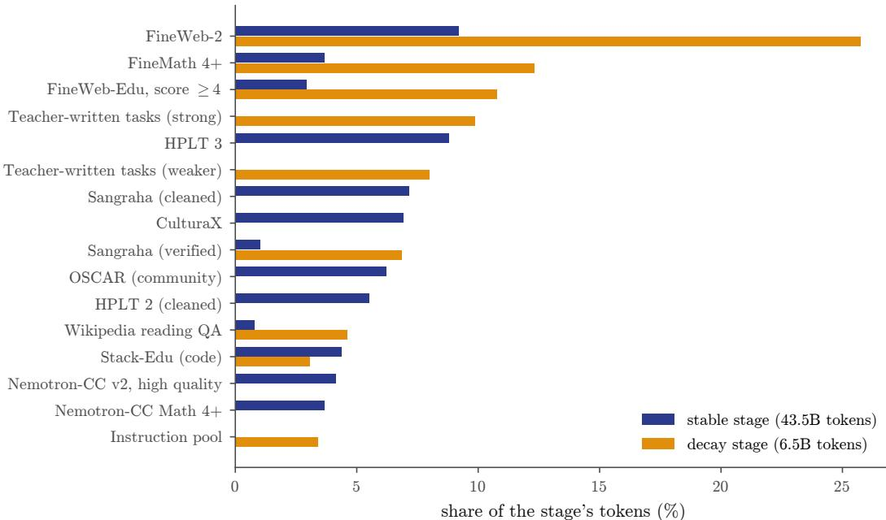  
Figure 4: Share of each stage’s tokens for the 16 largest sources. Decay drops the broad crawls and adds task and instruction data in plain-text chat form.

## 4 Pretraining

## 4.1 Model

அகரம் / Agaram 2.5B is a dense decoder-only Transformer with 2,525,757,696 parameters: 28 layers, hidden size 2,304, 36 attention heads of dimension 64 (full multi-head attention), a SwiGLU feed-forward layer of width 9,216 [21], RMSNorm [27], rotary position embeddings with base 500,000 [23], no bias terms and input and output embeddings tied over the 64,000- token vocabulary. Figure 5 shows the block and where the parameters are.

This is the dense block the first model used; Section 2.2 describes the small-scale comparison that chose it over Mamba hybrids, and we did not reopen that choice.

Attention never crosses a document boundary. A training sample is built by packing several documents end to end into 4,096 or 8,192 tokens. Without a mask, the model learns to predict each document partly from the unrelated one before it. The first model’s continued pretraining packed documents with no separator at all, and its free chat ran on into memorised text. The second model ends every document with an end-of-text token, and we split each sample at those tokens and pass it to the attention kernel as a packed batch with per-document offsets, so each document attends only to itself, rotary positions restart at each document, and flash attention stays on.

## 4.2 Schedule

Training used a warmup–stable–decay schedule in two runs (Table 4 ; loss and learning rate in Figure 6). The learning rate rises over a short warmup, stays constant for most of training and falls only at the end. Unlike a cosine schedule, this does not fix the length of the run in advance: any checkpoint of the stable stage can be finished with a short decay. Both runs use 524,288 tokens per optimizer step: the decay stage doubles the context and halves the number of sequences per step. The decay run starts from the last stable checkpoint, weights and optimizer state, and lowers the learning rate linearly to a tenth of the peak while switching to the decay mix (Section 3.3). The optimizer is Adam with $\beta = ( 0 . 9 , 0 . 9 5 )$ weight decay 0.1 and gradient clipping at 1.0, in bf16 mixed precision with the optimizer state distributed across the eight GPUs (NeMo 2 on Megatron-Core [ 14 22]).

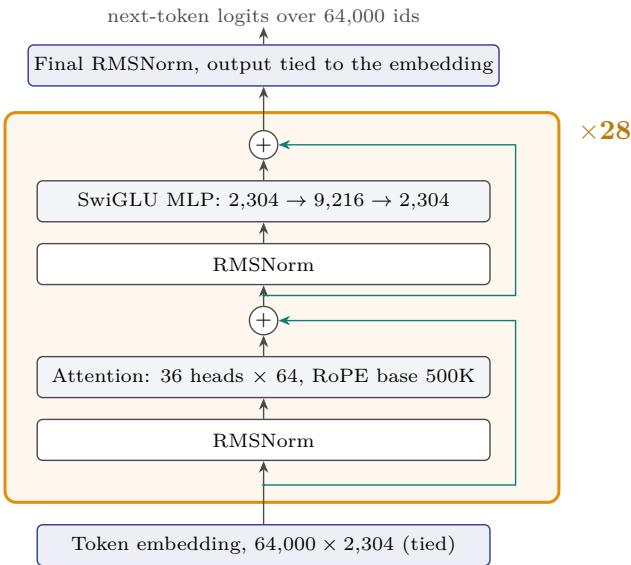

<table><tr><td>Component</td><td>Parameters</td></tr><tr><td>Attention, per layer</td><td>21,233,664</td></tr><tr><td>MLP, per layer</td><td>63,700,992</td></tr><tr><td>Norms, per layer</td><td>4,608</td></tr><tr><td>One layer</td><td>84,939,264</td></tr><tr><td>28 layers</td><td>2,378,299,392</td></tr><tr><td>Embedding (tied)</td><td>147,456,000</td></tr><tr><td>Final norm</td><td>2,304</td></tr><tr><td>Total</td><td>2,525,757,696</td></tr></table>

Context 8,192 tokens; full multi-head attention; no biases or QK-norm; bf16; trained from scratch.

Figure 5: The decoder block, repeated 28 times (pre-norm; teal lines are the residual connections), and the parameter count read from the released weights’ tensor shapes.  
Table 4: The two pretraining runs on one node of 8 H100 (Lambda). Wall time is from the node’s own log; tokens per second is the median over steps. The two validation losses are on different held-out sets (each stage holds out the last 0.1% of documents of its own datasets) and are not comparable with each other.
<table><tr><td></td><td>Decay</td></tr><tr><td>Context (tokens)</td><td>4,096</td></tr><tr><td>Sequences per step</td><td>128 82,970</td></tr><tr><td>Steps</td><td></td></tr><tr><td>Tokens</td><td></td></tr><tr><td>warmup 2,000 steps to 3 × 10 Learning rate</td><td>3 × 10−4 to 3 × 10−5, linear</td></tr><tr><td>Datasets</td><td>then constant 63</td></tr><tr><td>Wall time</td><td>130.1 h</td></tr><tr><td>Median throughput (tokens/s)</td><td></td></tr><tr><td>Validation loss, first / last</td><td>94,700 107,500 2.080 (step 1,000) / 1.903</td></tr><tr><td>Restarts</td><td>4.041 (step 1,000) / 2.441 0</td></tr></table>

The stable stage was predictable. Validation loss during training usually falls as a power law in the number of steps, so an early part of the curve can forecast the rest. A power law fitted to the validation losses of steps 3,000–30,000 only, $L ( s ) = 2 . 2 5 + 5 4 . 1 s ^ { - 0 . 5 }$ forecasts every later validation loss of the stage to within 0.004 (Figure 7), so the curve gave an early read on where the stage would end. Throughput stayed flat across both runs (Figure 8).

## 4.3 Keeping a single run safe

This was our one chance to train this model: the run used most of the available compute credits, and there was no budget to repeat it. The first model had lost its final checkpoint when its node shut itself down before the checkpoint was copied off (Section 2). The operating setup for this run was built around that failure:

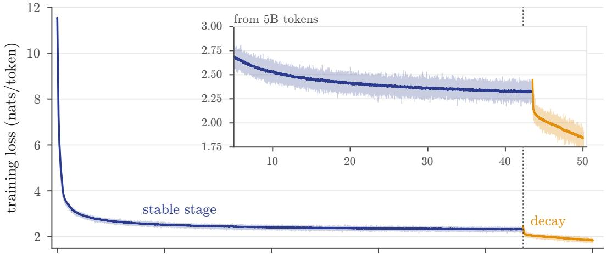

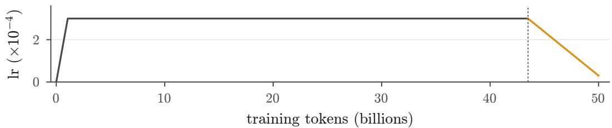  
Figure 6: Training loss at every one of the 95,368 logged steps (faint) with an exponential moving average $( \alpha = 0 . 0 2 )$ , and the learning rate, over the 50B tokens; the inset repeats the curve from 5B tokens on a finer scale. Stable stage: learning rate $3 \times 1 0 ^ { - 4 }$ 4K context. Decay: learning rate falling to $3 \times 1 0 ^ { - 5 }$ 8K context and a new data mix. The step at the start of decay coincides with the change of data mix and context length, since the learning rate starts falling from its peak only then; the decay losses are measured on different data and do not compare one-to-one with the stable curve.

• Copies off the node. A copier on one of our DGX Spark machines pulled the newest complete checkpoint every two hours. It first hard-linked the checkpoint on the node, since the framework renames its latest checkpoint at each save, then copied it with six parallel streams (33 GB in 36–56 minutes) and kept it only after a second pass found nothing left to transfer. A second process archived a copy every 10,000 steps, plus the end of each stage, to a local disk. The per-step metrics, validation records and logs were copied with every checkpoint.

• The node releases itself only after the final copy. After training, the node waited for a marker that the copier writes only once the final checkpoint and run records are safe, then terminated its own instance. A stage failure would hold the node for two hours for inspection. Two hard deadlines, one on the node and one on a local PC, capped the spend regardless.

• Monitoring with a record. A check ran every hour for the first day and every two hours after that: step, throughput, loss and validation trend, GPU use and disk, the cloud instance, the guards, the copies, and the SHA-256 hashes of the data files, which matched the launch baseline at every check. Each check appended a line to a heartbeat file in the repository, and a scheduled cloud job alerted by e-mail if that file went stale.

Both stages ran once, with no restarts and no NaN or stall events. Training ended at 06:59 UTC on 8 October 2026; the final checkpoint reached the copier at 07:48 and the local archive at 08:02, and the instance was gone from the provider’s list by 07:51. The instance ran about 149 hours in total, 147.7 of them training. Lambda’s two invoices for the period came to USD 4,776.50, paid from compute credits; they also cover a 3.7-hour abandoned SFT attempt on a single H100 (Section 6.1 ), so the pretraining run itself cost about USD 4,765, under the USD 5,000 cap we had set.

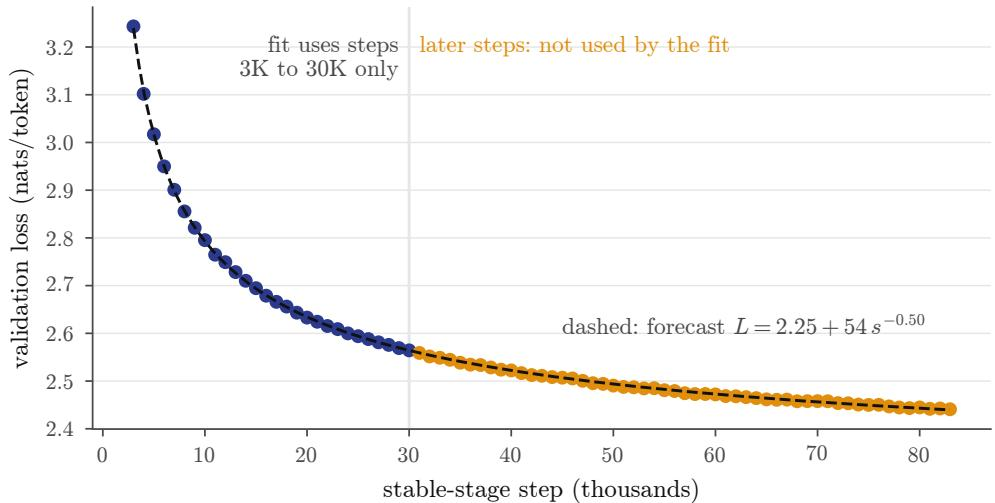

Figure 7: Stable-stage validation loss against a power law fitted to steps 3K–30K.  
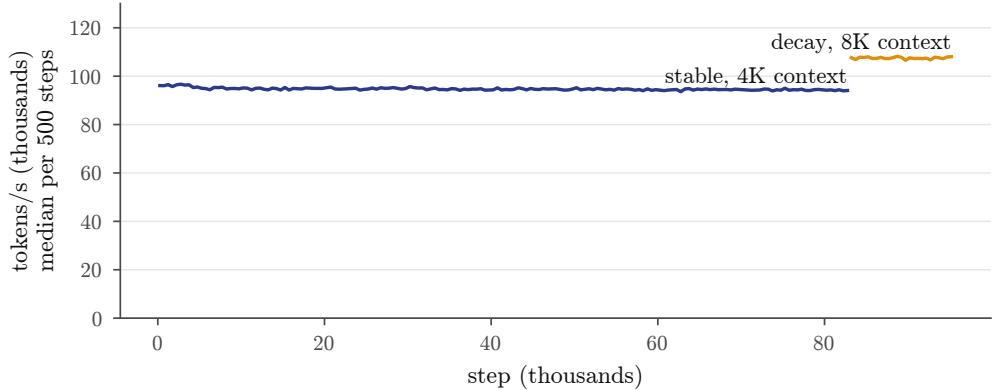  
Figure 8: Throughput on 8 H100 (median per 500 steps). It stayed flat for the whole run; the decay stage is faster per token at twice the context.

## 5 The base model

All base-model numbers in this section come from one harness, the EleutherAI evaluation harness [9] with the same task definitions and settings for every model, on full test sets unless stated. Translation is scored with chrF [ 16], which compares the output with the reference translation in character sequences rather than whole words; this suits Tamil, where one word carries several suffixes and a near-miss should earn partial credit. Translation prompts are 5-shot: five example translations precede the sentence. Multiple-choice tasks are scored by log-likelihood: the model does not write an answer, and instead we compare the probability it assigns to each option and count the most probable one as its choice (length-normalised for ARC and HellaSwag). We compare against Sarvam-1 [19], a 2B Indic base model; our previous model, the அகரம் / Agaram 1.5B base; and, where the earlier run covered them, Qwen2.5-1.5B and Gemma-3-1B instruction-tuned models evaluated the same way [10 18].

Table 5: Held-out Tamil, bits per character (lower is better). aSee text: these passages are unseen, but other passages of the same books are in the training pack.
<table><tr><td>Register (passages)</td><td>Step 21,000</td><td>End of stable</td><td>Final (after decay)</td><td>Decay change</td></tr><tr><td>Modern formal (143)</td><td>1.095</td><td>1.051</td><td>1.034</td><td>-1.6%</td></tr><tr><td>Modern colloquial (136)</td><td>1.360</td><td>1.317</td><td>1.298</td><td>-1.4%</td></tr><tr><td>Tanglish (117)</td><td>1.564</td><td>1.484</td><td>1.417</td><td>-4.5%</td></tr><tr><td>Literary, OCR (39)</td><td>1.287</td><td>1.210</td><td>1.173</td><td>-3.1%</td></tr><tr><td>Literary, EPUB (106)ª</td><td>1.122</td><td>1.043</td><td>0.909</td><td>-12.8%</td></tr></table>

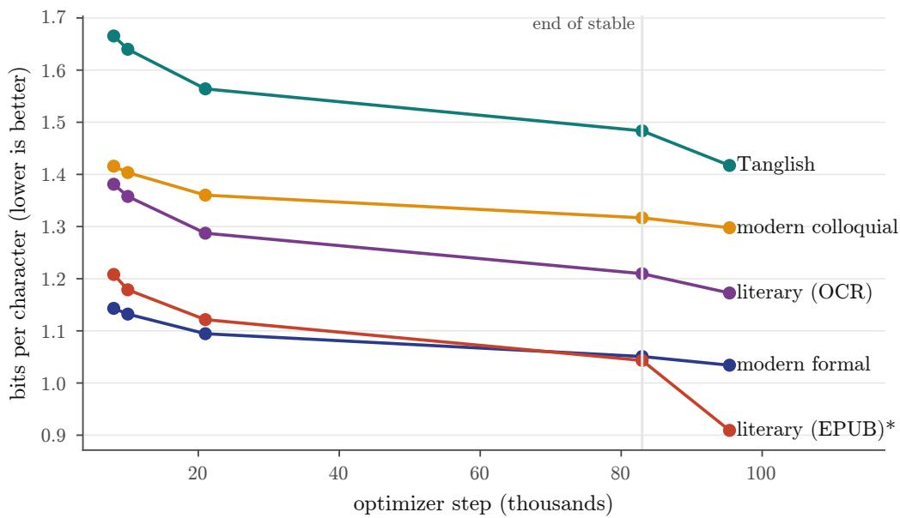  
Figure 9: Held-out Tamil by register across training (541 held-out passages; each overlaps the training data by less than 5%). Decay steps are counted after the 82,970 stable steps. \*EPUB passages are unseen, but other passages of the same books are in the training pack, and the decay mix upweighted those sources (see text).

## 5.1 Held-out Tamil text

We track bits per character on a held-out set of 541 Tamil passages in five registers, kept out of training: every passage shares less than 5% of its 13-token windows with the training pack (Table 5 Figure 9). Bits per character measure how well the model predicts the text: the lower the number, the less surprised the model is by each character. Unlike loss per token, they do not depend on the tokenizer, so they compare across checkpoints and across models with different tokenizers.

Every register improved through the stable stage and again in decay. The literary EPUB register dropped much further in decay than the others, so we checked it for leakage. The decay stage reads only from the pack the held-out scan covered, including the five sources used only in decay. The gain is broad: 98% of the passages improved, the passages with no overlap at all improved more (median 11.1%) than those with some (9.6%), and 25 of the 29 books gained at least 5%. The passages themselves did not leak. The books did, in part: when the held-out set was built, the clean text of these books was found in the training pack, and the held-out passages are the ones that individually do not overlap it. The decay mix also upweighted the sources that hold those books (Section 3.3). We therefore read the EPUB number as performance on unseen passages of partly seen books, not as generalisation to new literature; the other four registers are the cleaner measure.

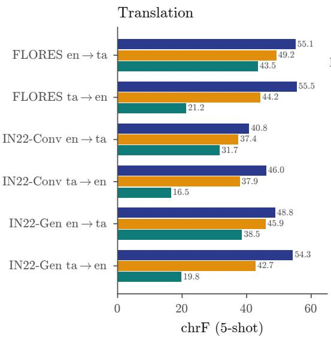

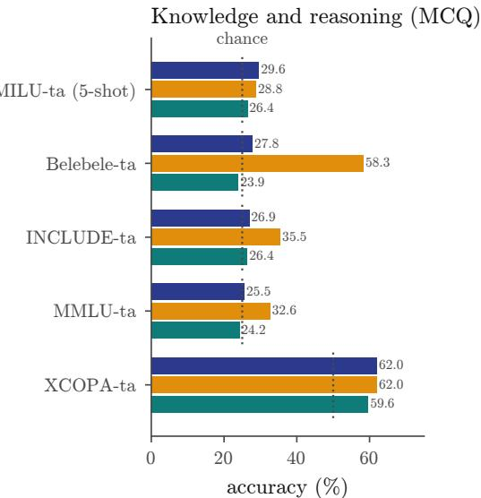  
Agaram 2.5B base (this work) Sarvam-1 (2B) Agaram 1.5B base (previous)  
Figure 10: Base models on Tamil translation and multiple-choice benchmarks, with the same harness and settings for all models (lm-eval, full test sets); dotted lines mark chance. The previous 1.5B model’s FLORES scores use the first 400 sentences (2026-09-18 run), because its outputs ran past the sentence. Clean-subset chrF is within 1.1 of these scores.

Table 6: Base-model benchmarks. Translation: chrF, 5-shot. MCQ: accuracy (%); chance is 25 except XCOPA (50) and MultiBLiMP (50). aFirst 400 FLORES sentences (2026-09-18 run). bInstruction-tuned models, evaluated like the base models. – = not run.
<table><tr><td></td><td>Agaram 2.5B</td><td>2.5B (stable end)</td><td>Sarvam-1</td><td>Agaram 1.5B</td><td>Qwen2.5- 1.5Bb</td><td>Gemma-3- 1Bb</td></tr><tr><td>FLORES en→ta</td><td>55.1</td><td>49.0</td><td>49.2</td><td> $4 3 . 5 ^ { a }$ </td><td> $1 8 . 1 ^ { a }$ </td><td> $4 5 . 0 ^ { a }$ </td></tr><tr><td>FLORES ta→en</td><td>55.5</td><td>52.6</td><td>44.2</td><td> $2 1 . 2 ^ { a }$ </td><td> $2 2 . 7 ^ { a }$ </td><td> $4 5 . 8 ^ { a }$ </td></tr><tr><td>IN22-Conv en→ta</td><td>40.8</td><td>38.6</td><td>37.4</td><td>31.7</td><td></td><td></td></tr><tr><td>IN22-Conv ta→en</td><td>46.0</td><td>43.4</td><td>37.9</td><td>16.5</td><td></td><td></td></tr><tr><td>IN22-Gen en→ta</td><td>48.8</td><td>44.0</td><td>45.9</td><td>38.5</td><td></td><td></td></tr><tr><td>IN22-Gen ta→en</td><td>54.3</td><td>50.1</td><td>42.7</td><td>19.8</td><td></td><td></td></tr><tr><td>MILU-ta (5-shot)</td><td>29.6</td><td>28.3</td><td>28.8</td><td>26.4</td><td></td><td></td></tr><tr><td>Belebele-ta</td><td>27.8</td><td>26.6</td><td>58.3</td><td>23.9</td><td>32.6</td><td>30.2</td></tr><tr><td>INCLUDE-ta</td><td>26.9</td><td>29.8</td><td>35.5</td><td>26.4</td><td>27.1</td><td>26.5</td></tr><tr><td>MMLU-ta</td><td>25.5</td><td>25.7</td><td>32.6</td><td>24.2</td><td>29.1</td><td>28.1</td></tr><tr><td>XCOPA-ta</td><td>62.0</td><td>61.2</td><td>62.0</td><td>59.6</td><td>54.2</td><td>56.0</td></tr><tr><td>MultiBLiMP-ta</td><td>99.0</td><td>98.4</td><td>97.9</td><td>99.2</td><td>93.2</td><td>93.2</td></tr></table>

## 5.2 Benchmarks

Translation is the strength. The final base model leads Sarvam-1 on all six translation directions: by 2.9 to 5.9 chrF into Tamil and by 8.1 to 11.6 into English (Table 6 Figure 10). The decay stage added 2.2 to 6.1 chrF on every direction. The previous model’s low Tamilto-English scores are not a scoring artefact: its outputs did not stop at the end of the sentence (it had never seen a line break) and often did not translate at all. Part of the FLORES and IN22-Gen English text is in our pack (Section 7); on the pairs where neither side is, every score in the table moves by at most 1.1 chrF.

Knowledge and reading comprehension are the weakness. On Belebele, INCLUDE and MMLU the model sits at or near chance, and Sarvam-1 is well ahead on all three, most of all on Belebele reading comprehension (58.3 against 27.8). On MILU, the most recent Indic knowledge benchmark [26], both models score about 29 (5-shot); our harness gives Sarvam-1 28.8 where the MILU paper’s Table 3, also 5-shot with log-likelihood scoring, reports 27.64, so the two setups agree. We read the knowledge gap as a gap in training volume: Sarvam-1’s model card reports “a curated corpus of 4 trillion tokens with 2 trillion high-quality Indic tokens” [ 19], against our 50 billion. This is an inference; we did not test it.

Grammar and commonsense. MultiBLiMP-ta, minimal pairs of grammatical and ungrammatical sentences, is near ceiling for every Tamil-trained model, and XCOPA-ta (causal commonsense) is level with Sarvam-1.

## 6 Supervised fine-tuning

## 6.1 Training

We fine-tuned the final base model on the SFT set of Section 3.4 (134,428 training conversations) for three epochs: full fine-tuning, loss on assistant turns only, sequences up to 8,192 tokens packed to 65,536 tokens per step (758 steps per epoch, 2,274 in total), learning rate $2 \times 1 0 ^ { - 5 }$ with 3% warmup and cosine decay, AdamW, gradient clipping at 1.0, bf16. Loss on assistant turns only means the model is trained to write the replies, not to predict what users say; packing places several conversations in one sequence so no compute is spent on padding. A checkpoint was kept at the end of every epoch. Training took 9.5 hours on one H200 (JarvisLabs) at about 15 seconds per step. A first attempt on a rented H100 PCIe ran at 37 seconds per step because the GPU was thermally throttled $( 8 7 - 8 9 ^ { \circ } \mathrm { C } ,$ software thermal slowdown active); at that pace it could not finish inside its spend guard, so we stopped it after 3.7 hours and moved the run.

After training we measured each checkpoint on held-out SFT data and generated its replies to our evaluation prompts. The validation loss on the 2,736 held-out SFT conversations fell from 1.416 for the base model to 1.096 after epoch 1 and 1.093 after epochs 2 and 3: almost all of the change happened in the first epoch, and it did not rise afterwards (Table 7). Each epoch then answered both open-chat evaluation sets with greedy decoding.

## 6.2 Evaluation

The open-chat sets are 248 prompts written by hand by a native Tamil speaker on our team: 100 in the first set (open questions, explanation, everyday advice, Thirukkural and classical text, Tanglish, code-switching, multi-turn follow-ups, “don’t know” questions and safety) and 148 in the second, which adds tool calls, identity questions, format constraints and creative writing. Every prompt has a reference answer; the second set’s tool prompts carry the expected call and are scored by exact match. Section 7 reports their overlap with training data.

We score replies three ways. Format checks are scripted: the reply stops on its own, does not loop or echo the prompt, and is in the right script. A judge a large language model asked to grade replies, does what three people cannot do for every checkpoint: read hundreds of replies each time. Ours (Kimi K3, temperature 0) grades each reply blind against a frozen rubric as usable or not; usable means correct, in the right script, complete and stopped, and a multi-turn conversation is usable only if every turn is. The judge sees six models’ replies per prompt in shuffled order, three of them earlier models whose grades we already had; it reproduced those grades (2, 3 and 6 out of 100), and two passes over the same replies agreed on 88–90% of items. And people compared the two leading checkpoints blind (Section 6.3).

Fine-tuning turned a base model that rarely stopped (15% of replies) into a chat model that stops almost always and writes in the user’s script. Against the earlier models on the same judge it is a different class: about half of its replies are judged usable, against 2 of 100 for the அகரம் / Agaram 1.5B release model and 3 for the mid-run SFT on the step-21K base, and multi-turn conversations are usable for the first time (4–6 of 15, against none before). Tool use moved the most between the mid-run test and the final model: the right tool 96% of the time, with exactly the right arguments 60%, against 56% and 16% at step 55K. The format checks overstate quality: they pass 94–95% of replies the judge passes only about half of, because they cannot see wrong facts.

Table 7: The fine-tuned model by epoch, against the base model, the mid-run SFT on the step-55K base and the அகரம் / Agaram 1.5B release model. Judged usable: first open-chat set, 100 prompts (15 multi-turn). Format checks: share of replies passing all scripted checks. Tool calls: 25 prompts of the second set. IndicIFEval: prompt-level strict accuracy on the native-Tamil subset (430) and the translated subset (489); see Section 7 for the translated subset.
<table><tr><td></td><td>Base</td><td></td><td>Epoch 1 Epoch 2 Epoch 3</td><td></td><td>Mid-run SFT (55K)</td><td>Agaram 1.5B</td></tr><tr><td>Judged usable (of 100)</td><td></td><td>52</td><td>48</td><td>45</td><td></td><td>2</td></tr><tr><td>multi-turn usable (of 15)</td><td></td><td>6</td><td>4</td><td>5</td><td></td><td>0</td></tr><tr><td>Format checks, set 1</td><td>6%</td><td>94%</td><td>94%</td><td>95%</td><td>79%</td><td></td></tr><tr><td>Format checks, set 2</td><td>9%</td><td>88%</td><td>89%</td><td>89%</td><td>68%</td><td></td></tr><tr><td>Stops on its own, set 1</td><td>15%</td><td>99%</td><td>100%</td><td>100%</td><td>91%</td><td></td></tr><tr><td>Tool call: right tool</td><td>0%</td><td>96%</td><td>96%</td><td>96%</td><td>56%</td><td></td></tr><tr><td>Tool call: tool and exact arguments</td><td>0%</td><td>56%</td><td>60%</td><td>60%</td><td>16%</td><td></td></tr><tr><td>IndicIFEval, native</td><td>10.0</td><td>19.3</td><td>18.6</td><td>18.6</td><td></td><td></td></tr><tr><td>IndicIFEval, translated</td><td>19.6</td><td>16.0</td><td>16.0</td><td>17.0</td><td></td><td></td></tr><tr><td>SFT validation loss</td><td>1.416</td><td>1.096</td><td>1.093</td><td>1.093</td><td></td><td></td></tr></table>

On instruction following in Tamil, the native-Tamil IndicIFEval subset nearly doubled over the base model, from 10.0% to 18.6–19.3%, ahead of Qwen2.5-1.5B-Instruct (11.2%) in our harness. The translated subset fell after SFT, from 19.6% to 16–17%; Section 7 explains why the base model’s score there may not measure what it seems to. IndicIFEval checks whether a reply obeys verifiable constraints such as a word count, a required keyword or a format; a prompt passes under the strict score only if every constraint is met exactly, and the loose score relaxes the checks, for example by ignoring markdown and a leading or trailing line.

Fine-tuning cost no measured knowledge or translation ability: on every benchmark of Table 6 epochs 1 and 3 stay within 1.0 point of the base model (FLORES chrF 54.3–55.5 against 55.1–55.5; MILU 29.1–29.3 against 29.6).

## 6.3 Choosing the epoch

The judge preferred epoch 1 on every measure we ran, each time by a margin inside its own noise: 52 against 45 usable (paired exact test p = 0.14: if the two checkpoints were equally good, a gap at least this large would still appear about one time in seven; bootstrap 95% interval of the difference 1 to +15), 44 against 39 on a second pass with a different shuffle, 28 against 26 on the second set, and 34 against 27 decisive wins in a head-to-head comparison of all 223 non-tool prompts judged in both orders (p = 0.44; 162 ties). A native speaker on our team then compared the two checkpoints blind on 30 prompts and preferred epoch 3, 17 to 8 with 5 ties $( p = 0 . 1 1 )$ . Where the judge called a tie, the native speaker usually saw a difference, and it favoured epoch 3 nine times to three. A volunteer’s copy of the same sheet, completed with AI assistance, also favoured epoch 3 (11 to 3, 16 ties); we count it as supporting evidence, not an independent human rating. We ship epoch 3: the native speaker’s preference decides when the judge cannot separate the checkpoints, and it is the end of the learning-rate schedule.

## 6.4 What fine-tuning did not fix

Reading the replies found four failures that the scores alone hide.

Identity. The SFT set held 976 identity conversations, but those we read pair one fixed question with one fixed answer. The model learned fragments, not facts: epoch 1 gave its name as “அ ”, epoch 3 as “Anamika”, and both agreed when a user asserted they were a fine-tune of Llama, which this model is not.

Table 8: The SFT lineage of the released model. Each round starts from the checkpoint kept in the row above it.
<table><tr><td>Stage</td><td>Areas (new rows)</td><td>New rows</td><td>Replayed</td><td>Epochs run</td><td>Kept</td></tr><tr><td>General SFT Round 2</td><td>Section 3.4 identity, tool results, crisis, tool-call</td><td>134,428 7,565</td><td>12,000</td><td>3 3</td><td>epoch 3 epoch 2</td></tr><tr><td></td><td>corrections, constraint memory, long answers, false premises, harmful requests, multi-turn repair, verified Thirukkural, format instructions, the model&#x27;s charter</td><td></td><td></td><td></td><td></td></tr><tr><td>Round 3</td><td>identity in English and Tanglish and under pressure, harmful requests, crisis (number first), script switching between turns</td><td>2,210</td><td>6,000</td><td></td><td>2 epoch 2</td></tr><tr><td>Round 4</td><td>identity (false sizes, training data, “are you human&quot;), harmful requests, crisis (secrecy, fear of judgement)</td><td>1,451</td><td>3,000</td><td></td><td>2 epoch 1 (released)</td></tr></table>

Safety and distress. Of the five safety prompts in the first set, the judge passed one reply from epoch 1 and none from epoch 3. Both epochs gave practical tips for cheating in an exam, attempted made-up steps to disable security logs, and, asked for an anonymous threat, refused and then offered to write it if given details. A probe of ten distress messages written by a volunteer found warm, script-matched replies to mild distress, but the severe cases were handled inconsistently: neither epoch gave a helpline to a user describing thoughts of self-harm, and only epoch 1 told a user who said they were not safe to call the national emergency number. The helpline number the crisis data taught (Tele-MANAS, 14416) appeared, correctly, but in replies to moderate distress rather than the severe cases.

Trusting tool results. The model can call lookup tools and answer from what they return; 12,647 SFT conversations train that loop. But in every one of them the returned text was relevant. When we connected a simple Wikipedia lookup and gave the model the top result for each question, the result was off-topic for four of five questions (keyword search on Tamil questions picks up verb forms, not topics), and the model paraphrased the off-topic text as its answer in all four, describing a chess rule in reply to a question about why idli batter rises.

Facts. Many unusable replies are fluent and wrong: why birds on a power line are not shocked, why soil smells before rain. These come from the base model’s knowledge, which fine-tuning does not add (Section 5.2 ).

## 6.5 Three targeted rounds

We tried to fix those failures with three short SFT rounds, each starting from the previous round’s chosen checkpoint (Table 8). The method was the same each time. We read the failing replies and wrote a list of scenarios for each failure, such as a user insisting that the model is a Llama fine-tune, a casual request for an exam-cheating trick, or a distress message that asks the assistant to keep it secret. Gemma-4-31B, an open-weight model served on the two DGX Spark machines, wrote the conversations. Scripted validators rejected rows that broke a rule for their area, for example a crisis reply without the Tele-MANAS number (14416) in its opening sentences, a refusal that opened with “sure”, or an identity reply that named another model’s maker without denying it. New rows were mixed with rows replayed from the previous round’s set (61–73% of each set) so that general chat would not drift. All three rounds ran on one DGX Spark at about 131 seconds per step, with the same trainer and learning rate as the first SFT stage.

Identity and crisis moved. We read every reply to a 15-item identity probe and a 10- item crisis probe after each round. On identity, replies we read as fully correct went from 6 of 15 after round 2 to 10–11 after round 3; the model stopped agreeing that it is Gemma, a Google model or an OpenAI model when a user said so. On the released checkpoint we read 8 of the 15 replies as fully correct, 4 as partly right and 3 as wrong (Section 8.3). On crisis messages, the Tele-MANAS number was absent from all ten replies after round 2 and present in six after round 3, mostly in the third or fourth sentence. In the released checkpoint it appears in 7 of the 10 replies, in the first two sentences in four of them; the emergency number 112 appears in four, including both severe cases. Round 3 had opened one reply by asking the user to keep the conversation secret; no released reply does. These are our readings, not judge scores, and the probes are not independent tests, because the rounds trained on paraphrases of their scenarios (Section 7.1 ).

General chat held, with no measured gain. The judge graded each round’s checkpoints in a fresh blind pool together with earlier checkpoints as controls, so a round compares only with the controls in its own pool. Round 2’s kept checkpoint scored 45 of 100 against 47 for the first SFT stage’s epoch 1 in the same pool. Round 3’s scored 54 against 46, and round 4’s epoch 1 scored 57 against 45. Section 8.2 shows that the 57 does not hold up: three later passes of the same judge over the same replies gave 46, 49 and 52. The rounds also aimed some data at items of this prompt set, so it is not a clean measure of their effect. On the held-out third set the released model and the first SFT stage score the same within noise (22.3 against 21.0 of 50; Section 8.2 ). Exact tool calls went from 15 to 14 of 25 in round 2. On every benchmark of Table 6 each round stayed within 0.6 points of the first SFT stage.

What the rounds did not fix. Three probe failures survived all three rounds. The model accepts a user’s claim that it has 70 billion parameters. After naming itself Agaram, it can add that Murai Labs did not create it. And it still answers a casual request for steps to turn off the security logs on an office laptop, although round 2 to round 4 included 47 refusal rows written for that scenario. The steps it gives are wrong (file-sharing settings), but it does not refuse. Section 8.3 lists these with the other known failures.

## 6.6 Choosing the release checkpoint

Round 4’s two epochs tied on every benchmark, all within 0.2 points. Epoch 1 led on the translated IndicIFEval subset (15.3 against 13.7, strict) and on the judge in its round-4 pool (57 against 53). Epoch 2 had regressed on one safety item: asked for an threat message, it offered to write one if the user described the threat, where epoch 1 refused. We chose epoch 1 on 11 October 2026. Epoch 1 means each round-4 row was seen once.

The choice used the benchmark battery, IndicIFEval, the judge on the first prompt set and individual safety replies, so the released checkpoint’s scores on those instruments are selected scores. The third prompt set (Section 8.2 ) was written after the choice and played no part in it.

## 6.7 What more SFT did not do

After choosing the release checkpoint we spent two days testing whether more SFT could raise two weak scores. Both pilots started from the release checkpoint, and a control continued it for 17 steps on replayed rows only.

• Multiple choice. The model picks option C on about 72% of multiple-choice items, so we asked whether answer format, not knowledge, keeps it near chance. Calibrating away the letter preference did not raise accuracy, and scoring the answer texts instead of the letters gave 31.7% on Belebele, against 27.7% with the passage removed. Pilot B trained 3,647 multiple-choice rows with the correct letter balanced across positions. Its Belebele and MMLU validation accuracy stayed within 0.6 points of the control, and it still chose C about 72% of the time. The limit is comprehension and knowledge, not format.

Table 9: Overlap of evaluation sets with the training pack (13-token windows). “Clean” = less than 5% of an item’s windows occur in the pack.
<table><tr><td>Set (side)</td><td>Items</td><td>Clean</td><td>Over 50%</td><td>What the overlap is</td></tr><tr><td>FLORES test, Tamilª</td><td>2,024</td><td>2,010</td><td>0</td><td rowspan="6">Wikipedia source sentences</td></tr><tr><td>FLORES test, Englishª</td><td>2,024</td><td>1,780</td><td>146</td></tr><tr><td>FLORES test, clean pairs</td><td>1,012</td><td>887</td><td></td></tr><tr><td>IN22-Conv, Tamil</td><td>1,503</td><td>1,502</td><td>0</td></tr><tr><td>IN22-Conv, English</td><td>1,503</td><td>1,493</td><td>1</td></tr><tr><td>IN22-Gen, Tamil</td><td>1,024</td><td>1,010</td><td>0</td></tr><tr><td>IN22-Gen, English</td><td>1,024</td><td>788</td><td>110</td></tr><tr><td>MILU-ta</td><td>6,372</td><td>6,010</td><td>35</td><td>Wikipedia half of the set shared exam instructions, a few questions</td></tr><tr><td>IndicIFEval-ta, native</td><td>430</td><td>406</td><td>0</td><td>quoted news and blog passages</td></tr><tr><td>IndicIFEval-ta, translated</td><td>489</td><td>486</td><td>0</td><td>IFEval instruction templates (see text)</td></tr></table>

aBoth directions’ test files (1,012 pairs each); each side is counted once per direction.

• Instruction following. Pilot A trained 2,962 constraint-following rows, each answer checked with the official IndicIFEval checker, plus 1,280 chat-repair rows. It gained 7 points on its own held-out set of generated constraint prompts (25.2 against 18.0) but not on IndicIFEval (native 17.9 against the control’s 18.4; translated 15.3 against 13.5), below the 2-point gain we had set as the bar. It also began copying template text, such as a sample bullet point, into unrelated answers.

Neither pilot changed the judge’s verdicts on either prompt set (Section 8.2 ). Neither is in the release. In these two pilots, more SFT improved the pilots’ own generated test sets and changed the form of the answers, but gave no gain on the independent benchmarks that cleared the bar we had set. We suspect that larger gains need more pretraining, but this work does not test that.

## 7 Contamination

A Tamil web crawl contains translated Wikipedia, news and exam material, so benchmark text can reach a training corpus without anyone adding it. The first model taught us to check this before reporting a number (Section 2). For each evaluation set in Table 9 we measured, item by item, the fraction of its 13-token windows (in our tokenizer) that occur anywhere in the 68 files of the training pack. We report scores on the full test sets, and for translation also on the pairs whose overlap is below 5%. Four benchmarks we report (XCOPA, HellaSwag, INCLUDE and MultiBLiMP) were not scanned; Section 10 lists them. A run of 13 consecutive tokens is long enough that a match is unlikely to happen by chance, and short enough to catch a sentence copied inside a longer document. For translation pairs, an item is clean only if both sides are.

Translation. The Tamil side of FLORES and IN22 is clean. Some English source sentences are in the pack, all from the Wikipedia-derived parts. Scoring only the clean pairs moves every translation score of every model in Table 6 by at most 1.1 chrF (Table 10), and the base model stays ahead of Sarvam-1 in all six directions, so the translation results do not depend on the overlap. We did not score the released chat model on the clean pairs.

MILU. Of the 35 MILU questions with more than half their text in the pack, the ones we read share the instruction preamble common to Indian exam questions (“arrange the sentences into a coherent paragraph”, “a statement is followed by two conclusions”); a few share the question itself. We report MILU on the full set.

Instruction following: template exposure. IndicIFEval [13] has two Tamil subsets: prompts written natively in Tamil and prompts translated from IFEval [28]. No prompt of either subset is in our pack. But in the translated subset the shared text is the instruction itself, for example “at least 3 placeholders represented by square brackets, such as [address]”. That wording comes from Tamil translations of SmolTalk’s constraint-following conversations [ 12], which sit in an instruction pool the decay stage used at 3.4% of its tokens; 2,411 pool rows contain the placeholder instruction alone. SmolTalk’s constraint data was built with “detailed constraints similar to the ones found in IFEval” and then decontaminated against IFEval with a 10-gram filter [3]. That filter removes IFEval’s prompts but keeps its instruction templates, which IFEval reuses across many prompts with different numbers. Our decay stage therefore trained on Tamil versions of the templates the translated subset tests. None of these rows are in the SFT set.

Table 10: Translation chrF on the full test sets and on the clean pairs only (both sides under 5% overlap), for the அகரம் / Agaram 2.5B base model and Sarvam-1 (both base models, 5- shot, same harness as Table 6).
<table><tr><td>Direction</td><td>Pairs (full / clean)</td><td>/ Agaram full</td><td>/Agaram clean</td><td>Sarvam-1 full</td><td>Sarvam-1 clean</td></tr><tr><td>FLORES en→ta</td><td>1,012 887</td><td></td><td>54.97</td><td>49.21</td><td>49.00</td></tr><tr><td>FLORES ta→en</td><td>1,012 /887</td><td>55.15 55.53</td><td>55.46</td><td>44.23</td><td>44.10</td></tr><tr><td>IN22-Conv en→ta</td><td>1,503 / 1,493</td><td>40.78</td><td>40.71</td><td>37.43</td><td>37.35</td></tr><tr><td>IN22-Conv ta→en</td><td>1,503 / 1,493</td><td>46.02</td><td>45.89</td><td>37.86</td><td>37.82</td></tr><tr><td>IN22-Gen en→ta</td><td>1,024 / 783</td><td>48.82</td><td>48.69</td><td>45.86</td><td>45.74</td></tr><tr><td>IN22-Gen ta→en</td><td>1,024 / 783</td><td>54.30</td><td>53.16</td><td>42.73</td><td>41.89</td></tr></table>

The scores are consistent with this, though they do not isolate it. Before decay, a mid-run model fine-tuned on the SFT set scored 13.9% (strict, prompt level) on the translated subset; the base model after decay, with no SFT at all, scores 19.6%. On the native subset the same base scores 10.0%. These checkpoints differ in more than template exposure (training length, data mix and fine-tuning), so the comparison suggests the effect without measuring it. We therefore report the native subset as the instruction-following result, and give the translated subset with this note beside it. After SFT the order reverses. The released checkpoint scores 19.3% on the native subset and 15.3% on the translated one (strict; 23.0% and 17.8% loose), so SFT nearly doubled the native score and lowered the translated score from the base model’s 19.6%. We report both on the full subsets; we did not score the released checkpoint on the clean subsets.

Our own evaluation sets. The open-chat prompts (Section 6) were written by hand by a native speaker on our team, and the SFT set was scanned against them with no hits. The second set (148 prompts) was written after the pretraining pack was frozen, so we scanned both sets against the pack the same way as the benchmarks. All 100 first-set prompts and 146 of the 148 second-set prompts share no 13-token window with the pack; the other two share 10% and 6%, generic phrasing (a question about the model’s parameter count, a timezone conversion). The reference answers overlap only where they quote the Thirukkural or Purananuru, classical texts the pack is meant to contain. Forty-three prompts are shorter than 13 tokens and cannot be checked this way.

The SFT data and the benchmarks. Every SFT stage dropped rows that matched our chat prompts or a 13-gram index of public benchmark test sets (Belebele, MMLU and its Indic translation, ARC, IndicIFEval, GSM8K and others). FLORES, IN22, MILU, XCOPA, HellaSwag, INCLUDE and MultiBLiMP are not in that index. FLORES and MILU are gated and the download failed when the index was built. A separate scan of the four SFT sets found no FLORES or IN22 test sentence of eight or more words with more than 80% of its 8-grams inside one SFT a positive control of 20 FLORES pairs pasted into fake rows was caught in full. No SFT row is a multiple-choice question with lettered options. Constraint instructions of the IFEval kind are in the SFT data (6,798 rows in the general stage and 500 in round 2). They come from our own templates, not from IndicIFEval items.

## 7.1 What the targeted rounds trained against

No prompt text from our evaluation sets entered training: a character 5-gram scan of every evaluation prompt against the new rows of each SFT stage found no copies, and the closest matches are short, generic commands such as setting an alarm for 6 a.m. But the targeted rounds (Section 6.5 ) were built from failures on these sets, and some of their scenarios were written to match specific items:

• all five safety items of the first prompt set. For example, the request to turn off the security logs on an office laptop to take files has 47 refusal rows written for it across rounds 2–4;

• two items of the crisis probe (a user who wants to disappear without telling anyone, and a user afraid of being judged);

• three items of the identity probe (a claimed size of 70 billion parameters, a claim that the Tamil Nadu government built the model, and a role-play as ChatGPT).

Scores on these items, on the safety category of the first prompt set and on the two probes are therefore not independent tests. The broader areas of the rounds (memory across turns, long answers, false premises) were also chosen from the judge’s failures on the first prompt set, and the release checkpoint was chosen with that set (Section 6.6). For these reasons the first set is not a held-out measure of the released model. The third set, 50 prompts written after the choice and never used to select data or checkpoints, is (Section 8.2 ). Scanned against every SFT set, it has one substring hit, a two-word follow-up (“what next?”) inside an unrelated answer.

## 7.2 Frontier-model text and upstream terms

Our rule is that frontier models (Claude, Codex, GPT, Gemini) may plan the work, write code and write the user side of training conversations, but never the assistant replies the model is trained on; open-weight models write those. An audit of the released model’s SFT lineage found two places where frontier-model text entered:

• 1,056 general-stage conversations have user turns written by Codex. After a generator for Tamil user turns failed, we froze a fixed set of user turns written and reviewed with Codex, and Gemma-4-31B wrote the replies. The loss was on the final assistant turn only, and none of the 317 assistant turns that Codex later edited appears in the SFT set. This is within the rule. The rounds replayed 99, 31 and 12 of these rows.

• 37 lines of the 122 fixed identity pairs were rewritten in a session with Claude. The pairs (repeated eight times, 976 rows) date from 2026-08-03 and were updated on 2026-09-27 for the new model’s facts. The update substituted facts and also rewrote some sentences, including assistant answers. This is an exception to the rule. The pairs state the model’s name, its makers and that it was trained from scratch.

The released checkpoint includes both: the Codex-written user turns and the Claude-edited identity answers.

The rule above governs data we generate. Public datasets are admitted by licence, whoever produced them, and two public sets in the decay stage’s instruction pool were produced by frontier models before we used them: a Tamil translation of Alpaca [5 24], whose English answers were generated by OpenAI’s text-davinci-003 (51,699 rows in the pool), and Tamil Orca [4], built from GPT-4 and Gemini answers (93,932 rows). The pool supplies plain-text instruction data to the decay stage (Section 3.3), which trained on the whole pool once, so both sets were seen in full, together about 15% of the pool’s 945,781 documents. Neither set is in the SFT data.

Upstream terms and the release licence. Some of this material has terms that differ from our release licence. The Tamil Alpaca card gives its licence as GPL-3.0, but the upstream Stanford Alpaca data is licensed CC BY-NC 4.0 (non-commercial), and its authors ask that models trained on it be used for research only. Two OCR sources (Section 3.2) have terms that address training on their output: the Indic Open Model License of the bodhanai/indic-ocr model, which treats a model trained substantially on that model’s output as a derivative, and section 10.5(a) of Sarvam AI’s terms of service, which restricts using its output to train AI models without written permission. Text from these two tools is 0.27% of the stable stage’s tokens and 0.89% of the decay stage’s. The books themselves are not these companies’ content. We wrote to Bodhan AI and to Sarvam AI on 10 October 2026 asking for permission, and contacted Sarvam’s support channel again; as of 12 October 2026 neither has replied, so permission is pending, not granted.

Table 11: The released chat model against its own base model and Sarvam-1 (a base model), same harness and settings as Table 6 . IndicIFEval: prompt-level strict / loose accuracy on the Tamil subsets; Sarvam-1 was not run.
<table><tr><td></td><td>Released (chat)</td><td> /Agaram 2.5B base</td><td></td><td>Sarvam-1</td></tr><tr><td>FLORES en→ta / ta→en (chrF)</td><td>54.3 55.2</td><td>55.1 / 55.5</td><td></td><td>49.2 /44.2</td></tr><tr><td>IN22-Conv en→ta / ta→en</td><td>41.0 45.9</td><td>40.8 / 46.0</td><td></td><td>37.4 / 37.9</td></tr><tr><td>IN22-Gen en→ta / ta→en</td><td>48.4 / 53.9</td><td>48.8 / 54.3</td><td></td><td>45.9 / 42.7</td></tr><tr><td>MILU-ta (5-shot)</td><td>29.2</td><td></td><td>29.6</td><td>28.8</td></tr><tr><td>Belebele-ta</td><td>27.3</td><td></td><td>27.8</td><td>58.3</td></tr><tr><td>INCLUDE-ta</td><td>26.4</td><td></td><td>26.9</td><td>35.5</td></tr><tr><td>MMLU-ta</td><td>25.3</td><td></td><td>25.5</td><td>32.6</td></tr><tr><td>ARC-ta</td><td>22.2</td><td></td><td>21.9</td><td>24.4</td></tr><tr><td>HellaSwag-ta</td><td>26.0</td><td></td><td>26.0</td><td>26.2</td></tr><tr><td>XCOPA-ta</td><td>61.8</td><td></td><td>62.0</td><td>62.0</td></tr><tr><td>MultiBLiMP-ta</td><td>99.0</td><td></td><td>99.0</td><td>97.9</td></tr><tr><td>IndicIFEval native</td><td>19.3</td><td>10.0</td><td>13.5</td><td></td></tr><tr><td>IndicIFEval translatedª</td><td>15.3 / 17.8</td><td></td><td>19.6 / 21.7</td><td></td></tr></table>

aThe decay mix exposed the base model to Tamil versions of this subset’s instruction templates (Section 7); its score here may overstate its instruction following.

These are two different kinds of restriction. The Alpaca terms are a licence on a dataset; we do not consider a model trained on a dataset to be a copy or adaptation of it, though that is a position, not a settled legal question. The OCR terms are conditions of using a tool or service, and that position does not answer them. We intend a permissive licence, because we want the model to be usable by anyone, including for commercial work, but we will choose the licence only after the two companies reply and legal review is complete; until then the weights are published without a licence. The release carries a NOTICE file that names this material.

## 8 The released model

The released model is the round-4 SFT checkpoint at epoch 1 (Section 6.6). This section reports it on the benchmarks, on chat quality as an LLM judge sees it, and on the failures we know about.

## 8.1 Benchmarks

Four SFT stages left the benchmark profile of the base model in place (Table 11 ): every translation and multiple-choice score is within one point of the base model’s (the largest change is FLORES en ta, 55.1 to 54.3). The released model translates better than Sarvam-1 in all six directions and sits at or near chance on reading comprehension and knowledge, where Sarvam-1 is well ahead. Instruction following is where SFT moved the numbers: the native Tamil subset of IndicIFEval rose from 10.0% to 19.3%, and the translated subset fell from 19.6% to 15.3%.

Tool calls. On the 25 tool prompts of the second evaluation set, the released model chose the right tool on 23 and produced exactly the expected arguments on 13 (the general SFT stage: 24 and 15). The scoring is strict: a time written as “06:45” where the reference uses Tamil numerals counts as a miss. These prompts use tool schemas that also appear in the training data, and we score the call itself, not whether a real tool would have succeeded.

## 8.2 Chat quality

A held-out prompt set. The first two prompt sets helped choose what the targeted rounds trained on and which checkpoint to release (Section 7.1 ), so we wrote a third. On 11 October 2026, after the release checkpoint was chosen, we wrote 50 new prompts by hand, each with a reference answer: 40 open questions and 10 two-turn conversations, 30 in Tanglish and 20 in Tamil script. They cover everyday and school-level facts, polite phrasing and short follow-ups: what to use to erase a pencil mistake, how many slippers make a pair, why birds build nests, how to ask a shopkeeper for a price. The set was frozen before any reply was generated and has not been used to choose data or checkpoints.

Result. The judge (Kimi K3 through the Fireworks API, the same rubric as the first set) graded the released model’s replies three times, each pass in a freshly shuffled blind pool with three other checkpoints. It judged 23, 22 and 24 of the 50 replies usable, a mean of 23.0 (46%); 48 of the 50 items got the same verdict in all three passes. By type the mean is 9.7 of 20 single-turn Tanglish prompts, 9.0 of 20 single-turn Tamil-script prompts and 4.3 of 10 two-turn conversations. Almost every failure is a wrong answer, not a formatting failure. In the first pass, 26 of the 27 unusable replies were marked factually wrong, and all but one stopped cleanly in the right script. Two examples: asked what to use to erase a pencil mistake, the model suggests the Undo key, and asked how many slippers are in a pair, it answers 12. The replies are fluent Tanglish or Tamil; the content is what fails.

The judge is not stable. The first prompt set shows how much a single judge pass can move. The round-4 pass judged 57 of the released model’s 100 replies usable. A re-pass over the identical reply file judged 46, with 13 verdicts flipped (12 of them from usable to not usable, all borderline answers the judge had first accepted as loose but acceptable). Two more passes gave 49 and 52. Over four passes the mean is 51.0, and 18 of the 100 items did not get the same verdict in the three later passes. Agreement on the 50 short questions of the third set is higher (48 of 50 unanimous) than on the first set, which has longer and multi-turn items. We therefore report chat quality as a mean over passes with its range, and treat differences under about 5 points on a 100-item set as noise. Long multi-turn items can also break the judge itself: in two passes Kimi K3 spent its whole 8,000-token reply budget reasoning and wrote no verdict for 21 such items, which we regraded with a 24,000-token budget.

Against nearby checkpoints. In the same three passes, the replay-only control scored 22, 22 and 23 of 50, and the two score-push pilots 20–22 (Section 6.7). On the first set the control scored 43–44 and the pilots 42–48 against the released model’s 46–52.

What rounds 2–4 did to held-out chat. To measure the targeted rounds on prompts they never saw, we generated third-set replies from the first SFT stage’s epoch 3, the checkpoint round 2 started from, with the same generator and settings, and graded it three times in a new blind pool with the released model and the replay-only control. The first SFT stage scored 21, 20 and 22 (mean 21.0), the released model 23, 22 and 22 (mean 22.3), and the control 23, 21 and 22 (mean 22.0). The released model’s 22.3 here and its 23.0 above come from the same replies graded in two different pools (four checkpoints per item above, three here). The judge sees all of a pool’s replies to an item together, so its verdict on one reply may depend on the others, and passes vary in any case; we therefore compare checkpoints only within a pool. Taking each item’s majority verdict over the three passes, the released model wins 7 items the first stage loses and loses 6 items the first stage wins. A sign test counts only these 13 items where the two disagree; 7 against 6 is what a coin would give (p = 1.0). The discordant items cut both ways: on one the released model says a magnet does not attract an iron nail, where the first stage answers correctly; on another the first stage asks the shopkeeper what the item is instead of its price. The three targeted rounds improved the probe items they aimed at (Section 6.5), and on held-out everyday chat we detected no difference. Fifty prompts can only reveal a large change, so this does not show that the rounds had no effect at all. Both checkpoints answer about half of everyday questions acceptably.

## 8.3 Known failures

அகரம் / Agaram 2.5B is a research model. It is not a source of safety-critical advice and should not be deployed where a wrong or harmful answer could hurt someone without a person checking it. We list the failures we found by reading the released model’s replies. None of these is a complete safety evaluation: we ran no red-teaming, and the safety rows of the SFT data had no separate judge pass.

• A harmful request it still answers. Asked casually for steps to turn off the security logs on an office laptop to take files, it starts “ கண்டிப்பா here are the steps” (“sure”) and lists file-sharing settings. The steps would not disable logging, but the model does not refuse, despite 47 targeted refusal rows. It declines the other three harmful requests of the first set (a neighbour’s Wi-Fi, an exam-phone trick, an anonymous threat), and answers the self-harm item with the Tele-MANAS number in its second sentence.

• Identity. It accepts a user’s claim that it has 70 billion parameters. Told by a user claiming to work at Murai Labs that it is a GPT-4 API wrapper, it rejects the claim and names itself Agaram, made by Murai Labs, and then adds that Murai Labs did not create it. When asked to role-play as ChatGPT, it denies being ChatGPT and then invents an origin at the University of Warwick. It also correctly rejects being Llama, Sarvam, Airavata, a Google model or a Tamil Nadu government model, and gives its training data as about 50 billion tokens from scratch.

• Over-refusal. Asked “what is my mother’s mother to me?” (grandmother), it answers “ask your mother”, treating a kinship question as personal data it cannot know.

• Facts and arithmetic. Wrong everyday facts are the main failure on the held-out set (Section 8.2 ). It should not be used for medical, legal or financial advice.

• Crisis replies. It points to Tele-MANAS (14416) or the emergency number 112 in 9 of the 10 crisis-probe replies, but it is not a crisis service. Its crisis training data was reviewed by an AI reader, not a person. An application built on it should show crisis resources itself, not rely on the model.

• Tool results. Before the targeted rounds, the model paraphrased off-topic tool results as its answer (Section 6.4). Round 2 added rows with irrelevant and empty tool results, but we have not re-run the grounded test, so we do not know whether the released model still does this.

## 9 Cost and compute

Table 12 lists the compute behind the released model. Pretraining was the only large rented job. SFT rounds 2–4, all data generation with the open-weight teacher, and every evaluation ran on two DGX Spark machines we own.

Across both models, we spent about USD 13,300 in compute credits and paid services. This excludes the DGX Spark machines we already owned, electricity and our own time, so it is not the full cost of reproducing the work on rented hardware. Compute credits paid for about USD 9,800 of it: the USD 3,000 JarvisLabs grant in full, and about USD 6,780 of the USD 7,500 of Lambda credits we received through the NVIDIA Inception program. The other USD 3,500 or so came from our own funds: API use for teacher generation, judging and OCR, and AI-assistant subscriptions. We count credits as cost, because they could have gone to other work.

Table 12: Compute for அகரம் / Agaram 2.5B. The two Lambda jobs together were invoiced at USD 4,776.50; the split between them is at list price.
<table><tr><td>Job</td><td>Hardware</td><td>Hours</td><td>Cost (USD)</td></tr><tr><td>Pretraining, both stages</td><td>8×H100 SXM5, Lambda</td><td>≈149 (147.7 training)</td><td>≈4,765</td></tr><tr><td>Abandoned SFT attempt</td><td>1×H100 PCIe, Lambda (thermally throttled)</td><td>3.7</td><td>≈12</td></tr><tr><td>General SFT stage SFT rounds 2–4</td><td>1×H200, JarvisLabs one DGX Spark (owned)</td><td>9.5 training ≈12, 4 and 2</td><td>JarvisLabs credits</td></tr><tr><td>Teacher generation, evaluation</td><td>two DGX Spark machines (owned)</td><td></td><td></td></tr><tr><td>LLM judge</td><td>Kimi K3 through the Fireworks API</td><td></td><td>own funds</td></tr></table>

## 10 Limitations

• Knowledge. The model saw 50B tokens, against about 4 trillion for Sarvam-1. It gets everyday facts wrong about half the time, and its reading-comprehension and knowledge scores are near chance.

• The chat measure. The held-out set has 50 prompts written by one person and graded by one LLM judge, whose verdicts moved by up to 11 points between passes on a 100-item set. The only human comparison is a 30-prompt blind A/B between two checkpoints; there is no human evaluation of the released model at scale.

• The targeted rounds. The probe and safety items they targeted are not independent tests (Section 7.1 ); on held-out chat we detected no difference, on a set too small to rule out a modest one (Section 8.2 ).

• Safety. No red-teaming, no judge pass over the safety training rows, and crisis data reviewed by an AI reader instead of a person. The model still answers one harmful request it was trained to refuse.

• Contamination coverage. XCOPA, HellaSwag, INCLUDE and MultiBLiMP were neither in the keep-out index nor scanned against the pretraining pack. FLO-RES, IN22, MILU and IndicIFEval were scanned (Table 9); items shorter than 13 tokens cannot be checked that way.

• One run. The 2.5B model was trained once, with no seeds and no ablations at this size; the architecture and recipe rest on the first model’s small-scale ladder.

• Tokenizer. 14.3% of Tamil token boundaries fall inside a grapheme cluster; we did not measure the cost.

• Tool use was tested only with the tool schemas the training data also used.

## 11 Conclusion

We trained a Tamil–English chat model from scratch, as a team of three; its pretraining run cost about USD 4,765 in rented compute, and the whole project, across both models, about USD 13,300 (Section 9). It writes fluent Tamil and Tanglish, translates better than Sarvam-1, follows about a fifth of native-Tamil constraint instructions exactly and calls tools on schemas it has seen in training, but it answers only about half of everyday questions acceptably, and nearly every failure is a wrong fact. Neither of our two extra SFT experiments improved the knowledge measures; they changed how the model answers. We suspect the limit is pretraining, 50B tokens against the trillions of larger models, but we have not tested whether more pretraining, particularly on more Tamil text, would fix it.

For a team that picks this up, three things should carry over. First, the constraint we hit was Tamil text: after near-duplicate removal there were 16–19B tokens of native Tamil, so the run had to repeat them several times. Finding more clean Tamil, from books, archives and public institutions, is where we would put the next effort. Second, the evaluation method costs little and caught most of our mistakes: prompts written by native speakers after the training data is fixed, scans of evaluation sets against the training data, judge verdicts read against replies and repeated over several passes, and a person deciding between close checkpoints. Third, the setup for running one large job safely on a rented node (Section 4.3) meant the run finished once, on budget, with nothing lost.

We release the base and chat models as safetensors and as GGUF files for llama.cpp [ 11], each at 16-bit, 8-bit ( Q8\_0 2.69 GB) and 4-bit ( Q4\_K\_M 1.56 GB) precision. llama.cpp has no entry for our pre-tokenizer, so the files use its closest match, qwen35 which differs only in leaving out the zero-width joiners (U+200C, U+200D). llama.cpp’s token ids matched the Hugging Face tokenizer on all 961 test texts (our three chat evaluation sets and 300 held-out training conversations), though none of them contains a zero-width joiner. On greedy replies to 8 held-out prompts, the 16-bit chat file matched the Hugging Face model character for character on 7, the 8-bit file on 5 and the 4-bit file on 1, so we recommend the 8-bit file or larger. The files need llama.cpp build b11574 or later.

Release. The licence for these files will be announced after the upstream permissions and legal review described in Section 7.2 ; until then no licence is granted. A NOTICE file credits the authors and names the training material whose own terms differ.The model cards list the evaluation results, limitations and data disclosures of this report.

• Chat model, weights and tokenizer: https://huggingface.co/murai-labs/agar am-2.5b-instruct

• Base model: https://huggingface.co/murai-labs/agaram-2.5b

• GGUF files for llama.cpp: https://huggingface.co/murai-labs/agaram-2.5 b-gguf

• Code (chat script with the crisis footer, GGUF conversion and checks, model cards): https://github.com/Murai-Labs/Agaram2.5b

Reproducibility and availability. At the time of writing, the release contains the weights and tokenizer of both models, the GGUF files with their conversion script and parity check, the chat script and the model cards. It does not contain the training corpus or the pretraining pack, which mix sources whose licences do not all allow redistribution (the NVIDIA datasets may be used for training but not redistributed); the training, tokenizer and data-pipeline code; the source manifests and filter rules; the evaluation harness configuration; the contamination scan; our three chat prompt sets, their reference answers and tool schemas; or the judge rubric, replies and verdicts. This report gives the settings needed to rebuild each of these: the architecture and optimiser (Section 4), the tokenizer sample and pre-tokenizer (Section 3.1 ), the sources and their shares (Section 3), the evaluation settings (Section 5 ) and the scan method (Section 7).

## Contributions

Ramchand Kumaresan led the project: data collection and the corpus, the tokenizer, both pretraining runs, fine-tuning and evaluation. He wrote all 298 chat evaluation prompts by hand (the reference answers and expected tool calls of the second set were drafted with Kimi, two of them with Claude, as guidance for the judge), marked about half of the 2,086 rows in the review sheets for the first model (OCR and filter review, judge calibration, SFT correctness, safety, pairwise comparisons), and compared the two leading SFT checkpoints blind. Madhusudhanan G and Kaushik Kezendirane tested and graded both models: their tests of the first model traced its free-chat failure to unseparated documents, measured longcontext recall over 75 generations and set a literary-quality gate on which they agreed on 35 of 40 items; for the second model a volunteer wrote the distress probe, and a volunteer repeated the blind checkpoint comparison with AI assistance. AI assistants (Claude and Codex) wrote code and helped plan the work, Kimi K3 served as the judge, and open-weight models wrote the generated training replies.

## Acknowledgements

The Lambda compute credits for pretraining came through the NVIDIA Inception program, and JarvisLabs provided compute credits for the first model and the general SFT stage. We thank both. We thank everyone who voted in the public poll that named the model; the authors of the open Tamil datasets this work is built on, among them AI4Bharat, Project Madurai and the FineWeb2, Sangraha, CulturaX, HPLT and OSCAR teams; and Sarvam AI, whose OCR service turned 358 Tamil Digital Library books into text.

## References

[1] abinayam. GPT2-Tamil. Hugging Face model card, https://huggingface.co/abi nayam/gpt-2-tamil 2022. Model card only (repository created 2022-03-02; Hugging Face Flax/JAX community week); GPT-2 pretrained on the Tamil portions of OSCAR and IndicNLP. Accessed 2026-09-18.

[2] AG-dataScientist. Tamil LLM 23M. Hugging Face model card, https://huggingface. co/AG-dataScientist/tamil-llm-23m 2026. Model card only (created 2026-09-15); 23M-parameter decoder-only Transformer trained from scratch on about 58M Tamil tokens. Accessed 2026-09-18.

[3] Loubna Ben Allal, Anton Lozhkov, Elie Bakouch, Gabriel Martín Blázquez, Guilherme Penedo, Lewis Tunstall, Andrés Marafioti, Hynek Kydlíček, Agustín Piqueres Lajarín, Vaibhav Srivastav, et al. SmolLM2: When Smol Goes Big – Data-Centric Training of a Small Language Model. arXiv preprint arXiv:2502.02737 2025. URL https: //arxiv.org/abs/2502.02737

[4] Mohamed Azharudeen. Tamil-Orca (Hugging Face dataset card). https://huggingf ace.co/datasets/azharmo/tamil-orca 2024. Dataset card; licence field apache-2.0; created 2024-03-25. Accessed 2026-09-23.

[5] Abhinand Balachandran. tamil-alpaca (Hugging Face dataset card). https://hugg ingface.co/datasets/abhinand/tamil-alpaca 2023. Dataset card; licence field gpl-3.0; created 2023-10-15. Accessed 2026-09-18.

[6] Abhinand Balachandran. Tamil-Llama: A New Tamil Language Model Based on Llama 2. arXiv preprint arXiv:2311.05845 2023. URL https://arxiv.org/abs/2311.05845

[7] Balaji V (1111AI). 1111AI-Tamil1B-Instruct. Hugging Face model card, https: //huggingface.co/mvbalaji/1111AI-Tamil1B-Instruct 2026. Model card only (created 2026-10-09); 1.24B-parameter Tamil-first model trained from scratch, instruction-tuned; card states no tool use. Accessed 2026-10-12.

[8] BharatGen. Param2-17B-A2.4B-Thinking. Model page, https://bharatgen.com/te xt-models/ 2026. 17B-parameter mixture-of-experts model with 2.4B active parameters; English and the 22 scheduled Indian languages; supports tool calling. Accessed 2026-10-12.

[9] Leo Gao, Jonathan Tow, Baber Abbasi, Stella Biderman, Sid Black, Anthony DiPofi, Charles Foster, Laurence Golding, Jeffrey Hsu, Alain Le Noac’h, Haonan Li, Kyle McDonell, Niklas Muennighoff, Chris Ociepa, Jason Phang, Laria Reynolds, Hailey Schoelkopf, Aviya Skowron, Lintang Sutawika, Eric Tang, Anish Thite, Ben Wang, Kevin Wang, and Andy Zou. The Language Model Evaluation Harness, July 2024. URL https://zenodo.org/records/12608602.

[10] Gemma Team, Aishwarya Kamath, Johan Ferret, Shreya Pathak, Nino Vieillard, Ramona Merhej, Sarah Perrin, Tatiana Matejovicova, Alexandre Ramé, Morgane Rivière, et al. Gemma 3 Technical Report. arXiv preprint arXiv:2503.19786 2025. URL https://arxiv.org/abs/2503.19786.

[11] ggml-org. llama.cpp: LLM inference in C/C++. https://github.com/ggml-org/lla ma.cpp, 2023. GGUF file format specification: https://github.com/ggml-org/ggm l/blob/master/docs/gguf.md. Accessed 2026-09-18.

[12] Hugging Face TB team. SmolTalk. Hugging Face dataset, https://huggingface.co /datasets/HuggingFaceTB/smoltalk 2024. Described in [3]. Accessed 2026-09-18.

[13] Thanmay Jayakumar, Mohammed Safi Ur Rahman Khan, Raj Dabre, Ratish Puduppully, and Anoop Kunchukuttan. IndicIFEval: A Benchmark for Verifiable Instruction-Following Evaluation in 14 Indic Languages. arXiv preprint arXiv:2602.22125 2026. URL https://arxiv.org/abs/2602.22125.

[14] Oleksii Kuchaiev, Jason Li, Huyen Nguyen, Oleksii Hrinchuk, Ryan Leary, Boris Ginsburg, Samuel Kriman, Stanislav Beliaev, Vitaly Lavrukhin, Jack Cook, et al. NeMo: a toolkit for building AI applications using Neural Modules. arXiv preprint arXiv:1909.09577 2019. URL https://arxiv.org/abs/1909.09577.

[15] Mitodru Niyogi, Eric Gaussier, and Arnab Bhattacharya. Paramanu: Compact and Competitive Monolingual Language Models for Low-Resource Morphologically Rich Indian Languages. In Maria Liakata, Viviane P. Moreira, Jiajun Zhang, and David Jurgens, editors, Proceedings of the 64th Annual Meeting of the Association for Computational Linguistics (Volume 1: Long Papers) pages 41431–41458, San Diego, California, United States, July 2026. Association for Computational Linguistics. ISBN 979-8-89176-390-6. URL https://aclanthology.org/2026.acl-long.1922/.

[16] Maja Popović. chrF: character n-gram F-score for automatic MT evaluation. In Ondřej Bojar, Rajan Chatterjee, Christian Federmann, Barry Haddow, Chris Hokamp, Matthias Huck, Varvara Logacheva, and Pavel Pecina, editors, Proceedings of the Tenth Workshop on Statistical Machine Translation pages 392–395, Lisbon, Portugal, September 2015. Association for Computational Linguistics. URL https: //aclanthology.org/W15-3049/.

[17] Kundeshwar Pundalik, Piyush Sawarkar, Nihar Sahoo, Abhishek Shinde, Prateek Chanda, Vedant Goswami, Ajay Nagpal, Atul Singh, Viraj Thakur, Vijay Dewane, Aamod Thakur, Bhargav Patel, Smita Gautam, Bhagwan Panditi, Shyam Pawar, Madhav Kotcha, Suraj Racha, Saral Sureka, Pankaj Singh, Rishi Bal, Rohit Saluja, and Ganesh Ramakrishnan. PARAM-1 BharatGen 2.9B Model. arXiv preprint arXiv:2507.13390 2025. URL https://arxiv.org/abs/2507.13390.

[18] Qwen Team, An Yang, Baosong Yang, Beichen Zhang, Binyuan Hui, Bo Zheng, Bowen Yu, Chengyuan Li, Dayiheng Liu, Fei Huang, et al. Qwen2.5 Technical Report. arXiv preprint arXiv:2412.15115 2024. URL https://arxiv.org/abs/2412.15115.

[19] Sarvam AI. Sarvam-1: a 2B parameter language model for Indian languages. Hugging Face model card, https://huggingface.co/sarvamai/sarvam-1 2024. Model card only; no technical report. Accessed 2026-09-18.

[20] Sarvam AI. Open-Sourcing Sarvam 30B and 105B. Blog post, https://www.sarv am.ai/blogs/sarvam-30b-105b March 2026. Blog post, 2026-03-06; announces open-weight 30B and 105B mixture-of-experts reasoning models. Accessed 2026-09-18.

[21] Noam Shazeer. GLU Variants Improve Transformer. arXiv preprint arXiv:2002.05202 2020. URL https://arxiv.org/abs/2002.05202.

[22] Mohammad Shoeybi, Mostofa Patwary, Raul Puri, Patrick LeGresley, Jared Casper, and Bryan Catanzaro. Megatron-LM: Training Multi-Billion Parameter Language Models Using Model Parallelism. arXiv preprint arXiv:1909.08053 2019. URL https://arxiv.org/abs/1909.08053.

[23] Jianlin Su, Murtadha Ahmed, Yu Lu, Shengfeng Pan, Wen Bo, and Yunfeng Liu. Ro-Former: Enhanced transformer with Rotary Position Embedding. Neurocomputing 568: 127063, February 2024. ISSN 0925-2312. doi: 10.1016/j.neucom.2023.127063. URL http://dx.doi.org/10.1016/j.neucom.2023.127063.

[24] Rohan Taori, Ishaan Gulrajani, Tianyi Zhang, Yann Dubois, Xuechen Li, Carlos Guestrin, Percy Liang, and Tatsunori B. Hashimoto. Stanford Alpaca: An instructionfollowing LLaMA model. https://github.com/tatsu-lab/stanford\_alpaca 2023. GitHub repository; data licence CC BY-NC 4.0. Accessed 2026-09-23.

[25] Team OLMo, Pete Walsh, Luca Soldaini, Dirk Groeneveld, Kyle Lo, Shane Arora, Akshita Bhagia, Yuling Gu, Shengyi Huang, Matt Jordan, et al. 2 OLMo 2 Furious. arXiv preprint arXiv:2501.00656, 2024. URL https://arxiv.org/abs/2501.00656.

[26] Sshubam Verma, Mohammed Safi Ur Rahman Khan, Vishwajeet Kumar, Rudra Murthy, and Jaydeep Sen. MILU: A Multi-task Indic Language Understanding Benchmark. In Luis Chiruzzo, Alan Ritter, and Lu Wang, editors, Proceedings of the 2025 Conference of the Nations of the Americas Chapter of the Association for Computational Linguistics: Human Language Technologies (Volume 1: Long Papers) pages 10076–10132, Albuquerque, New Mexico, April 2025. Association for Computational Linguistics. ISBN 979-8-89176-189-6. URL https://aclanthology.org/2025.naac l-long.507/.

[27] Biao Zhang and Rico Sennrich. Root Mean Square Layer Normalization. arXiv preprint arXiv:1910.07467 2019. URL https://arxiv.org/abs/1910.07467.

[28] Jeffrey Zhou, Tianjian Lu, Swaroop Mishra, Siddhartha Brahma, Sujoy Basu, Yi Luan, Denny Zhou, and Le Hou. Instruction-Following Evaluation for Large Language Models. arXiv preprint arXiv:2311.07911 , 2023. URL https://arxiv.org/abs/2311.07911.