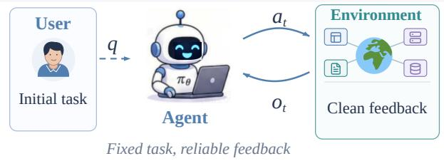
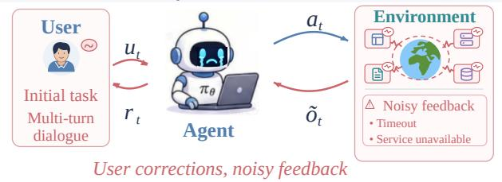
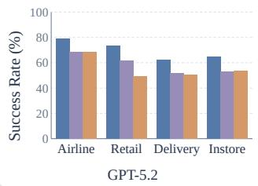
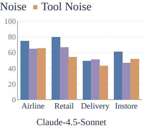
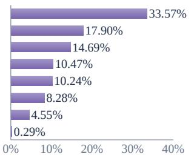
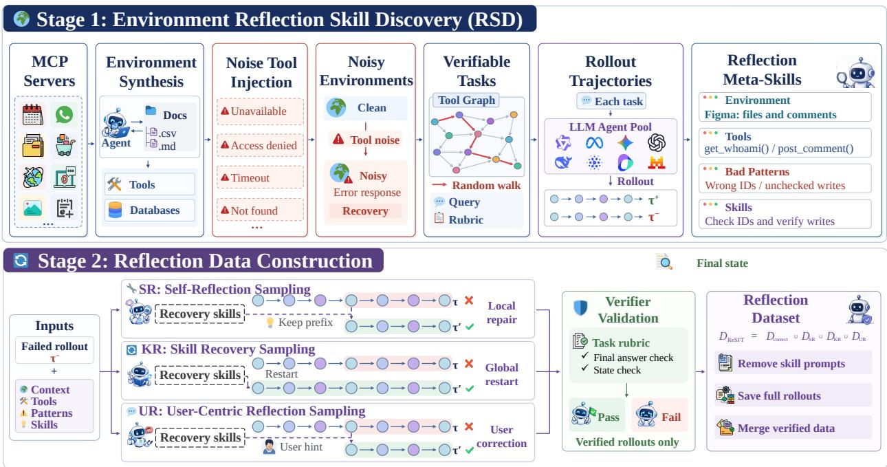
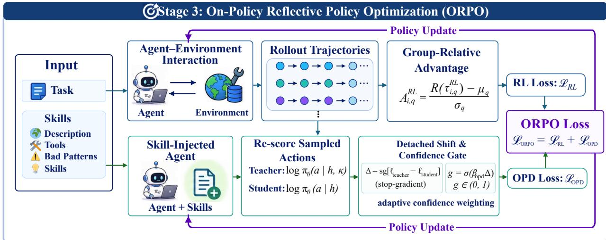
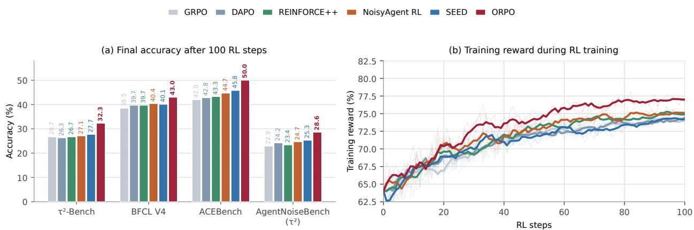
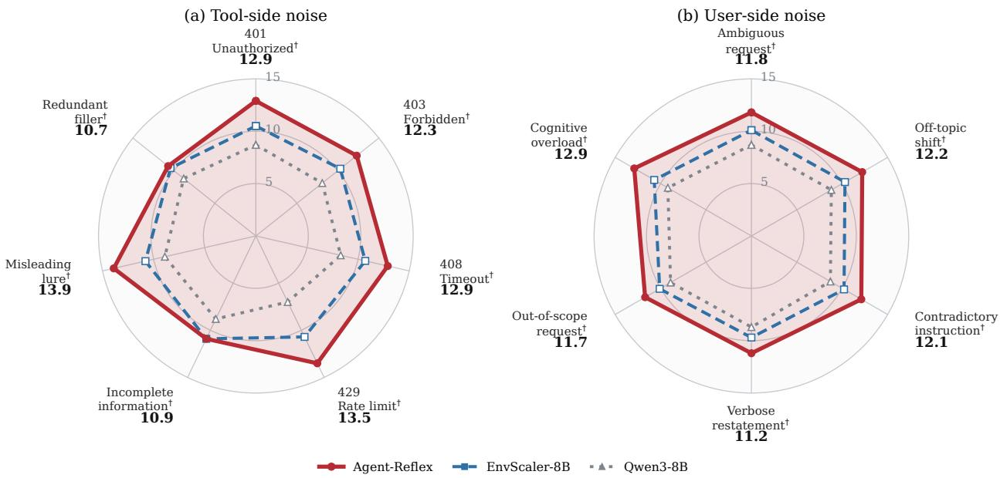

# Agent-Reflex: Teaching Language Agents to Act Reflectively

Guanting Dong1, Xinyu Yang1, Jiajie Jin1, Yuyang Hu1, Xiaoshuai Song1, Yifei Chen1, Xiaoxi Li1, Jiejun Tan1, Yutao Zhu1, Tat-Seng Chua2, Ji-Rong Wen1, Zhicheng Dou1,†

1Gaoling School of Artificial Intelligence, Renmin University of China, 2National University of Singapore †Corresponding author

Large language models have evolved from single-turn chatbots into interactive agents capable of long-horizon reasoning. In real deployments, MCP tool services can return noisy feedback and users may intervene to correct the agent, but existing methods provide limited supervision for reflection learning and failure recovery. To bridge this gap, we propose Agent-Reflex, a general training framework for incentivizing proactive reflection in agents. Specifically, Agent-Reflex comprises three stages. First, Environment Reflection Skill Discovery (RSD) injects grounded tool-feedback perturbations into environment scaling, samples a capability diverse LLM pool, mines matched success–failure pairs, and summarizes reusable reflection meta-skills. Building on this skill library, we then apply Reflective Supervised Fine-Tuning (ReSFT) that converts each skill into supervision for self-reflection, skill recovery, and user-centric correction, strengthening complementary reflective behaviors. Finally, we propose On-Policy Reflective Policy Optimization (ORPO) to combine agentic reinforcement learning under noisy interactions with reflection-guided on-policy distillation to further elicit proactive reflection. Built on Qwen3-8B, Agent-Reflex reaches 58.6 overall on five long-horizon tool-use benchmarks and 29.1 on AgentNoiseBench, surpassing strong environment-scaling and reflection baselines. Experiments on six challenging agent benchmark suites demonstrate the efectiveness of Agent-Reflex. Further analyses show that Agent-Reflex improves agents’ robustness to noise while maintaining stable training dynamics, supporting scalable agent training.

\# Contact: dongguanting@ruc.edu.cn, dou@ruc.edu.cn Code: https://github.com/RUC-NLPIR/Agent-Reflex Models & Data: https://huggingface.co/collections/dongguanting/agent-reflex

## a Idealized Interaction

## b Real-World Noisy Interaction

## c Success Rate Across Noise Settings ■ No Noise ■ User Noise ■ Tool Noise

## d Distribution Of Tool Errors

Service / gateway unavailable   
Auth / permission failure   
Request timeout   
Resource not found   
Parameter / validation failure   
Execution exception   
Rate limit   
Network connection failure

  
Figure 1 From idealized interaction to reflective recovery. (a) Prior environments assume clean tool feedback, whereas (b) real ones return noisy observations and user corrections at arbitrary turns. (c) Success rate of GPT-5.2 and Claude-4.5-Sonnet under no, user, and tool noise. (d) Share of the eight tool-error families mined from 24,510 real error returns

## 1 Introduction

Recent advances in large language models (LLMs) have extended their applications from natural language tasks to practical workflows that require long-horizon reasoning (Yao et al., 2023; Patil et al., 2025; Trivedi et al., 2024; Barres et al., 2025; Dong et al., 2026b). Meeting this demand requires agents not only to master tool interfaces but also to accumulate transferable interaction experience from dynamic environments. Building diverse, stateful environments that faithfully capture real-world interaction logic has therefore become the foundation for scaling agent capability.

Recent studies to scale agent training environments can be roughly categorized into two groups. One group, exemplified by Simia (Li et al., 2025) and GenEnv (Guo et al., 2025), treats LLMs as implicit textual world models that generate feedback from tool specifications and interaction histories. These approaches substantially reduce environmental engineering costs, but the feedback generated can be hallucinated. Instead, a complementary family explicitly reproduces real interaction logic, synthesizing executable tools and environment databases: it extracts databases from real-world service themes, generates executable tools, and synthesizes tasks with verifiable results (Song et al., 2026; Wang et al., 2026b; Tu et al., 2026; Dong et al., 2026a). As a result, these executable environments give agents a basis for learning interaction patterns that transfer across environments.

Although environment scaling improves interaction diversity and out-of-distribution generalization, existing agenttraining paradigms still rely on an idealized assumption: agents interact with stable, well-controlled environments under minimal user intervention. This mismatch with real-world deployment reveals two inherent challenges (as shown in Figure 1):

(1) Lack of noisy feedback. Real-world tool services are unreliable, frequently returning timeouts and service errors. Existing training environments usually assume stable and noise-free feedback, leaving agents underprepared for failure detection and recovery (Wang et al., 2026a; Gupta, 2026).

(2) Lack of user-guided correction. Real users actively intervene when an agent deviates from their intent, correcting its reasoning and actions. Existing user simulators often rely on standardized templates, with limited coverage of corrective instructions and diverse interaction styles during execution (Barres et al., 2025; Qian et al., 2025; Suhr and Artzi, 2023).

Together, these challenges reveal that agents still lack proactive reflection under noisy external feedback. Ideally, a robust agent should continuously perceive environmental noise, task failures, and user correction intent, then promptly revise its actions. Existing reflection methods explore inference-time reflection, correction-trajectory learning, and noise-augmented training (Shinn et al., 2023; Madaan et al., 2023; Yuan et al., 2025; Bi et al., 2026; Zhang et al., 2026; Chen et al., 2026), but most are trained in stateless or simplified environments, leaving one question open: How can we elicit proactive reflective capability in agents from execution failures in real-world environments?

To address this gap, we propose Agent-Reflex, a general training framework for incentivizing proactive reflective thinking in agents. It models reflection as a learnable meta-skill: transferable meta-skills are explicitly mined from execution failures and progressively internalized into the policy through verifiable reflection learning. Specifically, Agent-Reflex comprises three components:

(1) Environment Reflection Skill Discovery (RSD). We anchor 557 high-usage real-world environment themes and automatically construct database-backed executable environments and tasks, injecting diverse tool-return failures to emulate noisy conditions. From a diverse LLM agent pool, we sample trajectories covering varied task types and response styles, and matched success/failure pairs are then mined into 1,170 reflection meta-skills across 557 environments.

(2) Reflective Supervised Fine-Tuning (ReSFT). Given the skill library, we design three auxiliary and verifiable reflec tion sampling strategies: Self-Reflection (SR), Skill Recovery (KR), and User-Centric Reflection (UR), which strengthen reflection at diferent levels. Supervised fine-tuning then internalizes these explicit skills into the agent policy.

(3) On-Policy Reflective Policy Optimization (ORPO). To further elicit proactive reflection, ORPO combines Noisy Agent RL with reflection-guided on-policy distillation. For each task we match its environment’s reflection meta-skill and rollout in the noisy environment, optimizing the policy by reinforcement learning from verifiable rewards. The same action tokens are then re-scored under a privileged skill context, and a confidence-weighted OPD objective (Wu et al., 2026) turns this contrast into dense supervision for reflection decisions.

Experiments on six long-horizon tool-use and noisy-interaction benchmarks demonstrate the efectiveness of Agent-Reflex. Further analysis shows that it improves noise robustness and keeps training dynamics stable, supporting scalable general-agent training.

Therefore, our contributions are threefold:

• We identify two gaps between idealized synthetic environments and real-world deployment in agent interaction, namely lack of noisy environment feedback and lack of user-guided correction during execution, highlighting the importance of reflection learning for noisy interactions.

• We introduce RSD, which systematically builds a scalable noisy-environment ecosystem by incorporating real-tool perturbations and mining reflection meta-skills from large-scale success/ failure trajectory pairs sampled by an LLM Agent Pool

• We further propose ReSFT and ORPO. ReSFT builds multi-level reflection data through three sampling strategies and internalizes it by supervised fine-tuning; ORPO adds reflection-guided on-policy distillation to Noisy Agent RL for token-level supervision of failed executions.

## 2 Related Work

Agent Reflection Learning. Agent reflection difers in where the corrective signal lives. Inference-time methods leave parameters untouched: Reflexion and Self-Refine append a verbal self-critique, and ExpeL retrieves cross-task insights at test time (Shinn et al., 2023; Madaan et al., 2023; Zhao et al., 2024). Because the critique comes from the policy that failed, a well-formed but wrong tool return is rarely contradicted. Training-time methods move the signal into a per-trajectory repair: Agent-R, ReflectRL, and LoongReflect learn from that repair (Yuan et al., 2025; Bi et al., 2026; Zhang et al., 2026), and NoisyAgent exposes the policy to perturbed interaction under only a scalar return (Chen et al., 2026). Either way, nothing accumulates into an environment-level statement a later episode can reuse. Agent-Reflex mines cross-model success/failure contrasts under the same injected noise into environment-indexed meta-skills and internalizes them through two-stage training.

ScalableEnvironmentSynthesisforAgentTraining. Diverse, stateful environments underpin tool use and long-horizon decision making. One line of work simulates interaction feedback with language models, treating tool specifications and dialogue history as an implicit world model (Li et al., 2025; Guo et al., 2025). A second makes the environment itself executable: EnvScaler and ScaleEnv synthesize tools with verifiable tasks (Song et al., 2026; Tu et al., 2026), Agent-World scales database-backed services over hundreds of real-world themes and verifies outcomes through state transitions (Dong et al., 2026a; Wang et al., 2026b), and EnvACE internalizes environment dynamics through world rehearsal (Xu et al., 2026). All of them scale the supply of solvable environments, whereas Agent-Reflex keeps the database-backed paradigm but turns the failures inside those environments into supervision, mining diagnosis and recovery rules from cross-model success/failure contrasts under perturbations derived from real tool errors. Appendix A gives an extended discussion of reflection learning, environment synthesis, and agentic RL

## 3 Methodology: Agent-Reflex

Overview. Figure 2 summarizes the pipeline. To convert environment failures into a reflection capability, Agent-Reflex comprises three stages:

(1) Environment Reflection Skill Discovery (RSD) (§ 3.1). Build failure-aware executable environments and mine verifier-matched pairs into an ofline skill library.

(2) Reflective Supervised Fine-Tuning (ReSFT) (§ 3.2). Convert each skill into verifier-validated self-reflection, recovery, and user-correction data.

(3) On-Policy Reflective Policy Optimization (ORPO) (§ 3.3). Combine Noisy Agent RL with same-token skill-guided OPD to provide dense reflection supervision.

  
Figure 2 RSD and ReSFT. Stage 1 perturbs tool returns of 557 MCP-anchored executable environments with mined failure families, contrasting success/failure rollouts into an ofline skill library. Stage 2 samples local-repair (SR), global-recovery (KR), and user-correction (UR) continuations from that library, keeping only verifier-validated ones with skill prompts stripped.

## 3.1 Stage 1: Environment Reflection Skill Discovery (RSD)

## 3.1.1 Noise-Grounded Environment Scaling

To construct realistic environments with tool failures, we select 557 high-usage MCP server specifications from Smithery1, each defining an environment topic m ∈ M. Following Agent-World (Dong et al., 2026a), a research agent equipped with search, browser, coding, and operating-system tools builds and iteratively enriches a topic-grounded database. A coding agent then generates candidate tools and unit tests from each topic and its database. We retain only tools that compile, pass all tests, satisfy state-transition constraints, and support executable task verification. Thus, each environment ${ \mathcal { E } } _ { m }$ consists of a database, a validated tool set, and corresponding verifiers. The resulting ecosystem is $\mathcal { E } = \{ \mathcal { E } _ { m } : m \in \mathcal { M } \}$ , with 60 verifier-backed tasks per topic; the resulting task set Q supplies the ReSFT data.

Tool-Failure Mining and Injection. Because real deployment is unstable, we ground perturbations in observed failures rather than invent them. We replay agents across nine public agentic benchmarks whose environments expose production-grade tool ecosystems and log every tool return (Appendix D.2). In total we collect 177,700 tool returns, of which 24,510 are error returns, and group them by surface form into eight actionable failure families (Table 4). We then inject these failures into tool returns probabilistically to emulate real deployment:

$$
o _ { t + 1 } ^ { \mathrm { t r a i n } } = \left\{ \begin{array} { l l } { J ( o _ { t + 1 } ) , } & { b _ { t + 1 } ^ { \mathrm { i n j } } = 1 , } \\ { o _ { t + 1 } , } & { b _ { t + 1 } ^ { \mathrm { i n j } } = 0 , } \end{array} \right. \qquad b _ { t + 1 } ^ { \mathrm { i n j } } \sim \mathrm { B e r n o u l l i } ( p _ { \mathrm { i n j } } ) ,\tag{1}
$$

where the renderer J replaces the true return with a failure drawn from those compatible with the invoked tool $f _ { t } ,$ balanced across the eight families so that rare ones still receive enough instances for recovery to be learned. Here $p _ { \mathrm { i n j } }$ is the per-return injection probability, and we keep clean and perturbed tasks only if they admit a verifiable solution and recovery, respectively.

## 3.1.2 Reflection Meta-Skill Extraction

Capability-Diverse Trajectory Sampling and Pairing. Repeated sampling from one model can concentrate trajectories around its model-specific reasoning tendencies (Jiang et al., 2023; Du et al., 2024). We therefore sample trajectories from a capability-diverse LLM pool $\Pi _ { \mathrm { p o o l } }$ of nine models spanning five families, ranging from 4B to 284B parameters (Table 5). Each model interacts with the noisy ecosystem $\mathcal { E }$ on every task $q \in \mathcal { Q }$ under the same sampling protocol.

Because rule-based metrics cannot reliably assess long-horizon trajectories, an analyzer model and the environment verifier jointly label each rollout, yielding $\mathcal { D } _ { \mathrm { c o r r e c t } } = \{ ( q _ { i } , \tau _ { i } ^ { + } ) \} _ { i = 1 } ^ { N _ { + } }$ and $\mathcal { D } _ { \mathrm { e r r o r } } = \{ ( q _ { i } , \tau _ { i } ^ { - } , e _ { i } , t _ { i } ^ { \star } , s _ { t _ { i } ^ { \star } } ) \} _ { i = 1 } ^ { N _ { - } }$ , where $\tau _ { i } ^ { + }$ and $\tau _ { i } ^ { - }$ denote correct and erroneous trajectories, $e _ { i }$ is the diagnosed error rationale, $t _ { i } ^ { \star }$ is the first erroneous turn, and $s _ { t _ { i } ^ { \star } }$ is its environment-state snapshot. We pair correct and erroneous trajectories from the same task, limit the number of pairs contributed by each task, and require each environment to draw pairs from at least five distinct tasks, forming: $\mathcal { D } _ { \mathrm { p a i r } } = \{ ( q , \tau ^ { + } , \tau ^ { - } , e , t ^ { \star } , s _ { t ^ { \star } } ) \}$

Meta-Skill Extraction. An ideal reflective meta-skill is an environment recovery rule that maps an agent’s bad pattern to a corrective action, enabling reuse across tasks within the same environment. To mine such skills, an analyzer examines paired successful and failed trajectories, identifies recurring failure patterns, and converts them into executable recovery rules. For each environment $m _ { \ i }$ , we store $\zeta _ { m } = ( d _ { m } , \bar { T _ { m } } , B _ { m } , \bar { K _ { m } } )$ , where $d _ { m }$ describes the environment and its business objects, $\mathcal { T } _ { m }$ its tools, $B _ { m }$ its observed bad patterns, and $\kappa _ { m }$ the extracted reflection skills. The resulting ofline library is $\textstyle { \mathcal { K } } = \bigcup _ { m \in { \mathcal { M } } } { \mathcal { K } } _ { m }$ , so each sample in $\mathcal { D } _ { \mathrm { p a i r } }$ is associated with a skill $\kappa \in \mathcal { K } _ { m }$ Representative environment-specific skills are shown in Appendix E.3.

## 3.2 Stage 2: Reflective Supervised Fine-Tuning (ReSFT)

ReSFT converts explicit reflection skills into policy behavior. Starting from a frozen behavior policy $\pi _ { 0 }$ , we construct three complementary forms of reflective supervision for local repair, global recovery, and user-guided correction.

Self-Reflection Sampling (SR). For an erroneous trajectory $\tau ^ { - }$ , let $t ^ { \star }$ be its first erroneous turn, $s _ { t ^ { \star } }$ the environmentstate snapshot taken before that turn is executed, $h _ { t ^ { \star } }$ the deployment-visible history up to that turn, and κ the matched reflection skill. Let x ⊕ z denote appending z to context $x ,$ and let $\mathrm { V e r } _ { s } ( x , y )$ indicate whether continuation y successfully completes the task after restoring the environment to state s. To teach failure awareness and self-reflection, we restore the environment to $s _ { t ^ { \star } }$ ⋆ and continue after appending the corrective skill:

$$
y ^ { \mathrm { S R } } \sim \pi _ { 0 } ( \cdot \mid h _ { t ^ { \star } } \oplus \kappa ) , \qquad \mathcal { D } _ { \mathrm { S R } } = \{ ( h _ { t ^ { \star } } , y ^ { \mathrm { S R } } ) : \mathrm { V e r } _ { s _ { t ^ { \star } } } ( h _ { t ^ { \star } } , y ^ { \mathrm { S R } } ) = 1 \} .\tag{2}
$$

The skill triggers diagnosis and replanning during generation but is removed from the stored input, so the policy learns to recover from its own error state.

Skill Recovery Sampling (KR). Many failures originate from an incorrect initial plan rather than a local tool error. To teach global recovery, we reset the environment to its initial state $s _ { 0 }$ and restart from the original task with the matched skill:

$$
y ^ { \mathrm { K R } } \sim \pi _ { 0 } ( \cdot \mid q \oplus \kappa ) , \qquad \mathcal { D } _ { \mathrm { K R } } = \{ ( q , y ^ { \mathrm { K R } } ) : \mathrm { V e r } _ { s _ { 0 } } ( q , y ^ { \mathrm { K R } } ) = 1 \} .\tag{3}
$$

As in SR, the privileged skill is removed before storage, encouraging recovery without an explicit skill prior.

User-Centric Reflection Sampling (UR). When an agent deviates from the user’s intent, users may intervene and correct its reasoning. To teach user-centric reflection, a user simulator $U$ converts the matched skill into a naturallanguage correction: $u _ { \kappa } = U ( \kappa , h _ { t ^ { \star } } , s _ { t ^ { \star } } )$ . We then restore the environment to $s _ { t ^ { \star } }$ , insert the correction after the erroneous turn, and continue:

$$
y ^ { \mathrm { U R } } \sim \pi _ { 0 } ( \cdot \mid h _ { t ^ { \star } } \oplus u _ { \kappa } ) , \qquad \mathcal { D } _ { \mathrm { U R } } = \{ ( h _ { t ^ { \star } } \oplus u _ { \kappa } , y ^ { \mathrm { U R } } ) : \operatorname { V e r } _ { s _ { t ^ { \star } } } ( h _ { t ^ { \star } } \oplus u _ { \kappa } , y ^ { \mathrm { U R } } ) = 1 \} .\tag{4}
$$

Because the user message is deployment-visible, $u _ { \kappa }$ remains in the stored input, whereas the privileged skill $\kappa$ is removed.

Let $\mathcal { D } _ { \mathrm { c o r r e c t } } ^ { \pi _ { 0 } } \subseteq \mathcal { D } _ { \mathrm { c o r r e c t } }$ denote correct trajectories generated by the target policy $\pi _ { 0 }$ . We merge them with the three reflective datasets:

$$
\mathcal { D } _ { \mathrm { R e S F T } } = \mathcal { D } _ { \mathrm { c o r r e c t } } ^ { \pi _ { 0 } } \cup \mathcal { D } _ { \mathrm { S R } } \cup \mathcal { D } _ { \mathrm { K R } } \cup \mathcal { D } _ { \mathrm { U R } } , \qquad \mathcal { L } _ { \mathrm { R e S F T } } = - \sum _ { ( x , y ) \in \mathcal { D } _ { \mathrm { R e S F T } } } \log \pi _ { \theta } ( y \mid x ) .\tag{5}
$$

  
Figure 3 ORPO. A mixed rollout group of mostly clean and a few perturbed trajectories shares one group-normalized advantage. Re-scoring the same tokens with and without the skill card of their environment yields the detached, confidence-weighted OPD signal.

## 3.3 Stage 3: On-Policy Reflective Policy Optimization (ORPO)

ReSFT provides an ofline initialization by internalizing explicit reflection skills. To further elicit proactive reflection from the current policy on its own on-policy rollouts, ORPO supplements outcome-based agentic reinforcement learning with token-level, reflection-guided on-policy distillation (OPD) (Agarwal et al., 2024; Zhao et al., 2026; Wu et al., 2026), providing dense supervision for failure-causing decisions.

Noisy Agentic Reinforcement Learning. At update u, we draw a task q from the EnvScaler RL task pool ${ \mathcal { Q } } _ { \mathrm { R L } }$ (Song et al., 2026), which ORPO directly reuses instead of RSD-synthesized tasks, and construct one mixed on-policy group to expose the behavior policy to noisy environment feedback. Specifically, the policy $\pi _ { \theta _ { \mathrm { o l d } } }$ generates G trajectories $\mathcal { G } _ { q } = \{ \tau _ { q } ^ { ( i ) } \} _ { i = 1 } ^ { G }$ , with a fraction ν rolled out in noisy environments and the remainder in clean ones. All trajectories retain the complete tool interaction and final answer, and none is given a reflection-skill prompt. After rollout, the environment verifier assigns each trajectory a return $R _ { q , i } ;$ we normalize these returns within the mixed group:

$$
\mu _ { q } = \frac { 1 } { G } \sum _ { i = 1 } ^ { G } R _ { q , i } , \qquad \sigma _ { q } ^ { 2 } = \frac { 1 } { G } \sum _ { i = 1 } ^ { G } \bigl ( R _ { q , i } - \mu _ { q } \bigr ) ^ { 2 } , \qquad \widehat { A } _ { q , i } = \frac { R _ { q , i } - \mu _ { q } } { \sigma _ { q } + \epsilon } ,\tag{6}
$$

where normalizing over the mixed group rather than within its clean and perturbed strata keeps genuine failures inside the on-policy distribution without letting them form a contrast of their own. For an agent action token $a _ { q , i , t , k }$ at position k of turn t under history $h _ { q , i , t }$ , we define the token log-probability of the current policy and its ratio to the behavior policy:

$$
\ell _ { q , i , t , k } ^ { \theta } = \log \pi _ { \theta } \big ( a _ { q , i , t , k } \ | \ h _ { q , i , t } , a _ { q , i , t , < k } \big ) , \qquad \rho _ { q , i , t , k } ( \theta ) = \exp \big ( \ell _ { q , i , t , k } ^ { \theta } - \ell _ { q , i , t , k } ^ { \mathrm { o l d } } \big ) ,\tag{7}
$$

with $\ell ^ { \mathrm { o l d } }$ the same score under $\pi _ { \boldsymbol { \theta } _ { \mathrm { o l d } } } .$ . Letting $\chi _ { \boldsymbol { q } , i , t , k } \in \{ 0 , 1 \}$ mask the valid agent-generated tokens, which excludes tool returns and simulated user messages, the clipped Agent RL objective is

$$
\begin{array} { r l } & { \mathcal { L } _ { \mathrm { { R L } } } ( \theta ) = - \mathbb { E } _ { q , \boldsymbol { i } , \boldsymbol { k } , \boldsymbol { k } } \left[ \chi _ { \boldsymbol { q } , \boldsymbol { i } , \boldsymbol { k } } \operatorname* { m i n } \left( \rho _ { \boldsymbol { q } , \boldsymbol { i } , \boldsymbol { t } , \boldsymbol { k } } \widehat { A } _ { \boldsymbol { q } , \boldsymbol { i } } , \mathrm { c l i p } ( \rho _ { \boldsymbol { q } , \boldsymbol { i } , \boldsymbol { t } , \boldsymbol { k } } , 1 - \epsilon _ { c } , 1 + \epsilon _ { c } ) \widehat { A } _ { \boldsymbol { q } , \boldsymbol { i } } \right) \right] } \\ & { \qquad + \beta _ { \mathrm { { K L } } } \mathbb { E } _ { \boldsymbol { h } \sim \mathcal { Q } _ { \boldsymbol { q } } } \left[ D _ { \mathrm { { K L } } } \left( \pi _ { \boldsymbol { \theta } } ( \cdot \mid h ) \| \pi _ { \mathrm { { r e f } } } ( \cdot \mid h ) \right) \right] , } \end{array}\tag{8}
$$

with $\epsilon , \epsilon _ { c } , \beta _ { \mathrm { K L } }$ hyperparameters and $\mathbb { E } _ { q , i , t , k }$ the mean over all sampled token positions of the group. This component propagates only the outcome supervision of the verifier; the reflection-specific token-level signal comes next.

Reflection On-Policy Distillation. To turn the sparse outcome signal into dense supervision over reflective decisions, we condition on the reflection meta-skills $\kappa _ { q , i } \in \mathcal { K } _ { m }$ of the environment m that task q instantiates. No retrieval or extra matching step is involved: each EnvScaler RL task already specifies its environment, and the skill library is organized by environment, so the corresponding skill card is loaded directly with the environment and never depends on a benchmark answer. Prompting the same policy $\pi _ { \theta }$ with this skill prepended to the task turns it into a teacher that re-scores the student rollout sampled without any skill prior: a deterministic function H builds the skill-augmented history $\widetilde { h } _ { q , i , t } = H ( h _ { q , i , t } , \kappa _ { q , i } )$ , and the current policy re-scores the already sampled action token under it,

Table 1 Main results on five tool-use benchmarks. Overall is the unweighted mean of the five benchmark averages; Avg. of BFCL V4 and ACEBench follows each benchmark’s oficial scoring rather than a simple mean. Best and second-best among 7B–8B methods are bolded and underlined (ties share a mark). ∗Reproduced by us because the checkpoint is not open-sourced.
<table><tr><td rowspan="2">Method</td><td colspan="3">VitaBench</td><td colspan="3">τ2-Bench</td><td colspan="2"></td><td colspan="6">BFCL V4</td><td colspan="2">ACEBench</td><td rowspan="2">Tool Sandbox</td><td rowspan="2">Overall</td></tr><tr><td>Cro. Del.</td><td></td><td>In.</td><td></td><td></td><td></td><td>OTA. Avg. Ret. Air. Tel. Avg. Web. Mem. Mul. NoL. Liv.</td><td></td><td></td><td></td><td></td><td></td><td>Irr. Avg.</td><td>Ste. Tur. Avg.</td><td></td><td></td></tr><tr><td>Foundation Models</td><td></td><td></td><td></td><td></td><td></td><td></td><td></td><td></td><td></td><td></td><td></td><td></td><td></td><td></td><td></td><td></td><td></td><td></td></tr><tr><td>GPT-5.2</td><td>24.3 52.5</td><td></td><td>45.8</td><td>28.3 37.7</td><td>81.6</td><td>62.5</td><td>95.8</td><td>80.0 75.5</td><td>45.8</td><td>48.5</td><td>81.9</td><td>70.4</td><td>88.7</td><td>62.9</td><td>95.0</td><td>50.0 68.0</td><td>73.3</td><td>64.4</td></tr><tr><td>Claude-4.5-Sonnet</td><td>23.5</td><td>52.0</td><td>48.3</td><td>28.3 38.0</td><td>86.2</td><td>70.1</td><td>98.0 84.7</td><td>81.0</td><td>65.0</td><td>61.4</td><td>88.7</td><td>81.1</td><td>86.6</td><td>73.2</td><td>100.0 70.0</td><td>82.0</td><td>85.0</td><td>72.6</td></tr><tr><td>Gemini 3 Pro</td><td>31.5</td><td>62.0</td><td>56.5 40.3</td><td>47.6</td><td>85.3</td><td>72.7</td><td>98.0</td><td>85.4 80.0</td><td>61.7</td><td>60.8</td><td>90.7</td><td>83.1</td><td>85.6</td><td>72.5</td><td>100.0 50.0</td><td>70.0</td><td>88.4</td><td>72.8</td></tr><tr><td>Qwen3-235B-A22B</td><td>14.5</td><td>45.0</td><td>32.0</td><td>15.8 26.8</td><td>71.9</td><td>45.6</td><td>58.0 58.5</td><td>54.0</td><td>23.9</td><td>45.4</td><td>37.4</td><td>68.9</td><td>81.7</td><td>48.0</td><td>100.0 63.3</td><td>78.0</td><td>77.1</td><td>57.7</td></tr><tr><td>Qwen3-8B</td><td>1.2</td><td>15.5</td><td>24.8</td><td>4.0 11.4</td><td>34.0</td><td>26.5</td><td>18.0</td><td>26.2 7.0</td><td>17.6</td><td>35.4</td><td>90.2</td><td>80.9</td><td>77.2</td><td>40.4</td><td>80.0 36.7</td><td>54.0</td><td>69.1</td><td>40.2</td></tr><tr><td colspan="10">Reflection Methods (8B)</td><td></td><td></td><td></td><td></td><td></td><td></td><td></td><td></td><td></td></tr><tr><td>Reflexion-8B</td><td>1.0</td><td>13.0</td><td>11.0</td><td>2.0 6.8</td><td>43.0</td><td>36.0</td><td>24.6 34.5</td><td>3.5</td><td>20.9</td><td>46.5</td><td>86.8</td><td>80.2</td><td>72.1</td><td>42.7</td><td>75.0 56.7</td><td>64.0</td><td>75.4</td><td>44.7</td></tr><tr><td>ExpeL-8B</td><td>0.0</td><td>14.0</td><td>11.0 4.0</td><td>7.3</td><td>45.6</td><td>34.0</td><td>21.1 33.6</td><td>2.5</td><td>23.0</td><td>39.5</td><td>88.8</td><td>78.2</td><td>80.2 41.7</td><td></td><td>55.0 36.7</td><td>44.0</td><td>63.0</td><td>37.9</td></tr><tr><td>Agent-R-8B*</td><td>2.0</td><td>15.0</td><td>8.0</td><td>4.0 7.3</td><td>37.7</td><td>32.0</td><td>21.9</td><td>30.6 1.0</td><td>17.9</td><td>35.4</td><td>87.6</td><td>80.2</td><td>74.7</td><td>38.7</td><td>60.0 43.3</td><td>50.0</td><td>73.7</td><td>40.1</td></tr><tr><td>NoisyAgent-8B*</td><td>5.0</td><td>22.0</td><td>27.0</td><td>7.0 15.3</td><td>47.6</td><td>40.0</td><td>40.8</td><td>42.8</td><td>2.5 13.3</td><td>34.8</td><td>65.4</td><td>79.9</td><td>74.6</td><td>35.6</td><td>50.0 53.3</td><td>52.0</td><td>71.5</td><td>43.4</td></tr><tr><td colspan="10">Environment-Scaling Methods (7B-8B)</td><td></td><td></td><td></td><td></td><td></td><td></td><td></td><td></td><td></td></tr><tr><td>Simulator-8B</td><td>0.0</td><td>1.2</td><td>4.8</td><td>1.0 1.8</td><td>32.2</td><td>34.0</td><td>29.2</td><td>31.8 17.5</td><td>6.0</td><td>4.1</td><td>47.6</td><td>44.6 87.3</td><td>23.9</td><td>35.0</td><td>30.0</td><td>32.0</td><td>61.7</td><td>30.2</td></tr><tr><td>TOUCAN-7B</td><td>0.5</td><td>6.9</td><td>3.0 0.8</td><td>2.8</td><td>22.8</td><td>20.0</td><td>10.5 17.7</td><td>21.0</td><td>18.5</td><td>17.8</td><td>81.0</td><td>73.9</td><td>78.6 36.6</td><td>70.0</td><td>26.7</td><td>44.0</td><td>61.9</td><td>32.6</td></tr><tr><td>AWM-8B</td><td>1.5</td><td>16.0</td><td>19.2 4.2</td><td>10.2</td><td>41.2 </td><td>23.5</td><td>38.5 34.4</td><td>9.5</td><td>15.7</td><td>34.9 90.2 80.5</td><td></td><td></td><td>73.9</td><td>40.0</td><td>60.0 46.7</td><td>52.0</td><td>71.5</td><td>41.6</td></tr><tr><td>EnvACE-8B*</td><td>6.0</td><td>24.0</td><td>27.0</td><td>7.0 16.0</td><td>48.9</td><td>44.0</td><td>17.3 36.7</td><td>12.3</td><td>24.0</td><td>45.3</td><td>87.6</td><td>81.2</td><td>83.2</td><td>46.0</td><td>55.0 43.3</td><td>48.0</td><td>71.6</td><td>43.7</td></tr><tr><td>EnvScaler-8B</td><td>6.0</td><td>20.8</td><td>29.5</td><td>7.0</td><td>15.849.6</td><td></td><td>31.5 32.7</td><td>37.9</td><td>23.0 21.9</td><td>47.1</td><td>88.5 82.2 74.6 47.6</td><td></td><td></td><td></td><td>85.0 60.0</td><td>72.5</td><td>80.5</td><td>50.9</td></tr><tr><td>Agent-World-8B*</td><td>6.0</td><td>21.0</td><td>11.0</td><td>20.0 14.5</td><td>72.8</td><td>40.0</td><td>50.9</td><td>54.6 47.0</td><td>21.7</td><td>44.5</td><td>83.3</td><td>79.6</td><td>80.2</td><td>51.4</td><td>85.0 63.3</td><td>72.0</td><td>75.6</td><td>53.6</td></tr><tr><td>Agent-Reflex-8B (ours)</td><td>6.0</td><td>27.0</td><td>29.0</td><td>8.0 17.5</td><td>68.4</td><td>46.0</td><td>71.9</td><td>62.1</td><td>44.5 23.5</td><td>47.1</td><td>88.8</td><td>81.4</td><td>81.4</td><td>52.9</td><td>85.0</td><td>73.3 78.0</td><td>82.5</td><td>58.6</td></tr></table>

$$
\ell _ { q , i , t , k } ^ { \mathrm { s k i l l } } = \log \pi _ { \theta } \big ( a _ { q , i , t , k } \ | \ \widetilde { h } _ { q , i , t } , a _ { q , i , t , < k } \big ) ,\tag{9}
$$

which is contrasted with the ordinary-context score $\ell _ { q , i , t , k } ^ { \theta }$ of Equation 7 on exactly the same token. OPD therefore needs a single environment rollout stream: the skill branch only scores tokens as a training-time privileged teacher, and gradients flow through the ordinary branch alone. Following SEED, the detached skill-induced shift and its confidence weight are

$$
\Delta _ { q , i , t , k } = \mathrm { s g } \big [ \ell _ { q , i , t , k } ^ { \mathrm { s k i l l } } - \ell _ { q , i , t , k } ^ { \theta } \big ] , \qquad \gamma _ { q , i , t , k } = \mathrm { s i g m o i d } \big ( \beta _ { \mathrm { o p d } } \Delta _ { q , i , t , k } \big ) ,\tag{10}
$$

and we optimize

$$
\mathcal { L } _ { \mathrm { O P D } } ( \theta ) = \mathbb { E } _ { q , i , t , k } \left[ \chi _ { q , i , t , k } \gamma _ { q , i , t , k } \left( \mathrm { s g } [ \ell _ { q , i , t , k } ^ { \mathrm { s k i l l } } ] - \ell _ { q , i , t , k } ^ { \theta } \right) \right] ,\tag{11}
$$

where sg[·] blocks gradients through the teacher branch, so minimizing LOPD raises the student score on teacherendorsed on-policy tokens. The confidence weight $\gamma \in ( 0 , 1 )$ is a soft weighting rather than a hard filter: it emphasizes tokens with a positive skill-induced shift and down-weights tokens whose shift is weak or negative.

Joint Objective. We jointly optimize the outcome-based Agent RL and reflection OPD objectives:

$$
\mathcal { L } _ { \mathrm { O R P O } } = \mathcal { L } _ { \mathrm { R L } } + \lambda _ { \mathrm { o p d } } \mathcal { L } _ { \mathrm { O P D } } .\tag{12}
$$

The objective combines trajectory-level outcome learning with token-level reflection supervision, further sharpening the proactive reflection of the policy.

## 4 Experiments

## 4.1 Experimental Setups

Datasets. We evaluate our method on two groups of benchmarks. (1) Long-horizon tool use covers general function calling and interactive workflows: BFCL-v4 (Patil et al., 2025), ACEBench (Chen et al., 2025), 200 stratified ToolSandbox tasks (Lu et al., 2025), τ2-Bench (Barres et al., 2025), and VitaBench (He et al., 2025). (2) Noisy interaction uses AgentNoiseBench (Wang et al., 2026a), instantiated on the τ2-Bench and VitaBench tool- and user-noise settings. Following the EnvScaler protocol (Song et al., 2026), all evaluations use the standard MCP format and task templates, and each benchmark is scored with its oficial metric. Appendix B specifies every benchmark.

Baselines. Every trained method here, including Agent-Reflex, starts from the same Qwen3-8B backbone under one fair experimental setting. We compare three families: reflection methods (Shinn et al., 2023; Zhao et al., 2024; Yuan et al., 2025; Chen et al., 2026), environment-scaling methods (Li et al., 2025; Xu et al., 2025; Song et al., 2026; Wang et al., 2026b; Xu et al., 2026; Dong et al., 2026a), and trajectory-level RL algorithms (Shao et al., 2024; Yu et al., 2025; Hu et al., 2025; Wu et al., 2026). Appendix C specifies every baseline and Appendix D the implementation.

## 4.2 Main Results

## 4.2.1 Results on Long-Horizon Tool Use.

Table 1 shows that Agent-Reflex performs well on five long-horizon agent benchmarks, achieving the highest overall score among strong baselines. We further make the following observations.

(1) Internalizing Reflection beyond Inference-Time Guidance. Agent-Reflex outperforms Reflexion-8B and ExpeL-8B on VitaBench, ACEBench, and ToolSandbox. On VitaBench, Agent-Reflex achieves 17.5%, compared with 6.8% for Reflexion-8B. While these methods rely on self-generated critiques or retrieved experience at inference time, Agent-Reflex trains directly on verified recovery behavior. This may help the policy translate reflection into corrective actions more reliably, reducing its reliance on interpreting textual advice during execution.

(2) Reusable Recovery Knowledge beyond Individual Trajectories. Agent-Reflex surpasses Agent-R-8B and NoisyAgent-8B on VitaBench, BFCL, ACEBench, and ToolSandbox. On ACEBench, it reaches 78.0%, compared with 52.0% for NoisyAgent-8B. These gains suggest that environment-level meta-skills provide useful recovery guidance beyond individual correction trajectories or episode-level rewards.

(3) Reflective Supervision Complements Environment Scaling. Agent-Reflex improves over EnvScaler-8B and Agent-World-8B on all five benchmark averages, e.g., 62.1% vs. 54.6% on $\tau ^ { 2 }$ -Bench. On ACEBench, the gain comes mainly from multi-turn interaction: Agent-Reflex reaches 73.3% at the turn level while matching the baselines at 85.0% step-level accuracy. This suggests that reflective supervision complements broader tool and task coverage.

## 4.2.2 Robustness under Interaction Noise.

To assess whether Agent-Reflex remains efective when tool feedback or user interactions are perturbed, we evaluate it on AgentNoiseBench. In detail, every foundation model degrades markedly.

Generalization of Agent-Reflex to Unseen Perturbations. Table 2 shows that Agent-Reflex achieves the highest Overall score among the compared 8B methods, reaching 29.1% compared with 25.9% for NoisyAgent-8B and outperforming the other strong baselines overall. These results indicate that its efectiveness extends to noisy interaction. Appendix E.1 provides a fine-grained attribution of the observed noise-robustness gains.

## 4.3 Does On-Policy Reflective Optimization Improve Robustness?

To further assess ORPO’s efectiveness for reflection training, we analyze along two dimensions.

(1) Performance Comparison. To evaluate online reflective learning, we train five representative algorithms and ORPO from Qwen3-8B for 100 RL steps on the same task pool. In Figure 4(a), ORPO holds a stable advantage over GRPO, DAPO, and REINFORCE++ on BFCL V4, τ2-Bench, and real interaction noise. The advantage also holds against SEED, which already carries an OPD signal, and against noisy Agent RL, so reflection meta-skills summarized from real failures transfer better than experience estimated from rollouts alone.

Table 2 Results on AgentNoiseBench. We report performance under tool and user noise. Avg. is the mean of the tool-noise and user-noise scores, and Overall is the mean of the two benchmark averages. The Clean results of foundation models are taken from the original AgentNoiseBench report, so they may difer slightly from Table 1. ∗ marks our reproduction.
<table><tr><td rowspan="2">Method</td><td colspan="4">AgentNoiseBench-τ2</td><td colspan="4">AgentNoiseBench-Vita</td><td rowspan="2">Overall</td></tr><tr><td>Clean</td><td>Tool Noise</td><td>User Noise</td><td>Avg.</td><td>Clean</td><td>Tool Noise</td><td>User Noise</td><td>Avg.</td></tr><tr><td colspan="9">Foundation Models</td></tr><tr><td>GPT-5.2</td><td>81.0</td><td>61.0</td><td>72.0</td><td>66.5</td><td>53.0</td><td>45.0</td><td>45.0</td><td>45.0</td><td>55.8</td></tr><tr><td>Claude-4.5-Sonnet</td><td>73.0</td><td>57.0</td><td>65.0</td><td>61.0</td><td>51.0</td><td>41.0</td><td>41.0</td><td>41.0</td><td>51.0</td></tr><tr><td>Gemini-2.5-Pro</td><td>60.0</td><td>37.0</td><td>55.0</td><td>46.0</td><td>49.0</td><td>34.0</td><td>38.0</td><td>36.0</td><td>41.0</td></tr><tr><td>Qwen3-8B</td><td>26.2</td><td>14.1</td><td>26.2</td><td>20.2</td><td>11.4</td><td>3.3</td><td>5.5</td><td>4.4</td><td>12.3</td></tr><tr><td colspan="10">Reflection and Environment Scaling (Qwen3-8B)</td></tr><tr><td>Reflexion-8B</td><td>34.5</td><td>17.2</td><td>29.3</td><td>23.3</td><td>6.8</td><td>7.8</td><td>0.2</td><td>4.0</td><td>13.7</td></tr><tr><td>Agent-R-8B*</td><td>30.6</td><td>14.5</td><td>25.4</td><td>20.0</td><td>7.3</td><td>3.9</td><td>0.8</td><td>2.4</td><td>11.2</td></tr><tr><td>NoisyAgent-8B</td><td>42.8</td><td></td><td></td><td>37.6</td><td>15.3</td><td>一</td><td>一</td><td>14.2</td><td>25.9</td></tr><tr><td>AWM-8B</td><td>34.4</td><td>14.1</td><td>22.6</td><td>18.4</td><td>10.2</td><td>3.2</td><td>0.6</td><td>1.9</td><td>10.2</td></tr><tr><td>EnvScaler-8B</td><td>37.9</td><td>20.8</td><td>33.4</td><td>27.1</td><td>15.8</td><td>5.0</td><td>13.6</td><td>9.3</td><td>18.2</td></tr><tr><td>Agent-Reflex-8B (ours)</td><td>62.1</td><td>38.4</td><td>53.4</td><td>45.9</td><td>17.5</td><td>9.4</td><td>15.2</td><td>12.3</td><td>29.1</td></tr></table>

  
Figure 4 Comparison of agent policy optimization algorithms. All runs start from Qwen3-8B and train for 100 RL steps on the same task pool under matched budgets. (a) Final accuracy on held-out benchmarks. (b) Mean training reward on the same tasks

(2) Training Dynamics. To assess ORPO’s stability, Figure 4(b) tracks mean rollout reward over the same 100 steps. ORPO separates from GRPO and SEED early and keeps rising after both flatten. We attribute this stability to the confidence weighting, which emphasizes tokens with a positive skill-induced shift and down-weights those with weak or negative shifts, so skill-neutral tokens do not dominate the update.

## 4.4 Ablation Study

Table 3 reports an ablation study of Agent-Reflex on the two AgentNoiseBench settings. Each row removes one component while keeping the remaining training and evaluation conditions fixed, and the complete-model scores match those in Table 2. We make three observations. (1) Removing any component degrades both settings, showing that the components are complementary. (2) The supervision types follow a consistent ordering: removing SR causes the largest drop, followed by KR and UR, suggesting that failure awareness and local repair form the foundation of reflective behavior. (3) The skill library alone is insuficient: with the library retained, removing OPD clearly hurts performance, while removing only its confidence weighting also causes a decline. Thus, the gains arise from the token-level reflection signal rather than skill exposure alone.

Table 3 Component ablation. AgentNoiseBench averages per variant; shading is the within-column normalized drop, so darker marks a more load-bearing module.
<table><tr><td rowspan=1 colspan=3>Variant           ${ \mathsf { A N B } } { \mathsf { - } } T ^ { 2 }$      ANB-Vita</td></tr><tr><td rowspan=1 colspan=1>Agent-Reflex</td><td rowspan=1 colspan=2>45.9        12.3</td></tr><tr><td rowspan=1 colspan=1>w/o SR</td><td rowspan=1 colspan=1>41.3</td><td rowspan=1 colspan=1>8.9</td></tr><tr><td rowspan=1 colspan=1>w/o KR</td><td rowspan=1 colspan=1>42.4</td><td rowspan=1 colspan=1>10.2</td></tr><tr><td rowspan=1 colspan=1>w/o UR</td><td rowspan=1 colspan=1>43.0</td><td rowspan=1 colspan=1>10.9</td></tr><tr><td rowspan=1 colspan=1>w/o OPD</td><td rowspan=1 colspan=1>43.7</td><td rowspan=1 colspan=1>9.5</td></tr><tr><td rowspan=1 colspan=1>w/o weight</td><td rowspan=1 colspan=1>44.5</td><td rowspan=1 colspan=1>10.4</td></tr></table>

## 5 Conclusion

In this paper, we present Agent-Reflex, a general training framework for incentivizing proactive reflective thinking in agents. In detail, RSD mines reusable reflection meta-skills from matched success–failure trajectories under grounded tool-feedback perturbations. Building on this skill library, ReSFT turns each skill into complementary supervision for self-reflection, skill recovery, and user-centric correction, and ORPO further elicits proactive reflection by combining agentic reinforcement learning under noisy interaction with reflection-guided on-policy distillation. Across six challenging agent benchmark suites, Agent-Reflex improves long-horizon tool use and robustness under tool and user noise with stable training dynamics, supporting scalable agent training.

## AI use statement

We used generative AI tools solely to assist with literature reading and to proofread and polish author-written text. These tools were not used to develop research ideas, design experiments, conduct analyses, generate results or citations, formulate survey or interview questions, or create or modify figures. We reviewed all AI-assisted content and take full responsibility for the final manuscript, including its claims and artifacts.

## Reproducibility statement

Readers can find information supporting the reproducibility ofthis work in Appendix D. It includes detailed information on environment construction, failure mining and noise injection, trajectory sampling and skill extraction, ReSFT and ORPO training procedures, model and optimization settings, evaluation protocols, and contamination controls.

## References

Rishabh Agarwal, Nino Vieillard, Yongchao Zhou, Piotr Stanczyk, Sabela Ramos Garea, Matthieu Geist, and Olivier Bachem. On-policy distillation of language models: Learning from self-generated mistakes. In International Conference on Learning Representations, 2024. https://mlanthology.org/iclr/2024/agarwal2024iclr-onpolicy/.

Chaithanya Bandi, Razvan-Gabriel Dumitru, Ben Hertzberg, Divyansh Agarwal, Geobio Boo, Tejas Polakam, Sami Hassaan, Jef Da, HiJae Kim, Vipul Gupta, Manasi Sharma, Andrew Park, Martin Dimakis, Ernesto Gabriel Hernandez Montoya, Dan Rambado, Ivan Salazar, Rafael Cruz, MohammadHossein Rezaei, Chetan Rane, Ben Levin, Daniel Yue Zhang, Brad Kenstler, and Bing Liu. Mcp-atlas: A large-scale benchmark for tool-use competency with real mcp servers, 2026. https://arxiv.org/abs/2602.00933.

Victor Barres, Honghua Dong, Soham Ray, Xujie Si, and Karthik Narasimhan. τ2-bench: Evaluating conversational agents in a dual-control environment, 2025. https://arxiv.org/abs/2506.07982.

Jinhe Bi, Chennan Zhou, Zengjie Jin, Aniri, Shuo Lu, Wenke Huang, Hu Cao, Xun Xiao, Zhihong Zhu, Volker Tresp, Fei Shen, Yunpu Ma, and Tat-Seng Chua. Reflectrl: Learning from golden negative trajectories via reflective-to-direct reasoning, 2026. https://arxiv.org/abs/2608.03972.

Chen Chen, Xinlong Hao, Weiwen Liu, Xu Huang, Xingshan Zeng, Shuai Yu, Dexun Li, Shuai Wang, Weinan Gan, Yuefeng Huang, Wulong Liu, Xinzhi Wang, Defu Lian, Baoqun Yin, Yasheng Wang, and Wu Liu. Acebench: Who wins the match point in tool usage?, 2025. https://arxiv.org/abs/2501.12851.

Yuxin Chen, Xiaodong Cai, Junfeng Fang, Zhuowen Han, Yu Wang, Yaorui Shi, Yi Zhang, Qi Gu, Xunliang Cai, Xiang Wang, An Zhang, and Tat-Seng Chua. Learning to act under noise: Enhancing agent robustness via noisy environments, 2026. https://arxiv.org/abs/2605.27209.

Guanting Dong, Licheng Bao, Zhongyuan Wang, Kangzhi Zhao, Xiaoxi Li, Jiajie Jin, Jinghan Yang, Hangyu Mao, Fuzheng Zhang, Kun Gai, Guorui Zhou, Yutao Zhu, Ji-Rong Wen, and Zhicheng Dou. Agentic entropy-balanced policy optimization, 2025a. https://arxiv.org/abs/2510.14545.

Guanting Dong, Yifei Chen, Xiaoxi Li, Jiajie Jin, Hongjin Qian, Yutao Zhu, Hangyu Mao, Guorui Zhou, Zhicheng Dou, and Ji-Rong Wen. Tool-star: Empowering llm-brained multi-tool reasoner via reinforcement learning, 2025b. https://arxiv.org/abs/2505.16410.

Guanting Dong, Hangyu Mao, Kai Ma, Licheng Bao, Yifei Chen, Zhongyuan Wang, Zhongxia Chen, Jiazhen Du, Huiyang Wang, Fuzheng Zhang, Guorui Zhou, Yutao Zhu, Ji-Rong Wen, and Zhicheng Dou. Agentic reinforced policy optimization, 2025c. https://arxiv.org/abs/2507.19849.

Guanting Dong, Junting Lu, Junjie Huang, Wanjun Zhong, Longxiang Liu, Shijue Huang, Zhenyu Li, Yang Zhao, Xiaoshuai Song, Xiaoxi Li, Jiajie Jin, Yutao Zhu, Hanbin Wang, Fangyu Lei, Qinyu Luo, Mingyang Chen, Zehui Chen, Jiazhan Feng, Ji-Rong Wen, and Zhicheng Dou. Agent-world: Scaling real-world environment synthesis for evolving general agent intelligence, 2026a. https://arxiv.org/abs/2604.18292.

Guanting Dong, Xiaoshuai Song, Yuyang Hu, Jiajie Jin, Chenghao Zhang, Yifei Chen, Xiaoxi Li, Huaying Yuan, Xinyu Yang, Tongyu Wen, Jiejun Tan, Hongjin Qian, Shijue Huang, Junting Lu, Zhenyu Li, Wanjun Zhong, Yutao Zhu, Tat-Seng Chua, Zhicheng Dou, and Ji-Rong Wen. Towards long-horizon agents: A survey. Preprints, July 2026b. doi: 10.20944/preprints202607.1328.v1. https://doi.org/10.20944/preprints202607.1328.v1.

Yilun Du, Shuang Li, Antonio Torralba, Joshua B. Tenenbaum, and Igor Mordatch. Improving factuality and reasoning in language models through multiagent debate. In Proceedings ofthe 41st International Conference on Machine Learning, volume 235 o Proceedings ofMachine Learning Research, pages 11733–11763. PMLR, 2024. https://proceedings.mlr.press/v235/du24e.html.

Aaron Grattafiori, Abhimanyu Dubey, Abhinav Jauhri, Abhinav Pandey, Abhishek Kadian, Ahmad Al-Dahle, Aiesha Letman Akhil Mathur, Alan Schelten, Alex Vaughan, Amy Yang, Angela Fan, Anirudh Goyal, Anthony Hartshorn, Aobo Yang, Archi Mitra, Archie Sravankumar, Artem Korenev, Arthur Hinsvark, Arun Rao, Aston Zhang, Aurelien Rodriguez, Austen Gregerson, Ava Spataru, Baptiste Roziere, Bethany Biron, Binh Tang, Bobbie Chern, Charlotte Caucheteux, Chaya Nayak, Chloe Bi, Chris Marra, Chris McConnell, Christian Keller, Christophe Touret, Chunyang Wu, Corinne Wong, Cristian Canton Ferrer, Cyrus Nikolaidis, Damien Allonsius, Daniel Song, Danielle Pintz, Danny Livshits, Danny Wyatt, David Esiobu, Dhruv Choudhary, Dhruv Mahajan, Diego Garcia-Olano, Diego Perino, Dieuwke Hupkes, Egor Lakomkin, Ehab AlBadawy, Elina Lobanova, Emily Dinan, Eric Michael Smith, Filip Radenovic, Francisco Guzmán, Frank Zhang, Gabriel Synnaeve, Gabrielle Lee, Georgia Lewis Anderson, Govind Thattai, Graeme Nail, Gregoire Mialon, Guan Pang, Guillem Cucurell, Hailey Nguyen, Hannah Korevaar, Hu Xu, Hugo Touvron, Iliyan Zarov, Imanol Arrieta Ibarra, Isabel Kloumann, Ishan Misra, Ivan Evtimov, Jack Zhang, Jade Copet, Jaewon Lee, Jan Gefert, Jana Vranes, Jason Park, Jay Mahadeokar, Jeet Shah, Jelmer van der Linde, Jennifer Billock, Jenny Hong, Jenya Lee, Jeremy Fu, Jianfeng Chi, Jianyu Huang, Jiawen Liu, Jie Wang, Jiecao Yu, Joanna Bitton, Joe Spisak, Jongsoo Park, Joseph Rocca, Joshua Johnstun, Joshua Saxe, Junteng Jia, Kalyan Vasuden Alwala, Karthik Prasad, Kartikeya Upasani, Kate Plawiak, Ke Li, Kenneth Heafield, Kevin Stone, Khalid El-Arini, Krithika Iyer, Kshitiz Malik, Kuenley Chiu, Kunal Bhalla, Kushal Lakhotia, Lauren Rantala-Yeary, Laurens van der Maaten, Lawrence Chen, Liang Tan, Liz Jenkins, Louis Martin, Lovish Madaan, Lubo Malo, Lukas Blecher, Lukas Landzaat, Luke de Oliveira, Madeline Muzzi, Mahesh Pasupuleti, Mannat Singh, Manohar Paluri, Marcin Kardas, Maria Tsimpoukelli, Mathew Oldham, Mathieu Rita, Maya Pavlova, Melanie Kambadur, Mike Lewis, Min Si, Mitesh Kumar Singh, Mona Hassan, Naman Goyal, Narjes Torabi, Nikolay Bashlykov, Nikolay Bogoychev, Niladri Chatterji Ning Zhang, Olivier Duchenne, Onur Çelebi, Patrick Alrassy, Pengchuan Zhang, Pengwei Li, Petar Vasic, Peter Weng, Prajjwal Bhargava, Pratik Dubal, Praveen Krishnan, Punit Singh Koura, Puxin Xu, Qing He, Qingxiao Dong, Ragavan Srinivasan, Raj Ganapathy, Ramon Calderer, Ricardo Silveira Cabral, Robert Stojnic, Roberta Raileanu, Rohan Maheswari, Rohit Girdhar, Rohit Patel, Romain Sauvestre, Ronnie Polidoro, Roshan Sumbaly, Ross Taylor, Ruan Silva, Rui Hou, Rui Wang, Saghar Hosseini, Sahana Chennabasappa, Sanjay Singh, Sean Bell, Seohyun Sonia Kim, Sergey Edunov, Shaoliang Nie, Sharan Narang, Sharath Raparthy, Sheng Shen, Shengye Wan, Shruti Bhosale, Shun Zhang, Simon Vandenhende, Soumya Batra, Spencer Whitman, Sten Sootla, Stephane Collot, Suchin Gururangan, Sydney Borodinsky, Tamar Herman, Tara Fowler, Tarek Sheasha, Thomas Georgiou, Thomas Scialom, Tobias Speckbacher, Todor Mihaylov, Tong Xiao, Ujjwal Karn, Vedanuj Goswami, Vibhor Gupta, Vignesh Ramanathan, Viktor Kerkez, Vincent Gonguet, Virginie Do, Vish Vogeti, Vítor Albiero, Vladan Petrovic, Weiwei Chu, Wenhan Xiong, Wenyin Fu, Whitney Meers, Xavier Martinet, Xiaodong Wang, Xiaofang Wang, Xiaoqing Ellen Tan, Xide Xia, Xinfeng Xie, Xuchao Jia, Xuewei Wang, Yaelle Goldschlag, Yashesh Gaur, Yasmine Babaei, Yi Wen, Yiwen Song, Yuchen Zhang, Yue Li, Yuning Mao, Zacharie Delpierre Coudert, Zheng Yan, Zhengxing Chen, Zoe Papakipos, Aaditya Singh, Aayushi Srivastava, Abha Jain, Adam Kelsey, Adam Shajnfeld, Adithya Gangidi, Adolfo Victoria, Ahuva Goldstand, Ajay Menon, Ajay Sharma, Alex Boesenberg, Alexei Baevski, Allie Feinstein, Amanda Kallet, Amit Sangani, Amos Teo, Anam Yunus, Andrei Lupu, Andres Alvarado, Andrew Caples, Andrew Gu, Andrew Ho, Andrew Poulton, Andrew Ryan, Ankit Ramchandani, Annie Dong, Annie Franco, Anuj Goyal, Aparajita Saraf, Arkabandhu Chowdhury, Ashley Gabriel, Ashwin Bharambe, Assaf Eisenman, Azadeh Yazdan, Beau James, Ben Maurer, Benjamin Leonhardi, Bernie Huang, Beth Loyd, Beto De Paola, Bhargavi Paranjape, Bing Liu, Bo Wu, Boyu Ni, Braden Hancock, Bram Wasti, Brandon Spence, Brani Stojkovic, Brian Gamido, Britt Montalvo, Carl Parker, Carly Burton, Catalina Mejia, Ce Liu, Changhan Wang, Changkyu Kim, Chao Zhou, Chester Hu, Ching-Hsiang Chu, Chris Cai, Chris Tindal, Christoph Feichtenhofer, Cynthia Gao, Damon Civin, Dana Beaty, Daniel Kreymer, Daniel Li, David Adkins, David Xu, Davide Testuggine, Delia David, Devi Parikh, Diana Liskovich, Didem Foss, Dingkang Wang, Duc Le, Dustin Holland, Edward Dowling, Eissa Jamil, Elaine Montgomery, Eleonora Presani, Emily Hahn, Emily Wood, Eric-Tuan Le, Erik Brinkman, Esteban Arcaute, Evan Dunbar, Evan Smothers, Fei Sun, Felix Kreuk, Feng Tian, Filippos Kokkinos, Firat Ozgenel, Francesco Caggioni, Frank Kanayet, Frank Seide, Gabriela Medina Florez, Gabriella Schwarz, Gada Badeer, Georgia Swee, Gil Halpern, Grant Herman, Grigory Sizov, Guangyi, Zhang, Guna Lakshminarayanan, Hakan Inan, Hamid Shojanazeri, Han Zou,

Hannah Wang, Hanwen Zha, Haroun Habeeb, Harrison Rudolph, Helen Suk, Henry Aspegren, Hunter Goldman, Hongyuan Zhan, Ibrahim Damlaj, Igor Molybog, Igor Tufanov, Ilias Leontiadis, Irina-Elena Veliche, Itai Gat, Jake Weissman, James Geboski, James Kohli, Janice Lam, Japhet Asher, Jean-Baptiste Gaya, Jef Marcus, Jef Tang, Jennifer Chan, Jenny Zhen, Jeremy Reizenstein, Jeremy Teboul, Jessica Zhong, Jian Jin, Jingyi Yang, Joe Cummings, Jon Carvill, Jon Shepard, Jonathan McPhie, Jonathan Torres, Josh Ginsburg, Junjie Wang, Kai Wu, Kam Hou U, Karan Saxena, Kartikay Khandelwal, Katayoun Zand, Kathy Matosich, Kaushik Veeraraghavan, Kelly Michelena, Keqian Li, Kiran Jagadeesh, Kun Huang, Kunal Chawla, Kyle Huang, Lailin Chen, Lakshya Garg, Lavender A, Leandro Silva, Lee Bell, Lei Zhang, Liangpeng Guo, Licheng Yu, Liron Moshkovich, Luca Wehrstedt, Madian Khabsa, Manav Avalani, Manish Bhatt, Martynas Mankus, Matan Hasson, Matthew Lennie, Matthias Reso, Maxim Groshev, Maxim Naumov, Maya Lathi, Meghan Keneally, Miao Liu, Michael L. Seltzer, Michal Valko, Michelle Restrepo, Mihir Patel, Mik Vyatskov, Mikayel Samvelyan, Mike Clark, Mike Macey, Mike Wang, Miquel Jubert Hermoso, Mo Metanat, Mohammad Rastegari, Munish Bansal, Nandhini Santhanam, Natascha Parks, Natasha White, Navyata Bawa, Nayan Singhal, Nick Egebo, Nicolas Usunier, Nikhil Mehta, Nikolay Pavlovich Laptev, Ning Dong, Norman Cheng, Oleg Chernoguz, Olivia Hart, Omkar Salpekar, Ozlem Kalinli, Parkin Kent, Parth Parekh, Paul Saab, Pavan Balaji, Pedro Rittner, Philip Bontrager, Pierre Roux, Piotr Dollar, Polina Zvyagina, Prashant Ratanchandani, Pritish Yuvraj, Qian Liang, Rachad Alao, Rachel Rodriguez, Rafi Ayub, Raghotham Murthy, Raghu Nayani, Rahul Mitra, Rangaprabhu Parthasarathy, Raymond Li, Rebekkah Hogan, Robin Battey, Rocky Wang, Russ Howes, Ruty Rinott, Sachin Mehta, Sachin Siby, Sai Jayesh Bondu, Samyak Datta, Sara Chugh, Sara Hunt, Sargun Dhillon, Sasha Sidorov, Satadru Pan, Saurabh Mahajan, Saurabh Verma, Seiji Yamamoto, Sharadh Ramaswamy, Shaun Lindsay, Shaun Lindsay, Sheng Feng, Shenghao Lin, Shengxin Cindy Zha, Shishir Patil, Shiva Shankar, Shuqiang Zhang, Shuqiang Zhang, Sinong Wang, Sneha Agarwal, Soji Sajuyigbe, Soumith Chintala, Stephanie Max, Stephen Chen, Steve Kehoe, Steve Satterfield, Sudarshan Govindaprasad, Sumit Gupta, Summer Deng, Sungmin Cho, Sunny Virk, Suraj Subramanian, Sy Choudhury, Sydney Goldman, Tal Remez, Tamar Glaser, Tamara Best, Thilo Koehler, Thomas Robinson, Tianhe Li, Tianjun Zhang, Tim Matthews, Timothy Chou, Tzook Shaked, Varun Vontimitta, Victoria Ajayi, Victoria Montanez, Vijai Mohan, Vinay Satish Kumar, Vishal Mangla, Vlad Ionescu, Vlad Poenaru, Vlad Tiberiu Mihailescu, Vladimir Ivanov, Wei Li, Wenchen Wang, Wenwen Jiang, Wes Bouaziz, Will Constable, Xiaocheng Tang, Xiaojian Wu, Xiaolan Wang, Xilun Wu, Xinbo Gao, Yaniv Kleinman, Yanjun Chen, Ye Hu, Ye Jia, Ye Qi, Yenda Li, Yilin Zhang, Ying Zhang, Yossi Adi, Youngjin Nam, Yu, Wang, Yu Zhao, Yuchen Hao, Yundi Qian, Yunlu Li, Yuzi He, Zach Rait, Zachary DeVito, Zef Rosnbrick, Zhaoduo Wen, Zhenyu Yang, Zhiwei Zhao, and Zhiyu Ma. The llama 3 herd of models, 2024. https://arxiv.org/abs/2407.21783.

Jiacheng Guo, Ling Yang, Peter Chen, Qixin Xiao, Yinjie Wang, Xinzhe Juan, Jiahao Qiu, Ke Shen, and Mengdi Wang. Genenv: Dificulty-aligned co-evolution between llm agents and environment simulators, 2025. https://arxiv.org/abs/2512.19682.

Aayush Gupta. Reliabilitybench: Evaluating llm agent reliability under production-like stress conditions, 2026. https://arxiv.org abs/2601.06112.

Harvey. Harvey’s legal agent benchmark (LAB). https://github.com/harveyai/harvey-labs, 2026.

Wei He, Yueqing Sun, Hongyan Hao, Xueyuan Hao, Zhikang Xia, Qi Gu, Chengcheng Han, Dengchang Zhao, Hui Su, Kefeng Zhang, Man Gao, Xi Su, Xiaodong Cai, Xunliang Cai, Yu Yang, and Yunke Zhao. Vitabench: Benchmarking llm agents with versatile interactive tasks in real-world applications, 2025. https://arxiv.org/abs/2509.26490.

Jian Hu, Jason Klein Liu, Haotian Xu, and Wei Shen. Reinforce++: Stabilizing critic-free policy optimization with global advantage normalization, 2025. https://arxiv.org/abs/2501.03262.

Dongfu Jiang, Xiang Ren, and Bill Yuchen Lin. LLM-blender: Ensembling large language models with pairwise ranking and generative fusion. In Proceedings ofthe 61st Annual Meeting ofthe Association for Computational Linguistics (Volume 1: Long Papers), pages 14165–14178. Association for Computational Linguistics, 2023. doi: 10.18653/v1/2023.acl-long.792.

Xiangyi Li, Yimin Liu, Wenbo Chen, Bingran You, Zonglin Di, Yifeng He, Shenghan Zheng, Kyoung Whan Choe, Jiankai Sun, Shuyi Wang, Chujun Tao, Binxu Li, Xuandong Zhao, Hejia Geng, Xiaojun Wu, Junwei Zhou, Xiaokun Chen, Hanwen Xing, Yubo Li, Qunhong Zeng, Di Wang, Yuanli Wang, Roey Ben Chaim, Penghao Jiang, Haotian Shen, Luyang Kong, Xinyi Liu, Runhui Wang, Xuanqing Liu, Jiachen Li, Xin Lan, Yueqian Lin, Wengao Ye, Junwei He, Songlin Li, Yue Zhang, Yipeng Gao, Yijiang Li, Ze Ma, Liqiang Jing, Tianyu Wang, Kaixin Li, Yiqi Xue, Haoran Lyu, Yizhuo He, Yuchen Tian, Shutong Wu, Bowei Wang, Yixuan Gao, Bo Chen, Litong Liu, Sikai Cheng, Jiajun Bao, Shuaicheng Tong, Shuwen Xu, Terry Yue Zhuo, Tinghan Ye, Qi Qi, Miao Li, Longtai Liao, Zelin Tan, Chang Shi, Xilin Tang, Srinath Tankasala, Boqin Yuan, Yaoyao Qian, Jianhong Tu, Chenguang Wang, Yizhou Sun, Wei Wang, Aaron Taylor, Ziyue Yang, Changkun Guan, Zhikang Dong, Xinyu Zhang, Steven Dillmann, Han chung Lee, and Dawn Song. Skillsbench: Benchmarking how well agent skills work across diverse tasks, 2026a. https://arxiv.org/abs/2602.12670.

Yuetai Li, Huseyin A Inan, Xiang Yue, Wei-Ning Chen, Lukas Wutschitz, Janardhan Kulkarni, Radha Poovendran, Robert Sim, and Saravan Rajmohan. Simulating environments with reasoning models for agent training, 2025. https://arxiv.org/abs/2511.01824.

Yuetai Li, Yichen Feng, Zhangchen Xu, Zixian Ma, Kaiyuan Zheng, Fengqing Jiang, Xinghua Sun, Rulin Shao, Zichen Chen, Yue Huang, Xinyang Han, Brian Lee, Kayla Xu, Shenglai Zeng, Hang Hua, Xiangliang Zhang, Basel Alomair, Ranjay Krishna, Luke Zettlemoyer, Pang Wei Koh, Bhaskar Ramasubramanian, Luyao Niu, Xiang Yue, and Radha Poovendran. Jobbench: Aligning agent work with human will, 2026b. https://arxiv.org/abs/2605.26329.

Jiarui Lu, Thomas Holleis, Yizhe Zhang, Bernhard Aumayer, Feng Nan, Haoping Bai, Shuang Ma, Shen Ma, Mengyu Li, Guoli Yin, Zirui Wang, and Ruoming Pang. Toolsandbox: A stateful, conversational, interactive evaluation benchmark for LLM tool use capabilities. In Findings ofthe Association for Computational Linguistics: NAACL 2025, pages 1160–1183, 2025. doi 10.18653/v1/2025.findings-naacl.65. https://aclanthology.org/2025.findings-naacl.65/.

Aman Madaan, Niket Tandon, Prakhar Gupta, Skyler Hallinan, Luyu Gao, Sarah Wiegrefe, Uri Alon, Nouha Dziri, Shrimai Prabhumoye, Yiming Yang, Shashank Gupta, Bodhisattwa Prasad Majumder, Katherine Hermann, Sean Welleck, Amir Yazdanbakhsh, and Peter Clark. Self-refine: Iterative refinement with self-feedback, 2023. https://arxiv.org/abs/2303.17651.

OpenAI, :, Sandhini Agarwal, Lama Ahmad, Jason Ai, Sam Altman, Andy Applebaum, Edwin Arbus, Rahul K. Arora, Yu Bai, Bowen Baker, Haiming Bao, Boaz Barak, Ally Bennett, Tyler Bertao, Nivedita Brett, Eugene Brevdo, Greg Brockman, Sebastien Bubeck Che Chang, Kai Chen, Mark Chen, Enoch Cheung, Aidan Clark, Dan Cook, Marat Dukhan, Casey Dvorak, Kevin Fives, Vlad Fomenko, Timur Garipov, Kristian Georgiev, Mia Glaese, Tarun Gogineni, Adam Goucher, Lukas Gross, Katia Gil Guzman, John Hallman, Jackie Hehir, Johannes Heidecke, Alec Helyar, Haitang Hu, Romain Huet, Jacob Huh, Saachi Jain, Zach Johnson, Chris Koch, Irina Kofman, Dominik Kundel, Jason Kwon, Volodymyr Kyrylov, Elaine Ya Le, Guillaume Leclerc, James Park Lennon, Scott Lessans, Mario Lezcano-Casado, Yuanzhi Li, Zhuohan Li, Ji Lin, Jordan Liss, Lily, Liu, Jiancheng Liu, Kevin Lu, Chris Lu, Zoran Martinovic, Lindsay McCallum, Josh McGrath, Scott McKinney, Aidan McLaughlin, Song Mei, Steve Mostovoy, Tong Mu, Gideon Myles, Alexander Neitz, Alex Nichol, Jakub Pachocki, Alex Paino, Dana Palmie, Ashley Pantuliano, Giambattista Parascandolo, Jongsoo Park, Leher Pathak, Carolina Paz, Ludovic Peran, Dmitry Pimenov, Michelle Pokrass, Elizabeth Proehl, Huida Qiu, Gaby Raila, Filippo Raso, Hongyu Ren, Kimmy Richardson, David Robinson, Bob Rotsted, Hadi Salman, Suvansh Sanjeev, Max Schwarzer, D. Sculley, Harshit Sikchi, Kendal Simon, Karan Singhal, Yang Song, Dane Stuckey, Zhiqing Sun, Philippe Tillet, Sam Toizer, Foivos Tsimpourlas, Nikhil Vyas, Eric Wallace, Xin Wang, Miles Wang, Olivia Watkins, Kevin Weil, Amy Wendling, Kevin Whinnery, Cedric Whitney, Hannah Wong, Lin Yang, Yu Yang, Michihiro Yasunaga, Kristen Ying, Wojciech Zaremba, Wenting Zhan, Cyril Zhang, Brian Zhang, Eddie Zhang, and Shengjia Zhao. gpt-oss-120b & gpt-oss-20b model card, 2025. https://arxiv.org/abs/2508.10925.

Krista Opsahl-Ong, Arnav Singhvi, Jasmine Collins, Ivan Zhou, Cindy Wang, Ashutosh Baheti, Owen Oertell, Jacob Portes, Sam Havens, Erich Elsen, Michael Bendersky, Matei Zaharia, and Xing Chen. Oficeqa pro: An enterprise benchmark for end-to-end grounded reasoning, 2026. https://arxiv.org/abs/2603.08655.

Shishir G. Patil, Huanzhi Mao, Fanjia Yan, Charlie Cheng-Jie Ji, Vishnu Suresh, Ion Stoica, and Joseph E. Gonzalez. The berkeley function calling leaderboard (BFCL): From tool use to agentic evaluation of large language models. In Proceedings ofthe 42nd International Conference on Machine Learning, volume 267 of Proceedings ofMachine Learning Research, pages 48371–48392, 2025. https://proceedings.mlr.press/v267/patil25a.html.

Tejal Patwardhan, Rachel Dias, Elizabeth Proehl, Grace Kim, Michele Wang, Olivia Watkins, Simón Posada Fishman, Marwan Aljubeh, Phoebe Thacker, Laurance Fauconnet, Natalie S. Kim, Patrick Chao, Samuel Miserendino, Gildas Chabot, David Li Michael Sharman, Alexandra Barr, Amelia Glaese, and Jerry Tworek. Gdpval: Evaluating ai model performance on real-world economically valuable tasks, 2025. https://arxiv.org/abs/2510.04374.

Cheng Qian, Zuxin Liu, Akshara Prabhakar, Jielin Qiu, Zhiwei Liu, Haolin Chen, Shirley Kokane, Heng Ji, Weiran Yao, Shelby Heinecke, Silvio Savarese, Caiming Xiong, and Huan Wang. Userrl: Training interactive user-centric agent via reinforcement learning, 2025. https://arxiv.org/abs/2509.19736.

Zhihong Shao, Peiyi Wang, Qihao Zhu, Runxin Xu, Junxiao Song, Xiao Bi, Haowei Zhang, Mingchuan Zhang, Y. K. Li, Y. Wu, and Daya Guo. Deepseekmath: Pushing the limits of mathematical reasoning in open language models, 2024. https://arxiv.org/abs 2402.03300.

Guangming Sheng, Chi Zhang, Zilingfeng Ye, Xibin Wu, Wang Zhang, Ru Zhang, Yanghua Peng, Haibin Lin, and Chuan Wu. Hybridflow: A flexible and eficient rlhf framework, 2024. https://arxiv.org/abs/2409.19256.

Daniel Shepard and Robin Salimans. Automationbench, 2026. https://arxiv.org/abs/2604.18934.

Noah Shinn, Federico Cassano, Edward Berman, Ashwin Gopinath, Karthik Narasimhan, and Shunyu Yao. Reflexion: Language agents with verbal reinforcement learning, 2023. https://arxiv.org/abs/2303.11366.

Sierra Research. τ3-bench: Advancing agent evaluation to knowledge and voice. https://github.com/sierra-research/tau2-bench, 2026.

Xiaoshuai Song, Haofei Chang, Guanting Dong, Yutao Zhu, Ji-Rong Wen, and Zhicheng Dou. Envscaler: Scaling tool-interactive environments for llm agent via programmatic synthesis, 2026. https://arxiv.org/abs/2601.05808.

Alane Suhr and Yoav Artzi. Continual learning for instruction following from realtime feedback. In Advances in Neural Information Processing Systems, volume 36, 2023. https://proceedings.neurips.cc/paper\_files/paper/2023/hash/ 666cccc6376058e251315b4de7e085b9-Abstract-Conference.html

Zirui Tang, Xuanhe Zhou, Yumou Liu, Linchun Li, Yukai Wu, Weizheng Wang, Hongzhang Huang, Wei Zhou, Jun Zhou, Jiachen Song, Shaoli Yu, Jinqi Wang, Zihang Zhou, Hongyi Zhou, Yuting Lv, Jinyang Li, Jiashuo Liu, Ruoyu Chen, Chunwei Liu, GuoLiang Li, Jihua Kang, and Fan Wu. Workspace-bench 1.0: Benchmarking ai agents on workspace tasks with large-scale file dependencies 2026. https://arxiv.org/abs/2605.03596.

Gemma Team, Aishwarya Kamath, Johan Ferret, Shreya Pathak, Nino Vieillard, Ramona Merhej, Sarah Perrin, Tatiana Matejovicova, Alexandre Ramé, Morgane Rivière, Louis Rouillard, Thomas Mesnard, Geofrey Cideron, Jean bastien Grill, Sabela Ramos, Edouard Yvinec, Michelle Casbon, Etienne Pot, Ivo Penchev, Gaël Liu, Francesco Visin, Kathleen Kenealy, Lucas Beyer, Xiaohai Zhai, Anton Tsitsulin, Robert Busa-Fekete, Alex Feng, Noveen Sachdeva, Benjamin Coleman, Yi Gao, Basil Mustafa, Iain Barr, Emilio Parisotto, David Tian, Matan Eyal, Colin Cherry, Jan-Thorsten Peter, Danila Sinopalnikov, Surya Bhupatiraju, Rishabh Agarwal, Mehran Kazemi, Dan Malkin, Ravin Kumar, David Vilar, Idan Brusilovsky, Jiaming Luo, Andreas Steiner, Abe Friesen, Abhanshu Sharma, Abheesht Sharma, Adi Mayrav Gilady, Adrian Goedeckemeyer, Alaa Saade, Alex Feng, Alexander Kolesnikov, Alexei Bendebury, Alvin Abdagic, Amit Vadi, András György, André Susano Pinto, Anil Das, Ankur Bapna, Antoine Miech, Antoine Yang, Antonia Paterson, Ashish Shenoy, Ayan Chakrabarti, Bilal Piot, Bo Wu, Bobak Shahriari, Bryce Petrini, Charlie Chen, Charline Le Lan, Christopher A. Choquette-Choo, CJ Carey, Cormac Brick, Daniel Deutsch, Danielle Eisenbud, Dee Cattle, Derek Cheng, Dimitris Paparas, Divyashree Shivakumar Sreepathihalli, Doug Reid, Dustin Tran, Dustin Zelle, Eric Noland, Erwin Huizenga, Eugene Kharitonov, Frederick Liu, Gagik Amirkhanyan, Glenn Cameron, Hadi Hashemi, Hanna Klimczak-Plucińska, Harman Singh, Harsh Mehta, Harshal Tushar Lehri, Hussein Hazimeh, Ian Ballantyne, Idan Szpektor, Ivan Nardini, Jean Pouget-Abadie, Jetha Chan, Joe Stanton, John Wieting, Jonathan Lai, Jordi Orbay, Joseph Fernandez, Josh Newlan, Ju yeong Ji, Jyotinder Singh, Kat Black, Kathy Yu, Kevin Hui, Kiran Vodrahalli, Klaus Gref, Linhai Qiu, Marcella Valentine, Marina Coelho, Marvin Ritter, Matt Hofman, Matthew Watson, Mayank Chaturvedi, Michael Moynihan, Min Ma, Nabila Babar, Natasha Noy, Nathan Byrd, Nick Roy, Nikola Momchev, Nilay Chauhan, Noveen Sachdeva, Oskar Bunyan, Pankil Botarda, Paul Caron, Paul Kishan Rubenstein, Phil Culliton, Philipp Schmid, Pier Giuseppe Sessa, Pingmei Xu, Piotr Stanczyk, Pouya Tafti, Rakesh Shivanna, Renjie Wu, Renke Pan, Reza Rokni, Rob Willoughby, Rohith Vallu, Ryan Mullins, Sammy Jerome, Sara Smoot, Sertan Girgin, Shariq Iqbal, Shashir Reddy, Shruti Sheth, Siim P oder, Sijal Bhatnagar, Sindhu Raghuram Panyam, Sivan Eiger, Susan Zhang, Tianqi Liu, Trevor Yacovone, Tyler Liechty, Uday Kalra, Utku Evci, Vedant Misra, Vincent Roseberry, Vlad Feinberg, Vlad Kolesnikov, Woohyun Han, Woosuk Kwon, Xi Chen, Yinlam Chow, Yuvein Zhu, Zichuan Wei, Zoltan Egyed, Victor Cotruta, Minh Giang, Phoebe Kirk, Anand Rao, Kat Black, Nabila Babar, Jessica Lo, Erica Moreira, Luiz Gustavo Martins, Omar Sanseviero, Lucas Gonzalez, Zach Gleicher, Tris Warkentin, Vahab Mirrokni, Evan Senter, Eli Collins, Joelle Barral, Zoubin Ghahramani Raia Hadsell, Yossi Matias, D. Sculley, Slav Petrov, Noah Fiedel, Noam Shazeer, Oriol Vinyals, Jef Dean, Demis Hassabis, Koray Kavukcuoglu, Clement Farabet, Elena Buchatskaya, Jean-Baptiste Alayrac, Rohan Anil, Dmitry, Lepikhin, Sebastian Borgeaud, Olivier Bachem, Armand Joulin, Alek Andreev, Cassidy Hardin, Robert Dadashi, and Léonard Hussenot. Gemma 3 technical report, 2025. https://arxiv.org/abs/2503.19786

Harsh Trivedi, Tushar Khot, Mareike Hartmann, Ruskin Manku, Vinty Dong, Edward Li, Shashank Gupta, Ashish Sabharwal, and Niranjan Balasubramanian. Appworld: A controllable world of apps and people for benchmarking interactive coding agents, 2024. https://arxiv.org/abs/2407.18901.

Dunwei Tu, Hongyan Hao, Hansi Yang, Yihao Chen, Yi-Kai Zhang, Zhikang Xia, Yu Yang, Yueqing Sun, Xingchen Liu, Furao Shen, Qi Gu, Hui Su, and Xunliang Cai. Scaleenv: Scaling environment synthesis from scratch for generalist interactive tool-use agent training, 2026. https://arxiv.org/abs/2602.06820.

Ruipeng Wang, Yuxin Chen, Yukai Wang, Chang Wu, Junfeng Fang, Xiaodong Cai, Qi Gu, Hui Su, An Zhang, Xiang Wang, Xunliang Cai, and Tat-Seng Chua. Agentnoisebench: Benchmarking robustness of tool-using llm agents under noisy condition, 2026a. https://arxiv.org/abs/2602.11348.

Zhaoyang Wang, Canwen Xu, Boyi Liu, Yite Wang, Siwei Han, Zhewei Yao, Huaxiu Yao, and Yuxiong He. Agent world model: Infinity synthetic environments for agentic reinforcement learning, 2026b. https://arxiv.org/abs/2602.10090.

Jinyang Wu, Shuo Yang, Zhengxi Lu, Fan Zhang, Yuhao Shen, Lang Feng, Haoran Luo, Zheng Lian, Shuai Zhang, Zhengqi Wen, and Jianhua Tao. Seed: Self-evolving on-policy distillation for agentic reinforcement learning, 2026. https://arxiv.org/abs/2607.14777.

Zhangchen Xu, Adriana Meza Soria, Shawn Tan, Anurag Roy, Ashish Sunil Agrawal, Radha Poovendran, and Rameswar Panda. Toucan: Synthesizing 1.5m tool-agentic data from real-world mcp environments, 2025. https://arxiv.org/abs/2510.01179.

Zishan Xu, Zhiyuan Yao, Yuxin Chen, Yifu Guo, Zhengxi Lu, Yuquan Lu, Jinyang Huang, Yan Xu, Yasheng Wang, Weinan Zhang, Xingshan Zeng, and Weiwen Liu. Envace: Internalizing environment dynamics via world rehearsal for agentic reinforcement learning, 2026. https://arxiv.org/abs/2608.06197.

An Yang, Anfeng Li, Baosong Yang, Beichen Zhang, Binyuan Hui, Bo Zheng, Bowen Yu, Chang Gao, Chengen Huang, Chenxu Lv, Chujie Zheng, Dayiheng Liu, Fan Zhou, Fei Huang, Feng Hu, Hao Ge, Haoran Wei, Huan Lin, Jialong Tang, Jian Yang, Jianhong Tu, Jianwei Zhang, Jianxin Yang, Jiaxi Yang, Jing Zhou, Jingren Zhou, Junyang Lin, Kai Dang, Keqin Bao, Kexin Yang, Le Yu, Lianghao Deng, Mei Li, Mingfeng Xue, Mingze Li, Pei Zhang, Peng Wang, Qin Zhu, Rui Men, Ruize Gao, Shixuan Liu, Shuang Luo, Tianhao Li, Tianyi Tang, Wenbiao Yin, Xingzhang Ren, Xinyu Wang, Xinyu Zhang, Xuancheng Ren, Yang Fan, Yang Su,

Yichang Zhang, Yinger Zhang, Yu Wan, Yuqiong Liu, Zekun Wang, Zeyu Cui, Zhenru Zhang, Zhipeng Zhou, and Zihan Qiu. Qwen3 technical report, 2025. https://arxiv.org/abs/2505.09388.

Shunyu Yao, Jefrey Zhao, Dian Yu, Nan Du, Izhak Shafran, Karthik Narasimhan, and Yuan Cao. React: Synergizing reasoning and acting in language models, 2023. https://arxiv.org/abs/2210.03629.

Qiying Yu, Zheng Zhang, Ruofei Zhu, Yufeng Yuan, Xiaochen Zuo, Yu Yue, Weinan Dai, Tiantian Fan, Gaohong Liu, Lingjun Liu, Xin Liu, Haibin Lin, Zhiqi Lin, Bole Ma, Guangming Sheng, Yuxuan Tong, Chi Zhang, Mofan Zhang, Wang Zhang, Hang Zhu, Jinhua Zhu, Jiaze Chen, Jiangjie Chen, Chengyi Wang, Hongli Yu, Yuxuan Song, Xiangpeng Wei, Hao Zhou, Jingjing Liu, Wei-Ying Ma, Ya-Qin Zhang, Lin Yan, Mu Qiao, Yonghui Wu, and Mingxuan Wang. Dapo: An open-source llm reinforcement learning system at scale, 2025. https://arxiv.org/abs/2503.14476.

Siyu Yuan, Zehui Chen, Zhiheng Xi, Junjie Ye, Zhengyin Du, and Jiecao Chen. Agent-r: Training language model agents to reflect via iterative self-training, 2025. https://arxiv.org/abs/2501.11425.

Zhixin Zhang, Xinke Jiang, Zhibang Yang, Weixuan Xu, Guohong Qiu, Xu Chu, Junfeng Zhao, and Yasha Wang. Loongreflect: Boosting long-horizon reflection in search agents via global perspective distillation, 2026. https://arxiv.org/abs/2608.11967.

Andrew Zhao, Daniel Huang, Quentin Xu, Matthieu Lin, Yong-Jin Liu, and Gao Huang. Expel: Llm agents are experiential learners. In Proceedings ofthe AAAI Conference on Artificial Intelligence, volume 38, pages 19632–19642, 2024.

Siyan Zhao, Zhihui Xie, Mengchen Liu, Jing Huang, Guan Pang, Feiyu Chen, and Aditya Grover. Self-distilled reasoner: On-policy self-distillation for large language models, 2026. https://arxiv.org/abs/2601.18734.

Yaowei Zheng, Richong Zhang, Junhao Zhang, Yanhan Ye, Zheyan Luo, Zhangchi Feng, and Yongqiang Ma. Llamafactory: Unified eficient fine-tuning of 100+ language models, 2024. https://arxiv.org/abs/2403.13372.

## Appendix

Supplement Related Work 17   
A.1 Agent Reflection Learning 17   
A.2 Scalable Environment Synthesis for Agent Training . 17   
A.3 Agentic Reinforcement Learning. 18   
B Datasets 18   
B.1 General Function Calling 18   
B.2 Long-Horizon Interactive Workflows . 18   
B.3 Noisy Interaction 18   
B.4 Training Task Pools 19   
C Baselines 19   
C.1 Foundation Models . 19   
C.2 Reflection Methods . 19   
C.3 Environment-Scaling Methods 19   
C.4 Agent Policy Optimization Algorithms. 20   
D Implementation Details 20   
D.1 Training Guideline . 20   
D.2 Stage 1: Environment Construction and Skill Discovery 20   
D.3 Stage 2: Reflective Supervised Fine-Tuning 22   
D.4 Stage 3: On-Policy Reflective Policy Optimization 22   
D.5 Evaluation Protocol and Contamination Control 22   
E Supplement Experimental Results 23   
E.1 Does Agent-Reflex Act Reflectively Under Noise? 23   
E.2 Why AgentNoiseBench Is Out of Distribution for Agent-Reflex . 24   
E.3 Representative Environment-Specific Skills. 24   
F Limitations. 26   
G Broader Impacts and Future Directions . 26   
H Ethics statement . 27

## A Supplement Related Work

## A.1 Agent Reflection Learning

Agent reflection studies how interaction feedback can reveal errors and guide subsequent behavior. The methods difer along one axis that matters for our claims: where the corrective signal lives: in the context at inference time, in an ofline trajectory rewrite, or in the parameters.

Inference-time reflection. The first family leaves parameters untouched and reflects in context. Reflexion appends a verbal self-critique to an episodic bufer that later attempts read (Shinn et al., 2023), and Self-Refine iterates generation, self-feedback, and revision within a single episode (Madaan et al., 2023); ExpeL instead accumulates cross-task naturallanguage insights and retrieves similar past trajectories at test time (Zhao et al., 2024). These methods bound what prompting alone recovers, and that bound is informative: because the critique is produced by the same policy that failed, it is only as good as that policy’s model of the environment. When a tool return is well-formed but wrong, there is nothing in the context to contradict the failed plan, so the critique tends to restate it. Our Table 1 shows this concretely: both Reflexion and ExpeL fall below their own backbone on the longest-horizon benchmark.

Learning from correction trajectories. The second family moves correction into training. Agent-R combines MCTS with model-guided selection of the revision point to construct recovery trajectories, then learns timely correction by iterative self-training (Yuan et al., 2025). ReflectRL transfers reflection elicited on golden negative trajectories into direct reasoning (Bi et al., 2026), and LoongReflect combines privileged reflection supervision with outcome-based RL (Zhang et al., 2026), the closest prior work to our ORPO stage in supervision type, though its privileged context is an episode-level hindsight rewrite rather than an environment-level artifact. The shared limitation is that the correction is synthesized per trajectory: each repair is fitted to the episode that produced it, so nothing accumulates into a statement about the environment that a later, diferently-failing episode can reuse.

Robustness to perturbed interaction. A third line attacks the problem from the environment side. NoisyAgent perturbs user instructions and tool responses, mixes clean and noisy rollouts, and adaptively raises noise dificulty, giving a complementary route to recovery and ambiguity handling (Chen et al., 2026). This exposes the policy to failure states, which trajectory-level RL alone does not, but the supervision remains a scalar return: it can express that a perturbed episode was harder, not which recovery the specific failure admitted.

Positioning. Agent-Reflex shares the goal of learning from failure and difers in what it learns from and what it stores. Before any policy training, it consolidates cross-model behavioral contrasts (matched success/failure pairs on the same task under the same injected noise) into explicit, environment-indexed reflection meta-skills. A skill is therefore reusable across episodes and mined once per environment, rather than rewritten per trajectory. These skills then supply supervision for autonomous recovery and user-directed correction (ReSFT) and a privileged teacher context for token-level distillation (ORPO). Because the skill is privileged only during training and stripped from every stored input, inference needs no skill prompt and no auxiliary reflector, unlike the inference-time family above, where the critique must be produced online at deployment.

## A.2 Scalable Environment Synthesis for Agent Training

Existing approaches split into two families. The first uses language models as implicit textual world models: Simia generates environment feedback conditioned on tool specifications and interaction histories, and GenEnv couples generative simulation with a capability-adapted curriculum (Li et al., 2025; Guo et al., 2025). This removes most environment-engineering cost, but the fidelity of a simulated observation is bounded by the simulator’s ability to keep state consistent, so long rollouts can drift away from any realizable environment. The second family makes dynamics explicit through executable tools, databases, and programmatic verifiers. EnvScaler, AWM, and ScaleEnv construct environments whose transitions execute and whose outcomes are checkable (Song et al., 2026; Wang et al., 2026b; Tu et al., 2026); Agent-World mines databases from real service themes, validates generated tools against them, and lets environments and policies co-evolve through continuous task generation (Dong et al., 2026a); EnvACE instead internalizes dynamics by world rehearsal, with one policy emitting both tool actions and the responses they induce (Xu et al., 2026); and TOUCAN takes a data-centric route, synthesizing tool-use trajectories from real MCP services (Xu et al., 2025).

These eforts are why a large pool of executable environments can be assumed today. What they do not address is the status offailure inside those environments: a verifier returning zero says an episode was hard, not which of dozens of tool calls broke the plan, what evidence exposed it, or which recovery the situation admitted. Agent-Reflex adopts the database-backed executable paradigm from this line and targets that residual.

## A.3 Agentic Reinforcement Learning

GRPO removes the value network by normalizing rewards within a sampled group (Shao et al., 2024), and DAPO and REINFORCE++ improve stability and sample eficiency through clip asymmetry, dynamic sampling, token-level loss aggregation, and variance reduction (Yu et al., 2025; Hu et al., 2025). Applying these to tool-using agents introduces a dificulty single-turn reasoning lacks: a long episode’s return is one scalar attached to a decision sequence of unknown length. One line of work therefore reshapes the rollout or the credit assignment rather than the optimizer, through hierarchical rewards with a self-critic stage (Dong et al., 2025b), entropy-triggered partial rollouts with soft advantage attribution (Dong et al., 2025c), and balanced exploration across the agent and environment branches (Dong et al., 2025a). A complementary route leaves the reward untouched and densifies the gradient instead: on-policy distillation scores the student’s own sampled tokens under a teacher context, which SEED instantiates for agents by re-scoring the same action token with and without privileged information and gating a stop-gradient log-likelihood shift through a sigmoid (Wu et al., 2026). ORPO is orthogonal to the first route and reuses SEED’s estimator unchanged in the second; what it contributes is the content of the privileged slot, an environment-level skill card mined once from empirical tool failures rather than a larger model or a per-episode hindsight rewrite.

## B Datasets

All evaluations use the standard MCP interaction format and each benchmark’s oficial metric, reported by domain.

## B.1 General Function Calling

• BFCL-v4 (Patil et al., 2025) extends the Berkeley Function Calling Leaderboard from single-call accuracy toward agentic evaluation. We report Web, Memory, Multi-Turn, Non-Live, Live, and Irrelevance, and the average follows the oficial BFCL scoring procedure rather than a simple mean of the six categories. It is useful here because it separates call formatting from execution: a model can be near-saturated on Non-Live while failing the multi-turn categories.

• ACEBench (Chen et al., 2025) evaluates normal, special, and agentic tool use, emphasizing when to call a tool and how to handle underspecified requests. We report step-level and turn-level accuracy, and the average follows the oficial ACEBench scoring procedure rather than a simple mean of the two; the turn-level metric credits a turn only when every call in it is correct, making it sensitive to error propagation.

• ToolSandbox (Lu et al., 2025) is stateful and conversational, with implicit tool state dependencies, an LLM user simulator, and deliberately unsolvable tasks that require asking rather than acting. We use a stratified 200-task subset and release the task identifiers so the subset is reproducible.

## B.2 Long-Horizon Interactive Workflows

• τ2-Bench (Barres et al., 2025) is dual-control: agent and simulated user both act on shared state. We report Retail, Airline, and Telecom and their macro-average. Each domain supplies a policy document the agent must respect, and success requires the final database state to match the target, so partially correct trajectories score zero.

• VitaBench (He et al., 2025) covers delivery, in-store, and OTA domains plus composite cross-scenario tasks spanning domains within one episode. We report the four domains under oficial Avg@4 and take the benchmark average as the macro-average of the per-domain scores.

## B.3 Noisy Interaction

AgentNoiseBench (Wang et al., 2026a) injects perturbations into both sides of the interaction loop on the $\tau ^ { 2 } .$ -Bench and VitaBench environments. Tool noise covers faulty, incomplete, inducing, redundant, and wrong returns; user noise covers ambiguity, topic shift, conflicting instructions, redundancy, and boundary probing. We score with the oficial Stability-Gated Success metric, which credits a task only when the whole trajectory stays valid and therefore excludes episodes derailed by noise that answer correctly by chance. The benchmark is out of distribution for us: our perturbations are summarized entirely from large-scale real tool-call failures, were designed without any reference to AgentNoiseBench, and are injected by a diferent process; no AgentNoiseBench environment is used in training.

## B.4 Training Task Pools

Two training pools must not be confused with the evaluation sets. The RSD ecosystem supplies the SFT data: 557 Smithery-anchored environments, each with a mined database, validated tools, executable verifiers, and 60 tasks (Section D.2), from which the ReSFT corpus is synthesized. EnvScaler tasks supply the RL data: ORPO directly reuses 2.5K EnvScaler RL tasks (Song et al., 2026) rather than RSD-synthesized tasks, and every algorithm in Figure 4 trains on this same pool, isolating the objective from the Stage 1–2 data.

## C Baselines

Foundation-model rows are reference points at a diferent scale; bold and underline in Table 1 are computed among 7B–8B methods only. Most baseline results are taken from the numbers reported in the corresponding papers. Only for methods that are not open-sourced, or for benchmarks that a paper does not report, do we reproduce the method locally, following the settings and technical route of the original paper.

## C.1 Foundation Models

GPT-5.2, Claude-4.5-Sonnet, and Gemini 3 Pro are the proprietary reference points. Qwen3-235B-A22B is a large open-weight mixture-of-experts model included to separate scale from recipe. Qwen3-8B is the backbone for every trained method here, including Agent-Reflex, and is the control that matters: any margin over it is attributable to the training recipe rather than to capacity.

## C.2 Reflection Methods

• Reflexion (Shinn et al., 2023) stores verbal self-reflection in an episodic bufer consulted on later attempts. It does not update parameters, so it bounds what inference-time reflection recovers.

• ExpeL (Zhao et al., 2024) accumulates cross-task experience as natural-language insights and retrieves similar past trajectories at test time: parameter-free, but with cross-task rather than within-episode memory.

• Agent-R (Yuan et al., 2025) builds recovery trajectories by combining MCTS with model-guided selection of the revision point and learns timely correction by iterative self-training. It releases neither an 8B checkpoint nor its training data and does not report our benchmarks, so the rows marked ∗ are our local reproduction following the original setting.

• NoisyAgent (Chen et al., 2026) trains on clean/perturbed mixtures with adaptively increasing noise dificulty. Since no checkpoint is released, its row in Table 1 (marked ∗) is our local reproduction following the original setting, and the optimization algorithm compared in Figure 4 is likewise reproduced from the description in the paper. Its row in Table 2 is quoted directly from the paper, whose reported $\tau ^ { \dot { 2 } } .$ -Bench and VitaBench numbers come from RL on the evaluated domains themselves.

## C.3 Environment-Scaling Methods

• Simulator (Li et al., 2025) is the model-simulated-environment route and TOUCAN (Xu et al., 2025) the trajectorysynthesis route.

• EnvScaler (Song et al., 2026) constructs executable environments with verifiable outcomes and is the strongest environment-scaling baseline in our tables; because the ORPO stage of Agent-Reflex reuses its RL task pool, it is the reference for attributing our margin to reflective supervision rather than coverage.

• AWM (Wang et al., 2026b) learns an agent world model over transitions.

• EnvACE (Xu et al., 2026) internalizes dynamics through world rehearsal.

• Agent-World (Dong et al., 2026a) synthesizes database-grounded environments of controllable dificulty over 2,000 environments

## C.4 Agent Policy Optimization Algorithms

These are the comparands in Figure 4, all trained from Qwen3-8B on the same 2.5K EnvScaler tasks under matched rollout, tool-call, and token budgets.

• GRPO (Shao et al., 2024) normalizes verifier rewards within a rollout group and is the base of our own outcome term.

• DAPO (Yu et al., 2025) adds decoupled clipping, dynamic sampling, token-level loss, and overlong-reward shaping.

• REINFORCE++ (Hu et al., 2025) strengthens critic-free optimization with baseline-based variance reduction.

• NoisyAgent RL (Chen et al., 2026) appears here in its optimization role, as clean/noisy rollout mixing with an adaptive noise schedule, reproduced from the paper.

• SEED (Wu et al., 2026) adds same-action on-policy distillation to outcome-based Agent RL and is the most important comparand for ORPO, since it shares the estimator and difers mainly in what supplies the privileged context.

## D Implementation Details

## D.1 Training Guideline

Our aim is to test whether reflection can be mined, supervised, and internalized as a meta-skill, not to maximize a leaderboard number. All stages follow the cold-start-then-RL paradigm (Dong et al., 2025b) so RL does not begin from a policy that cannot complete a trajectory, and every stage and every trained method shares the Qwen3-8B backbone, with supervised fine-tuning implemented in LLaMA-Factory (Zheng et al., 2024) and reinforcement learning in VERL (Sheng et al., 2024). All RL baselines and ORPO use the same experimental settings and hyperparameters. Tokens belonging to tool returns and simulated user messages are excluded from the loss; only agent-generated tokens contribute gradient, which is the mask $\chi _ { \boldsymbol { q } , i , t , k }$ in Equations 8 and 11; the same exclusion applies to the ReSFT loss of Equation 5.

## D.2 Stage 1: Environment Construction and Skill Discovery

Environments. Environment topics are 557 high-usage deployed MCP servers in the Smithery registry, ranked by the registry’s cumulative useCount. Following Agent-World (Dong et al., 2026a), a research agent with search, browser, code, and OS tools mines a topic-grounded database and expands it for N = 3 complexification rounds; a coding agent then generates candidate tools with unit tests, and a tool is retained only if it compiles, passes its tests, respects state-transition constraints, and admits an executable verifier. Each environment contributes 60 verifier-backed tasks. Both agents are GPT-OSS-120B (OpenAI et al., 2025), matching the Agent-World setting so that environment construction is not advantaged by a stronger builder.

Failure mining and injection. Running agents across the nine public benchmarks listed below yields 177,700 tool returns of which 24,510 are errors. An analyzer model groups them by surface form into the eight families of Table $4 ;$ the families are multi-label, so one return may land in several counts. During construction each tool-return position is perturbed independently with probability $p _ { \mathrm { i n j } } = 0 . 2$ per Equation 1. Both draws are balanced uniform: the family uniformly over the eight rather than in proportion to mined frequencies, and the realization uniformly among those compatible with the invoked tool. A clean task is kept only if it admits a verifiable solution, and a perturbed task only if it admits a verifiable recovery.

Benchmarks replayed for failure mining. The error returns above come from replaying agents across nine public agentic benchmarks, chosen to span interface types and task horizons rather than to maximize count. Many of them interact through MCP servers or shared workspaces and evaluate agents in those settings, which brings them close to real deployment. The nine benchmarks are MCP-Atlas (Bandi et al., 2026), τ3-Bench (Sierra Research, 2026), AutomationBench (Shepard and Salimans, 2026), OficeQA Pro (Opsahl-Ong et al., 2026), JobBench (Li et al., 2026b), Harvey LAB (Harvey, 2026), GDPval (Patwardhan et al., 2025), Workspace-Bench (Tang et al., 2026), and SkillsBench (Li et al., 2026a). Together they reach MCP servers, REST suites, retrieval backends, and file or OS toolchains. They serve only as a source of observed error returns for the taxonomy in Table 4; none is used for training or reported as a result.

Table 4 Empirical tool-failure taxonomy used for noise injection. Share is the fraction of non-exclusive pattern hits over 24,510 candidate error returns, matching Figure 1(d). Families difer in whether an unchanged retry is admissible at all.
<table><tr><td>Failure family</td><td>Share</td><td>Typical signals</td><td>Recovery implication</td></tr><tr><td>Server/gateway unavailable</td><td>33.6%</td><td>500/502/503/504</td><td>Retry with bounded backoff; switch endpoint after the stop rule.</td></tr><tr><td>Authentication/ permission</td><td>17.9%</td><td>401/403, permission denied</td><td>Refresh credentials, request authorization, or escalate; unchanged retry is insufficient.</td></tr><tr><td>Timeout</td><td>14.7%</td><td>timeout, read timeout</td><td>Retry or narrow the request after checking whether state changed.</td></tr><tr><td>Resource missing</td><td>10.5%</td><td>404, not found</td><td>Verify the identifier or discover the resource through search/list tools.</td></tr><tr><td>Argument/validation Generic execution</td><td>10.2%</td><td>400/422, invalid argument</td><td>Repair schema, types, required fields, or enums before retrying.</td></tr><tr><td>exception</td><td>8.3%</td><td>tool/operation failed</td><td>Inspect returned evidence and choose a typed recovery rather than blind repetition.</td></tr><tr><td>Rate limit</td><td>4.5%</td><td>429, too many requests</td><td>Back off, respect quota, batch requests, or switch an allowed provider.</td></tr><tr><td>Network connection</td><td>0.3%</td><td>reset/refused/network error</td><td>Treat as transient infrastructure failure unless repeated evidence suggests otherwise.</td></tr></table>

Table 5 LLM agent pool for RSD trajectory sampling. The pool only supplies behavioral contrasts for skill mining; all training trajectories come from Qwen3-8B.
<table><tr><td>Provider</td><td>Model family</td><td>Checkpoints for trajectory sampling</td></tr><tr><td>Alibaba</td><td>Qwen3 (Yang et al., 2025)</td><td>4B-Thinking, 8B, 14B, 32B, 235B-A22B</td></tr><tr><td>Meta</td><td>Llama (Grattafiori et al., 2024)</td><td>3.1-8B-Instruct</td></tr><tr><td>Google</td><td>Gemma (Team et al., 2025)</td><td>4-31B-it</td></tr><tr><td>OpenAI</td><td>GPT-OSS (OpenAI et al., 2025)</td><td>120B</td></tr><tr><td>DeepSeek-AI</td><td>DeepSeek</td><td>V4-Flash (284B)</td></tr></table>

Sampling, pairing, and extraction. Trajectories come from the nine-model pool of Table 5 under an identical tool-call limit, response budget, and sampling protocol, so diferences reflect behavior rather than budget. DeepSeek-V4-Flash serves as both critique and analyzer model; together with the environment verifier it assigns the correctness label, and disagreements are discarded. Pairs form only within the same task, with at least five distinct tasks per environment; the analyzer then compares each pair and emits the environment record $\zeta _ { m } .$ , from which 1,170 reflection meta-skills are summarized in total.

Training-Trajectory Sources and Policy Initialization. The diverse pool produces behavioral contrasts for skill mining only; it never supplies a training target. Every trajectory the policy is trained on comes from Qwen3-8B itself: $\mathcal { D } _ { \mathrm { c o r r e c t } }$ keeps only Qwen3-8B’s verified successes, and all Stage-2 continuations are rolled out by the same backbone. A stronger model appears solely as the analyzer for error diagnosis and skill extraction, a task Qwen3-8B is not reliable enough to perform. At the level of the policy that generates trajectories we therefore stay at 8B throughout, which is what keeps the comparison against the 7B–8B baselines fair.

We release the ReSFT and ORPO training data, the complete reflection skill library, the Agent-Reflex-8B checkpoint, and the training and evaluation code at https://github.com/RUC-NLPIR/Agent-Reflex.

Skill record schema. A skill is a structured record rather than free prose: a trigger over visible history with its supporting and contradicting evidence, a diagnosis naming the failure family, a recovery template stating when to retry, switch endpoint, ask the user, or abort, and reversibility and partial-efect flags. Provenance and replay-validation fields travel with each record so that a skill remains auditable.

## D.3 Stage 2: Reflective Supervised Fine-Tuning

The three sampling strategies of Section 3.2 share one actor for continuation rollouts, $\pi _ { 0 } = \mathrm { Q w e n } 3 { \cdot } 8 \mathrm { B }$ , the same backbone that is being trained, and one user simulator for UR, $U = \mathrm { G P T } \mathrm { - } 4 . 1$ , following the $\tau ^ { 2 } .$ -Bench setting (Barres et al., 2025). A sample enters the dataset only if the environment verifier accepts the resulting episode. The final corpus contains 54K trajectories, combining verified Qwen3-8B successes with reflective-correction samples spread over SR, KR, and UR. Two kinds of privileged information are kept out of every stored input. The simulator state snapshot is used to restore the environment before a rollout resumes and never appears as tokens in the context, so the policy sees only what it would see at deployment. The skill text is removed from the stored input in SR and KR, and in UR it never enters the context at all, since the simulator rewrites it into a natural user message $u _ { \kappa } ;$ those synthesized user messages are retained, because a user turn is visible at deployment whereas a skill prompt is not. The UR simulator is prompted to cover direct correction, partial hints, ambiguity, and deliberately incorrect advice, so compliance is not always the right response.

## D.4 Stage 3: On-Policy Reflective Policy Optimization

ORPO starts from the ReSFT checkpoint with the skill library and reference policy frozen. ORPO directly reuses 2.5K EnvScaler RL tasks rather than RSD-synthesized data, which keeps the comparison against EnvScaler and the other RL algorithms direct. For the OPD hyperparameters, we follow the standard settings of SEED (Wu et al., 2026) to ensure a fair comparison. Each update samples a task group, rolls out G = 8 ordinary trajectories of which a fraction $\nu = 0 . 2 5$ runs in perturbed environments, normalizes advantages over the whole mixed group, and re-scores the recorded action tokens under the skill-augmented context. The skill branch is a forward pass only: it never queries the environment and its gradient is detached, so the marginal cost over plain Agent RL is a forward pass rather than a rollout. The confidence weight γ is a soft token weight: it emphasizes tokens with a positive skill-induced shift and down-weights those whose shift is weak or negative, while every trajectory still contributes through the outcome term. We further conduct an ablation study on the perturbation fraction ν. Across the tested values, the performance remains relatively stable on the evaluated benchmarks, with only minor fluctuations and no consistent advantage for alternative settings. We therefore empirically set $\nu = 0 . 2 5$

Meta-skill selection and environment alignment. The EnvScaler RL task pool is entirely distinct from the RSD task pool, but the two are aligned at the environment level: the more than 100 environments used to construct EnvScaler’s RL tasks are covered by the 557 high-usage MCP environments collected in Stage 1. Each environment and synthesized task is assigned a canonical environment identifier, allowing direct lookup of the corresponding skill:

$$
\kappa _ { q } = \mathrm { L o o k u p } ( \mathrm { e n v \_ i d } ( q ) , \mathcal { K } ) .
$$

Thus, skills mined from RSD trajectories are transferred from the environment level to diferent RL tasks instantiated within the same environment, without semantic retrieval or task-level overlap. This directly tests the reusability and transferability of the proposed environment-level skills. At inference time, the skill prompt is removed, so the deployed policy does not require access to the skill library.

## D.5 Evaluation Protocol and Contamination Control

Every benchmark is scored with its oficial metric under the standard MCP format and task templates, following the EnvScaler protocol (Song et al., 2026). VitaBench uses oficial Avg@4 with the benchmark average recomputed from per-domain scores. AgentNoiseBench uses Stability-Gated Success, and Agent-Reflex is measured under exactly that protocol. Following EnvScaler and Agent-World (Song et al., 2026; Dong et al., 2026a), every score we measure is the mean of three independent runs, and decoding settings, maximum turns, and tool-call limits follow each benchmark’s standard setting. Most baseline numbers are taken from the results reported in the corresponding papers; only for methods that are not open-sourced or benchmarks that a paper does not report do we reproduce locally, following the original settings and technical route.

Noise taxonomy and row protocol in Table 2. Tool Noise aggregates fault, incomplete, induce, redundant and wrong returns; User Noise aggregates ambiguity, topic shift, conflict, redundancy and boundary probing. The Clean results of foundation models follow the original AgentNoiseBench report and may therefore difer slightly from Table 1. ∗Reproduced locally because the paper releases no 8B checkpoint or training data. The NoisyAgent row is quoted from its paper, which reports only per-domain aggregates, so its two noise buckets are left blank.

  
Figure 5 Per-axis Stability-Gated Success on AgentNoiseBench’s native taxonomy, normalized by the three-model mean on each axis (10 = that average). (a) Seven tool-side axes. (b) Six user-side. ∗ marks a lead clearing a 95% paired-bootstrap interval against both baselines, † the backbone alone.

Because agent training on synthesized environments is easy to contaminate, we state the controls explicitly. Splits are preserved at the environment-family level rather than the task level, since tasks within one environment share a database and tool set; generated instructions and skill text are checked for near-duplicates against benchmark instructions and tool schemas; and evaluation reference answers never appear in any analyzer, teacher, or usersimulator prompt. We release the task identifiers of all training data and the tool-fault injector used during training.

## E Supplement Experimental Results

This section reports the fine-grained noise attribution deferred from Section 4.

## E.1 Does Agent-Reflex Act Reflectively Under Noise?

Task success alone cannot show whether an agent repaired for the right reason. We therefore split the AgentNoiseBench noise settings into finer diagnostic slices (seven tool-side and six user-side axes, which Table 2 aggregates into its tooland user-noise buckets) and score each with the benchmark’s Stability-Gated Success $( \mathrm { S G A } = I _ { \mathrm { t r a j } } \times I _ { \mathrm { t a s k } } )$ , which credits a rollout only if its trajectory was never derailed by the injected artifact, discarding turns pulled of course that answer correctly by luck. Each axis is normalized by its own three-model mean so noise-family dificulty cannot dominate the shape, with 95% paired bootstrap intervals over 165 tasks per axis. As shown in Figure 5, Agent-Reflex leads on all thirteen axes, with the margin widest exactly where each part of the design is meant to act.

Tool side. The two axes clearing the interval against both baselines are misleading lure (13.9, the largest tool-side margin) and incomplete information (10.9), the families whose returns are well-formed, so no schema check fires and only the evidence inside the payload reveals the fault. This is what RSD contributes and environment scaling cannot: more clean environments add successful trajectories, never a record of which well-formed return silently lied. On the four hard-failure templates, where the status code already names the fault, gains over the backbone are uniform (12.3–13.5).

User side. The largest margin is cognitive overload (12.9), the only user-side axis also clearing the interval against the stronger EnvScaler-8B, and the one ReSFT’s user-reflection supervision targets directly: when the instruction itself is the defect, the repair is to re-scope the request rather than re-plan the tools, a behavior no tool-side reward can teach. Pooled over both sides, Agent-Reflex is derailed on 28.5% of rollouts against 44.8% for EnvScaler-8B and 56.1% for the backbone. Because the metric gates on trajectory validity, none of this is reachable by recovering an answer after being derailed: the gains are repair, not tolerance.

## E.2 Why AgentNoiseBench Is Out of Distribution for Agent-Reflex

AgentNoiseBench is never consulted while RSD is built: neither its taxonomy nor its injector informs our perturbations, and the two noise designs are constructed in entirely diferent ways. The noise used by Agent-Reflex comes entirely from summarizing large-scale real tool-call failures: the eight families of Table 4 are counted from 24,510 error returns observed while replaying agents on nine public agentic benchmarks, and are injected into tool returns of our own synthesized environments during construction and training (Equation 1). AgentNoiseBench instead derives its categories from its own empirical analysis of interaction noise and uses a separate injector that rewrites tool returns and user utterances of the τ2-Bench and VitaBench environments at evaluation time, covering seven tool-side and six user-side diagnostic axes. The two therefore difer in their source of noise, in the environments they act on, and in the injection process, and no AgentNoiseBench environment, task, or injector is used anywhere in training. Performance here therefore measures whether a reflective policy transfers to unseen perturbations, not whether a seen noise distribution is recalled.

## E.3 Representative Environment-Specific Skills

To make the mined library concrete, we show five records from substantially diferent domains in environment\_- skills.jsonl. Each capsule preserves the four fields used by RSD: environment, representative tools, bad pattern, and extracted skill.

## AKShare One MCP Server

## Environment

Market-data and instrument-registry service. It exposes historical and real-time quotes, news, financial statements, insidertrading records, and instrument metadata, with date, source, pagination, and symbol constraints.

## Representative tools

• resolve\_symbol: map a ticker to a normalized instrument record.

• list\_instruments: filter and paginate the instrument registry.

• get\_hist\_data: return OHLCV bars with optional adjustment and indicators.

• get\_realtime\_data: return the latest quote snapshot.

• get\_balance\_sheet / get\_cash\_flow: return statement rows.

## Bad patterns

• Fail to verify the target instrument and mix similar objects.

• Ignore the requested date, source, count, or field boundary and report an incomplete result as exhaustive.

## Extracted skills

• Confirm the resource, object, and requested filter boundary before querying.

• Reconcile every returned row against symbol, range, count, and field types; defaults, summaries, and accepted requests are not evidence of returned data.

## DeepResearch

## Environment

Stateful research workflow: a query creates a session, iterative steps add notes and citations, and a final report is available only after the session reaches a reportable state. Session, step, and source records are separately addressable and may be paginated.

## Representative tools

• initialize-research: create a session with a query and target depth.

• execute-research-step: advance exactly one research step.

• get-research-session / list-research-steps: expose status and progress.

• list-sources: enumerate discovered sources.

• generate-report: compile a report only from a reportable session.

## Bad patterns

• Continue reasoning after a key return is missing or a call fails.

• Treat a default parameter or an old session snapshot as the current state, and confuse session, step, or report identifiers.

## Extracted skills

• Map each input condition to the required target field and execute the workflow in state order.

• Re-check session, source, and report records after every transition; never fill missing values by guesswork or conflate stage identifiers.

## Airtable Server

## Environment

Structured-table environment with nested bases, tables, fields, views, and records. Operations use opaque identifiers, cursor pagination, schema constraints, soft deletion, and authorization checks.

## Representative tools

• list\_bases: discover visible bases.

• list\_tables: enumerate tables within a selected base.

• list\_fields: verify the table schema.

• search\_records / list\_records: return filtered or paginated records.

• get\_record: read one record by its table-scoped identifier.

• update\_record / delete\_record: mutate records under schema and lifecycle constraints.

## Bad patterns

• Act on a similar search hit without confirming the target base and table.

• Omit the record identifier or post-write read, so the operation can afect the wrong scope and remain unverifiable.

## Extracted skills

• Resolve base, table, and record identifiers in that order and compare key fields with the user’s constraints.

• Update only after an exact match, then re-read the record to verify committed values and lifecycle state.

## Hotel Booking Server

## Environment

Stateful hotel-search and booking workflow. A location query creates a search session, hotel results are paginated within that session, rate details are scoped to a returned hotel, and a booking attempt produces a lifecycle record and payment link.

## Representative tools

• find-place: resolve free-text locations to coordinates.

• search-hotels: start a session with dates, guests, and filters.

• load-more-hotels: advance the session cursor.

• get-search-session: verify query, pagination, and lifecycle state.

• get-hotel-details: expand a hotel returned by the session.

• book-hotel: initiate a booking for a currently valid rate.

## Bad patterns

• Mix hotels or rates from diferent search sessions, or treat a paginated summary as complete.

• Initiate booking without checking current availability and whether the rate belongs to the selected hotel.

## Extracted skills

• Preserve the session identifier and verify query parameters, pagination, hotel identity, and room/rate constraints at each step.

• Re-read the returned hotel/rate and booking records; treat payment-link creation as an initiated booking, not completed payment.

## Semantic Scholar Server

## Environment

Academic-literature environment for searching papers and authors and traversing citation/reference edges. Search is truncated, while detailed metadata and citation edges require stable paper or author identifiers and are cached for inspection.

## Representative tools

• search\_semantic\_scholar: find candidate papers.

• get\_semantic\_scholar\_paper\_details: resolve a full paper record.

• get\_semantic\_scholar\_author\_details: resolve a full author record.

• get\_semantic\_scholar\_citations\_and\_references: retrieve verified citation edges.

• list\_semantic\_scholar\_papers / get\_semantic\_scholar\_search\_query: audit cached records and query status.

## Bad patterns

• Fail to keep a unique paper or author identifier attached to the retrieved record, then use a similar or truncated hit for citation statistics.

• Treat a missing result or service error as confirmed metadata, leaving the final claim without verifiable evidence.

Extracted skills

• Verify title, authors, year, DOI, and stable identifier before reading citation edges; retrieve the target record in a second step.

• Cite only fields present in the returned record; if the target is missing or the service fails, mark the claim unconfirmed and refine the query.

## F Limitations

Our reflection skill library is mined ofline from a fixed snapshot of a large collection of executable environments. Consequently, it does not automatically adapt to changes in tool interfaces, service behavior, or environment dynamics. Such changes may require periodic re-mining or lightweight maintenance to keep the library aligned with the current environments.

Online updating, however, does not necessarily yield broadly generalizable skills. When the available environments or tasks lack suficient diversity, skills summarized online may remain specific to individual environments or local failure patterns. The broader environmental coverage used for ofline skill discovery may therefore help explain the stronger generalization of Agent-Reflex relative to SEED, although isolating this factor would require further controlled experiments. This highlights the importance of balancing update frequency with suficient environmental coverage for skill generalization.

Future work will investigate online skill summarization and incremental updating across larger and more diverse environment collections, allowing the library to incorporate new environments and emerging failure patterns while supporting cross-environment generalization.

## G Broader Impacts and Future Directions

Scope of the current recipe. Agent-Reflex is validated on 557 executable environments anchored in live MCP services, eight empirically mined tool-failure families, and six evaluation suites spanning long-horizon tool use and noisy interaction, so the recipe is exercised well beyond a single benchmark. Its three stages are also deliberately modular: the skill library, the reflective supervision, and the token-level objective can each be replaced without touching the others, which makes the extensions below incremental rather than redesigns.

Future directions. Three extensions follow naturally. First, the failure taxonomy is textual, mined from what an agent sees when a service fails; extending it to temporal signatures such as latency, concurrency, and partial writes would widen the range of deployment faults a reflective policy can anticipate. Second, the library is mined once at 8B scale, and testing whether it transfers across capacities, and whether skills compose across environments rather than only within them, would turn it from a per-recipe artifact into a reusable resource. Third, the privileged slot in ORPO accepts any environment-level artifact, so targets richer than reflection rules, verified sub-plans or tool contracts for instance, can be distilled with exactly the same estimator.

Broader impacts. An agent that recovers from failure is more useful and also more consequential when wrong, since it takes more actions in the world than one that halts. Our skill records therefore carry explicit reversibility and partial-efect fields, and recovery templates distinguish asking the user from acting unilaterally. The ReSFT user-reflection data deliberately includes incorrect advice so the policy learns evidence-sensitive replanning rather than obedience. All environments are synthesized from public service specifications and contain no real user data, and because training perturbations are mined from real error logs, we release failure counts and families rather than per-service identities.

## H Ethics statement

This work does not involve any issues related to the Code of Ethics.