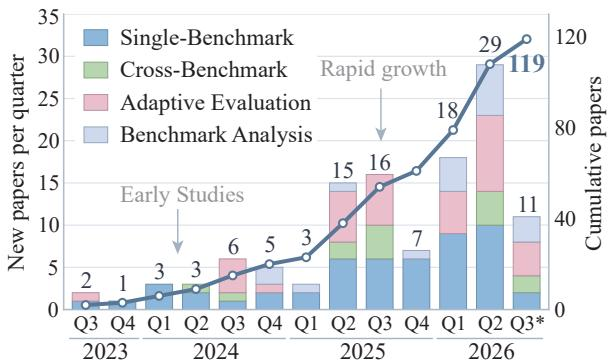
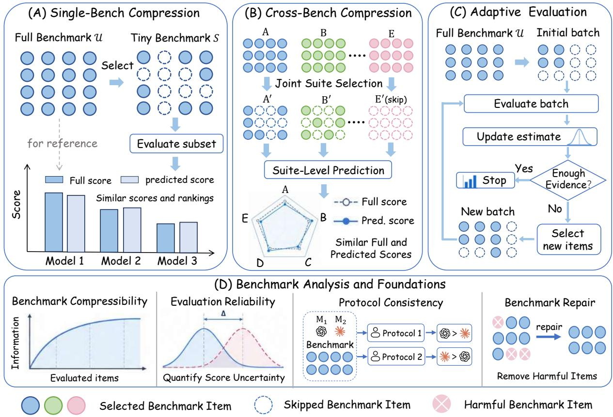
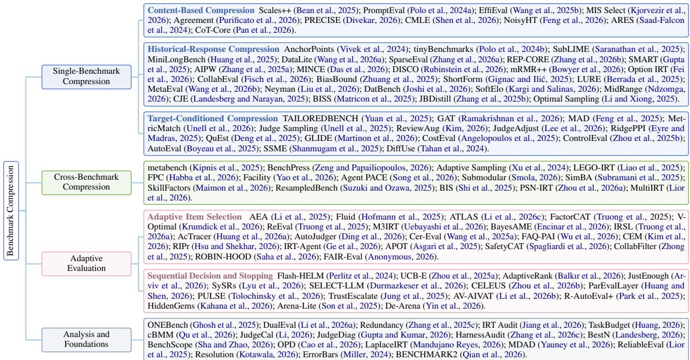
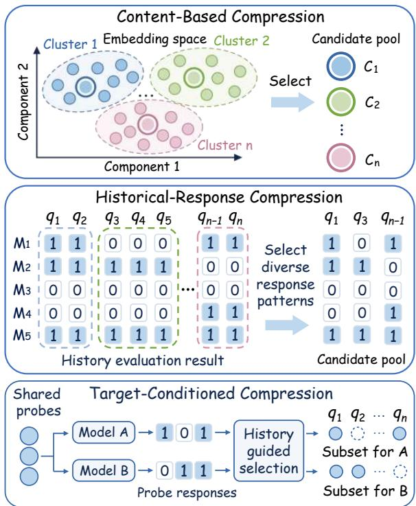

# Are We Testing Too Much? A Survey of Benchmark Compression for Efficient Evaluation of Large Language Models

Guoming Ling1, Yupei Lin1\*, Zhongzhan Huang1, Junxin Li1, Junjie Liu1, Shanshan Zhong1, Hefeng Wu1, Liang Lin1 1Sun Yat-sen University \*Co-first author

## Abstract

Benchmarks are essential for evaluating and improving large language models (LLMs). Yet many widely used benchmarks are redundant, making evaluation unnecessarily expensive. Benchmark compression lowers this cost by estimating full-benchmark scores and rankings from a partial evaluation. Research in this area has grown rapidly since 2024, but to our knowledge no survey has systematically organized its methods and findings. We review 119 papers to explain how methods choose what to evaluate, recover full-benchmark results, and verify their reliability. From this analysis, we develop a taxonomy covering compression within individual benchmarks, across benchmark suites, and during adaptive evaluation, together with work on redundancy and reliability. We compare their information needs, total costs, reliability checks, and limitations. Methods reduce evaluation costs by selecting representative sub sets, using cheaper or reusable information, and testing adaptively, but risk poor coverage, inaccurate estimates, and sequential delays. The resulting taxonomy and practical guide help researchers choose, validate, and deploy methods for more efficient and reliable LLM evaluation.

## 1 Introduction

Recently, a growing number of benchmarks have been introduced to evaluate and improve large language models (LLMs) (Cobbe et al., 2021; Hendrycks et al., 2021). Yet many of these benchmarks contain substantial redundancy. Evidence from prior studies on widely used benchmarks such as LongBench, GSM8K, and MMLU shows that fewer than 20% of the test samples can preserve results close to those of the full set (Polo et al., 2024b; Huang et al., 2025). This redundancy makes LLM evaluation unnecessarily expensive and slows model development. To address this issue, benchmark compression methods aim to reduce evaluation cost while producing results close to those of the full evaluation (Polo et al., 2024b; Saranathan et al., 2025; Huang et al., 2025; Vivek et al., 2024).

  
Figure 1: Publication trends in benchmark compression research from 2023 to August 2026. Quarterly and cumulative paper counts show rapid growth since 2024.

Since 2024, research on benchmark compression has expanded rapidly, as shown in Figure 1. Existing studies approach efficient evaluation in different ways and rely on different information, cost assumptions, and validation methods. These differences make the literature difficult to navigate and its methods difficult to compare. Researchers therefore lack clear guidance on which method fits their setting, which costs it actually reduces, and whether its results remain reliable in practice.

In this survey, we review 119 papers to analyze how benchmark compression methods choose what to evaluate and recover full-benchmark performance from partial evaluations. Based on this analysis, we organize the literature into Single-Benchmark Compression, Cross-Benchmark Compression, Adaptive Evaluation, and Benchmark Analysis and Foundations. We then compare these different types of methods in depth, examining what information they use, what they cost in practice, how they are tested, and where they fail. Across the literature, methods reduce costs through representative subsets, cheaper or reusable information, and adaptive testing. Their main risks are poor coverage, inaccurate estimates, and sequential delays. Finally, we discuss the field’s key challenges and future research directions. Together, these analyses provide a foundation for advancing benchmark compression and efficient LLM evaluation. We summarize our contributions as follows:

  
Figure 2: Overall structure of this survey. Sections 3.1 and 3.2 introduce Single-Benchmark Compression and Cross-Benchmark Compression. Sections 4 and 5 cover Adaptive Evaluation and Benchmark Analysis and Foundations.

• First systematic survey and taxonomy. To our knowledge, we provide the first systematic survey of LLM benchmark compression, synthesizing 119 papers under a common definition and introducing a principled taxonomy and decision path that organize the field by evaluation setting and available information.

• Cross-family synthesis and guidance. We compare method families in depth to clarify their requirements, reliability, and limitations, providing guidance for method selection and validation and a roadmap for future research.

## 2 Problem Formulation and Taxonomy

This section defines the common evaluation contract and then uses it to explain the fixed taxonomy.

## 2.1 Problem Formulation

Let U denote the units in a full evaluation. A unit is usually a benchmark item, but may also be a human judgment, an agent run, and so on. A full evaluation obtains an outcome for each unit, yielding $Y _ { U } .$ An aggregation rule G combines these outcomes into the full-evaluation result ${ \widehat { \theta } } _ { \mathrm { f u l l } } = G ( Y _ { \mathcal { U } } )$ , such as a score or ranking. A compressed evaluation obtains outcomes only for a lower-cost subset $s \subseteq u ,$ either fixed in advance or chosen adaptively. It may use auxiliary information $Z ,$ such as item features, historical responses, or a cheap signal from the target model. A recovery rule R uses these partial results to estimate the full-evaluation result as ${ \widehat { \theta } } _ { \mathrm { c o m p } } = R ( Y s , Z )$ . The goal is

$$
L ( \widehat { \theta } _ { \mathrm { c o m p } } , \widehat { \theta } _ { \mathrm { f u l l } } ) \leq \varepsilon \quad \mathrm { w h i l e } \quad C _ { \mathrm { c o m p } } < C _ { \mathrm { f u l l } } .
$$

Here, L measures the relevant difference in score or ranking, and C denotes evaluation cost. In short, benchmark compression uses a lower-cost partial evaluation to approximate the full-evaluation result. Appendix D.1 gives the complete formulation.

## 2.2 Taxonomy Overview

We classify each paper by asking three questions in order. Contribution type. Is the paper’s primary contribution an operational cost-reduction method or foundational analysis of benchmark evaluation and compression? Papers in the latter group form Benchmark Analysis and Foundations. Subset selection. Is the evaluated subset fixed before evaluation begins, or is it selected dynamically during evaluation? The former is static benchmark compression, and the latter is Adaptive Evaluation. Adaptive methods divide into Adaptive Item Selection, which chooses the next item, and Sequential Decision and Stopping, which governs the terminal action. Scope and information. A static method is Cross-Benchmark Compression when it jointly reduces several benchmark evaluations and Single-Benchmark Compression otherwise. Single-Benchmark Compression has three subtypes based on the information used to select items. Content-Based Compression uses benchmark-side information, Historical-Response Compression adds responses from earlier models, and Target-Conditioned Compression adds a cheap signal from the model being evaluated. Because the taxonomy is hierarchical, fixed versus dynamic subset selection is considered before benchmark scope. Scope distinguishes only methods whose evaluated subsets are fixed in advance. Each paper therefore receives one primary label based on its main contribution and evaluation design, while other properties are recorded as secondary attributes. This hierarchy provides a consistent framework for navigating the literature and comparing methods. Figure 2 and 3 show the survey framework and taxonomy, respectively. Appendix C gives the formal definitions and classification rules, and Appendix C.5 covers hybrid and boundary cases. The following sections review the work in each category in detail.

  
Figure 3: Taxonomy of LLM benchmark compression research. Studies are grouped by their primary contribution. Appendix C explains classification rules and boundary cases. Appendix A provides detailed paper tables by category.

## 3 Static Benchmark Compression

Static Benchmark Compression fixes the evaluation subset before the main evaluation begins. Methods that reduce one benchmark form Single-Benchmark Compression, as illustrated in Figure 4, whereas methods that reduce several benchmarks together form Cross-Benchmark Compression.

## 3.1 Single-Benchmark Compression

Single-Benchmark Compression evaluates a model on a fixed subset of one benchmark and uses the subset results to estimate its full-benchmark score or ranking. Based on the information used to select the subset, we divide these methods into three groups. Content-Based Compression uses sampling rules or item data, Historical-Response Compression uses results from previously evaluated models, and Target-Conditioned Compression uses a cheap signal from the current model. Table 1 compares representative methods across groups. The following subsections discuss each group further.

## 3.1.1 Content-Based Compression

Content-Based Compression builds the subset from a sampling rule or item information such as text, metadata, and representations.

  
Figure 4: Illustration of single benchmark compression. Subsets are selected using item content, historical responses, or low-cost probes of the evaluated model.

Content-Based Compression ranges from simple sampling to content-guided selection. Random and stratified sampling use sample means or group weights. PromptEval extends structured sampling to sparse prompt-by-example cells and predicts the missing cells (Polo et al., 2024a). Coreset methods group items by text, required skills, or reasoning, then aggregate selected representatives directly, with cluster weights, or with predictions for untested items (Kjorvezir et al., 2026; Bean et al., 2025; Wang et al., 2025b; Pan et al., 2026). Auxiliary scores provide another route. Content-guided probability sampling favors informative items and corrects selection with inverse-probability weighting, while calibrated-judge methods use a small human-labeled subset to correct many automated judgments (Purificato et al., 2026; Saad-Falcon et al., 2024; Divekar, 2026; Feng et al., 2026). None of these methods requires a historical modelby-item response matrix.

Content-Based Compression has low construction cost. Random and stratified sampling require little setup cost, while representation-based methods avoid collecting a large and expensive modelby-item response matrix. However, small random subsets can have high variance, and items that appear diverse in text or embedding space may still test similar abilities. Using less information can therefore make full-benchmark recovery less stable or accurate. At the same time, weaker reliance on historical response patterns may improve robustness when model behavior shifts.

## 3.1.2 Historical-Response Compression

Historical-Response Compression reuses past evaluation results to reduce the cost of testing new models. These results form a model-by-item response matrix that records each model’s performance on each item. Methods use these patterns to select representative or informative items.

Historical responses can guide item coverage, learned recovery, or statistical correction. Coverage and psychometric methods cluster items by response patterns or fit item response theory models, then recover the full score with cluster weights or an estimated ability (Vivek et al., 2024; Polo et al., 2024b; Huang et al., 2025; Wang et al., 2026b). Learned-recovery methods treat selected responses as features and predict the full score or missing item results (Saranathan et al., 2025; Zhang et al., 2026a,b; Fisch et al., 2026). Model-assisted methods retain randomized target sampling and use residual or inverse-probability correction to keep the estimate tied to the original item pool (Zhang et al., 2025a; Fisch et al., 2026; Berrada et al., 2025; Liu et al., 2026). Historical filtering is a boundary case. It keeps difficult or discriminative items and scores the refined benchmark directly rather than reconstructing the original full score (Gupta et al., 2025; Joshi et al., 2026; Zhang et al., 2025b). Each approach relies on historical patterns transferring to the new model.

Historical results may support smaller subsets or more accurate full-score estimates than item data alone. However, building the response matrix requires many full evaluations unless public results are available. Moreover, under large model shifts, such as substantial performance gains, their advantage may shrink and random sampling can remain competitive (Zhang et al., 2025a). Broad historical coverage is therefore important for generalization. Target-Conditioned Compression reduces this dependence by using signals from the current model.

## 3.1.3 Target-Conditioned Compression

Target-Conditioned Compression uses a low-cost signal from the current model, such as probe results or confidence scores, to select its subset before the main evaluation. Different models can therefore receive different fixed subsets.

<table><tr><td rowspan="2">Type</td><td rowspan="2">Method</td><td rowspan="2">Domain</td><td colspan="3">Information</td><td rowspan="2">Selection</td><td rowspan="2">Estimation</td></tr><tr><td>Features</td><td></td><td>Responses Target signal</td></tr><tr><td rowspan="3">Content</td><td>PromptEval (Polo et al., 2024a)</td><td>General</td><td>√</td><td>X</td><td>X</td><td>Balanced</td><td>Prediction</td></tr><tr><td>Scales++ (Bean et al., 2025)</td><td>General</td><td>√</td><td>X</td><td>X</td><td>Clustering</td><td>Weighted + Pred.</td></tr><tr><td>EffiEval (Wang et al., 2025b)</td><td>General</td><td>√</td><td>X</td><td>X</td><td>Coverage</td><td>Mean</td></tr><tr><td rowspan="4">History</td><td>Anchor Points (Vivek et al., 2024)</td><td>General</td><td>X</td><td>√</td><td>X</td><td>Clustering</td><td>Weighted</td></tr><tr><td>tinyBenchmarks (Polo et al., 2024b)</td><td>General</td><td>X</td><td></td><td>X</td><td>Clustering</td><td>Weighted + Pred.</td></tr><tr><td>MiniLongBench (Huang et al., 2025)</td><td>Long-context</td><td>√</td><td>√</td><td>X</td><td>Clustering</td><td>Prediction</td></tr><tr><td>SparseEval (Zhang et al., 2026a)</td><td>General</td><td>X</td><td>√</td><td>X</td><td>Optimization</td><td>Prediction</td></tr><tr><td rowspan="3">Target</td><td>TailoredBench (Yuan et al., 2025)</td><td>General</td><td>X</td><td>√</td><td></td><td>Clustering</td><td>Prediction</td></tr><tr><td>AutoEval (Boyeau et al., 2025)</td><td>General</td><td>X</td><td>X</td><td></td><td>Sampling</td><td>Pred. + Corr.</td></tr><tr><td>CVE (Zhou et al., 2025b)</td><td>Chat</td><td>X</td><td>×</td><td>√</td><td>Sampling</td><td>Pred. + Corr.</td></tr></table>

Table 1: Comparison of representative single benchmark compression methods. Pred. and Corr. denote prediction and residual correction. See Appendix A for the complete catalogue and Appendix D for detailed comparisons.

The current-model signal may guide a probe, direct item selection, or proxy correction. Probebased methods evaluate a small shared set, identify similar historical models, and use them to build a tailored subset and predict untested items (Yuan et al., 2025). Uncertainty- and disagreement-based methods favor items on which the current model is unsure or the candidates differ. Weighted sampling recovers the full score, while selected pairwise comparisons produce a winner or ranking (Ramakrishnan et al., 2026; Feng et al., 2025; Tahan et al., 2024). Proxy-correction methods score the full pool with a cheap judge and send a small fixed subset to humans. The human labels audit the judge or correct the final estimate, sometimes with more reviews assigned to likely judge errors (Unell et al., 2026, 2025; Kim, 2026; Angelopoulos et al., 2025; Boyeau et al., 2025).

Target-Conditioned Compression tailors the subset to the current model while retaining parallel batch execution. It is useful only when the probe or proxy is much cheaper than the tests or reviews saved, so its full cost must include output scans and cheap judge calls. Weak signals can miss important items or introduce systematic proxy errors. Random coverage and paired human checks provide safeguards. Judge-based methods often save human or strong-judge reviews rather than model inference, so the saved unit should be stated clearly.

## 3.2 Cross-Benchmark Compression

Single benchmark compression reduces redundancy within a single benchmark. Benchmark suites can also be redundant because different benchmarks often test similar abilities. Cross-

Benchmark Compression selects a smaller set from across the suite and uses its results to estimate the full set of benchmark scores or the suite ranking.

Cross-Benchmark Compression can remove items, complete benchmarks, or expensive target tasks. Suite-anchor methods select informative items across benchmarks and use shared ability models to recover individual scores, a suite average, or a ranking (Kipnis et al., 2025; Liao et al., 2025; Habba et al., 2026). Benchmark-selection methods run only a few complete tasks and use scorematrix completion to predict the skipped benchmark scores (Zeng and Papailiopoulos, 2026; Subramani et al., 2025; Maimon et al., 2026). Sourceto-target methods replace an expensive benchmark with cheaper proxy tasks, then estimate the target score or ranking through regression or importance weighting (Song et al., 2026; Shi et al., 2025). Multilingual tensor models extend suite-level sharing across languages (Lior et al., 2026). The saved unit thus grows from individual items to entire benchmark runs or costly environments.

Cross-Benchmark Compression is most useful when one model needs to be evaluated on several benchmarks. Joint compression reduces redundancy both within and across benchmarks, making it more efficient than compressing each benchmark independently. Some methods can even skip complete benchmarks or costly tasks. This sharing also creates the main risk: estimates rely on crossbenchmark relations that may not hold for new models, especially when learned from past suite results. Validation should therefore include unseen models, while unreliable components should be run directly. The next section turns to Adaptive Evaluation, where the subset is not fixed in advance.

<table><tr><td rowspan="2">Type</td><td rowspan="2">Method</td><td rowspan="2">Domain</td><td colspan="3">Information</td><td colspan="2">Online control</td><td rowspan="2">Selection</td><td rowspan="2">Estimation</td></tr><tr><td>Features</td><td></td><td>Responses Target signal Update</td><td></td><td>Stop</td></tr><tr><td rowspan="5">Selection</td><td>Fluid (Hofmann et al., 2025)</td><td>General</td><td>X</td><td>√</td><td>X</td><td>√</td><td>X</td><td></td><td>Fisher info. IRT ability</td></tr><tr><td>AEA (Li et al., 2025)</td><td>General</td><td>√</td><td>√</td><td>X</td><td></td><td>X</td><td>RL</td><td>Prediction</td></tr><tr><td>AutoJudger (Ding et al., 2026)</td><td>Multimodal</td><td>√</td><td>√</td><td>X</td><td>√</td><td>X</td><td>Agent</td><td>IRT ability</td></tr><tr><td>FAQ-PAI (Wu et al., 2026)</td><td>General</td><td>X</td><td>√</td><td>X</td><td>√</td><td>X</td><td>Uncertainty</td><td>Pred. + Corr.</td></tr><tr><td>IRT-Agent (Ge et al., 2026)</td><td>Code agents</td><td>X</td><td>√</td><td>X</td><td>√</td><td>X</td><td>Fisher info.</td><td>IRT ability</td></tr><tr><td rowspan="3">Stopping</td><td>Flash-HELM (Perlitz et al., 2024)</td><td>General</td><td>X</td><td>√</td><td>X</td><td>X</td><td>」</td><td>Sampling</td><td>Mean</td></tr><tr><td>CELEUS (Zhou et al., 2026b)</td><td>General</td><td>X</td><td>X</td><td>L</td><td>X</td><td>√</td><td>Uncertainty</td><td>Pred. + Corr.</td></tr><tr><td>R-AutoEval+ (Park et al., 2025)</td><td>General</td><td>X</td><td>X</td><td>√</td><td>X</td><td>L</td><td>Sampling</td><td>Pred. + Corr.</td></tr></table>

Table 2: Comparison of representative adaptive evaluation methods. Update and Stop denote feedback-driven selection and stopping. See Appendix A for the complete catalogue and Appendix D for detailed comparisons.

## 4 Adaptive Evaluation

Adaptive Evaluation uses results collected so far to decide what to test next and when to stop. Adaptive Item Selection chooses the next item to evaluate, while Sequential Decision and Stopping decides whether enough items have been tested. Table 2 compares representative adaptive methods.

## 4.1 Adaptive Item Selection

Adaptive Item Selection starts with a small set of items. After each response or batch, it updates the score, ability estimate, or uncertainty, then selects the item expected to improve the estimate most.

Adaptive Item Selection chooses the next test through ability estimation, response prediction, or uncertainty-based allocation. Computerized adaptive testing updates an item response theory ability estimate after each answer, selects the most informative next item, and maps the final ability to a score or ranking (Hofmann et al., 2025; Li et al., 2026c; Anonymous, 2026). Active matrix completion predicts the target’s untested responses and selects the item expected to improve those predictions most (Li et al., 2025; Encinar et al., 2026; Zhong et al., 2025). Other methods direct more tests to uncertain groups, rare failures, or noisy judge cells. Group weights or sampling probabilities correct uneven selection, while repeated-cell means estimate noisy comparisons (Wang et al., 2025a; Huang et al., 2026a; Wu et al., 2026; Kim et al., 2026; Saha et al., 2026). Unlike static compression, each new result can redirect later tests.

Adaptive Item Selection can reduce cost by directing later tests to the items that are most informative for the current model. This flexibility has two main costs. Sequential rounds increase wallclock time and give models different test paths, which complicates direct comparison and reproduction. Adaptive subsets may also no longer represent the full benchmark, so reliable scores depend on suitable correction and, for some methods, wellcalibrated historical data. Complete test-path logs are therefore important. Better item selection still does not determine when evaluation should stop, which is the focus of the next subsection.

## 4.2 Sequential Decision and Stopping

Sequential Decision and Stopping evaluates items in stages and checks after each stage whether more testing is needed. It may target a score with a requested precision, a reliable pairwise comparison, or the best model under a fixed budget. It may also accept, reject, escalate, or abstain.

Sequential methods save cost by stopping at a target precision, focusing a fixed budget on likely winners, or avoiding unnecessary comparisons. Staged methods stop when a score interval, rank, or pairwise difference reaches the required level, while anytime-valid methods allow checking after every result (Perlitz et al., 2024; Balkır et al., 2026; Arviv et al., 2026; Zhou et al., 2026b; Li et al., 2026b). Best-model bandits concentrate tests on plausible winners and eliminate weak candidates, sometimes using shared queries or matrix predictions (Zhou et al., 2025a; Lyu et al., 2026; Tolochinsky et al., 2026). Selective-decision methods route easy cases to cheap judges, escalate uncertain ones, or use partial tasks and tournaments to return a promotion decision, abstention, or ranking (Huang and Shen, 2026; Jung et al., 2025; Son et al., 2025).

The main advantage of sequential methods is that they spend evaluation effort where it can still change the result. They can stop once a score is precise enough or a comparison is settled, while fixed-budget methods can focus tests on competitive models. Their savings, however, depend on difficulty. Close models may require almost the full benchmark, and fixed-budget methods redistribute rather than reduce the budget. They may also return only a winner or decision instead of full scores. Reliable early stopping requires a valid sequential rule. Staged execution can also increase wall-clock time and requires complete logs for reproduction.

## 5 Benchmark Analysis and Foundations

Having reviewed the main benchmark compression methods, we now turn to foundational studies that examine four questions underlying these methods.

Why Can Benchmarks Be Compressed? Many benchmarks can be compressed because their items measure overlapping capabilities and provide limited additional discrimination among models. In a model-by-item response matrix, this redundancy appears as correlated model responses, low item discrimination, and low effective dimensionality (Ghosh et al., 2025; Zhang et al., 2025c; Qu et al., 2026; Sha and Zhao, 2026). This structure allows smaller subsets to retain information needed for score or ranking recovery. However, redundancy depends on the evaluated models and the target result. A subset that preserves an overall ranking may still distort score gaps or reverse close models.

How Many Items Can Be Removed? There is no universally safe compression ratio across benchmarks. Item response models need suitable calibration models and stable item parameters, whose uncertainty can affect selection and model comparisons (Li et al., 2026a; Jiang et al., 2026; Mandujano Reyes, 2026). The required item count also depends on the score difference of interest, paired variance, task-group coverage, and allowed error rate (Huang, 2026; Yauney et al., 2026; Kotawala, 2026; Miller, 2024). Random sampling can remain competitive with more complex selectors. When retained items cannot reliably separate two models, their comparison should remain unresolved.

Which Settings Must Stay Fixed? Full and compressed evaluations should use the same judges, prompts, decoding settings, and agent harnesses. Aggregate judge accuracy can hide local errors, and removing weaker judges can discard useful signals (Li, 2026; Gupta and Kumar, 2026; Landesberg, 2026). Prompt and harness changes can also alter model comparisons (Lior et al., 2025; Zhang et al., 2026c). Any protocol change should therefore be assessed separately from compression.

Compression or Benchmark Repair? Not every smaller benchmark is intended to reproduce the original result. Some methods remove questions whose answers can be guessed from option wording or whose outcomes conflict with the intended capability ordering (Cao et al., 2026; Qian et al., 2026). Their goal is to build a cleaner benchmark, even if model scores or rankings change. This is benchmark repair rather than score reconstruction. Compression asks whether fewer evaluations can reproduce the original result, while repair asks whether that result should remain the target. A repaired benchmark may be smaller and cheaper, but it must be validated as a new benchmark.

## 6 Comparison Across Method Families

We next compare the six compression families to guide method choice. We focus on subset selection, score recovery, lifecycle cost and limitations. Appendix D gives the detailed comparison.

## 6.1 Subset Selection: Information and Timing

Content-Based and Historical-Response Compression select a fixed subset before testing the target model. The former uses benchmark data, while the latter uses responses from earlier models. Target-Conditioned Compression first collects a cheap signal from the current model and then fixes a targetspecific batch. Cross-Benchmark Compression shares information across benchmarks and selects in advance. Adaptive Item Selection uses each new target result to choose the next item, while Sequential Decision and Stopping uses interim results to decide whether more testing is needed (Vivek et al., 2024; Yuan et al., 2025; Kipnis et al., 2025; Hofmann et al., 2025; Zhou et al., 2026b). Using later and more target-specific information can improve selection, but reduces reuse and parallelism.

## 6.2 Recovering the Full Result

Random and stratified samples support recovery through means or group weights. A deterministic coreset score may instead describe a new short form. Inverse-probability weighting targets the original pool when sampling probabilities are known, though uneven weights increase variance. Historical predictors can recover untested results but depend on transfer to new models (Purificato et al., 2026; Polo et al., 2024b; Zhang et al., 2026a). Residual or gold-label correction reduces dependence on prediction accuracy under suitable sampling conditions (Zhang et al., 2025a; Fisch et al.,

2026). Sequential methods may return only a winner, rank tier, or threshold decision. Comparisons must therefore match the recovered result.

## 6.3 Lifecycle Cost

Lifecycle cost includes subset construction, targetside signals, expensive tests, score recovery, updates, and latency. Content-Based methods avoid building a historical response matrix, although fullpool embeddings or reasoning traces still add cost. Historical-Response and Cross-Benchmark methods have higher construction and update costs, but low cost per new target when the same benchmark or suite is used repeatedly. Target-Conditioned methods pay for a probe, output scan, or cheap judge on every target, so the signal must be much cheaper than the tests or labels it removes (Polo et al., 2024b; Subramani et al., 2025; Unell et al., 2025). Adaptive methods add serial rounds, while sequential stopping is cheap for clear cases but may approach full evaluation for close models. Item count, model calls, human review, judge calls, and wall-clock time should therefore be reported separately. Appendix D.4 gives the detailed breakdown.

## 6.4 Limitations and Method Choice

Sections 3 and 4 discuss the limitations of each family, with further analysis in Appendices E and D. These limitations guide method choice alongside the available information and required result. For a single benchmark, consider Content-Based methods when only item data are available, Historical-Response methods when past evaluation records are available, and Target-Conditioned methods when a cheap, useful target signal is available. Cross-Benchmark Compression suits related benchmarks evaluated jointly. Consider Adaptive Item Selection when serial rounds are acceptable and the score estimator accounts for how items are selected. Sequential Decision and Stopping requires a valid stopping rule and may save little for close models (Zhang et al., 2025a; Jiang et al., 2026; Arviv et al., 2026; Zhou et al., 2026b). When a method’s requirements are not met, use broader random sampling, test unsupported tasks directly, continue evaluation, or abstain. Appendix D.6 summarizes these checks and choices.

## 7 Challenges and Future Directions

Beyond statistical reliability, benchmark compression must also generalize to future models and gain broader adoption in the evaluation community.

Generalization Across Models and Over Time. Many compressed subsets are selected using response records from existing models. Models from other families and newer, more capable models may show different response patterns, which may reduce the subset’s coverage and discrimination. Future work should develop compression methods that transfer more reliably across models and over time. Compressed benchmarks should also be tested on newly released models and updated through periodic or continuous refresh mechanisms when their coverage or discrimination declines.

Updating Established Benchmarks. Although studies have found redundancy in established benchmarks, full results remain necessary for comparison with leaderboards and prior work. Researchers therefore often need to run complete evaluations for formal reporting. Compression still reduces costs during model iteration, screening, and repeated validation. A promising direction is to combine compression with benchmark repair and release a recalibrated version that removes flawed, redundant, overly easy, or weakly discriminating items. This could lower cost while improving discrimination among stronger models, providing a cheaper and more informative shared reference.

Compression Before Release. For new benchmarks, compression should be integrated into benchmark construction before release. The public version should use a compact but informative item set that covers the intended model capabilities from the outset, rather than publishing a large redundant benchmark and compressing it later. This compression by design can accelerate evaluation and model iteration while reducing unnecessary computational and environmental costs.

## 8 Conclusion

In this survey, we introduced a unified taxonomy for benchmark compression in LLM evaluation. We also compared method families by their information needs, costs, and reliability. Our analysis shows that methods reduce costs by evaluating representative items, using cheaper or reusable information to estimate omitted results, and focusing further evaluation on uncertain cases. Reliable compression requires sufficient coverage, accurate recovery, and valid adaptive decisions. More broadly, efficient evaluation should collect useful information at lower cost while preserving reliable results.

## Limitations

This survey has three limitations. First, it covers work only through August 2026, so subsequent studies are not included. We will continue to update the survey as new research appears. Second, space constraints and the rapid growth of benchmark compression prevent the main text from describing every method in detail. We therefore focus on a high-level taxonomy and roadmap that help readers quickly understand the field as a whole, its main method families, and their relationships. Appendix E provides detailed descriptions of representative methods, while Appendix D presents indepth comparisons across method families. Third, studies use widely different evaluation settings, making their results difficult to compare or combine quantitatively. Fortunately, our common formulation and comparison framework make these differences explicit, supporting more consistent reporting and future quantitative synthesis.

## References

Anastasios N Angelopoulos, Jacob Eisenstein, Jonathan Berant, Alekh Agarwal, and Adam Fisch. 2025. Costoptimal active ai model evaluation. arXiv preprint arXiv:2506.07949.

Anonymous. 2026. FAIR-eval: Reliable and efficient adaptive benchmarking for large language models. In Submitted to ACL Rolling Review - May 2026. Under review.

Ofir Arviv, Kristjan Greenewald, Yotam Perlitz, Hadar Mulian, Michal Shmueli-Scheuer, and Leshem Choshen. 2026. Stop guessing when to stop testing: Efficient model evaluation with just enough data. In Findings of the Association for Computational Linguistics: ACL 2026, pages 871–881.

Ali Asgari, Antonio Guerriero, Roberto Pietrantuono, and Stefano Russo. 2025. Adaptive probabilistic operational testing for large language models evaluation. In 2025 IEEE/ACM International Conference on Automation of Software Test (AST), pages 103– 113. IEEE.

Esma Balkır, Alice Pernthaller, Marco Basaldella, José Hernández-Orallo, and Nigel Collier. 2026. Confident rankings with fewer items: Adaptive llm evaluation with continuous scores. arXiv preprint arXiv:2601.13885.

Andrew M Bean, Nabeel Seedat, Shengzhuang Chen, and Jonathan Richard Schwarz. 2025. Scales++: Compute efficient evaluation subset selection with cognitive scales embeddings. arXiv preprint arXiv:2510.26384.

Gabrielle Berrada, Jannik Kossen, Freddie Bickford Smith, Muhammed Razzak, Yarin Gal, and Thomas Rainforth. 2025. Scaling up active testing to large language models. In Advances in Neural Information Processing Systems, volume 38, Main Conference, pages 173670–173697. Curran Associates, Inc.

Sam Bowyer, Acyr Locatelli, and Kris Cao. 2026. Efficient benchmarking is just feature selection and multiple regression. arXiv preprint arXiv:2605.25773.

Pierre Boyeau, Anastasios Nikolas Angelopoulos, Tianle Li, Nir Yosef, Jitendra Malik, and Michael I. Jordan. 2025. AutoEval done right: Using synthetic data for model evaluation. In Proceedings of the 42nd International Conference on Machine Learning, volume 267 of Proceedings of Machine Learning Research, pages 5276–5290. PMLR.

Boxi Cao, Ruotong Pan, Hongyu Lin, Xianpei Han, and Le Sun. 2026. Does question really matter? the attribution of answer bias in llm evaluation. In Proceedings of the AAAI Conference on Artificial Intelligence, volume 40, pages 30130–30138.

Yupeng Chang, Xu Wang, Jindong Wang, Yuan Wu, Linyi Yang, Kaijie Zhu, Hao Chen, Xiaoyuan Yi, Cunxiang Wang, Yidong Wang, et al. 2024. A survey on evaluation of large language models. ACM transactions on intelligent systems and technology, 15(3):1–45.

Simin Chen, Yiming Chen, Zexin Li, Yifan Jiang, Zhongwei Wan, Yixin He, Dezhi Ran, Tianle Gu, Haizhou Li, Tao Xie, and Baishakhi Ray. 2025. Benchmarking large language models under data contamination: A survey from static to dynamic evaluation. In Proceedings of the 2025 Conference on Empirical Methods in Natural Language Processing, pages 10080–10098, Suzhou, China. Association for Computational Linguistics.

Karl Cobbe, Vineet Kosaraju, Mohammad Bavarian, Mark Chen, Heewoo Jun, Lukasz Kaiser, Matthias Plappert, Jerry Tworek, Jacob Hilton, Reiichiro Nakano, et al. 2021. Training verifiers to solve math word problems. arXiv preprint arXiv:2110.14168.

Devleena Das, Rajeev Patwari, Vikram Kumar Bukka, Nithin Kumar Guggilla, Elliott Delaye, and Ashish Sirasao. 2026. Mince: Shrinking llm evaluation datasets via few-model monte carlo calibration. arXiv preprint arXiv:2606.22826.

Zhun Deng, Thomas P Zollo, Benjamin Eyre, Amogh Inamdar, David Madras, and Richard Zemel. 2025. Quest: Enhancing estimates of quantile-based distributional measures using model predictions. arXiv preprint arXiv:2507.05220.

Xuanwen Ding, Chengjun Pan, Zejun Li, Jiwen Zhang, Siyuan Wang, and Zhongyu Wei. 2026. Autojudger: An agent-driven framework for efficient benchmarking of mllms. In Proceedings of the 64th Annual

Meeting of the Association for Computational Linguistics (Volume 1: Long Papers), pages 15009– 15034.

Abhishek Divekar. 2026. Statistically reliable llm-based ranking evaluation via prediction-powered inference. arXiv preprint arXiv:2606.05308.

Yavuz Durmazkeser, Patrik Okanovic, Andreas Kirsch, Torsten Hoefler, and Nezihe Merve Gürel. 2026. Large language model selection with limited annotations. arXiv preprint arXiv:2605.24981.

Paula Cordero Encinar, Taylan Cemgil, Arnaud Doucet, Virginia Aglietti, and Silvia Chiappa. 2026. Bayesame: Bayesian active model evaluation. arXiv preprint arXiv:2607.27023.

Benjamin Eyre and David Madras. 2025. Regression for the mean: Auto-evaluation and inference with few labels through post-hoc regression. In Proceedings of the 42nd International Conference on Machine Learning, volume 267 of Proceedings of Machine Learning Research, pages 15596–15612. PMLR.

Xiao Fei, Yang Zhang, Sarah Almeida Carneiro, and Michalis Vazirgiannis. 2026. Every wrong answer counts: Option-level psychometrics for llm multiple-choice benchmarks. arXiv preprint arXiv:2608.02966.

Chen Feng, Minghe Shen, Ananth Balashankar, Carsten Gerner-Beuerle, and Miguel Rodrigues. 2026. Noisy but valid: Robust statistical evaluation of llms with imperfect judges. In International Conference on Learning Representations, volume 2026, pages 4643– 4691.

Kehua Feng, Keyan Ding, Tan Hongzhi, Kede Ma, Zhihua Wang, Shuangquan Guo, Cheng Yuzhou, Ge Sun, Guozhou Zheng, Qiang Zhang, et al. 2025. Sampleefficient human evaluation of large language models via maximum discrepancy competition. In Proceedings of the 63rd Annual Meeting of the Association for Computational Linguistics (Volume 1: Long Papers), pages 10913–10947.

Adam Fisch, Daniel Deutsch, Joshua Maynez, Alekh Agarwal, Jonathan Berant, William Cohen, Amir Globerson, and Jacob Eisenstein. 2026. Collabeval: Statistically efficient collaborative model evaluation via matrix completion. arXiv preprint arXiv:2607.05046.

Chris Ge, Daria Kryvosheieva, Daniel Fried, Uzay Girit, and Kaivalya Hariharan. 2026. Agent psychometrics: Task-level performance prediction in agentic coding benchmarks. arXiv preprint arXiv:2604.00594.

Adhiraj Ghosh, Sebastian Dziadzio, Ameya Prabhu, Vishaal Udandarao, Samuel Albanie, and Matthias Bethge. 2025. Onebench to test them all: Samplelevel benchmarking over open-ended capabilities. In Proceedings of the 63rd Annual Meeting of the Associationfor Computational Linguistics (Volume 1: Long Papers), pages 32445–32481.

Gilles E Gignac and David Ilic. 2025. Psychometrically´ derived 60-question benchmarks: Substantial efficiencies and the possibility of human-ai comparisons. Intelligence, 110:101922.

Jiawei Gu, Xuhui Jiang, Zhichao Shi, Hexiang Tan, Xuehao Zhai, Chengjin Xu, Wei Li, Yinghan Shen, Shengjie Ma, Honghao Liu, et al. 2026. A survey on llm-as-a-judge. The Innovation, 7(6).

Manan Gupta and Dhruv Kumar. 2026. Diagnosing llm judge reliability: Conformal prediction sets and transitivity violations. arXiv preprint arXiv:2604.15302.

Vipul Gupta, Candace Ross, David Pantoja, Rebecca J Passonneau, Megan Ung, and Adina Williams. 2025. Improving model evaluation using smart filtering of benchmark datasets. In Proceedings ofthe 2025 Conference ofthe Nations ofthe Americas Chapter ofthe Association for Computational Linguistics: Human Language Technologies (Volume 1: Long Papers), pages 4595–4615.

Eliya Habba, Itay Itzhak, Asaf Yehudai, Yotam Perlitz, Elron Bandel, Michal Shmueli-Scheuer, Leshem Choshen, and Gabriel Stanovsky. 2026. Growing pains: Extensible and efficient llm benchmarking via fixed parameter calibration. arXiv preprint arXiv:2604.12843.

Dan Hendrycks, Collin Burns, Steven Basart, Andy Zou, Mantas Mazeika, Dawn Song, and Jacob Steinhardt. 2021. Measuring massive multitask language understanding. In International Conference on Learning Representations.

Valentin Hofmann, David Heineman, Ian Magnusson, Kyle Lo, Jesse Dodge, Maarten Sap, Pang Wei Koh, Chun Wang, Hannaneh Hajishirzi, and Noah A Smith. 2025. Fluid language model benchmarking. arXiv preprint arXiv:2509.11106.

Chia-Yu Hsu and Shubhanshu Shekhar. 2026. Efficient sequential evaluation of large language models. arXiv preprint arXiv:2607.17409.

Wei-Jung Huang. 2026. How many tasks are enough for agent benchmark decisions? a replay analysis of public llm agent benchmarks. arXiv preprint arXiv:2607.12338.

Wei-Jung Huang and Bonan Shen. 2026. Parevallayer: When partial llm-agent evaluations support a decision. arXiv preprint arXiv:2608.02444.

Yuheng Huang, Jiayang Song, Qiang Hu, Felix Juefei-Xu, and Lei Ma. 2026a. Actracer: Active testing of large language model via multi-stage sampling. ACM Transactions on Software Engineering and Methodology, 35(3):1–30.

Zhongzhan Huang, Junxin Li, Guoming Ling, Yupei Lin, Shanshan Zhong, and Hefeng Wu. 2026b. Zipbench: Low-cost framework for compressing comprehensive benchmarks of large language models. Preprint, arXiv:2609.12475.

Zhongzhan Huang, Guoming Ling, Shanshan Zhong, Hefeng Wu, and Liang Lin. 2025. Minilongbench: the low-cost long context understanding benchmark for large language models. In Proceedings of the 63rd Annual Meeting ofthe Associationfor Computational Linguistics (Volume 1: Long Papers), pages 11442–11460.

Nadir ˙Ibrahimoglu, Mustafa Umut Demirezen, and˘ Furkan Yıldız. 2026. Systematic survey of large language model evaluation: Methods, benchmarks, and comprehensive taxonomic framework. International Journal ofComputational Intelligence Systems.

Han Jiang, Sunbeom Kwon, Jinwen Luo, Ziang Xiao, and Susu Zhang. 2026. Can we trust item response theory for ai evaluation? arXiv preprint arXiv:2607.15190.

Siddharth Joshi, Haoli Yin, Rishabh Adiga, Ricardo Monti, Aldo Carranza, Alex Fang, Alvin Deng, Amro Abbas, Brett Larsen, Cody Blakeney, et al. 2026. Datbench: Discriminative, faithful, and efficient vlm evaluations. arXiv preprint arXiv:2601.02316.

Jaehun Jung, Faeze Brahman, and Yejin Choi. 2025. Trust or escalate: Llm judges with provable guarantees for human agreement. In International Conference on Learning Representations, volume 2025, pages 3101–3125.

Jonathan Kahana, Eliahu Horwitz, and Yedid Hoshen. 2026. Discovering hidden gems in model repositories. arXiv preprint arXiv:2601.22157.

Bora Kargi and David Salinas. 2026. From uncertain judgments to calibrated rankings: Conformal elo estimation for llm evaluation. arXiv preprint arXiv:2606.13221.

Eungyeup Kim, Chenchen Gu, Vashisth Tiwari, and J Zico Kolter. 2026. Measuring five-nines reliability: Sample-efficient llm evaluation in saturated benchmarks. arXiv preprint arXiv:2605.11209.

Jane Paik Kim. 2026. Augmenting human evaluation with llm judges: How many human reviews do you need? arXiv preprint arXiv:2605.16354.

Alex Kipnis, Konstantinos Voudouris, Luca Schulze Buschoff, and Eric Schulz. 2025. metabench-a sparse benchmark of reasoning and knowledge in large language models. In International Conference on Learning Representations, volume 2025, pages 31734–31770.

Denica Kjorvezir, Marko Djukanovic, Ana Gjorgjevikj,´ Gjorgjina Cenikj, and Tome Eftimov. 2026. Consistent and distinctive: Llm benchmark efficiency via maximum independent set prompt selection on similarity graphs. arXiv preprint arXiv:2606.01400.

Anany Kotawala. 2026. Resolution diagnostics for paired llm evaluation. arXiv preprint arXiv:2605.30315.

Michael Krumdick, Adam Wiemerslage, Seth Ebner, Charles Lovering, and Chris Tanner. 2026. Costefficient estimation of general abilities across benchmarks. arXiv preprint arXiv:2604.01418.

Eddie Landesberg. 2026. When llm judge scores look good but best-of-n decisions fail. arXiv preprint arXiv:2603.12520.

Eddie Landesberg and Manjari Narayan. 2025. Causal judge evaluation: Calibrated surrogate metrics for llm systems. arXiv preprint arXiv:2512.11150.

Md Tahmid Rahman Laskar, Sawsan Alqahtani, M Saiful Bari, Mizanur Rahman, Mohammad Abdullah Matin Khan, Haidar Khan, Israt Jahan, Amran Bhuiyan, Chee Wei Tan, Md Rizwan Parvez, et al. 2024. A systematic survey and critical review on evaluating large language models: Challenges, limitations, and recommendations. In Proceedings of the 2024 Conference on empirical methods in natural language processing, pages 13785–13816.

Chungpa Lee, Thomas Zeng, Jongwon Jeong, Jy-Yong Sohn, and Kangwook Lee. 2026. How to correctly report LLM-as-a-judge evaluations. In Proceedings of the 43rd International Conference on Machine Learning, volume 306 of Proceedings of Machine Learning Research, pages 65231–65252. PMLR.

Aaron J Li, Hao Huang, Youngmin Park, Yitong Ma, Wei-Lin Chiang, Li Chen, Cho-Jui Hsieh, Bin Yu, and Ion Stoica. 2026a. Dualeval: Joint model-item calibration for unified llm evaluation. arXiv preprint arXiv:2606.26429.

Boning Li, Yu Chen, and Longbo Huang. 2026b. Av-aivat: 74x cheaper agent evaluation with certified anytime-valid stopping in imperfect-information games. arXiv preprint arXiv:2608.06362.

Guohong Li and Deyi Xiong. 2025. Towards optimal evaluation efficiency for large language models. In Proceedings of the 2025 Conference on Empirical Methods in Natural Language Processing, pages 14176–14183, Suzhou, China. Association for Computational Linguistics.

Peiyu Li, Xiuxiu Tang, Si Chen, Ying Cheng, Ronald Metoyer, Ting Hua, and Nitesh V Chawla. 2026c. Adaptive testing for LLM evaluation: A psychometric alternative to static benchmarks. In Proceedings of the 43rd International Conference on Machine Learning, volume 306 of Proceedings of Machine Learning Research, pages 70246–70269. PMLR.

Yang Li, Jie Ma, Miguel Ballesteros, Yassine Benajiba, and Graham Horwood. 2025. Active evaluation acquisition for efficient LLM benchmarking. In Proceedings of the 42nd International Conference on Machine Learning, volume 267 of Proceedings of Machine Learning Research, pages 35581–35602. PMLR.

Yanran Li. 2026. Calibrate, don’t curate: Label-efficient estimation from noisy llm judges. arXiv preprint arXiv:2605.09702.

Lele Liao, Qile Zhang, Ruofan Wu, and Guanhua Fang. 2025. Toward a unified framework for data-efficient evaluation of large language models. arXiv preprint arXiv:2510.04051.

Guoming Ling, Zhongzhan Huang, Yupei Lin, Junxin Li, Shanshan Zhong, Hefeng Wu, and Liang Lin. 2026. Neural chain-of-thought search: Searching the optimal reasoning path to enhance large language models. Preprint, arXiv:2601.11340.

Gili Lior, Tzviel Frostig, Gabriel Stanovsky, and Matan Eyal. 2026. Extending item response theory for efficient and meaningful multilingual evaluation. arXiv preprint arXiv:2606.15643.

Gili Lior, Eliya Habba, Shahar Levy, Avi Caciularu, and Gabriel Stanovsky. 2025. Reliableeval: A recipe for stochastic llm evaluation via method of moments. In EMNLP (Findings), pages 11146–11153.

Zeli Liu, Jiancheng Zhang, Cong Liu, and Yinglun Zhu. 2026. Active testing of large language models via approximate neyman allocation. arXiv preprint arXiv:2605.10075.

Zifan Lyu, Chahine Nejma, Tobias Wegel, Fanny Yang, and Florian E. Dorner. 2026. Cutting LLM evaluation costs with SySRs: A bandit algorithm that provably exploits model similarity. In Proceedings of the 43rd International Conference on Machine Learning, volume 306 of Proceedings of Machine Learning Research, pages 83945–83983. PMLR.

Aviya Maimon, Amir David Nisan Cohen, Gal Vishne, Shauli Ravfogel, and Reut Tsarfaty. 2026. From benchmarks to skills: Low-rank factors for LLM evaluation. Transactions ofthe Associationfor Computational Linguistics, 14:1660–1684.

Juan Francisco Mandujano Reyes. 2026. Laplace-psnirt: Uncertainty quantification for neural item response theory models of llm benchmarks. arXiv preprint arXiv:2607.25257.

Grégoire Martinon, Ibrahim Merad, and Mohammed Raki. 2026. Industrializing prediction-powered inference: The glide library for reliable genai and agentic systems evaluation. arXiv preprint arXiv:2605.31278.

Théo Matricon, Mathieu Acher, Helge Spieker, and Arnaud Gotlieb. 2025. Efficiently ranking software variants with minimal benchmarks. arXiv preprint arXiv:2509.06716.

Evan Miller. 2024. Adding error bars to evals: A statistical approach to language model evaluations. arXiv preprint arXiv:2411.00640.

Franck Ndzomga. 2026. Efficient benchmarking of ai agents. arXiv preprint arXiv:2603.23749.

Shiwen Ni, Guhong Chen, Shuaimin Li, Xuanang Chen, Siyi Li, Bingli Wang, Qiyao Wang, Xingjian Wang, Yifan Zhang, Liyang Fan, et al. 2025. A survey on

large language model benchmarks. arXiv preprint arXiv:2508.15361.

Qihua Pan, Zhenheng Tang, Peijie Dong, Xiang Liu, Huacan Wang, Bo Li, and Xiaowen Chu. 2026. Cotcore: Accelerating llm evaluation via cot-aware coreset selection. Preprint, arXiv:2608.00014.

Sangwoo Park, Matteo Zecchin, and Osvaldo Simeone. 2025. Adaptive prediction-powered autoeval with reliability and efficiency guarantees. In Advances in Neural Information Processing Systems, volume 38, Main Conference, pages 158758–158784. Curran Associates, Inc.

Yotam Perlitz, Elron Bandel, Ariel Gera, Ofir Arviv, Liat Ein Dor, Eyal Shnarch, Noam Slonim, Michal Shmueli-Scheuer, and Leshem Choshen. 2024. Efficient benchmarking (of language models). In Proceedings ofthe 2024 Conference ofthe North American Chapter ofthe Associationfor Computational Linguistics: Human Language Technologies (Volume 1: Long Papers), pages 2519–2536.

Felipe M Polo, Ronald Xu, Lucas Weber, Mírian Silva, Onkar Bhardwaj, Leshem Choshen, Allysson F de Oliveira, Yuekai Sun, and Mikhail Yurochkin. 2024a. Efficient multi-prompt evaluation of llms. Advances in Neural Information Processing Systems, 37:22483–22512.

Felipe Maia Polo, Lucas Weber, Leshem Choshen, Yuekai Sun, Gongjun Xu, and Mikhail Yurochkin. 2024b. tinybenchmarks: evaluating llms with fewer examples. arXiv preprint arXiv:2402.14992.

Antonio Purificato, Maria Sofia Bucarelli, Andrea Bacciu, Amin Mantrach, and Fabrizio Silvestri. 2026. Select, label, evaluate: Active testing in nlp. arXiv preprint arXiv:2603.21840.

Qi Qian, Chengsong Huang, Jingwen Xu, Changze Lv, Muling Wu, Wenhao Liu, Xiaohua Wang, Zhenghua Wang, Zisu Huang, Muzhao Tian, et al. 2026. Benchmark2: Systematic evaluation of llm benchmarks. arXiv preprint arXiv:2601.03986.

Xinhao Qu, Qiang Heng, Hao Zeng, and Xiaoqian Liu. 2026. An interpretable and scalable framework for evaluating large language models. arXiv preprint arXiv:2605.07046.

Aashish Anantha Ramakrishnan, Ardavan Saeedi, Hamid Reza Hassanzadeh, Fazlolah Mohaghegh, and Dongwon Lee. 2026. Generative active testing: Efficient llm evaluation via proxy task adaptation. arXiv preprint arXiv:2603.19264.

Alexander Rubinstein, Benjamin Raible, Martin Gubri, and Seong Joon Oh. 2026. Disco: Diversifying sample condensation for efficient model evaluation. In International Conference on Learning Representations, volume 2026, pages 15229–15255.

Jon Saad-Falcon, Omar Khattab, Christopher Potts, and Matei Zaharia. 2024. Ares: An automated evaluation framework for retrieval-augmented generation systems. In Proceedings of the 2024 Conference of the North American Chapter ofthe Associationfor Computational Linguistics: Human Language Technologies (Volume 1: Long Papers), pages 338–354.

Aadirupa Saha, Aniket Wagde, and Branislav Kveton. 2026. Llm-as-judge on a budget. arXiv preprint arXiv:2602.15481.

Gayathri Saranathan, Cong Xu, Mahammad Parwez Alam, Tarun Kumar, Martin Foltin, Soon Yee Wong, and Suparna Bhattacharya. 2025. Sublime: Subset selection via rank correlation prediction for dataefficient llm evaluation. In Proceedings of the 63rd Annual Meeting of the Association for Computational Linguistics (Volume 1: Long Papers), pages 30572– 30593.

Tommy Sha and Stella Zhao. 2026. Benchscope: How many independent signals does your benchmark provide? arXiv preprint arXiv:2603.29357.

Divya Shanmugam, Shuvom Sadhuka, Manish Raghavan, John Guttag, Bonnie Berger, and Emma Pierson. 2025. Evaluating multiple models using labeled and unlabeled data. In Advances in Neural Information Processing Systems, volume 38, Main Conference, pages 30612–30648. Curran Associates, Inc.

Saeid Sheikhi, Lauri Loven, and Panos Kostakos. 2026. Beyond the leaderboard: A survey of the science of evaluation, benchmarking, and methodologies for large language models. IEEE Access.

Minghe Shen, Ananth Balashankar, Adam Fisch, David Madras, and Miguel Rodrigues. 2026. Robust llm performance certification via constrained maximum likelihood estimation. arXiv preprint arXiv:2604.03257.

Junjie Shi, Wei Ma, Shi Ying, Lingxiao Jiang, Yang liu, and Bo Du. 2025. Importance sampling is all you need: Predict llm’s performance on new benchmark by reusing existing benchmark. Preprint, arXiv:2508.01203.

Alexander Smola. 2026. Submodular benchmark selection. arXiv preprint arXiv:2605.02209.

Seonil Son, Ju-Min Oh, Heegon Jin, Cheolhun Jang, Jeongbeom Jeong, and KunTae Kim. 2025. Arenalite: Efficient and reliable large language model evaluation via tournament-based direct comparisons. In Proceedings of the 2025 Conference on Empirical Methods in Natural Language Processing, pages 7057–7075, Suzhou, China. Association for Computational Linguistics.

Yueqi Song, Lintang Sutawika, Jiarui Liu, Lindia Tjuatja, Jiayi Geng, Yunze Xiao, Daniel Lee, Aditya Bharat Soni, Vincent Lo, Xiang Yue, et al. 2026. Pace: A proxy for agentic capability evaluation. arXiv preprint arXiv:2607.02032.

Fabio Spagliardi, Mírian Silva, Ayan Datta, Aiden Zhou, Vamshi Bonagiri, and Diogo Cruz. 2026. Efficient safety benchmarking via item response theory. arXiv preprint arXiv:2606.20626.

Nishant Subramani, Alfredo Gomez, and Mona T Diab. 2025. Simba: Simplifying benchmark analysis using performance matrices alone. In EMNLP (Findings), pages 13220–13233.

Teppei Suzuki and Keisuke Ozawa. 2025. Resampling benchmark for efficient comprehensive evaluation of large vision-language models. arXiv preprint arXiv:2504.09979.

Shir Ashury Tahan, Ariel Gera, Benjamin Sznajder, Leshem Choshen, Liat Ein Dor, and Eyal Shnarch. 2024. Label-efficient model selection for text generation. In Proceedings ofthe 62nd Annual Meeting of the Associationfor Computational Linguistics (Volume 1: Long Papers), pages 8384–8402.

Elad Tolochinsky, Yaniv Tenzer, and Yaniv Romano. 2026. Valid best-model identification for llm evaluation via low-rank factorization. arXiv preprint arXiv:2605.10405.

Sang Truong, Yuheng Tu, Percy Liang, Bo Li, and Sanmi Koyejo. 2025. Reliable and efficient amortized model-based evaluation. arXiv preprint arXiv:2503.13335.

Sang T. Truong, Yuheng Tu, Rylan Schaeffer, and Sanmi Koyejo. 2026a. Item response scaling laws: A measurement theory approach for efficient and generalizable neural scaling estimation. In Proceedings of the 43rd International Conference on Machine Learning, volume 306 of Proceedings of Machine Learning Research, pages 122297–122315. PMLR.

Sang T. Truong, Yukang Wen, Nick Haber, Sanmi Koyejo, Miroslav Dudík, and Alex Chouldechova. 2026b. Beyond mean scores: Factor models for reliable and efficient AI evaluation.

Shunki Uebayashi, Kento Masui, Kyohei Atarashi, Han Bao, Hisashi Kashima, Naoto Inoue, Mayu Otani, and Koh Takeuchi. 2026. Evaluating cross-modal reasoning ability and problem characteristics with multimodal item response theory. arXiv preprint arXiv:2603.02663.

Alyssa Unell, Natalie Dullerud, Naomi Boneh, Meena Jagadeesan, Tatsu Hashimoto, Nigam Shah, and Sanmi Koyejo. 2026. Metric match: A subset selection approach to evaluating llm judge reliability. arXiv preprint arXiv:2606.15029.

Alyssa Unell, Natalie Dullerud, Nils Kasper, Nigam Shah, and Sanmi Koyejo. 2025. Smarter sampling for LLM judges: Reliable evaluation on a budget. In NeurIPS 2025 Workshop on Evaluating the Evolving LLM Lifecycle: Benchmarks, Emergent Abilities, and Scaling.

Rajan Vivek, Kawin Ethayarajh, Diyi Yang, and Douwe Kiela. 2024. Anchor points: Benchmarking models with much fewer examples. In Proceedings of the 18th Conference of the European Chapter of the Associationfor Computational Linguistics (Volume 1: Long Papers), pages 1576–1601.

Ganghua Wang, Zhaorun Chen, Bo Li, and Haifeng Xu. 2025a. Cer-eval: Certifiable and cost-efficient evaluation framework for llms. arXiv preprint arXiv:2505.03814.

Shaobo Wang, Cong Wang, Wenjie Fu, Yue Min, Mingquan Feng, Isabel Guan, Xuming Hu, Conghui He, Cunxiang Wang, Kexin Yang, Xingzhang Ren, Fei Huang, Dayiheng Liu, and Linfeng Zhang. 2026a. Rethinking LLM evaluation: Can we evaluate LLMs with 200× less data? In The Fourteenth International Conference on Learning Representations.

Yaoning Wang, Jiahao Ying, Yixin Cao, Yubo Ma, and Yugang Jiang. 2025b. Effieval: Efficient and generalizable model evaluation via capability coverage maximization. arXiv preprint arXiv:2508.09662.

Zhuo Wang, Wen Wu, Guoqing Wang, Guangze Ye, and Zhenxiao Cheng. 2026b. Metaeval: Measuring the discrimination of benchmarks for efficient llm evaluation. In Proceedings of the AAAI Conference on Artificial Intelligence, volume 40, pages 33773– 33781.

Skyler Wu, Yash Nair, and Emmanuel J Candès. 2026. Efficient evaluation of llm performance with statistical guarantees. arXiv preprint arXiv:2601.20251.

Cong Xu, Gayathri Saranathan, Mahammad Parwez Alam, Arpit Shah, James Lim, Soon Yee Wong, Foltin Martin, and Suparna Bhattacharya. 2024. Data efficient evaluation of large language models and text-to-image models via adaptive sampling. arXiv preprint arXiv:2406.15527.

Jihan Yao, Gantavya Bhatt, Arnav Das, Peter Jin, Ke Bao, Qiaolin Yu, Khushi Bhardwaj, Chang Su, Jialei Wang, Yikai Zhu, et al. 2026. Coresets before score sets: Evaluation-unsupervised prompt subset selection for llm benchmarks. arXiv preprint arXiv:2607.09739.

Gregory Yauney, Shahzaib Warraich, and Swabha Swayamdipta. 2026. How reliable is language model micro-benchmarking? In International Conference on Learning Representations, volume 2026, pages 27389–27412.

Haoran Ye, Jing Jin, Yuhang Xie, Xin Zhang, and Guojie Song. 2025. Large language model psychometrics: A systematic review of evaluation, validation, and enhancement. arXiv preprint arXiv:2505.08245.

Yanbin Yin, Kun Zhou, Zhen Wang, Xiangdong Zhang, Yifei Shao, Shibo Hao, Yi Gu, Jieyuan Liu, Somanshu Singla, Tianyang Liu, et al. 2026. Decentralized arena: Towards democratic and scalable automatic evaluation of language models. In Proceedings of the

64th Annual Meeting of the Association for Computational Linguistics (Volume 1: Long Papers), pages 35453–35469.

Peiwen Yuan, Yueqi Zhang, Shaoxiong Feng, Yiwei Li, Xinglin Wang, Jiayi Shi, Chuyi Tan, Boyuan Pan, Yao Hu, and Kan Li. 2025. Beyond one-size-fitsall: Tailored benchmarks for efficient evaluation. In Proceedings of the 63rd Annual Meeting of the Associationfor Computational Linguistics (Volume 1: Long Papers), pages 15591–15615.

Yuchen Zeng and Dimitris Papailiopoulos. 2026. You don’t need to run every eval. arXiv preprint arXiv:2606.24020.

Guanhua Zhang, Florian E. Dorner, and Moritz Hardt. 2025a. How benchmark prediction from fewer data misses the mark. In Advances in Neural Information Processing Systems, volume 38, Main Conference, pages 135638–135678. Curran Associates, Inc.

Jingyu Zhang, Ahmed Elgohary, Xiawei Wang, ASM Iftekhar, Ahmed Magooda, Benjamin Van Durme, Daniel Khashabi, and Kyle Jackson. 2025b. Jailbreak distillation: Renewable safety benchmarking. arXiv preprint arXiv:2505.22037.

Taolin Zhang, Hang Guo, Wang Lu, Tao Dai, Shu-Tao Xia, and Jindong Wang. 2026a. Sparseeval: Efficient evaluation of large language models by sparse optimization. arXiv preprint arXiv:2602.07909.

Yueqi Zhang, Jin Hu, Shaoxiong Feng, Peiwen Yuan, Xinglin Wang, Yiwei Li, Jiayi Shi, Chuyi Tan, Ji Zhang, Boyuan Pan, Yao Hu, and Kan Li. 2026b. Learning more from less: Unlocking internal representations for benchmark compression. In Proceedings of the 43rd International Conference on Machine Learning, volume 306 of Proceedings of Machine Learning Research, pages 155744–155784. PMLR.

Yunbei Zhang, Janet Wang, Yingqiang Ge, Weijie Xu, Jihun Hamm, and Chandan K Reddy. 2026c. Stop comparing llm agents without disclosing the harness. arXiv preprint arXiv:2605.23950.

Zicheng Zhang, Xiangyu Zhao, Xinyu Fang, Chunyi Li, Xiaohong Liu, Xiongkuo Min, Haodong Duan, Kai Chen, and Guangtao Zhai. 2025c. Redundancy principles for mllms benchmarks. In Proceedings of the 63rd Annual Meeting of the Association for Computational Linguistics (Volume 1: Long Papers), pages 12492–12504.

Xu-Xiang Zhong, Chao Yi, and Han-Jia Ye. 2025. Efficient evaluation of large language models via collaborative filtering. arXiv preprint arXiv:2504.08781.

Hongli Zhou, Hui Huang, Ziqing Zhao, Lvyuan Han, Huicheng Wang, Kehai Chen, Muyun Yang, Wei Bao, Jian Dong, Bing Xu, et al. 2026a. Lost in benchmarks? rethinking large language model benchmarking with item response theory. In Proceedings of the AAAI Conference on Artificial Intelligence, volume 40, pages 35085–35093.

Jin Zhou, Christian Belardi, Ruihan Wu, Travis Zhang, Carla Gomes, Wen Sun, and Kilian Weinberger. 2025a. On speeding up language model evaluation. In International Conference on Learning Representations, volume 2025, pages 65092–65111.

Zhaoyi Zhou, Yuda Song, and Andrea Zanette. 2025b. Accelerating unbiased llm evaluation via synthetic feedback. arXiv preprint arXiv:2502.10563.

Zhijian Zhou, Zesheng Ye, Zhaorun Chen, Bo Li, and Feng Liu. 2026b. Celeus: Certifiable and efficient llm evaluation via e-processes. arXiv preprint arXiv:2606.20820.

Yan Zhuang, Qi Liu, Haoyang Bi, Zhenya Huang, Weizhe Huang, Jiatong Li, Junhao Yu, Zirui Liu, Zirui Hu, Yuting Hong, et al. 2026. Survey of computerized adaptive testing: A machine learning perspective. IEEE Transactions on Pattern Analysis and Machine Intelligence.

Yan Zhuang, Junhao Yu, Qi Liu, Yuxuan Sun, Jiatong Li, Zhenya Huang, and Enhong Chen. 2025. Efficient benchmarking via bias-bounded subset selection. IEEE Transactions on Pattern Analysis and Machine Intelligence.

Appendix Contents   
A Paper Catalogue 16   
A.1 Reading the Catalogue 16   
A.2 Boundary Examples 19   
B Comparison with Prior Surveys 19   
B.1 Adjacent Methodological Surveys 19   
B.2 Broader Evaluation Surveys 19   
C Taxonomy Guide 20   
C.1 Scope 20   
C.2 Category Rules 22   
C.3 Decision Path 22   
C.4 Secondary Attributes 23   
C.5 Boundary Cases 23   
D Detailed Comparison 23   
D.1 Detailed Problem Formulation 23   
D.2 Selection and Recovery 24   
D.3 Information Requirements 24   
D.4 Lifecycle Cost and Operational Risk . 25   
D.5 Validation Scope 25   
D.6 Method Choice and Result Checks . . 26   
E Detailed Analysis 26   
E.1 Content-Based Compression 27   
E.2 Historical-Response Compression . . 27   
E.3 Target-Conditioned Compression .   
E.4 Cross-Benchmark Compression . 28   
E.5 Adaptive Item Selection 28   
E.6 Sequential Decision and Stopping . 28   
E.7 Benchmark Analysis and Foundations . 29   
F Literature Collection 29   
G Additional Statement 30   
H Survey Contributions 30

## A Paper Catalogue

The catalogue maps individual papers to the taxonomy. The complete tables support paper lookup and corpus counts, while the boundary examples illustrate how the classification rules handle methods with multiple properties. Appendices E and D define the categories and compare their information requirements, costs, and recovery rules.

## A.1 Reading the Catalogue

Each paper appears once under the primary label defined in Appendix C, enabling easy lookup and stable category counts. The label captures the paper’s main contribution rather than every mechanism it uses. Table 11 records the secondary attributes of plan timing, benchmark scope, main information, saved unit, and returned result. The four catalogue tables further report Domain, Venue, Year, GitHub, Saved Unit, and Conclusion. We use the authors’ method name when available and otherwise derive a short label from the title. Venue and year follow the verified formal publication, or a verified submission or preprint when no formal version exists.

Domain codes are Gen for general, Rsn for reasoning, MM for multimodal, MT for translation, IR for retrieval, SE for software engineering, Know. for knowledge, and Sec for security. ACLF and EMNLPF denote Findings of ACL and Findings of EMNLP. Other venue and task codes are standard or defined in the captions. The saved unit identifies the costly operation reduced, while S, R, D, and CI denote score, ranking, decision, and reliability interval. A GitHub icon marks a verified repository, and N/A means that none was found. Short-form rows should be read narrowly. An operational label covers only the score, ranking, or decision evaluated in the paper. A filtered-subset score does not estimate the full-benchmark mean without a recovery rule. Work that defines a new measurement target or lacks a fixed full reference belongs to Benchmark Analysis and Foundations or falls outside our scope. Source-to-target methods must also pass a cost check, as replacing target tests lowers marginal cost only when source results are already available or cheaper to obtain.

<table><tr><td>Method label</td><td>Domain</td><td>Venue</td><td>Year</td><td>GitHub</td><td>Saved unit</td><td>Conclusion</td></tr><tr><td colspan="7">Content-Based Compression (10)</td></tr><tr><td>Scales++ (Bean et al., 2025)</td><td>Gen/QA/Rsn/Math</td><td>arXiv</td><td>2025</td><td>N/A</td><td>Item</td><td>S</td></tr><tr><td>PromptEval (Polo et al., 2024a)</td><td>Gen/QA/Rsn</td><td>NeurIPS</td><td>2024 2025</td><td>0 N/A</td><td>Prompt Item</td><td>s</td></tr><tr><td>EffiEval (Wang et al., 2025b)</td><td>Gen/QA/Rsn/Math</td><td>arXiv</td><td></td><td></td><td></td><td>S/R</td></tr><tr><td>MIS Select (Kjorvezir et al., 2026)</td><td>Gen/Rsn/Math</td><td>arXiv</td><td>2026</td><td>N/A</td><td>Prompt</td><td>R/CI</td></tr><tr><td>Agreement (Purificato et al., 2026)</td><td>Gen/NLG</td><td>arXiv</td><td>2026</td><td>N/A</td><td>Human</td><td>S</td></tr><tr><td>PRECISE (Divekar, 2026)</td><td>IR</td><td>GEM@ACL</td><td>2026 2026</td><td>N/A N/A</td><td>Human</td><td>S/R/CI</td></tr><tr><td>CMLE (Shen et al., 2026)</td><td>Safety Safety</td><td>arXiv ICLR</td><td>2026</td><td>N/A</td><td>Human Human</td><td>S D</td></tr><tr><td>NoisyHT (Feng et al., 2026) ARES (Saad-Falcon et al., 2024)</td><td>RAG/IR</td><td>NAACL</td><td>2024</td><td>0</td><td>Human</td><td>S/R/CI</td></tr><tr><td>CoT-Core (Pan et al., 2026)</td><td>Gen/QA/Rsn/Math</td><td>arXiv</td><td>2026</td><td>N/A</td><td>Item</td><td>S/R</td></tr><tr><td></td><td></td><td></td><td></td><td></td><td></td><td></td></tr><tr><td colspan="7">Historical-Response Compression (26)</td></tr><tr><td>AnchorPoints (Vivek et al., 2024)</td><td>Gen/QA/Rsn</td><td>EACL</td><td>2024</td><td>N/A</td><td>Item</td><td>S/R</td></tr><tr><td>tinyBenchmarks (Polo et al., 2024b)</td><td>Gen/QA/Rsn/Math</td><td>ICML</td><td>2024</td><td>日</td><td>Item+judge</td><td>S/R</td></tr><tr><td>SubLIME (Saranathan et al., 2025)</td><td>Gen/QA/Rsn/Math</td><td>ACL</td><td>2025</td><td>N/A</td><td>Item</td><td>S/R</td></tr><tr><td>MiniLongBench (Huang et al., 2025)</td><td>Gen/QA/IR</td><td>ACL</td><td>2025</td><td>N/A</td><td>Item</td><td>S/R</td></tr><tr><td>DataLite (Wang et al., 2026a)</td><td>Gen/QA/Rsn/Math</td><td>ICLR ICLR</td><td>2026 2026</td><td>N/A 0</td><td>Item</td><td>S/R</td></tr><tr><td>SparseEval (Zhang et al., 2026a)</td><td>Gen/QA/Rsn/Math</td><td>ICML</td><td>2026</td><td>N/A</td><td>Item</td><td>S/R</td></tr><tr><td>REP-CORE (Zhang et al., 2026b)</td><td>Gen/QA/Rsn/MM</td><td>NAACL</td><td>2025</td><td>0</td><td>Item</td><td>S/R</td></tr><tr><td>SMART (Gupta et al., 2025)</td><td>Gen/QA/Rsn Gen/QA/Rsn</td><td>NeurIPS</td><td>2025</td><td>0</td><td>Item Item</td><td>S/R</td></tr><tr><td>AIPW (Zhang et al., 2025a)</td><td>Gen/QA/Rsn/Math</td><td>arXiv</td><td>2026</td><td>N/A</td><td>Item</td><td>S/R</td></tr><tr><td>MINCE (Das et al., 2026) DISCO (Rubinstein et al., 2026)</td><td>Gen/QA/Rsn</td><td>ICLR</td><td>2026</td><td>N/A</td><td>Item</td><td>S/R S/R</td></tr><tr><td>mRMR++ (Bowyer et al., 2026)</td><td>Gen/QA/Rsn/Code</td><td>arXiv</td><td>2026</td><td>0</td><td>Query</td><td>S/R</td></tr><tr><td>Option IRT (Fei et al., 2026)</td><td>Gen/QA/Rsn/Math</td><td>arXiv</td><td>2026</td><td>N/A</td><td>MCQ</td><td>S/R</td></tr><tr><td>CollabEval (Fisch et al., 2026)</td><td>Gen/QA/Code/Human</td><td>arXiv</td><td>2026</td><td>N/A</td><td>Prompt</td><td>S/CI</td></tr><tr><td>BiasBound (Zhuang et al., 2025)</td><td>Gen/QA/Rsn</td><td>TPAMI</td><td>2025</td><td>N/A</td><td>Item</td><td>S/R</td></tr><tr><td>ShortForm (Gignac and Ilić, 2025)</td><td>Gen/QA/Rsn/Math</td><td>Intelligence</td><td>2025</td><td>N/A</td><td>Human</td><td>S/R</td></tr><tr><td>LURE (Berrada et al., 2025)</td><td>Gen/QA/Rsn</td><td>NeurIPS</td><td>2025</td><td>0</td><td>Item+label</td><td>S/CI</td></tr><tr><td>MetaEval (Wang et al., 2026b)</td><td>Gen/QA/Rsn/Math</td><td>AAAI</td><td>2026</td><td>0</td><td>Item</td><td>S/R</td></tr><tr><td>Neyman (Liu et al., 2026)</td><td>Gen/QA/Rsn/MM</td><td>arXiv</td><td>2026</td><td>N/A</td><td>Item</td><td>S</td></tr><tr><td>DatBench (Joshi et al., 2026)</td><td>MM/VQA</td><td>arXiv</td><td>2026</td><td>0</td><td>VLM item</td><td>S/R</td></tr><tr><td>SoftElo (Kargi and Salinas, 2026)</td><td>Chat/Human</td><td>arXiv</td><td>2026</td><td>0</td><td>Pair</td><td>S/R/CI</td></tr><tr><td>MidRange (Ndzomga, 2026)</td><td>Code/Agent</td><td>arXiv</td><td>2026</td><td>0</td><td>Agent</td><td>S/R</td></tr><tr><td>CJE (Landesberg and Narayan, 2025)</td><td>Gen/Chat/Code/Human</td><td>arXiv</td><td>2025</td><td>0</td><td>Human</td><td>S/R/CI</td></tr><tr><td>BISS (Matricon et al., 2025)</td><td>Code/SE</td><td>arXiv</td><td>2025</td><td>N/A</td><td>Test</td><td>R</td></tr><tr><td>JBDistill (Zhang et al., 2025b)</td><td>Safety/Sec</td><td>EMNLPF</td><td>2025</td><td>N/A</td><td>Jailbreak</td><td>S/R/CI</td></tr><tr><td>Optimal Sampling (Li and Xiong, 2025)</td><td>Gen/QA/Rsn/Math</td><td>EMNLP</td><td>2025</td><td>N/A</td><td>Query</td><td>S</td></tr><tr><td colspan="7">Target-Conditioned Compression (15)</td></tr><tr><td>TAILOREDBENCH (Yuan et al., 2025)</td><td>Gen/Math/MM</td><td>ACL</td><td>2025</td><td>日</td><td>Item</td><td>S/R</td></tr><tr><td>GAT (Ramakrishnan et al., 2026)</td><td>Gen/QA/Med</td><td>arXiv</td><td>2026</td><td>N/A</td><td>Human</td><td>S</td></tr><tr><td>MAD (Feng et al., 2025)</td><td>Gen/Math/Code/Human</td><td>ACL</td><td>2025</td><td>0</td><td>Pair</td><td>R</td></tr><tr><td>MetricMatch (Unell et al., 2026)</td><td>Gen/Human</td><td>arXiv</td><td>2026</td><td>0</td><td>Human</td><td>D/CI</td></tr><tr><td>Judge Sampling (Unell et al., 2025)</td><td>Gen/Human</td><td>LLM-Eval</td><td>2025</td><td>N/A</td><td>Human</td><td>S/CI</td></tr><tr><td>ReviewAug (Kim, 2026)</td><td>Med/Human</td><td>arXiv</td><td>2026</td><td>N/A</td><td>Human</td><td>S/CI</td></tr><tr><td>JudgeAdjust (Lee et al., 2026)</td><td>Chat/Human</td><td>ICML</td><td>2026</td><td>0</td><td>Human</td><td>S/R/CI</td></tr><tr><td>RidgePPI (Eyre and Madras, 2025)</td><td>Gen</td><td>ICML</td><td>2025</td><td>N/A</td><td>Human</td><td>S</td></tr><tr><td>QuEst (Deng et al., 2025)</td><td>Gen/Safety/NLG</td><td>ICML</td><td>2025</td><td>0</td><td>Judge</td><td>S/R/D/CI</td></tr><tr><td>GLIDE (Martinon et al., 2026)</td><td>Agent/Safety</td><td>arXiv</td><td>2026</td><td>0</td><td>Human</td><td>S/CI</td></tr><tr><td>CostEval (Angelopoulos et al., 2025)</td><td>Gen/Chat</td><td>arXiv</td><td>2025</td><td>N/A</td><td>Human</td><td>S</td></tr><tr><td>ControlEval (Zhou et al., 2025b)</td><td>Chat/Human</td><td>ICML</td><td>2025</td><td>0</td><td>Human</td><td>S</td></tr><tr><td>AutoEval (Boyeau et al., 2025)</td><td>Gen/Chat</td><td>ICML</td><td>2025</td><td>0</td><td>Human</td><td>S/R/CI</td></tr><tr><td>SSME (Shanmugam et al., 2025)</td><td>Gen/NLP</td><td>NeurIPS</td><td>2025</td><td>0</td><td>Label</td><td>S</td></tr><tr><td>DiffUse (Tahan et al., 2024)</td><td>Gen/NLG/Human</td><td>ACL</td><td>2024</td><td>N/A</td><td>Pair</td><td>D</td></tr><tr><td>metabench (Kipnis et al., 2025)</td><td>Gen/QA/Rsn/Math</td><td>ICLR</td><td>2025</td><td>0</td><td>Item</td><td>S/R/CI</td></tr><tr><td>Adaptive Sampling (Xu et al., 2024)</td><td>Gen/Code</td><td>arXiv</td><td>2024</td><td>N/A</td><td>Item</td><td>S/R</td></tr><tr><td>LEGO-IRT (Liao et al., 2025)</td><td>Gen/QA/Know./MT</td><td>arXiv</td><td>2025</td><td>0</td><td>Item</td><td>S/R/CI</td></tr><tr><td>FPC (Habba et al., 2026)</td><td>Gen/QA/Rsn/Math</td><td>arXiv</td><td>2026</td><td>0</td><td>Item</td><td>S/R</td></tr><tr><td>Facility (Yao et al., 2026)</td><td>Gen</td><td>arXiv</td><td>2026</td><td>N/A</td><td>Item</td><td>S/R</td></tr><tr><td>Agent PACE (Song et al., 2026)</td><td>Rsn/Code/Agent</td><td>arXiv</td><td>2026</td><td>N/A</td><td>Agent</td><td>S/R</td></tr><tr><td>Submodular (Smola, 2026)</td><td>Gen</td><td>arXiv</td><td>2026</td><td>0</td><td>Run</td><td>S/CI</td></tr><tr><td>SimBA (Subramani et al., 2025)</td><td>Gen/QA/Rsn/Math</td><td>EMNLPF</td><td>2025</td><td>日</td><td>Run</td><td>S/R</td></tr><tr><td>SkillFactors (Maimon et al., 2026)</td><td>Gen</td><td>TACL</td><td>2026</td><td>N/A</td><td>Run</td><td>S/R/D</td></tr><tr><td>BIS (Shi et al., 2025)</td><td>Code</td><td>arXiv</td><td>2025</td><td>N/A</td><td>Run</td><td>S</td></tr><tr><td>PSN-IRT (Zhou et al., 2026a)</td><td>Gen/QA/Rsn/Math</td><td>AAAI</td><td>2026</td><td>0</td><td>Item</td><td>R</td></tr><tr><td>MultiIRT (Lior et al., 2026)</td><td>Gen/QA/Know./MT</td><td>arXiv</td><td>2026</td><td>N/A</td><td>Item-lang.</td><td>S/CI</td></tr><tr><td>BenchPress (Zeng and Papailiopoulos, 2026)</td><td>Gen</td><td>arXiv</td><td>2026</td><td>0</td><td>Run</td><td>S/R/CI</td></tr><tr><td>ResampledBench (Suzuki and Ozawa, 2025)</td><td>MM/VQA</td><td>arXiv</td><td>2025</td><td>N/A</td><td>Item</td><td>R</td></tr></table>

Table 3: Catalogue of single-benchmark compression methods. S, R, D, and CI denote score, ranking, decision, and reliability interval. EMNLPF denotes Findings of EMNLP.

Table 4: Catalogue of cross-benchmark compression methods. Conclusion abbreviations follow Table 3. EMNLPF denotes Findings of EMNLP.
<table><tr><td>Method label</td><td>Domain</td><td>Venue</td><td>Year</td><td>GitHub</td><td>Saved unit</td><td>Conclusion</td></tr><tr><td colspan="7">Adaptive Item Selection (21)</td></tr><tr><td>AEA (Li et al., 2025)</td><td>Gen/QA/Rsn</td><td>ICML</td><td>2025</td><td>N/A</td><td>Item+judge</td><td>S</td></tr><tr><td>Fluid (Hofmann et al., 2025)</td><td>Gen/QA/Rsn/Math</td><td>COLM</td><td>2025</td><td>0</td><td>Item</td><td>S/R</td></tr><tr><td>ATLAS (Li et al., 2026c)</td><td>Gen/QA/Rsn/Math</td><td>ICML</td><td>2026</td><td>0</td><td>Item</td><td>S/R/CI</td></tr><tr><td>FactorCAT (Truong et al., 2025)</td><td>Gen/QA/Rsn</td><td>ICLR Sub.</td><td>2025</td><td>N/A</td><td>Item</td><td>S/R/CI</td></tr><tr><td>V-Optimal (Krumdick et al., 2026)</td><td>Gen/QA/Rsn/Math</td><td>arXiv</td><td>2026</td><td>N/A</td><td>Item</td><td>S</td></tr><tr><td>ReEval (Truong et al., 2025)</td><td>Gen/QA/Rsn</td><td>ICML</td><td>2025</td><td>0</td><td>Item</td><td>S/CI</td></tr><tr><td>M3IRT (Uebayashi et al., 2026)</td><td>Rsn/MM/VQA</td><td>ICLR</td><td>2026</td><td>0</td><td>Item</td><td>S/R</td></tr><tr><td>BayesAME (Encinar et al., 2026)</td><td>Gen/QA/Rsn/Math</td><td>arXiv</td><td>2026</td><td>N/A</td><td>Item</td><td>S/R/CI</td></tr><tr><td>IRSL (Truong et al., 2026a)</td><td>Gen/QA/Rsn/Math</td><td>ICML</td><td>2026</td><td>0</td><td>Item</td><td>S/R/D</td></tr><tr><td>AcTracer (Huang et al., 2026a)</td><td>Gen/QA/Rsn/Math</td><td>TOSEM</td><td>2026</td><td>0</td><td>Judge</td><td>S</td></tr><tr><td>AutoJudger (Ding et al., 2026)</td><td>MM/VQA</td><td>ACL</td><td>2026</td><td>0</td><td>Item</td><td>S/R</td></tr><tr><td>Cer-Eval (Wang et al., 2025a)</td><td>Gen/QA/Rsn/Math</td><td>arXiv</td><td>2025</td><td>N/A</td><td>Item</td><td>S/D/CI</td></tr><tr><td>FAQ-PAI (Wu et al., 2026)</td><td>Gen/QA/Rsn/Math</td><td>arXiv</td><td>2026</td><td>0</td><td>Item</td><td>S/CI</td></tr><tr><td>CEM (Kim et al., 2026)</td><td>Math</td><td>arXiv</td><td>2026</td><td>N/A</td><td>Item</td><td>CI</td></tr><tr><td>RIPr (Hsu and Shekhar, 2026)</td><td>Gen/QA/Rsn/Math</td><td>arXiv</td><td>2026</td><td>N/A</td><td>Item</td><td>S/CI</td></tr><tr><td>IRT-Agent (Ge et al., 2026)</td><td>Code/Agent</td><td>arXiv</td><td>2026</td><td>0</td><td>Run</td><td>S</td></tr><tr><td>APOT (Asgari et al., 2025)</td><td>Gen</td><td>AST</td><td>2025</td><td>N/A</td><td>Item</td><td>S/CI</td></tr><tr><td>SafetyCAT (Spagliardi et al., 2026)</td><td>Safety</td><td>WS@ICML</td><td>2026</td><td>N/A</td><td>Item</td><td>S/R</td></tr><tr><td>CollabFilter (Zhong et al., 2025)</td><td>Gen/QA/Rsn/Math</td><td>arXiv</td><td>2025</td><td>N/A</td><td>Item</td><td>S/R</td></tr><tr><td>ROBIN-HOOD (Saha et al., 2026)</td><td>Human</td><td>arXiv</td><td>2026</td><td>N/A</td><td>Judge</td><td>S</td></tr><tr><td>FAIR-Eval (Anonymous, 2026)</td><td>Gen/QA/Rsn/Math</td><td>ARR Sub.</td><td>2026</td><td>N/A</td><td>Item</td><td>S/R/CI</td></tr><tr><td colspan="7">Sequential Decision and Stopping (15)</td></tr><tr><td>Flash-HELM (Perlitz et al., 2024)</td><td>Gen/QA/Rsn</td><td>NAACL</td><td>2024</td><td>N/A</td><td>Prompt</td><td>S/R/D/CI</td></tr><tr><td>UCB-E (Zhou et al., 2025a)</td><td>Gen/QA/Rsn/Math</td><td>ICLR</td><td>2025</td><td>0</td><td>Example</td><td>R/D</td></tr><tr><td>AdaptiveRank (Balkır et al., 2026)</td><td>Gen/QA/MT/NLG</td><td>arXiv</td><td>2026</td><td>0</td><td>Item</td><td>S/R/CI</td></tr><tr><td>JustEnough (Arviv et al., 2026)</td><td>MM/Vision</td><td>ACLF</td><td>2026</td><td>0</td><td>Item</td><td>S/R/D/CI</td></tr><tr><td>SySRs (Lyu et al., 2026)</td><td>Gen/QA/Rsn/Math</td><td>ICML</td><td>2026</td><td>0</td><td>Query</td><td>D</td></tr><tr><td>SELECT-LLM (Durmazkeser et al., 2026) Gen/QA/Rsn/Math</td><td></td><td>arXiv</td><td>2026</td><td>N/A</td><td>Human</td><td>D</td></tr><tr><td>CELEUS (Zhou et al., 2026b)</td><td>Gen/QA</td><td>arXiv</td><td>2026</td><td>0</td><td>Item</td><td>S/CI</td></tr><tr><td>ParEvalLayer (Huang and Shen, 2026)</td><td>Agent/SE</td><td>arXiv</td><td>2026</td><td>N/A</td><td>Agent</td><td>D/CI</td></tr><tr><td>PULSE (Tolochinsky et al., 2026)</td><td>Gen/QA/Rsn/Math</td><td>arXiv</td><td>2026</td><td>0</td><td>Example</td><td>D</td></tr><tr><td>TrustEscalate (Jung et al., 2025)</td><td>Chat/NLG/Human</td><td>ICLR</td><td>2025</td><td>N/A</td><td>Judge</td><td>CI</td></tr><tr><td>AV-AIVAT (Li et al., 2026b)</td><td>Agent</td><td>arXiv</td><td>2026</td><td>N/A</td><td>Game hand</td><td>S/R/CI</td></tr><tr><td>R-AutoEval+ (Park et al., 2025)</td><td>Gen/QA/Rsn/Math</td><td>NeurIPS</td><td>2025</td><td>0</td><td>Human</td><td>D/CI</td></tr><tr><td>HiddenGems (Kahana et al., 2026)</td><td>Gen/QA/Rsn/Math</td><td>arXiv</td><td>2026</td><td>N/A</td><td>Query</td><td>D</td></tr><tr><td>Arena-Lite (Son et al., 2025)</td><td>Chat/Human</td><td>EMNLP</td><td>2025</td><td>N/A</td><td>Judge</td><td>S/R</td></tr><tr><td>De-Arena (Yin et al., 2026)</td><td>Gen/Chat/Rsn/Math</td><td>ACL</td><td>2026</td><td>N/A</td><td>Judge</td><td>S/R</td></tr></table>

Table 5: Catalogue of adaptive evaluation methods. Conclusion abbreviations follow Table 3. ACLF denotes Findings of ACL.

<table><tr><td>Method label</td><td>Domain</td><td>Venue</td><td>Year</td><td>GitHub</td><td>Analysis focus</td></tr><tr><td>ONEBench (Ghosh et al., 2025)</td><td>Gen/MM</td><td>ACL</td><td>2025</td><td>N/A</td><td>Sparse ranking</td></tr><tr><td>DualEval (Li et al., 2026a)</td><td>Gen/Math/Code/Know.</td><td>arXiv</td><td>2026</td><td>0</td><td>Item calibration</td></tr><tr><td>Redundancy (Zhang et al., 2025c)</td><td>MM/Vision</td><td>ACL</td><td>2025</td><td>N/A</td><td>Benchmark redundancy</td></tr><tr><td>IRT Audit (Jiang et al., 2026)</td><td>Gen/Rsn/Math/Know.</td><td>arXiv</td><td>2026</td><td>N/A</td><td>IRT reliability</td></tr><tr><td>TaskBudget (Huang, 2026)</td><td>Code/Agent</td><td>arXiv</td><td>2026</td><td>0</td><td>Task sufficiency</td></tr><tr><td>cBMM (Qu et al., 2026)</td><td>Gen/Rsn/Math/Know.</td><td>arXiv</td><td>2026</td><td>N/A</td><td>Latent calibration</td></tr><tr><td>JudgeCal (Li, 2026)</td><td>Gen/Human</td><td>arXiv</td><td>2026</td><td>N/A</td><td>Judge calibration</td></tr><tr><td>JudgeDiag (Gupta and Kumar, 2026)</td><td>Gen/NLG/Human</td><td>arXiv</td><td>2026</td><td>N/A</td><td>Judge reliability</td></tr><tr><td>HarnessAudit (Zhang et al., 2026c)</td><td>Code/Agent</td><td>arXiv</td><td>2026</td><td>0</td><td>Harness sensitivity</td></tr><tr><td>BestN (Landesberg, 2026)</td><td>Chat/Human</td><td>arXiv</td><td>2026</td><td>N/A</td><td>Best-of-N validity</td></tr><tr><td>BenchScope (Sha and Zhao, 2026)</td><td>Gen/Code/Agent</td><td>arXiv</td><td>2026</td><td>N/A</td><td>Effective dimension</td></tr><tr><td>OPD (Cao et al., 2026)</td><td>Gen/QA/Rsn/Know.</td><td>AAAI</td><td>2026</td><td>N/A</td><td>Answer bias</td></tr><tr><td>LaplaceIRT (Mandujano Reyes, 2026)</td><td>Gen/QA/Rsn/Math</td><td>arXiv</td><td>2026</td><td>0</td><td>IRT uncertainty</td></tr><tr><td>MDAD (Yauney et al., 2026)</td><td>Gen/QA/Rsn/Math</td><td>ICLR</td><td>2026</td><td>0</td><td>Micro-benchmark reliability</td></tr><tr><td>ReliableEval (Lior et al., 2025)</td><td>Gen/QA/Rsn/Math</td><td>EMNLPF</td><td>2025</td><td>0</td><td>Prompt variability</td></tr><tr><td>Resolution (Kotawala, 2026)</td><td>Gen/QA/Rsn/Math</td><td>arXiv</td><td>2026</td><td>0</td><td>Ranking resolution</td></tr><tr><td>ErrorBars (Miller, 2024)</td><td>Gen/QA/Math/Code</td><td>arXiv</td><td>2024</td><td>N/A</td><td>Evaluation uncertainty</td></tr><tr><td>BENCHMARK2 (Qian et al., 2026)</td><td>Gen/Rsn/Math/Know.</td><td>arXiv</td><td>2026</td><td>N/A</td><td>Benchmark quality</td></tr></table>

Table 6: Catalogue of benchmark analysis and foundations papers. EMNLPF denotes Findings of EMNLP.

## A.2 Boundary Examples

Table 7 applies the ordered rules to papers that combine several properties. The deciding reason follows the primary contribution, while the last column keeps the other properties visible. These examples clarify the labels without changing the catalogue counts.

## B Comparison with Prior Surveys

To assess whether this field had been surveyed previously, we supplemented the literature search in Appendix F with survey-focused queries. We combined survey and review with terms related to efficient evaluation, benchmark selection, psychometrics, adaptive testing, benchmark quality, and automated judging, and traced backward and forward citations. By the August 9, 2026 cutoff, we found surveys of related areas, but none that organizes LLM benchmark compression as a unified field covering compression within individual benchmarks, across benchmark suites, and during adaptive evaluation, together with work on redundancy and reliability. To the best of our knowledge, this is the first systematic survey to synthesize this rapidly growing field within a common framework. Our taxonomy and cross-family comparison clarify how the methods relate, what information and costs they require, and how their reliability should be assessed. Prior surveys cover only parts of this scope, as shown in Tables 8 and 9.

## B.1 Adjacent Methodological Surveys

The closest methodological surveys represent three related traditions. LLM Psychometrics covers construct measurement, instrument design, and validation for LLMs (Ye et al., 2025). The survey of computerized adaptive testing reviews response models, item selection, test control, and stopping beyond the LLM setting (Zhuang et al., 2026). The LLMas-a-Judge survey focuses on scalable model-based judging and its reliability (Gu et al., 2026). Table 8 compares them using general methodological dimensions independent of our taxonomy. These surveys cover only parts of our scope, whereas our survey connects fixed test reduction, adaptive testing, joint benchmark use, cost analysis, and reliability in a unified framework for LLM evaluation.

## B.2 Broader Evaluation Surveys

Broader surveys map the LLM evaluation landscape rather than focus on cost reduction. Chang et al. organize tasks, benchmarks, and evaluation protocols (Chang et al., 2024), while Laskar et al. review evaluation methods and practical challenges such as computational demands, dataset subsampling, and human evaluation costs (Laskar et al., 2024). Ni et al. catalogue 283 benchmarks and analyze their design and limitations (Ni et al., 2025), whereas Chen et al. examine contaminationresistant static and dynamic benchmark design (Chen et al., 2025). Sheikhi et al. synthesize evaluation paradigms, benchmark lifecycles, and methodological weaknesses (Sheikhi et al., 2026). Ibrahimoglu et al. present a comprehensive taxonomy and discuss lightweight benchmark subsets, adaptive evaluation, early stopping, and cost analysis (˙Ibrahimoglu et al.˘ , 2026). Table 9 recognizes these contributions while distinguishing broad coverage from systematic treatment of evaluation efficiency. We count a dynamic or living benchmark as adaptive only when outcomes from the current target guide later acquisition or stopping. Our survey places less emphasis on cataloguing tasks and benchmarks and instead examines methods that reduce evaluation cost by testing fewer items, benchmarks, or human judgments while preserving reliable scores, rankings, or model-selection decisions.

<table><tr><td>Paper</td><td>Category boundary</td><td>Classification basis</td></tr><tr><td>TAILORED BENCH (Yuan et al., 2025)</td><td>Possible overlap Target-Conditioned vs. Adaptive Primary label Target-Conditioned Compression</td><td>Deciding reason A small target probe chooses the source neighbors and one target-specific batch. Results from that main batch do not revise later tests or trigger stopping. Secondary attributes one target-conditioned batch, single benchmark,</td></tr><tr><td>metabench (Kip- nis et al., 2025)</td><td>Possible overlap Cross-Benchmark vs. Historical-Response</td><td>historical results and current model signal, item, score and ranking Deciding reason Historical results guide selection and recovery, but one sparse design jointly covers a benchmark suite and recovers both constituent and suite results.</td></tr><tr><td>PACE (Song et al., 2026)</td><td>Primary label Cross-Benchmark Compression Possible overlap Cross-Benchmark vs. Historical-Response</td><td>Secondary attributes fixed, joint suite, historical results, item, score, ranking, and interval Deciding reason Historical model results train the predictor, but the evaluation plan replaces expensive target agent runs with a fixed set of cheaper source items.</td></tr><tr><td>BIS (Shi et al., 2025)</td><td>Primary label Cross-Benchmark Compression Possible overlap Cross-Benchmark vs. Foundations</td><td>Secondary attributes fixed, source to target, historical results, agent run, score and ranking Deciding reason Source-benchmark outcomes estimate a target- benchmark score. This replaces target tests, but it reduces marginal model inference only when the source is cached or cheaper.</td></tr><tr><td>Fluid (Hofmann et al., 2025)</td><td>Cross-Benchmark Compression Possible overlap Adaptive Item Selection vs. Sequential Decision and Stopping</td><td>Secondary attributes fixed, source to target, prompt features, target test, score Deciding reason Each target response updates ability and determines the next item. The main contribution is item selection and latent-score recovery, so stopping remains secondary. Secondary attributes adaptive, single benchmark, historical and online</td></tr><tr><td>CELEUS (Zhou et al., 2026b)</td><td>Adaptive Item Selection Possible overlap Adaptive Item Selection vs. Sequential Decision and Stopping Primary label</td><td>results, item, score and ranking Deciding reason The main guarantee is an anytime-valid interval and a valid stop when the target precision is reached. Secondary attributes adaptive, single benchmark, current model and</td></tr><tr><td>SMART (Gupta et al., 2025)</td><td>Sequential Decision and Stopping Possible overlap Compression vs. Benchmark Repair Primary label</td><td>Deciding reason It starts from fixed benchmarks and checks whether a reusable filtered subset preserves the original model order. Its short-set score is not a recovered full-benchmark mean.</td></tr><tr><td>ONEBench (Ghosh et al., 2025)</td><td>Possible overlap Operational Method vs. Foundations Primary label Benchmark Analysis and</td><td>cal results, item, score and ranking Deciding reason Its tests are defined by a capability query over an ex- panding pool, and its main result is sparse ordinal aggregation. No fixed full evaluation serves as the reference.</td></tr></table>

Table 7: Examples at category boundaries. Each paper keeps one primary label. The final column gives the deciding reason, followed by plan timing, benchmark scope, main information, saved unit, and returned result.

## C Taxonomy Guide

The taxonomy provides a consistent framework for reading, organizing, and counting studies. Its levels address a sequence of questions, and each paper receives one primary label. Other relevant properties are recorded as secondary attributes.

## C.1 Scope

This subsection defines which studies enter the taxonomy and how they are labeled. We consider a method benchmark compression if it starts from a predefined full evaluation and evaluates fewer costly units, such as items, benchmark runs, human reviews, judge calls, comparisons, or agent rollouts. It may select all units in advance or choose them adaptively using observed results. From these units, the method must estimate the full-evaluation score or ranking, quantify uncertainty in that estimate, or reproduce the full evaluation’s decision. Reducing evaluation cost must be a central goal. Benchmark Analysis and Foundations includes studies that examine benchmark redundancy or compressibility, or assess the accuracy, reliability, and validity of compressed evaluations. We exclude broader work on efficient inference or evaluation unless it meets these criteria. We assign each paper a primary label based on the main problem it addresses, as reflected in its research question, stated goal, formal guarantees, and central experiments. Method components, titles, names, and application settings do not determine the label. A new short benchmark qualifies as compression only if the study explicitly tests its agreement with the predefined full evaluation. If the method changes what the benchmark measures or seeks to improve the benchmark while allowing scores or rankings to change, we classify it as benchmark repair or related analysis.

<table><tr><td>Survey</td><td>Primary focus</td><td>Models</td><td>Design</td><td>Fixed reduction</td><td>Adaptive testing</td><td>Joint use</td><td>Cost</td><td>Reliability</td></tr><tr><td>LLM Psychometrics (Ye et al., 2025)</td><td>Measurement and validation</td><td>L</td><td>7</td><td>Opt.</td><td>Opt.</td><td>X</td><td>X</td><td>√</td></tr><tr><td>Computerized Adaptive Testing (Zhuang et al., 2026)</td><td>Adaptive tests and control</td><td>V</td><td>V</td><td>×</td><td>5</td><td>X</td><td>L</td><td></td></tr><tr><td>LLM-as-a-Judge (Gu et al., 2026)</td><td>LLM judging and reliability</td><td>X</td><td>Opt.</td><td>X</td><td>X</td><td>X</td><td>Opt.</td><td>V</td></tr><tr><td>This survey</td><td>Benchmark compression</td><td>Opt.</td><td>Opt.</td><td>L</td><td>L</td><td>L</td><td>L</td><td>√</td></tr></table>

Table 8: Comparison with adjacent methodological surveys. The dimensions use general methodological definitions. Models denotes latent-trait, response, calibration, and diagnostic measurement models. Design covers instrument, item-bank, and protocol construction. Fixed reduction selects fewer items or labels before target outcomes are observed. Adaptive testing lets observed outcomes guide acquisition or stopping. Joint use shares evidence or allocation across benchmarks. Cost explicitly considers evaluation resources. Reliability covers uncertainty, calibration, bias, robustness, guarantees, validity, and reference quality. A check marks systematic treatment, Opt. marks explicit but partial treatment, and a cross marks no systematic treatment. Overall, our survey provides the broadest coverage of benchmark compression.
<table><tr><td>Survey</td><td>Primary focus</td><td>Coverage</td><td>Protocols</td><td>Evaluators</td><td>Quality</td><td>Adaptive</td><td>Efficiency</td><td>Reliability</td></tr><tr><td>LLM Evaluation (Chang et al., 2024)</td><td>Evaluation landscape</td><td>L</td><td>7</td><td>」</td><td>Opt.</td><td>Opt.</td><td>Opt.</td><td>Opt.</td></tr><tr><td>LLM Benchmarks (Ni et al., 2025)</td><td>Capabilities and limitations</td><td>L</td><td>Opt.</td><td>Opt.</td><td>」</td><td>X</td><td>X</td><td>Opt.</td></tr><tr><td>Static-to-Dynamic Evaluation (Chen et al., 2025)</td><td>Contamination resistance</td><td>Opt.</td><td>Opt.</td><td>×</td><td>5</td><td>X</td><td>X</td><td>Opt.</td></tr><tr><td>Beyond the Leaderboard (Sheikhi et al., 2026)</td><td>Paradigms and lifecycle</td><td>L</td><td>V</td><td>」</td><td>V</td><td>Opt.</td><td>Opt.</td><td>√</td></tr><tr><td>This survey</td><td>Benchmark compression</td><td>Opt.</td><td>L</td><td>Opt.</td><td>L</td><td>7</td><td>L</td><td>」</td></tr></table>

Table 9: Positioning relative to broader LLM evaluation and benchmark surveys. Coverage includes capability or application domains and benchmark instruments. Protocols covers execution, scoring, and reporting. Evaluators includes human assessment, automatic metrics, and LLM-based judging. Quality covers contamination, saturation, validity, robustness, reproducibility, and lifecycle concerns. Adaptive requires current-target outcomes to guide later acquisition or stopping. Efficiency covers methods designed primarily to reduce evaluation resources. Reliability includes uncertainty, calibration, stability, and formal error control. Symbols follow Table 8. Overall, our survey complements their broad coverage with a focused and systematic treatment of efficient and reliable LLM evaluation.

<table><tr><td>Leaf category</td><td>Use this label when</td><td>Use another label when</td></tr><tr><td colspan="3"> Static single-benchmark compression</td></tr><tr><td>Content-Based Compression</td><td>The evaluated items are fixed in advance using item or dataset features, or target-independent sampling such as random, stratified, or unequal-probability sampling. The method uses neither past model responses nor a cheap signal from the model being tested.</td><td>Past model responses or a signal from the tested model determines which items are evaluated.</td></tr><tr><td>Historical-Response Compression</td><td>A reusable subset or estimator for one benchmark is built mainly from earlier model responses, score matrices, leaderboard records, or calibrated measurement parameters.</td><td>A signal from the model being tested, rather than past responses, determines the evaluated items.</td></tr><tr><td>ITarget-Conditioned Compression</td><td>A cheap signal or small pilot from the model being tested selects one fixed batch. Once the batch is fixed, later evaluation results cannot change the selected items or budget.</td><td>Evaluation results can change the next item, the remaining budget, or when evaluation ends.</td></tr><tr><td colspan="3">I Cross-benchmark compression</td></tr><tr><td>Cross-Benchmark Compression</td><td>One fixed method jointly reduces work across at least two benchmarks, datasets, or tasks. It returns separate scores or rankings, or a clearly defined suite-level result.</td><td>The method is run independently on each benchmark, or its required source runs cost about as much as the evaluations they replace.</td></tr><tr><td colspan="3">I Adaptive evaluation</td></tr><tr><td>Adaptive Item Selection</td><td>Results observed during evaluation determine which item is tested next or how the remaining budget is allocated. The main contribution is the item-selection or budget-allocation strategy.</td><td>The main contribution is a rule for stopping or making the final decision.</td></tr><tr><td>Sequential Decision and Štopping</td><td>Interim results determine whether to continue, remove a candidate, accept a result, compare models, select a model, or stop. The method is designed mainly to make the final action reliable.</td><td>The method mainly selects informative items to estimate a score, with stopping only a secondary component.</td></tr><tr><td colspan="3">I Analysis and foundations</td></tr><tr><td>Benchmark Analysis and Foundations</td><td>The main contribution studies benchmark redundancy, compressibility, measurement, reliability, validity, or the behavior of an existing compression method. It need not introduce a new method.</td><td>The main contribution is a tested method that reduces evaluation cost, or compression appears only as background.</td></tr></table>

Table 10: Rules for assigning the seven leaf categories. Apply the scope requirements in Section C.1 first. The middle column gives the defining rule, and the right column identifies the closest competing label.

## C.2 Category Rules

Table 10 defines each primary label and its nearest boundary. Within Single-Benchmark Compression, the label depends on the information required by the core method. Mentioning or optionally using other information does not change the label.

## C.3 Decision Path

The decision path applies the rules in a fixed order to prevent secondary mechanisms from determining the primary label. Contribution type. First, we distinguish operational methods that reduce evaluation cost from studies that directly analyze benchmark compression or reliability. Operational methods proceed through the remaining branches. Analytical studies are labeled Benchmark Analysis and Foundations, while work outside both scopes is excluded. Adaptive evaluation. Next, we ask whether results obtained during the current evaluation can alter subsequent tests, budget allocation, or stopping. Methods centered on what to test next are labeled Adaptive Item Selection. Those centered on when to stop or what final action to take are labeled Sequential Decision and Stopping. Benchmark scope. For non-adaptive methods, we ask whether a method jointly reduces evaluation across multiple benchmarks or tasks. If so, it is labeled Cross-Benchmark Compression. Applying the same method separately to several benchmarks does not qualify. Single-benchmark information. We classify the remaining methods by the information essential to their operation. Benchmark content yields Content-Based Compression, past model results yield Historical-Response Compression, and a low-cost signal from the current model yields Target-Conditioned Compression.

<table><tr><td>Dimension</td><td>Values</td></tr><tr><td>Timing</td><td>Fixed / one target-conditioned batch Adaptive</td></tr><tr><td>Scope</td><td>Single benchmark / joint suite Source-to-target</td></tr><tr><td>Information</td><td>Item content / historical results Target-model signal / online results</td></tr><tr><td>Saved unit</td><td>Items / benchmark runs / rollouts Human reviews / judge calls / comparisons</td></tr><tr><td>Output</td><td>Score / ranking / decision / interval</td></tr></table>

Table 11: Secondary attributes. Multiple values may apply to each dimension.

This ordering reflects the structure of the evaluation process. Adaptivity comes first because current results can change both the test sequence and the stopping point. Among non-adaptive methods, methods that jointly reduce evaluation across multiple benchmarks are separated before singlebenchmark methods are classified by their essential information source. When a paper combines several mechanisms, its research question, main objective, principal guarantee, and core experiments determine the primary label. Other mechanisms can be described through secondary attributes.

## C.4 Secondary Attributes

To complement the primary taxonomy, Table 11 identifies five secondary dimensions for characterizing methods: plan timing, benchmark scope, main information source, saved unit, and returned result. Multiple values may apply, allowing properties shared across method families to be compared beyond the primary label.

## C.5 Boundary Cases

Method properties can overlap, so Table 12 clarifies the criteria for common boundary cases. Two authors reviewed these cases using the scope criteria and decision path defined above. Ambiguous assignments were resolved through discussion based on each paper’s main contribution and evaluation design. Each paper received one primary label, while other mechanisms were captured as secondary attributes.

## D Detailed Comparison

This section extends the comparison in Section 6 by connecting the required result to selection, recovery, information needs, and cost. It then explains how to validate a method for its intended use.

## D.1 Detailed Problem Formulation

Compression starts from a fixed reference evaluation: the models, protocol, units U, and aggregation rule G are specified before selection. Units may be model-item cells, judgments, comparisons, repetitions, or benchmark and agent runs. Using the notation of Section 2,

$$
\widehat { \theta } _ { \mathrm { f u l l } } = G ( Y _ { \mathcal { U } } ) , \qquad O _ { \mathrm { c o m p } } = R ( Y _ { \mathcal { S } } , Z ) .
$$

Here, $s \subseteq u$ indexes units with observed reference outcomes, and $Z$ contains auxiliary information available when used. The output $O _ { \mathrm { c o m p } }$ may be an estimate, ranking, decision, interval, or result allowing abstention. A comparable point result is denoted by $\widehat { \theta } _ { \mathrm { c o m p } }$ in the main text. The reference units and weights remain fixed throughout evaluation. For stochastic generation, judging, or rollouts, distinguish recovery of one complete outcome table from estimation of a statistical target, such as expected accuracy. A full run also has sampling error in the latter case, and an interval covers its declared target rather than necessarily another full run’s score.

For comparable point results, the goal is $L ( \widehat \theta _ { \mathrm { c o m p } } , \widehat \theta _ { \mathrm { f u l l } } ) \ \leq \ \varepsilon$ while $C _ { \mathrm { c o m p } } < C _ { \mathrm { f u l l } }$ , using the same resource and cost scope. Other outputs need the checks in Section D.6. These goals guide comparison rather than impose a common guarantee on every method. A fixed-budget method can improve decisions below the full-evaluation cost without stopping early. Reallocating that budget does not itself reduce it, and difficult cases may still require full evaluation.

<table><tr><td>Boundary</td><td>First category</td><td>Second category</td></tr><tr><td>Adaptivity</td><td>Target-Conditioned Compression A limited probe selects one fixed main batch.</td><td>Adaptive Evaluation Main-stage outcomes can change later tests, budget, or stopping.</td></tr><tr><td>Benchmark scope</td><td>Single-Benchmark Compression Benchmarks are evaluated independently.</td><td>Cross-Benchmark Compression Joint selection, sharing, skipping, or replacement reduces evaluation across a suite.</td></tr><tr><td>Main objective</td><td>Adaptive Item Selection Choosing the next item is the main contribution.</td><td>Sequential Decision and Stopping The main guarantee concerns stopping or a downstream action.</td></tr><tr><td>Contribution</td><td>Operational method The main contribution is a validated compressor.</td><td>Benchmark Analysis and Foundations Primarily studies the reliability of compression or benchmarks.</td></tr><tr><td>Reference result</td><td>Benchmark compression Approximates the predefined full-evaluation result.</td><td>Benchmark repair / related analysis Changes the target construct or the reference result.</td></tr></table>

Table 12: Common category boundaries. For mixed information sources, the indispensable source determines the primary label; other sources are recorded as secondary attributes.

The central requirement is to preserve a predefined result with fewer or better allocated costly observations. Preserving rankings need not recover absolute means, and finding a winner need not recover every score. A short form supports the properties actually tested. Changing the measured target is benchmark repair and requires separate validation. Foundations studies examine these issues without necessarily proposing a compressor. Faster inference that still collects all the same reference outcomes remains outside this scope.

## D.2 Selection and Recovery

Selection determines both what to evaluate and whether to continue. Table 13 separates these controls because adaptive selection need not imply early stopping. PromptEval uses a fixed sparse design, while TailoredBench uses a limited probe to select one main batch (Polo et al., 2024a; Yuan et al., 2025). Under the convention in Appendix C.5, the latter is Target-Conditioned Compression. Adaptive evaluation instead lets mainstage outcomes change later tests, allocation, or stopping. UCB-E updates allocation within a fixed budget, whereas CELEUS stops when its interval reaches the requested precision (Zhou et al., 2025a, 2026b). Fixing the main batch does not make the full two-stage design statistically nonadaptive or its ordinary mean unbiased. Probe reuse must be stated and its cost counted once. These execution patterns can span a single benchmark or a suite. Batch and Rounds describe dependencies between tests, with parallel execution still possible within a round.

Recovery determines what the selected observations support. Table 14 compares mechanisms that can be combined within a method. An appropriate random design lets a sample mean estimate the reference mean. Cluster weights on deterministic representatives do not provide the same protection. Probability weighting requires valid sampling probabilities and adequate support, with concentrated weights increasing variance. Predictors can use historical responses or fit current sparse observations, as in PromptEval (Polo et al., 2024a). Their reliability depends on fit and transfer to the target. Residual correction instead uses observed reference errors to adjust predictions, as in CollabEval (Fisch et al., 2026). Under the method’s sampling and estimation conditions, inaccurate predictions can reduce precision and savings without invalidating the corrected estimate. Recovery must retain the unit identities, selection probabilities, and test history it needs. Valid stopping remains a separate requirement.

## D.3 Information Requirements

Information sources and recovery mechanisms answer different questions. Table 15 describes the information used by each family, while Table 14 describes how it contributes to estimation. Auxiliary information may include content, historical responses, source-task results, and cheap target signals, but not unobserved target reference labels. Probe includes cheap proxy ratings as well as small reference-quality pilots. Smarter Sampling, for example, uses judge ratings to guide human review (Unell et al., 2025). Full-pool generation with sparse review saves labels, not necessarily generation. Source transfer may use $s = \emptyset$ when the target result is validated and source costs are included, as illustrated by PACE and BIS (Song et al., 2026; Shi et al., 2025). Output summarizes the main purpose rather than every return type, so sequential methods can also return intervals or abstain (Zhou et al., 2026b; Jung et al., 2025).

<table><tr><td>Workflow</td><td>Initial signal</td><td>Update selection</td><td>Outcome-based stop</td><td>Execution</td></tr><tr><td>Fixed batch</td><td>X</td><td>X</td><td>X</td><td>Batch</td></tr><tr><td>Signal then batch</td><td>√</td><td>X</td><td>X</td><td>Batch</td></tr><tr><td>Selection only</td><td>Opt.</td><td>√</td><td>X</td><td>Rounds</td></tr><tr><td>Stopping only</td><td>Opt.</td><td>X</td><td>√</td><td>Rounds</td></tr><tr><td>Selection + stopping</td><td>Opt.</td><td>7</td><td>7</td><td>Rounds</td></tr></table>

Table 13: Execution patterns. Checks and crosses mark the presence or absence of a feature. Opt. denotes an optional initial target signal. Updates and stopping use main-stage outcomes, excluding budget exhaustion.
<table><tr><td>Recovery</td><td>Predictions</td><td>Residual correction</td><td>Key check</td><td>Sensitivity</td></tr><tr><td>Sample mean</td><td>X</td><td>X</td><td>Sampling</td><td>Variance</td></tr><tr><td>Coreset aggregation</td><td>X</td><td>X</td><td>Coverage</td><td>Mismatch</td></tr><tr><td>Probability weighting</td><td>X</td><td>X</td><td>Support</td><td>Weights</td></tr><tr><td>Model prediction</td><td>V</td><td>X</td><td>Fit</td><td>Shift</td></tr><tr><td>Prediction + correction</td><td></td><td>V</td><td>Sampling</td><td>Residuals</td></tr></table>

Table 14: Recovery mechanisms and their checks. Checks and crosses mark the components used. Residual correction adjusts predictions using observed errors. The final columns summarize the main check and sensitivity.

## D.4 Lifecycle Cost and Operational Risk

Cost savings depend on the whole evaluation workflow. For K target evaluations, the total cost in a common unit is

$$
C _ { \mathrm { c o m p } } ^ { ( K ) } = C _ { \mathrm { b u i l d } } + C _ { \mathrm { r e f r e s h } } ^ { ( K ) } + \sum _ { k = 1 } ^ { K } C _ { \mathrm { r u n } , k } .
$$

Each run includes required signals, reference execution, recovery, audits, and any triggered fallback. Count full-pool scans, source runs, and probes once. State whether costs include historical construction or only new work, and amortize assets over actual reuse. Human time, computation, and money require a stated conversion before they can be added. Report wall-clock latency separately because parallelism and sequential dependencies affect elapsed time.

Table 16 shows where each family places its main burden. Historical-Response and Cross-Benchmark Compression invest in reusable assets, so repeated use must outweigh construction and refresh. Target-Conditioned Compression must offset the cost of its signal, while adaptive methods trade parallelism for more focused testing. Near ties and weak transfer can trigger further evaluation and erase expected savings. The qualitative levels describe typical structure rather than measured averages or a universal ranking. Variable applies to outcome-based stopping, while fixed-budget decision methods keep their prescribed budget. Thus, fewer calls alone do not establish lower total cost or latency.

## D.5 Validation Scope

Validation should match the transfer required at deployment. Model holdout tests unseen models within a known benchmark or suite. Family holdout withholds entire model families, while time holdout evaluates later models or versions using earlier assets. Task holdout tests tasks excluded from compressor construction. These splits can be combined, and each must cover subset construction, fitting, tuning, and calibration. Model families should be explicitly defined. Test-time probes and unlabeled task descriptions remain available when the method allows them. A time split supports transfer across the tested period.

The split is distinct from how evaluation is performed. Replay and live execution can use the same holdout, while hiding cells for known targets tests recovery within an existing asset. Adaptive replay must reveal only results already acquired along the selected path. Prospective testing freezes the procedure before later targets arrive. Theoretical guarantees provide protection for their stated target, randomness, and assumptions. Neither prospective testing nor a guarantee automatically establishes transfer across all settings.

<table><tr><td>Family</td><td>Item/design</td><td>History</td><td>Probe</td><td>Feedback</td><td>Suite</td><td>Reuse</td><td>Output</td></tr><tr><td>Content-Based</td><td>√</td><td>X</td><td>X</td><td>X</td><td>X</td><td>Subset</td><td>Estimate</td></tr><tr><td>Historical-Response</td><td>Opt.</td><td>√</td><td>X</td><td>X</td><td>X</td><td>Model</td><td>Estimate</td></tr><tr><td>Target-Conditioned</td><td>Opt.</td><td>Opt.</td><td>V</td><td>X</td><td>X</td><td>Method</td><td>Estimate</td></tr><tr><td>Cross-Benchmark</td><td>Opt.</td><td>Opt.</td><td>Opt.</td><td>X</td><td>√</td><td>Suite</td><td>Suite result</td></tr><tr><td>Adaptive Item Selection</td><td>Opt.</td><td>Opt.</td><td>Opt.</td><td>V</td><td>Opt.</td><td>Policy</td><td>Estimate</td></tr><tr><td>Sequential Decision</td><td>Opt.</td><td>Opt.</td><td>Opt.</td><td>L</td><td>Opt.</td><td>Rule</td><td>Decision</td></tr></table>

Table 15: Information used by each family. A check marks defining information, a cross marks excluded information, and Opt. marks optional information.
<table><tr><td>Family</td><td>Build</td><td></td><td>Per target Recovery</td><td>Refresh</td><td>Reused asset</td><td>Main risk</td><td>Fallback</td></tr><tr><td>Content-Based</td><td>Medium</td><td>Low</td><td>Low</td><td>Low</td><td>Fixed plan</td><td>Item mismatch</td><td>Stratified or full evaluation</td></tr><tr><td>Historical-Response</td><td>High</td><td>Low</td><td>Medium</td><td>High</td><td>Response model</td><td>Drift or weak support</td><td>Rebuild or sample directly</td></tr><tr><td>Target-Conditioned</td><td>Low</td><td>Medium</td><td>Medium</td><td>Low</td><td>Procedure</td><td>Weak target signal</td><td>Add random reference data</td></tr><tr><td>Cross-Benchmark</td><td>High</td><td>Low</td><td>Medium</td><td>High</td><td>Suite model</td><td>Suite or source drift</td><td>Keep unsupported parts</td></tr><tr><td>Adaptive Item Selection</td><td></td><td>Medium Medium</td><td>High</td><td>Medium</td><td>Policy</td><td>Selection bias</td><td>Fixed design or full run</td></tr><tr><td>Sequential Decision and Stopping</td><td>Medium</td><td>Variable Medium Medium</td><td></td><td></td><td>Decision rule</td><td>Near ties or invalid stopping</td><td>Continue, tie, or abstain</td></tr></table>

Table 16: Typical lifecycle cost and operational risk. Build covers construction and calibration. Per target covers mandatory signals and selected execution. Recovery covers estimation or decision logic. Refresh covers drift checks and asset updates. The levels summarize common structural demands across each family. Human time, accelerator time, latency, and money remain separate unless a study states a conversion.

## D.6 Method Choice and Result Checks

The required result determines how compression should be checked. For scores, report estimation error, such as mean absolute error, together with bias. For rankings, examine both overall correlation and reversals among close models. Decision error should match the claimed winner or threshold, with near ties checked separately. Intervals need target coverage and useful width. Selective decisions require conditional risk among decided cases and the decision rate, since abstention is not a correct decision. Distributional estimates need a specified distance and checks of tail error. Quantile estimates need error measured at the stated quantile level. These checks assess the claimed result rather than mean-score accuracy alone.

Method choice follows from these requirements. Match the desired result to the available information in Table 15, the costs and fallbacks in Table 16, and the deployment setting in Section D.5. For fair comparison, align the reference protocol, output, resource, and budget, and include matched random or stratified baselines. Compare error at the same budget or cost at the same quality target. Report variation across random runs and how errors are combined across models and slices. Tail errors and near ties matter when they can change the final decision.

## E Detailed Analysis

This appendix uses representative studies to show how each category selects tests, recovers the target result, and handles failure. The examples are chosen for clear category fit and methodological diversity rather than exhaustive coverage. For each operational category, we identify the saved cost, key assumptions, validation target, failure conditions, and fallback. The first six categories compress evaluation, while Benchmark Analysis and Foundations assesses the reliability of both compression methods and their underlying benchmarks. Appendix A provides the complete catalogue, and Appendix D presents a cross-category comparison.

## E.1 Content-Based Compression

Content-Based Compression builds a fixed subset from a sampling rule or item information before the target model is evaluated. The full result may come from direct averaging, design weights, or a fitted recovery model.

Coverage and correction. This category includes random and stratified sampling, structured sparse designs, and item-data coresets. In fixed designs, auxiliary scores can instead set sampling probabilities or calibrate automated judgments (Purificato et al., 2026; Divekar, 2026). PromptEval spreads a fixed budget across a sparse prompt-byexample matrix and fits an item response model to recover prompt performance distributions (Polo et al., 2024a). Scales++ groups items by cognitivedemand descriptions and combines group weights with predictions for untested items (Bean et al., 2025). These routes save model-item runs or human labels. Validation compares the compressed score, distribution, or judge measure with its fullpool counterpart.

When it can fail. PromptEval relies on the validity of its response model, while Scales++ relies on its cognitive descriptions and regression fit (Polo et al., 2024a; Bean et al., 2025). Probability-based sampling and judge correction likewise require accurate sampling information or a matched gold subset (Purificato et al., 2026; Divekar, 2026). Beyond these method-specific assumptions, small subsets may have high variance, and item features may not capture latent skills. If repeated samples are unstable or less accurate than a random baseline, broaden the stratification or revert to the full benchmark.

Takeaway and boundary. The original benchmark result can be recovered with a sample mean, a design-weighted estimator, or a fitted model. Reweighting alone does not create a new benchmark. The method becomes benchmark repair only when it changes the target score or the construct being measured.

## E.2 Historical-Response Compression

Historical-Response Compression reuses past evaluation results to choose tests or recover results for untested items. These results form a model-by-item response matrix. Its reliability depends on whether earlier models cover the behavior of the new one.

Reuse earlier results. Anchor Points groups items by source-model confidence and uses weighted medoids to estimate the full score (Vivek et al., 2024). tinyBenchmarks fits a multidimensional item response model and selects anchors that cover the resulting item parameters (Polo et al., 2024b). SparseEval learns anchors and weights from a historical model-item matrix to predict full scores (Zhang et al., 2026a). CollabEval uniformly samples target cells, fills the remaining matrix, and corrects the estimates using errors observed on tested cells (Fisch et al., 2026). All four methods save target model-item runs. Their validation should hold out complete target models and compare the recovered scores, differences, or intervals with the corresponding full results.

When it can fail. Anchor Points, tinyBenchmarks, and SparseEval depend on historical patterns transferring to the new target (Vivek et al., 2024; Polo et al., 2024b; Zhang et al., 2026a; Huang et al., 2026b). CollabEval also requires random sampling and stable matrix completion (Fisch et al., 2026). More broadly, a small, stale, or narrow model collection can misrepresent a new model family. If held-out target error is unstable or exceeds the error of a random subset, add random target tests, refresh the matrix, or run the full benchmark.

Takeaway and boundary. Earlier scores can guide subset selection or recover skipped results, but they can also pull a new model toward outdated patterns. A method moves into Target-Conditioned Compression if the current model determines the source models or the fixed test set.

## E.3 Target-Conditioned Compression

Target-Conditioned Compression uses a low-cost signal from the current model to define a targetspecific batch before collecting expensive test outcomes or labels. This signal may come from a small probe, a full-pool output scan, confidence scores, or inexpensive proxy ratings.

Use a cheap target signal. TailoredBench runs a small shared set, finds source models with similar answers, and expands that set into target-specific medoids. Results from the source models then recover the target score and ranking (Yuan et al., 2025). MAD scans candidate outputs for large semantic differences and asks humans to compare only selected pairs (Feng et al., 2025). Smarter Sampling uses cheap judge ratings to choose a smaller human audit set and estimate full-pool judge reliability (Unell et al., 2025). TailoredBench saves model-item runs, while MAD and Smarter Sampling save human reviews. Validation targets score or rank recovery for the former, ranking for MAD, and judge reliability for Smarter Sampling. When it can fail. TailoredBench reports that probe error can affect both source matching and recovery (Yuan et al., 2025). MAD pays for full-pool generation and discrepancy search, while Smarter Sampling relies on small-sample approximations (Feng et al., 2025; Unell et al., 2025). More broadly, a cheap current-model signal may not match high-quality labels. If random high-quality checks change the ranking or reliability estimate, expand the audit or run the full evaluation.

Takeaway and boundary. The signal scan, candidate generation, cheap scoring, and high-quality checks all count toward total cost. This category fixes the expensive batch after the low-cost signal is collected. It becomes adaptive only when each new high-quality result can change what is tested next or when testing stops.

## E.4 Cross-Benchmark Compression

Cross-Benchmark Compression reduces suite-wide evaluation cost through a shared selection or transfer rule. It may sample items across benchmarks, omit entire tasks, or estimate performance on an expensive target from a cheaper source.

Share work across benchmarks. metabench chooses informative item-response anchors from several benchmarks. Target results on these anchors recover each benchmark score, a suite average, and local intervals (Kipnis et al., 2025). SimBA instead treats a whole benchmark or task as the selection unit. It predicts skipped scores and ranks from tested columns in a historical performance matrix (Subramani et al., 2025). PACE uses cheap source items to predict an expensive agent benchmark across calibration models (Song et al., 2026). BIS reweights cached source-benchmark results to estimate the target score (Shi et al., 2025). Validation must use new models or benchmarks that were not used to learn the shared relation.

When it can fail. metabench needs a broad historical suite, and SimBA assumes that benchmark relations persist (Kipnis et al., 2025; Subramani et al., 2025). PACE can become unstable with a small calibration fleet, while BIS suffers when source and target distributions overlap poorly (Song et al., 2026; Shi et al., 2025). More broadly, transfer saves little when the source is neither cached nor cheaper. If error rises on held-out models or benchmarks, run the unsupported target directly.

Takeaway and boundary. These routes save different units, including item runs, whole tasks, and expensive target runs. Cost comparisons must use the same saved unit and the same final result. Compressing several benchmarks separately still belongs to Single-Benchmark Compression.

## E.5 Adaptive Item Selection

Adaptive Item Selection uses each new target result to choose the next test. The final score must account for how those tests were chosen.

Select, update, and correct. Fluid updates an item response ability estimate after every answer and chooses the unused item with the most information. The final estimate gives the score and ranking (Hofmann et al., 2025). Active Evaluation Acquisition uses tested scores, prompt embeddings, and neural-process predictions to choose each next prompt. It recovers scores or win rates from tested and predicted results (Li et al., 2025). FAQ-PAI narrows the score interval while retaining uniform exploration. It corrects factor predictions with direct tests and recorded sampling probabilities (Wu et al., 2026). All three save target-item tests. Validation compares their recovered result with a full run and repeats the acquisition path.

When it can fail. Fluid uses one binary ability axis, which can miss skill-specific behavior (Hofmann et al., 2025). Active Evaluation Acquisition needs many complete training evaluations, and FAQ-PAI relies on variance and sampling-probability conditions (Li et al., 2025; Wu et al., 2026). More broadly, adaptive estimates are unstable when a few items receive very large weights. If repeated runs produce different scores, recalibrate, increase uniform exploration, or run the full benchmark.

Takeaway and boundary. Choosing informative items does not by itself make the final score reliable. Researchers must record every selection, check coverage, and state how the final score is calculated. The category changes to Sequential Decision and Stopping when the main result is a final choice or a stopping guarantee.

## E.6 Sequential Decision and Stopping

Sequential Decision and Stopping targets the final action. Fixed-budget methods seek the best decision within a prescribed cost, while fixedconfidence methods continue until they meet a specified accuracy or agreement threshold.

Stop, choose, or escalate. Flash-HELM tests increasingly larger uniform samples and stops when a leaderboard tier is clear enough (Perlitz et al., 2024). UCB-E assigns more tests to candidates with optimistic scores and returns the best model within a fixed budget (Zhou et al., 2025a). It belongs here because allocation serves the final model choice rather than every full score. CELEUS corrects predicted scores with direct tests and stops when its interval reaches the requested width (Zhou et al., 2026b). Trust or Escalate routes uncertain pairwise judgments to a stronger judge or a human and abstains when no judge qualifies (Jung et al., 2025). These outputs are choices, intervals, or abstentions. Validation must test the stated decision rule rather than only rank correlation.

When it can fail. Flash-HELM’s tier rules are tied to its leaderboard, and UCB-E assumes a fixed score matrix (Perlitz et al., 2024; Zhou et al., 2025a). CELEUS requires bounded scores and predictable sampling choices, while Trust or Escalate needs calibration to transfer to the test pool (Zhou et al., 2026b; Jung et al., 2025). Near-tied candidates may still use almost the full budget. If the stopping or agreement rule is not met, continue testing, abstain, or request human review.

Takeaway and boundary. This category covers allocation for final selection, elimination, escalation, abstention, or stopping. A method belongs to Adaptive Item Selection instead when its main aim is choosing the next item for a score estimate.

## E.7 Benchmark Analysis and Foundations

Benchmark Analysis and Foundations asks whether a benchmark can be shortened without losing a meaningful comparison. It also checks whether the scoring model and the benchmark itself are reliable. Check before compressing. BenchScope estimates the effective dimension of a historical response matrix and keeps tasks that add new information. It then compares the reduced ranking with the full ranking to measure redundancy (Sha and Zhao, 2026). Can We Trust IRT? tests item response estimators when few models are available or model abilities cover only a narrow range. It shows how unstable item parameters can distort rankings from short forms (Jiang et al., 2026). Resolution Diagnostics uses paired score gaps, correct rates, and correlation to calculate the sample size needed for a stated difference and error level (Kotawala, 2026). If the sample is too small, the comparison should remain unresolved. BENCHMARK2 keeps items with stronger capability alignment and discrimination, then scores models on the revised set (Qian et al., 2026). Because this changes what the benchmark measures, the revised benchmark requires separate validation.

When it can fail. BenchScope depends on the current model population, and Can We Trust IRT? does not settle multidimensional settings (Sha and Zhao, 2026; Jiang et al., 2026). Resolution Diagnostics assumes that prompts represent the intended population, while BENCHMARK2 can rely on circular peer comparisons (Kotawala, 2026; Qian et al., 2026; Ling et al., 2026). More broadly, few models or a narrow ability range can make a short form unstable. If rankings change across model groups or small subset changes, collect more results, keep the full benchmark, or repair it first.

Takeaway and boundary. These studies guide the six operational categories rather than form another compression process. They identify redundancy, unreliable scoring, unresolved comparisons, and benchmarks that need repair. A study that runs a smaller test set and recovers the original result belongs to an operational category. A study that diagnoses or redesigns the reference benchmark belongs here.

## F Literature Collection

To make the literature collection process easy to understand and reproduce, in this section, we describe the search strategy, iterative expansion, screening criteria, and version consolidation.

Search scope and query design. We set the corpus cutoff to August 9, 2026 and considered published papers and public preprints available by that date. We searched Google Scholar, Semantic Scholar, OpenAlex, arXiv, ACL Anthology, OpenReview, ACM Digital Library, IEEE Xplore, and PMLR. We used Crossref, DBLP, OpenCitations, and official publication pages to verify metadata and citation links. We also conducted venuefocused searches across ACL, EMNLP, NAACL, EACL, AACL, TACL, COLM, ICML, NeurIPS, ICLR, AAAI, IJCAI, KDD, SIGIR, CVPR, ICCV, and ECCV. Initial queries combined an evaluation object term with one or more mechanism or goal terms from the families below. We adapted the syntax to each source while preserving these combinations. These searches produced the seed papers for subsequent expansion.

Query families and representative terms   
Evaluation object. LLM, language model, benchmark,   
evaluation suite, leaderboard   
Efficiency and subsets. efficient evaluation, data-efficient   
evaluation, sample-efficient evaluation, fewer items, subset   
selection, coreset selection, short benchmarks, micro   
benchmarks, sparse benchmarks, partial benchmarks   
Prediction and recovery. score prediction, rank prediction,   
response-matrix completion, collaborative filtering,   
low-rank modeling   
Adaptive and measurement. active testing, adaptive testing,   
sequential stopping, item response theory, psychometrics,   
multi-fidelity evaluation, redundancy, reliability

Iterative expansion. Starting from the seed papers, we applied the same expansion procedure to every eligible paper. We extracted new terms for further keyword queries, searched its references and indexed forward citations, and followed relevant authors, projects, and venues. After deduplication and screening, each newly included paper triggered another search round. We repeated this cycle until a final sweep at the corpus cutoff found no additional eligible papers, then froze the corpus.

Screening. We deduplicated records using DOI, arXiv or OpenReview identifiers, URLs, and normalized titles. Two authors then screened titles and abstracts. When eligibility was unclear, they reviewed the relevant method and experiment sections. We included an operational method only if it began with a predefined full evaluation of LLMs, reduced or adaptively allocated executed units or other costly evidence, used the retained evidence to recover a full-evaluation score, ranking, or modelselection decision, and treated cost reduction as a primary contribution. We separately included studies that directly examined LLM benchmark redundancy, measurement, reliability, or compression validity. Mixed-domain papers required a distinct LLM experiment supporting the relevant claim. We excluded work centered on training-data selection, prompt selection, model or context compression, and standard inference acceleration. We also excluded benchmark construction that did not preserve a result from a predefined full evaluation, methods that only reduced per-unit evaluator cost while retaining complete reference evaluation coverage, and studies without direct LLM evidence.

Version consolidation. We grouped versions using identifiers, normalized titles, authors, years, and abstracts. The formal publication served as the canonical record when available. Preprints, workshop versions, earlier titles, and alternate URLs were retained as aliases. Records were merged only after their relationship was verified.

## G Additional Statement

This section summarizes our use of AI assistants and the broader impact of this survey.

Information about AI Use. AI assistants were used in this work exclusively for English language polishing and assisting with literature collection and verification. All research ideas, analyses, taxonomy design, and scientific conclusions are original contributions of the authors. The authors reviewed all LLM-assisted outputs and take full responsibility for the final content of this paper.

Broader Impact. This survey provides a shared foundation for advancing efficient and reliable LLM evaluation. Its unified taxonomy, comparative analysis, and research agenda help researchers navigate the literature, compare methods on common grounds, and identify promising directions. By clarifying information requirements, lifecycle costs, and reliability, it supports informed method selection and more transparent reporting of evaluation results. This guidance can help practitioners assess where benchmark compression offers meaningful savings while preserving the evidence needed for model comparison. More broadly, by promoting efficient and reproducible model evaluation, the survey can help reduce computational demands and associated financial and environmental costs, contributing to more sustainable AI research.

## H Survey Contributions

The survey is designed to make a fragmented area easy to identify, classify, understand, and use.

First survey of a rapidly emerging field. Research on benchmark compression for LLM evaluation emerged in 2024 and grew rapidly through 2026. To the best of our knowledge, no prior survey has organized it as a unified field. We bring together methods for compressing individual benchmarks and benchmark suites, adapting evaluation as results arrive, and analyzing redundancy and reliability. Within a unified framework, we compare their information needs, costs, strengths, limitations, and suitable settings. This synthesis guides method selection and validation. Its common formulation makes methods and results more comparable, supporting consistent reporting and future quantitative synthesis. By advancing efficient and reliable LLM evaluation, the survey can also reduce unnecessary computation and energy use, along with their financial and environmental costs.

Intuitive taxonomy with clear decision rules. The hierarchy provides an intuitive and coherent map for navigating the literature and comparing methods across evaluation settings. Following a compact decision tree based on each paper’s primary contribution and evaluation design yields a clear primary label, making category boundaries explicit and classification reproducible. The primary label captures the paper’s defining contribution, while secondary attributes enable finergrained comparison of its methodological design. Appendix C.2 formalizes the category definitions, Appendix C.3 presents the decision tree, and Appendix C.5 explains overlaps and boundary cases. Method roadmap and detailed analysis. Sections 3–5 provide a roadmap of the seven categories and explain in detail how each family works, its strengths and limitations, and the settings in which it is most suitable. Appendix E further presents representative studies from each category and explains their main ideas and designs in greater depth. Together, these discussions connect the field-level taxonomy to concrete methods, helping readers grasp the literature, identify approaches for their own needs, and find promising directions for further research. By making the field easier to understand and use, this survey lowers the barrier to entry and provides a foundation for developing more efficient and reliable LLM evaluation methods.

## In-depth comparison across method families.

Section 6 compares the information each family uses, how it estimates full-evaluation results, its total costs, limitations, and suitable settings. Appendix D extends this analysis with detailed comparisons of subset selection, score recovery, information requirements, validation methods, failure conditions, and fallbacks. Our lifecycle cost analysis explicitly accounts for constructing, calibrating, and refreshing compression schemes alongside evaluation costs for each target. This perspective helps readers assess whether savings across repeated evaluations justify construction and maintenance costs and choose methods suited to their evaluation scale and resources. Together, these comparisons support realistic efficiency reporting, informed deployment, and the development of more efficient and reliable LLM evaluation methods.

Research agenda for efficient evaluation. Beyond synthesizing existing methods, the survey identifies how compression research can shape the benchmarks used by the wider community. Section 7 connects generalization across models and over time, updating established benchmarks, and compression before release into an agenda spanning benchmark design, adoption, and maintenance. This agenda treats efficiency as a lasting property of shared benchmarks and aligns cost reduction with continued relevance and reliable model comparison. It gives researchers and benchmark developers common priorities for reducing repeated evaluation costs, widening participation, and sustaining informative evaluation as model capabilities evolve.