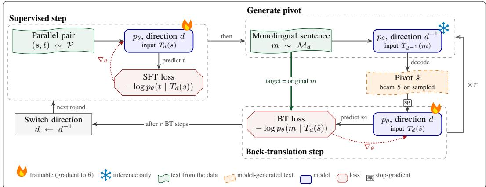
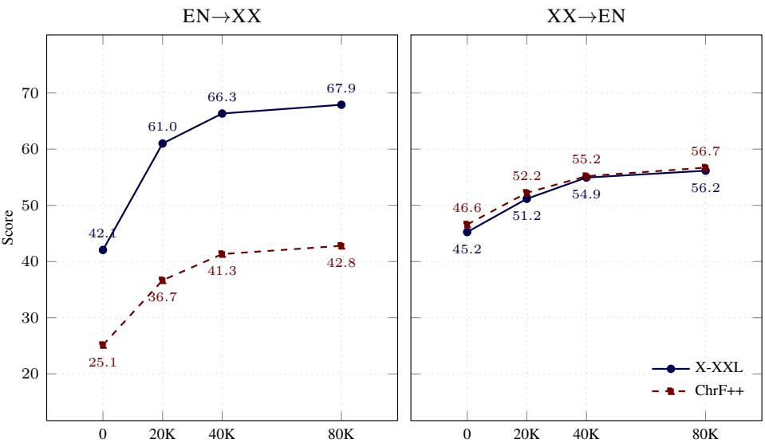

# BACK-TRANSLATION STILL MATTERS: LEVERAGING MONOLINGUAL DATA FOR LOW-RESOURCE MACHINE TRANSLATION WITH LLMS

Divyanshu Bathla IIT Roorkee divyanshu\_b@ee.iitr.ac.in

Parag Singla IIT Delhi parags@cse.iitd.ac.in

Jitin Singla⋆ IIT Roorkee jsingla@bt.iitr.ac.in

## ABSTRACT

Pre-trained Large Language Model (LLMs) are effective on many tasks in zeroshot and few-shot settings. For machine translation of low-resource languages, the obvious options are few-shot prompting and fine-tuning on a small parallel set. We ask: what if moderate amounts of low-resource monolingual data are also available? We argue that, rather than continued pretraining, a more effective use of this data is the pre-LLM era technique of back-translation (BT). The current finetuned LLM translates monolingual sentences in each language, and the resulting pairs train it in the reverse direction. Updates on the parallel set are interleaved for stable learning. With 1K parallel pairs on Odia and Swahili, BT beats continued pretraining into the low-resource language by 7.7 to 16.4 XCOMET-XXL points in domain. With beam-decoded intermediate translations, it also beats a model with 10× more parallel data. In-context examples retrieved from the parallel data further improve BT. We also analyze the source, quality and amount of monolingual text. Across five low-resource languages, with Hindi as a high-resource control, and two 3B backbones, BT improves translation into the low-resource language by 16 to 173% XCOMET-XXL over parallel-only fine-tuning. Blind human evaluation on Odia and Sanskrit agrees with the automatic metrics.

## 1 INTRODUCTION

LLMs are effective on many tasks in zero-shot and few-shot settings (Brown et al., 2020), and they translate well between high-resource languages (Hendy et al., 2023). They are, however, pre-trained overwhelmingly on a handful of high-resource languages, while most of the world’s languages appear only sparsely. Open-source instruction-tuned models are therefore fluent in English but have weak or near-zero competence in many low-resource languages. Gold-standard parallel corpora for low-resource pairs are also typically two to three orders of magnitude smaller than those for high-resource pairs, and they are often confined to narrow domains (Ramesh et al., 2022; Gala et al., 2023; NLLB Team et al., 2022).

The obvious ways to use such model for a low-resource language are few-shot prompting and supervised fine-tuning (SFT) on a parallel set. Few-shot prompting places a few translated examples in the prompt, and retrieving examples that are similar to the input helps further (Vilar et al., 2023; Zebaze et al., 2025a;b). SFT on a small, high-quality parallel set adapts an LLM to translation (Xu et al., 2024). Both depend on what the model already knows about the language. But what if we have a moderate amount of monolingual text available at our disposal. So, this paper asks: Can an LLM with a weak prior leverage monolingual text for better translation, and how should that text enter training?

Two recipes have emerged for using monolingual text with LLMs. The first is continued pretraining (CPT) followed by SFT. ALMA (Xu et al., 2024) applies CPT on 7B & 13B models with 1–20B monolingual tokens before fine-tuning on a small parallel set, and LLaMAX (Lu et al., 2024) extend CPT, with added parallel data, to over 100 languages. ALMA’s CPT optimizes a generic languagemodeling objective, so cross-lingual mapping is learned only in SFT. Whether CPT will still pay off with only few million token is unclear. The second recipe is self-distillation. CycleDistill (Halder et al., 2025) translates monolingual text with zero- or few-shot prompts, fine-tunes on its own translations, and repeats the cycle. Its training targets are therefore model-generated, and its author report no gains if base model is weak.

Before LLMs, monolingual text entered machine translation (MT) mainly through back-translation (BT) (Sennrich et al., 2016). A reverse model translates a human-written target-language sentence into the source language. The resulting pair has a synthetic source and a human target, and it is added to the training data. Later work sampled or noised the synthetic sources (Edunov et al., 2018), tagged them (Caswell et al., 2019), iterated the procedure (Hoang et al., 2018), and trained one bidirectional model for both directions (Niu et al., 2018). Dual learning and unsupervised MT learn from round trips over monolingual corpora in a similar way (He et al., 2016; Artetxe et al., 2018; Lample et al., 2018). These methods trained encoder–decoder models from scratch, first recurrent ones and later Transformers, and the BT studies used tens of thousands of parallel pairs or more. Their defining property is simple. The human-written sentence stays on the target side, so the model’s own errors enter training only as input. Self-distillation does the opposite and trains the model on its own outputs.

We ask whether this property still matters for pretrained instruction-tuned LLMs. To test it, we port BT to such models as BackTransLLM. BackTransLLM interleaves BT updates on monolingual data with supervised updates on the small parallel set, which keep learning stable. In each BT update, the model translates a monolingual sentence into the other language (a pivot) and then learns to reconstruct the original sentence from that pivot. A stop-gradient on the pivot means every BT gradient comes from predicting original monolingual text. We call this property anchoring. Like Niu et al. (2018), we use one model for both directions, and like the semi-supervised variant of Artetxe et al. (2018), we back-translate each batch on the fly with the current model and alternate these updates with supervised steps. While many of these ideas predate LLMs, our contribution is a controlled test of whether they still work for instruction-tuned LLMs with weak priors.

All tested recipes use the same backbone and same monolingual text. CPT and BackTransLLM also share the same 1K parallel pairs. We keep ALMA’s full-weight CPT but run it on our monolingual pools, and we call the result ALMA-style. We follow CycleDistill’s published recipe, with zero- or one-shot prompts and three cycles, and let our 3B model act as its own teacher. XCOMET-XXL (Guerreiro et al., 2024) does not check the output language, so we report ChrF++ (Popovic´, 2017) alongside and flag outputs if in wrong language.

The results are consistent across Odia and Swahili. Self-distillation fails, which confirms that the prior is weak. After three cycles into Odia, 99% of the model’s outputs contain no Odia script, because training on its own outputs reinforces the errors of a weak prior. CPT helps on 15 of 16 measures, and into English it beats BackTransLLM with sampled pivots on XCOMET-XXL. Into the low-resource language, however, it trails BackTransLLM by 7.7 to 16.4 XCOMET-XXL points in domain. Pivot decoding also matters, as Edunov et al. (2018) found in resource-poor settings. With beam-decoded pivots, an option that only BT has, BackTransLLM beats CPT on 15 of 16 measures and a model trained on 10× more parallel data on all 16. In-context examples retrieved from the parallel data, which every recipe can use, improve both CPT→SFT and BackTransLLM. We also analyze the source, quality and amount of monolingual text. Across five low-resource languages and two 3B backbones, BackTransLLM improves translation into the low-resource language by 16–173% XCOMET-XXL over the parallel data alone. Blind human evaluation on two languages agrees with the automatic metrics. We will make the code publicly available on acceptance. Our primary contributions are:

• We study back-translation (BT) as a way to use monolingual data when adapting generalpurpose LLMs to low-resource machine translation. We compare it with continued pretraining, the standard LLM-era use of such data.

• Our approach builds on pre-LLM BT. The fine-tuned LLM translates monolingual sentences in each language, and the resulting pairs train it in the reverse direction. Updates on small parallel set are interleaved for stable learning.

• Experiments on five low-resource languages, Hindi as a high-resource control, and two 3B backbones show that BT improves translation into the low-resource language over parallel-only fine-tuning. On Odia and Swahili, it also beats continued pretraining. Blind human evaluation agrees. Ablations cover decoding of intermediate translations, retrieved in-context examples, and the source, quality and amount of monolingual text.

## 2 WAYS TO LEVERAGE MONOLINGUAL DATA

Setting: We assume a small parallel set $\mathcal { P } = \{ ( e _ { i } , x _ { i } ) \} _ { i = 1 } ^ { N }$ and two monolingual pools $\mathcal { M } _ { \mathrm { E N } }$ and $\mathcal { M } _ { \mathrm { X X } }$ that are far larger than ${ \mathcal P } ,$ , for English (EN) and a low-resource language (XX). The backbone pθ is an instruction-tuned LLM that is fluent in EN but has limited competence in XX. For direction $d \in \{ e  x , x  e \}$ , a template $T _ { d } ( \cdot )$ (Appendix $\mathrm { A } )$ wraps a source sentence into an instruction prompt, and $p _ { \theta } ( \cdot \mid \bar { T _ { d } } ( s ) )$ is the model’s distribution over the target string. Every recipe fine-tunes on $\mathcal { P }$ with the supervised loss

$$
\mathcal { L } _ { \mathrm { s f t } } ^ { d } ( s , t ) = - \log p _ { \theta } ( t \mid T _ { d } ( s ) ) .\tag{1}
$$

The recipes differ only in how a monolingual sentence m becomes a training example.

Continued pretraining, then SFT: CPT treats m as a language-modelling target, $\mathcal { L } _ { \mathrm { c p t } } ( m ) =$ $- \log p _ { \theta } ( m )$ , and SFT on $\mathcal { P }$ follows. ALMA (Xu et al., 2024) fine-tunes LLaMA-2 7B and 13B with full weights on up to 20B and 12B OSCAR tokens. It then fine-tunes on 58K human-written examples in ten directions. The loss, either language modeling or SFT loss, falls on human-written text.

Self-distillation: Self-distillation uses m as the input and the model’s own translation as the target:

$$
\begin{array} { c } { { \hat { t } \sim p _ { \theta } ( \cdot \mid T _ { d } ( m ) ) , } } \\ { { { \mathcal { L } } _ { \mathrm { s d } } ( m ) = - \log p _ { \theta } ( \hat { t } \mid T _ { d } ( m ) ) , } } \end{array}\tag{2}
$$

repeated over cycles. CycleDistill (Halder et al., 2025) labels Indic sentences with English translations from zero-, one- or four-shot prompts and fine-tunes on these labels for up to three cycles. It distils Gemma-2-9B (Gemma Team et al., 2024) and Llama-3.1-8B (Grattafiori et al., 2024) into same-size and smaller students for Hindi, Bengali and Malayalam. Errors can compound across cycles, and the authors report no gains for Manipuri, which the base model could not translate. We therefore also use self-distillation as a control. If it fails, the model cannot yet label data for itself, which shows that our setting is truly low-resource.

Back-translation: BT uses m as the target and the model’s translation as the input:

$$
\begin{array} { c } { \hat { s } \sim p _ { \theta } ( \cdot \mid T _ { d ^ { - 1 } } ( m ) ) , } \\ { \mathcal { L } _ { \mathrm { b t } } ( m ) = - \log p _ { \theta } ( m \mid T _ { d } ( \hat { s } ) ) , } \end{array}\tag{3}
$$

where $d ^ { - 1 }$ is the reverse direction (Sennrich et al., 2016). Edunov et al. (2018) found sampled or noised back-translations better than beam search at scale. In their resource-poor setting with 80K pairs, where back-translations are poor, beam search was better. Hoang et al. (2018) iterate BT so that forward and backward models regenerate each other’s synthetic data. With recurrent models trained from scratch, their gains diminished after the first extra round. Niu et al. (2018) train one bidirectional model on Tagalog–English and Swahili–English with 24K to 51K parallel pairs, “always placing the real data on the target side”. Removing target-side synthetic data improved three of their four low-resource directions. Self-distillation and BT therefore build the same kind of synthetic pair. They differ only in which side is human-written.

Other related work: LLMs typically translate better out of low-resource languages than into them (Hendy et al., 2023; Zhu et al., 2024; Bawden and Yvon, 2023), and Bafna et al. (2025) localize a late-layer failure for low-resource targets. Pang et al. (2024) analyze when monolingual data helps low-resource MT. These are analyses rather than recipes for our setting. Vamvas et al. (2026) train an NLLB model on back-translations from a frozen Gemini model, a far stronger external teacher. Round-trip reinforcement learning tunes NLLB to reconstruct English without parallel data (Attia and Aji, 2026). NLLB is already trained on large parallel corpora for translation, whereas we adapt a general-purpose LLM with a weak prior on the low-resource language. The reconstruction objective also gives no signal on real target-language text. Neither fits our setting, in which a single LLM learns from 1K parallel pairs and monolingual text alone.

  
Figure 1: BackTransLLM: One training cycle. After a supervised step in direction d, the current model translates a monolingual sentence m in the reverse direction $d ^ { \dot { - } 1 }$ (inference only) to give a pivot sˆ. Behind a stop-gradient (sg), the model learns to reconstruct the original m from sˆ. Pivot generation and the back-translation step repeat r=4 times before the direction switches. All $p _ { \theta }$ boxes share one set of QLoRA parameters θ.

## 3 BACKTRANSLLM: BACK-TRANSLATION FOR INSTRUCTION-TUNED LLMS WITH WEAK PRIORS

Our question is whether an LLM with a weak prior can leverage monolingual text for better translation, and how that text should enter training. The recipes in §2 differ in what the model learns to predict. CPT predicts original text but learns no mapping between languages. Self-distillation learns the mapping, but from its own translations, which are poor when the prior is weak. BT gives both, a translation signal and original text as every target. BackTransLLM keeps this anchoring in an instruction-tuned LLM.

Training cycle: Figure 1 shows one training cycle. Training alternates between the two directions $d \in \{ x \to e , e \to x \}$ . For each direction, BackTransLLM takes one supervised step on a batch of parallel pairs, then r BT steps on batches of monolingual sentences, and then switches direction. The model generates the pivots on the fly with its current parameters, so the BT signal evolves during training. We use $r { = } 4 ,$ a robust choice among $r \in \{ 1 , { \bar { 2 } } , 4 , 8 \}$ (Appendix D). An epoch is defined over the monolingual pools, and the parallel data is cycled as needed.

Losses: For a batch $B _ { \mathcal { P } } \subset \mathcal { P }$ of parallel pairs and a batch $B _ { \mathcal { M } } \subset \mathcal { M } _ { d }$ from the monolingual pool in the target language of $d ,$ the supervised step and each BT step minimize

$$
\begin{array} { r l } & { \mathcal { L } _ { \mathrm { s f t } } ^ { d } = - \frac { 1 } { | B _ { \mathcal { P } } | } \sum _ { ( s , t ) \in B _ { \mathcal { P } } } \log p _ { \theta } ( t \mid T _ { d } ( s ) ) , } \\ & { \mathcal { L } _ { \mathrm { b t } } ^ { d } = - \frac { 1 } { | B _ { \mathcal { M } } | } \sum _ { m \in B _ { \mathcal { M } } } \log p _ { \theta } ( m \mid T _ { d } ( \hat { s } _ { m } ) ) } \end{array}\tag{4}
$$

where $\hat { s } _ { m } = \mathrm { s g } [ \deg p _ { \theta } ( \cdot \ : | \ : T _ { d ^ { - 1 } } ( m ) ) ]$ is pivot, sg denotes stop-gradient and dec is pivot decoder. Per cycle: 1 step on $\mathcal { L } _ { \mathrm { s f t } } ^ { d }$ and r on $\mathcal { L } _ { \mathrm { b t } } ^ { d } .$

Pivot decoding: The pivot is the only model-generated text in training, so its quality bounds what reconstruction can teach. Pivots for training into English are written in the low-resource language, which a weak-prior model generates poorly, so sampling adds noise exactly where the model is weakest. We compare sharpened nucleus sampling $( \tau { = } 0 . 3 , \mathrm { t o p } { - } p { = } 0 . 9 )$ , which adds diversity (Edunov et al., 2018), with beam search over five beams, which Edunov et al. (2018) found better in resource-poor settings. Test-time decoding is greedy for every system.

## 4 EMPIRICAL RESULTS AND DISCUSSION

We compare the recipes of §2 on Odia and Swahili with LLaMA, and then analyze BackTransLLM on six English-paired languages and two backbones. Our experiments address six questions. 1) Which recipe leverages monolingual data best (§4.1)? 2) Does in-context learning help (§4.2)? 3) Which monolingual text should be used (§4.3)? 4) How much monolingual text is needed (§4.4)? 5) Do the gains hold across languages and backbones (§4.5)? 6) Do human judges agree with the automatic metrics (§4.6)?

Experimental setup: For each language pair, the 1K parallel pairs and both monolingual pools come primarily from one parallel corpus. The corpora are VaqasAI for Odia (Ahmed, 2025; Haddow and Kirefu, 2020), Samanantar for Assamese (Ramesh et al., 2022), IITB En–Hi for Hindi (Kunchukuttan et al., 2018), Mitrasamgraha for Sanskrit (Nehrdich et al., 2026), and MAFAND for both African pairs (Adelani et al., 2022). CC-100 supplies Amharic monolingual data and augments Swahili (Conneau et al., 2020; Wenzek et al., 2020). When both monolingual pools come from the same parallel source, they use disjoint subsets, and all pools are disjoint from validation and test data (Appendix A). Hindi serves as a high-resource control. Our primary backbone is LLaMA-3.2-3B-Instruct (Meta AI, 2024), and Qwen-2.5-3B-Instruct (Yang et al., 2024) tests crossfamily generality. Both are fine-tuned with 4-bit QLoRA (Dettmers et al., 2023; Hu et al., 2022) under identical settings (LoRA rank 64, peak learning rate $2 \times 1 0 ^ { - 4 }$ , maximum sequence length 2,048) until the development score converges. Prompts use a simple translation instruction wrapped in the model’s chat template. We report XCOMET-XXL (X-XXL) (Guerreiro et al., 2024) and ChrF++ (Popovic´, 2017) on in-domain held-out test sets of 2K sentences and on Flores-200 (NLLB Team et al., 2022). Checkpoints are selected on validation BERTScore, so neither primary metric is used for selection.

As baselines, 1K-SFT fine-tunes on the 1K parallel pairs. 10K-SFT uses ten times more pairs as a reference, except for Amharic, which has about 1.9K pairs. Few-shot prompts the base model, without training, with k=5 examples retrieved from the 1K pairs. CPT→SFT (ALMA-style) applies full-weight continued pretraining to the same 40K + 40K monolingual sentences and then fine-tunes on the parallel data. A variant uses only the first 100 parallel pairs. Self-distillation (CycleDistillstyle) runs three cycles with sampled labels, either 0-shot (every prompt is zero-shot) or 1-shot (every prompt contains one gold example). CycleDistill translates into English, so translating into the low-resource language is our extension. Appendices B and C give the settings and full results.

## 4.1 BACK-TRANSLATION USES MONOLINGUAL DATA BEST

Table 1 compares three recipes on Odia and Swahili: CPT→SFT, self-distillation and back-translation. Across both languages, approaches that keep original monolingual text as the training target, either CPT (ALMA-style) or back-translation (BackTransLLM), are consistently effective. Self-distillation instead deteriorates and can collapse into the wrong output language, especially for Odia, where the base prior is weakest. After three cycles into Odia, 99% of self-distilled outputs contain no Odia script, and most are in English. As a result, ChrF++ drops to 0.54 (0-shot) and 0.53 (1-shot), below the zero-shot model’s 7.18. XCOMET-XXL still assigns these outputs 29.60 to 42.27 because it does not check the output language, so we treat the score as invalid and do not report it. Even for Swahili, where the outputs are in the right language, self-distillation with or without a parallel example in the prompt ends below the zero-shot model on all eight measures. Self-distillation therefore cannot use monolingual data when the prior is weak, which confirms that our setting is truly low-resource. We drop it from remaining experiments.

CPT→SFT is a strong alternative. It improves on 1K-SFT on all eight Odia measures and seven of eight Swahili measures, with a gain of 16.62 X-XXL points into Odia in domain (Table 1). Into English, it even exceeds 10K-SFT on Flores-200 (51.14 against 47.07 for Odia and 63.90 against 58.46 for Swahili). Even with only 100 parallel pairs, CPT→SFT still beats 1K-SFT on all eight Odia measures.

With sampled pivots, BackTransLLM and CPT→SFT split the two directions. BackTransLLM leads into Odia and Swahili on both test sets, by 7.67 and 16.39 X-XXL points in domain and by 1.82 and 14.80 on Flores-200. CPT→SFT leads into English on X-XXL, by 2.39 and 4.51 points in domain and by 12.27 and 7.75 on Flores-200. BackTransLLM without parallel seed stays far below 1K-SFT, likely because its pivots come from a model that barely translates. With only 100 pairs, it already gets most of the way to the 1K-pair result (Table 1).

<table><tr><td></td><td></td><td></td><td colspan="4">In-Domain (2K)</td><td colspan="4">Flores-200</td></tr><tr><td></td><td></td><td></td><td colspan="2">EN→XX</td><td colspan="2">XX→EN</td><td colspan="2">EN→XX</td><td colspan="2">XX→EN</td></tr><tr><td>System</td><td>#Pairs</td><td>Pivots</td><td>X-XXL</td><td>ChrF++</td><td>X-XXL</td><td>ChrF++</td><td>X-XXL</td><td>ChrF++</td><td>X-XXL</td><td>ChrF++</td></tr><tr><td>ODIA</td><td></td><td></td><td></td><td></td><td></td><td></td><td></td><td></td><td></td><td></td></tr><tr><td>Zero-shot</td><td></td><td></td><td>20.09</td><td>7.18</td><td>16.80</td><td>17.78</td><td>20.81</td><td>4.95</td><td>16.96</td><td>19.41</td></tr><tr><td>Few-shot (k=5)</td><td></td><td></td><td>19.03</td><td>13.98</td><td>21.10</td><td>25.56</td><td>15.29</td><td>8.21</td><td>17.21</td><td>20.64</td></tr><tr><td>1K-SFT</td><td></td><td></td><td>42.05</td><td>25.13</td><td>45.24</td><td>46.58</td><td>30.60</td><td>18.03</td><td>40.94</td><td>37.41</td></tr><tr><td>10K-SFT</td><td></td><td></td><td>64.33</td><td>40.91</td><td>61.51</td><td>59.70</td><td>37.87</td><td>21.73</td><td>47.07</td><td>39.26</td></tr><tr><td>CPT→SFT</td><td>100</td><td></td><td>47.71</td><td>28.50</td><td>52.13</td><td>48.88</td><td>33.55</td><td>19.06</td><td>48.27</td><td>38.98</td></tr><tr><td>CPT→SFT</td><td>1K</td><td></td><td>58.67</td><td>34.17</td><td>57.33</td><td>54.59</td><td>37.22</td><td>20.43</td><td>51.14</td><td>41.40</td></tr><tr><td>Self-distill (0-shot)</td><td>一</td><td>sampled</td><td>n/aª</td><td>0.54</td><td>15.19</td><td>14.21</td><td>n/aª</td><td>1.08</td><td>15.27</td><td>14.21</td></tr><tr><td>Self-distill (1-shot)</td><td>一</td><td>sampled</td><td>n/aª</td><td>0.53</td><td>14.11</td><td>14.41</td><td>n/a</td><td>1.07</td><td>14.18</td><td>15.32</td></tr><tr><td>BackTransLLM</td><td>0</td><td>sampled</td><td>23.10</td><td>19.39</td><td>22.37</td><td>27.13</td><td>20.51</td><td>13.60</td><td>18.61</td><td>21.41</td></tr><tr><td>BackTransLLM</td><td>100</td><td>sampled</td><td>57.66</td><td>36.23</td><td>46.50</td><td>48.67</td><td>33.95</td><td>20.66</td><td>29.61</td><td>29.87</td></tr><tr><td>BackTransLLM</td><td>1K</td><td>sampled</td><td>66.34</td><td>41.32</td><td>54.94</td><td>55.19</td><td>39.04</td><td>22.25</td><td>38.87</td><td>34.92</td></tr><tr><td>BackTransLLM</td><td>1K</td><td>beam 5</td><td>72.62</td><td>45.36</td><td>63.04</td><td>61.30</td><td>44.39</td><td>24.79</td><td>52.01</td><td>43.10</td></tr><tr><td>SWAHILI</td><td></td><td></td><td></td><td></td><td></td><td></td><td></td><td></td><td></td><td></td></tr><tr><td>Zero-shot</td><td></td><td></td><td>38.83</td><td>36.77</td><td>57.56</td><td>44.26</td><td>35.05</td><td>38.86</td><td>59.20</td><td>48.51</td></tr><tr><td>Few-shot (k=5)</td><td></td><td></td><td>40.27</td><td>38.02</td><td>61.35</td><td>46.35</td><td>35.29</td><td>39.37</td><td>60.54</td><td>48.68</td></tr><tr><td>1K-SFT</td><td></td><td></td><td>42.12</td><td>39.10</td><td>60.05</td><td>46.13</td><td>35.41</td><td>37.97</td><td>56.90</td><td>46.06</td></tr><tr><td>10K-SFT</td><td></td><td></td><td>57.38</td><td>45.27</td><td>66.11</td><td>49.13</td><td>45.54</td><td>40.56</td><td>58.46</td><td>46.24</td></tr><tr><td>CPT→SFT</td><td>1K</td><td></td><td>46.53</td><td>39.27</td><td>67.16</td><td>49.07</td><td>38.38</td><td>36.95</td><td>63.90</td><td>48.66</td></tr><tr><td>Self-distill (0-shot)</td><td>一</td><td>sampled</td><td>34.39</td><td>32.64</td><td>42.03</td><td>38.32</td><td>32.44</td><td>35.09</td><td>44.44</td><td>41.64</td></tr><tr><td>Self-distill (1-shot)</td><td>一</td><td>sampled</td><td>33.14</td><td>32.89</td><td>40.61</td><td>38.19</td><td>32.07</td><td>35.98</td><td>42.17</td><td>41.44</td></tr><tr><td>BackTransLLM</td><td>1K</td><td>sampled</td><td>62.92</td><td>47.17</td><td>62.65</td><td>48.68</td><td>53.18</td><td>43.17</td><td>56.15</td><td>47.36</td></tr><tr><td>BackTransLLM</td><td>1K</td><td>beam 5</td><td>67.15</td><td>49.13</td><td>68.56</td><td>51.07</td><td>56.82</td><td>45.79</td><td>63.40</td><td>50.64</td></tr></table>

Table 1: Leveraging monolingual data for low-resource MT with LLaMA-3.2-3B-Instruct. All recipes use 40K English and 40K XX monolingual sentences. #Pairs represent number of parallel pairs used. Self-distillation uses at most one parallel example per prompt and runs three cycles (best checkpoint reported). Few-shot prompts the base model with k=5 examples retrieved from the 1K pairs (§4.2). Pivots: decoding of the intermediate translations (sampled: τ=0.3, top-p=0.9). 10K-SFT uses 10× more parallel data. Bold/underline: best/second-best (higher is better). aInvalid: 99% of outputs contain no Odia script (87–90% are English, including 22% copies of the source), which XCOMET misses.All five metrics, and Qwen results for zero-shot, 1K-SFT, 10K-SFT, CPT→SFT and BackTransLLM (sampled pivots), are in Appendix C and training settings are in Appendix B.

Only back-translation can choose how its pivots are decoded, since CPT→SFT generates none. With beam-decoded pivots, BackTransLLM beats 10K-SFT on all 16 measures, by 1.53 to 8.29 X-XXL points on Odia and 2.45 to 11.28 on Swahili. It also beats CPT→SFT on 15 of the 16, by 0.87 to 20.62 X-XXL points. The exception is Swahili into English on Flores-200, where CPT→SFT leads by 0.50 (63.90 against 63.40). Over sampled pivots, beam pivots gain 5.35 to 13.14 X-XXL points on Odia and 3.64 to 7.25 on Swahili. In both languages the gain is largest into English on Flores-200 (38.87 to 52.01 and 56.15 to 63.40), exactly where CPT→SFT led by the widest margin. BackTransLLM thus uses monolingual data better than CPT into the low-resource language with either decoder, and with beam pivots it also leads into English.

## 4.2 IN-CONTEXT LEARNING HELPS EVERY RECIPE

Beam-decoded pivots are not available to CPT→SFT. However, LLMs offer a second lever that both recipes can use. Examples retrieved from the parallel data can be placed in the prompt, and the model conditions on them without any change to its architecture (Brown et al., 2020; Vilar et al., 2023). Pre-LLM encoder–decoder systems needed a dedicated memory (Gu et al., 2018) or training on inputs augmented with retrieved translations (Bulte and Tezcan, 2019). We prepend k=5 examples, retrieved from the 1K parallel pairs by source-side similarity, to every training and test prompt, including BackTransLLM’s back-translation updates.

<table><tr><td></td><td colspan="2">EN→OR</td><td colspan="2">OR→EN</td></tr><tr><td>System</td><td>ICL X-XXL</td><td>ChrF++</td><td>X-XXL</td><td>ChrF++</td></tr><tr><td>1K-SFT</td><td>No 42.05</td><td>25.13</td><td>45.24</td><td>46.58</td></tr><tr><td>1K-SFT</td><td>Yes 49.09</td><td>29.18</td><td>49.40</td><td>49.40</td></tr><tr><td>CPT→SFT</td><td>No 58.67</td><td>34.17</td><td>57.33</td><td>54.59</td></tr><tr><td>CPT→SFT</td><td>Yes 60.28</td><td>35.03</td><td>58.62</td><td>55.19</td></tr><tr><td>BackTransLLM</td><td>66.34</td><td>41.32</td><td>54.94</td><td>55.19</td></tr><tr><td></td><td>No Yes</td><td></td><td></td><td></td></tr><tr><td>BackTransLLM</td><td>69.63</td><td>43.76</td><td>60.72</td><td>59.87</td></tr></table>

Table 2: ICL on Odia (LLaMA, held-out 2K), with k=5 semantically similar examples (Appendix A) retrieved from the 1K parallel pairs in training and test prompt. BackTransLLM uses sampled pivots. Bold/underline: best/second-best (higher is better). All five metrics, Flores-200 and Amharic are in Appendix E.

Table 2 compares 1K-SFT, CPT→SFT and BackTransLLM with and without in-context learning (ICL) on Odia (LLaMA). 1K-SFT with ICL outperforms 1K-SFT under the same 1K parallel budget and with no additional annotations (+16.7% X-XXL into Odia and +9.2% into English). Without fine-tuning, the same examples help little. Few-shot prompting of the base model stays near its zero-shot quality into Odia (19.03 against 20.09 X-XXL, Table 1). ICL also helps both recipes that use monolingual data. CPT→SFT gains 1.61 and 1.29 X-XXL points, and BackTransLLM gains 3.29 and 5.78. With ICL, BackTransLLM leads CPT→SFT on all four measures, by 9.35 X-XXL points into Odia and 2.10 into English. ICL thus keeps the ranking into Odia and lets BackTransLLM overtake CPT→SFT into English. Into English, BackTransLLM with ICL nearly matches 10K-SFT (60.72 against 61.51 X-XXL, Table 1) and exceeds it on ChrF++ (59.87 against 59.70). Amharic shows the same pattern for 1K-SFT and BackTransLLM (Appendix E).

Beam-decoded pivots remain the larger lever. BackTransLLM with beam pivots and no ICL beats CPT→SFT with ICL on all four measures, by 4.42 to 12.34 X-XXL points, and it beats BackTransLLM with ICL (72.62 and 63.04 X-XXL, Table 1). BackTransLLM leads CPT→SFT into the low-resource language with or without ICL, and only back-translation can add beam-decoded pivots on top.

## 4.3 MONOLINGUAL TEXT QUALITY MATTERS AS MUCH AS DOMAIN

We now analyze BackTransLLM further. These analyses use sampled pivots, which are cheaper than beam pivots, so they likely understate it.

Monolingual source: Low-resource languages rarely have curated monolingual corpora, so practitioners rely on web text or other domains. For Odia and Assamese, we replace the in-corpus monolingual pools with a different-domain corpus, OdiEnCorp-2.0 (Parida et al., 2020), and with web text from CC-100, IndicCorp-2.0 (Doddapaneni et al., 2023) and WikiMatrix (Schwenk et al., 2021) (Table 3, top). Into the low-resource language, every source helps. Odia X-XXL rises from 42.05 to between 51.82 and 66.34, and web text recovers most of the in-corpus gain (62.21 with IndicCorp-2.0 and CC-100). Assamese shows the same trend with smaller web gains. Into English, web text is less reliable and can fall below the supervised baseline (CC-100 for Odia: 40.96 against 45.24).

Quality versus domain: To separate corpus quality from domain match, we cross the parallel corpus with the BT source over VaqasAI and OdiEnCorp-2.0 and test on both held-out sets (Table 3, bottom). With the parallel data fixed, VaqasAI is the better BT source in all eight settings. This includes the OdiEnCorp-2.0 test set itself, where the margins are small (0.6 to 2.5 X-XXL points). Domain match alone does not explain this, which suggests that corpus quality matters at least as much as domain.

<table><tr><td colspan="4">Monolingual text source</td></tr><tr><td colspan="2">EN→XX</td><td colspan="3">XX→EN</td></tr><tr><td>BT source (XX / EN) ODIA (Parallel data: VaqasAI)</td><td>X-XXL</td><td>ChrF++ X-XXL</td><td></td><td>ChrF++</td></tr><tr><td>1K-SFT (no BT)</td><td>42.05 25.13</td><td>41.32</td><td>45.24 54.94</td><td>46.58 55.19 46.63</td></tr><tr><td>VaqasAI OdiEnCorp IndicCorp~/ CC-100 CC-100</td><td>66.34 56.38 62.21 53.44</td><td>33.20 37.83 34.06 32.64</td><td>46.04 46.30 40.96 47.70</td><td>45.21 42.59 46.84</td></tr><tr><td colspan="4">IndicCorp / WikiMatrix 51.82 ASSAMESE (Parallel data: Samanantar)</td><td></td></tr><tr><td>1K-SFT (no BT)</td><td>36.59</td><td>18.99</td><td>36.49</td><td>27.84</td></tr><tr><td>Samanantar CC-100</td><td>46.41 38.61</td><td>27.02 21.73</td><td>39.69 36.63</td><td>33.54 28.29</td></tr><tr><td>IndicCorp / CC-100</td><td>38.11</td><td>21.24</td><td>35.48</td><td>27.95</td></tr></table>

Monolingual text quality (Odia, X-XXL)
<table><tr><td></td><td colspan="2">EN→XX</td><td colspan="2">XX→EN</td></tr><tr><td>BT source</td><td>VaqasAI</td><td>OEC</td><td>VaqasAI</td><td>OEC</td></tr><tr><td colspan="5">Parallel data: VaqasAI</td></tr><tr><td>VaqasAI</td><td>66.34</td><td>30.37</td><td>54.94</td><td>30.94</td></tr><tr><td>OdiEnCorp</td><td>56.38</td><td>27.88</td><td>46.04</td><td>30.28</td></tr><tr><td colspan="5">Parallel data: OdiEnCorp</td></tr><tr><td>VaqasAI</td><td>56.32</td><td>30.19</td><td>44.94</td><td>28.71</td></tr><tr><td>OdiEnCorp</td><td>38.82</td><td>29.47</td><td>25.64</td><td>28.07</td></tr></table>

Table 3: BackTransLLM with different monolingual sources (LLaMA, sampled pivots, 40K sentences/language). Source: 1K parallel pairs fixed. VaqasAI and Samanantar are in-domain, OdiEn-Corp is out-of-domain, and the rest are web text. Quality: each Odia parallel corpus crossed with each BT source and scored on both test sets (OEC: OdiEnCorp). Bold/underline: best/second-best. All five metrics are in Appendix F (source) and Appendix G (quality, which adds Flores-200 and CPT→SFT trained on each corpus).

## 4.4 MORE MONOLINGUAL TEXT HELPS, WITH DIMINISHING RETURNS

Holding the parallel data at 1K pairs, we vary only the monolingual budget (20K, 40K and 80K sentences per language), so any change in quality comes from the added monolingual text. Appendix H gives the full grid for Odia. Into Odia, X-XXL rises from 42.05 with no monolingual data to 61.0 at 20K, 66.3 at 40K and 67.9 at 80K, and ChrF++ rises in step from 25.1 to 42.8. Into English, X-XXL rises from 45.2 to 56.2 and ChrF++ from 46.6 to 56.7. Going from 40K to 80K adds only 1.6 and 1.2 X-XXL points, so we use 40K as the default. The pattern holds at other parallel budgets. With 10K pairs, BT raises X-XXL into Odia from 64.33 to 72.04 at 40K and 74.17 at 80K.

## 4.5 GAINS HOLD ACROSS LANGUAGES AND BACKBONES

Table 4 tests whether the gains generalize to six English-paired languages from Indic and African families and to a second backbone. BackTransLLM is the best of the three systems in 45 of the 48 cells (selected example outputs are in Appendix L). Into the low-resource language, it improves on 1K-SFT by 16% to 173% X-XXL across the five low-resource languages and both backbones (median 44%). Into English, the gains are smaller (median 7%), and the only loss is Sanskrit on Qwen (−8% X-XXL and −1% ChrF++). This asymmetry partly reflects headroom. Conditional perplexity into English is low at the outset and barely moves, while into the low-resource language it starts high and drops sharply for five of the six pairs (Appendix N). The Hindi control gains only 3% on LLaMA, whose Hindi is already strong, but 72% into Hindi on Qwen, whose Hindi prior is weak. With one tenth of the parallel data, BackTransLLM also matches or exceeds 10K-SFT into the low-resource language in eight of ten comparisons, while 10K-SFT stays ahead into English (Appendix I). Multi-seed experiments show that Odia results are stable across three random seeds (Appendix K).

<table><tr><td rowspan="2" colspan="2"></td><td colspan="2">Odia</td><td colspan="2">Assamese</td><td colspan="2">Sanskrit</td><td colspan="2">Hindi</td><td colspan="2">Amharic</td><td colspan="2">Swahili</td></tr><tr><td>X-XXL</td><td>ChrF++</td><td>X-XXL</td><td>ChrF++</td><td>X-XXL</td><td>ChrF++</td><td>X-XXL</td><td>ChrF++</td><td>X-XXL</td><td>ChrF++</td><td>X-XXL</td><td>ChrF++</td></tr><tr><td colspan="2"></td><td>Zero-Shot</td><td>20.09 7.18</td><td>38.81</td><td>11.61</td><td>21.72</td><td>10.91</td><td>56.65</td><td>31.85</td><td>13.03</td><td>3.08</td><td>38.83</td><td>36.77</td></tr><tr><td>I-3B</td><td>EX←NX 1K-SFT</td><td></td><td>42.05 25.13</td><td>36.59</td><td>18.99</td><td>24.21</td><td>14.57</td><td>63.44</td><td>32.22</td><td>14.71</td><td>6.26</td><td>42.12</td><td>39.10</td></tr><tr><td></td><td></td><td>BackTransLLM 66.34</td><td>41.32 +64%</td><td>46.41</td><td>27.02</td><td>28.07</td><td>18.09</td><td>65.27</td><td>35.89</td><td>19.34</td><td>10.27</td><td>62.92</td><td>47.17</td></tr><tr><td></td><td>Zero-Shot</td><td></td><td>+58%</td><td>+27%</td><td>+42%</td><td>+16%</td><td>+24%</td><td>+3%</td><td>+11%</td><td>+31%</td><td>+64%</td><td>+49%</td><td>+21%</td></tr><tr><td></td><td>INE←EX</td><td></td><td>16.80 17.78</td><td>31.34</td><td>23.58</td><td>22.07</td><td>18.52</td><td>64.45</td><td>38.74</td><td>17.81</td><td>14.73</td><td>57.56</td><td>44.26</td></tr><tr><td></td><td>1K-SFT</td><td></td><td>45.24 46.58</td><td>36.49</td><td>27.84</td><td>23.60</td><td>20.72</td><td>67.78</td><td>41.65</td><td>19.37</td><td>21.92</td><td>60.05</td><td>46.13</td></tr><tr><td></td><td></td><td>BackTransLLM</td><td>54.94 55.19</td><td>39.69</td><td>33.54</td><td>25.67</td><td>23.33</td><td>69.56</td><td>43.97</td><td>20.18</td><td>23.57</td><td>62.65</td><td>48.68</td></tr><tr><td></td><td></td><td>+21%</td><td>+18%</td><td>+9%</td><td>+20%</td><td>+9%</td><td>+13%</td><td>+3%</td><td>+6%</td><td>+4%</td><td>+8%</td><td>+4%</td><td>+6%</td></tr><tr><td colspan="2"></td><td>16.96</td><td>7.05</td><td>24.04</td><td>9.62</td><td>20.60</td><td>11.82</td><td>23.89</td><td>21.20</td><td>15.16</td><td>2.68</td><td>17.97</td><td>20.44</td></tr><tr><td></td><td>1K-SFT</td><td></td><td>25.55 21.20</td><td>27.14</td><td>14.75</td><td>19.44</td><td>11.41</td><td>27.27</td><td>21.48</td><td>13.70</td><td>7.17</td><td>21.14</td><td>26.99</td></tr><tr><td></td><td>EX←NX</td><td>BackTransLLM</td><td>69.73</td><td>46.51 41.58</td><td>24.12</td><td>25.91</td><td>16.84</td><td>46.79</td><td>30.82</td><td>18.90</td><td>10.86</td><td>46.62</td><td>43.16</td></tr><tr><td>we--3B</td><td></td><td></td><td>+173% +119%</td><td>+53%</td><td>+64%</td><td>+33%</td><td>+48%</td><td>+72%</td><td>+43%</td><td>+38%</td><td>+51%</td><td>+121%</td><td>+60%</td></tr><tr><td></td><td>Zero-Shot</td><td></td><td>22.70</td><td>28.33 31.08</td><td>24.06</td><td>24.33</td><td>19.56</td><td>59.35</td><td>37.08</td><td>17.75</td><td>18.97</td><td>23.87</td><td>28.61</td></tr><tr><td></td><td>1K-SFT</td><td></td><td>41.05</td><td>43.31 35.43</td><td>26.87</td><td>25.80</td><td>21.88</td><td>56.00</td><td>35.95</td><td>19.75</td><td>22.64</td><td>32.94</td><td>34.77</td></tr><tr><td>N←EX</td><td></td><td></td><td></td><td></td><td>31.27</td><td>23.77</td><td>21.74</td><td>56.48</td><td>38.98</td><td>20.17</td><td></td><td></td><td></td></tr><tr><td></td><td></td><td>BackTransLLM</td><td>51.72</td><td>54.86 36.87</td><td></td><td></td><td></td><td></td><td></td><td></td><td>23.36</td><td>52.14 +58%</td><td>44.66</td></tr><tr><td></td><td></td><td></td><td>+26%</td><td>+27% +4%</td><td>+16%</td><td>-8%</td><td>-1%</td><td>+1%</td><td>+8%</td><td>+2%</td><td>+3%</td><td></td><td>+28%</td></tr></table>

Table 4: Held-out results for six English-paired languages and two Instruct backbones (1K parallel pairs, 40K monolingual sentences, sampled pivots). Under each BackTransLLM score, green/red is the relative gain/loss over 1K-SFT. All five metrics, with 10K-SFT included, are in Appendix I. Flores-200 results are in Appendix J.
<table><tr><td></td><td colspan="4">Odia</td><td colspan="4">Sanskrit</td></tr><tr><td>System</td><td>A1</td><td>A2</td><td>A3</td><td>All</td><td>A1</td><td>A2</td><td>A3</td><td>All</td></tr><tr><td>1K-SFT</td><td>2.49</td><td>2.36</td><td>2.52</td><td>2.46</td><td>2.27</td><td>2.11</td><td>2.43</td><td>2.27</td></tr><tr><td>10K-SFT</td><td>1.81</td><td>1.87</td><td>1.85</td><td>1.84</td><td>1.93</td><td>2.04</td><td>1.86</td><td>1.94</td></tr><tr><td>BackTransLLM</td><td>1.70</td><td>1.76</td><td>1.64</td><td>1.70</td><td>1.80</td><td>1.85</td><td>1.71</td><td>1.79</td></tr></table>

Table 5: Human evaluation of EN→XX translation: average rank (lower is better) from three blind annotators (A1 to A3) on 110 sentences per language. BackTransLLM uses sampled pivots. Protocol and inter-annotator agreement are in Appendix M.

## 4.6 HUMAN JUDGES AGREE WITH THE METRICS

In a blind study, three independent annotators ranked the overall quality of EN→XX translations for Odia and Sanskrit (protocol and agreement in Appendix M). They compared 1K-SFT, 10K-SFT and BackTransLLM trained on LLaMA on 110 held-out source sentences. The rankings mirror the automatic metrics (Table 5). Every annotator ranks BackTransLLM best for both languages, 10K-SFT second and 1K-SFT last.

## 5 CONCLUSIONS AND LIMITATIONS

We asked how an instruction-tuned LLM with a weak prior should use scarce parallel data and bounded monolingual text in a low-resource language. With identical data on Odia and Swahili, self-distillation failed, and continued pretraining helped but trailed back-translation into the lowresource language. Back-translation keeps original text on the target side. With beam-decoded pivots, it beat continued pretraining and ten times more parallel data, and retrieved in-context examples also improved it. Across five low-resource languages and two 3B backbones, its gains into the lowresource language were large and consistent, and human judges agreed. In practice, we recommend beam-decoded pivots and monolingual text chosen for quality before domain. In this regime the pre-LLM recipe remains the right default. Future work includes more languages and backbones, larger models and pairs that do not involve English.

We study 3B instruction-tuned backbones with about 1K parallel pairs, translating only to and from English. The recipe comparison, the in-context learning study and the human evaluation each cover two languages on one backbone. Our ALMA-style and CycleDistill-style baselines are reimplementations at this scale, and self-distillation may work with stronger priors or larger models. We do not yet combine ICL with beam sampling for pivot generation and back-translation post CPT.

## AUTHOR CONTRIBUTIONS

D.B. implemented the system, ran the experiments, and performed the analysis. All authors contributed to study design and interpretation of results, provided feedback throughout the project, and participated in writing, reviewing, and approving the final manuscript. J.S. and P.S. arranged the computational resources required for the project.

## AI USE STATEMENT

In this work, we used generative AI tools for two purposes. First, they assisted with writing and debugging code for experiment scripts, data processing and figure generation. Second, they helped with language editing of the manuscript, including grammar, wording and sentence flow. We did not use generative AI tools to generate research ideas, design the method or experiments, produce or alter experimental results, or write the related-work analysis. All AI-assisted code was reviewed, tested and verified for correctness by the authors. All AI-edited text was reviewed by the authors for accuracy and consistency with our results. We take full responsibility for the final content of this work, including text, claims and artifacts produced with the aid of generative AI.

## REFERENCES

David Adelani et al. A few thousand translations go a long way! leveraging pre-trained models for African news translation. In Proceedings of the 2022 Conference of the North American Chapter of the Association for Computational Linguistics: Human Language Technologies, pages 3053–3070, Seattle, United States, July 2022. Association for Computational Linguistics. doi: 10.18653/v1/2022.naacl-main.223. URL https://aclanthology.org/2022.naacl-main.223.

Vaqas Ahmed. Odia–English sentence-aligned precision corpus. Hugging Face dataset vaqasai/Odia\_English\_Sentences\_Aligned\_81k (Vaqas AI), 2025. URL https://huggingface. co/datasets/vaqasai/Odia\_English\_Sentences\_Aligned\_81k. MIT License. Accessed: 2026- 06-15.

Jason Ansel et al. PyTorch 2: Faster machine learning through dynamic Python bytecode transformation and graph compilation. In Proceedings of the 29th ACM International Conference on Architectural Supportfor Programming Languages and Operating Systems, Volume 2 (ASPLOS ’24). ACM, April 2024. doi: 10.1145/3620665.3640366.

Mikel Artetxe et al. Unsupervised neural machine translation. In International Conference on Learning Representations, 2018. URL https://openreview.net/forum?id=Sy2ogebAW.

Ahmed Attia and Alham Fikri Aji. Improving low-resource machine translation via round-trip reinforcement learning, 2026. URL https://arxiv.org/abs/2601.12535.

Niyati Bafna et al. The translation barrier hypothesis: Multilingual generation with large language models suffers from implicit translation failure. In Proceedings of the 14th International Joint Conference on Natural Language Processing and the 4th Conference ofthe Asia-Pacific Chapter of the Association for Computational Linguistics, pages 1541–1568, Mumbai, India, December 2025. The Asian Federation of Natural Language Processing and The Association for Computational Linguistics. doi: 10.18653/v1/2025.ijcnlp-long.83. URL https://aclanthology.org/2025. ijcnlp-long.83/.

Rachel Bawden and François Yvon. Investigating the translation performance of a large multilingual language model: the case of BLOOM. In Proceedings of the European Association for Machine Translation (EAMT), 2023.

Tom Brown et al. Language models are few-shot learners. In Advances in Neural Information Processing Systems, volume 33, pages 1877–1901. Curran Associates, Inc., 2020. URL https://proceedings.neurips.cc/paper\_files/paper/2020/file/ 1457c0d6bfcb4967418bfb8ac142f64a-Paper.pdf.

Bram Bulte and Arda Tezcan. Neural fuzzy repair: Integrating fuzzy matches into neural machine translation. In Proceedings of the 57th Annual Meeting of the Association for Computational Linguistics, pages 1800–1809, Florence, Italy, July 2019. Association for Computational Linguistics. doi: 10.18653/v1/P19-1175. URL https://aclanthology.org/P19-1175/.

Isaac Caswell et al. Tagged back-translation. In Proceedings ofthe Fourth Conference on Machine Translation (Volume 1: Research Papers), pages 53–63, Florence, Italy, August 2019. Association for Computational Linguistics. doi: 10.18653/v1/W19-5206. URL https://aclanthology.org/ W19-5206/.

Boxing Chen and Colin Cherry. A systematic comparison of smoothing techniques for sentencelevel BLEU. In Proceedings of the Ninth Workshop on Statistical Machine Translation, pages 362–367, Baltimore, Maryland, USA, June 2014. Association for Computational Linguistics. doi: 10.3115/v1/W14-3346. URL https://aclanthology.org/W14-3346/.

Alexis Conneau et al. Unsupervised cross-lingual representation learning at scale. In Proceedings ofthe 58th Annual Meeting ofthe Associationfor Computational Linguistics, pages 8440–8451, Online, July 2020. Association for Computational Linguistics. doi: 10.18653/v1/2020.acl-main. 747. URL https://aclanthology.org/2020.acl-main.747/.

Tim Dettmers et al. QLoRA: Efficient finetuning of quantized LLMs. In Advances in Neural Information Processing Systems, volume 36, pages 10088–10115. Curran Associates, Inc., 2023. doi: 10.52202/075280-0441.

Sumanth Doddapaneni et al. Towards leaving no Indic language behind: Building monolingual corpora, benchmark and models for Indic languages. In Proceedings ofthe 61st Annual Meeting ofthe Associationfor Computational Linguistics (Volume 1: Long Papers), pages 12402–12426, Toronto, Canada, July 2023. Association for Computational Linguistics. doi: 10.18653/v1/2023. acl-long.693. URL https://aclanthology.org/2023.acl-long.693/.

Sergey Edunov et al. Understanding back-translation at scale. In Proceedings ofthe 2018 Conference on Empirical Methods in Natural Language Processing, pages 489–500, Brussels, Belgium, October-November 2018. Association for Computational Linguistics. doi: 10.18653/v1/D18-1045. URL https://aclanthology.org/D18-1045/.

Fangxiaoyu Feng et al. Language-agnostic BERT sentence embedding. In Proceedings of the 60th Annual Meeting ofthe Associationfor Computational Linguistics (Volume 1: Long Papers), pages 878–891, Dublin, Ireland, May 2022. Association for Computational Linguistics. doi: 10.18653/v1/2022.acl-long.62. URL https://aclanthology.org/2022.acl-long.62/.

Jay Gala et al. IndicTrans2: Towards high-quality and accessible machine translation models for all 22 scheduled Indian languages. Transactions on Machine Learning Research, 2023. ISSN 2835-8856. URL https://openreview.net/forum?id=vfT4YuzAYA.

Gemma Team et al. Gemma 2: Improving open language models at a practical size, 2024. URL https://arxiv.org/abs/2408.00118.

Aaron Grattafiori et al. The Llama 3 herd of models, 2024. URL https://arxiv.org/abs/2407. 21783.

Jiatao Gu et al. Search engine guided neural machine translation. In Proceedings of the AAAI Conference on Artificial Intelligence, volume 32, 2018. doi: 10.1609/aaai.v32i1.12013. URL https://ojs.aaai.org/index.php/AAAI/article/view/12013.

Nuno M. Guerreiro et al. xCOMET: Transparent machine translation evaluation through fine-grained error detection. Transactions ofthe Associationfor Computational Linguistics, 12:979–995, 2024. doi: 10.1162/tacl\_a\_00683. URL https://aclanthology.org/2024.tacl-1.54/.

Sylvain Gugger et al. Accelerate: Training and inference at scale made simple, efficient and adaptable. https://github.com/huggingface/accelerate, 2022.

Barry Haddow and Faheem Kirefu. PMIndia – a collection of parallel corpora of languages of India, 2020. URL https://arxiv.org/abs/2001.09907.

Deepon Halder et al. CycleDistill: Bootstrapping machine translation using LLMs with cyclical distillation. In Proceedings of the Twelfth Workshop on Asian Translation (WAT 2025), pages 78–92, Mumbai, India, December 2025. Association for Computational Linguistics. doi: 10.18653/ v1/2025.wat-1.7. URL https://aclanthology.org/2025.wat-1.7/.

Di He et al. Dual learning for machine translation. In Advances in Neural Information Processing Systems, volume 29, pages 820–828. Curran Associates, Inc., 2016. URL https://proceedings.neurips.cc/paper\_files/paper/2016/file/ 5b69b9cb83065d403869739ae7f0995e-Paper.pdf.

Amr Hendy et al. How good are GPT models at machine translation? a comprehensive evaluation, 2023. URL https://arxiv.org/abs/2302.09210.

Vu Cong Duy Hoang et al. Iterative back-translation for neural machine translation. In Proceedings ofthe 2nd Workshop on Neural Machine Translation and Generation, pages 18–24, Melbourne, Australia, July 2018. Association for Computational Linguistics. doi: 10.18653/v1/W18-2703. URL https://aclanthology.org/W18-2703/.

Sture Holm. A simple sequentially rejective multiple test procedure. Scandinavian Journal of Statistics, 6(2):65–70, 1979.

Edward J. Hu et al. LoRA: Low-rank adaptation of large language models. In International Conference on Learning Representations, 2022. URL https://openreview.net/forum?id=nZeVKeeFYf9.

Simran Khanuja et al. MuRIL: Multilingual representations for Indian languages, 2021. URL https://arxiv.org/abs/2103.10730.

Philipp Koehn. Statistical significance tests for machine translation evaluation. In Proceedings of the 2004 Conference on Empirical Methods in Natural Language Processing, pages 388–395, Barcelona, Spain, 2004. Association for Computational Linguistics. URL https://aclanthology. org/W04-3250/.

Anoop Kunchukuttan et al. The IIT Bombay English-Hindi parallel corpus. In Proceedings of the Eleventh International Conference on Language Resources and Evaluation (LREC 2018), Miyazaki, Japan, May 2018. European Language Resources Association (ELRA). URL https: //aclanthology.org/L18-1548/.

Guillaume Lample et al. Unsupervised machine translation using monolingual corpora only. In International Conference on Learning Representations, 2018. URL https://openreview.net/ forum?id=rkYTTf-AZ.

Yinhan Liu et al. RoBERTa: A robustly optimized BERT pretraining approach, 2019. URL https://arxiv.org/abs/1907.11692.

Yinquan Lu et al. LLaMAX: Scaling linguistic horizons of LLM by enhancing translation capabilities beyond 100 languages. In Findings ofthe Associationfor Computational Linguistics: EMNLP 2024, pages 10748–10772, Miami, Florida, USA, November 2024. Association for Computational Linguistics. doi: 10.18653/v1/2024.findings-emnlp.631. URL https://aclanthology.org/2024. findings-emnlp.631/.

Sourab Mangrulkar et al. PEFT: State-of-the-art parameter-efficient fine-tuning methods. https: //github.com/huggingface/peft, 2022.

Meta AI. Llama 3.2: Revolutionizing edge AI and vision with open, customizable models. https://ai.meta.com/blog/llama-3-2-connect-2024-vision-edge-mobile-devices/, September 2024. Accessed: 2026-10-12.

Sebastian Nehrdich et al. Mitrasamgraha: A comprehensive classical Sanskrit machine translation dataset, 2026. URL https://arxiv.org/abs/2601.07314.

Xing Niu et al. Bi-directional neural machine translation with synthetic parallel data. In Proceedings ofthe 2nd Workshop on Neural Machine Translation and Generation, pages 84–91, Melbourne, Australia, July 2018. Association for Computational Linguistics. doi: 10.18653/v1/W18-2710. URL https://aclanthology.org/W18-2710/.

NLLB Team et al. No language left behind: Scaling human-centered machine translation, 2022. URL https://arxiv.org/abs/2207.04672.

Jianhui Pang et al. Rethinking the exploitation of monolingual data for low-resource neural machine translation. Computational Linguistics, 50(1):25–47, March 2024. doi: 10.1162/coli\_a\_00496. URL https://aclanthology.org/2024.cl-1.2/.

Kishore Papineni et al. BLEU: a method for automatic evaluation of machine translation. In Proceedings ofthe 40th Annual Meeting ofthe Associationfor Computational Linguistics, pages 311–318, Philadelphia, Pennsylvania, USA, July 2002. Association for Computational Linguistics. doi: 10.3115/1073083.1073135. URL https://aclanthology.org/P02-1040/.

Shantipriya Parida et al. OdiEnCorp 2.0: Odia-English parallel corpus for machine translation. In Proceedings ofthe WILDRE5–5th Workshop on Indian Language Data: Resources and Evaluation, pages 14–19, Marseille, France, May 2020. European Language Resources Association (ELRA). ISBN 979-10-95546-67-2. URL https://aclanthology.org/2020.wildre-1.3/.

Maja Popovic. chrF++: words helping character n-grams. In´ Proceedings ofthe Second Conference on Machine Translation, pages 612–618, Copenhagen, Denmark, September 2017. Association for Computational Linguistics. doi: 10.18653/v1/W17-4770. URL https://aclanthology.org/ W17-4770/.

Matt Post. A call for clarity in reporting BLEU scores. In Proceedings of the Third Conference on Machine Translation: Research Papers, pages 186–191, Brussels, Belgium, October 2018. Association for Computational Linguistics. doi: 10.18653/v1/W18-6319. URL https://aclanthology.org/W18-6319/.

Gowtham Ramesh et al. Samanantar: The largest publicly available parallel corpora collection for 11 Indic languages. Transactions ofthe Associationfor Computational Linguistics, 10:145–162, 2022. doi: 10.1162/tacl\_a\_00452. URL https://aclanthology.org/2022.tacl-1.9/.

Holger Schwenk et al. WikiMatrix: Mining 135M parallel sentences in 1620 language pairs from Wikipedia. In Proceedings ofthe 16th Conference ofthe European Chapter ofthe Associationfor Computational Linguistics: Main Volume, pages 1351–1361, Online, April 2021. Association for Computational Linguistics. doi: 10.18653/v1/2021.eacl-main.115. URL https://aclanthology. org/2021.eacl-main.115/.

Rico Sennrich et al. Improving neural machine translation models with monolingual data. In Proceedings ofthe 54th Annual Meeting ofthe Associationfor Computational Linguistics (Volume 1: Long Papers), pages 86–96, Berlin, Germany, August 2016. Association for Computational Linguistics. doi: 10.18653/v1/P16-1009. URL https://aclanthology.org/P16-1009/.

Jannis Vamvas et al. Translation asymmetry in LLMs as a data augmentation factor: A case study for 6 Romansh language varieties, 2026. URL https://arxiv.org/abs/2603.25489.

David Vilar et al. Prompting PaLM for translation: Assessing strategies and performance. In Proceedings ofthe 61st Annual Meeting ofthe Associationfor Computational Linguistics (Volume 1: Long Papers), pages 15406–15427, Toronto, Canada, July 2023. Association for Computational Linguistics. doi: 10.18653/v1/2023.acl-long.859. URL https://aclanthology.org/2023. acl-long.859/.

Guillaume Wenzek et al. CCNet: Extracting high quality monolingual datasets from web crawl data. In Proceedings of the Twelfth Language Resources and Evaluation Conference, pages 4003–4012, Marseille, France, May 2020. European Language Resources Association. ISBN 979-10-95546-34-4. URL https://aclanthology.org/2020.lrec-1.494/.

Frank Wilcoxon. Individual comparisons by ranking methods. Biometrics Bulletin, 1(6):80–83, December 1945. doi: 10.2307/3001968.

Thomas Wolf et al. Transformers: State-of-the-art natural language processing. In Proceedings ofthe 2020 Conference on Empirical Methods in Natural Language Processing: System Demonstrations, pages 38–45, Online, October 2020. Association for Computational Linguistics. doi: 10.18653/v1/ 2020.emnlp-demos.6. URL https://aclanthology.org/2020.emnlp-demos.6/.

Haoran Xu et al. A paradigm shift in machine translation: Boosting translation performance of large language models. In The Twelfth International Conference on Learning Representations, 2024. URL https://openreview.net/forum?id=farT6XXntP.

An Yang et al. Qwen2.5 technical report, 2024. URL https://arxiv.org/abs/2412.15115.

Armel Randy Zebaze et al. In-context example selection via similarity search improves low-resource machine translation. In Findings of the Association for Computational Linguistics: NAACL 2025, pages 1222–1252, Albuquerque, New Mexico, April 2025a. Association for Computational Linguistics. doi: 10.18653/v1/2025.findings-naacl.68. URL https://aclanthology.org/2025. findings-naacl.68/.

Armel Randy Zebaze et al. Compositional translation: A novel LLM-based approach for low-resource machine translation. In Findings of the Association for Computational Linguistics: EMNLP 2025, pages 22328–22357, Suzhou, China, November 2025b. Association for Computational Linguistics. doi: 10.18653/v1/2025.findings-emnlp.1216. URL https://aclanthology.org/ 2025.findings-emnlp.1216/.

Tianyi Zhang et al. BERTScore: Evaluating text generation with BERT. In International Conference on Learning Representations, 2020. URL https://openreview.net/forum?id=SkeHuCVFDr.

Wenhao Zhu et al. Multilingual machine translation with large language models: Empirical results and analysis. In Findings ofthe Associationfor Computational Linguistics: NAACL 2024, pages 2765–2781, Mexico City, Mexico, June 2024. Association for Computational Linguistics. doi: 10.18653/v1/2024.findings-naacl.176. URL https://aclanthology.org/2024.findings-naacl. 176/.

<table><tr><td>Pair</td><td>Parallel corpus</td><td>Monolingual Corpus</td><td>10K-SFT</td></tr><tr><td>Odia-En</td><td>VaqasAI (+20K from PMIndia) (Ahmed, 2025; Haddow and same-corpus Kirefu, 2020)</td><td></td><td>yes</td></tr><tr><td>Odia-En</td><td>OdiEnCorp-2.0 (Parida et al., 2020) Used for domain-transfer same-corpus analysis (§4.3)</td><td></td><td>yes</td></tr><tr><td>Assamese-En</td><td>Samanantar (Ramesh et al., 2022)</td><td>same-corpus</td><td>yes</td></tr><tr><td>Hindi-En</td><td>IIT Bombay (Kunchukuttan et al., 2018)</td><td>same-corpus</td><td>yes</td></tr><tr><td>Sanskrit-En</td><td>Mitrasamgraha (Nehrdich et al., 2026)</td><td>same-corpus</td><td>yes</td></tr><tr><td>Amharic-En</td><td>MAFAND (Adelani et al., 2022). No training split: we merge its dev and test sets (~1.9K pairs) and re-split them into the 1K seed, 450 development and 486 test pairs</td><td>CC-100</td><td>no</td></tr><tr><td>Swahili-En</td><td>MAFAND (Adelani et al., 2022)</td><td>MAFAND + CC-100 yes</td><td></td></tr></table>

Table 6: Data sources per language pair. “Same-corpus” = monolingual pools are disjoint slices of the seed corpus excluding the 1K SFT pairs.
<table><tr><td>Pair</td><td>Parallel corpus</td><td>Monolingual Corpus</td><td>in/out-domain</td></tr><tr><td>Odia-En</td><td>VaqasAI</td><td>VaqasAI</td><td>in-domain</td></tr><tr><td>Odia-En</td><td>VaqasAI</td><td>OdiEnCorp-2.0</td><td>out-of-domain</td></tr><tr><td>Odia-En</td><td>VaqasAI</td><td>CC-100</td><td>out-of-domain</td></tr><tr><td>Odia-En</td><td>VaqasAI</td><td>IndicCorp-2.0 (Odia), CC-100 (En)</td><td>out-of-domain</td></tr><tr><td>Odia-En</td><td>VaqasAI</td><td>IndicCorp-2.0 (Odia), WikiMatrix (En)</td><td>out-of-domain</td></tr><tr><td>Assamese-En</td><td>Samanantar</td><td>Samanantar</td><td>in-domain</td></tr><tr><td>Assamese-En</td><td>Samanantar</td><td>CC-100</td><td>out-of-domain</td></tr><tr><td>Assamese-En</td><td>Samanantar</td><td>IndicCorp-2.0 (Assamese), CC-100 (En)</td><td>out-of-domain</td></tr></table>

Table 7: Additional data source used for off-the-shelf monolingual analysis for Odia and Assamese languages. VaqasAI was appended with additional 20K sentence from PMIndia data source. OdiEnCorp-2.0 (Parida et al., 2020), CC-100 (Conneau et al., 2020; Wenzek et al., 2020), IndicCorp-2.0 (Dodda paneni et al., 2023) and WikiMatrix (Schwenk et al., 2021).

## A IMPLEMENTATION AND REPRODUCIBILITY DETAILS

Corpora: Table 6 lists the parallel and monolingual corpora for each language pair. Unless noted otherwise, the monolingual pools come from the same source as the parallel seed, after the 1K seed pairs are removed. Table 7 lists the alternative monolingual corpora used in the source analysis of §4.3. The VaqasAI corpus card states that its translations were produced with Gemini from English source text, so the Odia side of the VaqasAI seed, pools and held-out test set is machine-translated. Flores-200 is our human-translated Odia test set.

Monolingual token budget: Each language has a pool of 40K monolingual sentences. We count the tokens of the pool text as the training loader reads it, without special tokens or the chat template. With the LLaMA tokenizer, the Odia–English pools contain 9.69M tokens (8.75M Odia and 0.94M English), and the Swahili–English pools contain 3.51M (2.36M Swahili and 1.15M English). With the Qwen tokenizer, the totals are 8.01M (7.06M Odia and 0.95M English) and 3.57M (2.41M Swahili and 1.16M English). Under LLaMA, an Odia pool sentence averages 219 tokens, a Swahili sentence 59 and an English sentence 24 to 29. Both totals are at least two orders of magnitude below the 1B to 20B monolingual tokens used by ALMA (Xu et al., 2024).

Training configuration: Both backbones use identical settings. The causal language-modelling loss is computed on target tokens only, under the model’s chat template wrapped in a translation instruction. Every system uses the data, prompt template and metrics described in this section, and is decoded greedily at test time. Each configuration is trained and evaluated once and Appendix K repeats the Odia runs with three seeds. The recipes differ in what is trained, on which data and for how long, and Appendix B gives the settings of each recipe (supervised fine-tuning and BackTransLLM in Table 10, CPT→SFT in Table 11, self-distillation in Table 12).

<table><tr><td>Target</td><td>Encoder</td><td></td><td>Layer Baseline b</td></tr><tr><td>English</td><td>roberta-large</td><td>default</td><td>built-in</td></tr><tr><td>Hindi</td><td>muril-large-cased</td><td>18</td><td>0.473 602 0.503 943</td></tr><tr><td>Odia</td><td>Assamese muril-large-cased muril-large-cased</td><td>18 18</td><td>0.499 375</td></tr><tr><td>Sanskrit</td><td>muril-large-cased</td><td>18</td><td>0.496 216</td></tr><tr><td>Amharic</td><td></td><td></td><td></td></tr><tr><td>Swahili</td><td>xlm-roberta-large</td><td>17</td><td>0.819 427</td></tr><tr><td></td><td>xlm-roberta-large</td><td>17</td><td>0.829 090</td></tr></table>

Table 8: Per-language BERTScore baselines b used for the normalisation with the encoder and layer for each target.

Prompt template: All models are prompted with the instruction below, wrapped in the backbone’s chat template, with the loss computed on target tokens only. {SRC\_LANG} and {TGT\_LANG} are replaced by the language names (e.g. English, Odia), and {SRC\_SEN} by the sentence to translate. Under in-context learning (Appendix E), up to k=5 retrieved demonstrations are prepended before that line.

Listing 1: Base prompt (no ICL).   
1 Translate { SRC\_LANG } to { TGT\_LANG } without any explanation : { SRC\_SEN }   
Listing 2: Prompt with in-context learning (k = 5).   
1 Here are some similar translation examples :   
2   
3 { SRC\_LANG }: { retrieved\_source\_1 }   
4 { TGT\_LANG }: { retrieved\_target\_1 }   
5   
6 { SRC\_LANG }: { retrieved\_source\_2 }   
7 { TGT\_LANG }: { retrieved\_target\_2 }   
8 ... (up to 5 examples ) ...   
9   
10 Now translate { SRC\_LANG } to { TGT\_LANG } without any explanation : { SRC\_SEN }

Automatic metrics: We report five automatic metrics, computed identically for both directions and both evaluation sets. For learned evaluation we use XCOMET (Guerreiro et al., 2024) in its reference based setting, scoring each (source, hypothesis, reference) triple with the Unbabel/XCOMET-XXL and Unbabel/XCOMET-XL checkpoints. XCOMET does not check whether the hypothesis is in the requested language, so we always report ChrF++ alongside it. ChrF++ (Popovic´, 2017) uses the sacreBLEU (Post, 2018) CHRF implementation with word\_order=2 (character n-grams plus word unigrams and bigrams). BLEU (Papineni et al., 2002) uses the NLTK sentence-level implementation with uniform 4-gram weights, Chen and Cherry smoothing method 2 (Chen and Cherry, 2014) and whitespace tokenisation. Both are averaged over sentences and scaled to 0–100. For BERTScore F1 (Zhang et al., 2020) we use a target-language encoder, namely roberta-large (Liu et al., 2019) into English, google/muril-large-cased (Khanuja et al., 2021) for the four Indic targets, and xlm-roberta-large (Conneau et al., 2020) for Amharic and Swahili. We report the baseline-normalised value (F1 − b)/(1 − b). Into English we use the built-in baseline. For the other targets, b is the mean BERTScore F1 over 100K random sentence pairs from the corresponding monolingual corpus (Table 8).

In-context retrieval: For the in-context learning experiments (Appendix E), we retrieve up to k=5 nearest demonstrations by cosine similarity from the same 1K gold seed used for supervised fine-tuning, so no new annotation is needed. Retrieval is monolingual on the source side. Each query is embedded with a language-specific sentence encoder and searched against a per-language index, and the corresponding source–target pairs serve as demonstrations. We embed Amharic and Swahili with LaBSE (Feng et al., 2022) (sentence-transformers/LaBSE, pooler\_output, $L _ { 2 }$ normalised), Odia, Assamese, Sanskrit and Hindi with MuRIL-large (Khanuja et al., 2021)

<table><tr><td>Package</td><td>Version</td></tr><tr><td>Python</td><td>3.12</td></tr><tr><td>PyTorch (CUDA 12.8)</td><td>2.10.0 (for X-XXL: 2.11.0)</td></tr><tr><td>Transformers</td><td>5.3.0 (for X-XXL: 4.57.6)</td></tr><tr><td>PEFT</td><td>0.18.1</td></tr><tr><td>Accelerate</td><td>1.12.0</td></tr><tr><td>bitsandbytes</td><td>0.49.1</td></tr><tr><td>Datasets</td><td>4.5.0</td></tr><tr><td>Weights &amp; Biases</td><td>0.25.0</td></tr><tr><td>sacreBLEU</td><td>2.6.0</td></tr><tr><td>NLTK</td><td>3.9.2</td></tr><tr><td>bert-score</td><td>0.3.13</td></tr><tr><td>unbabel-comet</td><td>2.2.7</td></tr><tr><td>PyTorch Lightning</td><td>2.6.5</td></tr></table>

Table 9: Package versions used for training and evaluation. For the XCOMET calculation we used the versions in parentheses.

(google/muril-large-cased), and English with RoBERTa-large (Liu et al., 2019). For MuRIL and RoBERTa we mean-pool the last four layers. Inputs are truncated to 512 tokens. We exclude the query’s exact match after NFC normalisation and whitespace collapsing. Retrieved examples are prepended to the instruction as a few-shot block under the chat template. If the prompt exceeds 2,048 tokens, we reduce the number of shots (5→ 4 →3 . . . ) until it fits.

Software and hardware: Experiments were implemented in PyTorch (Ansel et al., 2024) with HuggingFace Transformers (Wolf et al., 2020), PEFT (Mangrulkar et al., 2022), Accelerate (Gugger et al., 2022), and bitsandbytes. Training used DistributedDataParallel on NVIDIA A100 (80GB) GPUs. Table 9 lists the versions of all packages. All experiments were tracked with Weights and Biases. Unless noted otherwise, each run used eight GPUs. All times below are approximate wallclock times for a single run. A BackTransLLM run took about 48 hours with sampled pivots and 72 hours with beam-decoded pivots, and an ICL run took about 72 hours. A CPT→SFT run took about 12 hours on two GPUs, and a self-distillation run (three cycles) took about 20 hours on four GPUs.

## B TRAINING RECIPES

This section gives the settings of the recipes compared in §4.1. All of them use the data, prompt template and metrics of Appendix A, the same settings on both backbones, and the quantisation and LoRA configuration of Table 10.

BackTransLLM: One epoch is one pass over the back-translation data, which with 40K monolingual sentences per language is 780 optimizer steps (156 supervised and 624 back-translation). Each run is trained until its development score converges. CPT→BackTransLLM starts BackTransLLM from the stage-1 model of CPT→SFT.

ALMA-style CPT→SFT: We follow ALMA’s 7B-LoRA setup (Xu et al., 2024): full-weight continued pretraining on the same monolingual pools that BackTransLLM back-translates, then LoRA fine-tuning on the 1K pairs in both directions with mixed-direction batches (Table 11). The same stage 2 without CPT is the matched control, so the two differ only in stage 1. Our setting is much smaller than ALMA’s: a 3B instead of a 7B or 13B model, about 9M instead of up to 20B monolingual tokens, and 1K instead of 58K parallel pairs.

CycleDistill-style self-distillation: CycleDistill (Halder et al., 2025) does not state its epochs, learning rate, decoding or checkpoint selection (its released code sets defaults for some of these), so we use our shared settings (Table 12). Self-distill (0-shot) uses zero-shot prompts throughout, and self-distill (1-shot) places one gold example from the 1K seed in every labelling, training, validation and test prompt. Unlike CycleDistill, we use 40K instead of 20K pool sentences, and let a 3B model act as its own teacher instead of an 8B or 9B teacher.

Quantization 4-bit NF4 (double quantization), bf16 compute   
LoRA rank 64, α=64, dropout 0.05   
LoRA target all attention + feed-forward projections   
Trainable parameters 97.3M (LLaMA), 119.7M (Qwen)   
Optimizer PagedAdamW (32-bit), gradient clipping at norm 1.0   
Peak learning rate $2 \times 1 0 ^ { - 4 }$ , cosine decay, 5% warmup   
Interleaving per direction, 1 supervised step then r=4 BT steps   
Training length until the development BERTScore converges   
Max sequence length 2,048 tokens   
Effective Batch size 128   
Validation every quarter-epoch, development BERTScore   
BT pivot decoding nucleus, τ=0.3, top-p=0.9   
or beam search, 5 beams   
at most 256 new tokens   
Eval decoding greedy, at most 256 new tokens  
Table 10: BackTransLLM training and decoding hyperparameters (shared across both backbones). 1K-SFT and 10K-SFT use the same settings without back-translation steps.

<table><tr><td colspan="2">Stage 1: continued pretraining</td></tr><tr><td>Trained weights Data</td><td>all weights, bf16 40K XX + 40K En monolingual sentences, packed into</td></tr><tr><td>Effective Batch size</td><td>512-token blocks 256 blocks</td></tr><tr><td>Peak learning rate</td><td> $2 \times 1 0 ^ { - 5 }$  , inverse-square-root decay to 10% of the peak, 1%</td></tr><tr><td>Weight decay</td><td>warmup 0.01</td></tr><tr><td>Epochs</td><td>8</td></tr><tr><td>Validation</td><td>held-out LM loss (1K + 1K sentences) before training and after each epoch, lowest loss kept</td></tr><tr><td colspan="2">Stage 2: supervised fine-tuning</td></tr><tr><td>Trained weights</td><td>LoRA on the 4-bit CPT model (as Table 10)</td></tr><tr><td>Data</td><td>1K gold pairs in both directions (2,000 rows), mixed batches</td></tr><tr><td>Peak learning rate</td><td> $2 \times 1 0 ^ { - 4 } .$  , cosine decay, 5% warmup</td></tr><tr><td>Max sequence length</td><td>2,048 tokens</td></tr><tr><td>Effective Batch size</td><td>128</td></tr><tr><td>Validation</td><td>every quarter-epoch, development BERTScore in both directions (highest mean kept, ties broken by BLEU)</td></tr><tr><td>Eval decoding</td><td>greedy, at most 256 new tokens</td></tr></table>

Table 11: CPT→SFT hyperparameters (ALMA-style, shared across both backbones). Stage 2 without stage 1 is the matched control.

## C RECIPE COMPARISON: FULL RESULTS

Tables 13 and 14 give all five metrics for the recipe comparison of §4.1 on both backbones (Qwen has no beam-pivot, self-distillation or few-shot runs).

## D INTERLEAVING RATIO r: SFT VS. BT STEPS

This section studies the interleaving schedule of §3, in which each supervised step is followed by r back-translation steps in the same direction. We compare $r \in \{ 1 , 2 , 4 , 8 \}$ on the held-out (2K) test set for Odia and Sanskrit in both directions (Table 15). Quality follows an inverted U in r. Odia peaks at r=2, which is the best ratio on all ten metric and direction columns. Sanskrit peaks at r=4, which is the best ratio on seven of ten. r=8 is below each language’s best ratio on every column, and r=1 on all but one. We use r=4 throughout: Sanskrit peaks there, and it is within 2.7 points of the best ratio on every Odia column. Tuning r per language could add further gains, for example 2.70 X-XXL points into Odia at r=2.

<table><tr><td>Cycles</td><td>3, each starting from the previous cycle&#x27;s selected model, with a fresh optimizer and schedule the current model translates the 40K source-language pool with</td></tr><tr><td>Labels</td><td>nucleus sampling (τ=0.3, top-p=0.9), at most 768 new tokens 40K (source, own translation) pairs, no gold pairs</td></tr><tr><td>Training data Quantization, LoRA</td><td>as Table 10</td></tr><tr><td>Peak learning rate Epochs</td><td> $2 \times 1 0 ^ { - 4 } .$  , cosine decay, 5% warmup 1 per cycle (312 steps)</td></tr><tr><td>Max sequence length</td><td>4,096 tokens</td></tr><tr><td>Effective Batch size Validation</td><td>128 every quarter-epoch, development BERTScore of the trained</td></tr><tr><td></td><td>direction (sampled decoding)</td></tr><tr><td>Selection</td><td>highest development BERTScore, ties broken by BLEU. The untrained model cannot be kept in cycle 1, and later cycles keep</td></tr><tr><td>Eval decoding</td><td>their starting model unless a checkpoint improves on it greedy, at most 256 new tokens, with the training prompt</td></tr></table>

Table 12: Self-distillation hyperparameters (CycleDistill-style, LLaMA-3.2-3B-Instruct). Self-distill (0-shot) and self-distill (1-shot) share these settings and differ only in the prompts.

## E IN-CONTEXT LEARNING

We also ask whether the same 1K seed can be used more effectively at no annotation cost. With in-context learning (ICL), we prepend up to k=5 semantically similar examples, retrieved from the 1K seed, to each training and test sentence (Appendix A). Examples are dropped when the prompt would exceed 2,048 tokens. This happens mainly on Odia Flores-200 into English, where prompts contain 3.6 examples on average. The retrieved examples are used consistently in supervised and back-translation updates and at inference time.

Table 16 gives all five metrics for the systems of Table 2, for Odia and Amharic, in domain and on Flores-200. In domain, 1K-SFT with ICL outperforms 1K-SFT under the same budget (+16.7% X-XXL EN→OR and +9.2% OR→EN for Odia), and BackTransLLM with ICL improves over BackTransLLM on every metric in both directions for both languages. CPT→SFT gains less from ICL (1.6 and 1.3 X-XXL points on Odia). On Odia Flores-200, ICL changes the X-XXL of 1K-SFT and CPT→SFT by less than one point, and BackTransLLM with ICL gains 3.9 points into English and none into Odia. On Amharic Flores-200, ICL changes the X-XXL of both systems by less than one point, and BackTransLLM with ICL is below BackTransLLM on all five metrics into Amharic and on four of the five into English.

## F MONOLINGUAL SOURCE: FULL RESULTS

This section completes the monolingual-source comparison of §4.3 (Table 3, top) with all five metrics (Table 17). The parallel data is fixed at 1K pairs from VaqasAI (Odia) or Samanantar (Assamese), only the source of the 40K monolingual sentences per language changes, and each language is scored on its own held-out test set. The in-corpus monolingual text is best on every metric in both directions for both languages. Into the low-resource language, every other source also improves over 1K-SFT on all five metrics. Into English, the other sources give mixed results: CC-100 falls below 1K-SFT on all five metrics for Odia, and only IndicCorp-2.0 with WikiMatrix (Odia) improves on all five.

## G MONOLINGUAL TEXT QUALITY VERSUS DOMAIN: FULL RESULTS

This section completes the quality-versus-domain comparison of §4.3 (Table 3, bottom). We cross the Odia parallel corpus with the 40K + 40K monolingual corpus over VaqasAI and OdiEnCorp-2.0, and use the monolingual corpus either as the back-translation source of BackTransLLM or for the continued pretraining of CPT→SFT. 1K-SFT and 10K-SFT are included as references. Table 18 evaluates both directions on the held-out test set of each corpus and on Flores-200. With the parallel data fixed, VaqasAI is the better back-translation source on X-XXL and X-XL in all eight held-out settings, including on the OdiEnCorp-2.0 test set itself. The X-XXL margins on that test set are small (0.6 to 2.5 points) and have not been tested for significance, and there ChrF++ favours OdiEnCorp-2.0 back-translation in all four settings, and BERTScore and BLEU in three of four. On Flores-200, VaqasAI back-translation is ahead on every metric for both parallel corpora and both directions. For back-translation, domain match alone therefore does not explain the results, which suggests that corpus quality matters at least as much as domain. Continued pretraining behaves differently: with VaqasAI parallel data, continued pretraining on OdiEnCorp-2.0 beats continued pretraining on VaqasAI on every metric on the OdiEnCorp-2.0 test set and on Flores-200.

<table><tr><td></td><td></td><td colspan="5">EN→XX</td><td colspan="5">XX→EN</td></tr><tr><td>System</td><td>Pivots</td><td>X-XXL</td><td>X-XL</td><td>ChrF++</td><td>BS</td><td>BLEU</td><td>X-XXL</td><td>X-XL</td><td>ChrF++</td><td>BS</td><td>BLEU</td></tr><tr><td colspan="10">LLaMA-3.2-3B-Instruct, Odia</td></tr><tr><td>Zero-shot</td><td></td><td>20.09</td><td>26.43</td><td>7.18</td><td>-7.06</td><td>1.37</td><td>16.80</td><td>27.97</td><td>17.78</td><td>7.58</td><td>6.35</td></tr><tr><td>Few-shot (k=5)</td><td></td><td>19.03</td><td>24.85</td><td>13.98</td><td>1.33</td><td>4.27</td><td>21.10</td><td>34.41</td><td>25.56</td><td>31.06</td><td>10.32</td></tr><tr><td>1K-SFT</td><td></td><td>42.05</td><td>43.33</td><td>25.13</td><td>28.87</td><td>10.68</td><td>45.24</td><td>64.13</td><td>46.58</td><td>56.56</td><td>24.34</td></tr><tr><td>10K-SFT</td><td></td><td>64.33</td><td>61.05</td><td>40.91</td><td>50.32</td><td>20.03</td><td>61.51</td><td>78.21</td><td>59.70</td><td>69.50</td><td>38.03</td></tr><tr><td>CPT→SFT (100 pairs)</td><td></td><td>47.71</td><td>49.74</td><td>28.50</td><td>36.02</td><td>12.27</td><td>52.13</td><td>71.61</td><td>48.88</td><td>61.00</td><td>25.61</td></tr><tr><td>CPT→SFT (1K pairs)</td><td></td><td>58.67</td><td>57.09</td><td>34.17</td><td>43.72</td><td>15.96</td><td>57.33</td><td>74.81</td><td>54.59</td><td>65.01</td><td>31.35</td></tr><tr><td>Self-distill (0-shot)</td><td>sampled</td><td>n/aª</td><td>n/aa</td><td>0.54</td><td>n/aa</td><td>0.14</td><td>15.19</td><td>22.43</td><td>14.21</td><td>-4.53</td><td>4.78</td></tr><tr><td>Self-distill (1-shot)</td><td>sampled</td><td>n/aª</td><td>n/aa</td><td>0.53</td><td>n/aa</td><td>0.15</td><td>14.11</td><td>20.76</td><td>14.41</td><td>11.18</td><td>4.95</td></tr><tr><td>BackTransLLM (0 pairs)</td><td>sampled</td><td>23.10</td><td>29.70</td><td>19.39</td><td>20.01</td><td>8.05</td><td>22.37</td><td>35.78</td><td>27.13</td><td>31.66</td><td>11.20</td></tr><tr><td>BackTransLLM (100 pairs)</td><td>sampled</td><td>57.66</td><td>58.12</td><td>36.23</td><td>46.28</td><td>17.56</td><td>46.50</td><td>65.46</td><td>48.67</td><td>58.71</td><td>27.59</td></tr><tr><td>BackTransLLM (1K pairs)</td><td>sampled</td><td>66.34</td><td>64.25</td><td>41.32</td><td>52.18</td><td>20.43</td><td>54.94</td><td>73.29</td><td>55.19</td><td>65.72</td><td>33.70</td></tr><tr><td>BackTransLLM (1K pairs)</td><td>beam 5</td><td>72.62</td><td>68.67</td><td>45.36</td><td>57.02</td><td>22.96</td><td>63.04</td><td>78.82</td><td>61.30</td><td>70.14</td><td>38.69</td></tr><tr><td colspan="10">LLaMA-3.2-3B-Instruct, Swahili</td><td></td></tr><tr><td>Zero-shot</td><td></td><td>38.83</td><td>49.82</td><td></td><td>36.7739.17</td><td>15.61</td><td>57.56</td><td>72.52</td><td>44.26</td><td>55.30</td><td>22.38</td></tr><tr><td>Few-shot (k=5)</td><td></td><td>40.27</td><td>51.52</td><td>38.02</td><td>39.98</td><td>15.95</td><td>61.35</td><td>75.23</td><td>46.35</td><td>57.89</td><td>23.90</td></tr><tr><td>1K-SFT</td><td></td><td>42.12</td><td>52.19</td><td>39.10</td><td>41.66</td><td>17.08</td><td>60.05</td><td>76.08</td><td>46.13</td><td>60.37</td><td>25.23</td></tr><tr><td>10K-SFT</td><td></td><td>57.38</td><td>66.24</td><td>45.27</td><td>49.18</td><td>21.45</td><td>66.11</td><td>80.20</td><td>49.13</td><td>63.59</td><td>27.82</td></tr><tr><td>CPT→SFT (1K pairs)</td><td></td><td>46.53</td><td>56.82</td><td>39.27</td><td>42.82</td><td>17.33</td><td>67.16</td><td>81.89</td><td>49.07</td><td>63.45</td><td>27.45</td></tr><tr><td>Self-distill (0-shot)</td><td>sampled</td><td>34.39</td><td>45.70</td><td>32.64</td><td>33.92</td><td>13.05</td><td>42.03</td><td>60.20</td><td>38.32</td><td>45.12</td><td>17.62</td></tr><tr><td>Self-distill (1-shot)</td><td>sampled</td><td>33.14</td><td>43.78</td><td>32.89</td><td>33.19</td><td>13.23</td><td>40.61</td><td>57.94</td><td>38.19</td><td>44.86</td><td>18.00</td></tr><tr><td>BackTransLLM (1K pairs)</td><td>sampled</td><td>62.92</td><td>71.23</td><td>47.17</td><td>51.79</td><td>23.32</td><td>62.65</td><td>77.40</td><td>48.68</td><td>61.72</td><td>27.34</td></tr><tr><td>BackTransLLM (1K pairs)</td><td>beam 5</td><td>67.15</td><td>74.76</td><td>49.13</td><td>53.63</td><td>24.67</td><td>68.56</td><td>81.14</td><td>51.07</td><td>64.20</td><td>29.11</td></tr><tr><td colspan="10">Qwen-2.5-3B-Instruct, Odia</td><td></td><td></td><td></td></tr><tr><td>Zero-shot</td><td></td><td>16.96</td><td>24.16</td><td>7.05</td><td>-1.12</td><td>1.33</td><td>22.70</td><td>36.73</td><td>28.33</td><td>30.22</td><td>10.51</td></tr><tr><td>1K-SFT</td><td></td><td>25.55</td><td>31.08</td><td>21.20</td><td>16.79</td><td>8.37</td><td>41.05</td><td>57.70</td><td>43.31</td><td>51.91</td><td>21.11</td></tr><tr><td>10K-SFT</td><td></td><td>66.21</td><td>63.93</td><td>42.69</td><td>51.94</td><td>20.84</td><td>60.77</td><td>76.27</td><td>59.37</td><td>68.10</td><td>37.53</td></tr><tr><td>CPT→SFT (1K pairs)</td><td></td><td>32.04</td><td>35.82</td><td>25.25</td><td>25.50</td><td>10.55</td><td>50.20</td><td>68.52</td><td>49.21</td><td>59.93</td><td>26.32</td></tr><tr><td>BackTransLLM (1K pairs)</td><td>sampled</td><td>69.73</td><td>67.96</td><td>46.51</td><td>56.97</td><td>24.86</td><td>51.72</td><td>68.32</td><td>54.86</td><td>63.25</td><td>34.61</td></tr><tr><td colspan="10">Qwen-2.5-3B-Instruct, Swahili</td><td></td></tr><tr><td>Zero-shot</td><td></td><td>17.97</td><td>26.45</td><td>20.44</td><td>3.22</td><td>7.35</td><td>23.87</td><td>37.27</td><td></td><td>28.61 30.34</td><td>11.28</td></tr><tr><td>1K-SFT</td><td></td><td>21.14</td><td>30.73</td><td>26.99</td><td>19.50</td><td>10.67</td><td>32.94</td><td>49.06</td><td>34.77</td><td>44.45</td><td>17.05</td></tr><tr><td>10K-SFT</td><td></td><td>47.48</td><td>55.56</td><td>43.59</td><td>45.90</td><td>20.56</td><td>57.94</td><td>72.23</td><td>46.45</td><td>59.00</td><td>25.41</td></tr><tr><td>CPT→SFT (1K pairs)</td><td></td><td>24.38</td><td>33.87</td><td>31.06</td><td>30.79</td><td>12.28</td><td>43.57</td><td>59.89</td><td>39.86</td><td>51.78</td><td>20.50</td></tr><tr><td>BackTransLLM (1K pairs)</td><td>sampled</td><td>46.62</td><td>55.61</td><td>43.16</td><td>46.53</td><td>20.19</td><td>52.14</td><td>68.00</td><td>44.66</td><td>56.31</td><td>24.19</td></tr><tr><td></td><td></td><td></td><td></td><td></td><td></td><td></td><td></td></table>

Table 13: Leveraging monolingual data for low-resource MT: full results for Table 1 on the indomain test sets (2K), all metrics: X-XXL, X-XL, ChrF++, BERTScore (BS) and BLEU. We compare CPT-based SFT (ALMA-style), self-distillation (CycleDistill-style), and back-translation (BT) with 100 or 1K parallel pairs plus 40K English and 40K XX monolingual sentences, using LLaMA-3.2-3B-Instruct and Qwen-2.5-3B-Instruct as base models (Qwen has no beam-pivot, selfdistillation or few-shot runs). Self-distillation uses no parallel data. Few-shot prompts the base model, without training, with k in-context examples retrieved from the 1K seed, where k is the number of examples (§4.2). Pivots indicate decoding for intermediate translations (sampled: τ=0.3, top-p=0.9). Bold/underline mark best/second-best per column per language and backbone. 10K-SFT uses 10× more parallel data. Self-distill runs three cycles, and we report the best checkpoint. aInvalid: 99% of outputs contain no Odia script (87–90% English, incl. 22% copies, with the rest in other scripts such as Gujarati/Bengali), which XCOMET and the MuRIL-based BERTScore miss.

<table><tr><td></td><td></td><td colspan="5">EN→XX</td><td colspan="5">XX→EN</td></tr><tr><td>System</td><td>Pivots</td><td>X-XXL</td><td>X-XL</td><td>ChrF++</td><td></td><td>BS BLEU</td><td>X-XXL</td><td>X-XL</td><td>ChrF++</td><td></td><td>BS BLEU</td></tr><tr><td colspan="10">LLaMA-3.2-3B-Instruct, Odia</td></tr><tr><td>Zero-shot</td><td></td><td>20.81</td><td>23.61</td><td>4.95-11.11</td><td></td><td>0.65</td><td>16.96</td><td>24.76</td><td>19.41</td><td>4.18</td><td>5.54</td></tr><tr><td>Few-shot (k=5)</td><td></td><td>15.29</td><td>19.37</td><td>8.21</td><td>-10.01</td><td>1.72</td><td>17.21</td><td>22.68</td><td>20.64</td><td>11.79</td><td>5.58</td></tr><tr><td>1K-SFT</td><td></td><td>30.60</td><td>29.41</td><td>18.03</td><td>17.80</td><td>5.84</td><td>40.94</td><td>54.67</td><td>37.41</td><td>46.19</td><td>14.27</td></tr><tr><td>10K-SFT</td><td></td><td>37.87</td><td>33.48</td><td>21.73</td><td>26.17</td><td>7.20</td><td>47.07</td><td>61.54</td><td>39.26</td><td>49.77</td><td>16.19</td></tr><tr><td>CPT→SFT (100 pairs)</td><td></td><td>33.55</td><td>31.26</td><td>19.06</td><td>21.14</td><td>5.96</td><td>48.27</td><td>61.70</td><td>38.98</td><td>49.63</td><td>15.05</td></tr><tr><td>CPT→SFT (1K pairs)</td><td></td><td>37.22</td><td>33.04</td><td>20.43</td><td>25.01</td><td>6.82</td><td>51.14</td><td>63.75</td><td>41.40</td><td>51.86</td><td>16.70</td></tr><tr><td>Self-distill (0-shot)</td><td>sampled</td><td>n/aa</td><td>n/aa</td><td>1.08</td><td>n/aa</td><td>0.60</td><td>15.27</td><td>20.38</td><td>14.21</td><td>-7.20</td><td>4.16</td></tr><tr><td>Self-distill (1-shot)</td><td>sampled</td><td>n/aa</td><td>n/aa</td><td>1.07</td><td>n/aa</td><td>0.50</td><td>14.18</td><td>19.98</td><td>15.32</td><td>7.26</td><td>4.72</td></tr><tr><td>BackTransLLM (0 pairs)</td><td>sampled</td><td>20.51</td><td>22.02</td><td>13.60</td><td>9.91</td><td>4.07</td><td>18.61</td><td>27.58</td><td>21.41</td><td>20.14</td><td>7.19</td></tr><tr><td>BackTransLLM (100 pairs)</td><td>sampled</td><td>33.95</td><td>32.14</td><td>20.66</td><td>24.68</td><td>7.10</td><td>29.61</td><td>44.77</td><td>29.87</td><td>38.03</td><td>11.33</td></tr><tr><td>BackTransLLM (1K pairs)</td><td>sampled</td><td>39.04</td><td>35.91</td><td>22.25</td><td>26.61</td><td>7.70</td><td>38.87</td><td>54.56</td><td>34.92</td><td>45.29</td><td>13.79</td></tr><tr><td>BackTransLLM (1K pairs)</td><td>beam 5</td><td>44.39</td><td>38.39</td><td>24.79</td><td>30.86</td><td>8.59</td><td>52.01</td><td>63.95</td><td>43.10</td><td>52.08</td><td>17.78</td></tr><tr><td colspan="10">LLaMA-3.2-3B-Instruct, Swahili</td><td></td><td></td></tr><tr><td>Zero-shot</td><td></td><td>35.05</td><td>39.94</td><td>38.86</td><td>43.63</td><td>14.05</td><td>59.20</td><td>70.09</td><td>48.51</td><td>60.34</td><td>25.09</td></tr><tr><td>Few-shot (k=5)</td><td></td><td>35.29</td><td>41.02</td><td>39.37</td><td>43.34</td><td>14.24</td><td>60.54</td><td>71.08</td><td>48.68</td><td>60.60</td><td>24.78</td></tr><tr><td>1K-SFT</td><td></td><td>35.41</td><td>40.21</td><td>37.97</td><td>41.76</td><td>13.61</td><td>56.90</td><td>71.21</td><td>46.06</td><td>60.55</td><td>23.34</td></tr><tr><td>10K-SFT</td><td></td><td>45.54</td><td>50.01</td><td>40.56</td><td>46.87</td><td>14.94</td><td>58.46</td><td>72.20</td><td>46.24</td><td>60.70</td><td>23.86</td></tr><tr><td>CPT→SFT (1K pairs)</td><td></td><td>38.38</td><td>44.49</td><td>36.95</td><td>41.76</td><td>13.39</td><td>63.90</td><td>77.22</td><td>48.66</td><td>63.79</td><td>25.61</td></tr><tr><td>Self-distill (0-shot)</td><td>sampled</td><td>32.44</td><td>37.78</td><td>35.09</td><td>39.95</td><td>12.63</td><td>44.44</td><td>57.98</td><td>41.64</td><td>49.90</td><td>19.55</td></tr><tr><td>Self-distill (1-shot)</td><td>sampled</td><td>32.07</td><td>37.14</td><td>35.98</td><td>40.60</td><td>12.54</td><td>42.17</td><td>55.09</td><td>41.44</td><td>48.16</td><td>18.93</td></tr><tr><td>BackTransLLM (1K pairs)</td><td>sampled</td><td>53.18</td><td>56.80</td><td>43.17</td><td>50.67</td><td>17.49</td><td>56.15</td><td>69.54</td><td>47.36</td><td>59.38</td><td>24.82</td></tr><tr><td>BackTransLLM (1K pairs)</td><td>beam 5</td><td>56.82</td><td>61.38</td><td>45.79</td><td>52.51</td><td>18.89</td><td>63.40</td><td>74.88</td><td>50.64</td><td>63.64</td><td>27.68</td></tr><tr><td colspan="10">Qwen-2.5-3B-Instruct, Odia</td><td></td><td></td></tr><tr><td>Zero-shot</td><td></td><td>16.90</td><td>20.20</td><td>7.37</td><td>-0.32</td><td>1.60</td><td>24.65</td><td>34.49</td><td>29.77</td><td>30.94</td><td>9.07</td></tr><tr><td>1K-SFT</td><td></td><td>17.96</td><td>21.20</td><td>13.69</td><td>3.70</td><td>3.78</td><td>30.99</td><td>43.55</td><td>30.90</td><td>37.34</td><td>11.02</td></tr><tr><td>10K-SFT</td><td></td><td>33.47</td><td>31.88</td><td>21.46</td><td>22.90</td><td>7.13</td><td>40.23</td><td>53.57</td><td>35.51</td><td>44.30</td><td>13.69</td></tr><tr><td>CPT→SFT (1K pairs)</td><td></td><td>20.94</td><td>22.65</td><td>15.06</td><td>8.96</td><td>4.24</td><td>38.14</td><td>52.58</td><td>34.18</td><td>44.42</td><td>12.99</td></tr><tr><td>BackTransLLM (1K pairs)</td><td>sampled</td><td>31.73</td><td>31.70</td><td>21.21</td><td>23.63</td><td>7.21</td><td>24.55</td><td>37.28</td><td>28.66</td><td>33.36</td><td>10.67</td></tr><tr><td colspan="10">Qwen-2.5-3B-Instruct, Swahili</td><td></td></tr><tr><td>Zero-shot</td><td></td><td>14.74</td><td>19.38</td><td>17.45</td><td>-1.29</td><td>4.56</td><td>19.78</td><td>29.89</td><td>27.23</td><td>327.43</td><td>9.78</td></tr><tr><td>1K-SFT</td><td></td><td>14.50</td><td>19.85</td><td>21.82</td><td>12.01</td><td>6.26</td><td>23.55</td><td>36.18</td><td>30.33</td><td>36.29</td><td>12.09</td></tr><tr><td>10K-SFT</td><td></td><td>32.10</td><td>36.18</td><td>36.74</td><td>40.51</td><td>12.86</td><td>42.81</td><td>57.22</td><td>39.74</td><td>49.97</td><td>18.19</td></tr><tr><td>CPT→SFT (1K pairs)</td><td></td><td>16.23</td><td>22.00</td><td>26.28</td><td>25.48</td><td>7.42</td><td>31.71</td><td>45.19</td><td>34.90</td><td>43.92</td><td>15.58</td></tr><tr><td>BackTransLLM (1K pairs)</td><td>sampled</td><td>33.53</td><td>38.94</td><td>37.26</td><td>42.96</td><td>13.74</td><td>38.25</td><td>54.34</td><td>39.62</td><td>48.71</td><td>18.36</td></tr></table>

Table 14: Recipe comparison on Flores-200, all metrics. Notation as in Table 13.

<table><tr><td>Configuration</td><td>X-XXL</td><td>X-XL</td><td>ChrF++</td><td>BERTScore F1</td><td>BLEU</td></tr><tr><td>Sanskrit</td><td></td><td></td><td></td><td></td><td></td></tr><tr><td>EN→XX</td><td></td><td></td><td></td><td></td><td></td></tr><tr><td>Interleave r = 1</td><td>26.97</td><td>28.03</td><td>16.30</td><td>16.47</td><td>8.63</td></tr><tr><td>Interleave r = 2</td><td>28.25</td><td>28.31</td><td>17.92</td><td>15.92</td><td>8.44</td></tr><tr><td>Interleave r = 4 (default)</td><td>28.07</td><td>28.23</td><td>18.09</td><td>17.61</td><td>8.32</td></tr><tr><td>Interleave r = 8</td><td>26.85</td><td>27.60</td><td>16.63</td><td>13.95</td><td>7.78</td></tr><tr><td>XX→EN</td><td></td><td></td><td></td><td></td><td></td></tr><tr><td>Interleave r = 1</td><td>23.70</td><td>26.24</td><td>22.66</td><td>10.94</td><td>5.99</td></tr><tr><td>Interleave r = 2</td><td>25.10</td><td>28.22</td><td>22.86</td><td>13.21</td><td>6.58</td></tr><tr><td>Interleave r = 4 (default)</td><td>25.67</td><td>28.57</td><td>23.33</td><td>13.93</td><td>6.66</td></tr><tr><td>Interleave r = 8</td><td>24.69</td><td>27.92</td><td>21.71</td><td>12.02</td><td>6.55</td></tr><tr><td>Odia</td><td></td><td></td><td></td><td></td><td></td></tr><tr><td>EN→XX</td><td></td><td></td><td></td><td></td><td></td></tr><tr><td>Interleave r = 1</td><td></td><td>63.79</td><td></td><td></td><td></td></tr><tr><td>Interleave r = 2</td><td>66.51</td><td></td><td>42.18</td><td>52.45</td><td>21.13</td></tr><tr><td></td><td>69.04</td><td>66.72</td><td>43.37</td><td>54.58</td><td>22.46</td></tr><tr><td>Interleave r = 4 (default)</td><td>66.34</td><td>64.25</td><td>41.32</td><td>52.18</td><td>20.43</td></tr><tr><td>Interleave r = 8</td><td>63.72</td><td>62.74</td><td>39.57</td><td>50.69</td><td>20.01</td></tr><tr><td>XX→EN</td><td></td><td></td><td></td><td></td><td></td></tr><tr><td>Interleave r = 1</td><td>54.89</td><td>73.40</td><td>55.88</td><td>66.10</td><td>34.68</td></tr><tr><td>Interleave r = 2</td><td>56.85</td><td>73.87</td><td>57.05</td><td>66.34</td><td>34.97</td></tr><tr><td>Interleave r = 4 (default)</td><td>54.94</td><td>73.29</td><td>55.19</td><td>65.72</td><td>33.70</td></tr><tr><td>Interleave r = 8</td><td>52.21</td><td>70.39</td><td>54.22</td><td>63.91</td><td>33.13</td></tr></table>

Table 15: Interleaving ratio r (LLaMA-3.2-3B-Instruct, held-out 2K, sampled pivots). One supervised step is followed by r back-translation steps in the same direction. The main experiments use r=4. Odia (top) and Sanskrit (bottom), EN→XX above XX→EN. Bold and underline denote the best and second per metric within each language and direction.

## H SCALING PARALLEL AND MONOLINGUAL DATA

This section gives the full per-metric results behind §4.4, and Figure 2 plots the two primary metrics with 1K parallel pairs. Using LLaMA-3.2-3B-Instruct on Odia, we train BackTransLLM with 100 parallel pairs and 40K monolingual sentences per language, with 1K pairs and 20K, 40K or 80K, and with 10K pairs and 40K or 80K. For reference, we fine-tune on 1K, 10K and 50K pairs without monolingual data, train CPT→SFT with the same 100 pairs, and include the zero-shot model. We evaluate on the held-out (Table 19) and Flores-200 (Table 20) test sets.

In domain, more monolingual data improves translation in both directions, with larger gains into the low-resource language than into English. The gains are steepest up to 40K monolingual sentences and flatten beyond it. For Odia EN→XX, X-XXL rises by 5.3 points from 20K to 40K but only by 1.6 from 40K to 80K, which motivates the 40K default. On Flores-200, X-XXL rises from 20K to 40K and falls slightly from 40K to 80K. The gain into Odia is not confined to the 1K seed. Even with only 100 parallel pairs, 40K monolingual sentences lift EN→XX X-XXL to 57.66, well above the 42.05 of 1K-SFT on 1K pairs and the 47.71 of CPT→SFT with the same 100 pairs. Into English, CPT→SFT is ahead (52.13 against 46.50). Into Odia, more parallel data yields further gains (57.66, 66.34 and 72.04 X-XXL with 100, 1K and 10K pairs at 40K). Into English, adding 40K monolingual sentences to 10K pairs gives lower X-XXL than 10K-SFT (57.48 against 61.51 in domain, 35.93 against 47.07 on Flores-200).

<table><tr><td></td><td></td><td colspan="5">EN→XX</td><td colspan="5">XX→EN</td></tr><tr><td>System</td><td></td><td>ICL X-XXL</td><td>X-XL</td><td>ChrF++</td><td>BS</td><td>BLEU</td><td>X-XXL</td><td>X-XL</td><td>ChrF++</td><td>BS</td><td>BLEU</td></tr><tr><td colspan="10">Odia, in-domain (2K)</td></tr><tr><td>1K-SFT</td><td>No</td><td>42.05</td><td>43.33</td><td>25.13</td><td>28.87</td><td>10.68</td><td>45.24</td><td>64.13</td><td>46.58</td><td>56.56</td><td>24.34</td></tr><tr><td>1K-SFT</td><td>Yes</td><td>49.09</td><td>49.12</td><td>29.18</td><td>36.08</td><td>13.32</td><td>49.40</td><td>67.06</td><td>49.40</td><td>59.44</td><td>25.89</td></tr><tr><td>CPT→SFT</td><td>No</td><td>58.67</td><td>57.09</td><td>34.17</td><td>43.72</td><td>15.96</td><td>57.33</td><td>74.81</td><td>54.59</td><td>65.01</td><td>31.35</td></tr><tr><td>CPT→SFT</td><td>Yes</td><td>60.28</td><td>58.94</td><td>35.03</td><td>45.42</td><td>16.45</td><td>58.62</td><td>76.78</td><td>55.19</td><td>66.70</td><td>31.93</td></tr><tr><td>BackTransLLM</td><td>No</td><td>66.34</td><td>64.25</td><td>41.32</td><td>52.18</td><td>20.43</td><td>54.94</td><td>73.29</td><td>55.19</td><td>65.72</td><td>33.70</td></tr><tr><td>BackTransLLM</td><td>Yes</td><td>69.63</td><td>66.78</td><td>43.76</td><td>55.24</td><td>22.24</td><td>60.72</td><td>77.84</td><td>59.87</td><td>69.27</td><td>37.71</td></tr><tr><td colspan="10">Odia, Flores-200</td></tr><tr><td>1K-SFT</td><td>No</td><td>30.60</td><td>29.41</td><td>18.03</td><td>17.80</td><td>5.84</td><td>40.94</td><td>54.67</td><td>37.41</td><td>46.19</td><td>14.27</td></tr><tr><td>1K-SFT</td><td>Yes</td><td>31.36</td><td>29.38</td><td>18.50</td><td>19.41</td><td>5.92</td><td>40.82</td><td>53.57</td><td>38.18</td><td>45.80</td><td>14.30</td></tr><tr><td>CPT→SFT</td><td>No</td><td>37.22</td><td>33.04</td><td>20.43</td><td>25.01</td><td>6.82</td><td>51.14</td><td>63.75</td><td>41.40</td><td>51.86</td><td>16.70</td></tr><tr><td>CPT→SFT</td><td>Yes</td><td>37.50</td><td>33.87</td><td>21.06</td><td>25.91</td><td>6.99</td><td>51.01</td><td>64.70</td><td>41.33</td><td>52.82</td><td>16.88</td></tr><tr><td>BackTransLLM</td><td>No</td><td>39.04</td><td>35.91</td><td>22.25</td><td>26.61</td><td>7.70</td><td>38.87</td><td>54.56</td><td>34.92</td><td>45.29</td><td>13.79</td></tr><tr><td>BackTransLLM</td><td>Yes</td><td>39.05</td><td>35.34</td><td>22.92</td><td>27.42</td><td>7.70</td><td>42.75</td><td>57.19</td><td>37.84</td><td>46.56</td><td>14.64</td></tr><tr><td colspan="10">Amharic, in-domain</td></tr><tr><td>1K-SFT</td><td></td><td></td><td>22.25</td><td>6.26</td><td>-6.75</td><td>2.12</td><td>19.37</td><td>29.20</td><td>21.92</td><td>25.98</td><td>7.97</td></tr><tr><td>1K-SFT</td><td>No Yes</td><td>14.71 16.11</td><td>24.56</td><td>8.94</td><td>4.84</td><td>4.21</td><td>21.41</td><td>33.92</td><td>24.58</td><td>29.72</td><td>8.80</td></tr><tr><td>BackTransLLM</td><td>No</td><td>19.34</td><td>24.74</td><td>10.27</td><td>15.13</td><td>4.40</td><td>20.18</td><td>31.21</td><td>23.57</td><td>27.05</td><td>8.10</td></tr><tr><td>BackTransLLM</td><td>Yes</td><td>20.63</td><td>26.75</td><td>12.13</td><td>18.88</td><td>5.45</td><td>21.97</td><td>34.36</td><td>25.56</td><td>29.23</td><td>8.84</td></tr><tr><td colspan="10"></td></tr><tr><td>Amharic, Flores-200</td><td></td><td></td><td></td><td></td><td></td><td></td><td></td><td></td><td></td><td></td><td></td></tr><tr><td>1K-SFT</td><td>No</td><td>13.12</td><td>20.18</td><td>4.38</td><td>-11.54</td><td>1.29</td><td>15.19</td><td>21.23</td><td>19.63</td><td>17.54</td><td>6.65</td></tr><tr><td>1K-SFT BackTransLLM</td><td>Yes No</td><td>13.36</td><td>20.24</td><td>4.98 6.71</td><td>-6.05 7.36</td><td>2.02 2.90</td><td>15.30 15.74</td><td>21.42 22.95</td><td>20.00 20.55</td><td>17.08 17.96</td><td>6.52 6.66</td></tr><tr><td>BackTransLLM</td><td>Yes</td><td>16.95 16.13</td><td>20.60 20.26</td><td>5.83</td><td>1.40</td><td>2.12</td><td>15.88</td><td>22.26</td><td>20.41</td><td>17.47</td><td>6.51</td></tr></table>

Table 16: In-context learning, all metrics (LLaMA-3.2-3B-Instruct): X-XXL, X-XL, ChrF++, BERTScore (BS) and BLEU. ICL applies k=5 demonstrations retrieved from the 1K seed in every training and test prompt. BackTransLLM uses sampled pivots. The Amharic in-domain test set has 486 sentences, and Amharic has no CPT→SFT run. Bold and underline: best and second-best system per column within each block. Ties at two decimals are marked alike.

<table><tr><td></td><td colspan="5">EN→XX</td><td colspan="5">XX→EN</td></tr><tr><td>BT source (XX / EN)</td><td>X-XXL</td><td>X-XL</td><td>ChrF++</td><td>BS</td><td>BLEU</td><td>X-XXL</td><td>X-XL</td><td>ChrF++</td><td>BS</td><td>BLEU</td></tr><tr><td>Odia (seed: VaqasAI)</td><td></td><td></td><td></td><td></td><td></td><td></td><td></td><td></td><td></td><td></td></tr><tr><td>1K-SFT (no BT)</td><td>42.05</td><td>43.33</td><td>25.13</td><td>28.87</td><td>10.68</td><td>45.24</td><td>64.13</td><td>46.58</td><td>56.56</td><td>24.34</td></tr><tr><td>VaqasAI</td><td>66.34</td><td>64.25</td><td>41.32</td><td>52.18</td><td>20.43</td><td>54.94</td><td>73.29</td><td>55.19</td><td>65.72</td><td>33.70</td></tr><tr><td>OdiEnCorp</td><td>56.38</td><td>55.03</td><td>33.20</td><td>41.54</td><td>15.23</td><td>46.04</td><td>63.90</td><td>46.63</td><td>55.46</td><td>24.40</td></tr><tr><td>IndicCorp^/ CC-100</td><td>62.21</td><td>59.96</td><td>37.83</td><td>47.98</td><td>17.56</td><td>46.30</td><td>65.26</td><td>45.21</td><td>55.94</td><td>24.03</td></tr><tr><td>CC-100</td><td>53.44</td><td>54.48</td><td>34.06</td><td>42.12</td><td>15.96</td><td>40.96</td><td>59.75</td><td>42.59</td><td>51.88</td><td>22.44</td></tr><tr><td>IndicCorp / WikiMatrix</td><td>51.82</td><td>51.53</td><td>32.64</td><td>40.03</td><td>14.31</td><td>47.70</td><td>67.16</td><td>46.84</td><td>57.95</td><td>24.74</td></tr><tr><td colspan="2">Assamese (seed: Samanantar)</td><td></td><td></td><td></td><td></td><td></td><td></td><td></td><td></td><td></td></tr><tr><td>1K-SFT (no BT)</td><td>36.59</td><td>41.92</td><td>18.99</td><td>24.65</td><td>9.74</td><td>36.49</td><td>56.40</td><td>27.84</td><td>42.12</td><td>15.97</td></tr><tr><td>Samanantar</td><td>46.41</td><td>49.95</td><td>27.02</td><td>35.76</td><td>16.01</td><td>39.69</td><td>59.63</td><td>33.54</td><td>45.38</td><td>19.98</td></tr><tr><td>CC-100</td><td>38.61</td><td>43.29</td><td>21.73</td><td>28.23</td><td>12.26</td><td>36.63</td><td>55.69</td><td>28.29</td><td>39.70</td><td>15.62</td></tr><tr><td>IndicCorp / CC-100</td><td>38.11</td><td>42.16</td><td>21.24</td><td>28.26</td><td>11.39</td><td>35.48</td><td>54.33</td><td>27.95</td><td>38.26</td><td>15.25</td></tr><tr><td></td><td></td><td colspan="4">EN→XX</td><td colspan="5">XX→EN</td></tr><tr><td>System</td><td>Monolingual X-XXL</td><td></td><td>X-XL</td><td>ChrF++</td><td>BS</td><td>BLEU</td><td>X-XXL X-XL</td><td>ChrF++</td><td>BS</td><td>BLEU</td></tr><tr><td colspan="9">VaqasAI test (2K)</td></tr><tr><td>Parallel data from VaqasAI</td><td></td><td></td><td></td><td>25.13</td><td>28.87</td><td>10.68</td><td>45.24</td><td></td><td>56.56</td><td>24.34</td></tr><tr><td>1K-SFT</td><td></td><td>42.05 64.33</td><td>43.33 61.05</td><td>40.91 50.32</td><td>20.03</td><td>61.51</td><td>64.13 78.21</td><td>46.58 59.70</td><td>69.50</td><td>38.03</td></tr><tr><td>10K-SFT CPT→SFT</td><td>VaqasAI</td><td>58.67</td><td>57.09</td><td>34.17</td><td>43.72 15.96</td><td>57.33</td><td>74.81</td><td>54.59</td><td>65.01</td><td>31.35</td></tr><tr><td>CPT→SFT</td><td>OdiEnCorp</td><td>58.68</td><td>56.56</td><td>33.03</td><td>42.80</td><td>15.02</td><td>55.39 72.92</td><td>52.40</td><td>62.87</td><td>28.64</td></tr><tr><td>BackTransLLM</td><td>VaqasAI</td><td>66.34</td><td>64.25</td><td>41.32</td><td>52.18</td><td>20.43</td><td>54.94 73.29</td><td>55.19</td><td>65.72</td><td>33.70</td></tr><tr><td></td><td></td><td>56.38</td><td>55.03</td><td>33.20</td><td>41.54</td><td>15.23</td><td>46.04 63.90</td><td>46.63</td><td>55.46</td><td>24.40</td></tr><tr><td colspan="9">BackTransLLM OdiEnCorp Parallel data from OdiEnCorp-2.0</td><td></td></tr><tr><td>1K-SFT</td><td></td><td>28.50</td><td>32.20</td><td>18.3415.22</td><td></td><td>6.68</td><td>28.86 46.11</td><td></td><td>30.3137.41</td><td>13.49</td></tr><tr><td>10K-SFT</td><td></td><td>49.23</td><td>48.72</td><td>25.86</td><td>31.65</td><td>10.55</td><td>36.65 56.38</td><td>35.26</td><td>45.60</td><td>16.14</td></tr><tr><td>CPT→SFT</td><td>VaqasAI</td><td>45.45</td><td>47.12</td><td>25.52</td><td>31.03</td><td>10.49</td><td>44.96 66.68</td><td>41.85</td><td>55.45</td><td>21.12</td></tr><tr><td>CPT→SFT</td><td>OdiEnCorp</td><td>43.33</td><td>44.78</td><td>23.72</td><td>28.83</td><td>9.53</td><td>39.47 59.26</td><td>36.97</td><td>47.92</td><td>17.40</td></tr><tr><td>BackTransLLM VaqasAI</td><td></td><td>56.32</td><td>56.88</td><td>35.52</td><td>44.45</td><td>16.80</td><td>44.94 64.76</td><td>47.16</td><td>57.74</td><td>26.48</td></tr><tr><td></td><td></td><td>38.82</td><td>43.00</td><td>23.82</td><td>27.69</td><td>10.25</td><td>25.63 41.52</td><td>28.69</td><td>33.28</td><td>12.94</td></tr><tr><td>BackTransLLM OdiEnCorp</td><td></td><td></td><td></td><td></td><td></td><td></td><td></td><td></td><td></td><td></td></tr><tr><td colspan="9">OdiEnCorp-2.0 test (2K) Parallel data from VaqasAI</td><td></td></tr><tr><td>1K-SFT</td><td></td><td>23.97 24.19</td><td></td><td>14.98</td><td>10.60</td><td>3.75</td><td>30.85 38.23</td><td></td><td>28.01 25.59</td><td>9.52</td></tr><tr><td>10K-SFT</td><td></td><td>29.50</td><td>27.57</td><td>17.80</td><td>17.28</td><td>5.43</td><td>35.17 43.57</td><td>29.51</td><td>29.74</td><td>11.92</td></tr><tr><td>CPT→SFT</td><td>VaqasAI</td><td>28.70</td><td>27.78</td><td>17.09</td><td>16.20</td><td>5.11</td><td>37.02 44.86</td><td>30.40</td><td>29.49</td><td>11.13</td></tr><tr><td>CPT→SFT</td><td>OdiEnCorp</td><td>30.38</td><td>28.90</td><td>17.99</td><td>19.72</td><td>5.51</td><td>47.16 53.60</td><td>34.50</td><td>38.43</td><td>12.37</td></tr><tr><td>BackTransLLM</td><td>VaqasAI</td><td>30.37</td><td>29.27</td><td>18.35</td><td>17.37</td><td>5.64</td><td>30.94 39.83</td><td>26.83</td><td>25.58</td><td>10.32</td></tr><tr><td>BackTransLLM OdiEnCorp</td><td></td><td>27.88</td><td>26.72</td><td>19.47</td><td>21.41</td><td>6.04</td><td>30.28 36.04</td><td>29.86</td><td>25.88</td><td>10.60</td></tr><tr><td></td><td></td><td></td><td></td><td></td><td></td><td></td><td></td><td></td><td></td><td></td></tr><tr><td colspan="9">Parallel data from OdiEnCorp-2.0</td><td></td><td>28.31 24.66</td></tr><tr><td>1K-SFT</td><td></td><td>21.75</td><td>22.24</td><td>15.03</td><td>10.01</td><td>3.90</td><td>27.95 34.23</td><td></td><td></td><td>9.43</td></tr><tr><td>10K-SFT</td><td></td><td>33.97</td><td>30.28</td><td>22.90</td><td>28.63</td><td>7.16</td><td>35.71 42.32</td><td>33.43</td><td>33.96</td><td>12.47</td></tr><tr><td>CPT→SFT</td><td>VaqasAI</td><td>29.04</td><td>27.33</td><td>19.39</td><td>23.08</td><td>5.84</td><td>33.80 41.12</td><td>30.56</td><td>30.26</td><td>10.95</td></tr><tr><td>CPT→SFT</td><td>OdiEnCorp</td><td>29.30</td><td>27.65</td><td>20.30</td><td>25.18</td><td>6.25</td><td>34.36 41.13</td><td>31.57</td><td>31.04</td><td>11.69</td></tr><tr><td>BackTransLLM</td><td>VaqasAI</td><td>30.19</td><td>28.68</td><td>20.58</td><td>24.91</td><td>6.43</td><td>28.71 36.28</td><td>28.24</td><td>27.76</td><td>10.37</td></tr><tr><td>BackTransLLM</td><td>OdiEnCorp</td><td>29.47</td><td>27.45</td><td>20.97</td><td>25.07</td><td>6.69</td><td>28.07</td><td>34.88 28.67</td><td>26.58</td><td>10.20</td></tr><tr><td colspan="9">Flores-200</td><td></td></tr><tr><td>Parallel data from VaqasAI</td><td></td><td></td><td></td><td></td><td></td><td></td><td></td><td></td><td></td><td></td></tr><tr><td>1K-SFT</td><td></td><td>30.60 37.87</td><td>29.41</td><td>18.03</td><td>17.80</td><td>5.84</td><td>40.94 54.67</td><td></td><td>37.4146.19</td><td>14.27</td></tr><tr><td>10K-SFT</td><td></td><td>37.22</td><td>33.48</td><td>21.73</td><td>26.17</td><td>7.20</td><td>47.07 61.54</td><td>39.26</td><td>49.77</td><td>16.19</td></tr><tr><td>CPT→SFT</td><td>VaqasAI</td><td></td><td>33.04</td><td>20.43</td><td>25.01</td><td>6.82</td><td>51.14 63.75</td><td>41.40</td><td>51.86</td><td>16.70</td></tr><tr><td>CPT→SFT</td><td>OdiEnCorp</td><td>41.28</td><td>36.35</td><td>21.01</td><td>27.58</td><td>7.07</td><td>54.01 66.00</td><td>43.01</td><td>53.12</td><td>17.75</td></tr><tr><td>BackTransLLM</td><td>VaqasAI</td><td>39.04</td><td>35.91</td><td>22.25</td><td>26.61</td><td>7.70</td><td>38.87 54.56</td><td>34.92</td><td>45.29</td><td>13.79</td></tr><tr><td>BackTransLLM OdiEnCorp</td><td></td><td>31.70</td><td>30.30</td><td>19.87</td><td>22.42</td><td>6.88</td><td>33.11 47.30</td><td>33.26</td><td>38.56</td><td>12.10</td></tr><tr><td colspan="9">Parallel data from OdiEnCorp-2.0</td><td></td><td>29.79 33.09</td></tr><tr></tr></table>

Table 17: Back-translation source sweep, all metrics (LLaMA-3.2-3B-Instruct, held-out 2K, sampled pivots, fixed 1K seed): X-XXL, X-XL, ChrF++, BERTScore (BS) and BLEU. VaqasAI and Samanantar are in-domain, OdiEnCorp is another domain, and the rest are web text. One name means both sides come from it. Bold and underline: best and second-best back-translation source per column and language. 1K-SFT (italic) is the supervised reference and is not ranked.

Table 18: Cross-domain transfer (Odia, LLaMA-3.2-3B-Instruct, sampled pivots), all metrics: X-XXL, X-XL, ChrF++, BERTScore (BS) and BLEU. The parallel data (1K pairs, or 10K for 10K-SFT) and the 40K + 40K monolingual sentences each come from VaqasAI or OdiEnCorp-2.0. The monolingual sentences are used for continued pretraining (CPT→SFT) or as the back-translation source (BackTransLLM). Bold and underline: best and second-best system per column within each block. Models trained on different corpora sit on different score scales, so compare rows within a test set.

  
Figure 2: Scaling the monolingual corpus under a fixed 1K parallel seed (Odia, LLaMA-3.2-3B-Instruct, held-out 2K, sampled pivots). The x-axis gives monolingual sentences per language.

<table><tr><td></td><td colspan="2">X-XXL</td><td colspan="2">X-XL</td><td colspan="2">ChrF++</td><td colspan="2">BERTScore F1</td><td colspan="2">BLEU</td></tr><tr><td>Configuration</td><td>EN→XX</td><td>XX→EN</td><td>EN→XX</td><td>XX→EN</td><td>EN→XX</td><td>XX→EN</td><td>EN→XX</td><td>XX→EN</td><td>EN→XX</td><td>XX→EN</td></tr><tr><td>Zero-Shot</td><td>20.09</td><td>16.80</td><td>26.43</td><td>27.97</td><td>7.18</td><td>17.78</td><td>-7.06</td><td>7.58</td><td>1.37</td><td>6.35</td></tr><tr><td>1K-SFT</td><td>42.05</td><td>45.24</td><td>43.33</td><td>64.13</td><td>25.13</td><td>46.58</td><td>28.87</td><td>56.56</td><td>10.68</td><td>24.34</td></tr><tr><td>CPT→SFT (100 pairs)</td><td>47.71</td><td>52.13</td><td>49.74</td><td>71.61</td><td>28.50</td><td>48.88</td><td>36.02</td><td>61.00</td><td>12.27</td><td>25.61</td></tr><tr><td>BackTransLLM (100 + 40K)</td><td>57.66</td><td>46.50</td><td>58.12</td><td>65.46</td><td>36.23</td><td>48.67</td><td>46.28</td><td>58.71</td><td>17.56</td><td>27.59</td></tr><tr><td>BackTransLLM (1K + 20K)</td><td>61.00</td><td>51.16</td><td>59.59</td><td>69.64</td><td>36.65</td><td>52.23</td><td>46.83</td><td>62.32</td><td>17.57</td><td>30.95</td></tr><tr><td>BackTransLLM (1K + 40K)</td><td>66.34</td><td>54.94</td><td>64.25</td><td>73.29</td><td>41.32</td><td>55.19</td><td>52.18</td><td>65.72</td><td>20.43</td><td>33.70</td></tr><tr><td>BackTransLLM (1K + 80K)</td><td>67.90</td><td>56.16</td><td>66.50</td><td>73.46</td><td>42.79</td><td>56.71</td><td>54.12</td><td>66.18</td><td>21.96</td><td>34.79</td></tr><tr><td>10K-SFT</td><td>64.33</td><td>61.51</td><td>61.05</td><td>78.21</td><td>40.91</td><td>59.70</td><td>50.32</td><td>69.50</td><td>20.03</td><td>38.03</td></tr><tr><td>BackTransLLM (10K + 40K)</td><td>72.04</td><td>57.48</td><td>69.09</td><td>73.96</td><td>46.40</td><td>58.54</td><td>57.90</td><td>67.35</td><td>24.81</td><td>37.97</td></tr><tr><td>BackTransLLM (10K + 80K)</td><td>74.17</td><td>64.39</td><td>70.92</td><td>81.10</td><td>47.00</td><td>62.59</td><td>59.00</td><td>72.04</td><td>24.24</td><td>41.37</td></tr><tr><td>50K-SFT</td><td>76.89</td><td>71.04</td><td>72.36</td><td>84.92</td><td>50.36</td><td>68.71</td><td>62.13</td><td>77.14</td><td>27.21</td><td>48.58</td></tr></table>

Table 19: Held-out (2K) scaling (Odia, LLaMA-3.2-3B-Instruct, sampled pivots). BackTransLLM rows give gold pairs + monolingual sentences per language. Bold and underline: best and second-best per column.

## I LANGUAGES AND BACKBONES: FULL HELD-OUT RESULTS

This section gives the full held-out results behind §4.5 (2K test sentences per language, 486 for Amharic). Table 21 reports all five metrics in the layout of Table 4, in two blocks of three languages. The table also reports 10K-SFT, trained on ten times more parallel data, as a reference. Into the lowresource language, BackTransLLM improves over 1K-SFT on all five metrics for both backbones and all six languages. Into English, it does so in nine of the twelve language and backbone combinations; the exceptions are LLaMA Hindi (X-XL and BERTScore, by at most 0.33), Qwen Sanskrit (all five metrics) and Qwen Amharic (BERTScore and BLEU). With one tenth of the parallel data, BackTransLLM exceeds 10K-SFT into the low-resource language on X-XXL and ChrF++ in eight of the ten combinations that have a 10K-SFT run, so its gain over 1K-SFT is the larger of the two; the exceptions are Qwen Sanskrit and Swahili, by at most 0.98 points. Into English, 10K-SFT has the higher X-XXL in all ten. Appendix J gives the same comparison on Flores-200.

<table><tr><td></td><td colspan="2">X-XXL</td><td colspan="2">X-XL</td><td colspan="2">ChrF++</td><td colspan="2">BERTScore F1</td><td colspan="2">BLEU</td></tr><tr><td>Configuration</td><td>EN→XX XX→EN</td><td></td><td>EN→XX</td><td>XX→EN</td><td>EN→XX</td><td>XX→EN</td><td>EN→XX XX→EN</td><td></td><td>EN→XX</td><td>XX→EN</td></tr><tr><td>Zero-Shot</td><td>20.81</td><td>16.96</td><td>23.61</td><td>24.76</td><td>4.95</td><td>19.41</td><td>-11.11</td><td>4.18</td><td>0.65</td><td>5.54</td></tr><tr><td>1K-SFT</td><td>30.60</td><td>40.94</td><td>29.41</td><td>54.67</td><td>18.03</td><td>37.41</td><td>17.80</td><td>46.19</td><td>5.84</td><td>14.27</td></tr><tr><td>CPT→SFT (100 pairs)</td><td>33.55</td><td>48.27</td><td>31.26</td><td>61.70</td><td>19.06</td><td>38.98</td><td>21.14</td><td>49.63</td><td>5.96</td><td>15.05</td></tr><tr><td>BackTransLLM (100 + 40K)</td><td>33.95</td><td>29.61</td><td>32.14</td><td>44.77</td><td>20.66</td><td>29.87</td><td>24.68</td><td>38.03</td><td>7.10</td><td>11.33</td></tr><tr><td>BackTransLLM (1K + 20K)</td><td>35.77</td><td>35.62</td><td>33.61</td><td>51.95</td><td>20.09</td><td>33.60</td><td>23.27</td><td>43.28</td><td>6.44</td><td>13.32</td></tr><tr><td>BackTransLLM (1K + 40K)</td><td>39.04</td><td>38.87</td><td>35.91</td><td>54.56</td><td>22.25</td><td>34.92</td><td>26.61</td><td>45.29</td><td>7.70</td><td>13.79</td></tr><tr><td>BackTransLLM (1K + 80K)</td><td>38.80</td><td>37.86</td><td>35.29</td><td>52.22</td><td>22.35</td><td>36.40</td><td>27.98</td><td>44.11</td><td>7.75</td><td>13.99</td></tr><tr><td>10K-SFT</td><td>37.87</td><td>47.07</td><td>33.48</td><td>61.54</td><td>21.73</td><td>39.26</td><td>26.17</td><td>49.77</td><td>7.20</td><td>16.19</td></tr><tr><td>BackTransLLM (10K + 40K)</td><td>40.96</td><td>35.93</td><td>37.09</td><td>49.00</td><td>22.46</td><td>31.84</td><td>28.32</td><td>35.14</td><td>7.70</td><td>11.72</td></tr><tr><td>BackTransLLM (10K + 80K)</td><td>42.00</td><td>46.27</td><td>36.18</td><td>61.35</td><td>23.82</td><td>40.03</td><td>29.13</td><td>50.32</td><td>7.95</td><td>16.71</td></tr><tr><td>50K-SFT</td><td>49.39</td><td>48.80</td><td>41.16</td><td>64.02</td><td>25.29</td><td>39.36</td><td>33.46</td><td>50.94</td><td>8.65</td><td>15.77</td></tr></table>

Table 20: Flores-200 (out-of-domain) scaling (Odia, LLaMA-3.2-3B-Instruct, sampled pivots). BackTransLLM rows give gold pairs + monolingual sentences per language. Bold and underline: best and second-best per column.
<table><tr><td rowspan=1 colspan=18>Odia                         Assamese                       SanskritMethod      X-XXLChrF++X-XL  BS  BLEUX-XXLChrF++X-XL BS BLEUX-XXLChrF++X-XL BS BLEU</td></tr><tr><td rowspan=1 colspan=11>Zero-Shot     20.09  7.18  26.43 -7.06 1.37  38.81  11.61 45.99</td><td rowspan=1 colspan=7>15.71 3.48 21.72  10.91 25.16-3.56 0.94</td></tr><tr><td rowspan=1 colspan=11>1K-SFT      42.05 25.13 43.33 28.87 10.68 36.59  18.99 41.92</td><td rowspan=1 colspan=1>24.65</td><td rowspan=1 colspan=6>9.74 24.21  14.57 26.21 11.14 6.38</td></tr><tr><td rowspan=1 colspan=4>10K-SFT     64.33  40.91  61.05</td><td rowspan=1 colspan=7>50.32 20.03 44.67  25.77 48.50</td><td rowspan=1 colspan=1>34.65</td><td rowspan=1 colspan=6>14.64 27.43  16.44 27.71 13.20 7.76</td></tr><tr><td rowspan=1 colspan=4>BackTransLLM 66.34 41.32 64.25</td><td rowspan=1 colspan=7>52.18 20.43 46.41  27.02 49.95</td><td rowspan=1 colspan=1>35.76</td><td rowspan=1 colspan=6>16.01 28.07  18.09 28.2317.61 8.32</td></tr><tr><td rowspan=1 colspan=4>+58% +64% +48%</td><td rowspan=1 colspan=7>+81% +91% +27% +42% +19%</td><td rowspan=1 colspan=1>+45%</td><td rowspan=1 colspan=5>+64% +16%  +24% +8% +58%</td><td rowspan=1 colspan=1>+30%</td></tr><tr><td rowspan=1 colspan=4>Zero-Shot     16.80 17.78 27.97</td><td rowspan=1 colspan=1>7.58</td><td rowspan=1 colspan=5>6.35  31.34 23.58 49.10</td><td></td><td rowspan=1 colspan=1>26.98</td><td rowspan=1 colspan=5>10.80 22.07  18.52 25.75 7.01</td><td rowspan=1 colspan=1>5.08</td></tr><tr><td rowspan=1 colspan=4>1K-SFT      45.24 46.58 64.13</td><td rowspan=1 colspan=1>56.56</td><td rowspan=1 colspan=5>24.34 36.49 27.84 56.40</td><td></td><td rowspan=1 colspan=1>42.12</td><td rowspan=1 colspan=4>15.97 23.60 20.72 27.55</td><td rowspan=1 colspan=1>13.32</td><td rowspan=1 colspan=1>5.92</td></tr><tr><td rowspan=1 colspan=4>10K-SFT     61.51 59.70 78.21</td><td rowspan=1 colspan=1>69.50</td><td rowspan=1 colspan=5>38.03 41.08 33.36 60.77</td><td></td><td rowspan=1 colspan=1>46.82</td><td rowspan=1 colspan=4>20.20 29.09  23.75 32.35</td><td rowspan=1 colspan=1>20.77</td><td rowspan=1 colspan=1>7.49</td></tr><tr><td rowspan=1 colspan=4>BackTransLLM 54.94 55.19 73.29</td><td rowspan=1 colspan=1>65.72</td><td rowspan=1 colspan=1>33.70</td><td></td><td rowspan=1 colspan=4>39.69 33.54 59.63</td><td rowspan=1 colspan=1>45.38</td><td rowspan=1 colspan=3>19.98 25.67  23.33</td><td rowspan=1 colspan=1>28.57</td><td rowspan=1 colspan=1>13.93</td><td rowspan=1 colspan=1>6.66</td></tr><tr><td rowspan=1 colspan=4>+21% +18% +14%</td><td rowspan=1 colspan=1>+16%</td><td></td><td></td><td rowspan=1 colspan=4>+9%  +20% +6%</td><td rowspan=1 colspan=1>+8%</td><td rowspan=1 colspan=3>+25% +9%  +13%</td><td rowspan=1 colspan=1>+4%</td><td rowspan=1 colspan=1>+5%</td><td rowspan=1 colspan=1>+13%</td></tr><tr><td rowspan=1 colspan=4>Zero-Shot     16.96  7.05  24.16</td><td rowspan=1 colspan=7>-1.12 1.33  24.04  9.62 32.86</td><td rowspan=1 colspan=1>5.24</td><td rowspan=1 colspan=2>2.85 20.60</td><td rowspan=1 colspan=2>11.82 23.38</td><td rowspan=1 colspan=1>-0.16</td><td rowspan=1 colspan=1>2.06</td></tr><tr><td rowspan=1 colspan=4>1K-SFT      25.55 21.20 31.08</td><td rowspan=1 colspan=1>16.79</td><td rowspan=1 colspan=5>8.37  27.14  14.75 33.33</td><td></td><td rowspan=1 colspan=1>16.43</td><td rowspan=1 colspan=2>7.27  19.44</td><td rowspan=1 colspan=2>11.41 21.82</td><td rowspan=1 colspan=1>-3.90</td><td rowspan=1 colspan=1>4.24</td></tr><tr><td rowspan=1 colspan=2>10K-SFT     66.21</td><td rowspan=1 colspan=1>42.69</td><td rowspan=1 colspan=1>63.93</td><td rowspan=1 colspan=1>51.94</td><td rowspan=1 colspan=1>20.84</td><td></td><td rowspan=1 colspan=4>39.44  23.11 43.63</td><td rowspan=1 colspan=1>30.12</td><td rowspan=1 colspan=1>12.99</td><td rowspan=1 colspan=1>26.89</td><td rowspan=1 colspan=1>17.35</td><td rowspan=1 colspan=1>26.99</td><td rowspan=1 colspan=1>16.49</td><td rowspan=1 colspan=1>9.17</td></tr><tr><td rowspan=3 colspan=2>BackTransLLM 69.73+173%Zero-Shot    22.70</td><td rowspan=1 colspan=1>46.51</td><td rowspan=1 colspan=1>67.96</td><td rowspan=1 colspan=1>56.97</td><td rowspan=1 colspan=1>24.86</td><td></td><td rowspan=1 colspan=4>41.58  24.12 46.41</td><td rowspan=1 colspan=1>32.26</td><td rowspan=1 colspan=1>14.28</td><td rowspan=1 colspan=1>25.91</td><td rowspan=1 colspan=1>16.84</td><td rowspan=1 colspan=1>26.62</td><td rowspan=1 colspan=1>14.62</td><td rowspan=1 colspan=1>8.22</td></tr><tr><td rowspan=1 colspan=1>+119%</td><td rowspan=1 colspan=1>+119%</td><td rowspan=1 colspan=1>+239%</td><td rowspan=1 colspan=1>+197%</td><td></td><td rowspan=1 colspan=4>+53% +64% +39%</td><td rowspan=1 colspan=1>+96%</td><td rowspan=1 colspan=1>+96%</td><td rowspan=1 colspan=1>+33%</td><td rowspan=1 colspan=1>+48%</td><td rowspan=1 colspan=1>+22%</td><td rowspan=1 colspan=1>+19 pt</td><td rowspan=1 colspan=1>+94%</td></tr><tr><td rowspan=1 colspan=1>22.70</td><td rowspan=1 colspan=1>28.33</td><td rowspan=1 colspan=1>36.73</td><td rowspan=1 colspan=1>30.22</td><td rowspan=1 colspan=1>10.51</td><td></td><td rowspan=1 colspan=4>31.08 24.06 47.52</td><td rowspan=1 colspan=1>28.11</td><td rowspan=1 colspan=1>10.11</td><td rowspan=1 colspan=1>24.33</td><td rowspan=1 colspan=1>19.56</td><td rowspan=1 colspan=1>28.30</td><td rowspan=1 colspan=1>12.57</td><td rowspan=1 colspan=1>5.35</td></tr><tr><td rowspan=1 colspan=1>1K-SFT</td><td rowspan=1 colspan=1>41.05</td><td rowspan=1 colspan=1>43.31</td><td rowspan=1 colspan=1>57.70</td><td rowspan=1 colspan=1>51.91</td><td rowspan=1 colspan=5>21.11 35.43 26.87 54.13</td><td></td><td rowspan=1 colspan=1>39.96</td><td rowspan=1 colspan=1>15.24</td><td rowspan=1 colspan=2>25.80 21.88</td><td rowspan=1 colspan=1>28.99</td><td rowspan=1 colspan=1>15.83</td><td rowspan=1 colspan=1>6.47</td></tr><tr><td rowspan=1 colspan=1>10K-SFT</td><td rowspan=1 colspan=1>60.77</td><td rowspan=1 colspan=1>59.37</td><td rowspan=1 colspan=1>76.27</td><td rowspan=1 colspan=1>68.10</td><td rowspan=1 colspan=5>37.53 38.62 31.64 56.94</td><td></td><td rowspan=1 colspan=1>43.39</td><td rowspan=1 colspan=1>18.81</td><td rowspan=1 colspan=2>27.87 24.52</td><td rowspan=1 colspan=1>30.21</td><td rowspan=1 colspan=1>19.99</td><td rowspan=1 colspan=1>7.13</td></tr><tr><td rowspan=1 colspan=1>BackTransLLM</td><td rowspan=1 colspan=1>51.72</td><td rowspan=1 colspan=1>54.86</td><td rowspan=1 colspan=1>68.32</td><td rowspan=1 colspan=1>63.25</td><td rowspan=1 colspan=5>34.61  36.87 31.27 55.93</td><td></td><td rowspan=1 colspan=1>42.57</td><td rowspan=1 colspan=1>19.15</td><td rowspan=1 colspan=2>23.77  21.74</td><td rowspan=1 colspan=1>27.09</td><td rowspan=1 colspan=1>12.04</td><td rowspan=1 colspan=1>6.46</td></tr><tr><td rowspan=1 colspan=1></td><td rowspan=1 colspan=1>+26%</td><td rowspan=1 colspan=1>+27%</td><td rowspan=1 colspan=1>+18%</td><td rowspan=1 colspan=1>+22%</td><td rowspan=1 colspan=5>+64% +4%  +16% +3%</td><td></td><td rowspan=1 colspan=1>+7%</td><td rowspan=1 colspan=1>+26%</td><td rowspan=1 colspan=2>-8%  -1%</td><td rowspan=1 colspan=1>-7%</td><td rowspan=1 colspan=1>-24%</td><td rowspan=1 colspan=1>0%</td></tr><tr><td rowspan=1 colspan=18></td></tr><tr><td rowspan=1 colspan=18>Hindi                         Amharic                         Swahili</td></tr><tr><td rowspan=1 colspan=4>Method     X-XXLChrF++X-XL</td><td rowspan=1 colspan=7>BS BLEUX-XXLChrF++X-XL</td><td rowspan=1 colspan=5>BS  BLEUX-XXLChrF++X-XL</td><td rowspan=1 colspan=1>BS</td><td rowspan=1 colspan=1>BLEU</td></tr><tr><td rowspan=1 colspan=1>Zero-Shot</td><td rowspan=1 colspan=2>56.65 31.85</td><td rowspan=1 colspan=1>49.52</td><td rowspan=1 colspan=7>44.66 13.84 13.03  3.08 22.69 -1</td><td rowspan=1 colspan=1>3.45</td><td rowspan=1 colspan=1>0.26</td><td rowspan=1 colspan=1>38.83</td><td rowspan=1 colspan=1>36.77</td><td rowspan=1 colspan=1>49.82</td><td rowspan=1 colspan=1>39.17</td><td rowspan=1 colspan=1>15.61</td></tr><tr><td rowspan=1 colspan=1>1K-SFT</td><td rowspan=1 colspan=2>63.44 32.22</td><td rowspan=1 colspan=1>54.13</td><td rowspan=1 colspan=2>46.82 14.72</td><td rowspan=1 colspan=5>14.71  6.26 22.25 -</td><td rowspan=1 colspan=1>6.75</td><td rowspan=1 colspan=1>2.12</td><td rowspan=1 colspan=1>42.12</td><td rowspan=1 colspan=1>39.10</td><td rowspan=1 colspan=1>52.19</td><td rowspan=1 colspan=1>41.66</td><td rowspan=1 colspan=1>17.08</td></tr><tr><td rowspan=1 colspan=1>10K-SFT</td><td rowspan=1 colspan=1>64.82</td><td rowspan=1 colspan=1>34.36</td><td rowspan=1 colspan=1>54.56</td><td rowspan=1 colspan=1>49.26</td><td rowspan=1 colspan=1>16.04</td><td rowspan=1 colspan=3></td><td rowspan=1 colspan=2></td><td rowspan=1 colspan=1></td><td rowspan=1 colspan=1></td><td rowspan=1 colspan=1>57.38</td><td rowspan=1 colspan=1>45.27</td><td rowspan=1 colspan=1>66.24</td><td rowspan=1 colspan=1>49.18</td><td rowspan=1 colspan=1>21.45</td></tr><tr><td rowspan=1 colspan=1>BackTransLLM</td><td rowspan=1 colspan=1>65.27</td><td rowspan=1 colspan=1>35.89</td><td rowspan=1 colspan=1>54.96</td><td rowspan=1 colspan=1>49.99</td><td rowspan=1 colspan=1>17.10</td><td rowspan=1 colspan=3>19.34 10.27</td><td rowspan=1 colspan=3>24.74 15.13</td><td rowspan=1 colspan=1>4.40</td><td rowspan=1 colspan=1>62.92</td><td rowspan=1 colspan=1>47.17</td><td rowspan=1 colspan=1>71.23</td><td rowspan=1 colspan=1>51.79</td><td rowspan=1 colspan=1>23.32</td></tr><tr><td rowspan=1 colspan=1></td><td rowspan=1 colspan=1>+3%</td><td rowspan=1 colspan=1>+11%</td><td rowspan=1 colspan=1>+2%</td><td rowspan=1 colspan=1>+7%</td><td rowspan=1 colspan=1>+16%</td><td rowspan=1 colspan=3>+31% +64%</td><td rowspan=1 colspan=3>+11% +22pt</td><td rowspan=1 colspan=1>+108%</td><td rowspan=1 colspan=1>+49%</td><td rowspan=1 colspan=1>+21%</td><td rowspan=1 colspan=1>+36%</td><td rowspan=1 colspan=1>+24%</td><td rowspan=1 colspan=1>+37%</td></tr><tr><td rowspan=1 colspan=1>Zero-Shot</td><td rowspan=1 colspan=1>64.45</td><td rowspan=1 colspan=1>38.74</td><td rowspan=1 colspan=1>67.98</td><td rowspan=1 colspan=1>45.98</td><td rowspan=1 colspan=1>16.88</td><td rowspan=1 colspan=3>17.81  14.73</td><td rowspan=1 colspan=3>23.21 0.29</td><td rowspan=1 colspan=1>4.19</td><td rowspan=1 colspan=1>57.56</td><td rowspan=1 colspan=1>44.26</td><td rowspan=1 colspan=1>72.52</td><td rowspan=1 colspan=1>55.30</td><td rowspan=1 colspan=1>22.38</td></tr><tr><td rowspan=1 colspan=1>1K-SFT</td><td rowspan=1 colspan=1>67.78</td><td rowspan=1 colspan=1>41.65</td><td rowspan=1 colspan=1>72.10</td><td rowspan=1 colspan=1>51.78</td><td rowspan=1 colspan=1>19.83</td><td rowspan=1 colspan=3>19.37 21.92</td><td rowspan=1 colspan=3>29.20 25.98</td><td rowspan=1 colspan=1>7.97</td><td rowspan=1 colspan=2>60.05 46.13</td><td rowspan=1 colspan=1>76.08</td><td rowspan=1 colspan=1>60.37</td><td rowspan=1 colspan=1>25.23</td></tr><tr><td rowspan=1 colspan=1>10K-SFT</td><td rowspan=1 colspan=1>70.48</td><td rowspan=1 colspan=1>43.69</td><td rowspan=1 colspan=1>73.49</td><td rowspan=1 colspan=1>53.68</td><td rowspan=1 colspan=1>21.68</td><td rowspan=1 colspan=3></td><td rowspan=1 colspan=3></td><td rowspan=1 colspan=1></td><td rowspan=1 colspan=2>66.11 49.13</td><td rowspan=1 colspan=1>80.20</td><td rowspan=1 colspan=1>63.59</td><td rowspan=1 colspan=1>27.82</td></tr><tr><td rowspan=1 colspan=1>BackTransLLM</td><td rowspan=1 colspan=3>69.56 43.97 71.77</td><td rowspan=1 colspan=1>51.77</td><td rowspan=1 colspan=4>21.94 20.18 23.57</td><td rowspan=1 colspan=3>31.21 27.05</td><td rowspan=1 colspan=4>8.10  62.65 48.68 77.40</td><td rowspan=1 colspan=1>61.72</td><td rowspan=1 colspan=1>27.34</td></tr><tr><td rowspan=1 colspan=4>+3%  +6%  0%</td><td rowspan=1 colspan=1>0%</td><td rowspan=1 colspan=1>+11%</td><td rowspan=1 colspan=3>+4%  +8%</td><td rowspan=1 colspan=7>+7%  +4%  +2%  +4%  +6% +2%</td><td rowspan=1 colspan=2>+2%  +8%</td></tr><tr><td rowspan=1 colspan=3>Zero-Shot    23.89  21.20</td><td rowspan=1 colspan=1>27.75</td><td rowspan=1 colspan=1>25.34</td><td rowspan=1 colspan=1>8.71</td><td rowspan=1 colspan=3>15.16  2.68</td><td rowspan=1 colspan=7>23.54 -18.27 0.52  17.97  20.44 26.45</td><td rowspan=1 colspan=2>3.22 7.35</td></tr><tr><td rowspan=1 colspan=1>1K-SFT</td><td rowspan=1 colspan=2>27.27 21.48</td><td rowspan=1 colspan=1>29.77</td><td rowspan=1 colspan=1>26.63</td><td rowspan=1 colspan=1>8.90</td><td rowspan=1 colspan=2>13.70</td><td rowspan=1 colspan=1>7.17</td><td rowspan=1 colspan=1>22.54</td><td rowspan=1 colspan=2>-5.17</td><td rowspan=1 colspan=3>2.63  21.14 26.99</td><td rowspan=1 colspan=1>30.73</td><td rowspan=1 colspan=1>19.50</td><td rowspan=1 colspan=1>10.67</td></tr><tr><td rowspan=1 colspan=1>10K-SFT</td><td rowspan=1 colspan=2>44.72 30.18</td><td rowspan=1 colspan=1>40.26</td><td rowspan=1 colspan=1>41.25</td><td rowspan=1 colspan=1>13.82</td><td rowspan=1 colspan=2></td><td rowspan=1 colspan=1></td><td rowspan=1 colspan=1></td><td rowspan=1 colspan=2></td><td rowspan=1 colspan=3>47.48 43.59</td><td rowspan=1 colspan=1>55.56</td><td rowspan=1 colspan=1>45.90</td><td rowspan=1 colspan=1>20.56</td></tr><tr><td rowspan=1 colspan=1>BackTransLLM</td><td rowspan=1 colspan=2>46.79 30.82</td><td rowspan=1 colspan=1>42.19</td><td rowspan=1 colspan=1>41.03</td><td rowspan=1 colspan=1>14.34</td><td rowspan=1 colspan=2>18.90</td><td rowspan=1 colspan=1>10.86</td><td rowspan=1 colspan=1>25.72</td><td rowspan=1 colspan=2>11.13</td><td rowspan=1 colspan=1>4.21</td><td rowspan=1 colspan=2>46.62 43.16</td><td rowspan=1 colspan=1>55.61</td><td rowspan=1 colspan=1>46.53</td><td rowspan=1 colspan=1>20.19</td></tr><tr><td rowspan=1 colspan=3>+72% +43%</td><td rowspan=1 colspan=1>+42%</td><td rowspan=1 colspan=1>+54%</td><td rowspan=1 colspan=1>+61%</td><td rowspan=1 colspan=2>+38%</td><td rowspan=1 colspan=1>+51%</td><td rowspan=1 colspan=1>+14%</td><td rowspan=1 colspan=2>+16pt</td><td rowspan=1 colspan=1>+60%</td><td rowspan=1 colspan=2>+121% +60%</td><td rowspan=1 colspan=1>+81%</td><td rowspan=1 colspan=1>+139%</td><td rowspan=1 colspan=1>+89%</td></tr><tr><td rowspan=1 colspan=1>Zero-Shot</td><td rowspan=1 colspan=2>59.35 37.08</td><td rowspan=1 colspan=1>62.51</td><td rowspan=1 colspan=1>43.64</td><td rowspan=1 colspan=1>15.57</td><td rowspan=1 colspan=2>17.75</td><td rowspan=1 colspan=1>18.97</td><td rowspan=1 colspan=1>23.91</td><td rowspan=1 colspan=2>6.90</td><td rowspan=1 colspan=1>5.09</td><td rowspan=1 colspan=2>23.87  28.61</td><td rowspan=1 colspan=1>37.27</td><td rowspan=1 colspan=1>30.34</td><td rowspan=1 colspan=1>11.28</td></tr><tr><td rowspan=1 colspan=1>1K-SFT</td><td rowspan=1 colspan=2>56.00 35.95</td><td rowspan=1 colspan=1>60.59</td><td rowspan=1 colspan=1>42.41</td><td rowspan=1 colspan=1>16.00</td><td rowspan=1 colspan=2>19.75</td><td rowspan=1 colspan=1>22.64</td><td rowspan=1 colspan=1>30.06</td><td rowspan=1 colspan=2>28.38</td><td rowspan=1 colspan=1>8.01</td><td rowspan=1 colspan=2>32.94 34.77</td><td rowspan=1 colspan=1>49.06</td><td rowspan=1 colspan=1>44.45</td><td rowspan=1 colspan=1>17.05</td></tr><tr><td rowspan=1 colspan=1>10K-SFT</td><td rowspan=1 colspan=2>60.08  39.55</td><td rowspan=1 colspan=1>63.47</td><td rowspan=1 colspan=1>46.32</td><td rowspan=1 colspan=1>18.37</td><td rowspan=1 colspan=3></td><td rowspan=1 colspan=1></td><td rowspan=1 colspan=2></td><td rowspan=1 colspan=1></td><td rowspan=1 colspan=2>57.94 46.45</td><td rowspan=1 colspan=1>72.23</td><td rowspan=1 colspan=1>59.00</td><td rowspan=1 colspan=1>25.41</td></tr><tr><td rowspan=1 colspan=1>BackTransLLM</td><td rowspan=1 colspan=2>56.48 38.98</td><td rowspan=1 colspan=1>61.48</td><td rowspan=1 colspan=1>45.07</td><td rowspan=1 colspan=1>18.88</td><td rowspan=1 colspan=3>20.17 23.36</td><td rowspan=1 colspan=1>30.76</td><td rowspan=1 colspan=2>26.29</td><td rowspan=1 colspan=1>7.71</td><td rowspan=1 colspan=2>52.14 44.66</td><td rowspan=1 colspan=1>68.00</td><td rowspan=1 colspan=1>56.31</td><td rowspan=1 colspan=1>24.19</td></tr><tr><td rowspan=1 colspan=3>+1%  +8%</td><td rowspan=1 colspan=1>+1%</td><td rowspan=1 colspan=1>+6%</td><td rowspan=1 colspan=1>+18%</td><td rowspan=1 colspan=3>+2%  +3%</td><td rowspan=1 colspan=1>+2%</td><td rowspan=1 colspan=2>-7%</td><td rowspan=1 colspan=3>-4% +58% +28%</td><td rowspan=1 colspan=1>+39%</td><td rowspan=1 colspan=1>+27%</td><td rowspan=1 colspan=1>+42%</td></tr></table>

Table 21: Held-out results with all five metrics (2K test sentences per language, 486 for Amharic; 1K parallel pairs, 40K monolingual sentences, sampled pivots). Upper block: Odia, Assamese and Sanskrit; lower block: Hindi, Amharic and Swahili; LLaMA-3.2-3B-Instruct above Qwen-2.5-3B-Instruct in each. Under each BackTransLLM score, green/red is the relative gain/loss over 1K-SFT. Where either score is negative, the change is in absolute points (pt). Bold: best of Zero-Shot, 1K-SFT and BackTransLLM per metric, model, language and direction. 10K-SFT (italics) uses 10× more parallel data; it is shown for reference, is not ranked, and is not available for Amharic (–). X-XXL: XCOMET-XXL; X-XL: XCOMET-XL; BS: BERTScore F1.

## J LANGUAGES AND BACKBONES: FULL FLORES-200 RESULTS

This section gives the Flores-200 (NLLB Team et al., 2022) results (1,012 test sentences) for the systems of §4.5, all with sampled pivots, in the layout of Appendix I (Table 22). Into the low-resource language, BackTransLLM improves over 1K-SFT on all five metrics in ten of the twelve language and backbone combinations; the exceptions are LLaMA Hindi (all five metrics) and LLaMA Sanskrit (X-XXL and BERTScore, by at most 0.40). Out of domain, it exceeds 10K-SFT on X-XXL in only five of the ten combinations that have a 10K-SFT run, against eight of ten on the held-out test sets. Into English, BackTransLLM with sampled pivots stays below 1K-SFT on X-XXL in nine of the twelve combinations; only Amharic on both backbones and Swahili on Qwen improve, and they do so on all five metrics. 10K-SFT has the higher X-XXL into English in all ten. Beam-decoded pivots remove this gap on Odia and Swahili: on Flores-200 into English, BackTransLLM with beam pivots exceeds both 1K-SFT and 10K-SFT (Table 1). Finally, LLaMA zero-shot has the highest X-XXL of all systems into Assamese and Sanskrit, although its ChrF++ into Assamese is below that of both trained systems.

## K SEED ROBUSTNESS AND SIGNIFICANCE (ODIA)

To check that the Odia results are not artifacts of one random initialisation, we train 1K-SFT, BackTransLLM and 10K-SFT three times each: the original run and two more runs with seeds 123 and 456. Table 23 reports the mean ± standard deviation over the three seeds on the held-out (2K) set. Standard deviations are at most 1.85 points, which is larger than the gap between BackTransLLM and 10K-SFT on X-XXL into Odia (66.52 against 66.42).

We also test whether BackTransLLM and 10K-SFT differ per sentence. For each system, we first average each test sentence’s score over the three seeds, so that the seeds are not counted as extra test sentences, and then apply a two-sided paired Wilcoxon signed-rank test (Wilcoxon, 1945) to the 2K sentence pairs. We correct the ten p-values (five metrics, two directions) with the Holm procedure (Holm, 1979). The last row of each block in Table 23 gives the rank-biserial effect size, where a positive value means BackTransLLM is ahead. Into English, 10K-SFT is significantly ahead on every metric (r from −0.20 to −0.36). Into Odia, BackTransLLM is significantly ahead on X-XL, BERTScore and BLEU, and the two are not significantly different on X-XXL (p=0.67) or ChrF++ (Holm-adjusted p=0.12). A paired bootstrap over sentences (Koehn, 2004) does favour BackTransLLM on mean ChrF++ (+0.72 points, 95% CI 0.26 to 1.18), so the ChrF++ result depends on the test. These tests use sampled pivots and treat the three seeds as fixed.

## L QUALITATIVE EXAMPLES

Figures 3 and 4 show EN→XX outputs on the held-out test set for the three configurations of Table 4, alongside the source and reference, for Odia and Swahili. The examples are selected among sentences on which both 10K-SFT and BackTransLLM improve over 1K-SFT on ChrF++ and X-XXL, so they illustrate these gains rather than the average case. The 1K-SFT seed model is often fluent but inadequate or partly code-mixed. Both 10K-SFT and BackTransLLM recover the source meaning, and BackTransLLM is comparable to the model trained on ten times more gold data.

## M HUMAN EVALUATION PROTOCOL

Annotators. Each language was annotated by three research scholars. The Odia annotators are native speakers, and the Sanskrit annotators are language experts with ongoing research in Sanskrit computational linguistics. None of the six annotators is an author of this paper or a member of the authors’ research group. Participation was voluntary and unpaid, and no further demographic information was collected.

Task and instructions. Each annotator ranked the EN→XX translations of 110 source sentences of their language, sampled at random from the held-out test set. On a web page, they saw the English source and the outputs of 1K-SFT, 10K-SFT and BackTransLLM (LLaMA-3.2-3B-Instruct, sampled pivots, the checkpoints of Table 4) in random order and without system names. Annotators did not see the reference translation. The instructions read as follows (a final note on reopening the page if it failed to load is omitted):

<table><tr><td></td><td></td><td colspan="5">Odia</td><td colspan="5">Assamese</td><td colspan="5">Sanskrit</td></tr><tr><td>Method</td><td></td><td>X-XXL</td><td>ChrF++</td><td>X-XL</td><td>BS</td><td>BLEU</td><td>X-XXL</td><td>ChrF++</td><td>X-XL</td><td>BS</td><td>BLEU</td><td>X-XXL</td><td>ChrF++</td><td>X-XL</td><td>BS</td><td>BLEU</td></tr><tr><td>I--3B</td><td>Zero-Shot 1K-SFT 10K-SFT</td><td>20.81 30.60</td><td>4.95 18.03</td><td>23.61 29.41</td><td>-11.11 17.80</td><td>0.65 5.84</td><td>41.97 26.62</td><td>15.21 17.07</td><td>34.81 24.66</td><td>30.13 18.89</td><td>3.64 5.23</td><td>35.43 19.93</td><td>15.82 10.47</td><td>31.56 22.26</td><td>17.87 -0.19</td><td>2.18 2.53</td></tr><tr><td>EN←NX</td><td>BackTransLLM</td><td>37.87 39.04</td><td>21.73 22.25</td><td>33.48 35.91</td><td>26.17</td><td>7.20</td><td>32.35</td><td>20.33</td><td>27.70</td><td>27.50</td><td>6.62</td><td>19.68</td><td>9.71</td><td>22.28</td><td>-4.09</td><td>2.17</td></tr><tr><td></td><td></td><td>+28%</td><td>+23%</td><td>+22%</td><td>26.61 +49%</td><td>7.70 +32%</td><td>30.37 +14%</td><td>20.54 +20%</td><td>27.77 +13%</td><td>28.04 +48%</td><td>6.88 +32%</td><td>19.90 0%</td><td>10.64 +2%</td><td>22.35 0%</td><td>-0.59 0pt</td><td>2.63 +4%</td></tr><tr><td>N←EXN</td><td>Zero-Shot 1K-SFT</td><td>16.96 40.94</td><td>19.41 37.41</td><td>24.76 54.67</td><td>4.18 46.19</td><td>5.54 14.27</td><td>34.03 32.95</td><td>32.85</td><td>39.51</td><td>33.41</td><td>11.66</td><td>31.97</td><td>31.28</td><td>36.91</td><td>32.12</td><td>9.80 6.43</td></tr><tr><td></td><td>10K-SFT BackTransLLM</td><td>47.07 38.87</td><td>39.26 34.92</td><td>61.54</td><td>49.77</td><td>16.19</td><td>38.20</td><td>29.50 32.93</td><td>41.87 47.02</td><td>40.51 44.31</td><td>11.47 12.71</td><td>22.98 24.68</td><td>24.38 24.66</td><td>27.06 29.45</td><td>18.09 19.20</td><td>6.62</td></tr><tr><td></td><td></td><td>-5%</td><td>-7%</td><td>54.56 0%</td><td>45.29 -2%</td><td>13.79 -3%</td><td>30.66 -7%</td><td>29.97 +2%</td><td>39.65 -5%</td><td>36.19 -11%</td><td>11.13 -3%</td><td>21.53 -6%</td><td>22.43 -8%</td><td>23.42 -13%</td><td>4.37 -76%</td><td>4.57 -29%</td></tr><tr><td>EX←NX</td><td>Zero-Shot 1K-SFT</td><td>16.90</td><td>7.37</td><td>20.20</td><td>-0.32</td><td>1.60</td><td>20.10</td><td>11.29</td><td>21.06</td><td>6.74</td><td>2.33</td><td>17.74</td><td>12.80</td><td>21.48</td><td>7.12</td><td>1.44</td></tr><tr><td></td><td>10K-SFT</td><td>17.96 33.47</td><td>13.69</td><td>21.20</td><td>3.70</td><td>3.78</td><td>19.61</td><td>10.85</td><td>20.24</td><td>6.18</td><td>3.05</td><td>14.56</td><td>7.79</td><td>19.12</td><td>-16.99</td><td>1.16</td></tr><tr><td>Owe--3B</td><td>BackTransLLM</td><td>31.73</td><td>21.46 21.21</td><td>31.88 31.70</td><td>22.90 23.63</td><td>7.13 7.21</td><td>23.00 21.48</td><td>14.64 14.87</td><td>22.58</td><td>15.32</td><td>4.41 4.78</td><td>18.36 16.99</td><td>9.57</td><td>21.16</td><td>-3.43</td><td>2.14 2.13</td></tr><tr><td></td><td></td><td>+77%</td><td>+55%</td><td>+50%</td><td>+539%</td><td>+91%</td><td>+10%</td><td>+37%</td><td>21.73 +7%</td><td>15.89 +157%</td><td>+57%</td><td>+17%</td><td>9.43 +21%</td><td>20.31 +6%</td><td>-5.90 +11 pt</td><td>+84%</td></tr><tr><td>X←EE</td><td>Zero-Shot 1K-SFT</td><td>24.65 30.99</td><td>29.77</td><td>34.49</td><td>30.94</td><td>9.07</td><td>31.17</td><td>32.12</td><td>35.42</td><td>33.18</td><td>9.79</td><td>29.94</td><td>30.27</td><td>34.31</td><td>30.30</td><td>9.11</td></tr><tr><td></td><td>10K-SFT BackTransLLM</td><td>40.23 24.55</td><td>30.90 35.51</td><td>43.55 53.57</td><td>37.34 44.30</td><td>11.02 13.69</td><td>27.38 30.97</td><td>26.53 29.49</td><td>33.80 38.65</td><td>32.83 36.27</td><td>9.64 10.49</td><td>21.90 20.42</td><td>23.22 22.65</td><td>25.63 22.74</td><td>14.23 9.82</td><td>5.65 4.83</td></tr><tr><td></td><td></td><td>-21%</td><td>28.66 -7%</td><td>37.28 -14%</td><td>33.36 -11%</td><td>10.67 -3%</td><td>24.38 -11%</td><td>24.42 -8%</td><td>30.54 -10%</td><td>27.29 -17%</td><td>8.86 -8%</td><td>18.64 -15%</td><td>17.85 -23%</td><td>19.81 -23%</td><td>-5.67 −20pt</td><td>3.88 -31%</td></tr><tr><td></td><td></td><td></td><td></td><td>Hindi</td><td></td><td></td><td></td><td></td><td></td><td></td><td></td><td></td><td></td><td></td><td></td><td></td></tr><tr><td></td><td>Method</td><td>X-XXL</td><td>ChrF++</td><td>X-XL</td><td>BS</td><td>BLEU</td><td>X-XXL</td><td>ChrF++</td><td>Amharic X-XL</td><td>BS</td><td>BLEU</td><td>X-XXL</td><td>ChrF++</td><td>Swahili X-XL</td><td>BS</td><td>BLEU</td></tr><tr><td>EX←NX</td><td>Zero-Shot 1K-SFT</td><td>56.42 63.87</td><td>41.88 39.55</td><td>47.80</td><td>56.91</td><td>18.69</td><td>11.78</td><td>2.69</td><td>20.11</td><td>-22.23</td><td>0.07</td><td>35.05</td><td>38.86</td><td>39.94</td><td>43.63</td><td>14.05</td></tr><tr><td>I--3B</td><td>10K-SFT BackTransLLM</td><td>63.00 62.25</td><td>39.60 39.49</td><td>52.67 51.78 50.20</td><td>55.94 56.19 55.02</td><td>18.00 17.88 17.37</td><td>13.12 16.95</td><td>4.38</td><td>20.18</td><td>-11.54</td><td>1.29</td><td>35.41 45.54 53.18</td><td>37.97 40.56</td><td>40.21 50.01</td><td>41.76 46.87</td><td>13.61 14.94</td></tr><tr><td>N←EEN</td><td>Zero-Shot 1K-SFT</td><td>-3% 78.17</td><td>0% 52.64</td><td>-5% 81.64</td><td>-2% 64.72</td><td>-3% 25.32</td><td>+29% 15.94</td><td>6.71 +53% 15.90</td><td>20.60 +2%</td><td>7.36 +19pt</td><td>2.90 +125%</td><td>+50% 59.20</td><td>43.17 +14% 48.51</td><td>56.80 +41%</td><td>50.67 +21%</td><td>17.49 +29% 25.09</td></tr><tr><td></td><td>10K-SFT</td><td>78.38 78.73</td><td>52.00 51.79</td><td>83.71</td><td>66.27</td><td>25.71 25.66</td><td>15.19</td><td>19.63</td><td>20.46 21.23</td><td>-1.38 17.54</td><td>4.78 6.65</td><td>56.90</td><td>46.06</td><td>70.09 71.21</td><td>60.34 60.55</td><td>23.34</td></tr><tr><td></td><td>BackTransLLM</td><td>76.80</td><td>51.71</td><td>83.41 81.36</td><td>66.02 64.38</td><td>25.31</td><td>15.74</td><td>20.55</td><td></td><td></td><td>6.66</td><td>58.46 56.15</td><td>46.24 47.36</td><td>72.20 69.54</td><td>60.70</td><td>23.86 24.82</td></tr><tr><td></td><td></td><td>-2%</td><td>-1%</td><td>-3%</td><td>-3%</td><td>-2%</td><td>+4%</td><td>+5%</td><td>22.95</td><td>17.96</td><td>0%</td><td></td><td>+3%</td><td></td><td>59.38</td><td></td></tr><tr><td>EX←NX</td><td></td><td></td><td></td><td></td><td></td><td></td><td></td><td></td><td>+8%</td><td>+2%</td><td></td><td>-1%</td><td></td><td>-2%</td><td>-2%</td><td>+6%</td></tr><tr><td>Owr- .-3B</td><td></td><td></td><td></td><td></td><td></td><td></td><td></td><td></td><td></td><td></td><td></td><td></td><td></td><td></td><td></td><td></td></tr><tr><td></td><td></td><td></td><td>24.28</td><td></td><td></td><td>8.64 7.90</td><td>14.03 12.39</td><td>1.97 4.65</td><td>20.74 19.73</td><td>-25.00 -13.80</td><td>0.44 1.45</td><td>14.74 14.50</td><td>17.45 21.82</td><td>19.38 19.85</td><td>-1.29 12.01</td><td>4.56 6.26</td></tr><tr><td></td><td>Zero-Shot 1K-SFT</td><td>17.78</td><td>21.76</td><td>21.46 22.75</td><td>28.89 25.69</td></table>

Table 22: Flores-200 results with all five metrics (1,012 test sentences; 1K parallel pairs, 40K monolingual sentences, sampled pivots). Upper block: Odia, Assamese and Sanskrit; lower block: Hindi, Amharic and Swahili; LLaMA-3.2-3B-Instruct above Qwen-2.5-3B-Instruct in each. Under each BackTransLLM score, green/red is the relative gain/loss over 1K-SFT. Where either score is negative, the change is in absolute points (pt). Bold: best of Zero-Shot, 1K-SFT and BackTransLLM per metric, model, language and direction. 10K-SFT (italics) uses 10× more parallel data; it is shown for reference, is not ranked, and is not available for Amharic (–). X-XXL: XCOMET-XXL; X-XL: XCOMET-XL; BS: BERTScore F1.

<table><tr><td>System</td><td>Sentence</td><td>ChrF++</td><td>X-XXL</td></tr><tr><td></td><td>Source (EN): A letter has been issued by the party in this regard.</td><td></td><td></td></tr><tr><td>Reference</td><td>am aaQ V6NQ 60 GI6 QaIO6</td><td></td><td></td></tr><tr><td>1K-SFT</td><td>aá15 aIS Vn a66Q GI6 66</td><td>18.18</td><td>93.10</td></tr><tr><td>10K-SFT</td><td>am aaRA 6RQ 60 GI6 AalaIR6</td><td>92.36</td><td>100.00</td></tr><tr><td>1K-SFT-40K-BT</td><td>am AaQ V6NQ 60 GI6 QaIO6</td><td>100.00</td><td>100.00</td></tr><tr><td>Reference</td><td>Source (EN): Bhubaneswar: A low pressure area has formed under the influence of an active cyclonic circulation. Y96noG0: gn6a a6a9ma a0ul960 ma6a 6at0 qa6 6ala8</td><td></td><td></td></tr><tr><td>1K-SFT</td><td>L96noGR: An gn6a 6nanG6Q aRQI90 An Aan GaR Uam</td><td>33.44</td><td>71.20</td></tr><tr><td></td><td>600 62l06</td><td></td><td></td></tr><tr><td>10K-SFT</td><td>96naGh: 1a gn6a q66 a0al960 mg6a 6a00 qa6 6alm6</td><td>82.99</td><td>94.50</td></tr><tr><td>1K-SFT-40K-BT</td><td>296naGn : gn6a a6aqma aRal960 maba 6atR qa6 62108</td><td>100.00</td><td>100.00</td></tr><tr><td></td><td>Source (EN): The exam will be held in 3 sittings a day.</td><td></td><td></td></tr><tr><td>Reference</td><td>anq N6 966Q A01a 629</td><td></td><td></td></tr><tr><td>1K-SFT</td><td>V&amp;6Q @N6QI 690a60 a1a 699</td><td>43.05</td><td>77.70</td></tr><tr><td>10K-SFT</td><td></td><td>100.00</td><td>99.70</td></tr><tr><td></td><td>ang N6 966Q aal 629 1K-SFT-40K-BT @NG N6 966Q AQI&amp;I 689</td><td>100.00</td><td>99.70</td></tr></table>

Figure 3: EN→OR (Odia) examples where BackTransLLM and 10K-SFT both improve over 1K-SFT on ChrF++ and X-XXL (X-XXL), LLaMA-3.2-3B-Instruct. In the first example the 1K-SFT output scores highly on X-XXL despite a low ChrF++, one of the cases motivating our use of a model-independent complement to the learned metric.
<table><tr><td>System</td><td>Sentence</td><td>ChrF++</td><td>X-XXL</td></tr><tr><td></td><td>Source (EN): Meriem and Aisha are two sisters aged respectively 10 and 12.</td><td></td><td></td></tr><tr><td>Reference</td><td>Meriem na Aisha ni dada wawili wenye umri wa miaka 10 na 12.</td><td></td><td></td></tr><tr><td>1K-SFT</td><td>Meriem na Aisha ni mbwa mbwa mbwa wanaoishi kwa umri wa miaka 10 na 12.</td><td>65.50</td><td>37.00</td></tr><tr><td>10K-SFT</td><td>Meriem na Aisha ni ndugu zao wa kike wenye umri wa miaka 10 na 12.</td><td>74.62</td><td>87.50</td></tr><tr><td>1K-SFT-40K-BT</td><td>Meriem na Aisha ni dada wawili wenye umri wa miaka 10 na 12.</td><td>100.00</td><td>89.10</td></tr><tr><td></td><td>Source (EN): This post is part of our special coverage Syria Protests 2011/12.</td><td></td><td></td></tr><tr><td>Reference</td><td>Posti hii ni sehemu ya habari zetu maalumu za Maandamano ya Syria 2011/12.</td><td></td><td></td></tr><tr><td>1K-SFT</td><td>Tukio hili ni sehemu ya habari ya kipekee ya Tukio la maandamano ya Syria 2011/12.</td><td>59.92</td><td>66.70</td></tr><tr><td>10K-SFT</td><td>Makala hii ni sehemu ya habari zetu maalum za Maandamano ya Syria 2011/12.</td><td>84.54</td><td>100.00</td></tr><tr><td>1K-SFT-40K-BT</td><td>Makala hii ni sehemu ya habari zetu maalumu za Maandamano ya Syria 2011/12.</td><td>91.61</td><td>100.00</td></tr><tr><td></td><td>Source (EN): Getting ready for World Cup 2010?:</td><td></td><td></td></tr><tr><td>Reference</td><td>Unajiandaa kwa Kombe la Dunia 2010?:</td><td></td><td></td></tr><tr><td>1K-SFT</td><td>Kufanya kazi kwa ajili ya FIFA World Cup 2010?:</td><td>25.46</td><td>51.20</td></tr><tr><td>10K-SFT</td><td>Kuandamana kwa ajili ya Kombe la Dunia la 2010?:</td><td>62.96</td><td>67.60</td></tr><tr><td>1K-SFT-40K-BT</td><td>Kujiandaa kwa Kombe la Dunia 2010?:</td><td>88.69</td><td>87.50</td></tr></table>

Figure 4: EN→SW (Swahili) examples where BackTransLLM and 10K-SFT both improve over 1K-SFT on ChrF++ and X-XXL (X-XXL), LLaMA-3.2-3B-Instruct.

<table><tr><td>Configuration</td><td>X-XXL</td><td>X-XL</td><td>ChrF++</td><td>BERTScore F1</td><td>BLEU</td></tr><tr><td>Held-out (2K)  $\mathrm { E N } { \to } \mathrm { X X }$ </td><td></td><td></td><td></td><td></td><td></td></tr><tr><td>1K-SFT</td><td> $4 2 . 9 4 \pm 0 . 7 9$ </td><td> $4 3 . 9 4 \pm 0 . 5 6$ </td><td> $2 5 . 7 0 \pm 0 . 5 1$ </td><td> $3 0 . 0 8 \pm 1 . 0 6$ </td><td> $1 0 . 9 3 \pm 0 . 2 2$ </td></tr><tr><td>10K-SFT</td><td> $6 6 . 4 2 \pm 1 . 8 5$ </td><td> $6 2 . 8 8 \pm 1 . 5 9$ </td><td> $\underline { { 4 1 . 1 6 \pm 0 . 2 1 } }$ </td><td> ${ \underline { { 5 1 . 2 7 } } } \pm 0 . 8 5$ </td><td> $2 0 . 0 7 \pm 0 . 0 7$ </td></tr><tr><td>BackTransLLM</td><td> $\mathbf { 6 6 . 5 2 \pm 0 . 6 8 }$ </td><td> $\mathbf { 6 4 . 5 2 \pm 0 . 2 9 }$ </td><td> $\mathbf { 4 1 . 8 8 \pm 0 . 8 0 }$ </td><td> $\pm { \bf 0 . } 2 . 7 1 \pm { \bf 0 . 8 6 }$ </td><td> ${ \bf 2 1 . 1 2 \pm 0 . 6 8 }$ </td></tr><tr><td>Significance</td><td> $+ 0 . 0 1 \mathrm { n . s . }$ </td><td> $+ 0 . 1 0 ^ { * * * }$ </td><td> $+ 0 . 0 5 \mathrm { n . s . }$ </td><td> $+ 0 . 1 2 ^ { * * * }$ </td><td> $+ 0 . 1 2 ^ { * * * }$ </td></tr><tr><td>XX→EN</td><td></td><td></td><td></td><td></td><td></td></tr><tr><td>1K-SFT</td><td> $4 5 . 3 2 \pm 0 . 0 9$ </td><td> $6 3 . 9 9 \pm 0 . 4 7$ </td><td> $4 6 . 5 0 \pm 0 . 0 9$ </td><td> $5 6 . 5 3 \pm 0 . 3 8$ </td><td> $2 4 . 2 3 \pm 0 . 1 0$ </td></tr><tr><td>10K-SFT</td><td> ${ \bf 6 0 . 6 5 \pm 0 . 7 4 }$ </td><td> ${ \bf 7 7 . 4 1 \pm 0 . 7 6 }$ </td><td> ${ \bf 5 8 . 8 8 \pm 0 . 7 3 }$ </td><td> ${ \bf 6 8 . 6 2 \pm 0 . 7 6 }$ </td><td> ${ \bf 3 6 . 9 7 \pm 0 . 9 2 }$ </td></tr><tr><td>BackTransLLM</td><td> $5 5 . 3 2 \pm 1 . 3 6$ </td><td> ${ 7 3 . 0 7 \pm 0 . 6 3 }$ </td><td> $5 6 . 0 4 \pm 1 . 2 4$ </td><td> $6 5 . 7 1 \pm 0 . 6 3$ </td><td> ${ \underline { { 3 4 . 4 4 \pm 0 . 9 3 } } }$ </td></tr><tr><td></td><td></td><td></td><td> $- 0 . 2 7 ^ { * * * }$ </td><td></td><td></td></tr><tr><td>Significance</td><td> $- 0 . 3 6 ^ { * * * }$ </td><td> $- 0 . 3 2 ^ { * * * }$ </td><td></td><td> $- 0 . 3 0 ^ { * * * }$ </td><td> $- 0 . 2 0 ^ { * * * }$ </td></tr></table>

Table 23: Seed robustness and per-sentence significance (Odia, LLaMA-3.2-3B-Instruct): mean ± standard deviation over three seeds on the held-out (2K) set, EN→XX above XX→EN. Bold and underline mark the best and second-best mean per metric and direction. The Significance row gives the rank-biserial effect size of a paired Wilcoxon test between BackTransLLM and 10K-SFT on persentence scores averaged over the three seeds (2K pairs). A positive sign means BackTransLLM is ahead, and a negative sign means it is behind. Stars use Holm-adjusted p-values over the ten tests: ∗p<0.05, $^ { * * } p { < } 0 . 0 1$ $^ { \ast \ast \ast } p { < } 0 . 0 0 1$ , and n.s. = not significant.

You’ll see an English sentence and three candidate translations below it. The job is to rank the translations from best to worst. Rank by dragging. Drag each translation card up or down to set its priority — best on top (#1), worst at the bottom (#3). Already in the right order? Leave it as is. Ranking saves automatically when you move to the next sentence. Green tick = done. A green tick next to a number on the left panel means that sentence is marked complete. You can click any sentence anytime to revisit it and change the order. Move between sentences using Previous / Next. Your progress is shown at the top.

Every annotator ranked all 110 sentences of their language, each as a strict order.

Consent, data handling and ethics review: Before starting, annotators were told the purpose of the study and that their rankings would be reported only in aggregate in a publication, and all agreed verbally to take part. The task involved only ranking translations of sentences from public corpora. The interface recorded each annotator’s login email only to save progress. We report annotators anonymously (A1 to A3 in Table 5), and responses from accounts the authors used to test the interface were excluded. The study was not reviewed by an institutional ethics board. It posed minimal risk and involved no personal information beyond the login email.

Results and agreement: Table 5 reports the mean rank (1 = best, 3 = worst) per annotator and over all annotators. The annotators agree well above chance: the mean per-sentence Kendall’s W is 0.66 for Odia and 0.58 for Sanskrit (0.33 for random rankings), two annotators order a pair of systems the same way in 72.5% and 66.7% of cases (50% by chance), and Fleiss’ κ on the best-ranked system is 0.37 and 0.25.

## N CONDITIONAL TRANSLATION PERPLEXITY

As an intrinsic complement to the quality metrics, we report conditional translation perplexity on the held-out (2K) test set. It is the perplexity of the reference translation given the source prompt (lower is better). Unlike unconditional language-model perplexity, it measures how well the model predicts the reference given the source, so it reflects translation modelling rather than target-language fluency alone.

<table><tr><td></td><td colspan="2">LLaMA</td><td colspan="2">Qwen</td></tr><tr><td>Language</td><td>XX→EN</td><td>EN→XX</td><td>XX→EN</td><td>EN→XX</td></tr><tr><td>Odia</td><td>41,245</td><td>421,964</td><td>45,190</td><td>347,728</td></tr><tr><td>Assamese</td><td>31,837</td><td>160,459</td><td>32,288</td><td>144,232</td></tr><tr><td>Sanskrit</td><td>87,583</td><td>107,315</td><td>87,012</td><td>177,406</td></tr><tr><td>Hindi</td><td>52,087</td><td>117,775</td><td>52,706</td><td>205,350</td></tr><tr><td>Amharic</td><td>11,449</td><td>88,049</td><td>13,050</td><td>48,881</td></tr><tr><td>Swahili</td><td>49,476</td><td>94,210</td><td>50,376</td><td>95,846</td></tr></table>

Table 24: Target tokens scored per direction over the held-out test set (2K sentences, 486 for Amharic). The EN→XX count is larger for every language and backbone. The ratio ranges from 1.2× (Sanskrit, LLaMA) to 10.2× (Odia, LLaMA).
<table><tr><td>Method</td><td>Odia</td><td>Assamese</td><td>Sanskrit</td><td>Hindi</td><td>Amharic</td><td>Swahili</td></tr><tr><td colspan="7">LLaMA-3.2-3B-Instruct</td></tr><tr><td>EN→XX Zero-Shot</td><td>12.75</td><td>29.09</td><td>32.82</td><td>9.23</td><td>44.04</td><td>6.99</td></tr><tr><td>1K-SFT</td><td>3.83</td><td>13.17</td><td>27.73</td><td>5.59</td><td>18.37</td><td>4.98</td></tr><tr><td>10K-SFT</td><td>3.56</td><td>12.16</td><td>13.21</td><td>5.00</td><td></td><td>4.81</td></tr><tr><td>BackTransLLM</td><td>2.68</td><td>9.93</td><td>14.12</td><td>5.19</td><td>28.60</td><td>5.31</td></tr><tr><td>XX→EN</td><td></td><td></td><td></td><td></td><td></td><td></td></tr><tr><td>Zero-Shot</td><td>2.48</td><td>4.77</td><td>26.96</td><td>4.83</td><td>4.38</td><td>6.10</td></tr><tr><td>1K-SFT</td><td>1.39</td><td>2.36</td><td>17.04</td><td>3.72</td><td>2.45</td><td>5.20</td></tr><tr><td>10K-SFT</td><td>1.32</td><td>1.91</td><td>8.23</td><td>3.27</td><td></td><td>3.82</td></tr><tr><td>BackTransLLM</td><td>1.21</td><td>1.81</td><td>7.68</td><td>3.15</td><td>2.23</td><td>3.38</td></tr><tr><td colspan="7">Qwen-2.5-3B-Instruct</td></tr><tr><td>EN→XX Zero-Shot</td><td>35.53</td><td>311.99</td><td>111.04</td><td>48.65</td><td>151.08</td><td>51.33</td></tr><tr><td>1K-SFT</td><td>6.52</td><td>16.81</td><td>20.04</td><td>10.49</td><td>18.71</td><td>10.04</td></tr><tr><td>10K-SFT</td><td>3.86</td><td>27.16</td><td>25.52</td><td>13.28</td><td></td><td>6.46</td></tr><tr><td>BackTransLLM</td><td>3.66</td><td>11.82</td><td>16.59</td><td>7.98</td><td>82.09</td><td>6.55</td></tr><tr><td>XX→EN</td><td></td><td></td><td></td><td></td><td></td><td></td></tr><tr><td>Zero-Shot</td><td>3.15</td><td>8.19</td><td>11.54</td><td>4.39</td><td>17.57</td><td>59.28</td></tr><tr><td>1K-SFT</td><td></td><td></td><td></td><td></td><td></td><td></td></tr><tr><td>10K-SFT</td><td>1.74</td><td>3.08 2.32</td><td>5.23</td><td>2.81</td><td>5.69</td><td>14.68</td></tr><tr><td>BackTransLLM</td><td>1.35 1.26</td><td>2.02</td><td>4.38 3.64</td><td>2.35 2.09</td><td>4.37</td><td>5.07 4.09</td></tr><tr><td></td><td></td><td></td><td></td><td></td><td></td><td></td></tr></table>

Table 25: Conditional translation perplexity (lower is better) on the held-out (2K) test set (LLaMA-3.2-3B-Instruct top, Qwen-2.5-3B-Instruct bottom). EN→XX columns report targetlanguage perplexity, and XX→EN columns report English perplexity. Bold and underline denote the best and second-best per column within each model and direction. Blank cells were not evaluated (no 10K-SFT for Amharic).

Perplexity is aggregated at the corpus level as total negative log-likelihood divided by the total number of scored target tokens. Non-Latin scripts need many more target tokens than English under both tokenizers, so EN→XX has more scored tokens than XX→EN, from about 1.2× (Sanskrit, LLaMA) to 10.2× (Odia, LLaMA) (Table 24). Absolute perplexities should therefore be compared only within a direction.

The perplexity trends broadly mirror translation quality (Table 25). Training lowers perplexity from the zero-shot model in every language, direction and backbone. BackTransLLM has the lowest perplexity into English in all twelve language and backbone combinations, and the lowest or secondlowest into the low-resource language in eleven of twelve. Amharic is the main exception. Despite better translation quality (Table 4), BackTransLLM’s EN→XX perplexity is higher than that of 1K-SFT (28.60 against 18.37 with LLaMA, 82.09 against 18.71 with Qwen), and Swahili with LLaMA shows the same pattern mildly (5.31 against 4.98). Conditional perplexity therefore need not track reference-based quality.