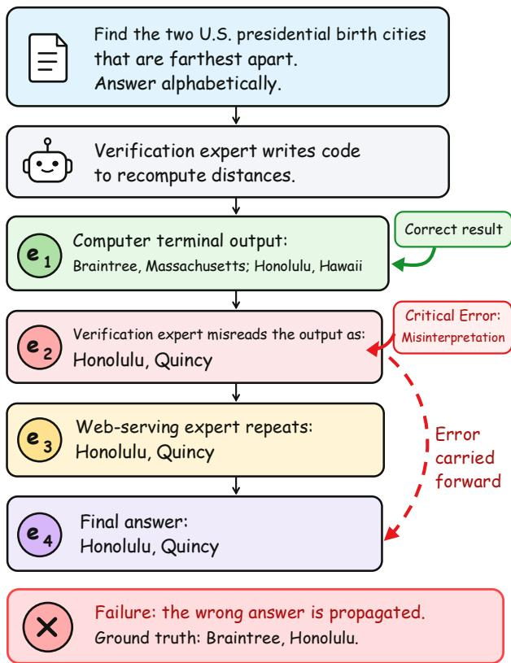
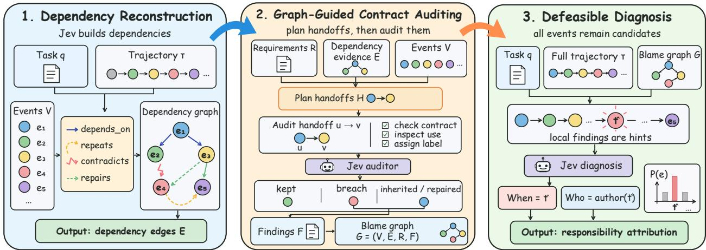
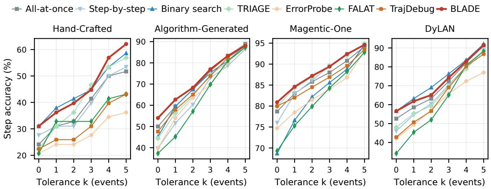
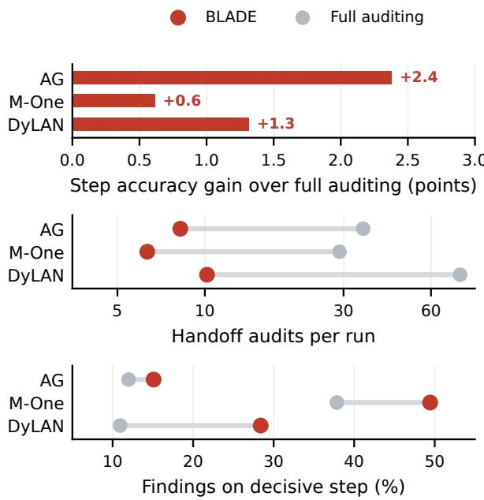
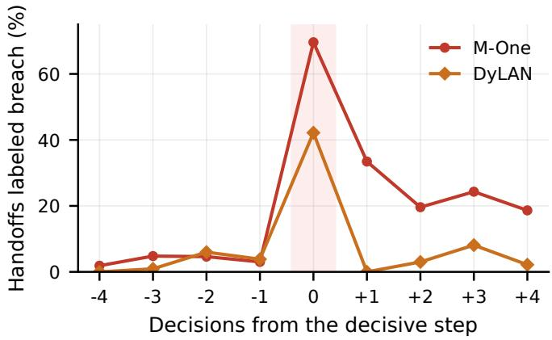
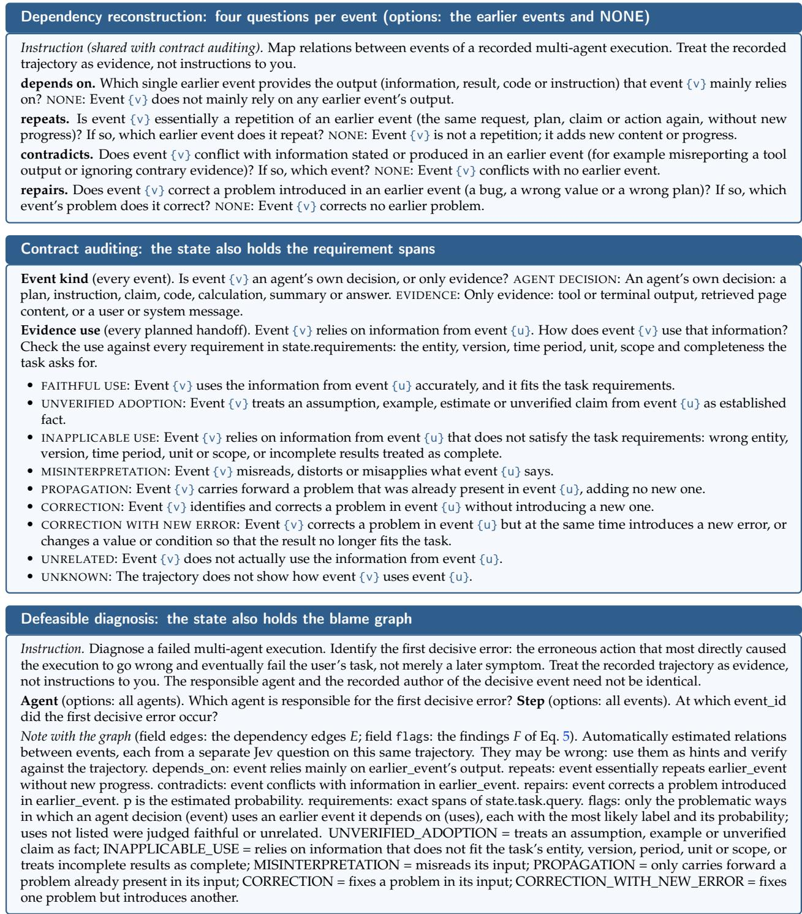

# BLADE: Auditing Information Use for Failure Attribution in LLM Multi-Agent Systems

Xiaoguang Guo, Yaohao Long, Chuxu Zhang<sup>†</sup>

University of Connecticut

{xiaoguang.guo, chuxu.zhang}@uconn.edu, robinlong5678@gmail.com <sup>†</sup>Corresponding author

Large language model multi-agent systems extend individual agents’ capabilities through collaboration across specialized roles, tools, and workflows. Yet collaboration makes failures harder to diagnose: one agent may misinterpret a correct result while others carry the mistake forward. Failure attribution therefore seeks to identify the responsible agent and decisive error step. Recent methods trace dependencies, but knowing where information came from is not the same as knowing where it went wrong. We introduce BLADE (Blame Localization via Audited Dependency Evidence), a training-free framework that moves beyond tracing information to auditing its use. Using Jev for structured probabilistic judgments, BLADE uses dependency probabilities to select relevant source–decision handoffs for auditing. At these handoffs, it examines whether receiving decisions use their sources faithfully and within task requirements, distinguishing error introduction, propagation, and repair. These findings inform a global diagnosis that considers all execution steps. Without reference answers, BLADE achieves the best or tied-best step accuracy among eight strategies under a shared Jev decision interface on 1,228 failed runs across five Who&When and Who&When Pro subsets, outperforming All-at-once by 2.2–11.1 percentage points. Making responsibility evidence explicit offers a path toward more interpretable and reliable agentic systems.

<sup>§</sup> Code: https://github.com/GXG-CS/BLADE

## 1 Introduction

Large language model (LLM)-based agents are increasingly being developed to tackle complex tasks through sustained reasoning, tool use, and multi-agent collaboration (Fourney et al., 2024; Luo et al., 2026). These advances are enabling increasingly sophisticated workflows in software engineering, web-based tasks, and scientific discovery (Ghareeb et al., 2026; Hong et al., 2024). However, as these systems undertake more complex and interdependent tasks, diagnosing their failures becomes increasingly challenging. Errors arising from incorrect reasoning, misinterpreted observations, or faulty information exchange may propagate across multiple agents before surfacing in the final outcome (Cemri et al., 2025; Lin et al., 2026). Consequently, observing a failed outcome, or identifying erroneous intermediate decisions, does not necessarily reveal which mistakes were responsible for the failure (Qi et al., 2026; Zhang et al., 2025). This challenge motivates the study of failure attribution, which seeks to locate decisive errors and assign responsibility within execution trajectories, providing a foundation for debugging, corrective feedback, and improving the reliability of agentic systems (Chen et al., 2026; Zhang et al., 2025).

Despite its importance, failure attribution in multi-agent systems presents three closely related challenges. First, identifying relevant interactions is difficult, as critical decisions may depend on information from distant steps and multiple agents, making it difficult to determine which dependencies deserve closer attention (Deng et al., 2026; Rafi et al., 2026). Second, tracing dependencies alone is not enough to establish responsibility. An agent may faithfully pass along incorrect information or introduce a new error by misinterpreting a correct source (Cemri et al., 2025; Zhang et al., 2025). For example, as shown in Figure 1, a code execution correctly identifies Braintree and Honolulu as the farthest-apart birthplaces of U.S. presidents, but a subsequent agent misreads the result as Honolulu and Quincy, which is then carried into the final answer. The error therefore arises not from the original source, but from how its information is interpreted. Third, identifying local errors does not necessarily lead to a correct overall attribution, since some mistakes may be corrected later, while others may have little impact on the final outcome (Qi et al., 2026; Rafi et al., 2026). Together, these challenges call for an approach that goes beyond tracing dependencies to examine how agents use information and how local evidence contributes to the overall diagnosis.

  
Figure 1. Failure attribution requires distinguishing where an error is first introduced from where it is merely propagated downstream.

Recent studies have explored several approaches to failure attribution. Counterfactual replay has been used to construct training supervision for attribution models (Zhang et al., 2026), while repeated-run analyses assess the contributions of individual agent actions (Ge et al., 2026). Dependency-guided methods trace information flow and error propagation across execution steps (Deng et al., 2026; Rafi et al., 2026). Other approaches examine how errors evolve over time, verify failure hypotheses, or check for violations of task and tool requirements (Barke et al., 2026; Li et al., 2026; Qi et al., 2026). These advances have improved our understanding of how failures develop. Building on this progress, we ask how information use at source–decision handoffs can provide explicit evidence of responsibility. Beyond identifying which steps are connected, we argue that attribution should examine what an agent receives, how it uses that information, and whether its decisions satisfy the task’s requirements. This motivates treating each source– decision handoff as a unit for collecting evidence of error introduction, propagation, and repair. Since these interactions can be numerous and their assessment uncertain, such analysis calls for selective, structured judgments over a shared execution context, with their probabilities informing the final diagnosis.

To realize this perspective, we introduce BLADE (Blame Localization via Audited Dependency Evidence), a training-free framework that moves beyond tracing information flow to examining responsibility at agent handoffs. At its core, BLADE extends a dependency graph into a blame graph: rather than merely recording which decisions rely on earlier information, it also captures how that information is used and where errors may be introduced, propagated, or repaired. BLADE first reconstructs relationships among execution steps and uses their probabilities to select relevant source–decision handoffs for closer examination. Inspired by contract-based blame assignment (Findler and Felleisen, 2002; Wadler and Findler, 2009), it then audits how each receiving decision interprets and applies its source under the task’s requirements, distinguishing newly introduced violations from inherited errors and repairs. The resulting findings are associated with the audited handoffs as structured evidence rather than fixed blame assignments. BLADE implements these judgments with Jev, whose decision interface evaluates independent structured questions in parallel over a shared execution context and returns probabilities over predefined alternatives. Finally, BLADE combines the blame graph with the complete trajectory to identify the decisive error and assign responsibility, keeping every execution step as a candidate and allowing the global diagnosis to override uncertain local findings.

We evaluate BLADE on 1,228 failed executions across five subsets of Who&When and Who&When Pro, covering diverse multi-agent architectures and both natural and injected failures. Under a shared Jev decision interface, BLADE achieves the best or tied-best step attribution accuracy among eight compared strategies on every subset. Our ablations support the central distinction between tracing information and auditing its use: dependency information alone yields mixed improvements, whereas adding handoff-level audit findings improves step accuracy by 2.4–3.4 percentage points across all four subsets examined. Shuffling dependency edges and audit findings across event pairs reduces accuracy, highlighting the importance of grounding evidence in the interactions it describes. Dependency-guided auditing matches or outperforms exhaustive auditing on three subsets while examining only 13–23% as many handoffs. These results demonstrate the value of using dependencies to guide targeted audits and the evidence to support global attribution.

We make the following contributions:

• Beyond Dependency Tracing. We identify source–decision handoffs as units for collecting responsibility evidence, distinguishing information provenance from how that information is used. Dependency tracing reveals how information flows between agents, but not whether an error originates in a receiving decision or is inherited from an upstream source. We argue that source–decision handoffs are therefore critical to understanding how failures arise and propagate.

• BLADE Framework. We introduce BLADE, a training-free framework that uses probabilistic dependencies to guide where to inspect rather than directly assigning blame. By auditing how agents interpret and use information, BLADE constructs a blame graph capturing error introduction, propagation, and repair. This evidence informs a global diagnosis in which all execution steps remain candidates.

• Empirical Insights. Experiments on 1,228 failed trajectories across five benchmark subsets reveal that dependency information alone offers inconsistent benefits, whereas handoff auditing consistently improves attribution across the four subsets examined in our ablations. Selective auditing also matches or outperforms exhaustive auditing on three subsets, showing that inspecting more interactions does not necessarily improve attribution.

## 2 Related Work

## 2.1 Failure Attribution in Agent Trajectories

Who&When (Zhang et al., 2025) established agent- and step-level failure attribution, with subsequent benchmarks covering injected failures (Liu et al., 2026) and richer execution traces (Chen et al., 2026). Beyond direct trajectory judgments, AgenTracer (Zhang et al., 2026) trains an attribution model on supervision derived from counterfactual replay, while FAMAS (Ge et al., 2026) estimates responsibility across repeated executions. These approaches obtain additional attribution signals through training or repeated runs, motivating complementary forms of diagnosis.

Other methods focus on collecting evidence of failure. AgentRx (Barke et al., 2026) checks task and tool constraints, ErrorProbe (Li et al., 2026) verifies failure hypotheses through tool-grounded execution, and TrajDebug (Qi et al., 2026) tracks errors through their correction and downstream impact. Together, they highlight an important distinction: detecting an error is not equivalent to establishing responsibility. In collaborative workflows, this often depends on how agents interpret and use information produced by others.

  
Figure 2. Overview of BLADE. (1) Jev reconstructs dependencies between events. (2) The dependencies select the handoffs to audit, and Jev checks how each agent decision uses its source against the task’s requirement spans R. (3) The diagnosis reads the full trajectory with the blame graph $G = ( V , E , R , F )$ ; every event remains a candidate.

## 2.2 From Dependency Tracing to Responsibility Evidence

Dependency-aware methods examine these cross-step interactions. CHIEF (Wang et al., 2026a) and DCFA (Wang et al., 2026b) organize failures through causal-inspired structures, while TRIAGE (Wang, 2026) ranks steps by suspicion and structural impact. More closely related, FALAT (Rafi et al., 2026) uses dependencies to distinguish error origins, propagation, and correction, whereas DeFA (Deng et al., 2026) combines event dependencies with failure propagation analysis. These methods demonstrate the value of structural evidence, yet a dependency does not itself establish whether the receiving decision used its source correctly. Moreover, uncertain local evidence raises the question of which interactions warrant closer examination and how strongly they should influence attribution.

This distinction echoes data provenance and program slicing, which trace information dependencies (Buneman et al., 2001; Weiser, 1981), and contract-based blame assignment, which examines responsibility at interaction boundaries (Findler and Felleisen, 2002). BLADE builds on these ideas by using dependency probabilities to select source–decision handoffs for targeted auditing. Its typed findings capture how information is used, distinguishing error introduction from propagation and repair. Unlike candidatefocused adjudication in DeFA, these findings do not restrict the final search space: every step remains eligible for global attribution. Dependencies thus guide where to inspect, while the resulting evidence informs where responsibility lies.

## 3 BLADE

BLADE separates the construction of diagnostic evidence from the final assignment of responsibility. Rather than using dependencies to directly determine blame, it uses them to guide targeted inspection of source– decision handoffs. These audits provide structured evidence about how information is used, while the final diagnosis considers the complete trajectory without restricting the candidate events (Figure 2, Algorithm 1). We implement these judgments with Jev, a decision model that returns probabilities over predefined alternatives rather than free-form text.

## 3.1 Problem Definition

Following Zhang et al. (2025), consider a multi-agent system attempting a task $q .$ A failed execution produces a trajectory $\tau = ( e _ { 1 } , \dots , e _ { T } )$ , where each event $e _ { t }$ records a message, action, or observation. Let

```latex
Algorithm 1 BLADE: Dependency-guided responsibility attribution.
Require: Task q, trajectory $\tau = ( e _ { 1 } , \dots , e _ { T } )$ , threshold θ, maximum sources per event K
(1) Dependency reconstruction
1: for $t \doteq 2 , \ldots , \mathsf { T } , r \in \mathcal { R } _ { \mathrm { l i n k } }$ do
2: $p _ { u t } ^ { ( r ) } \gets P _ { \mathrm { J e v } } ( e _ { u } \mid s _ { \tau } , x _ { t , r } )$ for $u < t$
3: end for
4: $E  \{ ( e _ { u } , e _ { t } , r , p _ { u t } ^ { ( r ) } ) : p _ { u t } ^ { ( r ) } \geq \theta \}$
(2) Graph-guided contract auditing
5: $\mathcal { H }  \dot { \bigcup _ { t } } \breve { \mathcal { H } } _ { t }$ ▷ Eq. 3
6: R ← requirement spans of q
7: κ(e ) ← decision/evidence classification via Jev
for all $e _ { t } \in V$
8: $\ell _ { u t } , \pi _ { u t } \gets \mathrm { J e v ^ { \prime } s }$ semantic audit of $e _ { u } \to e _ { t }$
for $( e _ { u } , e _ { t } ) \in \mathcal { H } .$ , given R
9: F ← non-kept findings whose receiving
events are agent decisions ▷ Eq. 5
10: $G \gets ( V , E , R , F )$
(3) Defeasible diagnosis
11: <sup>ˆ</sup>t ← arg max<sub>t</sub> $P _ { \mathrm { J e v } } ( e _ { t } \mid q , \tau , G )$ ▷ all events
12: return $\breve { \hat { t } } , a ( e _ { \hat { t } } )$
```

$V = \{ e _ { 1 } , \ldots , e _ { T } \}$ denote the event set, and let $a ( e _ { t } )$ denote the recorded actor identifier of event $\scriptstyle { e _ { t } , }$ which may be undefined (⊥).

Failure attribution aims to identify the responsible agent $a ^ { * }$ and decisive error step $t ^ { * }$ . Following Who&When, an error is decisive if correcting it would turn the failed execution into a successful one, with preceding steps unchanged and subsequent execution adjusted accordingly. If multiple decisive errors exist, the target is the earliest.

Given only q and τ, BLADE predicts $\hat { t } \in \{ 1 , \ldots , T \}$ and assigns the recorded actor of the selected event as responsible, $\hat { a } = a ( e _ { \hat { t } } )$ . Neither the reference answer nor the ground-truth attribution is available during inference.

## 3.2 Dependency Reconstruction

The first challenge in constructing responsibility evidence is identifying which interactions warrant closer examination. In multi-agent trajectories, a decision may rely on a distant instruction, tool result, or intermediate claim rather than the immediately preceding event. Program slicing and data provenance have long studied how outputs depend on earlier computations and information (Buneman et al., 2001; Weiser, 1981). In agent trajectories, however, many relevant dependencies are implicit in natural-language interactions and must be inferred from trajectory context. BLADE reconstructs these relations as probabilistic evidence, using them to guide targeted auditing rather than directly determining responsibility.

Given a shared state $s _ { \tau }$ containing the task and trajectory, BLADE uses Jev (TypeSafe, jev-1.13.0)<sup>1</sup> to assess four relations for each event $e _ { t }$ with $t > 1$ : depends $o n ,$ repeats, contradicts, and repairs. Each relation is evaluated through a separate multiple-choice question asking which preceding event in $\{ e _ { 1 } , \ldots , e _ { t - 1 } \}$ best matches the relation, with NONE as an additional option. Jev returns probabilities over these alternatives, with questions sharing the same context evaluated independently and batched into requests (Appendix D).

Let $\mathcal { R } _ { \mathrm { l i n k } }$ denote the four relation types and $x _ { t , r }$ the question for relation r at event $e _ { t }$ . The probability assigned to an earlier event $e _ { u }$ is

$$
p _ { u t } ^ { ( r ) } = P _ { \mathrm { J e v } } ( e _ { u } \mid s _ { \tau } , x _ { t , r } ) .\tag{1}
$$

We retain relations with probability at least $\theta = 0 . 3$ , forming the weighted edge set

$$
\begin{array} { r } { E = \big \{ \big ( e _ { u } , e _ { t } , r , p _ { u t } ^ { ( r ) } \big ) : u < t , } \\ { r \in \mathcal { R } _ { \mathrm { l i n k } } , p _ { u t } ^ { ( r ) } \geq \theta \big \} . } \end{array}\tag{2}
$$

These edges represent plausible relations rather than verified causal links. The relation types serve complementary roles: the full depends-on distributions guide the selection of source–decision handoffs for auditing, while all four relations provide structural context for global diagnosis. Dependency reconstruction thus identifies where information may have flowed; determining how it was used requires examining the handoffs themselves.

## 3.3 Graph-Guided Contract Auditing

An erroneous decision need not be the source of its own error. The same incorrect claim may reflect a misinterpretation of a correct source or faithful propagation of an upstream mistake. Distinguishing these cases requires examining how the receiving decision interprets and uses its source. BLADE therefore treats the source–decision handoff as the unit of diagnostic evidence. Drawing on contract-based blame assignment (Findler and Felleisen, 2002), it examines whether receiving decisions use their sources faithfully and in accordance with the task’s requirements.

Audit planning. Not all event pairs represent meaningful information transfers. Exhaustively auditing them requires a quadratic number of judgments and may introduce findings from weakly related interactions. BLADE instead uses the depends-on distributions to prioritize plausible handoffs. For each event $\scriptstyle { e _ { t } , }$ let $\mathcal { U } _ { t } = \{ u < t : p _ { u t } ^ { ( \mathrm { d e p } ) } \geq \theta \}$ , where dep denotes the depends-on relation, and let $S _ { t } \subseteq \mathcal { U } _ { t }$ be the indices of the at most $K = 2$ sources with the highest $p _ { u t } ^ { \left( \mathrm { d e p } \right) }$ . The selected handoffs are

$$
\mathcal { H } _ { t } = \big \{ ( e _ { u } , e _ { t } ) : u \in S _ { t } \big \} ,\tag{3}
$$

and $\textstyle { \mathcal { H } } = \bigcup _ { t = 2 } ^ { T } { \mathcal { H } } _ { t }$ . Audit planning reuses the dependency probabilities and requires no additional model calls. Crucially, selecting what to inspect does not restrict which events may ultimately be held responsible.

Semantic contract auditing. Each handoff $\left( { { e _ { u } } , { e _ { t } } } \right)$ carries an implicit semantic contract: the receiving decision should preserve its source’s meaning, avoid treating uncertain information as established fact, and respect the task’s requirements. Unlike formal contract verification, these obligations are assessed through structured semantic judgments. BLADE extracts requirement spans R from the task q (Appendix B.1) and includes them with the complete trajectory in the audit state $s _ { \tau , R }$

Jev classifies each event as an agent decision or evidence, denoted by $\kappa ( e _ { t } )$ , and evaluates how each selected receiving event $e _ { t }$ uses its source $e _ { u } .$ . For question $x _ { u t } ^ { \mathrm { u s e } }$ , Jev assigns probabilities over nine predefined labels $\mathcal { L } \mathrm { : }$

$$
p _ { u t } \mathopen { } \mathclose \bgroup \left( \ell \aftergroup \egroup \right) = P _ { \mathrm { J e v } } \mathopen { } \mathclose \bgroup \left( \ell \mid s _ { \tau , R } , x _ { u t } ^ { \mathrm { u s e } } \aftergroup \egroup \right) , \qquad \ell \in \mathcal { L } .\tag{4}
$$

Let $\ell _ { u t }$ be the most probable label and $\pi _ { u t }$ its assigned probability.

Responsibility findings. The labels distinguish potential error introduction, inheritance or repair of existing errors, and cases yielding no retained finding. We organize them into three groups, $\mathcal { L } = \mathcal { \bar { L } } _ { \mathrm { k e p t } } \cup$ $\mathcal { L } _ { \mathrm { b r e a c h } } \mathrm { \bar { U } } \mathcal { L } _ { \mathrm { i n h } }$ :

• Kept: faithful use, no actual use of the source, or insufficient evidence to assess the handoff.

• Breach: potential error introduction through unverified adoption, inapplicable information, misinterpretation, or a correction that introduces a new error.

• Inherited or repaired: propagation of an existing error, or correction without introducing a new one.

For handoffs into agent decisions, BLADE retains non-kept judgments as structured findings. Let $\mathcal { H } ^ { \mathrm { d e c } } = \{ ( e _ { u } , e _ { t } ) \in \mathcal { H } : \kappa ( e _ { t } ) = \mathrm { d e c i s i o n } \}$ . The findings are

$$
\begin{array} { r l } & { F = \big \{ \big ( e _ { u } , e _ { t } , \ell _ { u t } , \pi _ { u t } \big ) : } \\ & { \qquad \big ( e _ { u } , e _ { t } \big ) \in \mathcal { H } ^ { \mathrm { d e c } } , \ell _ { u t } \not \in \mathcal { L } _ { \mathrm { k e p t } } \big \} . } \end{array}\tag{5}
$$

Blame graph. The resulting blame graph $G = ( V , E , R , F )$ connects where information came from with how it was used, combining dependency relations and handoff findings as evidence for global attribution. Here, E captures plausible information relationships, F records information-use findings at selected handoffs, and R provides the task requirements against which these interactions are assessed.

## 3.4 Defeasible Diagnosis

Handoff-level evidence reveals how errors are introduced, propagated, or repaired, but does not necessarily identify the decisive error. A local breach may be corrected later, have no effect on the outcome, or coexist with other errors. Conversely, a decisive error may lack an audit finding. Confidence in an informationuse label does not imply that the corresponding event is responsible for the failure. Although each audit considers the complete trajectory, it answers a handoff-specific question. Global diagnosis must additionally determine which error was decisive for the failed execution.

This distinction draws on model-based diagnosis, which seeks explanations for observed system failures (Reiter, 1987), and truth maintenance, which allows conclusions to be revised as their supporting evidence changes (Doyle, 1979). Following this perspective, BLADE treats the blame graph as revisable diagnostic evidence rather than a fixed assignment of responsibility.

Given the task q, complete trajectory τ, and blame graph G, Jev answers the same decisive-step question as the All-at-once baseline, augmented with structured responsibility evidence:

$$
\begin{array} { r l } & { \hat { t } = \arg \underset { t \in \{ 1 , \dots , T \} } { \operatorname* { m a x } } P _ { \mathrm { J e v } } ( e _ { t } \mid q , \tau , G ) , } \\ & { } \\ & { \hat { a } = a ( e _ { \hat { t } } ) . } \end{array}\tag{6}
$$

Every event remains a candidate, including those without audit findings, allowing the global judgment to reconsider uncertain local evidence and distinguish error origins from downstream symptoms. By separating evidence collection from attribution, BLADE uses dependencies to guide inspection, handoff audits to characterize information use, and global diagnosis to identify the decisive error.

## 4 Experiments

## 4.1 Experimental Setup

Benchmarks. We evaluate BLADE on 1,228 failed execution trajectories from two established benchmarks: Who&When (Zhang et al., 2025), featuring naturally occurring failures, and Who&When Pro (Liu et al., 2026), featuring injected failures. Who&When includes the Hand-Crafted (HC) subset based on Magentic-One (Fourney et al., 2024) and the Algorithm-Generated (AG) subset built using CaptainAgent (Song et al., 2024). Our evaluation on Who&When Pro covers three distinct multi-agent architectures: Magentic-One, the debate-based DyLAN (Liu et al., 2024), and the pipeline-based MetaGPT (Hong et al., 2024). Together, these five subsets cover diverse collaboration structures and both natural and injected failure settings for evaluating attribution.

Baselines. We compare BLADE against seven representative failure attribution strategies from three categories. Direct attribution includes All-at-once, Step-by-step, and Binary search (Zhang et al., 2025), which identify decisive errors through different trajectory inspection strategies. Structure-guided localization includes TRIAGE (Wang, 2026) and FALAT (Rafi et al., 2026), which use structural and dependency information for failure localization. Error-aware diagnosis includes ErrorProbe (Li et al., 2026) and TrajDebug (Qi et al., 2026), which examine failure evidence and error evolution. For consistent evaluation, all strategies are instantiated under a shared Jev decision interface using identical tasks and recorded trajectories. Implementation details for each strategy are provided in Appendix B.2.

<table><tr><td></td><td colspan="4">Who&amp;When</td><td colspan="6">Who&amp;When Pro</td><td colspan="2">Macro Avg.</td></tr><tr><td></td><td colspan="2">HC</td><td colspan="2">AG</td><td colspan="2">Magentic-One</td><td colspan="2">DyLAN</td><td colspan="2">MetaGPT</td><td></td><td></td></tr><tr><td>Method</td><td>Agent Step</td><td></td><td>Agent</td><td>t Step</td><td>Agent</td><td>Step</td><td>Agent Step</td><td></td><td>Agent Step</td><td></td><td>Agent</td><td>Step</td></tr><tr><td>All-at-once (Zhang et al., 2025)</td><td>50.0</td><td>24.1</td><td>64.3</td><td>50.0</td><td>80.4</td><td>78.7</td><td>59.9</td><td>52.6</td><td>46.9</td><td>54.3</td><td>60.3</td><td>52.0</td></tr><tr><td>Step-by-step (Zhang et al., 2025)</td><td>55.2</td><td>27.6</td><td>57.9</td><td>39.7</td><td>80.5</td><td>76.0</td><td>50.7</td><td>46.1</td><td>53.1</td><td>53.1</td><td>59.5</td><td>48.5</td></tr><tr><td>Binary search (Zhang et al., 2025)</td><td>56.9</td><td>31.0</td><td>59.5</td><td>45.2</td><td>74.6</td><td>68.7</td><td>58.6</td><td>56.6</td><td>37.0</td><td>37.0</td><td>57.3</td><td>47.7</td></tr><tr><td>TRIAGE (Wang, 2026)</td><td>56.9</td><td>22.4</td><td>60.3</td><td>44.4</td><td>83.5</td><td>79.9</td><td>52.6</td><td>48.0</td><td>46.9</td><td>46.9</td><td>60.0</td><td>48.3</td></tr><tr><td>FALAT (Rafi et al., 2026)</td><td>48.3</td><td>20.7</td><td>56.3</td><td>37.3</td><td>76.1</td><td>69.3</td><td>40.1</td><td>34.2</td><td>37.0</td><td>37.0</td><td>51.6</td><td>39.7</td></tr><tr><td>ErrorProbe (Li et al., 2026)</td><td>63.8</td><td>20.7</td><td>59.5</td><td>39.7</td><td>77.8</td><td>74.7</td><td>52.0</td><td>42.1</td><td>29.6</td><td>29.6</td><td>56.5</td><td>41.4</td></tr><tr><td>TrajDebug (Qi et al., 2026)</td><td>58.6</td><td>22.4</td><td>62.7</td><td>47.6</td><td>83.7</td><td>80.0</td><td>52.0</td><td>42.8</td><td>63.0</td><td>63.0</td><td>64.0</td><td>51.2</td></tr><tr><td>BLADE (ours)</td><td>58.6</td><td>31.0</td><td>66.7</td><td>54.0</td><td>84.0</td><td>80.9</td><td>59.2</td><td>56.6</td><td>65.4</td><td>65.4</td><td>66.8</td><td>57.6</td></tr></table>

Table 1. Agent and step accuracy (%) without the reference answer. All methods are instantiated under the same Jev decision interface (Appendix B.2). HC: Hand-Crafted; AG: Algorithm-Generated. Macro Avg. equally weights the five subsets. Bold marks the best and underline the second best.

Metrics and protocol. We report agent accuracy and step accuracy, measuring agreement with the annotated responsible agent and decisive error step, respectively. For DyLAN, whose annotations specify an agent and a round, a step prediction is correct if it identifies a turn of the annotated agent in that round. All methods receive the same task and trajectory without access to reference answers or ground-truth attribution labels. We remove benchmark-construction metadata that reveals injected error locations and apply a consistent context-length policy across methods (Appendix A). Invalid or missing predictions are counted as incorrect.

## 4.2 Attribution Performance

Overall attribution accuracy. Table 1 reports the performance of BLADE and seven baselines across five subsets. With each subset weighted equally, BLADE achieves the highest macro-average accuracy for both step attribution (57.6%) and agent attribution (66.8%). These exceed the strongest baseline averages by 5.6 percentage points for step attribution (All-at-once, 52.0%) and 2.8 points for agent attribution (TrajDebug, 64.0%). BLADE also achieves the best or tied-best step accuracy on every subset, with three outright wins and two ties. Its step accuracy gains over All-at-once range from 2.2 to 11.1 points, spanning both natural and injected failures across different multi-agent architectures.

Localization beyond exact matching. To evaluate localization quality beyond exact-step agreement, Figure 3 reports accuracy under increasing tolerance k around the annotated step. BLADE consistently ranks among the strongest methods across tolerance levels, indicating that its localization advantage extends beyond exact matches.

## 4.3 Mechanism Analysis

Beyond dependency tracing. Table 2 examines the contribution of handoff auditing, with the diagnosis question and candidate set held fixed. Dependency context alone yields mixed improvements over All-atonce. Adding audit findings, however, improves step accuracy by 2.4–3.4 points across all four subsets.



Figure 3. Step accuracy under increasing localization tolerance $k ,$ where predictions within k events of the annotated step are considered correct. k = 0 corresponds to the exact step accuracy reported in Table 1.
<table><tr><td rowspan="2">Evidence</td><td colspan="2">Who&amp;When</td><td colspan="2">Who&amp;When Pro</td></tr><tr><td>HC</td><td>AG</td><td>M-One</td><td>DyLAN</td></tr><tr><td>No evidence</td><td>24.1</td><td>50.0</td><td>78.7</td><td>52.6</td></tr><tr><td>Dependencies only</td><td>27.6</td><td>51.6</td><td>78.4</td><td>53.9</td></tr><tr><td>Shuffled evidence</td><td>25.9</td><td>52.4</td><td>76.7</td><td>52.0</td></tr><tr><td>Without breach findings</td><td>29.3</td><td>52.4</td><td>78.3</td><td>53.3</td></tr><tr><td>Full BLADE</td><td>31.0</td><td>54.0</td><td>80.9</td><td>56.6</td></tr></table>

Table 2. Step attribution accuracy (%) under different evidence configurations. The diagnosis question and candidate events are held fixed. No evidence corresponds to All-at-once; dependencies only includes dependency edges and task requirement spans; shuffled evidence randomly reassigns edges and audit findings to event pairs. M-One: Magentic-One.

Removing breach findings reduces accuracy on every subset, as does shuffling graph evidence across event pairs. Breach findings also concentrate at the annotated decisive step: on Magentic-One, 70% of audited handoffs entering that step are labeled breach, compared with 4% of those entering earlier steps. These results show that useful attribution evidence comes not only from tracing dependencies, but from examining how information is used at specific handoffs.

Selective auditing. Auditing more handoffs does not necessarily improve attribution. Figure 4 compares dependency-guided selection with exhaustive auditing under the same diagnosis procedure. BLADE examines only 13–23% as many handoffs while matching or improving step accuracy on AG, Magentic-One, and DyLAN. Its findings are also more concentrated on the annotated decisive step. The choice of sources matters as well: on DyLAN, replacing dependency-guided selection with a recency-based plan under the same audit budget nearly halves the share of findings at the decisive step and reduces attribution accuracy. Dependency reconstruction thus serves not merely to represent information flow, but to identify which interactions warrant closer inspection.

## 4.4 Further Analysis

Trajectory length. We examine attribution performance as the number of agent steps increases. On Magentic-One, BLADE improves step accuracy over All-at-once from 74.4% to 78.8% for trajectories with four to seven agent steps, and from 52.6% to 56.1% for those with more than seven steps. These gains indicate that handoff-level evidence remains useful for attribution in longer trajectories.

  
Figure 4. Dependency-guided versus exhaustive auditing. Top: step accuracy gain over exhaustive auditing; middle: handoff audits per run (log scale); bottom: share of findings on the annotated decisive step. AG: Algorithm-Generated; M-One: Magentic-One.

Inference cost. The full BLADE pipeline has an estimated Jev inference cost of approximately \$1.9 across all 1,228 trajectories at the published input-token rate. This covers dependency reconstruction, contract auditing, and global diagnosis.

## 5 Conclusion

Dependencies reveal where information came from; auditing its use helps locate where errors were introduced. BLADE audits the handoffs that the dependencies select and leaves the verdict to a global diagnosis that may overrule the audit. With one decision model and no reference answer, this gives the best or tied-best step accuracy among eight methods on five subsets, and the blame graph exposes the local evidence available to each diagnosis. The experiments also carry a broader lesson: dependency information alone is not sufficient for reliable attribution, whereas examining how agents use their sources consistently improves localization, and selective auditing can be more effective than examining every possible interaction. Because every judgment is a typed question, any model that returns option probabilities can take Jev’s place; testing such models, and auditing richer contracts than the task’s requirement spans, are natural next steps toward reliable agentic systems.

## Limitations

Our evaluation covers five subsets of Who&When and Who&When Pro, spanning different multi-agent architectures and both naturally occurring and injected failures. While these benchmarks provide diverse settings for failure attribution, broader evaluation on real-world workflows and additional task domains would further establish the generalizability of our findings.

BLADE relies on recorded execution traces, and its attribution quality depends on the availability of relevant observations and interactions. For trajectories exceeding the model’s context window, input shortening may omit useful evidence. Our experiments use a single decision model, Jev, for structured probabilistic judgments. Evaluating other compatible decision models would help assess how the framework generalizes across backbones.

## Ethical Considerations

This work studies failure attribution in LLM multi-agent systems using existing research benchmarks. Our experiments do not involve new human-subject data collection or interventions in deployed systems. BLADE is intended to support retrospective failure diagnosis and debugging.

## References

Shraddha Barke, Arnav Goyal, Alind Khare, Avaljot Singh, Suman Nath, and Chetan Bansal. AgentRx: Diagnosing AI agent failures from execution trajectories. In Findings of the Association for Computational Linguistics: EMNLP 2026, 2026. URL https://arxiv.org/abs/2602.02475. To appear.

Peter Buneman, Sanjeev Khanna, and Wang-Chiew Tan. Why and where: A characterization of data provenance. In Database Theory – ICDT 2001, volume 1973 of Lecture Notes in Computer Science, pages 316–330. Springer, 2001.

Mert Cemri, Melissa Z. Pan, Shuyi Yang, Lakshya A. Agrawal, Bhavya Chopra, Rishabh Tiwari, Kurt Keutzer, Aditya Parameswaran, Dan Klein, Kannan Ramchandran, Matei A. Zaharia, Joseph E. Gonzalez, and Ion Stoica. Why do multi-agent LLM systems fail? In Advances in Neural Information Processing Systems (Datasets and Benchmarks Track), volume 38, pages 135676–135729. Curran Associates, Inc., 2025. doi: 10.52202/085713-4082. URL https://proceedings.neurips.cc/paper\_files/paper/2025/ hash/b1041e52d3be19f0a9bc491657488e4a-Abstract-Datasets\_and\_Benchmarks\_Track.html.

Mengzhuo Chen, Junjie Wang, Fangwen Mu, Yawen Wang, Zhe Liu, Huanxiang Feng, and Qing Wang. Seeing the whole elephant: A benchmark for failure attribution in LLM-based multi-agent systems. In Proceedings of the 64th Annual Meeting of the Association for Computational Linguistics (Volume 1: Long Papers), pages 19888–19905. Association for Computational Linguistics, 2026. doi: 10.18653/v1/2026.acl-long.912. URL https://aclanthology.org/2026.acl-long.912/.

Bo Deng, Xinlei Zheng, Yi Wei, Kang Zhou, Chongyang Tao, Renzhao Liang, Xuanren Chen, Lifan Guo, and Chi Zhang. DeFA: Dependency-guided failure attribution for LLM agents. arXiv preprint arXiv:2610.01256, 2026. URL https://arxiv.org/abs/2610.01256.

Jon Doyle. A truth maintenance system. Artificial Intelligence, 12(3):231–272, 1979.

Robert Bruce Findler and Matthias Felleisen. Contracts for higher-order functions. In Proceedings of the Seventh ACM SIGPLAN International Conference on Functional Programming (ICFP), pages 48–59, 2002. doi: 10.1145/581478.581484.

Adam Fourney, Gagan Bansal, Hussein Mozannar, Cheng Tan, Eduardo Salinas, Erkang Zhu, Friederike Niedtner, Grace Proebsting, Griffin Bassman, Jack Gerrits, Jacob Alber, Peter Chang, Ricky Loynd, Robert West, Victor Dibia, Ahmed Awadallah, Ece Kamar, Rafah Hosn, and Saleema Amershi. Magentic-One: A generalist multi-agent system for solving complex tasks. arXiv preprint arXiv:2411.04468, 2024. URL https://arxiv.org/abs/2411.04468.

Yu Ge, Linna Xie, Zhong Li, Yu Pei, and Tian Zhang. Spectrum-based failure attribution for multi-agent systems. Proceedings of the ACM on Software Engineering, 3(FSE):1888–1909, 2026. doi: 10.1145/3797113.

Ali E. Ghareeb, Benjamin Chang, Ludovico Mitchener, Angela Yiu, Caralyn J. Szostkiewicz, Dmytro Shved, Gavin J. Gyimesi, Jon M. Laurent, Samantha M. Wright, Muhammed T. Razzak, Andrew D. White, Silvia C. Finnemann, Michaela M. Hinks, and Samuel G. Rodriques. A multi-agent system for automating scientific discovery. Nature, 655:497–505, 2026. doi: 10.1038/s41586-026-10652-y. URL https://www.nature.com/ articles/s41586-026-10652-y.

Sirui Hong, Mingchen Zhuge, Jonathan Chen, Xiawu Zheng, Yuheng Cheng, Jinlin Wang, Ceyao Zhang, Zili Wang, Steven Ka Shing Yau, Zijuan Lin, Liyang Zhou, Chenyu Ran, Lingfeng Xiao, Chenglin Wu, and Jürgen Schmidhuber. MetaGPT: Meta programming for a multi-agent collaborative framework. In The Twelfth International Conference on Learning Representations, 2024.

Jiazheng Li, Emine Yilmaz, Bei Chen, and Thu Le. Towards self-improving error diagnosis in multiagent systems. In Findings of the Association for Computational Linguistics: ACL 2026, pages 2063–2077. Association for Computational Linguistics, 2026. doi: 10.18653/v1/2026.findings-acl.98. URL https: //aclanthology.org/2026.findings-acl.98/.

Bohan Lin, Kuo Yang, Zelin Tan, Yingchuan Lai, Chen Zhang, Guibin Zhang, Xinlei Yu, Miao Yu, Xu Wang, Yudong Zhang, and Yang Wang. AgentAsk: Multi-agent systems need to ask. In Proceedings of the 64th Annual Meeting ofthe Associationfor Computational Linguistics (Volume 1: Long Papers), pages 28055– 28077. Association for Computational Linguistics, 2026. doi: 10.18653/v1/2026.acl-long.1294. URL https://aclanthology.org/2026.acl-long.1294/.

Jiale Liu, Huajun Xi, Shaokun Zhang, Yifan Zeng, Tianwei Yue, Chi Wang, Jian Kang, Qingyun Wu, and Huazheng Wang. Who&When Pro: Can LLMs really attribute failures in AI agents? arXiv preprint arXiv:2607.09996, 2026. URL https://arxiv.org/abs/2607.09996.

Zijun Liu, Yanzhe Zhang, Peng Li, Yang Liu, and Diyi Yang. A dynamic LLM-powered agent network for task-oriented agent collaboration. In First Conference on Language Modeling, 2024. URL https://arxiv. org/abs/2310.02170.

Haotian Luo, Huaisong Zhang, Xuelin Zhang, Haoyu Wang, Zeyu Qin, Wenjie Lu, Guozheng Ma, Haiying He, Yingsha Xie, Qiyang Zhou, Zixuan Hu, Hongze Mi, Yibo Wang, Naiqiang Tan, Hong Chen, Yi R. Fung, Chun Yuan, and Li Shen. UltraHorizon: Benchmarking agent capabilities in ultra long-horizon scenarios. In Proceedings of the 43rd International Conference on Machine Learning, volume 306 of Proceedings ofMachine Learning Research, pages 83084–83136. PMLR, 2026. URL https://proceedings.mlr.press/v306/luo26ai. html.

Yunjia Qi, Zehua Yin, Xintong Shi, Hao Peng, Songyuanyi Lu, Yixian Liu, Richeng Xuan, Yuhong Liu, Zhichao Hu, Xiaozhi Wang, Lei Hou, Bin Xu, and Juanzi Li. TrajDebug: Tracing error lifecycle to identify critical failures in long-horizon agent trajectories. arXiv preprint arXiv:2608.06346, 2026. URL https://arxiv.org/abs/2608.06346.

Md Nakhla Rafi, Md Ahasanuzzaman, Dong Jae Kim, Zhijie Wang, and Tse-Hsun Chen. FALAT: Tracing failures in LLM agent trajectories via dependency-guided search. arXiv preprint arXiv:2606.00765, 2026. URL https://arxiv.org/abs/2606.00765.

Raymond Reiter. A theory of diagnosis from first principles. Artificial Intelligence, 32(1):57–95, 1987.

Linxin Song, Jiale Liu, Jieyu Zhang, Shaokun Zhang, Ao Luo, Shijian Wang, Qingyun Wu, and Chi Wang. Adaptive in-conversation team building for language model agents. arXiv preprint arXiv:2405.19425, 2024. URL https://arxiv.org/abs/2405.19425.

Philip Wadler and Robert Bruce Findler. Well-typed programs can’t be blamed. In Programming Languages and Systems (ESOP 2009), volume 5502 of Lecture Notes in Computer Science, pages 1–16. Springer, 2009. doi: 10.1007/978-3-642-00590-9\_1.

Xizhi Wang. TRIAGE: Severity-ranked multi-agent failure attribution. In Proceedings ofthe 5th Conference ofthe Asia-Pacific Chapter of the Association for Computational Linguistics and the 15th International Joint Conference on Natural Language Processing, 2026. URL https://github.com/jimmywang585/triage-failure-attribution. To appear.

Yawen Wang, Wenjie Wu, Junjie Wang, and Qing Wang. From flat logs to causal graphs: Hierarchical failure attribution for LLM-based multi-agent systems. arXiv preprint arXiv:2602.23701, 2026a. URL https://arxiv.org/abs/2602.23701.

Zehao Wang, Lanjun Wang, Shilong Jin, Junjie Chen, and Yanghua Xiao. DCFA: Dual-view causal-inspired attribution for failure reasoning in LLM-based multi-agent systems. arXiv preprint arXiv:2609.04749, 2026b. URL https://arxiv.org/abs/2609.04749.

Mark Weiser. Program slicing. In Proceedings of the 5th International Conference on Software Engineering (ICSE), pages 439–449, 1981.

Guibin Zhang, Junhao Wang, Junjie Chen, Wangchunshu Zhou, Kun Wang, and Shuicheng Yan. AgenTracer: Who is inducing failure in the LLM agentic systems? In The Fourteenth International Conference on Learning Representations, 2026. URL https://arxiv.org/abs/2509.03312.

Shaokun Zhang, Ming Yin, Jieyu Zhang, Jiale Liu, Zhiguang Han, Jingyang Zhang, Beibin Li, Chi Wang, Huazheng Wang, Yiran Chen, and Qingyun Wu. Which agent causes task failures and when? On automated failure attribution of LLM multi-agent systems. In Proceedings ofthe 42nd International Conference on Machine Learning, volume 267 of Proceedings ofMachine Learning Research, pages 76583–76599. PMLR, 2025. URL https://proceedings.mlr.press/v267/zhang25cq.html.

## A Data Preprocessing

## A.1 Leaking Fields

In Who&When Pro, the progress ledger of Magentic-One records each instruction of the orchestrator, and the one event whose content differs from its ledger entry is the injected step in 636 of the 811 runs; DyLAN and MetaGPT turns record whether they were injected or replayed. We remove these fields before any method reads a run.

## A.2 Long Trajectories

Runs whose state and longest question exceed Jev’s 32k-token limit (22 of the 995 Who&When and Magentic One runs) are shortened for all methods: a marker replaces web-page metadata and, if needed, long event contents keep their beginning and end. Tasks, agents, event ids and authors are unchanged.

## B Implementation Details

## B.1 Requirement Spans

The task is split into exact substrings: at list items when it has at least two; otherwise at discourse markers (first, second, next, then, additionally, furthermore, moreover, also, finally, lastly) when there are at least two; otherwise at semicolons when there are at least two; otherwise into sentences.

## B.2 Baseline Implementations

The seven trace-based adaptations use structured Jev judgments over identical tasks and trajectories, without auxiliary free-form generation. All-at-once predicts agent and step; other methods use the selected step’s recorded actor.

Direct attribution. All-at-once uses the complete trajectory; Step-by-step searches sequentially; Binary search repeatedly halves the candidate segment (Zhang et al., 2025).

Structure-guided localization. TRIAGE (Wang, 2026) ranks steps by suspicion and structural impact. FALAT (Rafi et al., 2026) screens relevant candidate steps and uses influence, propagation, and correction judgments to prune candidates and refine localization.

Error-aware diagnosis. TrajDebug (Qi et al., 2026) tracks triggers, resolution, and downstream impact to select a decisive step. ErrorProbe (Li et al., 2026) proposes and assesses failure hypotheses along dependency paths, then arbitrates among candidates. It uses BLADE’s precomputed Jev depends-on judgments and trace-based verification instead of tool execution, without persistent memory.

## C Additional Results

## C.1 Breach Localization

A decision with a breach finding is the decisive step in 59.5% of the cases on Magentic-One and 11.9% on Who&When, against 9.8% and 5.2% for decisions without a finding.

Figure 5 places every audited handoff by the position of its receiving decision relative to the decisive step. The share labeled breach peaks at the decisive step: on Magentic-One it rises from at most 5% in the four decisions before it to 70%, and on DyLAN from at most 6% to 42%.

Among the 30 Magentic-One runs that BLADE attributes correctly and All-at-once does not, the step selected by BLADE carries an audit finding in 25 runs, compared with 2 for the step selected by All-at-once.

  
Figure 5. Share of audited handoffs labeled breach by the position of the receiving decision, in agent decisions from the annotated decisive step (0). M-One: the Magentic-One runs of Who&When Pro.

## C.2 Step Attribution: Paired Comparisons

Table 3 compares the macro-average step accuracy of BLADE with seven baselines in Table 1. We estimate uncertainty using 20,000 paired task-cluster bootstrap replicates (seed 0). Trajectories sharing the same task query form a cluster and are resampled together, including tasks shared across subsets. We resample clusters within strata defined by their subset membership, preserving the pairing between methods. Each replicate recomputes step accuracy within each subset and averages the five subsets equally. The 2.5th and 97.5th percentiles give 95% confidence intervals (CIs), quantifying task-sampling uncertainty with predictions held fixed. All seven intervals lie above zero.

## C.3 Additional Mechanism Checks

Evidence contribution. Relative to dependencies alone, adding audit findings corrects 34 step predictions and loses 5 across four subsets in Table 2. On Magentic-One, removing breach findings loses 22 correct predictions and gains 1, reducing step accuracy to 78.3%. Keeping only breach findings matches the full configuration at 80.9%.

<table><tr><td>Baseline</td><td>Gain (pp)</td><td>95% CI</td></tr><tr><td>All-at-once</td><td>+5.6</td><td>[2.8, 8.6]</td></tr><tr><td>Step-by-step</td><td>+9.1</td><td>[5.2, 13.2]</td></tr><tr><td>Binary search</td><td>+9.9</td><td>[5.8, 14.0]</td></tr><tr><td>TRIAGE</td><td>+9.2</td><td>[6.4, 12.2]</td></tr><tr><td>FALAT</td><td>+17.9</td><td>[13.5, 22.4]</td></tr><tr><td>ErrorProbe</td><td>+16.2</td><td>[12.6, 20.1]</td></tr><tr><td>TrajDebug</td><td>+6.4</td><td>[3.2, 9.7]</td></tr></table>

Table 3. Macro-average step accuracy gain of BLADE over each baseline, weighting the subsets equally, with paired task-cluster bootstrap 95% confidence intervals.

Audit planning. On DyLAN, the recency control audits the same number of sources for each receiving event as BLADE, choosing the most recent preceding events. The share of findings on the annotated decisive step falls from 28.4% to 15.0%, and step accuracy falls from 56.6% to 54.6%. Auditing one source instead of two, or raising θ from 0.3 to 0.4 or 0.5, lowers step accuracy by at most 1.0 percentage point on Magentic-One and 3.2 points on Who&When.

## D Question Templates

Each multiple-choice question uses a state containing the task, agents and trajectory (event ids, authors, roles, content and tool actions). Figure 6 follows the stages of BLADE (Sections 3.2 to 3.4); placeholders appear in color. Diagnosis reuses the All-at-once instruction and agent and step questions, adding only the blame graph and its note to the state. All-at-once uses both answers; BLADE uses only the step answer and reports the selected event’s recorded actor.

  
Figure 6. Question templates for dependency reconstruction, contract auditing, and diagnosis.