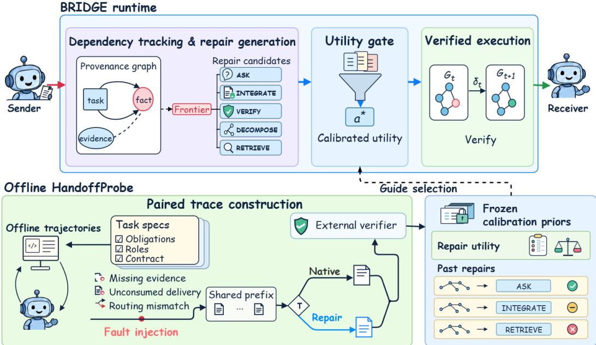
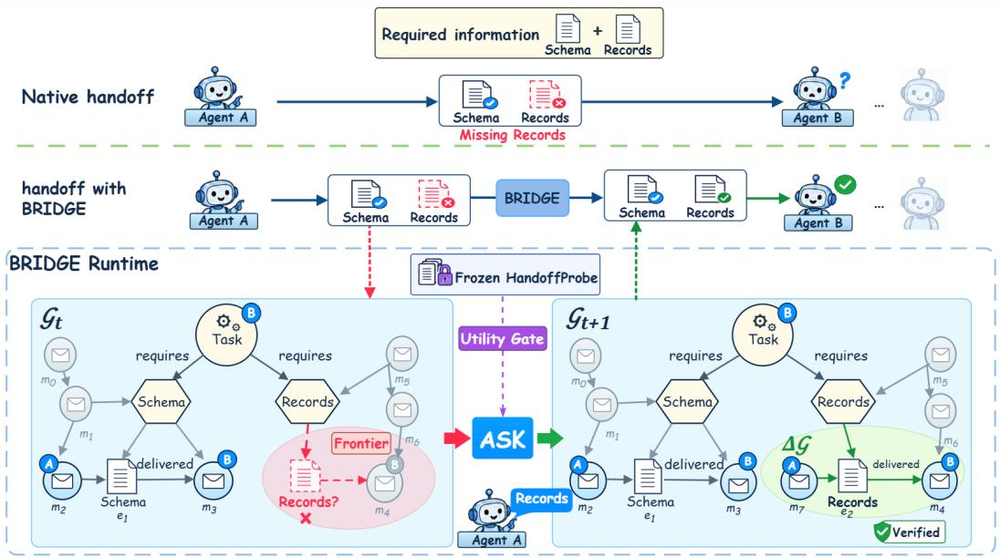

# BRIDGE: SELECTIVE BOUNDARY REPAIR WITH DE-PENDENCY GRAPH EVIDENCE IN MULTI-AGENT SYS-TEMS

Encheng Su1, 10, \*, Pengze Li2, 10,\*, Ziheng Hua2,\*, Qiucheng Yu3, Jianyu Wu4, 10 Chen Tang5, Yizhou Wang5, Lintao Wang6, Junjia Xiang7, Xinzhu Ma8 Xi Chen9, Shixiang Tang5, Houqiang Li1, Xi Chen2†, Aoran Wang10†

1University of Science and Technology of China 2Fudan University 3City University of Hong Kong 4Shanghai Jiao Tong University

5The Chinese University of Hong Kong 6The University of Sydney 7Harbin Institute of Technology 8Beihang University

9East China Normal University 10Shanghai Artificial Intelligence Laboratory \*Equal contribution †Corresponding authors

## ABSTRACT

Multi-agent collaboration has emerged as a critical paradigm for tackling complex, long-horizon tasks; however, while coordination protocols continue to advance, systemic failures at the inter-agent collaboration interface remain a pervasive bottleneck. In collaborative workflows, systems frequently suffer from broken handoffs—where critical task context is omitted, misrouted, or ignored despite each agent emitting locally plausible responses. To address this challenge, we present BRIDGE, a verifiable runtime control framework that treats handoff repair as selective intervention over explicit dependency graphs. Central to BRIDGE is an integrated fault-attribution and calibration pipeline, HandoffProbe, which decouples execution dependencies and injects counterfactual handoff perturbations to provide empirical supervision for runtime intervention. Leveraging this diagnostic foundation, BRIDGE dynamically compiles observable interaction traces into a provenance graph to pinpoint unresolved dependencies, without accessing private agent states. It then evaluates candidate repairs through an empirical gate that weighs expected gains against disruption risks, and executes repairs only when formal local postconditions hold. Extensive evaluations across demanding benchmarks demonstrate that BRIDGE boosts task success by up to 12.3 absolute percentage points on SILO-BENCH and 11.1 on TeamBench. Across both backbones, BRIDGE maintains strict cost-effectiveness, adding as little as 2.0% marginal token overhead. Furthermore, on 562 handoff-relevant traces from the MAST benchmark, BRIDGE achieves 69.8% F1 in a single pass, establishing a reliable operational boundary for verifiable coordination repair.

## 1 INTRODUCTION

Large language model (LLM) architectures are increasingly deployed as multi-agent collectives where specialized agents assume complementary roles, such as planners, executors, and verifiers (Hong et al., 2024; Wu et al., 2024; Li et al., 2023). In these collaborative workflows, task execution fundamentally relies on directional information flow across agent interfaces, where the synthesized output of an upstream agent constitutes the execution context of a downstream recipient. We define the transfer of such task-critical state representations and intermediate outputs as an inter-agent handoff. In practice, multi-agent collectives frequently succumb to systemic broken handoffs: critical dependency constraints are dropped, misrouted, or received but ignored by downstream agents. Consequently, even when every individual agent exhibits robust local competence and emits plausible responses, the multi-agent collective remains acutely vulnerable to communicative breakdowns at the collaboration boundary.

Existing approaches attempt to mitigate coordination errors through task decomposition and allocation (Li et al., 2025), multi-order communication and message consolidation (Guan et al., 2026), or post-hoc trace attribution (Cemri et al., 2025; Zhang et al., 2025b). However, static protocols cannot accommodate dynamic runtime failures, while post-mortem diagnostics arrive too late to prevent cascading errors. When attempting runtime remediation, conventional strategies such as unconstrained query clarification (Lin et al., 2026) and unguided self-refinement (Madaan et al., 2023) introduce severe side effects: an upstream omission may be non-essential to downstream success, and unwarranted re-prompting frequently corrupts valid intermediate trajectory states while multiplying latency and token overhead. Fundamentally, treating runtime intervention as an unguided generative task fails because it lacks two guarantees: empirical awareness of whether an intervention provides net benefit, and verifiable assurance that the missing dependency has actually been supplied.

To resolve this dilemma, we present an integrated framework that decouples offline empirical calibration from online verifiable regulation: HandoffProbe and BRIDGE. Because live executions provide no immediate signals regarding whether an intervention will help or harm, HandoffProbe first acts as an offline simulation engine. As illustrated in Figure 1, HandoffProbe systematically perturbs historical execution traces, injects typical communication faults, and compares end-to-end task outcomes with and without intervention to learn an empirical prior of when an intervention is genuinely beneficial. At runtime, BRIDGE acts as the online controller. It dynamically translates public agent interactions into an explicit provenance graph that exposes missing dependencies as visible gaps. Before taking action, BRIDGE consults the empirical priors learned by HandoffProbe via a calibrated utility gate to decide whether intervention is warranted. If approved, BRIDGE verifies that the generated repair successfully resolves the missing dependency before committing the updated message downstream; otherwise, it safely rolls back to preserve the original state.

Extensive evaluations confirm that our framework establishes new state-of-the-art performance across demanding multi-agent benchmarks, including SILO-BENCH and TeamBench (Zhang et al., 2026; Kim et al., 2026). On SILO-BENCH, our system boosts task success from 63.3% to 75.6% with DeepSeek-V4.1-flash and from 68.9% to 77.8% with GPT-5.6-Terra. On TeamBench, it improves success rates by up to 11.1 absolute percentage points. Crucially, these gains are achieved with minimal computational footprint—incurring only 2.0% marginal token overhead on GPT-5.6- Terra and an average of 5.3% on TeamBench. Furthermore, on 562 handoff-relevant traces from the MAST benchmark, our single-call graph diagnosis achieves 69.8% F1 on GPT-5.6-Terra while saving 32%–42% in token costs compared to multi-stage baselines.

Our core contributions are threefold:

• We formalize multi-agent handoff repair as a verifiable state-regulation problem over an explicit provenance graph. By tracking directional information dependencies, BRIDGE transforms subtle conversational failures into observable graph gaps, cleanly decoupling structural dependency tracking from semantic generation.

• We develop HandoffProbe, an offline simulation pipeline that pairs counterfactual trajectory perturbations to learn empirical intervention priors. Our analysis reveals two key insights: 87.5% of unselected repairs waste tokens without improving task success, and interventions succeed only when strictly aligned with designated failure modes—mismatches often corrupt valid intermediate states.

• We introduce a transactional execution mechanism that explicitly checks whether intended repairs have taken effect, guaranteeing that unverified modifications roll back safely without corrupting execution states. BRIDGE achieves new state-of-the-art performance across diverse benchmarks with negligible token overhead (as low as 2.0%), delivering both high reliability and efficiency.

## 2 RELATED WORK

Multi-Agent Coordination and Communication. Multi-agent systems coordinate rolespecialized agents through task decomposition and message passing. Recent efforts predominantly focus on structuring task allocation and communication topologies. For instance, Agent-Oriented Planning refines subtask decomposition to balance workloads (Li et al., 2025), AgentPrune prunes redundant communication links to reduce message noise (Zhang et al., 2024), MOC aggregates multi-hop interactions into structured contexts (Guan et al., 2026), and Routed Graph Handoff dynamically switches between structured dependency graphs and free-form text messages (Banerjee & Chadha, 2026). While these methods optimize the routing paths of inter-agent messages, they assume the underlying communication is intrinsically dependable and cannot track at runtime whether delegated information is correctly consumed by downstream agents.

  
Figure 1: Overview of HandoffProbe calibration and BRIDGE runtime control. HandoffProbe injects handoff faults into offline trajectories and branches a shared faulted prefix into native and repaired continuations. An external verifier evaluates final task success for each continuation, and the paired outcomes are aggregated into frozen calibration priors. At runtime, BRIDGE constructs a provenance graph, identifies unresolved frontiers, and uses the frozen priors to gate candidate repairs.

Failure Attribution and Robustness Evaluation. Execution-trace analyses demonstrate that multi-agent failures typically stem from coordination misalignments that cascade across agents. MAST provides a taxonomy of inter-agent misalignment and verification failures (Cemri et al., 2025); Who&When formulates automated attribution to pinpoint which agent and step triggered a breakdown (Zhang et al., 2025b); and MAS-FIRE evaluates architecture robustness by deliberately injecting prompt and routing faults (Jia et al., 2026). However, these approaches remain diagnostic or benchmark-oriented. In contrast to passive post-mortem attribution, our HandoffProbe module actively simulates handoff faults on execution traces and contrasts task outcomes, directly measuring the empirical utility of candidate interventions to guide proactive runtime repair.

Runtime Intervention, Verification, and Selective Decisions. To prevent early errors from propagating across agents, recent studies introduce dynamic interventions during execution. Common strategies rely on self-refinement loops (Madaan et al., 2023), query clarification (Lin et al., 2026), or predefined validation functions over intermediate subtasks (Xu et al., 2026). In parallel, experiencereuse methods retrieve past workflows and interaction patterns to guide agent decisions (Wang et al., 2023; 2024; Zhang et al., 2025a). Structured memory systems such as S3Mem organize long interaction histories into scene–event units and route compact query-relevant evidence to a frozen reader (Su et al., 2026). However, existing intervention methods often intervene indiscriminately, risking disruptions to valid executions, and rarely check whether a modification actually resolves the issue. Inspired by selective decision frameworks (Geifman & El-Yaniv, 2019), BRIDGE intervenes only when a repair is estimated to be genuinely helpful and releases the modified message only after confirming that the missing information is in place, avoiding unneeded interference and degraded performance.

  
Figure 2: Illustration of a missing-evidence repair. Agent A omits Records from its handoff to Agent B; BRIDGE retrieves the missing item via ASK and releases the revised handoff only after verifying its delivery in the provenance graph.

## 3 METHOD

BRIDGE treats handoff repair as a runtime decision problem with explicit verification. As illustrated in Figure 1, it separates offline utility calibration (HandoffProbe) from online execution. At runtime, the controller tracks execution dependencies, generates feasible repair actions, filters them using calibrated empirical estimates, and commits a repair only after verifying its graph-level postcondition.

## 3.1 PROBLEM FORMULATION

Consider a multi-agent system where role-specialized agents collaborate via messages and tool in vocations governed by a shared execution contract $( O , R , \mathcal { V } )$ , specifying obligations O, assigned roles R, and operational constraints V. At any agent handoff, the controller observes the public execution history $e _ { 1 : T }$ . The objective is to decide whether to forward the native handoff message $m ^ { \mathrm { n a t } }$ or replace it with a verified repair action a.

Each candidate repair a is constrained by an execution precondition $\mathrm { p r e } ( a )$ and an intended postcondition post(a). The controller first filters candidates by structural feasibility and then selects an action whose expected benefit justifies the risk of disruption. Figure 2 illustrates this process for a missing-evidence frontier.

## 3.2 FRONTIER DETECTION AND CANDIDATE GENERATION

To locate coordination breakdowns, BRIDGE maintains a dynamic provenance graph $\mathcal { G } _ { t } = ( \mathcal { N } _ { t } , \mathcal { E } _ { t } )$ where nodes represent messages, tool observations, and contract obligations, and directed edges denote data production, routing, and consumption.

Let $q = ( \mathrm { i d } , \mathrm { d e s c } , \mathrm { o w n e r } ) \in \mathcal { Q } ( O )$ denote a contract-required fact specification, where owner ∈ R indicates the producing role. The controller tracks delivered facts $\mathcal { D } _ { \mathrm { d e l i v e r e d } }$ , consumed fact

Table 1: Domain-agnostic repair actions, prerequisites, and expected state changes.
<table><tr><td>Action Primitive</td><td>Prerequisite Condition</td><td>Intended State Change</td></tr><tr><td>ASK</td><td>Identified owner and valid query</td><td>Target evidence acquired from sender</td></tr><tr><td>INTEGRATE</td><td>Available evidence in recipient scope</td><td>Target evidence woven into outgoing message</td></tr><tr><td>VERIFY</td><td>Declared contract constraint</td><td>Verification certificate recorded in graph</td></tr><tr><td>DECOMPOSE</td><td>Complex unmet obligation</td><td>Message rewritten using visible local sources</td></tr><tr><td>RETRIEVE</td><td>Accessible local or public state</td><td>Missing context fetched into recipient scope</td></tr></table>

$\mathcal { D } _ { \mathrm { c o n s u m e d } }$ , and observed public traces $\mathcal { D } _ { \mathrm { o b s e r v e d } }$ . A communication gap emerges when a required fact is unmet, defining the frontier set ${ \mathcal { F } } = { \mathcal { F } } _ { \mathrm { u s e } } \cup { \mathcal { F } } _ { \mathrm { a b s } } \cup { \mathcal { F } } _ { \mathrm { s c o p e } } .$

$$
q \in \left\{ \begin{array} { l l l } { \mathcal { F } _ { \mathrm { u s e } } , } & { q \in \mathcal { D } _ { \mathrm { d e l i v e r e d } } \setminus \mathcal { D } _ { \mathrm { c o n s u m e d } } { \mathrm { ~ ( u n c o n s u m e d ~ d e l i v e r y ) , } } } \\ { \mathcal { F } _ { \mathrm { a b s } } , } & { q \notin \mathcal { D } _ { \mathrm { o b s e r v e d } } { \mathrm { ~ ( m i s s i n g ~ e v i d e n c e ) , } } } \\ { \mathcal { F } _ { \mathrm { s c o p e } } , } & { q \in \mathcal { D } _ { \mathrm { d e l i v e r e d } } ( r ) \mathrm { ~ w i t h ~ } r \neq \mathrm { d e s t } ( q ) } & { \mathrm { ( r o u t i n g ~ m i s m a t c h ) . } } \end{array} \right.\tag{1}
$$

The destination dest $( q )$ is dynamically resolved from the contract and role assignments. These frontier conditions need not be mutually exclusive; the controller prioritizes the earliest unmet dependency under the graph partial order, $f ^ { * } = \operatorname* { m i n } _ { - } \mathcal { F }$ . Ties among concurrent minimal frontiers are resolved by contract obligation order and causal graph depth.

To resolve $f ^ { * }$ , BRIDGE instantiates candidate repairs from a compact set of domain-agnostic primitives defined over communication dependencies and accessible execution states (Table 1). A candidate a is eligible only when its structural preconditions and executing role capabilities hold:

$$
\begin{array} { r l } { \mathrm { e l i g i b l e } ( a ) \Longleftrightarrow \mathrm { p r e } ( a ) \subseteq \mathrm { f a c t s } ( \mathcal { G } _ { t } ) } \\ { \wedge \ \mathrm { c a p } _ { \mathrm { r e q } } ( a ) \subseteq \mathrm { c a p } ( \mathrm { a g e n t } ) . } \end{array}\tag{2}
$$

If missing information exists solely within upstream internal states, RETRIEVE is ineligible, forcing communicative resolution via ASK.

## 3.3 HANDOFFPROBE: OFFLINE UTILITY CALIBRATION

Feasibility confirms structural admissibility but does not guarantee downstream utility. To avoid disruptive interruptions, HandoffProbe provides empirical statistics derived from controlled counterfactual paired rollouts.

Paired Rollouts. At an observed handoff boundary $\tau$ with execution history prefix $h _ { \tau }$ , benchmark trajectories introduce controlled communication faults. Execution then evaluates two parallel continuations:

$$
x ^ { \mathrm { b r a n c h } } = \mathrm { e x e c } { \bigl ( } h _ { \tau } \mid \mathrm { b r a n c h } { \bigr ) } , \quad \mathrm { f o r } \mathrm { b r a n c h } \in \{ \mathrm { n a t } , \mathrm { r e p } \} ,\tag{3}
$$

where $x ^ { \mathrm { n a t } }$ proceeds without intervention and $x ^ { \mathrm { r e p } }$ executes candidate repair a. Both rollouts run to their terminal execution states.

Deterministic Outcome Attribution. Task outcomes are verified via deterministic environment oracles $V ( x ) \in \{ 0 , 1 \}$ (such as official test suites and exit codes), avoiding LLM judge variance. Comparing outcomes attributes each intervention to an empirical label ℓ:

$$
\ell = \left\{ \begin{array} { l l } { \mathrm { h e l p e d , } } & { V ( x ^ { \mathrm { r e p } } ) = 1 \wedge V ( x ^ { \mathrm { n a t } } ) = 0 , } \\ { \mathrm { h a r m e d , } } & { V ( x ^ { \mathrm { r e p } } ) = 0 \wedge V ( x ^ { \mathrm { n a t } } ) = 1 , } \\ { \mathrm { n e u t r a l , } } & { V ( x ^ { \mathrm { r e p } } ) = V ( x ^ { \mathrm { n a t } } ) . } \end{array} \right.\tag{4}
$$

Aggregating these outcomes over partitioned action–frontier pairs yields empirical benefit $( r _ { \mathrm { h e l p } } )$ disruption risk $( r _ { \mathrm { h a r m } } ) _ { \cdot }$ , and neutrality $( r _ { \mathrm { n e u } } )$ rates, alongside mean token cost (c¯).

Algorithm 1 Runtime Decision and Verification Loop   
Require: Handoff message $m ^ { \mathrm { n a t } }$ , history $e _ { 1 : T }$ , contract $( O , R , \mathcal { V } )$ , priors $\mathcal { D } _ { \mathrm { c a l i b } }$ , budget B   
Ensure: Released handoff message $m ^ { * }$   
1: $\mathcal { G } _ { t } \gets \mathrm { U P D A T E G R A P H } ( e _ { 1 : T } , \breve { O } , R , \mathcal { V } )$   
2: Ft ← DIAGNOSEFRONTIERS(Gt) ▷ Eq. (1)   
3: if $\mathcal { F } _ { t } = \emptyset$ then return $m ^ { \mathrm { n a t } }$   
4: end if   
5: $f ^ { * } \gets \operatorname* { m i n } _ { \prec } \mathcal { F } _ { t }$   
6: ${ \dot { \mathcal { A } } } _ { \mathrm { e l i g } }  \{ a \ | \ \mathrm { e l i g i b l e } ( a ) \wedge c ( a ) \leq B \}$ ▷ Eq. (2)   
7: $\mathcal { A } _ { \mathrm { a d m } }  \{ a \in \mathcal { A } _ { \mathrm { e l i g } } \mid \pi ( a , f ^ { * } ) = 1 \}$ ▷ Eq. (6)   
8: if ${ \mathcal { A } } _ { \mathrm { a d m } } = \emptyset$ then return mnat   
9: end if   
10: Select optimal repair $a ^ { * }  \mathrm { a r g }$ m $\operatorname { a x } _ { a \in \mathcal { A } _ { \mathrm { a d m } } } u ( a , f ^ { * } )$   
11: Checkpoint state snapshot $( \mathcal { G } _ { t } , m ^ { \mathrm { n a t } } )$   
12: $m ^ { \mathrm { r e p } } , \dot { \mathcal { G } } _ { t + 1 } \gets \mathrm { E x E C U T E R E P A I R } { \left( a ^ { * } \right) }$   
13: $\delta _ { t } \gets \operatorname { D i f f } ( \mathcal { G } _ { t } , \mathcal { G } _ { t + 1 } )$   
14: if Check(post $( a ^ { * } ) , \dot { \mathcal { G } } _ { t } , \delta _ { t } ) = 1$ then ▷ Eq. (7)   
15: return $m ^ { \mathrm { r e p } }$   
16: else   
17: Restore graph snapshot $\mathcal { G } _ { t } ;$ return $m ^ { \mathrm { n a t } }$   
18: end if

## 3.4 UTILITY GATE SELECTION

At runtime, the selection policy $\pi$ balances expected success against execution overhead. The base utility of an action–frontier pair is:

$$
u ( a , f ^ { * } ) = w _ { h } r _ { \mathrm { h e l p } } - w _ { n } r _ { \mathrm { n e u } } - w _ { x } r _ { \mathrm { h a r m } } - w _ { c } \bar { c } ,\tag{5}
$$

where $w _ { x }$ penalizes disruptive failures, $w _ { c }$ weights token overhead, and $w _ { n }$ accounts for multi-agent latency and state perturbation in neutral executions.

A candidate repair is admitted if and only if:

$$
\pi ( a , f ^ { * } ) = { \bf 1 } [ u ( a , f ^ { * } ) > 0 \land r _ { \mathrm { h a r m } } \leq \epsilon \land | \mathcal { D } _ { a , f ^ { * } } | \geq m _ { \mathrm { m i n } } ] ,\tag{6}
$$

requiring positive expected utility under bounded empirical disruption $( \leq \epsilon )$ and sufficient historical support $( m _ { \mathrm { m i n } } )$ . If no candidate clears this gate, the controller bypasses intervention and forwards the native message (Algorithm 1, line 8).

## 3.5 VERIFIED EXECUTION AND ROLLBACK

An admitted repair may still fail at generation time. To prevent unverified modifications from reaching downstream agents, BRIDGE executes repairs behind a verify-before-commit barrier:

$$
{ \mathrm { c o m m i t } } \Longleftrightarrow { \mathrm { C h e c k } } ( \operatorname { p o s t } ( a ^ { * } ) , { \mathcal { G } } _ { t } , \delta _ { t } ) = 1 .\tag{7}
$$

Here, Check(·) checks whether the observed transition $\delta _ { t } = \operatorname { D i f f } ( \mathcal G _ { t } , \mathcal G _ { t + 1 } )$ satisfies the formal postcondition post $( a ^ { * } )$ , resolves the target frontier, and leaves existing dependency edges valid.

As formalized in Algorithm 1, the repair is committed downstream only if verification passes; otherwise, the controller restores the graph snapshot and releases the native message $m ^ { \mathrm { n a t } }$ . Rollback applies strictly to the controller’s local graph and unreleased message buffer. Execution Mechanism. Graph tracking, verification, and structural repairs (INTEGRATE, RETRIEVE) are executed programmatically by the controller at zero LLM inference cost. Only communicative repairs (ASK) invoke an auxiliary LLM query to the sender.

## 4 EXPERIMENTS

We evaluate BRIDGE across end-to-end multi-agent benchmarks, real-world execution traces, and counterfactual calibration corpora. Our experiments address four central questions: (1) Does

BRIDGE consistently improve end-to-end task completion while maintaining minimal resource overhead? (2) Do calibrated priors successfully transfer zero-shot across environments? (3) Can graph-grounded dependency tracking accurately detect handoff failures on real execution traces under strict single-call constraints? (4) Why are empirical gating and transactional verification indispensable for safe runtime intervention?

## 4.1 EXPERIMENTAL SETUP

Benchmarks and Model Backbones. We evaluate runtime performance on two multi-agent suites: SILO-BENCH (Zhang et al., 2026) and TeamBench (Kim et al., 2026). SILO-BENCH assesses collaborative information exchange over independent rollouts, while TeamBench tests workflows requiring tight role coordination and multi-step reasoning. To examine cross-model generalizability, all experiments use two state-of-the-art LLM backbones: DeepSeek-V4.1-flash and GPT-5.6-Terra.

Comparative Baselines. We compare BRIDGE against unassisted Native execution and four multi-agent coordination paradigms. Specifically, we evaluate communication-oriented approaches: AgentAsk (Lin et al., 2026), which queries peers for clarification during ambiguous states, and Self-Refine (Madaan et al., 2023), which prompts agents to iteratively refine handoff messages. Furthermore, we benchmark against structured coordination and verification systems: MOC (Guan et al., 2026), which aggregates multi-hop interactions into structured summaries, and VeriMAP (Xu et al., 2026), which validates intermediate subgoals against explicit formal constraints.

Evaluation Metrics and Token Accounting. Primary task performance is evaluated via Full Success / Pass Rate (percentage of trajectories meeting all verification conditions) and Partial Score (average progress credit). For rigorous efficiency benchmarking, comprehensive token accounting tracks end-to-end prompt and completion tokens across all agents and controllers throughout the trajectory. For diagnostic evaluations, we record per-trace token footprints and model invocations per pass.

Diagnostic Traces on MAST. To assess real-world fault diagnosis prior to repair, we evaluate methods on a curated, handoff-focused slice of 562 traces from the MAST corpus (Cemri et al., 2025) (detailed in Appendix C.1).

## 4.2 END-TO-END TASK SUCCESS AND RESOURCE EFFICIENCY

Table 2 presents end-to-end task success. BRIDGE establishes new state-of-the-art results across both benchmarks and model backbones, outperforming unassisted Native execution by 5.5 to 12.3 percentage points. On SILO-BENCH, BRIDGE achieves substantial, statistically significant margins over Native: +12.3 percentage points on DeepSeek-V4.1-flash (p = 0.027, 16 wins vs. 5 losses) and +8.9 percentage points on GPT-5.6-Terra (p = 0.0007, 36 wins vs. 12 losses). In contrast, standard intervention baselines (e.g., Self-Refine and VeriMAP) frequently fail to surpass the Native baseline, as unconstrained interventions introduce spurious clarifications that derail valid multi-agent trajectories.

Runtime Token Efficiency. While baselines trigger severe token inflation, BRIDGE achieves its state-of-the-art gains with minimal resource footprint: adding merely +2.0% marginal token over head on GPT-5.6-Terra (25,693 vs. 25,198 tokens) and +5.3% on TeamBench. By selectively abstaining from unhelpful repairs and rolling back unverified modifications, BRIDGE prevents runaway intervention cascades (detailed token waterfall in Appendix F).

Zero-Shot Cross-Benchmark Policy Transfer. The TeamBench results further validate the generalizability of our calibrated intervention policy. TeamBench executions directly reuse the offline calibration priors learned from synthetic corpora without exposing a single TeamBench instance during calibration. The resulting lift from 48.9% to 60.0% demonstrates that BRIDGE learns coordination principles that transfer zero-shot across environments. Conversely, calibration priors do not transfer across disparate model backbones, confirming that behavioral calibration must remain backbone-specific.

Table 2: End-to-end collaborative performance on TeamBench and SILO-BENCH (%). Success denotes full task acceptance; Partial denotes benchmark progress score. Best results are in bold; second-best results are underlined.
<table><tr><td rowspan="2">Method</td><td colspan="2">TeamBench</td><td colspan="2">SILO-BENCH</td></tr><tr><td>Full Pass (%) ↑</td><td>Partial (%) ↑</td><td>Full Success (%) ↑</td><td>Partial (%) ↑</td></tr><tr><td>DeepSeek-V4.1-flash</td><td></td><td></td><td></td><td></td></tr><tr><td>Native</td><td>48.9</td><td>81.3</td><td> $6 3 . 3 \pm 3 . 3$ </td><td>65.8</td></tr><tr><td>AgentAsk</td><td>53.3</td><td>84.3</td><td> $6 1 . 1 \pm 3 . 3$ </td><td>78.9</td></tr><tr><td>Self-Refine</td><td>51.1</td><td>83.7</td><td> $6 3 . 3 \pm { 1 . 9 }$ </td><td>78.9</td></tr><tr><td>MOC</td><td>54.4</td><td>84.4</td><td> $6 5 . 6 \pm 1 . 9$ </td><td>82.2</td></tr><tr><td>VeriMAP</td><td>51.1</td><td>83.6</td><td> $6 1 . 1 \pm 3 . 3$ </td><td>78.9</td></tr><tr><td>BRIDGE (Ours)</td><td>60.0</td><td>87.8</td><td> $7 5 . 6 \pm 3 . 8$ </td><td>83.4</td></tr><tr><td>GPT-5.6-Terra</td><td></td><td></td><td></td><td></td></tr><tr><td>Native</td><td>46.7</td><td>79.6</td><td> $6 8 . 9 \pm 4 . 0$ </td><td>75.3</td></tr><tr><td>AgentAsk</td><td>48.9</td><td>80.9</td><td> $6 5 . 6 \pm 3 . 3$ </td><td>81.1</td></tr><tr><td>Self-Refine</td><td>47.8</td><td>79.6</td><td> $6 4 . 4 \pm 1 . 9$ </td><td>80.6</td></tr><tr><td>MOC</td><td>48.9</td><td>81.3</td><td> $6 3 . 3 \pm { 1 . 9 }$ </td><td>78.9</td></tr><tr><td>VeriMAP</td><td>47.8</td><td>79.7</td><td> $6 8 . 9 \pm 0 . 0$ </td><td>83.3</td></tr><tr><td>BRIDGE (Ours)</td><td>52.2</td><td>84.7</td><td> $7 7 . 8 \pm 1 . 1$ </td><td>87.5</td></tr></table>

## 4.3 HANDOFF DIAGNOSIS ON REAL EXECUTION TRACES

Accurate runtime repair fundamentally depends on timely and sensitive upstream fault detection. We benchmark BRIDGE against Direct Prompting and adapted baselines across 562 handoff-relevant MAST execution traces.

Table 3: Diagnostic performance on 562 handoff-relevant MAST execution traces (%). All reference baselines require two-stage prompt chains; BRIDGE operates strictly via a single diagnostic pass. Best results are in bold; second-best results are underlined.
<table><tr><td rowspan="2">Method</td><td colspan="2">DeepSeek-V4.1-flash</td><td colspan="2">GPT-5.6-Terra</td></tr><tr><td>F1 (%) ↑</td><td>Tokens/trace ↓</td><td>F1 (%) ↑</td><td>Tokens/trace ↓</td></tr><tr><td>Direct Prompting</td><td>62.5</td><td>6,686</td><td>67.5</td><td>6,488</td></tr><tr><td>AgentAsk</td><td>68.4</td><td>14,268</td><td>68.4</td><td>13,982</td></tr><tr><td>Self-Refine</td><td>67.4</td><td>13,262</td><td>67.9</td><td>12,359</td></tr><tr><td>MOC</td><td>68.7</td><td>13,738</td><td>68.6</td><td>13,507</td></tr><tr><td>VeriMAP</td><td>64.2</td><td>13,478</td><td>69.4</td><td>14,917</td></tr><tr><td>BRIDGE (Ours)</td><td>68.6</td><td>9,116</td><td>69.8</td><td>8,664</td></tr></table>

Diagnostic Accuracy and Efficiency. As shown in Table 3, BRIDGE achieves Pareto-optimal diagnostic performance across backbones. On GPT-5.6-Terra, BRIDGE attains the highest F1 score (69.8%), outperforming competitive two-stage baselines like VeriMAP and MOC. On DeepSeek-V4.1-flash, it reaches a near-optimal 68.6% F1 (within 0.1% of MOC). Crucially, by operating in a single diagnostic pass rather than multi-stage prompt chains, BRIDGE slashes token consumption by 32%–42% (detailed breakdown and noisy-control specificity in Appendix C).

## 4.4 ABLATION STUDIES

Component Necessity and Gating Dynamics. We ablate BRIDGE on SILO-BENCH (DeepSeek-V4.1-flash). As Table 4 shows, structured provenance, empirical gating, and transactional verification are all indispensable.

Crucially, replacing graph provenance with a sequential text checklist (w/ Flat Checklist) drops task success from 75.6% to 68.9% (only +5.6% over Native). Lacking DAG topology to track producer-consumer causality, flat checklists struggle to determine whether unconsumed requirements are blocked or fulfilled upstream, misidentifying frontiers. Furthermore, completely removing the utility gate (Always Intervene) plunges success to 56.7% (6.6% below Native, $p = 0 . 0 6 3 )$ confirming that unguided interventions disrupt valid execution.

Replacing empirical gating with an LLM decision prompt (w/ LLM Self-Gate) yields 70.0%, showing that offline calibration is more reliable than zero-shot assessment. Similarly, disabling transactional rollback degrades success to 56.7% $( p = 0 . 0 7 0 )$ , as unverified repairs pollute subsequent agent context. Moving from aggregate gating to frontier-specific calibration (73.3%) and adding contextual adjustments achieves the full 75.6% success.

Table 4: Component ablations on SILO-BENCH (DeepSeek-V4.1-flash). Net ∆ indicates margin over unassisted Native execution.
<table><tr><td>Configuration</td><td>Success Rate (%) ↑</td><td>Net ∆ vs. Native</td></tr><tr><td>Native (Unassisted Host)</td><td>63.3</td><td></td></tr><tr><td>BRIDGE (Full System)</td><td>75.6</td><td>+12.3</td></tr><tr><td>w/ Flat Checklist (No Graph Provenance)</td><td>68.9</td><td>+5.6</td></tr><tr><td>w/ LLM Self-Gate</td><td>70.0</td><td>+6.7</td></tr><tr><td>w/ Aggregate Utility Gate</td><td>73.3</td><td>+10.0</td></tr><tr><td>w/o Historical Experience Adjustment</td><td>70.0</td><td>+6.7</td></tr><tr><td>w/o Utility Gate (Always Intervene)</td><td>56.7</td><td>-6.6</td></tr><tr><td>w/o Local Verification (No Rollback)</td><td>56.7</td><td>-6.6</td></tr></table>

Action-Frontier Alignment and Selectivity. Counterfactual analyses explain why unconstrained interventions fail. First, most communication gaps are benign: 87.5% of unselected repairs yield no outcome change, as downstream agents often tolerate minor omissions. Second, intervention utility demands strict action-failure alignment. For instance, context injection (INTEGRATE) resolves 50% of unconsumed delivery errors but offers zero benefit for missing evidence. Worse, issuing clarification queries (ASK) for already-delivered information yields negative utility by distracting recipient reasoning. Thus, runtime coordination repair requires calibrated, selective boundaries rather than unconstrained generation.

## 5 CONCLUSION

Multi-agent coordination failures predominantly stem from broken dependencies across agent interfaces that remain invisible in isolated messages. In this work, we introduced BRIDGE, a verifiable runtime control framework that combines explicit provenance graph tracking, offline empirical calibration via HandoffProbe, and transactional release verification. Across diverse multi-agent benchmarks and leading LLM backbones, BRIDGE consistently improves end-to-end task completion and diagnostic accuracy. Our findings demonstrate that effective coordination repair requires not unconstrained prompting, but grounded dependency representations and calibrated, selective intervention boundaries.

## LIMITATIONS

BRIDGE operates on the assumption that inter-agent handoff failures leave observable dependency traces within public communication and execution records. Consequently, it is less suited to workflows where communicative failures are entirely internal to an opaque agent sub-process. Furthermore, while calibration priors transfer zero-shot across environments, empirical utilities remain model-dependent, necessitating backbone-specific calibration. Future work includes expanding the frontier taxonomy to richer task modalities and automating adaptive budget allocation.

## ETHICS STATEMENT

All three evaluation resources used in this work—SILO-BENCH, TeamBench, and MAST—are public benchmark materials or public interaction records, and we use them under their respective licenses and terms. We do not access private agent reasoning states or intentionally collect personally identifying information; any released trace files should retain only the public fields needed for evaluation and should remove residual identifiers. Although BRIDGE is designed to improve reliability, dependency-repair mechanisms could be misused to automate or scale multi-agent workflows. We therefore restrict the controller to observable public state, verified local postconditions, and rollback on failed checks, and recommend access controls, audit logging, and benchmark-specific safety review before deployment.

## REPRODUCIBILITY STATEMENT

Complete implementation code, evaluation scripts, calibration artifacts, and execution manifests are provided in the supplementary material. Appendix D records benchmark counts and denominators, generation and provider seeds, model versions, NVIDIA A100 hardware, and the exact operatingsystem, Python, CUDA/driver, framework, dependency, prompt, runner, and benchmark-version information needed to reproduce each run. The task lists, split manifests, and per-run denominators are retained with the same manifests. All reported numbers are derived directly from reproducible benchmark runs without cherry-picking.

## AI USE STATEMENT

This paper was prepared with limited assistance from generative artificial intelligence tools. Specifically, AI was used to support language refinement, including improving grammar, clarity, and overall readability. All core ideas, arguments, analysis, and conclusions are the author’s own. The author reviewed, verified, and edited all AI-assisted content and takes full responsibility for the final submitted version.

## REFERENCES

Pratyay Banerjee and Ankit Chadha. Routed graph handoff: Adaptive format selection for multiagent LLM delegation. arXivpreprint arXiv:2608.25277, 2026. doi: 10.48550/arXiv.2608.25277.

Mert Cemri, Melissa Z. Pan, Shuyi Yang, Lakshya A. Agrawal, Bhavya Chopra, Rishabh Tiwari, Kurt Keutzer, Aditya Parameswaran, Dan Klein, Kannan Ramchandran, Matei A. Zaharia, Joseph E. Gonzalez, and Ion Stoica. Why do multi-agent LLM systems fail? In Advances in Neural Information Processing Systems, 2025. doi: 10.52202/085713-4082. Datasets and Benchmarks Track.

Yonatan Geifman and Ran El-Yaniv. SelectiveNet: A deep neural network with an integrated reject option. In Proceedings ofthe 36th International Conference on Machine Learning, volume 97 of Proceedings of Machine Learning Research, pp. 2151–2159. PMLR, 2019.

Yao Guan, Lin Wang, Zhihu Lu, Ziyi Wang, Wenzhu Yan, and Qiang Duan. MOC: Multi-order communication in LLM-based multi-agent systems. arXiv preprint arXiv:2606.02359, 2026. doi: 10.48550/arXiv.2606.02359.

Sirui Hong, Mingchen Zhuge, Jonathan Chen, Xiawu Zheng, Yuheng Cheng, Jinlin Wang, Ceyao Zhang, Zili Wang, Steven Ka Shing Yau, Zijuan Lin, Liyang Zhou, Chenyu Ran, Lingfeng Xiao, Chenglin Wu, and Jurgen Schmidhuber. MetaGPT: Meta programming for a multi-agent collab-¨ orative framework. In International Conference on Learning Representations, 2024.

Jin Jia, Zhiling Deng, Zhuangbin Chen, Yingqi Wang, and Zibin Zheng. MAS-FIRE: Fault injection and reliability evaluation for LLM-based multi-agent systems. arXiv preprint arXiv:2602.19843, 2026. doi: 10.48550/arXiv.2602.19843.

Yubin Kim, Chanwoo Park, Taehan Kim, Eugene Park, Samuel Schmidgall, Salman Rahman, Chunjong Park, Cynthia Breazeal, Xin Liu, Hamid Palangi, Hae Won Park, and Daniel Mc-Duff. TeamBench: Evaluating agent coordination under enforced role separation. arXiv preprint arXiv:2605.07073, 2026. doi: 10.48550/arXiv.2605.07073.

Ao Li, Yuexiang Xie, Songze Li, Fugee Tsung, Bolin Ding, and Yaliang Li. Agent-oriented planning in multi-agent systems. In International Conference on Learning Representations, 2025.

Guohao Li, Hasan Abed Al Kader Hammoud, Hani Itani, Dmitrii Khizbullin, and Bernard Ghanem. CAMEL: Communicative agents for “Mind” exploration of large language model society. In Ad vances in Neural Information Processing Systems, volume 36, 2023. doi: 10.52202/075280-2264.

Bohan Lin, Kuo Yang, Zelin Tan, Yingchuan Lai, Chen Zhang, Guibin Zhang, Xinlei Yu, Miao Yu, Xu Wang, Yudong Zhang, and Yang Wang. Agentask: Multi-agent systems need to ask. In Proceedings of the 64th Annual Meeting of the Association for Computational Linguistics (Volume 1: Long Papers), pp. 28055–28077. Association for Computational Linguistics, 2026. doi: 10.18653/v1/2026.acl-long.1294.

Aman Madaan, Niket Tandon, Prakhar Gupta, Skyler Hallinan, Luyu Gao, Sarah Wiegreffe, Uri Alon, Nouha Dziri, Shrimai Prabhumoye, Yiming Yang, Shashank Gupta, Bodhisattwa Prasad Majumder, Katherine Hermann, Sean Welleck, Amir Yazdanbakhsh, and Peter Clark. Self-refine: Iterative refinement with self-feedback. In Advances in Neural Information Processing Systems, 2023. doi: 10.52202/075280-2019. Main Conference.

Encheng Su, Jianyu Wu, Jinouwen Zhang, Qiucheng Yu, Chen Tang, Pengze Li, Lintao Wang, Aoran Wang, Xinzhu Ma, Shixiang Tang, Yizhou Wang, and Houqiang Li. S3Mem: Structured spatiotemporal scene-event memory for long-horizon interactive question answering. arXiv preprint arXiv:2605.28831, 2026. doi: 10.48550/arXiv.2605.28831. URL https://arxiv. org/abs/2605.28831.

Guanzhi Wang, Yuqi Xie, Yunfan Jiang, Ajay Mandlekar, Chaowei Xiao, Yuke Zhu, Linxi Fan, and Anima Anandkumar. Voyager: An open-ended embodied agent with large language models. arXiv preprint arXiv:2305.16291, 2023. doi: 10.48550/arXiv.2305.16291.

Zora Zhiruo Wang, Jiayuan Mao, Daniel Fried, and Graham Neubig. Agent workflow memory. arXiv preprint arXiv:2409.07429, 2024. doi: 10.48550/arXiv.2409.07429.

Qingyun Wu, Gagan Bansal, Jieyu Zhang, Yiran Wu, Beibin Li, Erkang Zhu, Li Jiang, Xiaoyun Zhang, Shaokun Zhang, Jiale Liu, Ahmed Awadallah, Ryen W. White, Doug Burger, and Chi Wang. AutoGen: Enabling next-gen LLM applications via multi-agent conversations. In Proceedings of the First Conference on Language Modeling (COLM 2024), 2024. URL https://www.microsoft.com/en-us/research/wp-content/uploads/ 2023/08/LLM\_agent.pdf.

Tianyang Xu, Dan Zhang, Kushan Mitra, and Estevam Hruschka. Verification-aware planning for multi-agent systems. In Proceedings of the 19th Conference of the European Chapter of the Associationfor Computational Linguistics (Volume 1: Long Papers), pp. 7528–7546. Association for Computational Linguistics, 2026. doi: 10.18653/v1/2026.eacl-long.353.

Guibin Zhang, Yanwei Yue, Zhixun Li, Sukwon Yun, Guancheng Wan, Kun Wang, Dawei Cheng, Jeffrey Xu Yu, and Tianlong Chen. Cut the crap: An economical communication pipeline for LLM-based multi-agent systems. arXiv preprint arXiv:2410.02506, 2024. doi: 10.48550/arXiv. 2410.02506.

Guibin Zhang, Muxin Fu, Kun Wang, Guancheng Wan, Miao Yu, and Shuicheng Yan. G-Memory: Tracing hierarchical memory for multi-agent systems. In Advances in Neural Information Processing Systems, volume 38, 2025a. doi: 10.52202/085713-0439. URL https: //arxiv.org/abs/2506.07398. Main Conference.

Shaokun Zhang, Ming Yin, Jieyu Zhang, Jiale Liu, Zhiguang Han, Jingyang Zhang, Beibin Li, Chi Wang, Huazheng Wang, Yiran Chen, and Qingyun Wu. Which agent causes task failures and when? on automated failure attribution of LLM multi-agent systems. In Proceedings ofthe 42nd International Conference on Machine Learning, volume 267 of Proceedings of Machine Learning Research, 2025b.

Yuzhe Zhang, Feiran Liu, Yi Shan, Xinyi Huang, Xin Yang, Yueqi Zhu, Xuxin Cheng, Cao Liu, Ke Zeng, Terry Jingchen Zhang, and Wenyuan Jiang. Silo-Bench: A scalable environment for evaluating distributed coordination in multi-agent LLM systems. arXiv preprint arXiv:2603.01045, 2026. doi: 10.48550/arXiv.2603.01045.

## A IMPLEMENTATION AND REPRESENTATION DETAILS

The execution contract and normalized event records determine the provenance graph state. Table 5 provides the mapping from execution events to graph entities.

Table 5: Execution events and their graph representations.
<table><tr><td>Execution Event</td><td>Graph Representation</td></tr><tr><td>Declared requirement</td><td>Obligation and fact identifier, with owner/recipient metadata</td></tr><tr><td>Message</td><td>Message/fact node with sender and recipient edges</td></tr><tr><td>Tool invocation</td><td>Action node linked to calling agent and tool schema</td></tr><tr><td>Tool execution output</td><td>Evidence node linked to producing action</td></tr><tr><td>Evidence consumption</td><td>Directed edge between fact node and consuming operation</td></tr><tr><td>Public verifier outcome</td><td>Verification relation within verifier&#x27;s declared scope</td></tr><tr><td>Status update</td><td>Node state transition preserving provenance audit trail</td></tr></table>

## A.1 ACTION POSTCONDITIONS AND COMMIT PREDICATES

Each repair candidate declares formal graph-level postconditions derived from the targeted frontier $f ^ { * }$ . The core information-transfer postconditions are formally verified against the observed graph difference $\delta _ { t } = \operatorname { D i f f } ( \mathcal { G } _ { t } , \mathcal { G } _ { t + 1 } )$

$$
\mathrm { p o s t } ( \mathbb { A } \mathrm { S K } , q ) = \mathrm { o b s } _ { t + 1 } ( q ) \wedge \mathrm { a r r } _ { t + 1 } ( q , \mathrm { d e s t } ( q ) ) ,\tag{8}
$$

$$
\mathrm { p o s t } ( \mathrm { I N T E G R A T E } , q ) = \mathrm { c o n } _ { t + 1 } ( q , \mathrm { d e s t } ( q ) ) ,\tag{9}
$$

$$
\begin{array} { r } { \mathrm { p o s t } ( \mathtt { V E R I F Y } , q ) = ( \mathrm { r c v } _ { t + 1 } ( q ) = \mathrm { d e s t } ( q ) ) . } \end{array}\tag{10}
$$

In practice, the runtime predicate Check(post $( a ^ { * } ) , \mathcal { G } _ { t } , \delta _ { t } )$ in Eq. (7) enforces four conjuncts:

1. Frontier Resolution: The targeted gap $f ^ { * }$ transitions to a satisfied dependency state in $\mathcal { G } _ { t + 1 }$

2. Scope Integrity: The revised message references only validated evidence items currently in scope, and destination routing strictly matches dest(q).

3. Edge Preservation: No pre-existing active dependency edge present in $\mathcal { G } _ { t }$ is severed or invalidated as a side-effect.

4. Domain Attestation: On software engineering tasks (TeamBench), tool actions must return an allowed execution postcondition $( \mathrm { e . g . } ,$ command exit zero, tests passed, path written). On distributed computing kernels (SILO-BENCH), intermediate computations must yield valid mathematical certificates.

## A.2 TRANSACTIONAL GUARANTEES AND ERROR ISOLATION

Under the ingestion and verify-before-commit protocol, the controller satisfies four foundational properties:

Proposition 1 (Deterministic Ingestion) For afixed contract and event sequence, deterministic ingestion yields identical provenance graph states and identifiedfrontiers.

Proof sketch. Follows directly from the topological construction rules in Section 3.2, where public event logs deterministically map to unique directed acyclic graph representations.

Proposition 2 (Bounded Action Enumeration) For bounded candidate depth and width, the set of admitted candidate actions isfinite, and at most one repair is executed per boundary.

Proof sketch. By construction in Algorithm 1, candidate generation is restricted to eligible actions satisfying Eq. (2) under budget B, followed by a singular arg max selection.

Proposition 3 (Safe Native Pass-Through) If no frontier is detected or no candidate meets the positive utility threshold, the controllerforwards the native message without modification.

Proof sketch. Follows from lines 3 and 8 of Algorithm 1, guaranteeing identity passthrough whenever $\mathcal { F } _ { t } = \varnothing \ : \mathrm { o r } \ : \mathcal { A } _ { \mathrm { a d m } } = \varnothing$

Proposition 4 (Transactional Release Safety) The controller commits a modified message if and only ifits declared postcondition is satisfied on the observed graph delta; otherwise, it rolls back to the native message.

Proof sketch. Guaranteed by the verify-before-commit barrier (Algorithm 1, lines 12–18). Tentative candidate execution operates strictly over an in-memory staging buffer; verification failure restores the local snapshot $\mathcal { G } _ { t }$ and discards uncommitted modifications, preserving the invariant that unverified interventions never enter the public communication channel.

Deterministic Format Retries. If an ASK query returns an unparseable response payload, the controller executes exactly one deterministic re-prompt. If the second response remains invalid, the intervention aborts immediately, triggering graph restoration and native message release.

## B HANDOFFPROBE AND POLICY CALIBRATION

## B.1 CALIBRATION CORPUS AND UTILITY PARAMETERS

The calibration corpus comprises 200 balanced episodes: 50 clean executions and 50 for each of the three canonical fault conditions $( \mathcal { F } _ { \mathrm { u s e } } , \mathcal { F } _ { \mathrm { a b s } } , \mathcal { F } _ { \mathrm { s c o p e } } )$ . Trajectories are partitioned into calibration, development, and test splits (160/20/20).

Table 6 details the base calibration parameters. The utility objective balances expected success against costs and disruption risks:

$$
u ( a , f ^ { * } ) = 1 . 0 r _ { \mathrm { h e l p } } - 0 . 2 5 r _ { \mathrm { n e u } } - 2 . 0 r _ { \mathrm { h a r m } } - 0 . 2 5 \bar { c } .\tag{11}
$$

Table 6: Base utility parameters and calibration settings.
<table><tr><td>Parameter</td><td>Value</td><td>Description</td></tr><tr><td> $w _ { h }$ </td><td>1.0</td><td>Weight on verifier-helped outcomes  $( V ( \bar { x } ^ { \mathrm { r e p } } ) = 1 \wedge V ( x ^ { \mathrm { \hat { n a t } } } ) = 0 )$ </td></tr><tr><td> $w _ { n }$ </td><td>0.25</td><td>Penalty on neutral/unchanged executions (latency and state perturbation)</td></tr><tr><td> $w _ { x }$ </td><td>2.0</td><td>Penalty on verifier-harmed executions  $( V ( x ^ { \mathrm { { r } \tilde { \mathrm { e p } } } } ) = 0 \land V ( x ^ { \mathrm { { n a t } } } ) = 1 )$ </td></tr><tr><td> $w _ { c }$ </td><td>0.25</td><td>Weight on normalized resource cost</td></tr><tr><td>€</td><td>0.05</td><td>Empirical harm-rate tolerance threshold  $( r _ { \mathrm { h a r m } } \leq 0 . 0 5 )$ </td></tr><tr><td> $m _ { \mathrm { m i n } }$ </td><td>5</td><td>Minimum required sample support per action-frontier segment</td></tr><tr><td>Cost metric</td><td>Normalized</td><td>Single-step intervention cost baseline is normalized to ē = 1.0 across candidate actions</td></tr></table>

## B.2 ROUTE-LEVEL CALIBRATION STATISTICS

Table 7 summarizes the empirical calibration statistics computed across candidate routes on the calibration split.

## C MAST DIAGNOSTIC EVALUATION DETAILS

## C.1 BENCHMARK CONSTRUCTION AND MULTI-FRAMEWORK STRATIFICATION

To evaluate diagnostic effectiveness under real-world collaborative diversity, we construct handoff562 from the official MAST dataset (Cemri et al., 2025).

To rigorously benchmark diagnostic capability under realistic execution noise, we pair these with 281 stratified control traces. Crucially, as summarized in Table 8, the control traces are not artificially sanitized: 224 controls (79.7%) contain non-handoff execution errors (e.g., 131 Runtime Errors, 130 Tool Failures, and 94 Model Generation Errors), while 57 traces represent clean executions. This ensures our evaluation strictly assesses a model’s ability to disentangle true interface-level handoff gaps from generic execution noise across diverse multi-agent frameworks.

Table 7: Empirical calibration statistics across candidate routes. Utility is computed under base parameters; admission requires positive utility, empirical harm rate $\leq \epsilon ,$ and sample support ≥ mmin.
<table><tr><td>Backbone</td><td>Route / Segment</td><td>Episodes</td><td>Helped</td><td>Harmed</td><td>Utility</td><td>Admitted</td></tr><tr><td>DeepSeek-V4.1-flash</td><td>ASK</td><td>52</td><td>8 (15.4%)</td><td>0</td><td>-0.31</td><td>No</td></tr><tr><td>DeepSeek-V4.1-flash</td><td>INTEGRATE</td><td>25</td><td>12 (48.0%)</td><td>0</td><td>+0.10</td><td>Yes</td></tr><tr><td>GPT-5.6-Terra</td><td>ASK</td><td>40</td><td>10 (25.0%)</td><td>0</td><td>-0.19</td><td>No</td></tr><tr><td>GPT-5.6-Terra</td><td>INTEGRATE (aggregate)</td><td>12</td><td>4 (33.3%)</td><td>0</td><td>-0.08</td><td>No</td></tr><tr><td>GPT-5.6-Terra</td><td>INTEGRATE ×Fuse</td><td>6</td><td>4 (66.7%)</td><td>0</td><td>+0.33</td><td>Yes</td></tr></table>

Table 8: Distribution of the 562 curated MAST evaluation traces across agent architectures.
<table><tr><td>Multi-Agent Framework</td><td>Positive Traces</td><td>Stratified Controls</td><td>Total Traces</td></tr><tr><td>MetaGPT</td><td>182</td><td>182</td><td>364</td></tr><tr><td>AG2</td><td>46</td><td>46</td><td>92</td></tr><tr><td>Magentic</td><td>43</td><td>43</td><td>86</td></tr><tr><td>HyperAgent</td><td>7</td><td>7</td><td>14</td></tr><tr><td>OpenManus</td><td>2</td><td>2</td><td>4</td></tr><tr><td>AppWorld</td><td>1</td><td>1</td><td>2</td></tr><tr><td>Total</td><td>281</td><td>281</td><td>562</td></tr></table>

## C.2 DIAGNOSTIC ACCURACY AND SINGLE-PASS EFFICIENCY

Table 9 provides extended diagnostic comparisons on the 562 traces. All reference baselines rely on complex two-phase prompting chains that require two separate API invocations and substantial token overhead (12,300–14,900 tokens/trace). In contrast, BRIDGE performs structured provenance tracking in a single API call, consuming only 8,664 to 9,116 tokens per trace (a 32%–42% computational savings).

Table 9: Diagnostic metrics on 562 MAST traces. BRIDGE operates strictly via a single inference pass, while adapted baselines require two-stage prompt chains.
<table><tr><td rowspan="2">Method</td><td colspan="2">DeepSeek-V4.1-flash</td><td colspan="2">GPT-5.6-Terra</td></tr><tr><td>F1 (%) ↑</td><td>Tokens/trace ↓</td><td>F1 (%) ↑</td><td>Tokens/trace ↓</td></tr><tr><td>Direct Prompting</td><td>62.5</td><td>6,686</td><td>67.5</td><td>6,488</td></tr><tr><td>AgentAsk (adapted)</td><td>68.4</td><td>14,268</td><td>68.4</td><td>13,982</td></tr><tr><td>Self-Refine (adapted)</td><td>67.4</td><td>13,262</td><td>67.9</td><td>12,359</td></tr><tr><td>MOC (adapted)</td><td>68.7</td><td>13,738</td><td>68.6</td><td>13,507</td></tr><tr><td>VeriMAP (adapted)</td><td>64.2</td><td>13,478</td><td>69.4</td><td>14,917</td></tr><tr><td>BRIDGE (Ours)</td><td>68.6</td><td>9,116</td><td>69.8</td><td>8,664</td></tr></table>

On GPT-5.6-Terra, BRIDGE attains the highest F1 score of 69.8%, outperforming all two-stage prompt-chain baselines while reducing token costs by over 5,000 tokens per trace. On DeepSeek-V4.1-flash, BRIDGE achieves a competitive 68.6% F1 score (matching the top baseline MOC within 0.1%) at a fraction of the computational footprint. These results highlight that explicit graph extraction achieves state-of-the-art diagnostic discrimination in a single inference pass.

## C.3 DECISION LAYER CONTROL INTEGRITY

The formal necessity of BRIDGE’s decision layer is empirically corroborated through ablation benchmarks. Under seed-0 control rollouts on SILO-BENCH, eliminating utility admission degrades end-to-end task success by 23.3 percentage points $( 7 5 . 6 \%  5 6 . 7 \% , p = 0 . 0 6 3 )$ . Similarly, removing transactional verification causes an identical 23.3 percentage point drop $( 7 5 . 6 \% \to 5 6 . 7 \% .$ $p = 0 . 0 7 0 )$ . These findings confirm that combining empirical utility filtering with rollback verification provides the indispensable operational boundary required for safe multi-agent repair.

## D EXPERIMENTAL PROTOCOLS AND CONFIGURATION

## D.1 RUN COUNTS, SEEDS, AND ENVIRONMENT

The reported evaluations use three benchmark resources. TeamBench uses a fixed 90-task evaluation subset; each reported model row has $n = 9 0$ task-level evaluations. The MAST diagnostic set contains 562 traces: 281 confirmed handoff breakdowns and 281 stratified successful controls. The SILO-BENCH evaluation uses 90 task instances in three 30-instance generation groups, constructed with generation seeds 42, 0, and 1. DeepSeek uses one rollout per instance $( n = 9 0 )$ , whereas GPT uses three provider-seed runs over the same 90 instances $( n = 2 7 0 )$ . The evaluated model versions are DeepSeek-V4.1-flash and GPT-5.6-Terra. Experiments run on NVIDIA A100 GPUs. The supplementary environment manifest records the exact operating-system, Python, CUDA/driver, framework, dependency, prompt, runner, and benchmark-version information needed to reproduce each run; the task lists, split manifests, and per-run denominators are retained with the same manifests.

## D.2 EVALUATION PROTOCOLS AND VERIFIER HARNESSES

To eliminate variance and subjective drift from LLM-as-a-judge evaluators, Table 10 summarizes the evaluation settings across benchmark suites. all task outcomes are evaluated using deterministic environment test harnesses $V ( x ) \in \{ 0 , 1 \}$ ,:

• SILO-BENCH: The official test harness evaluates distributed executions programmatically: Level I arithmetic uses exact floating-point tolerances (math.isclose); Level II sets use exact element matching; Level III state traces use Longest Common Subsequence (LCS) divergence. Built-in unlimited retry wrappers are disabled to ensure strict evaluation consistency.

• TeamBench: Tasks run within isolated container sandboxes. Success requires full passing runs across official unit tests and clean execution exit codes (exit code = 0). Internal answer templates and hidden evaluation manifests (score.json, expected.json) are excluded from agent observation scopes.

• Reporting Protocol: Main benchmark scores denote empirical mean and standard error (±SE) across independent seeded rollouts (generation seeds 42, 0, and 1 for SILO-BENCH). Ablations (Table 4) are evaluated under a unified reference seed configuration across the full benchmark to prevent rollout variance confounding.

• Zero-Shot Transfer: In TeamBench, all calibration priors and threshold hyperparameters remain completely frozen from synthetic calibration, confirming true cross-environment transfer.

Table 10: Evaluation settings across benchmark suites.
<table><tr><td></td><td colspan="2">SILO-BENCH</td><td colspan="2">TeamBench</td></tr><tr><td>Specification</td><td>DeepSeek</td><td>GPT</td><td>DeepSeek</td><td>GPT</td></tr><tr><td>Evaluation rollouts per task</td><td>1</td><td>3</td><td>1</td><td>1</td></tr><tr><td>Instances / n</td><td>90 / 90</td><td>90 / 270</td><td>90 / 90</td><td>90 / 90</td></tr><tr><td>Policy configuration</td><td>Corpus-calibrated</td><td>Corpus-calibrated</td><td>Zero-shot transfer</td><td>Zero-shot transfer</td></tr><tr><td>Max actions per boundary</td><td>1</td><td>1</td><td>1</td><td>1</td></tr></table>

## D.3 REFERENCE BASELINES

We retain each benchmark’s native team topology, role assignments, communication protocol, and acceptance checks. Baseline adaptations operate strictly on handoff messages or recipient-visible context without accessing hidden answers or another agent’s private state. Auxiliary LLM calls use the evaluated backbone to avoid confounding differences in model capacity.

Native. The original handoff is delivered without modification or auxiliary model calls.

AgentAsk. We evaluate the clarification mode of AgentAsk (Lin et al., 2026). At an eligible outgoing handoff, an LLM reviewer decides whether clarification is needed and, if so, queries the original sender. The sender answers from its visible context, and the clarification is delivered with the handoff. Both reviewer and sender use the evaluated backbone.

Self-Refine. The original sender critiques and revises the outgoing handoff using its own model and visible context (Madaan et al., 2023), with at most one feedback–refinement iteration per handoff.

MOC. Exposes causally preceding messages to the recipient and consolidates multi-order evidence when exceeding message budgets (Guan et al., 2026). Following its reported configuration, maximum communication order is set to $K = 2 ,$ evidence tolerance to γ = 1, similarity margin to ϵ = 0.1, distillation length ratio to $\kappa = 0 . 4 5$ , and distillation candidates to M = 5. Message similarity uses all-MiniLM-L6-v2.

VeriMAP. Adapts the planner–executor–verifier loop to individual handoff edges using locally generated contracts and verification functions (Xu et al., 2026). On SILO-BENCH, limits follow reported settings (three execution attempts per plan, five planning iterations). On TeamBench, the native Planner–Executor–Verifier topology is retained, with up to three contract-generation and verification-gate attempts.

Table 11 summarizes reference baseline results on TeamBench across full-team harness evaluations.

Table 11: TeamBench reference baseline evaluations. Pass denotes benchmark pass rate (%); Partial denotes mean partial progress score (%).
<table><tr><td rowspan="2">Method</td><td colspan="2">DeepSeek-V4.1-flash</td><td colspan="2">GPT-5.6-Terra</td></tr><tr><td>Pass (%)</td><td>Partial (%)</td><td>Pass (%)</td><td>Partial (%)</td></tr><tr><td>Native</td><td>48.9</td><td>81.3</td><td>46.7</td><td>79.6</td></tr><tr><td>AgentAsk</td><td>53.3</td><td>84.3</td><td>48.9</td><td>80.9</td></tr><tr><td>Self-Refine</td><td>51.1</td><td>83.7</td><td>47.8</td><td>79.6</td></tr><tr><td>MOC</td><td>54.4</td><td>84.4</td><td>48.9</td><td>81.3</td></tr><tr><td>VeriMAP</td><td>51.1</td><td>83.6</td><td>47.8</td><td>79.7</td></tr></table>

## D.4 PAIRED OUTCOME DETAILS

Table 12 provides counts of paired discordant outcomes (W/L: BRIDGE-only win vs. Native-only win) across primary benchmarks.

Table 12: Paired discordant outcomes between BRIDGE and unassisted Native execution.
<table><tr><td>Benchmark</td><td>Evaluated Model</td><td>Discordant (W/L)</td><td>Significance Test</td></tr><tr><td>SILO-BENCH</td><td>DeepSeek-V4.1-flash</td><td>16/5</td><td>p = 0.027</td></tr><tr><td>SILO-BENCH</td><td>GPT-5.6-Terra (pooled)</td><td>36 / 12</td><td> $p < 0 . 0 0 1$ </td></tr><tr><td>TeamBench</td><td>DeepSeek-V4.1-flash</td><td>12/3</td><td>p = 0.035</td></tr></table>

## E REAL EXECUTION REPAIR TRACES

Table 13 presents two representative runtime intervention traces from TeamBench (DeepSeek-V4.1- flash). Both episodes triggered an evidence-gap frontier, satisfied pre-admission eligibility, and were verified locally before commitment.

Table 13: Representative runtime interventions on TeamBench. Local verification requires formal satisfaction of postconditions; final verdict denotes task-level evaluation.
<table><tr><td>Task Identifier</td><td>Gate Decision</td><td>Candidate Action</td><td>Local Verification</td><td>Final Verdict</td></tr><tr><td>CR1_review_respond</td><td>Admitted (u &gt; 0)</td><td>RETRIEVE</td><td>Verified</td><td>Pass</td></tr><tr><td>CR6_review_checklist</td><td>Admitted (u &gt; 0)</td><td>RETRIEVE</td><td>Verified</td><td>Fail</td></tr></table>

In CR1 review respond, the recipient agent omitted required context residing within accessible local state. BRIDGE detected this gap at the boundary, retrieved the evidence via RETRIEVE, and committed the update upon verifying that the dependency was satisfied; the overall task passed. In CR6 review checklist, the repair successfully resolved the immediate handoff postcondition, yet subsequent independent agent steps failed, highlighting that local handoff verification guarantees communicative integrity without over-promising downstream task execution.

## F DETAILED TOKEN OVERHEAD AND RESOURCE BREAKDOWN

To provide complete transparency into computational footprint, Table 14 details the step-by-step token consumption per task across backbones on SILO-BENCH, decomposing standard agent interactions from controller-level intervention operations.

Table 14: End-to-end token accounting per task rollout on SILO-BENCH. Controller operations are decoupled into deterministic graph tracing, boundary diagnostic evaluations, and active repair executions.
<table><tr><td rowspan="2">Component / Stage</td><td colspan="2">GPT-5.6-Terra</td><td colspan="2">DeepSeek-V4.1-flash</td></tr><tr><td>Tokens/task</td><td>% of Native</td><td>Tokens/task</td><td>% of Native</td></tr><tr><td>Native Baseline Execution</td><td>25,198</td><td>100.0%</td><td>22,460</td><td>100.0%</td></tr><tr><td>Standard Agent Operations</td><td></td><td></td><td></td><td></td></tr><tr><td>Prompt context variation</td><td>+523</td><td>+2.1%</td><td>+818</td><td>+3.6%</td></tr><tr><td>Output response variation</td><td>+65</td><td>+0.3%</td><td>+598</td><td>+2.7%</td></tr><tr><td>Subtotal: Agent Communication Channel</td><td>25,786</td><td>+2.3%</td><td>23,876</td><td>+6.3%</td></tr><tr><td>Controller Intervention Operations</td><td></td><td></td><td></td><td></td></tr><tr><td>Topological graph tracking</td><td>0</td><td>0.0%</td><td>0</td><td>0.0%</td></tr><tr><td>Boundary dependency diagnosis</td><td>4,566</td><td>18.1%</td><td>5,655</td><td>25.2%</td></tr><tr><td>Active message repair (INTEGRATE)</td><td>0</td><td>0.0%</td><td>4,260</td><td>19.0%</td></tr><tr><td>End-to-End Cumulative Footprint</td><td>30,352</td><td>+20.4%</td><td>33,791</td><td>+50.5%</td></tr><tr><td>Official Agent Evaluation Margin</td><td>25,693</td><td>+2.0%</td><td>27,963</td><td>+24.5%</td></tr></table>

## F.1 WHY GPT-5.6-TERRA INCURS MINIMAL OVERHEAD (+2.0%)

On GPT-5.6-Terra, BRIDGE achieves substantial performance gains (+8.9 pp) while adding only +2.0% marginal overhead to the primary agent communication channel. This extreme efficiency stems from three structural mechanisms:

1. Conservative Empirical Gating: Calibration priors for GPT-5.6-Terra establish that unconstrained message rewrites yield negligible expected gain relative to cost across most task segments. Consequently, the utility gate selectively abstains from full-context regeneration across all 429 monitored handoff boundaries. The system bypassed all costly repair generations, preventing unverified token consumption.

2. Deterministic Zero-LLM Graph Processing: The construction of the provenance graph, topological sorting, and dependency frontier identification are computed deterministically via static dataflow logic, requiring exactly zero auxiliary LLM calls.

3. Minimal Context Perturbation: Because communicative interventions were safely bypassed, agent-level invocation counts shifted by only +3.9%. The slight net increase in prompt length (+588 tokens/task across multi-step horizons) reflects minor downstream context propagation rather than runaway recursive loops.

## F.2 WHY DEEPSEEK-V4.1-FLASH EXHIBITS ACTIVE INTERVENTION (+24.5%)

In contrast to the highly conservative gate on GPT-5.6-Terra, the calibrated policy on DeepSeek-V4.1-flash actively targets unconsumed evidence $( \mathcal { F } _ { \mathrm { u s e } } )$ , driving a substantial +12.3 pp net success improvement $( 6 3 . { \overset { \cdot } { 3 } } \% \to 7 5 . 6 \% )$ . The corresponding +24.5% agent-channel overhead represents the expected cost of active runtime repair:

1. Targeted Message Reconstruction: For DeepSeek, INTEGRATE actions cleared the empirical utility gate and executed 41 full message reconstructions. To preserve causal continuity, each repair integrates historical context, provenance records, and contract constraints into the prompt (≈ 4,900 prompt tokens per repair), directly contributing 19.0% of the task’s incremental token consumption.

2. Higher Boundary Frequency: DeepSeek trajectories exhibit greater intermediate coordination granularity, triggering 318 observable boundaries (compared to 165 for Terra), which naturally scales upstream diagnostic monitoring.

3. Net Utility Trade-off: While DeepSeek incurs an additional +24.5% overhead in the agent channel, this controlled investment rescues 16 failing tasks while only degrading 5, delivering a marked net positive return over unassisted execution. When compared to unguided verification baselines such as VeriMAP (+410% to +579% token inflation), BRIDGE maintains rigorous cost-effectiveness even when actively repairing execution state.