# Batch-Paced: Fixed-Budget Batch Decoding in Discrete Diffusion Language Models

Shuai Zhang1,2 Zhanchao Zhou2 Huachuan Qiu2 Anqi Li2 Zhenzhong Lan2\* 1Zhejiang University 2Westlake University

## Abstract

As generative language models become more capable and widely used, inference demand grows, making efficient serving increasingly important. Discrete diffusion language models (dLLMs) offer a promising path to more efficient inference through parallel token generation. Prior dLLM decoding methods, however, focus on improving inference efficiency for individual sequences. We formulate fixedbudget dLLM batch decoding and introduce Batch-Paced, a training-free method that jointly optimizes the allocation of decoding compute across requests to improve overall batch quality. Across two dLLM backbones, five benchmarks and their representative mixtures, Batch-Paced improves batch performance under matched budgets; gains generally grow with batch size and largely persist across decoding configurations. Analysis of requests’ decoding trajectories suggests that these gains arise largely by raising the committed-token confidence of lower-confidence requests. We further show that Batch-Paced’s batch decode time remains competitive and that adding a decoding-depth allowance during Batch-Paced decoding can shorten it further at a modest performance cost.

## 1 Introduction

Generative language models now support applications ranging from conversational assistants to code generation (Yu et al., 2022). A Microsoft 365 workload study reports more than 10 million LLM requests per day, underscoring the need for efficient inference serving (Jaiswal et al., 2025). Commercial APIs reflect this need through explicit rate limits: OpenAI’s vary by model and apply at the organization or project level, while Anthropic’s specify request and token limits by model and usage tier (OpenAI, 2026; Anthropic, 2026). In actual deployments, the systems behind these APIs must schedule concurrent requests over finite GPU capacity. Sarathi-Serve, for example, limits the number of tokens processed per iteration to balance latency and throughput (Agrawal et al., 2024). This motivates a batch-decoding question: given a fixed decoding-compute allowance for a batch, how should it be allocated across requests to maximize the batch’s overall output quality?

Diffusion language models (dLLMs) (Nie et al., 2026; Ye et al., 2025; Hu et al., 2026; Zhang et al., 2026a) offer a promising route to more efficient generation by predicting multiple masked positions in parallel. This parallel-generation efficiency has motivated diffusion-based speculative decoding (Chen et al., 2026; Cheng et al., 2026; Zhang et al., 2026b). Subsequent work on dLLM decoding uses signals such as token confidence, entropy, temporal consistency, and denoising history to decide when to commit tokens for a single sequence, aiming to improve individual-sequence decoding efficiency (Wu et al., 2026a; Ben-Hamu et al., 2026; Kim et al., 2026; Wang et al., 2026). However, fixedbudget dLLM batch decoding is underexplored.

We introduce Batch-Paced, a training-free method for fixed-budget dLLM batch decoding. It jointly ranks masked-token confidence across requests to distribute commits, allowing requests to advance at different paces while meeting the batch’s compute budget. Figure 1 illustrates this allocation contrast. We evaluate Batch-Paced on five benchmarks and representative mixtures using two discrete diffusion language models. At matched denoising budgets, it improves over Uniform, which uses independent sequence-wise allocation and commits the same fixed number of tokens for every request at each denoising pass; gains generally grow with batch size. Our analysis suggests that this batch-level improvement comes primarily from raising the confidence trajectory of lower-confidence requests. To see whether this performance pattern depends on a particular decoding setup, we vary block length, generation length, and confidence-score function; the gains largely persist across these configurations. We also compare Batch-Paced with Fast-dLLM, a strong adaptive baseline. Their performance is broadly comparable, although matching a target batch budget with Fast-dLLM requires additional calibration runs. Since batch decode time also matters, we measure it alongside performance: Batch-Paced is broadly comparable to Uniform but generally slower than Fast-dLLM. We extend Batch-Paced with a decoding-depth allowance that limits the number of batched denoising steps, bringing batch decode time closer to Fast-dLLM’s at some performance cost. Our contributions are:

• We pose fixed-budget dLLM batch decoding as an underexplored problem and propose Batch-Paced to jointly allocate compute across requests for improved batch quality.

• Empirically, Batch-Paced improves batch performance under fixed denoising budgets largely by raising the committed-token confidence of lower-confidence requests.

• We show that Batch-Paced’s gains largely persist across decoding configurations and that its batch decode time remains competitive; a Batch-Paced extension can further shorten batch decoding at a modest performance cost.

## 2 Related Work

## 2.1 Decoding Policies for Discrete Diffusion Language Models

Discrete diffusion language models generate through iterative parallel denoising (Nie et al., 2026; Ye et al., 2025). Block diffusion adopts a semi-autoregressive structure, with diffusion within each block and autoregressive generation across blocks (Arriola et al., 2025; Bie et al., 2025; Team et al., 2026). Recent work improves dLLM inference by adapting token commitments within a sequence. These methods draw on different signals: Fast-dLLM uses token confidence, EB-Sampler bounds unmasking entropy, KLASS uses temporal KL, and CreditDecoding accumulates denoising history (Wu et al., 2026a; Ben-Hamu et al., 2026; Kim et al., 2026; Wang et al., 2026). DynamicdLLM combines adaptive parallel decoding with layer-wise cache-update budgets (Wu et al., 2026b). Other approaches incorporate an auxiliary autoregressive score, alternate exploratory and accelerated stages, use answer convergence to guide commits, or learn token-level unmasking policies (Israel et al., 2026; Wei et al., 2026; Li et al., 2026; Bao et al., 2026; Jazbec et al., 2025; Hong et al., 2026). These methods adapt decoding within individual sequences, but do not consider multiple sequences decoded together as a batch.

## 2.2 Inference Compute Allocation

Research on inference-compute allocation spans several granularities. CALM varies model depth at the token level (Schuster et al., 2022). Test-time scaling allocates a problem’s compute between parallel samples and sequential revisions (Snell et al., 2025). Strategic Scaling formulates allocation across queries as an online bandit problem (Zuo and Zhu, 2026), while Certaindex sets reasoningtoken budgets across queries based on answer stability (Fu et al., 2024). Dynasor schedules multistage reasoning programs (Fu et al., 2024). At the query-set level, Damani et al. provide the closest language-model precedent to our setting: they allocate an average compute budget across queries according to predicted marginal reward (Damani et al., 2025). We study the analogous problem in batch dLLM decoding, distributing a fixed denoising budget among sequences decoded together at each pass as completed sequences release budget.

## 2.3 Batched dLLM Inference Systems

Recent systems improve dLLM serving efficiency. dLLM-Serve addresses memory use and compute scheduling (Fan et al., 2026), while DiLaServe coordinates request-level decoding thresholds with latency objectives and aggregate cluster load (Chang et al., 2026). These systems focus on request execution and service-level objectives. Complementing this system-level work, we study fixed-budget decoding within an already formed batch, allocating denoising compute across sequences to improve batch output quality and measuring the resulting synchronized batch decode time.

## 3 Preliminaries and Problem Setup

## 3.1 Discrete Diffusion Decoding

A discrete diffusion language model initializes each sequence with a fully masked generation region. At each denoising pass, the model predicts all remaining masked positions in parallel; the decoder commits a subset and leaves the rest masked. For a sequence with generation positions $\mathcal { G } = \{ 1 , \ldots , L \}$ ， let x be its current state and ${ \mathcal { M } } \subseteq { \mathcal { G } }$ its remaining masked positions. Given the current sequence state, a denoising forward pass produces a distribution $\mathbf { p } _ { j } : = p _ { \theta } ( \cdot \mid \mathbf { x } ) _ { j }$ over V for each remaining masked position $j \in \mathcal { M }$ . Greedy decoding yields the corresponding prediction ${ \hat { x } } _ { j }$ , while the policy assigns position j a score $s _ { j } = \phi ( \mathbf { p } _ { j } )$ . Collecting these scores as $\mathbf { s } = ( s _ { j } ) _ { j \in \mathcal { M } }$ , the predicted tokens and selected set are defined by

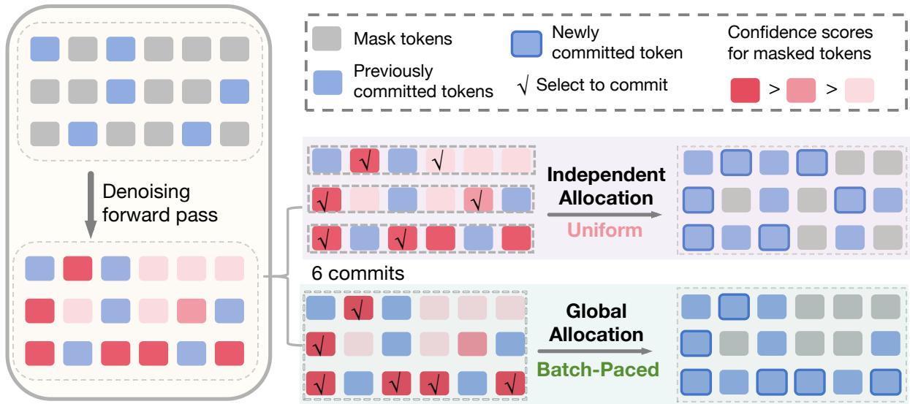  
Figure 1: Batch-Paced uses global compute allocation within the batch rather than independent sequence-wise allocation. After a denoising forward pass assigns confidence scores to masked-token predictions, Uniform commits a fixed number of positions per sequence, whereas Batch-Paced ranks positions across the batch.

$$
\hat { x } _ { j } = \arg \operatorname* { m a x } _ { v \in \mathcal { V } } [ \mathbf { p } _ { j } ] _ { v } , \mathcal { C } = \mathcal { S } ( \mathcal { M } ; \mathbf { s } ) .\tag{1}
$$

Committing C updates $x _ { j } \gets \hat { x } _ { j }$ for $j \in \mathcal { C }$ and $\mathcal { M }  \mathcal { M } \backslash \mathcal { C }$ . The policy-specific selector S may use top-k, thresholding, or pooled ranking.

## 3.2 Fixed-Budget Batch Decoding

In dLLM serving, multiple input requests are processed together as a batch. A batch decoder therefore considers the overall denoising progress of the batch when making decoding decisions for each request sequence. Under a fixed total denoising budget, the question is whether such batch-level decisions can improve the final quality of the batch.

Formally, let a batch contain B sequences with a total budget $T = \bar { T } B$ , where T¯ denotes the average number of denoising forward passes allocated to each sequence. At a denoising pass, let $\mathcal { M } _ { i }$ denote the remaining masked generation positions of sequence i. The batch’s candidate positions are

$$
\mathcal { E } = \{ ( i , j ) : i \in \{ 1 , \dots , B \} , j \in \mathcal { M } _ { i } \} .\tag{2}
$$

For each candidate $( i , j ) \in \mathcal { E }$ , the batched forward pass gives a score $s _ { i j } = \phi ( \mathbf { p } _ { i j } )$ . For sequence $i ,$ collect these scores as $\mathbf { s } _ { i } = ( s _ { i j } ) _ { j \in \mathcal { M } _ { i } }$ , and collect the scores over all candidate positions as $\mathbf { s } _ { \mathcal { E } } ~ =$ $\left( s _ { i j } \right) _ { \left( i , j \right) \in \mathcal { E } }$ . A decoder selects $\mathcal { C } _ { i } \subseteq \mathcal { M } _ { i }$ for each sequence, or equivalently the batch-level set

$$
{ \mathcal { C } } = \{ ( i , j ) : i \in \{ 1 , \dots , B \} , j \in { \mathcal { C } } _ { i } \} \subseteq { \mathcal { E } } .\tag{3}
$$

Selected positions are filled with their predicted tokens, while the other positions remain masked. Thus, under the total budget T, the decoder selects C to improve the batch’s final quality.

## 4 Method

## 4.1 Independent Sequence-Wise Allocation

Independent Sequence-Wise Allocation allocates the budget independently to each sequence.

Uniform. Uniform commits the same $r \quad = { }$ $\lceil L / \bar { T } \rceil$ highest-scoring positions from each sequence’s $\mathcal { M } _ { i }$ according to si:

$$
{ \mathcal { C } } ^ { \mathrm { u n i } } = \bigcup _ { i = 1 } ^ { B } \{ ( i , j ) : j \in \mathrm { T o p } _ { r } ( { \mathcal { M } } _ { i } ; { \mathbf { s } } _ { i } ) \} .\tag{4}
$$

Fast-dLLM. Fast-dLLM (Wu et al., 2026a) uses the same confidence threshold θ for every sequence and commits the batch-level set

$$
{ \mathcal { C } } ^ { \mathrm { f a s t } } ( \theta ) = \bigcup _ { i = 1 } ^ { B } \{ ( i , j ) : j \in { \mathcal { M } } _ { i } , s _ { i j } \geq \theta \} .\tag{5}
$$

Different thresholds induce different numbers of denoising forward passes. The matched-budget threshold-selection protocol is described with the

Table 1: Batch-Paced improves batch-decoding performance over Uniform at a fixed compute budget. The table compares both policies on individual benchmarks and mixtures across both backbones and budget levels.
<table><tr><td rowspan="3">Benchmark</td><td colspan="5">LLaDA-8B-Instruct</td><td colspan="5">LLaDA 1.5</td></tr><tr><td colspan="2"></td><td colspan="2"></td><td></td><td colspan="2">Avg. budget=64 Avg. budget=128 Full=256 Avg. budget=64</td><td colspan="2">Avg. budget=128 Full=256</td><td></td></tr><tr><td>Uniform baseline</td><td>Batch- Paced</td><td>Uniform baseline</td><td>Batch- Paced</td><td> $\mathrm { F u l l }$  reference baseline</td><td>Uniform</td><td>Batch- Paced</td><td>Uniform baseline</td><td>Batch- Paced</td><td> $\mathrm { F u l l }$  reference</td></tr><tr><td>GSM8K</td><td> $6 7 . 8 _ { 0 . 0 }$ </td><td> $\mathbf { 7 7 . 5 _ { 1 . 1 } ^ { * } }$ </td><td> $7 6 . 2 _ { 0 . 0 }$ </td><td> $\mathbf { 8 1 . 0 _ { 0 . 5 } ^ { * } }$ </td><td> $8 1 . 2 _ { 0 . 0 }$ </td><td> $7 0 . 0 _ { 1 . 0 }$ </td><td> $\mathbf { 8 0 . 5 _ { 0 . 8 } ^ { * } }$ </td><td> $7 7 . 7 _ { 0 . 0 }$ </td><td> $\mathbf { 8 3 . 8 _ { 0 . 6 } ^ { * } }$ </td><td> $8 3 . 4 _ { 0 . 0 }$ </td></tr><tr><td>MATH500</td><td> $2 5 . 7 _ { 1 . 0 }$ </td><td> $\mathbf { 3 2 . 1 _ { 2 . 9 } ^ { * } }$ </td><td> $3 3 . 2 _ { 1 . 7 }$ </td><td> $\mathbf { 3 5 . 5 _ { 2 . 1 } ^ { * } }$ </td><td> $3 5 . 9 _ { 1 . 7 }$ </td><td> $2 7 . 4 _ { 0 . 6 }$ </td><td> $\mathbf { 3 2 . 2 _ { 1 . 6 } ^ { * } }$ </td><td> $3 3 . 1 _ { 0 . 6 }$ </td><td> $\mathbf { 3 6 . 4 _ { 1 . 3 } ^ { * } }$ </td><td> $3 6 . 8 _ { 0 . 8 }$ </td></tr><tr><td>HumanEval</td><td> $1 8 . 4 _ { 0 . 3 }$ </td><td> $\mathbf { 2 9 . 3 _ { 1 . 2 } ^ { * } }$ </td><td> $2 7 . 0 _ { 0 . 3 }$ </td><td> $\mathbf { 3 8 . 4 _ { 0 . 4 } ^ { * } }$ </td><td> $4 1 . 0 _ { 0 . 3 }$ </td><td> $2 1 . 3 _ { 0 . 0 }$ </td><td> $\mathbf { 3 4 . 6 _ { 0 . 9 } ^ { * } }$ </td><td> $3 1 . 0 _ { 0 . 3 }$ </td><td> $\mathbf { 4 3 . 2 _ { 0 . 9 } ^ { * } }$ </td><td> $4 5 . 7 _ { 0 . 0 }$ </td></tr><tr><td>MBPP</td><td> $1 6 . 9 _ { 0 . 6 }$ </td><td> $\mathbf { 2 9 . 3 _ { 1 . 2 } ^ { * } }$ </td><td> $2 9 . 3 _ { 0 . 8 }$ </td><td> $\mathbf { 3 6 . 2 _ { 0 . 6 } ^ { * } }$ </td><td> $3 7 . 9 _ { 0 . 0 }$ </td><td> $1 5 . 9 _ { 1 . 0 }$ </td><td> $\mathbf { 2 7 . 0 _ { 1 . 2 } ^ { * } }$ </td><td> $2 6 . 6 _ { 1 . 2 }$ </td><td> $\mathbf { 3 9 . 8 _ { 0 . 9 } ^ { * } }$ </td><td> $4 1 . 8 _ { 0 . 0 }$ </td></tr><tr><td>IFEval</td><td> $\mathbf { 4 4 . 8 _ { 0 . 1 } }$ </td><td> $4 3 . 8 _ { 1 . 7 }$ </td><td> $5 1 . 5 _ { 0 . 1 }$ </td><td> $\mathbf { 5 1 . 7 _ { 0 . 8 } }$ </td><td> $5 5 . 7 _ { 0 . 1 }$ </td><td> $4 7 . 2 _ { 0 . 1 }$ </td><td> $\mathbf { 4 7 . 7 _ { 0 . 8 } }$ </td><td> $\mathbf { 5 5 . 2 _ { 0 . 1 } }$ </td><td> $5 4 . 5 _ { 0 . 7 }$ </td><td> $5 8 . 6 _ { 0 . 1 }$ </td></tr><tr><td>GSM8K+MATH500</td><td> $4 6 . 2 _ { 0 . 7 }$ </td><td> $\mathbf { 5 5 . 4 _ { 1 . 1 } ^ { * } }$ </td><td> $5 4 . 2 _ { 0 . 6 }$ </td><td> $\mathbf { 5 9 . 0 _ { 1 . 2 } ^ { * } }$ </td><td> $5 9 . 1 _ { 1 . 1 }$ </td><td> $4 9 . 0 _ { 0 . 7 }$ </td><td> $\mathbf { 5 6 . 6 _ { 0 . 8 } ^ { * } }$ </td><td> $5 5 . 5 _ { 0 . 7 }$ </td><td> $\mathbf { 6 0 . 2 _ { 1 . 1 } ^ { * } }$ </td><td> $6 0 . 5 _ { 0 . 5 }$ </td></tr><tr><td>HumanEval+MBPP</td><td> $1 6 . 8 _ { 1 . 4 }$ </td><td> $\mathbf { 3 1 . 1 _ { 1 . 1 } ^ { * } }$ </td><td> $2 9 . 5 _ { 1 . 6 }$ </td><td></td><td> $\mathbf { 3 9 . 1 _ { 0 . 7 } ^ { * } \ 3 9 . 7 _ { 0 . 3 } }$ </td><td> $1 8 . 1 _ { 1 . 0 }$ </td><td> $\mathbf { 3 0 . 9 _ { 1 . 0 } ^ { * } }$ </td><td> $2 9 . 8 _ { 0 . 7 }$ </td><td> $\mathbf { 4 1 . 6 _ { 0 . 6 } ^ { * } }$ </td><td> $4 4 . 1 _ { 0 . 5 }$ </td></tr><tr><td>GSM8K+HumanEval</td><td> $4 2 . 7 _ { 0 . 0 }$ </td><td> $\mathbf { 5 2 . 8 _ { 1 . 2 } ^ { * } }$ </td><td> $5 1 . 5 _ { 0 . 0 }$ </td><td> $\mathbf { 5 9 . 6 _ { 0 . 7 } ^ { * } }$ </td><td>60.70.0</td><td> $4 3 . 6 _ { 0 . 0 }$ </td><td> ${ \bf 5 7 . 1 _ { 1 . 9 } ^ { * } }$ </td><td> $5 4 . 0 _ { 0 . 0 }$ </td><td> ${ \bf 6 3 . 3 _ { 0 . 5 } ^ { * } }$ </td><td> $6 4 . 3 _ { 0 . 0 }$ </td></tr><tr><td>GSM8K+IFEval</td><td> $5 7 . 2 _ { 0 . 1 }$ </td><td> $\mathbf { 5 8 . 2 _ { 1 . 2 } }$ </td><td> $6 6 . 2 \phantom { 0 } _ { 0 . 1 }$ </td><td> $\mathbf { 6 8 . 0 _ { 1 . 0 } ^ { * } }$ </td><td> $6 9 . 5 _ { 0 . 1 }$ </td><td> $5 9 . 1 _ { 0 . 1 }$ </td><td> $\mathbf { 6 2 . 9 _ { 0 . 8 } ^ { * } }$ </td><td> $6 7 . 5 \phantom { 0 } _ { 0 . 7 }$ </td><td> $\mathbf { 7 1 . 7 _ { 0 . 4 } ^ { * } }$ </td><td> $7 2 . 7 _ { 0 . 2 }$ </td></tr><tr><td>HumanEval+IFEval</td><td> $3 1 . 0 _ { 0 . 1 }$ </td><td> $\mathbf { 3 2 . 7 _ { 2 . 0 } }$ </td><td> $4 1 . 7 _ { 0 . 1 }$ </td><td> $\mathbf { 4 6 . 8 _ { 1 . 3 } ^ { * } }$ </td><td> $4 9 . 5 _ { 0 . 3 }$ </td><td> $3 5 . 3 _ { 0 . 1 }$ </td><td> $\mathbf { 3 6 . 3 _ { 1 . 8 } }$ </td><td> $4 5 . 1 _ { 0 . 1 }$ </td><td> $\mathbf { 5 0 . 1 _ { 1 . 3 } ^ { * } }$ </td><td> $5 3 . 1 _ { 0 . 3 }$ </td></tr><tr><td>GSM8K+HumanEval+IFEval</td><td> $4 3 . 0 _ { 0 . 1 }$ </td><td> ${ \bf 4 8 . 3 _ { 1 . 1 } ^ { * } }$ </td><td> $5 3 . 3 _ { 0 . 3 }$ </td><td> $\mathbf { 5 7 . 8 _ { 0 . 6 } ^ { * } }$ </td><td> $5 9 . 8 _ { 0 . 1 }$ </td><td> $4 5 . 4 _ { 0 . 1 }$ </td><td> $\mathbf { 5 1 . 2 _ { 2 . 4 } ^ { * } }$ </td><td> $5 5 . 7 _ { 0 . 1 }$ </td><td> $\mathbf { 6 1 . 9 _ { 0 . 8 } ^ { * } }$ </td><td> $6 3 . 0 _ { 0 . 2 }$ </td></tr><tr><td>MATH500+MBPP+IFEval</td><td> $3 0 . 2 _ { 1 . 1 }$ </td><td> $\mathbf { 3 3 . 8 _ { 2 . 9 } }$ </td><td> $4 0 . 7 _ { 0 . 5 }$ </td><td> $\mathbf { 4 5 . 0 _ { 0 . 8 } ^ { * } }$ </td><td> $4 6 . 4 _ { 0 . 6 }$ </td><td> $3 2 . 0 _ { 1 . 3 }$ </td><td> $\mathbf { 3 6 . 3 _ { 1 . 8 } ^ { * } }$ </td><td> $4 0 . 0 _ { 0 . 3 }$ </td><td> $\mathbf { 4 6 . 0 _ { 1 . 5 } ^ { * } }$ </td><td> $4 8 . 4 _ { 0 . 3 }$ </td></tr><tr><td> $\mathrm { G S M 8 K + M A T H 5 0 0 + M B P P }$ </td><td> $3 6 . 1 _ { 1 . 1 }$ </td><td> $\mathbf { 4 6 . 8 _ { 1 . 2 } ^ { * } }$ </td><td> $4 7 . 0 _ { 0 . 8 }$ </td><td> $\mathbf { 5 1 . 8 _ { 1 . 3 } ^ { * } }$ </td><td> $5 2 . 4 _ { 1 . 0 }$ </td><td> $3 8 . 4 _ { 1 . 1 }$ </td><td> $\mathbf { 4 6 . 6 _ { 1 . 1 } ^ { * } }$ </td><td> $4 6 . 6 _ { 1 . 2 }$ </td><td> $\mathbf { 5 4 . 2 _ { 0 . 9 } ^ { * } }$ </td><td> $5 5 . 2 _ { 0 . 9 }$ </td></tr><tr><td> $\mathrm { G S M 8 K + M A T H 5 0 0 + I F E v a l }$ </td><td> $4 6 . 5 _ { 0 . 9 }$ </td><td> $\mathbf { 4 9 . 6 _ { 1 . 1 } ^ { * } }$ </td><td> $5 6 . 2 _ { 0 . 6 }$ </td><td> $\mathbf { 5 9 . 0 _ { 0 . 6 } ^ { * } }$ </td><td> $6 0 . 0 _ { 0 . 8 }$ </td><td> $4 9 . 2 _ { 1 . 4 }$ </td><td> $\mathbf { 5 2 . 8 _ { 1 . 1 } ^ { * } }$ </td><td> $5 7 . 3 _ { 1 . 0 }$ </td><td> $\mathbf { 6 0 . 7 _ { 0 . 9 } ^ { * } }$ </td><td> $6 1 . 9 _ { 0 . 4 }$ </td></tr><tr><td>HumanEval+MBPP+IFEval</td><td> $2 6 . 1 _ { 1 . 0 }$ </td><td> $\mathbf { 3 3 . 1 _ { 1 . 3 } ^ { * } }$ </td><td> $3 8 . 7 _ { 0 . 8 }$ </td><td> $\mathbf { 4 5 . 2 _ { 0 . 6 } ^ { * } }$ </td><td> $4 6 . 3 _ { 0 . 1 }$ </td><td> $2 9 . 2 _ { 1 . 6 }$ </td><td> $\mathbf { 3 4 . 3 _ { 0 . 9 } ^ { * } }$ </td><td> $3 9 . 1 _ { 0 . 5 }$ </td><td> $\mathbf { 4 6 . 9 _ { 0 . 8 } ^ { * } }$ </td><td> $4 9 . 4 _ { 0 . 2 }$ </td></tr><tr><td>GSM8K+HumanEval+MBPP</td><td> $3 3 . 3 _ { 0 . 8 }$ </td><td> $\mathbf { 4 7 . 0 _ { 0 . 5 } ^ { * } }$ </td><td> $4 5 . 0 _ { 0 . 9 }$ </td><td> $\mathbf { 5 1 . 8 _ { 0 . 6 } ^ { * } }$ </td><td> $5 2 . 5 _ { 0 . 1 }$ </td><td> $3 4 . 3 _ { 1 . 0 }$ </td><td> $\mathbf { 4 8 . 4 _ { 0 . 8 } ^ { * } }$ </td><td> $4 5 . 7 _ { 0 . 6 }$ </td><td> $\mathbf { 5 5 . 4 _ { 0 . 3 } ^ { * } }$ </td><td> $5 6 . 8 _ { 0 . 6 }$ </td></tr></table>

## Fast-dLLM comparison in Section 5.6.

## 4.2 Global Compute Allocation within a Batch

We introduce Batch-Paced, which jointly optimizes decoding-compute allocation across sequences by ranking masked-token confidence across the batch, allowing different sequences to advance at different paces. All sequences draw from a shared budget pool, so unused budget from sequences that finish early can be transferred to sequences that continue decoding. By controlling the number of committed tokens at each pass, Batch-Paced controls how the fixed total budget is allocated.

Specifically, at each denoising pass, define the unfinished sequences and their candidate sets as $\mathcal { A } = \{ i : \mathcal { M } _ { i } \neq \emptyset \} , \mathcal { E } _ { i } = \{ ( i , j ) : j \in \mathcal { M } _ { i } \}$ and $\textstyle { \mathcal { E } } = \bigcup _ { i \in { \mathcal { A } } } { \mathcal { E } } _ { i }$ . A batched forward pass costs $| { \cal { A } } |$ units; the shared pool is initialized as $R = B \bar { T }$ and decreases by $| { \cal A } |$ after each pass. When a sequence finishes, it leaves ${ \mathcal { A } } ,$ reducing the cost of later passes and leaving more of R for the remaining sequences. Let $\begin{array} { r } { U = \sum _ { i \in \mathcal { A } } | \mathcal { M } _ { i } | } \end{array}$ . Batch-Paced uses the remaining pool to determine $K .$ , the number of positions committed at this pass:

(6)

$$
K = \operatorname* { m i n } \left\{ | \mathcal { E } | , \left\lceil \frac { U } { \operatorname* { m a x } ( 1 , R / | \mathcal { A } | ) } \right\rceil \right\} .\tag{7}
$$

$$
\begin{array} { r } { \mathcal { C } ^ { \mathrm { B P } } = \mathrm { T o p } _ { K } ( \mathcal { E } ; { \bf s } _ { \mathcal { E } } ) . } \end{array}
$$

Algorithm 1 Batch-Paced per-pass selection   
Require: unfinished sequences A, candidate sets   
$\{ \mathcal { E } _ { i } \} ,$ , scores $s _ { i j } .$ remaining pool $R \geq | { \mathcal { A } } |$   
1: $\textstyle { \mathcal { E } } \gets \bigcup _ { i \in { \mathcal { A } } } { \mathcal { E } } _ { i } ;$ compute $K$ using $\operatorname { E q . }$ 6   
2: $\mathcal { C } \gets \mathrm { T o p } _ { K } ( \mathcal { E } ; s _ { i j } )$   
3: for all $i \in \mathcal A$ do   
4: if $| { \mathcal { C } } \cap { \mathcal { E } } _ { i } | = 0$ then   
5: ${ \mathcal { C } } \gets { \mathcal { C } } \cup \{ \mathrm { a r g } \operatorname* { m a x } _ { ( i , j ) \in { \mathcal { E } } _ { i } } s _ { i j } \}$   
6: end if   
7: end for   
8: Commit positions in ${ \mathcal { C } } ;$ advance any completed   
sequence   
9: $R \gets R - | { \mathcal { A } } |$   
10: return updated batch and pool

It then selects the corresponding positions globally according to their confidence scores:

The selection enforces a minimum commit of one position for every unfinished sequence: if the pooled top-K candidates omit sequence i, its highest-scoring position in $\mathcal { M } _ { i }$ is included. For sequence $i ,$ the committed positions are $\mathcal { C } _ { i } ^ { \mathrm { B P } } = \{ j$ $( i , j ) \in { \mathcal { C } } ^ { \mathrm { B P } } \}$ , whose size may differ across sequences. Thus, Batch-Paced performs batch-level decoding under a fixed total budget by jointly selecting commit positions across sequences. Algorithm 1 summarizes this base per-pass selector; Appendix B extends Batch-Paced with an explicit batch-round allowance and gives the resulting full decoding algorithm in Algorithm 2.

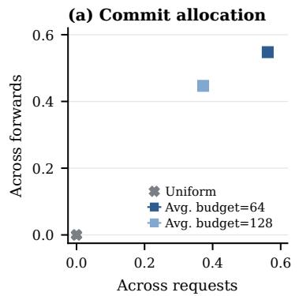

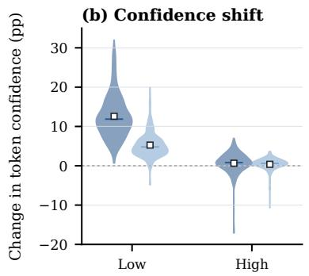

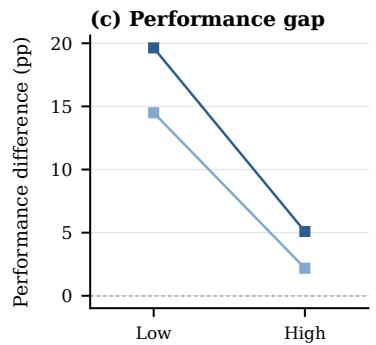

Figure 2: Batch-Paced’s largest confidence shifts and performance gains occur in the low-confidence group. The panels show (a) variation in commit allocation across requests and forwards, (b) confidence shifts by Uniformconfidence group, and (c) paired performance differences between Batch-Paced and Uniform.  
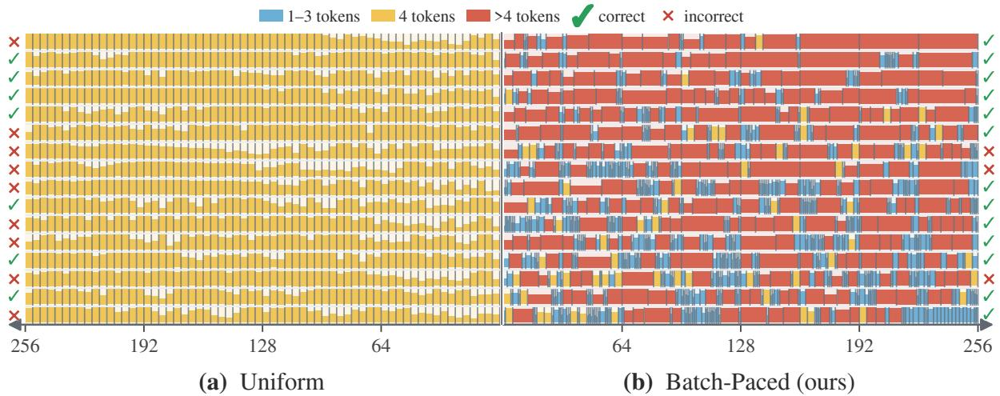  
Figure 3: Batch-Paced gives requests different commit schedules within a fixed-budget batch. Matched panels show the same illustrative mixed B = 16 batch with requests aligned row by row; the shared center separates Uniform’s leftward and Batch-Paced’s rightward token-progress axes. Segment width, height, color, and row-end marks encode per-forward token count, mean confidence, commit size, and final correctness, respectively.

## 5 Experiments

## 5.1 Experimental Setup

We evaluate GSM8K (Cobbe et al., 2021), MATH500 (Hendrycks et al., 2021; Lightman et al., 2024), HumanEval (Chen et al., 2021), MBPP (Austin et al., 2021), and IFEval (Zhou et al., 2023) individually and in cross-domain mixtures, reflecting serving batches that may contain requests from different task domains. For each benchmark, we fix a pool of up to 256 examples; each mixture combines equal-sized samples from its component pools. We shuffle the examples and partition them into batches of $B = 1 6 .$ , allowing a smaller final batch when needed. Across five batch-formation seeds, the example pool remains fixed while its order and batch membership vary. We compute accuracy over the full example set for each arrangement and report the mean and standard deviation across arrangements, with standard deviations shown as table subscripts. Across tables, boldface marks the higher mean in each comparison, regardless of significance; an asterisk marks a nominally significant difference under a two-sided paired t-test over five matched seeds $( p < 0 . 0 5 )$ Prompts and exemplars follow the corresponding lm-evaluation-harness task definitions where available (Gao et al., 2024). We evaluate LLaDA-8B-Instruct and LLaDA 1.5 (Nie et al., 2026; Zhu et al., 2026); both use the same semi-autoregressive remasking setup as prior LLaDA evaluations (Nie et al., 2026; Zhu et al., 2026), with generation length $L = 2 5 6$ , block length H = 32, and top-1 softmax probability as the confidence score.

## 5.2 Main Results

Table 1 reports individual benchmarks and representative task mixtures. The mixtures cover both benchmarks from the same domain, such as GSM8K with MATH500 and HumanEval with MBPP, and batches that combine different domains, such as GSM8K with HumanEval, GSM8K with IFEval, and HumanEval with IFEval. Threebenchmark mixtures broaden the task composition. For each backbone, Uniform and Batch-Paced are compared at average denoising budgets of 64 and 128. At full budget (256), each sequence commits one token per forward, so we report one reference. Across both backbones, Batch-Paced improves on most individual benchmarks at both reduced budgets and on every reported multi-benchmark mixture. Gains are especially pronounced on code benchmarks and code-containing mixtures, yet positive for within- and cross-domain mixtures.

Table 2: Batch-Paced largely retains its performance advantage across decoding configurations. The table compares Uniform and Batch-Paced on GSM8K–HumanEval across both models and two budget fractions, varying block and generation lengths and confidence-score functions; entries list Uniform/Batch-Paced mean accuracy.
<table><tr><td rowspan="2">Factor</td><td rowspan="2">Setting</td><td colspan="2">LLaDA-8B-Instruct  $\operatorname { A v g } .$  budget / gen. length</td><td colspan="2">LLaDA 1.5 Avg. budget / gen. length</td></tr><tr><td> $1 / 4$ </td><td> $1 / 2$ </td><td> $1 / 4$ </td><td> $1 / 2$ </td></tr><tr><td rowspan="2">Block length</td><td> $H = 6 4$ </td><td> $4 3 . 0 _ { 0 . 0 } / 5 3 . 8 _ { 1 . 5 }$ </td><td> $5 2 . 1 _ { 0 . 0 } / 5 8 . 1 _ { 1 . 0 }$ </td><td> $4 7 . 0 _ { 0 . 0 } / 5 8 . 7 _ { 1 . 4 }$ </td><td> $5 5 . 1 _ { 1 . 5 } / 6 2 . 4 _ { 0 . 7 }$ </td></tr><tr><td> $H = 2 5 6$ </td><td> $4 3 . 3 _ { 0 . 0 } / 4 6 . 6 _ { 1 . 5 }$ </td><td> $\mathbf { 5 0 . 0 } _ { 0 . 0 } / 4 8 . 3 _ { 0 . 4 }$ </td><td> $4 0 . 7 _ { 0 . 4 } / 4 8 . 8 _ { 1 . 1 }$ </td><td> $4 9 . 1 _ { 0 . 0 } / 5 2 . 8 _ { 0 . 5 }$ </td></tr><tr><td rowspan="2">Generation length</td><td> $L = 1 2 8$ </td><td> $4 3 . 0 _ { 0 . 0 } / 5 0 . 9 _ { 2 . 1 }$ </td><td> $5 2 . 4 _ { 0 . 0 } / 5 6 . 5 _ { 0 . 4 }$ </td><td> $4 3 . 6 _ { 0 . 0 } / 5 2 . 1 _ { 1 . 2 }$ </td><td> $5 3 . 4 _ { 0 . 0 } / 5 7 . 7 _ { 0 . 3 }$ </td></tr><tr><td> $L = 5 1 2$ </td><td> $4 4 . 0 _ { 1 . 2 } / 5 9 . 1 _ { 2 . 2 }$ </td><td> $5 7 . 1 _ { 1 . 2 } / 6 1 . 3 _ { 0 . 8 }$ </td><td> $4 5 . 0 _ { 0 . 9 } / 5 9 . 6 _ { 2 . 1 }$ </td><td> $6 0 . 5 _ { 0 . 3 } / 6 3 . 4 _ { 0 . 8 }$ </td></tr><tr><td rowspan="2">Confidence-score function</td><td>Top-1/2 margin</td><td> $4 5 . 2 _ { 1 . 5 } / 5 7 . 3 _ { 1 . 5 } ^ { * }$ </td><td> $5 3 . 4 _ { 0 . 0 } / 5 9 . 6 _ { 0 . 4 } ^ { * }$ </td><td> $4 5 . 4 _ { 0 . 0 } / 5 7 . 6 _ { 1 . 7 } ^ { * }$ </td><td> $5 7 . 3 \substack { 0 . 0 } / 6 1 . 7 _ { 0 . 4 } ^ { * }$ </td></tr><tr><td>Negative entropy</td><td> $\mathbf { 3 4 . 2 0 . 8 } / 4 7 . 0 _ { 2 . 2 } ^ { * }$ </td><td> $5 1 . 2 _ { 0 . 0 } / 5 9 . 4 _ { 0 . 5 } ^ { * }$ </td><td> $4 0 . 5 _ { 0 . 0 } \dot { / } 4 8 . 7 _ { 1 . 8 } ^ { * }$ </td><td> $5 3 . 0 _ { 0 . 0 } \mathrm { \dot { / } } 6 2 . 3 _ { 0 . 8 } ^ { * }$ </td></tr></table>

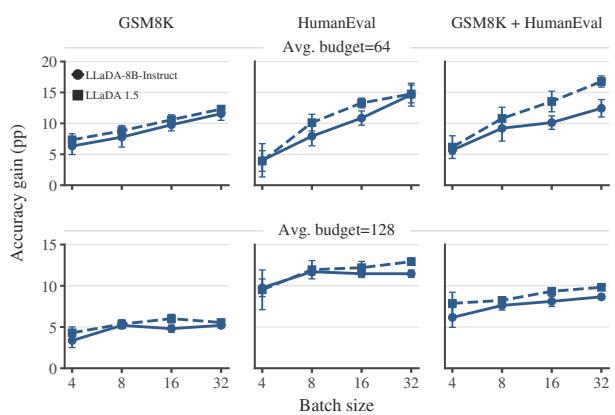  
Figure 4: Batch-Paced’s performance advantage over Uniform generally grows with batch size. Curves show paired accuracy gains across single-task and mixed-task settings for both models at both budgets.

## 5.3 Batch-Paced Reshapes Decoding

Batch-Paced shapes each request’s decoding dynamics by considering token confidence scores jointly across the batch. Next, we ask whether this joint consideration changes denoising pace across requests, how the resulting pace reshapes the confidence-score trajectory of committed tokens over successive steps, and whether these shifts are reflected in final decoding performance. Figure 2 traces these dynamics on the GSM8K–HumanEval mixture for LLaDA 1.5; Appendix A.1 presents the corresponding analysis for LLaDA-8B-Instruct.

Panel (a) quantifies commit-allocation unevenness with normalized Gini coefficients across requests within each forward and across forwards within each request; higher values indicate less even allocation, and Uniform is zero by construction. Batch-Paced varies allocation along both dimensions. Figure 3 illustrates this redistribution in a matched batch: Uniform assigns fixed commit counts per request, whereas Batch-Paced produces varying request-level schedules. Requests are grouped by their mean committed-token confidence under Uniform. In (b), Batch-Paced yields larger increases in mean committed-token confidence for the lower-confidence group, with smaller shifts for the higher-confidence group. In (c), the lower-confidence group shows larger paired performance gains, while the higher-confidence group also improves. Together, Batch-Paced’s changed denoising pace accompanies higher committedtoken confidence, especially for lower-confidence requests, and better final decoding performance.

## 5.4 Batch-Size Scaling

In batched dLLM serving, requests are decoded together, and the batch size determines how many sequences participate in each batched decoding step. This raises a practical question about batched decoding: as more requests share a batch, can decoding the batch as a whole improve task performance under the same average denoising budget per request? We compare Batch-Paced with Uniform at $B \in \{ 4 , 8 , 1 6 , 3 2 \}$ for both backbones, three task settings, and two average per-sequence budgets. Within each comparison, we hold $H = 3 2 .$ $L = 2 5 6 .$ , the confidence score, task setting, and average per-sequence budget fixed, so increasing B expands the set of requests considered together while preserving each request’s compute allowance. Figure 4 shows the paired accuracy gain over Uniform as batch size varies. Batch-Paced’s gains generally increase with B across both backbones, all three task settings, and both budgets. At $B = 3 2$ its mean gain exceeds that at $B = 4$ in every condition, with especially clear growth at $\bar { T } = 6 4$ Larger batches may give joint allocation more choices than Uniform’s sequence-wise schedule.

Table 3: Fast-dLLM and Batch-Paced are broadly comparable. The table compares their accuracy on individual benchmarks and representative mixtures across both backbones and two target denoising budgets.
<table><tr><td rowspan="3">Benchmark</td><td colspan="4">LLaDA-8B-Instruct</td><td colspan="4">LLaDA 1.5</td></tr><tr><td colspan="2">Avg. budget=64</td><td colspan="2">Avg. budget=128</td><td colspan="2">Avg. budget=64</td><td colspan="2">Avg. budget=128</td></tr><tr><td>Fast-  ${ \mathrm { { d L L M } } }$ </td><td>Batch- Paced</td><td>Fast- dLLM</td><td>Batch- Paced</td><td>Fast-  ${ \mathrm { { d L L M } } }$ </td><td>Batch- Paced</td><td>Fast- dLLM</td><td>Batch- Paced</td></tr><tr><td>HumanEval</td><td> $\mathbf { 3 6 . 6 _ { 1 . 9 } ^ { * } }$ </td><td> $2 9 . 3 _ { 1 . 2 }$ </td><td> $\mathbf { 4 0 . 9 _ { 0 . 0 } ^ { * } }$ </td><td> $3 8 . 4 _ { 0 . 4 }$ </td><td> $3 3 . 0 _ { 1 1 . 5 }$ </td><td> $\mathbf { 3 4 . 6 _ { 0 . 9 } }$ </td><td> $\mathbf { 4 5 . 7 _ { 0 . 0 } ^ { * } }$ </td><td> $4 3 . 2 _ { 0 . 9 }$ </td></tr><tr><td>IFEval</td><td> $3 9 . 6 _ { 1 . 9 }$ </td><td> $\mathbf { 4 3 . 8 _ { 1 . 7 } ^ { * } }$ </td><td> $5 0 . 5 _ { 1 . 9 }$ </td><td> $\mathbf { 5 1 . 7 _ { 0 . 8 } }$ </td><td> $4 0 . 4 _ { 1 . 6 }$ </td><td> $\mathbf { 4 7 . 7 _ { 0 . 8 } ^ { * } }$ </td><td> $5 1 . 7 _ { 0 . 7 }$ </td><td> $\mathbf { 5 4 . 5 _ { 0 . 7 } ^ { * } }$ </td></tr><tr><td>GSM8K</td><td> $\mathbf { 7 8 . 8 _ { 0 . 4 } }$ </td><td> $7 7 . 5 _ { 1 . 1 }$ </td><td> $\mathbf { 8 1 . 2 _ { 0 . 0 } }$ </td><td> $8 1 . 0 _ { 0 . 5 }$ </td><td> $\mathbf { 8 1 . 6 _ { 0 . 9 } }$ </td><td> $8 0 . 5 _ { 0 . 8 }$ </td><td> $8 3 . 3 _ { 0 . 1 }$ </td><td> $\mathbf { 8 3 . 8 _ { 0 . 6 } }$ </td></tr><tr><td> $\mathrm { G S M 8 K + I F E v a l }$ </td><td> $4 6 . 0 _ { 2 . 7 }$ </td><td> $\mathbf { 5 8 . 2 _ { 1 . 2 } ^ { * } }$ </td><td> $\mathbf { 6 8 . 8 _ { 0 . 7 } }$ </td><td> $6 8 . 3 _ { 1 . 0 }$ </td><td> $4 5 . 0 _ { 3 . 7 }$ </td><td> $\mathbf { 6 2 . 9 _ { 0 . 8 } ^ { * } }$ </td><td> $7 1 . 2 _ { 0 . 9 }$ </td><td> $\mathbf { 7 1 . 7 _ { 0 . 4 } }$ </td></tr><tr><td> $\mathrm { G S M 8 K + H u m a n E v a l }$ </td><td> $\mathbf { 5 7 . 9 _ { 0 . 1 } ^ { * } }$ </td><td> $5 2 . 8 _ { 1 . 2 }$ </td><td> $\mathbf { 6 0 . 7 _ { 0 . 0 } ^ { * } }$ </td><td> $5 9 . 6 _ { 0 . 7 }$ </td><td> $\mathbf { 6 0 . 6 _ { 1 . 4 } ^ { * } }$ </td><td> $5 7 . 1 _ { 1 . 9 }$ </td><td> $\mathbf { 6 4 . 3 _ { 0 . 1 } ^ { * } }$ </td><td> $6 3 . 3 _ { 0 . 5 }$ </td></tr><tr><td> $\mathrm { H u m a n E v a l + I F E v a l }$ </td><td> $2 4 . 0 _ { 2 . 8 }$ </td><td> $\mathbf { 3 2 . 7 _ { 2 . 0 } ^ { * } }$ </td><td> $4 6 . 2 _ { 3 . 0 }$ </td><td> $\mathbf { 4 6 . 8 _ { 1 . 3 } }$ </td><td> $2 7 . 2 _ { 4 . 3 }$ </td><td> $\mathbf { 3 6 . 3 _ { 1 . 8 } ^ { * } }$ </td><td> $4 8 . 5 _ { 5 . 7 }$ </td><td> $\mathbf { 5 0 . 1 _ { 1 . 3 } }$ </td></tr><tr><td> $\mathrm { G S M 8 K + H u m a n E v a l + I F E v a l }$ </td><td> $3 3 . 9 _ { 5 . 6 }$ </td><td> $4 8 . 3 _ { 1 . 1 } ^ { * }$ </td><td> $\mathbf { 5 9 . 3 _ { 1 . 0 } }$ </td><td> $5 7 . 3 _ { 0 . 9 }$ </td><td> $3 6 . 6 _ { 2 . 3 }$ </td><td> $\mathbf { 5 1 . 2 _ { 2 . 4 } ^ { * } }$ </td><td> $6 1 . 8 _ { 1 . 2 }$ </td><td> $\mathbf { 6 1 . 9 _ { 0 . 8 } }$ </td></tr></table>

## 5.6 Comparison with Adaptive Decoding under Search-Based Budget Matching

On the 1:1 GSM8K–HumanEval mixture, we test changes to block and generation length and two alternative confidence-score functions: the top-1/top-2 probability margin, a confidence-gap signal used by Prophet (Li et al., 2026), and negative entropy, related to EB-Sampler’s entropy-based token ordering (Ben-Hamu et al., 2026). Table 2 compares Uniform and Batch-Paced across these settings for both models and two budget fractions. Batch-Paced largely retains its performance advantage across these decoding configurations. Appendix A.2.2 reports the budget sweep (Figure 6) and trends across block and generation lengths (Figures 8 and 9); Appendix A.2.1 covers benchmark proportions.

Recent dLLM decoders use signals such as token confidence, entropy, temporal consistency, and denoising history to adapt token commitments within individual sequences (Wu et al., 2026a; Ben-Hamu

## 5.5 Budget and Decoding Robustness

et al., 2026; Kim et al., 2026; Wang et al., 2026). Fast-dLLM is a strong representative adaptive decoder that applies a confidence threshold independently to each sequence, yielding different commit paces without specifying a batch budget; its compute varies by model, task, and batch mix.

An explicit batch budget is useful when a serving system must limit the denoising work assigned to each batch. For example, a shared-GPU scheduler can set per-batch allowances to divide compute across batches, while a service can offer different compute tiers by assigning different allowances. We compare Batch-Paced with FastdLLM at matched batch budgets to test whether joint batch decisions achieve comparable performance. For each model, task setting, budget, and seed, we use at most eight bisection steps to select the tested θ whose largest per-batch average denoising budget per request is closest to T¯, while keeping every evaluation batch within the target. Probe-decode compute is excluded. Table 3 shows broadly comparable performance, with each method leading in some settings. To isolate budget stopping from joint token selection, we add two Fast-dLLM stopping rules that retain its thresholdbased commits: one force-completes a sequence when its individual allowance is exhausted; the other force-completes unfinished sequences when the shared batch budget cannot fund another pass. Batch-Paced generally achieves higher mean performance on benchmark mixtures; Appendix A.3 details both variants, and Table 5 reports results.

## 5.7 Batch Decode-Time and Performance Trade-offs with a Batch-Paced Extension

Batch-Paced changes each request’s denoising pace to improve overall batch performance, but can require more sequential denoising steps and thus increase batch decode time. Since completion time matters alongside output quality in batched serving, we evaluate both. To explore this trade-off, we extend Batch-Paced with a decoding-depth allowance $D _ { \mathrm { m a x } }$ that limits the number of batched denoising steps. The original policy commits at least one token per unfinished request at each step; under the allowance, this minimum rises as the remaining depth shrinks, while additional commits still follow the batch-wide confidence ranking. Appendix B gives the full algorithm.

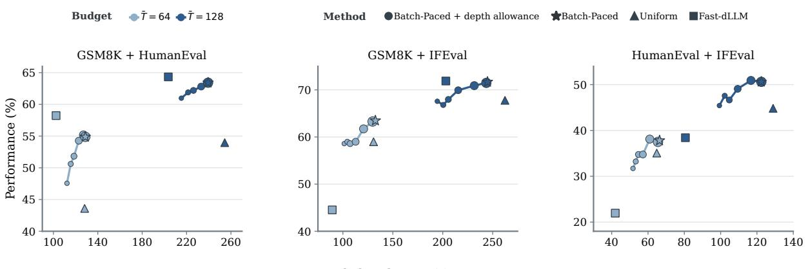  
Batch decode time (s)  
Figure 5: Depth limits trade Batch-Paced performance for shorter decode time. The plot compares Uniform, Fast-dLLM, and original and depth-limited Batch-Paced across task mixtures and budgets; larger circles denote larger depth allowances. Batch-Paced generally outperforms Uniform at comparable decode time; tighter allowances move it toward Fast-DLLM’s runtime; larger ones recover the original policy’s performance and runtime.

We evaluate three pairwise cross-domain mixtures on both backbones at target budgets $\bar { T } \in$ {64, 128}, using the same sampled examples and batch order across policies. For each setting, we test $D _ { \operatorname* { m a x } } / \bar { T } ~ = ~ 1$ and $1 + 2 ^ { - n }$ for $n \_ \in$ $\{ 0 , 1 , 2 , 3 , 4 \}$ , spanning added allowances from T /¯ 16 to T¯. Figure 5 shows LLaDA 1.5; Appendix A.4 shows LLaDA-8B-Instruct results in Figure 10. For timing, all policies use the same Transformers/PyTorch implementation on a single NVIDIA A100-SXM4-80GB GPU, with servingengine acceleration disabled. Figure 5 compares batch performance and decode time for the depthlimited variants, Uniform, Fast-dLLM, and original Batch-Paced. Batch-Paced generally outperforms Uniform at broadly comparable decode time, running slightly slower under tighter budgets and slightly faster under larger ones. Fast-dLLM is faster across budgets, but the performance lead varies: Batch-Paced leads more often under tighter budgets, and Fast-dLLM under larger ones. Tightening $D _ { \mathrm { m a x } }$ shortens Batch-Paced decoding toward Fast-dLLM’s runtime, at some performance cost;

increasing it moves performance and decode time back toward the original policy. Together, these results show that Batch-Paced improves performance over Uniform at comparable decode time, while its depth allowance can trade modest performance for runtime closer to Fast-dLLM, a strong adaptive decoder that requires setting-specific threshold search to meet a target compute budget.

## 6 Conclusion

Serving systems may bound each batch’s compute, leaving its allocation across requests open. We formulate this fixed-budget dLLM batch-decoding problem and introduce Batch-Paced, a trainingfree method that jointly ranks masked-token confidence across the batch. Across two backbones and five benchmarks with mixtures, Batch-Paced generally improves matched-budget performance over Uniform’s independent sequence-wise allocation. Gains tend to grow with batch size and persist across tested decoding configurations. Analysis of decoding dynamics indicates that the largest increases in committed-token confidence and performance occur among lower-confidence requests. At matched budgets, Batch-Paced performs broadly comparably to Fast-dLLM, a representative sequence-wise adaptive decoder whose confidence threshold requires setting-specific calibration. Its batch decode time is comparable to Uniform’s but generally longer than Fast-dLLM’s. A decoding-depth allowance narrows this gap at some performance cost, yielding a tunable balance between batch quality and batch decode time.

## Limitations

First, our evaluation is limited to mask-to-token decoding and does not cover more flexible dLLM decoding schemes, including arbitrary-order and infilling generation (Ye et al., 2025) or editing previously committed tokens (Bie et al., 2026). Second, our workload evaluation is limited to standard benchmarks and constructed benchmark mixtures rather than requests sampled from deployed services; these may not fully reflect the diversity and task proportions of real-world requests. Finally, our timing evaluation is limited to synchronized decode time measured for each pre-formed evaluation batch and averaged across batches; it does not capture end-to-end latency in a continuous online request stream, where request arrivals and dynamic batch formation also matter. Despite these limitations, to our knowledge, this is the first controlled study of allocating a fixed denoising budget across requests to improve dLLM batch quality. By using benchmark-derived batches as a tractable proxy for heterogeneous request groups, we provide initial insight into this underexplored problem and a basis for future evaluation on live serving traces and more diverse decoding schemes.

## References

Amey Agrawal, Nitin Kedia, Ashish Panwar, Jayashree Mohan, Nipun Kwatra, Bhargav Gulavani, Alexey Tumanov, and Ramachandran Ramjee. 2024. Taming {Throughput-Latency} tradeoff in {LLM} inference with {Sarathi-Serve}. In 18th USENIX symposium on operating systems design and implementation (OSDI 24), pages 117–134.

Anthropic. 2026. Our approach to api rate limits. Anthropic Help Center. Accessed October 9, 2026.

Marianne Arriola, Aaron Gokaslan, Justin Chiu, Zhihan Yang, Zhixuan Qi, Jiaqi Han, Subham Sahoo, and Volodymyr Kuleshov. 2025. Block diffusion: Interpolating between autoregressive and diffusion language models. In International Conference on Learning Representations, volume 2025, pages 50726–50753.

Jacob Austin, Augustus Odena, Maxwell Nye, Maarten Bosma, Henryk Michalewski, David Dohan, Ellen Jiang, Carrie Cai, Michael Terry, Quoc Le, et al. 2021. Program synthesis with large language models. arXiv preprint arXiv:2108.07732.

Wenrui Bao, Zhiben Chen, Dan Xu, and Yuzhang Shang. 2026. Learning to parallel: Accelerating diffusion large language models via learnable parallel decoding. In International Conference on Learning Representations, volume 2026, pages 83376–83392.

Heli Ben-Hamu, Itai Gat, Daniel Severo, Niklas S Nolte, and Brian Karrer. 2026. Accelerated sampling from masked diffusion models via entropy bounded unmasking. Advances in Neural Information Processing Systems, 38:55981–56007.

Tiwei Bie, Maosong Cao, Xiang Cao, Bingsen Chen, Fuyuan Chen, Kun Chen, Lun Du, Daozhuo Feng, Haibo Feng, Mingliang Gong, et al. 2026. Llada2. 1: Speeding up text diffusion via token editing. arXiv preprint arXiv:2602.08676.

Tiwei Bie, Maosong Cao, Kun Chen, Lun Du, Mingliang Gong, Zhuochen Gong, Yanmei Gu, Jiaqi Hu, Zenan Huang, Zhenzhong Lan, et al. 2025. Llada2. 0: Scaling up diffusion language models to 100b. arXiv preprint arXiv:2512.15745.

Tzu-Tao Chang, Benjamin Yuanyang Hong, Kiet Pham, and Shivaram Venkataraman. 2026. Dilaserve: High slo attainment serving for diffusion language models. arXiv preprint arXiv:2606.29094.

Jian Chen, Yesheng Liang, and Zhijian Liu. 2026. Dflash: Block diffusion for flash speculative decoding. arXiv preprint arXiv:2602.06036.

Mark Chen, Jerry Tworek, Heewoo Jun, Qiming Yuan, Henrique Ponde De Oliveira Pinto, Jared Kaplan, Harri Edwards, Yuri Burda, Nicholas Joseph, Greg Brockman, et al. 2021. Evaluating large language models trained on code. arXiv preprint arXiv:2107.03374.

Xin Cheng, Xingkai Yu, Chenze Shao, Jiashi Li, Yunfan Xiong, Yi Qian, Jiaqi Zhu, Shirong Ma, Xiaokang Zhang, Jiasheng Ye, et al. 2026. Dspark: Confidence-scheduled speculative decoding with semi-autoregressive generation. arXiv preprint arXiv:2607.05147.

Karl Cobbe, Vineet Kosaraju, Mohammad Bavarian, Mark Chen, Heewoo Jun, Lukasz Kaiser, Matthias Plappert, Jerry Tworek, Jacob Hilton, Reiichiro Nakano, et al. 2021. Training verifiers to solve math word problems. arXiv preprint arXiv:2110.14168.

Mehul Damani, Idan Shenfeld, Andi Peng, Andreea Bobu, and Jacob Andreas. 2025. Learning how hard to think: Input-adaptive allocation of lm computation. In International Conference on Learning Representations, volume 2025, pages 102783–102802.

Jiakun Fan, Yanglin Zhang, Xiangchen Li, and Dimitrios S Nikolopoulos. 2026. dllm-serve: Bridging the memory gap in diffusion language model serving. In Proceedings of the 40th ACM International Conference on Supercomputing, pages 515–526.

Yichao Fu, Junda Chen, Siqi Zhu, Zheyu Fu, Zhongdongming Dai, Yonghao Zhuang, Yian Ma, Aurick Qiao, Tajana Rosing, Ion Stoica, et al. 2024. Efficiently scaling llm reasoning with certaindex. arXiv preprint arXiv:2412.20993.

Leo Gao, Jonathan Tow, Baber Abbasi, Stella Biderman, Sid Black, Anthony DiPofi, Charles Foster, Laurence Golding, Jeffrey Hsu, Alain Le Noac’h, Haonan Li, Kyle McDonell, Niklas Muennighoff, Chris Ociepa, Jason Phang, Laria Reynolds, Hailey Schoelkopf, Aviya Skowron, Lintang Sutawika, and 5 others. 2024. The language model evaluation harness.

Dan Hendrycks, Collin Burns, Saurav Kadavath, Akul Arora, Steven Basart, Eric Tang, Dawn Song, and Jacob Steinhardt. 2021. Measuring mathematical problem solving with the math dataset. arXiv preprint arXiv:2103.03874.

Chunsan Hong, Seonho An, Min-Soo Kim, and Jong Chul Ye. 2026. Improving discrete diffusion unmasking policies beyond explicit reference policies. In International Conference on Learning Representations, volume 2026, pages 108226–108260.

Keya Hu, Linlu Qiu, Yiyang Lu, Hanhong Zhao, Tianhong Li, Yoon Kim, Jacob Andreas, and Kaiming He. 2026. Elf: Embedded language flows. arXiv preprint arXiv:2605.10938.

Daniel Israel, Guy Van den Broeck, and Aditya Grover. 2026. Accelerating diffusion llms via adaptive parallel decoding. Advances in neural information processing systems, 38:52870–52888.

Shashwat Jaiswal, Kunal Jain, Yogesh Simmhan, Anjaly Parayil, Ankur Mallick, Rujia Wang, Renee St Amant, Chetan Bansal, Victor Ruhle, Anoop Kulkarni, et al. 2025. Sageserve: Optimizing llm serving on cloud data centers with forecast aware autoscaling. Proceedings of the ACM on Measurement and Analysis ofComputing Systems, 9(3):1–24.

Metod Jazbec, Theo X Olausson, Louis Béthune, Pierre Ablin, Michael Kirchhof, João Monteiro, Victor Turrisi, Jason Ramapuram, and Marco Cuturi. 2025. Learning unmasking policies for diffusion language models. arXiv preprint arXiv:2512.09106.

Seo Hyun Kim, Sunwoo Hong, Hojung Jung, Youngrok Park, and Se-Young Yun. 2026. Klass: Kl-guided fast inference in masked diffusion models. Advances in Neural Information Processing Systems, 38:92267– 92301.

Pengxiang Li, Yefan Zhou, Dilxat Muhtar, Lu Yin, Shilin Yan, Li Shen, Yi Liang, Soroush Vosoughi, and Shiwei Liu. 2026. Diffusion language model knows the answer before it decodes. In The Fourteenth International Conference on Learning Representations.

Hunter Lightman, Vineet Kosaraju, Yuri Burda, Harrison Edwards, Bowen Baker, Teddy Lee, Jan Leike, John Schulman, Ilya Sutskever, and Karl Cobbe. 2024. Let’s verify step by step. In International Conference on Learning Representations, volume 2024, pages 39578–39601.

Shen Nie, Fengqi Zhu, Zebin You, Xiaolu Zhang, Jingyang Ou, Jun Hu, Jun Zhou, Yankai Lin, Ji-Rong Wen, and Chongxuan Li. 2026. Large language diffusion models. Advances in Neural Information Processing Systems, 38:50608–50646.

OpenAI. 2026. Scale Tier for api customers. OpenAI API documentation. Accessed October 9, 2026.

Tal Schuster, Adam Fisch, Jai Gupta, Mostafa Dehghani, Dara Bahri, Vinh Tran, Yi Tay, and Donald Metzler. 2022. Confident adaptive language modeling. Advances in Neural Information Processing Systems, 35:17456–17472.

Charlie Snell, Jaehoon Lee, Kelvin Xu, and Aviral Kumar. 2025. Scaling llm test-time compute optimally can be more effective than scaling parameters for reasoning. In International Conference on Learning Representations, volume 2025, pages 10131–10165.

DiffusionGemma Team, Adrien Ali Taïga, James Assiene, Daniele Calandriello, Rahma Chaabouni, João Gante, Tamara von Glehn, Nate Keating, Chris Knutsen, Martin Kukla, et al. 2026. Diffusiongemma technical report. arXiv preprint arXiv:2608.00146.

Kangyu Wang, Zhiyun Jiang, Haibo Feng, Weijia Zhao, Lin Liu, Jianguo Li, Zhenzhong Lan, and Weiyao Lin. 2026. Creditdecoding: Accelerating parallel decoding in diffusion large language models with trace credit. In Proceedings ofthe 64th Annual Meeting of the Association for Computational Linguistics (Volume 1: Long Papers), pages 11105–11123.

Qingyan Wei, Yaojie Zhang, Zhiyuan Liu, Puyu Zeng, Yuxuan Wang, Biqing Qi, Dongrui Liu, and Linfeng Zhang. 2026. Accelerating diffusion large language models with slowfast sampling: The three golden principles. In International Conference on Learning Representations, volume 2026, pages 4340–4354.

Chengyue Wu, Hao Zhang, Shuchen Xue, Zhijian Liu, Shizhe Diao, Ligeng Zhu, Ping Luo, Song Han, and Enze Xie. 2026a. Fast-dllm: Training-free acceleration of diffusion llm by enabling kv cache and parallel decoding. In International Conference on Learning Representations, volume 2026, pages 57027–57051.

Tianyi Wu, Xiaoxi Sun, Yanhua Jiao, Yulin Li, Yixin Chen, Yun-Hao Cao, Yi-Qi Hu, and Zhuotao Tian. 2026b. Dynamic-dllm: Dynamic cache-budget and adaptive parallel decoding for training-free acceleration of diffusion llm. In International Conference on Learning Representations, volume 2026, pages 66347–66365.

Jiacheng Ye, Zhihui Xie, Lin Zheng, Jiahui Gao, Zirui Wu, Xin Jiang, Zhenguo Li, and Lingpeng Kong. 2025. Dream 7b: Diffusion large language models, 2025. URL https://arxiv. org/abs/2508.15487.

Gyeong-In Yu, Joo Seong Jeong, Geon-Woo Kim, Soojeong Kim, and Byung-Gon Chun. 2022. Orca: A distributed serving system for {Transformer-Based} generative models. In 16th USENIX symposium on

operating systems design and implementation (OSDI 22), pages 521–538.

Shuai Zhang, Zijie Chen, Hongliang He, Lun Du, and Zhenzhong Lan. 2026a. Low perplexity is repetition: A one-dimensional self-conditioning attractor in continuous diffusion lms. arXiv preprint arXiv:2607.00588.

Shuai Zhang, Huachuan Qiu, Hongliang He, and Yong Dai. 2026b. Cost-aware diffusion draft trees for speculative decoding. arXiv preprint arXiv:2606.01813.

Jeffrey Zhou, Tianjian Lu, Swaroop Mishra, Siddhartha Brahma, Sujoy Basu, Yi Luan, Denny Zhou, and Le Hou. 2023. Instruction-following evaluation for large language models. arXiv preprint arXiv:2311.07911.

Fengqi Zhu, Rongzhen Wang, Shen Nie, Xiaolu Zhang, Chunwei Wu, Jun Zhou, Yankai Lin, Ji-Rong Wen, and Chongxuan Li. 2026. Llada 1.5: Variancereduced preference optimization for large language diffusion models. In Proceedings of the 64th Annual Meeting of the Association for Computational Linguistics (Volume 1: Long Papers), pages 11425– 11460.

Bowen Zuo and Yinglun Zhu. 2026. Strategic scaling of test-time compute: A bandit learning approach. In International Conference on Learning Representations, volume 2026, pages 134105–134128.

## A Additional Experimental Results

## A.1 Request-Level Analysis on LLaDA-8B-Instruct

Figure 7 extends the request-level analysis in Section 5.3 to LLaDA-8B-Instruct on the same benchmark mixture. It shows the same qualitative pattern: Batch-Paced changes commit allocation across requests and denoising steps, with the clearest confidence shifts and group-level performance gains among lower-confidence requests.

## A.2 Robustness Analyses

## A.2.1 Task-Mixture Ratios

To test sensitivity to two-task batch composition, we vary the GSM8K:HumanEval ratio while holding the decoding configuration and target budgets fixed. For each ratio and seed, we form 128 examples and partition them into eight batches of 16. Integer task counts are assigned per batch using the largest-remainder rule, and examples are sampled without replacement from the benchmark pools. Each decoding policy uses the same examples in the same batch order; seeds vary the example membership and batch arrangement. Table 4 shows that Batch-Paced has higher mean performance across the tested ratios, although the gains do not increase monotonically with the ratio.

Table 4: Batch-Paced improves performance across task-mixture ratios. The table compares both policies across five GSM8K–HumanEval ratios, backbones, and target budgets.
<table><tr><td rowspan="2">Ratio</td><td colspan="2">Avg. budget=64</td><td colspan="2">Avg. budget=128</td></tr><tr><td>Uniform baseline</td><td>Batch- Paced</td><td>Uniform baseline</td><td>Batch- Paced</td></tr><tr><td colspan="5">LLaDA-8B-Instruct</td></tr><tr><td>1:7</td><td> $2 8 . 3 _ { 1 . 4 }$ </td><td> $\mathbf { 4 0 . 9 _ { 0 . 9 } ^ { * } }$ </td><td> $3 4 . 2 _ { 0 . 9 }$ </td><td> $\mathbf { 4 8 . 4 _ { 2 . } ^ { * } }$  1</td></tr><tr><td>1:3</td><td> $3 4 . 4 _ { 1 . 0 }$ </td><td> $\mathbf { 4 8 . 8 _ { 2 . 7 } ^ { * } }$ </td><td> $4 3 . 0 _ { 0 . 8 }$ </td><td> $\mathbf { 5 6 . 7 _ { 1 . 6 } ^ { * } }$  10</td></tr><tr><td>1:1</td><td> $4 6 . 1 _ { 0 . 0 }$ </td><td> $\mathbf { 5 8 . 4 _ { 1 . 7 } ^ { * } }$ </td><td> $5 5 . 5 _ { 0 . 0 }$ </td><td> $\mathbf { 6 6 . 7 _ { 0 . 9 } ^ { * } }$ </td></tr><tr><td>3:1</td><td> $5 5 . 8 _ { 2 . 4 }$ </td><td> $\mathbf { 7 1 . 4 } _ { 4 . 7 } ^ { * }$ </td><td> $6 7 . 7 _ { 2 . 0 }$ </td><td> $\mathbf { 7 4 . 7 _ { 2 } ^ { * } }$  2.0</td></tr><tr><td>7:1</td><td> $6 2 . 5 _ { 1 . 0 }$ </td><td> $\mathbf { 7 8 . 1 _ { 4 . 0 } ^ { * } }$ </td><td> $7 3 . 1 _ { 2 . 0 }$ </td><td> $\mathbf { 8 0 . 8 _ { 2 . 1 } ^ { * } }$ </td></tr><tr><td colspan="5">LLaDA 1.5</td></tr><tr><td>1:7</td><td> $3 1 . 4 _ { 1 . 3 }$ </td><td> $\mathbf { 4 6 . 7 _ { 3 . 4 } ^ { * } }$ </td><td> $4 0 . 2 _ { 1 . 3 }$ </td><td> $\mathbf { 5 3 . 4 _ { 1 . } ^ { * } }$  0</td></tr><tr><td>1:3</td><td> $3 7 . 0 _ { 1 . 2 }$ </td><td> $\mathbf { 5 3 . 8 _ { 1 . 0 } ^ { * } }$ </td><td> $4 9 . 5 _ { 0 . 9 }$ </td><td> $\mathbf { 5 9 . 8 _ { 1 . } ^ { * } }$  6</td></tr><tr><td>1:1</td><td> $4 6 . 9 _ { 0 . 0 }$ </td><td> $\mathbf { 6 2 . 8 _ { 3 . 4 } ^ { * } }$ </td><td> $6 1 . 7 _ { 0 . 0 }$ </td><td> $\mathbf { 6 9 . 5 _ { 1 . 0 } ^ { * } }$ </td></tr><tr><td>3:1</td><td> $5 8 . 3 _ { 1 . 6 }$ </td><td> $\mathbf { 7 3 . 4 _ { 5 . 4 } ^ { * } }$ </td><td> $7 0 . 2 _ { 1 . 5 }$ </td><td> $\mathbf { 7 6 . 6 _ { 2 . 6 } ^ { * } }$  3</td></tr><tr><td>7:1</td><td> $6 0 . 5 _ { 1 . 3 }$ </td><td> $\mathbf { 7 8 . 1 _ { 4 . 0 } ^ { * } }$ </td><td> $7 3 . 1 _ { 2 . 0 }$ </td><td> $\mathbf { 8 0 . 8 _ { 2 . 1 } ^ { * } }$ </td></tr></table>

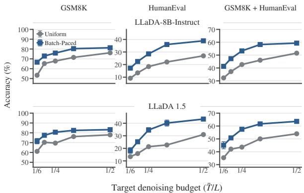  
Figure 6: Batch-Paced outperforms Uniform at every tested average budget. Accuracy as the average denoising budget varies across task settings and backbones.

## A.2.2 Budget and Decoding-Configuration Trends

To test a wider range of average denoising budgets, we use $B = 1 6$ and $L = 2 5 6$ and vary the integer average commit rate $r \in \{ 2 , 3 , 4 , 5 , 6 \}$ The corresponding target budget fraction is $\bar { T } / L = 1 / r ;$ for $L = 2 5 6 , r = 4$ and $r = 2$ correspond to average budgets of 64 and 128, respectively. When the block length is not divisible by r, the final pass commits fewer than r remaining positions. Figure 6 reports accuracy on GSM8K, HumanEval, and their mixture separately for each model. Batch-Paced has higher mean accuracy than Uniform at every tested rate in all six model–task settings, while the absolute accuracy trajectories vary by setting.

Figures 8 and 9 give the full block-length and generation-length trends underlying the representative comparisons in Table 2.

## A.3 Fast-dLLM Budget-Enforcement Variants

Section 5.6 introduces two stopping-rule variants that retain Fast-dLLM’s sequence-wise threshold selection. The separate-sequence variant gives each sequence its own allowance of $\bar { T }$ denoising forward passes and force-completes its remaining masks when that allowance is exhausted. The sharedbatch variant draws from a pool of BT¯ units, charging each forward pass by the number of unfinished sequences; when the pool cannot fund another pass, it force-completes all unfinished sequences. Thus, only the latter transfers unused allowance across sequences, while neither replaces Fast-dLLM’s threshold-based token selection.

For each variant, model, benchmark, budget, and seed, we repeat the binary search described in Section 5.6, using the same sampled examples and batch order as the main comparison. Among tested thresholds, we select the feasible one whose largest per-batch mean denoising budget is closest to the target; forced-completion forwards count toward this budget. Table 5 reports the results. Batch-Paced has higher mean performance than either variant across the displayed benchmark mixtures, while comparisons with unmodified Fast-dLLM remain mixed. This indicates that adding budget enforcement or sharing to threshold decoding does not by itself reproduce Batch-Paced’s mixture results.

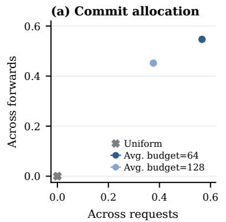

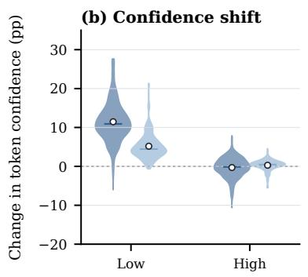

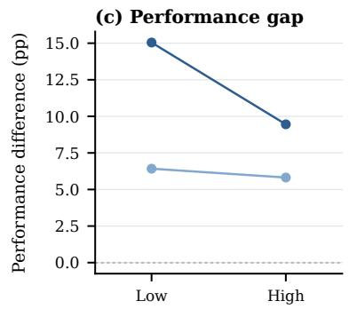

Figure 7: LLaDA-8B-Instruct shows the same pattern, with its largest confidence shifts and performance gains in the low-confidence group. The panels show (a) variation in commit allocation across requests and forwards, (b) confidence shifts by Uniform-confidence group, and (c) paired performance differences between Batch-Paced and Uniform.  
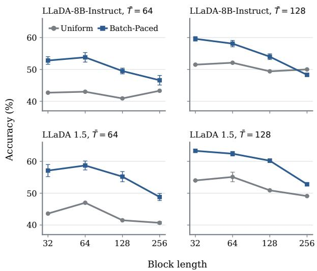  
Figure 8: Batch-Paced’s advantage largely persists across block lengths. The curves compare accuracy under Uniform and Batch-Paced as block length varies.

## A.4 Depth Trade-Off on LLaDA-8B-Instruct

Figure 10 gives the corresponding time– performance results for LLaDA-8B-Instruct. The same trade-off is visible: tighter depth

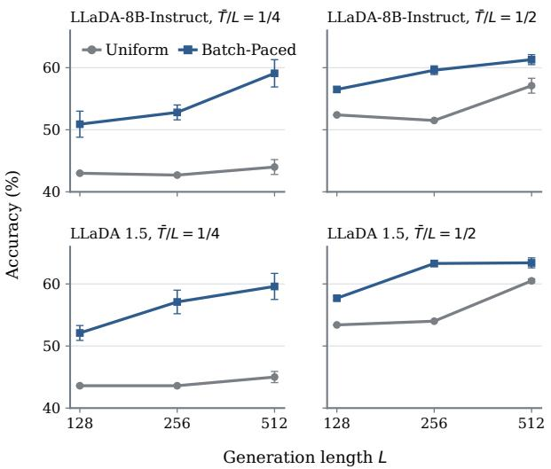  
Figure 9: Batch-Paced maintains higher performance across generation lengths. Curves compare Uniform and Batch-Paced results for both LLaDA models.

allowances shorten batch decoding, while larger allowances move performance and decode time toward the original policy.

## B Decoding-Depth-Allowance Algorithm

Section 5.7 introduces a decoding-depth allowance that bounds the batch to $D _ { \mathrm { m a x } }$ sequential denoising steps while retaining Batch-Paced’s shared budget and batch-wide confidence ranking. Each step is one batched denoising forward pass; wall-clock decode time is measured separately. At a decision point, let $\mathcal { E } _ { i }$ contain the masked positions $( i , j )$ in the current block of sequence i, let $\textstyle { \mathcal { E } } = \bigcup _ { i \in { \mathcal { A } } } { \mathcal { E } } _ { i }$ and let $m _ { i } = | \mathcal { E } _ { i } |$ . Let $n _ { i }$ count the denoising forward passes used by sequence i before the current scoring pass. Let $N _ { \mathrm { b l k } } = \lceil L / H \rceil$ be the number of generation blocks, and let gi count the blocks after

$$
q _ { i } = D _ { \mathrm { m a x } } - n _ { i } - g _ { i }\tag{8}
$$

$$
f _ { i } = \operatorname* { m a x } \left( 1 , \left\lceil \frac { m _ { i } } { q _ { i } } \right\rceil \right) ,
$$

sequence $i \ ' s$ current block; each requires at least one forward pass. Thus, $g _ { i } = N _ { \mathrm { b l k } } - 1$ initially and decreases by one whenever sequence i advances to its next block. The current block therefore has

(9)

forward opportunities remaining, including the current pass whose confidence scores are being processed. For every unfinished sequence, the allowance must leave at least one forward opportunity, so $q _ { i } \geq 1$ . To finish the current block within its remaining forward opportunities, sequence i receives a minimum commit floor

provided $q _ { i } \geq 1$ . The floor rises as a sequence has fewer denoising steps left to commit its masked positions; the required positions are its highestconfidence masked positions.

Let K be the commit count selected by the shared-budget rule in Eq. 6. The policy first se-

Table 5: Batch-Paced usually outperforms the budget-enforcement variants on benchmark mixtures. The table compares Fast-dLLM, its two runtime budget-enforcement variants, and Batch-Paced on individual benchmarks and mixtures across both backbones and two average denoising budgets.
<table><tr><td rowspan="2">Benchmark</td><td rowspan="2">Method</td><td colspan="2">LLaDA-8B-Instruct</td><td colspan="2">LLaDA 1.5</td></tr><tr><td> $\bar { T } = 6 4$ </td><td> $\bar { T } = 1 2 8$ </td><td> $\bar { T } = 6 4$ </td><td> $\bar { T } = 1 2 8$ </td></tr><tr><td rowspan="3">HumanEval</td><td>Fast-dLLM Fast-dLLM + separate sequence budgets</td><td> $3 6 . 6 _ { 1 . 9 }$   $\mathbf { 3 9 . 9 _ { 1 . 5 } }$ </td><td> $\mathbf { 4 0 . 9 _ { 0 . 0 } }$ </td><td> $3 3 . 0 _ { 1 1 . 5 }$ </td><td> $\mathbf { 4 5 . 7 _ { 0 . 0 } }$ </td></tr><tr><td>Fast-dLLM + shared batch budget</td><td> $1 9 . 9 _ { 1 0 . 7 }$ </td><td> $4 0 . 2 _ { 0 . 0 }$ </td><td> $\mathbf { 4 1 . 3 _ { 2 . 1 } }$   $3 2 . 7 _ { 1 1 . 2 }$ </td><td> $4 5 . 1 _ { 0 . 0 }$   $\mathbf { 4 5 . 7 _ { 0 . 0 } }$ </td></tr><tr><td>Batch-Paced (ours)</td><td> $2 9 . 3 _ { 1 . 2 }$ </td><td> $\mathbf { 4 0 . 9 _ { 0 . 0 } }$   $3 8 . 4 _ { 0 . 4 }$ </td><td> $3 4 . 6 _ { 0 . 9 }$ </td><td> $4 3 . 2 _ { 0 . 9 }$ </td></tr><tr><td rowspan="4">IFEval</td><td>Fast-dLLM</td><td> $3 9 . 6 _ { 1 . 9 }$ </td><td> $5 0 . 5 _ { 1 . 9 }$ </td><td> $4 0 . 4 _ { 1 . 6 }$ </td><td> $5 1 . 7 _ { 0 . 7 }$ </td></tr><tr><td>Fast-dLLM + separate sequence budgets</td><td> $3 5 . 6 _ { 9 . 1 }$ </td><td> $4 3 . 7 _ { 3 . 0 }$ </td><td> $3 8 . 6 _ { 9 . 3 }$ </td><td> $4 8 . 3 _ { 1 . 6 }$ </td></tr><tr><td>Fast-dLLM + shared batch budget</td><td> $2 7 . 3 _ { 1 0 . 9 }$ </td><td> $4 4 . 4 _ { 1 4 . 1 }$ </td><td> $2 9 . 3 _ { 1 0 . 2 }$ </td><td> $2 7 . 9 _ { 1 3 . 7 }$ </td></tr><tr><td>Batch-Paced (ours)</td><td> $\mathbf { 4 3 . 8 _ { 1 . 7 } }$ </td><td> $\mathbf { 5 1 . 7 _ { 0 . 8 } }$ </td><td> $4 7 . 7 _ { 0 . 8 }$ </td><td> $\mathbf { 5 4 . 5 _ { 0 . 7 } }$ </td></tr><tr><td rowspan="4">GSM8K</td><td>Fast-dLLM</td><td> $\mathbf { 7 8 . 8 _ { 0 . 4 } }$ </td><td> $\mathbf { 8 1 . 2 _ { 0 . 0 } }$ </td><td> $\mathbf { 8 1 . 6 _ { 0 . 9 } }$ </td><td> $8 3 . 3 _ { 0 . 1 }$ </td></tr><tr><td>Fast-dLLM + separate sequence budgets</td><td> $6 4 . 4 _ { 6 . 1 }$ </td><td> $7 2 . 3 _ { 0 . 1 }$ </td><td> $7 1 . 1 _ { 5 . 3 }$ </td><td> $7 6 . 1 _ { 0 . 2 }$ </td></tr><tr><td>Fast-dLLM + shared batch budget</td><td> $7 7 . 2 _ { 5 . 0 }$ </td><td> $\mathbf { 8 1 . 2 _ { 0 . 0 } }$ </td><td> $8 0 . 7 _ { 0 . 0 }$ </td><td> $8 3 . 3 _ { 0 . 1 }$ </td></tr><tr><td>Batch-Paced (ours)</td><td> $7 7 . 5 _ { 1 . 1 }$ </td><td> $8 1 . 0 _ { 0 . 5 }$ </td><td> $8 0 . 5 _ { 0 . 8 }$ </td><td> $\mathbf { 8 3 . 8 _ { 0 . 6 } }$ </td></tr><tr><td rowspan="4">GSM8K + IFEval</td><td>Fast-dLLM</td><td> $4 6 . 0 _ { 2 . 7 }$ </td><td> $6 8 . 8 _ { 0 . 7 }$ </td><td> $4 5 . 0 _ { 3 . 7 }$ </td><td> $7 1 . 2 _ { 0 . 9 }$ </td></tr><tr><td>Fast-dLLM + separate sequence budgets</td><td> $5 5 . 2 _ { 1 . 8 }$ </td><td> $5 3 . 6 _ { 5 . 8 }$ </td><td> $5 9 . 5 _ { 1 . 2 }$ </td><td> $5 9 . 0 _ { 4 . 7 }$ </td></tr><tr><td>Fast-dLLM + shared batch budget</td><td> $3 9 . 1 _ { 5 . 9 }$ </td><td> $\mathbf { 6 9 . 1 _ { 0 . 2 } }$ </td><td> $3 9 . 1 _ { 0 . 6 }$ </td><td> $6 8 . 2 _ { 4 . 2 }$ </td></tr><tr><td>Batch-Paced (ours)</td><td> $\mathbf { 5 8 . 2 _ { 1 . 2 } }$ </td><td> $6 8 . 3 _ { 1 . 0 }$ </td><td> $\mathbf { 6 2 . 9 _ { 0 . 8 } }$ </td><td> $\mathbf { 7 1 . 7 _ { 0 . 4 } }$ </td></tr><tr><td rowspan="4">GSM8K + HumanEval</td><td>Fast-dLLM</td><td> $\mathbf { 5 7 . 9 _ { 0 . 1 } }$ </td><td> $\mathbf { 6 0 . 7 _ { 0 . 0 } }$ </td><td> $\mathbf { 6 0 . 6 _ { 1 . 4 } }$ </td><td> $6 4 . 3 _ { 0 . 1 }$ </td></tr><tr><td>Fast-dLLM + separate sequence budgets</td><td> $5 2 . 3 _ { 2 . 6 }$ </td><td> $5 5 . 9 _ { 1 . 5 }$ </td><td> $5 4 . 9 _ { 4 . 0 }$ </td><td> $6 0 . 8 _ { 0 . 2 }$ </td></tr><tr><td>Fast-dLLM + shared batch budget</td><td> $4 4 . 8 _ { 7 . 3 }$ </td><td> $\mathbf { 6 0 . 7 _ { 0 . 0 } }$ </td><td> $5 3 . 5 _ { 7 . 4 }$ </td><td> $\mathbf { 6 4 . 3 _ { 0 . 2 } }$ </td></tr><tr><td>Batch-Paced (ours)</td><td> $5 2 . 8 _ { 1 . 2 }$ </td><td> $5 9 . 6 _ { 0 . 7 }$ </td><td> $5 7 . 1 _ { 1 . 9 }$ </td><td> $6 3 . 3 _ { 0 . 5 }$ </td></tr><tr><td rowspan="4">HumanEval + IFEval</td><td>Fast-dLLM</td><td> $2 4 . 0 _ { 2 . 8 }$ </td><td> $4 6 . 2 _ { 3 . 0 }$ </td><td> $2 7 . 2 _ { 4 . 3 }$ </td><td> $4 8 . 5 _ { 5 . 7 }$ </td></tr><tr><td>Fast-dLLM + separate sequence budgets</td><td> $3 0 . 9 _ { 6 . 6 }$ </td><td> $4 1 . 3 _ { 0 . 2 }$ </td><td> $3 5 . 4 _ { 5 . 5 }$ </td><td> $4 5 . 9 _ { 0 . 2 }$ </td></tr><tr><td>Fast-dLLM + shared batch budget</td><td> $1 8 . 8 _ { 6 . 1 }$ </td><td> $4 0 . 9 _ { 8 . 5 }$ </td><td> $1 8 . 9 _ { 5 . 5 }$ </td><td> $4 5 . 1 _ { 7 . 7 }$ </td></tr><tr><td>Batch-Paced (ours)</td><td> $\mathbf { 3 2 . 7 _ { 2 . 0 } }$ </td><td> $\mathbf { 4 6 . 8 _ { 1 . 3 } }$ </td><td> $\mathbf { 3 6 . 3 _ { 1 . 8 } }$ </td><td> $\mathbf { 5 0 . 1 _ { 1 . 3 } }$ </td></tr><tr><td rowspan="4">GSM8K + HumanEval + IFEval</td><td>Fast-dLLM</td><td> $3 3 . 9 _ { 5 . 6 }$ </td><td> $5 9 . 3 _ { 1 . 0 }$ </td><td> $3 6 . 6 _ { 2 . 3 }$ </td><td> $6 1 . 8 _ { 1 . 2 }$ </td></tr><tr><td>Fast-dLLM + separate sequence budgets</td><td> $4 4 . 1 _ { 5 . 1 }$ </td><td> $5 0 . 9 _ { 0 . 1 }$ </td><td> $5 0 . 0 _ { 2 . 8 }$ </td><td> $5 5 . 9 _ { 0 . 1 }$ </td></tr><tr><td>Fast-dLLM + shared batch budget</td><td> $2 4 . 6 _ { 1 2 . 4 }$ </td><td> $\mathbf { 5 9 . 3 _ { 1 . 0 } }$ </td><td> $2 5 . 3 \ L _ { 9 . 7 }$ </td><td> $6 1 . 6 _ { 0 . 5 }$ </td></tr><tr><td>Batch-Paced (ours)</td><td> $\mathbf { 4 8 . 3 _ { 1 . 1 } }$ </td><td> $5 7 . 3 _ { 0 . 9 }$ </td><td> $\mathbf { 5 1 . 2 _ { 2 . 4 } }$ </td><td> $\mathbf { 6 1 . 9 _ { 0 . 8 } }$ </td></tr></table>

lects the pooled top-K candidates:

$$
\begin{array} { r } { \mathcal { C } _ { 0 } = \mathrm { T o p } _ { K } ( \mathcal { E } ; s _ { i j } ) , } \end{array}\tag{10}
$$

then adds, for each sequence i, the highestconfidence positions in $\mathcal { E } _ { i }$ needed to raise $| \mathcal { C } _ { 0 } \cap \mathcal { E } _ { i } |$ to $f _ { i }$ . Thus, each unfinished sequence commits at least one token, while all commits beyond these persequence floors follow the global ranking. Progressively rising floors schedule the commits needed to meet the depth allowance across the remaining denoising steps. Every step counts toward both the decoding-depth allowance and the shared compute pool. The algorithm assumes a feasible setting: $R \geq | A |$ and $q _ { i } \geq 1$ at each step. Algorithm 2 gives the full loop; without a decoding-depth allowance, its selector reduces to the base policy in Algorithm 1.

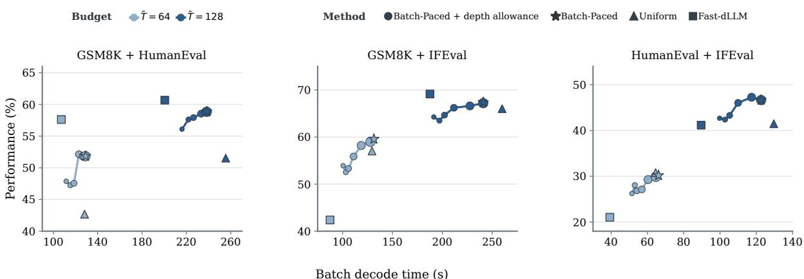  
Figure 10: Depth limits trade Batch-Paced performance for shorter decode time on LLaDA-8B-Instruct. The plot compares Uniform, Fast-dLLM, and original and depth-limited Batch-Paced on the same three task mixtures and target budgets as Figure 5; larger circles denote larger depth allowances.

Algorithm 2 Batch-Paced decoding with a decoding-depth allowance   
Require: batch B, generation length $L ,$ block length $H$ , average budget $\bar { T } ,$ optional feasible decoding  
depth allowance $D _ { \mathrm { m a x } }$ (in denoising steps)   
1: $N _ { \mathrm { b l k } } \gets \lceil L / H \rceil$   
2: $R \gets | B | \bar { T }$   
3: Initialize masked generations   
4: Set $n _ { i } \gets 0$ and $g _ { i } \gets N _ { \mathrm { b l k } } - 1$ for all $i$   
5: while some sequence remains unfinished do   
6: $A $ unfinished sequences   
7: Form current candidate sets $\mathcal { E } _ { i }$ for $i \in \mathcal A$   
8: $m _ { i } \gets | { \mathcal { E } } _ { i } |$ for all $i \in \mathcal A$   
9: $\mathcal { E }  \cup _ { i \in \mathcal { A } } \mathcal { E } _ { i }$   
10: Set $f _ { i } \gets 1$ for all $i \in \mathcal A$   
11: if decoding-depth allowance is imposed then   
12: for all $i \in \mathcal A$ do   
13: $q _ { i } \gets D _ { \mathrm { m a x } } - n _ { i } - g _ { i }$   
14: $f _ { i } \gets \operatorname* { m a x } ( 1 , \lceil m _ { i } / q _ { i } \rceil )$   
15: end for   
16: end if   
17: Run one batched denoising forward pass   
18: Compute scores $s _ { i j }$ over $\mathcal { E }$   
19: Compute $K$ using Eq. 6   
20: $\mathcal { C } \gets \mathrm { T o p } _ { K } ( \mathcal { E } ; s _ { i j } )$   
21: for all $i \in \mathcal A$ do   
22: while $| { \mathcal { C } } \cap { \mathcal { E } } _ { i } | < f _ { i }$ do   
23: Add arg max $\cdot ( i , j ) \in \mathcal { E } _ { i } \backslash \mathcal { C } ^ { \ S _ { i j } }$ to $\mathcal { C }$   
24: end while   
25: end for   
26: Commit C   
27: $R \gets R - | { \mathcal { A } } | ;$ ; increment $n _ { i }$ for all $i \in \mathcal A$   
28: Advance completed blocks; decrement $g _ { i }$ for sequences entering a new block   
29: end while   
30: return completed batch