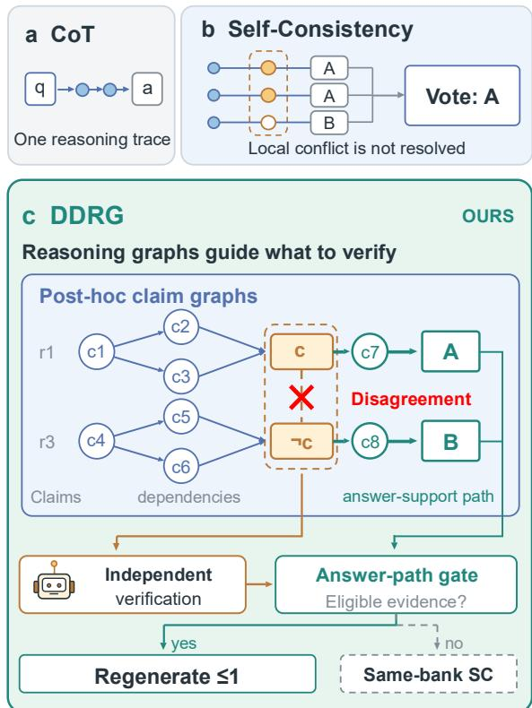
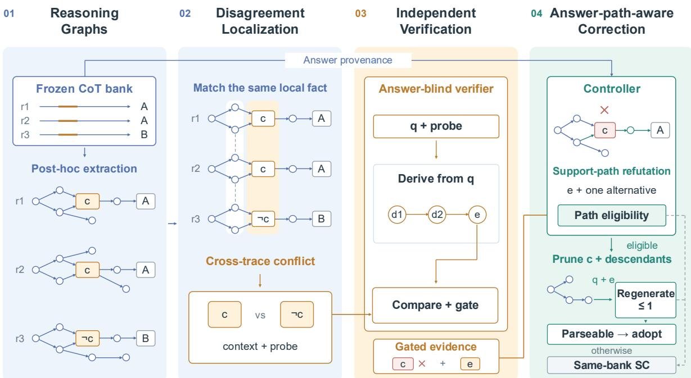
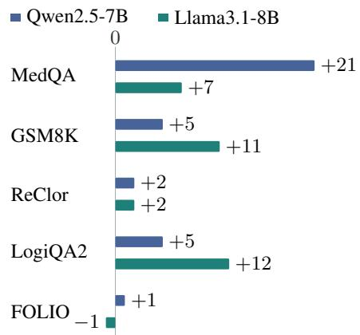
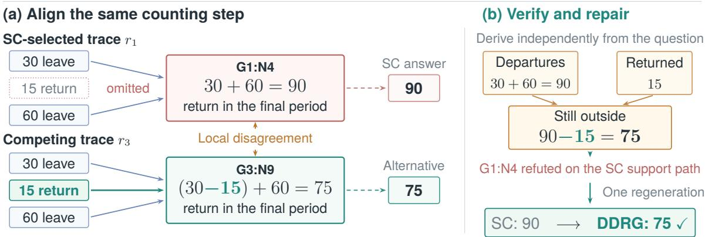
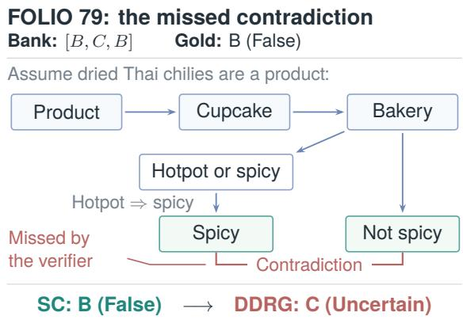

# Beyond Answer Voting: Fine-Grained Correction of LLM Reasoning through Graph Alignment across Sampled Traces

Haotian Liu<sup>1</sup> Yingjian Chen<sup>2</sup> Xiaohang Xu<sup>2</sup> Lang Huang<sup>3</sup> Yusuke Iwasawa<sup>2</sup> Yutaka Matsuo<sup>2</sup> Irene Li<sup>2</sup>

<sup>1</sup>School of Informatics, Xiamen University

<sup>2</sup>The University of Tokyo <sup>3</sup>National Institute of Informatics (NII)

haotianliu.me@gmail.com irene.li@weblab.t.u-tokyo.ac.jp

## Abstract

Large language models increasingly tackle tasks that require multi-step reasoning, where errors in intermediate claims can affect the final answer. Self-consistency (SC) improves reasoning by voting over sampled final answers, but its vote leaves intermediate disagreements unresolved. To address this problem, we introduce DDRG (Disagreement-Driven Verification Guided by Reasoning Graphs), a framework for selective correction from a frozen bank of reasoning traces. Our insight is that graph alignment can expose claim-level disagreements and provide correction evidence without expanding the sampled trace bank. DDRG builds source-grounded claim graphs and sends localized conflicts to an answer-blind verifier. A verifier-supported refutation that reaches the majority answer’s supporting path triggers one focused repair; otherwise, DDRG returns the exact SC vote. Experimental results across five benchmarks show that native zeroshot DDRG improves macro-average accuracy over direct answering by 8.65 and 15.83 percentage points for Qwen2.5-7B and Llama3.1- 8B. It also exceeds CoT, the evaluated GoT and GoV question-answering adaptations, and SC on this macro metric. DDRG links local verification to selective correction without enlarging the initial candidate bank<sup>1</sup>.

## 1 Introduction

Large language models (LLMs) increasingly tackle problems that require multi-step reasoning, including mathematical problem solving, logical inference, and medical reasoning (Lewkowycz et al., 2022; Singhal et al., 2023; Pan et al., 2023). These tasks require models to derive intermediate claims and use them to reach a final answer. Chain-ofthought (CoT) prompting makes these steps explicit (Wei et al., 2022), but the resulting traces can still contain errors. An incorrect intermediate claim can affect later steps and lead to a wrong answer, creating a need for methods that can identify and correct reasoning errors.

  
Figure 1: Comparison of CoT, self-consistency (SC), and DDRG. CoT uses one trace; SC votes over final answers. DDRG verifies aligned local disagreements and uses answer-relevant evidence for one regeneration, retaining SC when correction is unwarranted.

Existing methods improve reasoning by sampling multiple traces, organizing intermediate steps, or checking their validity. Graph of Thoughts and

Graph of Verification explore structured reasoning and verification (Besta et al., 2024; Fang et al., 2026). Self-consistency (SC) remains a simple and effective baseline: it samples several CoT traces and selects the most frequent final answer (Wang et al., 2023) (Figure 1(b)). This answer-level vote leaves intermediate disagreements unresolved. It does not reveal which claims cause traces to disagree or whether a minority trace contains a valid correction.

However, the intermediate claims in SC’s sampled traces can be used more effectively. Our insight is that graph representations make it natural to align corresponding claims across traces and pinpoint local disagreements. This allows fine-grained use of existing samples without expanding the CoT bank. Motivated by this, we introduce DDRG (Disagreement-Driven Verification Guided by Reasoning Graphs), shown in Figure 1(c). DDRG builds a source-grounded posthoc graph for each trace in a frozen CoT bank, preserving quoted claims, their provenance, and their dependencies. It aligns claims about the same local object and sends a localized conflict to an independent, answer-blind verifier. When a verifier-supported refutation reaches the majority answer’s supporting path, DDRG requests one focused repair. Otherwise, it returns the exact SC vote from the same bank. We evaluate native zeroshot DDRG on five cohorts covering mathematical, logical, and medical reasoning. DDRG achieves higher macro-average accuracy than direct answering, CoT, the evaluated GoT and GoV adaptations, and SC.

Our contributions are:

• Introducing graph-based fine-grained correction. We propose DDRG, a sourcegrounded graph framework that turns disagreements among sampled reasoning traces into evidence for correcting majority answers. Its core insight is that graph alignment exposes claim-level disagreements without expanding the CoT bank.

• Providing a reusable protocol for selective repair. We introduce a correction protocol across heterogeneous reasoning tasks that supports answer-blind verification, at most one focused repair, and exact SC fallback.

• Empirical gains and minority-answer recovery. We evaluate two locally deployed solvers on MedQA, GSM8K, ReClor,

LogiQA2, and FOLIO. Macro-average gains over direct answering are 8.65 and 15.83 percentage points for Qwen2.5-7B and Llama3.1- 8B, respectively. Our analysis shows recovery of correct candidate answers when SC is wrong.

## 2 Related Work

Reasoning diversity at test time. Test-time methods improve reasoning by exploring alternative paths. SC aggregates answers from sampled CoT traces, while Tree of Thoughts searches reasoning branches (Wei et al., 2022; Wang et al., 2023; Yao et al., 2023). Adaptive approaches further allocate computation according to problem difficulty (Snell et al., 2025). In contrast to existing methods, DDRG compares intermediate claims across existing traces to locate disagreements without expanding the sampled bank.

Graph-structured reasoning. Graph-based methods represent reasoning steps and their relationships explicitly. Graph of Thoughts combines and refines thoughts, while Graph of Verification checks reasoning units in dependency order (Besta et al., 2024; Fang et al., 2026). Reasoning Consensus aggregates graphs through cross-trace support, and ARGORA models support and attack relations among arguments (Parulekar et al., 2026; Jin et al., 2026). DDRG instead uses source-grounded graphs to align claims across traces and connect local disagreements to the voted answer’s supporting path.

Verification and correction. Existing methods revise outputs using verbal feedback (Madaan et al., 2023; Shinn et al., 2023), verification questions (Weng et al., 2023; Dhuliawala et al., 2024), or tools and retrieval (Gou et al., 2024; Gao et al., 2023). SETS combines sampling, verification, and correction, while SCoRe learns multi-turn correction (Ren et al., 2025; Kumar et al., 2025). Errorlocalization studies further examine how models identify faulty reasoning steps (Tyen et al., 2024; Zheng et al., 2025). In contrast, DDRG derives verification targets from cross-trace disagreements and uses independently verified evidence to guide selective repair.

  
Figure 2: DDRG overview. SC and DDRG share a frozen bank. The verifier assesses local claims; the controller tests answer-path relevance and permits one regeneration. Ineligible evidence or an unparseable response returns SC.

## 3 Method

DDRG turns cross-trace disagreements into evidence for selective correction (Figure 2). It first extracts source-grounded graphs from a frozen CoT bank, then aligns competing local claims and verifies them independently. The controller uses refutations on the voted answer’s support path to permit at most one regeneration; otherwise it retains the exact same-bank SC vote. Algorithm 1 gives the full procedure.

## 3.1 Reasoning Graph Construction

For a question q, DDRG uses a frozen bank of K = 3 CoT traces $r _ { i }$ and their parsed answers $a _ { i }$ . The parser returns a nonempty answer or  on failure. The bank and its default SC answer are

$$
\begin{array} { r } { B ( q ) = [ ( r _ { i } , a _ { i } ) ] _ { i = 1 } ^ { K } , } \\ { a _ { \mathrm { m a j } } = \mathrm { V o t e } ( B ( q ) ) . } \end{array}\tag{1}
$$

Each parseable answer contributes one vote, including repeated answers. Ties are broken by the earliest bank position. If none parses, Vote returns the original SC fallback.

The solver S converts each trace into a reasoning graph $G _ { i } = ( V _ { i } , E _ { i } )$ . Each node stores an exact claim quotation and its location in the source trace. Edges record the support relations inferred by the solver. These graphs allow DDRG to compare claims across traces and trace their connections to the final answer. Graphs that fail the source or structure checks are skipped. Let $\mathcal G ( q )$ denote the remaining indexed graphs. Graph failures leave the frozen bank and its SC vote unchanged.

## 3.2 Disagreement Localization

DDRG aligns claims about the same quantity, entity, relation, or proposition across traces. It collects conflicting claims into an ordered sequence of disputes:

$$
\begin{array} { c } { { \mathcal { D } ( q ) = ( d _ { 1 } , \ldots , d _ { m } ) , } } \\ { { d _ { j } = ( c _ { \ell , j } , c _ { r , j } , C _ { j } , p _ { j } ) . } } \end{array}\tag{2}
$$

Each dispute contains two competing claims, nearby context $C _ { j }$ , and a probe question $p _ { j }$ . Both claims must be exact quotations linked to their source graph nodes. Node references include the trace index and node identifier.

The answers associated with the source traces may be used to prioritize disputes. Final-answer nodes are excluded from verification targets. If no dispute passes the source and node-reference checks, DDRG returns $a _ { \mathrm { m a j } }$

## 3.3 Independent Verification

A verifier V checks at most the first three valid disputes in their recorded order. For each dispute, it receives $( q , c _ { \ell } , c _ { r } , C , p )$ . It first derives a local fact from $q$ and $p ,$ then compares the conflicting claims against that fact using context $C .$ . The resulting judgment record z contains a directional verdict, the local evidence $e ( z )$ , and its derivation $\rho ( z )$

The verifier does not receive candidate finalanswer fields, the SC vote, or gold labels. Source quotations may still contain quantities that appear in candidate answers. Let $\hat { y } ( z )$ denote the generated verdict, $y _ { \mathrm { n a t i v e } } ( z )$ the highest-scored native class, and $s _ { \mathrm { n o r m } } ( z )$ the normalized conditional score. Acceptance requires successful parsing, source grounding, the fixed zero-margin check, and ${ \hat { y } } ( z ) = y _ { \mathrm { n a t i v e } } ( z )$ with $s _ { \mathrm { n o r m } } ( z ) \ge 0 . 5$ . Appendix C defines the five-way zero-shot interface and scoring rules. Let $\mathcal { I } _ { \mathrm { a c c } } ( \boldsymbol { q } )$ collect judgments that pass these checks and support one claim while concretely refuting its counterpart. All other comparisons provide no correction evidence.

## 3.4 Answer-Path-Aware Correction

If no answer is parseable, DDRG returns the baseline SC output. Otherwise, before checking graph usability, the controller fixes the earliest trace with answer $a _ { \mathrm { m a j } }$ as the representative $i _ { \mathrm { r e p } }$

For a usable representative graph and answer node $v _ { \mathrm { a n s } }$ , define the nonterminal ancestor set as

$$
\mathcal { A } _ { \mathrm { r e p } } ( q ) = \mathrm { A n c } _ { G _ { i _ { \mathrm { r e p } } } } ^ { \mathrm { n t } } ( v _ { \mathrm { a n s } } ) .\tag{3}
$$

Here, $\operatorname { A n c } _ { G } ^ { \mathrm { n t } } ( v )$ contains source-claim nodes with a directed support path of positive length to v, excluding question and answer nodes. Set $\mathcal { A } _ { \mathrm { r e p } } ( q ) = \emptyset$ if the graph or answer node is unusable. Accepted evidence is eligible when it refutes a node in $\mathcal { A } _ { \mathrm { r e p } } ( q )$ , provides a nonempty independent derivation, and associates its supported claims with one common candidate-answer provenance value other than $a _ { \mathrm { m a j } }$ . Decisive support for $a _ { \mathrm { m a j } }$ blocks correction. Let $\mathcal { E } ( q )$ collect the evidence passing these checks.

For eligible evidence, the controller removes refuted nodes and their dependent descendants, retaining the remaining claims as unrefuted context $C ^ { \star }$ . The solver generates one response $r ^ { \star }$ = $S ( q , C ^ { \star } , \mathcal { E } ( q ) )$ . Set $a ^ { \star } = \mathrm { P a r s e } ( r ^ { \star } )$ when regeneration occurs and $a ^ { \star } = \perp$ otherwise. The final

Algorithm 1 DDRG: selective correction from a   
frozen CoT bank   
Require: Question $q ;$ solver $S ;$ verifier V; $K = 3$   
1:   SampleAndFreeze(S, q, K)   
2: $a _ { \mathrm { m a j } }  \mathrm { V o t e } ( B )$   
3: $\mathcal { T }  \{ i \in \{ 1 , \dots , K \} : a _ { i } \neq \perp \}$   
4: $\mathbf { i f } ~ { \mathcal { T } } = { \mathcal { O } }$ then   
5: return $a _ { \mathrm { m a j } }$   
6: end if   
7: $i _ { \mathrm { r e p } } \gets \operatorname* { m i n } \{ i \in \mathcal { I } : a _ { i } = a _ { \mathrm { m a j } } \}$   
8: $\mathcal { G }  \mathrm { S o u r c e G r a p h s } ( S , B )$   
9: ${ \mathcal { D } } \gets \mathrm { A l i g n A n d L o c a l i z e } ( S , { \mathcal { G } } , q )$   
10: $\mathcal { D } _ { \mathrm { v e r } }  \mathrm { F i r s t V a l i d } _ { 3 } ( \mathcal { D } )$   
11: $\mathcal { I } _ { \mathrm { a c c } }  \mathrm { V e r i f y A n d G a t e } ( V , q , \mathcal { D } _ { \mathrm { v e r } } )$   
12: $\mathcal { E } $ RouteEvidence $( \mathcal { I } _ { \mathrm { a c c } } , \mathcal { G } , \boldsymbol { B } , i _ { \mathrm { r e p } } )$   
13: if $\mathcal { E } = \emptyset$ then   
14: return $a _ { \mathrm { m a j } }$   
15: end if   
16: $C ^ { \star } \gets$ RetainUnafected( , )   
17: $r ^ { \star } \gets S ( q , C ^ { \star } , \mathcal { E } )$ ▷ one regeneration   
18: $a ^ { \star }  \mathrm { P a r s e } ( r ^ { \star } )$   
19: $\mathbf { i f } \ a ^ { \star } \neq \perp$ then   
20: return $a ^ { \star }$   
21: else   
22: return $a _ { \mathrm { m a j } }$   
23: end if

answer is

$$
\hat { a } ( q ) = \left\{ \begin{array} { l l } { a ^ { \star } , } & { a ^ { \star } \neq \bot , } \\ { a _ { \mathrm { m a j } } , } & { a ^ { \star } = \bot . } \end{array} \right.\tag{4}
$$

Any parseable regenerated answer is adopted, including answers outside the bank, without a second correctness check. Otherwise, DDRG returns the exact SC vote. Service retries do not count as additional logical regenerations.

## 4 Experiments

We evaluate the complete procedure against the same-bank vote, then use component controls and saved cases to examine how local evidence changes an answer.

## 4.1 Experimental Setup

Benchmarks. We evaluate Qwen2.5-7B-Instruct and Llama3.1-8B-Instruct on MedQA test, GSM8K test, ReClor validation, LogiQA2 test, and FOLIO public v0.0 validation (Jin et al., 2021; Cobbe et al., 2021; Yu et al., 2020; Liu et al., 2023; Han et al., 2024). Their respective sizes are 1,273, 1,319, 500,

<table><tr><td>Method</td><td>MedQA</td><td>GSM8K</td><td>ReClor</td><td>LogiQA2</td><td>FOLIO</td><td>Macro Avg.</td></tr><tr><td>Qwen2.5-7B</td><td></td><td></td><td></td><td></td><td></td><td></td></tr><tr><td>Direct</td><td>60.88</td><td>70.36</td><td>70.00</td><td>63.80</td><td>55.39</td><td>64.09</td></tr><tr><td>CoT (Wei et al., 2022)</td><td>62.77</td><td>89.01</td><td>72.00</td><td>65.39</td><td>68.63</td><td>71.56</td></tr><tr><td>GoT (QA) (Besta et al., 2024)</td><td>63.16</td><td>90.90</td><td>70.40</td><td>64.89</td><td>59.31</td><td>69.73</td></tr><tr><td>GoV (QA) (Fang et al., 2026)</td><td>60.64</td><td>90.22</td><td>73.40</td><td>63.42</td><td>58.33</td><td>69.20</td></tr><tr><td>DDRG</td><td>64.02</td><td>92.27</td><td>74.40</td><td>67.30</td><td>65.69</td><td>72.74</td></tr><tr><td>Llama3.1-8B</td><td></td><td></td><td></td><td></td><td></td><td></td></tr><tr><td>Direct</td><td>53.10</td><td>51.78</td><td>56.20</td><td>51.53</td><td>41.18</td><td>50.76</td></tr><tr><td>CoT (Wei et al., 2022)</td><td>68.42</td><td>84.23</td><td>61.00</td><td>53.94</td><td>54.41</td><td>64.40</td></tr><tr><td>GoT (QA) (Besta et al., 2024)</td><td>68.74</td><td>84.08</td><td>64.80</td><td>56.36</td><td>50.49</td><td>64.89</td></tr><tr><td>GoV (QA) (Fang et al., 2026)</td><td>59.31</td><td>74.00</td><td>59.60</td><td>52.93</td><td>44.12</td><td>57.99</td></tr><tr><td>DDRG</td><td>70.07</td><td>88.48</td><td>64.00</td><td>55.47</td><td>54.90</td><td>66.58</td></tr></table>

Table 1: Full-cohort accuracy (%). Macro averages equally weight the five benchmarks. Bold marks the best result among the five displayed methods within each solver. GoT and GoV are QA adaptations (Section 4.1); SC and same-bank gains are reported separately in Appendix A.1.

1,572, and 204: 4,868 labeled questions per solver. An additional 1,000 ReClor hidden-test predictions are not scored. The same correction procedure is used across these mathematical, logical, and medical settings.

Baselines. Baselines are Direct, independent single-response CoT, SC@3, and questionanswering adaptations of Graph of Thoughts (GoT) and Graph of Verification (GoV). Direct and CoT use deterministic decoding. SC samples three responses at temperature 0.9 and top-p 0.95 with a 4,096-token budget; DDRG reuses these exact responses and their parsed answers. GoT generates three thoughts, then scores, aggregates, and refines them in six calls. GoV checks up to 12 paragraph blocks with preceding verified context, stops at the first refutation, and permits one repair. It does not execute a separate graph-extraction stage. These adaptations, their prompts, and their stage budgets are specified in Appendix B.

Implementation Details. Both DDRG solvers use official Qwen3-30B-A3B-Instruct-2507 without project fine-tuning. Native scoring, generated/scored agreement, and source-grounding checks govern evidence acceptance. The verifier context is 8K. Llama retains an 8K solver context except for four preregistered whole-block 32K recoveries; banks, prompts, decoding, and verifier gates remain fixed. Appendix A records revisions and recovery identities. Gold labels enter offline scoring only; invalid predictions remain in the de-

nominator.

Metrics. Accuracy is reported per benchmark, with an equal-benchmark macro average. Paired wrong-to-right (W R) and right-to-wrong (R W) transitions quantify corrections and introduced errors relative to SC. Their difference is a pooled count, not a macro percentage. For Qwen, we also report the existing exact McNemar test and a benchmark-stratified paired bootstrap interval, conditional on the frozen generations (Appendix D.3).

## 4.2 Main Results

Table 1 compares DDRG with direct answering, independent single-response CoT, and two graphbased QA adaptations. DDRG achieves the highest benchmark-macro accuracy among the evaluated methods for both solvers: 72.74% with Qwen and 66.58% with Llama. Compared with independent CoT, these are gains of 1.18 and 2.18 percentage points. DDRG improves on CoT in nine of ten solver–benchmark settings; the exception is Qwen FOLIO. The largest CoT-relative gains occur on GSM8K (+3.26 and +4.25 points for Qwen and Llama), indicating that the aggregate effect is not confined to a single solver. These independent-CoT comparisons characterize performance, but do not isolate the effect of correction on an identical set of sampled traces.

The most direct controlled reference is therefore the same-bank self-consistency (SC) vote. The three CoT candidates, their order, and the default vote are identical for SC and DDRG; only the subsequent graph-guided verification and correction stages differ. Per-benchmark SC scores appear in Appendix A.1. Across the five benchmarks, DDRG raises SC macro accuracy from 72.09% to 72.74% with Qwen and from 66.17% to 66.58% with Llama. The recorded outcomes comprise 63 wrong-to-right (W R) versus 29 rightto-wrong (R W) changes for Qwen, and 38 versus seven for Llama. The resulting net gains, 34 and 31 correct answers, are shown by benchmark in Figure 3. These are pooled counts across questions, whereas the reported macro changes weight datasets equally.

  
Figure 3: Net corrections over same-bank SC. In each pair, the upper bar is Qwen and the lower bar is Llama. Net counts subtract harmful from beneficial changes; totals are +34 and +31. Dataset sizes differ.

Where the gains occur. The positive net corrections are distributed across distinct task types rather than concentrated on the same benchmark for both solvers (Figure 3). Qwen gains 21 answers on medical question answering (MedQA), accounting for 21 of its 34 net corrections; it also gains five each on GSM8K and LogiQA2, two on ReClor, and one on FOLIO. Llama gains most on logical reasoning (LogiQA2, +12) and arithmetic word problems (GSM8K, +11), followed by MedQA (+7) and ReClor (+2); FOLIO has one net harmful change ( 1). Qwen has positive net corrections on all five benchmarks, whereas Llama has positive gains on four and a one-question net loss on FOLIO. Their largest gains occur in different domains.

Counts versus accuracy. Because the benchmark sizes differ, the plotted counts should not be interpreted as normalized accuracy improvements. For example, Qwen’s 21 net additional correct MedQA answers correspond to +1.65 percentage points, whereas Llama’s 11 net additional GSM8K correct answers correspond to +0.83 points, calculated from the exact counts. The benchmark-macro results in Table 1 and the paired SC accuracies in Appendix A.1 therefore remain necessary. Section 5.2 separately measures how often the correction mechanism preserves a correct vote or rescues an incorrect one.

What the paired audit adds. Unlike independent CoT, same-bank SC holds the initial candidate answers fixed. Paired transitions therefore expose both recovered answers and errors introduced by the complete verification-and-correction procedure. The +34 and +31 net counts describe the same outcomes as the macro gains, not additional successes. In particular, accepted verification evidence does not guarantee a correct regenerated answer.

Comparison boundaries. DDRG does not dominate every individual task: independent CoT leads Qwen FOLIO (68.63%), GoT leads Llama ReClor and LogiQA2 (64.80% and 56.36%), and samebank SC exceeds DDRG on Llama FOLIO (55.39% versus 54.90%). The evidence supports an improvement of the complete post-hoc verification-andcorrection procedure under the frozen-bank evaluation, not a uniform or graph-only advantage. Section 5 examines which answer-disagreement patterns and intervention outcomes account for these aggregate differences.

## 4.3 Ablation and Evidence-use Controls

Graph routing and answer-path restriction. The registered subset contains 32 questions from each benchmark. Controls use the same Qwen bank, native verifier, three-probe cap, and at most one regeneration. The graph-free control replaces inferred edges and ancestor routing with fixed flatsource rules. The without-path control retains graphs and verification but removes the majority support-path restriction. Newly triggered regenerations are actually executed.

Full DDRG obtains 118 correct answers, between graph-free (117) and without-path (119), with SC at 116 (Appendix A.6). Relative to full DDRG, graph-free gains two answers and loses three; without-path gains two and loses one. These small paired differences describe alternative intervention choices rather than establish the necessity of either restriction. Appendix A.6 gives their definitions and the supplementary 49-question non-

Question. 30 bees leave; 15 return; 60 leave. How many return when all bees still outside come back? Frozen bank: [90, 15, 75] Earliest-position tie-break: SC = 90

  
Figure 4: DDRG corrects GSM8K test:147 from SC’s 90 to 75. Aligned claim fragments expose the omitted earlier returns; independent verification and answer-path evidence trigger one regeneration. The illustrated local dependencies are condensed (Appendix E).

unanimous slice. Full-cohort disagreement analysis is kept separate in Section 5.

Selection versus regeneration. A retrospective replay keeps the bank, recorded evidence, and eligibility fixed but selects the unique supported candidate instead of generating a response. It reaches 72.42% Qwen macro accuracy, versus 72.74% for actual regeneration. Selection produces 85 W R and 54 R W transitions; regeneration produces 63 and 29. Thus regeneration yields three more correct answers overall while making fewer harmful changes, rather than simply rescuing more errors. This is a same-evidence replay, not a new randomized intervention (Appendix D.2).

## 4.4 Source-grounded Case Study

Figure 4 illustrates the complete correction on gsm8k:test:147. The question tracks 30 bees leaving, 15 returning, and another 60 leaving; all outstanding bees then return. The frozen answers are [90, 15, 75], so the tie-break selects 90. The selected trace counts 30 + 60 and fails to subtract the 15 earlier returns. A competing source claim computes (30 15) + 60 = 75. This localized disagreement exposes the missing dependency between earlier returns and the final count.

The verifier independently derives the outstanding count. Its accepted judgment refutes the selected trace’s supporting claim, and one solver regeneration returns 75. Direct, CoT, SC, GoT, and GoV give 90, 90, 90, 45, and 90, respectively. The example shows where the evidence acts: it changes the treatment of an earlier event, not the arithmetic validity of 30 + 60 = 90 itself.

  
Figure 5: Saved harmful correction on FOLIO validation 79. The abbreviated logical chain explains why B is correct; the verifier misses the contradiction and DDRG changes B to C.

The complementary failure in Figure 5 shows why source grounding alone is insufficient. On folio:validation:79, the bank is [B, C, B] and SC correctly selects B (False). A mistaken local judgment instead leads DDRG to C (Uncertain). The displayed implication chain explains the missed contradiction; it is an author explanation of the saved failure, not a claimed raw graph export. This case illustrates that source-grounded claims can still receive incorrect verification judgments. These selected illustrations complement the fullcohort analysis in Section 5.

<table><tr><td>Solver Pattern</td><td> $N _ { D }$ </td><td>SC DDRG  $\Delta \mathfrak { p } \mathfrak { p }$ </td></tr><tr><td>Qwen 2:1</td><td>1:1:1</td><td>1258 51.27  $5 3 . 1 0 ~ + 1 . 8 3$  19030.53  $3 6 . 3 2 ~ + 5 . 7 9$ </td></tr><tr><td>Llama 2:1 1:1:1</td><td></td><td>178754.34  $5 5 . 1 8 ~ + 0 . 8 4$  404 28.71 32.67  $+ 3 . 9 6$ </td></tr></table>

Table 2: Post-hoc pooled accuracy by stored-answer pattern. $N _ { D }$ includes every question in the group, including failed and retained outputs. Gains are not full-cohort macro gains.

Correct retention. The saved ReClor validation example reclor:validation:100 provides a labeled abstention case: the three frozen candidates and the gold answer are all B. Although the verifier compares two local descriptions of option B, it finds no evidence refuting the SC answer’s support path. DDRG makes no regeneration and retains B. This illustrates answer preservation, not an independent estimate of verification precision.

## 4.5 Compute and Reproducibility

DDRG adds graph-processing calls and a larger verifier to the shared bank. The recorded Qwen allocation is 239,681.91 GPU seconds for 5,868 predictions, including bank generation once and excluding loading and idle residency. It uses a different accounting basis from historical baseline timings, so no controlled efficiency comparison is made. Appendix D.1 specifies the scope; Appendix B reproduces the evaluated prompts. The anonymous repository provides code and configurations, while author-side audit records are not assumed to be accessible through that release.

## 5 Discussion: Understanding Selective Correction

## 5.1 Disagreement-conditioned Performance

We stratify all labeled questions by the three persisted answer strings, without selecting for a usable graph, a successful verifier call, or a correction attempt. Patterns are 3:0 agreement, 2:1 majority, and a 1:1:1 tie. Invalid strings remain included, so this post-hoc definition differs from the runtime valid-answer disagreement diagnostic. Gold labels are used only to score the already defined groups.

Both solvers improve on 2:1 banks and threeway ties (Table 2). Qwen gains 23 correct answers among 1,258 majority banks and 11 among 190 ties; Llama gains 15 among 1,787 and 16 among 404. The observed point gains are larger on ties, where answer frequency provides no preferred candidate. Together, the non-unanimous groups account for the same 34 and 31 net corrections reported in the main experiment, rather than additional gains. Pooling the non-unanimous banks gives 48.55% to 50.90% for Qwen and 49.61% to 51.03% for Llama. Unanimous banks remain unchanged, consistent with the alternative-answer eligibility requirement.

## 5.2 Intervention, Preservation, and Rescue

The full-cohort audit separates events from questions. Qwen produces 3,869 probes and 1,241 effective directional judgments, but attempts regeneration on only 173 questions; 172 responses parse. Llama produces 4,172 probes and 1,701 directional judgments, with 117 attempts and 106 parseable responses. A directional verdict is therefore not itself a correction: the controller must also connect it to the voted answer’s supporting path. Unparseable regeneration returns SC.

Qwen’s 119 answer changes comprise 63 beneficial, 29 harmful, and 27 wrong-to-wrong changes; Llama’s 60 comprise 38, seven, and 15. The fullcohort rates quantify this trade-off: Qwen preserves 99.19% of initially correct SC answers, rescues 4.82% of SC errors, and changes 2.44% of all answers; Llama preserves 99.79%, rescues 2.47%, and changes 1.23%. High preservation partly reflects a low change rate and should not be mistaken for independently calibrated verification accuracy. Qwen’s pooled exact McNemar test gives $p = 0 . 0 0 0 5 0 9 ;$ its macro-gain bootstrap interval is $[ + 0 . 1 4 , + 1 . 1 5 ]$ percentage points. These summarize paired question outcomes under the frozen run, not generation-seed variation.

## 5.3 Candidate Recovery and New Answers

Most successful corrections recover an answer already present in the original bank: 60 of Qwen’s 63 rescues and 34 of Llama’s 38. In contrast, three Qwen and four Llama rescues produce a correct answer absent from all three candidates. Because DDRG actually regenerates, recovering a candidate answer is an observed outcome, not evidence that it simply selected that candidate’s full trace.

The opportunity denominators reveal the scope of these successes. Qwen corrects 60 of 442 SC errors whose banks contain a correct answer, but only three of 864 without one; Llama corrects 34 of 651 and four of 885. This distinction connects the aggregate results to the method’s input: competing traces often supply an existing correct alternative, while correct candidate-external generation is less frequent. The counts are retrospective diagnostics, not oracle information available to the controller.

## 6 Conclusion

DDRG uses source-grounded graphs to localize cross-trace disagreements and connect independent evidence to the voted answer’s support path. Across two solvers, the complete procedure yields positive net correction over same-bank voting. Saved outcomes include candidate recovery, new correct answers, and harmful changes. Intermediate disagreements can therefore support selective correction beyond voting.

## Limitations

The full-cohort results evaluate graph processing, a larger verifier, and regeneration together. The fixed 160-question matched-verifier controls show small differences and do not establish a separate causal advantage for graph structure or answer-path restriction. Both solvers are evaluated on frozen executions, not repeated generation seeds or unseen task families.

Quoted source spans establish provenance, not truth. Graph dependencies and local verdicts can be wrong, and the silver development reference is not independent gold verification data. Historical missing verifier records limit complete raw-stage attribution for part of the Llama run. Native and historical baseline timing have different accounting scopes, preventing an efficiency claim. Case-study dependencies are condensed for explanation rather than presented as complete raw graph exports.

## Ethical Considerations

Medical questions measure benchmark answer accuracy, not clinical safety or effectiveness. Local verification can introduce errors into correct answers, so these results do not support autonomous medical use. A source-grounded presentation can make mistaken reasoning appear credible; neither provenance nor a verdict score guarantees factual correctness. Dataset and model access terms are recorded in Appendix A.

## Use of Generative AI Tools

Generative AI tools assisted with language refinement, drafting, figure preparation, and portions of coding and analysis workflows. They were not used as substitutes for recorded model executions or ground-truth labels. The reported numerical results are derived from saved experimental records, and the authors remain responsible for the methodology, evaluation rules, analysis, and final scientific conclusions.

## References

Maciej Besta, Nils Blach, Ales Kubicek, Robert Gerstenberger, Michal Podstawski, Lukas Gianinazzi, Joanna Gajda, Tomasz Lehmann, Hubert Niewiadomski, Piotr Nyczyk, and Torsten Hoefler. 2024. Graph of thoughts: Solving elaborate problems with large language models. In Proceedings ofthe AAAI Conference on Artificial Intelligence, volume 38, pages 17682–17690.

Karl Cobbe, Vineet Kosaraju, Mohammad Bavarian, Mark Chen, Heewoo Jun, Lukasz Kaiser, Matthias Plappert, Jerry Tworek, Jacob Hilton, Reiichiro Nakano, Christopher Hesse, and John Schulman. 2021. Training verifiers to solve math word problems. arXiv preprint arXiv:2110.14168.

Shehzaad Dhuliawala, Mojtaba Komeili, Jing Xu, Roberta Raileanu, Xian Li, Asli Celikyilmaz, and Jason Weston. 2024. Chain-of-verification reduces hallucination in large language models. In Findings of the Associationfor Computational Linguistics: ACL 2024, pages 3563–3578. Association for Computational Linguistics.

Jiwei Fang, Bin Zhang, Changwei Wang, Jin Wan, and Zhiwei Xu. 2026. Graph of verification: Structured verification of LLM reasoning with directed acyclic graphs. In Proceedings of the AAAI Conference on Artificial Intelligence, volume 40, pages 30665– 30672.

Luyu Gao, Zhuyun Dai, Panupong Pasupat, Anthony Chen, Arun Tejasvi Chaganty, Yicheng Fan, Vincent Zhao, Ni Lao, Hongrae Lee, Da-Cheng Juan, and Kelvin Guu. 2023. RARR: Researching and revising what language models say, using language models. In Proceedings of the 61st Annual Meeting of the Associationfor Computational Linguistics (Volume 1: Long Papers), pages 16477–16508. Association for Computational Linguistics.

Zhibin Gou, Zhihong Shao, Yeyun Gong, Yelong Shen, Yujiu Yang, Nan Duan, and Weizhu Chen. 2024. CRITIC: Large language models can self-correct with tool-interactive critiquing. In International Conference on Learning Representations.

Aaron Grattafiori, Abhimanyu Dubey, Abhinav Jauhri, et al. 2024. The Llama 3 herd of models. arXiv preprint arXiv:2407.21783.

Simeng Han, Hailey Schoelkopf, Yilun Zhao, Zhenting Qi, Martin Riddell, Wenfei Zhou, James Coady, David Peng, Yujie Qiao, Luke Benson, Lucy Sun,

Alexander Wardle-Solano, Hannah Szabó, Ekaterina Zubova, Matthew Burtell, Jonathan Fan, Yixin Liu, Brian Wong, Malcolm Sailor, and 16 others. 2024. FOLIO: Natural language reasoning with first-order logic. In Proceedings of the 2024 Conference on Empirical Methods in Natural Language Processing, pages 22017–22031. Association for Computational Linguistics.

Di Jin, Eileen Pan, Nassim Oufattole, Wei-Hung Weng, Hanyi Fang, and Peter Szolovits. 2021. What disease does this patient have? a large-scale open domain question answering dataset from medical exams. Applied Sciences, 11(14):6421.

Youngjin Jin, Hanna Kim, Kwanwoo Kim, Chanhee Lee, and Seungwon Shin. 2026. ARGORA: Orchestrated argumentation for causally grounded LLM reasoning and decision making. arXiv preprint arXiv:2601.21533.

Aviral Kumar, Vincent Zhuang, Rishabh Agarwal, Yi Su, JD Co-Reyes, Avi Singh, Kate Baumli, Shariq Iqbal, Colton Bishop, Rebecca Roelofs, Lei Zhang, Kay McKinney, Disha Shrivastava, Cosmin Paduraru, George Tucker, Doina Precup, Feryal Behbahani, and Aleksandra Faust. 2025. Training language models to self-correct via reinforcement learning. In International Conference on Learning Representations.

Aitor Lewkowycz, Anders Andreassen, David Dohan, Ethan Dyer, Henryk Michalewski, Vinay Ramasesh, Ambrose Slone, Cem Anil, Imanol Schlag, Theo Gutman-Solo, et al. 2022. Solving quantitative reasoning problems with language models. Advances in neural information processing systems, 35:3843– 3857.

Hanmeng Liu, Jian Liu, Leyang Cui, Zhiyang Teng, Nan Duan, Ming Zhou, and Yue Zhang. 2023. LogiQA 2.0—an improved dataset for logical reasoning in natural language understanding. IEEE/ACM Transactions on Audio, Speech, and Language Processing, 31:2947–2962.

Aman Madaan, Niket Tandon, Prakhar Gupta, Skyler Hallinan, Luyu Gao, Sarah Wiegreffe, Uri Alon, Nouha Dziri, Shrimai Prabhumoye, Yiming Yang, Shashank Gupta, Bodhisattwa Prasad Majumder, Katherine Hermann, Sean Welleck, Amir Yazdanbakhsh, and Peter Clark. 2023. Self-Refine: Iterative refinement with self-feedback. In Advances in Neural Information Processing Systems, volume 36.

Liangming Pan, Alon Albalak, Xinyi Wang, and William Wang. 2023. Logic-lm: Empowering large language models with symbolic solvers for faithful logical reasoning. In Findings of the Association for Computational Linguistics: EMNLP 2023, pages 3806–3824.

Amruta Parulekar, Jinu Lee, Dilek Hakkani-Tür, and Hari Sundaram. 2026. Reasoning consensus: Structural ensembling of LLM reasoning via weighted DAG aggregation. arXiv preprint arXiv:2607.27783.

Qwen, An Yang, Baosong Yang, Beichen Zhang, et al. 2024. Qwen2.5 technical report. arXiv preprint arXiv:2412.15115.

Jie Ren, Sercan Arik, Xinyun Chen, Jiefeng Chen, Chengrun Yang, Ruoxi Sun, and Jinsung Yoon. 2025. SETS: Leveraging self-verification and selfcorrection for improved test-time scaling. Transactions on Machine Learning Research.

Noah Shinn, Federico Cassano, Ashwin Gopinath, Karthik Narasimhan, and Shunyu Yao. 2023. Reflexion: Language agents with verbal reinforcement learning. In Advances in Neural Information Processing Systems, volume 36.

Karan Singhal, Shekoofeh Azizi, Tao Tu, S Sara Mahdavi, Jason Wei, Hyung Won Chung, Nathan Scales, Ajay Tanwani, Heather Cole-Lewis, Stephen Pfohl, et al. 2023. Large language models encode clinical knowledge. Nature, 620(7972):172–180.

Charlie Snell, Jaehoon Lee, Kelvin Xu, and Aviral Kumar. 2025. Scaling llm test-time compute optimally can be more effective than scaling parameters for reasoning. In International Conference on Learning Representations, volume 2025, pages 10131–10165.

Gladys Tyen, Hassan Mansoor, Victor Carbune, Peter Chen, and Tony Mak. 2024. LLMs cannot find reasoning errors, but can correct them given the error location. In Findings ofthe Associationfor Computational Linguistics: ACL 2024, pages 13894–13908. Association for Computational Linguistics.

Xuezhi Wang, Jason Wei, Dale Schuurmans, Quoc V. Le, Ed H. Chi, Sharan Narang, Aakanksha Chowdhery, and Denny Zhou. 2023. Self-consistency improves chain of thought reasoning in language models. In International Conference on Learning Representations.

Jason Wei, Xuezhi Wang, Dale Schuurmans, Maarten Bosma, Brian Ichter, Fei Xia, Ed Chi, Quoc V. Le, and Denny Zhou. 2022. Chain-of-thought prompting elicits reasoning in large language models. In Advances in Neural Information Processing Systems.

Yixuan Weng, Minjun Zhu, Fei Xia, Bin Li, Shizhu He, Shengping Liu, Bin Sun, Kang Liu, and Jun Zhao. 2023. Large language models are better reasoners with self-verification. In Findings ofthe Association for Computational Linguistics: EMNLP 2023, pages 2550–2575. Association for Computational Linguistics.

An Yang, Anfeng Li, Baosong Yang, et al. 2025. Qwen3 technical report. arXiv preprint arXiv:2505.09388.

Shunyu Yao, Dian Yu, Jeffrey Zhao, Izhak Shafran, Thomas L. Griffiths, Yuan Cao, and Karthik Narasimhan. 2023. Tree of thoughts: Deliberate problem solving with large language models. In Advances in Neural Information Processing Systems, volume 36.

Weihao Yu, Zihang Jiang, Yanfei Dong, and Jiashi Feng. 2020. ReClor: A reading comprehension dataset requiring logical reasoning. In International Conference on Learning Representations.

Chujie Zheng, Zhenru Zhang, Beichen Zhang, Runji Lin, Keming Lu, Bowen Yu, Dayiheng Liu, Jingren Zhou, and Junyang Lin. 2025. ProcessBench: Identifying process errors in mathematical reasoning. In Proceedings of the 63rd Annual Meeting of the Associationfor Computational Linguistics (Volume 1: Long Papers), pages 1009–1024, Vienna, Austria. Association for Computational Linguistics.

Appendix roadmap. Appendix A records model and cohort identities, per-benchmark SC accuracies and accuracy-point gains, and structural controls. Appendix B reproduces prompts; Appendix C defines the verification interface and gates. Appendix D gives transition counts, selection replay, cost scope, and statistical calculations. Appendix E provides the source excerpts and interpretation behind the case figures.

## A Complete Experimental Setup

## A.1 Same-bank SC and Paired Gains

Table 3 supplements the main five-method comparison without repeating its accuracy rows. It reports the otherwise omitted per-benchmark SC accuracies and the corresponding DDRG percentagepoint gains; net correction counts appear in Figure 3. All questions, including invalid predictions, remain in the frozen denominators.<sup>2</sup>

## A.2 Models and Execution Identity

The solver checkpoints are Qwen/Qwen2.5-7B-Instruct (Qwen et al., 2024)<sup>3</sup> at revision a09a35458c70 and meta-llama/Llama-3.1-8B-Instruct (Grattafiori et al., 2024)<sup>4</sup> at 0e9e39f249a1. The evaluated verifier is the unadapted official Qwen/Qwen3-30B-A3B-Instruct-2507 (Yang et al., 2025)<sup>5</sup> at 0d7cf23991f4. The May 2025 Qwen3 family report does not by itself identify the July 2507 checkpoint; its exact identity is given by the pinned model card and revision. The DDRG execution uses source e7ce81a9bde6 and release SHA-256 97dac6103fe56ba6f53adf5efa9a1819 413625e2c4d1eabf28f5e5ab6bfc10a2. The baseline generation identity is 1165ddc, with authenticated parser view 0a0b6e4. Model-native chat templates and bfloat16 local inference are used. Raw-response parser replay changes the scoring view, not the generated response or its original cost. The native verifier environment uses PyTorch 2.6.0, Transformers 4.51.3, and vLLM 0.8.5+cu121. Its frozen nonthinking JSON template has normalized SHA-256 c87c39da4214fe8fee1f49f4b54bdb5a e1cd5aed22a356f3ffedb59964a715. The verifier uses tensor parallelism 2, maximum context length 8,192, GPU-memory utilization 0.85, maximum eight sequences and 512 batched tokens, eager execution, and disabled prefix caching. The decode seed is 20260928. Graph extraction, alignment, localization, and regeneration use the panel solver; the larger model supplies local verification only.

## A.3 Decoding and Candidate Banks

Direct and independently generated CoT use temperature 0, top-p 1, and a 4,096-token response budget. SC samples three ordinary CoT candidates at temperature 0.9 and top-p 0.95 with the same budget; the persisted banks use top-k 20 for Qwen and 50 for Llama. SC and DDRG consume the exact persisted bank in its original order; graph failure cannot remove an answer vote. GoT and GoV are QA adaptations of their cited frameworks, with their actual multi-stage prompts reproduced below. Their outputs are independently generated, not chosen retrospectively from SC candidates.

The five labeled cohorts contain 1,273 MedQA test questions, 1,319 GSM8K test questions, 500 ReClor validation questions, 1,572 LogiQA2 test questions, and 204 FOLIO public v0.0 validation questions. ReClor hidden test supplies 1,000 unlabeled predictions. All evaluated cohorts are in English, including the English translation of LogiQA2 and the older public FOLIO v0.0 release. All methods use frozen cohort IDs. Gold labels enter offline scoring only; invalid outputs remain in the full denominator.

Artifact sources and terms. GSM8K is released under MIT, LogiQA2 under CC BY-NC-SA 4.0, and FOLIO under CC BY-SA 4.0; ReClor is available for non-commercial research.<sup>6</sup> The pinned MedQA mirror declares CC BY 4.0, whereas its original repository carries MIT; the scope of these differing declarations remains unresolved.<sup>7</sup> The pinned Qwen model cards declare Apache 2.0. Llama3.1 uses the Community License and Acceptable Use Policy.<sup>8</sup> The registered source candidate does not redistribute model weights or benchmark datasets; users obtain them through their original access routes. Its project license remains pending author confirmation. These source declarations do not establish complete rights clearance or compliance for every downstream use.

<table><tr><td>Metric</td><td>MedQA</td><td>GSM8K</td><td>ReClor</td><td>LogiQA2</td><td>FOLIO</td><td>Overall</td></tr><tr><td>Qwen2.5-7B</td><td></td><td></td><td></td><td></td><td></td><td></td></tr><tr><td>SC@3 accuracy (%)</td><td>62.37</td><td>91.89</td><td>74.00</td><td>66.98</td><td>65.20</td><td>72.09</td></tr><tr><td>DDRG – SC (pp)</td><td>+1.65</td><td>+0.38</td><td>+0.40</td><td>+0.32</td><td>+0.49</td><td>+0.65</td></tr><tr><td>Llama3.1-8B</td><td></td><td></td><td></td><td></td><td></td><td></td></tr><tr><td>SC@3 accuracy (%)</td><td>69.52</td><td>87.64</td><td>63.60</td><td>54.71</td><td>55.39</td><td>66.17</td></tr><tr><td>DDRG – SC (pp)</td><td>+0.55</td><td>+0.83</td><td>+0.40</td><td>+0.76</td><td>-0.49</td><td>+0.41</td></tr></table>

Table 3: Same-bank SC baseline and DDRG gains. Overall is the equal-benchmark macro average for the accuracy and gain rows. Gains use exact correct/N; rounding may cause a 0.01-point difference from displayed accuracies in Table 1.

## A.4 Evaluation Roles

All evaluation cohorts use frozen question IDs and registered source identities. The zero-shot operating point was fixed on the registered calibration grid before full evaluation, with generated/scored agreement, normalized conditional class score at least 0.5, and margin at least 0. The silver-reference diagnostic is QUALITY\_BLOCKED\_SILVER (22/29 agreement at 25.44% coverage) and is reported only as a reproducibility reference. The Qwen DDRG evaluation is complete. The complete native Llama panel retains exact source/release identities, cohort IDs, and SC banks, including the preregistered context recoveries described below.

## A.5 Native Llama Condition and Result Audit

The Llama solver is the pinned local Llama3.1- 8B-Instruct checkpoint, paired with the same unadapted native Qwen3-30B verifier, five-class normalized conditional scoring, generated/scored agreement, source-grounding checks, and answerpath restriction used by Qwen DDRG. The full registered panel contains 5,868 unique predictions; all 4,868 labeled questions enter accuracy and paired analysis, while the 1,000 hidden ReClor test questions have no accuracy estimate.

The solver context is 8K, with four preregistered whole-block 32K recovery conditions: 100 questions each from MedQA, GSM8K, LogiQA2, and hidden ReClor test. These whole blocks retain the original bank, prompts, decoding, parser, verifier gate, and stage seed namespace; only the solver context capacity changes. Two FOLIO blocks retain the original 8K condition through sourcebound whole-block logging recovery. The verifier remains native 8K throughout. No question-level combination of backends is used.

The endpoint audit verifies every registered question, frozen source and release, exact-bank SC parser replay, execution identity, cached final decision projection, and full invalid-output denominator. Strict raw and failure-history stage replay passes for all four 32K blocks and the full 204- question FOLIO cohort. Historical missing verifier records in the other original blocks remain unavailable for complete raw-stage attribution; recorded final answers and their cache projections are preserved.

Audited native Llama result. DDRG reaches 66.58% benchmark-macro accuracy (Table 1), compared with 66.17% for same-bank SC (Table 3). The 38 wrong-to-right and seven right-to-wrong transitions yield 31 net correct answers. Its 117 regeneration attempts cause 60 final-answer changes. By benchmark, the paired WR/RW counts are 10/3 (MedQA), 12/1 (GSM8K), 3/1 (ReClor), 13/1 (LogiQA2), and 0/1 (FOLIO). All six invalid final predictions remain in their registered denominators. The result manifest and independent CPU analysis bind each whole-block producer to its original question IDs, source, bank and context condition.

## A.6 Fixed-subset Matched-verifier Structural Controls

The subset comprises the first 32 registered labeled IDs of each of the five benchmarks, fixed independently of prediction outcomes. Independent DEV checks freeze the interventions before subset execution. All conditions consume the same ordered Qwen bank. Full DDRG and both structural controls share the official native Qwen3-30B verifier, the same scored/generated gate, at most three probes, and at most one regeneration. Full-DDRG and SC predictions are reused only for their exact registered subset; newly triggered corrections in both controls are genuinely executed.

The graph-free flat-source control removes inferred edges, answer-node routing, and graphancestor eligibility; fixed source-span and alignment rules supply local evidence and retained context. It makes six parseable regenerations and changes three answers, with two wrong-to-right and one right-to-wrong transition. The withoutpath control retains the graph and removes the majority support-path restriction. Its five parseable regenerations change three answers, with three wrong-to-right and zero right-to-wrong transitions. Both controls keep the same maximum inference budgets. Correct answer counts are 116/160 for SC, 118/160 for full DDRG, 117/160 for graphfree, and 119/160 for without-path; these routing comparisons use the fixed mechanism subset described above.

Of the 160 registered questions, 49 have nonunanimous stored-answer banks: SC is correct on 24 and full DDRG on 26. These observations belong to the same fixed subset and are not a separate ablation or full-cohort gain estimate.

## B Full Prompts for All Methods

Solver-specific sampling and serialized inputs. The SC sampling summary below gives Qwen’s top-k = 20; the persisted Llama bank uses top-k = 50, as specified in Appendix A. The localization template’s meta\_graph\_json\_indent2 field contains the aligned meta-graph serialized as JSON with two-space indentation and unescaped Unicode. This field appears in the template although the exported variables list omits it. The preserved templates and source hashes are unchanged. These are the evaluated source-defined templates with symbolic input fields. Python format-escape braces are displayed as the single literal braces of the executed message; the JSON export retains the exact source template and hash. The solver is Qwen2.5-7B-Instruct (revision a09a35458c702b33eeacc393 d103063234e8bc28) or Llama-3.1-8B-Instruct (revision 0e9e39f249a16976918f6564b8830bc8 94c89659). DDRG local verification uses official Qwen3-30B-A3B-Instruct-2507 (revision 0d7cf23991f47feeb3a57ecb4c9cee8e a4a17bfe), using the registered official model identity. Graph extraction, alignment, localization and regeneration use the panel solver. The native verifier template disables thinking; the frozen five-verdict interface is retained. The prompt JSON exports complete source and template hashes, revisions, schemas and decoding identities.

Roles and parsing. All templates below are user messages unless explicitly marked system. GoV correction has a system message plus the shared user wrapper; the evaluated DDRG regeneration has the shared user wrapper alone. The unused verifier system constant is not added. Template placeholders are filled by the frozen serializers; graph and conflict parsing validates source references, and final answers use the task-specific frozen parser. SC votes on the complete ordered bank with the first encountered answer as tie-break. Invalid regeneration returns the same-bank SC answer.

Frozen verifier gate. {"decision\_rule": "generated\_agreement", "margin\_threshold": 0.0, "prob\_threshold": 0.5, "repair\_policy": "M1", "schema": "source-node-evidenceincomparability-20261006", "scorer\_mode": "aligned", "scorer\_version": "terminal-verdictprefix-native-nonthinking-v2"}. Calibration reference quality: SILVER\_CONSENSUS\_ NOT\_INDEPENDENT\_GOLD; reported status: QUALITY\_BLOCKED. These silver diagnostics are not independent gold localization labels.

Direct Roles: user. Model role: panel solver (Qwen2.5-7B / Llama-3.1-8B). Parameters: { "max\_tokens": 4096, "temperature": 0.0, "top\_p": 1.0}. Exact f-string in run\_condition; independent generation, not a bank slot.

Question: {question}   
Answer directly:

Independent CoT Roles: user. Model role: panel solver (Qwen2.5-7B / Llama-3.1-8B). Parameters: {"max\_tokens": 4096, "temperature": 0.0, "top\_p": 1.0}.

Question:   
{question}   
Response instructions for this reasoning task   
(these override any answer-only instruction in   
the question):   
Solve the question carefully with step-by-step   
reasoning.   
End with exactly one line:   
Final Answer: <answer>

SC@3 bank sampling Roles: user. Model role: panel solver (Qwen2.5-7B / Llama-3.1-8B). Parameters: {"k": 3, "max\_tokens": 4096, "seed": 20260928, "temperature": 0.9, "top\_k": 20, "top\_ p": 0.95}. Three persisted independent request seeds; original order preserved; tie uses first encountered answer. DDRG reuses this exact bank.

Question:   
{question}   
Response instructions for this reasoning task   
(these override any answer-only instruction in   
the question):   
Solve the question carefully with step-by-step   
reasoning.   
End with exactly one line:   
Final Answer: <answer>

GoT generate Roles: user. Model role: panel solver (Qwen2.5-7B / Llama-3.1-8B). Parameters: {"max\_tokens": 2048, "temperature": 0.9, "top\_p": 0.95}. QA adaptation: 3 generation calls followed by 1 score, 1 aggregate, 1 refine; total6 calls. All roles use the panel solver.

Solve the following question with concise step  
by-step reasoning (at most 200 words). Avoid   
repeated speculation.   
End with exactly one line:   
Final Answer: <answer>   
Question:   
{question}

GoT score Roles: user. Model role: panel solver (Qwen2.5-7B / Llama-3.1-8B). Parameters: {"max\_tokens": 1536, "temperature": 0.0, "top\_p": 1.0}. QA adaptation: 3 generation calls followed by 1 score, 1 aggregate, 1 refine; total6 calls. All roles use the panel solver.

You are an expert reasoning evaluator. Analyze   
these {k} independent candidate thoughts for   
the question below. Compare their steps,   
identify any arithmetic, factual, or logical   
errors, and evaluate which reasoning steps are   
most sound.   
Question:   
{question}   
{thoughts}   
Give a concise evaluation and critique of each   
thought (at most 200 words):

GoT aggregate Roles: user. Model role: panel solver (Qwen2.5-7B / Llama-3.1-8B). Parameters: {"max\_tokens": 2048, "temperature": 0.0, "top\_p":

1.0}. QA adaptation: 3 generation calls followed by 1 score, 1 aggregate, 1 refine; total6 calls. All roles use the panel solver.

You are given {k} candidate reasoning paths   
and an expert evaluation of their steps.   
Synthesize a single unified, coherent   
reasoning graph that combines the strongest,   
verified steps while discarding refuted   
premises and calculation errors.   
Question:   
{question}   
Evaluation:   
{evaluation}   
Candidate Thoughts:   
{thoughts}   
Synthesized unified reasoning (at most 250   
words, no repetition):

GoT refine Roles: user. Model role: panel solver (Qwen2.5-7B / Llama-3.1-8B). Parameters: {"max\_tokens": 2048, "temperature": 0.0, "top\_p": 1.0}. QA adaptation: 3 generation calls followed by 1 score, 1 aggregate, 1 refine; total6 calls. All roles use the panel solver.

Verify the synthesized reasoning chain below   
from first principles. Confirm each step is   
logically sound, correct any lingering flaw,   
and output the definitive final answer.   
Begin with exactly one line:   
Final Answer: <answer>   
Then give a concise verification of the   
synthesized steps (at most 200 words). Do not   
repeat yourself.   
Question:   
{question}   
Synthesized reasoning:   
{aggregated}   
Final verification and answer:

GoV initial CoT Roles: user. Model role: panel solver (Qwen2.5-7B / Llama-3.1-8B). Parameters: {"max\_tokens": 2048, "temperature": 0.0, "top\_p": 0.95}. Independent CoT; paragraph-block adaptation, no DAG-extraction prompt executed in this condition. top\_p is omitted at the stage call and defaults to .95 in the frozen local chat formatter; temperature zero is greedy.

Solve the following question with careful step  
by-step reasoning.   
End with exactly one line:   
Final Answer: <answer>   
Question:   
{question}

GoV block verification Roles: user. Model role: panel solver (Qwen2.5-7B / Llama-3.1-8B). Parameters: {"max\_blocks": 12, "max\_tokens": 512, "temperature": 0.0, "top\_p": 1.0}. Inclusive verified preceding paragraphs; stop on the first refuted block; invalid outputs abstain.

You are evaluating reasoning steps towards   
answering a question.   
Verify whether the Current Step is logically   
sound and mathematically correct given the   
problem and the verified preceding context.   
[Question]   
{question}   
[Verified Preceding Context]   
{preceding\_context}   
[Current Step to Verify]   
{current\_step}   
Respond with JSON only:   
{"correct": true/false, "reason": "<concise   
explanation>"}

GoV correction system Roles: system. Model role: panel solver (Qwen2.5-7B / Llama-3.1-8B). Parameters: {"max\_tokens": 4096, "temperature": 0.0, "top\_p": 1.0}. Combined with the shared correction user message below when GoV finds a first

error.   
You are a precise reasoning assistant. You will   
be given a question and local evidence about   
where a previous reasoning chain went wrong.   
Use the evidence to correct the reasoning and   
derive the final answer. Do NOT use any   
provided candidate answers or labels. End your   
response with exactly one line in the format:   
Final Answer: <answer>

Shared correction user wrapper Roles: user. Model role: panel solver (Qwen2.5-7B / Llama-3.1- 8B). Parameters: {"max\_tokens": 4096, "temperature": 0.0, "top\_p": 1.0}. GoV uses system+user. Evaluated DDRG uses this user wrapper alone via the solver formatter. Evidence payloads differ; system roles are not identical.

Question:   
{question}   
Repair input:   
Local Evidence:   
{evidence\_json}   
When a local dispute provides verified\_side   
and refuted\_side, use the verified claim and   
the verifier’s independent derivation to   
correct that local step. The refuted claim is   
a rejected assertion, not a premise. Do not   
copy it into the corrected reasoning. The   
disputed source claims are quotations to be   
assessed, not additional facts.   
If targeted\_correction is present, preserve   
its retained\_context source steps as unrefuted   
context (not guaranteed facts). Recompute only   
the refuted step and its affected suffix;   
never use excluded\_nodes as reliable premises.   
Preserve source and dependency references in   
your explanation.   
Based only on the question and the local   
evidence above, re-derive the reasoning and   
determine the correct answer. Do not guess; if   
the evidence is insufficient, reason from   
first principles.   
End with exactly one line:   
Final Answer: <answer>

DDRG graph extraction Roles: user. Model role: panel solver (Qwen2.5-7B / Llama-3.1-8B). Parameters: {"max\_nodes": 20, "max\_tokens": 4096, "temperature": 0.0, "top\_p": 1.0}. Append JSON source units {id,text}; units preserve original line offsets, excluding Final Answer-only lines. max\_nodes=min(max\_graph\_nodes,max\_ support\_nodes)=20 from the frozen PipelineConfig.

Extract a reasoning dependency graph from the   
supplied source units.   
Do not solve the question again. Do not   
correct mistakes in the source.   
For each node, set source\_step to the exact   
integer id of the selected source unit.   
The parser copies that entire source unit   
verbatim, preserving errors and exact offsets.   
Do not generate a quote or retype calculations;   
return only source references and   
dependencies.   
Do not add facts, new calculations, a new   
final answer, or another candidate.   
Use node IDs N1, N2, ...; parents must refer   
only to nodes defined earlier.   
Every node MUST include parents; use an empty   
parents list for a premise. Keep at most {max\_   
nodes} nodes.   
answer\_support must contain the node IDs   
supporting the source’s conclusion.   
Return JSON only, with exactly these fields:   
{"nodes":[{"id":"N1","source\_step":1,"parents":   
[]}],   
"answer\_support":["N1"]}   
Source units:

DDRG alignment Roles: user. Model role: panel solver (Qwen2.5-7B / Llama-3.1-8B). Parameters: {"max\_tokens": 4096, "temperature": 0.0, "top\_p": 1.0}. graph views serialized by core.make\_support\_graph\_samples and joined with two newlines, three hyphens, two newlines; source-defined wrapper in verifier\_first.py.

```jsonl
Align similar steps in the sampled reasoning
graphs.
Do not solve the problem. Do not choose the
correct answer.
Only match nodes that talk about the same
local fact or step.
Prefer nodes close to ANS. Keep only useful
alignments.
Return valid JSON only:
{
"alignments": [
{
"id": "A1",
"topic": "what these nodes are about",
"claims": [
{"graph": 1, "node": "N2", "answer": "A",
"claim": "short claim"},
{"graph": 2, "node": "N3", "answer": "B",
"claim": "short claim"}
]
}
```

]   
}   
Question:   
{question}   
Parsed support graphs:   
{graph\_views\_joined\_by\_separator}

DDRG localization Roles: user. Model role: panel solver (Qwen2.5-7B / Llama-3.1-8B). Parameters: {"max\_tokens": 4096, "temperature": 0.0, "top\_p": 1.0}. The completed Qwen cache has separate alignment\_calls and localization\_calls; no claim that the unused joint path was evaluated.

Localize answer-sensitive conflicts in aligned   
answer-support graphs.   
Return one valid JSON object only. Do not use   
markdown or code fences.   
Use this exact top-level schema:   
{   
"conflicts": [   
{   
"id": "C1",   
"alignment": "alignment id if available",   
"error\_type": "numeric, logical, entity,   
relation, option\_mapping, unsupported\_jump,   
no\_error, or unknown",   
"left": {"graph": 1, "node": "N1", "answer":   
"A", "claim": "short disputed claim"},   
"right": {"graph": 2, "node": "N1", "answer":   
"B", "claim": "short disputed claim"},   
"probe\_question": "a local question answerable   
from the original problem"   
}   
]   
}   
Question:   
{question}   
Parsed answer-support graphs:   
{graph\_views\_joined\_by\_separator}   
Aligned meta-graph:   
{meta\_graph\_json\_indent2}

DDRG official local verification Roles: user. Model role: official Qwen3-30B-A3B-Instruct-2507, registered official model identity. Parameters: {"max\_tokens": 4096, "temperature": 0.6, "top\_p": 0.95}. Generated from actual frozen serializer using symbolic inputs. Candidate answer labels, gold and ANS nodes removed from payload; source claims may naturally mention option names. Single user message; native template precloses thinking (enable\_thinking=False). Five class sequences scored under terminal verdict prefix; generated/ scored agreement required.

Verify a localized reasoning disagreement   
between two candidate reasoning paths using   
ONLY the original problem statement.   
[Problem Statement]   
{question}   
[Local Probe]   
{probe\_question}   
[LEFT Candidate Evidence]

Prerequisites:   
- {left\_prerequisites}   
Disputed Claim:   
{left\_disputed\_claim}   
[RIGHT Candidate Evidence]   
Prerequisites:   
- {right\_prerequisites}   
Disputed Claim:   
{right\_disputed\_claim}   
[Instructions]   
1. Read the Problem Statement and Local Probe   
carefully.   
2. In ’independent\_derivation’, step-by-step   
calculate or deduce the true local fact   
requested by the Local Probe directly from the   
Problem Statement. Do NOT rely on either   
candidate’s claims.   
3. Compare the LEFT Disputed Claim and   
prerequisites against your independent   
derivation:   
- Is LEFT logically and mathematically sound   
according to the problem?   
4. Compare the RIGHT Disputed Claim and   
prerequisites against your independent   
derivation:   
- Is RIGHT logically and mathematically sound   
according to the problem?   
Assessment discipline (applies to both sides):   
- Assess only the exact Disputed Claim shown   
for that side. Quote its relevant words before   
evaluating them; do not replace it with a   
different node or with an entire candidate   
answer.   
- Candidate prerequisites are untrusted   
context, not axioms. Check any dependency you   
use against the Problem Statement.   
- Relevance or completeness alone is not   
evidence of an error. A true intermediate fact   
is not false merely because it does not finish   
the Local Probe.   
- Different quantities, entities, units, time   
spans, conditional scopes, or reasoning steps   
do not become contradictory merely because   
they differ. Keep scope explicit in each   
assessment.   
- A decisive LEFT\_CORRECT or RIGHT\_CORRECT   
verdict requires a concrete error or   
hallucination in the rejected side, supported   
by your independent derivation. Greater detail   
or a more direct answer is not sufficient.   
- Do not invent an error to force a decisive   
verdict. EQUIVALENT requires the same   
underlying fact. UNKNOWN covers insufficient   
evidence or non-comparable claims; never force   
a winner between two supported but different   
facts.   
5. Select exactly one verdict from the   
following 5 options:   
- "LEFT\_CORRECT": LEFT is sound and answers the   
probe correctly, while RIGHT contains an error   
or hallucination.   
- "RIGHT\_CORRECT": RIGHT is sound and answers   
the probe correctly, while LEFT contains an   
error or hallucination.   
- "EQUIVALENT": Both sides express the same   
underlying semantic or mathematical fact (even   
if wording, phrasing, or verbosity differs).   
- "BOTH\_WRONG": Both sides make mathematical or   
logical errors relative to the problem.

"UNKNOWN": Abstain for insufficient evidence   
or non-comparable claims. If a required fact   
cannot be established from the question, state   
INSUFFICIENT\_EVIDENCE in the derivation/   
evidence. If the sides concern different   
quantities, entities, scopes, conditions or   
predicates and do not resolve the same local   
fact, state INCOMPARABLE and explain the   
mismatch. Neither reason permits repair.   
Teacher disagreement and invalid output are   
technical/supervision statuses, not semantic   
UNKNOWN labels.   
Return JSON only in this format:   
{   
"independent\_derivation": "<your independent   
step-by-step local deduction>",   
"left\_assessment": "<assessment of LEFT>",   
"right\_assessment": "<assessment of RIGHT>",   
"relation": ""   
"verdict": "LEFT\_CORRECT" | "RIGHT\_CORRECT" |   
"EQUIVALENT" | "BOTH\_WRONG" | "UNKNOWN"   
}

## C Verifier and Decision Details

## C.1 Five-verdict Interface and Scoring

The frozen verdict values are LEFT\_CORRECT, RIGHT\_CORRECT, BOTH\_WRONG, EQUIVALENT, and UNKNOWN. Left/right identify the supplied source claims. BOTH\_WRONG rejects both, EQUIVALENT identifies equivalent claims, and UNKNOWN abstains. These outputs do not certify the final correctness of either candidate answer.

Native five-way scoring and gates. Verification uses the model’s native message template. The aligned scorer conditions on the prefix immediately before the generated verdict value. Each class continuation includes its closing quotation mark. Its score is the sum of conditional token log probabilities, without length normalization; a softmax over the five summed scores gives normalized conditional class scores. These scores compare the registered verdict alternatives and are not calibrated probabilities of factual correctness. The margin is the largest normalized score minus the second largest. The generated class must equal the highest-scored class. Parsing, claim grounding, normalized score at least 0.5, and margin at least 0 are all required; the zero margin threshold adds no strict separation beyond the argmax check, and selfreported confidence is not the gate. Only left/right correctness can yield decisive correction evidence. The actual verifier messages, derivation and verdict formatting, and scoring convention are reproduced in Appendix B.

Response schema. The frozen full response has five JSON fields: independent\_derivation, left\_assessment, right\_assessment, relation, and verdict. The first three hold string-valued local evidence and assessments; the last holds a registered verdict. The parser requires terminal JSON, rejects duplicate keys, ignores labels inside thinking blocks, and treats truncated or malformed output as nondecisive. UNKNOWN includes insufficient evidence and incomparable claims; neither permits repair. True claims about different quantities, entities, or scopes are not a decisive conflict merely because they differ. The complete response template appears in Appendix B.

## C.2 Grounding, Eligibility, and Abstention

Extracted claims must quote source text, and alignment/localization references must resolve to those source nodes. Terminal answers are excluded from verification targets. The representative majority graph is fixed by earliest majority candidate position before its usability is tested. The controller follows inferred parent dependencies back from its answer node. Eligible evidence must refute a nonterminal ancestor on this support path and contain a nonempty line of independent derivation. Any decisive support for the majority suppresses correction. Eligible evidence must agree on a single supported candidate-answer provenance value. The frozen controller tests this agreement without an additional nonempty-answer gate; no decisive probe has empty supported provenance in the reported native conditions.

Refuted claims and dependency descendants are excluded from retained context. Remaining nonterminal source claims and provenance accompany the eligible evidence into a single solver regeneration. The controller uses candidate-answer provenance for eligibility, whereas the verifier input and regeneration evidence omit candidate final-answer fields. Graph abstention, unresolved disagreements, failed verification gates, incompatible alternatives, or absent eligible evidence return SC. A parse failure after regeneration also returns SC. Every parseable regeneration is adopted, including a new answer outside the bank; service retries do not create additional logical attempts.

## D Supplementary Results

The supplementary audit records the execution units behind the main results without introducing additional outcome tables. Across the 5,868 registered Qwen predictions, the source-bound funnel records 200 pre-regeneration fallbacks, 173 labeled regeneration attempts, and one unparseable regenerated response that returns to SC. Graph, probe, verifier, and question counts are stored separately because they represent different stages of the pipeline. The complete comparison and invalid-output rules are given in Appendix A. Hidden-test status and native Llama block identities are retained in the author-side manifests.

## D.1 Inference Allocation Accounting

The source-bound native Qwen DDRG audit covers 61/61 registered blocks and 5,868/5,868 predictions. Total recorded inference allocation is 239,681.909356 GPU seconds (66.5783 GPU hours), including 202,591.770123 GPU seconds for the 4,868 labeled questions and 37,090.139233 GPU seconds for hidden ReClor predictions. The allocation is reported as a reproducibility quantity for the registered execution; it is not used to frame an efficiency claim against baselines with different accounting bases.

## D.2 Retrospective Candidate-selection Control

The frozen majority representative, source graphs, recorded native local probes, grounding checks, generated/scored agreement, thresholds, and path eligibility were replayed for all 5,868 questions. At eligible questions, the control returns the unique candidate answer supported by the same evidence without requesting regeneration; otherwise it returns SC. The replay matched all 213 recorded regeneration triggers and used no new model calls or gold-informed selection. On labeled questions, selection yields 31 net additional correct answers and 72.42% Qwen macro accuracy, while the actual fresh regeneration yields 34 net improvements and 72.74%. This compact control shows the distinct roles of evidence routing and the final solver response.

## D.3 Post-hoc Statistical Calculation

For benchmark b, let $W _ { b }$ and $R _ { b }$ denote wrong-toright and right-to-wrong transitions, and $N _ { b }$ the complete question count. The primary descriptive gain weights benchmarks equally:

$$
\widehat { \Delta } _ { \mathrm { m a c r o } } = \frac { 1 } { 5 } \sum _ { b = 1 } ^ { 5 } \frac { W _ { b } - R _ { b } } { N _ { b } } .\tag{5}
$$

The pooled gain instead divides the total net corrections by the total number of questions. Both formulas use accuracy fractions; multiply by 100 to report percentage-point gains.

All 4,868 labeled Qwen questions are joined by exact question ID and frozen bank hash. With $W = 6 3$ and $R = 2 9$ , the pooled two-sided exact McNemar calculation is

Paired McNemar calculation.

$$
p = \operatorname* { m i n } \left( 1 , \ 2 \sum _ { k = 0 } ^ { 2 9 } { \binom { 9 2 } { k } } 2 ^ { - 9 2 } \right) = 0 . 0 0 0 5 0 9 0 9 .\tag{6}
$$

It tests the pooled endpoint, while the primary macro gain weights benchmarks equally. For each bootstrap replicate, questions are resampled with replacement within each of the five benchmarks, preserving paired SC and DDRG correctness. The macro statistic in Equation 5 is recomputed from the resampled paired differences. Invalid predictions retain their original denominators. The calculation uses 20,000 replicates and seed 20261008, and the 2.5th and 97.5th percentiles give [0.1447, 1.1504] percentage points.

These are retrospective diagnostics conditional on one frozen bank and decoding seed. They assume independent question sampling within benchmarks, do not measure generation-seed stability or uncertainty from method development, and do not establish graph causality. Hidden-label Re-Clor questions enter neither scoring nor uncertainty. Per-cohort tests are exploratory. Their full source records remain in the author-side audit; no independently replicated multi-seed inference is claimed.

## E Case Evidence and Source Excerpts

The following cases were selected to explain successful and harmful correction, not to estimate their prevalence. Table 4 lists the recorded final answers. The labeled correct-retention case is described in Section 4.4. Quoted claims and recorded answers are preserved from the supplied source-bound case material. Figure 4 abbreviates the claims and compresses their answer-support paths; Figure 5 is an author-rendered logical explanation. Neither is a claim to reproduce the full raw graph topology.

## E.1 Successful Correction: GSM8K Test 147 Original question.

Debra is monitoring a beehive to see how many bees come and go in a day. She sees 30 bees leave the hive in the first 6 hours, and then she sees 1/2 that many bees return in the next 6 hours. She sees two times as many bees as she saw first leave the hive fly from the hive and leave in the next 6 hours. Then every bee that left before that hadn’t already returned returns to the hive in the next 6 hours. How many bees did Debra see return to the hive in the last 6 hours of the day?

<table><tr><td>Method</td><td>GSM8K 147 FOLIO 79</td></tr><tr><td>Direct</td><td>90 A</td></tr><tr><td>CoT</td><td>90</td></tr><tr><td>SC@3</td><td>B 90 B</td></tr><tr><td>GoT (QA)</td><td>45 B</td></tr><tr><td>GoV (QA)</td><td>90 B</td></tr><tr><td>DDRG</td><td>75 C</td></tr><tr><td>Gold</td><td>75 B</td></tr></table>

Table 4: Recorded final answers for the successful and harmful cases. The table shows endpoint comparisons, not full intermediate traces for every baseline.

The recorded bank is [90, 15, 75], the SC answer is 90, and the gold answer is 75. The issue is the inclusion of bees that have already returned, not an incorrect addition operation.

Competing source claims. The selected trace’s graph 1, node N4 states:

So, 30 + 60 = 90 bees return in the last 6 hours.

The competing trace’s graph 3, node N9 states:

All bees that left earlier (which is the initial 30 minus those that have returned, i.e., 30  15 = 15) plus the new bees that left (60), which gives us 15 + 60 = 75 bees that have not yet returned. Therefore, 75 bees return in the last 6 hours.

Only mathematical typesetting and list punctuation are normalized in these excerpts. The normalized conditional score for the recorded RIGHT\_CORRECT verdict is 0.706035, not an independently calibrated probability of truth. Its independent derivation subtracts the 15 earlier returns from the 90 total departures. The controller accepts the refutation of the SC support path, and the saved regeneration ends with Final Answer: 75.

## E.2 Harmful Correction: FOLIO Validation 79

Question and answers. The premises state that no bakery is spicy, all cupcakes are bakeries, all hotpots are spicy, and all products of Baked by Melissa are cupcakes. They also state: if dried Thai chilies are spicy or a bakery, then they are a hotpot or are spicy. The conclusion is that dried Thai chilies are a product of Baked by Melissa; the choices are A (True), B (False), and C (Uncertain). The bank is [B, C, B] and gold is B.

Recorded local comparison. The SC representative’s graph 1, node N16 states:

Since dried Thai chilies can be either spicy or a hotpot (the latter being consistent with not being a bakery), but the key point is that they cannot be both a bakery and spicy at the same time, we need to determine if they can be a product of Baked by Melissa:

Graph 2, node N12 instead states:

The premises do not provide direct information linking dried Thai chilies to being a product of Baked by Melissa. They only establish that if dried Thai chilies were spicy or a bakery, they would be a hotpot or spicy, but we have no information to confirm or deny that dried Thai chilies fit into these categories.

The verifier accepts the latter direction with normalized conditional score 0.651367. The controller triggers a regeneration, which ends with Final Answer: Uncertain; the normalized answer is C.

Why the correction fails. Under the stated premises, being a product implies being a cupcake, hence a bakery and not spicy. But for dried Thai chilies, being a bakery implies being a hotpot or spicy; either alternative implies spicy. This contradiction rules out the product conclusion. The saved verifier derivation misses that consequence and treats missing direct information as uncertainty. Thus the source match and numerical gate pass while the semantic judgment fails. Figure 5 shows this explanatory chain; the full system result remains a harmful B-to-C change.