# DOES SELF-DISTILLATION IMPROVE REASONING?

Jason Ken Adhinarta<sup>1∗</sup> Raina Wu<sup>1∗</sup> Ashutosh Sharma<sup>2</sup> Avinash Balakrishnan<sup>2</sup>

Rameswar Panda<sup>2</sup> Polina Golland<sup>1</sup> Yoon Kim<sup>1</sup> Zhang-Wei Hong<sup>2</sup>

<sup>1</sup>Massachusetts Institute of Technology <sup>2</sup>MIT-IBM Computing Research Lab

## ABSTRACT

Self-distillation is an emerging approach that trains a model to imitate its own predictions when conditioned on privileged information, such as correct answers or environmental feedback. Recent methods have reported better sample efficiency and generalization than reinforcement learning (RL), but it remains unclear whether these gains extend beyond in-distribution evaluations and whether they stem from privileged distillation. In this paper, we revisit two representative methods, Self-Distillation Policy Optimization (SDPO) and On-Policy Self-Distillation (OPSD), across code, science, tool use, and math reasoning tasks. We find that their reported gains do not consistently generalize to unseen problems and are largely explained by overfitting or transferring existing reasoning behavior, rather than effectively using privileged information. Moreover, selfdistillation gradients show weak alignment with policy gradients that directly optimize expected reward, questioning whether they provide an effective direction for policy improvement. Our experiments across Qwen3 models (1.7B–14B) and OLMo-3-7B suggest that effectively leveraging privileged information to improve reasoning remains an open challenge. Our code is available at https: //github.com/sleepypandu/does-sd-improve-reasoning.

## 1 INTRODUCTION

Reinforcement learning with verifiable rewards (RLVR) has become a standard approach for finetuning large language models (LLMs) on reasoning tasks such as mathematics and coding (Lambert et al., 2025; Guo et al., 2025). As responses in these domains are automatically verifiable, scaling RLVR is straightforward. However, typical RLVR pipelines use binary rewards that indicate only whether the final answer is correct or whether all unit tests pass. Such rewards provide no information on how attempted solutions should be revised. Process reward models score individual reasoning steps (Wang et al., 2024; Cui et al., 2025), but require training additional models.

A recently popularized alternative to RLVR is self-distillation, which requires neither an external stronger model nor an explicit reward function. It exploits the fact that reasoning tasks often come with feedback far richer than the binary outcome that RLVR consumes, such as reference solutions, critiques, error messages, or failing unit tests. In self-distillation, the model samples a trace and is trained to match, at each token along that trace, the distribution of a (teacher) copy of itself that additionally conditions on this privileged information (Hubotter et al., 2026; Shenfeld et al., 2026; Zhao¨ et al., 2026a). The self-conditioned teacher converts rich but unstructured feedback into a dense, per-token training signal.

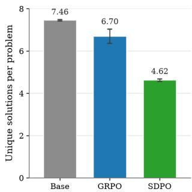  
Figure 1: SDPO reduces solution diversity on Live-CodeBench v6. AST-unique solutions per training problem (from 8 samples) for Qwen3- 14B before (Base) and after 200 steps of GRPO or SDPO (mean ± std, four seeds). Diversity collapse suggests memorization.

However, prior work questions the validity of self-distillation objectives as a mechanism to improve the student policy. The self-conditioned teacher’s outputs do not express uncertainty through tokens such as “wait”, “hmmm”, and “perhaps,” so training against it suppresses the model’s ability to correct past mistakes as it reasons and shortens the student’s traces in ways that hurt performance (Kim et al., 2026; Pan et al., 2026; Kaur et al., 2026). Moreover, the self-conditioned teacher is unable to consistently distinguish between correct and incorrect student generations (Harne et al., 2026; Nguyen et al., 2026). Together, these results raise a more fundamental question: does selfdistillation extract useful guidance from privileged information, or are its reported gains driven by simpler mechanisms?

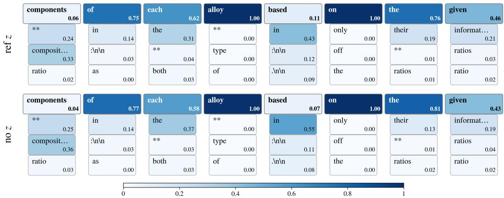  
Figure 2: The reference solution barely changes the self-distillation teacher. Teacher logprobabilities (thinking on) along a Qwen3-8B thinking-off student rollout on an OpenThoughts problem, with the problem’s reference solution in context (ref z, top) and with no solution (no z, bottom). In each panel, the first row is the sampled token and the three rows below are the student’s next three most likely tokens. The two teachers assign very similar probabilities, suggesting that OPSD distillation effects do not significantly depend on z (Section 4.3).

We revisit this question through careful reproductions of self-distillation policy optimization (SDPO) (Hubotter et al., 2026) and on-policy self-distillation (OPSD) (Zhao et al., 2026a). We leverage¨ Qwen3 (Qwen Team, 2025) and Olmo-3 (Olmo Team, 2025) models to ensure our observations hold over a range of model sizes and families. We find that the reported gains from privilegedinformation self-distillation in reasoning domains are weaker than they appear:

• SDPO’s coding gains do not transfer to unseen problems (Section 4.1). SDPO’s Live-CodeBench v6 (Jain et al., 2024) results train and evaluate on the same set of coding problems. Correcting for this reveals that SDPO overfits to its training problems, reducing the diversity of its solutions (Figure 1), and degrades on held-out problems while policy-gradient training on the same verifiable reward generalizes.

• SDPO’s gains in science reasoning and tool use do not generalize out of domain (Section 4.2). Across five science-reasoning (Feng et al., 2024) and tool-use (Tang et al., 2023) domains, SDPO and GRPO in-domain performances are similar, but in four of five it lowers accuracy on the heldout domains, while GRPO preserves it.

• OPSD transfers thinking-mode behavior, not privileged information (Section 4.3). In math reasoning, privileged information barely changes the self-conditioned teacher’s token distribution (Figure 2), and distilling thinking-mode behavior has a substantially larger effect than privileged information within OPSD’s reported results.

• Self-distillation gradients do not align with policy gradients (Section 4.4). Prior work motivates self-distillation as approximate policy improvement by arguing that its gradient aligns with the policy gradient (Shenfeld et al., 2026). This alignment matters because a small update improves expected reward only to the extent that it follows the policy gradient (Section 3.1). We therefore measure how well each method’s training gradient aligns with the policy gradient on held-out problems. On Qwen3 models, OPSD and SDPO gradients are consistently less aligned than GRPO gradients computed on the same training problems and often point away from the held-out policy gradient altogether.

## 2 RELATED WORKS

Reinforcement learning from verifiable rewards (RLVR). The goal of reinforcement learning is to maximize the expectation of reward under a policy’s responses. For verifiable tasks in math reasoning and coding, such rewards are assigned by verifying the equivalence between expressions or checking whether a proposed program passes all test-cases. RLVR for LLMs is typically done using policy gradient algorithms (Williams, 1992; Sutton et al., 2000). Although PPO (Schulman et al., 2017) was used in foundational work (Ouyang et al., 2022; Bai et al., 2022), critic-free methods such as GRPO (Shao et al., 2024) and RLOO (Kool et al., 2019; Ahmadian et al., 2024) have become popular due to their simplicity, despite feedback only being given at the trajectory level.

On-policy distillation (OPD). Unlike classic distillation, which tries to match teacher-generated outputs (Hinton et al., 2015), on-policy distillation seeks to boost performance by minimizing pertoken divergences between student logits $\pi _ { \theta } ( \cdot | x , y _ { < t } )$ and teacher logits $\pi _ { T } ( \cdot | x , y _ { < t } )$ along prefixes sampled from the student policy (Lu & Thinking Machines Lab, 2025; Xu et al., 2026; Gu et al., 2023). OPD has been shown to be effective in post-training small-models (Qwen Team, 2025) and merging the capabilities of multiple domain-specialist expert models (Xu et al., 2026; Kimi Team, 2026; Ma et al., 2026).

Self-distillation and privileged information. Instead of relying on an external stronger model, self-distillation (Shenfeld et al., 2026; Zhao et al., 2026a; Hubotter et al., 2026) parameterizes the¨ teacher distribution as $\pi _ { T } ( \cdot | x , y _ { < t } ) = \pi _ { \theta } ( \cdot | x , z , y _ { < t } )$ , with privileged information z which is derived from a reference solution or environmental feedback. This purportedly moves the student towards a higher-reward policy, transferring the reference solution’s reasoning content.

Limitations of self-distillation. Prior work documents several failure modes of self-distillation: SDPO generalizes poorly out of distribution and in continual learning settings (Wang et al., 2026), self-distillation degrades thinking models by suppressing backtracking behavior and collapsing response lengths (Kaur et al., 2026; Harne et al., 2026), and the self-conditioned teacher fails to distinguish correct from incorrect student solutions (Nguyen et al., 2026). Concurrently, Shrestha & Tessier (2026) show that OPSD’s gains stem from thinking-mode transfer rather than privileged information. Methods that retain GRPO and use the teacher only to reweight advantages such as Pan et al. (2026) fall outside our scope, as we study the self-distillation objective in isolation. We provide an extended discussion of existing work on the limitations of self-distillation, and of how our paper differs from each, in Appendix A.

## 3 PRELIMINARIES

We introduce the baseline training objectives, then show in Section 3.1 that under an optimal teacher all three share the same update direction, which motivates the gradient analysis of Section 4.4.

Notation. Let $\mathcal { X } , \mathcal { y }$ , and $\mathcal { Z }$ denote the spaces of problems, solutions, and privileged information respectively. We assume all three are finite, as is the case for language models with a finite vocabulary and a maximum sequence length. For $y \in \mathcal { V }$ , we write $y _ { t }$ for its t-th token, $y _ { < t }$ for its first $t - 1$ tokens, and $| y |$ for its length. For distributions $p , q$ over Y, $\begin{array} { r } { D _ { \mathrm { K L } } ( p \| q ) = \sum _ { y \in y } p ( y ) \log \frac { p ( y ) } { q ( y ) } } \end{array}$

Supervised fine-tuning (SFT). Given a distribution over problems $x \sim \rho ( \cdot )$ and a distribution over solutions $y \sim \pi _ { T } ( \cdot | x )$ , supervised finetuning optimizes $\pi _ { \boldsymbol { \theta } } ( \cdot | \boldsymbol { x } )$ to maximize the likelihood of $y \colon$

$$
{ \mathcal { L } } _ { \mathrm { S F T } } ( \theta ) = - \mathbb { E } _ { x \sim \rho ( \cdot ) , y \sim \pi _ { T } ( y | x ) } \left[ \sum _ { { t = 1 } } ^ { | y | } \log \pi _ { \theta } ( y _ { t } \mid x , y _ { < t } ) \right] .\tag{1}
$$

Note that optimizing the objective above is equivalent to minimizing $D _ { \mathrm { K L } }$ from the data distribution to the policy, namely, $\mathbb { E } _ { { x } \sim { \rho } ( . ) } [ D _ { \mathrm { K L } } ( \pi _ { T } ( \cdot | x ) \| \pi _ { \theta } ( \cdot | x ) ) ]$

Group Relative Policy Optimization (GRPO). Given a distribution over problems x $\sim \rho ( \cdot )$ and a reward function $R : \mathcal { X } \times \bar { \mathcal { Y } }  \mathbb { R }$ , for a given $x , { \mathrm { G R P O } }$ samples a group of $\bar { K }$ rollouts $y _ { 1 } , \dotsc , y _ { K } \sim$ $\pi _ { \boldsymbol { \theta } } ( \cdot | \boldsymbol { x } )$ from the student and computes their rewards $r _ { i } = R ( x , y _ { i } )$ . The loss is then computed as

$$
\mathcal { L } _ { \mathrm { G R P O } } ( \theta ) = - \frac { 1 } { \sum _ { i = 1 } ^ { K } | y _ { i } | } \sum _ { i = 1 } ^ { K } \sum _ { t = 1 } ^ { | y _ { i } | } \operatorname* { m i n } \left( w _ { i , t } ( \theta ) \hat { A } _ { i } , \ \mathrm { c l i p } \left( w _ { i , t } ( \theta ) , 1 - \varepsilon , 1 + \varepsilon \right) \hat { A } _ { i } \right) ,\tag{2}
$$

where $\begin{array} { r } { w _ { i , t } ( { \boldsymbol { \theta } } ) = \frac { \pi _ { \boldsymbol { \theta } } \left( y _ { i , t } | { \boldsymbol { x } } , y _ { i , < t } \right) } { \pi _ { \boldsymbol { \theta } _ { \mathrm { o l d } } } \left( y _ { i , t } | { \boldsymbol { x } } , y _ { i , < t } \right) } } \end{array}$ is the per-token importance ratio and $\begin{array} { r } { \hat { A } _ { i } = \frac { r _ { i } - \bar { r } } { \mathrm { s t d } ( r ) } } \end{array}$ is a sequencelevel z-score normalized advantage shared by all tokens in rollout i. GRPO is an instantiation of policy-gradients which aims to maximize $\mathbb { E } _ { x \sim \rho ( \cdot ) , y \sim \pi _ { \theta } ( \cdot | x ) } [ R ( x , y ) ]$ by using the following gradient update $\mathbb { E } _ { x \sim \rho ( \cdot ) , y \sim \pi _ { \theta } ( \cdot | x ) } [ R ( x , y ) \nabla _ { \theta }$ log π<sub>θ</sub>(y|x)].

Privileged information self-distillation. Given a distribution over problems $x \sim \rho ( \cdot )$ and a distribution over privileged information $z \sim \gamma ( \cdot | x )$ , we construct a privileged teacher $\pi _ { T } ( \cdot | x ) ~ =$ $\pi _ { \boldsymbol { \theta } } ( \cdot | x , z )$ for problems x for some sampled z. Zhao et al. (2026a) use a fixed reference solution in the dataset as z, while Hubotter et al. (2026) use a successful sibling rollout and environmental¨ feedback if available. The loss is then computed as

$$
\mathcal { L } _ { \mathrm { S D } } = \mathbb { E } _ { x \sim \rho ( \cdot ) , y \sim \mathrm { s g } ( \pi _ { \theta } ( \cdot \vert x ) ) , z \sim \gamma ( \cdot \vert x ) } \left[ \sum _ { t = 1 } ^ { \vert y \vert } D \left( \pi _ { \theta } ( \cdot \vert x , y _ { < t } ) , \mathrm { s g } ( \pi _ { \theta } ( \cdot \vert x , y _ { < t } , z ) ) \right) \right] ,\tag{3}
$$

where sg is the stop-grad operator and D represents an information divergence such as forward $\mathrm { K L }$ reverse KL, or Jensen-Shannon divergence. The sampler $y \sim \pi _ { \theta } ( \cdot | x )$ is typically not differentiated through due to stability reasons (Agarwal et al., 2024; Hubotter et al., 2026). Common tweaks¨ include an EMA-teacher (Hubotter et al., 2026; Shenfeld et al., 2026), top-¨ k logit approximations (Hubotter et al., 2026), and per-token clipping (Zhao et al., 2026a). Notably, by choosing¨ $D ( p , q ) =$ $D _ { \mathrm { K L } } ( p \parallel q )$ , we have that $\mathcal { L } _ { \mathrm { S D } }$ is equal in value to $\mathbb { E } _ { x \sim \rho ( \cdot ) , z \sim \gamma ( \cdot | x ) } \left[ D _ { \mathrm { K L } } ( \pi _ { \theta } ( \cdot \mid x ) \| \pi _ { T } ( \cdot \mid x , z ) ) \right]$

The two methods we consider, SDPO Hubotter et al. (2026) and OPSD Zhao et al. (2026a), differ¨ primarily in their instantiation of Equation (3) and their use of privileged information: the former uses reverse KL restricted to the student’s top k tokens and conditions the teacher on a successful sibling rollout and environment feedback and the latter implements forward KL with per-position full-vocabulary divergence clipping and takes z as a reference solution.

## 3.1 EQUIVALENCE BETWEEN POLICY GRADIENT, SFT, AND DISTILLATION

Policy gradient improves the policy by ascending expected reward, whereas self-distillation moves the student towards a teacher, so whether it improves depends on the teacher. Self-distillation implicitly assumes that the self-conditioned teacher approximates the KL-regularized optimal policy relative to the current policy, $\pi ^ { * } ( y | x ) \propto \pi _ { \boldsymbol { \theta } } ( y | x ) \exp \bar { ( } R ( x , y ) / \beta )$ , which we call the optimal teacher (Shenfeld et al., 2026). We show that for this teacher, the policy gradient, SFT on samples from $\pi ^ { * }$ and on-policy distillation towards $\pi ^ { * }$ share the same update direction. Hence, if the assumption holds, self-distillation gradients should align with the policy gradient, which we test in Section 4.4.

Proposition 3.1. Consider the single-prompt setting, with a fixed $x \ \sim \ \rho ( \cdot )$ Fix any policy $\pi _ { \boldsymbol { \theta } } ( \cdot | \boldsymbol { x } )$ over Y, a binary reward function $\bar { R } : \mathcal { X } \times \mathcal { y }  \{ 0 , 1 \}$ , and $\beta > 0 ,$ , and define the optimal teacher $\begin{array} { r } { \pi ^ { * } ( y | x ) \dot { } = \frac { 1 } { Z ( x ) } \dot { \pi _ { \theta } } ( y | x ) } \end{array}$ exp $( R ( x , y ) / \beta )$ , which maximizes $\mathbb { E } _ { y \sim \pi ( \cdot | x ) } [ R ( x , y ) ] -$ $\beta D _ { \mathrm { K L } } ( \pi ( \cdot | x ) \| \pi _ { \theta } ( \cdot | x ) )$ over policies π. Since x is fixed, we suppress it from the notation, writing $\pi _ { \boldsymbol { \theta } } ( y ) , R ( y ) , Z$ , and $\pi ^ { * } ( y ) = \overset { \mathrm { 1 } } { \underset { Z } { \mathrm { 1 } } } \pi _ { \theta } ( y ) \exp \left( R ( y ) / \beta \right)$ . Then, we have that:

$$
\frac { \nabla _ { \theta } \mathbb { E } _ { y \sim \pi _ { \theta } } [ R ( y ) ] } { \| \nabla _ { \theta } \mathbb { E } _ { y \sim \pi _ { \theta } } [ R ( y ) ] \| _ { 2 } } = - \frac { \nabla _ { \theta } D _ { \mathrm { K L } } \big ( \mathrm { s g } \left( \pi ^ { * } \right) \| \pi _ { \theta } \big ) } { \| \nabla _ { \theta } D _ { \mathrm { K L } } ( \mathrm { s g } \left( \pi ^ { * } \right) \| \pi _ { \theta } ) \| _ { 2 } } = - \frac { \nabla _ { \theta } D _ { \mathrm { K L } } \big ( \pi _ { \theta } \| \mathrm { s g } \left( \pi ^ { * } \right) \big ) } { \| \nabla _ { \theta } D _ { \mathrm { K L } } \big ( \pi _ { \theta } \| \mathrm { s g } \left( \pi ^ { * } \right) \big ) \| _ { 2 } } ,\tag{4}
$$

whenever $\nabla _ { \theta } \mathbb { E } _ { y \sim \pi _ { \theta } } [ R ( y ) ]$ is non-zero.

We defer the proof to Appendix B.

Crucially, the self-conditioned teacher must stay close to the student. RL generalizes better than SFT on reasoning tasks (Chu et al., 2025), plausibly since on-policy RL induces a smaller KL shift from the base model (Shenfeld et al., 2025); a teacher far from $\pi _ { \theta }$ forfeits this small-KL-shift property.

## 4 EXPERIMENTAL RESULTS

We now examine whether the reported gains of prior self-distillation works reflect the generalization performance of policy gradients (Section 4.1), require reasoning behavior (Section 4.2), transfer via privileged information (Section 4.3), and have gradients that align with the policy gradient as Proposition 3.1 would require of an optimal teacher (Section 4.4).

## 4.1 SDPO DOES NOT GENERALIZE TO NEW CODING PROBLEMS

Harne et al. (2026) suggest that the self-conditioned teacher is heavily biased towards the reference solution given in context in a way that does not generalize, which makes the coding gains reported by SDPO (Hubotter et al., 2026) surprising. We observe that SDPO’s coding evaluations reuse its¨ training problems, thus not cleanly measuring generalization. We hypothesize that SDPO’s coding gains stem from this discrepancy.

SDPO builds its teacher from privileged information available only at training time. On coding tasks, the teacher sees a successful student rollout from the same batch along with environment feedback on execution errors on test cases. They claim that SDPO improves 7.6% over GRPO baselines in accuracy on LiveCodeBench v6 (Jain et al., 2024) evaluations. We construct a clean split of the LCB data, reproduce SDPO overall gains on their data split, and observe that SDPO does not lead to performance gains when evaluated on an unseen test set.

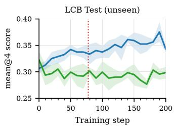

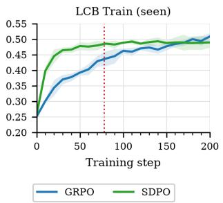

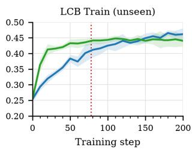  
Figure 3: Qwen3-8B SDPO vs. GRPO on LiveCodeBench v6 across four seeds, scored as the fraction of problems with no failing test cases (mean ± std). TRAIN SEEN and TRAIN UNSEEN evaluate training problems on seen and on held-out test cases respectively; TEST UNSEEN evaluates held-out problems. The 20000 training generations reported by Hubotter et al. (2026) is marked in red.¨

Setup. LiveCodeBench v6 pairs each competitive programming problem with a set of test cases. Concretely, the original work trains on all problems with half of each problem’s test cases removed, and evaluates on the unmodified dataset. To separate memorization from generalization, we instead split the problems into disjoint, equal-size sets $\mathcal { P } _ { \mathrm { t r a i n } }$ and $\mathcal { P } _ { \mathrm { t e s t } } .$ , giving three evaluation groups: TRAIN SEEN (test cases used during training), TRAIN UNSEEN (held-out test cases of problems in $\mathcal { P } _ { \mathrm { t r a i n } } )$ , and TEST UNSEEN (all test cases of problems in $\mathcal { P } _ { \mathrm { t e s t } } )$ .

Results. We train Qwen3-8B, Qwen3-14B, and Olmo-3-7B-Instruct on this split with SDPO and GRPO for 200 steps, four seeds each, otherwise following the setup of Hubotter et al. (2026); we¨ provide our hyperparameters in Appendix E.1. Figure 3 shows Qwen3-8B; results for the other two models and tables of accuracies are in Appendix D.1.

SDPO does not improve on new problems. Over 200 steps, GRPO improves TEST UNSEEN by 3.7, 4.9, and 2.6 points on Qwen3-8B, Qwen3-14B, and Olmo-3-7B-Instruct, whereas SDPO changes it by −2.5, −0.5, and −9.9 points. The disparity is largest on Olmo-3-7B-Instruct, where SDPO ends 13.1 points below GRPO (21.0 vs. 34.1). In summary, we find that mimicking a privileged teacher does not generalize to new problems.

SDPO does generalize to held-out test cases. SDPO’s gains on TRAIN SEEN largely carry over to TRAIN UNSEEN (+23.1 vs. +18.4 on Qwen3-8B, +22.5 vs. +17.2 on Qwen3-14B, and +18.3 vs. +16.7 on Olmo-3-7B-Instruct), retaining 76–91% of the gain compared with 81–103% for GRPO. SDPO therefore overfits at the level of training problems instead of at the level of unit tests, and produces fewer distinct solutions per training problem than GRPO (Figure 1). We hypothesize this is because a problem’s test cases check the same specification, so a program that passes the seen test cases is usually correct and passes the held-out ones too. This reconciles our results with those of Hubotter et al. (2026); indeed, evaluating on¨ TRAIN SEEN and TRAIN UNSEEN at 80 steps across all three models, we find that SDPO beats GRPO.

On Qwen3 models, GRPO overtakes SDPO on training problems with longer training. SDPO improves faster early on but then slows, while GRPO keeps improving and overtakes it after ∼160 steps on both TRAIN SEEN and TRAIN UNSEEN. At 200 steps on Qwen3-8B, GRPO scores 50.9 on TRAIN SEEN and 46.2 on TRAIN UNSEEN, versus 48.9 and 44.0 for SDPO; on Qwen3-14B, GRPO scores 54.1 and 49.2, versus 51.9 and 45.4. The ∼80-step comparison of Hubotter et al.¨ (2026) therefore does not reflect performance at convergence—at 80 steps, GRPO is still improving and SDPO’s advantage disappears with further training. In Olmo-3-7B-Instruct, SDPO continues to outperform GRPO on training problems.

## 4.2 SDPO DOES NOT GENERALIZE OOD IN SCIENCE REASONING AND TOOL USE

Given that SDPO overfits on coding problems, we also examine its reported gains in science reasoning and tool use, where Hubotter et al. (2026) find that SDPO outperforms GRPO. We ask how¨ broadly this advantage holds and whether it remains in out-of-domain settings.

Table 1: Cross-domain validation accuracy (avg@16) of Qwen3-8B after 200 training steps (mean±std over four seeds). Rows vary across training domains while columns vary across evaluation domains. OOD change is defined as the change in mean accuracy over all non-training domains.
<table><tr><td rowspan="2"></td><td colspan="5">Evaluated on</td><td rowspan="2">OOD change</td></tr><tr><td>Biology</td><td>Chemistry</td><td>Material</td><td>Physics</td><td>Tool use</td></tr><tr><td>Base</td><td> $3 0 . 5 { \pm } 1 . 6 $ </td><td>41.3±0.6</td><td>59.0±0.5</td><td>59.2±0.7</td><td>57.9±0.4</td><td></td></tr><tr><td>SDPO</td><td></td><td></td><td></td><td></td><td></td><td></td></tr><tr><td>Biology</td><td>52.5±4.9</td><td> $3 6 . 7 { \pm } 1 . 5 $ </td><td> $3 2 . 6 { \pm } 1 . 0 $ </td><td> $3 7 . 8 { \pm } 2 . 9 $ </td><td> $5 8 . 9 { \pm } 0 . 9 $ </td><td> $- 1 2 . 8 \pm 0 . 8$ </td></tr><tr><td>Chemistry</td><td>27.1±2.1</td><td> $7 7 . 7 { \pm } { \bf 0 . 6 }$ </td><td> $3 6 . 0 { \pm } 1 . 9 $ </td><td>46.6±1.7</td><td> $3 0 . 6 { \pm } 1 9 . 6 $ </td><td> $- 1 6 . 6 \pm 4 . 4$ </td></tr><tr><td>Material</td><td>33.0±2.7</td><td> $4 7 . 0 { \pm } 1 . 5 $ </td><td> $7 3 . 5 { \pm } 3 . 3 $ </td><td>45.3±8.8</td><td> $3 5 . 1 \pm 7 . 0$ </td><td> $- 7 . 1 \pm 4 . 0$ </td></tr><tr><td>Physics</td><td> $3 3 . 7 { \pm } 1 . 8 $ </td><td> $4 5 . 2 { \pm } 2 . 0 $ </td><td> $4 7 . 2 { \pm } 4 . 9 $ </td><td>73.1±4.3</td><td> $1 2 . 5 { \pm } 1 6 . 6 $ </td><td> $- 1 2 . 5 \pm 4 . 6$ </td></tr><tr><td>Tool use</td><td> $3 8 . 1 { \pm } 2 . 8 $ </td><td> $4 6 . 9 { \pm } 1 . 5 $ </td><td> $5 6 . 6 { \pm } 5 . 3 $ </td><td>51.7±2.5</td><td> $5 3 . 5 { \pm } 4 . 5 $ </td><td> $+ 0 . 9 \pm 1 . 8$ </td></tr><tr><td>GRPO</td><td></td><td></td><td></td><td></td><td></td><td></td></tr><tr><td>Biology</td><td> $5 1 . 0 { \pm } 2 . 2 $ </td><td> $4 2 . 1 { \pm } 0 . 8 $ </td><td> $6 0 . 5 { \pm } 2 . 4 $ </td><td> $5 9 . 9 { \pm 2 . 0 } $ </td><td> $5 9 . 6 { \pm } 1 . 1$ </td><td> $+ 1 . 2 \pm 0 . 9$ </td></tr><tr><td>Chemistry</td><td> $3 1 . 1 { \pm } 2 . 2 $ </td><td> $6 8 . 9 { \pm } 1 . 1 $ </td><td> $6 2 . 3 { \pm } 1 . 5 $ </td><td> $6 0 . 3 { \pm } 0 . 9 $ </td><td> $5 9 . 1 { \pm } 0 . 8 $ </td><td> $\mathbf { + 1 . 6 \pm 0 . 4 }$ </td></tr><tr><td>Material</td><td> $2 6 . 9 { \pm } 1 . 3 $ </td><td> $4 6 . 1 { \pm } 1 . 8 $ </td><td> ${ \bf 7 6 . 2 \pm 1 . 6 }$ </td><td> $6 1 . 7 { \pm } 0 . 8 $ </td><td> $5 9 . 1 { \pm } 0 . 4 $ </td><td> $+ 1 . 2 \pm 0 . 7$ </td></tr><tr><td>Physics</td><td> $2 7 . 0 { \pm } 1 . 7 $ </td><td> $4 3 . 6 { \pm } 1 . 1 $ </td><td> $6 3 . 2 { \pm } 1 . 5 $ </td><td> $7 2 . 4 \pm 5 . 2$ </td><td> $5 8 . 4 { \pm } 0 . 8 $ </td><td> $+ 0 . 9 \pm 0 . 1$ </td></tr><tr><td>Tool use</td><td> $3 0 . 4 \pm 2 . 2$ </td><td> $4 1 . 9 { \pm } 0 . 4 $ </td><td> $5 4 . 3 { \pm } 1 . 6 $ </td><td> $5 4 . 8 { \pm } 1 . 8 $ </td><td> ${ \bf 6 6 . 3 \pm 0 . 7 }$ </td><td> $- 2 . 1 \pm 1 . 2$ </td></tr></table>

Setup. Hubotter et al. (2026) evaluate SDPO on SciKnowEval multiple-choice science questions¨ (Feng et al., 2024) and ToolAlpaca (Tang et al., 2023), with teachers conditioned on correct neighboring solutions. Unlike more difficult math and coding tasks, where reaching the answer requires multi-step derivation, answers in these domains can be directly produced by choosing among four options or emitting an API call whose structure is largely determined by the prompt. We train Qwen3-8B with SDPO and GRPO on each domain for 200 steps over four seeds, following their settings, and evaluate each trained model on the held-out validation set of all five domains; we report our hyperparameters in Appendix E.1 and full training curves in Appendix D.2.

SDPO improves on the training domain faster, but GRPO converges to comparable accuracies. In biology, chemistry, and physics, SDPO improves in-domain accuracy faster than GRPO early in training, while GRPO improves gradually over all 200 steps (Figure 6). By step 200, the two methods are within one standard deviation of each other in biology, material, and physics (SDPO vs. GRPO: 52.5 vs. 51.0, 73.5 vs. 76.2, and 73.1 vs. 72.4); the only clear differences are chemistry, where SDPO leads (77.7 vs. 68.9), and tool use, where GRPO leads (53.5 vs. 66.3) (Table 1). Averaged over the five domains, both methods reach similar in-domain accuracy (66.1 for SDPO and 67.0 for GRPO, up from 49.6 for the base model).

SDPO degrades out of domain, while GRPO does not. Training SDPO on any of the four science domains lowers average out-of-domain accuracy by 7.1 to 16.6 points, whereas GRPO slightly improves it (+0.9 to +1.6; Table 1). Training on tool use is the exception, with SDPO slightly improving out-of-domain accuracy (+0.9), with GRPO slightly lowering it (−2.1). The drops are largest when evaluating on material, physics, and tool use, where SDPO’s accuracy peaks early in training and then declines steadily (Figure 6). SDPO’s in-domain gains thus come at the cost of out-of-domain performance that policy-gradient training generally preserves.

## 4.3 OPSD GAINS DEPEND ON THINKING MODE TRANSFER, NOT PRIVILEGED INFORMATION

OPSD (Zhao et al., 2026a) reports gains on AIME24, AIME25, and HMMT25 (Mathematical Association of America, 2024; Balunovic et al., 2025) by distilling a thinking-on Qwen3 teacher con-´ ditioned on a reference solution z into the same model with thinking off (Appendix C). The teacher thus differs from the student in two ways: it sees z, and it thinks.

We therefore seek to isolate the influence of the content of z with the teacher thinking mode. If OPSD gains come from conditioning on z, replacing it with the reference solution of a different problem or removing it entirely should degrade performance.

Setup. Following Zhao et al. (2026a), we train on OpenThoughts (Guha et al., 2025) math problems, each paired with a reference solution. We fix the student to thinking-off and ablate the teacher’s thinking mode (on or off) and its privileged information: the problem’s own reference solution (ref z), no reference solution (no z), or the reference solution of a different problem (shuffled z). The teacher template is otherwise fixed, so the three differ only in the content of z.

Zhao et al. (2026a) train Qwen3-1.7B to 8B with OPSD for 100 steps and compare against thinkingon GRPO (500 steps) and SFT (100 steps). To evaluate fully converged performance, we train OPSD and SFT for 200 steps and GRPO, with thinking on and off, for 500 steps, and evaluate on the same datasets with thinking on and off. As Shenfeld et al. (2026); Hubotter et al. (2026) sug-¨ gest self-distillation works better for larger models, we also test Qwen3-14B and a second model family, Olmo-3-7B-Instruct. As the latter has no thinking toggle, we instead compare two teachers given the same privileged information: the student itself (self-distillation) and Olmo-3-7B-Think, a separately trained thinking model from the same family (cross-model distillation), which cleanly separates privileged information from thinking-mode transfer. We report Qwen3-8B validation results in Table 2, remaining results and statistics in Appendix D.3, and hyperparameters in Table 24.

Table 2: Qwen3-8B training methods evaluated under avg@12 with thinking-on and thinking-off evaluation. OPSD think/no think denote whether teacher thinking was on during OPSD training. The subscript on GRPO runs denotes whether thinking was on or off during training. Denote z as the reference solution shown to the teacher. For every evaluation mode, we report the checkpoint with the best average performance (averaged over four seeds), reporting mean±std accuracy.
<table><tr><td rowspan="2"></td><td colspan="4">Thinking-on eval</td><td colspan="4">Thinking-off eval</td></tr><tr><td>AIME24</td><td>AIME25</td><td>HMMT25</td><td>Avg.</td><td>AIME24</td><td>AIME25</td><td>HMMT25</td><td>Avg.</td></tr><tr><td colspan="9">Baselines</td></tr><tr><td>Base</td><td>75.6</td><td>68.6</td><td>45.0</td><td>63.1</td><td>26.9</td><td>21.4</td><td>9.4</td><td>19.3</td></tr><tr><td> $\mathbf { G R P O _ { t h i n k } }$ </td><td> $7 6 . 5 { \pm } 0 . 3 $ </td><td> $6 9 . 4 \pm 1 . 0$ </td><td> $4 5 . 1 { \pm } 2 . 7 $ </td><td>63.7</td><td> $2 8 . 5 { \pm } 0 . 8 $ </td><td> $2 2 . 4 \pm 1 . 7$ </td><td> $1 1 . 8 { \pm } 1 . 5 $ </td><td>20.9</td></tr><tr><td> $\mathbf { G R P O _ { n o t h i n k } }$ </td><td> $7 6 . 5 { \pm } 0 . 5 $ </td><td> $7 0 . 8 { \pm } 1 . 4 $ </td><td> $4 5 . 6 { \pm } 1 . 8 $ </td><td>64.3</td><td> $3 4 . 6 { \pm } 2 . 0 $ </td><td> $2 3 . 6 { \pm } 1 . 3$ </td><td> $1 2 . 9 { \pm } 1 . 1 $ </td><td>23.7</td></tr><tr><td>SFT</td><td>76.0±1.7</td><td>70.0±0.5</td><td>43.0±1.7</td><td>63.0</td><td>65.1±1.0</td><td>51.2±2.0</td><td>33.8±1.0</td><td>50.0</td></tr><tr><td colspan="9">OPSD (teacher thinking-on)</td></tr><tr><td>Ref z</td><td> $7 7 . 2 { \pm } 1 . 1$ </td><td>71.6±1.1</td><td> $4 6 . 4 { \pm } 0 . 4 $ </td><td>65.0</td><td> $4 5 . 1 { \pm } 1 . 6 $ </td><td> $3 4 . 5 { \pm } 0 . 7 \ $ </td><td>19.8±2.4</td><td>33.1</td></tr><tr><td>No z</td><td> $7 8 . 1 { \pm } 1 . 0 $ </td><td> $7 1 . 0 { \pm } 1 . 4 $ </td><td> $4 6 . 7 { \pm } 1 . 3 $ </td><td>65.3</td><td> $5 7 . 6 { \pm } 1 . 2 $ </td><td> $4 5 . 6 { \pm } 2 . 0 $ </td><td>30.6±2.9</td><td>44.6</td></tr><tr><td>Shuffled z</td><td> ${ \bf 7 8 . 3 { \pm 0 . 6 } }$ </td><td>71.2±0.9</td><td>45.9±1.0</td><td>65.1</td><td>41.5±7.3</td><td> $3 6 . 7 { \pm } 4 . 5 $ </td><td>21.2±3.4</td><td>33.2</td></tr><tr><td colspan="9">OPSD (teacher thinking-off)</td></tr><tr><td>Ref z</td><td> $7 7 . 2 { \pm } 0 . 8 $ </td><td> $7 0 . 2 { \pm } 1 . 7 $ </td><td> $4 6 . 2 { \pm } 1 . 3 $ </td><td>64.6</td><td> $2 6 . 8 { \pm } 1 . 6 $ </td><td> $2 2 . 7 { \pm } 0 . 8 $ </td><td> $9 . 1 { \pm } 0 . 5 $ </td><td>19.5</td></tr><tr><td>No z</td><td> $7 6 . 4 \pm 1 . 4$ </td><td> $7 2 . 1 { \pm } 1 . 3 $ </td><td> $4 4 . 9 { \pm } 0 . 3 $ </td><td>64.5</td><td> $2 6 . 5 { \pm } 2 . 3 $ </td><td> $2 2 . 6 { \pm } 0 . 7 \ \AA$ </td><td> $1 2 . 1 { \pm } 0 . 4 $ </td><td>20.4</td></tr><tr><td>Shuffled z</td><td> $7 7 . 6 { \pm } 0 . 6 $ </td><td> $7 0 . 2 { \pm } 0 . 8 $ </td><td> ${ \bf 4 6 . 8 \pm 0 . 9 }$ </td><td>64.9</td><td> $2 6 . 9 { \pm } 1 . 9 $ </td><td> $1 9 . 2 { \pm } 1 . 5 $ </td><td> $1 1 . 2 { \pm } 1 . 7 $ </td><td>19.1</td></tr></table>

The content of z does not matter. Holding the teacher’s thinking mode and the evaluation mode fixed, we ablate z; on a sample rollout, removing it barely changes the teacher’s token probabilities (Figure 2). $\mathbf { \hat { \Sigma } } ^ { 6 6 } \mathbf { N } \mathbf { o } \ z ^ { 7 }$ often matches or outperforms “ref $z ^ { , \dot { \mathfrak { s } } }$ , especially in Zhao et al. (2026a)’s original setting (thinking teachers and thinking-on evaluations), and “ref $z ^ { \prime \prime }$ achieves the best average accuracy in only three of 18 configurations, each by under one point. In the remaining thinking-on evaluations, the best choice is always “no $z ^ { \prime \prime }$ or “shuffled $z ^ { \ast } .$ Except for thinking-off evaluations with a thinking-on teacher, the average accuracies of the three choices of z lie within 3.6 points of each other in every configuration other than Qwen3-1.7B with a non-thinking teacher (up to 5.2; Table 2, Appendix D.3). With a thinking-on teacher, thinking-off accuracy varies more across z (up to 11.7 points), but “ref $z ^ { \prime \prime }$ is never the best choice: “no $z ^ { , \breve { , \breve { , } } }$ or “shuffled $z ^ { \prime \prime }$ beats it by up to 11.5 points on Qwen3-8B. At every scale, a variant lacking either the presence or the relevance of a correct reference matches $^ { \ast } r e \bar { f } z ^ { \prime \prime }$ , so neither is required for OPSD’s gains.

Thinking-on gains are small and do not discriminate between hypotheses. OPSD’s headline results are thinking-on evaluations of students trained with thinking teachers, which Zhao et al. (2026a) attribute to teacher reasoning transfer. Beyond the smallest model, gains are modest (7.4, 0.8, 2.2, and 1.1 points for Qwen3-1.7B to Qwen3-14B for the best $z ) ,$ , and every variant tested recovers them: thinking-off distillation (6.1, 0.8, 1.8, and 0.7), any choice of $z ,$ and, on Qwen3-8B, a loss restricted to the last 10% of tokens (Appendix D.5). GRPO trained thinking-off is also always slightly larger than thinking-on GRPO. Thinking-on gains are thus not evidence for any particular transfer mechanism, so we focus on thinking-off evaluations, the student’s native inference mode.

Thinking-on teachers induce student thinking. Rather than improving student direct-answer capabilities, OPSD with a thinking teacher relies on thinking-mode transfer. Enabling teacher thinking improves average thinking-off accuracy by 7.6, 22.9, 17.3, and 28.9 points for Qwen3-1.7B to Qwen3-14B, whereas replacing ref z with shuffled z changes it by $2 . 1 5 , \bar { - } 0 . 2 , - 0 . 1 5$ , and −0.15 points. Likewise, Olmo-3-7B-Instruct gains 3.6 points with a self-teacher but 13.8 with Olmo-3-7B-Think, averaged over choices of z (Table 11). Since Zhao et al. (2026a) report only results with a thinking teacher, their remaining thinking-off gains are driven by the teacher’s thinking mode, not by privileged information. This transfer is visible in the students’ outputs: in thinking-off evaluations, Qwen3 students distilled from a thinking teacher often emit an orphan $< / { \tt t h i n k } >$ token, closing a thinking block that the chat template has already closed (Appendix C). These rollouts reason in the first person, box an answer, emit </think>, then write a clean solution, mirroring a thinking-on response (Figures 7 to 9). Among on-policy methods, orphan tokens occur mainly in thinking-off rollouts from OPSD with thinking teachers (up to 69.9%); GRPO and the base model produce none, and OPSD with a thinking-off teacher at most 6.7%. Thinking-on teachers also increase response length by 2.72 to 5.82 times, approaching the base model’s thinking-on lengths (Table 14, Appendix D.3), whereas length stays more stable with teacher thinking disabled (0.8 to 2.52 times the base model’s). Thus, with teacher thinking enabled, OPSD’s thinking-off gains come from forcing thinking-mode behavior into thinking-off mode, which requires no privileged information.

## 4.4 SELF-DISTILLATION GRADIENTS DO NOT ALIGN WITH POLICY GRADIENTS

The preceding sections examine the behavior of trained models. We now examine the selfdistillation update itself and ask whether a self-distillation step moves the policy in a direction that increases reward on held-out problems. Let $J _ { \mathrm { h e l d } } ( \theta )$ be $\pi _ { \theta }$ ’s expected reward on held-out problems and $g$ be a given method’s update direction. To a first order approximation,

$$
J _ { \mathrm { h e l d } } ( \theta _ { 0 } + \eta g ) - J _ { \mathrm { h e l d } } ( \theta _ { 0 } ) = \eta \langle \nabla _ { \theta } J _ { \mathrm { h e l d } } ( \theta _ { 0 } ) , g \rangle + O ( \eta ^ { 2 } ) ,\tag{5}
$$

so for η sufficiently small, a step along g increases held-out reward if and only if $g$ has positive cosine similarity with $\nabla _ { \theta } J _ { \mathrm { h e l d } }$ . We estimate $\nabla _ { \theta } J _ { \mathrm { h e l d } }$ by the GRPO gradient on held-out problems and $g$ by the self-distillation gradient and propose that their cosine similarity therefore measures whether a method’s update generalizes locally, without needing to train to convergence. This cosine similarity metric is also loosely motivated by Section 3.1): if the self-conditioned teacher approximates $\bar { \pi ^ { * } }$ (Equation (4)), as Shenfeld et al. (2026) assume, the distillation gradient should follow the policy gradient on the training problems. Here we ask the analogous question on held-out problems, where the policy gradient is the direction that improves generalization.

Setup. Practical self-distillation losses differ from the idealized objectives of Proposition 3.1: they use other divergences such as Jensen–Shannon, per-token clipping, top-k logit approximations, and EMA teachers (Equation (3)), so rather than testing the proposition’s equality directly, we test a consequence: a method whose teacher approximates the optimal teacher should update the model in the same direction as the policy gradient. We therefore measure the cosine similarity between each method’s training gradient and a reference, the GRPO gradient on held-out problems, which is the policy gradient direction that increases reward on new problems. To a first order approximation, a small step along a method’s gradient increases held-out reward if its cosine similarity with the reference is positive, and decreases it if negative. All gradients are estimated at the base model: on-policy RL favors high-reward policies that stay close to the base model in KL (Shenfeld et al., 2025), so we test whether the teacher is KL-optimal relative to the base model. We use the same setup as Section 4.1 and Section 4.3: for math, methods train on OpenThoughts and the reference is $\mathrm { G R P O } _ { \mathrm { n o t h i n k } }$ on AIME24, AIME25, and HMMT25 (held-out math policy gradient); for LiveCodeBench v6, methods train on TRAIN SEEN and the reference is GRPO on TEST UNSEEN. We report our complete results in Appendix D.6. Since cosine similarity is a nonlinear function of the pooled gradients and we estimate gradients over four seeds, we estimate its error with a leaveone-seed-out jackknife; we detail our gradient estimation method in Appendix E.3.

OPSD points away from the held-out math policy gradient. Across Qwen3-1.7B to 14B, $\mathrm { G R P O } _ { \mathrm { n o t h i n k } }$ is the only method with positive cosine similarity with the held-out policy gradient on every model (+0.018 to +0.166), and clearly so on Qwen3-8B and 14B (+0.118±0.050 and $+ 0 . 1 6 6 { \pm } 0 . 0 2 9 ;$ Tables 3 and 18). In contrast, all 24 OPSD variants have negative cosine similarity $( - 0 . 2 0 5 ~ { \mathrm { t o } } \ - 0 . 0 6 7 )$ . On Qwen3-8B, the six variants lie between −0.172 and −0.157, within each other’s error bars. Notably, OPSD with a thinking-on teacher points away from the held-out policy gradient despite its large thinking-off gains (Table 2): rather than moving the student towards its own high-reward solutions like policy gradients, it improves performance by matching the teacher’s thinking style (Section 4.3). Instead, on Olmo-3-7B-Instruct, GRPO and all six OPSD variants have small positive cosine similarity (+0.026 to +0.062), but their jackknife errors (0.021 to 0.054) are comparable to the values themselves, so none are clearly resolved from zero (Table 19).

SDPO gradients are less aligned than GRPO gradients. On LiveCodeBench v6, SDPO is less aligned with the held-out policy gradient than GRPO on all three models, and points away from it on Qwen3-8B (Table 4). These results are consistent with SDPO’s failure to improve TEST UNSEEN accuracy (Section 4.1), suggesting the self-distillation objective is only weakly correlated with generalizable reward maximization.

Self-distillation gradients have low variance but are misaligned. OPSD and SDPO gradients are nearly identical across seeds: their gradient noise scale (McCandlish et al., 2018), a normalized measure of variance across seeds where 0 is noiseless (Appendix E.3), is at most 0.05, versus 1.97 to 4.11 for GRPO across all models (see Appendix D.6). Self-distillation thus delivers the low-variance signal it promises, but that signal does not point along the held-out policy gradient: the self-conditioned teacher does not approximate the optimal teacher of Proposition 3.1.

Table 3: Cosine similarity with the heldout $\mathrm { G R P O } _ { \mathrm { n o t h i n k } }$ gradient on math for Qwen3-8B (pooled over four seeds ± jackknife error).
<table><tr><td>Method</td><td>Similarity</td></tr><tr><td>Baselines</td><td></td></tr><tr><td> $\mathbf { G R P O _ { t h i n k } }$ </td><td> $- 0 . 0 1 4 \pm 0 . 0 1 9$ </td></tr><tr><td>GRPOnothink SFT</td><td> $\mathbf { + 0 . 1 1 8 \pm 0 . 0 5 0 }$   $- 0 . 0 7 5 \pm 0 . 0 3 1$ </td></tr><tr><td></td><td></td></tr><tr><td>OPSD (teacher thinking-on) Ref z</td><td> $- 0 . 1 \bar { 6 0 } \pm 0 . 0 2 0$ </td></tr><tr><td>No z</td><td> $- 0 . 1 5 7 \pm 0 . 0 1 9$ </td></tr><tr><td>Shuffled z</td><td> $- 0 . 1 5 7 \pm 0 . 0 1 9$ </td></tr><tr><td>OPSD (teacher thinking-off)</td><td></td></tr><tr><td>Ref z</td><td> $- 0 . 1 6 3 \pm 0 . 0 1 3$ </td></tr><tr><td> $\operatorname { N o } z$ </td><td> $- 0 . 1 7 2 \pm 0 . 0 1 8$ </td></tr><tr><td>Shuffled z</td><td> $- 0 . 1 6 3 \pm 0 . 0 1 1$ </td></tr></table>

Table 4: Cosine similarity with the heldout GRPO gradient on LiveCodeBench v6 (TEST UNSEEN) for methods trained on TRAIN SEEN (pooled over four seeds ± jackknife error).
<table><tr><td>Model</td><td>GRPO</td><td>SDPO</td></tr><tr><td>Qwen3-8B</td><td> $\mathbf { + 0 . 1 2 1 \pm 0 . 0 1 1 }$ </td><td> $- 0 . 1 6 7 \pm 0 . 0 6 3$ </td></tr><tr><td>Qwen3-14B</td><td> $\mathbf { + 0 . 0 7 0 \pm 0 . 0 4 2 }$ </td><td> $+ 0 . 0 1 3 \pm 0 . 1 1 2$ </td></tr><tr><td>Olmo-3-7B-Instruct</td><td> $\mathbf { + 0 . 4 2 2 \pm 0 . 0 9 1 }$ </td><td> $+ 0 . 0 6 2 \pm 0 . 0 2 8$ </td></tr></table>

## 5 LIMITATIONS

Our experiments are limited to the Qwen3 and Olmo model families and the SDPO and OPSD selfdistillation recipes. We do not address the more recent developments on self-distillation techniques, which include harnesses (Zhao et al., 2026b), contrastive formulations (Pan et al., 2026), or more complex aggregation of feedback from neighboring rollouts (Yu et al., 2026), which may combat the limitations of these self-distillation methods. Moreover, we focus on verifiable domains and acknowledge that self-distillation has use cases in non-verifiable settings (Buening et al., 2026).

## 6 CONCLUSION

We show that the gains attributed to privileged self-distillation either do not generalize or do not come from privileged information. SDPO’s improvements on LiveCodeBench v6 are confined to problems seen during training, and its gains in other domains are come at the cost of out-ofdistribution performance. OPSD’s math gains rely on thinking-mode transfer, with privileged information having little effect. Finally, self-distillation gradients do not align with the policy gradient on held-out problems, indicating that the self-conditioned teacher does not approximate the optimal teacher. Together, these results highlight the need to develop principled reinforcement learning methods that can exploit privileged information.

## AI USE STATEMENT

In this work, we used generative AI tools to propose or refine hypotheses, design or provide feedback on research methodology or experiments, implement methods, support qualitative and thematic data analysis, and interpret results. We did not use generative AI tools to help develop theoretical models or conceptual frameworks, formulate mathematical claims, provide critical ingredients for proving mathematical claims, or assist in writing proofs. Generating synthetic datasets, translation, and cleaning or reformatting datasets are not applicable to this work. Additionally, we used generative AI tools to create or modify scientific figures, summarize or analyze existing literature, discover research topics or identify gaps, brainstorm, search for information, identify relevant literature, propose a title or keywords, draft parts of the paper, edit the paper for readability, and create or edit software code. We have reviewed all AI-assisted work: two authors reviewed and tested LLM-generated code for correctness, and we checked all LLM-retrieved examples. We take responsibility for the final content of this work, including text, claims, and artifacts produced with the aid of generative AI.

## REPRODUCIBILITY STATEMENT

We make our code publicly available at https://github.com/sleepypandu/ does-sd-improve-reasoning. We detail our experimental setups and hyperparameters for SDPO and GRPO on LiveCodeBench v6, SciKnowEval, and ToolAlpaca in Appendix E.1; for OPSD, GRPO, and SFT on OpenThoughts in Appendix E.2; for the gradient similarity analysis in Appendix E.3; and the OPSD prompts in Appendix E.4. The proof of Proposition 3.1 is in Appendix B.

## REFERENCES

Rishabh Agarwal, Nino Vieillard, Yongchao Zhou, Piotr Stanczyk, Sabela Ramos Garea, Matthieu Geist, and Olivier Bachem. On-policy distillation of language models: Learning from selfgenerated mistakes. In The Twelfth International Conference on Learning Representations, 2024. URL https://openreview.net/forum?id=3zKtaqxLhW.

Arash Ahmadian, Chris Cremer, Matthias Galle, Marzieh Fadaee, Julia Kreutzer, Olivier Pietquin,´ Ahmet Ust<sup>¨</sup> un, and Sara Hooker. Back to basics: Revisiting reinforce style optimization for learn-¨ ing from human feedback in llms, 2024. URL https://arxiv.org/abs/2402.14740.

Yuntao Bai, Andy Jones, Kamal Ndousse, Amanda Askell, Anna Chen, Nova Dassarma, Dawn Drain, Stanislav Fort, Deep Ganguli, Thomas Henighan, Nicholas Joseph, Saurav Kadavath, John Kernion, Tom Conerly, Sheer El-Showk, Nelson Elhage, Zac Hatfield-Dodds, Danny Hernandez, Tristan Hume, Scott Johnston, Shauna Kravec, Liane Lovitt, Neel Nanda, Catherine Olsson, Dario Amodei, Tom B. Brown, Jack Clark, Sam McCandlish, Chris Olah, Benjamin Mann, and Jared Kaplan. Training a helpful and harmless assistant with reinforcement learning from human feedback. ArXiv, abs/2204.05862, 2022. URL https://api.semanticscholar.org/ CorpusID:248118878.

Mislav Balunovic, Jasper Dekoninck, Ivo Petrov, Nikola Jovanovi ´ c, and Martin Vechev. MathArena:´ Evaluating LLMs on uncontaminated math competitions. In Advances in Neural Information Processing Systems (Datasets and Benchmarks Track), 2025.

Thomas Kleine Buening, Jonas Hubotter, Barna P ¨ asztor, Idan Shenfeld, Giorgia Ramponi,´ and Andreas Krause. Aligning language models from user interactions. arXiv preprint arXiv:2603.12273, 2026.

Tianzhe Chu, Yuexiang Zhai, Jihan Yang, Shengbang Tong, Saining Xie, Dale Schuurmans, Quoc V Le, Sergey Levine, and Yi Ma. SFT memorizes, RL generalizes: A comparative study of founda-

tion model post-training. In Forty-second International Conference on Machine Learning, 2025. URL https://openreview.net/forum?id=dYur3yabMj.

Ganqu Cui, Lifan Yuan, Zefan Wang, Hanbin Wang, Yuchen Zhang, Jiacheng Chen, Wendi Li, Bingxiang He, Yuchen Fan, Tianyu Yu, Qixin Xu, Weize Chen, Jiarui Yuan, Huayu Chen, Kaiyan Zhang, Xingtai Lv, Shuo Wang, Yuan Yao, Xu Han, Hao Peng, Yu Cheng, Zhiyuan Liu, Maosong Sun, Bowen Zhou, and Ning Ding. Process reinforcement through implicit rewards, 2025. URL https://arxiv.org/abs/2502.01456.

Kehua Feng, Keyan Ding, Weijie Wang, Xiang Zhuang, Zeyuan Wang, Ming Qin, Yu Zhao, Jianhua Yao, Qiang Zhang, and Huajun Chen. Sciknoweval: Evaluating multi-level scientific knowledge of large language models, 2024.

Yuxian Gu, Li Dong, Furu Wei, and Minlie Huang. Minillm: On-policy distillation of large language models. arXiv preprint arXiv:2306.08543, 2023.

Etash Guha, Ryan Marten, Sedrick Keh, Negin Raoof, Georgios Smyrnis, Hritik Bansal, Marianna Nezhurina, Jean Mercat, Trung Vu, Zayne Sprague, Ashima Suvarna, Benjamin Feuer, Liangyu Chen, Zaid Khan, Eric Frankel, Sachin Grover, Caroline Choi, Niklas Muennighoff, Shiye Su, Wanjia Zhao, John Yang, Shreyas Pimpalgaonkar, Kartik Sharma, Charlie Cheng-Jie Ji, Yichuan Deng, Sarah Pratt, Vivek Ramanujan, Jon Saad-Falcon, Jeffrey Li, Achal Dave, Alon Albalak, Kushal Arora, Blake Wulfe, Chinmay Hegde, Greg Durrett, Sewoong Oh, Mohit Bansal, Saadia Gabriel, Aditya Grover, Kai-Wei Chang, Vaishaal Shankar, Aaron Gokaslan, Mike A. Merrill, Tatsunori Hashimoto, Yejin Choi, Jenia Jitsev, Reinhard Heckel, Maheswaran Sathiamoorthy, Alexandros G. Dimakis, and Ludwig Schmidt. Openthoughts: Data recipes for reasoning models, 2025. URL https://arxiv.org/abs/2506.04178.

Daya Guo, Dejian Yang, Haowei Zhang, Junxiao Song, Peiyi Wang, Qihao Zhu, Runxin Xu, Ruoyu Zhang, Shirong Ma, Xiao Bi, Xiaokang Zhang, Xingkai Yu, Yu Wu, Z. F. Wu, Zhibin Gou, Zhihong Shao, Zhuoshu Li, Ziyi Gao, Aixin Liu, Bing Xue, Bingxuan Wang, Bochao Wu, Bei Feng, Chengda Lu, Chenggang Zhao, Chengqi Deng, Chong Ruan, Damai Dai, Deli Chen, Dongjie Ji, Erhang Li, Fangyun Lin, Fucong Dai, Fuli Luo, Guangbo Hao, Guanting Chen, Guowei Li, H. Zhang, Hanwei Xu, Honghui Ding, Huazuo Gao, Hui Qu, Hui Li, Jianzhong Guo, Jiashi Li, Jingchang Chen, Jingyang Yuan, Jinhao Tu, Junjie Qiu, Junlong Li, J. L. Cai, Jiaqi Ni, Jian Liang, Jin Chen, Kai Dong, Kai Hu, Kaichao You, Kaige Gao, Kang Guan, Kexin Huang, Kuai Yu, Lean Wang, Lecong Zhang, Liang Zhao, Litong Wang, Liyue Zhang, Lei Xu, Leyi Xia, Mingchuan Zhang, Minghua Zhang, Minghui Tang, Mingxu Zhou, Meng Li, Miaojun Wang, Mingming Li, Ning Tian, Panpan Huang, Peng Zhang, Qiancheng Wang, Qinyu Chen, Qiushi Du, Ruiqi Ge, Ruisong Zhang, Ruizhe Pan, Runji Wang, R. J. Chen, R. L. Jin, Ruyi Chen, Shanghao Lu, Shangyan Zhou, Shanhuang Chen, Shengfeng Ye, Shiyu Wang, Shuiping Yu, Shunfeng Zhou, Shuting Pan, S. S. Li, Shuang Zhou, Shaoqing Wu, Tao Yun, Tian Pei, Tianyu Sun, T. Wang, Wangding Zeng, Wen Liu, Wenfeng Liang, Wenjun Gao, Wenqin Yu, Wentao Zhang, W. L. Xiao, Wei An, Xiaodong Liu, Xiaohan Wang, Xiaokang Chen, Xiaotao Nie, Xin Cheng, Xin Liu, Xin Xie, Xingchao Liu, Xinyu Yang, Xinyuan Li, Xuecheng Su, Xuheng Lin, X. Q. Li, Xiangyue Jin, Xiaojin Shen, Xiaosha Chen, Xiaowen Sun, Xiaoxiang Wang, Xinnan Song, Xinyi Zhou, Xianzu Wang, Xinxia Shan, Y. K. Li, Y. Q. Wang, Y. X. Wei, Yang Zhang, Yanhong Xu, Yao Li, Yao Zhao, Yaofeng Sun, Yaohui Wang, Yi Yu, Yichao Zhang, Yifan Shi, Yiliang Xiong, Ying He, Yishi Piao, Yisong Wang, Yixuan Tan, Yiyang Ma, Yiyuan Liu, Yongqiang Guo, Yuan Ou, Yuduan Wang, Yue Gong, Yuheng Zou, Yujia He, Yunfan Xiong, Yuxiang Luo, Yuxiang You, Yuxuan Liu, Yuyang Zhou, Y. X. Zhu, Yanping Huang, Yaohui Li, Yi Zheng, Yuchen Zhu, Yunxian Ma, Ying Tang, Yukun Zha, Yuting Yan, Z. Z. Ren, Zehui Ren, Zhangli Sha, Zhe Fu, Zhean Xu, Zhenda Xie, Zhengyan Zhang, Zhewen Hao, Zhicheng Ma, Zhigang Yan, Zhiyu Wu, Zihui Gu, Zijia Zhu, Zijun Liu, Zilin Li, Ziwei Xie, Ziyang Song, Zizheng Pan, Zhen Huang, Zhipeng Xu, Zhongyu Zhang, and Zhen Zhang. Deepseek-r1 incentivizes reasoning in llms through reinforcement learning. Nature, 645(8081):633–638, 2025. ISSN 1476-4687. doi: 10.1038/s41586-025-09422-z. URL http://dx.doi.org/10.1038/s41586-025-09422-z.

Sarthak Harne, Chinmay Karkar, Yash Pandya, Ahmed Awadallah, and Akshay Nambi. Privileged, but biased: How pi-conditioned teachers break self-distillation. arXiv preprint arXiv:2608.04794, 2026.

Geoffrey Hinton, Oriol Vinyals, and Jeff Dean. Distilling the knowledge in a neural network, 2015. URL https://arxiv.org/abs/1503.02531.

Jonas Hubotter, Frederike L ¨ ubeck, Lejs Behric, Anton Baumann, Marco Bagatella, Daniel Marta,¨ Ido Hakimi, Idan Shenfeld, Thomas Kleine Buening, Carlos Guestrin, and Andreas Krause. Reinforcement Learning via Self-Distillation, January 2026. URL https://arxiv.org/abs/ 2601.20802v2.

Yuki Ichihara, Naoto Iwase, Mohammad Atif Quamar, and Junpei Komiyama. Privileged solutions or context-induced teacher behavior? dissecting on-policy self-distillation. arXiv preprint arXiv:2608.09228, 2026.

Naman Jain, King Han, Alex Gu, Wen-Ding Li, Fanjia Yan, Tianjun Zhang, Sida Wang, Armando Solar-Lezama, Koushik Sen, and Ion Stoica. Livecodebench: Holistic and contamination free evaluation of large language models for code, 2024. URL https://arxiv.org/abs/ 2403.07974.

Simran Kaur, Narutatsu Ri, Yinghui He, Liam Fowl, and Sanjeev Arora. Rethinking on-policy selfdistillation for thinking models, 2026. URL https://arxiv.org/abs/2607.05184.

Jeonghye Kim, Xufang Luo, Minbeom Kim, Sangmook Lee, Dohyung Kim, Jiwon Jeon, Dongsheng Li, and Yuqing Yang. Why does self-distillation (sometimes) degrade the reasoning capability of llms? arXiv preprint arXiv:2603.24472, 2026.

Kimi Team. Kimi k3: Open frontier intelligence. arXiv preprint arXiv:2607.24653, 2026.

Wouter Kool, Herke van Hoof, and Max Welling. Buy 4 reinforce samples, get a baseline for free! In DeepRLStructPred@ICLR, 2019. URL https://api.semanticscholar.org/ CorpusID:198489118.

Woosuk Kwon, Zhuohan Li, Siyuan Zhuang, Ying Sheng, Lianmin Zheng, Cody Hao Yu, Joseph E. Gonzalez, Hao Zhang, and Ion Stoica. Efficient memory management for large language model serving with pagedattention. In Proceedings of the ACM SIGOPS 29th Symposium on Operating Systems Principles, 2023.

Nathan Lambert, Jacob Morrison, Valentina Pyatkin, Shengyi Huang, Hamish Ivison, Faeze Brahman, Lester James V. Miranda, Alisa Liu, Nouha Dziri, Shane Lyu, Yuling Gu, Saumya Malik, Victoria Graf, Jena D. Hwang, Jiangjiang Yang, Ronan Le Bras, Oyvind Tafjord, Chris Wilhelm, Luca Soldaini, Noah A. Smith, Yizhong Wang, Pradeep Dasigi, and Hannaneh Hajishirzi. Tulu 3: Pushing frontiers in open language model post-training, 2025. URL https: //arxiv.org/abs/2411.15124.

Kevin Lu and Thinking Machines Lab. On-policy distillation. Thinking Machines Lab: Connectionism, 2025. doi: 10.64434/tml.20251026. https://thinkingmachines.ai/blog/on-policy-distillation.

Wenhan Ma, Jianyu Wei, Liang Zhao, Hailin Zhang, Bangjun Xiao, Lei Li, Qibin Yang, Bofei Gao, Yudong Wang, Rang Li, et al. Mopd: Multi-teacher on-policy distillation for capability integration in llm post-training. arXiv preprint arXiv:2606.30406, 2026.

Mathematical Association of America. American Invitational Mathematics Examination (AIME). https://maa.org/maa-invitational-competitions/, 2024.

Sam McCandlish, Jared Kaplan, Dario Amodei, and OpenAI Dota Team. An empirical model of large-batch training. arXiv preprint arXiv:1812.06162, 2018.

Xuan-Phi Nguyen, Zeyu Leo Liu, Yang Li, Shrey Pandit, Yiran Zhao, Anurag Koul, and Shafiq Joty. Privileged likelihood is not automatically value: Three checks for token credit in on-policy self-distillation, 2026. URL https://arxiv.org/abs/2608.09263.

Olmo Team. Olmo 3. arXiv preprint arXiv:2512.13961, 2025.

Long Ouyang, Jeff Wu, Xu Jiang, Diogo Almeida, Carroll L. Wainwright, Pamela Mishkin, Chong Zhang, Sandhini Agarwal, Katarina Slama, Alex Ray, John Schulman, Jacob Hilton, Fraser Kelton, Luke Miller, Maddie Simens, Amanda Askell, Peter Welinder, Paul Christiano, Jan Leike, and Ryan Lowe. Training language models to follow instructions with human feedback. In Proceedings of the 36th International Conference on Neural Information Processing Systems, NIPS ’22, Red Hook, NY, USA, 2022. Curran Associates Inc. ISBN 9781713871088.

Leyi Pan, Shuchang Tao, Yunpeng Zhai, Lingzhe Zhang, Zhaoyang Liu, Bolin Ding, Aiwei Liu, and Lijie Wen. Rlcsd: Reinforcement learning with contrastive on-policy self-distillation. arXiv preprint arXiv:2606.11709, 2026.

Qwen Team. Qwen3 technical report, 2025. URL https://arxiv.org/abs/2505.09388.

John Schulman, Filip Wolski, Prafulla Dhariwal, Alec Radford, and Oleg Klimov. Proximal policy optimization algorithms. arXiv preprint arXiv:1707.06347, 2017.

Zhihong Shao, Peiyi Wang, Qihao Zhu, Runxin Xu, Junxiao Song, Xiao Bi, Haowei Zhang, Mingchuan Zhang, YK Li, Yang Wu, et al. Deepseekmath: Pushing the limits of mathematical reasoning in open language models. arXiv preprint arXiv:2402.03300, 2024.

Idan Shenfeld, Jyothish Pari, and Pulkit Agrawal. RL’s Razor: Why On-Policy Reinforcement Learning Forgets Less. December 2025. URL https://arxiv.org/abs/2509.04259.

Idan Shenfeld, Mehul Damani, Jonas Hubotter, and Pulkit Agrawal. Self-Distillation Enables Con-¨ tinual Learning. June 2026. URL https://arxiv.org/abs/2601.19897.

Guangming Sheng, Chi Zhang, Zilingfeng Ye, Xibin Wu, Wang Zhang, Ru Zhang, Yanghua Peng, Haibin Lin, and Chuan Wu. Hybridflow: A flexible and efficient rlhf framework. arXiv preprint arXiv: 2409.19256, 2024.

Samyak Shrestha and Alexander Tessier. Rethinking privileged information in on-policy selfdistillation, 2026. URL https://arxiv.org/abs/2608.18271.

Richard S. Sutton, David A. McAllester, Satinder P. Singh, and Yishay Mansour. Policy gradient methods for reinforcement learning with function approximation. In Sara A. Solla, Todd K. Leen, and Klaus-Robert Muller (eds.), ¨ Advances in Neural Information Processing Systems, volume 12, pp. 1057–1063. MIT Press, 2000.

Qiaoyu Tang, Ziliang Deng, Hongyu Lin, Xianpei Han, Qiao Liang, and Le Sun. Toolalpaca: Generalized tool learning for language models with 3000 simulated cases, 2023.

Leandro von Werra, Younes Belkada, Lewis Tunstall, Edward Beeching, Tristan Thrush, Nathan Lambert, Shengyi Huang, Kashif Rasul, and Quentin Gallouedec. TRL: Transformers Reinforce-´ ment Learning, 2020. URL https://github.com/huggingface/trl.

Meng Wang, Haohan Zhao, Wenzhuo Liu, Lu Yang, Geng Liu, Haiyang Guo, Guo-Sen Xie, Gaofeng Meng, Hongbin Liu, and Fei Zhu. Denser ̸= better: Limits of on-policy self-distillation for continual post-training, 2026. URL https://arxiv.org/abs/2607.01763.

Peiyi Wang, Lei Li, Zhihong Shao, Runxin Xu, Damai Dai, Yifei Li, Deli Chen, Yu Wu, and Zhifang Sui. Math-shepherd: Verify and reinforce llms step-by-step without human annotations. In Proceedings of the 62nd Annual Meeting of the Association for Computational Linguistics (Volume 1: Long Papers), pp. 9426–9439, 2024.

Ronald J. Williams. Simple statistical gradient-following algorithms for connectionist reinforcement learning. Machine Learning, 8(3–4):229–256, 1992. doi: 10.1007/BF00992696.

Anyi Xu, Bangcai Lin, Bing Xue, Bingxuan Wang, Bingzheng Xu, Bochao Wu, Bowei Zhang, Chaofan Lin, Chen Dong, Chenchen Ling, et al. Deepseek-v4: Towards highly efficient milliontoken context intelligence. arXiv preprint arXiv:2606.19348, 2026.

Chenxu Yang, Chuanyu Qin, Qingyi Si, Minghui Chen, Naibin Gu, Dingyu Yao, Zheng Lin, Weiping Wang, Jiaqi Wang, and Nan Duan. Self-distilled rlvr, 2026. URL https://arxiv.org/ abs/2604.03128.

Weichen Yu, Xiaomin Li, Yizhou Zhao, Xiaoze Liu, Ruowang Zhang, Haixin Wang, Yinyi Luo, Chen Henry Wu, Gaurav Mittal, Matt Fredrikson, et al. Multi-rollout on-policy distillation via peer successes and failures. arXiv preprint arXiv:2605.12652, 2026.

XiuYu Zhang, Wei Chow, Junfeng Fang, Xingyu Zhu, Zhenkai Liang, and Tat-Seng Chua. What does privileged information add to on-policy self-distillation?, 2026. URL https://arxiv. org/abs/2609.20612.

Siyan Zhao, Zhihui Xie, Mengchen Liu, Jing Huang, Guan Pang, Feiyu Chen, and Aditya Grover. Self-distilled reasoner: On-policy self-distillation for large language models. In Forty-third International Conference on Machine Learning, 2026a. URL https://openreview.net/ forum?id=Jpxfof0EaS.

Zhengyang Zhao, Lu Ma, and Wentao Zhang. Training with harnesses: On-policy harness selfdistillation for complex reasoning, 2026b. URL https://arxiv.org/abs/2605.08741.

## A EXTENDED RELATED WORKS

We divide existing work on the limitations of self-distillation techniques into the following:

Empirical re-evaluations. Wang et al. (2026) demonstrate that SDPO struggles to generalize to out-of-distribution domains, and fail in continual learning settings where GRPO succeeds. Kaur et al. (2026) highlight that self-distillation degrades thinking-models; with previous works primarily focusing on instruction-tuned models. Concurrent to our work, Shrestha & Tessier (2026); Zhang et al. (2026); Ichihara et al. (2026) show that OPSD does not rely on privileged information, but on thinking-mode transfer. In contrast to these works, we provide our results with an exact reproduction of SDPO and OPSD training and evaluating settings, and we ask whether SDPO’s gains in other domains reflect improvements in reasoning.

Token-level symptoms. Kim et al. (2026); Kaur et al. (2026); Pan et al. (2026); Harne et al. (2026) show that self-distillation losses concentrate on tokens which express uncertainty and have high entropy. This results in a suppression of the student’s backtracking behavior and collapse in response lengths. Instead, we focus on the positive results reported by OPSD, and find through token-level diagnoses and response length metrics, that performance improvements relate to thinking-mode transfer.

Sequence-level diagnoses. Nguyen et al. (2026) develop statistics that indicate that the selfconditioned teacher cannot differentiate between correct and incorrect solutions generated by the student. Harne et al. (2026) present analogous results, showing that the self-conditioned teacher is greatly biased towards the reference solution it is provided, mirroring Yang et al. (2026)’s results indicating that the teacher leaks privileged information. On the other hand, we diagnose whether the self-conditioned teacher approximates the optimal KL-regularized model, which is an assumption behind prior self-distillation work (Shenfeld et al., 2026).

Remedies. Pan et al. (2026) and Yang et al. (2026) retain GRPO as a learning signal and use the self-conditioned teacher only to modulate its per-token advantages. Because these methods do not rely on the self-distillation loss alone, which is the setting we study, they fall outside the scope of this work. Their reliance on GRPO is consistent with Harne et al. (2026), who question whether the self-distillation objective on its own, without such auxiliary machinery, yields any performance gains at all.

## B PROOF OF PROPOSITION 3.1

We restate the proposition for convenience.

Proposition 3.1. Consider the single-prompt setting, with a fixed $x \ \sim \ \rho ( \cdot )$ Fix any policy $\pi _ { \boldsymbol { \theta } } ( \cdot | \boldsymbol { x } )$ over Y, a binary reward function $R : \mathcal { X } \times \mathcal { Y }  \{ 0 , 1 \}$ , and $\beta > 0 ;$ , and define the optimal teacher $\begin{array} { r } { \pi ^ { * } ( y | x ) \dot { \mathbf { \sigma } } = \frac { 1 } { Z ( x ) } \tilde { \pi _ { \boldsymbol { \theta } } } ( y | x ) \exp \left( R ( x , y ) / \beta \right) } \end{array}$ , which maximizes $\mathbb { E } _ { y \sim \pi ( \cdot | x ) } [ R ( \dot { x } , y ) ] -$ $\beta D _ { \mathrm { K L } } ( \pi ( \cdot | x ) \| \pi _ { \theta } ( \cdot | x ) )$ ) over policies π. Since x is fixed, we suppress it from the notation, writing $\pi _ { \theta } ( y ) , R ( y ) , Z ,$ and $\pi ^ { * } ( y ) = \overset { \mathrm { 1 } } { \underset { Z } { \mathrm { 1 } } } \pi _ { \theta } ( y ) \exp \left( R ( y ) / \beta \right)$ . Then, we have that:

$$
\frac { \nabla _ { \theta } \mathbb { E } _ { y \sim \pi _ { \theta } } [ R ( y ) ] } { \| \nabla _ { \theta } \mathbb { E } _ { y \sim \pi _ { \theta } } [ R ( y ) ] \| _ { 2 } } = - \frac { \nabla _ { \theta } D _ { \mathrm { K L } } \big ( \mathrm { s g } \left( \pi ^ { * } \right) \| \pi _ { \theta } \big ) } { \| \nabla _ { \theta } D _ { \mathrm { K L } } ( \mathrm { s g } \left( \pi ^ { * } \right) \| \pi _ { \theta } ) \| _ { 2 } } = - \frac { \nabla _ { \theta } D _ { \mathrm { K L } } \big ( \pi _ { \theta } \| \mathrm { s g } \left( \pi ^ { * } \right) \big ) } { \| \nabla _ { \theta } D _ { \mathrm { K L } } \big ( \pi _ { \theta } \| \mathrm { s g } \left( \pi ^ { * } \right) \big ) \| _ { 2 } } ,\tag{4}
$$

whenever $\nabla _ { \theta } \mathbb { E } _ { y \sim \pi _ { \theta } } [ R ( y ) ]$ is non-zero.

Proof. We use the notation of the proposition, suppressing x. Since Y is finite, all expectations over $\mathcal { V }$ are finite sums, so gradients commute with expectations, and we have the log-derivative identity $\nabla _ { \boldsymbol { \theta } } \pi _ { \boldsymbol { \theta } } ( y ) = \pi _ { \boldsymbol { \theta } } ( y ) \nabla _ { \boldsymbol { \theta } } \mathrm { l o g } \pi _ { \boldsymbol { \theta } } ( y )$ and the score identity $\begin{array} { r } { \mathbb { E } _ { y \sim \pi _ { \theta } } [ \nabla _ { \theta } \log \pi _ { \theta } ( y ) ] = { \bf \bar { \Phi } } _ { y } \nabla _ { \theta } \pi _ { \theta } ( y ) = { \bf \bar { 0 } } . } \end{array}$ Let $J ( \theta ) = \mathbb { E } _ { y \sim \pi _ { \theta } } [ R ( y ) ]$ and $g = \nabla _ { \theta } J ( \theta )$ . We show that both KL gradients are negative multiples of g.

Policy gradient. By the log-derivative identity,

$$
g = \mathbb { E } _ { y \sim \pi _ { \theta } } \left[ R ( y ) \nabla _ { \theta } \log \pi _ { \theta } ( y ) \right] .
$$

Reverse KL. Since $\mathrm { s g } \left( \pi ^ { * } \right)$ is constant in θ,

$$
\begin{array} { l l } { \displaystyle \nabla _ { \theta } D _ { \mathrm { K L } } ( \pi _ { \theta } \| \operatorname { s g } { ( \pi ^ { * } ) } ) = \sum _ { y } ( \nabla _ { \theta } \pi _ { \theta } ( y ) ) \log \frac { \pi _ { \theta } ( y ) } { \pi ^ { * } ( y ) } + \sum _ { y } \pi _ { \theta } ( y ) \nabla _ { \theta } \log \pi _ { \theta } ( y ) } \\ { \displaystyle = \mathbb { E } _ { y \sim \pi _ { \theta } } \left[ \log \frac { \pi _ { \theta } ( y ) } { \pi ^ { * } ( y ) } \nabla _ { \theta } \log \pi _ { \theta } ( y ) \right] } & { \mathrm { ( s c o r e ~ i d e n t i t y ) } } \\ { \displaystyle = \mathbb { E } _ { y \sim \pi _ { \theta } } \left[ ( \log Z - R ( y ) / \beta ) \nabla _ { \theta } \log \pi _ { \theta } ( y ) \right] } & { \mathrm { ( d e f i n i t i o n ~ o f ~ } \pi ^ { * } ) } \\ { \displaystyle = - \frac { 1 } { \beta } g . } & { \mathrm { ( s c o r e ~ i d e n t i t y ) } } \end{array}
$$

Forward KL. Since $\pi ^ { * } ( y ) > 0$ if and only if $\pi _ { \theta } ( y ) > 0$ , we may change measure from $\pi ^ { * }$ to $\pi \theta \colon$

$$
\begin{array} { r l } & { \nabla _ { \theta } D _ { \mathrm { K L } } \big ( \mathrm { s g } \left( \pi ^ { * } \right) \big | \big | \pi _ { \theta } \big ) = - \mathbb { E } _ { y \sim \pi ^ { * } } \left[ \nabla _ { \theta } \log \pi _ { \theta } ( y ) \right] } \\ & { \qquad = - \mathbb { E } _ { y \sim \pi _ { \theta } } \left[ \frac { \pi ^ { * } ( y ) } { \pi _ { \theta } ( y ) } \nabla _ { \theta } \log \pi _ { \theta } ( y ) \right] } \\ & { \qquad = - \cfrac { 1 } { Z } \mathbb { E } _ { y \sim \pi _ { \theta } } \left[ \exp ( R ( y ) / \beta ) \nabla _ { \theta } \log \pi _ { \theta } ( y ) \right] . } \end{array}
$$

Because $R ( y ) \in \{ 0 , 1 \}$ , we have exp $( R ( y ) / \beta ) = 1 + ( e ^ { 1 / \beta } - 1 ) R ( y )$ . Substituting and applying the score identity to the constant term,

$$
\nabla _ { \boldsymbol { \theta } } D _ { \mathrm { K L } } \bigl ( \mathrm { s g } \left( \pi ^ { * } \right) \bigr \Vert \pi _ { \boldsymbol { \theta } } \bigr ) = - \frac { e ^ { 1 / \beta } - 1 } { Z } g .
$$

Conclusion. Both $1 / \beta$ and $( e ^ { 1 / \beta } - 1 ) / Z$ are strictly positive for $\beta > 0$ . Hence, whenever $g \neq { \vec { 0 } } ,$ the negated gradients of both KL objectives are positive multiples of $g _ { \colon }$ , and normalizing each to unit $\ell _ { 2 }$ norm yields Equation (4). □

## C QWEN3 THINKING MODES

Qwen3 models support a thinking and a non-thinking mode in the same model (Qwen Team, 2025). For the flagship models (Qwen3-32B and Qwen3-235B-A22B), the two modes are merged during post-training (Thinking Mode Fusion) by fine-tuning on a mixture of “thinking” and “non-thinking” data. The smaller models (Qwen3 0.6B to 14B and Qwen3-30B-A3B) inherit both of these modes through supervised fine-tuning and on-policy-distillation from the flagship models. Concretely, in thinking mode, the model reasons inside a <think>. . . </think> block before responding. The mode is toggled via the enable thinking argument of the chat template. When it is set to False, an empty think block is prefilled in the assistant turn:

<|im\_start|>assistant  
<think>

</think>

In non-thinking mode, the model is trained to respond directly after this empty thinking block.

## D EXTENDED EXPERIMENTAL RESULTS

## D.1 SDPO LIVECODEBENCH V6 PERFORMANCE

Figures 4 and 5 show the LiveCodeBench v6 training curves for Qwen3-14B and Olmo-3-7B-Instruct, complementing Figure 3 for Qwen3-8B. Tables 5 to 7 also reports the scores of all three models on TEST UNSEEN, TRAIN SEEN, and TRAIN UNSEEN at training steps 0, 80, and 200.

## D.2 SDPO SCIENCE REASONING AND TOOL USE PERFORMANCE

Figure 6 shows the validation accuracy of GRPO and SDPO on all five SciKnowEval and ToolAlpaca domains throughout training, complementing the step 200 results in Table 1 (Section 4.2).

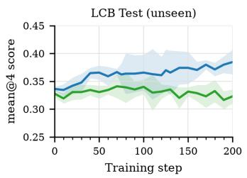

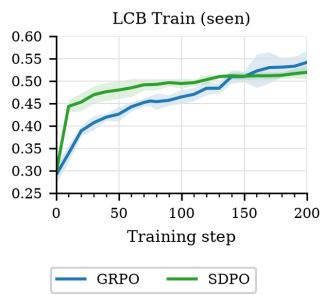

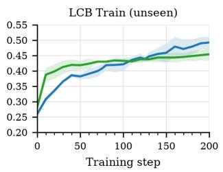

Figure 4: Qwen3-14B SDPO vs. GRPO on LiveCodeBench v6 across four seeds, scored as the fraction of problems with no failing test cases (mean ± std). TRAIN SEEN and TRAIN UNSEEN evaluate problems seen during training, on seen and on held-out test cases respectively; TEST UNSEEN evaluates held-out problems.  
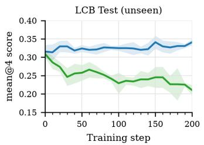

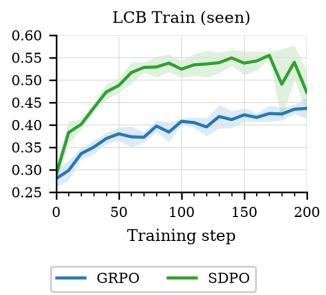

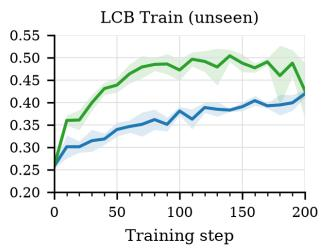  
Figure 5: Olmo-3-7B-Instruct SDPO vs. GRPO on LiveCodeBench v6 across four seeds, scored as the fraction of problems with no failing test cases (mean ± std). TRAIN SEEN and TRAIN UNSEEN evaluate problems seen during training, on seen and on held-out test cases respectively; TEST UNSEEN evaluates held-out problems.

Table 5: LiveCodeBench v6 score (fraction of problems with no failing test cases, mean±std over four seeds) on TEST UNSEEN for SDPO and GRPO at initialization, 80 steps, and 200 steps. Bold marks the better method at each step.
<table><tr><td>Model</td><td>Method</td><td>Step 0</td><td>Step 80</td><td>Step 200</td></tr><tr><td rowspan="2">Qwen3-8B</td><td>SDPO</td><td> $3 2 . 3 { \pm } 1 . 6 $ </td><td> $3 0 . 1 { \pm } 0 . 7 $ </td><td> $2 9 . 8 { \pm } 1 . 1 $ </td></tr><tr><td>GRPO</td><td> $3 0 . 6 { \pm } 1 . 0 $ </td><td>33.3±1.9</td><td> ${ \bf 3 4 . 3 { \pm 0 . 5 } }$ </td></tr><tr><td rowspan="2">Qwen3-14B</td><td>SDPO</td><td> $3 2 . 8 { \pm } 0 . 7 $ </td><td>33.9±2.8</td><td> $3 2 . 3 { \pm } 1 . 3 $ </td></tr><tr><td>GRPO</td><td> $3 3 . 6 { \pm } 0 . 4$ </td><td> $3 6 . 4 { \pm } 3 . 7 $ </td><td> $3 8 . 5 { \pm } 2 . 2 $ </td></tr><tr><td rowspan="2">Olmo-3-7B-Instruct</td><td>t SDPO</td><td> $3 0 . 9 { \pm } 1 . 0 $ </td><td> $2 5 . 2 { \pm } 1 . 0 $ </td><td> $2 1 . 0 { \pm } 1 . 4 $ </td></tr><tr><td>GRPO</td><td> ${ \bf 3 1 . 5 { \pm 1 . 8 } }$ </td><td> $3 2 . 7 { \pm } 1 . 2 $ </td><td> ${ \bf 3 4 . 1 { \pm 0 . 8 } }$ </td></tr></table>

Table 6: LiveCodeBench v6 score (fraction of problems with no failing test cases, mean±std over four seeds) on TRAIN SEEN for SDPO and GRPO at initialization, 80 steps, and 200 steps. Bold marks the better method at each step.
<table><tr><td>Model</td><td>Method</td><td>Step 0</td><td>Step 80 S</td><td>Step 200</td></tr><tr><td rowspan="2">Qwen3-8B</td><td>SDPO</td><td> $2 5 . 8 { \pm } 1 . 8 $ </td><td> ${ \bf 4 8 . 6 { \pm 0 . 7 } }$ </td><td> $4 8 . 9 { \pm } 1 . 6 $ </td></tr><tr><td>GRPO</td><td> $2 5 . 1 { \pm } 0 . 7 $ </td><td> $4 3 . 8 { \pm } 2 . 4 $ </td><td> ${ \bf 5 0 . 9 2 1 . 1 }$ </td></tr><tr><td rowspan="2">Qwen3-14B</td><td>SDPO</td><td> $\mathbf { 2 9 . 4 \pm 0 . 4 }$ </td><td> ${ \bf 4 9 . 2 \pm 1 . 3 }$ </td><td> $5 1 . 9 { \pm } 1 . 5 $ </td></tr><tr><td>GRPO</td><td> $2 9 . 0 { \pm } 2 . 0 $ </td><td> $4 5 . 4 { \pm } 1 . 8 $ </td><td> ${ \bf 5 4 . 1 } { \pm 2 . 5 }$ </td></tr><tr><td rowspan="2">Olmo-3-7B-Instruct</td><td>t SDPO</td><td> $2 { \bf 8 . 9 } { \pm } { \bf 1 . 7 }$ </td><td> ${ \pm } 2 . 9 { \pm } 2 . 3 $ </td><td> $4 7 . 2 { \pm } 4 . 7 $ </td></tr><tr><td>GRPO</td><td> $2 8 . 0 { \pm } 1 . 9 $ </td><td> $3 9 . 7 { \pm } 1 . 3 $ </td><td> $4 3 . 7 { \pm } 2 . 4 $ </td></tr></table>

Table 7: LiveCodeBench v6 score (fraction of problems with no failing test cases, mean±std over four seeds) on TRAIN UNSEEN for SDPO and GRPO at initialization, 80 steps, and 200 steps. Bold marks the better method at each step.
<table><tr><td>Model</td><td>Method</td><td>Step 0</td><td>Step 80</td><td> $\mathbf { S t e p } 2 \mathbf { 0 0 }$ </td></tr><tr><td rowspan="2">Qwen3-8B</td><td>SDPO</td><td> $2 5 . 6 { \pm } 0 . 5$ </td><td> ${ \bf 4 4 . 1 { \pm 1 . 0 } }$ </td><td> $4 4 . 0 { \pm } 1 . 7 $ </td></tr><tr><td>GRPO</td><td> $2 5 . 4 { \pm } 1 . 0 $ </td><td> $4 1 . 2 { \pm } 2 . 4 $ </td><td> $\mathbf { 4 6 . 2 } \pm 2 . \mathbf { 0 }$ </td></tr><tr><td rowspan="2">Qwen3-14B</td><td>SDPO</td><td> $2 8 . 2 { \pm } 1 . 4 $ </td><td> ${ \bf 4 3 . 0 { \pm } 0 . 2 }$ </td><td> $4 5 . 4 { \pm } 2 . 1 $ </td></tr><tr><td>GRPO</td><td> $2 6 . 0 { \pm } 1 . 0 $ </td><td> $4 1 . 8 { \pm } 1 . 6 $ </td><td> $\mathbf { 4 9 . 2 } \pm 2 . \mathbf { 0 }$ </td></tr><tr><td rowspan="2">Olmo-3-7B-Instruct</td><td>SDPO</td><td> ${ \bf 2 5 . 9 2 1 . 6 }$ </td><td> ${ \bf 4 8 . 5 { \pm 1 . 4 } }$ </td><td> $\pm 2 . 6 { \pm } 6 . 2 $ </td></tr><tr><td>GRPO</td><td> $2 5 . 8 { \pm } 0 . 4 $ </td><td> $3 6 . 2 { \pm } 2 . 3 $ </td><td> $4 1 . 9 { \pm } 0 . 8 $ </td></tr></table>

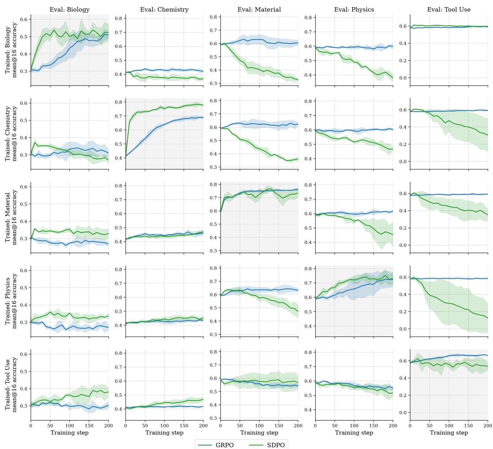  
Figure 6: Cross-domain validation accuracy of Qwen3-8B trained with GRPO and SDPO on Sci-KnowEval and ToolAlpaca, averaged over four seeds. Panels vary over training domains (across rows) and evaluation domains (across columns).

## D.3 OPSD METRICS ON QWEN3 MODELS

Table 8: Qwen3-1.7B training methods evaluated under avg@12 with thinking-on and thinking-off evaluation. OPSD think/no think denote whether teacher thinking was on during OPSD training. The subscript on GRPO runs denotes whether thinking was on or off during training. Denote z as the reference solution shown to the teacher. For every evaluation mode, we report the checkpoint with the best average performance (averaged over four seeds), reporting mean±std accuracy.
<table><tr><td rowspan="2"></td><td colspan="4">Thinking-on eval</td><td colspan="4">Thinking-off eval</td></tr><tr><td>AIME24</td><td>AIME25</td><td>HMMT25</td><td> $\mathbf { A v } \mathbf { g } .$ </td><td>AIME24</td><td>AIME25</td><td>HMMT25</td><td> $\mathbf { A v } \mathbf { g } .$ </td></tr><tr><td colspan="9">Baselines</td></tr><tr><td>Base</td><td> $4 6 . 7$ </td><td>34.4</td><td>21.9</td><td>34.4</td><td>15.8</td><td>10.0</td><td>4.4</td><td>10.1</td></tr><tr><td> $\mathbf { G R P O _ { t h i n k } }$ </td><td> $4 9 . 9 { \pm } 3 . 5 $ </td><td> $3 6 . 3 { \pm } 1 . 3 $ </td><td> $2 3 . 5 { \pm } 3 . 1 $ </td><td>36.6</td><td> $1 5 . 3 { \pm } 1 . 8 $ </td><td> $8 . 7 { \pm } 1 . 9$ </td><td> $5 . 9 { \pm } 1 . 4 $ </td><td>10.0</td></tr><tr><td> $\mathbf { G R P O _ { n o t h i n k } }$ </td><td> $4 9 . 9 { \pm } 2 . 1 $ </td><td> $3 7 . 8 { \pm } 1 . 7 $ </td><td> $2 4 . 7 { \pm } 1 . 1$ </td><td>37.4</td><td> $1 4 . 7 { \pm } 1 . 1$ </td><td> $1 1 . 4 { \pm } 0 . 6 $ </td><td> $6 . 7 { \pm } 0 . 6 $ </td><td>10.9</td></tr><tr><td>SFT</td><td> $5 0 . 3 { \pm } 0 . 8 $ </td><td> $3 6 . 9 { \pm } 1 . 3 $ </td><td> $2 5 . 8 { \pm } 1 . 4 $ </td><td>37.6</td><td> $3 7 . 8 { \pm } 3 . 3 $ </td><td> $2 7 . 6 { \pm } 1 . 2 $ </td><td> $1 8 . 3 { \pm } 2 . 1 $ </td><td>27.9</td></tr><tr><td colspan="9">OPSD (teacher thinking-on)</td></tr><tr><td> $\operatorname { R e f } z$ </td><td> ${ \bf 5 6 . 0 { \pm 1 . 2 } }$ </td><td> ${ \bf 4 2 . 4 \pm 1 . 6 }$ </td><td> $2 7 . 1 { \pm } 0 . 5 $ </td><td>41.8</td><td> $2 6 . 7 { \pm } 2 . 0 $ </td><td> $1 9 . 7 { \pm } 1 . 7 $ </td><td> $1 2 . 2 { \pm } 1 . 3 $ </td><td>19.5</td></tr><tr><td> $\Nu _ { 0 } \ z$ </td><td> $5 3 . 0 { \pm } 2 . 3 $ </td><td> $3 9 . 7 { \pm } 1 . 0 $ </td><td> $2 6 . 5 { \pm } 0 . 9 $ </td><td>39.7</td><td> $1 6 . 4 { \pm } 1 . 4 $ </td><td> $1 3 . 1 { \pm } 0 . 7 $ </td><td> $7 . 4 { \pm } 0 . 9$ </td><td>12.3</td></tr><tr><td>Shuffled z</td><td> ${ \pm } 6 . 0 { \pm } 1 . 4 $ </td><td> $3 9 . 2 { \pm } 0 . 7 $ </td><td> $2 7 . 8 { \pm } 0 . 5 $ </td><td>41.0</td><td> $2 8 . 8 { \pm } 1 . 6 $ </td><td> $2 1 . 5 { \pm } 1 . 0 \ $ </td><td> $1 6 . 0 { \pm } 1 . 2 $ </td><td>22.1</td></tr><tr><td colspan="9">OPSD (teacher thinking-off)</td></tr><tr><td>Ref z</td><td> $5 4 . 1 { \pm } 1 . 9 $ </td><td> $3 9 . 7 { \pm } 0 . 9 $ </td><td> $2 7 . 2 { \pm } 1 . 2 $ </td><td>40.3</td><td> $1 5 . 2 { \pm } 0 . 7 $ </td><td> $1 1 . 5 { \pm } 1 . 5 $ </td><td> $6 . 4 { \pm } 0 . 7$ </td><td>11.0</td></tr><tr><td>No z</td><td> $4 9 . 0 { \pm } 2 . 8 $ </td><td> $3 6 . 9 { \pm } 0 . 9 $ </td><td> $2 1 . 8 { \pm } 1 . 3$ </td><td>35.9</td><td> $1 1 . 2 { \pm } 0 . 8 $ </td><td> $7 . 2 { \pm } 0 . 8 $ </td><td> $4 . 2 { \pm } 0 . 7$ </td><td>7.5</td></tr><tr><td>Shuffled z</td><td> $5 4 . 0 { \pm } 0 . 8 $ </td><td> $4 0 . 1 { \pm } 2 . 0 $ </td><td> $2 7 . 4 { \pm } 1 . 7 $ </td><td>40.5</td><td> $1 6 . 4 { \pm } 1 . 6 $ </td><td> $1 3 . 2 { \pm } 1 . 4 $ </td><td> $8 . 5 { \pm } 0 . 3 $ </td><td>12.7</td></tr></table>

Table 9: Qwen3-4B training methods evaluated under $\mathsf { a v g } \ @ 1 2$ with thinking-on and thinking-off evaluation. OPSD think/no think denote whether teacher thinking was on during OPSD training. The subscript on GRPO runs denotes whether thinking was on or off during training. Denote z as the reference solution shown to the teacher. For every evaluation mode, we report the checkpoint with the best average performance (averaged over four seeds), reporting mean±std accuracy.
<table><tr><td rowspan="2">Method</td><td colspan="4">Thinking-on eval</td><td colspan="4">Thinking-off eval</td></tr><tr><td>AIME24</td><td>AIME25</td><td>HMMT25</td><td>Avg.</td><td>AIME24</td><td>AIME25</td><td>HMMT25</td><td>Avg.</td></tr><tr><td>Baselines</td><td></td><td></td><td></td><td></td><td></td><td></td><td></td><td></td></tr><tr><td>Base</td><td>76.4</td><td>67.8</td><td>43.1</td><td>62.4</td><td>21.7</td><td>20.3</td><td>11.9</td><td>18.0</td></tr><tr><td> $\mathbf { G R P O _ { t h i n k } }$ </td><td> $7 3 . 3 { \pm } 0 . 9 $ </td><td> $6 7 . 0 { \pm } 1 . 7 $ </td><td> $4 4 . 3 { \pm } 1 . 6 $ </td><td>61.6</td><td> $2 3 . 6 { \pm } 0 . 9 $ </td><td> $2 0 . 8 { \pm } 1 . 0 $ </td><td> $1 1 . 7 { \pm } 0 . 9 $ </td><td>18.7</td></tr><tr><td> $\mathbf { G R P O _ { n o t h i n k } }$ </td><td> $7 4 . 3 { \pm } 0 . 3 $ </td><td> $6 6 . 2 { \pm } 0 . 8 $ </td><td> $4 4 . 9 { \pm } 0 . 7 \ $ </td><td>61.8</td><td> $2 8 . 3 { \pm } 1 . 6 $ </td><td> $2 2 . 6 { \pm } 0 . 8 $ </td><td> $1 4 . 4 { \pm } 0 . 6 $ </td><td>21.8</td></tr><tr><td>SFT</td><td> $7 4 . 1 { \pm } 1 . 6 $ </td><td> $6 8 . 3 { \pm } 1 . 1 $ </td><td> $4 2 . 3 { \pm } 1 . 1 $ </td><td>61.6</td><td> ${ \bf 6 1 . 9 2 } 2 . 5$ </td><td> $5 0 . 7 { \pm } 1 . 4 $ </td><td> ${ \bf 3 2 . 9 2 1 . 5 }$ </td><td>48.5</td></tr><tr><td>OPSD (teacher thinking-on)</td><td></td><td></td><td></td><td></td><td></td><td></td><td></td><td></td></tr><tr><td>Ref z</td><td> $7 6 . 1 { \pm } 1 . 0 $ </td><td> $6 7 . 2 { \pm } 0 . 9 $ </td><td> $4 4 . 9 { \pm } 1 . 1 $ </td><td>62.7</td><td> $5 4 . 4 { \pm } 2 . 1$ </td><td> ${ \bf 5 1 . 9 2 } 2 . 2$ </td><td> $3 1 . 1 { \pm } 2 . 0 $ </td><td>45.8</td></tr><tr><td>No z</td><td> $7 4 . 5 { \pm } 2 . 0 $ </td><td> $\mathbf { 7 0 . 0 \pm } 2 . 2$ </td><td> $4 5 . 0 { \pm } 0 . 8 $ </td><td>63.2</td><td> $4 2 . 0 { \pm } 0 . 7 \ $ </td><td> $3 7 . 3 { \pm } 2 . 0 $ </td><td> $2 4 . 0 { \pm } 1 . 1$ </td><td>34.4</td></tr><tr><td>Shuffled z</td><td> $7 5 . 6 { \pm } 1 . 9 $ </td><td> $6 7 . 2 { \pm } 0 . 6 $ </td><td> ${ \bf 4 6 . 1 \pm 1 . 4 }$ </td><td>62.9</td><td> $5 5 . 9 { \pm 2 . 6 }$ </td><td> $5 1 . 5 { \pm } 3 . 5 $ </td><td> $3 1 . 0 { \pm } 0 . 8 $ </td><td>46.1</td></tr><tr><td>OPSD (teacher thinking-off)</td><td></td><td></td><td></td><td></td><td></td><td></td><td></td><td></td></tr><tr><td>Ref z</td><td> $7 6 . 2 { \pm } 0 . 5 $ </td><td> $6 6 . 9 { \pm } 1 . 3 $ </td><td> $4 3 . 6 { \pm } 1 . 5 $ </td><td>62.2</td><td> $2 7 . 3 { \pm } 1 . 7 $ </td><td> $2 1 . 6 { \pm } 0 . 8 $ </td><td> $1 2 . 1 { \pm } 1 . 0 $ </td><td>20.3</td></tr><tr><td> $\Nu _ { 0 } \ z$ </td><td> $7 4 . 0 { \pm } 0 . 3 $ </td><td> $6 6 . 5 { \pm } 1 . 8 $ </td><td> $4 3 . 1 { \pm } 1 . 1 $ </td><td>61.2</td><td> $2 2 . 6 { \pm } 0 . 9 $ </td><td> $1 9 . 3 { \pm } 1 . 7 $ </td><td> $1 1 . 3 { \pm } 0 . 1 $ </td><td>17.8</td></tr><tr><td> $\mathrm { S h u f f i e d } z$ </td><td> $7 6 . 2 { \pm } 1 . 1 $ </td><td> $6 8 . 1 { \pm } 2 . 2 $ </td><td> $4 5 . 2 { \pm } 0 . 7 $ </td><td>63.2</td><td> $2 6 . 2 { \pm } 1 . 8 $ </td><td> $2 2 . 6 { \pm } 1 . 6 $ </td><td> $1 0 . 1 { \pm } 0 . 7 $ </td><td>19.6</td></tr></table>

Table 10: Qwen3-14B training methods evaluated under $\mathsf { a v g } \ @ 1 2$ with thinking-on and thinking-off evaluation. OPSD think/no think denote whether teacher thinking was on during OPSD training. The subscript on GRPO runs denotes whether thinking was on or off during training. Denote z as the reference solution shown to the teacher. For every evaluation mode, we report the checkpoint with the best average performance (averaged over four seeds), reporting mean±std accuracy.
<table><tr><td rowspan="2">Method</td><td colspan="4">Thinking-on eval</td><td colspan="4">Thinking-off eval</td></tr><tr><td>AIME24</td><td>AIME25</td><td>HMMT25</td><td>Avg.</td><td>AIME24</td><td>AIME25</td><td>HMMT25</td><td>Avg.</td></tr><tr><td colspan="9">Baselines</td></tr><tr><td>Base</td><td>80.0</td><td>73.9</td><td>49.2</td><td>67.7</td><td>29.7</td><td>23.3</td><td>12.2</td><td>21.8</td></tr><tr><td> $\mathrm { G R P O } _ { \mathrm { t h i n k } }$ </td><td> $8 0 . 8 { \pm } 1 . 1$ </td><td> ${ \bf 7 4 . 0 { \pm } 0 . 6 }$ </td><td> $5 0 . 1 { \pm } 1 . 0 $ </td><td>68.3</td><td> $3 1 . 1 { \pm } 1 . 1$ </td><td> $2 4 . 6 { \pm } 0 . 5 $ </td><td> $1 2 . 6 { \pm } 0 . 6 $ </td><td>22.8</td></tr><tr><td> $\mathbf { G R P O _ { n o t h i n k } }$ </td><td> $8 0 . 7 { \pm } 1 . 7 $ </td><td> $7 3 . 5 { \pm } 0 . 8 $ </td><td> ${ \bf 5 1 . 2 \pm 1 . 8 }$ </td><td>68.5</td><td> $3 0 . 7 { \pm } 1 . 8 $ </td><td> $2 4 . 7 { \pm } 2 . 4 $ </td><td> $1 3 . 6 { \pm } 0 . 5 $ </td><td>23.0</td></tr><tr><td>SFT</td><td> $7 9 . 7 { \pm } 1 . 0 $ </td><td> $7 1 . 6 { \pm } 1 . 1$ </td><td> $4 9 . 6 { \pm } 0 . 9 \ $ </td><td>66.9</td><td> $6 5 . 7 \pm 1 . 2$ </td><td> $5 4 . 7 { \pm } 1 . 7 $ </td><td> $3 3 . 8 { \pm } 1 . 4 $ </td><td>51.4</td></tr><tr><td colspan="9">OPSD (teacher thinking-on)</td></tr><tr><td> $\operatorname { R e f } z$ </td><td> $8 0 . 8 { \pm } 0 . 6 $ </td><td> $7 2 . 7 { \pm } 1 . 3 $ </td><td> $4 9 . 7 { \pm } 1 . 5 $ </td><td>67.7</td><td> $6 5 . 3 { \pm } 3 . 8 $ </td><td> $5 1 . 8 { \pm } 6 . 5 $ </td><td> $3 5 . 4 \pm 2 . 4$ </td><td>50.8</td></tr><tr><td> $\Nu _ { 0 } \ z$ </td><td> ${ \bf 8 2 . 3 2 1 . 1 . 1 }$ </td><td> $7 3 . 1 { \pm } 1 . 4 $ </td><td> $5 1 . 0 { \pm } 2 . 3 $ </td><td>68.8</td><td> ${ \bf 6 6 . 3 \pm 3 . 3 }$ </td><td> ${ \bf 5 9 . 9 2 1 . 8 }$ </td><td> ${ \bf 4 1 . 0 { \pm } } 2 . 9 $ </td><td>55.7</td></tr><tr><td>Shuffled z</td><td> $8 0 . 5 { \pm } 0 . 7 $ </td><td> $7 3 . 9 { \pm } 1 . 1 $ </td><td> $4 9 . 7 { \pm } 1 . 2 $ </td><td>68.0</td><td> $6 4 . 2 { \pm } 5 . 8 $ </td><td> $5 4 . 7 { \pm } 5 . 0 $ </td><td> $3 7 . 6 { \pm } 4 . 6 $ </td><td>52.1</td></tr><tr><td colspan="9">OPSD (teacher thinking-off)</td></tr><tr><td>Ref z</td><td> $8 0 . 7 { \pm } \bar { 1 } . \bar { 0 }$ </td><td> $7 2 . 6 { \pm } 1 . 1$ </td><td> $5 0 . 0 { \pm } 2 . 5 $ </td><td>67.8</td><td> $3 2 . 6 { \pm } 1 . 4 $ </td><td> $2 5 . 6 { \pm } 0 . 8 $ </td><td> $1 3 . 1 { \pm } 1 . 1 $ </td><td>23.8</td></tr><tr><td> $\Nu _ { 0 } \ z$ </td><td> $8 1 . 5 { \pm } 1 . 1 $ </td><td> $7 3 . 9 { \pm } 0 . 8 $ </td><td> $5 0 . 0 { \pm } 1 . 3 $ </td><td>68.4</td><td> $3 4 . 2 { \pm } 1 . 9 $ </td><td> $2 6 . 8 { \pm } 0 . 7 \ $ </td><td> $1 6 . 5 { \pm } 1 . 4 $ </td><td>25.8</td></tr><tr><td>Shuffled z</td><td> $8 0 . 0 { \pm } 1 . 0 \ $ </td><td> ${ \bf 7 4 . 0 { \pm } 1 . 3 }$ </td><td> $5 0 . 8 { \pm } 2 . 0 $ </td><td>68.3</td><td> $2 9 . 2 { \pm } 2 . 3 $ </td><td> $2 4 . 7 { \pm } 1 . 0 $ </td><td> $1 2 . 6 { \pm } 1 . 7 $ </td><td>22.2</td></tr></table>

Table 11: Olmo-3-7B-Instruct training methods evaluated under avg@12. OPSD self-distill uses the frozen Olmo-3-7B-Instruct as the teacher, while OPSD cross-model uses Olmo-3-7B-Think as the teacher. Denote z as the reference solution shown to the teacher. We report the checkpoint with the best average performance (averaged over four seeds), reporting mean±std accuracy.
<table><tr><td>Method</td><td>AIME24</td><td>AIME25</td><td>HMMT25</td><td> $\mathbf { A v } \mathbf { g } .$ </td></tr><tr><td>Baselines</td><td></td><td></td><td></td><td></td></tr><tr><td>Base</td><td>50.3</td><td>37.2</td><td>23.6</td><td>37.0</td></tr><tr><td>GRPO SFT</td><td> $5 1 . 9 { \pm } 1 . 3 $   $5 3 . 1 { \pm } 0 . 5 $ </td><td> $3 9 . 2 { \pm } 1 . 0 $   $4 0 . 4 { \pm } 0 . 9 $ </td><td> $2 5 . 6 { \pm } 2 . 3 $   $2 4 . 7 { \pm } 1 . 2 $ </td><td>38.9 39.4</td></tr><tr><td>OPSD (self-distill)</td><td></td><td></td><td></td><td></td></tr><tr><td> $\operatorname { R e f } z$ </td><td> $5 5 . 4 \pm 1 . 0 $ </td><td> $4 1 . 7 { \pm } 0 . 4 $ </td><td> $2 6 . 4 { \pm } 0 . 8 $ </td><td>41.2</td></tr><tr><td> $\Nu _ { 0 } \ z$ </td><td> $5 4 . 0 { \pm } 1 . 7 $ </td><td> $4 1 . 7 { \pm } 1 . 3 $ </td><td> $2 5 . 3 { \pm } 0 . 9 $ </td><td>40.3</td></tr><tr><td>Shuffled z</td><td> $5 3 . 3 { \pm } 1 . 9 $ </td><td> $4 0 . 6 { \pm } 1 . 1$ </td><td> $2 6 . 7 { \pm } 1 . 2 $ </td><td>40.2</td></tr><tr><td>OPSD (cross-model)</td><td></td><td></td><td></td><td></td></tr><tr><td>Ref z</td><td> $6 4 . 6 { \pm } 2 . 5 $ </td><td> $5 0 . 7 { \pm } 1 . 1 $ </td><td> $3 5 . 9 { \pm } 2 . 2 $ </td><td>50.4</td></tr><tr><td> $\Nu _ { 0 } \ z$ </td><td> ${ \bf 6 6 . 1 \pm 1 . 3 }$ </td><td> $5 2 . 3 { \pm } 2 . 1 $ </td><td> ${ \bf 3 8 . 1 \pm 1 . 3 }$ </td><td>52.2</td></tr><tr><td>Shuffled z</td><td> $6 3 . 7 { \pm } 1 . 1 $ </td><td> $5 1 . 0 { \pm } 1 . 0 $ </td><td> $3 4 . 7 { \pm } 2 . 0 $ </td><td>49.8</td></tr></table>

Table 12: Qwen3-1.7B average response length and percentage of rollouts with an orphan $< / \mathrm { t h i n k } >$ tokens generated per method. Statistics are pooled over the rollouts generated from the existing AIME 24, AIME 25, and HMMT 25 evaluations at the best checkpoint when performance was averaged over four seeds. We report mean±std over seeds. Tok@best refers to the average response length in tokens of the best checkpoint, Tok@200 is the same quantity at checkpoint 200, and Orph.% refers to the fraction of thinking-off rollouts generated by the best checkpoint that emit a </think> with no opener of their own (we do not compute this for thinking-on as the model emits its own <think> and the closer is always matched).
<table><tr><td rowspan="2">Method</td><td colspan="2">Thinking-on eval</td><td colspan="3">Thinking-off eval</td></tr><tr><td>Tok@200</td><td>Tok@best</td><td>Orph. %</td><td>Tok@200</td><td>Tok@best</td></tr><tr><td colspan="6">Baselines</td></tr><tr><td>Base</td><td>18413</td><td>18413</td><td>0.0</td><td>2889</td><td>2889</td></tr><tr><td> $\mathbf { G R P O _ { t h i n k } }$ </td><td> $1 8 2 2 0 { \pm } 1 4 5 9$ </td><td> $1 8 3 5 6 { \pm } 7 4 3$ </td><td> $0 . 0 { \pm } 0 . 0 \ $ </td><td> $2 9 8 5 { \pm } 3 7 4$ </td><td> $2 8 2 7 { \pm } 1 4 5$ </td></tr><tr><td> $\mathrm { G R P O } _ { \mathrm { n o t h i n k } }$ </td><td> $1 9 0 8 9 { \pm } 1 4 7 5$ </td><td> $1 9 5 1 7 { \pm } 1 8 4 9$ </td><td> $0 . 0 { \pm } 0 . 0 \ $ </td><td> $3 1 6 1 \pm 8 7 4$ </td><td> $3 1 8 7 \pm 5 8 0$ </td></tr><tr><td>SFT</td><td> $1 4 6 4 6 { \pm } 2 1 9$ </td><td> $2 0 0 2 3 { \pm } 1 6 0$ </td><td> $4 8 . 4 { \pm } 1 . 5 $ </td><td> $1 5 4 3 8 { \pm } 1 1 8$ </td><td> $1 5 4 3 8 { \pm } 1 1 8$ </td></tr><tr><td colspan="6">OPSD (teacher thinking-on)</td></tr><tr><td>Ref z</td><td> $2 0 5 2 6 { \pm } 2 2 4$ </td><td> $2 1 3 0 1 { \pm } 2 7 1$ </td><td> $3 1 . 7 { \pm } 1 . 0 $ </td><td> $1 0 6 0 2 { \pm } 1 5 7$ </td><td> $1 0 6 0 2 { \pm } 1 5 7$ </td></tr><tr><td>No z</td><td> $2 0 9 9 1 { \pm } 3 5 6$ </td><td> $2 0 9 6 7 { \pm } 1 1 1$ </td><td> $3 . 2 { \pm } 0 . 8 $ </td><td> $9 8 8 7 { \pm } 9 7 8$ </td><td> $9 5 3 4 \pm 7 7 3$ </td></tr><tr><td>Shuffled z</td><td> $1 9 8 2 1 { \pm } 2 8 8$ </td><td> $1 9 9 3 3 { \pm } 1 0 2$ </td><td> $4 2 . 2 { \pm } 1 . 0 $ </td><td> $1 1 3 9 7 { \pm } 4 2 2$ </td><td> $1 1 4 5 6 { \pm } 2 4 3$ </td></tr><tr><td colspan="6">OPSD (teacher thinking-off)</td></tr><tr><td>Refz</td><td> $1 8 8 6 9 \pm 2 1 7$ </td><td> $2 0 0 2 6 { \pm } 1 6 6$ </td><td> $0 . 3 { \pm } 0 . 2 $ </td><td> $3 4 4 2 \pm 3 1 1$ </td><td> $4 0 0 8 { \pm } 1 0 4 $ </td></tr><tr><td> $\Nu _ { 0 } \ z$ </td><td> $1 8 5 5 3 { \pm } 2 9 5$ </td><td> $1 7 3 7 4 { \pm } 1 6 5$ </td><td> $0 . 0 { \pm } 0 . 0 \ $ </td><td> $4 8 1 6 \pm 3 0 0 8$ </td><td> $2 3 8 1 { \pm } 1 9 7$ </td></tr><tr><td>Shuffled z</td><td> $1 7 6 1 9 2 4 5$ </td><td> $2 1 2 5 8 { \pm } 6 6$ </td><td> $0 . 7 { \pm } 0 . 2 $ </td><td> $3 1 2 1 { \pm } 2 0 8$ </td><td> $5 4 7 0 { \pm } 2 3 1$ </td></tr></table>

Table 13: Qwen3-4B average response length and orphan $< / \mathrm { t h i n k } >$ tokens generated per method. Statistics are pooled over the rollouts generated from the existing AIME 24, AIME 25, and HMMT 25 evaluations at the best checkpoint when performance was averaged over four seeds. We report mean±std over seeds. Tok@best refers to the average response length in tokens of the best checkpoint and Tok@200 is the same quantity at checkpoint 200. Orph.% refers to the fraction of rollouts generated by the best checkpoint with thinking disabled that emit $\mathrm { a } < / \mathrm { t h i }$ nk> with no opener of their own (we do not compute this for thinking-on as the model emits its own <think> and the closer is always matched).
<table><tr><td rowspan="2">Method</td><td colspan="2">Thinking-on eval</td><td colspan="3">Thinking-off eval</td></tr><tr><td>Tok@200</td><td>Tok@best</td><td>Orph. %</td><td>Tok@200</td><td>Tok@best</td></tr><tr><td colspan="6">Baselines</td></tr><tr><td>Base</td><td>17556</td><td>17556</td><td>0.0</td><td>3719</td><td>3719</td></tr><tr><td> $\mathbf { G R P O _ { t h i n k } }$ </td><td> $1 7 7 4 2 { \pm } 1 9 7$ </td><td> $1 7 4 5 6 { \pm } 1 0 6$ </td><td> $0 . 0 { \pm } 0 . 0 \ $ </td><td> $3 6 0 4 { \pm } 1 7 0$ </td><td> $3 7 4 6 { \pm } 2 7 7$ </td></tr><tr><td> $\mathrm { G R P O } _ { \mathrm { n o t h i n k } }$ </td><td> $1 7 8 5 5 { \pm } 3 5 0 $ </td><td> $1 8 0 7 8 { \pm } 5 8 5$ </td><td> $0 . 0 { \pm } 0 . 0 \ $ </td><td> $4 3 4 8 { \pm } 6 5 2$ </td><td> $4 6 9 3 { \pm } 5 3 7$ </td></tr><tr><td>SFT</td><td> $1 3 8 7 1 { \pm } 1 5 3$ </td><td>18273±220</td><td> $5 3 . 0 { \pm } 1 . 7 $ </td><td> $1 4 0 2 8 { \pm } 7 0 $ </td><td>14028±70</td></tr><tr><td colspan="6">OPSD (teacher thinking-on)</td></tr><tr><td>Ref z</td><td> $1 9 8 1 4 { \pm } 1 6 1$ </td><td> $1 9 8 3 2 { \pm } 1 2 9$ </td><td> $6 4 . 1 { \pm } 1 . 6 $ </td><td> $1 6 5 1 8 { \pm } 3 3 9$ </td><td> $1 6 4 4 5 { \pm } 3 0 8$ </td></tr><tr><td>No z</td><td> $2 0 7 1 1 { \pm } 2 0 5$ </td><td> $2 0 3 1 0 { \pm } 1 9 3$ </td><td> $2 0 . 3 { \pm } 3 . 2 $ </td><td> $1 8 5 6 0 { \pm } 7 5 9$ </td><td> $1 5 7 3 3 { \pm } 5 0 2$ </td></tr><tr><td>Shuffled z</td><td> $1 9 5 4 2 { \pm } 3 0 2$ </td><td> $1 9 7 8 9 { \pm } 5 1 $ </td><td> $6 9 . 9 { \pm 2 . 6 }$ </td><td> $1 6 7 5 8 { \pm } 3 2 2$ </td><td> $1 6 7 3 2 { \pm } 1 2 6$ </td></tr><tr><td colspan="6">OPSD (teacher thinking-off)</td></tr><tr><td>Ref z</td><td> $1 9 6 6 6 { \pm } 1 6 1$ </td><td> $1 9 6 6 6 { \pm } 1 6 1$ </td><td> $1 . 9 { \pm } 0 . 3 $ </td><td> $7 1 3 8 { \pm } 2 0 9$ </td><td> $7 1 2 7 \pm 3 7 2$ </td></tr><tr><td> $\Nu _ { 0 } \ z$ </td><td> $1 8 1 6 1 { \pm } 2 0 7$ </td><td> $1 7 0 8 2 { \pm } 1 1 4$ </td><td> $0 . 0 { \pm } 0 . 0 \ $ </td><td> $4 6 2 1 { \pm } 1 7 7$ </td><td> $3 3 9 5 { \pm } 1 2 6$ </td></tr><tr><td>Shuffled z</td><td> $1 9 3 6 8 { \pm } 1 4 5$ </td><td> $1 9 8 7 9 { \pm } 1 1 8$ </td><td> $2 . 0 { \pm } 0 . 2 $ </td><td> $6 6 7 0 { \pm } 1 3 5$ </td><td> $6 6 7 0 { \pm } 1 3 5$ </td></tr></table>

Table 14: Qwen3-8B average response length and orphan $< / \mathrm { t h i n k } >$ tokens generated per method. Statistics are pooled over the rollouts generated from the existing AIME 24, AIME 25, and HMMT 25 evaluations at the best checkpoint when performance was averaged over four seeds. We report mean±std over seeds. Tok@best refers to the average response length in tokens of the best checkpoint and Tok@200 is the same quantity at checkpoint 200. Orph.% refers to the fraction of rollouts generated by the best checkpoint with thinking disabled that emit $\mathbf { a } < / \mathrm { t h i n k } >$ with no opener of their own (we do not compute this for thinking-on as the model emits its own <think> and the closer is always matched).
<table><tr><td rowspan="2">Method</td><td colspan="2">Thinking-on eval</td><td colspan="3">Thinking-off eval</td></tr><tr><td>Tok@200</td><td>Tok@best</td><td>Orph. %</td><td>Tok@200</td><td>Tok@best</td></tr><tr><td>Baselines</td><td></td><td></td><td></td><td></td><td></td></tr><tr><td>Base</td><td>18264</td><td>18264</td><td>0.0</td><td>3580</td><td>3580</td></tr><tr><td> $\mathbf { G R P O _ { t h i n k } }$ </td><td> $1 8 2 0 9 { \pm } 4 8 4$ </td><td> $1 8 1 6 0 { \pm } 4 1 7$ </td><td> $0 . 0 { \pm } 0 . 0 \ $ </td><td> $3 7 6 2 { \pm } 1 2 3$ </td><td> $3 7 6 2 \pm 1 2 3$ </td></tr><tr><td> $\mathrm { G R P O } _ { \mathrm { n o t h i n k } }$ </td><td> $1 8 4 5 3 { \pm } 2 0 3$ </td><td> $1 8 4 7 9 { \pm } 2 4 3$ </td><td> $0 . 0 { \pm } 0 . 0 \ $ </td><td> $4 1 1 6 { \pm } 3 6 7$ </td><td> $4 3 5 5 { \pm } 3 1 3$ </td></tr><tr><td>SFT</td><td> $1 7 8 0 7 { \pm } 8 6$ </td><td> $1 8 5 1 1 \pm 2 5 4$ </td><td> $7 5 . 0 { \pm } 1 . 0 $ </td><td> $1 4 4 8 8 { \pm } 1 4 3$ </td><td> $1 4 4 5 6 { \pm } 2 0 6$ </td></tr><tr><td>OPSD (teacher thinking-on)</td><td></td><td></td><td></td><td></td><td></td></tr><tr><td>Ref z</td><td> $2 0 2 5 5 { \pm } 1 6 7$ </td><td> $2 0 1 8 8 { \pm } 1 3 1$ </td><td> $3 0 . 6 { \pm } 2 . 5 $ </td><td> $1 2 0 2 5 { \pm } 2 2 3$ </td><td> $9 7 5 0 { \pm } 3 8 4$ </td></tr><tr><td>No z</td><td> $2 0 1 7 4 { \pm } 1 2 3$ </td><td> $2 0 2 8 4 { \pm } 1 8 9$ </td><td> $4 0 . 1 { \pm } 3 . 5 $ </td><td> $1 5 4 9 3 { \pm } 4 4 7$ </td><td> $1 5 4 9 3 { \pm } 4 4 7$ </td></tr><tr><td>Shuffled z</td><td> $2 0 0 0 8 { \pm } 1 3 1$ </td><td> $1 9 6 6 9 { \pm } 5 2 4$ </td><td> $2 5 . 2 { \pm } 6 . 3$ </td><td> $1 3 8 6 4 { \pm } 6 3 6$ </td><td> $1 3 8 6 4 { \pm } 6 3 6$ </td></tr><tr><td>OPSD (teacher thinking-off)</td><td></td><td></td><td></td><td></td><td></td></tr><tr><td>Ref z</td><td> $1 9 4 6 0 \dot { \pm } 1 \dot { 5 } 1$ </td><td> $1 9 4 0 3 { \pm } 4 5$ </td><td> $4 . 7 { \pm } 1 . 3 $ </td><td> $5 8 7 0 { \pm } 1 1 0$ </td><td> $5 3 8 4 \pm 2 4 1$ </td></tr><tr><td> $\Nu _ { 0 } \ z$ </td><td> $1 9 0 0 3 { \pm } 1 4 6$ </td><td> $1 9 0 0 3 { \pm } 1 4 6$ </td><td> $0 . 0 { \pm } 0 . 0 \ $ </td><td> $6 7 3 6 { \pm } 5 4 4$ </td><td> $5 9 4 4 \pm 2 3 0$ </td></tr><tr><td>Shuffled z</td><td> $1 9 3 8 5 { \pm } 1 5 7$ </td><td> $1 9 3 5 6 { \pm } 1 5 6$ </td><td> $6 . 7 { \pm } 0 . 3 $ </td><td> $5 7 1 0 { \pm } 2 5 2$ </td><td> $9 0 2 7 { \pm } 1 6 0$ </td></tr></table>

Table 15: Qwen3-14B average response length and orphan $< / \mathrm { t h i n k } >$ tokens generated per method. Statistics are pooled over the rollouts generated from the existing AIME 24, AIME 25, and HMMT 25 evaluations at the best checkpoint when performance was averaged over four seeds. We report mean±std over seeds. Tok@best refers to the average response length in tokens of the best checkpoint and Tok@200 is the same quantity at checkpoint 200. Orph.% refers to the fraction of rollouts generated by the best checkpoint with thinking disabled that emit $\iota < / \tt t h i n k >$ with no opener of their own (we do not compute this for thinking-on as the model emits its own <think> and the closer is always matched).
<table><tr><td rowspan="2">Method</td><td colspan="2">Thinking-on eval</td><td colspan="3">Thinking-off eval</td></tr><tr><td>Tok@200</td><td>Tok@best</td><td>Orph. %</td><td>Tok@200</td><td>Tok@best</td></tr><tr><td colspan="6">Baselines</td></tr><tr><td>Base</td><td>16757</td><td>16757</td><td>0.0</td><td>3341</td><td>3341</td></tr><tr><td> $\mathbf { G R P O _ { t h i n k } }$ </td><td> $1 6 4 3 5 { \pm } 2 2 3$ </td><td> $1 6 4 4 7 { \pm } 1 4 4$ </td><td> $0 . 0 { \pm } 0 . 0 \ $ </td><td> $3 3 8 9 { \pm } 1 4 2$ </td><td> $3 4 3 8 { \pm } 7 9$ </td></tr><tr><td> $\mathrm { G R P O } _ { \mathrm { n o t h i n k } }$ </td><td> $1 6 6 3 8 { \pm } 2 0 0$ </td><td> $1 6 6 4 6 { \pm } 2 7 0$ </td><td> $0 . 0 { \pm } 0 . 0 \ $ </td><td> $3 5 0 0 { \pm } 3 5 7$ </td><td> $3 5 6 9 { \pm } 8 9$ </td></tr><tr><td>SFT</td><td> $1 7 0 6 1 { \pm } 1 3 8$ </td><td> $1 7 5 9 7 { \pm } 1 6 0$ </td><td> $4 8 . 4 { \pm } 1 . 6 $ </td><td> $1 3 1 4 5 { \pm } 1 1 7$ </td><td> $1 3 1 1 9 { \pm } 7 4$ </td></tr><tr><td colspan="6">OPSD (teacher thinking-on)</td></tr><tr><td>Ref z</td><td>17484±109</td><td> $1 7 5 2 5 { \pm } 1 2 8$ </td><td> $5 5 . 7 { \pm } 1 0 . 4 $ </td><td> $1 3 6 0 9 { \pm } 1 7 8 0$ </td><td> $1 3 6 0 9 { \pm } 1 7 8 0$ </td></tr><tr><td>No z</td><td> $1 8 3 7 0 { \pm } 2 3 $ </td><td> $1 8 1 7 9 { \pm } 2 0 2$ </td><td> $6 7 . 7 { \pm } 6 . 2 $ </td><td> $2 0 4 6 8 { \pm } 5 3 2$ </td><td> $1 9 4 5 6 { \pm } 6 3 1$ </td></tr><tr><td>Shuffled z</td><td> $1 7 6 5 3 { \pm } 2 0 0$ </td><td> $1 7 7 9 4 \pm 1 4 2$ </td><td> $6 4 . 6 { \pm } 1 7 . 2 $ </td><td> $1 6 6 5 7 { \pm } 4 0 3$ </td><td> $1 4 4 9 6 { \pm } 8 3 2$ </td></tr><tr><td colspan="6">OPSD (teacher thinking-off)</td></tr><tr><td>Ref z</td><td> $1 7 4 4 9 { \pm } 1 2 5$ </td><td> $1 7 5 7 6 { \pm } 1 9 4$ </td><td> $0 . 0 { \pm } 0 . 0 \ $ </td><td> $8 6 0 8 { \pm } 4 1 1$ </td><td> $5 9 9 8 { \pm } 2 7 3$ </td></tr><tr><td> $\Nu _ { 0 } \ z$ </td><td> $1 7 4 6 0 { \pm } 1 3 9$ </td><td> $1 7 6 3 6 { \pm } 6 9$ </td><td> $0 . 0 { \pm } 0 . 0 \ $ </td><td> $8 5 2 2 \pm 1 1 3 4$ </td><td> $6 5 2 6 { \pm } 7 9 1$ </td></tr><tr><td>Shuffled z</td><td> $1 7 3 2 7 { \pm } 2 3 9$ </td><td> $1 7 2 9 2 { \pm } 2 8 2$ </td><td> $0 . 0 { \pm } 0 . 0 \ $ </td><td> $7 9 0 3 { \pm } 4 5 9$ </td><td> $5 6 5 3 { \pm } 4 0 7$ </td></tr></table>

Table 16: Olmo-3-7B-Instruct average response length and orphan $< / { \tt t h i n k } >$ tokens generated per method. Statistics are pooled over the rollouts generated from the existing AIME 24, AIME 25, and HMMT 25 evaluations at the best checkpoint when performance was averaged over four seeds. We report mean±std over seeds. Tok@best refers to the average response length in tokens of the best checkpoint and Tok@200 is the same quantity at checkpoint 200. Orph.% refers to the fraction of rollouts generated by the best checkpoint with thinking disabled that emit $\mathbf { a _ { \theta } } < / \mathrm { t h i n k } >$ with no opener of their own. Olmo-3-7B-Instruct’s chat template already ignores enable thinking (every variant renders an identical prompt with no tag prefilled, hence no thinking-on column), and its native format is to reason with no opener and then emit $< / \mathrm { t h i }$ nk> before a clean final answer, so its base model already scores 63.0% and emits <think> in 0.0% of rollouts.
<table><tr><td rowspan="2">Method</td><td colspan="3">Thinking-off eval</td></tr><tr><td>Orph. %</td><td>Tok@200</td><td>Tok@best</td></tr><tr><td>Baselines</td><td></td><td>7732</td><td>7732</td></tr><tr><td>Base GRPO</td><td>63.0  $6 3 . 7 { \pm } 1 . 7 $ </td><td> $7 8 8 8 { \pm } 1 3 4$ </td><td> $7 9 1 5 { \pm } 2 1 4$ </td></tr><tr><td>SFT</td><td> $6 9 . 3 { \pm } 1 . 3 $ </td><td> $8 7 9 4 \pm 1 7 5$ </td><td> $8 6 4 6 { \pm } 7 1$ </td></tr><tr><td>OPSD (self teacher)</td><td></td><td></td><td></td></tr><tr><td>Ref z</td><td> $5 6 . 4 { \pm } 1 . 3 $ </td><td> $7 5 0 1 { \pm } 1 3 1$ </td><td> $8 2 6 2 { \pm } 1 0 1$ </td></tr><tr><td> $\operatorname { N o } z$  Shuffled z</td><td> $5 6 . 2 { \pm } 1 . 0 $ </td><td> $7 2 6 6 { \pm } 1 1 0$ </td><td> $8 4 2 7 { \pm } 7 8$ </td></tr><tr><td></td><td> $5 5 . 3 { \pm } 1 . 7 $ </td><td> $7 8 9 7 { \pm } 1 2 1$ </td><td> $8 3 4 7 { \pm } 1 8 3$ </td></tr><tr><td>OPSD (teacher</td><td> $O l m o { - } 3 { - } 7 B { - } T h i n k )$ </td><td></td><td></td></tr><tr><td>Refz</td><td> $9 9 . 1 { \pm } 0 . 3 $ </td><td> $1 4 2 3 9 { \pm } 8 4$ </td><td> $1 4 2 3 9 { \pm } 8 4$ </td></tr><tr><td> $\operatorname { N o } z$ </td><td> $9 8 . 4 { \pm } 0 . 4 $ </td><td> $1 4 7 4 5 { \pm } 2 4$ </td><td> $1 4 7 4 5 { \pm } 2 4$ </td></tr><tr><td> $\mathrm { S h u f f i e d } z$ </td><td></td><td></td><td></td></tr><tr><td></td><td> $9 9 . 2 { \pm } 0 . 4 $ </td><td> $1 4 0 1 9 \pm 1 7 8$ </td><td> $1 4 0 1 9 2 \pm 1 7 8$ </td></tr></table>

## D.4 OPSD EXAMPLE GENERATIONS

Problem: There exist real numbers x and y, both greater than 1, such that log (y<sup>x</sup>) = log x<sup>4y</sup> = 10.   
Find xy.   
Model output (thinking-off):   
We are given the following equations involving logarithms:   
\$\$   
\log x(yˆx) = 10 \quad \text{and} \quad \log y(xˆ{4y}) = 10   
\$\$   
We are to find the value of \$ xy \$, where \$ x > 1 \$ and \$ y > 1 \$ are   
real numbers.   
[... solution continues ...]   
### Step 3: Multiply equations (3) and (4)   
Let’s multiply both equations together:   
\$\$   
\left(x \cdot \frac{\log y}{\log x} \right) \cdot \left(4y \cdot   
\frac{\log x}{\log y} \right) = 10 \cdot 10 = 100   
\$\$   
Simplify the left-hand side:   
\$\$   
x \cdot 4y \cdot \frac{\log y}{\log x} \cdot \frac{\log x}{\log y} = 4xy   
\$\$   
So:   
\$\$   
4xy = 100 \Rightarrow xy = \frac{100}{4} = 25   
\$\$   
### Final Answer:   
\$\$   
\boxed{25}   
\$\$

Figure 7: Base Qwen3-8B thinking-off rollout on an AIME24 problem generated with temperature 1.0. The chat template opens a <think> block, the model reasons in the first person, tests several numerical values of x before finding a one-line argument, and closes the block with a single matched </think> before writing a polished solution. Exactly one <think> and one </think> appear in the generation. The full generation is 559 tokens long.

```prolog
Problem: There exist real numbers x and y, both greater than 1, such that log (y<sup>x</sup>) = log x<sup>4y</sup> = 10.
Find xy.
Model output (thinking-on):
<think>
Okay, so I need to solve this problem where there are real numbers
x and y, both greater than 1, such that log base x of yˆx equals
log base y of xˆ{4y} equals 10. And I need to find the product xy.
Alright, let me try to unpack this step by step.
First, let me recall some logarithm properties. The logarithm log b(a)
is equal to ln(a)/ln(b) if I remember correctly. Also, there’s a
power rule: log b(aˆc) = c<sub>*</sub>log b(a). [... reasoning continues ...]
What if x is smaller? Let’s try x = 2. Let me check again. Wait,
tried x = 2, got around 7.28. Let me try x = 1.5. Then y = 25 / 1.5
≈ 16.666...
Compute log {1.5}(yˆ1.5) = 1.5 <sub>*</sub> log {1.5}(y). log {1.5}(y) =
log {1.5}(25 / 1.5) = log {1.5}(25) - log {1.5}(1.5) = log {1.5}(25) - 1.
Let me compute log {1.5}(25). Let me use natural logs: ln(25)/ln(1.5)
≈ 3.2189 / 0.4055 ≈ 7.936. So log {1.5}(y) ≈ 7.936 - 1 = 6.936.
Multiply by 1.5: ≈ 10.404. That’s close to 10. Maybe with x
slightly larger than 1.5?
Wait, so with x = 1.5, the value is approximately 10.4, which is
slightly above 10. Let me try x = 1.6. [... solution continues ...]
Therefore, I think that’s solid. I can’t find any mistake in this
reasoning. So I think the answer is 25.
<sub>**</sub>Final Answer<sub>**</sub>
\boxed{25}
</think>
To solve the given problem, we are given two equations involving
logarithms:
$$
\log x(yˆx) = 10 \quad \text{and} \quad \log y(xˆ{4y}) = 10
$$
Our goal is to find the value of $ xy $, where $ x $ and $ y $ are
both greater than 1.
### Step 1: Use the Power Rule of Logarithms
[... solution continues ...]
Thus, the result is consistent across all derivations.
---
### Final Answer
$$
\boxed{25}
$$
```

Figure 8: Base Qwen3-8B thinking-on rollout on an AIME24 problem generated with temperature 1.0. The chat template opens a <think> block, the model reasons in the first person, tests several numerical values of x before finding a one-line argument, and closes the block with a single matched </think> before writing a polished solution. Exactly one <think> and one </think> appear in the generation. The generation is 5, 067 tokens.

Problem: There exist real numbers x and y, both greater than 1, such that log (y<sup>x</sup>) = log x<sup>4y</sup> = 10   
Find xy.   
Model output:   
Not sure what to do with this one. Maybe I can try to find the value   
of x and y?   
Okay, the problem says there exist real numbers \$ x \$ and \$ y \$, both   
greater than 1, such that:   
[... reasoning continues ...]   
Wait, that seems straightforward. Did I do everything right?   
Let me check again.   
[... reasoning continues ...]   
This is a transcendental equation and may not have an algebraic   
solution, but the problem says such real numbers exist, so it’s   
sufficient that we found \$ xy = 25 \$, and the problem doesn’t ask us   
to find specific x and y.   
Therefore, my conclusion is that \$ xy = 25 \$.   
So the answer should be \boxed{25}   
<sub>\*\*</sub>Final Answer<sub>\*\*</sub>   
\boxed{25}   
</think>   
To solve the problem, we are given two expressions involving   
logarithms:   
\$\$ \log x(yˆx) = \log y(xˆ{4y}) = 10 \$\$   
We are to determine the value of the product \$ xy \$, where both \$ x \$   
and \$ y \$ are real numbers greater than 1.   
### Step 1: Simplify the First Logarithmic Expression   
We begin by simplifying the logarithmic expression:   
\$\$ \log x(yˆx) \$\$   
Using the logarithmic identity:   
\$\$ \log b(aˆn) = n \cdot \log b(a) \$\$   
[... solution continues ...]   
### Step 5: Final Answer   
We conclude that the product \$ xy \$ is:   
\$\$ \boxed{25} \$\$

Figure 9: Qwen3-8B emits an orphan </think> token under thinking-off evaluation. The model was trained with OPSD using a thinking-mode teacher and matched privileged information z and this rollout was generated from checkpoint 160 on an AIME24 problem, taking 2, 529 tokens total. Although thinking is disabled (the chat template already supplies an empty <think></think> block; see Appendix C), the response opens with an extended first-person reasoning trace, boxes an answer, emits a second, unmatched </think>, and only then writes a polished solution, reproduc ing the structure of a thinking-on response.

## D.5 OPSD MASKING RESULTS

To isolate LLM reasoning and grading improvements from unrelated distillation in, we do ablations for Qwen3-8B confining losses to the first 90% of the student rollout and last 10% of the student rollout.
<table><tr><td></td><td colspan="4">Thinking-on eval</td><td colspan="4">Thinking-off eval</td></tr><tr><td>Priv. info</td><td>AIME24</td><td>AIME25</td><td>HMMT25</td><td>Avg.</td><td>AIME24</td><td>AIME25</td><td>HMMT25</td><td>Avg.</td></tr><tr><td colspan="9">Last 10% of tokens</td></tr><tr><td>Ref. z</td><td> $7 7 . 2 { \pm } 0 . 3 $ </td><td> $6 9 . 9 { \pm } 1 . 5 $ </td><td> $4 6 . 9 { \pm } 1 . 3 $ </td><td>64.7</td><td> $3 3 . 6 { \pm } 1 . 7 $ </td><td> $2 5 . 1 { \pm } 1 . 6 $ </td><td> $1 5 . 1 { \pm } 0 . 8 $ </td><td>24.6</td></tr><tr><td> $\Nu _ { 0 } \ z$ </td><td> $7 7 . 8 { \pm } 1 . 4 $ </td><td> $6 9 . 3 { \pm } 1 . 4 $ </td><td> $4 8 . 1 { \pm } 1 . 2 $ </td><td>65.1</td><td> $3 4 . 8 { \pm } 0 . 9 $ </td><td> $2 8 . 4 { \pm } 1 . 6 $ </td><td> $1 6 . 9 { \pm } 1 . 0 \ $ </td><td>26.7</td></tr><tr><td>Shuffled z</td><td> $7 6 . 6 { \pm } 1 . 0 $ </td><td> $7 1 . 9 { \pm } 0 . 9 $ </td><td> $4 7 . 6 { \pm } 1 . 0 $ </td><td>65.4</td><td> $3 1 . 9 { \pm } 0 . 9 $ </td><td> $2 3 . 8 { \pm } 1 . 6 $ </td><td> $1 6 . 2 { \pm } 2 . 4 $ </td><td>24.0</td></tr><tr><td colspan="9">All but last 10%</td></tr><tr><td>Ref. z</td><td> $7 7 . 1 { \pm } 0 . 5 $ </td><td> $7 0 . 8 { \pm } 2 . 1 $ </td><td> $4 7 . 6 { \pm } 1 . 8 $ </td><td>65.2</td><td> $3 5 . 1 { \pm } 1 . 2 $ </td><td> $2 7 . 6 { \pm } 1 . 0 $ </td><td> $1 7 . 3 { \pm } 1 . 7 $ </td><td>26.7</td></tr><tr><td>No z</td><td> $7 7 . 7 { \pm } 0 . 6 $ </td><td> $7 2 . 6 { \pm } 0 . 9$ </td><td> $4 7 . 5 { \pm } 0 . 7 $ </td><td>65.9</td><td> ${ \bf 4 7 . 4 \pm 1 . 8 }$ </td><td> $3 7 . 3 { \pm } 1 . 5 $ </td><td> $2 6 . 2 { \pm } 1 . 2 $ </td><td>36.9</td></tr><tr><td>Shuffled z</td><td> $7 7 . 4 { \pm } 1 . 4 $ </td><td> $7 1 . 6 { \pm } 1 . 1$ </td><td> $4 6 . 2 { \pm } 1 . 1 $ </td><td>65.1</td><td> $4 6 . 0 { \pm } 2 . 7 $ </td><td> $3 5 . 4 { \pm } 1 . 6 $ </td><td> $2 2 . 6 { \pm } 2 . 5 $ </td><td>34.7</td></tr></table>

Table 17: Masking ablation for Qwen3-8B OPSD training runs evaluated with avg@12 on AIME24, AIME25, and HMMT25. Blocks refer to which parts of student tokens the distillation loss is applied to (the rest is masked out). Rows within a block are the privileged information z shown to the teacher (the reference solution, one shuffled from another problem, or absent). Teacher thinking was on during OPSD training throughout. Each row contains the numbers aggregated over 4 seeds of a single checkpoint trained using the given privileged information. Accuracy is mean±std across those seeds. All settings and hyperparameters except masking follow (Zhao et al., 2026a).

## D.6 GRADIENT ALIGNMENT RESULTS

We report gradient cosine similarities for the remaining Qwen3 models in Table 18 and for Olmo-3-7B-Instruct in Table 19, following Appendix E.3. Tables 20 and 21 report the gradient noise scale of every gradient.

Table 18: Cosine similarity between the gradient of each method trained on OpenThoughts and the $\mathrm { G R P O } _ { \mathrm { n o t h i n k } }$ gradient on AIME24, AIME25, and HMMT25, measured at the base model (pooled over four seeds, ± paired jackknife error). Teacher thinking-on/off denotes whether thinking was enabled for the OPSD teacher, and z denotes the reference solution shown to the teacher.
<table><tr><td>Method</td><td>Qwen3-1.7B</td><td>Qwen3-4B</td><td>Qwen3-8B</td><td>Qwen3-14B</td></tr><tr><td colspan="5">Baselines</td></tr><tr><td> $\mathbf { G R P O _ { t h i n k } }$ </td><td> $- 0 . 0 0 8 \pm 0 . 0 1 3$ </td><td> $+ 0 . 0 0 8 \pm 0 . 0 1 7$ </td><td> $- 0 . 0 1 4 \pm 0 . 0 1 9$ </td><td> $- 0 . 0 0 4 \pm 0 . 0 2 7$ </td></tr><tr><td> $\mathrm { G R P O } _ { \mathrm { n o t h i n k } }$ </td><td> $+ 0 . 0 1 8 \pm 0 . 0 4 7$ </td><td> $+ 0 . 0 6 0 \pm 0 . 0 5 0$ </td><td> $+ 0 . 1 1 8 \pm 0 . 0 5 0$ </td><td> $+ 0 . 1 6 6 \pm 0 . 0 2 9$ </td></tr><tr><td>SFT</td><td> $- 0 . 1 5 3 \pm 0 . 0 2 6$ </td><td> $- 0 . 0 5 6 \pm 0 . 0 2 1$ </td><td> $- 0 . 0 7 5 \pm 0 . 0 3 1$ </td><td> $- 0 . 0 5 6 \pm 0 . 0 1 5$ </td></tr><tr><td colspan="5">OPSD (teacher thinking-on)</td></tr><tr><td>Ref z</td><td> $- 0 . 2 0 5 \pm 0 . 0 5 8$ </td><td> $- 0 . 1 3 2 \pm 0 . 0 5 6$ </td><td> $- 0 . 1 6 0 \pm 0 . 0 2 0$ </td><td> $- 0 . 0 7 5 \pm 0 . 0 1 7$ </td></tr><tr><td>No z</td><td> $- 0 . 2 0 4 \pm 0 . 0 6 2$ </td><td> $- 0 . 1 3 4 \pm 0 . 0 4 1$ </td><td> $- 0 . 1 5 7 \pm 0 . 0 1 9$ </td><td> $- 0 . 0 7 1 \pm 0 . 0 1 8$ </td></tr><tr><td>Shuffled z</td><td> $- 0 . 1 9 8 \pm 0 . 0 5 7$ </td><td> $- 0 . 1 3 9 \pm 0 . 0 5 2$ </td><td> $- 0 . 1 5 7 \pm 0 . 0 1 9$ </td><td> $- 0 . 0 6 7 \pm 0 . 0 1 4$ </td></tr><tr><td colspan="5">OPSD (teacher thinking-off)</td></tr><tr><td>Ref z</td><td> $- 0 . 1 8 5 \pm 0 . 0 5 8$ </td><td> $- 0 . 0 8 6 \pm 0 . 0 5 6$ </td><td> $- 0 . 1 6 3 \pm 0 . 0 1 3$ </td><td> $- 0 . 0 9 0 \pm 0 . 0 2 3$ </td></tr><tr><td>No z</td><td> $- 0 . 0 8 7 \pm 0 . 0 6 8$ </td><td> $- 0 . 1 4 5 \pm 0 . 0 6 4$ </td><td> $- 0 . 1 7 2 \pm 0 . 0 1 8$ </td><td> $- 0 . 0 8 7 \pm 0 . 0 2 5$ </td></tr><tr><td>Shuffled z</td><td> $- 0 . 1 5 7 \pm 0 . 0 6 0$ </td><td>-0.076 ± 0.053</td><td> $- 0 . 1 6 3 \pm 0 . 0 1 1$ </td><td> $- 0 . 0 9 3 \pm 0 . 0 2 1$ </td></tr></table>

Table 19: Cosine similarity between the gradient of each method trained on OpenThoughts and the GRPO gradient on AIME24, AIME25, and HMMT25 for Olmo-3-7B-Instruct, measured at the base model (pooled over four seeds, ± paired jackknife error). OPSD self-distill uses the frozen Olmo-3-7B-Instruct as the teacher, while OPSD cross-model uses Olmo-3-7B-Think as the teacher.
<table><tr><td>Method</td><td>Cosine</td></tr><tr><td>Baselines GRPO SFT</td><td> $+ 0 . 0 2 6 \pm 0 . 0 2 1$   $- 0 . 0 6 0 \pm 0 . 0 2 1$ </td></tr><tr><td>OPSD (self-distill) Ref z No z Shuffled z</td><td> $+ 0 . 0 5 7 \pm 0 . 0 5 2$   $+ 0 . 0 5 1 \pm 0 . 0 4 7$   $+ 0 . 0 6 2 \pm 0 . 0 5 4$ </td></tr><tr><td>OPSD (cross-model)</td><td></td></tr><tr><td>Ref z No z Shuffled z</td><td> $+ 0 . 0 5 2 \pm 0 . 0 3 1$   $+ 0 . 0 5 6 \pm 0 . 0 2 8$   $+ 0 . 0 5 2 \pm 0 . 0 2 8$ </td></tr></table>

Table 20: Gradient noise scale across four seeds for the math probe, where each seed’s gradient is the mean over 64 iterations; 0 is a noiseless estimate. The reference is $\mathrm { G R P O } _ { \mathrm { n o t h i n k } }$ on AIME24, AIME25, and HMMT25. For Olmo-3-7B-Instruct, the teacher thinking-on and thinking-off rows are replaced by OPSD cross-model (Olmo-3-7B-Think teacher) and self-distill, respectively.
<table><tr><td>Gradient</td><td>Qwen3-1.7B</td><td>Qwen3-4B</td><td>Qwen3-8B</td><td>Qwen3-14B</td><td>Olmo-3-7B-Instruct</td></tr><tr><td>Reference</td><td>3.583</td><td>3.436</td><td>3.666</td><td>3.736</td><td>4.033</td></tr><tr><td>Baselines</td><td></td><td></td><td></td><td></td><td></td></tr><tr><td> $\mathbf { G R P O _ { t h i n k } }$ </td><td>3.979</td><td>4.108</td><td>3.889</td><td>3.786</td><td></td></tr><tr><td>GRPOnothink</td><td>3.653</td><td>3.483</td><td>3.322</td><td>2.717</td><td>3.951</td></tr><tr><td>SFT</td><td>0.000</td><td>0.000</td><td>0.001</td><td>0.001</td><td>0.002</td></tr><tr><td>OPSD (teacher thinking-on / cross-model)</td><td></td><td></td><td></td><td></td><td></td></tr><tr><td>Ref z</td><td>0.001</td><td>0.001</td><td>0.002</td><td>0.001</td><td>0.008</td></tr><tr><td>No z</td><td>0.002</td><td>0.002</td><td>0.003</td><td>0.002</td><td>0.011</td></tr><tr><td>Shuffled z</td><td>0.001</td><td>0.001</td><td>0.001</td><td>0.001</td><td>0.010</td></tr><tr><td>OPSD (teacher thinking-off / self-distill)</td><td></td><td></td><td></td><td></td><td></td></tr><tr><td>Ref z</td><td>0.003</td><td>0.004</td><td>0.003</td><td>0.004</td><td>0.010</td></tr><tr><td>No z</td><td>0.010</td><td>0.008</td><td>0.010</td><td>0.007</td><td>0.017</td></tr><tr><td>Shuffled z</td><td>0.004</td><td>0.004</td><td>0.002</td><td>0.006</td><td>0.011</td></tr></table>

Table 21: Gradient noise scale across four seeds for the LiveCodeBench v6 probe, where each seed’s gradient is the mean over 8 iterations; 0 is a noiseless estimate. The reference is GRPO on TEST UNSEEN; GRPO and SDPO are trained on TRAIN SEEN.
<table><tr><td>Gradient</td><td>Qwen3-8B</td><td>Qwen3-14B</td><td>Olmo-3-7B-Instruct</td></tr><tr><td>Reference</td><td>1.968</td><td>3.152</td><td>1.999</td></tr><tr><td>GRPO</td><td>2.855</td><td>3.125</td><td>2.076</td></tr><tr><td>SDPO</td><td>0.043</td><td>0.018</td><td>0.020</td></tr></table>

## E IMPLEMENTATION DETAILS

All our experiments are run were run with 8xH100 nodes (with no multi-node parallelism), primarily leveraging the vLLM inference engine (Kwon et al., 2023). We run our experiments on top of the OPSD codebase written in TRL (von Werra et al., 2020) and the SDPO codebase which uses veRL (Sheng et al., 2024). Our SDPO LCBv6 runs train for ∼40 hours, while the SDPO science and tool use jobs took ∼3 hours. OPSD runs took up to ∼2 hours and GRPO runs on the OpenThoughts dataset took up to ∼6 hours. OPSD thinking-on evaluations took up to ∼2.5 hours per dataset and OPSD thinking-off evaluations took up to ∼1 hour per dataset. Our gradient similarity analyses took up to ∼2 hours per training setting.

## E.1 SDPO HYPERPARAMETERS

LiveCodeBench v6. We summarize hyperparameters used for in the LCBv6 experiments in Table 22, mirroring the hyperparameters taken from the SDPO setup (Hubotter et al., 2026). We use the¨ exact same rich feedback settings and prompts as Hubotter et al. (2026), changing only the dataset ¨ splits.

Table 22: SDPO and GRPO training hyperparameters on LiveCodeBench v6.
<table><tr><td>Parameter</td><td>GRPO</td><td>SDPO</td></tr><tr><td>General</td><td></td><td></td></tr><tr><td>Model</td><td>{Qwen3-8/14B, Olmo-3-7B-Instruct} {Qwen3-8/14B, Olmo-3-7B-Instruct}</td><td></td></tr><tr><td>Thinking</td><td>False</td><td>False</td></tr><tr><td>Total steps</td><td>200</td><td>200</td></tr><tr><td>Data</td><td></td><td></td></tr><tr><td>Max. prompt length</td><td>2048</td><td>2048</td></tr><tr><td>Batching</td><td></td><td></td></tr><tr><td>Question batch size</td><td>32</td><td>32</td></tr><tr><td>Mini batch size</td><td>8</td><td>1</td></tr><tr><td>Number of rollouts</td><td>8</td><td>8</td></tr><tr><td>Rollout</td><td></td><td></td></tr><tr><td>Inference engine</td><td>vLLM</td><td>vLLM</td></tr><tr><td>Temperature</td><td>1.0</td><td>1.0</td></tr><tr><td>Max. response length</td><td>8192</td><td>8192</td></tr><tr><td>Validation</td><td></td><td></td></tr><tr><td>Number of rollouts</td><td>4</td><td>4</td></tr><tr><td>Temperature</td><td>0.6</td><td>0.6</td></tr><tr><td>Top-p</td><td>0.95</td><td>0.95</td></tr><tr><td>Max. response length</td><td>8192</td><td>8192</td></tr><tr><td>SDPO loss</td><td></td><td></td></tr><tr><td>Top-K distillation</td><td></td><td>20</td></tr><tr><td>Distillation divergence</td><td></td><td>Reverse-KL</td></tr><tr><td>Clip advantages</td><td></td><td></td></tr><tr><td>Teacher-EMA update rate</td><td></td><td>0.01</td></tr><tr><td>Rollout importance sampling clip</td><td></td><td>2.0</td></tr><tr><td>GRPO loss</td><td></td><td></td></tr><tr><td>€-high</td><td>0.28</td><td></td></tr><tr><td>Rollout importance sampling clip</td><td>2.0</td><td></td></tr><tr><td>KL coefficient (λ)</td><td>0.0</td><td></td></tr><tr><td>Training</td><td></td><td></td></tr><tr><td>Optimizer</td><td>AdamW</td><td>AdamW</td></tr><tr><td>Learning rate</td><td> $1 \times 1 0 ^ { - 6 }$ </td><td> $1 \times 1 0 ^ { - 6 }$ </td></tr><tr><td>Warmup steps</td><td>0</td><td>0</td></tr><tr><td>Weight decay</td><td>0.01</td><td>0.01</td></tr><tr><td>Gradient clip norm</td><td>1.0</td><td>1.0</td></tr></table>

SciKnowEval and ToolAlpaca. We also follow the SDPO and GRPO hyperparameters used in Hubotter et al. (2026) for SciKnowEval and ToolAlpaca, except that we find that GRPO is unstable¨ with learning rate $1 \times 1 0 ^ { - 5 }$ , we report results with $1 \times 1 0 ^ { \dot { - } 6 }$ , running SDPO and GRPO in an on-policy manner. We summarize these hyperparameters in Table 23.

Table 23: GRPO and SDPO training hyperparameters on SciKnowEval and ToolAlpaca
<table><tr><td>Parameter</td><td>GRPO</td><td>SDPO</td></tr><tr><td>General</td><td></td><td></td></tr><tr><td>Model</td><td>Qwen3-8B</td><td>Qwen3-8B</td></tr><tr><td>Thinking</td><td>False</td><td>False</td></tr><tr><td>Total steps</td><td>200</td><td>200</td></tr><tr><td>Data</td><td></td><td></td></tr><tr><td>Max. prompt length</td><td>2048</td><td>2048</td></tr><tr><td>Batching</td><td></td><td></td></tr><tr><td>Question batch size</td><td>32</td><td>32</td></tr><tr><td>Mini batch size</td><td>32</td><td>32</td></tr><tr><td>Number of rollouts</td><td>8</td><td>8</td></tr><tr><td>Rollout</td><td></td><td></td></tr><tr><td>Inference engine</td><td>vLLM</td><td>vLLM</td></tr><tr><td>Temperature</td><td>1.0</td><td>1.0</td></tr><tr><td>Max. response length</td><td>8192</td><td>8192</td></tr><tr><td>Validation</td><td></td><td></td></tr><tr><td>Number of rollouts</td><td>16</td><td>16</td></tr><tr><td>Temperature</td><td>0.6</td><td>0.6</td></tr><tr><td>Top-p</td><td>0.95</td><td>0.95</td></tr><tr><td>Max. response length</td><td>8192</td><td>8192</td></tr><tr><td>SDPO loss</td><td></td><td></td></tr><tr><td>Top-K distillation</td><td></td><td>100</td></tr><tr><td>Distillation divergence</td><td></td><td>Jensen-Shannon</td></tr><tr><td>Clip advantages</td><td></td><td></td></tr><tr><td>Teacher-EMA update rate</td><td></td><td>0.05</td></tr><tr><td>Rollout importance sampling clip</td><td></td><td>2.0</td></tr><tr><td>Training</td><td></td><td></td></tr><tr><td>Optimizer</td><td>AdamW</td><td>AdamW</td></tr><tr><td>Learning rate</td><td>1 × 10−6</td><td> $1 \times 1 0 ^ { - 5 }$ </td></tr><tr><td>Warmup steps</td><td>0</td><td>0</td></tr><tr><td>Weight decay</td><td>0.01</td><td>0.01</td></tr><tr><td>Gradient clip norm</td><td>1.0</td><td>1.0</td></tr></table>

## E.2 OPSD HYPERPARAMETERS

We report our hyperparameters in Table 24; we follow the training configurations provided by Zhao et al. (2026a), training on OpenThoughts (Guha et al., 2025), changing only the content of z. The one exception is training length: we run OPSD and SFT for 100 steps longer than Zhao et al. (2026a) to evaluate fully converged performance.

## E.3 GRADIENT SIMILARITY ANALYSIS

We record each method’s gradients by running its training loop from the base model with learning rate zero, so the weights never change, and averaging the gradients over all iterations of each run for downstream computation. We use the hyperparameters of Tables 22 and 24, with two exceptions: GRPO uses num iterations= 1, since at learning rate zero a second pass over the same rollouts gives the same gradient, and we record gradients with respect to all parameters rather than the LoRA adapters (for the math results), since LoRA’s zero-initialized matrices may lead to poorly defined gradient behavior. We run 64 iterations per seed for OPSD on OpenThoughts and 8 for SDPO on LiveCodeBench v6, with four seeds per method.

We define the following quantities for use in our analysis:

Pooled cosine similarity. Given $S = 4$ seeds, let $\bar { g } _ { s }$ denote the gradient of seed s averaged over its iterations, and $\begin{array} { r } { \bar { g } = \frac { 1 } { S } \sum _ { s = 1 } ^ { S } \bar { g } _ { s } } \end{array}$ the pooled gradient. We report the cosine similarity between the pooled gradients of the reference and of each method:

Table 24: GRPO, OPSD, and SFT training hyperparameters on OpenThoughts. <sup>†</sup>Olmo-3-7B-Instruct has no thinking toggle, so thinking settings do not apply: it is trained and evaluated in its native mode, and its OPSD teacher is either the frozen student (self-distillation) or Olmo-3-7B-Think (cross-model).
<table><tr><td>Parameter</td><td>GRPO</td><td>OPSD</td><td>SFT</td></tr><tr><td>General</td><td></td><td></td><td></td></tr><tr><td>Model</td><td colspan="3">Qwen3-{1.7, 4, 8, 14}B, Olmo-3-7B-Instruct</td></tr><tr><td>Student-thinking</td><td>{True, False} †</td><td>False†</td><td>False†</td></tr><tr><td>Teacher-thinking</td><td></td><td>{True, False}†</td><td></td></tr><tr><td>Total steps</td><td>500</td><td>200</td><td>200</td></tr><tr><td>Data</td><td></td><td></td><td></td></tr><tr><td>Max. prompt length</td><td>2048</td><td>2048</td><td>2048</td></tr><tr><td>Batching</td><td></td><td></td><td></td></tr><tr><td>Question batch size</td><td>4</td><td>32</td><td>32</td></tr><tr><td>Number of rollouts</td><td>8</td><td>1</td><td></td></tr><tr><td>Optimizer steps per generation</td><td>2</td><td>1</td><td></td></tr><tr><td>Rollout</td><td></td><td></td><td></td></tr><tr><td>Inference engine</td><td>vLLM</td><td>vLLM</td><td>vLLM</td></tr><tr><td>Temperature</td><td>1.2</td><td>1.1</td><td></td></tr><tr><td>Top-p</td><td>1.0</td><td>0.95</td><td></td></tr><tr><td>Top-k</td><td></td><td>20</td><td></td></tr><tr><td>Max. response length</td><td>16000</td><td>1024</td><td></td></tr><tr><td>Validation</td><td></td><td></td><td></td></tr><tr><td>Student-thinking</td><td>{True, False} †</td><td>{True, False } †</td><td>{True, False} †</td></tr><tr><td>Number of rollouts</td><td>12</td><td>12</td><td>12</td></tr><tr><td>Temperature</td><td>1.0</td><td>1.0</td><td>1.0</td></tr><tr><td>Top-p</td><td colspan="3">0.95 (thinking-on), 0.8 (thinking-off), 0.8 (Olmo-3-7B-Instruct)</td></tr><tr><td>Top-k</td><td></td><td></td><td></td></tr><tr><td>Max. response length</td><td>38912</td><td>38912</td><td>38912</td></tr><tr><td>OPSD loss</td><td></td><td></td><td></td></tr><tr><td>Teacher policy</td><td></td><td>Frozen student or Olmo-3-7B-Think†</td><td></td></tr><tr><td>Teacher z</td><td></td><td>{ref z, no z, shuffled z}</td><td></td></tr><tr><td>Distillation divergence</td><td></td><td>Forward KL</td><td></td></tr><tr><td>Token clip (Qwen3-1.7B, 4B)</td><td></td><td>0.05</td><td></td></tr><tr><td>Token clip (Qwen3-8B, 14B)</td><td></td><td>0.06</td><td></td></tr><tr><td>Token clip (Olmo-3-7B-Instruct)</td><td></td><td>0.06</td><td></td></tr><tr><td>Training</td><td></td><td></td><td></td></tr><tr><td>Optimizer</td><td>AdamW</td><td>AdamW</td><td>AdamW</td></tr><tr><td>Learning rate</td><td>5 × 10−6</td><td>5 × 10−6</td><td>5 × 10−6</td></tr><tr><td>Warmup steps</td><td>0</td><td>0</td><td>0</td></tr><tr><td>Weight decay</td><td>0</td><td>0</td><td>0</td></tr><tr><td>Gradient clip norm</td><td>1.0</td><td>0.1</td><td>1.0</td></tr><tr><td>LoRA rank</td><td>64</td><td>64</td><td>64</td></tr><tr><td>LoRA alpha</td><td>128</td><td>128</td><td>128</td></tr></table>

$$
c = \frac { \bar { g } ^ { \mathrm { r e f } } \cdot \bar { g } ^ { \mathrm { m e t h o d } } } { \| \bar { g } ^ { \mathrm { r e f } } \| _ { 2 } \| \bar { g } ^ { \mathrm { m e t h o d } } \| _ { 2 } } .\tag{6}
$$

Jackknife error. Let $c _ { - s }$ denote the pooled cosine similarity computed with seed s removed from both the reference and the method, and c¯ the mean of the $c _ { - s }$ . The jackknife error is then

$$
\mathrm { S E } = \sqrt { \frac { S - 1 } { S } \sum _ { s = 1 } ^ { S } \left( c _ { - s } - \bar { c } \right) ^ { 2 } } .\tag{7}
$$

Gradient noise scale. Following McCandlish et al. (2018), we measure the noise of each pooled gradient as

$$
{ \frac { \mathrm { t r } ( \Sigma ) } { \| { \bar { g } } \| _ { 2 } ^ { 2 } } } ,\tag{8}
$$

where Σ is the covariance of $\bar { g } _ { 1 } , \dots , \bar { g } _ { S }$ . It is 0 for a noiseless estimate.

## E.4 OPSD TEACHER AND STUDENT PROMPTS

We use the standard prompts used by Zhao et al. (2026a).

Student Prompt

Problem: {problem}   
Please reason step by step, and put your final answer within \boxed{}.   
Figure 10: Student prompt for OPSD.

Privileged Teacher Prompt

Problem: {problem}   
Here is a reference solution to this problem:   
=== Reference Solution Begin ===   
{z}   
=== Reference Solution End ===   
After reading the reference solution above, make sure you truly   
understand the reasoning behind each step---do not copy or paraphrase   
it. Now, using your own words and independent reasoning, derive the   
same final answer to the problem above. Think step by step, explore   
different approaches, and don’t be afraid to backtrack or reconsider   
if something doesn’t work out:  
Figure 11: Teacher prompt template for OPSD. The privileged information ablations “ref z”, “no $z ^ { , \dagger } ,$ and “shuffled z” differ only by the content of what “{z}” is replaced by in the template.