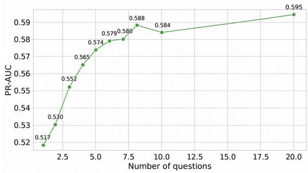
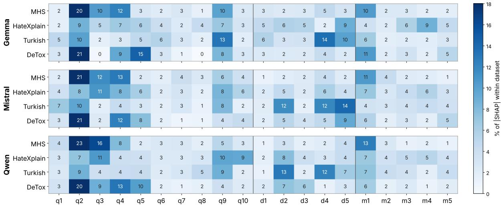

# Decomposing and Predicting Annotation Disagreement in Harmful Content Across Languages

Irem Ecem Yelkanat1† Faeze Ghorbanpour1,2† Alexander Fraser1,2

1School of Computation, Information and Technology, TU Munich

2Munich Center for Machine Learning (MCML)

{iremecem.yelkanat, faeze.ghorbanpour}@tum.de

†Equal contribution.

## Abstract

Annotator disagreement is increasingly recognized as a meaningful property of subjective tasks, rather than merely noise to be removed. Predicting which items are likely to be contested could help allocate annotation effort and route difficult cases to human review. We propose predicting disagreement from interpretable semantic properties of the text. An LLM answers a set of binary questions covering harmful-content characteristics, disagreement-related cues such as borderline severity and missing context, and languagesensitive cues such as local slurs. A classifier predicts disagreement from these answers, and we analyze which questions contribute most to the predictions. Across four datasets in English, German, and Turkish and three open-weight LLMs, our structured question features outperform direct prompting by 10.5 ROC-AUC points and the strongest text-based baselines by 5.0 points. A compact subset of eight questions performs within 1.5 ROC-AUC points of the full twenty-question set. In leave-one-datasetout evaluation, models retain roughly 90–95% of their in-domain ROC-AUC. Across models and datasets, questions about derogation, missing context, and decision boundaries serve as the strongest predictors, suggesting that what makes harmful content contested is partly ob servable in the text.

## 1 Introduction

Annotators often disagree when labeling subjective tasks. A post that one annotator marks as hateful, another may consider merely offensive, and a third may see as acceptable. For a long time, such disagreement was treated as noise, resolved through majority voting or adjudication, and then discarded (Pavlick and Kwiatkowski, 2019). A growing body of work now argues that disagreement is a meaningful property of subjective tasks, reflecting ambiguity, missing context, and differences in annotators’ backgrounds and beliefs (Plank, 2022; Sap et al., 2022; Davani et al., 2022). Harmful content is a clear case: what counts as hateful or offensive depends on who is reading, which cultural and linguistic norms apply, and how much context is available (Pachinger et al., 2025).

If disagreement is informative, predicting it is useful. A disagreement predictor can indicate where to collect additional annotations, which items to route to human moderators (Villate-Castillo et al., 2024), and which parts of a dataset need to be audited. Obtaining disagreement labels, however, requires several annotators per item, which is costly and rarely feasible for new languages. A natural shortcut is to use LLMs, which are now widely used as annotators (Tan et al., 2024; Gligoric et al. ´ , 2025). However, they struggle to predict disagreement directly (Ni et al., 2026) , and tend to collapse the diversity of human judgments (Chochlakis et al., 2025). Specifically for harmful content, LLMs align more with the Western community, even when prompted in the native language (Bui et al., 2025; Masud et al., 2024).

Existing approaches leave two gaps. First, they offer limited insight into why an item is contested. One line of work models disagreement from the annotator side, using their identities, demographics, or beliefs (Davani et al., 2022; Fleisig et al., 2023; Sap et al., 2022). This requires annotatorlevel information that is often unavailable, and demographics alone explain only part of the variation (Orlikowski et al., 2023). Another line trains classifiers to predict disagreement directly from text (Fornaciari et al., 2021; Villate-Castillo et al., 2024), or aligns LLM uncertainty with human disagreement through fine-tuning (Lu et al., 2026). These models can be accurate, but their predictions are not tied to explicit properties of the text. Analyses of text-side factors exist (Sandri et al., 2023; Falk and Lapesa, 2025), but they rely on manual annotation or post hoc correlation rather than on a predictive model. Second, the obvious alternative of asking an LLM whether annotators would disagree works poorly. LLMs struggle to capture annotator disagreement (Ni et al., 2026), and they tend to be overconfident on the low-agreement items that matter most (Lu et al., 2025).

We propose predicting disagreement from interpretable properties of the text. Rather than asking an LLM for a holistic judgment, we ask a set of targeted binary questions about each item. The questions fall into three groups: questions about derogatory and hateful content (whether the text uses slurs or dehumanizes a group), questions about boundary cues associated with disagreement (whether the severity is borderline or context is missing), and questions about language- and culture-specific cues (whether the text contains a local slur or coded insult). A random forest classifier predicts disagreement from the answers, and we use TreeSHAP to attribute each prediction to individual questions. Unlike token attributions or a direct LLM judgment, our features are interpretable by construction: each is the answer to a named question, so importance can be read at the level of concepts rather than words. We evaluate this across three openweight LLMs, Gemma 3 27B, Mistral Small 3.2 24B, and Qwen 3.6 27B, and four datasets spanning three languages: the English MHS and HateXplain, the Turkish Hate Speech Dataset, and the German DeTox.

Our contributions are: (1): We formulate annotator disagreement prediction as answering interpretable questions about the text, and introduce a set of twenty questions covering harmful content, boundary cues, and language-specific cues. (2): We show across four datasets, three languages, and three LLMs that these features predict disagreement better than direct prompting and text-based baselines, and that eight questions suffice. (3): We analyze which questions drive disagreement predictions and release the questions, prompts, and LLM answers for all datasets and show that question-based disagreement predictors transfer across datasets, retaining most of their in-domain performance.

Our question-based approach outperforms direct prompting by 10.5 ROC-AUC points and the strongest supervised embedding baseline by 5.0 points. Boundary and context questions add a consistent signal on top of content questions, and a subset of eight questions performs within 1.5 points of the full set of twenty, reducing LLM calls by 60%.

In leave-one-dataset-out evaluation, without any explicit language or dataset feature, models retain 90–95% of their in-domain ROC-AUC. Questions on derogation and context are the most consistently important across languages and models.

## 2 Related work

Annotator Disagreement in Subjective Tasks Disagreement in subjective annotation was long treated as noise, but a growing body of work shows it is systematic. Akhtar et al. (2020) found polarized annotator groups in hate speech, Leonardelli et al. (2021) showed that offensive language datasets contain many low-agreement items, and Plank (2022) framed label variation as a property of the data to be modeled. Later work examined why annotators disagree. Sap et al. (2022) linked toxicity ratings to annotator beliefs and identities, Sandri et al. (2023) proposed a taxonomy of disagreement reasons such as ambiguity and missing context, and Pachinger et al. (2025) showed that high-disagreement toxic items reflect subjective perception rather than inconsistency. Disagreement also has a cultural dimension, as shown for English hate speech (Lee et al., 2024), multilingual irony (Casola et al., 2024), and multilingual hateful memes (Bui et al., 2025). These studies identify the sources of disagreement through manual analysis or correlation (Falk and Lapesa, 2025), but none use these sources to predict disagreement. Our boundary and context questions operationalize these reasons as automatically extracted features.

Modeling and Predicting Disagreement Early models of disagreement took the annotator’s perspective, predicting individual labels with perannotator heads (Davani et al., 2022) or from demographics (Fleisig et al., 2023). These need annotator metadata, which explains only part of the variation (Orlikowski et al., 2023). Text-side approaches instead learn label distributions, from soft-label multi-task learning (Fleisig et al., 2023) to disagreement as an auxiliary moderation task (Villate-Castillo et al., 2024) and LLMs fine-tuned to express human-like uncertainty (Lu et al., 2026). Their predictions, however, are not tied to explicit properties of the text. More recently, LLMs have been tested as direct judges of disagreement, and they fall short: they reproduce majority views (Chochlakis et al., 2025), are overconfident on lowagreement offensive items (Lu et al., 2025), and struggle to predict disagreement when asked directly (Ni et al., 2026). We avoid both limitations. LLMs answer targeted questions they can judge reliably, and an interpretable model learns the mapping to disagreement, without annotator metadata.

Interpretable Harmful Content Detection Interpretability for harmful content began with tokenlevel rationales, such as HateXplain (Mathew et al., 2021), and post-hoc attribution methods, which can be unfaithful (Slack et al., 2020) and highlight words rather than concepts. Concept bottleneck models (Koh et al., 2020) address this by routing predictions through human-readable concepts, an approach that has recently been scaled to LLM-based text classification (Sun et al., 2025). For harmful content, LLM-scored adjectives have served as concepts for hate and counter-speech detection (Labadie-Tamayo et al., 2026), checklists of binary questions answered by an LLM have similarly been used to make hate speech classification interpretable (Girón et al., 2026), and LLM-rated hate attributes recover aggregate hate scores more effectively than direct prompting (Jradi et al., 2026). All of these target the harmfulness label. We apply concept-based prediction to a different target: annotator agreement, which requires concepts that capture what makes content contested rather than what makes it harmful.

Cross-Lingual and Cross-Dataset Transfer Harmful content classifiers transfer poorly. Zeroshot cross-lingual detection misses languagespecific expressions (Nozza, 2021), target-language data remains necessary (Röttger et al., 2022; Ghorbanpour et al., 2025b), classifiers are culturally insensitive (Lee et al., 2023), and LLM moderation shifts with geographic cues (Masud et al., 2024). Recent work narrows the gap through multilingual retrieval (Ghorbanpour et al., 2025a). Disagreement modeling, by contrast, has been evaluated almost exclusively within a single dataset or language (Dehghan et al., 2025; Leonardelli et al., 2025; Zaghouani, 2026), likely because transferring disagreement predictors to unseen datasets and languages is more challenging than label transfer, as what is considered contested can depend on local norms. Because our questions are defined independently of any dataset or language, the same representation applies across languages, allowing direct leave-one-dataset-out evaluation.

## 3 Methodology

We predict annotator disagreement from structured properties of the text. For each item, an LLM answers a fixed set of binary questions covering harmful content, boundary cues, and language-specific cues, and we extract the model’s confidence in each answer from its token probabilities. The answers, confidences, and pairwise combinations of answers form a feature vector that is shared across datasets. A random forest trained on this vector predicts whether annotators disagree, both within a dataset and on unseen datasets.

We use a deliberately minimal, dataset-agnostic target: whether at least two annotators assign different labels. So defined, it is invariant to the label inventory and depends only on label identity, not meaning, so binary and multi-class schemes, and intermediate labels, are treated uniformly. Observed disagreement does rise with the number of annotators per item, but across our datasets, disagreement rates do not track annotator counts, indicating that count is not the dominant factor. We also train and evaluate within each dataset rather than comparing raw disagreement magnitudes across them, so differences in annotation protocol do not enter our claims.

## 3.1 Problem Formalization

Let $d \in \textit { D }$ be an item from a dataset D, annotated by $n _ { d }$ annotators. Each annotator i assigns a label $a _ { d , i } \in L$ , giving the annotation set $A _ { d } = \{ a _ { d , 1 } , . . . , a _ { d , n _ { d } } \}$ . The label set L depends on the dataset. The disagreement label of d is

$$
y _ { d } = \mathcal { k } \big [ | \{ a \ | \ a \in A _ { d } \} | > 1 \big ] ,\tag{1}
$$

so $y _ { d } = 1$ if at least two annotators assign different labels and $y _ { d } = 0$ otherwise. Given only the text of d, a model predicts a disagreement score $\hat { y } _ { d } \in [ 0 , 1 ]$ , without access to annotator identities, demographics, or individual labels.

We consider two settings over datasets $\mathcal { D } =$ $\{ D _ { 1 } , . . . , D _ { K } \}$ that differ in language, label set, and annotation guidelines. In the in-domain setting, a model is trained and evaluated on the same $D _ { k }$ . In the transfer setting, it is trained on $\mathcal { D } \setminus \{ D _ { k } \}$ and evaluated on $D _ { k }$ , without information identifying the language or source of the data.

## 3.2 Disagreement Prediction

Let $Q = Q _ { C } \cup Q _ { B } \cup Q _ { L }$ be a set of binary questions about observable properties of the text. Content questions $( Q _ { C } )$ capture whether and how the text is harmful, such as references to protected groups, slurs, or dehumanization. Boundary questions $( Q _ { B } )$ capture properties that make the label hard to decide, such as an ambiguous target, borderline severity, missing context, or sarcasm. Language and context questions $( Q _ { L } )$ capture cues that require local knowledge, such as local slurs, coded insults, and community-specific pragmatic cues. For each item d and question $q _ { j } \in Q$ , we prompt an LLM M with the question and the text, and obtain a binary answer

$$
s _ { d , j } = M ( q _ { j } , d ) \in \{ 0 , 1 \} .\tag{2}
$$

We derive the confidence of each answer from the token-level log probabilities of the two answer tokens $\mathcal { V } = \{ y e s , n o \}$ , renormalized with a softmax:

$$
c _ { d , j } = \frac { \exp ( \ell _ { \hat { k } } ) } { \sum _ { k \in \mathcal { V } } \exp ( \ell _ { k } ) } ,\tag{3}
$$

where $\ell _ { k }$ is the log probability of token k and $\hat { k }$ is the generated answer token. A low $c _ { d , j }$ indicates that the LLM is uncertain whether the property is present.

Disagreement often depends on combinations of properties. Derogatory content that is also borderline in severity may be contested even when neither property alone predicts disagreement. We therefore represent each item by its answers and the corresponding confidences:

$$
\mathbf { x } _ { d } = \left[ s _ { d , j } \right] _ { j } \oplus \left[ c _ { d , j } \right] _ { j } ,\tag{4}
$$

where ⊕ denotes concatenation. We also experimented with pairwise products of answers, but they did not improve performance and are omitted.

A random forest predicts the disagreement score,

$$
\hat { y } _ { d } = \operatorname { R F } ( \mathbf { x } _ { d } ) ,\tag{5}
$$

and is trained on items with observed labels $y _ { d } .$ Because $\mathbf { x } _ { d }$ is defined over the same questions for every dataset, it does not depend on the language or label set of the data. The same model therefore applies to both settings: in-domain it is trained on $D _ { k }$ , and in transfer it is trained on $\mathcal { D } \setminus \{ D _ { k } \}$ and applied to $D _ { k }$ directly.

## 4 Experimental Details

Datasets. We use four harmful-content datasets that provide labels from multiple annotators per item. MHS (Measuring Hate Speech) (Kennedy et al., 2020; Sachdeva et al., 2022) contains English comments from Reddit, Twitter, YouTube, and Gab, annotated by a large pool of crowdworkers with detailed demographic records; we use 29,453 comments, of which 40.4% have disagreement. HateXplain (Mathew et al., 2021) contains English posts from Twitter and Gab, each labeled by three annotators as hate speech, offensive, or normal; we use 19,192 comments, with a disagreement rate of 48.7%. The Turkish Hate Speech Dataset (Toraman et al., 2022) contains Turkish tweets across several target domains, such as religion, gender, race, politics, and sports, labeled as hate, offensive, or normal; we use the 60,308 multiply-annotated comments, of which 46.6% have disagreement. DeTox (Demus et al., 2022) contains German comments from news and social media platforms, annotated by multiple annotators with a binary label; we use 9,689 comments, with a disagreement rate of 21.5%. Further details are in Appendix A.

Models. We extract question answers with three open-weight instruction-tuned LLMs of similar size from different families: Gemma 3 27B (Gemma Team, 2025), Mistral Small 3.2 24B (Mistral AI Team, 2025), and Qwen 3.6 27B (Qwen Team, 2026). Using several families lets us test whether results depend on a specific model. All LLMs are used for inference only, with greedy decoding, and generation is limited to a single answer token so that token probabilities can be read directly. As the disagreement classifier, we use a random forest with balanced class weights to account for the different disagreement rates across datasets. A separate classifier is trained for each LLM, so features from different LLMs are never mixed. Inference settings and classifier hyperparameters are in Appendix B.

Prompts. Each question is asked in a separate prompt, so the answer to one question cannot influence another. Each prompt is few-shot, and the model answers with yes or no. The content questions are adopted from the checklist of Girón et al. (2026), which decomposes hate speech into established definitional components. Every prompt has the same structure: a system instruction describing the role of a content analyst, a short definition of the property being asked about, the text to analyze, and an instruction to answer only yes or no. The definitions are shared across datasets and do not refer to any dataset’s annotation guidelines or label set, keeping the representation independent of how each dataset was annotated. Prompts are written in English for all datasets, while the text is kept in its original language, so the LLM handles German and Turkish input with English instructions. The full list of questions and prompt templates is in Appendix C.

<table><tr><td>ID</td><td>Short description</td></tr><tr><td colspan="2">Content questions (C)</td></tr><tr><td>q1</td><td>Protected group referenced</td></tr><tr><td>q2</td><td>Negative or derogatory description</td></tr><tr><td>q3</td><td>Slurs or stereotypes</td></tr><tr><td>q4</td><td>Dehumanization or vilification</td></tr><tr><td>q5</td><td>Blaming or scapegoating</td></tr><tr><td>q6</td><td>Exclusion or discrimination</td></tr><tr><td> $\bar { \mathsf { q } } 7$ </td><td>Threats or wishes of harm</td></tr><tr><td> $\bar { \mathsf { q } } \bar { \mathsf { 8 } }$ </td><td>Direct incitement</td></tr><tr><td> $\boldsymbol { \mathrm { q 9 } }$ </td><td>Context or intent assessment</td></tr><tr><td> ${ \mathfrak { q } } 1 0$ </td><td>Likely effect on target</td></tr><tr><td colspan="2">Boundary questions (B)</td></tr><tr><td>d1</td><td>Target ambiguity</td></tr><tr><td>d2</td><td>Abuse-vs-harm boundary</td></tr><tr><td>d3</td><td>Missing context</td></tr><tr><td>d4</td><td>Slang, sarcasm, or coded language</td></tr><tr><td>d5</td><td>Borderline severity</td></tr><tr><td colspan="2">Language and context questions (L)</td></tr><tr><td>m1</td><td>Local slur or coded insult</td></tr><tr><td>m2</td><td>Local protected-group wording</td></tr><tr><td>m3</td><td>Local conflict frame</td></tr><tr><td>m4</td><td>Indirect local exclusion</td></tr><tr><td>m5</td><td>Local pragmatic cue</td></tr></table>

Table 1: Question IDs and short descriptions grouped into content, boundary, and language/context questions.

Evaluation. For in-domain experiments, we use 3-fold cross-validation grouped by normalized text, so that no text appears in more than one fold. Within each training fold, we hold out a validation split to tune the decision threshold. For transfer, we use leave-one-dataset-out evaluation: the classifier is trained on three datasets and tested on the fourth, with no explicit dataset or language feature given to the classifier. Our primary metrics are thresholdindependent: ROC-AUC and PR-AUC, which are sensitive to class imbalance. We additionally report macro-F1 and MCC, selecting their thresholds on validation data. For transfer, we report relative ROC-AUC, the ratio of transfer to in-domain ROC-AUC on the same dataset.

Baselines. We compare the question-based predictor against several baselines, all evaluated on the same instances and folds. Direct prompting is a label-free reference that asks the same LLM (fewshot) whether annotators would disagree and scores the item by its probability of "disagree." As text baselines, we train the same random forest used by our method on multilingual sentence embeddings (LaBSE (Feng et al., 2022), multilingual E5 base (Wang et al., 2024), and Qwen 3 0.6B embeddings (Zhang et al., 2025)), testing whether a text representation alone predicts disagreement. We fix the classifier to a random forest rather than finetuning an LLM, so any difference reflects the input representation rather than classifier capacity, and it supports per-question TreeSHAP attribution. We replaced the random forest model with XGBoost or logistic regression, and the results changed negligibly. We additionally report two privileged, labelbased controls: a random forest trained on the gold majority label, which tests whether disagreement is explained by the label itself, and one trained on the gold label together with the LLM’s harmful-content output. These controls are privileged because the gold majority label is not available for a new, unlabeled item, and they appear in Appendix D.

## 5 Results

We first evaluate how well question-based features predict disagreement and how much each question set contributes (§5.1). We then analyze which questions drive the predictions (§5.2) and if predictors transfer to unseen datasets and languages (§5.3).

## 5.1 Predicting Disagreement

Comparison with baselines. Table 2 presents the performance of the proposed method and compares it with the results from baseline studies. For all three LLMs, question-based features with confidence outperform the label-free baselines on every dataset. Asking the LLM directly whether annotators would disagree is the weakest approach: the same LLMs improve by 10.5 ROC-AUC points on average when asked targeted questions instead. The gains are largest on DeTox (+15.2) and MHS (+14.6), the two datasets with the lowest disagreement rates, and smallest on Turkish (+5.5) and HateXplain (+6.6). This is consistent with prior findings that LLMs struggle to estimate disagreement when asked directly (Ni et al., 2026; Lu et al., 2026). Question features also outperform the embeddingbased text baselines for all 12 dataset–LLM combinations, by 3.6 ROC-AUC points on average. The full model performs similarly across LLMs, with differences of at most 2.5 ROC-AUC points on any dataset, and Qwen is best on three of four datasets. We additionally compare against two privileged controls that take the human gold label as input; our question-based features outperform both on most datasets, the exception being HateXplain (Appendix D). Across three outer folds, the standard deviations are small, below 0.5 ROC-AUC points on the larger datasets and higher on HateXplain and DeTox, and in all cases smaller than the gaps between our model and the baselines, so the method ranking is stable (Appendix E).

<table><tr><td rowspan=1 colspan=18>MHS            HateXplain           Turkish             DeToxROCPRFlMCCROCPR F1MCCROCPR F1MCCROCPR F1MCC</td></tr><tr><td rowspan=1 colspan=18>Direct prompting 63.850.550.823.258.154.443.814.068.058.958.934.064.327.335.719.2</td></tr><tr><td rowspan=1 colspan=3>LaBSE         68.3</td><td rowspan=1 colspan=4>53.862.224.960.2</td><td rowspan=1 colspan=3>57.857.214.6</td><td rowspan=1 colspan=1>69.6</td><td rowspan=1 colspan=1>61.2</td><td rowspan=1 colspan=6>64.029.974.641.363.928.6</td></tr><tr><td rowspan=1 colspan=3>mE5           70.1</td><td rowspan=1 colspan=1>56.2</td><td rowspan=1 colspan=2>63.728.4</td><td rowspan=1 colspan=1>60.1</td><td rowspan=1 colspan=3>57.857.114.4</td><td rowspan=1 colspan=1>69.7</td><td rowspan=1 colspan=1>61.5</td><td rowspan=1 colspan=6>63.929.175.642.264.330.3</td></tr><tr><td rowspan=1 colspan=3>Qwen-emb       70.2</td><td rowspan=1 colspan=1>56.3</td><td rowspan=1 colspan=2>63.728.5</td><td rowspan=1 colspan=1>61.2</td><td rowspan=1 colspan=3>59.157.715.9</td><td rowspan=1 colspan=1>67.9</td><td rowspan=1 colspan=1>60.1</td><td rowspan=1 colspan=3>62.626.174.5</td><td rowspan=1 colspan=3>42.764.228.6</td></tr><tr><td rowspan=1 colspan=3>C              70.6</td><td rowspan=1 colspan=1>44.76</td><td rowspan=1 colspan=1>0.9</td><td rowspan=1 colspan=1>30.0</td><td rowspan=1 colspan=1>60.0</td><td rowspan=1 colspan=1>55.2</td><td rowspan=1 colspan=2>56.113.9</td><td rowspan=1 colspan=1>68.7</td><td rowspan=1 colspan=1>61.0</td><td rowspan=1 colspan=1>65.2</td><td rowspan=1 colspan=2>32.776.0</td><td rowspan=1 colspan=3>40.763.036.3</td></tr><tr><td rowspan=1 colspan=3>C + B          71.3</td><td rowspan=1 colspan=2>45.661.0</td><td rowspan=1 colspan=2>30.162.2</td><td rowspan=1 colspan=1>57.5</td><td rowspan=1 colspan=2>58.017.4</td><td rowspan=1 colspan=1>71.3</td><td rowspan=1 colspan=1>62.3</td><td rowspan=1 colspan=1>65.6</td><td rowspan=1 colspan=2>35.977.7</td><td rowspan=1 colspan=3>41.063.636.7</td></tr><tr><td rowspan=1 colspan=3>C + L          71.4</td><td rowspan=1 colspan=2>46.9 61.0</td><td rowspan=1 colspan=2>30.461.1</td><td rowspan=1 colspan=1>56.7</td><td rowspan=1 colspan=1>56.0</td><td rowspan=1 colspan=1>14.5</td><td rowspan=1 colspan=1>70.0</td><td rowspan=1 colspan=1>61.7</td><td rowspan=1 colspan=1>65.5</td><td rowspan=1 colspan=1>34.3</td><td rowspan=1 colspan=1>77.9</td><td rowspan=1 colspan=3>42.064.136.2</td></tr><tr><td rowspan=1 colspan=2>C + B + L</td><td rowspan=1 colspan=1>71.8</td><td rowspan=1 colspan=2>47.061.2</td><td rowspan=1 colspan=2>30.363.3</td><td rowspan=1 colspan=1>58.9</td><td rowspan=1 colspan=1>58.3</td><td rowspan=1 colspan=1>18.4</td><td rowspan=1 colspan=1>71.8</td><td rowspan=1 colspan=1>62.8</td><td rowspan=1 colspan=1>65.8</td><td rowspan=1 colspan=1>36.7</td><td rowspan=1 colspan=1>78.6</td><td rowspan=1 colspan=1>42.3</td><td rowspan=1 colspan=2>63.336.5</td></tr><tr><td rowspan=1 colspan=1></td><td rowspan=1 colspan=1>C + B + L + conf.</td><td rowspan=1 colspan=1>74.7</td><td rowspan=1 colspan=1>61.3</td><td rowspan=1 colspan=2>67.937.0</td><td rowspan=1 colspan=1>64.6</td><td rowspan=1 colspan=1>60.9</td><td rowspan=1 colspan=1>60.4</td><td rowspan=1 colspan=1>21.0</td><td rowspan=1 colspan=1>73.4</td><td rowspan=1 colspan=1>64.7</td><td rowspan=1 colspan=1>67.3</td><td rowspan=1 colspan=1>36.2</td><td rowspan=1 colspan=1>81.6</td><td rowspan=1 colspan=1>48.7</td><td rowspan=1 colspan=2>69.741.2</td></tr><tr><td rowspan=1 colspan=1></td><td rowspan=1 colspan=2>8 questions      71.3</td><td rowspan=1 colspan=1>46.1</td><td rowspan=1 colspan=1>60.5</td><td rowspan=1 colspan=1>30.6</td><td rowspan=1 colspan=1>62.3</td><td rowspan=1 colspan=1>57.8</td><td rowspan=1 colspan=1>58.4</td><td rowspan=1 colspan=1>17.3</td><td rowspan=1 colspan=1>70.4</td><td rowspan=1 colspan=1>61.0</td><td rowspan=1 colspan=1>65.4</td><td rowspan=1 colspan=1>34.5</td><td rowspan=1 colspan=1>77.9</td><td rowspan=1 colspan=1>40.6</td><td rowspan=1 colspan=2>63.536.6</td></tr><tr><td rowspan=1 colspan=1></td><td rowspan=1 colspan=2>8 questions + conf.73.8</td><td rowspan=1 colspan=1>60.1</td><td rowspan=1 colspan=1>67.0</td><td rowspan=1 colspan=1>35.1</td><td rowspan=1 colspan=1>63.8</td><td rowspan=1 colspan=1>60.2</td><td rowspan=1 colspan=1>59.4</td><td rowspan=1 colspan=1>18.9</td><td rowspan=1 colspan=1>71.8</td><td rowspan=1 colspan=1>62.8</td><td rowspan=1 colspan=1>66.1</td><td rowspan=1 colspan=2>34.980.2</td><td rowspan=1 colspan=3>46.668.139.0</td></tr><tr><td rowspan=1 colspan=1></td><td rowspan=1 colspan=2>Direct prompting 59.6</td><td rowspan=1 colspan=1>47.55</td><td rowspan=1 colspan=1>5.6</td><td rowspan=1 colspan=1>11.9</td><td rowspan=1 colspan=1>59.0</td><td rowspan=1 colspan=1>56.2</td><td rowspan=1 colspan=1>55.7</td><td rowspan=1 colspan=1>11.8</td><td rowspan=1 colspan=1>67.3</td><td rowspan=1 colspan=1>58.76</td><td rowspan=1 colspan=1>2.8</td><td rowspan=1 colspan=2>26.970.6</td><td rowspan=1 colspan=1>33.65</td><td rowspan=1 colspan=1>9.5</td><td rowspan=1 colspan=1>21.4</td></tr><tr><td rowspan=1 colspan=1>3</td><td rowspan=1 colspan=2>LaBSE         68.3</td><td rowspan=1 colspan=1>53.8</td><td rowspan=1 colspan=1>62.2</td><td rowspan=1 colspan=1>24.9</td><td rowspan=1 colspan=1>60.2</td><td rowspan=1 colspan=1>57.8</td><td rowspan=1 colspan=1>57.2</td><td rowspan=1 colspan=1>14.6</td><td rowspan=1 colspan=1>69.6</td><td rowspan=1 colspan=1>61.2</td><td rowspan=1 colspan=1>64.0</td><td rowspan=1 colspan=1>29.9</td><td rowspan=1 colspan=1>74.6</td><td rowspan=1 colspan=1>41.3</td><td rowspan=1 colspan=1>63.9</td><td rowspan=1 colspan=1>28.6</td></tr><tr><td rowspan=1 colspan=1>24</td><td rowspan=1 colspan=2>mE5           70.1</td><td rowspan=1 colspan=1>56.2</td><td rowspan=1 colspan=1>63.7</td><td rowspan=1 colspan=1>28.4</td><td rowspan=1 colspan=1>60.1</td><td rowspan=1 colspan=1>57.8</td><td rowspan=1 colspan=1>57.1</td><td rowspan=1 colspan=1>14.4</td><td rowspan=1 colspan=1>69.7</td><td rowspan=1 colspan=1>61.5</td><td rowspan=1 colspan=1>63.9</td><td rowspan=1 colspan=1>29.1</td><td rowspan=1 colspan=1>75.6</td><td rowspan=1 colspan=1>42.2</td><td rowspan=1 colspan=1>64.3</td><td rowspan=1 colspan=1>30.3</td></tr><tr><td rowspan=1 colspan=1>2</td><td rowspan=1 colspan=2>Qwen-emb      70.2</td><td rowspan=1 colspan=1>56.36</td><td rowspan=1 colspan=1>3.7</td><td rowspan=1 colspan=1>28.5</td><td rowspan=1 colspan=1>61.2</td><td rowspan=1 colspan=1>59.1</td><td rowspan=1 colspan=1>57.7</td><td rowspan=1 colspan=1>15.9</td><td rowspan=1 colspan=1>67.9</td><td rowspan=1 colspan=1>60.1</td><td rowspan=1 colspan=1>62.6</td><td rowspan=1 colspan=1>26.1</td><td rowspan=1 colspan=1>74.5</td><td rowspan=1 colspan=1>42.7</td><td rowspan=1 colspan=1>64.2</td><td rowspan=1 colspan=1>28.6</td></tr><tr><td rowspan=1 colspan=1></td><td rowspan=1 colspan=1>C</td><td rowspan=1 colspan=1>69.5</td><td rowspan=1 colspan=1>47.5</td><td rowspan=1 colspan=1>62.5</td><td rowspan=1 colspan=1>28.2</td><td rowspan=1 colspan=1>60.9</td><td rowspan=1 colspan=1>58.4</td><td rowspan=1 colspan=1>58.1</td><td rowspan=1 colspan=1>16.1</td><td rowspan=1 colspan=1>62.4</td><td rowspan=1 colspan=1>56.8</td><td rowspan=1 colspan=1>61.1</td><td rowspan=1 colspan=1>22.2</td><td rowspan=1 colspan=1>60.5</td><td rowspan=1 colspan=1>29.6</td><td rowspan=1 colspan=1>60.6</td><td rowspan=1 colspan=1>21.2</td></tr><tr><td rowspan=1 colspan=1>na</td><td rowspan=1 colspan=1>C + B</td><td rowspan=1 colspan=1>71.6</td><td rowspan=1 colspan=1>49.1</td><td rowspan=1 colspan=1>62.1</td><td rowspan=1 colspan=1>28.1</td><td rowspan=1 colspan=1>63.1</td><td rowspan=1 colspan=1>59.2</td><td rowspan=1 colspan=1>59.4</td><td rowspan=1 colspan=1>18.9</td><td rowspan=1 colspan=1>69.3</td><td rowspan=1 colspan=1>60.8</td><td rowspan=1 colspan=1>64.1</td><td rowspan=1 colspan=1>33.4</td><td rowspan=1 colspan=1>76.1</td><td rowspan=1 colspan=1>37.6</td><td rowspan=1 colspan=1>60.0</td><td rowspan=1 colspan=1>34.9</td></tr><tr><td rowspan=1 colspan=1>S</td><td rowspan=1 colspan=1>C + L</td><td rowspan=1 colspan=1>71.0</td><td rowspan=1 colspan=1>48.7</td><td rowspan=1 colspan=1>62.6</td><td rowspan=1 colspan=1>29.9</td><td rowspan=1 colspan=1>61.7</td><td rowspan=1 colspan=1>58.7</td><td rowspan=1 colspan=1>58.6</td><td rowspan=1 colspan=1>17.7</td><td rowspan=1 colspan=1>65.7</td><td rowspan=1 colspan=1>59.1</td><td rowspan=1 colspan=1>62.4</td><td rowspan=1 colspan=1>25.0</td><td rowspan=1 colspan=1>71.5</td><td rowspan=1 colspan=1>36.1</td><td rowspan=1 colspan=1>60.7</td><td rowspan=1 colspan=1>29.9</td></tr><tr><td rowspan=1 colspan=1>ma</td><td rowspan=1 colspan=1>C + B + L</td><td rowspan=1 colspan=1>72.2</td><td rowspan=1 colspan=1>49.9</td><td rowspan=1 colspan=1>62.9</td><td rowspan=1 colspan=1>29.9</td><td rowspan=1 colspan=1>63.4</td><td rowspan=1 colspan=1>59.4</td><td rowspan=1 colspan=1>59.6</td><td rowspan=1 colspan=1>19.5</td><td rowspan=1 colspan=1>70.0</td><td rowspan=1 colspan=1>61.2</td><td rowspan=1 colspan=1>64.5</td><td rowspan=1 colspan=1>33.3</td><td rowspan=1 colspan=1>77.1</td><td rowspan=1 colspan=1>39.6</td><td rowspan=1 colspan=1>61.4</td><td rowspan=1 colspan=1>34.1</td></tr><tr><td rowspan=1 colspan=1>is</td><td rowspan=1 colspan=1>C + B + L + conf.</td><td rowspan=1 colspan=1>76.1</td><td rowspan=1 colspan=1>63.1</td><td rowspan=1 colspan=1>69.2</td><td rowspan=1 colspan=1>39.3</td><td rowspan=1 colspan=1>65.5</td><td rowspan=1 colspan=1>61.7</td><td rowspan=1 colspan=1>60.9</td><td rowspan=1 colspan=1>22.4</td><td rowspan=1 colspan=1>72.2</td><td rowspan=1 colspan=1>63.5</td><td rowspan=1 colspan=1>66.3</td><td rowspan=1 colspan=1>35.2</td><td rowspan=1 colspan=1>82.4</td><td rowspan=1 colspan=1>50.4</td><td rowspan=1 colspan=1>69.6</td><td rowspan=1 colspan=1>40.5</td></tr><tr><td rowspan=1 colspan=1>M</td><td rowspan=1 colspan=1>8 questions</td><td rowspan=1 colspan=1>71.4</td><td rowspan=1 colspan=1>48.3</td><td rowspan=1 colspan=1>63.0</td><td rowspan=1 colspan=1>29.7</td><td rowspan=1 colspan=1>61.9</td><td rowspan=1 colspan=1>58.7</td><td rowspan=1 colspan=1>58.1</td><td rowspan=1 colspan=1>16.3</td><td rowspan=1 colspan=1>67.7</td><td rowspan=1 colspan=1>59.8</td><td rowspan=1 colspan=1>64.3</td><td rowspan=1 colspan=1>32.1</td><td rowspan=1 colspan=1>74.5</td><td rowspan=1 colspan=1>37.4</td><td rowspan=1 colspan=1>59.6</td><td rowspan=1 colspan=1>34.7</td></tr><tr><td rowspan=1 colspan=1></td><td rowspan=1 colspan=1>8 questions + conf.</td><td rowspan=1 colspan=1>75.8</td><td rowspan=1 colspan=1>63.2</td><td rowspan=1 colspan=1>68.6</td><td rowspan=1 colspan=1>37.8</td><td rowspan=1 colspan=1>64.9</td><td rowspan=1 colspan=1>61.0</td><td rowspan=1 colspan=1>60.6</td><td rowspan=1 colspan=1>21.2</td><td rowspan=1 colspan=1>71.2</td><td rowspan=1 colspan=1>62.3</td><td rowspan=1 colspan=1>65.4</td><td rowspan=1 colspan=1>33.0</td><td rowspan=1 colspan=1>81.2</td><td rowspan=1 colspan=1>47.6</td><td rowspan=1 colspan=1>69.1</td><td rowspan=1 colspan=1>40.2</td></tr><tr><td rowspan=1 colspan=1></td><td rowspan=1 colspan=1>Direct prompting</td><td rowspan=1 colspan=1>59.9</td><td rowspan=1 colspan=1>45.9</td><td rowspan=1 colspan=1>55.7</td><td rowspan=1 colspan=1>13.7</td><td rowspan=1 colspan=1>59.1</td><td rowspan=1 colspan=1>56.2</td><td rowspan=1 colspan=1>55.5</td><td rowspan=1 colspan=1>11.3</td><td rowspan=1 colspan=1>67.1</td><td rowspan=1 colspan=1>58.4</td><td rowspan=1 colspan=1>62.2</td><td rowspan=1 colspan=1>26.2</td><td rowspan=1 colspan=1>67.5</td><td rowspan=1 colspan=1>30.9</td><td rowspan=1 colspan=1>57.8</td><td rowspan=1 colspan=1>16.9</td></tr><tr><td rowspan=1 colspan=1></td><td rowspan=1 colspan=1>LaBSE</td><td rowspan=1 colspan=1>68.3</td><td rowspan=1 colspan=1>53.8</td><td rowspan=1 colspan=1>62.2</td><td rowspan=1 colspan=1>24.9</td><td rowspan=1 colspan=1>60.2</td><td rowspan=1 colspan=1>57.8</td><td rowspan=1 colspan=1>57.2</td><td rowspan=1 colspan=1>14.6</td><td rowspan=1 colspan=1>69.6</td><td rowspan=1 colspan=1>61.2</td><td rowspan=1 colspan=1>64.0</td><td rowspan=1 colspan=1>29.9</td><td rowspan=1 colspan=1>74.6</td><td rowspan=1 colspan=1>41.3</td><td rowspan=1 colspan=1>63.9</td><td rowspan=1 colspan=1>28.6</td></tr><tr><td rowspan=1 colspan=1></td><td rowspan=1 colspan=1>mE5</td><td rowspan=1 colspan=1>70.1</td><td rowspan=1 colspan=1>56.2</td><td rowspan=1 colspan=1>63.7</td><td rowspan=1 colspan=1>28.4</td><td rowspan=1 colspan=1>60.1</td><td rowspan=1 colspan=1>57.8</td><td rowspan=1 colspan=1>57.1</td><td rowspan=1 colspan=1>14.4</td><td rowspan=1 colspan=1>69.7</td><td rowspan=1 colspan=1>61.5</td><td rowspan=1 colspan=1>63.9</td><td rowspan=1 colspan=1>29.1</td><td rowspan=1 colspan=1>75.6</td><td rowspan=1 colspan=1>42.2</td><td rowspan=1 colspan=1>64.3</td><td rowspan=1 colspan=1>30.3</td></tr><tr><td rowspan=1 colspan=1>7B</td><td rowspan=1 colspan=1>Qwen-emb</td><td rowspan=1 colspan=1>70.2</td><td rowspan=1 colspan=1>56.3</td><td rowspan=1 colspan=1>63.7</td><td rowspan=1 colspan=1>28.5</td><td rowspan=1 colspan=1>61.2</td><td rowspan=1 colspan=1>59.1</td><td rowspan=1 colspan=1>57.7</td><td rowspan=1 colspan=1>15.9</td><td rowspan=1 colspan=1>67.9</td><td rowspan=1 colspan=1>60.1</td><td rowspan=1 colspan=1>62.6</td><td rowspan=1 colspan=1>26.1</td><td rowspan=1 colspan=1>74.5</td><td rowspan=1 colspan=1>42.7</td><td rowspan=1 colspan=1>64.2</td><td rowspan=1 colspan=1>28.6</td></tr><tr><td rowspan=1 colspan=1>2</td><td rowspan=1 colspan=1>C</td><td rowspan=1 colspan=1>71.0</td><td rowspan=1 colspan=1>47.6</td><td rowspan=1 colspan=1>63.2</td><td rowspan=1 colspan=1>31.1</td><td rowspan=1 colspan=1>61.6</td><td rowspan=1 colspan=1>58.0</td><td rowspan=1 colspan=1>58.3</td><td rowspan=1 colspan=1>17.7</td><td rowspan=1 colspan=1>65.3</td><td rowspan=1 colspan=1>59.3</td><td rowspan=1 colspan=1>63.0</td><td rowspan=1 colspan=1>26.5</td><td rowspan=1 colspan=1>73.1</td><td rowspan=1 colspan=1>40.3</td><td rowspan=1 colspan=1>66.0</td><td rowspan=1 colspan=1>35.8</td></tr><tr><td rowspan=1 colspan=1>3</td><td rowspan=1 colspan=1>C + B</td><td rowspan=1 colspan=1>72.2</td><td rowspan=1 colspan=1>49.4</td><td rowspan=1 colspan=1>62.6</td><td rowspan=1 colspan=1>30.8</td><td rowspan=1 colspan=1>62.9</td><td rowspan=1 colspan=1>59.0</td><td rowspan=1 colspan=1>58.6</td><td rowspan=1 colspan=1>18.3</td><td rowspan=1 colspan=1>69.4</td><td rowspan=1 colspan=1>62.0</td><td rowspan=1 colspan=1>64.4</td><td rowspan=1 colspan=1>33.2</td><td rowspan=1 colspan=1>78.8</td><td rowspan=1 colspan=1>45.0</td><td rowspan=1 colspan=1>63.7</td><td rowspan=1 colspan=1>35.6</td></tr><tr><td rowspan=1 colspan=1>en</td><td rowspan=1 colspan=1>C + L</td><td rowspan=1 colspan=1>71.8</td><td rowspan=1 colspan=1>49.46</td><td rowspan=1 colspan=1>2.8</td><td rowspan=1 colspan=1>30.7</td><td rowspan=1 colspan=1>62.5</td><td rowspan=1 colspan=1>59.2</td><td rowspan=1 colspan=1>58.4</td><td rowspan=1 colspan=1>17.6</td><td rowspan=1 colspan=1>67.3</td><td rowspan=1 colspan=1>61.0</td><td rowspan=1 colspan=1>63.6</td><td rowspan=1 colspan=1>27.5</td><td rowspan=1 colspan=1>76.7</td><td rowspan=1 colspan=1>42.1</td><td rowspan=1 colspan=1>64.4</td><td rowspan=1 colspan=1>35.0</td></tr><tr><td rowspan=1 colspan=1>2</td><td rowspan=1 colspan=1>C + B + L</td><td rowspan=1 colspan=1>72.9</td><td rowspan=1 colspan=1>50.86</td><td rowspan=1 colspan=1>3.6</td><td rowspan=1 colspan=1>31.5</td><td rowspan=1 colspan=1>63.3</td><td rowspan=1 colspan=1>59.6</td><td rowspan=1 colspan=1>59.0</td><td rowspan=1 colspan=1>18.4</td><td rowspan=1 colspan=1>70.1</td><td rowspan=1 colspan=1>62.7</td><td rowspan=1 colspan=1>64.7</td><td rowspan=1 colspan=1>33.2</td><td rowspan=1 colspan=1>79.3</td><td rowspan=1 colspan=1>45.2</td><td rowspan=1 colspan=1>64.2</td><td rowspan=1 colspan=1>36.9</td></tr><tr><td rowspan=1 colspan=1></td><td rowspan=1 colspan=1>C + B + L + conf.</td><td rowspan=1 colspan=1>76.3</td><td rowspan=1 colspan=1>63.3</td><td rowspan=1 colspan=1>69.1</td><td rowspan=1 colspan=1>38.6</td><td rowspan=1 colspan=1>66.0</td><td rowspan=1 colspan=1>62.5</td><td rowspan=1 colspan=1>61.5</td><td rowspan=1 colspan=1>23.1</td><td rowspan=1 colspan=1>73.2</td><td rowspan=1 colspan=1>65.0</td><td rowspan=1 colspan=1>66.7</td><td rowspan=1 colspan=1>35.9</td><td rowspan=1 colspan=1>84.1</td><td rowspan=1 colspan=1>51.9</td><td rowspan=1 colspan=1>71.5</td><td rowspan=1 colspan=1>44.7</td></tr><tr><td rowspan=1 colspan=1></td><td rowspan=1 colspan=1>8 questions</td><td rowspan=1 colspan=1>72.0</td><td rowspan=1 colspan=1>49.0</td><td rowspan=1 colspan=1>62.9</td><td rowspan=1 colspan=1>31.1</td><td rowspan=1 colspan=1>61.8</td><td rowspan=1 colspan=1>58.6</td><td rowspan=1 colspan=1>58.2</td><td rowspan=1 colspan=1>16.4</td><td rowspan=1 colspan=1>67.4</td><td rowspan=1 colspan=1>60.3</td><td rowspan=1 colspan=1>64.0</td><td rowspan=1 colspan=1>30.1</td><td rowspan=1 colspan=1>77.0</td><td rowspan=1 colspan=1>42.4</td><td rowspan=1 colspan=1>62.8</td><td rowspan=1 colspan=1>34.0</td></tr><tr><td rowspan=1 colspan=5>8 questions + conf.76.063.469.0</td><td rowspan=1 colspan=2>38.564.7</td><td rowspan=1 colspan=3>61.659.619.6</td><td rowspan=1 colspan=1>71.7</td><td rowspan=1 colspan=1>63.2</td><td rowspan=1 colspan=3>65.833.282.5</td><td rowspan=1 colspan=3>49.569.941.2</td></tr></table>

Table 2: Disagreement prediction (%), three outer folds. LaBSE, mE5, and Qwen-emb are multilingual-embedding baselines. C, B, L are content, boundary, and language/context question groups; conf. adds answer confidences. Best per column within each LLM block in bold, second best underlined.

Contribution of question groups. Boundary and language/context questions add signal beyond content questions for every LLM and dataset. Combining both groups with content questions improves ROC-AUC by 2.5 points (Gemma), 7.3 points (Mistral), and 3.7 points (Qwen) on average. Boundary questions contribute more than language/context questions, with average gains of 1.8, 6.7, and 3.1 points compared to 1.3, 4.2, and 1.8, and a larger gain in 10 of 12 combinations. For Mistral and Qwen, the gains are largest on the non-English datasets: DeTox (+16.6 and +6.2) and Turkish (+7.6 and +4.8), compared to at most 2.7 on the English datasets. For Gemma, gains are more uniform across datasets (1.2–3.3). Adding answer confidence further improves ROC-AUC by 1.4, 2.4, and 2.7 points, again in all 12 combinations, indicating that how clearly a property is present is informative beyond whether it is present. Adding pairwise answer interactions instead of confidence yields a smaller gain, and adding them on top of confidence does not help further (73.5 vs. 73.6 average ROC-AUC), so we use confidence only.

Compact question set. Since each question costs one LLM call per item, we select a compact subset. For each LLM, we run a beam search on the validation split that adds questions one at a time to maximize validation PR-AUC, as detailed in Appendix F. The selected set of eight questions differs by model but recurs around a shared core: the localslur question m1 is selected for all three LLMs, and derogation and context questions appear repeatedly. On the held-out test set, the eight-question model achieves 71.2–71.9 ROC-AUC, within 0.9 to 1.5 points of the full twenty-question model at 72.5–

  
Figure 1: Held-out test PR-AUC as a function of the number of selected questions.

73.4, while reducing the number of LLM calls by 60%. Figure 1 shows performance as a function of the number of selected questions. The selected sets draw on all three question groups, which confirms that boundary and language/context questions are not redundant with content questions.

## 5.2 What Signals Disagreement

A shared core of questions. We use Tree-SHAP (Lundberg and Lee, 2017) to attribute each prediction to the questions, summing a question’s answer and confidence contributions. Two questions recur across datasets and LLMs: the derogation question q2 is among the five most important in all twelve dataset–LLM combinations, and the context-or-intent question q9 in ten. The dehumanization question q4 and the local-slur question m1 follow, each in the top five of eight combinations. Disagreement is signaled not by the presence of harmful content alone, but by whether the text is derogatory, together with cues that its interpretation is uncertain. We illustrate these predictions on individual posts in Appendix G, showing, for three HateXplain items, the questions that most strongly raise or lower the predicted disagreement.

Language-specific cues. Which questions matter beyond this core depends strongly on the dataset, as Figure 2 shows. On MHS, content questions dominate, led by derogation (q2, 21.0%), slurs (q3, 12.7%), the local slur (m1, 11.2%), and dehumanization (q4, 11.0%). On DeTox, derogation (q2, 20.6%), dehumanization (q4, 11.7%), and scapegoating (q5, 10.8%) rank highest. Turkish is the clear exception: the slang-and-codedlanguage question d4 (12.6%), borderline severity (d5, 10.2%), context (q9, 10.0%), and the abuseversus-harm boundary (d2, 9.3%) are its most important questions, each above every content question except derogation (q2, 9.4%). HateXplain is the flattest, with no question above 8.9% and content, boundary, and language cues all contributing, consistent with its lower overall predictability. The prominence of d4 and d5 on Turkish supports the view that disagreement in non-English data depends more on language-specific and interpretive cues than in the English datasets.

<table><tr><td>LLM</td><td>ROC PR</td><td>In-domain MCC</td><td>Transfer</td><td>MCC</td><td>Rel.</td></tr><tr><td>SHI</td><td>Gemma Mistral Qwen</td><td>74.7 61.3 37.0 76.1 63.1 39.3 76.3 63.3 38.6</td><td>ROC PR 68.6 53.5 68.1 54.0 70.2 55.8</td><td>23.9 23.4 26.6</td><td>ROC PR 91.8 87.3 89.5 85.6 92.0 88.1</td></tr><tr><td>Xplan</td><td>Gemma Mistral Qwen</td><td>64.6 60.9 21.0 65.5 61.7 22.4 66.0 62.5 23.1</td><td>60.2 56.6 61.5 58.0 62.2 58.1</td><td>14.7 16.1 17.4</td><td>93.2 93.0 93.8 94.0 94.2 92.9</td></tr><tr><td>Turkish</td><td>Gemma Mistral Qwen</td><td>73.4 64.7 36.2 72.2 63.5 35.2 73.2 65.0 35.9</td><td>69.5 60.6 68.7 59.7 68.3 59.8</td><td>25.4 20.7 22.3</td><td>94.7 93.6 95.2 94.0 93.3 92.1</td></tr><tr><td>Deox</td><td>Gemma Mistral Qwen</td><td>81.6 48.7 41.2 82.4 50.4 40.5 84.1 51.9 44.7</td><td>75.7 39.0 75.0 38.6 78.3 41.9</td><td>33.5 31.8 38.2</td><td>92.7 80.0 91.1 76.7 93.0 80.7</td></tr></table>

Table 3: Leave-one-dataset-out transfer. In-domain models are trained and evaluated on the held-out dataset with cross-validation; transfer models are trained on the other three datasets without any explicit language or dataset features. Rel. is the ratio of transfer to in-domain performance (%). All values in %.

Boundary and context questions are efficient. Content questions are ten of the twenty, yet in Turkish, the five boundary questions carry more of the attribution than all ten content questions, and on the other datasets, the boundary and language/context groups together take a share comparable to their count. On a per-question basis, they are therefore at least as influential as content questions, which matches the predictive gains from adding them in §5.1. The prominence of d4 and m1 in Turkish supports the view that disagreement in non-English data depends more on language-specific and interpretive cues than in the English datasets.

## 5.3 Transfer Across Datasets

Ranking transfers across datasets. Models trained on three datasets and applied to a fourth retain 89.5–95.2% of in-domain ROC-AUC, as shown in Table 3, even though the held-out dataset differs in language, source platform, annotation guidelines, label set, and disagreement rate, and no explicit language or dataset feature is available to the model. Transfer is strongest for Turkish, at

  
Figure 2: Per-question TreeSHAP importance, as each question’s share of the total attribution within a dataset, for the three LLMs. Questions are grouped into content (q), boundary (d), and language/context (m).

93.3–95.2%, and HateXplain, at 93.2–94.2%, and lowest for MHS, where it falls to 89.5% for Mistral. The pattern holds for all three LLMs. Transfer models also outperform direct prompting on the same unseen data by a wide margin, for example, 78.3 against 67.5 ROC-AUC on DeTox and 70.2 against 59.9 on MHS for Qwen, so a predictor transferred from other languages is preferable to asking the LLM directly about the target data.

Ranking transfers better than operating points. The cost of transfer is higher for the thresholddependent metrics. PR-AUC retains 92.1–94.0% on HateXplain and Turkish, the two datasets with disagreement rates close to one half, but only 76.7– 88.1% on DeTox and MHS, where disagreement is rarer. MCC falls further, for instance, from 35.9 to 22.3 on Turkish and from 44.7 to 38.2 on DeTox for Qwen. Transferred models, therefore, rank contested items reliably, while their scores are shifted with respect to the target distribution, which matters when a fixed threshold is required.

## 6 Conclusion

We studied whether annotator disagreement in harmful content can be predicted from interpretable properties of the text. An LLM answers a fixed set of binary questions about content, boundary cues, and language-specific cues, and a random forest predicts disagreement from the answers. Across four datasets in English, German, and Turkish and three open-weight LLMs, this outperforms asking the same LLMs directly whether annotators would disagree, as well as a supervised text baseline, and a compact set of eight questions retains most of the predictive signal. Which questions matter differ sharply across datasets: content questions dominate on MHS, while boundary questions carry most of the signal on Turkish. Predictors also transfer to unseen datasets and languages, retaining 89.5– 95.2% of in-domain ROC-AUC without any explicit language or dataset feature. Disagreement in harmful content is thus partly predictable from explicit, interpretable properties of the text, and these properties are shared enough across datasets to support transfer.

## Limitations

We acknowledge that this study has some limitations. First, our study covers three languages, four datasets, and three open-weight LLMs of comparable size, which is broader than prior work on disagreement prediction, and extending it to further languages, subjective tasks, and model scales is straightforward given the dataset-independent design of the questions.

Second, we predict whether annotators disagree rather than how strongly, which is the only target that is comparable across datasets that differ in the number of annotators per item and in whether an intermediate category is available; finer-grained targets, such as soft labels, are available for some datasets and offer a promising extension.

Third, feature attribution identifies the properties the predictor relies on rather than the reasons annotators disagreed; we therefore report grouplevel attribution alongside individual questions and read individual ranks with corresponding care. Fourth, we deliberately model disagreement from the text alone, without annotator identities or demographics, which makes the approach applicable to datasets that do not release annotator information; combining text-side and annotator-side signals is complementary and left to future work.

Finally, our design is structural: because predictions are made from a fixed set of named questions, the feature space is human-readable by design, and a prediction can be traced to the questions it relies on. We quantify this reliance with treeSHAP, but we do not claim that these attributions are mechanistically faithful, nor do we use attention-based or other model-internal explanation methods; identifying the questions a predictor uses is not the same as identifying why annotators disagreed.

## Ethical Considerations

Our work predicts where annotators are likely to disagree on harmful content, and we see two main considerations. First, disagreement scores are intended to route contested items to human review and to guide additional annotation, not to automate moderation decisions or to discard contested items. Down-weighting items that annotators find divisive could suppress minority perspectives, which runs counter to the perspectivist motivation of this work; the scores should support human judgment, not replace it. Second, our features are produced by LLMs, which carry known cultural and demographic biases in harmful-content judgments, so predicted disagreement reflects the models’ sensitivities as much as the annotators’. We therefore report results across three model families and four datasets rather than relying on a single model.

All datasets were used under their original licenses and terms, for their intended research purpose, and we collected no new annotations and processed no personally identifying information beyond what the datasets already contain. The harmful examples in these datasets are offensive by nature, and we handled them only for research on annotation disagreement.

## Acknowledgements

The work was supported by the European Research Council (ERC) through the European Union’s Horizon Europe research and innovation program (grant agreement No. 101113091) and the German Research Foundation (DFG; grant FR 2829/7-1).

## References

Sohail Akhtar, Valerio Basile, and Viviana Patti. 2020. Modeling annotator perspective and polarized opinions to improve hate speech detection. In Proceedings ofthe AAAI conference on human computation and crowdsourcing, volume 8, pages 151–154.

Minh Duc Bui, Katharina von der Wense, and Anne Lauscher. 2025. Multi3Hate: Multimodal, multilingual, and multicultural hate speech detection with vision–language models. In Proceedings ofthe 2025 Conference of the Nations of the Americas Chapter ofthe Associationfor Computational Linguistics: Human Language Technologies (Volume 1: Long Papers), pages 9714–9731, Albuquerque, New Mexico. Association for Computational Linguistics.

Silvia Casola, Simona Frenda, Soda Marem Lo, Erhan Sezerer, Antonio Uva, Valerio Basile, Cristina Bosco, Alessandro Pedrani, Chiara Rubagotti, Viviana Patti, and Davide Bernardi. 2024. MultiPICo: Multilingual perspectivist irony corpus. In Proceedings of the 62nd Annual Meeting ofthe Associationfor Computational Linguistics (Volume 1: Long Papers), pages 16008–16021, Bangkok, Thailand. Association for Computational Linguistics.

Georgios Chochlakis, Peter Wu, Tikka Arjun Singh Bedi, Marcus Ma, Kristina Lerman, and Shrikanth Narayanan. 2025. Humans hallucinate too: Language models identify and correct subjective annotation errors with label-in-a-haystack prompts. In Proceedings of the 2025 Conference on Empirical Methods in Natural Language Processing, pages 19637–19656, Suzhou, China. Association for Computational Linguistics.

Aida Mostafazadeh Davani, Mark Díaz, and Vinodkumar Prabhakaran. 2022. Dealing with disagreements: Looking beyond the majority vote in subjective annotations. Transactions ofthe Associationfor Computational Linguistics, 10:92–110.

Thomas Davidson, Dana Warmsley, Michael Macy, and Ingmar Weber. 2017. Automated hate speech detection and the problem of offensive language.

Somaiyeh Dehghan, Mehmet Umut Sen, and Berrin Yanikoglu. 2025. Dealing with annotator disagreement in hate speech classification. arXiv preprint arXiv:2502.08266.

Christoph Demus, Jonas Pitz, Mina Schütz, Nadine Probol, Melanie Siegel, and Dirk Labudde. 2022. Detox: A comprehensive dataset for German offensive language and conversation analysis. In Proceedings of the Sixth Workshop on Online Abuse and Harms (WOAH), pages 143–153, Seattle, Washington (Hybrid). Association for Computational Linguistics.

Neele Falk and Gabriella Lapesa. 2025. Mining the uncertainty patterns of humans and models in the annotation of moral foundations and human values. In Proceedings of the 63rd Annual Meeting of the Associationfor Computational Linguistics (Volume 1:

Long Papers), pages 22898–22921, Vienna, Austria. Association for Computational Linguistics.

Fangxiaoyu Feng, Yinfei Yang, Daniel Cer, Naveen Arivazhagan, and Wei Wang. 2022. Language-agnostic BERT sentence embedding. In Proceedings of the 60th Annual Meeting of the Association for Computational Linguistics (Volume 1: Long Papers), pages 878–891, Dublin, Ireland. Association for Computational Linguistics.

Eve Fleisig, Rediet Abebe, and Dan Klein. 2023. When the majority is wrong: Modeling annotator disagreement for subjective tasks. In Proceedings ofthe 2023 Conference on Empirical Methods in Natural Language Processing, pages 6715–6726, Singapore. Association for Computational Linguistics.

Tommaso Fornaciari, Alexandra Uma, Silviu Paun, Barbara Plank, Dirk Hovy, and Massimo Poesio. 2021. Beyond black & white: Leveraging annotator disagreement via soft-label multi-task learning. In Proceedings ofthe 2021 Conference ofthe North American Chapter ofthe Associationfor Computational Linguistics: Human Language Technologies, pages 2591–2597, Online. Association for Computational Linguistics.

Gemma Team. 2025. Gemma 3 technical report.

Faeze Ghorbanpour, Daryna Dementieva, and Alexander Fraser. 2025a. Data-efficient hate speech detection via cross-lingual nearest neighbor retrieval with limited labeled data. In Proceedings ofthe 2025 Conference on Empirical Methods in Natural Language Processing, pages 29674–29692, Suzhou, China. Association for Computational Linguistics.

Faeze Ghorbanpour, Viktor Hangya, and Alexander Fraser. 2025b. Fine-grained transfer learning for harmful content detection through label-specific soft prompt tuning. In Proceedings ofthe 2025 Conference ofthe Nations ofthe Americas Chapter ofthe Associationfor Computational Linguistics: Human Language Technologies (Volume 1: Long Papers), pages 11047–11061, Albuquerque, New Mexico. Association for Computational Linguistics.

Adrián Girón, Pablo Miralles, Javier Huertas-Tato, Sergio D’Antonio, and David Camacho. 2026. xlist-hate: A checklist-based framework for interpretable and generalizable hate speech detection.

Kristina Gligoric, Tijana Zrnic, Cinoo Lee, Emmanuel´ Candès, and Dan Jurafsky. 2025. Can unconfident LLM annotations be used for confident conclusions? In Proceedings of the 2025 Conference of the Nations of the Americas Chapter of the Association for Computational Linguistics: Human Language Technologies (Volume 1: Long Papers), pages 3514–3533, Albuquerque, New Mexico. Association for Computational Linguistics.

Mohammad Amine Jradi, Faeze Ghorbanpour, and Alexander Fraser. 2026. Attribute-based diagnosis of llm alignment with hate speech annotations.

Chris J. Kennedy, Geoff Bacon, Alexander Sahn, and Claudia von Vacano. 2020. Measuring a hate speech spectrum with faceted rasch item response theory and perspective-aware, explainable-by-design deep learning.

Pang Wei Koh, Thao Nguyen, Yew Siang Tang, Stephen Mussmann, Emma Pierson, Been Kim, and Percy Liang. 2020. Concept bottleneck models. In International conference on machine learning, pages 5338–5348. Pmlr.

Woosuk Kwon, Zhuohan Li, Siyuan Zhuang, Ying Sheng, Lianmin Zheng, Cody Hao Yu, Joseph E. Gonzalez, Hao Zhang, and Ion Stoica. 2023. Efficient memory management for large language model serving with pagedattention.

Roberto Labadie-Tamayo, Djordje Slijepceviˇ c, Xihui´ Chen, Adrian Jaques Böck, Andreas Babic, Liz Freimann, Christiane Atzmüller, and Matthias Zeppelzauer. 2026. Distilling knowledge from large language models: A concept bottleneck model for hate and counter speech recognition. Information Processing & Management, 63(2):104309.

Nayeon Lee, Chani Jung, Junho Myung, Jiho Jin, Jose Camacho-Collados, Juho Kim, and Alice Oh. 2024. Exploring cross-cultural differences in English hate speech annotations: From dataset construction to analysis. In Proceedings of the 2024 Conference of the North American Chapter ofthe Associationfor Computational Linguistics: Human Language Technologies (Volume 1: Long Papers), pages 4205–4224, Mexico City, Mexico. Association for Computational Linguistics.

Nayeon Lee, Chani Jung, and Alice Oh. 2023. Hate speech classifiers are culturally insensitive. In Proceedings of the First Workshop on Cross-Cultural Considerations in NLP (C3NLP), pages 35–46, Dubrovnik, Croatia. Association for Computational Linguistics.

Elisa Leonardelli, Silvia Casola, Siyao Peng, Giulia Rizzi, Valerio Basile, Elisabetta Fersini, Diego Frassinelli, Hyewon Jang, Maja Pavlovic, Barbara Plank, and Massimo Poesio. 2025. LeWiDi-2025 at NLPerspectives: Third edition of the learning with disagreements shared task. In Proceedings of the The 4th Workshop on Perspectivist Approaches to NLP, pages 182–195, Suzhou, China. Association for Computational Linguistics.

Elisa Leonardelli, Stefano Menini, Alessio Palmero Aprosio, Marco Guerini, and Sara Tonelli. 2021. Agreeing to disagree: Annotating offensive language datasets with annotators’ disagreement. In Proceedings ofthe 2021 Conference on Empirical Methods in Natural Language Processing, pages 10528–10539, Online and Punta Cana, Dominican Republic. Association for Computational Linguistics.

Junyu Lu, Deyi Ji, Xuanyi Liu, Lanyun Zhu, Bo Xu, Liang Yang, Xian-Sheng Hua, and Hongfei Lin. 2026.

Aligning llm uncertainty with human disagreement in subjectivity analysis.

Junyu Lu, Kai Ma, Kaichun Wang, Kelaiti Xiao, Roy Ka-Wei Lee, Bo Xu, Liang Yang, and Hongfei Lin. 2025. Is LLM an overconfident judge? unveiling the capabilities of LLMs in detecting offensive language with annotation disagreement. In Findings ofthe Associationfor Computational Linguistics: ACL 2025, pages 5609–5626, Vienna, Austria. Association for Computational Linguistics.

Scott Lundberg and Su-In Lee. 2017. A unified approach to interpreting model predictions.

Sarah Masud, Sahajpreet Singh, Viktor Hangya, Alexander Fraser, and Tanmoy Chakraborty. 2024. Hate personified: Investigating the role of LLMs in content moderation. In Proceedings ofthe 2024 Conference on Empirical Methods in Natural Language Processing, pages 15847–15863, Miami, Florida, USA. Association for Computational Linguistics.

Binny Mathew, Punyajoy Saha, Seid Muhie Yimam, Chris Biemann, Pawan Goyal, and Animesh Mukherjee. 2021. Hatexplain: A benchmark dataset for explainable hate speech detection. In Proceedings of the AAAI conference on artificial intelligence, volume 35, pages 14867–14875.

Mistral AI Team. 2025. Mistral small 3. Mistral AI Documentation. Accessed: 2026-09-17.

Jingwei Ni, Yu Fan, Vilém Zouhar, Donya Rooein, Alexander Miserlis Hoyle, Mrinmaya Sachan, Markus Leippold, Dirk Hovy, and Elliott Ash. 2026. Can reasoning help large language models capture human annotator disagreement? In Proceedings of the 19th Conference of the European Chapter of the Associationfor Computational Linguistics (Volume 1: Long Papers), pages 36–54, Rabat, Morocco. Association for Computational Linguistics.

Debora Nozza. 2021. Exposing the limits of zero-shot cross-lingual hate speech detection. In Proceedings of the 59th Annual Meeting of the Association for Computational Linguistics and the 11th International Joint Conference on Natural Language Processing (Volume 2: Short Papers), pages 907–914, Online. Association for Computational Linguistics.

Matthias Orlikowski, Paul Röttger, Philipp Cimiano, and Dirk Hovy. 2023. The ecological fallacy in annotation: Modeling human label variation goes beyond sociodemographics. In Proceedings of the 61st Annual Meeting of the Association for Computational Linguistics (Volume 2: Short Papers), pages 1017– 1029, Toronto, Canada. Association for Computational Linguistics.

Pia Pachinger, Janis Goldzycher, Anna M. Planitzer, Julia Neidhardt, and Allan Hanbury. 2025. A disaggregated dataset on English offensiveness containing spans. In Proceedings of the The 4th Workshop on Perspectivist Approaches to NLP, pages 1–14,

Suzhou, China. Association for Computational Linguistics.

Ellie Pavlick and Tom Kwiatkowski. 2019. Inherent disagreements in human textual inferences. Transactions ofthe Associationfor Computational Linguistics, 7:677–694.

Barbara Plank. 2022. The “problem” of human label variation: On ground truth in data, modeling and evaluation. In Proceedings ofthe 2022 Conference on Empirical Methods in Natural Language Processing, pages 10671–10682, Abu Dhabi, United Arab Emirates. Association for Computational Linguistics.

Qwen Team. 2026. Qwen3.6-27B: Flagship-level coding in a 27B dense model.

Paul Röttger, Debora Nozza, Federico Bianchi, and Dirk Hovy. 2022. Data-efficient strategies for expanding hate speech detection into under-resourced languages. In Proceedings ofthe 2022 conference on empirical methods in Natural Language Processing, pages 5674–5691.

Pratik S. Sachdeva, Renata Barreto, Geoff Bacon, Alexander Sahn, Claudia von Vacano, and Chris Kennedy. 2022. The measuring hate speech corpus: Leveraging rasch measurement theory for data perspectivism. In Proceedings of the 1st Workshop on Perspectivist Approaches to NLP @LREC2022, pages 83–94, Marseille, France. European Language Resources Association.

Marta Sandri, Elisa Leonardelli, Sara Tonelli, and Elisabetta Jezek. 2023. Why don’t you do it right? analysing annotators’ disagreement in subjective tasks. In Proceedings of the 17th Conference of the European Chapter of the Association for Computational Linguistics, pages 2428–2441, Dubrovnik, Croatia. Association for Computational Linguistics.

Maarten Sap, Swabha Swayamdipta, Laura Vianna, Xuhui Zhou, Yejin Choi, and Noah A. Smith. 2022. Annotators with attitudes: How annotator beliefs and identities bias toxic language detection. In Proceedings ofthe 2022 Conference ofthe North American Chapter ofthe Associationfor Computational Linguistics: Human Language Technologies, pages 5884–5906, Seattle, United States. Association for Computational Linguistics.

Dylan Slack, Sophie Hilgard, Emily Jia, Sameer Singh, and Himabindu Lakkaraju. 2020. Fooling lime and shap: Adversarial attacks on post hoc explanation methods. In Proceedings of the AAAI/ACM Conference on AI, Ethics, and Society, AIES ’20, page 180–186, New York, NY, USA. Association for Computing Machinery.

Chung-En Sun, Tuomas Oikarinen, Berk Ustun, and Tsui-Wei Weng. 2025. Concept bottleneck large language models. In International Conference on Learning Representations, volume 2025, pages 89371– 89411.

Zhen Tan, Dawei Li, Song Wang, Alimohammad Beigi, Bohan Jiang, Amrita Bhattacharjee, Mansooreh Karami, Jundong Li, Lu Cheng, and Huan Liu. 2024. Large language models for data annotation and synthesis: A survey. In Proceedings ofthe 2024 Conference on Empirical Methods in Natural Language Processing, pages 930–957, Miami, Florida, USA. Association for Computational Linguistics.

Cagri Toraman, Furkan ¸Sahinuç, and Eyup Yilmaz. 2022. Large-scale hate speech detection with crossdomain transfer. In Proceedings of the Thirteenth Language Resources and Evaluation Conference, pages 2215–2225, Marseille, France. European Language Resources Association.

Guillermo Villate-Castillo, Javier Del Ser, and Borja Sanz. 2024. A collaborative content moderation framework for toxicity detection based on conformalized estimates of annotation disagreement. arXiv preprint arXiv:2411.04090.

Liang Wang, Nan Yang, Xiaolong Huang, Linjun Yang, Rangan Majumder, and Furu Wei. 2024. Multilingual e5 text embeddings: A technical report.

Wajdi Zaghouani. 2026. Annotation as cultural interpretation: Rethinking data labeling in nlp. In Proceedings ofthe 4th Workshop on Cross-Cultural Considerations in NLP (C3NLP 2026), pages 1–10.

Yanzhao Zhang, Mingxin Li, Dingkun Long, Xin Zhang, Huan Lin, Baosong Yang, Pengjun Xie, An Yang, Dayiheng Liu, Junyang Lin, Fei Huang, and Jingren Zhou. 2025. Qwen3 embedding: Advancing text embedding and reranking through foundation models. arXiv preprint arXiv:2506.05176.

## A Dataset Details

We use four harmful-content datasets that provide multiple annotations per item, which allows disagreement to be measured. Table 4 reports their statistics. An item is counted as a disagreement when its annotators are not unanimous.

MHS (Measuring Hate Speech; Kennedy et al., 2020; Sachdeva et al., 2022) contains English comments from YouTube, Reddit, and Twitter, annotated by US-based crowdworkers. Each annotation gives one of three responses: no hate speech, unclear, or hate speech. We use these responses directly, keeping the intermediate “unclear” class distinct. 1 HateXplain (Mathew et al., 2021) contains English posts from Twitter and Gab, each labeled by three annotators as hate, offensive, or normal, following the hate/offensive distinction of Davidson et al. (2017).

Turkish (Toraman et al., 2022) contains Turkish tweets spanning five domains (religion, gender, race, politics, and sports), each labeled by five annotators as hate, offensive, or normal. The available annotations provide per-class label counts but not annotator identifiers, so annotator-level statistics are not reported for this dataset. DeTox (Demus et al., 2022) contains German comments from social media. It provides a binary harmful/nonharmful label, so its disagreement label reflects agreement over a single binary judgment rather than a three-way choice.

## B Models Details

We use three open-weight, instruction-tuned LLMs of comparable size from different families as described in Table 5: Gemma-3-27B2 (Gemma Team, 2025), Mistral-Small-3.2-24B3 (Mistral AI Team, 2025), and Qwen-3.6-27B4 (Qwen Team, 2026) obtained from HuggingFace and served with vLLM (Kwon et al., 2023). For Qwen 3.6, the thinking mode is disabled. All three are decoderonly and released under permissive open-weight licenses. We run each model for inference only, with greedy decoding, and restrict generation to the single answer token so that the yes/no token log probabilities can be read directly for the confidence features.

The disagreement classifier is a random forest with balanced class weights, applied to the question answers and their confidences. It uses 120 trees, a minimum of 8 samples per leaf, a maximum of 0.75 of the training samples per tree, and a fixed seed. A separate classifier is trained for each LLM, so features from different LLMs are never mixed. In-domain results use three outer folds, grouped by normalized text so that no text appears in more than one fold, with an inner validation split used to tune the decision threshold.

In-domain results use 3-fold cross-validation, stratified by disagreement label and grouped by item so that no item appears in both training and test folds; for the pooled and subset-selection experiments, the group key is the original item identifier shared across the three LLMs. Baselines and question models are evaluated on identical folds. The experiments were carried out on machines with NVIDIA GeForce GTX 1080 Ti GPUs. During evaluation, models were used in inference mode without any parameter updates.

<table><tr><td></td><td>MHS</td><td>HateXplain</td><td>Turkish</td><td>DeTox</td></tr><tr><td>Language</td><td>English</td><td>English</td><td>Turkish</td><td>German</td></tr><tr><td>License</td><td>CC-BY 4.0</td><td>MIT</td><td>CC BY-NC-SA 4.0</td><td>GPL-3.0</td></tr><tr><td>Label classes</td><td>3</td><td>3</td><td>3</td><td>2</td></tr><tr><td>Comments</td><td>29,453</td><td>19,192</td><td>60,308</td><td>9,689</td></tr><tr><td>Total annotations</td><td>135,450</td><td>57,687</td><td>301,540</td><td>28,908</td></tr><tr><td>Unique annotators</td><td>7,912</td><td>253</td><td></td><td>6</td></tr><tr><td>Annotators / comment (min)</td><td>1</td><td>3</td><td>5</td><td>1</td></tr><tr><td>Annotators / comment (mean)</td><td>4.60</td><td>3.01</td><td>5.00</td><td>2.98</td></tr><tr><td>Annotators / comment (max)</td><td>815</td><td>3</td><td>5</td><td>7</td></tr><tr><td>Comments / annotator (min)</td><td>6</td><td>1</td><td></td><td>41</td></tr><tr><td>Comments / annotator (mean)</td><td>17.1</td><td>228.0</td><td></td><td>3,132.4</td></tr><tr><td>Comments / annotator (max)</td><td>26</td><td>5,730</td><td></td><td>4,972</td></tr><tr><td>Disagreement rate</td><td>0.404</td><td>0.487</td><td>0.466</td><td>0.215</td></tr><tr><td>Krippendorff&#x27;s α</td><td>0.471</td><td>0.506</td><td>0.694</td><td>0.341</td></tr></table>

Table 4: Dataset statistics. Disagreement rate is the fraction of comments with non-unanimous annotations. Krippendorff’s α is the nominal alpha over the label distributions. Annotator identifiers are not available for the Turkish dataset, so annotator-level statistics are omitted.

<table><tr><td colspan="2">Gemma 3</td><td>Mistral S. 3.2</td><td>Qwen 3.6</td></tr><tr><td>Params</td><td>27B</td><td>24B</td><td>27B</td></tr><tr><td>Developer</td><td>Google</td><td>Mistral AI</td><td>Alibaba</td></tr><tr><td>License</td><td>Gemma</td><td>Apache 2.0</td><td>Apache 2.0</td></tr><tr><td>Context</td><td>128K</td><td>128K</td><td>262K</td></tr></table>

Table 5: The three LLMs used to answer the questions.

## C Questions and Prompts

Table 6 lists all twenty questions.

## D Label-Based Control Baselines

To test whether disagreement is explained by the harmful-content label itself, we compare our question-based predictor against two controls that are given the human gold label as input: a random forest trained on the gold majority label, and one trained on the gold label together with the LLM’s harmful-content output. Both are privileged: the gold majority label is not available for a new, unlabeled text, so these are upper-reference baselines rather than deployable systems. They are trained on the combined data across all datasets, so we report them at that scope in the Table 7.

The question-based predictor outperforms the gold-label-only control by 8.8–9.6 ROC-AUC points for all three LLMs, indicating that disagreement is not merely a function of the majority label. It also outperforms the stronger gold-plus-output control on the combined data, despite that baseline’s access to the gold label. The one exception is HateXplain, where the label-based control is higher; the near-even disagreement rate makes the aggregated label an especially strong signal.

## E Fold Variability

Table 8 reports the fold standard deviations behind the main results, for the full 20-question model and the compact 8-question model. Variability is small on the larger datasets, with ROC-AUC standard deviations below 0.5 points on MHS and Turkish for all three LLMs, and somewhat higher on HateXplain and DeTox, which have fewer test instances per fold. In all cases, the standard deviations are well below the gaps between our models and the baselines in the main table, so the ranking of methods is stable across folds. We omit the standard deviations from the main table for readability.

## F Compact Question Subset Selection

Because each question requires one LLM call per item, a smaller question set lowers inference cost. For each LLM, we select a compact subset with a validation-based beam search, using the same confidence-only features as the full model so that selection and the reported predictor are consistent.

The search considers all twenty questions. The selection objective is validation PR-AUC, with ties broken by validation ROC-AUC, then by fewer questions, then by question ID.

The beam search keeps a beam of the b = 8 best partial subsets at each size: (1): Train a random forest on every single question and score it on the validation split. (2): Retain the b best single questions. (3): Expand each retained subset by adding one question not already included. (4): Score each expanded subset on validation and retain the b best. (5): Repeat until size eight. (6): Select the subset of size at most eight with the highest validation PR-AUC, and report it on the held-out test split.

<table><tr><td>Group</td><td>ID</td><td>Question</td></tr><tr><td rowspan="10">Content</td><td>C1</td><td>Does the text reference a protected group (e.g., based on race, religion, gender, sexual orientation, or origin)?</td></tr><tr><td>C2</td><td>Does the text describe the group negatively or derogatorily?</td></tr><tr><td>C3</td><td>Does the text use slurs or stereotypes?</td></tr><tr><td>C4</td><td>Does the text dehumanize or vilify the group?</td></tr><tr><td>C5</td><td>Does the text blame or scapegoat the group?</td></tr><tr><td>C6</td><td>Does the text call for excluding or discriminating against the group?</td></tr><tr><td>C7</td><td>Does the text threaten the group or wish harm upon it?</td></tr><tr><td>C8</td><td>Does the text directly incite violence or action against the group?</td></tr><tr><td>C9</td><td>Considering context and intent, is the text meant to harm or demean?</td></tr><tr><td>C10</td><td>Is the text likely to have a harmful effect on the target?</td></tr><tr><td rowspan="5">Boundary</td><td>B1</td><td>Is the target of the text ambiguous or unclear?</td></tr><tr><td>B2</td><td>Is the text on the boundary between general abuse and harm toward a group?</td></tr><tr><td>B3</td><td>Is context missing that would be needed to judge the text?</td></tr><tr><td>B4</td><td>Does the text use slang, sarcasm, irony, or coded language?</td></tr><tr><td>B5</td><td>Is the severity of the text borderline?</td></tr><tr><td rowspan="5">Language/context</td><td>L1</td><td>Does the text contain a local slur or coded insult specific to a language or community?</td></tr><tr><td>L2</td><td>Does the text refer to a protected group using local or community-specific wording?</td></tr><tr><td>L3</td><td>Does the text invoke a local conflict or intergroup tension?</td></tr><tr><td>L4</td><td>Does the text exclude or disparage the group indirectly through local references?</td></tr><tr><td>L5</td><td>Does the interpretation depend on a local pragmatic cue?</td></tr></table>

Table 6: Full question set. Question IDs map to the result tables as $\mathrm { C 1 - C 1 0 } = \mathrm { q 1 - q 1 0 , B 1 - B 4 } = \mathrm { d 1 - d 4 , B 5 } = \mathrm { d } 5 .$ and L1–L5 = m1–m5.

<table><tr><td>LLM</td><td>Features</td><td>ROC</td><td>PR</td><td> $\mathrm { F } 1 _ { m }$ </td></tr><tr><td>Gemma 3</td><td>Gold majority label Gold + LLM output Question-based (ours)</td><td>64.0 72.2 72.8</td><td>54.0 61.8 61.6</td><td>63.1 66.2 66.3</td></tr><tr><td>Mistral</td><td>Gold majority label Gold + LLM output Question-based (ours)</td><td>64.0 69.1 72.9</td><td>54.0 59.1 61.6</td><td>63.1 66.2 66.4</td></tr><tr><td>Qwen 3.6</td><td>Gold majority label Gold + LLM output Question-based (ours)</td><td>64.0 70.2 73.6</td><td>54.0 59.9 62.6</td><td>63.1 66.6 66.7</td></tr></table>

Table 7: Combined-trained comparison against labelbased controls (%). The gold majority label is a privileged input not available at inference time. ROC and PR are ROC-AUC and PR-AUC; $\mathsf { F } 1 _ { m }$ is macro-F1. Best per block in bold.

Beam search is used because exhaustively evaluating all subsets of size up to eight is computationally prohibitive. The selected sets differ by model: q2, q7, q8, q9, d5, m1, m2, m3 for Gemma, q1, q2, q3, d2, m1, m2, m3, m4 for Mistral, and q1, q3, q4, q5, q9, d3, m1, m2 for Qwen, with the local-slur question m1 selected for all three.

## G Worked Examples

We walk through three HateXplain instances in English, using the Qwen 3.6 question answers and the full twenty-question random forest trained on HateXplain in Table 9. For each one, we list the five questions with the largest attributions by magnitude, where the attribution is the signed TreeSHAP contribution to the disagreement probability relative to the model’s reference value of 0.50, and a positive value pushes the probability up. These contributions describe the trained model, not the annotators’ reasons, and they are not causal effects: a question can carry a positive attribution while its answer is no, so an attribution does not confirm that the property is present.

E1: agreed-upon hate. All three annotators label E1 hatespeech, so the target is agreement; the random forest predicts 0.163 and direct prompting also predicts agreement.

you are a kike loving nigger who still uses your mom insults you should just do the world a favor and attach yourself to the end of a rope

As shown in Table 10, for this sample, the content questions fire, but the boundary, missingcontext, and severity questions are all answered no, and their negative attributions keep the probability low, so unambiguous hate that annotators agree on is correctly not predicted as disagreement.

<table><tr><td>LLM</td><td>Dataset</td><td>Full (20) ROC/PR</td><td>Compact (8) ROC/PR</td></tr><tr><td rowspan="4">Gemma 3 27B</td><td>MHS</td><td>74.7±0.7/61.3±0.9</td><td>73.8±0.8/60.1±1.5</td></tr><tr><td>HateXplain</td><td>64.6±1.2/60.9±0.9</td><td>63.8±1.1/60.2±1.5</td></tr><tr><td>Turkish</td><td>73.4±0.2/64.7±0.2</td><td>71.8±0.3/62.8±0.4</td></tr><tr><td>DeTox</td><td>81.6±0.1/48.7±1.1</td><td>80.2±0.4/46.6±0.4</td></tr><tr><td rowspan="4">Mistral Small 3.2 24B</td><td>MHS</td><td>76.1±0.5/63.1±0.7</td><td>75.8±0.4/63.2±0.7</td></tr><tr><td>HateXplain</td><td>65.5±1.2/61.7±1.1</td><td>64.9±1.0/61.0±0.6</td></tr><tr><td>Turkish</td><td>72.2±0.2/63.5±0.2</td><td>71.2±0.2/62.3±0.2</td></tr><tr><td>DeTox</td><td>82.4±0.1/50.4±1.4</td><td>81.2±0.6/47.6±1.7</td></tr><tr><td rowspan="4">Qwen 3.6 27B</td><td>MHS</td><td>76.3±0.5/63.3±0.4</td><td>76.0±0.5/63.4±0.6</td></tr><tr><td>HateXplain</td><td> $6 6 . 0 { \pm } 1 . 2 / 6 2 . 5 { \pm } 1 . 1$ </td><td> $6 4 . 7 { \pm } 1 . 0 / 6 1 . 6 { \pm } 0 . 9$ </td></tr><tr><td>Turkish</td><td> $7 3 . 2 { \pm } 0 . 1 / 6 5 . 0 { \pm } 0 . 1$ </td><td> $7 1 . 7 { \pm } 0 . 4 / 6 3 . 2 { \pm } 0 . 4$ </td></tr><tr><td>DeTox</td><td> $8 4 . 1 { \pm } 0 . 3 / 5 1 . 9 { \pm } 1 . 0$ </td><td> $8 2 . 5 { \pm } 0 . 0 / 4 9 . 5 { \pm } 1 . 3$ </td></tr></table>

Table 8: Mean ± fold standard deviation (three outer folds) for the full 20-question and compact 8-question confidence models (ROC-AUC / PR-AUC, %).

<table><tr><td></td><td>Votes</td><td>Target</td><td>RFP</td><td>RF</td><td>Direct</td></tr><tr><td>E1</td><td>3 hatespeech</td><td>0</td><td>0.163</td><td>0</td><td>0</td></tr><tr><td>E2</td><td>1 normal / 2 offensive</td><td>1</td><td>0.695</td><td>1</td><td>0</td></tr><tr><td>E3</td><td>2 normal / 1 offensive</td><td>1</td><td>0.297</td><td>0</td><td>1</td></tr></table>

Table 9: The three worked instances: annotator votes, disagreement target, random forest disagreement probability and prediction at threshold 0.49, and the directprompting prediction.

<table><tr><td>Q</td><td>Dimension</td><td>Ans.</td><td>Conf.</td><td>SHAP</td></tr><tr><td>d2</td><td>Abuse vs. hate boundary</td><td>no</td><td>1.00</td><td>-0.073</td></tr><tr><td>d3</td><td>Missing context</td><td>no</td><td>1.00</td><td>-0.048</td></tr><tr><td>q3</td><td>Hatefui slurs or stereo-</td><td>yes</td><td>1.00</td><td>-0.041</td></tr><tr><td>d5</td><td>types Borderline severity</td><td>no</td><td>1.00</td><td>-0.037</td></tr><tr><td>q2</td><td>Negative/derogatory description</td><td>yes</td><td>1.00</td><td>-0.029</td></tr></table>

Table 10: Feature attributions for example E1.

E2: contested boundary case. E2 is labeled normal by one annotator and offensive by two, so the target is disagreement; the random forest predicts 0.695 while direct prompting predicts agreement and is wrong.

when i first got on here and said i hate trump i was considered a troll but people who yell about hating niggers are not trolls yeah ok

For this sample, according to Table 11, the abuseversus-hate boundary question is answered yes and is among the strongest positive drivers, which is the kind of near-boundary signal that separates contested items from clear ones and that direct prompting misses.

<table><tr><td>Q</td><td>Dimension</td><td>Ans.</td><td>Conf.</td><td>SHAP</td></tr><tr><td>m5</td><td>Local pragmatic cue</td><td>yes</td><td>0.99</td><td>+0.027</td></tr><tr><td>q10</td><td>Likely effect on target</td><td>yes</td><td>1.00</td><td>+0.023</td></tr><tr><td>d2</td><td>Abuse vs. hate boundary</td><td>yes</td><td>0.92</td><td>+0.023</td></tr><tr><td>m4</td><td>Indirect local exclusion</td><td>no</td><td>0.98</td><td>+0.021</td></tr><tr><td>q3</td><td>Hateful slurs or stereotypes</td><td>yes</td><td>1.00</td><td>-0.018</td></tr></table>

Table 11: Feature attributions for example E2.

E3: reclaimed term, a failure case. E3 is labeled normal by two annotators and offensive by one, so the target is disagreement, but the random forest predicts 0.297, below threshold, while direct prompting is correct.

that nigga kawhi is nice bruh
<table><tr><td>Q</td><td>Dimension</td><td>Ans.</td><td>Conf.</td><td>SHAP</td></tr><tr><td> $\boldsymbol { \mathrm { q } 3 }$ </td><td>Hateful slurs or stereotypes</td><td>yes</td><td>1.00</td><td>-0.053</td></tr><tr><td>m4</td><td>Indirect local exclusion</td><td>no</td><td>1.00</td><td>-0.041</td></tr><tr><td>q10</td><td>Likely effect on target</td><td>no</td><td>0.80</td><td>-0.030</td></tr><tr><td>q9</td><td>Context and intent</td><td>no</td><td>0.98</td><td>-0.028</td></tr><tr><td>m3</td><td>Historical/political conflict</td><td>no</td><td>1.00</td><td>-0.015</td></tr></table>

Table 12: Feature attributions for example E3.

The slur question is answered yes yet contributes negatively (Table 12), because the surrounding context questions are answered no, so the model treats the reclaimed term as friendly and under-predicts the disagreement that the split votes show.

## H AI Usage Statement

The authors used an AI assistant to support coding and writing. For code, it helped draft and debug analysis and evaluation scripts, which the authors reviewed, tested, and verified against the reported results. For writing, it assisted with phrasing and copy-editing of text drafted by the authors. All research ideas, experimental design, analysis, and conclusions are the authors’ own, and the authors take full responsibility for the content of the paper.