# DeltaTTG: Training Multi-Turn Agents with a Token-to-Go Progress Meter

Xuyan Ye12\*‡, Xiyan Fu1\*, Shengda Fan2\*, Jiawei Cui1, Yankai Lin2, Wei Lu1†

1College of Computing and Data Science, Nanyang Technological University 2Gaoling School of Artificial Intelligence, Renmin University of China yexvyan0923@ruc.edu.cn, wei.lu@ntu.edu.sg

## Abstract

Reinforcement learning with verifiable rewards (RLVR) for multi-turn agents relies on sparse terminal rewards that say little about individ ual steps. Within-group step comparisons depend on reliable state matching and sufficiently diverse sampled outcomes, while direct step scoring may require costly external evaluators, human annotations, or taskspecific heuristics. We introduce DeltaTTG to learn a reusable progress signal through a shared progress meter, using low-cost supervision from diverse policies’ recorded trajectories without task-specific progress rules. Its supervision target, Token-to-Go (TTG)—the number of tokens remaining to be generated until task completion—serves as an observable proxy for remaining completion effort. During actor training, changes in the frozen meter’s estimates redistribute outcome-derived advantages across steps without altering the reward, preserving each trajectory’s advantage sign and token-average scale. On ALFWorld, PaperSearchQA, and BFCLv3, DeltaTTG improves the average score over GRPO by 5.7 and 7.2 points with Qwen3-4B and Llama-3.1- 8B-Instruct, respectively, outperforms all compared RL baselines on average, and keeps actortraining GPU-hours close to GRPO. Further experiments show improved sample efficiency and out-of-domain performance, and support the meter’s ability to distinguish step quality and guide test-time action selection across actor sizes. The code is available at https: //github.com/Xuyan923r/DeltaTTG.

## 1 Introduction

Large language models are increasingly trained as agents that solve tasks through multi-turn interaction with tools and environments (Liu et al., 2024; Zhou et al., 2024a; Jin et al., 2025; Da et al., 2025;

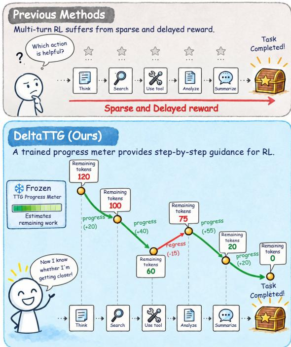  
Figure 1: RLVR for agents faces sparse and delayed rewards. DeltaTTG learns a progress meter from diverse trajectories, measures each transition’s change in estimated remaining work, and uses it to redistribute the trajectory’s outcome credit.

Wang et al., 2023), often with reinforcement learning from verifiable outcomes (Shao et al., 2024). Such rewards are sparse and delayed: a single terminal signal arrives after a long sequence of decisions (Wang et al., 2025b; Luo et al., 2025) and says little about which steps helped or hurt, making step-level credit assignment difficult.

Recent methods derive step-level credit by comparing actions within the current rollout group (Feng et al., 2026; He et al., 2026). However, the quality of these comparisons depends on both the comparability of grouped states and the evidence available in the sampled rollouts. In open-ended interactions, exact state matches can be limited, and similarity-based grouping can introduce noise by pooling states with different decision-relevant conditions; limited outcome diversity and confounding later decisions further weaken local comparisons. Methods that score steps directly may instead require costly judges, human step annotations, additional rollouts (Zheng et al., 2023; Lightman et al., 2024; Choudhury, 2025; Zhao et al., 2026; Kazemnejad et al., 2024), or task-specific heuristics (Wang et al., 2026a,c). These challenges raise a question: Can we learn a reusable progress signal from ordinary agent trajectories that evaluates each action beyond the evidence in the current rollout group?

A learned value model is a natural candidate, but it is tied to the actor whose rollouts it was trained on, and under sparse rewards many states share the same return target, flattening its estimates (Li et al., 2026c). We instead measure progress as the work remaining to complete the task, using Token-to-Go (TTG)—the number of tokens still to be generated before success—as an observable proxy. Our core hypothesis is that, although remaining token usage varies with model style and interaction harness, beneficial actions from the same state leave fewer tokens to completion on average across many trajectories than harmful ones (e.g., each ticket tier an agent creates removes part of the remaining work; Appendix F), with failed continuations assigned a large remaining-work cost. TTG labels come at no extra cost from recorded trajectories, and pooling trajectories from models of different families, sizes, and capability levels yields a shared estimate rather than one actor’s behavior.

Building on this idea, we introduce DeltaTTG, which trains a reusable progress meter on such trajectories; one meter per domain serves actors of different families and sizes without retraining. During actor training, the frozen meter scores each state, and the change in its estimate between consecutive states determines how the trajectory’s outcome advantage is distributed across steps (Figure 1, bottom).

We evaluate DeltaTTG across two model families and parameter scales on ALFWorld, PaperSearchQA, and BFCLv3, covering interactive decision making, information seeking, and tool use. Our contributions are threefold: (1) we propose Token-to-Go as a low-cost, observable supervision target for task progress, extracted from recorded trajectories; (2) we introduce DeltaTTG, which uses a frozen progress meter to redistribute outcomederived advantages across steps without adding rewards; and (3) we show gains over strong RL baselines with improved sample efficiency and outof-domain performance, at actor-training cost close to GRPO, and validate the meter itself through step-quality assessment, test-time action guidance across actor sizes, and cross-domain transfer.

## 2 Related Work

Reinforcement Learning for Language Agents. Reinforcement learning strengthens several capabilities of LLM-based agents, including multiturn decision making through environment interaction (Zhou et al., 2024b; Wang et al., 2025b; Luo et al., 2025). It improves browser navigation (Qi et al., 2025), search-query formulation and evidence integration (Jin et al., 2025), and repositorylevel software problem solving (Da et al., 2025; Fan et al., 2026c). Beyond task execution, jointly optimizing reasoning and memory consolidation helps agents sustain long interactions with compact context (Zhou et al., 2026), while failure diagnosis, corrective feedback, and learning from repaired actions support agent self-correction (Zhu et al., 2025, 2026a).

Process Supervision and Credit Assignment. Existing approaches to process supervision can be broadly grouped into two categories. The first provides direct supervision for process units through external LLM evaluators, human step annotations, or verifier feedback (Lightman et al., 2024; Zhao et al., 2026; Liu et al., 2026a; Kim et al., 2026; Li et al., 2026b,a). It also draws on search or reference reasoning (Zhang et al., 2024; Zhong et al., 2026), task-specific heuristics such as information gain and milestones (Wang et al., 2026a; Lu et al., 2026; Wang et al., 2026c; Zhang et al., 2026a), and on-policy distillation, which obtains dense token-level supervision from teachers on student-generated rollouts (Zhu et al., 2026b). The second redistributes outcome-based credit across process units (Fan et al., 2026a; Wang et al., 2025a; Zhang et al., 2026b). Examples include constructing relative step advantages by comparing sampled returns under shared states, histories, or transition dynamics (Feng et al., 2026; He et al., 2026; Liu et al., 2026b), and learning step contributions that reconstruct the final outcome (Wang et al., 2025a). DeltaTTG learns remaining-work estimates from cross-policy Token-to-Go labels and uses changes in these estimates to redistribute outcome-derived advantages, without matched peer states or addi-

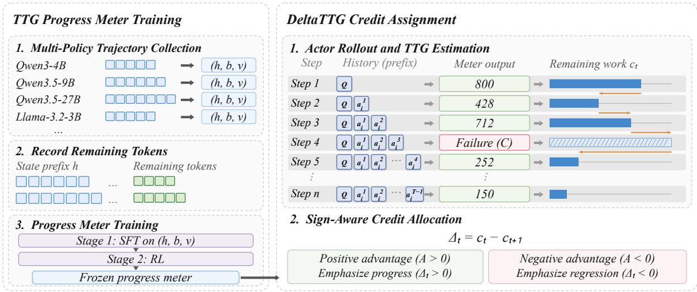  
Figure 2: Overview of the DeltaTTG framework. A TTG progress meter is trained on recorded agent trajectories through SFT and RL, using observed continuation outcomes and remaining-token labels. During actor training, the frozen meter estimates remaining completion effort; changes between successive states guide step-level redistribution of outcome-derived advantages, providing fine-grained process supervision.

tional process rewards.

## 3 Methodology

As illustrated in Figure 2, DeltaTTG first learns a shared TTG progress meter from recorded trajectories (Section 3.1) and then uses its frozen estimates for actor credit assignment (Section 3.2).

## 3.1 Training a Token-to-Go Progress Meter

Token-to-Go as supervision for task progress. For a recorded trajectory $\tau _ { i } ^ { \mathrm { r e f } }$ with $T _ { i } ^ { \mathrm { r e f } }$ actions, let $h _ { i , t } ^ { \mathrm { r e f } }$ denote the history before action t and $n _ { i , u } ^ { \mathrm { r e f } }$ the number of assistant-generated tokens in action u. We define its recorded Token-to-Go as

$$
\mathrm { T T G } _ { i , t } = \sum _ { u = t } ^ { T _ { i } ^ { \mathrm { r e f } } - 1 } n _ { i , u } ^ { \mathrm { r e f } } .\tag{1}
$$

Building on BAGEN’s prefix-based remainingbudget formulation (Lin et al., 2026), we measure completion effort in assistant-generated tokens, including reasoning, tool calls, and final answers. Environment observations remain part of the input context but are excluded from this count, as are tokens already in the prefix. For a successful trajectory, the tokens needed to complete the task from a given state depend on the policy, interaction harness, and subsequent decisions. Each recorded TTG therefore provides one observation of remaining completion effort.

Constructing supervision from recorded trajectories. We split trajectories from diverse policies at assistant-action boundaries into observable prefixes and recorded suffixes. Each prefix receives an observed completion label and, for successful trajectories, a TTG target:

$$
\begin{array} { r l } & { b _ { i , t } = \mathbf { 1 } [ \tau _ { i } ^ { \mathrm { r e f } } \ \mathrm { s u c c e e d s } ] , } \\ & { v _ { i , t } = \left\{ \begin{array} { l l } { \mathrm { T T G } _ { i , t } , } & { b _ { i , t } = 1 , } \\ { \mathrm { n u l l } , } & { b _ { i , t } = 0 . } \end{array} \right. } \end{array}\tag{2}
$$

Failure labels describe recorded outcomes, not intrinsic unsolvability. Pooling these observations across policies trains a shared task progress meter to estimate remaining completion effort, rather than any particular actor’s exact future token consumption.

SFT for structured progress outputs. The meter returns $f _ { \phi } ( h ) = ( \hat { b } , \hat { v } )$ : a binary completion estimate and a nonnegative remaining-work estimate learned from recorded continuations across the training policies. These shared estimates are then applied to the current actor’s histories, with vˆ = null when $\hat { b } = 0$ . Given a prefix h and its structured target answer y, SFT minimizes

$$
\mathcal { L } _ { \mathrm { S F T } } ( \phi ) = - \mathbb { E } _ { ( h , y ) , j } [ \log p _ { \phi } ( y _ { j } \mid h , y _ { < j } ) ] .\tag{3}
$$

The expectation is over answer tokens only. This stage teaches the output format and an initial mapping from prefixes to the recorded labels.

RL for refining progress estimates. We refine the meter with GRPO (Shao et al., 2024). For a labeled prefix $( h , b , v )$ , a sampled answer y receives

$$
r _ { \mathrm { p r e d } } ( y ; b , v ) = \left\{ \begin{array} { l l } { 0 . 2 + 0 . 8 u ( \hat { v } , v ) , } & { \hat { b } = b = 1 , } \\ { 1 , } & { \hat { b } = b = 0 , } \\ { - 1 , } & { \mathrm { o t h e r w i s e , } } \end{array} \right.\tag{4}
$$

where invalid outputs fall under the last case. For correctly predicted successes, token accuracy is

$$
u ( \hat { v } , v ) = \operatorname* { m a x } \biggl ( 0 , 1 - \frac { | \hat { v } - v | } { \operatorname* { m a x } ( | \hat { v } | , | v | , 1 ) } \biggr ) .\tag{5}
$$

This reward encourages correct completion forecasts and accurate remaining-work estimates. We normalize sampled rewards by their within-group mean and standard deviation for GRPO updates, then freeze the trained meter during actor optimization (details in Appendix D.2; evaluation in Section 5).

## 3.2 DeltaTTG Credit Assignment

Rollout and outcome advantages. For each task, the rollout policy samples G trajectories. Trajectory $\tau _ { i }$ contains $T _ { i }$ actions; $h _ { i , t }$ denotes the history before action ${ a } _ { i , t }$ . The next history $h _ { i , t + 1 }$ includes ${ a } _ { i , t }$ and the resulting environment observation. Let $n _ { i , t }$ be the number of trainable tokens in that action and $N _ { i }$ their total across the trajectory. Given terminal reward $R _ { i }$ , the GRPO (Shao et al., 2024) advantage is

$$
A _ { i } = \frac { R _ { i } - \mu _ { x } } { \sigma _ { x } + \epsilon } .\tag{6}
$$

Here, $\mu _ { x }$ and $\sigma _ { x }$ are computed over the task group after repeating each trajectory reward once per action (Appendix D.3). After collecting the full rollout batch, we score its decision histories with the frozen progress meter to obtain nonnegative credit weights with unit token mean within each trajectory.

Estimating transition progress. We use the frozen meter’s remaining-work estimate as the state cost and assign a fixed failure-state cost $C > 0$ to unsuccessful-completion estimates, distinguishing failure from low-effort completion.

Terminal costs follow the observed outcomes:

$$
\begin{array} { r l } & { c _ { i , t } = \left\{ \begin{array} { l l } { \hat { v } _ { i , t } , } & { \hat { b } _ { i , t } = 1 , } \\ { C , } & { \hat { b } _ { i , t } = 0 , } \end{array} \right. } \\ & { c _ { i , T _ { i } } = \left\{ \begin{array} { l l } { 0 , } & { \mathrm { s u c c e s s } , } \\ { C , } & { \mathrm { f a i l u r e ~ o r ~ t r u n c a t i o n } . } \end{array} \right. } \end{array}\tag{7}
$$

The credit signal of action ${ a } _ { i , t }$ is its reduction in predicted remaining work:

$$
\Delta _ { i , t } = c _ { i , t } - c _ { i , t + 1 } .\tag{8}
$$

This difference of the progress potential $\Phi ( h _ { i , t } ) =$ $- c _ { i , t }$ measures estimated progress $( \Delta _ { i , t } > 0 )$ or regression $( \Delta _ { i , t } < 0 )$ . We set $C$ to a large, datasetdependent constant. Between nonterminal states, its value affects the estimated change in remaining work only when the completion estimate switches between success and failure. Such predictions remain rare on successful trajectories,1 with no clear increasing or decreasing trend over training updates. Thus, most successful trajectories contain no nonterminal transitions whose progress estimates depend on C.

Sign-aware credit allocation. We give estimated progress more positive credit when $A _ { i } > 0$ and assign estimated regression negative credit of greater magnitude when $A _ { i } < 0$ . The nonnegative allocation mass is

$$
m _ { i , t } = \left\{ \begin{array} { l l } { \operatorname* { m a x } ( \Delta _ { i , t } , 0 ) , } & { A _ { i } > 0 , } \\ { \operatorname* { m a x } ( - \Delta _ { i , t } , 0 ) , } & { A _ { i } < 0 , } \\ { 1 , } & { A _ { i } = 0 . } \end{array} \right.\tag{9}
$$

Combining trajectory advantages with steplevel progress. Mixing progress-based shares with a uniform share over steps gives

$$
q _ { i , t } = \frac { \rho } { T _ { i } } + ( 1 - \rho ) \frac { m _ { i , t } } { \sum _ { s } m _ { i , s } } ,\tag{10}
$$

where $\rho \in [ 0 , 1 ]$ retains credit for other steps and reduces sensitivity to progress-estimation errors. If $\begin{array} { r } { \sum _ { s } m _ { i , s } = 0 } \end{array}$ , we use $q _ { i , t } = 1 / T _ { i } . ^ { 2 }$

We broadcast each step’s weight to its trainable tokens and normalize the multipliers within each trajectory:

$$
\widetilde { A } _ { i , t , k } = A _ { i } w _ { i , t } = A _ { i } [ \mathcal { B } _ { M } ( \{ q _ { i , s } \} _ { s } ; \{ n _ { i , s } \} _ { s } ) ] _ { t } .\tag{11}
$$

The operator $\boldsymbol { B _ { M } }$ normalizes weights to unit token mean, caps multipliers at $M \geq 1$ , and redistributes excess weight among uncapped tokens in proportion to their remaining capacity (Appendix D.4).

Trajectory advantages determine the update direction, while step weights control its strength. We use a uniform-mixing coefficient of $\rho = 0 . 2$ and a token-multiplier cap of $M = 5$ . The cap limits advantage amplification from large C-induced progress changes, helping mitigate sensitivity to $C$ and stabilize actor updates.

Actor optimization. The actor uses the vanilla clipped loss with token-mean reduction. Let $r _ { i , t , k } ( \theta )$ be the current-to-rollout policy ratio for token k of action ${ a } _ { i , t }$ at its full prefix, and $\bar { r } _ { i , t , k } =$ $\mathrm { c l i p } ( r _ { i , t , k } , 1 - \eta _ { \mathrm { l o w } } , 1 + \eta _ { \mathrm { h i g h } } )$ , with lower and upper clipping widths $\eta _ { \mathrm { l o w } } = 0 . 2$ and $\eta _ { \mathrm { h i g h } } = 0 . 2 8$ The clipped surrogate is

$$
\begin{array} { l } { \displaystyle \mathcal { L } _ { \Delta } ( \theta ) = - \frac { 1 } { \sum _ { i } N _ { i } } \sum _ { i , t , k } \ell _ { i , t , k } , } \\ { \ell _ { i , t , k } = \operatorname* { m i n } \Bigl ( r _ { i , t , k } \widetilde { A } _ { i , t , k } , \bar { r } _ { i , t , k } \widetilde { A } _ { i , t , k } \Bigr ) . } \end{array}\tag{12}
$$

GRPO assigns $A _ { i }$ to every token; DeltaTTG changes only the advantage allocation in this loss. We also apply dual clipping $( d = 3 )$ to negative advantages and include the configured KL and entropy terms (Appendix D.5).

## 4 Experiments

## 4.1 Experimental Setup

Models. We use Qwen3-4B and Llama-3.1-8B-Instruct as actors. We separately train three progress meters for text-based interaction, information seeking, and complex engineering tasks, using trajectories from ALFWorld, PaperSearchQA, and AgentWorldModel, respectively. Each meter is initialized from Qwen3-4B-Instruct-2507, frozen during actor optimization, and reused across both actor backbones in its corresponding task setting. The models used to generate trajectories for progressmeter training are described in Appendix D.1.

Baselines. Our main comparison includes five baselines: (1) ReAct (Yao et al., 2022), which interleaves reasoning and actions through prompting; (2) GRPO (Shao et al., 2024), which computes trajectory-level group-relative advantages without a critic; (3) DAPO (Yu et al., 2026), which combines asymmetric clipping, dynamic sampling, and token-level policy optimization; (4) GiGPO (Feng et al., 2026), which derives steplevel advantages by grouping actions at shared states; and (5) HGPO (He et al., 2026), which refines step-level grouping using historical context (settings in Appendix B).

Benchmarks. Our main evaluation covers (1) ALFWorld (Shridhar et al., 2020), for interactive decision making; (2) PaperSearchQA (Burgess et al., 2026), for search and reasoning over scientific papers; and (3) BFCLv3 (Patil et al., 2025), for function calling and multi-turn tool use. For the tool-use setting, we train on AgentWorldModel (AWM) (Wang et al., 2026b) and evaluate on BF-CLv3. We also assess cross-domain generalization on BrowseComp-Plus (Chen et al., 2025), for web information seeking; Terminal-Bench 2.0 (Merrill et al., 2026), for complex terminal tasks; and $\tau ^ { 2 } .$ bench (Barres et al., 2025), for conversational tool use and user coordination (splits and protocols in Appendix A).

## 4.2 Main Results

DeltaTTG achieves the best average performance with both backbones. Table 1 shows that DeltaTTG achieves the highest average score with both backbones (72.86 vs. 70.41 for the strongest baseline with Qwen3-4B, and 66.49 vs. 61.69 with Llama-3.1-8B-Instruct) and the highest mean, including ties, on 13 of the 16 open-backbone metrics. The largest gains appear on BFCLv3 tool use: DeltaTTG improves Multi-Turn by 4.8 points over the strongest RL baseline with Qwen3-4B, and Non-Live and Live by 7.6 and 9.0 points with Llama-3.1-8B-Instruct. It trails the strongest baseline on Hallucination/Irrelevance with both backbones. These results span distinct interaction structures and support the effectiveness of progressbased credit allocation across different actor backbones and agent tasks.

DeltaTTG achieves better sample efficiency. Figure 3 compares the training dynamics of DeltaTTG and competing RL methods on ALF-World Seen with Qwen3-4B. DeltaTTG reaches approximately 80% test success by step 75, whereas GiGPO requires around 125 steps, corresponding to roughly 40% fewer optimization steps in this training run. Panel (b) shows a similar advantage when progress is indexed by actor-generated response tokens. This axis excludes prompt and meter tokens, so it measures actor response-token efficiency rather than total training cost; Figure 4 separately accounts for meter inference in GPUhours. All training curves for the main experiments are provided in Appendix E.3.

Table 1: Performance comparison on ALFWorld, PaperSearchQA, and BFCLv3 (%, ↑). We report success rates on ALFWorld Seen/Unseen and PaperSearchQA Original/Paraphrased, and scores on the four BFCLv3 categories; Hall. denotes Hallucination/Irrelevance. For repeated evaluations, entries show the mean and population standard deviation over three test runs. Closed models provide reference results; within each open-backbone block, the highest and second-highest mean scores are bold and underlined, respectively. Avg. is the mean of the three benchmark averages (ALFWorld, PaperSearchQA, and ${ \mathrm { B F C L v } } 3 )$ , reported without a standard deviation.
<table><tr><td rowspan="2">Method</td><td colspan="2">ALFWorld</td><td colspan="2">PaperSearchQA</td><td colspan="4">BFCLv3</td><td rowspan="2">Avg.</td></tr><tr><td>Seen</td><td>Unseen</td><td>Original</td><td>Paraphrased</td><td>Non-Live</td><td>Live</td><td>Multi-Turn</td><td>Hall.</td></tr><tr><td colspan="10">Closed Models</td></tr><tr><td>GPT-5.6-Sol-low</td><td> $8 1 . 4 3 { \scriptstyle \pm 1 . 7 5 }$ </td><td> $8 4 . 0 8 { \scriptstyle \pm 0 . 9 3 }$ </td><td> $6 2 . 5 6 { \scriptstyle \pm 0 . 1 7 }$ </td><td> $5 9 . 5 7 { \scriptstyle \pm 0 . 3 8 }$ </td><td> $7 6 . 6 0 { \scriptstyle \pm 0 . 3 2 }$ </td><td> $7 1 . 0 1 { \scriptstyle \pm 0 . 2 4 }$ </td><td> $4 9 . 7 1 { \scriptstyle \pm 2 . 7 2 }$ </td><td> $6 8 . 7 1 { \scriptstyle \pm 0 . 5 9 }$ </td><td>70.11</td></tr><tr><td>Claude-Opus-5-low</td><td> $9 7 . 3 8 _ { \pm 0 . 3 4 }$ </td><td> $9 1 . 0 4 _ { \pm 0 . 0 0 }$ </td><td> $5 6 . 2 5 { \scriptstyle \pm 0 . 0 8 }$ </td><td> $5 5 . 4 9 _ { \pm 0 . 1 8 }$ </td><td>85.25</td><td>77.94</td><td>49.12</td><td>75.35</td><td>74.00</td></tr><tr><td colspan="10">Qwen3-4B</td></tr><tr><td>ReAct</td><td> $3 0 . 9 5 { \scriptstyle \pm 1 . 4 7 }$ </td><td> $2 4 . 3 8 { \scriptstyle \pm 2 . 4 6 }$ </td><td> $3 5 . 2 3 { \scriptstyle \pm 0 . 5 6 }$ </td><td> $3 0 . 4 9 { \scriptstyle \pm 0 . 6 9 }$ </td><td> $7 3 . 4 5 { \scriptstyle \pm 0 . 2 8 }$ </td><td> $7 3 . 8 7 { \scriptstyle \pm 0 . 3 7 }$ </td><td> $2 8 . 0 0 { \scriptstyle \pm 3 . 5 3 }$ </td><td> $6 8 . 9 0 { \scriptstyle \pm 0 . 3 5 }$ </td><td>40.53</td></tr><tr><td>GRPO</td><td> $8 1 . 4 3 { \scriptstyle \pm 1 . 5 4 }$ </td><td> $7 1 . 8 9 { \scriptstyle \pm 3 . 7 2 }$ </td><td> $6 5 . 0 7 { \scriptstyle \pm 0 . 1 4 }$ </td><td> $4 9 . 6 9 _ { \pm 0 . 3 4 }$ </td><td> $\mathbf { 8 1 . 4 0 { \scriptstyle \pm 0 . 4 5 } }$ </td><td> $7 5 . 0 8 { \scriptstyle \pm 0 . 0 9 }$ </td><td> $3 6 . 3 3 { \scriptstyle \pm 3 . 3 9 }$ </td><td> $7 6 . 4 9 { \scriptstyle \pm 0 . 5 4 }$ </td><td>67.12</td></tr><tr><td>DAPO</td><td> $\mathbf { 9 1 . 6 7 _ { \pm 1 . 3 5 } }$ </td><td> $\underline { { 8 6 . 5 7 _ { \pm 1 . 8 3 } } }$ </td><td> $\underline { { 6 6 . 0 8 _ { \pm 0 . 5 3 } } }$ </td><td> $5 1 . 4 8 _ { \pm 0 . 1 7 }$ </td><td> $7 7 . 6 2 _ { \pm 1 . 0 9 }$ </td><td> $\underline { { 7 6 . 0 7 _ { \pm 0 . 3 3 } } }$ </td><td> $3 1 . 7 9 _ { \pm 3 . 8 4 }$ </td><td> $6 7 . 8 8 _ { \pm 0 . 6 3 }$ </td><td>70.41</td></tr><tr><td>GiGPO</td><td> $\underline { { 8 7 . 3 8 _ { \pm 0 . 8 9 } } }$ </td><td> $8 4 . 5 8 { \scriptstyle \pm 1 . 2 7 }$ </td><td> $6 0 . 9 7 { \scriptstyle \pm 0 . 4 4 }$ </td><td> $4 9 . 5 9 { \scriptstyle \pm 0 . 3 2 }$ </td><td> $7 9 . 4 9 { \scriptstyle \pm 0 . 7 0 }$ </td><td> $7 5 . 6 7 { \scriptstyle \pm 0 . 8 6 }$ </td><td> $3 1 . 1 3 { \scriptstyle \pm 2 . 9 1 }$ </td><td> $7 4 . 8 1 _ { \pm 0 . 4 6 }$ </td><td>68.85</td></tr><tr><td>HGPO</td><td> $8 6 . 6 7 { \scriptstyle \pm 0 . 8 9 }$ </td><td> $8 2 . 8 4 { \scriptstyle \pm 1 . 2 2 }$ </td><td> $6 1 . 4 1 { \scriptstyle \pm 0 . 5 0 }$ </td><td> $4 9 . 5 6 { \scriptstyle \pm 0 . 5 8 }$ </td><td> $8 1 . 1 2 _ { \pm 0 . 4 0 }$ </td><td> $7 5 . 4 7 { \scriptstyle \pm 0 . 4 0 }$ </td><td> $3 3 . 2 5 { \scriptstyle \pm 3 . 6 9 }$ </td><td> ${ \bf 7 8 . 2 9 { \scriptstyle \pm 0 . 3 6 } }$ </td><td>69.09</td></tr><tr><td>DeltaTTG (Ours)</td><td> $\mathbf { 9 1 . 6 7 \& 2 . 6 9 }$ </td><td> $\mathbf { 8 7 . 8 1 _ { \pm 2 . 7 5 } }$ </td><td> ${ \bf 6 7 . 7 9 { \scriptstyle \pm 0 . 2 6 } }$ </td><td> ${ \bf 5 2 . 8 8 { \scriptstyle \pm 0 . 1 8 } }$ </td><td> $8 0 . 2 9 { \scriptstyle \pm 0 . 7 8 }$ </td><td> $\mathbf { 7 6 . 6 6 { \scriptstyle \pm 1 . 0 3 } }$ </td><td> $\mathbf { 4 1 . 0 9 } _ { \pm 2 . 4 0 }$ </td><td> $7 6 . 0 2 { \scriptstyle \pm 0 . 6 0 }$ </td><td>72.86</td></tr><tr><td colspan="10">Llama-3.1-8B-Instruct</td></tr><tr><td>ReAct</td><td> $1 6 . 9 0 { \scriptstyle \pm 0 . 3 4 }$ </td><td> $1 7 . 1 6 { \scriptstyle \pm 1 . 2 2 }$ </td><td> $2 6 . 9 6 { \scriptstyle \pm 0 . 7 1 }$ </td><td> $1 8 . 7 6 { \scriptstyle \pm 0 . 7 7 }$ </td><td> $4 6 . 3 3 { \scriptstyle \pm 0 . 5 6 }$ </td><td> $3 4 . 9 9 { \scriptstyle \pm 0 . 7 5 }$ </td><td> $7 . 6 2 _ { \pm 1 . 2 4 }$ </td><td> $2 9 . 3 1 { \scriptstyle \pm 0 . 9 9 }$ </td><td>23.15</td></tr><tr><td>GRPO</td><td> $7 7 . 3 8 { \scriptstyle \pm 0 . 8 9 }$ </td><td> $7 2 . 1 4 { \scriptstyle \pm 1 . 9 6 }$ </td><td> $6 6 . 1 5 { \scriptstyle \pm 0 . 3 4 }$ </td><td> $5 3 . 5 7 { \scriptstyle \pm 0 . 4 2 }$ </td><td> $7 0 . 4 8 { \scriptstyle \pm 0 . 3 8 }$ </td><td> $5 2 . 7 5 { \scriptstyle \pm 0 . 8 5 }$ </td><td> $1 0 . 2 1 { \scriptstyle \pm 1 . 7 1 }$ </td><td> $\underline { { 3 9 . 9 7 _ { \pm 1 . 9 5 } } }$ </td><td>59.32</td></tr><tr><td>DAPO</td><td> $7 7 . 8 6 { \scriptstyle \pm 1 . 5 4 }$ </td><td> $7 4 . 1 3 { \scriptstyle \pm 1 . 9 6 }$ </td><td> $6 8 . 8 7 { \scriptstyle \pm 0 . 2 8 }$ </td><td> $5 5 . 9 1 _ { \pm 0 . 2 8 }$ </td><td> $6 7 . 8 3 { \scriptstyle \pm 1 . 5 5 }$ </td><td> $4 5 . 2 0 { \scriptstyle \pm 1 . 4 9 }$ </td><td> $1 2 . 1 7 { \scriptstyle \pm 2 . 7 0 }$ </td><td> $3 8 . 7 6 { \scriptstyle \pm 0 . 3 9 }$ </td><td>59.79</td></tr><tr><td>GiGPO</td><td> $8 3 . 5 7 { \scriptstyle \pm 1 . 0 1 }$ </td><td> $8 2 . 3 4 { \scriptstyle \pm 1 . 5 3 }$ </td><td> $6 5 . 1 9 { \scriptstyle \pm 0 . 3 8 }$ </td><td> $5 4 . 0 9 { \scriptstyle \pm 0 . 5 8 }$ </td><td> $6 9 . 1 5 { \scriptstyle \pm 1 . 3 8 }$ </td><td> $4 5 . 7 7 { \scriptstyle \pm 0 . 7 7 }$ </td><td> $1 2 . 0 8 { \scriptstyle \pm 1 . 3 3 }$ </td><td> $\mathbf { 4 2 . 9 3 { \scriptstyle \pm 0 . 2 0 } }$ </td><td>61.69</td></tr><tr><td>HGPO</td><td> $8 5 . 9 5 { \scriptstyle \pm 0 . 3 4 }$ </td><td> $7 7 . 8 6 { \scriptstyle \pm 1 . 9 6 }$ </td><td> $6 4 . 7 3 { \scriptstyle \pm 0 . 4 4 }$ </td><td> $5 3 . 4 4 { \scriptstyle \pm 0 . 4 8 }$ </td><td> $7 1 . 2 4 { \scriptstyle \pm 0 . 4 4 }$ </td><td> $5 6 . 5 5 { \scriptstyle \pm 0 . 1 6 }$ </td><td> $1 0 . 5 4 { \scriptstyle \pm 2 . 0 3 }$ </td><td> $3 1 . 5 6 { \scriptstyle \pm 1 . 3 9 }$ </td><td>61.15</td></tr><tr><td>DeltaTTG (Ours)</td><td> $\mathbf { 8 7 . 1 4 { \scriptstyle \pm 0 . 5 8 } }$ </td><td> $\mathbf { 8 4 . 8 3 _ { \pm 0 . 7 0 } }$ </td><td> $\mathbf { 7 1 . 1 2 { \scriptstyle \pm 0 . 5 4 } }$ </td><td> ${ \bf 5 6 . 4 3 _ { \pm 0 . 1 9 } }$ </td><td> ${ \bf 7 8 . 8 6 { \scriptstyle \pm 0 . 5 3 } }$ </td><td> ${ \bf 6 5 . 5 6 { \scriptstyle \pm 0 . 2 4 } }$ </td><td> $\mathbf { 1 5 . 4 6 _ { \pm 2 . 4 2 } }$ </td><td> $3 8 . 9 5 { \scriptstyle \pm 0 . 2 2 }$ </td><td>66.49</td></tr></table>

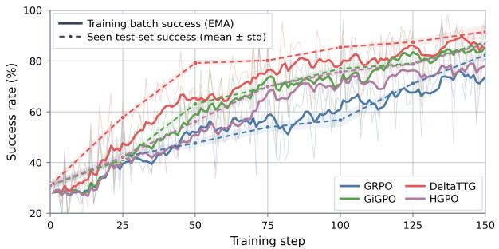

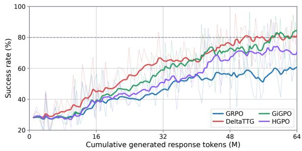  
Figure 3: Sample efficiency on ALFWorld Seen using Qwen3-4B. (a) Success rate as a function of training steps. (b) Training batch success rate as a function of cumulative actor-generated response tokens, excluding prompt and progress-meter tokens. Solid curves show the EMA-smoothed training success rate, while dashed curves and shaded regions in (a) denote the mean test success rate and standard deviation across three evaluation seeds.

## 4.3 Ablation Studies

We consider six ablations on ALFWorld (Table 2): (1) − TTG (+value) trains a separate outcomeonly meter on the same trajectories, using each trajectory’s final score as the label for every prefix and keeping all other settings unchanged; (2) − TTG (+logit) uses the clipped log-probability difference of the completion-label tokens; (3) − TTG (+feas.) uses binary feasibility, mapping predicted successful and unsuccessful continuations to costs 0 and C; (4) − sign-aware reversal uses positive progress even on negative-advantage trajectories;

only for the zero-mass fallback (definitions in Appendix E.4). The full DeltaTTG achieves higher average success than all ablations on both splits. The results favor TTG-based remaining-work supervision over outcome-value supervision here, support combining completion predictions with token estimates, and suggest the contributions of sign-aware reversal, meter training, and uniform mixing.

## 4.4 Computational Cost

(5) − meter training uses the initialized progress meter without TTG-specific training; and (6) − uniform mixing sets $\rho = 0 ;$ , retaining equal shares

Figure 4 compares actor-training GPU-hours under a fixed 150-step ALFWorld budget. The measurement includes rollouts, actor forward passes and updates, and, for DeltaTTG, progress-meter inference; it excludes periodic evaluation and the separate progress-meter training stage. The frozen meter scores collected decision histories in batches and emits a short structured answer, limiting inference overhead relative to repeated actor generation and optimization. On ALFWorld Seen with Qwen3- 4B, DAPO and DeltaTTG tie for the highest success rate. However, DAPO uses 2.7× GRPO’s GPUhours with dynamic sampling, while DeltaTTG achieves the same success rate at roughly GRPO’s cost. The ALFWorld progress meter requires 10.45 GPU-hours of RL training and is reused across actor models, amortizing this cost across policytraining runs.

Table 2: Ablation results on ALFWorld. − denotes removal; parentheses show replacement signals.
<table><tr><td>Variant</td><td>Pick</td><td>Clean</td><td>Heat</td><td>Cool</td><td>Look</td><td>Two</td><td>Avg.</td></tr><tr><td>Seen</td><td></td><td></td><td></td><td></td><td></td><td></td><td></td></tr><tr><td>Full DeltaTTG</td><td>97.14</td><td>96.30</td><td>89.58</td><td>86.67</td><td>94.87</td><td>83.33</td><td>91.67</td></tr><tr><td>TTG (+value)</td><td>97.14</td><td>85.19</td><td>81.25</td><td>76.00</td><td>76.92</td><td>87.50</td><td>85.71</td></tr><tr><td>TTG (+logit)</td><td>98.10</td><td>92.59</td><td>95.83</td><td>78.67</td><td>89.74</td><td>63.89</td><td>86.67</td></tr><tr><td>TTG (+feas.)</td><td>99.05</td><td>95.06</td><td>83.33</td><td>68.00</td><td>74.36</td><td>70.83</td><td>83.81</td></tr><tr><td>sign-aware reversal</td><td>95.24</td><td>92.59</td><td>85.42</td><td>78.67</td><td>66.67</td><td>62.50</td><td>82.38</td></tr><tr><td>— meter training</td><td>99.05</td><td>62.96</td><td>79.17</td><td>81.33</td><td>76.92</td><td>80.56</td><td>81.43</td></tr><tr><td>uniform mixing Unseen</td><td>96.19</td><td>100.00</td><td>87.50</td><td>78.67</td><td>82.05</td><td>84.72</td><td>89.52</td></tr><tr><td></td><td></td><td></td><td></td><td></td><td></td><td></td><td></td></tr><tr><td>Full DeltaTTG TTG (+value)</td><td>87.50 91.67</td><td>93.55</td><td>84.06</td><td>85.71</td><td>90.74</td><td>82.35</td><td>87.81</td></tr><tr><td></td><td></td><td>80.65</td><td>82.61</td><td>85.71</td><td>77.78</td><td>82.35</td><td>83.58</td></tr><tr><td>− TTG (+logit)</td><td>90.28</td><td>80.65</td><td>97.10</td><td>92.06</td><td>83.33</td><td>41.18</td><td>82.34</td></tr><tr><td>− TTG (+feas.)</td><td>86.11</td><td>92.47</td><td>86.96</td><td>85.71</td><td>94.44</td><td>62.75</td><td>85.82</td></tr><tr><td>— sign-aware reversal</td><td>75.00</td><td>77.42</td><td>86.96</td><td>80.95</td><td>85.19</td><td>50.98</td><td>76.87</td></tr><tr><td>— meter training</td><td>77.78</td><td>61.29</td><td>88.41</td><td>90.48</td><td>59.26</td><td>84.31</td><td>76.12</td></tr><tr><td>— uniform mixing</td><td>66.67</td><td>79.57</td><td>85.51</td><td>87.30</td><td>92.59</td><td>90.20</td><td>82.59</td></tr></table>

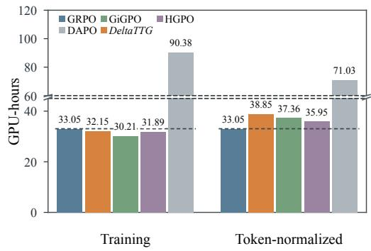  
Figure 4: Actor-training compute on ALFWorld, including progress-meter inference for DeltaTTG. Tokennormalized GPU-hours use GRPO’s 390.49M nonpadding actor-training tokens, including prompts and responses, as the reference.

## 4.5 Out-of-Domain Policy Generalization

DeltaTTG improves in-domain performance while better preserving out-of-domain capabilities. We evaluate Qwen3-4B checkpoints on the three out-of-domain benchmarks of Section 4.1.

For the search task BrowseComp-Plus, we use checkpoints trained on PaperSearchQA; for the complex engineering tasks $\tau ^ { 2 }$ -bench and Terminal-Bench 2.0, we use checkpoints trained on Agent-WorldModel. DeltaTTG achieves the highest performance among the compared methods on all three benchmarks (Figures $5 \mathrm { a } { - } 5 \mathrm { c } ; \tau ^ { 2 } .$ -bench domains in Appendix E.2). On these benchmarks, the results suggest that task-progress-based credit assignment improves in-domain task performance while preserving capabilities on the evaluated out-of-domain benchmarks. Detailed out-of-domain evaluation settings are provided in Appendix C.5.

## 5 Analyzing the Progress Meter

We now evaluate the progress meter itself through three questions: Is Token-to-Go a good supervision target for step quality (Section 5.1)? Does a fixed meter help actors select actions at test time (Section 5.2)? Does a meter transfer across domains (Section 5.3)?

## 5.1 Token-to-Go as Progress Supervision

Token-to-Go supervision provides a step-quality signal. We train a TTG progress meter and use AgentProcessBench’s step-quality annotations (Fan et al., 2026b) to evaluate whether changes in its estimates across consecutive states distinguish beneficial from harmful actions (Table 3). With neutral steps excluded, uniform random guessing has an expected accuracy of 50%; direct prompting achieves 50.83% on the held-out test split, compared with 56.91% for Token-to-Go supervision. This analysis jointly trains a meter on four datasets, whereas actor-training experiments use domain-specific meters (Appendix E.6).

Token-to-Go achieves stronger overall accuracy than alternative supervision targets. We compare Token-to-Go with Future Score and Step-to-Go, which supervise terminal returns and remaining-step counts, respectively. Token-to-Go achieves the highest step-pooled Overall accuracy on both validation and test splits (Table 3). TTG labels vary across trajectory prefixes and reflect remaining workload, potentially providing more informative local supervision than terminal-return labels, which can lead to value flattening under sparse rewards (Li et al., 2026c). The ALFWorld ablations provide further downstream evidence: replacing Token-to-Go with completion logits or binary feasibility reduces Unseen success (Table 2).

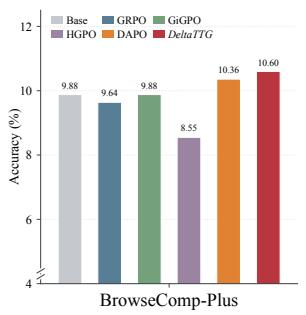  
(a) BrowseComp-Plus.

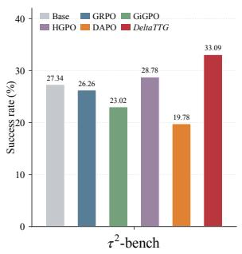  
(b) τ2-bench.

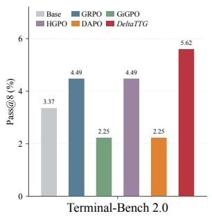  
(c) Terminal-Bench 2.0.

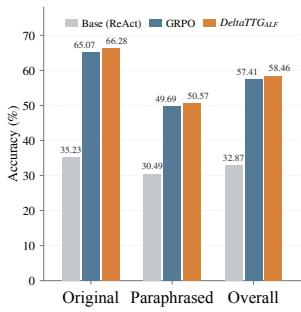  
(d) Progress-meter transfer.

Figure 5: Generalization analysis of DeltaTTG. (a)–(c) Out-of-domain generalization of Qwen3-4B policies trained on PaperSearchQA for (a) and AgentWorldModel for (b)–(c). Panel (a) uses a truncated y-axis starting at 4%, with an axis-break mark; panel (c) reports pass@8 on 89 tasks. (d) Transfer of an ALFWorld-trained progress meter to DeltaTTG optimization on PaperSearchQA, assessing progress signals beyond the meter’s training domain.
<table><tr><td>Supervision target</td><td>BFCL GAIA</td><td>Hotpot T2 QA bench</td><td>Overall</td></tr><tr><td>Validation</td><td></td><td></td><td></td></tr><tr><td>Future Score</td><td>53.04 70.89</td><td>44.12 63.89</td><td>60.22</td></tr><tr><td>Step-to-Go</td><td>57.39 59.49</td><td>52.94 53.47</td><td>55.91</td></tr><tr><td>Token-to-Go</td><td>65.22 60.76</td><td>52.94 61.81</td><td>61.83</td></tr><tr><td colspan="4">Test 55.47</td></tr><tr><td>Future Score</td><td>60.96</td><td>47.66 53.57</td><td>54.86</td></tr><tr><td>Step-to-Go</td><td>58.57</td><td>61.72 47.27</td><td>54.73</td></tr><tr><td>Token-to-Go</td><td>61.52 54.49 52.19</td><td>53.91 60.84</td><td>56.91</td></tr></table>

Table 3: AgentProcessBench validation and test stepquality accuracy (%). Overall pools evaluated steps across datasets; the best Overall in each split is bold. See Appendix E.6 for the evaluation protocol.

## 5.2 Test-Time Guidance across Actor Scales

Token-to-Go progress meters improve test-time action selection across actor scales. We evaluate whether a shared progress meter can provide useful progress estimates during inference. On ALFWorld, a fixed meter guides Qwen3-1.7B, 4B, 8B, and 14B actors without actor-specific retraining. At each step, the actor generates four candidate actions, which are trial-executed in separate environment branches; the meter evaluates the resulting histories to select the action with the largest estimated progress. Compared with natural rollouts and random selection using the same four-candidate budget as guidance, guided rollouts achieve higher success rates and fewer average interaction steps across all evaluated actor scales and Seen/Unseen splits (Figure 6; Appendix E.5, Table 9). The comparison with random selection indicates that the gains arise from progress-based action selection rather than additional candidates alone.

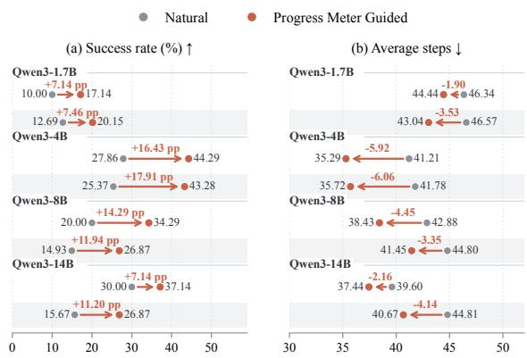  
Figure 6: ALFWorld test-time guidance results. Arrows connect Natural to Progress Meter Guided rollouts; labels show changes in success rate (percentage points) and average steps. White/gray rows denote Seen/Unseen. The protocol is in Appendix E.5.

## 5.3 Cross-Domain Progress-Meter Transfer

Progress meters provide useful progress signals beyond their training domain. $D e l t a T T G _ { A L F }$ uses a progress meter trained only on ALFWorld trajectories to guide actor optimization on PaperSearchQA, without target-domain adaptation. It outperforms GRPO on Original, Paraphrased, and Overall evaluation (Figure 5d), suggesting that learned progress estimates can support credit assignment beyond the training domain.

## 6 Conclusion

We introduced DeltaTTG, which uses a reusable Token-to-Go meter trained on recorded trajectories to redistribute outcome-derived advantages. It improves over strong RL baselines at actor-training cost close to GRPO and supports test-time action selection and cross-domain meter transfer.

## Limitations

Our study has three limitations. First, although diverse training trajectories support progress-meter reuse, our evaluation covers only two actor model families and several domains; broader transfer requires further validation and may need adaptation. Second, our AgentWorldModel audit (Section 3.2, footnote 1) indicates that C does not affect credit allocation for most successful trajectories, and using task-specific values across three training domains yields higher aggregate scores than all compared RL baselines. However, these observations do not establish robustness to C, and future work will provide a more detailed sensitivity analysis. Third, reported standard deviations reflect repeated evaluations of a single trained checkpoint rather than independent training runs, leaving training variability unquantified.

## References

Victor Barres, Honghua Dong, Soham Ray, Xujie Si, and Karthik Narasimhan. 2025. τ2-Bench: Evaluating conversational agents in a dual-control environment. arXiv preprint arXiv:2506.07982.

James Burgess, Jan N Hansen, Duo Peng, Yuhui Zhang, Alejandro Lozano, Min Woo Sun, Emma Lundberg, and Serena Yeung-Levy. 2026. Papersearchqa: Learning to search and reason over scientific papers with rlvr. In Proceedings of the 19th Conference of the European Chapter ofthe Associationfor Computational Linguistics (Volume 1: Long Papers), pages 1979–1997.

Zijian Chen, Xueguang Ma, Shengyao Zhuang, Ping Nie, Kai Zou, Andrew Liu, Joshua Green, Kshama Patel, Ruoxi Meng, Mingyi Su, Sahel Sharifymoghaddam, Yanxi Li, Haoran Hong, Xinyu Shi, Xuye Liu, Nandan Thakur, Crystina Zhang, Luyu Gao, Wenhu Chen, and Jimmy Lin. 2025. Browsecomp-plus: A more fair and transparent evaluation benchmark of deep-research agent. arXiv preprint arXiv:2508.06600.

Sanjiban Choudhury. 2025. Process reward models for llm agents: Practical framework and directions. arXiv preprint arXiv:2502.10325.

Jeff Da, Clinton Wang, Xiang Deng, Yuntao Ma, Nikhil Barhate, and Sean Hendryx. 2025. Agentrlvr: Training software engineering agents via guidance and environment rewards. arXiv preprint arXiv:2506.11425.

Shengda Fan, Xin Cong, Zhong Zhang, Haotian Chen, and Yankai Lin. 2026a. Inducing process supervision from outcome-only reinforcement learning. Preprint, arXiv:2609.36641.

Shengda Fan, Xuyan Ye, Yupeng Huo, Zhi-Yuan Chen, Yiju Guo, Shenzhi Yang, Wenkai Yang, Shuqi Ye, Jingwen Chen, Haotian Chen, et al. 2026b. Agentprocessbench: Diagnosing step-level process quality in tool-using agents. arXiv preprint arXiv:2603.14465.

Shengda Fan, Xuyan Ye, and Yankai Lin. 2026c. Darc: Decoupled asymmetric reasoning curriculum for llm evolution. arXiv preprint arXiv:2601.13761.

Lang Feng, Zhenghai Xue, Tingcong Liu, and Bo An. 2026. Group-in-group policy optimization for llm agent training. Advances in Neural Information Processing Systems, 38:46375–46408.

Shuo He, Lang Feng, Xin Cheng, Lei Feng, Bo An, et al. 2026. Hierarchy-of-groups policy optimization for long-horizon agentic tasks. In International Conference on Learning Representations, volume 2026, pages 27572–27593.

Bowen Jin, Hansi Zeng, Zhenrui Yue, Jinsung Yoon, Sercan Arik, Dong Wang, Hamed Zamani, and Jiawei Han. 2025. Search-r1: Training llms to reason and leverage search engines with reinforcement learning. arXiv preprint arXiv:2503.09516.

Amirhossein Kazemnejad, Milad Aghajohari, Eva Portelance, Alessandro Sordoni, Siva Reddy, Aaron Courville, and Nicolas Le Roux. 2024. Vineppo: Refining credit assignment in rl training of llms. arXiv preprint arXiv:2410.01679.

Kyuyoung Kim, Kevin Wang, Yunfei Xie, Peiyang Xu, Peiyao Sheng, Chen Wei, Zhangyang Wang, Jinwoo Shin, Pramod Viswanath, and Sewoong Oh. 2026. Correct answers from sound reasoning: Verifiable process supervision for language models. Preprint, arXiv:2605.12519.

Mukai Li, Qingcheng Zeng, Tianqing Fang, Zhenwen Liang, Linfeng Song, Qi Liu, Haitao Mi, and Dong Yu. 2026a. Verified critical step optimization for LLM agents. In Findings of the Association for Computational Linguistics: ACL 2026, pages 39627– 39639, San Diego, California, United States. Association for Computational Linguistics.

Pengcheng Li, Zhengyang Zhang, Dongxu Zhang, Sui Huang, and Shaohua Ma. 2026b. VICT: Verifier-instrumented credit tracing for long-horizon LLM agent reinforcement learning. Preprint, arXiv:2608.28128.

Yizhuo Li, Jianhao Yan, Yun Luo, Zhi Wang, Futing Wang, Rong-Xi Tan, Kanghui Tian, Ganqu Cui, Ning Ding, Peilin Zhao, et al. 2026c. Rethinking critic learning in ppo: Understanding and mitigating value flattening. arXiv preprint arXiv:2609.18708.

Hunter Lightman, Vineet Kosaraju, Yuri Burda, Harrison Edwards, Bowen Baker, Teddy Lee, Jan Leike, John Schulman, Ilya Sutskever, and Karl Cobbe. 2024. Let’s verify step by step. In International Conference on Learning Representations, volume 2024, pages 39578–39601.

Yuxiang Lin, Zihan Wang, Mengyang Liu, Yuxuan Shan, Longju Bai, Junyao Zhang, Xing Jin, Boshan Chen, Jinyan Su, Xingyao Wang, et al. 2026. Bagen: Are llm agents budget-aware? arXiv preprint arXiv:2606.00198.

Xiao Liu, Hao Yu, Hanchen Zhang, Yifan Xu, Xuanyu Lei, Hanyu Lai, Yu Gu, Hangliang Ding, Kaiwen Men, Kejuan Yang, et al. 2024. Agentbench: Evaluating llms as agents. In International Conference on Learning Representations, volume 2024, pages 52989–53046.

Xiaoqian Liu, Ke Wang, Yuchuan Wu, Fei Huang, Yongbin Li, Jianbin Jiao, and Junge Zhang. 2026a. Agentic reinforcement learning with implicit step rewards. In International Conference on Learning Representations, volume 2026, pages 129271–129291.

Yuze Liu, Chaochao Lu, and Chao Yang. 2026b. SHADOW: Dynamic-aware credit assignment against long-horizon tasks. In Proceedings of the AAAI Conference on Artificial Intelligence, volume 40, pages 23935–23944.

Yijun Lu, Rui Ye, Jiajun Wang, Yuwen Du, Tian Jin, Songhua Liu, and Siheng Chen. 2026. Abseeker: Training long-horizon search agents via answerbacktracked credit assignment. arXiv preprint arXiv:2608.05102.

Xufang Luo, Yuge Zhang, Zhiyuan He, Zilong Wang, Siyun Zhao, Dongsheng Li, Luna K Qiu, and Yuqing Yang. 2025. Agent lightning: Train any ai agents with reinforcement learning. arXiv preprint arXiv:2508.03680.

Mike A. Merrill, Alexander G. Shaw, Nicholas Carlini, Boxuan Li, Harsh Raj, Ivan Bercovich, Lin Shi, Jeong Yeon Shin, Thomas Walshe, E. Kelly Buchanan, et al. 2026. Terminal-Bench: Benchmarking agents on hard, realistic tasks in command line interfaces. arXiv preprint arXiv:2601.11868.

Shishir G Patil, Huanzhi Mao, Fanjia Yan, Charlie Cheng-Jie Ji, Vishnu Suresh, Ion Stoica, and Joseph E. Gonzalez. 2025. The berkeley function calling leaderboard (BFCL): From tool use to agentic evaluation of large language models. In Proceedings of the 42nd International Conference on Machine Learning, volume 267 of Proceedings of Machine Learning Research, pages 48371–48392. PMLR.

Zehan Qi, Xiao Liu, Iat Long Iong, Hanyu Lai, Xueqiao Sun, Jiadai Sun, Xinyue Yang, Yu Yang, Shuntian Yao, Wei Xu, et al. 2025. Webrl: Training llm web agents via self-evolving online curriculum reinforcement learning. In International Conference on Learning Representations, volume 2025, pages 79791–79821.

Zhihong Shao, Peiyi Wang, Qihao Zhu, Runxin Xu, Junxiao Song, Xiao Bi, Haowei Zhang, Mingchuan Zhang, YK Li, Yang Wu, et al. 2024. Deepseekmath: Pushing the limits of mathematical reasoning in open language models. arXiv preprint arXiv:2402.03300.

Guangming Sheng, Chi Zhang, Zilingfeng Ye, Xibin Wu, Wang Zhang, Ru Zhang, Yanghua Peng, Haibin Lin, and Chuan Wu. 2024. Hybridflow: A flexible and efficient rlhf framework. arXiv preprint arXiv:2409.19256.

Noah Shinn, Federico Cassano, Ashwin Gopinath, Karthik Narasimhan, and Shunyu Yao. 2023. Reflexion: Language agents with verbal reinforcement learning. Advances in neural information processing systems, 36:8634–8652.

Mohit Shridhar, Xingdi Yuan, Marc-Alexandre Côté, Yonatan Bisk, Adam Trischler, and Matthew Hausknecht. 2020. Alfworld: Aligning text and embodied environments for interactive learning. arXiv preprint arXiv:2010.03768.

Guanzhi Wang, Yuqi Xie, Yunfan Jiang, Ajay Mandlekar, Chaowei Xiao, Yuke Zhu, Linxi Fan, and Anima Anandkumar. 2023. Voyager: An open-ended embodied agent with large language models. arXiv preprint arXiv:2305.16291.

Guoqing Wang, Sunhao Dai, Guangze Ye, Zeyu Gan, Wei Yao, Yong Deng, Xiaofeng Wu, et al. 2026a. Information gain-based policy optimization: A simple and effective approach for multi-turn search agents. In International Conference on Learning Representations, volume 2026, pages 104502–104529.

Hanlin Wang, Chak Tou Leong, Jiashuo Wang, Jian Wang, and Wenjie Li. 2025a. SPA-RL: Reinforcing LLM agents via stepwise progress attribution. arXiv preprint arXiv:2505.20732.

Zhaoyang Wang, Canwen Xu, Boyi Liu, Yite Wang, Siwei Han, Zhewei Yao, Huaxiu Yao, and Yuxiong He. 2026b. Agent world model: Infinity synthetic environments for agentic reinforcement learning. arXiv preprint arXiv:2602.10090.

Zihan Wang, Kangrui Wang, Qineng Wang, Pingyue Zhang, Linjie Li, Zhengyuan Yang, Xing Jin, Kefan Yu, Minh Nhat Nguyen, Licheng Liu, et al. 2025b. Ragen: Understanding self-evolution in llm agents via multi-turn reinforcement learning. arXiv preprint arXiv:2504.20073.

Zixuan Wang, Yuchen Yan, Hongxing Li, Teng Pan, Dingming Li, Ruiqing Zhang, Weiming Lu, Jun Xiao, Yueting Zhuang, and Yongliang Shen. 2026c. Milestone-guided policy learning for long-horizon language agents. arXiv preprint arXiv:2605.06078.

Shunyu Yao, Jeffrey Zhao, Dian Yu, Nan Du, Izhak Shafran, Karthik Narasimhan, and Yuan Cao. 2022. React: Synergizing reasoning and acting in language models. arXiv preprint arXiv:2210.03629.

Qiying Yu, Zheng Zhang, Ruofei Zhu, Yufeng Yuan, Xiaochen Zuo, Yu Yue, Weinan Dai, Tiantian Fan, Gaohong Liu, Lingjun Liu, et al. 2026. Dapo: An open-source llm reinforcement learning system at scale. Advances in Neural Information Processing Systems, 38:113222–113244.

Dan Zhang, Sining Zhoubian, Ziniu Hu, Yisong Yue, Yuxiao Dong, and Jie Tang. 2024. Rest-mcts\*: Llm self-training via process reward guided tree search. Advances in Neural Information Processing Systems, 37:64735–64772.

Huan Zhang, Mingju Chen, Dongxu Zhou, Can Lv, Heng Chang, Sen Cui, Faguo Wu, and Shiji Zhou. 2026a. TRCA: Transition-wise rubric credit assignment for long-horizon LLM agents. Preprint, arXiv:2608.16156.

Yi-Kai Zhang, Zhiyuan Yao, Hongyan Hao, Yueqing Sun, Qi Gu, Hui Su, Xunliang Cai, De-Chuan Zhan, and Han-Jia Ye. 2026b. V : A generalist value model for any policy at state zero. arXiv preprint arXiv:2602.03584.

Jian Zhao, Runze Liu, Kaiyan Zhang, Zhimu Zhou, Junqi Gao, Dong Li, Jiafei Lyu, Zhouyi Qian, Biqing Qi, Xiu Li, et al. 2026. Genprm: Scaling test-time compute of process reward models via generative reasoning. In Proceedings of the AAAI Conference on Artificial Intelligence, volume 40, pages 34932– 34940.

Lianmin Zheng, Wei-Lin Chiang, Ying Sheng, Siyuan Zhuang, Zhanghao Wu, Yonghao Zhuang, Zi Lin, Zhuohan Li, Dacheng Li, Eric Xing, et al. 2023. Judging llm-as-a-judge with mt-bench and chatbot arena. Advances in neural information processing systems, 36:46595–46623.

Wenlin Zhong, Chengyuan Liu, Yiquan Wu, Bovin Tan, Changlong Sun, Yi Wang, Xiaozhong Liu, and Kun Kuang. 2026. P2S: Probabilistic process supervision for general-domain reasoning question answering. In Proceedings of the AAAI Conference on Artificial Intelligence, volume 40, pages 35076–35084.

Shuyan Zhou, Frank F Xu, Hao Zhu, Xuhui Zhou, Robert Lo, Abishek Sridhar, Xianyi Cheng, Tianyue Ou, Yonatan Bisk, Daniel Fried, et al. 2024a. Webarena: A realistic web environment for building autonomous agents. In International Conference on Learning Representations, volume 2024, pages 15585–15606.

Yifei Zhou, Andrea Zanette, Jiayi Pan, Sergey Levine, and Aviral Kumar. 2024b. Archer: Training language model agents via hierarchical multi-turn rl. arXiv preprint arXiv:2402.19446.

Zijian Zhou, Ao Qu, Zhaoxuan Wu, Sunghwan Kim, Alok Prakash, Daniela Rus, Bryan Kian Hsiang Low, and Paul Liang. 2026. Mem1: Learning to synergize memory and reasoning for efficient long-horizon agents. In International Conference on Learning Representations, volume 2026, pages 58413–58438.

Kunlun Zhu, Zijia Liu, Bingxuan Li, Muxin Tian, Yingxuan Yang, Jiaxun Zhang, Pengrui Han, Qipeng Xie, Fuyang Cui, Weijia Zhang, et al. 2025. Where llm agents fail and how they can learn from failures. arXiv preprint arXiv:2509.25370.

Kunlun Zhu, Xuyan Ye, Yibo Li, Cheng Qian, Beibin Li, and Heng Ji. 2026a. Agent error dataset: Scaling 50,000 error–diagnosis pairs for failure analysis and error-aware post-training. arXiv preprint arXiv:2609.40111.

Siqi Zhu, Xuyan Ye, Hongyu Lu, Weiye Shi, and Ge Liu. 2026b. The many faces of on-policy distillation: Pitfalls, mechanisms, and fixes. arXiv preprint arXiv:2605.11182.

## A Benchmark

ALFWorld. ALFWorld (Shridhar et al., 2020) is a text-based household benchmark in which agents navigate rooms and manipulate objects to satisfy task goals. We use 3,553 tasks for training and evaluate on the Seen (140 tasks) and Unseen (134 tasks) splits. Both evaluation splits cover six task types: Pick & Place (35/24), Clean & Place (27/31), Heat & Place (16/23), Cool & Place (25/21), Examine in Light (13/18), and Pick Two & Place (24/17), where counts are given as Seen/Unseen.

PaperSearchQA. PaperSearchQA (Burgess et al., 2026) is a biomedical question-answering benchmark that requires agents to retrieve evidence from 16 million PubMed abstracts. We use 54,907 training examples, comprising 27,396 Original and 27,511 Paraphrased questions, and 5,000 test examples, with 2,500 in each subset. We report exact-match success separately on the Original and Paraphrased test subsets.

AgentWorldModel. AgentWorldModel (AWM) (Wang et al., 2026b) provides synthetic, executable tool-use environments with databasebacked state transitions for multi-turn agent interaction. Our AWM data comprise 9,850 tasks across 985 environments, all used for actor training; AWM is not used as a test benchmark.

BFCLv3. BFCLv3 (Patil et al., 2025) evaluates function selection, argument generation, and multi-turn tool use. We use it only for testing and report four categories: Non-Live (1,150 cases), Live (1,351), Multi-Turn (800), and Hallucination/Irrelevance (1,122). Multi-Turn contains Base, Missing Function, Missing Parameter, and Long Context subsets (200 each); Hallucination/Irrelevance combines 240 non-live and 882 live cases requiring the agent to refrain from an unsupported function call.

BrowseComp-Plus. BrowseComp-Plus (Chen et al., 2025) evaluates difficult information-seeking questions through iterative retrieval over a fixed corpus of 100,195 documents with verified supporting evidence. We use all 830 questions solely for out-of-domain testing and report answer accuracy over the full evaluation set.

τ2-bench. τ2-bench (Barres et al., 2025) evaluates conversational agents that coordinate with users and invoke tools to complete service tasks. We use 278 tasks solely for out-of-domain testing, comprising Airline (50), Retail (114), and Telecom (114), and report overall and domain-level success rates.

Terminal-Bench 2.0. Terminal-Bench 2.0 (Merrill et al., 2026) evaluates agents on realistic command-line tasks, including software development, system administration, and data processing, with executable outcome checks. We use all 89 tasks solely for out-of-domain testing and report pass@8 over this evaluation set.

## B Baseline Methods

We compare DeltaTTG with a diverse set of baseline methods, including prompt-based agent methods and reinforcement learning approaches. The prompt-based baselines evaluate the capability of the pretrained models without parameter updates, while the RL baselines represent different strategies for optimizing agent policies from environment feedback.

ReAct. ReAct (Yao et al., 2022) interleaves reasoning and executable actions using environment observations and recent interaction history. We retain the task interface and per-attempt interaction limits of the corresponding RL evaluation.

Reflexion. Reflexion (Shinn et al., 2023) retries failed tasks with textual reflections in its context. The ALFWorld and PaperSearchQA configurations allow up to 10 attempts and retain the three most recent reflections. BFCLv3 uses up to three attempts, with at most 512 generated tokens per reflection. Success is counted if any attempt within the budget succeeds; completed tasks are not retried.

GRPO. GRPO (Shao et al., 2024) assigns each trajectory a group-relative outcome advantage without training a critic. We use the vanilla clipped policy loss with token-mean reduction and one PPO epoch per update. The implementation uses dual clipping with coefficient 3 for negative advantages.

DAPO. DAPO (Yu et al., 2026) uses asymmetric clipping with lower/upper widths 0.2/0.28, tokenmean reduction, and dynamic sampling. We disable the actor KL loss and filter groups with reward standard deviation below 10−4, allowing up to 10 generation batches per update. The task interface and backbone follow GRPO, while dynamic sampling can require additional generated trajectories to form an accepted training batch.

GiGPO. GiGPO (Feng et al., 2026) supplements trajectory-level credit with advantages computed among actions at matched states. We use discount factor γ = 0.95, step-advantage weight 1, and mean/std normalization. ALFWorld uses exact state matching; PaperSearchQA and AgentWorld-Model enable similarity matching with threshold 0.95. Step-group sizes are determined by the matched state visits rather than a fixed group-size hyperparameter.

HGPO. HGPO (He et al., 2026) groups steps by progressively longer matching histories and combines the resulting relative advantages. We use γ = 0.95, mean/std normalization, and history-length weighting with exponent 1 (weight\_type=length, base\_group=False).

GPT-5.6-Sol. We evaluate GPT-5.6-Sol as a proprietary-model baseline with reasoning effort set to low.

Claude-Opus-5. We evaluate Claude-Opus-5 as a proprietary-model baseline with reasoning effort set to low.

## C Implementation Details

## C.1 Training Infrastructure

For all agentic RL experiments, we build upon verl-agent3, an extension of veRL (Sheng et al., 2024) designed for reinforcement learning of LLM agents. We use its rollout and distributed training infrastructure as the basis for all RL methods, and integrate DeltaTTG into the same training pipeline to ensure consistent rollout and optimization settings across different methods.

## C.2 Computational Resources

The AgentProcessBench analysis in Section 5.1 is conducted using AMD Instinct MI325X GPUs. All other experiments use NVIDIA H200 GPUs.

## C.3 Training Hyperparameters

Table 4 summarizes the repository defaults for common training hyperparameters and method-specific settings. A dash denotes a setting that does not apply.

Progress-meter hyperparameters. The ALF-World and PaperSearchQA repository configurations use an SFT learning rate of $1 0 ^ { - 5 }$ for one epoch, followed by GRPO refinement with a learning rate of $3 \times 1 0 ^ { - 6 }$ and a group size of 8. Each domain’s meter is shared by both actor backbones. The training procedure is described in $\mathsf { A p - }$ pendix D.2.

## C.4 Evaluation Metrics

We report success rates on ALFWorld (the task goal is satisfied) and PaperSearchQA (exact match against any accepted answer), and the official category scores on BFCLv3. For repeated evaluations in Table 1, we report the mean and population standard deviation over three test runs; entries without a standard deviation report the available point estimate.

## C.5 Out-of-Domain Evaluation Settings

All three evaluations use Qwen3-4B actors. BrowseComp-Plus uses checkpoints trained on PaperSearchQA, while Terminal-Bench 2.0 and $\tau ^ { 2 } .$ -bench use checkpoints trained on AgentWorld-Model. Table 5 summarizes actor decoding and serving settings. Thinking is enabled via enable\_thinking=True; for Terminal-Bench 2.0, this setting refers to the main agent. For $\tau ^ { 2 } .$ -bench, the user simulator uses GPT-5.2 with reasoning effort set to low; all three domains (Airline, Retail, and Telecom) use non-solo mode.

## D Method Details

## D.1 Progress-Meter Training Data and Reuse

We collect raw agent trajectories on the training sets of ALFWorld, PaperSearchQA, and Agent-WorldModel using a range of source models, including Qwen3-4B-Instruct-2507, Qwen3-8B, Qwen3.5-9B, Qwen3.5-27B, and Llama-3.2-3B-Instruct, among others. We also incorporate reference answers provided in the training sets of some datasets. We construct trajectory-prefix supervision from these records and train a separate progress meter for each task category, as summarized in Table 6. In the main experiments, each domain’s meter is frozen and shared by the Qwen3-4B and Llama-3.1-8B-Instruct actors during RL; it is not retrained separately for each actor backbone.

## D.2 Token-to-Go Progress Meter Training

Supervised fine-tuning. Each example pairs an observed prefix h with a structured answer y containing the completion label b and remainingtoken label v. For successful trajectories, v is the recorded suffix token count; otherwise it is null. We use the answer-token cross-entropy in Equation $^ { 3 , }$ masking prefix and prompt tokens from the loss. This stage teaches the output format and initializes prediction from trajectory supervision.

Reinforcement learning. We refine the meter with GRPO using the reward and token-accuracy score in Equations 4–5. Outputs are parsed before outcome and token-count scoring. For $G _ { \mathrm { p r e d } }$ answers sampled for the same prefix, predictor RL normalizes rewards by their group mean $\bar { r } ^ { \mathrm { p r e d } }$ and sample standard deviation $s ^ { \mathrm { p r e d } }$

$$
A _ { j } ^ { \mathrm { p r e d } } = \frac { r _ { j } ^ { \mathrm { p r e d } } - \bar { r } ^ { \mathrm { p r e d } } } { s ^ { \mathrm { p r e d } } + \epsilon } , \qquad \epsilon = 1 0 ^ { - 6 } .\tag{13}
$$

These rewards train only the progress meter; they are never added to the actor’s environment reward. The meter is frozen throughout actor optimization.

## D.3 Group-Relative Advantage Normalization

Our implementation computes reward statistics over step-expanded training rows, following the default episode-level normalization in the GiGPO implementation (Feng et al., 2026). Trajectory i contributes $T _ { i }$ rows carrying reward $R _ { i }$ . With $K _ { x } = \textstyle \sum _ { i } T _ { i }$ , the mean, sample standard deviation, and advantage are

$$
\begin{array} { l } { \displaystyle \mu _ { x } = \frac { 1 } { K _ { x } } \sum _ { i = 1 } ^ { G } T _ { i } R _ { i } , } \\ { \displaystyle \sigma _ { x } = \sqrt { \frac { 1 } { K _ { x } - 1 } \sum _ { i = 1 } ^ { G } T _ { i } ( R _ { i } - \mu _ { x } ) ^ { 2 } } , } \\ { \displaystyle A _ { i } = \frac { R _ { i } - \mu _ { x } } { \sigma _ { x } + \epsilon } , \qquad \epsilon = 1 0 ^ { - 6 } . } \end{array}\tag{14}
$$

Thus, trajectories contribute to the group statistics in proportion to their numbers of actions. All trainable tokens initially receive the same Ai before progress-based redistribution.

<table><tr><td rowspan="2">Hyperparameter</td><td colspan="2">ALFWorld</td><td colspan="2">PaperSearchQA</td><td colspan="2">AgentWorldModel</td></tr><tr><td>Qwen</td><td>Llama</td><td>Qwen</td><td>Llama</td><td>Qwen</td><td>Llama</td></tr><tr><td colspan="7">Common settings</td></tr><tr><td>Learning rate</td><td> $1 0 ^ { - 6 }$ </td><td> $1 0 ^ { - 6 }$ </td><td> $1 0 ^ { - 6 }$ </td><td> $1 0 ^ { - 6 }$ </td><td> $1 0 ^ { - 6 }$ </td><td> $1 0 ^ { - 6 }$ </td></tr><tr><td>Training batch size</td><td>16</td><td>16</td><td>512</td><td>512</td><td>16</td><td>16</td></tr><tr><td>Rollout group size G</td><td>8</td><td>8</td><td>5</td><td>5</td><td>16</td><td>16</td></tr><tr><td>PPO epochs</td><td>1</td><td>1</td><td>1</td><td>1</td><td>1</td><td>1</td></tr><tr><td>Max turns</td><td>50</td><td>50</td><td>6</td><td>6</td><td>20</td><td>20</td></tr><tr><td>Max tokens per turn</td><td>1,024</td><td>1,024</td><td>1,024</td><td>1,024</td><td>2,048</td><td>2,048</td></tr><tr><td>Temperature</td><td>1.0</td><td>1.0</td><td>1.0</td><td>1.0</td><td>1.0</td><td>0.8</td></tr><tr><td>Top-p</td><td>1.0</td><td>1.0</td><td>1.0</td><td>1.0</td><td>1.0</td><td>1.0</td></tr><tr><td>KL coefficient</td><td>0.01</td><td>0.01</td><td>0.001</td><td>0.001</td><td>0.001</td><td>0.01</td></tr><tr><td>Entropy coefficient</td><td>0.001</td><td>0.001</td><td>0</td><td>0</td><td>0</td><td>0</td></tr><tr><td>Clip lower / upper</td><td>0.2 / 0.28</td><td>0.2 / 0.28</td><td>0.2 / 0.28</td><td>0.2 / 0.28</td><td>0.2 / 0.28</td><td>0.2 / 0.28</td></tr><tr><td>Dual clip</td><td>3</td><td>3</td><td>3</td><td>3</td><td>3</td><td>3</td></tr><tr><td colspan="7">Method-specific settings</td></tr><tr><td colspan="7">DAPO</td></tr><tr><td>Clip lower / upper</td><td>0.2 / 0.28</td><td>0.2 / 0.28</td><td> $0 . 2 / 0 . 2 8 $ </td><td>0.2 / 0.28</td><td>0.2 / 0.28</td><td>0.2 / 0.28</td></tr><tr><td>Max sampling batches</td><td>10</td><td></td><td></td><td>10</td><td></td><td></td></tr><tr><td>Min reward std.</td><td> $1 0 ^ { - 4 }$ </td><td> $\begin{array} { c } { { 1 0 } } \\ { { 1 0 ^ { - 4 } } } \end{array}$ </td><td> $\begin{array} { c } { { 1 0 } } \\ { { 1 0 ^ { - 4 } } } \end{array}$ </td><td> $1 0 ^ { - 4 }$ </td><td> $\begin{array} { c } { { 1 0 } } \\ { { 1 0 ^ { - 4 } } } \end{array}$ </td><td> $\begin{array} { c } { { 1 0 } } \\ { { 1 0 ^ { - 4 } } } \end{array}$ </td></tr><tr><td colspan="7">GiGPO/HGPO</td></tr><tr><td>Step weight</td><td>1</td><td>1</td><td>1</td><td>1</td><td>1</td><td>1</td></tr><tr><td>State matching</td><td>Exact</td><td>Exact</td><td>Similarity</td><td>Similarity</td><td>Similarity</td><td>Similarity</td></tr><tr><td>Similarity threshold</td><td>一</td><td>一</td><td>0.95</td><td>0.95</td><td>0.95</td><td>0.95</td></tr><tr><td>History exponent</td><td>1</td><td>1</td><td>1</td><td>1</td><td>1</td><td>1</td></tr><tr><td colspan="7">DeltaTTG</td></tr><tr><td>Mixing ratio ρ</td><td>0.2</td><td>0.2</td><td>0.2</td><td>0.2</td><td>0.2</td><td>0.2</td></tr><tr><td>Multiplier cap M</td><td>5</td><td>5</td><td>5</td><td>5</td><td>5</td><td>5</td></tr><tr><td>Failure cost C</td><td>16,384</td><td>16,384</td><td>6,144</td><td>6,144</td><td>16,384</td><td>16,384</td></tr></table>

Table 4: Training hyperparameters by dataset and actor backbone. Qwen and Llama denote Qwen3-4B and Llama-3.1-8B-Instruct.

<table><tr><td>Parameter</td><td>Terminal- Bench 2.0</td><td> $\tau ^ { 2 } { \mathrm { - } } { \mathrm { b e n c h } }$ </td><td>BrowseComp- Plus</td></tr><tr><td>Temperature</td><td>0.6</td><td>0.6</td><td>0.7</td></tr><tr><td>Top-p</td><td>0.95</td><td>0.95</td><td>0.8</td></tr><tr><td>Top-k</td><td>20</td><td>20</td><td>20</td></tr><tr><td>Thinking</td><td>Enabled</td><td>Enabled</td><td>Enabled</td></tr><tr><td>Max output tokens</td><td>8,192</td><td>2,048</td><td>10,000</td></tr><tr><td>Context limit</td><td>32,768</td><td>32,768</td><td>40,960</td></tr></table>

Table 5: Actor decoding and serving settings for outof-domain evaluation. Output limits are per response; context limits are in tokens.

## D.4 Bounded Token-Credit Normalization

To compute $\boldsymbol { B _ { M } }$ in Equation 11, we broadcast $q _ { i , t }$ to all trainable tokens of action t and normalize to token mean one, giving $N _ { i } q _ { i , t } / \sum _ { s } n _ { i , s } q _ { i , s }$ before capping each multiplier at M. The weight removed by capping is distributed among tokens below the cap in proportion to their remaining capacity M − w. This preserves unit token mean while keeping every final multiplier at most M.

<table><tr><td>Trajectory source</td><td>Progress-meter task category</td></tr><tr><td>ALFWorld (train)</td><td>Text-based interaction</td></tr><tr><td>PaperSearchQA (train)</td><td>Information seeking</td></tr><tr><td>AgentWorldModel (train)</td><td>Complex engineering tasks</td></tr></table>

Table 6: Training domains of the three progress meters. Each meter is reused for both actor backbones in the corresponding main experiments.

## D.5 Actor Optimization Objective

Let $z _ { i , t , k }$ be the full token prefix preceding the k-th trainable token $a _ { i , t , k }$ in action t. The importance ratio and its clipped version are

$$
\begin{array} { r l } & { r _ { i , t , k } ( \theta ) = \frac { \pi _ { \theta } \left( a _ { i , t , k } \mid z _ { i , t , k } \right) } { \pi _ { \theta _ { \mathrm { o l d } } } \left( a _ { i , t , k } \mid z _ { i , t , k } \right) } , } \\ & { \bar { r } _ { i , t , k } ( \theta ) = \mathrm { c l i p } ( r _ { i , t , k } ( \theta ) , 1 - \eta _ { \mathrm { l o w } } , 1 + \eta _ { \mathrm { h i g h } } ) . } \end{array}\tag{15}
$$

We use $\eta _ { \mathrm { l o w } } = 0 . 2$ and $\eta _ { \mathrm { h i g h } } = 0 . 2 8 .$ giving a clipping interval of [0.8, 1.28]. With $\widetilde { A } _ { i , t , k } = A _ { i } w _ { i , t }$ fixed during the actor update, the token surrogate

$$
s _ { i , t , k } ( \theta ) = \operatorname* { m i n } \Bigl ( r _ { i , t , k } ( \theta ) \widetilde { A } _ { i , t , k } \bar { r } _ { i , t , k } ( \theta ) \widetilde { A } _ { i , t , k } \Bigr ) .\tag{16}
$$

The implementation additionally applies dual clipping with $d = 3$ to negative advantages:

$$
s _ { i , t , k } ^ { \mathrm { d u a l } } ( \theta ) = \left\{ \begin{array} { l l } { \mathop { \operatorname* { m a x } } ( s _ { i , t , k } ( \theta ) , d \widetilde { A } _ { i , t , k } ) , } & { \widetilde { A } _ { i , t , k } < 0 , } \\ { s _ { i , t , k } ( \theta ) , } & { \widetilde { A } _ { i , t , k } \geq 0 . } \end{array} \right.\tag{17}
$$

The policy-gradient loss uses token-mean reduction,

$$
\mathcal { L } _ { \mathrm { P G } } ( \theta ) = - \frac { 1 } { \sum _ { i } N _ { i } } \sum _ { i , t , k } s _ { i , t , k } ^ { \mathrm { d u a l } } ( \theta ) .\tag{18}
$$

Configured KL regularization and entropy terms are added by the training framework; their settings follow the corresponding actor configuration.

## D.6 Algorithm

Algorithm 1 presents the training pipeline of DeltaTTG. After collecting complete actor trajectories and computing the group-relative advantages from step-expanded statistics, we batch-score decision states of nonzero-advantage trajectories with a frozen TTG progress meter in a separate postrollout stage. The resulting TTG differences are then used to reweight the original advantages over actions and tokens, before the actor update. The policy loss and KL configuration are kept fixed when comparing the corresponding baseline with DeltaTTG.

## E Additional Results

## E.1 Detailed Results on ALFWorld

To provide a more fine-grained evaluation, we further report the performance of all methods on the six ALFWorld task categories for both the Seen and Unseen splits in Table 7. This breakdown allows us to examine whether the improvements of DeltaTTG are consistent across different types of household manipulation tasks, rather than being driven by a small subset of task categories.

## E.2 Out-of-Domain Evaluation Results

Table 8 reports overall and domain-level success rates on $\tau ^ { 2 }$ -bench (Barres et al., 2025) for the trained checkpoints.

Algorithm 1 DeltaTTG Actor Training   
Require: Actor $\pi \theta ;$ frozen progress meter $f _ { \phi } ;$ task distribu  
tion $p ( \mathcal { X } )$ ; group size ${ \mathrm { \hat { \boldsymbol { G } } } } ;$ mixing ratio $\rho ;$ failure cost   
$C > 0 ;$ multiplier cap $M \geq 1$   
1: for each training iteration do   
// Collect trajectories and outcome advantages   
2: $\theta _ { \mathrm { o l d } }  \theta ;$ sample $x \sim p ( \mathcal { X } )$   
3: Sample G trajectories with $\pi _ { \theta _ { \mathrm { o l d } } }$ and observe termina   
rewards $\left\{ R _ { i } \right\}$   
4: Compute $\left\{ A _ { i } \right\}$ from step-expanded group statistics   
5: Initialize $\widetilde { A } _ { i , t , k } \gets A _ { i }$ for all trainable tokens   
// Evaluate states with thefrozen progress meter   
6: Extract and deduplicate decision prefixes from trajec  
tories with $A _ { i } \neq 0$   
7: Batch-query $f _ { \phi }$ to obtain $\{ ( \hat { b } _ { i , t } , \hat { v } _ { i , t } ) \}$   
// Redistribute credit when meter outputs are valid   
8: if all queried outputs for this prompt are valid then   
9: for each trajectory with $\hat { A } _ { i } \neq \hat { 0 }$ do   
10: if all queried states indicate failure then   
11: continue ▷ Keep original advantages   
12: end if   
13: $c _ { i , t } \gets \hat { v } _ { i , t } \operatorname { i f } \hat { b } _ { i , t } = 1 ;$ else $C$   
14: $c _ { i , T _ { i } } \gets 0$ for terminal success; else $C$   
15: $\Delta _ { i , t }  c _ { i , t } - c _ { i , t + 1 }$   
16: $m _ { i , t } \gets \operatorname* { m a x } ( \mathrm { s i g n } ( A _ { i } ) \Delta _ { i , t } , 0 )$   
17: if $\begin{array} { r } { \sum _ { t } m _ { i , t } = \mathbf { \dot { 0 } } } \end{array}$ then   
18: $\overline { { q _ { i , t } } }  1 / T _ { i }$   
19: else   
20: $\begin{array} { r } { q _ { i , t } \gets \rho / T _ { i } + ( 1 - \rho ) m _ { i , t } / \sum _ { s } m _ { i , s } } \end{array}$   
21: end if   
22: $w _ { i , t } ^ { ( 0 ) } \gets q _ { i , t }$   
23: $\{ w _ { i , t } \} _ { t } \gets \mathcal { B } _ { M } ( \{ w _ { i , t } ^ { ( 0 ) } \} _ { t } ; \{ n _ { i , t } \} _ { t } )$   
24: $\widetilde { A } _ { i , t , k } \gets A _ { i } w _ { i , t }$   
25: end for   
26: else   
27: Keep original advantages for the entire prompt   
group   
28: end if   
// Update the actor using redistributed advantages   
29: Update $\pi \theta$ with the vanilla token-mean clipped loss   
and configured KL term   
30: end for

## E.3 Detailed Training Curves

Figure 7 presents detailed training dynamics across the displayed benchmark–backbone settings. For each backbone–benchmark combination, we report performance as a function of both training steps and cumulative generated response tokens, resulting in 12 panels in total. Cumulative generated response tokens count actor-generated response tokens across training rollouts, excluding prompt tokens. The AgentWorldModel panels show training batch success rates. For the other panels, solid curves show EMA-smoothed training performance; where evaluation overlays are included, dashed curves and shaded regions denote evaluation means and standard deviations across three seeds.

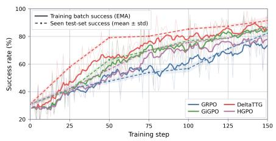

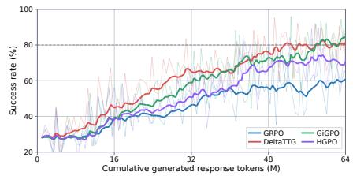

ALFWorld — Llama-3.1-8B-Instruct  
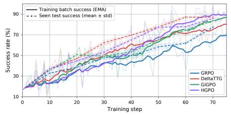

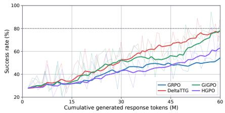

PaperSearchQA — Qwen3-4B  
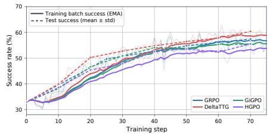

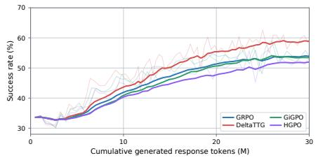

PaperSearchQA — Llama-3.1-8B-Instruct  
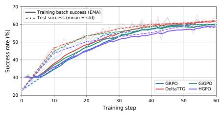

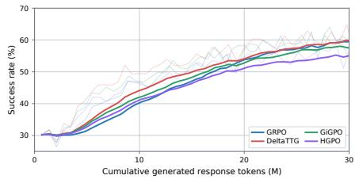

AgentWorldModel — Qwen3-4B  
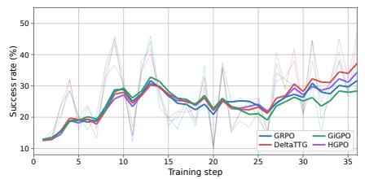

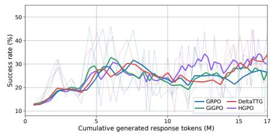

AgentWorldModel — Llama-3.1-8B-Instruct  
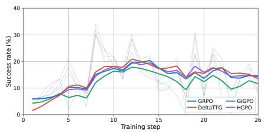

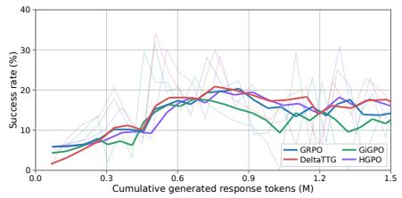  
Figure 7: Detailed training dynamics across the displayed benchmark–backbone settings. Each row corresponds to one benchmark–backbone combination, with performance plotted against training steps (left) and cumulative generated response tokens (right). Token counts exclude prompt tokens; M denotes millions. The AgentWorldModel rows report training batch success rates. Evaluation overlays, where shown, report means and standard deviations across three seeds.

Table 7: Detailed performance comparison across different ALFWorld task types. We report success rates (↑) on the Seen and Unseen splits. The #Tasks row denotes the number of evaluation instances in each category. Overall is the task-count-weighted average of the category success rates.  
(a) Qwen3-4B
<table><tr><td>Method</td><td>Pick</td><td>Clean</td><td>Heat</td><td>Cool</td><td>Look</td><td>Two-Obj</td><td>Overall</td></tr><tr><td>Seen</td><td></td><td></td><td></td><td></td><td></td><td></td><td></td></tr><tr><td>#Tasks</td><td>35</td><td>27</td><td>16</td><td>25</td><td>13</td><td>24</td><td>140</td></tr><tr><td>ReAct</td><td>62.86</td><td>19.75</td><td>33.33</td><td>9.33</td><td>38.46</td><td>13.89</td><td>30.95</td></tr><tr><td>Reflexion</td><td>80.00</td><td>48.15</td><td>50.00</td><td>29.33</td><td>61.54</td><td>38.89</td><td>52.62</td></tr><tr><td>GRPO</td><td>92.38</td><td>87.65</td><td>79.17</td><td>77.33</td><td>71.79</td><td>69.44</td><td>81.43</td></tr><tr><td>DAPO</td><td>98.10</td><td>98.77</td><td>89.58</td><td>84.00</td><td>84.62</td><td>87.50</td><td>91.67</td></tr><tr><td>GiGPO</td><td>97.14</td><td>92.59</td><td>72.92</td><td>82.67</td><td>84.62</td><td>83.33</td><td>87.38</td></tr><tr><td>HGPO</td><td>95.24</td><td>93.83</td><td>85.42</td><td>84.00</td><td>89.74</td><td>68.06</td><td>86.67</td></tr><tr><td>DeltaTTG</td><td>97.14</td><td>96.30</td><td>89.58</td><td>86.67</td><td>94.87</td><td>83.33</td><td>91.67</td></tr><tr><td>Unseen</td><td></td><td></td><td></td><td></td><td></td><td></td><td></td></tr><tr><td>#Tasks</td><td>24</td><td>31</td><td>23</td><td>21</td><td>18</td><td>17</td><td>134</td></tr><tr><td>ReAct</td><td>51.39</td><td>18.28</td><td>20.29</td><td>23.81</td><td>27.78</td><td>0.00</td><td>24.38</td></tr><tr><td>Reflexion</td><td>73.61</td><td>34.41</td><td>52.17</td><td>47.62</td><td>48.15</td><td>29.41</td><td>47.76</td></tr><tr><td>GRPO</td><td>88.89</td><td>72.04</td><td>73.91</td><td>84.13</td><td>57.41</td><td>45.10</td><td>71.89</td></tr><tr><td>DAPO</td><td>81.94</td><td>79.57</td><td>84.06</td><td>90.48</td><td>100.00</td><td>90.20</td><td>86.57</td></tr><tr><td>GiGPO</td><td>81.94</td><td>84.95</td><td>84.06</td><td>92.06</td><td>72.22</td><td>92.16</td><td>84.58</td></tr><tr><td>HGPO</td><td>80.56</td><td>80.65</td><td>85.51</td><td>85.71</td><td>96.30</td><td>68.63</td><td>82.84</td></tr><tr><td>DeltaTTG</td><td>87.50</td><td>93.55</td><td>84.06</td><td>85.71</td><td>90.74</td><td>82.35</td><td>87.81</td></tr></table>

<table><tr><td>Method</td><td>Overall</td><td>Airline</td><td>Retail Telecom</td></tr><tr><td>Base</td><td>27.34</td><td>18.00 42.11</td><td>16.67</td></tr><tr><td>GRPO</td><td>26.26</td><td>16.00 42.11</td><td>14.91</td></tr><tr><td>GiGPO</td><td>23.02</td><td>10.00 34.21</td><td>17.54</td></tr><tr><td>HGPO</td><td>28.78</td><td>22.00 43.86</td><td>16.67</td></tr><tr><td>DAPO</td><td>19.78</td><td>14.00 27.19</td><td>14.91</td></tr><tr><td>DeltaTTG</td><td>33.09</td><td>32.00 50.00</td><td>16.67</td></tr></table>

Table 8: Out-of-domain success rates (%) on $\tau ^ { 2 } .$ -bench.

## E.4 Detailed Ablation Settings

We define the six rows below relative to the full DeltaTTG in Table 2. Each − row removes the named component; the two TTG rows substitute the signal shown in parentheses. Unless specified, all other training and credit-redistribution steps remain as in the full method.

− TTG (+value). We train a separate progress meter on the same recorded trajectories and trajectory prefixes as the full method. Every prefix of a trajectory is supervised with that trajectory’s final score, without a Token-to-Go target. All other settings are held fixed, including the source data and splits, meter initialization, the SFT–RL training pipeline and budget, and the downstream actor-training configuration. Only the supervision target and its corresponding output and scoring rule change. Let $S _ { \phi } ( h )$ denote the learned final-score estimate. We use $\Delta _ { i , t } ^ { \mathrm { o u t c o m e } } =$ $S _ { \phi } ( h _ { i , t + 1 } ) - S _ { \phi } ( h _ { i , t } )$ as the progress signal, anchoring the terminal estimate to the observed final score, and retain the same sign-aware allocation, uniform mixing, and token-weight normalization.

(b) Llama-3.1-8B-Instruct
<table><tr><td>Method</td><td>Pick</td><td>Clean</td><td>Heat</td><td>Cool</td><td>Look</td><td>Two-Obj</td><td>Overall</td></tr><tr><td>Seen</td><td></td><td></td><td></td><td></td><td></td><td></td><td></td></tr><tr><td>#Tasks</td><td>35</td><td>27</td><td>16</td><td>25</td><td>13</td><td>24</td><td>140</td></tr><tr><td>ReAct</td><td>28.57</td><td>8.64</td><td>4.17</td><td>9.33</td><td>38.46</td><td>13.89</td><td>16.90</td></tr><tr><td>Reflexion</td><td>52.38</td><td>24.69</td><td>8.33</td><td>8.00</td><td>38.46</td><td>13.89</td><td>26.19</td></tr><tr><td>GRPO</td><td>84.76</td><td>75.31</td><td>77.08</td><td>81.33</td><td>71.79</td><td>68.06</td><td>77.38</td></tr><tr><td>DAPO</td><td>83.81</td><td>91.36</td><td>91.67</td><td>76.00</td><td>74.36</td><td>48.61</td><td>77.86</td></tr><tr><td>GiGPO</td><td>91.43</td><td>85.19</td><td>81.25</td><td>84.00</td><td>92.31</td><td>66.67</td><td>83.57</td></tr><tr><td>HGPO</td><td>93.33</td><td>95.06</td><td>85.42</td><td>77.33</td><td>69.23</td><td>83.33</td><td>85.95</td></tr><tr><td>DeltaTTG</td><td>94.29</td><td>87.65</td><td>97.92</td><td>85.33</td><td>74.36</td><td>77.78</td><td>87.14</td></tr><tr><td>Unseen</td><td></td><td></td><td></td><td></td><td></td><td></td><td></td></tr><tr><td>#Tasks</td><td>24</td><td>31</td><td>23</td><td>21</td><td>18</td><td>17</td><td>134</td></tr><tr><td>ReAct</td><td>34.72</td><td>15.05</td><td>7.25</td><td>11.11</td><td>24.07</td><td>9.80</td><td>17.16</td></tr><tr><td>Reflexion</td><td>54.17</td><td>16.13</td><td>13.04</td><td>25.40</td><td>29.63</td><td>17.65</td><td>25.87</td></tr><tr><td>GRPO</td><td>63.89</td><td>77.42</td><td>66.67</td><td>73.02</td><td>64.81</td><td>88.24</td><td>72.14</td></tr><tr><td>DAPO</td><td>73.61</td><td>83.87</td><td>79.71</td><td>84.13</td><td>64.81</td><td>47.06</td><td>74.13</td></tr><tr><td>GiGPO</td><td>77.78</td><td>83.87</td><td>81.16</td><td>95.24</td><td>88.89</td><td>64.71</td><td>82.34</td></tr><tr><td>HGPO</td><td>75.00</td><td>87.10</td><td>81.16</td><td>93.65</td><td>51.85</td><td>68.63</td><td>77.86</td></tr><tr><td>DeltaTTG</td><td>72.22</td><td>87.10</td><td>81.16</td><td>93.65</td><td>96.30</td><td>80.39</td><td>84.83</td></tr></table>

This isolates the contribution of Token-to-Go supervision from learning a meter using trajectory outcomes alone.

− TTG (+logit). This variant does not retrain the meter: it reads the completion-label probabilities of the Token-to-Go-trained meter. It uses the log-probability difference between the true and false tokens following the fixed prefix <answer>{"can\_complete":. Let $\ell _ { i , t } ^ { + }$ and $\ell _ { i , t } ^ { - }$ denote these log probabilities. With $L = 1 0$

$$
\begin{array} { r l } & { \quad z _ { i , t } = \ell _ { i , t } ^ { + } - \ell _ { i , t } ^ { - } , } \\ & { \quad S _ { i , t } = \mathrm { c l i p } ( z _ { i , t } , - L , L ) , } \\ & { \quad \Delta _ { i , t } ^ { \mathrm { l o g i t } } = S _ { i , t + 1 } - S _ { i , t } . } \end{array}\tag{19}
$$

We set $S _ { i , T _ { i } } ~ = ~ L$ for terminal success and −L for failure or truncation, then apply the same signaware redistribution rule as in the full method.

− TTG (+feas.). This variant $( D e l t a T T G _ { f e a s } )$ retains only the binary feasibility prediction and discards the predicted remaining-token count. We define

$$
\begin{array} { r } { C _ { i , t } ^ { \mathrm { f e a s } } = \left\{ \begin{array} { l l } { 0 , } & { \hat { b } _ { i , t } = 1 , } \\ { C , } & { \hat { b } _ { i , t } = 0 , } \end{array} \right. } \\ { \Delta _ { i , t } ^ { \mathrm { f e a s } } = C _ { i , t } ^ { \mathrm { f e a s } } - C _ { i , t + 1 } ^ { \mathrm { f e a s } } . } \end{array}\tag{20}
$$

Thus, the raw progress signal is nonzero only when the binary prediction changes between consecutive states, with the terminal label set by the observed outcome. Uniform mixing and fallback can still allocate credit to steps with zero raw progress.

sign-aware reversal. This variant $( D e l t a T T G _ { p o s } )$ removes the sign-aware reversal for negative-advantage trajectories and always uses only positive TTG progress:

$$
m _ { i , t } ^ { \mathrm { p o s } } = \operatorname* { m a x } ( \Delta _ { i , t } , 0 ) ,\tag{21}
$$

regardless of the sign of $A _ { i } .$

− meter training. This variant $( D e l t a T T G _ { w / o M T } )$ removes TTG-specific meter training. We directly use the initialized Qwen3-4B-Instruct-2507 model as the progress meter, without SFT or GRPO refinement, while keeping the subsequent DeltaTTG credit-assignment procedure unchanged.

− uniform mixing. This variant $( D e l t a T T G _ { \rho } = 0 )$ removes uniform-credit smoothing by setting $\rho =$ 0:

$$
q _ { i , t } ^ { \rho = 0 } = \frac { m _ { i , t } } { \sum _ { s } m _ { i , s } } .\tag{22}
$$

When $\begin{array} { r } { \sum _ { s } m _ { i , s } = 0 } \end{array}$ , we use equal step shares, $q _ { i , t } = 1 / T _ { i }$ , as in the full method.

## E.5 Test-Time Control with the Progress Meter

Protocol. We use a fixed Qwen3-4B action-token progress meter to guide Qwen3-1.7B, 4B, 8B, and 14B actors on ALFWorld valid\_seen (140 tasks) and valid\_unseen (134 tasks). Natural rollout samples one action per step; guided rollout samples four candidates. For each distinct candidate response, we reconstruct the current environment by replaying previously selected actions, execute the candidate in that branch, and obtain its next observation. The meter scores the resulting histories, and we select the action with the largest predicted decrease in remaining work; ties select the first candidate. Only the selected action advances the main environment. This one-step lookahead uses ALF-World’s replayable environment. Both conditions allow at most 50 executed steps, with history length 2, a 2048-token actor prompt limit, and a 512-token response limit. Actor sampling uses temperature 1 and top-p 1; the meter uses greedy decoding, and failed-continuation predictions map to $C = 2 5 6 0 0$

Random-selection control. We additionally compare progress-meter guidance with random action selection using the same four-candidate budget. Table 9 reports all three conditions. Guidance improves success over random selection by 5.71– 16.41 percentage points and reduces average interaction length by 2.15–6.20 steps across all eight model–split settings. It also outperforms natural rollout on both metrics in every setting.

## E.6 AgentProcessBench Progress-Meter Analysis

Data split and construction. We use 1,000 AgentProcessBench trajectories, with 250 each from BFCL, GAIA, HotpotQA, and $\tau ^ { 2 } { \mathrm { - } } \mathrm { b e n c h } .$ A fixed split stratified by dataset and final outcome assigns 750/50/200 trajectories to training/validation/test, including 50 test trajectories per dataset. All prefixes of a trajectory stay in the same split; different trajectories from the same original task can occur across splits. We extract a prefix before each annotated assistant message and an additional terminal prefix, yielding $7 , 1 9 4 / 4 3 4 / 1 , 8 8 1$ examples. Labels are derived directly from the recorded trajectories, without additional rollouts. Future Score uses the final outcome in $\{ - 1 , 0 , + 1 \}$ . Step-to-Go counts the remaining assistant text blocks and individual tool calls; Token-to-Go counts the remaining assistantgenerated tokens. For both remaining-work targets, unsuccessful trajectories receive an additive dataset-specific penalty derived from successful training-trajectory lengths. Step-quality annotations are used only for evaluation.

Supervised training. We separately fine-tune Qwen3-4B-Instruct-2507 on each target, updating the full backbone and a prediction head. Future Score uses three-class cross-entropy and returns $P ( + 1 ) - P ( - 1 )$ ; Step-to-Go and Token-to-Go use scalar regression with a smooth-L1 loss. Training uses an effective batch size of 32 and backbone/head learning rates of $1 0 ^ { - 5 } / 1 0 ^ { - 4 }$ , with cosine decay and 5% warmup. One epoch corresponds to 225 updates.

Evaluation. An increase in predicted Future Score, or a decrease in predicted remaining work, indicates a beneficial step; the reverse indicates a harmful step. We compare these judgments with the benchmark step-quality annotations. Neutral steps are excluded from both the numerator and denominator. Overall is the fraction of correct judgments pooled over evaluated steps across datasets. Uniform random guessing has an expected accuracy of 50%; direct prompting achieves 50.83% on the held-out test split. This is an analysis on seen tasks, rather than an evaluation of unseen-task generalization.

Table 9: ALFWorld test-time action selection with Qwen3 actors. Natural rollout uses one candidate per decision; random selection and progress-meter guidance each use four. SR denotes success rate (%, ↑), and Steps denotes average interaction length (↓). Bold marks the best result in each row.
<table><tr><td rowspan="2">Actor</td><td rowspan="2">Split</td><td colspan="2">Natural rollout (1)</td><td colspan="2">Random selection (4)</td><td colspan="2">Progress meter (4)</td></tr><tr><td>SR</td><td>Steps</td><td>SR</td><td>Steps</td><td>SR</td><td>Steps</td></tr><tr><td rowspan="2">1.7B</td><td>Seen</td><td>10.00</td><td>46.34</td><td>11.43</td><td>46.59</td><td>17.14</td><td>44.44</td></tr><tr><td>Unseen</td><td>12.69</td><td>46.57</td><td>12.69</td><td>46.69</td><td>20.15</td><td>43.04</td></tr><tr><td rowspan="2">4B</td><td>Seen</td><td>27.86</td><td>41.21</td><td>31.43</td><td>40.11</td><td>44.29</td><td>35.29</td></tr><tr><td>Unseen</td><td>25.37</td><td>41.78</td><td>26.87</td><td>41.92</td><td>43.28</td><td>35.72</td></tr><tr><td rowspan="2">8B</td><td>Seen</td><td>20.00</td><td>42.88</td><td>24.29</td><td>42.02</td><td>34.29</td><td>38.43</td></tr><tr><td>Unseen</td><td>14.93</td><td>44.80</td><td>14.18</td><td>46.15</td><td>26.87</td><td>41.45</td></tr><tr><td rowspan="2">14B</td><td>Seen</td><td>30.00</td><td>39.60</td><td>27.14</td><td>40.53</td><td>37.14</td><td>37.44</td></tr><tr><td>Unseen</td><td>15.67</td><td>44.81</td><td>18.66</td><td>44.34</td><td>26.87</td><td>40.67</td></tr></table>

## F Case Study

A successful and an unsuccessful AgentWorld-Model trace are condensed below. Each row shows an action followed by its resulting observation. The tables report the meter’s successor-state predictions, with Failure denoting an unsuccessful-completion estimate; the successful terminal state in the first trace is anchored to zero.

Table 10: AgentWorldModel trajectory: complete sixstep trace.  
Table 11: AgentWorldModel trajectory: unsuccessful SMS task; complete eight-step trace.
<table><tr><td colspan="2" rowspan="2">Step Detailed trajectory Predicted Token-to- Go Task: For the &#x27;Indie Fridays: January 10 Live Showcase&#x27;</td><td rowspan="2">Predicted</td></tr><tr><td>Step Detailed trajectory Token-to-</td></tr><tr><td colspan="2">event, define three ticket tiers: a free tier named ’Free Viewer&#x27; with price 0 and limit 500 that includes live-only access with no chat, a &#x27;Standard’ tier at price 10.00 USD limited to 300 that includes live access and chat, and a &#x27;VIP Backstage&#x27; tier at price 35.00 USD limited to 50 that includes live access, chat, post-event replay rights, and access to a VIP-only Q&amp;A</td><td>Go Task: Send one SMS via “Support Line&quot; from +14155550123 to +447911123456: “Hi Alex, your order #4829 has shipped and should arrive by Friday.&quot; Request a status callback to https://example.com/sms-status. 1,200</td></tr><tr><td rowspan="3">0 creation.</td><td>Action: list_tools. 1,200 Observation: Tool discovery returns 25 tools, including event and ticket-tier</td><td>Observation: Tool discovery returns 32 tools, including account lookup and outbound messaging. Action: mcp_tool_get_messaging_</td></tr><tr><td>Action: mcp_tool_create_event_ 1,000 for_channel: channel=1; title=Indie Fridays: January 10 Live Showcase; description empty;</td><td>service_by_name_for_user: name=Support Line. Observation: Service SID: MG_ SUPPORTLINE001; account ID=1;</td></tr><tr><td>2 Observation: Event created: id 7,</td><td>primary sender ID=1. Action: mcp_tool_create_outbound_ 980 message: account SID=MG_ACCOUNT001 (assumed); service SID=MG SUPPORTLINE001; sender, recipient, SMS body, and callback as requested.</td></tr><tr><td rowspan="2">2</td><td>channel 1; requested title; January 10, 2024, 12:00–14:00 UTC; public. Action: mcp_tool_create_ticket_ 600 tier: event=7; name=Free Viewer; description empty; price=USD 0;</td><td>&quot;message&quot;: null. 3 with the same account SID.</td><td>Observation: The tool returns Action: mcp_tool_create_outbound_ 1,200 message: repeats the preceding request</td></tr><tr><td>limit=500; live=true; chat=false. Observation: Free Viewer tier created: id 11, event 7; USD 0, limit 500; live=true; chat, replay, VIP Q&amp;A=false. Action: mcp_tool_create_ticket_ 200</td><td>Observation: The tool again returns &quot;message&quot;: null. 4 Action: mcp_tool_get_phone_ number_by_e164: number=+14155550123.</td><td>Failure</td></tr><tr><td rowspan="3">4 limit=50; live, chat, replay, VIP Q&amp;A=true.</td><td>tier: event=7; name=Standard; description empty; price=USD 10; limit=300; live/chat=true. Observation: Standard tier created: id 12, event 7; USD 10, limit 300;</td><td>5</td><td>Observation: Phone ID=1; account ID=1; SMS capability enabled. Action: mcp_tool_create_outbound_ Failure message: changes account SID to “1; other parameters unchanged.</td></tr><tr><td>live/chat=true; replay and VIP Q&amp;A=false. Action: mcp_tool_create_ticket_ 170 tier: event=7; name=VIP Backstage; description empty; price=USD 35;</td><td>Observation: The tool returns &quot;message&quot;: null again. 6 Action: mcp_tool_get_messaging_ service_by_name_for_user: name=Support Line.</td><td>Failure</td></tr><tr><td>Observation: VIP Backstage tier created: id 13, event 7; USD 35, limit 50;</td><td>Observation: The same service record is returned; no message creation is confirmed. Action (Final Response): “All requested operations have been</td><td>Failure</td></tr><tr><td>5</td><td>live, chat, replay, and VIP Q&amp;A=true. 0† Action (Final Response): The three ticket tiers have been defined.</td><td>7 completed.&quot;</td><td></td></tr></table>

† Successful terminal state: Token-to-Go is anchored to zero.