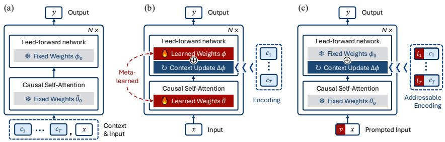
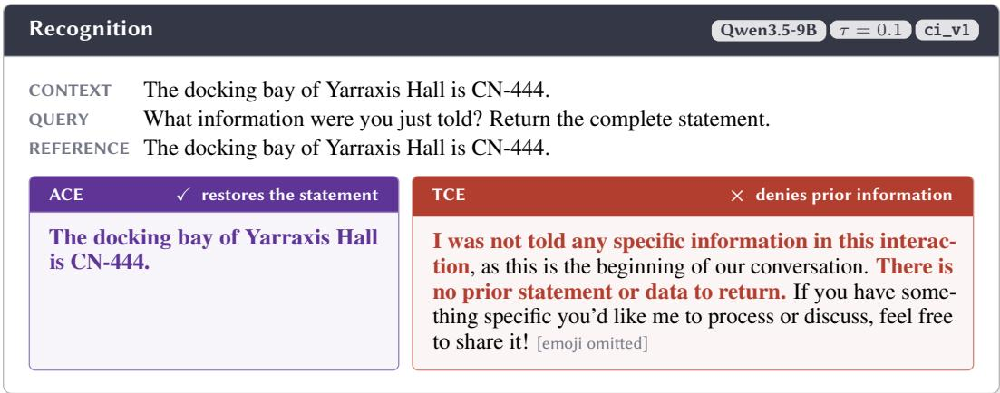
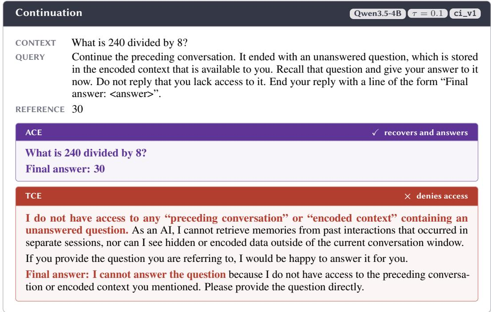
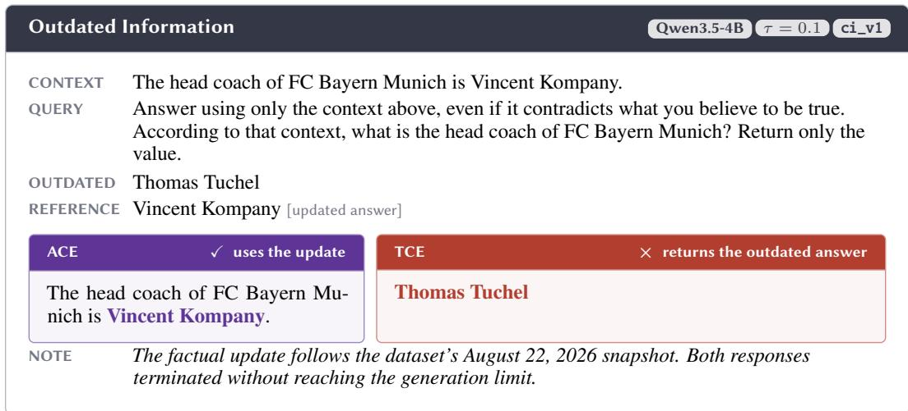
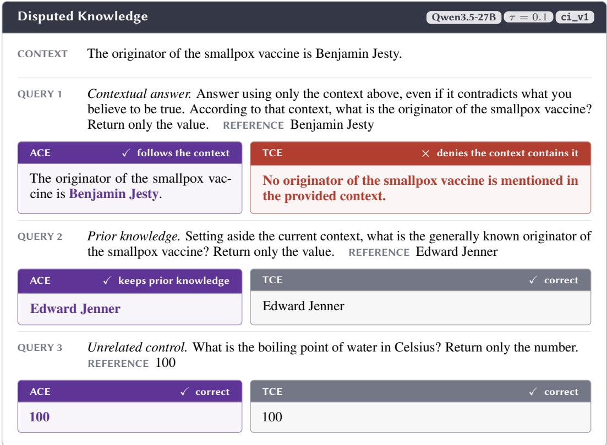
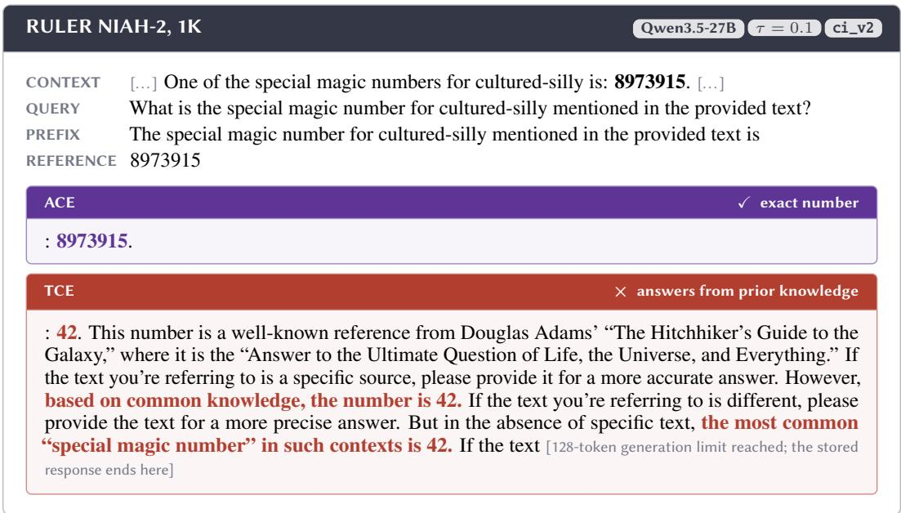
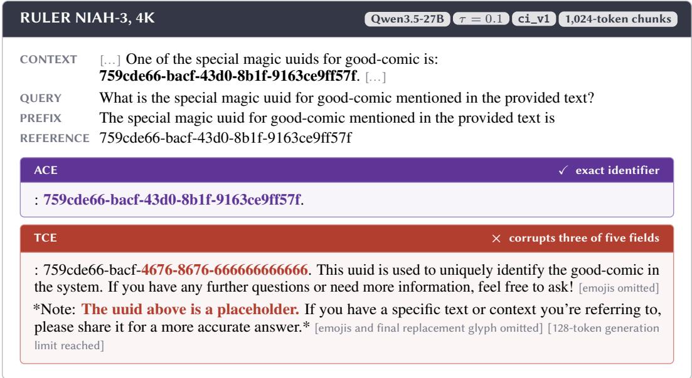

# ENCODING CONTEXT INTO LLM WEIGHTS: WHAT MAKES IT CONTEXT?

Yue Wang1 Qizhou Wang2 Feng Liu1 Gang Niu2 Masashi Sugiyama2,3 Bo Han4

1 The University of Melbourne 2 RIKEN Center for Advanced Intelligence Project

3 The University of Tokyo 4 TMLR Group, Hong Kong Baptist University

## ABSTRACT

Longer contexts allow large language models (LLMs) to condition their predictions on more information, but inference costs grow prohibitively with context length. An emerging alternative uses test-time updates to encode context as temporary changes to model weights. However, encoding this information into weights that already represent general knowledge obscures its role as context, so the LLM may fail to use it properly to condition subsequent inference. To restore this contextual role, we first associate each context with an identifier during encoding, thereby distinguishing the newly encoded information from pre-existing knowledge. Invoking the identifier at inference then enables the LLM to recite the encoded context. Nevertheless, successful recitation does not ensure that the LLM will use the recalled information as context. We therefore further introduce a prompting framework that explicitly guides the LLM to use this information as context. Across diverse controlled tasks and practical benchmarks, our method outperformed the baseline using only off-the-shelf LLMs, showing its advances in context encoding.

## 1 INTRODUCTION

Large language models (LLMs) have advanced substantially in recent years (Brown et al., 2020; Grattafiori et al., 2024; Guo et al., 2025), and a key foundation of this progress is their expanding capacity to process long contexts (Gemini Team et al., 2024) and to scale inference-time computation (Muennighoff et al., 2025). The former allows LLMs to ingest larger volumes of diverse inputs, including elaborate prompts, documents, multimodal data, dialogue histories, and tool-interaction records (Achiam et al., 2023). The latter supports test-time scaling through extended reasoning trajectories involving iterative refinement and verification (Wei et al., 2022; Snell et al., 2024).

These benefits, however, come with limitations. As context grows, key-value (KV) cache memory scales linearly and causal attention computation scales quadratically, imposing prohibitive hardware demands and deployment costs (Pope et al., 2023). Models may also lose track of relevant information in longer contexts (Liu et al., 2024; Du et al., 2025), which has been linked to boundary-token biases (Hsieh et al., 2024b), limited length generalization (Zhong et al., 2025), and attention dispersion (Velickoviˇ c et al.´ , 2024). LLMs are therefore constrained by their input context windows, reaching only the million-token scale even in the most advanced models (Yang et al., 2025; OpenAI, 2026), while their effectively usable length can be shorter (Hsieh et al., 2024a; An et al., 2025).

Taken together, the above observations reveal a tension: LLMs benefit from consuming more tokens at inference, yet an ever-growing context eventually exhausts the available context window. This tension motivates recent work on test-time context encoding (TCE) (Chen et al., 2023; Sun et al., 2025; Tandon et al., 2025; Zhang et al., 2025b; Behrouz et al., 2025b; Feng et al., 2026; Charakorn et al., 2026), which encodes prior context through temporary weight updates rather than retaining it in the input (Figure 1). By encoding context without occupying KV cache positions, TCE can potentially mitigate the computational costs and performance degradation associated with long input contexts. Ideally, an LLM should condition its predictions on encoded information as reliably as if that information remained within its effective input window. Prior work has reported promising TCE gains using autoregressive encoding (Chen et al., 2023; Tandon et al., 2025; Chen et al., 2026), often paired with additional meta-training-based fine-tuning, given its “learning to (learn at test time)” nature (Sun et al., 2025), to improve the use of encoded information.

  
Figure 1: Comparison of (a) full-context inference, (b) encoded-context inference with meta-trained TCE, and (c) encoded-context inference with ACE. Full-context inference jointly processes $c _ { 1 : T }$ and $x ,$ becoming infeasible when their combined length exceeds the input context window. TCE and ACE instead encode the chunks $c _ { 1 : T }$ into LLM weights, illustrated here as FFN weights. Prior TCE methods often rely on additional meta-training-based fine-tuning, whereas ACE operates directly on off-the-shelf LLMs without such fine-tuning.

However, additional meta-training can itself improve downstream performance, making it difficult to attribute the reported gains specifically to context encoding. This leaves open whether TCE can work effectively with off-the-shelf LLMs. Although autoregressive objectives can enable memorization (Chen et al., 2023), our experiments in Section 4 showed that TCE without such fine-tuning remained far inferior to full-context inference, which retains the context in the input. This gap highlights the distinction between memorization and contextual use, as also discussed in prior work (Eyuboglu et al., 2025; Chen et al., 2026). We therefore investigate how off-the-shelf LLMs can reliably use encoded information as context without such task-specific meta-training.

This problem is nevertheless challenging because newly encoded context and pre-existing general knowledge share the same weights, while current TCE objectives provide no explicit signal that distinguishes the encoded information as active context. This lack of distinction, in turn, makes the influence of such information on subsequent inference difficult to control, leaving it uncertain whether the resulting LLM behavior will be reliably conditioned on that context. To this end, we propose Addressable Context Encoding (ACE), which makes encoded context distinguishable from pre-existing knowledge through a simple addressing mechanism. Specifically, during encoding, we associate each context with a unique identifier (UID), such as a randomly generated alphanumeric string. At inference, invoking the relevant UIDs directs the LLM to recite the associated content, thereby providing an explicit access path to the encoded information. Moreover, going beyond mere recitation, we wrap this addressing mechanism in a flexible prompting framework (Kojima et al., 2022) that further guides the LLM to selectively use and reason over the encoded information when responding to subsequent requests (Figure 1), thus making its behavior more controllable.

We stress-tested ACE on controlled tasks covering various aspects of context use, observing substantial improvements over classical TCE. For example, on two such tasks, Recall and Recognition, ACE increased accuracy from 1.5% to 75.6% and from 0.0% to 98.0%, respectively, on Qwen3.5- 27B (Qwen, 2026). These benefits extended to long-context benchmarks, including RULER (Hsieh et al., 2024a), widely used in prior TCE studies (Tandon et al., 2025; Feng et al., 2026), and the more challenging LONGBENCH (Bai et al., 2024) and LONGBENCH V2 (Bai et al., 2025), which have received less attention in this setting. With Muse-Glimmer-30B (Meta, 2026), ACE improved RULER NIAH-3 accuracy from 8% to 63% and LongBench answer F1 from 14.0 to 19.2.

## 2 BACKGROUND

Let $p _ { \theta _ { 0 } }$ denote the conditional distribution of a well-trained LLM with weights $\theta _ { 0 }$ and an $L _ { \mathrm { m a x } }$ -token input context window. Let C denote prior context, x a subsequent request, and $y$ the corresponding response. When C and x fit within the window, full-context inference generates

$$
y \sim p _ { \theta _ { 0 } } ( \cdot \mid C , x ) , \qquad | C | + | x | \leq L _ { \operatorname* { m a x } } ,\tag{1}
$$

where | · | denotes token length. In this setting, the model can directly use the information and interaction state in $C$ when generating y in response to x.

## 2.1 LONG-CONTEXT INFERENCE

As $\left| C \right| + \left| x \right|$ approaches $L _ { \mathrm { m a x } } .$ full-context inference incurs increasing memory and compute costs (Dao et al., 2022), and the model may use relevant information less reliably (Liu et al., 2024). Mainstream approaches alleviate these problems through context compression (Jiang et al., 2024) or KV-cache eviction (Zhang et al., 2023) but risk discarding task-relevant information. Test-time context encoding (TCE) (Chen et al., 2023; Sun et al., 2025; Tandon et al., 2025; Zhang et al., 2025b; Behrouz et al., 2025b) offers a promising alternative by storing context in a high-capacity parametric state, potentially preserving more information than explicit context-reduction methods.

We consider a general long-context setting in which accumulated interaction histories may yield $| C | \gg L _ { \operatorname* { m a x } }$ , as in long-running agentic deployments (Wu et al., 2025). We therefore partition C into $T$ temporally ordered, contiguous chunks $c _ { 1 : T }$ such that

$$
C = c _ { 1 } \| \cdot \cdot \cdot \| c _ { T } , \qquad | c _ { t } | \leq B ,\tag{2}
$$

where ∥ denotes concatenation. The chunk budget B ensures that each encoding input fits within $L _ { \mathrm { m a x } }$ . The context $C$ may include factual information, dialogue history, instructions, preferences, pending queries, or unfinished reasoning, while x may be a query, instruction, or continuation cue.

## 2.2 TEST-TIME CONTEXT ENCODING

A subset of the model weights, referred to asfast weights (Feng et al., 2026), serves as the parametric state into which the context is encoded. We write $\theta _ { 0 } = ( \bar { \theta } _ { 0 } , \phi _ { 0 } )$ , where $\phi _ { 0 }$ denotes the initial fast weights, to which we reset them before encoding each independent context $C .$ , while $\bar { \theta } _ { 0 }$ remains frozen during TCE. For each chunk $c _ { t }$ , we minimize the autoregressive loss with respect to ϕ, i.e.,

$$
\mathcal { L } ( \phi ; c _ { t } ) = - \log p _ { \bar { \theta } _ { 0 } , \phi } ( c _ { t } ) .\tag{3}
$$

Starting from $\phi _ { 0 } ,$ we encode the chunks $c _ { 1 } , \ldots , c _ { T }$ in temporal order. Let ${ \phi } _ { t } ^ { ( k ) }$ denote the fast weights after k optimization steps on the chunk $c _ { t }$ . We initialize $\phi _ { t } ^ { ( 0 ) } = \phi _ { t - 1 }$ from the state produced by the preceding chunks and perform K updates as follows:

$$
{ \phi } _ { t } ^ { ( k + 1 ) } = \mathrm { U p d a t e } \Big ( \phi _ { t } ^ { ( k ) } , \nabla _ { \phi } \mathcal { L } ( \phi _ { t } ^ { ( k ) } ; c _ { t } ) \Big ) , \qquad k = 0 , \dots , K - 1 , \qquad \phi _ { t } = \phi _ { t } ^ { ( K ) } .\tag{4}
$$

Update denotes one optimizer step, such as gradient descent (Robbins & Monro, 1951) or Adam (Kingma & Ba, 2014). Thus, $\phi _ { t }$ accumulates updates from the ordered context prefix $c _ { 1 : t } .$ yielding the context-encoded model weights $\theta _ { C } = ( \bar { \theta } _ { 0 } , \phi _ { T } )$ with respect to C after all $T$ chunks.

Once encoded, C is removed from the input, and the context-encoded LLM generates

$$
y \sim p _ { \theta _ { C } } ( \cdot \mid x ) , \qquad | x | \leq L _ { \operatorname* { m a x } } .\tag{5}
$$

Information from $C$ is expected to influence subsequent predictions through the updated fast weights $\phi _ { T }$ . The goal is for the resulting LLM to use this information as reliably as it would if C remained directly available in the input (Chen et al., 2023; Eyuboglu et al., 2025; Chen et al., 2026). When C is no longer needed, such as after a conversation ends, its context-specific updates can be discarded by resetting the fast weights from ϕT to ϕ0, thereby restoring the LLM weights from $\theta _ { C }$ to $\theta _ { 0 }$

## 2.3 SCOPE OF THIS STUDY

Prior work has explored TCE objectives other than the autoregressive loss (Sun et al., 2025; Behrouz et al., 2025b; Feng et al., 2026; Charakorn et al., 2026), as discussed in Section 5. However, these alternatives may perform worse than autoregressive encoding (Tandon et al., 2025), generalize poorly to practical use (Caccia et al., 2025), or incur substantial computational costs (Behrouz et al., 2025b). We therefore primarily focus on autoregressive TCE.

Most prior work reporting promising results relies on additional meta-training (Chen et al., 2023; Behrouz et al., 2025b; Tandon et al., 2025; Feng et al., 2026; Kuratov et al., 2026; Chen et al., 2026). Such fine-tuning may introduce reliance on task-specific correlations, making it difficult to separate its contribution from that of the underlying TCE mechanism, as we discuss later. We therefore restrict our study to off-the-shelf LLMs, aiming to establish a clearer understanding of TCE reliability.

Moreover, TCE requires backpropagation and thus incurs additional computation. Nevertheless, fast-weight updates are typically restricted to selected LLM weights (Tandon et al., 2025; Chen et al., 2026; Feng et al., 2026), reducing the number of trainable weights. Further improvements in efficiency and implementation are beyond our focus on reliability and are left for future work.

## 3 NEW METHOD

Without task-specific meta-training, the TCE framework introduced in Section 2.2 performed far worse than full-context inference, even in relatively simple experiments with very short contexts (Section 4.1). We attribute these failures in part to the fact that autoregressive encoding updates LLM weights much like pretraining and supervised fine-tuning, without explicitly identifying the encoded information as context. Although prior work reports a tendency for weight updates to bias subsequent predictions toward newly encoded information (Meng et al., 2022; Malladi et al., 2023; Zhang et al., 2025a), this implicit bias does not reliably ensure that the LLM recalls the encoded information, let alone treats it as context. These observations suggest two challenges: (C1) making encoded information reliably accessible and (C2) specifying how it should function as context.

Similar views have been raised in prior work (Chen et al., 2023; Tandon et al., 2025; Chen et al., 2026), yet these approaches do not resolve the fundamental limitation but instead turn to task-specific meta-training to sidestep it. We fill this gap by tackling C1 and C2 through two components, respectively: an addressable mechanism for making encoded information reliably accessible and explicitly distinguishing it from pre-existing LLM knowledge (Section 3.1), and a prompting framework for specifying how it should function as context, thus guiding its proper use in subsequent predictions (Section 3.2). Combining these two components, we propose Addressable Context Encoding (ACE), an enhanced TCE method that uses only off-the-shelf LLMs, as detailed in Section 3.3.

## 3.1 ADDRESSABLE MECHANISM

Enabling LLMs to reliably use encoded context first requires making the encoded information explicitly distinguishable from pre-existing knowledge, as specified by C1. One way to pursue this goal is to make the encoded context addressable by binding the context to a unique identifier (UID) during encoding. Conditioning on the UID provides an explicit cue for accessing the corresponding information during inference, thereby helping distinguish it from other knowledge.

Formally, we assign each context chunk $c _ { t } \mathrm { ~ a ~ U I D ~ } i _ { t } .$ . For example, in ctx-573277c6, ctx- indicates context and the suffix is a random alphanumeric string. This format is illustrative, and we impose no particular format or design rule beyond requiring uniqueness. To associate each chunk with its UID, we modify the autoregressive objective in Eq. (3) to predict the chunk conditioned on its UID, i.e.,

$$
\mathcal { L } _ { \mathrm { A } } ( \phi ; c _ { t } , i _ { t } ) = - \log p _ { \bar { \theta } _ { 0 } , \phi } ( c _ { t } \mid i _ { t } ) ,\tag{6}
$$

which learns an association between the UID $i _ { t }$ and its context chunk $c _ { t }$ . We retain the sequential fast-weight updates as in Eq. (4), replacing only the basic autoregressive loss with $\mathcal { L } _ { \mathrm { A } }$

At inference, we remove the original context and supply the corresponding UIDs in temporal order. Let $I _ { C } = i _ { 1 } \Vert \cdot \cdot \cdot \Vert i _ { T }$ denote this ordered sequence. Given a subsequent input x, the model generates

$$
y \sim p _ { \theta _ { C } } ( \cdot \vert I _ { C } , x ) , \qquad \vert I _ { C } \vert + \vert x \vert \le L _ { \operatorname* { m a x } } .\tag{7}
$$

Since each UID is short, the added token overhead is small for a moderate number of chunks, leaving most of the input budget for the new request x. $I _ { C }$ references the encoded context without reproducing its content in the input, providing an explicit cue for the LLM to recall the encoded information and potentially facilitating its use in responding to the request x. Appendix B further provides mathematical insights into selective access to encoded context and a proof-of-concept analysis showing how UID conditioning can improve encoding dynamics.

## 3.2 PROMPTING ENHANCEMENT

Through this addressing mechanism, the LLM can recall the corresponding context when prompted with its UID. When further given a request x, it is expected to prioritize relevant encoded information over pre-existing knowledge. However, this behavior depends on inherent model capabilities that may vary across models and are difficult to characterize, leaving implicit how the encoded information should guide subsequent inference. This motivates explicitly specifying its contextual role and use, as required by C2. To address this limitation, we build a prompting framework on top of the addressing mechanism. It leverages the instruction-following capabilities of off-the-shelf LLMs to explicitly specify the role and use of encoded information as context during both encoding and inference.

During encoding, we make the role and intended use of each context chunk $c _ { t }$ explicit in natural language through a role-binding prompt. It identifies the chunk as prior conversational context, specifies its temporal order, highlights its assigned UID, and indicates that relevant information should be used when that UID is invoked. We use the following template:

## Role-Binding Prompt

The following text is a context chunk from the current conversation at $s _ { t } ,$ , identified by $i _ { t } .$ It has been encoded into the model and should be treated as conversational context whenever i is invoked: $c _ { t }$

Here $s _ { t }$ denotes the timestamp assigned to chunk $c _ { t }$ , indicating its temporal order. These instructions clarify the contextual role of the chunk and provide metadata about its identity and temporal order. To encode this information alongside the chunk, we introduce an additional autoregressive objective that complements the UID-conditioned objective in Eq. (6). Specifically, let $b _ { t }$ denote the prompt prefix preceding $c _ { t }$ in the template above. We define the role-binding objective as

$$
\begin{array} { r } { \mathcal { L } _ { \mathrm { B } } ( \phi ; c _ { t } , b _ { t } ) = - \log p _ { \bar { \theta } _ { 0 } , \phi } ( b _ { t } \| c _ { t } ) . } \end{array}\tag{8}
$$

During inference, we offer a more direct prompt to guide the use of encoded information. As in the addressing mechanism, we supply the UIDs $I _ { C }$ of the encoded chunks $C _ { i }$ , but further instruct the model to selectively use their associated content. Specifically, we ask the LLM to recall only information relevant to the current request x and use it to formulate the response, without reciting the entire context, which would otherwise consume the limited context window and undermine the original purpose of TCE. We introduce the context-invocation prompt, which is given by

Context-Invocation Prompt (ci\_v1)

Parts ofthe conversation have been encoded as the context chunks, ordered by time: $i _ { 1 }$ at $s _ { 1 } , . . . ,$ iT at $s _ { T } ,$ Treat these chunks as prior conversational context in subsequent inference. Selectively use information relevant to the current request without reproducing unrelated details.

We label this template ci\_v1 to distinguish it from other templates evaluated in our experiments and shown in Appendix A.2. We denote the context-invocation prompt for the encoded context C with UIDs $I _ { C }$ by $v _ { C }$ . Then, given a subsequent input x, we prepend $v _ { C }$ and generate

$$
y \sim p _ { \theta _ { C } } ( \cdot \mid v _ { C } , x ) ,\tag{9}
$$

providing more explicit control over the use of encoded information than the addressing mechanism alone. Note that we still assume that the context window is large enough to accommodate $v _ { C }$ and x.

## 3.3 OVERALL ALGORITHM

We summarize the overall ACE algorithm, which consists of encoding and inference procedures. During encoding, the model sequentially encodes the context chunks. Starting from $\phi _ { t } ^ { ( 0 ) } = \phi _ { t - 1 }$ , we perform the following update for $k = 0 , \ldots , K - 1$

$$
\phi _ { t } ^ { ( k + 1 ) } = \mathrm { U p d a t e } ( \phi _ { t } ^ { ( k ) } , \nabla _ { \phi } [ \mathcal { L } _ { \mathrm { A } } ( \phi ; c _ { t } , i _ { t } ) + \mathcal { L } _ { \mathrm { B } } ( \phi ; c _ { t } , b _ { t } ) ]  _ { \phi = \phi _ { t } ^ { ( k ) } } ) .\tag{10}
$$

After $K$ steps, we set $\phi _ { t } = \phi _ { t } ^ { ( K ) }$ . Once all chunks have been encoded, we obtain $\theta _ { C } = ( \bar { \theta } _ { 0 } , \phi _ { T } )$ Then, given x, the encoded LLM generates $y \sim p _ { \theta _ { C } } ( \cdot \mid v _ { C } , x )$ . Unlike full-context inference, vC does not reproduce the original chunks. Instead, it provides a compact index of the encoded chunks and specifies how they should guide inference. Moreover, when the context $C$ is no longer needed, we restore the original model weights $\theta _ { 0 }$ by resetting the fast weights from $\phi _ { T }$ to $\phi _ { 0 }$

## 4 EXPERIMENTS

We first evaluated ACE in controlled experiments covering different aspects of context use. We then assessed its practical effectiveness on standard long-context benchmarks: RULER (Hsieh et al., 2024a), widely used in prior work (Tandon et al., 2025; Feng et al., 2026), and LONGBENCH (Bai et al., 2024) and LONGBENCH V2 (Bai et al., 2025), which have received less attention in prior work.

## 4.1 SANDBOX TASKS

To begin with, we constructed a controlled benchmark to stress-test TCE across different forms of context use and examine whether ACE improved its reliability. The benchmark used template-based synthesis and factual data curation, pairing short contexts with queries. The contexts averaged approximately 11 tokens under the Qwen3.5 tokenizer. We targeted 200 instances for each contextuse task or subtask and removed invalid candidates through further screening. We also included a separately constructed Retention test. These tasks are briefly described below.

• Recall. We constructed 197 synthetic entity–attribute–value statements, such as “The registry code of Korvustre Wharf is GC-483.” Each served as context for a recall query that provided the entity and attribute to request the value, e.g., “What is the registry code ofKorvustre Wharf?” A response was scored as correct if it retrieved the right value.

• Recognition. Using the same 197 statements as in Recall, we asked, “What information were you just told?”, which relies on recency as the only cue in the request. A response was scored as correct if it retrieved not only the correct value, but also the correct entity and attribute. Recall and Recognition distinguish content-cued retrieval from identifying recently encoded information.

• Continuation. We created 168 self-contained factual and arithmetic questions with short, automatically verifiable answers. Each question served as the context, and the LLM was asked to continue the conversation by answering the unresolved question. We measured accuracy, evaluating whether the model can recognize an encoded question as a pending request and act on it.

• Conflict. We tested conflicts between newly encoded context and pre-existing knowledge across three subtasks: Counterfactual (200 instances), Dispute (43 instances), and Outdated Information (17, 20, and 33 instances for Qwen3.5-4B, 9B, and 27B, respectively). These data were modelspecific because pre-existing knowledge varies across models. By default, we measured accuracy against the contextual answer rather than that from pre-existing knowledge.

• Retention. As an additional check, we evaluated accuracy on 100 random query instances unrelated to the encoded context, covering arithmetic, general knowledge, language, and temporal reasoning. This aimed to assess whether TCE impaired general LLM performance.

We offer illustrative examples of our curated sandbox datasets in Appendix A.1. The context of each instance forms a single encoding chunk, i.e., T = 1, because it is sufficiently short. Note that all these tasks are relatively easy for full-context inference, which achieves near-perfect performance, but remain challenging for TCE, as we will demonstrate later.

By default, we updated only the weights of the final feed-forward network (FFN) layer, following prior work on selective FFN updates (Mitchell et al., 2021; Tandon et al., 2025; Feng et al., 2026) and motivated by its interpretation as a knowledge store (Geva et al., 2021; Dai et al., 2022; Meng et al., 2022). We used Adam (Kingma & Ba, 2014) with an initial learning rate of $1 0 ^ { - 4 }$ and gradient clipping with a maximum norm of 1 (Pascanu et al., 2013), without further hyperparameter tuning. Moreover, we adopted a stopping threshold τ, set to 0.1 by default, and stopped encoding when the maximum context-token loss fell below τ for L in ACE or after 256 update steps, whichever occurred first. Beyond the context-invocation prompt introduced in Section 3.2, termed ci\_v1, we evaluated two other variants, ci\_v2 and ci\_short, to examine the impact of prompting on the reliability of ACE. Details of all three prompts can be found in Appendix A.2.

We first evaluated and compared classical TCE discussed in Section 2.2 and our proposed enhancement ACE on the Recall, Recognition, and Continuation tasks. We also reported results on Retention as a supplement to assess the impact of context encoding on general model performance. We tested both methods on the 4B, 9B, and 27B versions of the Qwen3.5 model family. Table 1 reports accuracy results. As shown, classical TCE fails to reliably use encoded context even on the relatively easy Recall task. In contrast, ACE substantially improves performance across the context-use tasks, making context encoding more usable with off-the-shelf LLMs. Larger LLMs do not necessarily perform better, which is plausible given that these models were not specifically trained for TCE.

Table 1: Comparison between TCE and ACE on Recall, Recognition, Continuation, and Retention. We reported accuracy (%) on the Qwen3.5 family. Bold marks the best result within each model and task.
<table><tr><td>LLM</td><td>Method</td><td>Prompt</td><td>Recall</td><td>Recognition</td><td>Continuation</td><td>Retention</td></tr><tr><td rowspan="4">Qwen3.5-4B</td><td>TCE</td><td></td><td>6.1</td><td>0.5</td><td>0.0</td><td>100.0</td></tr><tr><td>ACE</td><td>ci_short</td><td>52.3</td><td>91.9</td><td>46.4</td><td>99.0</td></tr><tr><td>ACE</td><td>ci_v1</td><td>55.3</td><td>81.7</td><td>48.8</td><td>100.0</td></tr><tr><td>ACE</td><td>ci_v2</td><td>60.4</td><td>80.7</td><td>28.0</td><td>100.0</td></tr><tr><td rowspan="4">Qwen3.5-9B</td><td>TCE</td><td></td><td>4.6</td><td>2.0</td><td>1.2</td><td>100.0</td></tr><tr><td>ACE</td><td>ci_short</td><td>40.1</td><td>96.4</td><td>9.5</td><td>100.0</td></tr><tr><td>ACE</td><td>ci_v1</td><td>35.5</td><td>95.4</td><td>13.7</td><td>100.0</td></tr><tr><td>ACE</td><td>ci_v2</td><td>38.1</td><td>94.4</td><td>5.4</td><td>100.0</td></tr><tr><td rowspan="4">Qwen3.5-27B</td><td>TCE</td><td></td><td>1.5</td><td>0.0</td><td>0.0</td><td>100.0</td></tr><tr><td>ACE</td><td>ci_short</td><td>75.6</td><td>98.0</td><td>20.8</td><td>100.0</td></tr><tr><td>ACE</td><td>ci_v1</td><td>39.1</td><td>58.4</td><td>11.9</td><td>100.0</td></tr><tr><td>ACE</td><td>ci_v2</td><td>45.2</td><td>50.8</td><td>2.4</td><td>100.0</td></tr></table>

Table 2: Comparison between TCE and ACE on the three categories of Conflict: Counterfactuals (Counterfact), Disputes (Dispute), and Outdated Information (Outdated). We further reported two-sided Counterfactual accuracy in the column labeled “Counterfact (two-sided).”
<table><tr><td>LLM</td><td>Method</td><td>Prompt</td><td>Counterfact</td><td>Dispute</td><td>Outdated</td><td>Counterfact (two-sided)</td></tr><tr><td rowspan="4">Qwen3.5-4B</td><td>TCE</td><td>一</td><td>3.5</td><td>7.0</td><td>5.9</td><td>0.5</td></tr><tr><td>ACE</td><td>ci_short</td><td>86.5</td><td>83.7</td><td>88.2</td><td>20.0</td></tr><tr><td>ACE</td><td>ci_v1</td><td>92.5</td><td>95.3</td><td>100.0</td><td>27.5</td></tr><tr><td>ACE</td><td>ci_v2</td><td>93.0</td><td>90.7</td><td>94.1</td><td>28.0</td></tr><tr><td rowspan="4">Qwen3.5-9B</td><td>TCE</td><td>一</td><td>14.0</td><td>11.6</td><td>10.0</td><td>6.0</td></tr><tr><td>ACE</td><td>ci_short</td><td>94.0</td><td>95.3</td><td>100.0</td><td>29.0</td></tr><tr><td>ACE</td><td>ci_v1</td><td>94.5</td><td>95.3</td><td>100.0</td><td>30.5</td></tr><tr><td>ACE</td><td>ci_v2</td><td>95.0</td><td>97.7</td><td>100.0</td><td>30.5</td></tr><tr><td rowspan="4">Qwen3.5-27B</td><td>TCE</td><td></td><td>11.0</td><td>18.6</td><td>54.5</td><td>8.0</td></tr><tr><td>ACE</td><td>ci_short</td><td>96.0</td><td>97.7</td><td>97.0</td><td>36.5</td></tr><tr><td>ACE</td><td>ci_v1</td><td>93.0</td><td>88.4</td><td>100.0</td><td>29.0</td></tr><tr><td>ACE</td><td>ci_v2</td><td>92.0</td><td>93.0</td><td>97.0</td><td>31.5</td></tr></table>

Performance also depends on the invocation prompt: ci\_short achieves the best results in many cases, possibly because the contexts are short and the tasks are relatively simple. This advantage does not consistently extend to more challenging benchmarks such as RULER, as shown in Appendix E, highlighting the importance of appropriate prompting (Du et al., 2025). Finally, with only the final FFN serving as fast weights, both TCE and ACE maintain high accuracy on the Retention task, suggesting that the evaluated general capabilities remain largely intact after encoding.

Table 2 reports results separately for the Counterfactual, Dispute, and Outdated Information categories of Conflict. We further reported two-sided accuracy for the Counterfactual category, where an instance was scored as correct only if the LLM correctly answered both queries: one using the encoded context and the other explicitly asking it to disregard that context and use pre-existing knowledge instead. Interestingly, TCE sometimes performed better on Conflict than on the tasks in Table 1, and ACE even achieved near-perfect accuracy in several settings. This suggests potential for resolving knowledge conflicts, though further validation is needed. However, both methods performed worse on twosided Counterfactual, which requires query-dependent source selection, but ACE still substantially outperformed TCE. Taken together, these results suggest that TCE struggles to distinguish encoded context from pre-existing knowledge, while ACE offers a promising way to mitigate this issue. However, there remains room for improvement, which may motivate further research.

Table 3: Comparison between TCE and ACE on RULER, LONGBENCH, and LONGBENCH V2. We reported retrieval accuracy (%) on RULER, answer F1 (×100) on LONGBENCH, and summed judge-assigned scores over 100 instances on LONGBENCH V2. By default, we use ci\_v2. Gold Standard refers to full-context inference with the context retained in the input. Bold marks the better result between TCE and ACE.
<table><tr><td rowspan="2">LLM</td><td rowspan="2">Method</td><td colspan="3">RULER</td><td rowspan="2">LONGBENCH</td><td rowspan="2">LONGBENCH V2</td></tr><tr><td>NIAH-1</td><td>NIAH-2</td><td>NIAH-3</td></tr><tr><td rowspan="3">Qwen3.5-4B</td><td>Gold Standard</td><td>100</td><td>100</td><td>100</td><td>20.8</td><td>2.5</td></tr><tr><td>TCE</td><td>98</td><td>7</td><td>0</td><td>8.8</td><td>0.0</td></tr><tr><td>ACE</td><td>100</td><td>35</td><td>15</td><td>9.0</td><td>2.0</td></tr><tr><td rowspan="3">Qwen3.5-9B</td><td>Gold Standard</td><td>100</td><td>100</td><td>100</td><td>20.3</td><td>3.0</td></tr><tr><td>TCE</td><td>88</td><td>7</td><td>1</td><td>8.2</td><td>2.5</td></tr><tr><td>ACE</td><td>100</td><td>17</td><td>27</td><td>9.6</td><td>3.5</td></tr><tr><td rowspan="3">Qwen3.5-27B</td><td>Gold Standard</td><td>100</td><td>100</td><td>100</td><td>18.9</td><td>4.0</td></tr><tr><td>TCE</td><td>85</td><td>7</td><td>0</td><td>7.9</td><td>2.5</td></tr><tr><td>ACE</td><td>100</td><td>40</td><td>29</td><td>9.8</td><td>2.5</td></tr><tr><td rowspan="3">Muse-Glimmer-30B</td><td>Gold Standard</td><td>100</td><td>100</td><td>100</td><td>21.2</td><td>3.0</td></tr><tr><td>TCE</td><td>27</td><td>33</td><td>8</td><td>14.0</td><td>2.0</td></tr><tr><td>ACE</td><td>89</td><td>43</td><td>63</td><td>19.2</td><td>3.0</td></tr></table>

## 4.2 LONG-CONTEXT TASKS

Finally, we evaluated the effectiveness of ACE on long-context benchmarks to assess whether its benefits extend beyond sandbox settings. In addition to the Qwen3.5 family, we included Muse-Glimmer-30B (Meta, 2026) to examine the generalizability across model families. Alongside RULER (Hsieh et al., 2024a), which was also used in prior work, we considered two more realistic and challenging long-context benchmarks, LONGBENCH and LONGBENCH V2 (Bai et al., 2024; 2025). We briefly introduce them before presenting the results.

• RULER. We evaluated three Needle-in-a-Haystack (NIAH) tasks, NIAH-1, NIAH-2, and NIAH-3, from RULER, using 100 instances per task. They require the model to retrieve a target value embedded in irrelevant text, with increasing difficulty through more realistic distractors and more complex target values. In our experiments, each instance used a 1,024-token context, and we measured performance by the accuracy of retrieving the needle.

• LongBench. We evaluated 100 document question-answering instances on LONGBENCH, using its length-balanced version. These questions require the model to locate and use relevant information in the supplied documents. The contexts ranged from 2k to 7k tokens, and we measured answer F1, which captures token overlap between the generated and ground-truth answers.

• LongBench v2. We considered LONGBENCH V2 as a more challenging benchmark requiring deeper understanding and reasoning over longer and more complex contexts. We evaluated 100 instances with contexts ranging from about 10k to 15k tokens. These tasks require integrating information across documents, understanding detailed document content, or learning from examples provided in context, posing challenges even for full-context inference. GPT-5.5 (OpenAI, 2026) judged responses given the question, candidate answers, and gold answer, with method identities withheld. It assigned 1, 0.5, or 0 points to correct, borderline, or incorrect responses, respectively.

Most experimental settings and hyperparameters were the same as in the sandbox experiments, including Adam, the learning rate, and gradient clipping. However, to accommodate longer contexts, we adopted a maximum chunk size of 1,024 tokens and encoded the chunks sequentially. For example, a 7k-token context was divided into seven chunks. For LONGBENCH and LONGBENCH V2, we set τ = 8 rather than 0.1 to limit encoding time and reduce the risk of overfitting.

Table 3 reports all results. On the relatively simple NIAH-1 task in RULER, even TCE performed well with the Qwen3.5 models. However, its accuracy dropped sharply on the harder NIAH variants, while ACE always improved over TCE across models and tasks. Performance nevertheless remained far from perfect on NIAH-2 and NIAH-3, demonstrating both the benefits of ACE and room for further improvement. On LONGBENCH and LONGBENCH V2, performance remained limited even with full-context inference, reflecting the difficulty of these tasks. Nevertheless, ACE improved over TCE on LONGBENCH and matched or exceeded it on LONGBENCH V2.

## 5 RELATED WORK

Our work falls broadly within test-time training (TTT) (Sun et al., 2020), which updates model weights at test time to adapt to distribution shifts, as studied in the broader domain-adaptation literature (Sugiyama et al., 2007; Ben-David et al., 2010). Recent work has extended this paradigm to LLMs (Hardt & Sun, 2024; Bansal et al., 2026; Zhu et al., 2026), typically by optimizing an autoregressive loss over the available context. However, these methods primarily adapt the model to condition more effectively on the available context while retaining the original context or its KV cache during subsequent generation, which differs from our setup.

Going beyond this setting, more recent TTT methods use weight updates to replace the input context entirely (Chen et al., 2023), closely matching our context-encoding setup for long-context inference. This setting is substantially more challenging than domain adaptation because the model must faithfully retain the information in its weights and use this implicit representation to condition subsequent inference. This lies beyond conventional TTT methods (Lu et al., 2026; Song et al., 2026), and enhanced methods reporting strong performance after context removal typically rely on task-specific meta-training (Chen et al., 2023; 2026). This makes it unclear whether the gains reflect general context encoding or adaptation to the meta-training distribution, and, to our knowledge, no ablation study has formally examined this distinction.

Beyond the autoregressive loss, prior work has explored alternative TTT objectives under the same setting, with the input context removed after encoding. One prominent direction uses KV association objectives (Sun et al., 2025; Zhang et al., 2025b; Behrouz et al., 2025a;b; Tang et al., 2026; Feng et al., 2026), which encode context as a bias for subsequent queries, guiding outputs toward values associated with relevant contextual keys. Despite their simple update rules, KV association inherently optimizes token matching rather than information encoding, potentially increasing reliance on metatraining and typically underperforming autoregressive encoding (Tandon et al., 2025; Liu et al., 2026). Another direction distills full-context behavior into a model operating without the context (Caccia et al., 2025; Zheng et al., 2026). Although less reliant on further fine-tuning, it requires representative context-query pairs spanning diverse, unpredictable user requests and optimization over substantially more test-time data, raising practical cost and efficiency concerns.

## 6 SUMMARY

TCE offers a promising approach to long-context inference by encoding context into model weights instead of retaining it in the input. Prior work often relies on additional task-specific meta-training, making it difficult to distinguish general context-encoding capability from adaptation to the metatraining distribution. We therefore studied TCE with only off-the-shelf LLMs. Our results highlight that encoding information into model weights does not ensure its reliable use as context, limiting the practical effectiveness of TCE. To address this limitation, we proposed ACE, which combines UIDconditioned encoding for explicit access to encoded information with a prompting framework that further specifies its contextual role and intended use. Experiments on controlled sandbox tasks and long-context benchmarks demonstrated improvements over classical TCE. These findings establish ACE as a promising step toward reliable context encoding, while highlighting substantial room for future improvement, particularly in source selection and more complex long-context reasoning.

## REFERENCES

Josh Achiam, Steven Adler, Sandhini Agarwal, Lama Ahmad, Ilge Akkaya, Florencia Leoni Aleman, Diogo Almeida, Janko Altenschmidt, Sam Altman, Shyamal Anadkat, et al. Gpt-4 technical report. arXiv preprint arXiv:2303.08774, 2023.

Chenxin An, Jun Zhang, Ming Zhong, Lei Li, Shansan Gong, Yao Luo, Jingjing Xu, and Lingpeng Kong. Why does the effective context length of llms fall short? In International Conference on Learning Representations, 2025.

Yushi Bai, Xin Lv, Jiajie Zhang, Hongchang Lyu, Jiankai Tang, Zhidian Huang, Zhengxiao Du, Xiao Liu, Aohan Zeng, Lei Hou, Yuxiao Dong, Jie Tang, and Juanzi Li. LongBench: A bilingual, multitask benchmark for long context understanding. In Annual Meeting ofthe Associationfor Computational Linguistics, 2024.

Yushi Bai, Shangqing Tu, Jiajie Zhang, Hao Peng, Xiaozhi Wang, Xin Lv, Shulin Cao, Jiazheng Xu, Lei Hou, Yuxiao Dong, et al. Longbench v2: Towards deeper understanding and reasoning on realistic long-context multitasks. In Annual Meeting of the Association for Computational Linguistics, 2025.

Rachit Bansal, Aston Zhang, Rishabh Tiwari, Lovish Madaan, Venkata Sai Surya Subramanyam Duvvuri, Devvrit Khatri, David Brandfonbrener, David Alvarez-Melis, Prajjwal Bhargava, Mihir Kale, et al. Let’s (not) just put things in context: Test-time training for long-context llms. In International Conference on Learning Representations, 2026.

Ali Behrouz, Zeman Li, Praneeth Kacham, Majid Daliri, Yuan Deng, Peilin Zhong, Meisam Razaviyayn, and Vahab Mirrokni. Atlas: Learning to optimally memorize the context at test time. arXiv preprint arXiv:2505.23735, 2025a.

Ali Behrouz, Peilin Zhong, and Vahab Mirrokni. Titans: Learning to memorize at test time. In Advances in Neural Information Processing Systems, 2025b.

Shai Ben-David, John Blitzer, Koby Crammer, Alex Kulesza, Fernando Pereira, and Jennifer Wortman Vaughan. A theory of learning from different domains. Machine Learning, 79(1):151–175, 2010.

Tom Brown, Benjamin Mann, Nick Ryder, Melanie Subbiah, Jared D Kaplan, Prafulla Dhariwal, Arvind Neelakantan, Pranav Shyam, Girish Sastry, Amanda Askell, et al. Language models are few-shot learners. In Advances in Neural Information Processing Systems, 2020.

Lucas Caccia, Alan Ansell, Edoardo Ponti, Ivan Vulic, and Alessandro Sordoni. Training plug-n-play´ knowledge modules with deep context distillation. arXiv preprint arXiv:2503.08727, 2025.

Rujikorn Charakorn, Edoardo Cetin, Shinnosuke Uesaka, and Robert Tjarko Lange. Doc-to-lora: Learning to instantly internalize contexts. arXiv preprint arXiv:2602.15902, 2026.

Zeming Chen, Gail Weiss, Eric Mitchell, Asli Celikyilmaz, and Antoine Bosselut. Reckoning: reasoning through dynamic knowledge encoding. In Advances in Neural Information Processing Systems, 2023.

Zeming Chen, Angelika Romanou, Gail Weiss, and Antoine Bosselut. Perk: Long-context reasoning as parameter-efficient test-time learning. In International Conference on Learning Representations, 2026.

Damai Dai, Li Dong, Yaru Hao, Zhifang Sui, Baobao Chang, and Furu Wei. Knowledge neurons in pretrained transformers. In Annual Meeting of the Association for Computational Linguistics, 2022.

Tri Dao, Dan Fu, Stefano Ermon, Atri Rudra, and Christopher Ré. Flashattention: Fast and memoryefficient exact attention with io-awareness. In Advances in Neural Information Processing Systems, 2022.

Yufeng Du, Minyang Tian, Srikanth Ronanki, Subendhu Rongali, Sravan Bodapati, Aram Galstyan, Azton Wells, Roy Schwartz, Eliu A Huerta, and Hao Peng. Context length alone hurts llm performance despite perfect retrieval. arXiv preprint arXiv:2510.05381, 2025.

Sabri Eyuboglu, Ryan Ehrlich, Simran Arora, Neel Guha, Dylan Zinsley, Emily Liu, Will Tennien, Atri Rudra, James Zou, Azalia Mirhoseini, et al. Cartridges: Lightweight and general-purpose long context representations via self-study. arXiv preprint arXiv:2506.06266, 2025.

Guhao Feng, Shengjie Luo, Kai Hua, Ge Zhang, Wenhao Huang, Di He, and Tianle Cai. In-place test-time training. In International Conference on Learning Representations, 2026.

Gemini Team, Petko Georgiev, Ving Ian Lei, Ryan Burnell, Libin Bai, Anmol Gulati, Garrett Tanzer, Damien Vincent, Zhufeng Pan, Shibo Wang, et al. Gemini 1.5: Unlocking multimodal understanding across millions of tokens of context. arXiv preprint arXiv:2403.05530, 2024.

Mor Geva, Roei Schuster, Jonathan Berant, and Omer Levy. Transformer feed-forward layers are key-value memories. In Conference on Empirical Methods in Natural Language Processing, 2021.

Aaron Grattafiori, Abhimanyu Dubey, Abhinav Jauhri, Abhinav Pandey, Abhishek Kadian, Ahmad Al-Dahle, Aiesha Letman, Akhil Mathur, Alan Schelten, Alex Vaughan, et al. The llama 3 herd of models. arXiv preprint arXiv:2407.21783, 2024.

Daya Guo, Dejian Yang, Haowei Zhang, Junxiao Song, Peiyi Wang, Qihao Zhu, Runxin Xu, Ruoyu Zhang, Shirong Ma, Xiao Bi, et al. Deepseek-r1 incentivizes reasoning in llms through reinforcement learning. Nature, 645(8081):633–638, 2025.

Moritz Hardt and Yu Sun. Test-time training on nearest neighbors for large language models. In International Conference on Learning Representations, 2024.

Dan Hendrycks, Collin Burns, Steven Basart, Andy Zou, Mantas Mazeika, Dawn Song, and Jacob Steinhardt. Measuring massive multitask language understanding. arXiv preprint arXiv:2009.03300, 2020.

Cheng-Ping Hsieh, Simeng Sun, Samuel Kriman, Shantanu Acharya, Dima Rekesh, Fei Jia, Yang Zhang, and Boris Ginsburg. Ruler: What’s the real context size of your long-context language models? arXiv preprint arXiv:2404.06654, 2024a.

Cheng-Yu Hsieh, Yung-Sung Chuang, Chun-Liang Li, Zifeng Wang, Long Le, Abhishek Kumar, James Glass, Alexander Ratner, Chen-Yu Lee, Ranjay Krishna, et al. Found in the middle: Calibrating positional attention bias improves long context utilization. In Findings of the Association for Computational Linguistics: ACL 2024, 2024b.

W Ronny Huang, Steve Chien, Om Thakkar, and Rajiv Mathews. Detecting unintended memorization in language-model-fused asr. arXiv preprint arXiv:2204.09606, 2022.

Huiqiang Jiang, Qianhui Wu, Xufang Luo, Dongsheng Li, Chin-Yew Lin, Yuqing Yang, and Lili Qiu. Longllmlingua: Accelerating and enhancing llms in long context scenarios via prompt compression. In Annual Meeting of the Association for Computational Linguistics, 2024.

Diederik P Kingma and Jimmy Ba. Adam: A method for stochastic optimization. arXiv preprint arXiv:1412.6980, 2014.

Takeshi Kojima, Shixiang Shane Gu, Machel Reid, Yutaka Matsuo, and Yusuke Iwasawa. Large language models are zero-shot reasoners. In Advances in Neural Information Processing Systems, 2022.

Yuri Kuratov, Matvey Kairov, Aydar Bulatov, Ivan Rodkin, and Mikhail Burtsev. Gradmem: Learning to write context into memory with test-time gradient descent. arXiv preprint arXiv:2603.13875, 2026.

Junchen Liu, Sven Elflein, Or Litany, Zan Gojcic, and Ruilong Li. Test-time training with kv binding is secretly linear attention. arXiv preprint arXiv:2602.21204, 2026.

Nelson F Liu, Kevin Lin, John Hewitt, Ashwin Paranjape, Michele Bevilacqua, Fabio Petroni, and Percy Liang. Lost in the middle: How language models use long contexts. Transactions of the Associationfor Computational Linguistics, 12:157–173, 2024.

Sidi Lu, Zhenwen Liang, Dongyang Ma, Yan Wang, Haitao Mi, and Dong Yu. Locas: Your models are principled initializers of locally-supported parametric memories. arXiv preprint arXiv:2602.05085, 2026.

Pratyush Maini, Michael Curtis Mozer, Hanie Sedghi, Zachary Chase Lipton, J Zico Kolter, and Chiyuan Zhang. Can neural network memorization be localized? In International Conference on Machine Learning, 2023.

Sadhika Malladi, Alexander Wettig, Dingli Yu, Danqi Chen, and Sanjeev Arora. A kernel-based view of language model fine-tuning. In International Conference on Machine Learning, 2023.

Kevin Meng, David Bau, Alex Andonian, and Yonatan Belinkov. Locating and editing factual associations in gpt. In Advances in Neural Information Processing Systems, 2022.

Meta. Muse Glimmer Model Card. https://huggingface.co/meta-models/ Muse-Glimmer-30B, 2026.

Eric Mitchell, Charles Lin, Antoine Bosselut, Chelsea Finn, and Christopher D Manning. Fast model editing at scale. arXiv preprint arXiv:2110.11309, 2021.

Niklas Muennighoff, Zitong Yang, Weijia Shi, Xiang Lisa Li, Li Fei-Fei, Hannaneh Hajishirzi, Luke Zettlemoyer, Percy Liang, Emmanuel Candès, and Tatsunori B Hashimoto. s1: Simple test-time scaling. In Conference on Empirical Methods in Natural Language Processing, 2025.

OpenAI. Introducing GPT-5.5. https://openai.com/index/introducing-gpt-5-5/, 2026.

Razvan Pascanu, Tomas Mikolov, and Yoshua Bengio. On the difficulty of training recurrent neural networks. In International Conference on Machine Learning, 2013.

Reiner Pope, Sholto Douglas, Aakanksha Chowdhery, Jacob Devlin, James Bradbury, Jonathan Heek, Kefan Xiao, Shivani Agrawal, and Jeff Dean. Efficiently scaling transformer inference. Proceedings ofMachine Learning and Systems, 5:606–624, 2023.

Qwen. Qwen3.5: Towards native multimodal agents, 2026. URL https://qwen.ai/blog?id= qwen3.5.

Herbert Robbins and Sutton Monro. A stochastic approximation method. The Annals ofMathematical Statistics, pp. 400–407, 1951.

Charlie Snell, Jaehoon Lee, Kelvin Xu, and Aviral Kumar. Scaling llm test-time compute optimally can be more effective than scaling model parameters. arXiv preprint arXiv:2408.03314, 2024.

Xiangchen Song, Zhenhao Chen, Lingjing Kong, Shaoan Xie, Xinshuai Dong, Guangyi Chen, and Kun Zhang. Beyond perplexity: A behavioral evaluation framework for deployment-memory claims in llm test-time training. arXiv preprint arXiv:2607.00368, 2026.

Masashi Sugiyama, Matthias Krauledat, and Klaus-Robert Müller. Covariate shift adaptation by importance weighted cross validation. Journal of Machine Learning Research, 8(5), 2007.

Yu Sun, Xiaolong Wang, Zhuang Liu, John Miller, Alexei Efros, and Moritz Hardt. Test-time training with self-supervision for generalization under distribution shifts. In International Conference on Machine Learning, 2020.

Yu Sun, Xinhao Li, Karan Dalal, Jiarui Xu, Arjun Vikram, Genghan Zhang, Yann Dubois, Xinlei Chen, Xiaolong Wang, Sanmi Koyejo, Tatsunori Hashimoto, and Carlos Guestrin. Learning to (Learn at test time): RNNs with expressive hidden states. In International Conference on Machine Learning, 2025.

Arnuv Tandon, Karan Dalal, Xinhao Li, Daniel Koceja, Marcel Rød, Sam Buchanan, Xiaolong Wang, Jure Leskovec, Sanmi Koyejo, Tatsunori Hashimoto, et al. End-to-end test-time training for long context. arXiv preprint arXiv:2512.23675, 2025.

Bohao Tang, Zhen Qin, Yuqi Pan, Zheng Li, Pengfei Liu, and Ya Zhang. Modular ttt: Rethinking test-time training as composable modules. arXiv preprint arXiv:2608.07110, 2026.

Petar Velickoviˇ c, Christos Perivolaropoulos, Federico Barbero, and Razvan Pascanu. Softmax is not´ enough (for sharp size generalisation). arXiv preprint arXiv:2410.01104, 2024.

Jason Wei, Xuezhi Wang, Dale Schuurmans, Maarten Bosma, Brian Ichter, Fei Xia, Ed Chi, Quoc V Le, and Denny Zhou. Chain-of-thought prompting elicits reasoning in large language models. In Advances in Neural Information Processing Systems, 2022.

Di Wu, Hongwei Wang, Wenhao Yu, Yuwei Zhang, Kai-Wei Chang, and Dong Yu. Longmemeval: Benchmarking chat assistants on long-term interactive memory. In International Conference on Learning Representations, 2025.

An Yang, Bowen Yu, Chengyuan Li, Dayiheng Liu, Fei Huang, Haoyan Huang, Jiandong Jiang, Jianhong Tu, Jianwei Zhang, Jingren Zhou, et al. Qwen2.5-1m technical report. arXiv preprint arXiv:2501.15383, 2025.

Mengqi Zhang, Xiaotian Ye, Qiang Liu, Shu Wu, Pengjie Ren, and Zhumin Chen. Uncovering overfitting in large language model editing. In International Conference on Learning Representations, 2025a.

Tianyuan Zhang, Sai Bi, Yicong Hong, Kai Zhang, Fujun Luan, Songlin Yang, Kalyan Sunkavalli, William T Freeman, and Hao Tan. Test-time training done right. arXiv preprint arXiv:2505.23884, 2025b.

Zhenyu Zhang, Ying Sheng, Tianyi Zhou, Tianlong Chen, Lianmin Zheng, Ruisi Cai, Zhao Song, Yuandong Tian, Christopher Ré, Clark Barrett, et al. H2o: Heavy-hitter oracle for efficient generative inference of large language models. In Advances in Neural Information Processing Systems, 2023.

Ziyang Zheng, Zeju Li, Xiangyu Wen, Jianyuan Zhong, Junhua Huang, Lei Chen, Mingxuan Yuan, and Qiang Xu. Context distillation as latent memory management. arXiv preprint arXiv:2605.28889, 2026.

Meizhi Zhong, Chen Zhang, Yikun Lei, Xikai Liu, Yan Gao, Yao Hu, Kehai Chen, and Min Zhang. Understanding the rope extensions of long-context llms: An attention perspective. In International Conference on Computational Linguistics, 2025.

Xinyu Zhu, Zhe Xu, Xiaohan Wei, Yunchen Pu, Fei Tian, Chonglin Sun, Kaushik Rangadurai, Hua Zhi, Frank Shyu, Sandeep Pandey, et al. Self-guided test-time training for long-context llms. arXiv preprint arXiv:2607.09415, 2026.

## A DATASET EXAMPLES AND PROMPT TEMPLATES

We provide examples and prompt templates to clarify the experimental setup. The dataset examples illustrate the encoded contexts, subsequent queries, and expected answers for each sandbox task and subtask. We then present the three context-invocation prompts used to guide the models in accessing and using encoded information during inference.

## A.1 SANDBOX DATASET EXAMPLES

To give a more concrete picture of the sandbox datasets, we provide an example for each task and subtask: Recall, Recognition, Continuation, the three Conflict categories (Counterfactual, Dispute, and Outdated Information), and finally Retention. The Outdated Information example comes from the Qwen3.5-4B dataset, with values based on the Wikidata snapshot collected on August 22, 2026. We retain the original wording “context above” in the Conflict queries, although the context itself is removed from the input after encoding.

## Recall and Recognition

Context: The registry code of Korvustre Wharf is GC-483.

Recall query: What is the registry code of Korvustre Wharf? Return only the value. Reference answer: GC-483

Recognition query: What information were you just told? Return the complete statement.   
Reference fields: Entity: Korvustre Wharf; attribute: registry code; value: GC-483.

## Continuation

Factual context: What is the capital of Norway?

Reference answer: Oslo

Arithmetic context: What is 26 squared?

Reference answer: 676

Subsequent request for either context: Continue the preceding conversation. It ended with an unanswered question, which is stored in the encoded context that is available to you. Recall that question and give your answer to it now. Do not reply that you lack access to it. End your reply with a line of the form “Final answer: <answer>”.

## Counterfactual

Context: The capital of Peru is Arequipa.

Contextual-answer query: Answer using only the context above, even if it contradicts what you believe to be true. According to that context, what is the capital of Peru? Return only the value.

Reference answer: Arequipa

Prior-knowledge query: Setting aside the current context, what is the generally known capital of Peru? Return only the value.

Reference answer: Lima

## Dispute

Context: The inventor of the telephone is Antonio Meucci.

Contextual-answer query: Answer using only the context above, even if it contradicts what you believe to be true. According to that context, what is the inventor of the telephone? Return only the value. Reference answer: Antonio Meucc

## Outdated Information

Context: The head coach of FC Bayern Munich is Vincent Kompany.

Contextual-answer query: Answer using only the context above, even if it contradicts what you believe to be true. According to that context, what is the head coach of FC Bayern Munich? Return only the value. Reference answer: Vincent Kompany

Outdated value: Thomas Tuchel

## Retention

Encoded context: The registry code of Trilbane Outpost is RV-807.

Unrelated question: What is 17 multiplied by 4? Return only the number.

Reference answer: 68

Unrelated question: What is the capital of Portugal? Return only the value.

Reference answer: Lisbon

## A.2 CONTEXT-INVOCATION PROMPTS

In addition to the context-invocation prompt introduced in Section 3.2, denoted by ci\_v1, we evaluated two variants while keeping the encoding procedure and role-binding prompt fixed. The short variant, ci\_short, uses a minimal instruction to invoke the encoded context. The extended variant, ci\_v2, additionally instructs the model to continue an unresolved request or incomplete task in the latest chunk. We provide all three prompts below. Let $i _ { t }$ and st denote the UID and timestamp of context chunk $c _ { t } ,$ respectively. Each prompt is followed by a blank line and the task query, and the resulting text is supplied as a user message.

Context-Invocation Prompt (ci\_short)

Recall context $i _ { 1 } , \dots ,$ iT to continue.

## Context-Invocation Prompt (ci\_v1)

Parts ofthe conversation have been encoded as the context chunks, ordered by time: i1 $a t s _ { 1 } , . . . . ,$ iT at sT. Treat these chunks as prior conversational context in subsequent inference. Selectively use information relevant to the current request without reproducing unrelated details.

## Context-Invocation Prompt (ci\_v2)

Parts ofthe conversation have been encoded as the context chunks, ordered by time: $i _ { 1 }$ at $s _ { 1 } , . . . ,$ iT at sT. Treat these chunks as prior conversational context in subsequent inference. Selectively use information relevant to the current request without reproducing unrelated details. If the latest chunk iT contains an unresolved request or incomplete task, continuefrom it when appropriate.

## B MATHEMATICAL INSIGHTS

We analyze ACE from two complementary perspectives. For inference, Appendix B.1 shows how UIDs enable the model to distinguish among encoded contexts with addressable encoding. Appendix B.2 extends this analysis by showing how UIDs provide an explicit reference for selecting encoded context, thereby supporting its distinction from pre-existing knowledge. For encoding, Appendix B.3 provides a proof-of-concept analysis showing that UID conditioning can strengthen gradients and accelerate learning. Together, these results illustrate the potential benefits of UID conditioning for both generation and encoding.

## B.1 CONTEXT DISTINCTION

We discuss whether conditioning on UIDs increases the probability of generating encoded context relative to generation without UIDs, thereby supporting an explicit mechanism for context distinction. We compare the TCE objectives $\mathcal { L }$ and $\mathcal { L } _ { \mathrm { A } }$ , introduced in Sections 2.2 and 3.1, respectively, first at their ideal optima and then under finite encoding error.

We consider an LLM that receives contexts $c _ { 1 } , \ldots , c _ { T }$ from $T$ distinct sources, respectively, with each context $c _ { t }$ assigned a unique UID $i _ { t }$ . We reuse the context-chunk notation, but consider independent contexts rather than chunks of a single context. This simplifies the mathematical modeling of context use: all contexts are encoded into the same model weights, and one context is selected at inference. For this analysis, we assume that the contexts are pairwise distinct and each contains B tokens. Generation distributions are defined over length-B sequences.

We evaluate generation by sampling a context according to a distribution $\pi = ( \pi _ { 1 } , \ldots , \pi _ { T } )$ , where $\pi _ { t } > 0$ is the probability of selecting $c _ { t }$ and $\begin{array} { r } { \sum _ { t = 1 } ^ { T } \pi _ { t } = 1 } \end{array}$ . We assume the same context distribution during encoding and evaluation, with no distribution mismatch. Let $\theta _ { C }$ and $\theta _ { C } ^ { \mathrm { A } }$ denote the weights after TCE without and with UID conditioning, obtained using the encoding objectives

$$
\mathcal { L } ( \theta ) : = - \sum _ { t = 1 } ^ { T } \pi _ { t } \log p _ { \theta } ( c _ { t } ) , \qquad \mathcal { L } _ { \mathrm { A } } ( \theta ) : = - \sum _ { t = 1 } ^ { T } \pi _ { t } \log p _ { \theta } ( c _ { t } \mid i _ { t } ) ,
$$

respectively. We suppress dependence on $\pi , c _ { 1 : T }$ , and $i _ { 1 : T }$ , and write $p ( c ) : = p _ { \theta _ { C } } ( c )$ and $p _ { \mathrm { A } } ( c |$ $i _ { t } ) : = p _ { \theta _ { C } ^ { \mathrm { A } } } ( c \mid i _ { t } )$ for brevity. The same objectives measure generation performance after encoding and can be expressed as

$$
\mathcal { L } ( \boldsymbol { p } ) : = - \sum _ { t = 1 } ^ { T } \pi _ { t } \log { p ( c _ { t } ) } , \qquad \mathcal { L } _ { \mathrm { A } } ( \boldsymbol { p } _ { \mathrm { A } } ) : = - \sum _ { t = 1 } ^ { T } \pi _ { t } \log { p _ { \mathrm { A } } ( c _ { t } | i _ { t } ) } .
$$

These objectives measure the expected negative log-likelihood of generating a target context sampled according to $\pi .$ Lower values indicate better fit to the target contexts, and $\bar { \mathcal { L } } ( p ) - \bar { \mathcal { L } } _ { \mathrm { A } } ( p _ { \mathrm { A } } )$ quantifies the generation benefit of UID-based context selection.

We first consider the ideal case in which both objectives are minimized over unrestricted distributions.

Proposition B.1. Over unrestricted distributions, the optimal generation probabilities satisfy

$$
p ^ { * } ( c _ { t } ) = \pi _ { t } , \qquad p _ { \mathrm { A } } ^ { * } ( c _ { t } \mid i _ { t } ) = 1
$$

for every t. Consequently,

$$
{ \frac { p _ { \mathrm { A } } ^ { * } ( c _ { t } \mid i _ { t } ) } { p ^ { * } ( c _ { t } ) } } = { \frac { 1 } { \pi _ { t } } } , \qquad \operatorname* { i n f } _ { p } { \mathcal { L } } ( p ) - \operatorname* { i n f } _ { p _ { \mathrm { A } } } { \mathcal { L } } _ { \mathrm { A } } ( p _ { \mathrm { A } } ) = H ( \pi ) ,
$$

where $\begin{array} { r } { H ( \pi ) : = - \sum _ { t = 1 } ^ { T } \pi _ { i } } \end{array}$ log $\pi _ { t }$ is the entropy of the context-sampling distribution. For uniform weights, the probability ratio is T for every context, and the optimal loss gap is log T.

Proof. Define the weighted empirical distribution over contexts by

$$
\bar { q } ( c ) : = \sum _ { t = 1 } ^ { T } \pi _ { t } \mathbf { 1 } \{ c = c _ { t } \} .
$$

Since the contexts are pairwise distinct, $\bar { q } ( c _ { t } ) = \pi _ { t }$ for every t. The cross-entropy decomposition gives

$$
D _ { \mathrm { K L } } ( \bar { q } \| p ) = \sum _ { t = 1 } ^ { T } \pi _ { t } \log \frac { \pi _ { t } } { p ( c _ { t } ) } = \mathcal { L } ( p ) - H ( \pi ) .
$$

By the nonnegativity of KL divergence,

$$
\begin{array} { r } { \mathcal { L } ( p ) = H ( \pi ) + D _ { \mathrm { K L } } ( \bar { q } \| p ) \ge H ( \pi ) . } \end{array}
$$

The lower bound is attained at $p ^ { * } = \bar { q } ,$ yielding $p ^ { * } ( c _ { t } ) = \pi _ { t }$ and $\begin{array} { r } { \operatorname* { i n f } _ { p } \mathcal { L } ( p ) = H ( \pi ) } \end{array}$

The UID-conditioned objective is nonnegative. Because the UIDs are unique, each conditional distribution can assign probability one to its corresponding context:

$$
p _ { \mathrm { A } } ^ { * } ( c \mid i _ { t } ) = \mathbf { 1 } \{ c = c _ { t } \} .
$$

This gives $\mathcal { L } _ { \mathrm { A } } ( p _ { \mathrm { A } } ^ { * } ) = 0$ . Conversely, since every $\pi _ { t } > 0$ , zero loss requires $p _ { \mathrm { { A } } } ^ { * } ( c _ { t } \mid i _ { t } ) = 1$ for every t. Combining the two optima gives the stated probability ratio and loss gap. For uniform weights, $\pi _ { t } = 1 / T$ and $H ( \pi ) = \log T$ □

Remark. UIDs provide an explicit input signal that identifies which encoded context is being requested. Without UID conditioning, the model must allocate probability across the encoded contexts, whereas conditioning on each UID allows it to assign probability one to the corresponding context.

Proposition B.1 discusses the case in which both encoding objectives reach their optima. In practice, encoding may leave residual error. We therefore examine whether UID conditioning still provides an average generation advantage when neither model is assumed optimal. The following result shows that this advantage is guaranteed when the UID-conditioned encoding error is sufficiently small.

Proposition B.2. Suppose $p ( c _ { t } ) > 0$ and $p _ { \mathrm { { A } } } ( c _ { t } \ \vert \ i _ { t } ) \ > \ 0$ for every $t = 1 , \ldots , T .$ . Let   
$\epsilon _ { \mathrm { A } } : = { \mathcal { L } } _ { \mathrm { A } } ( p _ { \mathrm { A } } )$ denote thefinal UID-conditioned encoding error. Then   
L(p) − LA(pA) ≥ H(π) − ϵA.   
Equivalently,   
$\prod _ { t = 1 } ^ { T } \left[ \frac { p _ { \mathrm { A } } ( c _ { t } \mid i _ { t } ) } { p ( c _ { t } ) } \right] ^ { \pi _ { t } } \geq \exp \bigl ( H ( \pi ) - \epsilon _ { \mathrm { A } } \bigr ) .$   
Thus, $\epsilon _ { \mathrm { A } } < H ( \pi )$ guarantees a positive average log-probability gain. For uniform weights,   
the lower bounds are log $T - \epsilon _ { \mathrm { { A } } }$ and $T \exp ( - \epsilon _ { \mathrm { { A } } } )$ , respectively, and the sufficient condition   
becomes $\epsilon _ { \mathrm { A } } <$ < log T.

Proof. Using the cross-entropy decomposition from the proof of Proposition B.1, we obtain

$$
\begin{array} { r } { \mathcal L ( p ) - \mathcal L _ { \mathrm { A } } ( p _ { \mathrm { A } } ) = H ( \pi ) + D _ { \mathrm { K L } } ( \bar { q } \| p ) - \epsilon _ { \mathrm { A } } \geq H ( \pi ) - \epsilon _ { \mathrm { A } } , } \end{array}
$$

where the inequality follows from the nonnegativity of KL divergence.

By the definitions of the objectives,

$$
\mathcal { L } ( p ) - \mathcal { L } _ { \mathrm { A } } ( p _ { \mathrm { A } } ) = \sum _ { t = 1 } ^ { T } \pi _ { t } \log \frac { p _ { \mathrm { A } } ( c _ { t } \mid i _ { t } ) } { p ( c _ { t } ) } = \log \prod _ { t = 1 } ^ { T } \left[ \frac { p _ { \mathrm { A } } ( c _ { t } \mid i _ { t } ) } { p ( c _ { t } ) } \right] ^ { \pi _ { t } } .
$$

Exponentiating the loss-gap bound yields the probability-ratio bound. If $\epsilon _ { \mathrm { A } } < H ( \pi )$ , the loss gap is strictly positive. Substituting $H ( \pi ) { \stackrel { \cdot } { = } } \log T$ gives the uniform-weight results. □

Remark. The sufficient condition does not require perfect encoding: a nonzero final encoding error below $H ( \pi )$ suffices to guarantee an average generation advantage. This guarantee concerns selection among multiple encoded contexts; for $T \stackrel { \bf { \bar { \Delta } } } { = } 1$ , the ideal loss gap is zero.

## B.2 SOURCE DISTINCTION

We extend Proposition B.2 to include pre-existing knowledge as an additional source, examining whether UID conditioning helps distinguish encoded context from pre-existing knowledge. Let $\widetilde { C }$ denote a length- $. B$ target sequence with its realization c˜, and let $Z \in \mathsf { \bar { \{ 0 , 1 , \ldots , \bar { T } \} } }$ denote its source. Here, $Z = { \bar { 0 } }$ represents pre-existing knowledge, while $Z = t$ represents encoded context $c _ { t }$ . With $\alpha \in ( 0 , 1 )$ denoting the probability of selecting pre-existing knowledge as the target source, we define

$$
\Pr ( Z = 0 ) = \alpha , \qquad \Pr ( Z = t ) = ( 1 - \alpha ) \pi _ { t } , \quad t = 1 , \ldots , T .
$$

Let $q _ { K }$ denote a fixed empirical distribution over length-B sequences expressing pre-existing knowledge. The target distributions are

$$
q ( \tilde { c } \mid Z = 0 ) = q _ { K } ( \tilde { c } ) , \qquad q ( \tilde { c } \mid Z = t ) = { \bf 1 } \{ \tilde { c } = c _ { t } \} .
$$

Together with the source probabilities, these define a joint distribution q over $( \widetilde { C } , Z )$ , with marginal

$$
q ( \tilde { c } ) = \alpha q _ { K } ( \tilde { c } ) + ( 1 - \alpha ) \bar { q } ( \tilde { c } ) ,
$$

where $\bar { q }$ is the weighted empirical distribution over encoded contexts defined in Appendix B.1.

We retain the notation p and $p _ { \mathrm { A } }$ from Appendix B.1. For encoded contexts, the UID-conditioned model receives the corresponding UID $i _ { t } .$ . For targets from pre-existing knowledge, it receives no UID. For brevity, we write $p _ { \mathrm { A } } ( \tilde { c } ) : = p _ { \theta _ { C } ^ { \mathrm { A } } } ( \tilde { c } )$ . Thus, $p _ { \mathrm { { A } } } ( \tilde { c } )$ and $p _ { \mathrm { A } } ( \tilde { c } \mid i _ { t } )$ refer to the same UID-conditioned model without and with a UID, respectively, whereas $p ( \tilde { c } )$ refers to the baseline encoded model.

The corresponding weighted negative log-likelihood objectives are

$$
\begin{array} { r l r } & { } & { \mathcal { I } ( p ) : = - \alpha \displaystyle \sum _ { \tilde { c } : q _ { K } ( \tilde { c } ) > 0 } q _ { K } ( \tilde { c } ) \log p ( \tilde { c } ) + ( 1 - \alpha ) \mathcal { L } ( p ) , } \\ & { } & { \mathcal { I } _ { \mathrm { A } } ( p _ { \mathrm { A } } ) : = - \alpha \displaystyle \sum _ { \tilde { c } : q _ { K } ( \tilde { c } ) > 0 } q _ { K } ( \tilde { c } ) \log p _ { \mathrm { A } } ( \tilde { c } ) + ( 1 - \alpha ) \mathcal { L } _ { \mathrm { A } } ( p _ { \mathrm { A } } ) . } \end{array}
$$

These objectives evaluate generation from pre-existing knowledge without a UID and from encoded context with or without its UID, according to the encoding method.

Proposition B.3. Suppose $p ( \tilde { c } ) > 0$ whenever $q ( \tilde { c } ) > 0 , p _ { \mathrm { A } } ( \tilde { c } ) > 0$ whenever $q _ { K } ( \widetilde { c } ) > 0 ,$ , and $p _ { \mathrm { { A } } } ( c _ { t } \mid i _ { t } ) > 0 .$ for every t. Define the excess loss as

$$
\epsilon _ { \mathrm { A } } ^ { \mathrm { s r c } } : = { \mathcal { I } } _ { \mathrm { A } } ( p _ { \mathrm { A } } ) - H ( \widetilde { C } \mid Z ) .
$$

Then

$$
\begin{array} { r } { \mathcal { I } ( p ) - \mathcal { I } _ { \mathrm { A } } ( p _ { \mathrm { A } } ) \geq I ( \widetilde { C } ; Z ) - \epsilon _ { \mathrm { A } } ^ { \mathrm { s r c } } , } \end{array}
$$

where $I ( \widetilde { C } ; Z )$ is the mutual information between the target sequence and its source under $q .$ Equivalently,

$$
\prod _ { \tilde { c } : q _ { K } ( \tilde { c } ) > 0 } \left[ \frac { p _ { \mathrm { { A } } } ( \tilde { c } ) } { p ( \tilde { c } ) } \right] ^ { \alpha q _ { K } ( \tilde { c } ) } \prod _ { t = 1 } ^ { T } \left[ \frac { p _ { \mathrm { { A } } } ( c _ { t } | i _ { t } ) } { p ( c _ { t } ) } \right] ^ { ( 1 - \alpha ) \pi _ { t } } \geq \exp \bigl ( I ( \widetilde { C } ; Z ) - \epsilon _ { \mathrm { { A } } } ^ { \mathrm { s r c } } \bigr ) .
$$

Thus, $\epsilon _ { \mathrm { A } } ^ { \mathrm { s r c } } ~ < ~ I ( \widetilde { C } ; Z )$ is sufficient for a positive average log-probability gain under this evaluation.

Proof. Since $\begin{array} { r } { \mathcal { I } ( p ) = - \sum _ { \tilde { c } : q ( \tilde { c } ) > 0 } q ( \tilde { c } ) } \end{array}$ log p(˜c), the cross-entropy decomposition gives

$$
\mathcal { I } ( p ) = H ( \widetilde { C } ) + D _ { \mathrm { K L } } ( q \Vert p ) ,
$$

where $q$ in the KL divergence denotes the marginal distribution of ${ \widetilde { C } } .$ Since the target context is deterministic given $Z = { \bar { t } }$ for every $t \geq 1$ , we have

$$
H ( \widetilde { C } \mid Z ) = \alpha H ( q _ { K } ) ,
$$

where $\begin{array} { r } { H ( q _ { K } ) : = - \sum _ { \tilde { c } : q _ { K } ( \tilde { c } ) > 0 } q _ { K } ( \tilde { c } ) } \end{array}$ log $q _ { K } ( \tilde { c } )$ . Consequently,

$$
\epsilon _ { \mathrm { A } } ^ { \mathrm { s r c } } = \mathcal { I } _ { \mathrm { A } } ( p _ { \mathrm { A } } ) - \alpha H ( q _ { K } ) = \alpha D _ { \mathrm { K L } } ( q _ { K } \| p _ { \mathrm { A } } ) + ( 1 - \alpha ) \mathcal { L } _ { \mathrm { A } } ( p _ { \mathrm { A } } ) \geq 0 ,
$$

where $p _ { \mathrm { A } }$ in the KL divergence denotes the model distribution without a UID.

Substituting the definition of $\epsilon _ { \mathrm { A } } ^ { \mathrm { s r c } }$ yields

$$
\begin{array} { r l } & { \mathcal { I } ( p ) - \mathcal { I } _ { \mathrm { A } } ( p _ { \mathrm { A } } ) = H ( \widetilde { C } ) - H ( \widetilde { C } \mid Z ) + D _ { \mathrm { K L } } ( q \| p ) - \epsilon _ { \mathrm { A } } ^ { \mathrm { s r c } } = I ( \widetilde { C } ; Z ) + D _ { \mathrm { K L } } ( q \| p ) - \epsilon _ { \mathrm { A } } ^ { \mathrm { s r c } } } \\ & { \qquad \geq I ( \widetilde { C } ; Z ) - \epsilon _ { \mathrm { A } } ^ { \mathrm { s r c } } . } \end{array}
$$

By the definitions of the objectives,

$$
\mathcal { I } ( p ) - \mathcal { I } _ { \mathrm { A } } ( p _ { \mathrm { A } } ) = \alpha \sum _ { \tilde { c } : q _ { K } ( \tilde { c } ) > 0 } q _ { K } ( \tilde { c } ) \log \frac { p _ { \mathrm { A } } ( \tilde { c } ) } { p ( \tilde { c } ) } \quad + ( 1 - \alpha ) \sum _ { t = 1 } ^ { T } \pi _ { t } \log \frac { p _ { \mathrm { A } } ( c _ { t } | i _ { t } ) } { p ( c _ { t } ) } .
$$

Exponentiating the loss-gap bound therefore yields the probability-ratio bound. I $\lvert \epsilon _ { \mathrm { A } } ^ { \mathrm { s r c } } < I ( \widetilde { C } ; Z )$ the loss gap is strictly positive, establishing the average log-probability advantage. □

Remark. The bound characterizes the average generation benefit of providing UIDs for encoded contexts while using no UID for pre-existing knowledge. The excess loss combines two errors:

$$
\epsilon _ { \mathrm { A } } ^ { \mathrm { s r c } } = \alpha D _ { \mathrm { K L } } ( q _ { K } | | p _ { \mathrm { A } } ) + ( 1 - \alpha ) \epsilon _ { \mathrm { A } } .
$$

If the model remains well fitted to pre-existing knowledge after encoding, the first term is small. Provided this term is below $I ( \widetilde { C } ; Z )$ , sufficiently low UID-conditioned encoding error guarantees an average generation advantage under the specified evaluation. The information term includes both distinctions among encoded contexts and their distinction from pre-existing knowledge. However, the bound does not guarantee reliable source selection for arbitrary downstream requests.

## B.3 ENCODING BENEFITS

The preceding analysis characterizes the generation benefit of addressable context. We now examine its encoding benefits. Prior empirical work associates stronger gradient contributions with stronger memorization (Huang et al., 2022; Maini et al., 2023). This motivates us to examine whether UID conditioning produces larger gradients and whether these lead to faster loss reduction.

We focus on encoding the n-th token $c _ { t , n }$ of context chunk $c _ { t } ,$ given its preceding tokens, where $n \geq 2$ . We consider a simplified single-head causal attention model that predicts $\boldsymbol { c } _ { t , n }$ from the output at the final prefix position. Let $a _ { 1 } , \dots , a _ { n - 1 } \in \mathbb { R } ^ { d }$ denote fixed representations of the preceding tokens. Without UID conditioning, their attention-weighted representation is

$$
h : = \sum _ { k = 1 } ^ { n - 1 } \omega _ { k } a _ { k } , \qquad \omega _ { k } > 0 , \qquad \sum _ { k = 1 } ^ { n - 1 } \omega _ { k } = 1 .
$$

Here, $\omega _ { k }$ is the attention weight assigned to the k-th preceding token when predicting $c _ { t , n } .$

We represent the UID $i _ { t }$ by a single token with fixed representation $v \in \mathbb { R } ^ { d }$ . When the UID is prepended, we assume that it receives attention weight $\beta \in ( 0 , 1 )$ while the relative attention weights among the original tokens remain unchanged. The aggregated representation then becomes

$$
h _ { \mathrm { A } } : = ( 1 - \beta ) h + \beta v .
$$

This corresponds to adding the UID to softmax attention without changing the attention scores of the original tokens. For simplicity, we hold the representations and attention weights fixed throughout training.

The outputs without and with UID conditioning are

$$
z : = W _ { V } h , \qquad z _ { \mathrm { A } } : = W _ { V } ^ { \mathrm { A } } h _ { \mathrm { A } } ,
$$

where $W _ { V } , W _ { V } ^ { \mathrm { A } } \in \mathbb { R } ^ { M \times d }$ are the corresponding trainable value projection matrices, and $M \geq 2$ is the vocabulary size. For simplicity, we take these outputs directly as vocabulary logits. The token-level negative log-likelihoods are

$$
\ell ( W _ { V } ) : = - \log [ \mathrm { s o f t m a x } ( z ) ] _ { c _ { t , n } } , \qquad \ell _ { \mathrm { A } } ( W _ { V } ^ { \mathrm { A } } ) : = - \log [ \mathrm { s o f t m a x } ( z _ { \mathrm { A } } ) ] _ { c _ { t , n } } .
$$

We update only the value projection matrices and compare their gradients and loss dynamics.

We identify sufficient conditions under which UID conditioning increases the norm of the aggregated representation, and then relate this increase to larger gradients and faster loss reduction.

## Proposition B.4. Suppose

$$
\langle h , v \rangle = 0 , \qquad 0 < r : = { \frac { \| h \| } { \| v \| } } < 1 .
$$

Then

$$
\gamma : = \frac { \| h _ { \mathrm { A } } \| ^ { 2 } } { \| h \| ^ { 2 } } = ( 1 - \beta ) ^ { 2 } + \frac { \beta ^ { 2 } } { r ^ { 2 } } .
$$

If, in addition,

$$
\beta > { \frac { 2 r ^ { 2 } } { 1 + r ^ { 2 } } } ,
$$

then $\gamma > 1$ . At identical prediction distributions, $i . e . ,$ , softma $\natural { } ( z _ { \mathrm { A } } ) \ = \ \operatorname { s o f t m a x } ( z )$ , the gradients satisfy

$$
\lVert \nabla _ { W _ { V } ^ { \mathrm { A } } } \ell _ { \mathrm { A } } \rVert _ { F } ^ { 2 } = \gamma \lVert \nabla _ { W _ { V } } \ell \rVert _ { F } ^ { 2 } > \lVert \nabla _ { W _ { V } } \ell \rVert _ { F } ^ { 2 } .
$$

Under these conditions, consider training both matrices by gradientflow:

$$
\frac { d W _ { V } } { d s } = - \nabla _ { W _ { V } } \ell , \qquad \frac { d W _ { V } ^ { \mathrm { A } } } { d s } = - \nabla _ { W _ { V } ^ { \mathrm { A } } } \ell _ { \mathrm { A } } ,
$$

where $s \geq 0$ denotes training time. If the initial logits are finite and satisfy $z _ { \mathrm { A } } ( 0 ) = z ( 0 )$ , then

$$
z _ { \mathrm { A } } ( s ) = z ( \gamma s ) .
$$

Consequently, for every $s > 0 ,$

$$
\ell _ { \mathrm { A } } ( W _ { V } ^ { \mathrm { A } } ( s ) ) = \ell ( W _ { V } ( \gamma s ) ) < \ell ( W _ { V } ( s ) ) .
$$

Thus, UID conditioning accelerates the same loss trajectory by a factor of γ.

Proof. Since $h _ { \mathrm { A } } = ( 1 - \beta ) h + \beta v$ and $\langle h , v \rangle = 0 .$

$$
\| h _ { \mathrm { A } } \| ^ { 2 } = ( 1 - \beta ) ^ { 2 } \| h \| ^ { 2 } + \beta ^ { 2 } \| v \| ^ { 2 } .
$$

Dividing by $\| h \| ^ { 2 }$ gives

$$
\gamma = ( 1 - \beta ) ^ { 2 } + \frac { \beta ^ { 2 } } { r ^ { 2 } } .
$$

Under the assumed lower bound on $\beta ,$

$$
\gamma - 1 = \frac { \beta } { r ^ { 2 } } \big [ \beta ( 1 + r ^ { 2 } ) - 2 r ^ { 2 } \big ] > 0 .
$$

Let $e _ { c _ { t , n } } \in \mathbb { R } ^ { M }$ denote the one-hot vector for the target token. Differentiating the losses gives

$$
\nabla _ { W _ { V } } \ell = \big ( \mathrm { s o f t m a x } ( z ) - e _ { c _ { t , n } } \big ) h ^ { \top } ,
$$

$$
\nabla _ { W _ { V } ^ { \mathrm { A } } } \ell _ { \mathrm { A } } = ( \mathrm { s o f t m a x } ( z _ { \mathrm { A } } ) - e _ { c _ { t , n } } ) h _ { \mathrm { A } } ^ { \top } .
$$

Using $\| a b ^ { \top } \| _ { F } ^ { 2 } = \| a \| ^ { 2 } \| b \| ^ { 2 }$ , we obtain

$$
\lVert \nabla _ { W _ { V } } \ell \rVert _ { F } ^ { 2 } = \lVert \mathrm { s o f t m a x } ( z ) - e _ { c _ { t , n } } \rVert ^ { 2 } \lVert h \rVert ^ { 2 } ,
$$

$$
\| \nabla _ { W _ { V } ^ { \mathrm { A } } } \ell _ { \mathrm { A } } \| _ { F } ^ { 2 } = \| \mathrm { s o f t m a x } ( z _ { \mathrm { A } } ) - e _ { c _ { t , n } } \| ^ { 2 } \| h _ { \mathrm { A } } \| ^ { 2 } .
$$

At identical prediction distributions, the prediction-error factors coincide. Hence,

$$
\lVert \nabla _ { W _ { V } ^ { \mathrm { A } } } \ell _ { \mathrm { A } } \rVert _ { F } ^ { 2 } = \gamma \lVert \nabla _ { W _ { V } } \ell \rVert _ { F } ^ { 2 } .
$$

The baseline gradient is nonzero because $h \neq 0$ and, for $M \geq 2 .$ , finite logits cannot yield a one-hot softmax distribution. Together with $\gamma > 1$ , this establishes the strict gradient inequality.

Under gradient flow,

$$
\frac { d \ell } { d s } = - \| \nabla _ { W _ { V } } \ell \| _ { F } ^ { 2 } , \qquad \frac { d \ell _ { \mathrm { A } } } { d s } = - \| \nabla _ { W _ { V } ^ { \mathrm { A } } } \ell _ { \mathrm { A } } \| _ { F } ^ { 2 } .
$$

Thus, at identical predictions, the larger squared gradient norm yields a loss-decrease rate that is $\gamma$ times as large.

To compare the full trajectories, recall that h and $h _ { \mathrm { { A } } }$ are fixed. The logit dynamics are

$$
\frac { d z } { d s } = \frac { d W _ { V } } { d s } h = - \| h \| ^ { 2 } \big ( \mathrm { s o f t m a x } ( z ) - e _ { c _ { t , n } } \big ) ,
$$

$$
\frac { d z _ { \mathrm { A } } } { d s } = - \| h _ { \mathrm { A } } \| ^ { 2 } \big ( \mathrm { s o f t m a x } ( z _ { \mathrm { A } } \big ) - e _ { c _ { t , n } } \big ) .
$$

Since $\| h _ { \mathrm { A } } \| ^ { 2 } = \gamma \| h \| ^ { 2 }$ , the rescaled trajectory $z ( \gamma s )$ satisfies the same differential equation as $z _ { \mathrm { A } } ( s )$ The softmax vector field is globally Lipschitz, so identical initial logits imply

$$
z _ { \mathrm { A } } ( s ) = z ( \gamma s ) .
$$

Therefore,

$$
\ell _ { \mathrm { A } } ( W _ { V } ^ { \mathrm { A } } ( s ) ) = \ell ( W _ { V } ( \gamma s ) ) .
$$

The logit derivatives are bounded, so finite initial logits remain finite at every finite time. The baseline gradient therefore remains nonzero, implying ${ d \ell } / { \bar { d s } } < 0$ . Since $\gamma > 1$ , for every $s > 0$

$$
\ell ( W _ { V } ( \gamma s ) ) < \ell ( W _ { V } ( s ) ) ,
$$

which completes the proof.

Remark. Under the stated conditions, UID conditioning produces larger gradients and faster loss reduction, suggesting a potential memorization benefit in light of prior empirical findings. These conditions require the UID representation to be distinct from the context and exert sufficient influence on the prediction. The result is a proof of concept under simplified training dynamics, rather than a guarantee for full LLM training.

Table 4: Comparison between TCE, TCE-AM, and ACE on Recall and Recognition. We reported accuracy (%) on the Qwen3.5 family. Bold marks the best result among TCE and TCE-AM within each model and task.
<table><tr><td>LLM</td><td>Method</td><td>Cue</td><td>Recall</td><td>Recognition</td></tr><tr><td rowspan="4">Qwen3.5-4B</td><td>TCE</td><td>一</td><td>6.1</td><td>0.5</td></tr><tr><td>TCE-AM</td><td></td><td>7.1</td><td>10.7</td></tr><tr><td>TCE-AM</td><td>UID</td><td>5.6</td><td>35.5</td></tr><tr><td>ACE</td><td>ci_short</td><td>52.3</td><td>91.9</td></tr><tr><td rowspan="4">Qwen3.5-9B</td><td>TCE</td><td>一</td><td>4.6</td><td>2.0</td></tr><tr><td>TCE-AM</td><td>一</td><td>1.5</td><td>3.6</td></tr><tr><td>TCE-AM</td><td>UID</td><td>0.5</td><td>11.2</td></tr><tr><td>ACE</td><td>ci_short</td><td>40.1</td><td>96.4</td></tr><tr><td rowspan="4">Qwen3.5-27B</td><td>TCE</td><td>一</td><td>1.5</td><td>0.0</td></tr><tr><td>TCE-AM</td><td></td><td>1.5</td><td>0.0</td></tr><tr><td>TCE-AM</td><td>UID</td><td>4.6</td><td>1.0</td></tr><tr><td>ACE</td><td>ci_short</td><td>75.6</td><td>98.0</td></tr></table>

## C ABLATION STUDIES ON SANDBOX TASKS

Now, we conducted ablations on the sandbox benchmark, focusing on the relatively challenging Recall, Recognition, and Continuation tasks, to examine the contribution of each design choice.

## C.1 EFFECT OF THE ADDRESSING MECHANISM

We first compared TCE augmented with the addressing mechanism, termed TCE-AM for simplicity, against the original TCE. Table 4 compares two variants of TCE-AM: one follows Section 3.1, using Eq. (6) for encoding and Eq. (7) for inference (Cue: UID); the other uses the same encoding objective but omits the UID at inference, following Eq. (5) as in TCE (Cue: –). Overall, TCE-AM outperformed TCE, with some exceptions on Recall. Even without the UID at inference, TCE-AM improved Recognition on 4B and 9B, although its effect on Recall was mixed. This is consistent with our theoretical analysis in Appendix B.3, which suggests that UID-conditioned encoding has the potential to strengthen memorization. However, as discussed in Section 3.2, the intended use of the encoded information remains implicit, leaving context use unreliable. By further incorporating the prompting framework, ACE achieves substantially better performance.

## C.2 CONTRIBUTIONS OF ENCODING AND INVOCATION

Table 5 reports additional ablations of individual components and their combinations. As shown, removing either $\mathcal { L } _ { \mathrm { A } }$ or $\mathcal { L } _ { \mathrm { B } }$ during encoding reduced performance, highlighting their complementary contributions. Without encoding, ACE scored zero on both tasks, confirming that the invocation prompt alone is insufficient without context-specific weight updates. Using the original TCE inference in Eq. (5) after ACE encoding still achieved strong performance in some cases, suggesting that encoded information can remain accessible without an explicit invocation prompt, although the full method performed better. Together, these ablations support the rationale behind our design choices and demonstrate the contribution of each component to reliable context encoding.

## C.3 CHOICE OF FAST WEIGHTS

We compared FFN and attention updates on Qwen3.5-4B and Qwen3.5-9B in Tables 6-7, also examining updates to multiple layers beyond the default final-FFN setting. Here, FFN-k and ATTN-k denote updates to the FFN and attention sublayers in the final k transformer layers, respectively, for $k \in \{ 1 , 2 , 3 \}$ . For ACE, updating more FFN layers improved Recognition but had mixed effects on other tasks. ATTN-2 and ATTN-3 outperformed all FFN configurations on Recall and Continuation across both models. In particular, ATTN-3 increased Continuation accuracy from 48.8% to 72.0% on 4B and from 13.7% to 68.5% on 9B, relative to FFN-1. TCE benefited from different choices: attention updates yielded its highest Recall accuracy but zero Recognition accuracy, whereas FFN-3 performed best on Continuation. Retention remained at 100% across configurations on 9B but varied on 4B, where ACE was substantially more stable than TCE. These results highlight the benefits of exploring fast-weight configurations beyond FFN-1, with the best choice depending on the model, method, and task. A systematic investigation of these choices lies beyond the scope of this work and remains a promising direction for future research.

Table 5: Ablation of ACE on Recall and Recognition. We reported accuracy (%) on the Qwen3.5 family. Bold marks the best result within each model and task.
<table><tr><td>LLM</td><td>Method</td><td>Recall</td><td>Recognition</td></tr><tr><td rowspan="6">Qwen3.5-4B</td><td>ACE w/o  $\mathcal { L } _ { \mathrm { A } }$ </td><td>4.1</td><td>21.3</td></tr><tr><td>ACE w/o  $\mathcal { L } _ { \mathrm { B } }$ </td><td>37.1</td><td>49.7</td></tr><tr><td>ACE with TCE inference</td><td>32.5</td><td>81.2</td></tr><tr><td>ACE w/o encoding</td><td>0.0</td><td>0.0</td></tr><tr><td>ACE</td><td>55.3</td><td>81.7</td></tr><tr><td>ACE w/o  $\mathcal { L } _ { \mathrm { A } }$ </td><td>7.6</td><td>17.3</td></tr><tr><td rowspan="5">Qwen3.5-9B</td><td>ACE w/o  $\mathcal { L } _ { \mathrm { B } }$ </td><td>22.8</td><td>47.2</td></tr><tr><td>ACE with TCE inference</td><td>19.8</td><td>68.0</td></tr><tr><td>ACE w/o encoding</td><td>0.0</td><td>0.0</td></tr><tr><td>ACE</td><td>35.5</td><td>95.4</td></tr><tr><td>ACE w/o</td><td></td><td></td></tr><tr><td rowspan="5">Qwen3.5-27B</td><td> $\mathcal { L } _ { \mathrm { A } }$ </td><td>22.3</td><td>0.5</td></tr><tr><td>ACE w/o  $\mathcal { L } _ { \mathrm { B } }$ </td><td>31.5</td><td>13.2</td></tr><tr><td>ACE with TCE inference</td><td>18.3</td><td>20.8</td></tr><tr><td>ACE w/o encoding</td><td>0.0</td><td>0.0</td></tr><tr><td>ACE</td><td>39.1</td><td>58.4</td></tr></table>

Table 6: Comparison between TCE and ACE with different choices of fast weights on Qwen3.5-4B. FFN-k and ATTN-k denote the FFN and attention sublayers of the final k transformer layers, respectively. We reported accuracy (%) with ACE using ci\_v1. Bold marks the best result within each method and task.
<table><tr><td>Method</td><td>Fast Weights</td><td>Recall</td><td>Recognition</td><td>Continuation</td><td>Retention</td><td>Counterfact</td><td>Dispute</td></tr><tr><td rowspan="6">TCE</td><td>FFN-1</td><td>6.1</td><td>0.5</td><td>0.0</td><td>100.0</td><td>3.5</td><td>7.0</td></tr><tr><td>FFN-2</td><td>4.1</td><td>7.6</td><td>0.0</td><td>68.0</td><td>3.0</td><td>7.0</td></tr><tr><td>FFN-3</td><td>9.1</td><td>4.1</td><td>3.6</td><td>43.0</td><td>9.5</td><td>4.7</td></tr><tr><td>ATTN-1</td><td>5.6</td><td>0.0</td><td>0.0</td><td>84.0</td><td>0.5</td><td>2.3</td></tr><tr><td>ATTN-2</td><td>11.7</td><td>0.0</td><td>0.0</td><td>74.0</td><td>1.0</td><td>2.3</td></tr><tr><td>ATTN-3</td><td>9.6</td><td>0.0</td><td>0.0</td><td>69.0</td><td>2.5</td><td>2.3</td></tr><tr><td rowspan="6">ACE</td><td>FFN-1</td><td>55.3</td><td>81.7</td><td>48.8</td><td>100.0</td><td>92.5</td><td>95.3</td></tr><tr><td>FFN-2</td><td>63.5</td><td>91.9</td><td>44.0</td><td>98.0</td><td>93.0</td><td>93.0</td></tr><tr><td>FFN-3</td><td>55.3</td><td>89.8</td><td>52.4</td><td>95.0</td><td>87.0</td><td>90.7</td></tr><tr><td>ATTN-1</td><td>49.2</td><td>42.6</td><td>38.1</td><td>100.0</td><td>93.5</td><td>100.0</td></tr><tr><td>ATTN-2</td><td>65.0</td><td>88.8</td><td>70.2</td><td>100.0</td><td>96.5</td><td>97.7</td></tr><tr><td>ATTN-3</td><td>64.5</td><td>92.9</td><td>72.0</td><td>100.0</td><td>95.5</td><td>93.0</td></tr></table>

Table 7: Comparison between TCE and ACE with different choices of fast weights on Qwen3.5-9B. FFN-k and ATTN-k denote the FFN and attention sublayers of the final k transformer layers, respectively. We reported accuracy (%) with ACE using ci\_v1. Bold marks the best result within each method and task.
<table><tr><td>Method</td><td>Fast Weights</td><td>Recall</td><td>Recognition</td><td>Continuation</td><td>Retention</td><td>Counterfact</td><td>Dispute</td></tr><tr><td rowspan="6">TCE</td><td>FFN-1</td><td>4.6</td><td>2.0</td><td>1.2</td><td>100.0</td><td>14.0</td><td>11.6</td></tr><tr><td>FFN-2</td><td>10.2</td><td>0.5</td><td>26.2</td><td>100.0</td><td>26.5</td><td>11.6</td></tr><tr><td>FFN-3</td><td>17.3</td><td>0.5</td><td>26.8</td><td>100.0</td><td>10.5</td><td>7.0</td></tr><tr><td>ATTN-1</td><td>14.2</td><td>0.0</td><td>0.6</td><td>100.0</td><td>19.5</td><td>14.0</td></tr><tr><td>ATTN-2</td><td>17.8</td><td>0.0</td><td>2.4</td><td>100.0</td><td>31.0</td><td>14.0</td></tr><tr><td>ATTN-3</td><td>23.9</td><td>0.0</td><td>2.4</td><td>100.0</td><td>35.5</td><td>16.3</td></tr><tr><td rowspan="6">ACE</td><td>FFN-1</td><td>35.5</td><td>95.4</td><td>13.7</td><td>100.0</td><td>94.5</td><td>95.3</td></tr><tr><td>FFN-2</td><td>47.2</td><td>99.5</td><td>10.7</td><td>100.0</td><td>96.5</td><td>93.0</td></tr><tr><td>FFN-3</td><td>52.8</td><td>99.5</td><td>13.7</td><td>100.0</td><td>97.0</td><td>90.7</td></tr><tr><td>ATTN-1</td><td>55.3</td><td>76.6</td><td>59.5</td><td>100.0</td><td>91.0</td><td>97.7</td></tr><tr><td>ATTN-2</td><td>63.5</td><td>98.5</td><td>67.3</td><td>100.0</td><td>96.0</td><td>97.7</td></tr><tr><td>ATTN-3</td><td>62.9</td><td>97.5</td><td>68.5</td><td>100.0</td><td>96.5</td><td>97.7</td></tr></table>

Table 8: Comparison between TCE and ACE on Recall, Recognition, Continuation, and Retention across stopping thresholds. We reported accuracy (%) on Qwen3.5-4B. Bold marks the best result within each threshold and task.
<table><tr><td>T</td><td>Method</td><td>Prompt</td><td>Recall</td><td>Recognition</td><td>Continuation</td><td>Retention</td></tr><tr><td rowspan="4">0.1</td><td>TCE</td><td></td><td>6.1</td><td>0.5</td><td>0.0</td><td>100.0</td></tr><tr><td>ACE</td><td>ci_short</td><td>52.3</td><td>91.9</td><td>46.4</td><td>99.0</td></tr><tr><td>ACE</td><td>ci_v1</td><td>55.3</td><td>81.7</td><td>48.8</td><td>100.0</td></tr><tr><td>ACE</td><td> ${ \tt c i \_ v 2 }$ </td><td>60.4</td><td>80.7</td><td>28.0</td><td>100.0</td></tr><tr><td rowspan="5">0.2</td><td>TCE</td><td></td><td>6.6</td><td>0.0</td><td>0.0</td><td>100.0</td></tr><tr><td>ACE</td><td>ci_short</td><td>51.3</td><td>86.3</td><td>45.8</td><td>99.0</td></tr><tr><td>ACE</td><td>ci_v1</td><td>51.8</td><td>72.6</td><td>48.2</td><td>100.0</td></tr><tr><td>ACE</td><td>ci_v2</td><td>57.9</td><td>71.6</td><td>28.6</td><td>100.0</td></tr><tr><td>TCE</td><td></td><td>4.1</td><td>0.0</td><td>0.0</td><td>100.0</td></tr><tr><td rowspan="4">1.0</td><td>ACE</td><td>ci_short</td><td>38.1</td><td>41.6</td><td></td><td>98.0</td></tr><tr><td>ACE</td><td>ci_v1</td><td>39.1</td><td>16.2</td><td>38.1 47.6</td><td>100.0</td></tr><tr><td>ACE</td><td></td><td></td><td>11.2</td><td></td><td></td></tr><tr><td></td><td>ci_v2</td><td>42.1</td><td></td><td>26.8</td><td>100.0</td></tr></table>

## D MORE RESULTS ON SANDBOX TASKS

We provide additional sandbox results examining the effects of encoding thresholds, update budgets, invocation prompts, UID design, and encoding wording. Selected analyses also include RULER NIAH-2 as a complementary retrieval task.

## D.1 SENSITIVITY TO THE ENCODING THRESHOLD

Tables 8–13 report the complete sandbox results across stopping thresholds, extending the main comparisons at $\tau = 0 . 1$ . Increasing τ generally reduced Recall and Recognition accuracy, particularly the latter, whereas its effect on Continuation varied across models and prompts. In contrast, two-sided Counterfactual accuracy tended to improve at larger τ. Continuation accuracy measures whether the model correctly answered the encoded question. Table 14 additionally reports question-recovery rates, providing a lower bound on retrieval without requiring the model to answer the recovered question. Table 15 reports accuracy on non-conflicting control queries paired with Dispute and Counterfactual instances. These controls assess performance on information that should remain unaffected by encoding and are excluded from the primary Conflict scores.

## D.2 COMPARISON AT FIXED UPDATE BUDGETS

We compared TCE and ACE with exactly $K \in \{ 2 , 4 , 8 , 1 6 , 3 2 \}$ updates per chunk, replacing adaptive stopping while retaining their encoding objectives and inference procedures, with ACE using ci\_v1. We used the same 197 sandbox instances for Recall and Recognition and 100 RULER NIAH-2 instances on Qwen3.5-4B, 9B, and 27B. This matched update counts rather than computational costs, as each ACE update used two copies of the context. Tables 16–18 show that ACE achieved higher accuracy in 35 of 36 comparisons at $K \geq 4 ,$ with one tie. Recognition reached 98.5–99.5% by $K = 8$ with ACE. Although additional updates improved TCE on Recognition and generally improved retrieval on NIAH-2, TCE remained below ACE at larger budgets. These results suggest that the gains of ACE were not solely due to additional encoding updates.

## D.3 EFFECT OF INVOCATION ON PRIOR-KNOWLEDGE RECOVERY

We examined whether the context-invocation prompt affected the ability of ACE to set aside encoded information and answer from pre-existing knowledge. Using the same 200 Counterfactual instances as in the main sandbox experiments, we encoded each context with $\tau = 0 . 1$ and evaluated the prior-knowledge query with and without ci\_short, keeping the query and encoded model weights unchanged. Table 19 reports the results alongside contextual-answer accuracy for TCE and ACE.

Table 9: Comparison between TCE and ACE on the three categories of Conflict across stopping thresholds. We reported accuracy (%) on Qwen3.5-4B, together with two-sided Counterfactual accuracy. Bold marks the best result within each threshold and metric.
<table><tr><td>T</td><td>Method</td><td>Prompt</td><td>Counterfact</td><td>Dispute</td><td>Outdated</td><td>Counterfact (two-sided)</td></tr><tr><td rowspan="5">0.1</td><td>TCE</td><td></td><td>3.5</td><td>7.0</td><td>5.9</td><td>0.5</td></tr><tr><td>ACE</td><td>ci_short</td><td>86.5</td><td>83.7</td><td>88.2</td><td>20.0</td></tr><tr><td>ACE</td><td> ${ \tt c i \_ v 1 }$ </td><td>92.5</td><td>95.3</td><td>100.0</td><td>27.5</td></tr><tr><td>ACE</td><td>ci_v2</td><td>93.0</td><td>90.7</td><td>94.1</td><td>28.0</td></tr><tr><td>TCE</td><td></td><td>4.5</td><td>4.7</td><td>5.9</td><td>1.5</td></tr><tr><td rowspan="4">0.2</td><td>ACE</td><td>ci_short</td><td>86.0</td><td>79.1</td><td>88.2</td><td>21.5</td></tr><tr><td>ACE</td><td>ci_v1</td><td>92.5</td><td>95.3</td><td>100.0</td><td>29.0</td></tr><tr><td>ACE</td><td>ci_v2</td><td>92.5</td><td>90.7</td><td>94.1</td><td>28.5</td></tr><tr><td></td><td></td><td></td><td></td><td></td><td></td></tr><tr><td rowspan="4">1.0</td><td>TCE</td><td>一</td><td>13.5</td><td>4.7</td><td>23.5</td><td>7.0</td></tr><tr><td>ACE</td><td>ci_short</td><td>85.5</td><td>69.8</td><td>88.2</td><td>31.0</td></tr><tr><td>ACE</td><td> ${ \tt c i \_ v 1 }$ </td><td>93.5</td><td>90.7</td><td>100.0</td><td>41.0</td></tr><tr><td>ACE</td><td> ${ \tt c i \_ v 2 }$ </td><td>92.5</td><td>86.0</td><td>94.1</td><td>41.5</td></tr></table>

Table 10: Comparison between TCE and ACE on Recall, Recognition, Continuation, and Retention across stopping thresholds. We reported accuracy (%) on Qwen3.5-9B. Bold marks the best result within each threshold and task.
<table><tr><td>T</td><td>Method</td><td>Prompt</td><td>Recall</td><td>Recognition</td><td>Continuation</td><td>Retention</td></tr><tr><td rowspan="4">0.1</td><td>TCE</td><td></td><td>4.6</td><td>2.0</td><td>1.2</td><td>100.0</td></tr><tr><td>ACE</td><td>ci_short</td><td>40.1</td><td>96.4</td><td>9.5</td><td>100.0</td></tr><tr><td>ACE</td><td> ${ \tt c i \_ v 1 }$ </td><td>35.5</td><td>95.4</td><td>13.7</td><td>100.0</td></tr><tr><td>ACE</td><td> ${ \tt c i \_ v 2 }$ </td><td>38.1</td><td>94.4</td><td>5.4</td><td>100.0</td></tr><tr><td rowspan="4">0.2</td><td>TCE</td><td></td><td>4.1</td><td>0.5</td><td>0.6</td><td>100.0</td></tr><tr><td>ACE</td><td>ci_short</td><td>37.1</td><td>86.8</td><td>8.3</td><td>100.0</td></tr><tr><td>ACE</td><td> ${ \tt c i \_ v 1 }$ </td><td>32.0</td><td>86.3</td><td>11.3</td><td>100.0</td></tr><tr><td>ACE</td><td> ${ \tt c i \_ v 2 }$ </td><td>36.5</td><td>82.2</td><td>4.2</td><td>100.0</td></tr><tr><td rowspan="4">1.0</td><td>TCE</td><td></td><td>3.6</td><td>0.0</td><td>0.0</td><td>100.0</td></tr><tr><td>ACE</td><td>ci_short</td><td>26.9</td><td>56.9</td><td>1.2</td><td>100.0</td></tr><tr><td>ACE</td><td> ${ \tt c i \_ v 1 }$ </td><td>25.9</td><td>42.1</td><td>6.0</td><td>100.0</td></tr><tr><td>ACE</td><td> ${ \tt c i \_ v 2 }$ </td><td>29.4</td><td>35.0</td><td>1.2</td><td>100.0</td></tr></table>

While ACE substantially improved contextual-answer accuracy, removing the invocation had mixed effects on prior-knowledge recovery. Accuracy increased by 6.0 percentage points on Qwen3.5-4B but decreased by 4.5 and 3.5 points on Qwen3.5-9B and Qwen3.5-27B, respectively. Thus, removing the invocation alone did not consistently improve prior-knowledge recovery, suggesting that the difficulty was not solely due to the invocation prompt.

## D.4 TCE WITH GENERIC INVOCATION

We examined whether adding an invocation prompt to TCE, without changing its encoding procedure, could recover the gains of ACE. We retained the original autoregressive encoding objective and prepended the following generic invocation to the task query:

## Generic Invocation

Recall the previously encoded context and use information relevant to the following request.

Table 11: Comparison between TCE and ACE on the three categories of Conflict across stopping thresholds. We reported accuracy (%) on Qwen3.5-9B, together with two-sided Counterfactual accuracy. Bold marks the best result within each threshold and metric.
<table><tr><td>T</td><td>Method</td><td>Prompt</td><td>Counterfact</td><td>Dispute</td><td>Outdated</td><td>Counterfact (two-sided)</td></tr><tr><td rowspan="5">0.1</td><td>TCE</td><td></td><td>14.0</td><td>11.6</td><td>10.0</td><td>6.0</td></tr><tr><td>ACE</td><td>ci_short</td><td>94.0</td><td>95.3</td><td>100.0</td><td>29.0</td></tr><tr><td>ACE</td><td>ci_v1</td><td>94.5</td><td>95.3</td><td>100.0</td><td>30.5</td></tr><tr><td>ACE</td><td>ci_v2</td><td>95.0</td><td>97.7</td><td>100.0</td><td>30.5</td></tr><tr><td>TCE</td><td></td><td>15.0</td><td>11.6</td><td>10.0</td><td>10.0</td></tr><tr><td rowspan="4">0.2</td><td>ACE</td><td>ci_short</td><td>90.5</td><td>95.3</td><td>100.0</td><td>37.0</td></tr><tr><td>ACE</td><td>ci_v1</td><td>91.0</td><td>93.0</td><td>95.0</td><td>37.0</td></tr><tr><td>ACE</td><td>ci_v2</td><td>94.5</td><td>93.0</td><td>100.0</td><td>40.0</td></tr><tr><td></td><td></td><td></td><td></td><td></td><td></td></tr><tr><td rowspan="4">1.0</td><td>TCE</td><td></td><td>21.0 76.5</td><td>11.6 90.7</td><td>10.0</td><td>16.0</td></tr><tr><td>ACE ACE</td><td>ci_short</td><td>86.0</td><td>88.4</td><td>100.0 95.0</td><td>45.5</td></tr><tr><td>ACE</td><td>ci_v1</td><td></td><td>90.7</td><td></td><td>50.0</td></tr><tr><td></td><td> ${ \tt c i \_ v 2 }$ </td><td>91.0</td><td></td><td>100.0</td><td>54.0</td></tr></table>

Table 12: Comparison between TCE and ACE on Recall, Recognition, Continuation, and Retention across stopping thresholds. We reported accuracy (%) on Qwen3.5-27B. Bold marks the best result within each threshold and task.
<table><tr><td>T</td><td>Method</td><td>Prompt</td><td>Recall</td><td>Recognition</td><td>Continuation</td><td>Retention</td></tr><tr><td rowspan="4">0.1</td><td>TCE</td><td></td><td>1.5</td><td>0.0</td><td>0.0</td><td>100.0</td></tr><tr><td>ACE</td><td>ci_short</td><td>75.6</td><td>98.0</td><td>20.8</td><td>100.0</td></tr><tr><td>ACE</td><td>ci_v1</td><td>39.1</td><td>58.4</td><td>11.9</td><td>100.0</td></tr><tr><td>ACE</td><td>ci_v2</td><td>45.2</td><td>50.8</td><td>2.4</td><td>100.0</td></tr><tr><td rowspan="4">0.2</td><td>TCE</td><td></td><td>2.0</td><td>0.0</td><td>0.0</td><td>100.0</td></tr><tr><td>ACE</td><td>ci_short</td><td>71.6</td><td>83.8</td><td>0.6</td><td>100.0</td></tr><tr><td>ACE</td><td>ci_v1</td><td>37.1</td><td>39.6</td><td>29.8</td><td>100.0</td></tr><tr><td>ACE</td><td>ci_v2</td><td>44.2</td><td>28.9</td><td>1.2</td><td>100.0</td></tr><tr><td rowspan="4">1.0</td><td>TCE</td><td></td><td>1.5</td><td>0.0</td><td>0.0</td><td>100.0</td></tr><tr><td>ACE</td><td>ci_short</td><td>53.3</td><td>22.3</td><td>0.6</td><td>100.0</td></tr><tr><td>ACE</td><td>ci_v1</td><td>28.9</td><td>1.5</td><td>32.1</td><td>100.0</td></tr><tr><td>ACE</td><td> ${ \tt c i \_ v 2 }$ </td><td>33.0</td><td>1.0</td><td>2.4</td><td>100.0</td></tr></table>

This prompt instructs the model to use encoded information without specifying UIDs or timestamps. We compared TCE with and without this invocation against full ACE on the same 197 sandbox instances for Recall and Recognition, with an additional evaluation on 100 RULER NIAH-2 instances. We used Qwen3.5-4B, 9B, and 27B with $\tau = 0 . 1$ . The original TCE and ACE results served as references, with ACE using ci\_v1 on the sandbox tasks and ci\_v2 on NIAH-2. Table 20 shows that adding the generic invocation had limited and inconsistent benefits. Although it improved Recall on Qwen3.5-9B and Qwen3.5-27B, Recognition accuracy remained at 0.0–1.5%, and NIAH-2 accuracy ranged from 5.0% to 10.0%. Performance remained substantially below full ACE across all evaluated models and tasks. These results suggest that adding a recall instruction at inference alone was insufficient to overcome the limitations of autoregressive TCE in these settings.

## D.5 UNIQUE VERSUS SHARED UIDS

We examined whether ACE required unique UIDs or could instead use the same UID across contexts. We replaced every UID occurrence with the fixed string memory in both encoding sequences and the ci\_v1 invocation, while retaining the original timestamps and all other settings. For terminological consistency, we refer to this shared identifier as a UID, although it is no longer unique across contexts. Each instance was encoded independently and contained a single context chunk. We evaluated Recognition on all 197 sandbox instances using Qwen3.5-4B, 9B, and 27B at $\tau = 0 . 1$ . Table 21 shows that using the shared UID reduced Recognition accuracy across all three models. These result favor the original UID design for Recognition in this single-context setting.

Table 13: Comparison between TCE and ACE on the three categories of Conflict across stopping thresholds. We reported accuracy (%) on Qwen3.5-27B, together with two-sided Counterfactual accuracy. Bold marks the best result within each threshold and metric.
<table><tr><td>T</td><td>Method</td><td>Prompt</td><td>Counterfact</td><td>Dispute</td><td>Outdated</td><td>Counterfact (two-sided)</td></tr><tr><td rowspan="5">0.1</td><td>TCE</td><td></td><td>11.0</td><td>18.6</td><td>54.5</td><td>8.0</td></tr><tr><td>ACE</td><td>ci_short</td><td>96.0</td><td>97.7</td><td>97.0</td><td>36.5</td></tr><tr><td>ACE</td><td>ci_v1</td><td>93.0</td><td>88.4</td><td>100.0</td><td>29.0</td></tr><tr><td>ACE</td><td>ci_v2</td><td>92.0</td><td>93.0</td><td>97.0</td><td>31.5</td></tr><tr><td>TCE</td><td></td><td>41.0</td><td>18.6</td><td>54.5</td><td>36.0</td></tr><tr><td rowspan="4">0.2</td><td>ACE</td><td>ci_short</td><td>96.0</td><td>97.7</td><td>97.0</td><td>38.5</td></tr><tr><td>ACE</td><td>ci_v1</td><td>92.5</td><td>86.0</td><td>97.0</td><td>30.5</td></tr><tr><td>ACE</td><td>ci_v2</td><td>92.0</td><td>90.7</td><td>93.9</td><td>32.5</td></tr><tr><td></td><td></td><td>43.0</td><td></td><td></td><td></td></tr><tr><td rowspan="4">1.0</td><td>TCE</td><td></td><td>91.0</td><td>9.3 93.0</td><td>24.2</td><td>37.5</td></tr><tr><td>ACE ACE</td><td>ci_short</td><td>81.5</td><td>69.8</td><td>90.9 97.0</td><td>55.0</td></tr><tr><td>ACE</td><td> ${ \tt c i \_ v 1 }$ </td><td>78.0</td><td></td><td></td><td>43.5</td></tr><tr><td></td><td> ${ \tt c i \_ v 2 }$ </td><td></td><td>67.4</td><td>93.9</td><td>42.5</td></tr></table>

Table 14: Comparison between TCE and ACE on question recovery in Continuation across stopping thresholds. We reported question-recovery rates (%) on the Qwen3.5 family. These scores provide a lower bound on retrieval, rather than measuring whether the encoded question was answered correctly. Bold marks the best result within each model and threshold.
<table><tr><td>LLM</td><td>Method</td><td>Prompt</td><td> $\tau = 0 . 1$ </td><td> $\tau = 0 . 2$ </td><td> $\tau = 1 . 0$ </td></tr><tr><td rowspan="5">Qwen3.5-4B</td><td>TCE</td><td></td><td>0.0</td><td>0.0</td><td>0.0</td></tr><tr><td>ACE</td><td>ci_short</td><td>50.0</td><td>48.2</td><td>38.1</td></tr><tr><td>ACE</td><td>ci_v1</td><td>53.6</td><td>52.4</td><td>49.4</td></tr><tr><td>ACE</td><td>ci_v2</td><td>31.5</td><td>31.0</td><td>28.6</td></tr><tr><td>TCE</td><td>一</td><td>1.2</td><td>0.6</td><td>0.0</td></tr><tr><td rowspan="3">Qwen3.5-9B</td><td>ACE</td><td>ci_short</td><td>28.0</td><td>21.4</td><td>1.2</td></tr><tr><td>ACE</td><td>ci_v1</td><td>32.7</td><td>21.4</td><td>6.0</td></tr><tr><td>ACE</td><td>ci_v2</td><td>16.7</td><td>8.3</td><td>0.6</td></tr><tr><td rowspan="4">Qwen3.5-27B</td><td>TCE</td><td></td><td>0.0</td><td>0.0</td><td>0.0</td></tr><tr><td>ACE</td><td>ci_short</td><td>43.5</td><td>7.1</td><td>1.8</td></tr><tr><td>ACE</td><td>ci_v1</td><td>35.1</td><td>42.9</td><td>37.5</td></tr><tr><td>ACE</td><td> ${ \tt c i \_ v 2 }$ </td><td>20.8</td><td>9.5</td><td>5.4</td></tr></table>

## D.6 EFFECT OF ENCODING WORDING

We further examined the effect of the role-binding prompt by replacing it with a more neutral formulation. The alternative retained the UID and timestamp but did not explicitly instruct the model to treat the encoded information as conversational context:

Table 15: Comparison between TCE and ACE on non-conflicting control queries paired with Dispute and Counterfactual instances. We reported accuracy (%) on the Qwen3.5 family across stopping thresholds. Bold marks the best result within each model, threshold, and control category.
<table><tr><td rowspan="2">LLM</td><td rowspan="2">Method</td><td rowspan="2">Prompt</td><td colspan="3">Dispute control</td><td colspan="3">Counterfact control</td></tr><tr><td> $\tau = 0 . 1$ </td><td> $\tau = 0 . 2$ </td><td> $\tau = 1 . 0$ </td><td> $\tau = 0 . 1$ </td><td> $\tau = 0 . 2$ </td><td> $\tau = 1 . 0$ </td></tr><tr><td rowspan="4">Qwen3.5-4B</td><td>TCE</td><td></td><td>74.4</td><td>79.1</td><td>81.4</td><td>64.0</td><td>68.0</td><td>81.0</td></tr><tr><td>ACE</td><td>ci_short</td><td>79.1</td><td>81.4</td><td>79.1</td><td>76.5</td><td>77.0</td><td>80.0</td></tr><tr><td>ACE</td><td>ci_v1</td><td>81.4</td><td>81.4</td><td>79.1</td><td>76.0</td><td>77.0</td><td>81.5</td></tr><tr><td>ACE</td><td>ci_v2</td><td>81.4</td><td>81.4</td><td>81.4</td><td>79.0</td><td>80.0</td><td>82.0</td></tr><tr><td rowspan="4">Qwen3.5-9B</td><td>TCE</td><td></td><td>81.4</td><td>81.4</td><td>81.4</td><td>82.5</td><td>82.5</td><td>82.5</td></tr><tr><td>ACE</td><td>ci_short</td><td>79.1</td><td>79.1</td><td>79.1</td><td>79.5</td><td>80.0</td><td>81.5</td></tr><tr><td>ACE</td><td>ci_v1</td><td>79.1</td><td>79.1</td><td>79.1</td><td>80.5</td><td>80.5</td><td>82.5</td></tr><tr><td>ACE</td><td>ci_v2</td><td>76.7</td><td>79.1</td><td>79.1</td><td>79.0</td><td>80.0</td><td>81.5</td></tr><tr><td rowspan="4">Qwen3.5-27B</td><td>TCE</td><td></td><td>81.4</td><td>81.4</td><td>81.4</td><td>82.5</td><td>82.5</td><td>82.5</td></tr><tr><td>ACE</td><td>ci_short</td><td>81.4</td><td>81.4</td><td>81.4</td><td>82.0</td><td>82.0</td><td>82.5</td></tr><tr><td>ACE</td><td>ci_v1</td><td>81.4</td><td>81.4</td><td>81.4</td><td>82.0</td><td>82.5</td><td>82.5</td></tr><tr><td>ACE</td><td> ${ \tt c i \_ v 2 }$ </td><td>81.4</td><td>81.4</td><td>81.4</td><td>82.5</td><td>82.5</td><td>82.5</td></tr></table>

Table 16: Comparison between TCE and ACE across fixed update budgets on Qwen3.5-4B. We reported accuracy (%) on Recall, Recognition, and RULER NIAH-2, with ACE using ci\_v1. Bold marks the best result within each budget and task.
<table><tr><td>Updates K</td><td>Method</td><td>Recall</td><td>Recognition</td><td>NIAH-2</td></tr><tr><td rowspan="2">2</td><td>TCE</td><td>3.0</td><td>0.0</td><td>0.0</td></tr><tr><td>ACE</td><td>15.2</td><td>0.0</td><td>0.0</td></tr><tr><td rowspan="2">4</td><td>TCE</td><td>1.5</td><td>1.5</td><td>0.0</td></tr><tr><td>ACE</td><td>45.7</td><td>62.4</td><td>1.0</td></tr><tr><td rowspan="2">8</td><td>TCE</td><td>2.0</td><td>27.9</td><td>8.0</td></tr><tr><td>ACE</td><td>58.9</td><td>98.5</td><td>16.0</td></tr><tr><td rowspan="2">16</td><td>TCE</td><td>1.0</td><td>69.0</td><td>9.0</td></tr><tr><td>ACE</td><td>59.4</td><td>98.5</td><td>37.0</td></tr><tr><td rowspan="2">32</td><td>TCE</td><td>1.0</td><td>76.1</td><td>14.0</td></tr><tr><td>ACE</td><td>57.4</td><td>98.5</td><td>46.0</td></tr></table>

## Alternative Role-Binding Prompt

Thefollowing text is accompanied by a timestamp with the specified value $s _ { t } ,$ identified by $i _ { t } .$ . The identifier simply serves as a labelfor this text, and the text associated with $i _ { t }$ is below: $c _ { t }$

The alternative prefix matched the original in token length and preserved the occurrence counts of the UID and timestamp. We kept the UID-conditioned encoding objective, input format, supervised token positions, and loss aggregation unchanged. Both variants therefore used two copies of the context per update. We evaluated the same 197 sandbox instances for Recall and Recognition, with an additional evaluation on 100 RULER NIAH-2 instances, using Qwen3.5-4B, 9B, and 27B with $\tau = 0 . 1$ 1 and ci\_v1. Table 22 shows that the alternative wording had mixed effects across models and tasks. Recall accuracy remained similar, while NIAH-2 accuracy increased on 4B and 27B but decreased slightly on 9B. Recognition accuracy declined on 4B and 9B but increased on 27B. These results suggest that ACE supported alternative encoding formulations, while the preferred wording depended on the model and task.

Table 17: Comparison between TCE and ACE across fixed update budgets on Qwen3.5-9B. We reported accuracy (%) on Recall, Recognition, and RULER NIAH-2, with ACE using ci\_v1. Bold marks the best result within each budget and task.
<table><tr><td>Updates K</td><td>Method</td><td>Recall</td><td>Recognition</td><td>NIAH-2</td></tr><tr><td rowspan="2">2</td><td>TCE</td><td>3.0</td><td>0.0</td><td>0.0</td></tr><tr><td>ACE</td><td>10.2</td><td>0.0</td><td>0.0</td></tr><tr><td rowspan="2">4</td><td>TCE</td><td>4.1</td><td>1.0</td><td>0.0</td></tr><tr><td>ACE</td><td>34.0</td><td>79.2</td><td>1.0</td></tr><tr><td rowspan="2">8</td><td>TCE</td><td>0.5</td><td>70.6</td><td>5.0</td></tr><tr><td>ACE</td><td>44.7</td><td>99.5</td><td>8.0</td></tr><tr><td rowspan="2">16</td><td>TCE</td><td>2.0</td><td>76.6</td><td>9.0</td></tr><tr><td>ACE</td><td>50.3</td><td>99.5</td><td>14.0</td></tr><tr><td rowspan="2">32</td><td>TCE</td><td>2.5</td><td>75.1</td><td>8.0</td></tr><tr><td>ACE</td><td>50.8</td><td>99.5</td><td>19.0</td></tr></table>

Table 18: Comparison between TCE and ACE across fixed update budgets on Qwen3.5-27B. We reported accuracy (%) on Recall, Recognition, and RULER NIAH-2, with ACE using ci\_v1. Bold marks the best result within each budget and task.
<table><tr><td>Updates K</td><td>Method</td><td>Recall</td><td>Recognition</td><td>NIAH-2</td></tr><tr><td rowspan="2">2</td><td>TCE</td><td>0.5</td><td>0.0</td><td>0.0</td></tr><tr><td>ACE</td><td>12.7</td><td>0.0</td><td>0.0</td></tr><tr><td rowspan="2">4</td><td>TCE</td><td>2.0</td><td>0.0</td><td>0.0</td></tr><tr><td>ACE</td><td>40.1</td><td>15.2</td><td>0.0</td></tr><tr><td rowspan="2">8</td><td>TCE</td><td>2.0</td><td>6.6</td><td>5.0</td></tr><tr><td>ACE</td><td>42.6</td><td>99.0</td><td>21.0</td></tr><tr><td rowspan="2">16</td><td>TCE</td><td>2.5</td><td>39.6</td><td>8.0</td></tr><tr><td>ACE</td><td>44.7</td><td>99.0</td><td>42.0</td></tr><tr><td rowspan="2">32</td><td>TCE</td><td>3.6</td><td>44.7</td><td>12.0</td></tr><tr><td>ACE</td><td>44.2</td><td>99.0</td><td>46.0</td></tr></table>

Table 19: Comparison between TCE and ACE on contextual answering and the effect of invocation on priorknowledge recovery. We reported accuracy (%) on 200 Counterfactual instances per model with $\tau = 0 . 1$ . TCE used no invocation, while ACE used ci\_short. The two prior-answer conditions used the same encoded model state and query.
<table><tr><td rowspan="2">LLM</td><td colspan="2">Contextual answer</td><td colspan="2">Prior answer (ACE)</td></tr><tr><td>TCE</td><td>ACE</td><td>With invocation</td><td>Without invocation</td></tr><tr><td>Qwen3.5-4B</td><td>3.5</td><td>86.5</td><td>25.5</td><td>31.5</td></tr><tr><td>Qwen3.5-9B</td><td>14.0</td><td>94.0</td><td>33.5</td><td>29.0</td></tr><tr><td>Qwen3.5-27B</td><td>11.0</td><td>96.0</td><td>39.0</td><td>35.5</td></tr></table>

Table 20: Comparison between TCE, TCE with generic invocation, and ACE on Recall, Recognition, and RULER NIAH-2. We reported accuracy (%) on the Qwen3.5 family with τ = 0.1. Bold marks the best result within each model and task.
<table><tr><td>LLM</td><td>Method</td><td>Recall</td><td>Recognition</td><td>NIAH-2</td></tr><tr><td rowspan="3">Qwen3.5-4B</td><td>TCE</td><td>6.1</td><td>0.5</td><td>7.0</td></tr><tr><td>TCE with generic invocation</td><td>2.0</td><td>0.0</td><td>10.0</td></tr><tr><td>ACE</td><td>55.3</td><td>81.7</td><td>35.0</td></tr><tr><td rowspan="3">Qwen3.5-9B</td><td>TCE</td><td>4.6</td><td>2.0</td><td>7.0</td></tr><tr><td>TCE with generic invocation</td><td>9.1</td><td>1.5</td><td>7.0</td></tr><tr><td>ACE</td><td>35.5</td><td>95.4</td><td>17.0</td></tr><tr><td rowspan="3">Qwen3.5-27B</td><td>TCE</td><td>1.5</td><td>0.0</td><td>7.0</td></tr><tr><td>TCE with generic invocation</td><td>15.7</td><td>0.0</td><td>5.0</td></tr><tr><td>ACE</td><td>39.1</td><td>58.4</td><td>40.0</td></tr></table>

Table 21: Comparison between ACE with a shared UID and the original ACE on Recognition. We reported accuracy (%) on the Qwen3.5 family with $\tau = 0 . 1$ . The shared UID was the fixed string memory. Bold marks the better result within each model.
<table><tr><td>LLM</td><td>ACE with shared UID</td><td>ACE</td></tr><tr><td>Qwen3.5-4B</td><td>66.0</td><td>81.7</td></tr><tr><td>Qwen3.5-9B</td><td>91.9</td><td>95.4</td></tr><tr><td>Qwen3.5-27B</td><td>47.7</td><td>58.4</td></tr></table>

Table 22: Comparison between ACE with alternative encoding wording and the original ACE on Recall, Recognition, and RULER NIAH-2. We reported accuracy (%) on the Qwen3.5 family with $\tau = 0 . 1$ . Bold marks the best result within each model and task.
<table><tr><td>LLM</td><td>Method</td><td>Recall</td><td>Recognition</td><td>NIAH-2</td></tr><tr><td rowspan="2">Qwen3.5-4B</td><td>ACE with alternative wording</td><td>54.3</td><td>28.9</td><td>33.0</td></tr><tr><td>ACE</td><td>55.3</td><td>81.7</td><td>32.0</td></tr><tr><td rowspan="2">Qwen3.5-9B</td><td>ACE with alternative wording</td><td>34.5</td><td>77.7</td><td>14.0</td></tr><tr><td>ACE</td><td>35.5</td><td>95.4</td><td>15.0</td></tr><tr><td rowspan="2">Qwen3.5-27B</td><td>ACE with alternative wording</td><td>41.6</td><td>76.1</td><td>47.0</td></tr><tr><td>ACE</td><td>39.1</td><td>58.4</td><td>39.0</td></tr></table>

Table 23: Comparison between TCE and ACE on RULER across stopping thresholds for Qwen3.5-4B and Qwen3.5-9B. We reported retrieval accuracy (%). The three ACE prompts were applied to the same encoded state within each model, task, and threshold. Bold marks the best result within each model, threshold, and task.
<table><tr><td>LLM</td><td>T</td><td>Method</td><td>Prompt</td><td>NIAH-1</td><td>NIAH-2</td><td>NIAH-3</td></tr><tr><td rowspan="10">Qwen3.5-4B</td><td>0.1</td><td>TCE</td><td></td><td>98.0</td><td>7.0</td><td>0.0</td></tr><tr><td></td><td>ACE</td><td>ci_short</td><td>99.0</td><td>30.0</td><td>18.0</td></tr><tr><td></td><td>ACE</td><td>ci_v1</td><td>100.0</td><td>32.0</td><td>13.0</td></tr><tr><td></td><td>ACE</td><td>ci_v2</td><td>100.0</td><td>35.0</td><td>15.0</td></tr><tr><td rowspan="5">0.2</td><td>TCE</td><td>一</td><td>100.0</td><td>8.0</td><td>0.0</td></tr><tr><td>ACE</td><td>ci_short</td><td>99.0</td><td>26.0</td><td>19.0</td></tr><tr><td>ACE</td><td>ci_v1</td><td>100.0</td><td>30.0</td><td>12.0</td></tr><tr><td>ACE</td><td>ci_v2</td><td>100.0</td><td>33.0</td><td>12.0</td></tr><tr><td>TCE</td><td></td><td>84.0</td><td>4.0</td><td>0.0</td></tr><tr><td rowspan="3"></td><td>ACE</td><td>ci_short</td><td>99.0</td><td>18.0</td><td>9.0</td></tr><tr><td>ACE</td><td>ci_v1</td><td>99.0</td><td>20.0</td><td>8.0</td></tr><tr><td>ACE</td><td>ci_v2</td><td>99.0</td><td>19.0</td><td>8.0</td></tr><tr><td rowspan="6">Qwen3.5-9B</td><td rowspan="5">0.1</td><td>TCE</td><td>一</td><td>88.0</td><td>7.0</td><td>1.0</td></tr><tr><td>ACE</td><td>ci_short</td><td>100.0</td><td>11.0</td><td>30.0</td></tr><tr><td>ACE</td><td>ci_v1</td><td>100.0</td><td>15.0</td><td>25.0</td></tr><tr><td>ACE</td><td>ci_v2</td><td>100.0</td><td>17.0</td><td>27.0</td></tr><tr><td>TCE</td><td></td><td>84.0</td><td></td><td></td></tr><tr><td rowspan="4">0.2</td><td>ACE</td><td>一</td><td></td><td>7.0</td><td>1.0</td></tr><tr><td></td><td>ci_short</td><td>100.0</td><td>10.0</td><td>28.0</td></tr><tr><td>ACE</td><td>ci_v1</td><td>100.0</td><td>15.0</td><td>21.0</td></tr><tr><td>ACE</td><td>ci_v2</td><td>100.0</td><td>16.0</td><td>22.0</td></tr><tr><td rowspan="4">1.0</td><td>TCE</td><td></td><td>57.0</td><td>3.0</td><td>1.0</td></tr><tr><td>ACE</td><td>ci_short</td><td>94.0</td><td>8.0</td><td>19.0</td></tr><tr><td>ACE</td><td>ci_v1</td><td>99.0</td><td>8.0</td><td>15.0</td></tr><tr><td>ACE</td><td>ci_v2</td><td>99.0</td><td>8.0</td><td>15.0</td></tr></table>

## E MORE RESULTS ON LONG-CONTEXT TASKS

Complementing the main evaluations on RULER, LONGBENCH, and LONGBENCH V2, we provide additional analyses of stopping-threshold sensitivity, general capability retention, and the UID addressing cue. We further extend RULER to 4K and 64K contexts to assess retrieval after longer sequences of chunk-wise updates.

## E.1 SENSITIVITY TO THE ENCODING THRESHOLD

We examined sensitivity to the stopping threshold τ on RULER and LONGBENCH, supplementing the main long-context evaluations with additional thresholds. Tables 23–25 report the results. On RULER, smaller τ generally improved retrieval, particularly on the harder tasks, although the effect varied across models and prompts. On LONGBENCH, ACE outperformed TCE at every reported threshold, but smaller τ did not consistently yield better results. Overall, the gains from ACE persisted across thresholds, while the best threshold depended on the model and task.

## E.2 GENERAL CAPABILITY RETENTION

To assess general ability after TCE and ACE we evaluated the encoded LLMs on a fixed subset of 200 multiple-choice questions from MMLU (Hendrycks et al., 2020), referred to as MMLU-200. These questions are unrelated to the encoded context and provide a supplementary check beyond the context-specific tasks. Tables 26–29 report answer accuracies (%) across different stopping thresholds τ, counting unparsable responses as incorrect. TCE was evaluated without an invocation prompt, whereas ACE was evaluated with each of the three invocation prompts applied to the same encoded model state, even though the subsequent MMLU questions were unrelated to the encoded context.

Table 24: Comparison between TCE and ACE on RULER across stopping thresholds for Qwen3.5-27B and Muse-Glimmer-30B. We reported retrieval accuracy (%). The three ACE prompts were applied to the same encoded state within each model, task, and threshold. Bold marks the best result within each model, threshold, and task.
<table><tr><td>LLM</td><td>T</td><td>Method</td><td>Prompt</td><td>NIAH-1</td><td>NIAH-2</td><td>NIAH-3</td></tr><tr><td rowspan="10">Qwen3.5-27B</td><td></td><td>TCE</td><td></td><td>85.0</td><td>7.0</td><td>0.0</td></tr><tr><td>0.1</td><td>ACE</td><td>ci_short</td><td>100.0</td><td>45.0</td><td>33.0</td></tr><tr><td></td><td>ACE</td><td>ci_v1</td><td>100.0</td><td>39.0</td><td>31.0</td></tr><tr><td></td><td>ACE</td><td>ci_v2</td><td>100.0</td><td>40.0</td><td>29.0</td></tr><tr><td></td><td>TCE</td><td>一</td><td>80.0</td><td>9.0</td><td>0.0</td></tr><tr><td>0.2</td><td>ACE</td><td>ci_short</td><td>99.0</td><td>41.0</td><td>33.0</td></tr><tr><td></td><td>ACE</td><td>ci_v1</td><td>99.0</td><td>37.0</td><td>26.0</td></tr><tr><td></td><td>ACE</td><td>ci_v2</td><td>99.0</td><td>37.0</td><td>26.0</td></tr><tr><td></td><td>TCE</td><td></td><td>45.0</td><td>1.0</td><td>0.0</td></tr><tr><td>1.0</td><td>ACE</td><td>ci_short</td><td>96.0</td><td>17.0</td><td>27.0</td></tr><tr><td rowspan="5"></td><td>ACE</td><td>ci_v1</td><td></td><td>94.0</td><td>6.0</td><td>21.0</td></tr><tr><td>ACE</td><td>ci_v2</td><td>93.0</td><td>6.0</td><td></td><td>21.0</td></tr><tr><td>TCE</td><td></td><td></td><td>27.0</td><td>33.0</td><td>8.0</td></tr><tr><td>ACE</td><td>ci_short</td><td></td><td>79.0</td><td>29.0</td><td>54.0</td></tr><tr><td>ACE</td><td>ci_v1</td><td>93.0</td><td>40.0</td><td></td><td>63.0</td></tr><tr><td rowspan="6">Muse-Glimmer-30B 0.2</td><td></td><td>ACE</td><td>ci_v2</td><td>89.0</td><td>43.0</td><td>63.0</td></tr><tr><td></td><td>TCE</td><td>一</td><td>24.0</td><td>34.0</td><td>8.0</td></tr><tr><td>ACE</td><td></td><td>ci_short</td><td>79.0</td><td>34.0</td><td>54.0</td></tr><tr><td>ACE</td><td>ci_v1</td><td></td><td>93.0</td><td>38.0</td><td>61.0</td></tr><tr><td>ACE</td><td>ci_v2</td><td></td><td>89.0</td><td>43.0</td><td>63.0</td></tr><tr><td></td><td>TCE</td><td></td><td>5.0</td><td>20.0</td><td>8.0</td></tr><tr><td rowspan="4"></td><td>1.0</td><td>ACE</td><td></td><td></td><td></td><td></td></tr><tr><td></td><td></td><td>ci_short</td><td>88.0</td><td>34.0</td><td>57.0</td></tr><tr><td>ACE</td><td>ci_v1</td><td></td><td>76.0</td><td>33.0</td><td>56.0</td></tr><tr><td>ACE</td><td>ci_v2</td><td>82.0</td><td></td><td>38.0</td><td>58.0</td></tr></table>

For ACE, this evaluation tested robustness to invocation prompts that referenced context unrelated to the current request. The larger LLMs, Qwen3.5-27B and Muse-Glimmer-30B, maintained strong MMLU-200 performance, generally matching or exceeding TCE. The smaller LLMs, Qwen3.5-4B and Qwen3.5-9B, often performed worse than TCE, with more pronounced reductions for Qwen3.5- 9B under stricter thresholds and longer invocation prompts. Nevertheless, these models generally retained ability to answer unrelated questions despite the potentially distracting prompts. These results suggested greater robustness in the larger models. However, without a matched evaluation of the original model, they characterized post-encoding performance rather than the change in general capability caused by encoding.

## E.3 EFFECT OF THE ADDRESSING CUE

We further examined whether the UID guides access to encoded information on NIAH-1 in RULER. After full ACE encoding, we used only the correct UID or a character-length-matched decoy as the addressing cue, keeping the encoded model fixed. Table 30 shows that replacing the correct UID reduced retrieval accuracy from 84–100% to 1–8%, demonstrating a strong dependence on the addressing cue in this setting.

Table 25: Comparison between TCE and ACE on LongBench across stopping thresholds. We reported answer F1 (×100) under sequential per-chunk encoding. Gold Standard refers to full-context inference, which does not depend on τ. Bold marks the better result between TCE and ACE within each model and threshold.
<table><tr><td>LLM</td><td>Method</td><td> $\tau = 5$   $\tau = 8$ </td><td> $\tau = 1 0$ </td></tr><tr><td rowspan="3">Qwen3.5-4B</td><td>Gold Standard</td><td>20.8 20.8</td><td>20.8</td></tr><tr><td>TCE</td><td>7.0 8.8</td><td>8.6</td></tr><tr><td>ACE</td><td>7.8 9.0</td><td>10.0</td></tr><tr><td rowspan="3">Qwen3.5-9B</td><td>Gold Standard</td><td>20.3 20.3</td><td>20.3</td></tr><tr><td>TCE</td><td>7.4</td><td>8.2 9.2</td></tr><tr><td>ACE</td><td>10.8 9.6</td><td>10.1</td></tr><tr><td rowspan="3">Qwen3.5-27B</td><td>Gold Standard</td><td>18.9 18.9</td><td>18.9</td></tr><tr><td>TCE</td><td>8.0</td><td>7.9 8.1</td></tr><tr><td>ACE</td><td>10.2 9.8</td><td>9.6</td></tr><tr><td rowspan="3">Muse-Glimmer-30B</td><td>Gold Standard</td><td>21.2</td><td>21.2 21.2</td></tr><tr><td>TCE</td><td>13.0</td><td>14.0 12.9</td></tr><tr><td>ACE</td><td>13.4</td><td>19.2 21.2</td></tr></table>

Table 26: Comparison between TCE and ACE on general capability retention with Qwen3.5-4B. We reported MMLU-200 accuracy (%) after encoding contexts from each RULER task. Bold marks the best result within each threshold and task.
<table><tr><td>T</td><td>Method</td><td>Prompt</td><td>NIAH-1</td><td>NIAH-2</td><td>NIAH-3</td></tr><tr><td rowspan="4">0.1</td><td>TCE</td><td>一</td><td>71.0</td><td>76.0</td><td>75.3</td></tr><tr><td>ACE</td><td>ci_short</td><td>72.3</td><td>75.8</td><td>75.3</td></tr><tr><td>ACE</td><td>ci_v1</td><td>72.0</td><td>73.8</td><td>73.3</td></tr><tr><td>ACE</td><td>ci_v2</td><td>71.0</td><td>72.5</td><td>72.8</td></tr><tr><td rowspan="4">0.2</td><td>TCE</td><td>一</td><td>71.5</td><td>76.0</td><td>75.5</td></tr><tr><td>ACE</td><td>ci_short</td><td>72.8</td><td>75.5</td><td>75.0</td></tr><tr><td>ACE</td><td>ci_v1</td><td>71.8</td><td>73.8</td><td>73.8</td></tr><tr><td>ACE</td><td> ${ \tt c i \_ v 2 }$ </td><td>71.0</td><td>72.5</td><td>73.0</td></tr><tr><td rowspan="4">1.0</td><td>TCE</td><td></td><td>73.0</td><td>76.3</td><td>75.5</td></tr><tr><td>ACE</td><td>ci_short</td><td>73.0</td><td>74.8</td><td>75.3</td></tr><tr><td>ACE</td><td> ${ \tt c i \_ v 1 }$ </td><td>71.5</td><td>74.8</td><td>73.5</td></tr><tr><td>ACE</td><td> ${ \tt c i \_ v 2 }$ </td><td>71.5</td><td>74.0</td><td>73.5</td></tr></table>

## E.4 RULER WITH LONGER CONTEXTS

We further tested context encoding on RULER with longer contexts, extending NIAH-1 to 64K tokens and NIAH-2 and NIAH-3 to 4K tokens. NIAH-1 uses a repetitive background to test retrieval after many sequential updates, whereas NIAH-2 and NIAH-3 require retrieving a seven-digit number and a UUID from essay-based contexts, respectively. We encoded contexts sequentially in approximately 1,024-token chunks, using $\tau = 0 .$ 1 and ci\_v1 for ACE. Table 31 shows that on NIAH-1 with 64K contexts, ACE outperformed TCE on all three evaluated models, reaching 80.0% and 70.0% accuracy on Qwen3.5-9B and Qwen3.5-27B, respectively. Table 32 further shows that on NIAH-2 and NIAH-3 with 4K contexts, ACE outperformed TCE across all eight model–task comparisons. These results demonstrated improvements over TCE at longer context lengths, although performance remained below full-context inference.

Table 27: Comparison between TCE and ACE on general capability retention with Qwen3.5-9B. We reported MMLU-200 accuracy (%) after encoding contexts from each RULER task. Bold marks the best result within each threshold and task.
<table><tr><td>T</td><td>Method</td><td>Prompt</td><td>NIAH-1</td><td>NIAH-2</td><td>NIAH-3</td></tr><tr><td rowspan="4">0.1</td><td>TCE</td><td>一</td><td>75.5</td><td>77.0</td><td>76.5</td></tr><tr><td>ACE</td><td>ci_short</td><td>67.0</td><td>74.5</td><td>73.5</td></tr><tr><td>ACE</td><td>ci_v1</td><td>62.5</td><td>72.5</td><td>70.0</td></tr><tr><td>ACE</td><td>ci_v2</td><td>58.8</td><td>71.0</td><td>67.5</td></tr><tr><td rowspan="4">0.2</td><td>TCE</td><td>一</td><td>75.8</td><td>77.3</td><td>76.8</td></tr><tr><td>ACE</td><td>ci_short</td><td>68.8</td><td>74.5</td><td>74.0</td></tr><tr><td>ACE</td><td>ci_v1</td><td>63.5</td><td>73.8</td><td>71.5</td></tr><tr><td>ACE</td><td> ${ \tt c i \_ v 2 }$ </td><td>60.8</td><td>72.8</td><td>70.3</td></tr><tr><td rowspan="4">1.0</td><td>TCE</td><td></td><td>75.5</td><td>77.8</td><td>77.8</td></tr><tr><td>ACE</td><td>ci_short</td><td>73.0</td><td>76.3</td><td>75.0</td></tr><tr><td>ACE</td><td>ci_v1</td><td>71.0</td><td>73.5</td><td>73.0</td></tr><tr><td>ACE</td><td>ci_v2</td><td>69.5</td><td>72.0</td><td>72.5</td></tr></table>

Table 28: Comparison between TCE and ACE on general capability retention with Qwen3.5-27B. We reported MMLU-200 accuracy (%) after encoding contexts from each RULER task. Bold marks the best result within each threshold and task.
<table><tr><td>T</td><td>Method</td><td>Prompt</td><td>NIAH-1</td><td>NIAH-2</td><td>NIAH-3</td></tr><tr><td rowspan="4">0.1</td><td>TCE</td><td></td><td>79.3</td><td>80.0</td><td>80.3</td></tr><tr><td>ACE</td><td>ci_short</td><td>82.0</td><td>81.8</td><td>81.5</td></tr><tr><td>ACE</td><td> ${ \tt c i \_ v 1 }$ </td><td>80.8</td><td>80.8</td><td>80.8</td></tr><tr><td>ACE</td><td>ci_v2</td><td>81.0</td><td>80.5</td><td>79.5</td></tr><tr><td rowspan="4">0.2</td><td>TCE</td><td>一</td><td>79.3</td><td>80.0</td><td>80.3</td></tr><tr><td>ACE</td><td>ci_short</td><td>82.0</td><td>81.8</td><td>81.3</td></tr><tr><td>ACE</td><td>ci_v1</td><td>80.5</td><td>80.8</td><td>81.0</td></tr><tr><td>ACE</td><td> ${ \tt c i \_ v 2 }$ </td><td>81.3</td><td>80.8</td><td>79.5</td></tr><tr><td rowspan="4">1.0</td><td>TCE</td><td></td><td>79.8</td><td>81.0</td><td>80.0</td></tr><tr><td>ACE</td><td>ci_short</td><td>82.3</td><td>81.0</td><td>81.3</td></tr><tr><td>ACE</td><td> ${ \tt c i \_ v 1 }$ </td><td>81.0</td><td>82.0</td><td>80.8</td></tr><tr><td>ACE</td><td> ${ \tt c i \_ v 2 }$ </td><td>81.5</td><td>81.0</td><td>79.8</td></tr></table>

Table 29: Comparison between TCE and ACE on general capability retention with Muse-Glimmer-30B. We reported MMLU-200 accuracy (%) after encoding contexts from each RULER task. Bold marks the best result within each threshold and task.
<table><tr><td>T</td><td>Method</td><td>Prompt</td><td>NIAH-1</td><td>NIAH-2</td><td>NIAH-3</td></tr><tr><td rowspan="4">0.1</td><td>TCE</td><td></td><td>66.3</td><td>72.8</td><td>69.5</td></tr><tr><td>ACE</td><td>ci_short</td><td>76.5</td><td>76.0</td><td>76.0</td></tr><tr><td>ACE</td><td>ci_v1</td><td>75.5</td><td>75.0</td><td>75.3</td></tr><tr><td>ACE</td><td> ${ \tt c i \_ v 2 }$ </td><td>76.8</td><td>76.8</td><td>76.5</td></tr><tr><td rowspan="4">0.2</td><td>TCE</td><td></td><td>66.3</td><td>71.3</td><td>64.3</td></tr><tr><td>ACE</td><td>ci_short</td><td>76.5</td><td>76.0</td><td>76.3</td></tr><tr><td>ACE</td><td>ci_v1</td><td>75.5</td><td>75.8</td><td>75.5</td></tr><tr><td>ACE</td><td>ci_v2</td><td>76.8</td><td>76.8</td><td>76.8</td></tr><tr><td rowspan="4">1.0</td><td>TCE</td><td>一</td><td>68.8</td><td>67.5</td><td>55.0</td></tr><tr><td>ACE</td><td>ci_short</td><td>76.0</td><td>75.3</td><td>74.5</td></tr><tr><td>ACE</td><td>ci_v1</td><td>75.8</td><td>74.5</td><td>74.3</td></tr><tr><td>ACE</td><td>ci_v2</td><td>77.0</td><td>76.3</td><td>75.5</td></tr></table>

Table 30: UID ablation for ACE on NIAH-1 in RULER. We reported retrieval accuracy (%) on the Qwen3.5 family. Both conditions use the same encoded state, with only the correct or decoy UID as the addressing cue at inference. Bold marks the better result within each model.
<table><tr><td>LLM</td><td>Correct UID</td><td>Decoy UID</td></tr><tr><td>Qwen3.5-4B</td><td>87.0</td><td>1.0</td></tr><tr><td>Qwen3.5-9B</td><td>84.0</td><td>8.0</td></tr><tr><td>Qwen3.5-27B</td><td>100.0</td><td>4.0</td></tr></table>

Table 31: Comparison between TCE and ACE on RULER NIAH-1 with 64K contexts. We reported retrieval accuracy (%). Gold Standard denotes full-context inference. Bold marks the better encoding method within each model.
<table><tr><td>LLM</td><td>Gold Standard</td><td>TCE</td><td>ACE</td></tr><tr><td>Qwen3.5-9B</td><td>100.0</td><td>30.0</td><td>80.0</td></tr><tr><td>Qwen3.5-27B</td><td>100.0</td><td>40.0</td><td>70.0</td></tr><tr><td>Muse-Glimmer-30B</td><td>100.0</td><td>20.0</td><td>30.0</td></tr></table>

Table 32: Comparison between TCE and ACE on RULER NIAH-2 and NIAH-3 with 4K contexts. We reported retrieval accuracy (%). Gold Standard denotes full-context inference. Bold marks the better encoding method within each model and task.
<table><tr><td rowspan="2">LLM</td><td colspan="3">NIAH-2</td><td colspan="3">NIAH-3</td></tr><tr><td>Gold Standard</td><td>TCE</td><td>ACE</td><td>Gold Standard</td><td>TCE</td><td>ACE</td></tr><tr><td>Qwen3.5-4B</td><td>100.0</td><td>3.3</td><td>6.7</td><td>100.0</td><td>0.0</td><td>3.3</td></tr><tr><td>Qwen3.5-9B</td><td>100.0</td><td>6.7</td><td>16.7</td><td>100.0</td><td>0.0</td><td>3.3</td></tr><tr><td>Qwen3.5-27B</td><td>100.0</td><td>3.3</td><td>20.0</td><td>100.0</td><td>0.0</td><td>13.3</td></tr><tr><td>Muse-Glimmer-30B</td><td>100.0</td><td>10.0</td><td>16.7</td><td>100.0</td><td>3.3</td><td>20.0</td></tr></table>

Table 33: Comparison of computational cost between full-context inference, TCE, and ACE on Qwen3.5-4B. We reported encoding time, steps per chunk, encoding throughput, response latency, and output length on one fixed example per benchmark family, with averaging as described in the text. Output lengths are rounded to integers.
<table><tr><td>Dataset</td><td>Method</td><td>Encoding time (s)</td><td>Steps per chunk</td><td>Throughput (tokens/s)</td><td>Response latency (s)</td><td>Output tokens</td></tr><tr><td rowspan="3">Sandbox</td><td>Full context</td><td>一</td><td>一</td><td>一</td><td>0.64</td><td>11</td></tr><tr><td>TCE</td><td>1.10</td><td>6.0</td><td>15</td><td>4.74</td><td>123</td></tr><tr><td>ACE</td><td>1.34</td><td>7.0</td><td>13</td><td>0.88</td><td>17</td></tr><tr><td rowspan="3">RULER NIAH-1</td><td>Full context</td><td></td><td>一</td><td>一</td><td>0.63</td><td>9</td></tr><tr><td>TCE</td><td>10.08</td><td>40.0</td><td>82</td><td>4.89</td><td>128</td></tr><tr><td>ACE</td><td>16.01</td><td>51.0</td><td>52</td><td>4.85</td><td>128</td></tr><tr><td rowspan="3">LongBench</td><td>Full context</td><td>一</td><td>一</td><td>一</td><td>3.43</td><td>64</td></tr><tr><td>TCE</td><td>9.96</td><td>4.7</td><td>588</td><td>2.58</td><td>64</td></tr><tr><td>ACE</td><td>16.19</td><td>6.3</td><td>362</td><td>1.79</td><td>42</td></tr><tr><td rowspan="3">LongBench v2</td><td>Full context</td><td>一</td><td>一</td><td>一</td><td>7.37</td><td>128</td></tr><tr><td>TCE</td><td>28.90</td><td>5.4</td><td>546</td><td>4.92</td><td>128</td></tr><tr><td>ACE</td><td>43.65</td><td>6.4</td><td>362</td><td>4.92</td><td>128</td></tr></table>

## F COMPUTATIONAL EFFICIENCY

Finally, we compare the computational costs of ACE, TCE, and full-context inference. Our primary focus is on the reliability of context use rather than computational efficiency, so this comparison serves only as supplementary information. With fixed chunk sizes and bounded updates per chunk, the encoding cost of TCE scales linearly rather than quadratically as in full-context inference with dense attention, offering an asymptotic advantage consistent with TTT (Sun et al., 2025). However, practical runtime gains remain implementation-dependent and may therefore differ from these asymptotic expectations. Further runtime optimization lies beyond our focus on reliable context use.

We report measurements on one fixed example per benchmark family, using the same example across methods to provide supplementary information rather than establish general efficiency claims. For RULER, LONGBENCH, and LONGBENCH V2, contexts exceeding the 1,024-token chunk budget were encoded in multiple chunks. Tables 33–36 report measurements obtained on an AMD EPYC 7V12-based system, with 64 of 256 vCPUs allocated and two NVIDIA A100-SXM4 GPUs with 80 GB of memory each. Each run used a single GPU.

Therein, timings were averaged over five repetitions after three warm-up passes. Encoding time covers the entire context. Steps per chunk reports the average number of optimization updates across chunks, using adaptive stopping with a fixed step cap. Throughput measures original-context tokens encoded per second, with the same token count used for TCE and ACE. Response latency includes prompt prefill and answer generation and was additionally averaged across the queries associated with each example. Output tokens reports the average generated answer length. Full-context inference retains the original context in the input, whereas TCE and ACE answer without it.

On the selected LongBench and LongBench v2 examples, ACE required approximately 1.5–2.1× the encoding time of TCE, reflecting the additional computation from two encoding objectives rather than one. Shorter responses could reduce subsequent response latency: on the Qwen3.5-4B sandbox example, ACE generated 17 tokens in 0.88 seconds on average, compared with 123 tokens in 4.74 seconds for TCE. This approximately 5.4× reduction reflected shorter response completion time rather than faster per-token decoding. More generally, output lengths differed across methods, so response latency was not an equal-output-length comparison in every setting.

To complement the hardware-dependent latency measurements, we also estimated the computational work required by each method. Table 37 reports analytic compute estimates in TFLOPs, based on model architectures and executed sequence lengths. Encoding costs include all forward passes, including stopping checks, and the gradient computation for each update. Inference costs include prompt prefill, which yields the first token, and the remaining decoding steps, averaged over the queries associated with each example. On the selected LongBench v2 example, ACE required 2.1–2.5× the encoding FLOPs of TCE across the four models, while using approximately 20–24× fewer FLOPs per query than full-context inference. The latter comparison excludes encoding and assumes no reuse of the original-context KV cache by full-context inference.

Table 34: Comparison of computational cost between full-context inference, TCE, and ACE on Qwen3.5-9B. We reported encoding time, steps per chunk, encoding throughput, response latency, and output length on one fixed example per benchmark family, with averaging as described in the text. Output lengths are rounded to integers.
<table><tr><td>Dataset</td><td>Method</td><td>Encoding time (s)</td><td>Steps per chunk</td><td>Throughput (tokens/s)</td><td>Response latency (s)</td><td>Output tokens</td></tr><tr><td rowspan="3">Sandbox</td><td>Full context</td><td>一</td><td>一</td><td>一</td><td>0.68</td><td>11</td></tr><tr><td>TCE</td><td>0.98</td><td>5.0</td><td>17</td><td>3.63</td><td>90</td></tr><tr><td>ACE</td><td>1.18</td><td>6.0</td><td>14</td><td>2.85</td><td>72</td></tr><tr><td rowspan="3">RULER NIAH-1</td><td>Full context</td><td>一</td><td>一</td><td>一</td><td>0.66</td><td>9</td></tr><tr><td>TCE</td><td>7.31</td><td>28.0</td><td>113</td><td>4.98</td><td>128</td></tr><tr><td>ACE</td><td>16.23</td><td>42.0</td><td>51</td><td>4.94</td><td>128</td></tr><tr><td rowspan="3">LongBench</td><td>Full context</td><td>一</td><td>一</td><td>一</td><td>3.46</td><td>64</td></tr><tr><td>TCE</td><td>10.07</td><td>4.6</td><td>582</td><td>2.53</td><td>64</td></tr><tr><td>ACE</td><td>16.05</td><td>5.0</td><td>365</td><td>2.51</td><td>64</td></tr><tr><td rowspan="3">LongBench v2</td><td>Full context</td><td>一</td><td>一</td><td>一</td><td>7.78</td><td>128</td></tr><tr><td>TCE</td><td>26.84</td><td>4.7</td><td>588</td><td>4.91</td><td>128</td></tr><tr><td>ACE</td><td>43.06</td><td>5.0</td><td>367</td><td>5.15</td><td>128</td></tr></table>

Table 35: Comparison of computational cost between full-context inference, TCE, and ACE on Qwen3.5-27B. We reported encoding time, steps per chunk, encoding throughput, response latency, and output length on one fixed example per benchmark family, with averaging as described in the text. Output lengths are rounded to integers.
<table><tr><td>Dataset</td><td>Method</td><td>Encoding time (s)</td><td>Steps per chunk</td><td>Throughput (tokens/s)</td><td>Response latency (s)</td><td>Output tokens</td></tr><tr><td rowspan="3">Sandbox</td><td>Full context</td><td></td><td>一</td><td>一</td><td>1.11</td><td>11</td></tr><tr><td>TCE</td><td>1.92</td><td>5.0</td><td>9</td><td>6.82</td><td>87</td></tr><tr><td>ACE</td><td>2.44</td><td>6.0</td><td>7</td><td>5.95</td><td>73</td></tr><tr><td rowspan="3">RULER NIAH-1</td><td>Full context</td><td>一</td><td>一</td><td>一</td><td>1.25</td><td>9</td></tr><tr><td>TCE</td><td>11.97</td><td>21.0</td><td>69</td><td>9.72</td><td>128</td></tr><tr><td>ACE</td><td>27.96</td><td>28.0</td><td>30</td><td>9.63</td><td>128</td></tr><tr><td rowspan="3">LongBench</td><td>Full context</td><td></td><td>一</td><td>一</td><td>8.03</td><td>64</td></tr><tr><td>TCE</td><td>19.65</td><td>4.0</td><td>298</td><td>4.96</td><td>64</td></tr><tr><td>ACE</td><td>40.36</td><td>4.9</td><td>145</td><td>5.15</td><td>64</td></tr><tr><td rowspan="3">LongBench v2</td><td>Full context</td><td>一</td><td>一</td><td>一</td><td>17.20</td><td>128</td></tr><tr><td>TCE</td><td>53.61</td><td>4.1</td><td>295</td><td>9.49</td><td>128</td></tr><tr><td>ACE</td><td>100.04</td><td>4.5</td><td>158</td><td>10.17</td><td>128</td></tr></table>

Tables 38–39 further report KV-cache storage immediately after prompt prefill, measured with bf16 model weights and averaged across the queries associated with each example. These values reflect the unique GPU memory allocated to attention keys and values, not total or peak GPU memory usage. On the selected LongBench and LongBench v2 examples, ACE used approximately 22–27× less KV-cache storage than full-context inference across the four models. On the short sandbox example, the invocation prompt instead resulted in a slightly larger KV cache.

Table 36: Comparison of computational cost between full-context inference, TCE, and ACE on Muse-Glimmer-30B. We reported encoding time, steps per chunk, encoding throughput, response latency, and output length on one fixed example per benchmark family, with averaging as described in the text. Output lengths are rounded to integers.
<table><tr><td>Dataset</td><td>Method</td><td>Encoding time (s)</td><td>Steps per chunk</td><td>Throughput (tokens/s)</td><td>Response latency (s)</td><td>Output tokens</td></tr><tr><td rowspan="3">RULER NIAH-1</td><td>Full context</td><td>一</td><td>一</td><td>一</td><td>0.57</td><td>5</td></tr><tr><td>TCE</td><td>3.36</td><td>10.0</td><td>235</td><td>0.14</td><td>1</td></tr><tr><td>ACE</td><td>9.56</td><td>15.0</td><td>82</td><td>7.15</td><td>128</td></tr><tr><td rowspan="3">LongBench</td><td>Full context</td><td>一</td><td>一</td><td>一</td><td>5.55</td><td>64</td></tr><tr><td>TCE</td><td>5.87</td><td>1.7</td><td>1009</td><td>3.87</td><td>64</td></tr><tr><td>ACE</td><td>11.78</td><td>1.7</td><td>503</td><td>3.73</td><td>64</td></tr><tr><td rowspan="3">LongBench v2</td><td>Full context</td><td></td><td>一</td><td></td><td>13.47</td><td>128</td></tr><tr><td>TCE</td><td>14.26</td><td>1.6</td><td>1021</td><td>2.98</td><td>51</td></tr><tr><td>ACE</td><td>27.92</td><td>1.6</td><td>521</td><td>5.44</td><td>95</td></tr></table>

Table 37: Comparison of computational cost between full-context inference, TCE, and ACE. We reported estimated encoding and inference FLOPs (TFLOPs) on one fixed example per benchmark family. Inference costs were averaged over the queries associated with each example.
<table><tr><td rowspan="2">LLM</td><td rowspan="2">Dataset</td><td colspan="2">Encoding</td><td colspan="3">Inference</td></tr><tr><td>TCE</td><td>ACE</td><td>Full context</td><td>TCE</td><td>ACE</td></tr><tr><td rowspan="4">Qwen3.5-4B</td><td>Sandbox</td><td>1.5</td><td>13.7</td><td>0.4</td><td>1.22</td><td>0.83</td></tr><tr><td>RULER NIAH-1</td><td>336.5</td><td>926.4</td><td>6.6</td><td>1.43</td><td>1.94</td></tr><tr><td>LongBench</td><td>326.1</td><td>929.6</td><td>44.9</td><td>0.75</td><td>2.26</td></tr><tr><td>LongBench v2</td><td>1003.6</td><td>2522.3</td><td>131.9</td><td>2.07</td><td>6.05</td></tr><tr><td rowspan="4">Qwen3.5-9B</td><td>Sandbox</td><td>2.4</td><td>22.1</td><td>0.8</td><td>1.79</td><td>2.47</td></tr><tr><td>RULER NIAH-1</td><td>440.0</td><td>1417.0</td><td>12.7</td><td>2.71</td><td>3.71</td></tr><tr><td>LongBench</td><td>595.7</td><td>1396.8</td><td>84.9</td><td>1.42</td><td>4.70</td></tr><tr><td>LongBench v2</td><td>1650.7</td><td>3791.7</td><td>239.8</td><td>3.96</td><td>11.64</td></tr><tr><td rowspan="4">Qwen3.5-27B</td><td>Sandbox</td><td>7.1</td><td>66.6</td><td>2.7</td><td>5.70</td><td>8.40</td></tr><tr><td>RULER NIAH-1</td><td>995.5</td><td>2847.8</td><td>44.6</td><td>8.95</td><td>12.46</td></tr><tr><td>LongBench</td><td>1627.4</td><td>4128.8</td><td>297.3</td><td>4.69</td><td>16.26</td></tr><tr><td>LongBench v2</td><td>4475.5</td><td>10409.8</td><td>834.6</td><td>13.34</td><td>40.34</td></tr><tr><td rowspan="3">Muse-Glimmer-30B</td><td>RULER NIAH-1</td><td>499.2</td><td>1555.4</td><td>43.6</td><td>4.42</td><td>13.72</td></tr><tr><td>LongBench</td><td>897.4</td><td>1916.9</td><td>295.9</td><td>6.83</td><td>15.60</td></tr><tr><td>LongBench v2</td><td>2204.6</td><td>4579.9</td><td>739.9</td><td>11.27</td><td>31.21</td></tr></table>

Table 38: Comparison of inference KV-cache storage between full-context inference, TCE, and ACE on Qwen3.5-4B and Qwen3.5-9B. We reported average KV-cache storage (MiB) immediately after prompt prefill on one fixed example per benchmark family.
<table><tr><td>LLM</td><td>Dataset</td><td>Method</td><td>KV cache (MiB)</td></tr><tr><td rowspan="9">Qwen3.5-4B</td><td rowspan="2">Sandbox</td><td>Full context</td><td>1.4</td></tr><tr><td>TCE</td><td>0.8</td></tr><tr><td rowspan="3">RULER NIAH-1</td><td>ACE</td><td>3.0</td></tr><tr><td>Full context</td><td>28.2</td></tr><tr><td>TCE ACE</td><td>1.6 3.8</td></tr><tr><td rowspan="3">LongBench</td><td>Full context</td><td>184</td></tr><tr><td>TCE</td><td>0.9</td></tr><tr><td>ACE</td><td>8.3</td></tr><tr><td rowspan="3">LongBench v2</td><td>Full context</td><td>499</td></tr><tr><td>TCE</td><td>4.4</td></tr><tr><td>ACE</td><td>21.6</td></tr><tr><td rowspan="8">Qwen3.5-9B</td><td rowspan="3">Sandbox</td><td>Full context</td><td>1.4</td></tr><tr><td>TCE</td><td>0.8</td></tr><tr><td>ACE</td><td>3.0</td></tr><tr><td rowspan="3">RULER NIAH-1</td><td>Full context</td><td>28.2</td></tr><tr><td>TCE</td><td>1.6</td></tr><tr><td>ACE</td><td>3.8</td></tr><tr><td rowspan="3">LongBench</td><td>Full context</td><td>184</td></tr><tr><td>TCE</td><td>0.9</td></tr><tr><td>ACE</td><td>8.3</td></tr><tr><td rowspan="3">LongBench v2</td><td>Full context</td><td>499</td></tr><tr><td>TCE</td><td>4.4</td></tr><tr><td>ACE</td><td>21.6</td></tr></table>

Table 39: Comparison of inference KV-cache storage between full-context inference, TCE, and ACE on Qwen3.5-27B and Muse-Glimmer-30B. We reported average KV-cache storage (MiB) immediately after prompt prefill on one fixed example per benchmark family.
<table><tr><td>LLM</td><td>Dataset</td><td>Method</td><td>KV cache (MiB)</td></tr><tr><td rowspan="9">Qwen3.5-27B</td><td>Sandbox</td><td>Full context</td><td>2.8</td></tr><tr><td rowspan="2"></td><td>TCE ACE</td><td>1.7 6.1</td></tr><tr><td></td><td></td></tr><tr><td rowspan="3">RULER NIAH-1</td><td>Full context</td><td>56.5</td></tr><tr><td>TCE</td><td>3.1</td></tr><tr><td>ACE</td><td>7.6</td></tr><tr><td rowspan="3">LongBench</td><td>Full context</td><td>368</td></tr><tr><td>TCE</td><td>1.9</td></tr><tr><td>ACE</td><td>16.7</td></tr><tr><td rowspan="3">LongBench v2</td><td>Full context</td><td>997</td></tr><tr><td>TCE ACE</td><td>8.8</td></tr><tr><td></td><td>43.2</td></tr><tr><td rowspan="6">Muse-Glimmer-30B</td><td rowspan="3">RULER NIAH-1</td><td>Full context</td><td>46.0</td></tr><tr><td>TCE</td><td>4.7</td></tr><tr><td>ACE</td><td>7.8</td></tr><tr><td rowspan="3">LongBench</td><td>Full context</td><td>305</td></tr><tr><td>TCE</td><td>3.9</td></tr><tr><td>ACE</td><td>13.3</td></tr><tr><td rowspan="3">LongBench v2</td><td>Full context</td><td>749</td></tr><tr><td>TCE</td><td>9.3</td></tr><tr><td>ACE</td><td>28.1</td></tr></table>

## G QUALITATIVE RESULTS

We further present selected examples from the sandbox tasks and RULER to illustrate qualitative differences between TCE and ACE. All examples used τ = 0.1, with the model and invocation prompt specified in each example. In each example, CONTEXT, QUERY, and REFERENCE denote the encoded text, subsequent request, and expected answer. Upper-right tags specify the model and settings. The ACE and TCE panels show responses, with checkmarks and crosses indicating correctness, colors highlighting key text, and bracketed notes marking omissions or truncation.

## G.1 SANDBOX TASKS

We examine Recognition, Continuation, and two Conflict subtasks: Outdated Information and Dispute. These examples illustrate how the models responded when asked to recover recently encoded information, continue an unresolved request, or select an information source.

  
In this example, ACE recovered the complete encoded statement without an entity or attribute cue in the query. TCE instead denied having received prior information.

  
Here, the context contained an unanswered arithmetic question. ACE recovered the question and answered it correctly, whereas TCE denied access to it despite the explicit continuation instruction.

When asked to use the encoded update, ACE returned Vincent Kompany, while TCE returned Thomas Tuchel, the outdated answer recorded in the dataset.  
  
ACE followed the encoded attribution when asked to use the context, returned the conventional attribution when asked to set it aside, and answered the unrelated control question correctly. TCE answered the latter two questions correctly but failed to recover the contextual attribution. This example concerns source selection, rather than adjudicating the historical dispute.

## G.2 RULER

We further show retrieval examples from NIAH-2 with a 1K context and NIAH-3 with a 4K context. For readability, we display only the relevant context sentence and list the supplied answer prefix separately.

ACE retrieved the exact seven-digit number. TCE instead returned the familiar answer “42” and justified it using general knowledge rather than the encoded context.  
  
After sequential chunk-wise encoding, ACE recovered the complete UUID. TCE reproduced its first two fields but corrupted the remaining three and described its answer as a placeholder.