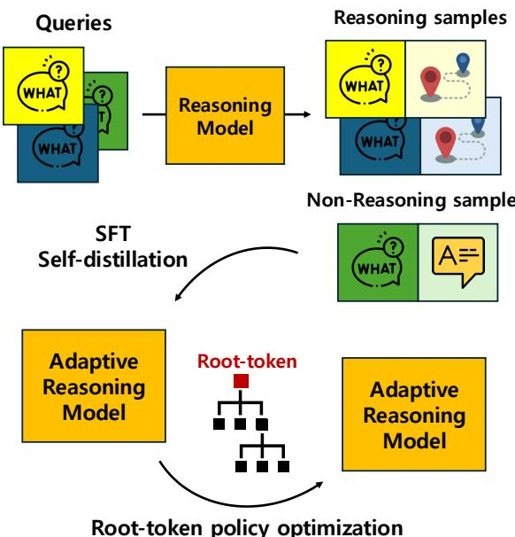
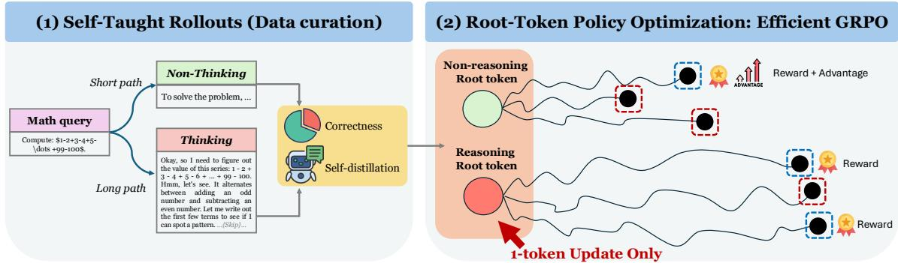
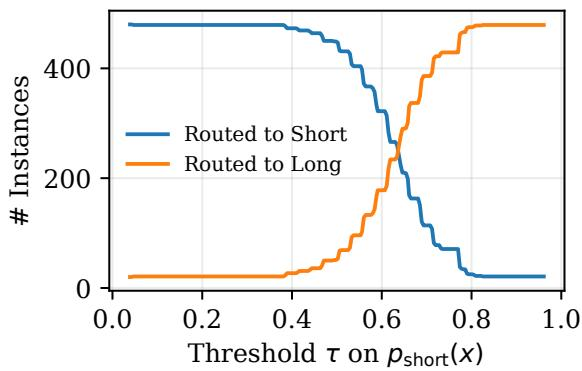
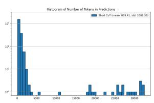
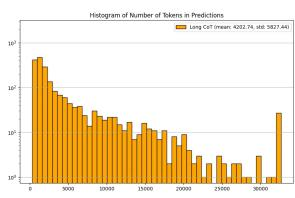
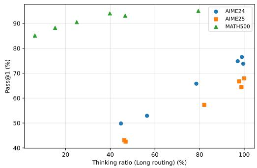
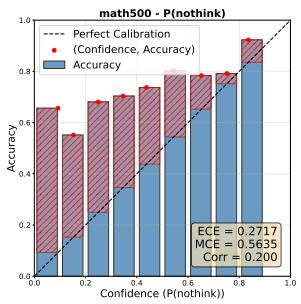
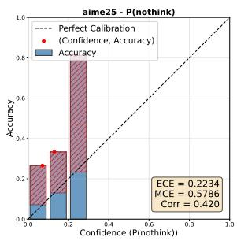

# Efficiently Learning To Reason or Not to Reason: Root-token Policy Optimization for Adaptive Thinking

Taehyeon Kim<sup>♠</sup> Hyunsoo Lee<sup>♠</sup> Youngsoo Jang<sup>‡,†,</sup>\* Moontae Lee<sup>♠,§,†</sup> <sup>♠</sup>LG AI Research <sup>‡</sup>UNIST <sup>§</sup>University of Illinois Chicago

## Abstract

Large reasoning models (LRMs) achieve strong performance by externalizing explicit reasoning traces before producing the answer, yet suffer from overthinking challenge that allocates uniformly heavy computation to queries of varying difficulty. While proprietary models mitigate this via opaque routing, open-source LRMs still lack an efficient mechanism to internalize adaptive reasoning due to both expensive training cost and limited disclosure of training recipes. In response, we introduce RPO (Roottoken Policy Optimization), a framework that enables LRMs to self-determine when to reason by training only the initial root token (e.g., whether to invoke the <think> tag) via group relative reward and group-wise advantages. By focusing on this pivotal branching point, RPO drastically reduces training overhead and VRAM usage. Across multiple model families and scales, RPO learns difficulty-aware adaptive thinking at just ∼2% of the training compute of prior adaptive-reasoning methods.

## 1 Introduction

The advent of large reasoning models (LRMs) has redefined the benchmark requiring complex reasoning (Guo et al., 2025; Jaech et al., 2024). The efficacy of LRMs has been attributed to the additional computation allocated at test time through explicit reasoning paths, typically encapsulated within delimiters such as <think> ... </think>. By exploring logical traces, reflecting on internal errors, and self-verifying intermediate steps, these models have achieved breakthroughs in mathematical and symbolic reasoning tasks. These days, this think-before-answer paradigm has emerged as the de facto standard.

Despite the potential of LRMs, there remains a significant limitation that general LRMs tend to apply this exhaustive explicit reasoning uniformly across all queries, regardless of their intrinsic complexity. This results in the overthinking problem (Feng et al., 2025; Sui et al., 2025) where substantial computational resources and latency are wasted on trivial questions. Consequently, a surge of emerging research has been driven into striking a balance between reasoning quality and computational efficiency (Zhang et al., 2025; Fang et al., 2025; Wu et al., 2025; Wang et al., 2025b). While proprietary services such as GPT5 (OpenAI, 2025) and Claude (Anthropic, 2024) rely on black-box routing to mitigate overthinking, a novel modelcentric alternative is required to internalize adaptive reasoning via policy optimization with open dataset for the open-source community.

  
Figure 1: Overview of our training pipeline. We generate paired reasoning samples and non-reasoning samples from input queries through the original reasoning model. These samples are self-distilled to manifest adaptive reasoning. Finally, root-token policy optimization (RPO) is applied to the model, refining the policy by updating only the initial branching token (i.e., root-token) to improve difficulty-aware adaptive reasoning.

  
Figure 2: Detailed overview of our training framework. After supervised finetuning (SFT) with self-generated correct samples, RPO involves updates only the initial decision token with group normalized rewards and advantages.

While adaptive reasoning models that learn when to reason have been explored via policy optimization, these studies have faced the following challenges:

1. Training inefficiency. Optimizing over long context trajectories with policy optimization incurs prohibitive VRAM and temporal costs, hindering accessible and iterative development.

2. Data curation. There is a lack of standardized methods for baking difficulty-aware datasets that effectively balance reasoning traces with direct responses across heterogeneous domains.

3. Initialization gap. Prior works train from scratch or adapt base models, often avoiding adapting the original LRM due to its training sensitivity.

To alleviate these challenges, we propose RPO (Root-token Policy Optimization), an efficient training method that enables adaptive reasoning by learning only the initial root token (e.g., the decision to open or close the <think> tag). Our method involves two stages (Figure 1): (1) offline synthesis which generates paired reasoning and non-reasoning responses via forced chat templates, and (2) RPO, which restricts gradient updates to the pivotal branching decision. Our design is complementary to recent token-selective RL that updates only a small subset of decision tokens (e.g., high-entropy forking tokens) rather than the full trajectory (Wang et al., 2025a); RPO pushes this idea to the extreme by optimizing only the root routing token (Figure 2). We demonstrate that RPO drastically enhances memory and compute efficiency during training while preserving the model’s original capability.

Our contributions are as follows:

• We propose RPO, a novel framework, termed as root-token optimization to enable adaptive reasoning by optimizing only the initial roottoken whether to reason, significantly reducing training overhead as well as efficient difficultyaware routing (§3).

• Our empirical results demonstrate RPO enables LRMs learning when to reason over diverse LRM families and scales. We also provide an analysis on calibration for an explicit reasoning knob (e.g., target Think% or routing threshold for root-token probability) (§4, §5).

• We demonstrate that difficulty-aware policies in mathematical domains elicit adaptive reasoning in broader scientific and code domain (§5).

## 2 Related work

## 2.1 Efficient reasoning models

LRMs allocate additional test-time computation to explicit reasoning traces often with specific delimiters such as <think> . . . </think> (Guo et al., 2025; Jaech et al., 2024). This think-beforeanswer format enables iterative exploration and self-verification, but it is frequently applied uniformly across inputs. Such uniform long-form reasoning leads to the overthinking challenge with high latency and compute on intrinsically easy queries and sometimes producing redundant reasoning tokens (Feng et al., 2025; Sui et al., 2025).

A broad line of work has pursued efficiency via adaptive computation and early stopping. Classical dynamic-computation methods and early-exit approaches terminate generation once confidence criteria are met, reducing unnecessary computation without changing the core model objective (Schuster et al., 2022; Bae et al., 2025). Recent reasoningfocused extensions similarly aim to avoid excessive reasoning tokens by learning or heuristically determining when further context is unlikely to help, and by truncating or suppressing low-information reasoning segments (Sui et al., 2025).

Another direction controls reasoning length through prompt- or budget-based strategies. Methods that rely on fixed or predicted token budgets can reduce verbose CoT while maintaining accuracy, but often require external budget selection rules or calibrated estimators, which may not transfer cleanly across domains (Han et al., 2024). In parallel, internal-rationale approaches such as Quiet-STaR (Zelikman et al., 2024) encourage models to form latent rationales during generation, while simplified recipes such as s1 (Muennighoff et al., 2025) show that carefully constructed 1k data and prompting can recover much of test-time scaling benefits with minimal training overhead.

As an orthogonal axis over these approaches, our goal is not to enforce a budget or modify the architecture, but to internalize the gating decision itself whether to open a long explicit reasoning trace in the first place. RPO optimizes only the root token that triggers the <think> branch, enabling adaptive reasoning with minimal training footprint and without backpropagating over whole reasoning trajectories.

## 2.2 Difficulty-aware policy optimization

The question of learning when to reason has recently been reframed as difficulty-aware policy optimization: the model should allocate explicit reasoning only when needed, while responding directly to easy or non-reasoning queries. This direction is especially relevant under the explicit <think> styled format, where the core idea is a discrete branching action that enters a long reasoning mode versus produces a direct response (Zhang et al., 2025; Fang et al., 2025; Wu et al., 2025; Wang et al., 2025b).

Representative methods learn such policies through RL or preference learning. AdaptThink (Zhang et al., 2025) trains a policy to select thinking versus non-thinking modes conditioned on difficulty, while Thinkless (Fang et al., 2025) uses preference/RL signals to reduce redundant thinking tokens in general conversations. Beyond binary gating, ARM (Wu et al., 2025) expands the action space to multiple reasoning formats (e.g., direct answer, short CoT, long CoT, code), and

AdaReasoner (Wang et al., 2025b) treats reasoning configurations as actions in a model-agnostic RL framework. Together, these works show that adaptive reasoning is learnable and can outperform static long-CoT inference.

However, existing policy optimization approaches face practical hurdles that motivate our design. First, many studies are benchmark-centric and largely evaluated on math-heavy suites, leaving open how well their learned routing calibrates (e.g., whether the thinking rate remains aligned with difficulty on open-domain and scientific queries). Second, optimizing policies over whole long reasoning trajectories is often training-cost dominated: GRPO-style post-training incurs expensive cost of VRAM, gradient computation, and wall-clock costs (Guo et al., 2025), also detailed in §3.3 and Table 5. Third, effective training frequently depends on curated external prompts, data from larger teacher models, paired supervision, or proprietary query streams for routing signals, and these factors are rarely opened to the community.

## 3 Method

## 3.1 Motivation

Adaptive reasoning is fundamentally a routing problem. Before generating an answer, the model must decide whether to spend tokens on explicit deliberation. In open-domain tasks, supervising this routing is difficult because task difficulty is latent: correctness can be ambiguous and the same query may be easy or hard depending on a model’s calibration and knowledge. As a result, fixed heuristics (e.g., always long CoT or static budgets) are often miscalibrated.

Why math as a proxy We ground our training signal in mathematical reasoning because it admits deterministic verification and a model-relative notion of when reasoning pays off. For each input query x, we elicit two mode-conditioned behaviors: (i) a direct-answer mode (SHORT) and (ii) an explicit-reasoning mode (LONG). Let $c _ { S } ( x ) , c _ { L } ( x ) \in \{ 0 , 1 \}$ denote exact correctness under each mode. Rather than relying on external difficulty labels, we can use the difference between mode-conditioned success rates (e.g., Pass@k) as an empirical difficulty proxy: instances where LONG is more reliable than SHORT are treated as harder for the current model, and vice versa. This model-specific signal provides supervision for learning routing policies without external difficulty labels.

  
Figure 3: Thresholding on a SHORT-mode confidence signal yields a smooth routing trade-off about probability threshold vs number of routed instances over MATH500 dataset (Hendrycks et al., 2021).

Self-taught difficulty signals After a lightweight SFT step that teaches the model to follow our SHORT/LONG templates (§3.2), we observe that routing can be anticipated at the generation root. We obtain a model-specific difficulty signal by contrasting mode-conditioned accuracy on the same query (e.g., Pass@k under SHORT vs. LONG). To expose this signal for routing, we parameterize the mode decision at the generation root: under our template, the first newline token(s) after <think> select LONG vs. SHORT (\n vs. \n\n). Let $z _ { S }$ denote the SHORT root token (\n\n) and define a root-level SHORT-preference proxy as the model’s conditional probability at this decision point:

$$
p _ { \mathrm { s h o r t } } ( x ) \ = \ p _ { \theta } ( z _ { S } \mid x , < \mathrm { t h i n k } > ) .
$$

We route by thresholding:

$$
\pi _ { \tau } ( x ) = \left\{ \begin{array} { l l } { \mathrm { S H O R T } } & { \mathrm { i f } p _ { \mathrm { s h o r t } } ( x ) \geq \tau , } \\ { \mathrm { L O N G } } & { \mathrm { o t h e r w i s e } . } \end{array} \right.
$$

Varying τ yields a simple calibration knob (Figure 3): larger τ makes the router more conservative, assigning fewer queries to SHORT and increasing the fraction routed to LONG. This synthetically produces an interpretable accuracy–routing tradeoff, where intermediate thresholds preserve overall accuracy while reducing LONG usage (Table 1).

Beyond accuracy, routing is motivated by compute. We measure generation length L(x) (output tokens) and find that LONG exhibits a heavytailed length distribution (Figure 4), i.e., a small fraction of queries trigger disproportionately long traces. This makes the routing decision directly translate into cost control, and motivates learning a lightweight gating policy at the root that reduces unnecessary LONG usage without the loss of the model capability.

<table><tr><td>Method (τ)</td><td>SHORT</td><td>LONG</td><td>Overall</td></tr><tr><td>Original</td><td>0.00 (0)</td><td>83.6 (500)</td><td>83.6 (500)</td></tr><tr><td>Adaptive (0.75)</td><td>93.6 (62)</td><td>82.4 (438)</td><td>83.8 (500)</td></tr><tr><td>Adaptive (0.70)</td><td>89.7 (155)</td><td>78.8 (345)</td><td>82.2 (500)</td></tr></table>

Table 1: Accuracy (%) and routed instance counts (in parentheses) under threshold routing over MATH500 dataset (Hendrycks et al., 2021) with R1-1.5B model.

  
(a) SHORT

  
(b) LONG  
Figure 4: Token-length histograms (log-scaled frequency) for SHORT and LONG mode.

## 3.2 SFT for mode selection

Mode definition We define two generation modes using only the reasoning-tag template at the generation root. The token <think> is treated as a special token, and \n vs. \n\n are tokenized into different root tokens. Concretely, we use:

• LONG: prefix <think>\n so that the model continues with explicit reasoning content.

• SHORT: prefix <think>\n\n</think>\n\n to suppress explicit reasoning.

Self-generated trajectories from OpenR1-Math queries We construct SFT supervision from OpenR1-Math queries by sampling multiple generations from the given LRM under each mode template (SHORT/LONG). We retain only generations that (i) satisfy the mode-specific template and (ii) match the exact answer, yielding two pools of correct demonstrations, $s _ { S }$ and $S _ { L }$ . We then randomly sample K instances from each pool for SFT. We do not enforce that a problem must be correct in both modes.

SFT We use a SFT loop (1) to manifest modeconditioned style without performance degradation under the default chat template. Let $\operatorname { A c c } _ { \mathrm { o r i g } }$

= Eval $( \pi _ { 0 } ;$ DEFAULTCHAT) be the initial accuracy, and let $\operatorname { A c c } ( \pi ) = \operatorname { E v a l } ( \pi ; \operatorname { D E F A U L T C H A T } )$

Algorithm 1 SFT for mode selection   
Require: base model $\pi _ { 0 } ,$ prompts D, samples per prompt M,   
tolerance ϵ, budget K   
1: $a _ { 0 } \gets \mathrm { E v a l } ( \pi _ { 0 } ;$ DEFAULTCHAT) ▷ default template   
2: $\pi  \pi _ { 0 }$   
3: while <sup></sup>Eval(π; DEFAULTCHAT) − a<sub>0</sub><sup></sup> ≤ ϵ do   
4: $\mathit { s } _ { \mathit { S } } ^ { \prime } \gets$ CollectCorrect(π, D, M; SHORTPREFIX)   
5: S ← CollectCorrect $\dot { ( \pi , \mathcal { D } , M ; \mathfrak { n } ) }$ LONGPREFIX)   
6: $\bar { \mathcal { T } } { \gets } \mathrm { S a m p l e } ( S _ { S } , K ) \ \bar { \cup } \ \mathrm { S a m p l e } ( S _ { L } , K )$   
7: $\pi  \operatorname { S F T } ( \pi , \dot { \mathcal { T } } )$   
8: end while   
denote the same metric for an SFT candidate π.   
We iteratively refresh the correctness-filtered SFT   
dataset and continue training only while the perfor  
mance gap remains within a tolerance ϵ:   
$\left| \operatorname { A c c } ( \pi ) - \operatorname { A c c } _ { \mathrm { o r i g } } \right| \leq \epsilon .$   
The loop is intentionally general. Empirically,   
across LRMs we tested, a single iteration typically   
sufficed (i.e., the constraint was satisfied without   
repeated resampling).

## 3.3 Root-token policy optimization (RPO)

SFT establishes SHORT/LONG behaviors, but reliable adaptive selection requires directly optimizing the gating policy. The post-SFT model already knows how to produce either style; what remains is learning when to invoke each one. We therefore view adaptive reasoning as a branching problem: once the gate is chosen, the continuation is simply a mode-conditioned rollout rather than a learning target. Motivated by this hypothesis, we apply RPO only to the first gating token (the root), treating the remainder of each sampled trajectory purely as environment output.

Root-token action space We fix a <think> prefix and parameterize gating by the first newline tokenization:

$$
z \in \{ \backslash { \mathsf { n } } , \ \backslash { \mathsf { n } } \backslash { \mathsf { n } } \} .
$$

Because <think> is a special token and \n vs. \n\n are distinct tokens, z is a well-defined categorical action. Selecting $z = \backslash \mathsf { n }$ enters LONG: the model continues generating inside the <think> block (explicit reasoning). Choosing z = \n\n enters SHORT: the template immediately closes the thinking block, i.e., <think>\n\n</think>\n\n. RPO optimizes only $p _ { \theta } ( z \mid x )$ ; subsequent tokens are masked from the gradient.

Balanced rollouts For each query x, we collect n rollouts with a fixed split: $n / 2$ SHORT and $n / 2$

```latex
Algorithm 2 Root-token policy optimization
Require: policy $\pi \theta$ (init from SFT), reference $\pi _ { \mathrm { r e f } }$ (frozen),
prompts ${ \mathcal { D } } _ { \mathrm { r l } } ,$ rollouts per prompt n (even), context budget
S, temperature τ, KL weight ${ \hat { \boldsymbol { \beta } } } ,$ mode weights $( \alpha _ { S } , \alpha _ { L } )$
1: Define gating tokens: $z \in \{ \dot { \setminus } \} , \setminus \setminus \eta \}$
2: Define templates: SHORT $\scriptstyle ( { \dot { z } } = \ln \setminus { \mathfrak { n } } )$ , LONG(z=\n)
3: for each training step do
4: Sample a minibatch B $\beta \subset D _ { \mathrm { r l } }$
5: for each prompt $x \in B$ do
6: Balanced rollouts: generate $n / 2$ trajectories with
SHORT template and $n / 2$ with LONG
7: $\{ ( z _ { i } ^ { ( x ) } , y _ { i } ^ { ( x ) } ) \} _ { i = 1 } ^ { n }  \mathrm { R o l l o u t } ( \pi _ { \theta } , x ; ~ S , \tau )$ ▷
$z _ { i } ^ { ( x ) }$ is the root newline token(s)
8: Compute correctness indicators $c _ { i } ^ { ( x ) } \gets$
$\mathbf { 1 } \{ \mathrm { A n s } ( y _ { i } ^ { ( x ) } )$ is correct}
9: L $\begin{array} { r } { \enspace \enspace \mathrm { e t } ~ C _ { S } ( x ) \gets \sum _ { i : z _ { i } ^ { ( x ) } = \mathsf { \sin } ^ { \alpha } } c _ { i } ^ { ( x ) } , \quad C _ { L } ( x ) \gets } \end{array}$
$\textstyle \sum _ { i : z _ { i } ^ { ( x ) } = \setminus } c _ { i } ^ { ( x ) }$
10: for $i = 1$ to n do
11: $r _ { i } ^ { ( x ) }  \alpha _ { S } \cdot C _ { S } ( x ) \mathrm { ~ i f ~ } z _ { i } ^ { ( x ) } =$ \n\n else
$r _ { i } ^ { ( x ) }  \alpha _ { L } \cdot \stackrel { \cdot } { C } _ { L } ( x )$
12: end for
13: Store root-token log-probs $\ell _ { i } ^ { ( x ) } \gets \log \pi _ { \theta } ( z _ { i } ^ { ( x ) } |$
x) and $\ell _ { i } ^ { ( x ) , \mathrm { r e f } } \gets \log \pi _ { \mathrm { r e f } } ( z _ { i } ^ { ( x ) } | x )$
14: end for
15: Per-mode group-relative advantages :
16: ${ \mathcal { T } } _ { m } \gets \{ ( x , i ) : x \in { \mathcal { B } } , m _ { i } ^ { ( x ) } = m \}$
17: $\begin{array} { r l r } { \mu _ { m } } & { { } } & {  \quad \frac { 1 } { | \mathcal { Z } _ { m } | } { \sum } _ { ( x , i ) \in \mathcal { T } _ { m } } r _ { i } ^ { ( x ) } , \quad \sigma _ { m } ^ { 2 } } \end{array}$ ←
$\begin{array} { r } { \frac { 1 } { | \mathcal { T } _ { m } | } { \sum _ { ( x , i ) \in \mathcal { I } _ { m } } } ( r _ { i } ^ { ( x ) } - \mu _ { m } ) ^ { 2 } } \end{array}$
18: $A _ { i } ^ { ( x ) } \gets ( r _ { i } ^ { ( x ) } - \mu _ { m _ { i } ^ { ( x ) } } ) / ( \sigma _ { m _ { i } ^ { ( x ) } } + \varepsilon ) \quad \forall ( x , i )$
19: Root-token-only update (mask all tokens except z):
20: θ ← Update $\left( \theta , \qquad \nabla _ { \theta } \right[$
$\begin{array} { r l r } { \mathrm { ~ \frac { 1 } { | \mathcal { B } | } ~ } \sum _ { x \in \mathcal { B } } \frac { 1 } { n } \sum _ { i = 1 } ^ { n } A _ { i } ^ { ( x ) } \ell _ { i } ^ { ( x ) } } & { { } + } & { \beta ^ { \cdot } \mathrm { ~  ~ \cdot ~ } \ \mathrm { K L } ( \pi _ { \theta } ( z \mathrm { ~  ~ \rho ~ } | } \end{array}$
x) ∥ $\pi _ { \mathrm { r e f } } ( z | x ) \big ] \Big )$
21: end for
```

LONG. Let $C _ { S } ( x )$ and $C _ { L } ( x )$ be the numbers of correct rollouts within the SHORT and LONG groups, respectively. This balanced sampling prevents trivial mode collapse and yields comparable advantage statistics across modes.

Prefix-level reward For a fixed prompt x, we refer to the $n / 2$ rollouts that share a forced mode as the per-prompt mode group (one for SHORT, one for LONG). Each rollout is rewarded by the success count of its per-prompt mode group:

$$
r _ { i } ^ { ( x ) } = \left\{ \begin{array} { l l } { { \alpha _ { S } \cdot C _ { S } ( x ) } } & { { \mathrm { i f ~ r o l l o u t ~ } i \mathrm { ~ i s ~ i n ~ S H O R T } , } } \\ { { \alpha _ { L } \cdot C _ { L } ( x ) } } & { { \mathrm { i f ~ r o l l o u t ~ } i \mathrm { ~ i s ~ i n ~ L O N G } . } } \end{array} \right.
$$

We set $\alpha _ { L } { = } 1$ and use a mild SHORT preference $\scriptstyle { \alpha } { s = 1 } + { \frac { 1 } { n } }$ to reflect the objective of saving compute without sacrificing the correctness. Because $\bar { \boldsymbol { r } } _ { i } ^ { ( x ) }$ depends on the per-prompt mode-group outcome, the update favors routing toward the mode that yields higher group-level correctness for that prompt.

<table><tr><td>Model</td><td>Method</td><td>Updated tokens T</td><td>KV / rollout (GiB)</td><td>Act(bp) / rollout (GiB)</td><td>Train+Opt (GiB)</td><td>Peak @ B=8 (GiB)</td></tr><tr><td rowspan="3">1.5B</td><td>Original GRPO</td><td>12K</td><td>2.38</td><td>13.18</td><td>22.35</td><td>146.86 (1.00×)</td></tr><tr><td>RPO</td><td>1</td><td>2.38</td><td> $1 . 1 0 \times 1 0 ^ { - 3 }$ </td><td>22.35</td><td>41.40 (0.28×)</td></tr><tr><td>RPO with LoRA update</td><td>1</td><td>2.38</td><td> $1 . 1 0 \times 1 0 ^ { - 3 }$ </td><td>0.07</td><td>19.12 (0.13×)</td></tr><tr><td rowspan="3">7B</td><td>Original GRPO</td><td>12K</td><td>6.35</td><td>35.16</td><td>104.31</td><td>436.34 (1.00×)</td></tr><tr><td>RPO</td><td>1</td><td>6.35</td><td> $2 . 9 3 \times 1 0 ^ { - 3 }$ </td><td>104.31</td><td>155.11 (0.36×)</td></tr><tr><td>RPO with LoRA update</td><td>1</td><td>6.35</td><td> $2 . 9 3 \times 1 0 ^ { - 3 }$ </td><td>0.21</td><td>51.01 (0.17×)</td></tr></table>

Table 2: Peak VRAM (GiB) for long-context GRPO with uniform context $S { = } 1 3 \mathrm { K }$ (1K prompt+12K generation) and B=8 concurrent rollouts. RPO gains memory efficiency by updating the root token $( T { = } 1 )$ . LoRA further reduces trainable-state memory with fewer trainable parameters.

Per-mode group-relative advantages To optimize switching under the enforced split, we standardize advantages within each mode by pooling rewards. Per-prompt-mode would be degenerate: by construction, $r _ { i } ^ { ( x ) } = \alpha _ { m _ { i } } \cdot C _ { m _ { i } } ( x )$ is constant across the $n / 2$ rollouts that share a mode within prompt $x ,$ so the within-mode-group variance is identically zero. Cross-prompt variation in $C _ { S } ( x )$ and $C _ { L } ( x )$ is what supplies the non-degenerate variance needed for advantage estimation. Concretely, for rollout i of prompt x in mode $m _ { i } ^ { ( x ) } \in \{ S , L \}$ let $\mathcal { T } _ { m } = \{ ( x , i ) : x \in B , m _ { i } ^ { ( x ) } = m \}$ denote the group-level mode pool. Then,

$$
\begin{array} { r l r } & { \displaystyle { A _ { i } ^ { ( x ) } = \frac { r _ { i } ^ { ( x ) } - \mu _ { m _ { i } ^ { ( x ) } } } { \sigma _ { m _ { i } ^ { ( x ) } } + \varepsilon } } , } & \\ & { \displaystyle { \mu _ { m } = \frac { 1 } { | { \mathcal { Z } } _ { m } | } \sum _ { ( x , j ) \in { \mathcal { T } } _ { m } } r _ { j } ^ { ( x ) } } , \quad \displaystyle { \sigma _ { m } ^ { 2 } = \frac { 1 } { | { \mathcal { Z } } _ { m } | } \sum _ { ( x , j ) \in { \mathcal { T } } _ { m } } \big ( r _ { j } ^ { ( x ) } - \mu _ { m } \big ) ^ { 2 } } . } & \end{array}
$$

Pooling is per-mode (separate $\mu _ { S } , \sigma _ { S }$ and $\mu _ { L } , \sigma _ { L } )$ so that the standardized advantages remain on a comparable scale even when the two modes have systematically different success rates; pooling is group-level so that within-mode variance is nonzero. The signal each $A _ { i } ^ { ( x ) }$ encodes is therefore “how does prompt $x ' s$ mode-m success compare to the group-wide mode-m baseline,” which the policy converts into an updated routing distribution over z. This per-mode group relative scheme presupposes prompt-difficulty diversity within B.

RPO objective with KL regularization We regularize the log-probability of the root action z with KL-to-reference loss:

$$
\begin{array} { r l } { ~ \displaystyle \operatorname* { m a x } _ { \theta } ~ \mathbb { E } _ { x } \left[ \frac { 1 } { n } \sum _ { i = 1 } ^ { n } A _ { i } \log p _ { \theta } ( z _ { i } | \boldsymbol { x } ) \right] ~ } & { } \\ { ~ - \beta \operatorname { K L } ( p _ { \theta } ( z | \boldsymbol { x } ) \| p _ { \theta _ { \mathrm { r e f } } } ( z | \boldsymbol { x } ) ) . } \end{array}\tag{1}
$$

where $\theta _ { \mathrm { r e f } }$ is the post-SFT checkpoint. In implementation, we generate full trajectories to evaluate correctness and compute rewards, but retain only the root log-probabilities. Other non-root tokens are discarded from the training graph, and the update is performed solely on $p _ { \theta } ( z | x )$

Balanced difficulty sampling We perform RPO on a compact set of ∼1K queries comprised of a part of s1k (Muennighoff et al., 2025) and compression dataset (Arora and Zanette, 2025). With the post-SFT model, We estimate modeconditioned success rates and exclude items where LONG is rarely correct $( \mathrm { a c c } _ { L } { < } \tau _ { \mathrm { m i n } } { = } 0 . 2 5 )$ . We then stratify the remaining queries into easy and hard regimes and sample them in a 1:1 ratio to stabilize updates and avoid mode collapse. Concretely, easy includes queries where SHORT is already competitive $( \mathrm { e . g . , ~ a c c } _ { S } \mathrm { \geq } \tau _ { \mathrm { e a s y } } \mathrm { = } 0 . 7 5 )$ , while hard includes queries where LONG is consistently preferable (e.g., acc<sub>S</sub><acc<sub>L</sub>≤τ<sub>hard</sub> with $\tau _ { \mathrm { h a r d } } { = } 0 . 5 )$

Why root-only updates are memory-efficient Both vanilla GRPO and RPO must work with KVcache over the full rollout context length S during sampling. The training-time gap arises from backpropagation. Vanilla GRPO updates all generated tokens, whereas RPO masks the trajectory and updates only the root gating token (T=1). As a result, the dominant activation term scales with the number of updated tokens,

$$
\mathcal { M } _ { \mathrm { b p } } \propto B \cdot T \cdot L \cdot d \cdot b \cdot \kappa ,
$$

where B is the number of rollouts processed concurrently, L and d are model depth and width, b is the activation precision (e.g., bf16), and κ aggregates saved intermediates (e.g., attention/MLP). Thus, setting $T { = } 1$ removes the linear dependence on long CoT length. Table 2 quantifies this effect under long-context rollout scenarios, where activation memory dominates the feasibility boundary.

Training configuration Unless noted otherwise, we use three H100 GPUs in a node. Each iteration samples 8 queries and collects n=16 rollouts per query (8 per mode) with temperature 0.6 and top-p 0.95. We allow maximum context length 16,384 for rollouts.

<table><tr><td>Model</td><td>Stage</td><td colspan="3">MATH500</td><td colspan="3">AIME24</td><td colspan="3">AIME25</td><td colspan="4">Avg</td></tr><tr><td></td><td></td><td>P@1</td><td>#Tok</td><td>Think%</td><td>P@1</td><td>#Tok</td><td>Think%</td><td>P@1</td><td>#Tok</td><td>Think%</td><td>|P@1</td><td>#Tok</td><td>Think%</td><td>RAR↓</td></tr><tr><td>Qwen3-1.7B</td><td>Baseline (LONG)</td><td>91.1</td><td>4,539</td><td>100.0</td><td>45.6</td><td>15,569</td><td>100.0</td><td>38.1</td><td>15,830</td><td>100.0</td><td>58.3</td><td>11,979</td><td>100.0</td><td>1.72</td></tr><tr><td></td><td>Baseline (SHORT)</td><td>73.0</td><td>978</td><td>0.0</td><td>12.3</td><td>3,898</td><td>0.0</td><td>11.5</td><td>2,180</td><td>0.0</td><td>32.3</td><td>2,352</td><td>0.0</td><td>0.00</td></tr><tr><td></td><td>+ SFT</td><td>85.5</td><td>3,767</td><td>69.8</td><td>34.4</td><td>12,558</td><td>72.9</td><td>30.4</td><td>12,648</td><td>75.6</td><td>50.1</td><td>9,658</td><td>72.8</td><td>1.45</td></tr><tr><td></td><td>+ RPO</td><td>79.5</td><td>2,754</td><td>31.8</td><td>43.8</td><td>13,315</td><td>93.8</td><td>31.7</td><td>14,231</td><td>96.3</td><td>51.7</td><td>10,100</td><td>74.0</td><td>1.43</td></tr><tr><td>Qwen3-8B</td><td>Baseline (LoNG)</td><td>96.6</td><td>4,777</td><td>100.0</td><td>74.4</td><td>14,184</td><td>100.0</td><td>64.8</td><td>16,950</td><td>100.0</td><td>78.6</td><td>11,970</td><td>100.0</td><td>1.27</td></tr><tr><td></td><td>Baseline (SHORT)</td><td>84.1</td><td>1,118</td><td>0.0</td><td>25.4</td><td>5,646</td><td>0.0</td><td>20.8</td><td>3,159</td><td>0.0</td><td>43.4</td><td>3,308</td><td>0.0</td><td>0.00</td></tr><tr><td></td><td>+ SFT</td><td>90.6</td><td>3,390</td><td>53.5</td><td>54.0</td><td>12,350</td><td>59.2</td><td>46.7</td><td>12,661</td><td>59.2</td><td>63.8</td><td>9,467</td><td>57.3</td><td>0.90</td></tr><tr><td></td><td>+ RPO</td><td>90.5</td><td>2,794</td><td>25.0</td><td>52.9</td><td>12,784</td><td>56.4</td><td>42.5</td><td>12,029</td><td>53.1</td><td>62.0</td><td>9,202</td><td>44.8</td><td>0.72</td></tr><tr><td>Exaone4-1.2B</td><td>Baseline (LONG)</td><td>91.0</td><td>5,416</td><td>100.0</td><td>54.0</td><td>18,529</td><td>100.0</td><td>43.8</td><td>19,124</td><td>100.0</td><td>62.9</td><td>14,356</td><td>100.0</td><td>1.59</td></tr><tr><td></td><td>Baseline (SHORT)</td><td>75.6</td><td>854</td><td>0.0</td><td>21.9</td><td>3,075</td><td>0.0</td><td>15.2</td><td>2,718</td><td>0.0</td><td>37.6</td><td>2,216</td><td>0.0</td><td>0.00</td></tr><tr><td></td><td>+ SFT</td><td>84.6</td><td>3,015</td><td>40.9</td><td>37.3</td><td>9,524</td><td>39.8</td><td>31.3</td><td>10,562</td><td>49.4</td><td>51.1</td><td>7,700</td><td>43.4</td><td>0.85</td></tr><tr><td></td><td>+ RPO</td><td>83.5</td><td>2,455</td><td>25.5</td><td>33.8</td><td>6,592</td><td>21.9</td><td>27.3</td><td>6,665</td><td>23.3</td><td>48.2</td><td>5,237</td><td>23.6</td><td>0.49</td></tr></table>

Table 3: Baseline → SFT mode selection → RPO on math benchmarks. Pass@1 (P@1) is the average accuracy (%) over 16 runs. #Tok is average generated tokens. Think% is the fraction routed to LONG. Avg columns are simple averages over (MATH500, AIME24, AIME25). RAR (↓) is the reasoning-per-accuracy ratio, defined as $\begin{array} { r } { \mathrm { R A R } _ { \mathrm { a v g } } = \frac { \overline { { t } } _ { \mathrm { a v g } } } { a _ { \mathrm { a v g } } + \varepsilon } } \end{array}$ , where $a _ { \mathrm { a v g } }$ and $t _ { \mathrm { a v g } }$ are Avg Pass@1 and Avg Think% as fractions. Lower is better.

  
Figure 5: Think% versus Pass@1 on Qwen3-8B with RPO. Each point indicates an intermediate checkpoint.

## 4 Experiment

## 4.1 Setup

Our pipeline follows Baseline → SFT → RPO, and we report (i) Pass@1 accuracy, (ii) average generated tokens, and (iii) the fraction routed to LONG (Think%) in Table 3. We report results on diverse models with different families and sizes: Qwen3- 1.7B, Qwen3-8B, Qwen3-32B (Yang et al., 2025), Exaone4-1.2B (Research et al., 2025) and R1-1.5B (Guo et al., 2025). All models use a <think> style template and share the same two-mode gating mechanism implemented via the first newline token(s) after <think>.

## 4.2 Datasets and evaluation

Math benchmarks We evaluate on three standard math reasoning sets: MATH500 (Hendrycks et al., 2021), AIME24 (MAA, 2024), and AIME25 (MAA, 2025), scientific reasoning dataset as GPQA (Rein et al., 2024), and coding task with LiveCodeBench<sup>1</sup>. Following prior work, correctness is determined by exact match on the final answer parsed by boxed{}. At inference time, we match the original technical reports including temperature and sampling settings.

SFT data for mode selection We use mathematical queries from OpenR1-Math data (Open-R1, 2025) and self-generate candidate trajectories with the given model under each mode template. We filter candidates by correctness and basic template validity, producing two pools of correct demonstrations for SHORT and LONG. We then sample 20K instances per mode (40K total) for SFT, without requiring overlap between the two pools.

Implementation details We implement SFT and RPO in OpenRLHF (Hu et al., 2024), with a customized lightweight asynchronous rollout engine that overlaps generation and post-processing. Unless noted, we use max context 16K, batch size 128, and learning rate $1 0 ^ { - 6 }$ . For RPO, we sample 16 rollouts per prompt (8/8 SHORT/LONG) and apply gradients only to the root gating token. We run $< \mathbf { 6 0 }$ update steps for all model sizes.

## 4.3 Main results

Table 3 reports math performance across stages (Baseline → SFT → RPO). To summarize reasoning efficiency in one number, we use $\mathbf { R A R } \ ( \downarrow ) .$ , the reasoning-per-accuracy ratio: $\begin{array} { r } { \mathrm { R A R } _ { \mathrm { a v g } } = \frac { t _ { \mathrm { a v g } } } { a _ { \mathrm { a v g } } + \varepsilon } , } \end{array}$ where $a _ { \mathrm { a v g } }$ is Avg Pass@1 and $t _ { \mathrm { a v g } }$ is Avg Think% (both as fractions).

<table><tr><td>Method</td><td colspan="2">MATH500</td><td colspan="2">AIME24</td><td colspan="2"> $\mathbf { A v } \mathbf { g }$ </td></tr><tr><td></td><td>P@1</td><td>Think%</td><td>P@1</td><td>Think%</td><td>P@1</td><td>RAR↓</td></tr><tr><td colspan="7">Prior hybrid-reasoning baselines (reported in their tables)</td></tr><tr><td>Original (LONG)</td><td>83.2</td><td>100.0</td><td>29.4</td><td>100.0</td><td>56.3</td><td>1.78</td></tr><tr><td>Original (SHORT)</td><td>67.2</td><td>0.0</td><td>14.0</td><td>0.0</td><td>40.6</td><td>0.00</td></tr><tr><td>Rejection Finetuning † (Zhang et al., 2025)</td><td>72.4</td><td>66.6</td><td>25.2</td><td>79.0</td><td>48.8</td><td>1.49</td></tr><tr><td>AdaptThink† (Zhang et al., 2025)</td><td>82.0</td><td>23.2</td><td>31.0</td><td>59.6</td><td>56.5</td><td>0.74</td></tr><tr><td>Thinkless† (Fang et al., 2025)</td><td>81.9</td><td>51.6</td><td>27.3</td><td>100.0</td><td>54.6</td><td>1.39</td></tr><tr><td colspan="7">Ours (same backbone family; evaluated with our protocol)</td></tr><tr><td>+ SFT</td><td>75.1</td><td>37.8</td><td>20.8</td><td>68.5</td><td>48.0</td><td>1.11</td></tr><tr><td>+ RPO</td><td>77.6</td><td>20.5</td><td>25.0</td><td>77.7</td><td>51.3</td><td>0.96</td></tr></table>

Table 4: Comparison with accuracy and Think% over R1-1.5B model. † presents the performance from the original paper.

RPO improves the accuracy routing tradeoff On the larger and mid-scale backbones, RPO reduces Think% with modest accuracy changes, yielding the best (lowest) RAR. For example, on Qwen3-8B, Avg Think% decreases from 57.3% to 44.8% while Avg Pass@1 stays close (63.8%→62.0%), improving RAR from 0.90 to 0.72; on Exaone4-1.2B, Think% drops from 43.4% to 23.6% and RAR improves from 0.85 to 0.49. On Qwen3-1.7B, the post-SFT operating point is already conservative on the LONG side (Think%=72.8, RAR=1.45); RPO yields a comparable operating point (Think%=74.0, RAR=1.43) that recovers accuracy via routing refinement rather than via further Think% compression.

SFT already enables routing; RPO refines it. SFT alone yields a strong reduction in Think% (and tokens), showing that mode-following is largely learned at the template level. RPO then fine-tunes the root decision to better match query difficulty. The direction of this refinement is configurationdependent: on Qwen3-1.7B and R1-1.5B (Table 4), RPO recovers accuracy on top of SFT by reallocating LONG toward the harder subset; on Qwen3-8B and Exaone4-1.2B, RPO instead trades a small accuracy reduction for further Think% compression.

Comparison with other GRPO-based methods Table 4 compares RPO with recent hybrid reasoning baselines on the same R1 1.5B model. RPO lowers the fraction routed to LONG to 20.5% and reaches a two-task average accuracy of 51.3 with $\mathrm { R A R { = } 0 . 9 6 }$ . AdaptThink achieves a stronger absolute operating point (Avg P@1=56.5, RAR=0.74) but at a far larger training budget (Table 5); the comparison should therefore be read as two distinct points on a budget-accuracy frontier rather than a head-to-head ranking. Additionally, Table 5 highlights the compute-efficiency gap. Trajectory level GRPO is compute heavy because gradients traverse the full chain of thought. With matched accounting on an 8B reference model as an example, RPO reduces total training compute to about 0.02× AdaptThink.

## 5 Analysis

Controlling the degree of routing Figure 5 plots P@1 against Think% for intermediate RPO checkpoints. Points with comparable accuracy but different thinking ratios indicate multiple feasible operating points. Thus, calibration is practical: choose a checkpoint that satisfies a compute/routing budget while maintaining accuracy. The achievable frontier depends on the RL prompt set and easy/hard mix, so checkpoint selection is dataset-conditioned rather than universal.

LiveCodeBench and GPQA Table 6 extends evaluation beyond math to coding and scientific QA, where the optimal amount of thinking is more heterogeneous. Across models, SFT already introduces a meaningful reduction in explicit reasoning, while RPO further reshapes the accuracy routing profile by updating only the root decision. The effect is model-size dependent: on Qwen3-8B and Exaone4-1.2B, RPO compresses average decoding effort and lowers RAR; on Qwen3-32B, where SFT already produces a near-baseline operating point (Avg Think%=94.6, RAR=1.52), RPO yields a comparable but not strictly better RAR (1.55), reflecting that the room for further routing-only gains shrinks once the underlying solver is sufficiently strong and the SFT operating point is already conservative. Practically, this suggests treating the post-RPO checkpoint as a controllable router (with τ -sweeps) rather than as a fixed point that uniformly dominates SFT.

Calibration of root confidence Figure 6 reports reliability diagrams with Qwen3- 1.7B model for the root SHORT confidence $p _ { \mathrm { s h o r t } } ( x ) { = } p _ { \theta } ( z _ { S } | x , \mathsf { < t h i n k > } )$ . We bin $p _ { \mathrm { s h o r t } }$ into 10 uniform intervals and compute (i) Corr, the Pearson correlation between per query confidence and empirical accuracy, and (ii) calibration errors $\begin{array} { r } { { \bf E } { \bf C } { \bf E } = \sum _ { b } \frac { n _ { b } } { N } | \mathrm { a c c } _ { b } - \mathrm { c o n f } _ { b } | } \end{array}$ and MCE = $\operatorname* { m a x } _ { b } | \mathrm { a c c } _ { b } - \mathrm { c o n f } _ { b } |$ , where acc ∗ b and conf ∗ b are the average accuracy and confidence within bin b (Guo et al., 2017). Overall, $p _ { \mathrm { s h o r t } } ( \cdot )$ tends to correlate with correctness, but the signal is weak and dataset dependent. On AIME25, which is substantially harder, mass concentrates at low $p _ { \mathrm { s h o r t } } ( \cdot )$ , so the router rarely assigns high SHORT confidence, whereas MATH500 shows a broader spread with more high confidence bins. Further discussions are in Appendix.

<table><tr><td>Method</td><td>SFT spec</td><td>GRPO spec</td><td>Forward PFLOPs</td><td>Backward PFLOPs</td><td>Total PFLOPs</td><td>Rel. Total (vs. AdaptThink)</td></tr><tr><td>AdaptThink (Zhang et al., 2025)</td><td>40K @ 16K</td><td> $4 0 \mathrm { K } \ @ \ 1 6 \mathrm { K } , K = 1 6 , T _ { \mathrm { u p d } } \approx 1 6 \mathrm { K }$ </td><td>174,080</td><td>348,160</td><td>522,240</td><td>1.00×</td></tr><tr><td>ThinkLess (Fang et al., 2025)</td><td> $3 3 4 \mathrm { K } ~ @ ~ 2 4 \mathrm { K }$ </td><td> $1 \mathrm { K } \ @ \ 2 4 \mathrm { K } , \mathrm { \it K } { = } 8 , T _ { \mathrm { u p d } } { \approx } 2 4 \mathrm { K }$ </td><td>131,328</td><td>262,656</td><td>393,984</td><td>0.75×</td></tr><tr><td>RPO (Ours)</td><td> $8 \mathrm { K } ~ @ ~ 1 6 \mathrm { K }$ </td><td> $1 \mathrm { K } \ @ \ 1 6 \mathrm { K } , \mathrm { } \mathrm { \mathit { K } } { = } 1 6 , T _ { \mathrm { u p d } } { = } 1$ </td><td>6,144</td><td>4,097</td><td>10,241</td><td>0.02×</td></tr></table>

Table 5: PFLOPs accounting for an 8B dense Transformer (full-length sequences at the stated context). We assume 2P FLOPs/token for forward and 4P for backward. For AdaptThink, the number of dataset is set to 40K as reported.
<table><tr><td rowspan="2">Model</td><td rowspan="2">Stage</td><td colspan="3">LiveCodeBench</td><td colspan="3">GPQA-Diamond</td><td colspan="4">Avg</td></tr><tr><td>P@1</td><td>#Tok</td><td>Think%</td><td>P@1</td><td>#Tok</td><td>Think%</td><td>|P@1</td><td>#Tok</td><td>Think%</td><td>RAR↓</td></tr><tr><td>Exaone4-1.2B</td><td>Baseline</td><td>42.2</td><td>12,159</td><td>100.0</td><td>50.8</td><td>7,145</td><td>100.0</td><td>46.5</td><td>9,652</td><td>100.0</td><td>2.15</td></tr><tr><td></td><td>+ SFT</td><td>34.6</td><td>9,281</td><td>90.1</td><td>46.2</td><td>5,037</td><td>70.1</td><td>40.4</td><td>7,159</td><td>80.1</td><td>1.98</td></tr><tr><td></td><td>+RPO</td><td>36.7</td><td>6,692</td><td>61.7</td><td>41.7</td><td>2,881</td><td>35.0</td><td>39.2</td><td>4,787</td><td>48.4</td><td>1.26</td></tr><tr><td>Qwen3-8B</td><td>Baseline</td><td>49.5</td><td>14,878</td><td>100.0</td><td>58.8</td><td>7,355</td><td>100.0</td><td>54.2</td><td>11,117</td><td>100.0</td><td>1.85</td></tr><tr><td></td><td>+ SFT</td><td>30.2</td><td>10,410</td><td>63.0</td><td>31.1</td><td>5,227</td><td>50.1</td><td>30.7</td><td>7,819</td><td>56.6</td><td>1.85</td></tr><tr><td></td><td>+ RPO</td><td>35.4</td><td>11,532</td><td>54.7</td><td>55.4</td><td>6,910</td><td>67.2</td><td>45.4</td><td>9,221</td><td>61.0</td><td>1.34</td></tr><tr><td>Qwen3-32B ↑</td><td>Baseline</td><td>59.1</td><td>13,498</td><td>100.0</td><td>66.2</td><td>5,108</td><td>100.0</td><td>62.7</td><td>9,303</td><td>100.0</td><td>1.60</td></tr><tr><td></td><td>+ SFT</td><td>58.3</td><td>11,457</td><td>90.6</td><td>66.3</td><td>4,822</td><td>98.5</td><td>62.3</td><td>8,140</td><td>94.6</td><td>1.52</td></tr><tr><td></td><td>+ RPO</td><td>54.4</td><td>10,623</td><td>87.2</td><td>65.0</td><td>4,768</td><td>97.6</td><td>59.7</td><td>7,696</td><td>92.4</td><td>1.55</td></tr></table>

Table 6: LiveCodeBench/GPQA-Diamond results. Models without † are trained with full-parameter SFT; † indicates a LoRA-tuned model.  
  
(a) MATH500.

  
(b) AIME25.  
Figure 6: Reliability diagrams (Guo et al., 2017) for the root confidence $p _ { \mathrm { s h o r t } } ( x ) { = } p _ { \theta } ( z _ { S } | x , \mathsf { < t h i n k > } )$ . Each bin plots empirical accuracy against predicted confidence, with the diagonal indicating perfect calibration.

## 6 Conclusion

We introduce RPO, a root token policy optimization framework for adaptive thinking that updates only the initial gating token while treating the remainder of the rollout as environment output. Precisely, RPO turns static LONG style generation into a lightweight routing problem, reducing significant training overhead during GRPO. Across multiple model families and scales, RPO improves the accuracy routing trade-off under most scenarios, achieving lower reasoning per accuracy ratios over expert scientific reasoning and coding as well as math reasoning. Some configurations trace a comparable but not strictly dominating frontier, supporting the use of RPO as a controllable routing layer rather than a uniform replacement for SFT.

## Limitations

While our work supports diverse LRM families and scales, several limitations suggest avenues for future exploration. First, broader evaluation is needed under advanced benchmark datasets requiring agentic behaviors with tools. Second, while root confidence is informative under our branching problem setting, it can be not only sensitive to bucket composition (i.e., easy and hard queries for RPO), but weakly calibrated towards its query difficulty. Third, we focus on a binary routing decision and do not optimize intra mode behaviors such as how long to think or when to stop, which could further improve compute allocation. Fourth, RPO’s gain over the SFT operating point is configuration-dependent: on Qwen3-1.7B, the post SFT routing already saturates the achievable RAR, so RPO yields a comparable rather than strictly better operating point; on Qwen3-32B, where we use LoRA tuning and SFT already produces a nearbaseline conservative router, RPO likewise traces a comparable but not strictly dominating frontier. We therefore position RPO as a controllable routing layer to be selected via checkpoint or threshold, rather than a uniform replacement for SFT. Finally, due to limited compute, we do not provide a more exhaustive ablation of the RL training dynamics regarding policy optimization to uncover how RPO enables such gating behaviors in model aspect or a fully controlled comparison against alternative GRPO variants based on their publicly released checkpoints and exact training recipes. While mitigating such behaviors would be valu able, it is beyond the scope of this study. We leave other discussion points including the design of root token choice, and generalizability in Appendix.

## Acknowledgments

We thank Dahyun Lee for providing extensive feedback on our paper.

## References

Anthropic. 2024. Claude 3.5 Sonnet Model Card Addendum. Technical report.

Daman Arora and Andrea Zanette. 2025. Training language models to reason efficiently. arXiv preprint arXiv:2502.04463.

Sangmin Bae, Yujin Kim, Reza Bayat, Sungnyun Kim, Jiyoun Ha, Tal Schuster, Adam Fisch, Hrayr Harutyunyan, Ziwei Ji, Aaron Courville, and 1 others. 2025. Mixture-of-recursions: Learning dynamic recursive depths for adaptive token-level computation. arXiv preprint arXiv:2507.10524.

Gongfan Fang, Xinyin Ma, and Xinchao Wang. 2025. Thinkless: Llm learns when to think. arXiv preprint arXiv:2505.13379.

Sicheng Feng, Gongfan Fang, Xinyin Ma, and Xinchao Wang. 2025. Efficient reasoning models: A survey. arXiv preprint arXiv:2504.10903.

Chuan Guo, Geoff Pleiss, Yu Sun, and Kilian Q Weinberger. 2017. On calibration of modern neural networks. In International conference on machine learning, pages 1321–1330. PMLR.

Daya Guo, Dejian Yang, Haowei Zhang, Junxiao Song, Ruoyu Zhang, Runxin Xu, Qihao Zhu, Shirong Ma, Peiyi Wang, Xiao Bi, and 1 others. 2025. Deepseek-r1: Incentivizing reasoning capability in llms via reinforcement learning. arXiv preprint arXiv:2501.12948.

Tingxu Han, Zhenting Wang, Chunrong Fang, Shiyu Zhao, Shiqing Ma, and Zhenyu Chen. 2024. Token-budget-aware llm reasoning. arXiv preprint arXiv:2412.18547.

Dan Hendrycks, Collin Burns, Saurav Kadavath, Akul Arora, Steven Basart, Eric Tang, Dawn Song, and Jacob Steinhardt. 2021. Measuring mathematical problem solving with the math dataset. arXiv preprint arXiv:2103.03874.

Jian Hu, Xibin Wu, Zilin Zhu, Xianyu, Weixun Wang, Dehao Zhang, and Yu Cao. 2024. Openrlhf: An easyto-use, scalable and high-performance rlhf framework. arXiv preprint arXiv:2405.11143.

Aaron Jaech, Adam Kalai, Adam Lerer, Adam Richardson, Ahmed El-Kishky, Aiden Low, Alec Helyar, Aleksander Madry, Alex Beutel, Alex Carney, and 1 others. 2024. Openai o1 system card. arXiv preprint arXiv:2412.16720.

MAA. 2024. American invitational mathematics examination (aime). https://www.maa.org/ math-competitions/aime. Accessed: 2025-09-18.

MAA. 2025. American invitational mathematics examination (aime). https://www.maa.org/ math-competitions/aime. Accessed: 2025-09-18.

Niklas Muennighoff, Zitong Yang, Weijia Shi, Xiang Lisa Li, Li Fei-Fei, Hannaneh Hajishirzi, Luke Zettlemoyer, Percy Liang, Emmanuel Candès, and Tatsunori Hashimoto. 2025. s1: Simple test-time scaling. arXiv preprint arXiv:2501.19393.

Open-R1. 2025. OpenR1-Math-220k. Hugging Face Datasets. Accessed: 2026-01-06.

OpenAI. 2025. Gpt-5 system card. Technical report, OpenAI. Technical Report.

David Rein, Betty Li Hou, Asa Cooper Stickland, Jackson Petty, Richard Yuanzhe Pang, Julien Dirani, Julian Michael, and Samuel R Bowman. 2024. Gpqa: A graduate-level google-proof q&a benchmark. In First Conference on Language Modeling.

LG Research, Kyunghoon Bae, Eunbi Choi, Kibong Choi, Stanley Jungkyu Choi, Yemuk Choi, Kyubeen Han, Seokhee Hong, Junwon Hwang, Taewan Hwang, and 1 others. 2025. Exaone 4.0: Unified large language models integrating non-reasoning and reasoning modes. arXiv preprint arXiv:2507.11407.

Tal Schuster, Adam Fisch, Jai Gupta, Mostafa Dehghani, Dara Bahri, Vinh Tran, Yi Tay, and Donald Metzler. 2022. Confident adaptive language modeling. Advances in Neural Information Processing Systems, 35:17456–17472.

Yang Sui, Yu-Neng Chuang, Guanchu Wang, Jiamu Zhang, Tianyi Zhang, Jiayi Yuan, Hongyi Liu, Andrew Wen, Shaochen Zhong, Hanjie Chen, and 1 others. 2025. Stop overthinking: A survey on efficient reasoning for large language models. arXiv preprint arXiv:2503.16419.

Shenzhi Wang, Le Yu, Chang Gao, Chujie Zheng, Shixuan Liu, Rui Lu, Kai Dang, Xionghui Chen, Jianxin Yang, Zhenru Zhang, Yuqiong Liu, An Yang, Andrew Zhao, Yang Yue, Shiji Song, Bowen Yu, Gao Huang, and Junyang Lin. 2025a. Beyond the 80/20 rule: High-entropy minority tokens drive effective reinforcement learning for llm reasoning. arXiv preprint arXiv:2506.01939.

Xiangqi Wang, Yue Huang, Yanbo Wang, Xiaonan Luo, Kehan Guo, Yujun Zhou, and Xiangliang Zhang. 2025b. Adareasoner: Adaptive reasoning enables more flexible thinking. arXiv preprint arXiv:2505.17312.

Siye Wu, Jian Xie, Yikai Zhang, Aili Chen, Kai Zhang, Yu Su, and Yanghua Xiao. 2025. Arm: Adaptive reasoning model. arXiv preprint arXiv:2505.20258.

An Yang, Anfeng Li, Baosong Yang, Beichen Zhang, Binyuan Hui, Bo Zheng, Bowen Yu, Chang Gao, Chengen Huang, Chenxu Lv, and 1 others. 2025. Qwen3 technical report. arXiv preprint arXiv:2505.09388.

Eric Zelikman, Georges Harik, Yijia Shao, Varuna Jayasiri, Nick Haber, and Noah D Goodman. 2024.

Quiet-star: Language models can teach themselves to think before speaking. arXiv preprint arXiv:2403.09629.

Jiajie Zhang, Nianyi Lin, Lei Hou, Ling Feng, and Juanzi Li. 2025. AdaptThink: Reasoning Models Can Learn When to Think. arXiv preprint arXiv:2505.13417.

## A Discussions

## A.1 Root-level gating is tokenization agnostic

We demonstrate that the design of root token in RPO framework is tokenization agnostic over a broader range of model families. Other than the settings in the body, we observe that models without specific routing tokens can achieve robust mode routing by prepending arbitrary prefixes to distinguish between reasoning and non-reasoning modes. Qwen3 models enable mode selection through distinct single tokens for reasoning and non-reasoning modes. Interestingly, even for models lacking such routing tokens, adding arbitrary prefixes to distinguish between reasoning and non-reasoning modes enables routing while preserving base reasoning behavior. In our experiments with R1-Distill-Qwen, a reasoning-only model, we prepend a pair of instruction prefix sentences before the <think> in the chat template prior to SFT. Then, it is observed that the model keeps the reasoning accuracy when performing inference with the reasoning prefix, and routing get possible when no prefix is provided. Several different sentences (about 20∼30 tokens) are tested and it is found that this behavior is consistent regardless of the sentence content (i.e., token sequence for prefix) (Table 8). We verify these with RPO training: when the prefixes are prepended during rollout and trained only on the prefix tokens, routing improved similarly as mentioned in the body of the work that utilizes only single routing tokens for training.

## A.2 Alternative root token markers

A potential concern is that \n and \n\n carry semantic meaning in natural text and could introduce ambiguity. We emphasize that the routing decision is confined to a single categorical action at the root position immediately after <think>; newline tokens appearing later in the generation do not affect routing, and RPO masks gradients for all non-root tokens. Nevertheless, to verify that our method is not sensitive to the specific marker choice, we compare three marker types on Qwen3-8B (Table 8).

## A.3 What generalizes and what does not

RPO often transfers when the target setting rewards selective compute, since the update mainly reshapes when the model spends tokens rather than teaching new domain knowledge. In practice, a router learned from verifiable signals (i.e., math problems) can still reduce LONG usage on scientific and coding benchmarks, but accuracy improvements are not guaranteed because the optimal routing rule is dataset dependent (see the heterogeneous Think%/P@1 trade-offs across Live-CodeBench and GPQA-Diamond in Table 6). Calibration does not transfer perfectly either. Root confidence is informative but can be weakly correlated on hard suites where $p _ { \mathrm { s h o r t } }$ concentrates near low values. While RPO adaptively selects the mode depending on the learned query difficulty, in practice, deploying such way can be brittle across real-world scenarios. In this situation, we may need to treat checkpoint or threshold selection as datasetconditioned calibration in case-by-case, since similar accuracy can coincide with materially different thinking ratios.

<table><tr><td>Model</td><td>Stage</td><td colspan="3">Math500</td><td colspan="3">AIME24</td><td colspan="3">AIME25</td><td colspan="3">LiveCodeBench</td><td colspan="3">GPQA</td></tr><tr><td></td><td></td><td>P@1</td><td>#Tok</td><td>Think%</td><td>P@1</td><td>#Tok</td><td>Think%</td><td>P@1</td><td>#Tok</td><td>Think%</td><td>P@1</td><td>#Tok</td><td>Think%</td><td>P@1</td><td>#Tok</td><td>Think%</td></tr><tr><td rowspan="3">Qwen3-8B</td><td>Baseline (think)</td><td>96.9</td><td>5,547</td><td>100.0</td><td>75.8</td><td>15,602</td><td>100.0</td><td>68.3</td><td>18,419</td><td>100.0</td><td>49.5</td><td>14,879</td><td>100.0</td><td>58.8</td><td>5,838</td><td>100.0</td></tr><tr><td>+ SFT</td><td>90.9</td><td>3,251</td><td>45.8</td><td>50.4</td><td>11,196</td><td>50.0</td><td>44.4</td><td>11,593</td><td>51.3</td><td>34.4</td><td>10,519</td><td>54.4</td><td>56.6</td><td>7,092</td><td>96.8</td></tr><tr><td>+ RPO</td><td>88.0</td><td>2,412</td><td>27.8</td><td>45.2</td><td>9,437</td><td>38.1</td><td>40.6</td><td>9,650</td><td>39.6</td><td>28.7</td><td>8,362</td><td>40.1</td><td>57.1</td><td>6,908</td><td>96.2</td></tr><tr><td rowspan="3">Qwen3-32B</td><td>Baseline (think)</td><td>97.3</td><td>4,806</td><td>100.0</td><td>79.4</td><td>13,235</td><td>100.0</td><td>69.8</td><td>16,431</td><td>100.0</td><td>59.1</td><td>13,498</td><td>100.0</td><td>66.2</td><td>5,108</td><td>100.0</td></tr><tr><td>+ SFT</td><td>92.1</td><td>2,602</td><td>42.7</td><td>59.8</td><td>9,309</td><td>56.3</td><td>54.2</td><td>10,379</td><td>58.3</td><td>58.3</td><td>11,457</td><td>90.6</td><td>66.3</td><td>4,822</td><td>98.5</td></tr><tr><td>+ RPO</td><td>92.1</td><td>1,975</td><td>20.4</td><td>63.1</td><td>10,291</td><td>61.5</td><td>58.1</td><td>11,911</td><td>68.1</td><td>54.4</td><td>10,623</td><td>87.2</td><td>65.0</td><td>4,768</td><td>97.6</td></tr></table>

Table 7: LoRA-based mode control and RPO on Qwen3. For each model size, we compare the <think>-forced baseline (LONG) with LoRA SFT for mode selection and a subsequent RPO update. We report Pass@1 (%), average generated tokens, and THINK% (fraction routed to LONG). We set batch size 64 and learning rate $2 \times 1 0 ^ { - 7 } .$ and use the Qwen default prompt for math tasks. This table reports a LoRA-tuned variant of Qwen3-8B/32B and is therefore not directly comparable to the full-parameter SFT Qwen3-8B in Tab. 6; baseline numerical drift across the two tables reflects independent decoding runs under matched settings.

<table><tr><td>Marker type</td><td>MathAvg P@1</td><td>Think%</td><td>LCB P@1</td><td>GPQA P@1</td></tr><tr><td>Newline fork (default)</td><td>62.0</td><td>44.8</td><td>35.4</td><td>55.4</td></tr><tr><td>Prefix sentence A</td><td>61.8</td><td>45.1</td><td>35.1</td><td>55.2</td></tr><tr><td>Prefix sentence B</td><td>61.5</td><td>46.3</td><td>34.8</td><td>54.9</td></tr></table>

Table 8: Comparison of root token marker types on Qwen3-8B after +RPO. Newlinefork uses \n vs. \n\n. Prefix sentence A/B use distinct instructional prefixes $( \sim 2 0 – 3 0$ tokens) prepended before <think> to distinguish modes.

## B Implementation details

## B.1 Hyperparameter optimization for SFT

Through fine-tuning R1-Distill, Qwen3, and EXAONE4 models on math benchmarks, we observed that preserving the both accuracy and number of tokens of original model requires different hyperparameter configurations depending on model family and size. For instance, R1-Distill-1.5B maintained accuracy with learning rate 5e-5, while accuracy degraded at other values; in contrast, R1-Distill-7B required learning rate 1e-5 to

preserve performance.

When applying SFT with self-distilled data on Qwen3 models, we observed distinct behaviors across model sizes and modes. In reasoning mode, the 1.7B model exhibited a tendency to generate longer sequences, whereas the 8B model maintained the original token count. In non-reasoning mode, both models generally produced longer outputs; however, distilling with presence penalty 1.5 successfully maintained token counts comparable to the original models. For EXAONE4, using a lower temperature of 0.4 in non-reasoning mode preserved both accuracy and token efficiency similar to the base model.

## B.2 Mode-specific GRPO rollout strategies

For Qwen3 models, the non-reasoning mode prefix (\n\n) and reasoning mode prefix (\n) each correspond to a single distinct token. When generating n rollout samples, we prepended each token to $n / 2$ sample prompts before generation. For EXAONE4, the non-reasoning mode prefix corresponds to two consecutive reasoning mode tokens. Unlike Qwen3, we prepended the reasoning mode prefix to all rollout samples initially. For $n / 2$ samples, we appended an additional token to enforce non-reasoning generation, and for the remaining samples, we enforced reasoning mode generation by masking the logits of the initial reasoning mode prefix token during sampling.

## B.3 SFT Dataset and training

For SFT training, we used OpenR1-Math prompts to generate SFT dataset. We employed different strategies depending on model capabilities. For Qwen3 and EXAONE4 models, we applied selfdistillation to generate both reasoning and nonreasoning trajectories. For Qwen3, we used temperature 0.6, top-p 0.95, and top-k 20 for reasoning mode, and temperature 0.7, top-p 0.8, and top-k 20 for non-reasoning mode. For EXAONE4, we used temperature 0.4 and top-p 0.95 for both modes, with top-k 20 applied only in reasoning mode. We generated approximately 20K examples for each mode, resulting in about 40K total training samples per model. For Qwen3 V2 (LoRA), we employed n=4 sampling with temperature 0.6, top-p 0.95, topk 20, and presence penalty 1.5 for both reasoning and non-reasoning modes. We selected the shortest correct solution from the sampled candidates to construct the SFT dataset.

<table><tr><td>Backbone</td><td>Checkpoint</td><td>Mode</td><td>Math Avg P@1</td><td>Think%</td><td>Non-math Avg P@1</td><td>Think%</td></tr><tr><td rowspan="3">Qwen3-8B</td><td>Pre</td><td>forced-think (LONG) forced-no-think (SHORT)</td><td>78.6 43.4</td><td>100.0 0.0</td><td>54.2 34.9</td><td>100.0 0.0</td></tr><tr><td>+SFT</td><td>adaptive forced-think (LONG) forced-no-think (SHORT)</td><td>63.8 78.1 43.4</td><td>57.3 100.0 0.0</td><td>30.7 52.0 34.0</td><td>56.6 100.0 0.0</td></tr><tr><td>+RPO</td><td>adaptive forced-think (LONG) forced-no-think (SHORT)</td><td>62.0 77.3 42.6</td><td>44.8 100.0 0.0</td><td>45.4 53.8 35.0</td><td>61.0 100.0 0.0</td></tr><tr><td rowspan="3">Exaone4-1.2B (v2)</td><td>Pre</td><td>forced-think (LONG) forced-no-think (SHORT)</td><td>62.9 37.6</td><td>100.0 0.0</td><td>46.5 31.4</td><td>100.0 0.0</td></tr><tr><td>+SFT</td><td>adaptive forced-think (LONG) forced-no-think (SHORT)</td><td>60.0 62.8 43.5</td><td>80.1 100.0 0.0</td><td>40.4 44.7 30.9</td><td>80.1 100.0 0.0</td></tr><tr><td>+RPO</td><td>adaptive forced-think (LONG) forced-no-think (SHORT)</td><td>58.0 60.8 41.5</td><td>48.4 100.0 0.0</td><td>39.2 45.6 31.2</td><td>48.4 100.0 0.0</td></tr></table>

Table 9: Robustness to forcing thinking vs. non-thinking after post-training. Math Avg is the mean P@1 over MATH500/AIME24/AIME25. Non-math Avg is the mean P@1 over LiveCodeBench and GPQA-Diamond. Think% is the fraction routed to thinking (100% and 0% under forced modes).

For R1-1.5B and 7B, which runs exclusively in reasoning mode, we utilized external resources. We sampled the original OpenR1-Math solution for reasoning mode trajectories and used Qwen2-Math-72B-Instruct to distill corresponding non-thinking trajectories with temperature 0.7 and top-p 0.8. Additionally, since R1-Distilled-Qwen lacks specific control tokens to distinguish between reasoning and non-reasoning modes (unlike Qwen3’s \n vs. \n\n), we prepended a short instructional prefixes to each mode.

## B.4 Dataset sizes for LoRA updates

For our framework with LoRA updates, we use substantially fewer SFT queries than full parameter tuning. Mode selection only requires teaching the model to follow the two templates and to expose the root decision token, rather than relearning problem solving. Concretely, we draw math queries from OpenR1-Math (Open-R1, 2025), self generate candidate trajectories under each mode, and keep only correctness and template valid demonstrations, but sample only 4K per mode (8K total) for LoRA SFT, instead of 20K per mode used in full fine tuning. We keep the RPO stage unchanged and run root token GRPO with the same rollout and reward settings as in the main experiments, so the reduced data primarily affects the SFT mode controllability step rather than the routing optimization.

## B.5 SFT stop criterion and sensitivity

As described in 1, the SFT stage is intentionally designed as a controllability enabler rather than a capability-improving stage. We apply an explicit stop criterion: training continues only while the default-template accuracy remains within a tolerance ϵ of the original model. This prevents overtraining, which can degrade both overall accuracy and routing quality (e.g., high Think% but low performance due to template drift).

To illustrate sensitivity to SFT duration, we report forced-LONG accuracy at different SFT epochs on R1-Distill models in Table 10. Overtraining can degrade the solver: for R1-Distill-Qwen-1.5B, SFT at 1 epoch drops MATH500 from 83.2 to 75.1, while 3 epochs partially recovers to 77.6 but at higher training cost. For R1-Distill-Qwen-7B, 1 epoch (90.4) outperforms 2 epochs (88.0) on MATH500, confirming that the optimal SFT duration is model-dependent and motivating the tolerance-based stop rule.

Table 10: SFT sensitivity to training epochs on R1- Distill models under forced-LONG evaluation.
<table><tr><td>Model</td><td>|Stage</td><td>MATH500 P@1 AIME24 P@1</td></tr><tr><td rowspan="3">R1-Distill-1.5B</td><td>|Baseline</td><td>83.2 29.4</td></tr><tr><td>SFT 1 ep</td><td>75.1 20.8</td></tr><tr><td>SFT 3 ep</td><td>77.6 22.3</td></tr><tr><td rowspan="3">R1-Distill-7B</td><td>|Baseline</td><td>93.5 54.2</td></tr><tr><td>SFT 1 ep</td><td>90.4 43.5</td></tr><tr><td>SFT 2 ep</td><td>88.0 44.5</td></tr></table>

## C Additional results

## C.1 LoRA updates

Table 7 shows LoRA-based SFT and subsequent RPO on Qwen3 models. LoRA SFT mainly teaches template-following and root-level mode controllability, so it already yields meaningful reductions in Think% and tokens compared to the always-<think> baseline. Building on this controllable initialization, RPO further shifts the root gating distribution and provides a stronger computeaccuracy tradeoff, often reducing Think% substantially while keeping task performance non-trivial across both math and non-math benchmarks. The resulting operating point is model-size dependent, but consistently shows that root-only RL can refine routing without requiring full-trajectory policy updates.

## C.2 Robustness to hard forcing of thinking after post-training

Our method learns a root-level routing policy that chooses between a thinking and a non-thinking generation mode. A potential failure mode is entanglement: post-training might specialize the model such that performance depends on the router, or that one mode becomes unreliable when selected deterministically.

We therefore evaluate each checkpoint under two hard forcing interventions. In forced-think (LONG), we always select the reasoning root token, requiring an explicit trace. In forced-no-think (SHORT), we always select the non-reasoning root token, suppressing the trace. We report P@1, average generated tokens, and the fraction of examples routed to thinking (Think%).

Table 11: Budget-matched comparison on MATH500 (R1-Distill-1.5B). Under equal PFLOPs (∼10K), full-trajectory GRPO becomes under-trained and achieves only modest routing (Think%=90.2%), while RPO achieves comparable accuracy with substantially lower Think%. Different RPO checkpoints trace a Pareto frontier between accuracy and compute.
<table><tr><td>Setting</td><td>Update scope</td><td>PFLOPs</td><td>MATH500 P@1</td><td>Think%</td></tr><tr><td>Full GRPO (budget-matched)</td><td>all tokens</td><td>~10K</td><td>80.8</td><td>90.2</td></tr><tr><td>RPO (ckpt A)</td><td>root-only</td><td>~10K</td><td>77.6</td><td>20.5</td></tr><tr><td>RPO (ckpt B)</td><td>root-only</td><td>~10K</td><td>80.4</td><td>43.4</td></tr></table>

Table 9 summarizes results on math reasoning (MATH500/AIME24/AIME25) and non-math benchmarks (LiveCodeBench/GPQA-Diamond). Across backbones and checkpoints, we find that post-trained models remain functional under both forced regimes: forcing thinking preserves a large portion of the always-think baseline accuracy, while forcing non-thinking yields non-trivial performance with substantially reduced tokens. Overall, these results indicate that SFT/RPOprimarily reshapes the routing distribution (i.e., when to allocate reasoning), without collapsing either mode into a brittle specialization.

## C.3 Budget-matched comparison: root-only vs. full-trajectory RL

A key question is whether the accuracy gap between RPO and full-trajectory methods (e.g., AdaptThink) stems from the root-only formulation itself or simply from differences in training budget. To disentangle these effects, we compare RPO with full-trajectory GRPO (i.e., AdaptThink) under the same PFLOPs budget on MATH500 using R1-Distill-Qwen-1.5B (Table 11).

Under equal PFLOPs, full-trajectory GRPO is under-trained and barely reduces Think% (90.2%), whereas RPO achieves meaningful routing (20.5– 43.4% Think) with comparable or slightly lower accuracy. This confirms that root-only updates are more sample-efficient for the routing objective under low-budget regimes, which is the primary use case RPO targets.

## C.4 Post-RPO threshold routing

To verify that inference-time controllability is preserved after RPO training, we sweep the routing threshold τ on the final +RPO checkpoint (Table 12). Higher τ routes more queries to LONG, increasing accuracy at the cost of more tokens; lower τ saves compute with a controlled accuracy reduction. This demonstrates that τ provides a smooth, monotonic compute–accuracy trade-off even after RPO training, with the forced-LONG/forced-SHORT results (Table 9) serving as upper/lower capability bounds.

Table 12: Threshold routing (τ) sweep on the final +RPO checkpoint (Qwen3-8B). τ controls the fraction routed to LONG.
<table><tr><td>T</td><td>Think%</td><td>MathAvg P@1 Non-mathAvg P@1</td><td></td></tr><tr><td>0.90</td><td>60.0</td><td>63.0</td><td>46.0</td></tr><tr><td>0.80</td><td>52.3</td><td>62.5</td><td>45.8</td></tr><tr><td>0.70</td><td>44.8</td><td>62.0</td><td>45.4</td></tr><tr><td>0.60</td><td>38.1</td><td>60.8</td><td>44.2</td></tr></table>

Table 13: Outcome bucket distribution on the RPO training set (Qwen3-8B).
<table><tr><td>Difficulty</td><td>| LONG-only</td><td>SHORT-only</td><td>Both-correct</td><td>Both-wrong</td></tr><tr><td>Easy (accs ≥ 0.75)</td><td>3.2%</td><td>1.8%</td><td>89.5%</td><td>5.5%</td></tr><tr><td>Medium</td><td>28.4%</td><td>4.1%</td><td>42.3%</td><td>25.2%</td></tr><tr><td>Hard (accs &lt; accL ≤ 0.5)</td><td>45.7%</td><td>2.3%</td><td>8.6%</td><td>43.4%</td></tr></table>

## C.5 Automatic labeling quality

Our automatic labeling assigns each query to one of four outcome buckets based on paired evaluation under both SHORT and LONG modes: (i) LONGonly-correct: only LONG succeeds, (ii) SHORTonly-correct: only SHORT succeeds, (iii) bothcorrect: both modes succeed, and (iv) both-wrong: neither succeeds. This paired design directly mitigates the concern that SHORT might answer correctly by chance: such instances fall into SHORTonly-correct or both-correct and are not used as evidence that LONG is required.

Table 13 reports the bucket distribution for Qwen3-8B on the RPO training set. On hard queries (e.g., AIME-level), the LONG-only-correct bucket dominates, indicating a strong and consistent mode separation signal. The SHORT-onlycorrect bucket is small across all difficulty levels, suggesting that chance-correct SHORT events rarely contaminate the supervision.

To make the bucket assignments concrete, we provide representative training-set queries per bucket together with a mechanistic rationale for why each problem falls into the assigned bucket under Qwen3-8B mode-conditioned generation (Table 14). The rationales are not post-hoc rationalizations: they identify the specific reasoning step (e.g., modular case enumeration, sign disambiguation) at which SHORT mode systematically truncates, or at which LONG mode introduces a derivation tangent.

Table 14: Representative training-set queries per outcome bucket (Qwen3-8B). Queries are abbreviated; rationales identify the reasoning step that drives the bucket assignment.
<table><tr><td rowspan=1 colspan=3>Bucket      Query (abbrev.)         Mechanistic rationale</td></tr><tr><td rowspan=1 colspan=1>LONG-only</td><td rowspan=1 colspan=1>“Find the number of pos-itive integers n ≤ 2024such that $\stackrel { - } { n } { } ^ { 2 } + n + 1 \equiv 0$ (mod 7).&quot;</td><td rowspan=1 colspan=1>Requires enumeratingn mod 7   (solutions: $n \equiv 2 , 4 ) ,$ then count-ing via floor arithmetic.SHORT typically guessesa single residue or skipsthe residue scan andreturns an off-by-onecount.</td></tr><tr><td rowspan=1 colspan=1>SHORT-only</td><td rowspan=1 colspan=1>&quot;Compute cos(π/3).&quot;</td><td rowspan=1 colspan=1>Closed-form    recall(1/2). SHORT returnsthe memorized value.LONG   occasionallyderives via half-angleidentities  and con-flates  $\cos ( \pi / 6 )$  withcos(π/3),    yielding ${ \sqrt { 3 } } / 2 .$ </td></tr><tr><td rowspan=1 colspan=1>Both-correct</td><td rowspan=1 colspan=1> ${ } ^ { \mathrm { * } } \mathrm { S o l v e \ l o g } _ { 2 } x = 5 \mathrm { f o r } x . ^ { \mathrm { , } }$ </td><td rowspan=1 colspan=1>Single inverse step: $x =$  $2 ^ { 5 } \ =$ 32. No branchpoints or memorizationgaps; both modes con-verge.</td></tr><tr><td rowspan=1 colspan=1>Both-wrong</td><td rowspan=1 colspan=1>&quot;Find the smallest posi-tive integer n such that thedecimal expansion of $1 / n$ has period exactly $2 3 . { } ^ { , , }$ </td><td rowspan=1 colspan=1>Requires knowing pe-riod equals ordn(10)when gcd(n, 10)=1 andthat $\overline { { 1 0 } } ^ { 2 3 } - 1 \overline { { } }$ admitsa non-trivial prime fac-tor. Beyond Qwen3-8B&#x27;s reliable recall in ei-ther mode.</td></tr></table>

## C.6 Misrouting analysis

We analyze routing errors by counterfactual evaluation: for each query where the adaptive model is incorrect, we re-evaluate under the opposite forced mode to determine whether the error is attributable to the gate decision. We categorize errors into:

• False-SHORT (harmful misroute): the model chose SHORT but LONG would have succeeded. These typically involve hidden multistep constraints or subtle arithmetic that require explicit deliberation.

• False-LONG (wasteful misroute): the model chose LONG when SHORT would have sufficed, or when overthinking amplified distractors or hallucinated intermediate claims.

• Both wrong: neither mode succeeds (out-ofdistribution or missing knowledge).

• Both correct: compute-saving opportunity, not an error.

Table 15: Misrouting composition on MATH500 (R1- Distill-1.5B, 500 queries). Lowering τ (0.75→0.70) increases the number of false-SHORT errors (+12) while only slightly reducing false-LONG errors (−4), reflecting a clear compute-risk trade-off.
<table><tr><td>T</td><td>False-SHORT</td><td>False-LONG</td><td>Both-wrong</td></tr><tr><td>0.75</td><td>4</td><td>77</td><td>0</td></tr><tr><td>0.70</td><td>16</td><td>73</td><td>0</td></tr></table>

Table 16: Representative misrouting cases on MATH500 (R1-Distill-1.5B, τ=0.70). Adaptive reports the mode chosen by the learned router and its correctness; Counterfactual reports the opposite forced mode’s outcome on the same query.
<table><tr><td rowspan=1 colspan=1>Category</td><td rowspan=1 colspan=1>Query (abbrev.)</td><td rowspan=1 colspan=1>Adaptive</td><td rowspan=1 colspan=1>Counterfactual</td></tr><tr><td rowspan=1 colspan=1>False-SHORT</td><td rowspan=1 colspan=1>&quot;How many distinct ar-rangements are there of theletters of MISSISSIPPI?&quot;</td><td rowspan=1 colspan=1>SHORT, X (returns 11!)</td><td rowspan=1 colspan=1>LONG, ✓ (11!/(4!4! 2!) = 34,650)</td></tr><tr><td rowspan=1 colspan=1>False-LONG</td><td rowspan=1 colspan=1>| “Compute ∑k 1 k.&quot;</td><td rowspan=1 colspan=1>LoNG, X (drifts to ∑k2 formula)</td><td rowspan=1 colspan=1>SHORT, √(55)</td></tr><tr><td rowspan=1 colspan=1>Both-wrong</td><td rowspan=1 colspan=1>&quot;Find the smallest n suchthat the decimal expansionof 1/n has period exactly23.</td><td rowspan=1 colspan=1>LONG, X</td><td rowspan=1 colspan=1>SHORT, X</td></tr><tr><td rowspan=1 colspan=1>Both-correct</td><td rowspan=1 colspan=1>“Solve 3x + 7 = 22 for x.&quot;</td><td rowspan=1 colspan=1>SHORT,√</td><td rowspan=1 colspan=1>LONG,√</td></tr></table>

Table 15 reports the misrouting composition on MATH500 (R1-Distill-1.5B) at two threshold settings, extracted from counterfactual re-evaluation. As shown in Table 15, false-LONG (conservative over-routing) is the dominant error type, while false-SHORT errors are relatively rare and increase predictably as τ decreases. This suggests that the learned router errs on the side of caution (spending LONG when unnecessary) rather than harmfully skipping reasoning. A plausible source of this conservative bias is the pretraining prior that correlates more tokens with trying harder. Root-level post-training can reshape the gate, but may not fully overwrite this prior, motivating future work on calibration-aware training.

To make the failure modes diagnosable rather than aggregate, we provide representative cases per category in Table 16. Each row shows the routed mode under the adaptive policy together with the counterfactual outcome under the opposite forced mode, isolating whether the error is attributable to the gate decision (false-SHORT/false-LONG) or to a solver limitation (both-wrong). The false-SHORT example illustrates a query whose surface form (a permutation count) admits a one-line answer but requires a divisor correction that SHORT systematically omits; the false-LONG example illustrates a query whose closed-form invites SHORT, while LONG introduces an unnecessary derivation chain that drifts to a sibling identity.

Table 17: LiveCodeBench pass@k results with token cost. Under pass@10 evaluation, the adaptive policy reduces token cost while maintaining competitive pass@10 performance.
<table><tr><td>Model</td><td>Stage</td><td>pass@1</td><td>pass@10</td><td>Avg Tokens</td></tr><tr><td rowspan="3">Qwen3-32B</td><td>Baseline</td><td>59.1</td><td>75.3</td><td>13,498</td></tr><tr><td>+ SFT</td><td>58.3</td><td>77.1</td><td>11,457</td></tr><tr><td>+ RPO</td><td>54.4</td><td>72.8</td><td>10,623</td></tr><tr><td rowspan="3">Exaone4-1.2B</td><td>Baseline</td><td>42.2</td><td>62.9</td><td>12,159</td></tr><tr><td>+ SFT</td><td>34.6</td><td>56.0</td><td>9,281</td></tr><tr><td>+RPO</td><td>36.7</td><td>58.2</td><td>6,692</td></tr></table>

## C.7 Pass@k evaluation on coding tasks

We additionally report pass@10 alongside token cost on LiveCodeBench (Table 17). Under the pass@k lens, the adaptive policy often matches or improves pass@10 relative to the baseline while reducing average token cost, which is the trade-off view most relevant for coding deployment where multiple samples are drawn.

## D AI Usage

We utilize AI tools (OpenAI’s ChatGPT and Google’s Gemini) to support code generation for experiments and help refine the text in a sentencelevel. The core idea of our method, design of the framework, and the majority of the manuscript are written by the authors.