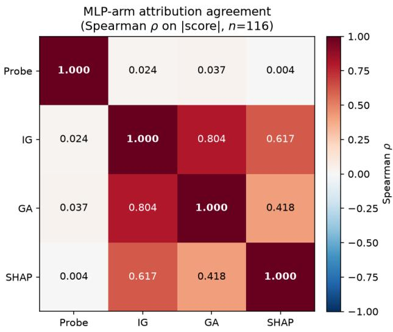
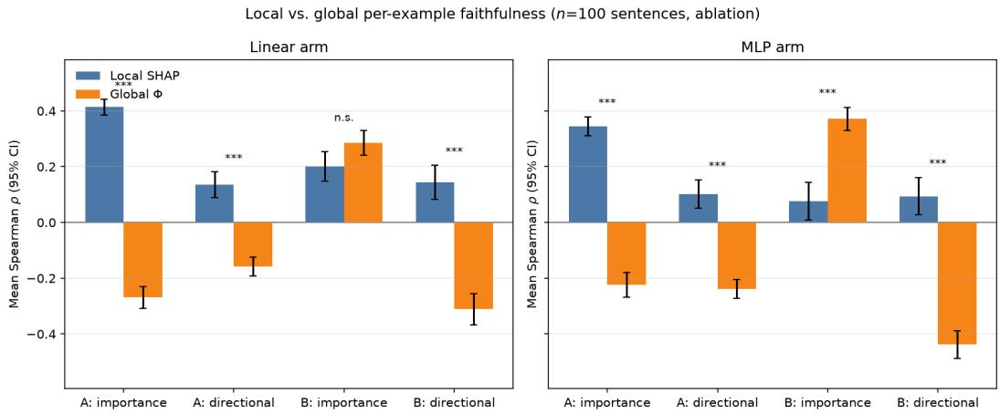
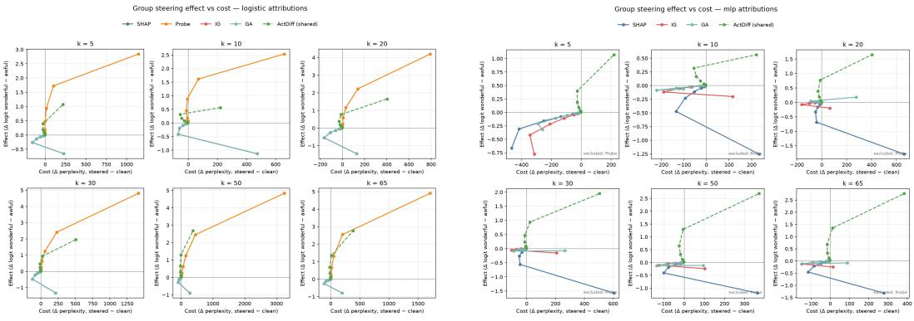

# Evaluating the Causal Faithfulness of SHAP as a Candidate Attribution Method for SAE Features∗

Samuel Xie Independent

Noura Al-Moubayed Durham University

## Abstract

Sparse autoencoders decompose language model representations into interpretable features, but feature interpretation in this literature remains predominantly correlational. Attribution methods offer more direct estimates of feature influence, yet their faithfulness to actual causal effects has not been systematically evaluated in the SAE setting. We apply SHAP-based attribution to SAE latent features and evaluate it against direct causal intervention, using sentiment classification on SST-2 with GPT-2 Small and a 32,768-feature layer-7 SAE as a testbed. We compare SHAP to Integrated Gradients, Gradient×Input, and probe-weight baselines across linear and MLP probe arms, scoring each against feature ablation and activation steering measured through the language model’s own logit difference. Most faithfulness associations we measure do not survive multiple-comparison correction, and attribution methods that agree strongly with one another (ρ = 0.42–0.80) agree poorly with measured causal effects, indicating that inter-method agreement is not evidence of causal faithfulness. Two effects hold under control. First, local per-example attribution retains a directional advantage over global averaged attribution, while its apparent importance advantage is explained by feature activity rather than superior causal ranking. Second, under known-ground-truth minimal pairs, attribution recovers inserted sentiment signal well above chance (AUROC 0.792) but fails to localize deletions (AUROC 0.520), suggesting that these methods detect the presence of a feature’s influence more reliably than its absence. We argue that importance faithfulness and directional faithfulness are separable properties requiring separate evaluation, and that attribution agreement should not substitute for causal validation.

## 1 Introduction

Sparse autoencoders (SAEs) have emerged as the leading tool for decomposing the internal representations of large language models into interpretable features. By training a sparse dictionary on residual stream activations, SAEs decompose superposed representations into nearly monosemantic directions that can be inspected individually [Bricken et al., 2023, Huben et al., 2024]. Recent work has scaled this approach to frontier models including Claude 3 Sonnet and GPT-4, recovering tens of thousands of interpretable features [Templeton et al., 2024, Gao et al., 2025].

Despite this progress, SAE feature interpretation remains largely correlational. The dominant pipeline identifies top-activating dataset examples for each feature and inspects them manually or with automated interpretability models to assign semantic labels—revealing the contexts in which a feature activates, but not establishing what inputs causally drive the feature or what downstream effects it causally produces. Attribution methods such as logit weight analysis, gradient-based attribution, and attribution patching provide more direct estimates of feature influence, but many rely on local linear approximations that may miss nonlinear interactions [Elhage et al., 2021, Syed et al., 2024]. To our knowledge, no prior work has systematically evaluated SHAP-based attribution of SAE features against direct causal interventions, nor examined whether any attribution methods’ SAE feature rankings are faithful to measured causal effects.

To address the gap, we apply SHAP-based attribution to SAE latent features using sentiment classification on SST-2 as a testbed, evaluating multiple attribution methods—SHAP, Integrated Gradients, and Gradient × Input—against causal interventions in the form of feature ablation and activation steering. This design allows us to ask not just which features attribution methods identify, but whether those identifications are causally faithful.

## Contribution.

• We provide the first systematic application of SHAP-based attribution to SAE latent features, comparing against Integrated Gradients, gradient-input, and probe weight baselines across linear and MLP probe architectures.

• We evaluate attribution faithfulness causally via feature ablation and activation steering, establishing intervention effect as ground truth rather than relying on correlational proxies.

• We demonstrate that local per-example SHAP attributions are more faithful to causal directional effects than global mean attributions, identifying averaging as a source of faithfulness degradation.

• We construct a known-ground-truth validation using minimal sentiment-word edits, finding that attribution methods recover feature-level causal effects above chance for insertion edits, but not for removal edits, suggesting attribution faithfulness is asymmetric with respect to the direction of intervention.

## 2 Related Work

Sparse Autoencoders for Interpretability. Sparse autoencoders decompose residual stream activations into sparse, nearly monosemantic features, addressing the polysemanticity that makes individual neurons difficult to interpret [Bricken et al., 2023, Huben et al., 2024]. Recent work has scaled this approach to frontier models, recovering tens of thousands of interpretable features [Gao et al., 2025]. Feature interpretation in this literature remains predominantly correlational, relying on top-activating examples or auto-interpretability pipelines rather than causal validation.

Attribution Methods. Shapley-based attribution [Lundberg and Lee, 2017] and Integrated Gradients [Sundararajan et al., 2017] are standard tools for identifying which input features drive model predictions. Attribution patching [Syed et al., 2024] applies gradient-based attribution to transformer internals, providing a computationally efficient approximation to activation patching. No prior work has systematically applied these methods to SAE latent features or evaluated their causal faithfulness in that setting.

Faithfulness Evaluation. Faithfulness measures the degree to which an explanation reflects a model’s true decision-making process [Jacovi and Goldberg, 2020]. Prior evaluation typically relies on input perturbation metrics rather than direct causal intervention, conflating correlation with causation. Our work evaluates faithfulness via feature ablation and activation steering, using intervention effects as ground truth.

Probing. Linear probes over internal representations are a standard tool for identifying whether a concept is encoded at a given layer [Alain and Bengio, 2016]. We use probes over SAE activations to define a prediction function over the latent feature space, through which attribution methods are applied.

## 3 Methodology

## 3.1 Experimental Setup

We evaluate on SST-2 [Socher et al., 2013], a binary sentiment classification dataset of single-sentence movie reviews. We partition the training split into three subsets with a fixed random seed. The train set is used for fitting probes, computing attribution backgrounds and baselines, and calibrating the steering parameter α. The validation set is used for probe hyperparameter selection, constructing the activation-frequency feature mask, and reporting probe accuracy. The held-out set is reserved exclusively for all attribution scoring and causal evaluation (ablation and steering).

Evaluation and background rows are drawn from a fixed seeded permutation, ensuring nested samples (a 100-row sample exactly matches the first 100 rows of a 2000-row sample) and stable backgrounds across evaluation sizes. We use 2000 evaluation rows and 100 background rows throughout.

We experiment on frozen GPT-2 Small (124M parameters) [Radford et al., 2019] with the gpt2-small-resid-post-v5-32k SAE from sae-lens [Gao et al., 2025], which decomposes layer 7 residual stream activations into 32,768 latent features. Activations are extracted at the last non-padding token position.

## 3.2 Probing Models

We train two probe architectures on SAE activations, each evaluated with identical attribution methods and causal evaluation.

A logistic regression classifier over the full 32,768-dimensional SAE activation vector, fit with L1 penalty $( C = 1$ , liblinear solver). L1 regularization induces sparsity, yielding ∼ 1400 non-zero weights that define the filtered feature mask used in all downstream analyses.

A one-hidden-layer MLP (width 32, ReLU, Adam, L2 regularization) fit on the filtered feature subset. The MLP is included because the linear probe’s constant gradient collapses IG and GA to closed-form identities with SHAP, precluding substantive method comparison. We note a mild optimistic bias: the input mask was derived from the validation set, introducing a label-free but non-independent dependency.

Feature Mask. Our feature mask combines two filters on the full val split only: a non-zero linearprobe coefficient and an activation frequency threshold of 5%. Our current mask results in 116 features, and only restricts the MLP probe’s input layer, steering candidate pool, and group-steering ranking pool. It does not gate the linear probe’s attribution methods.

## 3.3 Attribution Methods

Every method explains the same target scalar per arm: log-odds margin (wx + b) for the linear arm and pre-sigmoid logit for the MLP arm. Scales across arms are not directly comparable.

Zero-cost Baseline. We report raw probe weight and saliency $( \parallel W _ { 1 } [ i , : ] \parallel _ { 2 } )$ for the linear and MLP arms, respectively.

SHAP. We use shap.LinearExplainer on a deterministic 100-row background, computing exact Shapley values ϕ across all 32,768 features. For the MLP arm, we use shap.DeepExplainer targeting pre-sigmoid logits over the 116 active input features, enforcing additivity against the background expectation.

Integrated Gradients & Gradient × Input. Integrated Gradients (IG) is evaluated via a 50- step trapezoidal sum for the MLP arm, whereas in the linear arm it reduces to closed-form $( x _ { j } -$ baselinej)wj. Single-point Gradient × Input $\begin{array} { r } { ( \mathbf { G } \mathbf { A } _ { j } = \left( x _ { j } - \mathbf { b a s e l i n e } _ { j } \right) \frac { \partial f } { \partial x _ { j } } ( x ) ) } \end{array}$ equals linear IG by constant gradients and is included for arm structural parity.

## 3.4 Feature-Ranking Agreement

We compute pairwise Spearman $\rho$ between attribution methods, restricting evaluation to features with non-zero probe scores to prevent artificial inflation from zero-weighted features. For the linear probe, IG, GA, and SHAP are analytically identical, serving as a sanity check $( \rho = 1 )$ . MLP agreement is evaluated on |score| since raw probe saliency lacks directional sign.

## 3.5 Causal Evaluation

Attribution methods (SHAP,IG,GA) are correlational and describe a fixed model with no intervention. To test causal faithfulness, we intervene on SAE feature activations and measure the resulting change in model behavior via the model’s own logit difference. We read activations from a hook attached to the residual stream output of gpt-2 small layer 7, the same layer used for probe training and attribution computation. For feature i with activation $\textstyle a _ { i } .$

Ablation:

$$
\tilde { a } _ { i } = 0 , \quad \tilde { z } = \mathrm { D e c } ( \tilde { \mathbf { a } } )
$$

Steering (additive, signed):

$$
\tilde { a } _ { i } = a _ { i } + \alpha _ { i } , \quad \tilde { z } = \mathrm { D e c } ( \tilde { \mathbf { a } } )
$$

We pass the residual stream activations into the SAE, then encode and decode with no edit as a baseline to isolate the SAE reconstruction error from the actual intervention effects. We apply the intervention at every token position. However, to partially address the scope mismatch between last-token attribution and all-token intervention, we additionally evaluate a last-token-only steering condition in which the intervention is applied exclusively at the final token position, matching the attribution scope; results for last-token steering is reported in Table 2, and all-token steering is reported in Appendix H.8.

The causal readout is the logit difference at the final token:

$$
\Delta = \ell ( \mathrm { w o n d e r f u l ^ { \ast } } ) - \ell ( \mathrm { a w f u l ^ { \ast } } ) ,
$$

evaluated before and after the intervention. We report both $| \Delta |$ (importance) and signed $\Delta$ (direction). Because ablation actually reflects a negative $\Delta$ , we negative raw $\Delta$ before correlation, so positive $\rho$ always indicates more faithfulness.

We calibrate the global steering multiplier α on the training split using a sweep across $\{ 0 . 5 , 1 , 2 , 4 \} \times$ median natural positive activation scale over three top-|SHAP| features across 200 examples. We select the smallest $\alpha$ achieving a mean probability shift $| \Delta P | \ge 0 . 0 2$ on a Layer 11 probe while keeping output saturation $\left( P ^ { \mathrm { ~ - ~ } } < 0 . 0 2 \right.$ or $P > 0 . 9 8 )$ below 25%. We scale steering per feature $\begin{array} { r } { ( \alpha _ { i } = \alpha \cdot \frac { \mathrm { s c a l e } _ { i } } { \mathrm { m e d i a n } ( \mathrm { s c a l e } ) } ) } \end{array}$ to normalize nudges across varying baseline activation magnitudes, running unscaled α as a robustness check. Decoder weights are unadjusted as they are already near unit-norm $( { \mathrm { m e d i a n } } = 0 . 9 9 9 6 )$

We evaluate three candidate selection strategies: (1) uniform random sampling of k features, (2) top-k selection by |SHAP| (noting this range-restricts SHAP’s scored variance and artificially deflates its $\rho ) ,$ and (3) full evaluation over all 116 filtered features without resampling. Additionally, to control for random sampling noise, we evaluate random draws across 10 random seeds. For each method and correlation type, we test for significant non-zero correlation using a one-sample Wilcoxon signed-rank test alongside a 95% bootstrapped confidence interval and an exchangeability check for seed draw typicality.

## 3.6 Local Faithfulness

Global attribution Φ averages across examples, which can obscure per-example attribution quality or mask local disagreement. For each sentence x, we compute local $\operatorname { S H A P } \phi ( x )$ . To ensure equal representation across methods, candidate features for each x are selected via top-k by $| \phi ( x ) |$ |∪top-k by |Φ|. Intervention effects are tracked per-example, and we measure Spearman ρ|local $\phi ( x ) | , | \Delta ( x , \cdot ) | \}$ against $\rho ($ |global $\Phi | , | \Delta ( x , \cdot ) | )$ over identical candidate sets. We report mean $\rho$ across sentences (±std) and the win-rate fraction where local outperforms global.

Confound. Globally-top features (|Φ|) are frequently inactive in a given single sentence. Because ablating an inactive feature moves the logit by zero, global attribution’s lower correlation is partly an artifact of predicting non-zero effects for inactive features, rather than proof of superior ranking quality by local attribution. To isolate this confound, we evaluate under two regimes: Block $[ \mathrm { A } ]$ which includes all candidate features, and Block [B], which restricts candidates exclusively to active features (activation > 0).

Paired significance tests. We conduct Wilcoxon signed-rank tests for $\rho _ { \mathrm { l o c a l } } - \rho _ { \mathrm { g l o b a l } }$ with a bootstrap CI on the mean gap for effect size. We run for both blocks and both correlation types.

We run two follow-up checks:

1. Decomposition of the block [A] margin regresses the per-example gap on the active fraction of candidates using two variations (a simple linear regression and a size-controlled variant) to quantify the confound.

2. Continuous activity control uses a partial Spearman of |attribution| vs |∆| controlling for |attribution| to control for the possibility that local SHAP simply ranks features by activation strength.

## 3.7 Multi-Feature Steering

As a secondary analysis, we constructed steering vectors by aggregating the decoder directions of the top-k features selected by each attribution method and evaluated their effects on model outputs across intervention strengths. Full experimental details and results are provided in Appendix H.6.

## 3.8 Known-Ground-Truth Validation

Natural SST-2 text lacks ground truth feature importance, leaving near-zero faithfulness ρ ambiguous between attribution failure and harness insensitivity. We construct minimal pairs with known causal sources of sentiment change: primary stimuli delete the single sentiment lexicon word from a sentence, while secondary stimuli append a sentiment clause to a neutral sentence. Expected direction is known in both cases.

We measure three quantities in dependency order: (1) readout validity (whether logit-difference sign tracks known edit direction, a precondition for faithfulness claims); (2) feature recovery (AUROC of each attribution method at identifying features whose activation changed, against a 0.5 chance baseline); and (3) causal recovery (correlation between per-feature ablation effects and attribution scores on the edited sentence).

We explicitly control for two confounds: setting the SHAP background to the pair’s original activations (which tautologically inflates AUROC by making scores proportional to activation change) and selecting distractors by top global SHAP magnitude (which forces its AUROC toward zero). We correct both by using the canonical training background for SHAP and sampling distractors randomly.

## 3.9 Lexical Simplicity Control

We evaluate whether SST-2 is sufficiently lexically simple that interaction-aware attribution cannot outperform simpler methods, using the full 10,103-example held-out split.

We conduct three sub-analyses: (1) co-activation (mean active features per example and pairwise Jaccard similarity among top-20 features to test sparsity); (2) lexical tracking (point-biserial correlation between top feature activations and sentiment lexicon words to test if features act as simple word detectors); and (3) lexicon baseline (held-out accuracy of a bag-of-words logistic regression versus the SAE probe to assess value added beyond word-spotting).

## 4 Results

## 4.1 Probe Performance

Table 1 shows the mean probe accuracy and AUROC for both the linear and MLP probe. Both probes exhibit substantial above-chance performance, while the MLP probe’s validation remains mildly optimistic due to pre-filtered input features from the feature mask.

## 4.2 Attribution Method Agreement

As illustrated in Figure 1 and Table 8, the gradient-based methods (IG and GA) correlate strongly with each other and moderately with SHAP, while the probe correlates with none of them. The probe

Table 1: Probe architectures and performance.
<table><tr><td>Arm</td><td>Input dim</td><td>Val. Accuracy</td><td>Val. AUROC</td></tr><tr><td>Linear (logistic)</td><td>32,768</td><td>0.761</td><td>0.84</td></tr><tr><td>MLP (hidden=32)</td><td>116 (filtered)</td><td>0.735</td><td>0.808</td></tr></table>

weights were largely uncorrelated with the gradient and SHAP-based attributions, whereas IG, GA, and SHAP showed moderate-to-strong agreement.

  
Figure 1: MLP-arm attribution agreement (Spearman ρ on |score|, $n = 1 1 6$ filtered features). IG, GA, and SHAP form a correlated cluster $( \rho = 0 . 4 2 – 0 . 8 0 )$ ; the probe weight is essentially uncorrelated with all three $( \rho \leq 0 . 0 4 )$

## 4.3 Causal Faithfulness

Table 2 reports the powered global faithfulness evaluation across all 116 filtered features under last-token steering, BH-corrected within arm. In the linear arm, SHAP/IG/GA achieve moderate importance faithfulness $( \rho _ { \mathrm { i m p } } = 0 . 2 5 6 , q = 0 . 0 1 1 1 )$ , while probe weights show strong directional faithfulness $( \rho _ { \mathrm { d i r } } = 0 . 4 1 0 , q \dot { < } 0 . 0 0 0 1 )$ ; SHAP/IG/GA directional faithfulness is near zero and does not survive correction. In the MLP arm, SHAP and IG achieve importance faithfulness above the FDR threshold $( \rho _ { \mathrm { i m p } } = 0 . 2 7 9$ and 0.278, both $q = 0 . 0 0 8 8 )$ , while directional faithfulness remains nonsignificant across all MLP methods. Overall, 4/8 linear-arm tests and 2/7 MLP-arm tests survive FDR correction, with importance faithfulness more consistently detected than directional faithfulness across both arms.

Table 2: Powered global faithfulness replication $( k = 1 1 6 ,$ steering, all filtered features, BH-corrected within arm).
<table><tr><td>Arm</td><td>Method</td><td> $\rho _ { \mathrm { i m p } } \left( q \right)$ </td><td> $\rho _ { \mathrm { d i r } } \left( q \right)$ </td></tr><tr><td>Linear Linear</td><td>SHAP/IG/GA Probe</td><td> $+ 0 . 2 5 6 ( q { = } 0 . 0 1 1 1 ) ^ { \ast }$   $+ 0 . 0 9 6 ( q = 0 . 4 8 7 )$ </td><td> $- 0 . 0 5 4 ( q = 0 . 5 6 3 )$   $+ 0 . 4 1 0 ( q < 0 . 0 0 0 1 ) ^ { \ast }$ </td></tr><tr><td>MLP</td><td>SHAP</td><td> $+ 0 . 2 7 9 ( q { = } 0 . 0 0 8 8 ) ^ { \ast }$ </td><td> $- 0 . 1 5 7 \left( q = 0 . 1 6 2 \right)$ </td></tr><tr><td>MLP</td><td>Probe saliency</td><td> $- 0 . 0 1 1 \ ( q { = } 0 . 9 1 1 )$ </td><td>n/a</td></tr><tr><td>MLP MLP</td><td>IG GA</td><td> $+ 0 . 2 7 8 ( q { = } 0 . 0 0 8 8 ) ^ { \ast }$   $+ 0 . 1 9 7 \left( q { = } 0 . 0 7 9 7 \right)$ </td><td> $- 0 . 0 4 6 \ ( q = 0 . 8 6 2 )$   $- 0 . 0 3 1 \ ( q = 0 . 8 6 2 )$ </td></tr></table>

\*survives FDR 0.05. Linear arm: 4/8 tests survive; MLP arm: 2/7.

Additionally, last-token steering yields higher importance faithfulness than all-token steering in both arms and recovers MLP-arm significance that the all-token condition did not (Appendix H.8), suggesting that the scope mismatch attenuates measured faithfulness when the intervention extends beyond the attributed token position.

## 4.4 Local Faithfulness

Figure 2 outlines local vs. global SHAP causal faithfulness results. Importance fails to survive the activity control in the both arms, while directional advantage persists across both arms, suggesting that local attribution carries per-example directional information that averaging into Φ destroys. Overall, local SHAP improves directional faithfulness, but its apparent advantage in importance faithfulness is explained by activity information rather than superior causal ranking among active features.

  
Figure 2: Local vs. global attribution, per-example faithfulness $( n = 1 0 0$ sentences, ablation). Bars are mean Spearman ρ across examples ± 95% CI; asterisks mark the paired Wilcoxon signed-rank test on the per-example gap (\*\*\* $p < 1 0 ^ { - 4 } ,$ \*\* $p < 1 0 ^ { - 2 } , * p < 0 . 0 5$ , n.s. otherwise). Block A = all top-20-local ∪ top-20-global candidates; Block B = active-only control.

Our full local vs. global attribution results are shown in Table 3. Local attribution substantially outperformed global attribution in Block A for both importance and directional faithfulness. However, activity explained only a modest fraction of the between-example variation in the local–global gap $( \dot { R } ^ { 2 } = \dot { 0 } . 0 1 9$ linear; 0.081 MLP; 0.120/0.215 controlling for candidate-set size). In Block B, restricting to active features eliminated the local advantage for importance, while its directional advantage persisted in both arms.

Table 3: Local vs. global attribution, per-example faithfulness $( n = 1 0 0$ sentences, ablation): numeric detail. Mean ρ across examples with a paired Wilcoxon signed-rank test on the per-example gap.
<table><tr><td>Arm</td><td>Block : kind</td><td>Local</td><td>Global</td><td>Gap</td><td>Wilcoxon  $p$ </td><td>Win frac.</td></tr><tr><td>Linear</td><td>A: importance</td><td>+0.414</td><td>-0.269</td><td>+0.682</td><td> $3 . 9 \times 1 0 ^ { - 1 8 }$ </td><td>1.000</td></tr><tr><td>Linear</td><td>A : directional</td><td>+0.135</td><td>-0.158</td><td>+0.294</td><td> $4 . 1 \times 1 0 ^ { - 1 5 }$ </td><td>0.860</td></tr><tr><td>Linear</td><td>B : importance</td><td>+0.202</td><td>+0.285</td><td>-0.083</td><td> $6 . 6 \times 1 0 ^ { - 2 }$ </td><td>0.420</td></tr><tr><td>Linear</td><td>B : directional</td><td>+0.144</td><td>-0.311</td><td>+0.455</td><td> $9 . 1 \times 1 0 ^ { - 1 6 }$ </td><td>0.880</td></tr><tr><td>MLP</td><td>A : importance</td><td>+0.345</td><td>-0.223</td><td>+0.568</td><td> $3 . 9 \times 1 0 ^ { - 1 8 }$ </td><td>1.000</td></tr><tr><td>MLP</td><td>A : directional</td><td>+0.102</td><td>-0.239</td><td>+0.341</td><td> $1 . 2 \times 1 0 ^ { - 1 5 }$ </td><td>0.880</td></tr><tr><td>MLP</td><td>B : importance</td><td>+0.077</td><td>+0.371</td><td>-0.295</td><td> $9 . 6 \times 1 0 ^ { - 9 }$ </td><td>0.270</td></tr><tr><td>MLP</td><td>B : directional</td><td>+0.094</td><td>-0.438</td><td>+0.532</td><td> $5 . 7 \times 1 0 ^ { - 1 7 }$ </td><td>0.920</td></tr></table>

## 4.5 Known Ground-Truth Validation and Lexical Simplicity Control

We evaluate attribution faithfulness under known-ground-truth conditions using 100 minimal pairs across two edit types—results are shown in Table 4. Readout validity is moderate in both conditions (sign accuracy 0.770 for remove, 0.700 for insert), establishing a sufficient but imperfect behavioral signal. For the remove condition, all three attribution methods recover edited features at near-chance levels (AUROC: local SHAP 0.520, global SHAP/IG/GA 0.509, probe weights 0.503), and causal recovery is weak across the board (ρ = 0.254, 0.163, −0.099 respectively). The insert condition yields substantially stronger results: local SHAP and global SHAP/IG/GA achieve AUROC of 0.792, with probe weights lagging at 0.610; causal recovery follows the same ordering $( \rho = 0 . 5 3 6 , 0 . 4 5 8$ 0.167).

Table 4: Minimal-pair ground-truth validation, n = 100 pairs, random distractors.
<table><tr><td>Edit</td><td>Sign acc.</td><td>Method</td><td>AUROC</td><td> $\rho$  (causal recovery)</td></tr><tr><td rowspan="3">remove</td><td rowspan="3">0.770</td><td>local SHAP</td><td>0.520</td><td>0.254</td></tr><tr><td>global SHAP/IG/GA</td><td>0.509</td><td>0.163</td></tr><tr><td>Probe weights</td><td>0.503</td><td>-0.099</td></tr><tr><td rowspan="3">insert</td><td>0.700</td><td>local SHAP</td><td>0.792</td><td>0.536</td></tr><tr><td></td><td>global SHAP/IG/GA</td><td>0.792</td><td>0.458</td></tr><tr><td></td><td>Probe weights</td><td>0.610</td><td>0.167</td></tr></table>

Our lexical baseline provides substantially weaker held-out performance than the SAE probe (accuracy 0.629 vs. 0.761), while top-feature activation showed only weak association with sentiment-lexicon presence (mean $| r | = 0 . 0 6 3 ;$ Appendix H.7), suggesting that the probe signal is not reducible to simple sentiment-word detection.

## 5 Discussion

We apply SHAP to SAE feature attribution and evaluate it against a causal harness rather than agreement with other attribution methods. The principal outcome is negative: most faithfulness associations do not survive multiple-comparison correction. Two of four linear-arm tests clear FDR, two MLP-arm tests survive, and none of the k = 20 associations survive pooled correction across the multi-seed sweep. The k = 116 evaluation scores the entire filtered pool without resampling and therefore avoids this seed sensitivity, but the broader pattern indicates that a single k = 20 draw is insufficient for a faithfulness claim.

The disagreement between attribution rankings and measured causal effects is our central observation. IG, GA, and SHAP form a correlated cluster in the MLP arm $( \rho = 0 . 4 2 – 0 . 8 0 )$ while corresponding poorly with intervention effects, indicating that inter-method agreement should not be treated as evidence that a method identifies causally important SAE features. This is not attributable to lexica simplicity: activation of top features is only weakly associated with sentiment-lexicon presence (mean |r| = 0.063), and the SAE probe exceeds a bag-of-words baseline by 13.2 accuracy points.

The local-versus-global analysis separates two properties commonly conflated under faithfulness. Local SHAP’s advantage in importance faithfulness does not survive activity control; in the MLP arm it reverses, with global attribution outperforming local $( + 0 . 3 7 1 \mathrm { v s . } + 0 . { \dot { 0 } } 7 7 , p = 9 . 6 \times 1 0 ^ { - 9 } )$ suggesting that averaging into Φ preserves information about which features are consistently causally relevant. Directional faithfulness behaves oppositely, with local attribution retaining its advantage in both arms under active-only and continuous activation controls. Importance and directional faithfulness are therefore separable properties, making the choice between local and global attribution criterion-dependent rather than uniformly advantageous.

The asymmetry between edit conditions carries a practical implication. Attribution recovers inserted sentiment signal well above chance (AUROC 0.792) but fails to localize deletions (AUROC 0.520 and 0.509), despite a readout registering the deletion correctly in 77% of pairs. Sign accuracy exceeding feature recovery suggests that deletion redistributes activation across many features, each moving too little to detect. Attribution should therefore be expected to identify the presence of a feature’s influence more reliably than its absence, and a null ablation result should not be read as evidence that no feature carries the effect.

These results are obtained for a single model, SAE, layer, and task. Whether the patterns generalize remains open; the decomposition-and-control methodology is not specific to SHAP and extends directly to other settings.

## 5.1 Limitations

• Attributions are computed at a single token position. While restricting interventions to the last token improves importance faithfulness for non-linear attribution methods, it does not resolve the broader failure of directional faithfulness.

• The steering magnitude was calibrated against one readout but evaluated against another, a mismatch shown by the sign-inversion investigation to be non-trivial in small samples.

• All faithfulness correlations are computed over a small number of features and remain underpowered to rule out modest true effects even where correction has been applied.

• Although the powered seed-0 analysis identifies several linear-arm associations, none survive pooled FDR correction across the multi-seed robustness sweep, indicating sensitivity to candidate sampling.

## 5.2 Future Directions

The primary open question is whether the directional advantage of local attribution generalizes beyond sentiment classification and this specific SAE; the underlying mechanism is not specific to SHAP and the decomposition-and-control methodology developed here could extend to other settings.

## 6 Conclusion

We evaluated SHAP as an attribution method for SAE latent features against direct causal intervention, comparing it to Integrated Gradients, Gradient×Input, and probe-weight baselines across linear and MLP probe arms. Most measured faithfulness associations did not survive correction, and agreement among attribution methods did not track agreement with causal effects. Two findings held under control: local attribution retains a directional advantage that averaging destroys, while its apparent importance advantage reflects feature activity rather than superior causal ranking; and attribution recovers inserted sentiment signal well above chance but fails to localize deletions. We take these results to indicate that attribution agreement is not a substitute for causal validation, and that importance and directional faithfulness warrant separate evaluation.

## 7 Use of AI Tools

The authors used Claude Sonnet 5 and Opus 5 to assist with generating portions of the experimental code and with drafting and editing the paper’s prose. The authors reviewed, tested, and verified all AI-assisted code and text, and take full responsibility for the experiments, results, and conclusions reported here.

## References

Guillaume Alain and Yoshua Bengio. Understanding intermediate layers using linear classifier probes. arXiv preprint arXiv:1610.01644, 2016.

Trenton Bricken, Adly Templeton, Joshua Batson, Brian Chen, Adam Jermyn, Tom Conerly, Nick Turner, Cem Anil, Carson Denison, Amanda Askell, Robert Lasenby, Yifan Wu, Shauna Kravec, Nicholas Schiefer, Tim Maxwell, Nicholas Joseph, Zac Hatfield-Dodds, Alex Tamkin, Karina Nguyen, Brayden McLean, Josiah E Burke, Tristan Hume, Shan Carter, Tom Henighan, and Christopher Olah. Towards monosemanticity: Decomposing language models with dictionary learning. Transformer Circuits Thread, 2023. https://transformer-circuits.pub/2023/monosemanticfeatures/index.html.

Nelson Elhage, Neel Nanda, Catherine Olsson, Tom Henighan, Nicholas Joseph, Ben Mann, Amanda Askell, Yuntao Bai, Anna Chen, Tom Conerly, Nova DasSarma, Dawn Drain, Deep Ganguli, Zac Hatfield-Dodds, Danny Hernandez, Andy Jones, Jackson Kernion, Liane Lovitt, Kamal Ndousse, Dario Amodei, Tom Brown, Jack Clark, Jared Kaplan, Sam McCandlish, and Chris Olah. A mathematical framework for transformer circuits. Transformer Circuits Thread, 2021. https://transformer-circuits.pub/2021/framework/index.html.

Leo Gao, Tom Dupre la Tour, Henk Tillman, Gabriel Goh, Rajan Troll, Alec Radford, Ilya Sutskever, Jan Leike, and Jeffrey Wu. Scaling and evaluating sparse autoencoders. In International Conference on Learning Representations, volume 2025, pages 26721–26754, 2025.

Robert Huben, Hoagy Cunningham, Logan Smith, Aidan Ewart, and Lee Sharkey. Sparse autoencoders find highly interpretable features in language models. In International Conference on Learning Representations, volume 2024, pages 7827–7845, 2024.

Alon Jacovi and Yoav Goldberg. Towards faithfully interpretable nlp systems: How should we define and evaluate faithfulness? In Proceedings ofthe 58th annual meeting ofthe associationfor computational linguistics, pages 4198–4205, 2020.

Scott M Lundberg and Su-In Lee. A unified approach to interpreting model predictions. Advances in neural information processing systems, 30, 2017.

Alec Radford, Jeffrey Wu, Rewon Child, David Luan, Dario Amodei, Ilya Sutskever, et al. Language models are unsupervised multitask learners. OpenAI blog, 1(8):9, 2019.

Richard Socher, Alex Perelygin, Jean Wu, Jason Chuang, Christopher D Manning, Andrew Y Ng, and Christopher Potts. Recursive deep models for semantic compositionality over a sentiment treebank. In Proceedings of the 2013 conference on empirical methods in natural language processing, pages 1631–1642, 2013.

Mukund Sundararajan, Ankur Taly, and Qiqi Yan. Axiomatic attribution for deep networks. In International conference on machine learning, pages 3319–3328. PMLR, 2017.

Aaquib Syed, Can Rager, and Arthur Conmy. Attribution patching outperforms automated circuit discovery. In Proceedings ofthe 7th BlackboxNLP Workshop: Analyzing and Interpreting Neural Networks for NLP, pages 407–416, 2024.

Adly Templeton, Tom Conerly, Jonathan Marcus, Jack Lindsey, Trenton Bricken, Brian Chen, Adam Pearce, Craig Citro, Emmanuel Ameisen, Andy Jones, Hoagy Cunningham, Nicholas L Turner, Callum McDougall, Monte MacDiarmid, C. Daniel Freeman, Theodore R. Sumers, Edward Rees, Joshua Batson, Adam Jermyn, Shan Carter, Chris Olah, and Tom Henighan. Scaling monosemanticity: Extracting interpretable features from claude 3 sonnet. Transformer Circuits Thread, 2024. URL https://transformer-circuits.pub/2024/scaling-monosemanticity/ index.html.

## A Experimental Setup Details

In this appendix, we give implementation details underlying the main text’s results: the dataset and splits, the model and sparse autoencoder, the probe architectures, and the feature-selection procedure, focusing on choices that bear directly on the validity of the reported numbers.

## A.1 Task and Dataset

We study binary sentiment classification on SST-2 (Stanford Sentiment Treebank, binary variant), loaded via the HuggingFace stanfordnlp/sst2 release. We split the working dataset once, with a fixed seed (seed= 42), into three disjoint subsets, which we never regenerate:

Table 5: Data split sizes and purposes.
<table><tr><td>Split</td><td>n Used for</td><td></td></tr><tr><td>Probe train</td><td>47,144</td><td>Fitting probes; SHAP/IG/GA background and baseline; steering α calibration</td></tr><tr><td>Probe val</td><td>10,102</td><td>Probe hyperparameters; the activation-frequency feature mask; reported probe accuracy</td></tr><tr><td>Held-out (“shap&quot;) 10,103</td><td></td><td>All attribution (SHAP/IG/GA) and all causal evaluation (abla- tion/steering)</td></tr></table>

This split is the central methodological invariant of the study: we compute both attribution and causal evaluation on the held-out split, on which we fit or tune nothing, so a faithfulness comparison between an attribution method’s prediction and an intervention’s measured effect is not a fit-the-training-data tautology.

Canonical row sampling. We draw all evaluation and background rows through a single function (seed= 42) that returns prefixes of one seeded permutation, not independent draws. Two properties follow: (i) the 100-row local sample is exactly the first 100 rows of the 2000-row global sample, so local and global results join by row position; and (ii) background sampling from the train split (n= 100) is unaffected by the evaluation sample size. We use canonical sample sizes of $n _ { \mathrm { e v a l } } = 2 0 0 0$ (held-out) and $n _ { \mathrm { b a c k g r o u n d } } = 1 0 0$ (train) throughout; individual experiments may use a prefix of this (e.g. 1000 for the headline steering runs, 100 for local per-example runs).

## A.2 Model and Token Position

We use GPT-2 Small and a 32,768-feature SAE at layer 7 (resid\_post) frozen throughout. Two implementation choices here are non-obvious and bear directly on downstream validity:

• Token position: we take the sentence-level representation to be the SAE activation at the last real (non-padding) token, resolved via a single canonical function that correctly handles GPT-2’s pad = bos = eos = <|endoftext|> collision. We share this definition across extraction, probing, and every causal readout in the pipeline.

• Decoder geometry: SAE decoder $( W _ { \mathrm { d e c } } )$ rows are approximately unit norm (median 0.9996 across all 32,768 features); we therefore apply no decoder-norm correction to any steering or group-steering vector (Appendices C and E).

## A.3 Probing Models

We train two probe architectures on SAE activations, forming two parallel “arms” of the study; we duplicate every attribution method and causal-evaluation script across both.

Linear (logistic) probe — the linear arm. We fit an L1-penalized sklearn logistic regression over the full-width, 32,768-d SAE activation at the last token. The L1 penalty zeroes the large majority of coefficients (∼1.4k–1.3k of 32,768 non-zero, run-dependent), and we use this sparsity pattern as one of two filters defining the “filtered feature set” used throughout (Appendix A.4). Seeding is load-bearing: an unseeded fit re-rolls which coefficients land at exactly zero, which re-rolls the downstream feature mask, the MLP probe’s inputs, and the steering candidate pool; we therefore fix random\_state on every LogisticRegression fit in the pipeline (probe, residual probe, lexicon baseline).

MLP probe — the MLP arm. We train a one-hidden-layer sklearn MLP classifier on thefiltered feature subset only (Appendix A.4), not the full 32,768-d activation. We include a second arm because the linear probe’s gradient is constant, which makes Integrated Gradients and Gradient×Input collapse to a closed-form identity with SHAP (Appendix B.6) — a sanity check rather than a comparison. The MLP’s ReLU nonlinearity makes the gradient input-dependent, so IG, GA, and SHAP can genuinely disagree; this is where the substantive method comparison lives.

The MLP probe’s validation accuracy is mildly optimistic: we pre-select its input features with a val-derived (label-free) activation-frequency filter, so there is a small but real leakage between feature selection and reported accuracy.

## A.4 Filtered Feature Set

We compute the “feature mask” consumed everywhere downstream with a single function, combining two filters computed on the validation split only (never held-out, to avoid letting the evaluation split shape a model that we later score on it):

1. Non-zero linear-probe coefficient.

2. Activation frequency $\geq 5 \%$ on the validation split.

This mask contains 116 features (of 32,768) in the experimental run we report here. This count is not a fixed architectural constant: we refit it whenever we refit the linear probe, and it depends on the probe’s coefficient sparsity pattern (Appendix A.3). The mask gates the MLP probe’s input layer, the steering candidate pool (both arms), and the group-steering ranking pool. It does not gate the linear arm’s own SHAP/IG/GA computation, which we carry out over the full 32,768-width space and only slice to the mask where a downstream consumer needs it.

## B Attribution Method Definitions

We compute three attribution methods per arm — SHAP, Integrated Gradients (IG), and Gradient×(Input−Baseline) (GA) — and report raw probe weight/saliency as a zero-cost baseline.

## B.1 Target-Function Matching

We require every method within one arm to explain the same scalar function of the input; otherwise the cross-method comparison is confounded by disagreement about what is being attributed rather than about attribution quality.

Table 6: Target function attributed by each arm.
<table><tr><td>Arm</td><td>Explainer</td><td>Target function</td><td>Gradient used by IG/GA</td></tr><tr><td></td><td>Linear (logistic) shap.LinearExplainer (exact) Log-odds margin, coef_ (constant)</td><td>w · x + b</td><td></td></tr><tr><td>MLP</td><td>shap.DeepExplainer</td><td>Pre-sigmoid logit</td><td>Input-dependent, through ReLU</td></tr></table>

We do not treat magnitudes as comparable across arms: a log-odds margin and a pre-sigmoid logit are different scales, so only within-arm rankings are comparable.

## B.2 SHAP — Linear Arm

We use shap.LinearExplainer, exact for a linear model (no sampling approximation), with an Independent masker over a 100-row train background; we pin max\_samples to the full background count to avoid the library silently subsampling an unseeded random 100 rows from a larger background. This explains all 32,768 features (cheap and exact, so there is no reason to restrict it). We report $\Phi _ { j } = \mathbb { E } _ { e } [ \phi _ { j } ( x _ { e } ) ]$ , the mean signed SHAP value per feature over the 2000-row canonical held-out sample — we preserve sign, and it is the basis for every directional/causal comparison in Appendix C. We report per-feature sign consistency (the fraction of examples whose SHAP value shares the majority sign) as a secondary diagnostic of how representative $\Phi _ { j }$ is of individual examples.

## B.3 SHAP — MLP Arm

We run shap.DeepExplainer on a hand-cloned PyTorch nn.Sequential(Linear, ReLU, Linear) that reproduces the fitted MLPClassifier exactly (we copy the weights in; a custom forward would break DeepSHAP’s op-level attribution). We leave check\_additivity=True enabled and treat a failure there as a real bug, not numerical noise to suppress. We target the pre-sigmoid logit (DeepSHAP is documented as more reliable on logits than on post-sigmoid probabilities), and restrict scope to the filtered feature set only, matching the MLP’s native input space.

## B.4 Integrated Gradients

We define IG generally as:

$$
\mathrm { I G } _ { j } = ( x _ { j } - b _ { j } ) \cdot \int _ { 0 } ^ { 1 } \frac { \partial f } { \partial x _ { j } } \big ( b + \alpha ( x - b ) \big ) d \alpha ,
$$

and approximate this in the MLP arm with a Riemann sum over the path. In the linear arm, the path integral of a constant gradient collapses in closed form to $\mathrm { I G } _ { j } = ( x _ { j } - b _ { j } ) \cdot w _ { j }$ , which we compute directly rather than by numerically integrating a constant. In the MLP arm the gradient is genuinely input-dependent (propagated through the ReLU activation mask), so the Riemann sum performs real numerical integration. We take the baseline b to be the mean of the 100-row train background, not a zero vector — this matters because SAE features are ∼87% zero, and a zero baseline would make GA (Appendix B.5) degenerate to 0 whenever $x _ { j } = 0$

## B.5 Gradient × (Input − Baseline)

$$
{ \mathrm { G A } } _ { j } = ( x _ { j } - b _ { j } ) \cdot { \frac { \partial f } { \partial x _ { j } } } ( x ) ,
$$

a single-point (non-integrated) gradient attribution using the same baseline as IG. In the linear arm this coincides exactly with IG (constant gradient), so we report it mainly for structural parity with the MLP arm, where GA (single endpoint gradient) and IG (path-integrated gradient through a nonlinearity) are genuinely different quantities.

## B.6 The Linear-Arm Identity

With the target matched (Appendix B.1), IG, GA, and interventional SHAP are analytically identical for a linear probe: all three reduce to $w _ { j } \cdot \mathbb { E } _ { e } [ x _ { e , j } - \mu _ { j } ]$ We verify this identity numerically (Appendix H, Table H.1). We present the linear arm’s perfect rank agreement explicitly as a closedform sanity check on implementation correctness, not as an empirical finding that “SHAP agrees with gradient methods.” The substantive cross-method comparison is the MLP arm, where the ReLU nonlinearity breaks the identity and IG, GA, and SHAP can and do diverge (Appendix H, Table 8).

## C Causal Evaluation Protocol

The attribution scores above are correlational, computed from a fixed model with no intervention. We evaluate causal faithfulness separately, by directly intervening on SAE feature activations and reading out the resulting change in language-model behavior — deliberately not the probe the attributions explain, so that we score faithfulness against the system the explanation is nominally about, not against the explainer’s own target.

## C.1 Intervention Definitions

At blocks.7.hook\_resid\_post, for a chosen feature i, we define three interventions:

• Ablation: we encode, set $a _ { i } = 0 ,$ , and decode, removing the feature.

• Steering: we encode, set $a _ { i }  a _ { i } + \alpha _ { i } .$ , and decode — additive and signed $( \alpha _ { i }$ may be negative) — and apply it at every token position, not only the last token that attributions describe (Appendix I, item 1).

• Baseline: we encode and decode with no feature edit (the SAE reconstruction baseline), so the measured $\Delta$ is not confounded with SAE reconstruction error.

## C.2 Readout

We use the GPT-2 logit difference at the last real token, logit(“ wonderful”) − logit(“ awful”), before and after intervention, as the causal readout (both cues resolved and asserted to be single tokens). This is deliberately not the probe’s own prediction, so causal evaluation tests whether a feature causally matters to the underlying language model’s sentiment behavior, not merely to the probe fit on top of it. We report $\Delta$ both as $\bar { | } \Delta |$ (importance) and signed $\Delta$ (direction).

## C.3 Steering-Strength (α) Calibration

We calibrate a global scalar α via a pilot sweep $( \{ 0 . 5 , 1 , 2 , 4 \} \times$ the median natural positive-activation scale) over three top-|SHAP| pilot features, on 200 train-split examples (never validation or held-out). The readout we use for calibration differs from the readout we use for evaluation: we choose α by its effect on a layer-11 residual probe’s P(positive), while the downstream steering scripts read out the GPT-2 logit difference (Appendix C.2). This is a deliberate, acknowledged mismatch: α is a rough “measurable, unsaturated” magnitude, not a hyperparameter tuned against the metric we later evaluate it with.

Selection rule. We select the smallest α with mean $\Delta P | \ge 0 . 0 2$ and saturation fraction (examples with $P < 0 . 0 2$ or $P > 0 . 9 8 ) \leq 0 . 2 5$ , falling back to the best unsaturated α if no candidate meets the threshold. The calibration pilot (Table 7) recommends $\alpha = 0 . 3 3 1 6$

Table 7: Raw α-calibration pilot sweep (probe-readout, 3 pilot features, 200 train examples).
<table><tr><td>α</td><td>mean  $| \Delta P |$ </td><td>mean signed  $\Delta P$ </td><td>saturation frac.</td></tr><tr><td>0.3316</td><td>0.0430</td><td>-0.0426</td><td>0.085</td></tr><tr><td>0.6632</td><td>0.0866</td><td>-0.0859</td><td>0.090</td></tr><tr><td>1.3264</td><td>0.1705</td><td>-0.1690</td><td>0.120</td></tr><tr><td>2.6528</td><td>0.2983</td><td>-0.2957</td><td>0.263</td></tr></table>

Per-feature α-mode. Given a global $\alpha ,$ we support two resolution modes, applied per feature:

• scaled (default/primary): $\alpha _ { i } = \alpha \cdot \mathrm { s c a l e } _ { i } / \mathrm { m e d i a n } ( \mathrm { s c a l e } )$ , where scale is feature $i \ ' s$ mean positive train activation. This equalizes the relative nudge across features with severalfold different natural activation scales.

• constant (secondary/robustness check): a flat α for every feature. This confounds the $\vert \mathrm { a t t r i b u t i o n } \vert \mathrm { - v s } \mathrm { - } \vert \Delta \vert$ correlation, since $| \Delta |$ then partly reflects how hard a feature was pushed relative to its own scale rather than the attribution itself.

We apply no decoder-norm correction, since $W _ { \mathrm { d e c } }$ rows are approximately unit norm (Appendix A.2).

## C.4 Candidate Selection Strategies

We evaluate three candidate-selection strategies:

• random (headline): we draw k features uniformly from the filtered pool. Unbiased.

• top (secondary): we take the top-k by |SHAP|, then score all four methods on that same set. This range-restricts $\mathrm { S H A P ^ { \prime } s }$ own scored variance while leaving the other three methods unrestricted, mechanically deflating $\operatorname { S H A P ^ { \prime } s } \rho$ relative to methods that did not drive selection; we flag every top-selection faithfulness number with this caveat.

• all (higher-power alternative): we score every feature in the filtered pool $( n = 1 1 6 )$ with no resampling, carrying no seed-draw luck. $\mathrm { { A t } } n = 2 0$ the confidence interval on Spearman ρ spans most of $[ - 1 , 1 ]$ , so $\rho \approx 0$ from one $k = 2 0$ draw is compatible with both a true null and a real moderate effect; we therefore treat this, not the $k = 2 0$ random run, as the powered headline global-faithfulness number.

## C.5 Faithfulness Metric and Sign Convention

• Importance faithfulness: Spearman ρ(|attribution score|, $| \Delta | ) -$ we ask whether the method’s magnitude ranking predicts how much the causal effect moves.

• Directional faithfulness: Spearman ρ(signed attribution, oriented ∆) — we ask whether the method’s sign predicts the direction of the causal effect.

• Sign convention: steering adds +α, so a positive attribution should predict a positive $\Delta .$ Ablation removes the feature, so a positive attribution should predict a negative $\Delta ;$ we therefore negate raw ablation $\Delta$ before correlating, so that “positive $\rho ^ { \dagger }$ always means “faithful” regardless of mode.

## C.6 Multiple-Comparison Correction

We optionally apply a Benjamini–Hochberg step (family defined per claim — e.g. the 8 tests of one configuration, or that $\times \ n _ { \mathrm { s e e d } }$ s for a sweep) on top of the raw faithfulness tables, as a sidecar that does not alter the original numbers. Our pipeline’s full uncorrected tables report 30+ tests, of which exactly two clear $p < 0 . 0 5$ raw — the expected yield under a complete null. We report corrected counts, not raw hits, in the main text.

## D Local (Per-Example) Faithfulness Protocol

Global Φ is a mean over 2000 examples; averaging can hide per-example attribution error or manufacture agreement that does not hold example-by-example. We test this directly with three scripts sharing a matched CLI surface $( k _ { \mathrm { l o c a l } } = k _ { \mathrm { g l o b a l } } = 2 0 , n _ { \mathrm { e x a m p l e s } } = 1 0 0 )$ so the two probe arms are comparable.

## D.1 Candidate Construction

Per sentence x, we compute local SHAP $\phi ( x )$ with the same explainer class as the global computation, applied to one row. We construct the candidate set for that sentence as top-k by $| \phi ( x ) |$ | (local) ∪ top-k by |Φ| (global), so local and global attribution compete on equal footing rather than the candidate set structurally favoring the global method. We keep per-example intervention effects $\Delta ( x , i )$ per example, never averaged across the dataset before correlating — this is the entire point of the local analysis, in contrast to the dataset-mean ∆ used in Appendix C. Per sentence, we compute Spearman ρ(|local $\phi ( x ) | , | \Delta ( x , \cdot ) | )$ and $\rho ( | \mathrm { g l o b a l } \ \Phi | , | \Delta ( x , \cdot ) | )$ on the same candidate set, and summarize them as the mean $\rho$ across sentences, plus the fraction of sentences on which local beats global.

## D.2 The Activity Confound and Its Control

Globally-top features (by |Φ|) are usually inactive in any single sentence. Ablating an inactive feature moves the logit by exactly 0 (there is nothing to remove), while local $| \phi ( x ) |$ tracks per-sentence activity by construction. A chunk of any apparent “local SHAP beats global $\dot { \Phi ^ { \prime } }$ margin is therefore just “local knows which features are on in this sentence,” not evidence about ranking quality among features that matter.

Block A / Block B. Block A is the full candidate set described above. Block B restricts candidates to those the sentence actually activates (activation > 0) before re-scoring. A local win that survives Block B is evidence about ranking quality among active features, not merely about knowing which features fired. We take Block B, not Block A, as the headline local-vs-global comparison reported in the main text, since Block A is dominated by the inactive tie block.

## E Multi-Feature (Group) Steering Protocol

In a separate and secondary, larger-scale causal experiment, we build a single steering direction (not a single-feature intervention) from the top-k features of each attribution method and sweep effect against cost.

• Vector construction: for method m, we take the top-k features by |score| from the shared 116-feature filtered pool (the same pool for both arms, so top-k at equal k draws from the same candidate space), then set $\begin{array} { r } { v = \sum _ { i } \mathrm { s c o r e } _ { i } \cdot W _ { \mathrm { d e c } } [ i ] } \end{array}$ , unit-normalized.

• actdiff baseline: a no-attribution-math baseline — top-k by $| \overline { { { a } } } ^ { + } - \overline { { { a } } } ^ { - } |$ | (mean positive minus mean negative activation), weighted by the signed difference itself. We score it once (arm-independent, since it uses no probe) and fan it out to both arms’ plots, tagged arm\_independent: true.

• No MLP probe curve, by construction: the MLP’s probe\_saliency $( \| W _ { 1 } [ i , : ] \| _ { 2 } )$ is unsigned, and our vector-construction formula uses score as a signed weight; summing unsigned magnitudes with the decoder would add positive- and negative-sentiment directions with the same sign, producing a direction that means nothing. We retain the logistic arm’s probe curve because coef\_[0] is signed.

• Sweep: we sweep over k and α grids (full grid and row counts in Appendix H.6).

• Effect = mean $\Delta$ logit-diff (wonderful − awful); cost = mean $\Delta$ perplexity (steered vs. clean baseline).

• Baseline differs from Appendix C: this experiment never touches the SAE at inference — we add α · v directly to the clean residual stream, with no encode/decode — so its baseline is a clean forward pass, whereas the per-feature steering/ablation experiments baseline through an encode→decode reconstruction. Both are internally consistent, but effect sizes across the two families are on different scales; we never compare them numerically, only the shapes of the effect-vs-cost curves.

We show full parameter grids for both arms in Figure 3; the main text reports a $k = 2 0$ spot-check drawn from this same sweep.

## F Known-Ground-Truth Validation Protocol (Minimal Pairs)

Every faithfulness number we compute on natural SST-2 text has an unknown ground-truth causal importance for any given SAE feature, so a near-zero ρ has two incompatible readings that the main pipeline alone cannot separate: (a) the attribution methods really are unfaithful, or (b) the harness itself (k = 20, α calibrated on a different readout, last-token attribution vs. all-token intervention) cannot detect faithfulness even when it is present. We build stimuli where we know a real sentiment change by construction and ask whether the harness recovers it.

## F.1 Stimulus Construction

• remove (primary): we take held-out sentences containing exactly one lexicon word (from a hand-curated positive/negative sentiment word list) and pair each with that single token deleted; everything else is byte-identical. We require “exactly one,” not “at least one,” because with two sentiment words the remaining one keeps carrying sentiment and the pair is no longer a single-cause edit.

• insert (secondary): we append “ it was 〈word〉 .” to lexicon-free sentences. This is less minimal (it adds a clause) but tests the insertion direction that remove pairs cannot.

We know the expected direction: removing a positive word should lower the logit difference; adding one should raise it.

## F.2 Three Measurements

1. Readout validity is the sign accuracy of the text-level ∆ against the known direction. This is a precondition for every other faithfulness claim in the paper: a readout that cannot detect a deliberately inserted sentiment word cannot support any faithfulness claim.

2. Feature recovery (the actual ground truth) are features whose activation moved between the pair demonstrably carry the edit. We label those positive and distractors negative, giving a binary ground truth with a known chance level (AUROC 0.5), and score it per method.

3. For Causal recovery, we ablate each candidate in the edited sentence, measure how much of the edit’s effect it was supplying, and correlate that continuous ground-truth causal score against each attribution.

## G Statistical Reporting Convention: Scored Support Only

We restrict all correlations in this paper to the non-zero/scored feature support, never computing them over the full 32,768-feature space. The latter would report agreement about which features were excluded rather than agreement about importance among included features.

## H Supplementary Tables and Figures

## H.1 Linear-Arm Identity Check and MLP-Arm Exact p-Values

Closed-form identity check (linear probe, margin target): max $\left| \mathrm { I G } \mathrm { ~ - ~ } \Phi \right| =$ $6 . 3 2 \times 1 0 ^ { - 7 }$ (relative $5 . 0 6 \times 1 0 ^ { - 6 } )$ , max $| \mathrm { G A } - \Phi | = 6 . 3 2 \times 1 0 ^ { - 7 }$ . IG, GA, and interventional SHAP coincide analytically for a linear probe; we obtain pairwise $\rho = 1 . 0 0 0 \left( n = 1 3 0 1 \right.$ non-zero-coefficient features on this fit) as an identity, not an empirical result.

Table 8: MLP-arm attribution agreement (Spearman ρ on |score|, $n = 1 1 6 )$
<table><tr><td>Pair</td><td>ρ</td><td>p</td></tr><tr><td>Probe vs. IG</td><td>0.024</td><td>0.800</td></tr><tr><td>Probe vs. SHAP</td><td>0.004</td><td>0.965</td></tr><tr><td>Probe vs. GA</td><td>0.037</td><td>0.696</td></tr><tr><td>IG vs. SHAP</td><td>0.617</td><td>&lt; 0.0001</td></tr><tr><td>IG vs. GA</td><td>0.804</td><td>&lt; 0.0001</td></tr><tr><td>SHAP vs. GA</td><td>0.418</td><td>&lt; 0.0001</td></tr></table>

## H.2 Selection-Bias and Sign-Stratified Checks

Table 9: SHAP faithfulness across candidate-selection strategies (steering), $k = 2 0$ except all $( k =$ 116). top biases $\operatorname { S H A P s } \rho$ downward relative to other methods (Appendix C.4); top-pos/top-neg test the sign-inversion hypothesis without mixed-sign cancellation.
<table><tr><td>Arm : kind</td><td>random</td><td>top</td><td>top-pos</td><td>top-neg</td><td> $\mathrm { a l l } \ ( k { = } 1 1 6 )$ </td><td></td></tr><tr><td>Linear : imp</td><td>-0.083</td><td>+0.356</td><td>+0.158</td><td>+0.167</td><td>+0.241</td><td rowspan="4"> $^ { * * } p = 0 . 0 0 0 1 ;$  all other cells</td></tr><tr><td>Linear : dir</td><td>+0.119</td><td>-0.215</td><td>-0.310</td><td>+0.075</td><td>+0.034</td></tr><tr><td>MLP : imp</td><td>-0.298</td><td> $+ 0 . 4 7 1$ </td><td> $+ 0 . 7 7 1 ^ { \ast \ast }$ </td><td>+0.195</td><td>+0.210</td></tr><tr><td>MLP : dir</td><td>+0.003</td><td>-0.220</td><td>-0.383</td><td>+0.189</td><td>-0.005</td></tr></table>

$p > 0 . 0 9 ,$ , uncorrected.

## H.3 Alpha-Mode Robustness (Scaled vs. Constant)

Table 10: Alpha-mode sensitivity: scaled vs. constant per-feature α (steering, random, $k = 2 0 )$ .
<table><tr><td>Arm</td><td>Method</td><td> $\rho _ { \mathrm { i m p } } ^ { \mathrm { : } }$  (scaled / constant)</td><td> $\rho _ { \mathrm { d i r } }$  (scaled / constant)</td></tr><tr><td>Linear</td><td>SHAP/IG/GA</td><td> $- 0 . 0 8 3 / - 0 . 1 1 4$ </td><td> $+ 0 . 1 1 9 / + 0 . 2 0 2$ </td></tr><tr><td>Linear</td><td>Probe</td><td> $- 0 . 1 8 6 / - 0 . 0 8 1$ </td><td> $- 0 . 0 1 1 / - 0 . 0 8 9$ </td></tr><tr><td>MLP</td><td>SHAP</td><td> $- 0 . 2 9 8 / - 0 . 3 7 7$ </td><td> $+ 0 . 0 0 3 / + 0 . 0 8 1$ </td></tr><tr><td>MLP</td><td>Probe saliency</td><td> $- 0 . 1 4 6 / + 0 . 0 0 3$ </td><td>n/a</td></tr></table>

A large gap here would indicate that constant-α steering numbers substantially reflect activation scale rather than faithfulness; we report both modes regardless of which way the comparison comes out (Appendix I, item 9).

## H.4 Multi-Seed Replication

We pool ten seeds’ candidate draws into one intervention pass and slice them back out per seed (steering, random, scaled $\alpha , k = 2 0 )$ , so replication costs a fraction of ten independent reruns.

Table 11: Multi-seed faithfulness sweep (10 seeds, $k = 2 0$ , scaled α). “Ref $p ^ { \prime \prime }$ is the fraction of seeds with $| \rho |$ at least the published seed-0 draw’s.
<table><tr><td>Arm</td><td>Test</td><td>Mean  $\rho$ </td><td>Std</td><td>95% CI</td><td>Wilcoxon p</td><td>Ref  $p$  (seed 0)</td></tr><tr><td>Linear</td><td>SHAP/IG/GA : imp</td><td>+0.264</td><td>0.184</td><td>[0.149, 0.382]</td><td>0.0039</td><td>1.000</td></tr><tr><td>Linear</td><td>SHAP/IG/GA : dir</td><td>-0.022</td><td>0.227</td><td>[-0.155, 0.125]</td><td>0.770</td><td>0.700</td></tr><tr><td>Linear</td><td>Probe : imp</td><td>+0.140</td><td>0.197</td><td>[0.021, 0.262]</td><td>0.0488</td><td>0.500</td></tr><tr><td>Linear</td><td>Probe : dir</td><td>+0.320</td><td>0.188</td><td>[0.203, 0.433]</td><td>0.0039</td><td>1.000</td></tr><tr><td>MLP</td><td>SHAP : imp</td><td>+0.189</td><td>0.254</td><td>[0.024, 0.342]</td><td>0.0625</td><td>0.500</td></tr><tr><td>MLP</td><td>SHAP : dir</td><td>-0.064</td><td>0.140</td><td>[-0.154, 0.020]</td><td>0.322</td><td>1.000</td></tr><tr><td>MLP</td><td>GA : imp</td><td>+0.180</td><td>0.207</td><td>[0.049, 0.308]</td><td>0.0371</td><td>0.600</td></tr></table>

Pooled BH: 0/80 tests survive (linear), 0/70 (MLP), at FDR 0.05.

## H.5 Underpowered $k = 2 0$ causal validation results

Table 12: Underpowered causal faithfulness $( k = 2 0$ , steering, random selection, $n _ { \mathrm { e v a l } } = 1 0 0 0 )$ . For the linear arm, IG and GA are analytically identical to SHAP and omitted as separate rows.
<table><tr><td>Arm</td><td>Mode</td><td>Method</td><td> $\rho _ { \mathrm { i m p } } \left( p \right)$ </td><td> $\rho _ { \mathrm { d i r } } \left( p \right)$ </td></tr><tr><td>Linear Linear Linear</td><td>Steering Steering</td><td>SHAP/IG/GA Probe</td><td>-0.083 (0.729) -0.186 (0.431)</td><td>+0.119 (0.618) -0.011 (0.965) -0.164 (0.490)</td></tr><tr><td>Linear</td><td>Ablation Ablation</td><td>SHAP/IG/GA Probe</td><td>-0.045 (0.850) –0.183 (0.439)</td><td>+0.448 (0.048)</td></tr><tr><td>MLP</td><td>Steering</td><td>SHAP</td><td>-0.298 (0.202)</td><td>+0.003 (0.990)</td></tr><tr><td>MLP</td><td>Steering</td><td>Probe saliency</td><td>–0.146 (0.540)</td><td>n/a</td></tr><tr><td>MLP</td><td>Steering</td><td>IG</td><td>–0.227 (0.336)</td><td>-0.059 (0.806)</td></tr><tr><td>MLP</td><td>Steering</td><td>GA</td><td>+0.202 (0.394)</td><td>+0.171 (0.470)</td></tr><tr><td>MLP</td><td>Ablation</td><td>SHAP</td><td>+0.194 (0.413)</td><td>–0.140 (0.557)</td></tr><tr><td>MLP</td><td>Ablation</td><td>Probe saliency</td><td>-0.403 (0.078)</td><td>n/a</td></tr><tr><td>MLP</td><td>Ablation</td><td>IG</td><td>+0.114 (0.631)</td><td>–0.290 (0.215)</td></tr><tr><td>MLP</td><td>Ablation</td><td>GA</td><td></td><td></td></tr><tr><td></td><td></td><td></td><td>–0.068 (0.777)</td><td>-0.197 (0.405)</td></tr></table>

Continuous (partial-Spearman) activity control. We compute a partial Spearman of |attribution| vs. |∆| controlling continuously for |activation| (rather than the binary active/inactive split of Block B), keeping the whole candidate set: local SHAP retains partial $\rho = + 0 . 1 8 4$ (linear) / +0.150 (MLP).

## H.6 Group-Steering Full Sweep

This is the full parameter grid underlying the main text’s $k \quad = \quad 2 0$ spot-check: $k \_ \in$ $\{ 5 , 1 0 , 2 0 , 3 0 , 5 0 , 6 5 \} \times \alpha \ \in \ \{ 0 . 5 , 1 , 2 , 5 , 1 0 , 2 0 , 5 0 \}$ , giving 7 vectors (4 logistic + 3 MLP) × $6 k \times 7 \alpha = 2 9 4$ arm-specific rows; we also score actdiff once at $6 \times 7 = 4 2$ and duplicate it across both arms (84 rows, arm\_independent: true) — 378 total rows from 336 forward passes.

  
(a) Logistic arm.  
(b) MLP arm.  
Figure 3: Full group-steering effect-vs-cost grid $( k \times \alpha )$ , one panel per method per arm. This experiment’s baseline is a clean forward pass (no SAE encode/decode), unlike the per-feature steering/ablation experiments’ encode→decode-reconstruction baseline (Appendix E); we compare curve shapes across arms, never magnitudes.

## H.7 Lexical Simplicity Control

We use the full 10,103-row held-out split as the population here, not the 2000-row canonical eval sample used everywhere else in the paper.

Table 13: Lexical simplicity control (full held-out split, n = 10,103).
<table><tr><td>Quantity</td><td>Value</td></tr><tr><td>Mean active filtered features / example (of 116)</td><td>23.06</td></tr><tr><td>Mean pairwise Jaccard, top-20 |Φ| features</td><td>0.211</td></tr><tr><td>Mean [r(activation, has-lexicon-word)|, top-20</td><td>0.063</td></tr><tr><td>Lexicon bag-of-words accuracy / AUROC</td><td>0.629 / 0.676</td></tr><tr><td>SAE probe accuracy / AUROC (held-out)</td><td>0.761 / 0.838</td></tr><tr><td>Accuracy gap (SAE probe – lexicon)</td><td>+0.132</td></tr></table>

By the reading thresholds we fixed in advance (mean $| r | \geq 0 . 2 5$ for “strong lexical tracking”; within 0.03 accuracy for “lexicon-near-probe”): the observed mean $\left| \boldsymbol { r } \right| = 0 . 0 6 3$ is well below the strongtracking threshold, and the 0.132 accuracy gap is well above the near-tie threshold. We take this as indicating that the top SAE features are not simply lexical sentiment-word detectors, and that non-lexical signal remains in the representation for attribution methods to potentially explain.

## H.8 All-token global faithfulness

Table 14: Powered global faithfulness replication $( k = 1 1 6 ,$ steering, all filtered features, BHcorrected within arm).
<table><tr><td>Arm</td><td>Method</td><td> $\rho _ { \mathrm { i m p } } \left( q \right)$ </td><td> $\rho _ { \mathrm { d i r } } \left( q \right)$ </td></tr><tr><td>Linear Linear</td><td>SHAP/IG/GA Probe</td><td> $+ 0 . 2 4 1 ( q { = } 0 . 0 1 9 ) ^ { \ast }$   $+ 0 . 1 3 4 ( q = 0 . 2 4 1 )$ </td><td> $+ 0 . 0 3 4 ( q = 0 . 7 1 9 )$   $+ 0 . 3 5 6 ( q { = } 0 . 0 0 0 7 ) ^ { \ast }$ </td></tr><tr><td>MLP</td><td>SHAP</td><td> $+ 0 . 2 1 0 \left( q = 0 . 1 2 6 \right)$ </td><td> $- 0 . 0 0 5 \ : ( q = 0 . 9 5 8 )$ </td></tr><tr><td>MLP</td><td>Probe saliency</td><td>+0.018 (q=0.958)</td><td>n/a</td></tr><tr><td>MLP</td><td>IG</td><td>+0.152 (q=0.242)</td><td> $+ 0 . 0 1 9 \left( q = 0 . 9 5 8 \right)$ </td></tr><tr><td>MLP</td><td>GA</td><td>+0.195 (q=0.126)</td><td> $+ 0 . 0 3 0 ( q { = } 0 . 9 5 8 )$ </td></tr></table>

\*survives FDR 0.05. Linear arm: 4/8 tests survive; MLP arm: 0/7.

## I Known Limitations

1. Attribution is last-token; intervention is all-token. Attributions describe the SAE vector at one sequence position, while the intervention edits every token position. Part of any faithfulness gap is this scope mismatch, not necessarily attribution error.

2. We calibrate α against a different readout than we evaluate it with (Appendix C.3). We use a layer-11 residual probe’s P(positive) at calibration time, and a GPT-2 logit difference at evaluation time.

3. The MLP arm’s probe\_saliency is magnitude-only $( \Vert W _ { 1 } [ i , : ] \Vert _ { 2 }$ , no sign). This is valid for importance/ranking comparisons, invalid for any directional or causal-sign comparison. We exclude it from group-steering vector construction for the same reason.

4. selection=top biases SHAP’s faithfulness $\rho$ downward relative to the other three methods, by range-restricting only $\mathrm { S H A P ^ { \prime } s }$ scored variance (Appendix C.4). We never present a top number without this caveat.

5. Faithfulness $\rho$ are small-n, with no multiple-comparison control by default (Appendix C.6).

6. The MLP probe’s reported validation accuracy is mildly optimistic — we select its inputs using a val-derived (label-free) frequency filter.

7. The linear arm’s rank-agreement $\rho = 1 . 0 0 0$ is a closed-form identity (Appendix B.6), not an empirical finding — it is not evidence that SHAP and gradient methods agree in general.