# Everyone Was Right: Lexical Representations in Language Models Are Both Abstract and Holistic

Zachary Nicholas Houghton University of Oregon Vail Systems, Inc. znh@uoregon.edu

Yu Zhou Vail Systems, Inc.

Dan Pluth Vail Systems, Inc.

Vijay K. Gurbani Vail Systems, Inc.

## Abstract

Lexical representations can encode both abstract information and information specific to particular contexts. We investigate how these forms of information are organized in language models by decomposing contextual word representations into item, class, and word–class interaction components. Across six pretrained transformers and two linguistic categories, we find that the interaction is consistently present, grows across layers, and contains information associated with both item and class. Unlike the nearly orthogonal item and class effects, the interaction overlaps with both and encodes class information beyond the shared class effect. An interaction also emerges in artificial-language learners even when the input contains only additive structure. Together, these findings show that lexical representations combine abstract information with structure specific to particular word–class combinations.

## 1 Introduction

Lexical representations are deceptively complex: a single word can carry vastly different meanings depending on the context, yet these meanings remain recognizably related. The categorization literature has long recognized this tension, noting that assigning an instance to a specific category is rarely straightforward. Simple rule-based approaches quickly break down: a three-legged cat is undeniably a cat, even if it violates one of the criteria used to define the category. Ultimately, defining a lexical category in precise terms may be impossible. Yet, as U.S. Supreme Court Justice Potter Stewart famously observed, we may not be able to define a category precisely, but we nevertheless “know it when [we] see it.”1

Vsevolod Kapatsinski University of Oregon

This central tradeoff between the contextspecificity and the generalizability of linguistic representations has fueled long-standing debates over the nature of lexical representations. A substantial body of work suggests that linguistic representations contain both abstract, generalizable information as well as information specific to particular experiences (Kapatsinski, 2010; Morgan and Levy, 2015; Pierrehumbert, 2016). For example, children can generalize a productive morphological pattern to forms they have never encountered before (Berko, 1958), while lexical representations can preserve fine-grained information about the contexts in which they were experienced (Bybee and Scheibman, 1999; Goldinger, 1998; Palmeri et al., 1993). Thus, there is little controversy that linguistic knowledge can contain both generalizable and item-specific information. The more fundamental questions for the present study are what gives rise to item-specific representations, and whether they can emerge even for forms whose properties are fully predictable from their constituent parts.

## 1.1 Item-Specificity in Linguistic Representations

Over the last few decades, a great deal of evidence has accumulated showing that linguistic representations are not as decomposable into abstract parts as was traditionally thought. Much of the evidence for this comes from the phonetics literature, showing that phonetic representations are surprisingly rich (Goldinger, 1998; Palmeri et al., 1993), as well as the psycholinguistic literature’s line of research demonstrating the holistic storage of multi-morphemic and multi-word phrases (Bybee and Scheibman, 1999; Houghton and Morgan, 2023; Houghton et al., 2025, 2026; Stemberger and MacWhinney, 2004, 1986).

The strongest evidence for context-specific storage comes from frequency in favorable context effects (FFC, Raymond and Brown, 2012; Bybee,

2002; Brown, 2004; see Kapatsinski, 2026, for a review), in which a form’s behavior is predicted by its frequency in contexts that condition a change rather than by its overall frequency. FFC effects show that it is not raw frequency, but rather frequency in a specific context, that is stored. For example, Raymond et al. (2016) found that words ending in /t/ or /d/ were more likely to be deleted if they were words that frequently occurred before a consonant, the conditioning context for that deletion, regardless of the word’s overall frequency. Crucially, this deletion was observed even when the word occurred outside the conditioning context (Bybee, 2002). While we consider FFC effects to be the clearest evidence for context-specific storage, they are by no means the only evidence: contextspecific storage is also evidenced by word-specific patterns of phonetic reduction (Bybee and Scheibman, 1999), the persistence of subphonemic phonetic detail in memory (McMurray et al., 2008; Miller, 1994; Palmeri et al., 1993), phrase-specific influences on reading times (Siyanova-Chanturia et al., 2011), lexically specific word-order preferences (Morgan and Levy, 2015, 2016, 2024), and phrasal frequency effects on the recognition of their component units (Houghton, 2025; Kapatsinski and Radicke, 2009).

These findings establish that linguistic representations can encode information specific to particular words and contexts, but they do not tell us how widespread such information is. Consider walk, which can function as both a noun and a verb. If its representation as a verb was fully determined by a representation of walk and a representation of the verb category, then nothing in its representation would be specific to the walk-verb combination. If, instead, walk as a verb had a representation of its own, that representation would contain information that cannot be reduced to its constituent parts.

## 1.2 Storage Without Idiosyncrasy

There is little doubt that idiosyncratic words or phrases, such as idioms, must be stored in some form, since their properties are not reducible to those of their individual component parts. However, it is less clear to what extent forms that could in principle be represented compositionally (i.e., fully regular forms) are, in fact, represented compositionally.

Usage-based theories have argued that even regular forms are stored holistically as a function of usage. Bybee (Bybee, 2001) and later Goldberg (Goldberg, 2019) have proposed that frequent words and phrases can be stored even when their properties are fully predictable. From this view, storage need not be a consequence of idiosyncrasy. In fact, it has even been argued that storage is a prerequisite for a representation to become idiosyncratic in the first place (Bybee, 2001; Goldberg, 2019).

These debates about the nature of lexical representations often center around two competing explanations. On one hand, if item-specific representations arise primarily because linguistic forms have properties that cannot be predicted from their component parts, then regular forms should not necessarily have representations that contain information irreducible to those parts. On the other hand, if frequent forms are stored with information specific to their use, item-specific representations may emerge even when a form’s behavior is fully predictable from its component parts.

## 1.3 Present study

The present study asks how item-specific information is represented and what properties of the input give rise to item-specific representations. We focus on representations of words in grammatical classes and decompose a word-in-class representation into three components: an item component (e.g., walk regardless of the part of speech), a class component (e.g., a verb component), and an idiosyncratic component, which captures information specific to the item-in-class combination (e.g., walk as a verb). A central challenge is that a learner’s predictions can conceal the underlying representations: pure exemplar models can look, from their predictions alone, like they have learned abstractions (Houghton and Kapatsinski, 2026). Representations, in contrast, can be examined directly (Elhage et al., 2022; Hinton et al., 1986; Pluth et al., 2026), and in a model the input can be controlled as well, so we can ask which properties of it produce item-specific structure. In particular, do such representations emerge only when a form has item-specific properties, or can they also arise for forms whose properties are fully predictable from their constituent parts? We first validate this decomposition on an artificial language in which we independently control the amount of information associated with the item, the class, and their interaction, then apply it to six pretrained language models across two linguistic constructions.

Our main contributions are as follows:

• We introduce a method for decomposing wordin-context representations into item, class, and idiosyncratic components, and validate it on an artificial language.

• We show that MLPs trained on an artificial language and pretrained LLMs both learn representations that contain abstract, generalizable parts alongside item-specific parts.

• We further show that this learned item-specific knowledge is not represented orthogonally to class or item knowledge.

## 2 Experiment 1: Artificial Languages

In Experiment 1, we test our measurement on an artificial language whose features we control. This allows us to validate our measurement while simultaneously examining how different features of the language affect a model’s representations.

## 2.1 Dataset

To examine the separability of linguistic representations, we constructed an artificial language defined by a probability distribution over a vocabulary of 600 tokens. Each observation combines a form (one of 60), a class (one of 4), and a context (drawn from a pool of 400). Each form occurs 24 times in each class, each time in a different context.

Four effects determine the next-token distribution for a given form, class, and context. Consider walk used as a verb. The item effect captures information shared by walk across its uses as a noun and a verb, while the class effect captures information shared by walk and other verbs. The interaction effect captures what is specific to walk as a verb, beyond these two shared effects. Finally, the context effect captures information associated with the particular context in which walk occurs. Context is drawn independently of form and class, so it acts as pure nuisance: any interaction the measure recovers cannot originate in it.

The four effects are combined to define the ground-truth distribution over next tokens:

$$
\begin{array} { r l } & { P \mathrm { ( n e x t ~ t o k e n ~ | ~ } f , c , x ) = } \\ & { \quad \mathrm { s o f t m a x } \left( s \big [ w _ { \alpha } \mathrm { i t e m } ( f ) + w _ { \beta } \mathrm { c l a s s } ( c ) \right. } \\ & { \qquad \left. + w _ { \gamma } \mathrm { i n t } ( f , c ) + w _ { \mathrm { c t x } } \mathrm { c o n t e x t } ( x ) \big ] \right) } \end{array}\tag{1}
$$

Each effect is constructed using a fixed random matrix whose columns define the directions in which that effect can vary. The coefficients determine how those directions combine to produce the effect’s contribution to the next-token logits. For the interaction effect, each form–class pairing has its own randomly generated vector, independent of the item and class effects. These vectors are centered across forms and classes, ensuring that the interaction contains no additive item or class component. Before the effects are weighted and combined, each is scaled to unit variance across observations. The weights in Equation 1 therefore control the relative contributions of the four effects, rather than differences in their initial scale. The constant $s = 3$ scales the combined logits before the softmax, controlling how peaked the resulting probability distribution is.

We vary the item, class, and interaction weights, $w _ { \alpha } , w _ { \beta }$ , and $w _ { \gamma } .$ , factorially over {0, 0.5, 1, 2}. A weight of zero removes the corresponding effect from the language, while the other values vary its strength relative to the other effects. We independently vary the context weight, $w _ { \mathrm { c t x } }$ , over {0.5, 2.0, 6.0}, ranging from a relatively minor to a dominant contribution. We then rescale all four weights together to unit length, such that $w _ { \alpha } ^ { 2 } + w _ { \beta } ^ { 2 } + w _ { \gamma } ^ { 2 } + \bar { w } _ { \mathrm { c t x } } ^ { 2 } = 1$ . This makes the resulting languages more comparable by enforcing the same total signal (i.e., the variance of the weighted sum in Equation 1 is held constant), despite individual differences in the amount that each individual term contributes.

We also manipulate the dimensionality of the effects. The item and class effects have fixed ranks of 8 and 4, respectively, while the interaction effect takes one of four ranks: {4, 16, 64, 177}. The rank determines the number of independent directions available to represent an effect. The maximum interaction rank, 177, is the dimensionality remaining after centering across 60 forms and four classes: $( 6 0 - 1 ) ( 4 - 1 ) = 1 7 7$

For each resulting language, we train models with hidden widths of 8, 16, 32, 128, 256, using either a linear or a ReLU activation. Models are trained with the Adam optimizer at a learning rate of 0.01, with early stopping.2 We repeat the full experimental grid with five random seeds, yielding 37,800 runs in total, of which 99.6% trained to convergence. Full training details are provided in Appendix A.

## 2.2 Method

## 2.2.1 The learner

The learner model is a multi-layer perceptron (MLP) with a single hidden layer of width d and either a linear or a ReLU activation function.3 The model takes as its input three pieces of information: form, class, and context. Each is mapped to its own width-d embedding, randomly initialized and learned over training, and the three are concatenated and passed through the model, which then outputs a probability distribution over the vocabulary (Figure 1). The training objective is thus to minimize cross-entropy between the model’s predicted distribution over the vocabulary and the exact ground-truth distribution.

## 2.2.2 Decomposing a representation

In order to measure the item-specific part of the representation, we decompose a word-in-context representation into an item component, a class component, and an idiosyncratic component. In Experiment 1, the representation we decompose is the MLP’s hidden layer representation. Let $M [ i , c ] \in \mathbb { R } ^ { d }$ be the mean of those hidden states for item i used at class c (Appendix B). We decompose those item-by-class means by centering, so that:

$$
M [ i , c ] = \mu + \alpha ( i ) + \beta ( c ) + \gamma ( i , c ) ,\tag{2}
$$

where $\mu$ is the grand mean; $\alpha ( i )$ is item $i \ ' _ { \mathrm { { s } } }$ mean across classes minus $\mu ,$ which conceptually is the representation unique to the item; $\beta ( c )$ is the mean across items at class c minus $\mu ,$ which conceptually is the representation unique to the class (e.g., noun vs verb); and $\gamma ( i , c )$ is what item i at class c holds that neither marginal accounts for, which conceptually is the item-specific representation in a specific class (Figure 2).

Each of these averages is taken over a sample of observations that differ only in context, so each carries some of the context term of Equation 1 as noise. We remove it by dividing the observations into two evenly sized splits, running the decomposition on each split separately, and estimating each component’s size as the dot product of its two split estimates, which is large when the splits agree about the component and near zero when they do not. As a result, noise that differs between the splits is independent and cancels.

For each representation we report two measurements. The first, which we call the size of a component, is the fraction of the representation accounted for by item, class, and idiosyncratic information: each component’s squared length, summed over its vectors and divided by the total, so that the three fractions sum to one. The second, the overlap between components, quantifies the extent to which they occupy the same geometric directions. Specifically, we project the item vectors onto the class direction and record the fraction of their squared length that survives, and we project the interaction onto the smallest subspace containing both the item and the class vectors (i.e., the span of the two subspaces).4

To quantify whether a size is meaningful, we redraw the split two hundred times and estimate how often its confidence interval excludes zero; for components whose value is exactly zero this flags an effect about 5% of the time (Appendix C), the false-positive rate expected of a 95% confidence interval.

To quantify whether an overlap is meaningful, we project the effect, held exactly as measured, onto two hundred random subspaces of the same rank, which gives its chance level: the distribution of overlaps that an unrelated subspace of the same rank would yield. An overlap below its chance level indicates meaningful orthogonality; an overlap above it indicates meaningful non-orthogonality.

It’s important to note that the weights in Equation 1 describe the ground-truth distribution the model is trained to match, while the measure decomposes the representation that the model learns, so the two sets of numbers are not necessarily analogous: a learner handed a language that is 85% interaction can learn a representation in which the interaction is far smaller (or larger). Appendix C reports a separate check in which components were set directly in a representation and recovered almost exactly, which is what licenses interpreting the results below as facts about the learner rather than about the measure. We include runs only if at least one of the three components has a re-split interval excluding zero; where none does, the three shares divide noise.

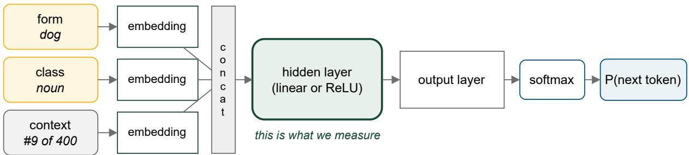  
Figure 1: Structure of our model. Every form is observed 24 times at each class, each time in a different context; that variation across contexts is what the measurement later splits in two.

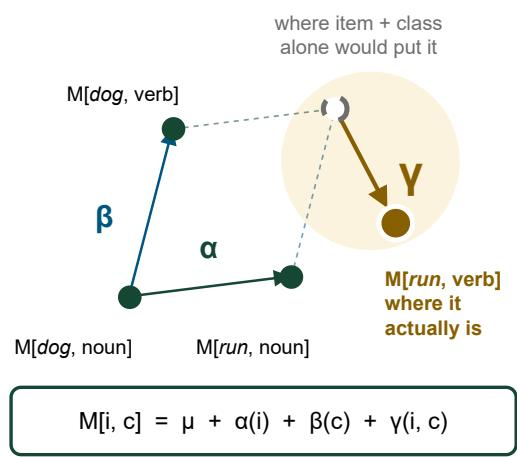  
Figure 2: The four item-by-class means formed by two items in two classes. The arrow is γ(i, c).

## 2.2.3 Analysis

We model our data using an ordered beta regression (Kubinec, 2023) for the sizes and a Gaussian model for the overlaps, both in brms (Bürkner, 2017) with weakly informative priors (See Appendix A for full details). For the sizes we fit one model over all three components, where the outcome variable is the component’s share of the representation and group is that component. Fixed-effects for each component, the width of the hidden-layer, and total rank of the language were included along with maximal random effects (Barr et al., 2013). Equation 3 gives the full model equation. All predictors are centered. A language here is one combination of the four weights and the interaction rank; a run here is the five seeds for a given language.

The overlaps are likewise fit as one model over both overlap measures, with the same structure. Outcome is the log of an overlap divided by its own chance level, and Group is the overlap measure: the item effect’s overlap with the class direction, or the interaction’s overlap with the span of the item and class subspaces.

$$
\begin{array} { r l } & { \mathrm { O u t c o m e } \sim \mathrm { G r o u p } * \big ( \mathrm { I t e m E f f e c t } } \\ & { \quad + \mathrm { C l a s s E f f e c t } + \mathrm { I n t e r a c t i o n E f f e c t } } \\ & { \quad + \log 2 ( \mathrm { W i d t h } ) * \log 2 ( \mathrm { T o t a l R a n k } ) \big ) } \\ & { \quad + \left( 1 + \log 2 ( \mathrm { W i d t h } ) \mid \mathrm { L a n g u a g e } \right) } \\ & { \quad + \left( 1 \mid \mathrm { R u n } \right) } \end{array}\tag{3}
$$

## 2.3 Results

Results are visualized in Figure 3, with the full coefficient results included in Appendix D. Where the hidden layer is wide enough, the learners reproduce the language closely (median Kullback-Leibler divergence of 0.0016 at the widest, against 0.6473 at the narrowest; Figure 5 reports the fit across the whole grid).

Unsurprisingly, the effect size for each component increases as a function of the size of the effect planted in the language (and since the three components sum to 1, the other two components definitionally decrease). Of the three components, the item effect is strongest across every width (Figure 3).

The size of the interaction barely depends on its rank on its own (β = −0.013), which is by design: the interaction is scaled to the same variance at every rank, so raising its rank spreads it over more directions rather than making it larger. What governs how much of the interaction is encoded is the width of the hidden layer (β = +0.314). While rank alone does not affect the size of the interaction, it does interact with width (β = +0.017): at narrow widths a higher-rank interaction needs more directions than the layer has and the excess is lost, while once the layer is wide enough the model represents more of it. This is not the case for the item effect, which decreases as the hidden layer grows $( \beta = - 0 . 0 9 0 )$ , or for the class effect, which barely changes $( \beta = + 0 . 0 2 8 )$ . In the linear condition width is spent on the item effect at the class effect’s expense $( \beta = + 0 . 1 2 3$ against $\beta = - 0 . 1 2 3 ) $ the interaction grows with width there too $( \beta = + 0 . 1 5 7 )$ but stays small throughout.

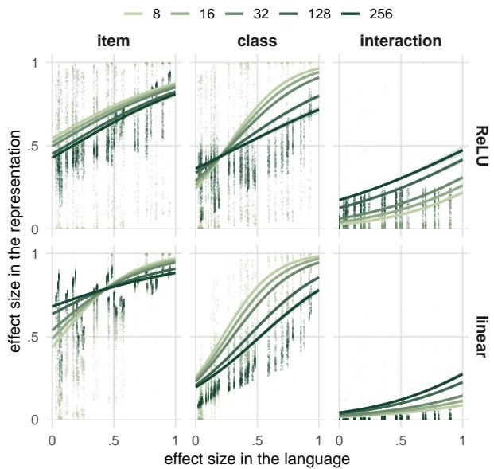  
Figure 3: Ground-truth effect size of each component in the language (x) against its size in the MLP’s representations (y). Points are runs; lines are fitted values from the size model (Equation 3) with 95% intervals, colored by hidden width.

Where no interaction is planted, a ReLU learner still represents one: the measured value is small (median 0.0056 at the widest layer) but its interval excludes zero in 45% of runs, against a nominal 5%. The linear model cannot do this at any width, since a linear map of additive inputs is additive.

The amount of overlap is also affected by the width of the hidden layer: For the ReLU models, the wider the hidden layer, the less the item and class effects share directions $( \beta = - 0 . 3 8 3 )$ Similarly, the overlap between the interaction and the item-class subspace follows the same pattern $( \beta = - 0 . 3 0 1 )$ . The linear models show a different pattern, however. The item-class overlap shows no effect as a function of width, and the interaction effect’s overlap with the item-class space grows as a function of the width $( \beta = + 0 . 1 0 6 )$ climbing from 0.45 to 0.78 times chance. It approaches chance without reaching it, and both overlaps stay below chance at every width under the linear learner (Appendix D). Smaller hidden layers thus do not merely represent less of the interaction, they also force the components onto shared directions.

## 3 Experiment 2: Language Models

Experiment 1 asks what a learner represents when we control the composition of its language; Appendix C separately demonstrates that the measure recovers structure planted directly in a representation. Neither speaks to how a transformer represents real language, which is the question Experiment 2 asks. Experiment 2 applies the same decomposition to the contextual representations of pretrained language models, across two linguistic categories: part of speech and grammatical role.

## 3.1 Dataset

In order to examine the separability of linguistic representations in models, we examined two linguistic categories: part of speech and grammatical role. For both, we concatenate six general-domain English Universal Dependencies treebanks (Nivre et al., 2020), giving 41,095 sentences and 706,323 word tokens; Appendix E provides the full breakdown. We measure two model families at three matched scales: OPT-BabyLM, trained on developmentally plausible quantities of child-available language (Houghton et al., 2026; Warstadt et al., 2023), and Pythia, trained on the Pile (Biderman et al., 2023), at 125M/160M, 350M/410M, and 1.3B/1.4B parameters, with widths of 768, 1024, and 2048. Appendix F gives parameter counts and training-token estimates.

## 3.2 Stimuli

Our stimuli comprise two linguistic categories: part of speech (NOUN versus VERB) and grammatical role (nsubj versus obj, restricted to nouns). For each category we select items that occur in both of its classes, such as walk, which occurs as both a noun and a verb. An item is a single inflected word form, not a lemma, so different inflections of one lemma are separate items: walk and walking are both items, each included only if it is itself attested in both classes. Pooling them under one lemma would collect walk and walking into a single item, and the two classes would then be comparing different tokens, which the embedding layer could then separate before any contextualization has occurred. Capitalization is ignored when occurrences are grouped, but not in the text the models read, so a sentence-initial Walk counts toward the item walk and is tokenized as it appears there.5

An item is included only if it occurs at least ten times in each class. This yields 78 items for part of speech and 49 for grammatical role, with median counts per class spanning from 15 to 19 (Appendix E), inside the range we validated for the measurement (Appendix C).

## 3.3 Method

The decomposition, the two reported quantities, and the replication logic are identical to Experiment 1. For every token we extract the hidden state of the word’s last subword at every layer of each model.6

Transformer hidden states contain a few rogue dimensions whose means and variance are both disproportionately high (Timkey and van Schijndel, 2021), and these would otherwise dominate any subspace estimated from the raw embeddings, so we divide each dimension by its standard deviation before decomposing (Appendix G).

## 3.4 Results

The results are visualized in Figure 4, but further details can be found in Appendix H.

The item effect is the largest component in both categories, running from 0.657 to 0.846 for part of speech and 0.828 to 0.904 for grammatical role. Similarly, the effect of class is mostly comparable across the two linguistic constructions (0.039 to 0.078 vs 0.050 to 0.098 for part of speech and grammatical role respectively). On the other hand, while the interaction effect is larger than the class effect for part of speech (0.096 to 0.245), the same is not true for grammatical role (0.045 to 0.094). This may indicate that part of speech is more lexicalized than grammatical role, perhaps unsurprisingly.

Another way to describe these results is with respect to the whole representation rather than the item-by-class structure: the item effect accounts for 19% to 38% of what varies in a token, the class effect 1% to 3%, and the interaction 2% to 8%, with the remaining 56% to 72% being specific to the context a word appears in (See Appendix H). The interaction is not, however, inherited from that context: at the deepest layer only a small fraction of it is attributable to the context the word appears in; the majority of the interaction is unique to the lexical representation itself (Appendix I).

Both the class effect and the interaction effect increase as a function of layer depth. The interaction is essentially absent at layer 0 in both categories, between 0.0009 to 0.0088 across every category and model, and rises to between 0.0455 to 0.2449 (Figure 4). This is not surprising since at the first layer, the model has yet to integrate enough context to commit to the class of the representation.

Turning to how those components are oriented, the class direction carries almost none of the item effect. At the deepest layer, item-class overlap runs 0.0035 to 0.0067 for part of speech and 0.0033 to 0.0062 for grammatical role, so projecting out the class direction leaves more than 99% of the item effect intact. While both overlaps are technically less orthogonal than a random subspace, the overlap itself is tiny, so the two are near-orthogonal rather than exactly orthogonal.

In contrast to the main effects, the interaction effect is not orthogonal to class or item. Across the six models, 0.106 to 0.239 of the interaction for part of speech is in the span of the class and item, and for grammatical role 0.071 to 0.179 is, against nulls whose upper ends run 0.023 to 0.058 and 0.014 to 0.038 respectively. In other words, the small departure from orthogonality between item and class becomes a large one for the interaction.

The LLMs show a different pattern from the artificial learners: In the artificial learner, the components became meaningfully orthogonal once the hidden layer was wide enough, but for LLMs the components remain meaningfully non-orthogonal at every scale (3.9 to 13.0 times chance for the item effect into the class direction and 3.5 to 11.2 for the interaction into the span of both), and increasingly so as width grows. Additional width is spent representing more of the language rather than giving the same structure more room.

## 4 Experiment 3: Probing the Interaction

Experiment 2 shows that lexical representations contain an idiosyncratic component that can’t be separated out into simple item and class representations, but neither shows what information is contained within the interaction. An item-by-class term captures any reliable difference between a word’s uses in the two classes; that difference is not an artifact of the differing contexts in which the two classes occur (Appendix I), and here we use a probe to examine whether the interaction effect $\gamma$ contains class information.

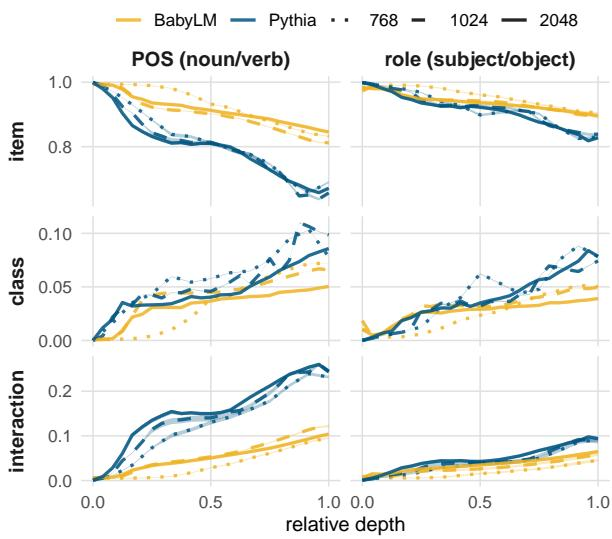  
Figure 4: Fraction of the representation (ignoring context) accounted for by each component, summing to 1, against relative depth from the embedding layer (0) to the final layer (1). Each line is one model; color is the training corpus, linetype the hidden width, shading the 95% interval.

## 4.1 Method

We test whether the interaction encodes class information by probing its representation. If γ encodes the class, the class should be recoverable from the part of a token’s representation that is neither the item effect nor the shared class direction, and we remove both explicitly. All probing happens within a single word, so we ask whether walk’s noun uses can be told from walk’s verb uses; the item effect is constant within a word and so cannot contribute. We then estimate $\beta$ as the difference between the two class means pooled over all items, normalize it, and remove that component from every token, so that whatever separates the classes afterwards is not the direction they share.

What remains after removing those components is the interaction: the part of a word of a specific class that is neither a fact about the word nor a fact about the class. We fit a cross-validated logistic probe to it, five folds, with classes balanced by subsampling within each word so that chance is 0.50, and average the resulting accuracies over words. We include tokens only if they have at least ten occurrences in each class, the same threshold the stimuli are selected on. The whole procedure is then repeated with the class labels permuted within each word, preserving each word’s observation count and class balance while disrupting the correspondence between individual observations and their class labels. This provides a permutation-based control related to that of Hewitt and Liang (2019), but differs in preserving each word’s class balance rather than assigning each word type a consistent random label. We run this at the deepest layer of the largest model in each family, for both categories.

<table><tr><td>model</td><td>accuracy</td><td>null</td></tr><tr><td>part of speech</td><td></td><td></td></tr><tr><td>BabyLM 1.3B</td><td>0.90 [0.88, 0.91]</td><td>0.51 [0.49, 0.54]</td></tr><tr><td>Pythia 1.4B</td><td>0.94 [0.92, 0.95]</td><td>0.50 [0.48, 0.53]</td></tr><tr><td>grammatical role</td><td></td><td></td></tr><tr><td>BabyLM 1.3B</td><td>0.80 [0.77, 0.83]</td><td>0.50 [0.47, 0.53]</td></tr><tr><td>Pythia 1.4B</td><td>0.84 [0.81, 0.86]</td><td>0.52 [0.49, 0.55]</td></tr></table>

Table 1: Accuracy of recovering the class from the interaction, at the deepest layer of the largest model in each family, compared to the null; brackets are bootstrapped intervals.

## 4.2 Results

Results are reported in Table 1. For all models, the class is recoverable from the interaction at well above chance, reaching 0.94 for part of speech and 0.84 for grammatical role, while the permuted null sits on chance.

The results demonstrate that $\gamma$ carries class information.

## 5 Discussion and Conclusion

The present study examined whether an in-context word’s representation in language models is abstract or item-specific and found that it contains elements of both. We decomposed a word’s representation into an item effect, a class effect, and a word-class interaction. In a model trained on an artificial language, we found an interaction effect even where the language itself was additive, so some of this structure comes from the architecture rather than from the language. Additionally, across six language models and two linguistic categories, we found a similar interaction effect. The abstract components were nearly orthogonal, whereas the interaction overlapped with both, indicating that abstract and item-specific information are represented together rather than on separate axes.

Overall, the present results indicate that language model representations encode both abstract and item-specific structure, supporting generalization across words and classes while retaining information about specific combinations.

## Limitations

Our evaluation is restricted to English and relies on two linguistic categories tested across two model families (OPT-BabyLM and Pythia) at three parameter scales. While these choices cover a range of architectures and linguistic phenomena, broader typological, categorical, and architectural validation remains a direction for future work.

## References

Lars Ahrenberg. 2007. LinES: An English-Swedish parallel treebank. In Proceedings of the 16th Nordic Conference of Computational Linguistics (NODAL-IDA 2007), pages 270–273, Tartu, Estonia. University of Tartu, Estonia.

Tatsuya Aoyama, Shabnam Behzad, Luke Gessler, Lauren Levine, Jessica Lin, Yang Janet Liu, Siyao Peng, Yilun Zhu, and Amir Zeldes. 2023. GENTLE: A genre-diverse multilayer challenge set for English NLP and linguistic evaluation. In Proceedings ofthe 17th Linguistic Annotation Workshop (LAW-XVII), pages 166–178, Toronto, Canada. Association for Computational Linguistics.

Dale J. Barr, Roger Levy, Christoph Scheepers, and Harry J. Tily. 2013. Random effects structure for confirmatory hypothesis testing: Keep it maximal. Journal ofMemory and Language, 68(3):255–278.

Jean Berko. 1958. The child’s learning of English morphology. WORD, 14(2-3):150–177.

Stella Biderman, Hailey Schoelkopf, Quentin Anthony, Herbie Bradley, Kyle O’Brien, Eric Hallahan, Mohammad Aflah Khan, Shivanshu Purohit, USVSN Sai Prashanth, Edward Raff, Aviya Skowron, Lintang Sutawika, and Oskar van der Wal. 2023. Pythia: A suite for analyzing large language models across training and scaling. In Proceedings ofthe 40th International Conference on Machine Learning (ICML).

Esther L. Brown. 2004. The reduction of syllableinitial/s/in the Spanish ofNew Mexico and southern Colorado: A usage-based approach. The University of New Mexico.

Paul-Christian Bürkner. 2017. brms: An R package for Bayesian multilevel models using Stan. Journal of Statistical Software, 80(1):1–28.

Joan Bybee. 2001. Phonology and Language Use, volume 94 of Cambridge Studies in Linguistics. Cambridge University Press, Cambridge.

Joan Bybee. 2002. Word frequency and context of use in the lexical diffusion of phonetically conditioned sound change. Language Variation and Change, 14(3):261–290.

Joan Bybee and Joanne Scheibman. 1999. The effect of usage on degrees of constituency: the reduction of don’t in English. Linguistics, 37(4):575–596.

Nelson Elhage, Tristan Hume, Catherine Olsson, Nicholas Schiefer, Tom Henighan, Shauna Kravec, Zac Hatfield-Dodds, Robert Lasenby, Dawn Drain, Carol Chen, and 1 others. 2022. Toy models of superposition. Transformer Circuits Thread.

Adele E. Goldberg. 2019. Explain Me This: Creativity, Competition, and the Partial Productivity of Constructions. Princeton University Press, Princeton, NJ.

Stephen D. Goldinger. 1998. Echoes of echoes? an episodic theory of lexical access. Psychological Review, 105(2):251–279.

John Hewitt and Percy Liang. 2019. Designing and interpreting probes with control tasks. In Proceedings ofthe 2019 Conference on Empirical Methods in Natural Language Processing and the 9th International Joint Conference on Natural Language Processing (EMNLP-IJCNLP), pages 2733–2743, Hong Kong, China. Association for Computational Linguistics.

Geoffrey E. Hinton, James L. McClelland, and David E. Rumelhart. 1986. Distributed representations. In David E. Rumelhart and James L. McClelland, editors, Parallel Distributed Processing: Explorations in the Microstructure ofCognition, Volume 1: Foundations, pages 77–109. MIT Press, Cambridge, MA.

Zachary Nicholas Houghton. 2025. Multi-Word Representations in Minds and Models: Investigating the Storage ofMulti-Word Phrases in Humans and Large Language Models. Ph.D. thesis, University of California, Davis.

Zachary Nicholas Houghton and Vsevolod Kapatsinski. 2026. Exemplars in disguise: Pure exemplar models mimic abstraction-first learning. Preprint, arXiv:2608.00821.

Zachary Nicholas Houghton and Emily Morgan. 2023. Does predictability drive the holistic storage of compound nouns? In Proceedings of the Annual Meeting ofthe Cognitive Science Society, volume 45.

Zachary Nicholas Houghton, Kenji Sagae, and Emily Morgan. 2025. The role of abstract representations and observed preferences in the ordering of binomials in large language models. In Proceedings of the 63rd Annual Meeting of the Association for Computational Linguistics (Volume 2: Short Papers), pages 695– 702, Vienna, Austria. Association for Computational Linguistics.

Zachary Nicholas Houghton, Yu Zhou, Dan Pluth, Jordan Hosier, and Vijay K. Gurbani. 2026. The holistic storage of verb+up phrases in text-based and audiobased language models. Preprint, arXiv:2606.13993.

Vsevolod Kapatsinski. 2010. What is it I am writing? Lexical frequency effects in spelling Russian prefixes: Uncertainty and competition in an apparently regular system. Corpus Linguistics and Linguistic Theory, 6(2):157–215.

Vsevolod Kapatsinski. 2026. Lexical frequency and diffusion. In The Wiley Blackwell Companion to Diachronic and Historical Linguistics, pages 1–24. Wiley.

Vsevolod Kapatsinski and Joshua Radicke. 2009. Frequency and the emergence of prefabs: Evidence from monitoring. In Formulaic Language, Volume 2: Acquisition, loss, psychological reality, andfunctional explanations, number 83 in Typological Studies in Language, pages 499–522. John Benjamins, Amsterdam.

Robert Kubinec. 2023. Ordered beta regression: A parsimonious, well-fitting model for continuous data with lower and upper bounds. Political Analysis, 31(4):519–536.

Bob McMurray, Richard N. Aslin, Michael K. Tanenhaus, Michael J. Spivey, and Dana Subik. 2008. Gradient sensitivity to within-category variation in words and syllables. Journal of Experimental Psychology: Human Perception and Performance, 34(6):1609– 1631.

Joanne L. Miller. 1994. On the internal structure of phonetic categories: a progress report. Cognition, 50(1–3):271–285.

Emily Morgan and Roger Levy. 2015. Modeling idiosyncratic preferences: How generative knowledge and expression frequency jointly determine language structure. In Proceedings of the 37th Annual Meeting ofthe Cognitive Science Society, pages 1649–1654.

Emily Morgan and Roger Levy. 2016. Abstract knowledge versus direct experience in processing of binomial expressions. Cognition, 157:384–402.

Emily Morgan and Roger Levy. 2024. Productive knowledge and item-specific knowledge trade off as a function of frequency in multiword expression processing. Language, 100(4):e195–e224.

Joakim Nivre, Marie-Catherine de Marneffe, Filip Ginter, Jan Hajic, Christopher D. Manning, Sampoˇ Pyysalo, Sebastian Schuster, Francis Tyers, and Daniel Zeman. 2020. Universal Dependencies v2: An evergrowing multilingual treebank collection. In Proceedings of the Twelfth Language Resources and Evaluation Conference, pages 4034–4043, Marseille, France. European Language Resources Association.

Thomas J. Palmeri, Stephen D. Goldinger, and David B. Pisoni. 1993. Episodic encoding of voice attributes and recognition memory for spoken words. Journal ofExperimental Psychology: Learning, Memory, and Cognition, 19(2):309–328.

Janet B. Pierrehumbert. 2016. Phonological representation: Beyond abstract versus episodic. Annual Review ofLinguistics, 2:33–52.

Dan Pluth, Zachary Nicholas Houghton, Yu Zhou, and Vijay K. Gurbani. 2026. On the interpretability of Whisper encodings using sparse autoencoders. Preprint, arXiv:2605.12225.

William D. Raymond and Esther L. Brown. 2012. Are effects of word frequency effects of context of use? An analysis of initial fricative reduction in Spanish. In Stefan Th. Gries and Dagmar Divjak, editors, Frequency Effects in Language Learning and Processing, pages 35–52. Mouton de Gruyter, Berlin.

William D. Raymond, Esther L. Brown, and Alice F. Healy. 2016. Cumulative context effects and variant lexical representations: Word use and English final t/d deletion. Language Variation and Change, 28(2):175–202.

Manuela Sanguinetti and Cristina Bosco. 2015. Part-TUT: The Turin University parallel treebank. In Harmonization and Development of Resources and Toolsfor Italian Natural Language Processing within the PARLI Project, Studies in Computational Intelligence, pages 51–69. Springer International Publishing.

Natalia Silveira, Timothy Dozat, Marie-Catherine de Marneffe, Samuel R. Bowman, Miriam Connor, John Bauer, and Chris Manning. 2014. A gold standard dependency corpus for English. In Proceedings of the Ninth International Conference on Language Resources and Evaluation (LREC’14), pages 2897– 2904, Reykjavik, Iceland. European Language Resources Association (ELRA).

Anna Siyanova-Chanturia, Kathy Conklin, and Walter J.B. van Heuven. 2011. Seeing a phrase “time and again” matters: The role of phrasal frequency in the processing of multiword sequences. Journal ofExperimental Psychology: Learning Memory and Cognition, 37(3):776–784. ISBN: 0302006001.

Joseph P. Stemberger and Brian MacWhinney. 2004. Are inflected forms stored in the lexicon. Morphology: Critical concepts in linguistics, 6:107–122.

Joseph Paul Stemberger and Brian MacWhinney. 1986. Frequency and the lexical storage of regularly inflected forms. Memory & Cognition, 14(1):17–26.

William Timkey and Marten van Schijndel. 2021. All bark and no bite: Rogue dimensions in transformer language models obscure representational quality. In Proceedings of the 2021 Conference on Empirical Methods in Natural Language Processing (EMNLP).

Alex Warstadt, Aaron Mueller, Leshem Choshen, Ethan Wilcox, Chengxu Zhuang, Juan Ciro, Rafael Mosquera, Bhargavi Paranjabe, Adina Williams, Tal Linzen, and Ryan Cotterell. 2023. Findings of the BabyLM challenge: Sample-efficient pretraining on developmentally plausible corpora. In Proceedings ofthe BabyLM Challenge at CoNLL.

Amir Zeldes. 2017. The GUM corpus: Creating multilayer resources in the classroom. Language Resources and Evaluation, 51(3):581–612.

Daniel Zeman, Martin Popel, Milan Straka, Jan Hajic, Joakim Nivre, Filip Ginter, Juhani Luotolahti,ˇ Sampo Pyysalo, Slav Petrov, Martin Potthast, Francis Tyers, Elena Badmaeva, Memduh Gokirmak, Anna Nedoluzhko, Silvie Cinková, Jan Hajic jr., Jaroslavaˇ Hlavácová, Václava Kettnerová, Zdeˇ nka Urešová,ˇ and 43 others. 2017. CoNLL 2017 shared task: Multilingual parsing from raw text to Universal Dependencies. In Proceedings ofthe CoNLL 2017 Shared Task: Multilingual Parsingfrom Raw Text to Universal Dependencies, pages 1–19, Vancouver, Canada. Association for Computational Linguistics.

## A The Artificial-Language Grid

Table 2 describes the language and the MLP parameters.

<table><tr><td>factor</td><td>levels</td></tr><tr><td>language</td><td></td></tr><tr><td>item weight</td><td>0, 0.5, 1, 2</td></tr><tr><td>class weight</td><td>0, 0.5, 1, 2</td></tr><tr><td>interaction weight</td><td>0, 0.5, 1, 2</td></tr><tr><td>context weight</td><td>0.5, 2, 6</td></tr><tr><td>interaction rank</td><td>4, 16, 64, 177</td></tr><tr><td>learner</td><td></td></tr><tr><td>hidden width</td><td>8, 16, 32, 128, 256</td></tr><tr><td>activation</td><td>linear, ReLU</td></tr><tr><td>replication</td><td></td></tr><tr><td>seed</td><td>0,1,2, 3,4</td></tr></table>

Table 2: The Experiment 1 language parameters. The first five rows define each artificial language, the next two the learner MLP model. Item and class ranks are held fixed so that the interaction’s rank is the only one that varies. Crossing every level gives 38,400 cells; the three languages in which all three effect weights are zero contain no item-by-class structure at all and are excluded, leaving the reported total.

Item rank is fixed at 8 and class rank at 4, so the structure a language requires is 12 directions plus the interaction’s rank, running from 16 to 189. Of the 37,800 runs, 99.6% trained to convergence.

Every learner is trained in full batch with the Adam optimizer at a learning rate of 0.01, minimizing cross-entropy against the exact ground-truth distribution until the loss plateaus, on one GPU with twelve worker processes.

Both the size and the overlap models use weakly informative priors rather than the package defaults: a normal distribution with mean zero and standard deviation 2.5 on every population-level coefficient, a normal distribution with mean zero and standard deviation 1 on the standard deviations of the random effects, and an LKJ(2) prior on their correlation. The coefficient prior still covers the largest effects either model estimates, which reach about 2.8 on the logit scale, and the prior on the standard deviations is much wider than any variance component the data support, so neither prejudges a result.

Figure 5 reports how well that training succeeded, and what it did not buy. The left panel is the Kullback-Leibler divergence from the learner’s predictions to the ground-truth distribution, which is the cross-entropy at convergence minus the entropy of the target; the entropy floor itself varies across the grid, so the raw cross-entropy is not comparable between languages but this difference is. The right panel is the share of the item-by-class structure that the hidden layer actually carries, as a fraction of the share planted in the language. Both are restricted to the languages in which the interaction is more than 30% of the planted structure, which are the languages where the question has teeth.

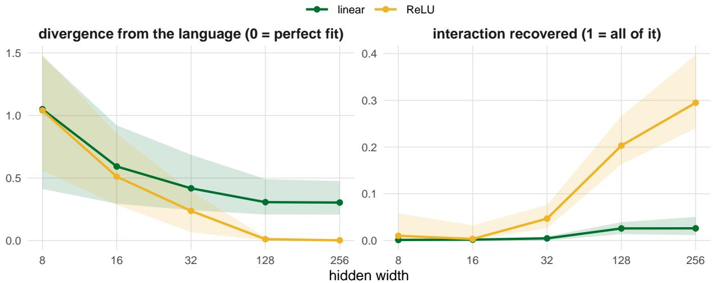  
Figure 5: Fit and recovery against hidden width, for languages whose planted structure is more than 30% interaction. Left: Kullback-Leibler divergence from the learner to the ground-truth distribution, so zero is a perfect fit. Right: the interaction share measured in the hidden layer as a fraction of the share planted in the language, so one would be full recovery and the plotted values are the fraction of it reached. Lines are medians over runs with interquartile bands, which show how much the languages in the grid differ from one another rather than measurement error.

<table><tr><td rowspan=1 colspan=1></td><td rowspan=1 colspan=1>noun</td><td rowspan=1 colspan=1>verb</td></tr><tr><td rowspan=1 colspan=1>walk</td><td rowspan=1 colspan=1>β</td><td rowspan=1 colspan=1>β2</td></tr><tr><td rowspan=1 colspan=1>run</td><td rowspan=1 colspan=1>β₁</td><td rowspan=1 colspan=1>β2</td></tr><tr><td rowspan=1 colspan=1>：</td><td rowspan=1 colspan=1>…</td><td rowspan=1 colspan=1>…</td></tr><tr><td rowspan=1 colspan=1>word i</td><td rowspan=1 colspan=1>β₁</td><td rowspan=1 colspan=1>β2</td></tr></table>

## B The Decomposition

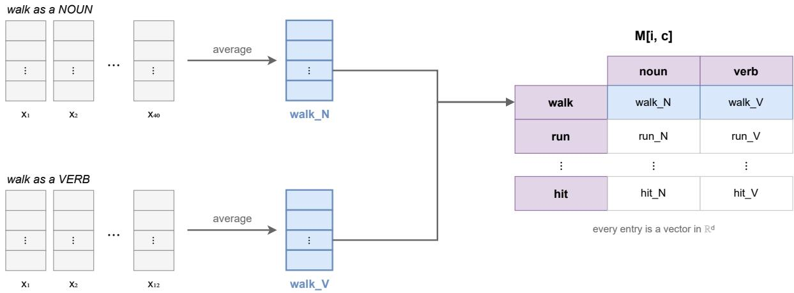  
Figure 6: Each word in each class is observed in many contexts, and those observations are averaged to give that word’s representation in that class. Every one of these averages is a vector in $\mathbb { R } ^ { d }$ , and every item appears in every class.

A word used in a given class is observed in many contexts, and the representation differs a little in each. Averaging those observations gives that word’s representation in that class: for items $i \in \{ 1 , \ldots , I \}$ crossed with classes $c \in \{ 1 , \ldots , C \} , M [ i , c ] \in \mathbb { R } ^ { d }$ is the mean representation of item i in class c (Figure 6). The three components are read off that grid (Figure 7).

<table><tr><td rowspan=2 colspan=3>α: one value per item</td></tr><tr><td rowspan=1 colspan=1>noun</td><td rowspan=1 colspan=1>verb</td></tr><tr><td rowspan=1 colspan=1>walk</td><td rowspan=1 colspan=1>αl1</td><td rowspan=1 colspan=1>α₁</td></tr><tr><td rowspan=1 colspan=1>run</td><td rowspan=1 colspan=1>0l2</td><td rowspan=1 colspan=1>0l2</td></tr><tr><td rowspan=1 colspan=3>         …          …</td></tr><tr><td rowspan=1 colspan=1>word i</td><td rowspan=1 colspan=1>αl</td><td rowspan=1 colspan=1>α</td></tr></table>

each repeated C times

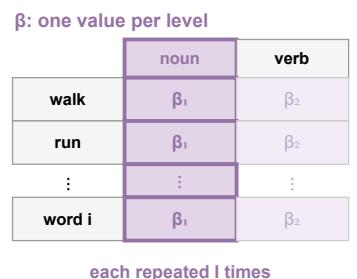  
each repeated I times

γ: one value per position
<table><tr><td rowspan=1 colspan=1></td><td rowspan=1 colspan=1>noun</td><td rowspan=1 colspan=1>verb</td></tr><tr><td rowspan=1 colspan=1>walk</td><td rowspan=1 colspan=1>Yu1</td><td rowspan=1 colspan=1>Y12</td></tr><tr><td rowspan=1 colspan=1>run</td><td rowspan=1 colspan=1>Y21</td><td rowspan=1 colspan=1>Y22</td></tr><tr><td rowspan=1 colspan=1>：</td><td rowspan=1 colspan=1>…·</td><td rowspan=1 colspan=1>….</td></tr><tr><td rowspan=1 colspan=1>word i</td><td rowspan=1 colspan=1>Yi</td><td rowspan=1 colspan=1>Yiz</td></tr></table>

never repeated  
Figure 7: The three components across the grid of words and classes. An item effect is one value per word, the same in every class; a class effect is one value per class, the same for every word; and the interaction differs for every word in every class.

## C Validating the Measure

Experiment 1 defines a ground truth language; however, it cannot distinguish a failure of the measure from the model representing the language differently than the structure it was given. Here we remove that ambiguity by constructing representations in which $\mu , \alpha , \beta ,$ , and $\gamma$ are set directly, with no model or training, and passing the result through the same analysis used for the language models. Ground truth therefore exists at the level where the measure operates.

Specifically, we generated representations with known values of $\mu , \alpha , \beta ,$ and $\gamma ,$ varying the number of items, classes, representation dimensions, observations per word and class, and noise level across the range used in the experiments. Components were centered to satisfy their defining constraints and rescaled to predetermined shares of the total squared length. The grid included the same factorial Experiment 1 run: the three components measured in Experiment 2, item counts from 27 to 180, two and four classes, widths from 8 to 2048, 10, 24, and 100 observations per item and class, three noise levels, and five seeds. We also generated orthogonal and known non-orthogonal item and class effects: the orthogonal condition draws α and $\beta$ independently, while the non-orthogonal condition places a known fraction of $\beta$ along α’s largest dimension. In total, this gave 252,000 runs.

At 24 observations per item and class, the measured interaction matches the one it was given across the whole range (Table 3), and is flagged in essentially every run where anything was present and about one in twenty where nothing was.
<table><tr><td>specified</td><td>runs</td><td>measured</td><td>flagged</td></tr><tr><td>0.000</td><td>6300</td><td>0.0000 [0.0000, 0.0094]</td><td>5%</td></tr><tr><td>0.030</td><td>900</td><td>0.0323 [0.0199, 0.0418]</td><td>100%</td></tr><tr><td>0.048</td><td>1800</td><td>0.0495 [0.0385, 0.0688]</td><td>100%</td></tr><tr><td>0.056</td><td>1800</td><td>0.0573 [0.0458, 0.0918]</td><td>100%</td></tr><tr><td>0.059</td><td>1800</td><td>0.0607 [0.0495, 0.1041]</td><td>100%</td></tr><tr><td>0.100</td><td>1800</td><td>0.1007 [0.0911, 0.1089]</td><td>100%</td></tr><tr><td>0.111</td><td>900</td><td>0.1154 [0.1031, 0.1279]</td><td>100%</td></tr><tr><td>0.167</td><td>1800</td><td>0.1708 [0.1594, 0.2204]</td><td>100%</td></tr><tr><td>0.190</td><td>1800</td><td>0.1937 [0.1825, 0.2736]</td><td>100%</td></tr><tr><td>0.200</td><td>1800</td><td>0.2030 [0.1926, 0.2981]</td><td>100%</td></tr><tr><td>0.240</td><td>900</td><td>0.2416 [0.2327, 0.2488]</td><td>100%</td></tr><tr><td>0.333</td><td>900</td><td>0.3396 [0.3263, 0.3610]</td><td>100%</td></tr><tr><td>0.444</td><td>1800</td><td>0.4488 [0.4381, 0.5059]</td><td>100%</td></tr><tr><td>0.485</td><td>1800</td><td>0.4877 [0.4787, 0.5645]</td><td>100%</td></tr><tr><td>0.500</td><td>1800</td><td>0.5025 [0.4941, 0.5873]</td><td>100%</td></tr><tr><td>0.667</td><td>900</td><td>0.6702 [0.6606, 0.6814]</td><td>100%</td></tr><tr><td>0.762</td><td>1800</td><td>0.7634 [0.7551, 0.7828]</td><td>100%</td></tr><tr><td>0.800</td><td>1800</td><td>0.8009 [0.7931, 0.8242]</td><td>100%</td></tr><tr><td>0.889</td><td>900</td><td>0.8895 [0.8809, 0.8972]</td><td>100%</td></tr><tr><td>0.941</td><td>1800</td><td>0.9412 [0.9339, 0.9471]</td><td>100%</td></tr><tr><td>1.000</td><td>900</td><td>0.9999 [0.9936, 1.0000]</td><td>100%</td></tr></table>

Table 3: Recovery of the interaction at 24 observations per item and class in 768 or more dimensions, pooled over noise levels, item counts, and widths. Specified is the interaction share built into the generated representations and measured the median share recovered, with the 2.5th and 97.5th percentiles across runs in brackets;flagged is the share of runs whose re-split interval excludes zero.

All three effects read essentially zero when a component is set to zero, at every sample size, and each is flagged at approximately the nominal 5% rate (Table 4).

<table><tr><td>effect</td><td>observations</td><td>median</td><td>95th pct</td><td>flagged</td></tr><tr><td>class effect</td><td>10</td><td>0.00000</td><td>0.0081</td><td>6.1%</td></tr><tr><td>class effect</td><td>24</td><td>0.00000</td><td>0.0034</td><td>6.5%</td></tr><tr><td>class effect</td><td>100</td><td>0.00000</td><td>0.0009</td><td>6.3%</td></tr><tr><td>interaction</td><td>10</td><td>0.00009</td><td>0.0644</td><td>6.2%</td></tr><tr><td>interaction</td><td>24</td><td>0.00004</td><td>0.0309</td><td>5.9%</td></tr><tr><td>interaction</td><td>100</td><td>0.00002</td><td>0.0083</td><td>4.9%</td></tr><tr><td>item effect</td><td>10</td><td>0.00007</td><td>0.0568</td><td>4.1%</td></tr><tr><td>item effect</td><td>24</td><td>0.00003</td><td>0.0255</td><td>3.6%</td></tr><tr><td>item effect</td><td>100</td><td>0.00000</td><td>0.0064</td><td>5.0%</td></tr></table>

Table 4: What the measure reports when an effect is set to exactly zero, by observations per item and class, pooled over every other axis of the validation grid. Median and 95th pct summarize the measured share of that effect across runs, andflagged is the share of runs whose re-split interval excludes zero, which should sit near the nominal 5%.

The false-positive rate varies somewhat with representation width and component, particularly at small widths, but remains below 10% throughout the validation grid except for the class effect at the narrowest width, where it reaches 14% (Table 5). The language-model analyses use $d \geq 7 6 8$ , where the rates are closer to the nominal level.

<table><tr><td>width d</td><td>item</td><td>class</td><td>interaction</td></tr><tr><td>8</td><td>3%</td><td>14%</td><td>7%</td></tr><tr><td>16</td><td>7%</td><td>3%</td><td>5%</td></tr><tr><td>32</td><td>4%</td><td>4%</td><td>10%</td></tr><tr><td>128</td><td>6%</td><td>4%</td><td>5%</td></tr><tr><td>768</td><td>2%</td><td>8%</td><td>3%</td></tr><tr><td>1024</td><td>3%</td><td>5%</td><td>3%</td></tr><tr><td>2048</td><td>0%</td><td>8%</td><td>8%</td></tr></table>

Table 5: How often a component set to exactly zero is flagged, by width and by effect.

<table><tr><td>width d</td><td>measured</td><td>analytic chance</td></tr><tr><td>8</td><td>0.17501 [0.06900, 0.40018]</td><td>0.25000</td></tr><tr><td>16</td><td>0.10678 [0.03744, 0.20884]</td><td>0.12500</td></tr><tr><td>32</td><td>0.05609 [0.01864, 0.10454]</td><td>0.06250</td></tr><tr><td>128</td><td>0.01714 [0.00450, 0.02611]</td><td>0.02344</td></tr><tr><td>768</td><td>0.00261 [0.00079, 0.00472]</td><td>0.00391</td></tr><tr><td>1024</td><td>0.00217 [0.00065, 0.00330]</td><td>0.00293</td></tr><tr><td>2048</td><td>0.00096 [0.00031, 0.00165]</td><td>0.00146</td></tr></table>

Table 6: Item-class overlap when the two effects are constructed orthogonal, at 24 observations per item and class. Measured is the median overlap across the runs at that width with the 2.5th and 97.5th percentiles in brackets; chance is the overlap expected if the component were randomly oriented, $r / d$ for a target subspace of r dimensions in a representation of width d.

With orthogonal item and class effects, the measured overlap tracks the chance level across representation widths (Table 6). When a known fraction of the class direction is placed inside the item subspace, the measured overlap rises above chance and is detected in 89% of runs at $d = 2 0 4 8$ (Table 7). Thus, the measure recovers both the expected chance overlap under orthogonality and genuine non-orthogonality.

<table><tr><td>width d</td><td>measured</td><td>chance</td><td>detected</td></tr><tr><td>8</td><td>0.1688 [0.0824, 0.3998]</td><td>0.12500</td><td>9%</td></tr><tr><td>16</td><td>0.0951 [0.0414, 0.2026]</td><td>0.06250</td><td>22%</td></tr><tr><td>32</td><td>0.0593 [0.0225, 0.1119]</td><td>0.03125</td><td>36%</td></tr><tr><td>128</td><td>0.0213 [0.0062, 0.0517]</td><td>0.00781</td><td>63%</td></tr><tr><td>768</td><td>0.0065 [0.0011, 0.0298]</td><td>0.00260</td><td>83%</td></tr><tr><td>1024</td><td>0.0056 [0.0008, 0.0331]</td><td>0.00098</td><td>82%</td></tr><tr><td>2048</td><td>0.0036 [0.0004, 0.0290]</td><td>0.00049</td><td>89%</td></tr></table>

Table 7: Measured item-class overlap when a fraction of the class direction is placed inside the item subspace (non-orthogonal), at 24 observations per item and class. Measured is the median overlap across the runs at that width with the 2.5th and 97.5th percentiles in brackets; chance is the overlap expected if the component were randomly oriented, r/d for a target subspace of r dimensions in a representation of width d; detected is the fraction of runs whose overlap falls outside that null’s 95% interval.

## C.1 Variance across contexts

The interaction is a residual, and a residual absorbs whatever noise the terms before it do not. A word’s average representation in one class is taken over the contexts it appears in there, so it contains some amount of sampling error; estimated within a single split, the interaction would inherit that error and grow with the variance across contexts whether or not any interaction was present.

The cross-split dot product eliminates this bias. The two estimates come from disjoint halves of a word’s tokens in that class, so their errors are independent and mean-zero, and the expectation of their inner product is the true squared length with no variance term: the context variance enters the variance of the estimate and not its expectation. This holds for any variance, and for a variance that differs from one word and class to the next.

Table 8 demonstrates this. Holding the planted interaction fixed and raising the variance across contexts to fifty times the variance between words and classes leaves the measured value where it is, and where nothing was planted the false-positive rate stays at the nominal level rather than rising with that variance. If anything the measure drifts slightly low at the largest variance.

<table><tr><td>specified</td><td>noise</td><td>runs</td><td>measured</td><td>flagged</td></tr><tr><td rowspan="3">0.00</td><td>1x</td><td>6300</td><td>0.0000</td><td>6%</td></tr><tr><td>10x</td><td>6300</td><td>0.0000</td><td>6%</td></tr><tr><td>50x</td><td>6300</td><td>0.0001</td><td>6%</td></tr><tr><td rowspan="3">0.10</td><td>1x</td><td>1800</td><td>0.1012</td><td>100%</td></tr><tr><td>10x</td><td>1800</td><td>0.1002</td><td>100%</td></tr><tr><td>50x</td><td>1800</td><td>0.1001</td><td>100%</td></tr><tr><td rowspan="3">0.20</td><td>1x</td><td>1800</td><td>0.2199</td><td>100%</td></tr><tr><td>10x</td><td>1800</td><td>0.2049</td><td>100%</td></tr><tr><td>50x</td><td>1800</td><td>0.2016</td><td>100%</td></tr></table>

Table 8: Recovery of the interaction across simulations with different amounts of noise, in 768 or more dimensions, pooled over item counts, widths and sample sizes. Specified is the interaction share built into the representations and noise the variance across contexts per observation as a multiple of the variance between words and classes, so at 1x the two are equal. Measured is the median interaction share recovered across runs andflagged the share whose re-split interval excludes zero, which should sit at 5% in the rows where nothing was planted.

## D Width and Orthogonality

Whether the item and class effects are orthogonal depends on the width of the representation. Figure 10 reports that relationship from the fitted models; this appendix gives the remaining properties of the artificial-language runs.

Under ReLU, overlap stays below chance at wide layers and rises above it as the layer narrows, while the linear condition stays well below chance at every width.

The two summaries that follow are descriptive medians across runs rather than estimates from the fitted models. At low widths, the representations vary substantially across runs, with this variability decreasing as width increases. For example, two runs of the same language differ by 0.70 in the item effect and 0.73 in the class effect at width 8, compared with 0.16 and 0.15 at width 32. This variability reflects the different ways models can distribute information when representational capacity is limited.

Two properties of the language also affect the composition of the item-by-class structure (Table 9). Increasing the effect of context reduces the interaction share, while increasing the item’s share in the language produces a corresponding increase in its share of the representation.

<table><tr><td>property</td><td>level</td><td>runs</td><td>item</td><td>class</td><td>interaction</td></tr><tr><td>context in the language</td><td>under 30%</td><td>3600</td><td>0.490</td><td>0.399</td><td>0.028</td></tr><tr><td></td><td>30 to 70%</td><td>2871</td><td>0.538</td><td>0.371</td><td>0.008</td></tr><tr><td></td><td>over 70%</td><td>3886</td><td>0.578</td><td>0.350</td><td>0.004</td></tr><tr><td>item against class</td><td>item &lt; class</td><td>3525</td><td>0.428</td><td>0.480</td><td>0.017</td></tr><tr><td></td><td>item = class</td><td>3427</td><td>0.569</td><td>0.359</td><td>0.015</td></tr><tr><td></td><td>item &gt; class</td><td>3405</td><td>0.644</td><td>0.294</td><td>0.011</td></tr></table>

Table 9: How two other properties of the artificial language move the composition of the item-by-class structure, under ReLU, pooled over widths. Rows within a property partition the same runs. Values are medians of the three shares over the runs in the row.

## D.1 Component models

Results for our statistical analysis are presented in Tables 10 and 11, and visualized in Figure 8.

<table><tr><td>component term</td><td></td><td>estimate</td><td>error</td><td>95% CI</td><td>P(b&gt; 0)</td></tr><tr><td>item</td><td>item</td><td>1.68</td><td>0.04</td><td>[1.61, 1.75]</td><td>1.00</td></tr><tr><td>class</td><td>item</td><td>-1.63</td><td>0.04</td><td>[-1.70, -1.56]</td><td>0.00</td></tr><tr><td>interaction</td><td>item</td><td>0.09</td><td>0.04</td><td>[0.02, 0.16]</td><td>0.99</td></tr><tr><td>item</td><td>class</td><td>-2.67</td><td>0.04</td><td>[-2.75, -2.59]</td><td>0.00</td></tr><tr><td>class</td><td>class</td><td>2.77</td><td>0.04</td><td>[2.69, 2.85]</td><td>1.00</td></tr><tr><td>interaction</td><td>class</td><td>0.24</td><td>0.04</td><td>[0.16, 0.31]</td><td>1.00</td></tr><tr><td>item</td><td>interaction</td><td>-0.53</td><td>0.03</td><td>[-0.60, -0.46]</td><td>0.00</td></tr><tr><td>class</td><td>interaction</td><td>0.20</td><td>0.03</td><td>[0.13, 0.26]</td><td>1.00</td></tr><tr><td>interaction</td><td>interaction</td><td>1.65</td><td>0.03</td><td>[1.58, 1.71]</td><td>1.00</td></tr><tr><td>item</td><td>width</td><td>-0.09</td><td>0.00</td><td>[-0.10, -0.08]</td><td>0.00</td></tr><tr><td>class</td><td>width</td><td>0.03</td><td>0.00</td><td>[0.02, 0.04]</td><td>1.00</td></tr><tr><td>interaction</td><td>width</td><td>0.31</td><td>0.00</td><td>[0.30, 0.32]</td><td>1.00</td></tr><tr><td>item</td><td>rank</td><td>0.03</td><td>0.01</td><td>[0.02, 0.04]</td><td>1.00</td></tr><tr><td>class</td><td>rank</td><td>-0.03</td><td>0.01</td><td>[-0.04, -0.02]</td><td>0.00</td></tr><tr><td>interaction</td><td>rank</td><td>-0.01</td><td>0.01</td><td>[-0.03, -0.00]</td><td>0.02</td></tr><tr><td>item</td><td>width x rank</td><td>0.01</td><td>0.00</td><td>[0.00, 0.01]</td><td>0.99</td></tr><tr><td>class</td><td>width x rank</td><td>-0.01</td><td>0.00</td><td>[-0.02, -0.01]</td><td>0.00</td></tr><tr><td>interaction</td><td>width x rank</td><td>0.02</td><td>0.00</td><td>[0.01, 0.02]</td><td>1.00</td></tr><tr><td>item</td><td>item x width</td><td>-0.00</td><td>0.02</td><td>[-0.04, 0.04]</td><td>0.47</td></tr><tr><td>class</td><td>item x width</td><td>0.01</td><td>0.02</td><td>[-0.02, 0.05]</td><td>0.76</td></tr><tr><td>interaction</td><td>item x width</td><td>-0.14</td><td>0.02</td><td>[-0.18, -0.10]</td><td>0.00</td></tr><tr><td>item</td><td>class x width</td><td>0.48</td><td>0.02</td><td>[0.44, 0.52]</td><td>1.00</td></tr><tr><td>class</td><td>class x width</td><td>-0.54</td><td>0.02</td><td>[-0.58, -0.50]</td><td>0.00</td></tr><tr><td>interaction</td><td>class x width</td><td>-0.12</td><td>0.02</td><td>[-0.16, -0.07]</td><td>0.00</td></tr><tr><td>item</td><td>interaction x width</td><td>-0.20</td><td>0.02</td><td>[-0.24, -0.16]</td><td>0.00</td></tr><tr><td>class</td><td>interaction x width</td><td>0.09</td><td>0.02</td><td>[0.05, 0.13]</td><td>1.00</td></tr><tr><td>interaction</td><td>interaction x width</td><td>-0.11</td><td>0.02</td><td>[-0.15, -0.07]</td><td>0.00</td></tr><tr><td>item</td><td>item x rank</td><td>-0.17</td><td>0.03</td><td>[-0.22, -0.12]</td><td>0.00</td></tr><tr><td>class</td><td>item x rank</td><td>0.16</td><td>0.03</td><td>[0.11, 0.21]</td><td>1.00</td></tr><tr><td>interaction</td><td>item x rank</td><td>0.09</td><td>0.03</td><td>[0.03, 0.14]</td><td>1.00</td></tr><tr><td>item</td><td>class x rank</td><td>0.04</td><td>0.03</td><td>[-0.02, 0.10]</td><td>0.90</td></tr><tr><td>class</td><td>class x rank</td><td>-0.06</td><td>0.03</td><td>[-0.12, -0.01]</td><td>0.02</td></tr><tr><td>interaction</td><td>class x rank</td><td>0.04</td><td>0.03</td><td>[-0.02, 0.10]</td><td>0.91</td></tr><tr><td>item</td><td>interaction x rank</td><td>0.01</td><td>0.03</td><td>[-0.04, 0.06]</td><td>0.64</td></tr><tr><td>class</td><td>interaction x rank</td><td>-0.04</td><td>0.03</td><td>[-0.09, 0.00]</td><td>0.04</td></tr><tr><td>interaction</td><td>interaction x rank</td><td>0.06</td><td>0.03</td><td>[0.02, 0.11]</td><td>0.99</td></tr><tr><td>item</td><td>item x width x rank</td><td>-0.05</td><td>0.01</td><td>[-0.08, -0.02]</td><td>0.00</td></tr><tr><td>class</td><td>item x width x rank</td><td>0.05</td><td>0.01</td><td>[0.03, 0.08]</td><td>1.00</td></tr><tr><td>interaction</td><td>item x width x rank</td><td>-0.02</td><td>0.01</td><td>[-0.05, 0.00]</td><td>0.05</td></tr><tr><td>item</td><td>class x width x rank</td><td>0.01</td><td>0.02</td><td>[-0.02, 0.04]</td><td>0.70</td></tr><tr><td>class</td><td>class x width x rank</td><td>-0.01</td><td>0.02</td><td>[-0.04, 0.02]</td><td>0.29</td></tr><tr><td>interaction</td><td>class x width x rank</td><td>-0.02</td><td>0.02</td><td>[-0.05, 0.01]</td><td>0.12</td></tr><tr><td>item</td><td>interaction x width x rank</td><td>-0.03</td><td>0.01</td><td>[-0.05, -0.00]</td><td>0.02</td></tr><tr><td>class</td><td>interaction x width x rank</td><td>0.03</td><td>0.01</td><td>[0.01, 0.06]</td><td>0.99</td></tr><tr><td>interaction</td><td>interaction x width x rank</td><td>-0.02</td><td>0.01</td><td>[-0.05, 0.01]</td><td>0.09</td></tr><tr><td>component term</td><td></td><td>estimate error</td><td></td><td>95% CI</td><td>P(b &gt; 0)</td></tr><tr><td>item</td><td>item</td><td>2.36</td><td>0.04</td><td>[2.29, 2.43]</td><td>1.00</td></tr><tr><td>class</td><td>item</td><td>-2.29</td><td>0.03</td><td>[-2.35, -2.22]</td><td>0.00</td></tr><tr><td>interaction</td><td>item</td><td>0.48</td><td>0.04</td><td>[0.40, 0.55]</td><td>1.00</td></tr><tr><td>item</td><td>class</td><td>-3.52</td><td>0.04</td><td>[-3.60, -3.45]</td><td>0.00</td></tr><tr><td>class</td><td>class</td><td>3.66</td><td>0.04</td><td>[3.58, 3.74]</td><td>1.00</td></tr><tr><td>interaction</td><td>class</td><td>0.08</td><td>0.04</td><td>[-0.00, 0.16]</td><td>0.97</td></tr><tr><td>item</td><td>interaction</td><td>0.94</td><td>0.03</td><td>[0.88, 1.00]</td><td>1.00</td></tr><tr><td>class</td><td>interaction</td><td>-1.05</td><td>0.03</td><td>[-1.11, -0.99]</td><td>0.00</td></tr><tr><td>interaction</td><td>interaction</td><td>1.57</td><td>0.03</td><td>[1.50, 1.64]</td><td>1.00</td></tr><tr><td>item</td><td>width</td><td>0.12</td><td>0.00</td><td>[0.12, 0.13]</td><td>1.00</td></tr><tr><td>class</td><td>width</td><td>-0.12</td><td>0.00</td><td>[-0.13, -0.12]</td><td>0.00</td></tr><tr><td>interaction</td><td>width</td><td>0.16</td><td>0.01</td><td>[0.15, 0.17]</td><td>1.00</td></tr><tr><td>item</td><td>rank</td><td>0.02</td><td>0.01</td><td>[0.01, 0.03]</td><td>1.00</td></tr><tr><td>class</td><td>rank</td><td>-0.01</td><td>0.01</td><td>[-0.02, 0.00]</td><td>0.04</td></tr><tr><td>interaction</td><td>rank</td><td>-0.08</td><td>0.01</td><td>[-0.09, -0.06]</td><td>0.00</td></tr><tr><td>item</td><td>width x rank</td><td>0.00</td><td>0.00</td><td>[-0.00, 0.01]</td><td>0.87</td></tr><tr><td>class</td><td>width x rank</td><td>-0.01</td><td>0.00</td><td>[-0.01, -0.00]</td><td>0.01</td></tr><tr><td>interaction</td><td>width x rank</td><td>0.02</td><td>0.00</td><td>[0.02, 0.03]</td><td>1.00</td></tr><tr><td>item</td><td>item x width</td><td>-0.45</td><td>0.02</td><td>[-0.49, -0.42]</td><td>0.00</td></tr><tr><td>class</td><td>item x width</td><td>0.38</td><td>0.02</td><td>[0.35, 0.42]</td><td>1.00</td></tr><tr><td>interaction</td><td>item x width</td><td>-0.02</td><td>0.02</td><td>[-0.06, 0.02]</td><td>0.11</td></tr><tr><td>item</td><td>class x width</td><td>0.36</td><td>0.02</td><td>[0.32, 0.40]</td><td>1.00</td></tr><tr><td>class</td><td>class x width</td><td>-0.43</td><td>0.02</td><td>[-0.47, -0.39]</td><td>0.00</td></tr><tr><td>interaction</td><td>class x width</td><td>-0.08</td><td>0.02</td><td>[-0.13,-0.04]</td><td>0.00</td></tr><tr><td>item</td><td>interaction x width</td><td>-0.13</td><td>0.02</td><td>[-0.16, -0.09]</td><td>0.00</td></tr><tr><td>class</td><td>interaction x width</td><td>0.04</td><td>0.02</td><td>[0.00, 0.07]</td><td>0.99</td></tr><tr><td>interaction</td><td>interaction x width</td><td>0.10</td><td>0.02</td><td>[0.07, 0.14]</td><td>1.00</td></tr><tr><td>item</td><td>item x rank</td><td>-0.04</td><td>0.03</td><td>[-0.09, 0.01]</td><td>0.05</td></tr><tr><td>class</td><td>item x rank</td><td>0.03</td><td>0.03</td><td>[-0.02, 0.08]</td><td>0.90</td></tr><tr><td>interaction</td><td>item x rank</td><td>0.19</td><td>0.03</td><td>[0.14, 0.24]</td><td>1.00</td></tr><tr><td>item</td><td>class x rank</td><td>-0.04</td><td>0.03</td><td>[-0.10,0.01]</td><td>0.07</td></tr><tr><td>class</td><td>class x rank</td><td>0.00</td><td>0.03</td><td>[-0.05, 0.06]</td><td>0.56</td></tr><tr><td>interaction</td><td>class x rank</td><td>0.13</td><td>0.03</td><td>[0.07, 0.19]</td><td>1.00</td></tr><tr><td>item</td><td>interaction x rank</td><td>-0.11</td><td>0.02</td><td>[-0.15, -0.06]</td><td>0.00</td></tr><tr><td>class</td><td>interaction x rank</td><td>0.07</td><td>0.02</td><td>[0.02, 0.11]</td><td>1.00</td></tr><tr><td>interaction</td><td>interaction x rank</td><td>0.18</td><td>0.02</td><td>[0.13, 0.23]</td><td>1.00</td></tr><tr><td>item</td><td>item x width x rank</td><td>-0.00</td><td>0.01</td><td>[-0.03, 0.02]</td><td>0.36</td></tr><tr><td>class</td><td>item x width x rank</td><td>0.01</td><td>0.01</td><td>[-0.01, 0.04]</td><td>0.85</td></tr><tr><td>interaction</td><td>item x width x rank</td><td>-0.05</td><td>0.01</td><td>[-0.08,-0.02]</td><td>0.00</td></tr><tr><td>item</td><td>class x width x rank</td><td>0.02</td><td>0.01</td><td>[-0.01, 0.05]</td><td>0.92</td></tr><tr><td>class</td><td>class x width x rank</td><td>-0.01</td><td>0.01</td><td>[-0.04, 0.02]</td><td>0.26</td></tr><tr><td>interaction</td><td>class x width x rank</td><td>-0.05</td><td>0.02</td><td>[-0.08, -0.02]</td><td>0.00</td></tr><tr><td>item</td><td>interaction x width x rank</td><td>0.00</td><td>0.01</td><td>[-0.02, 0.03]</td><td>0.58</td></tr><tr><td>class</td><td>interaction x width x rank</td><td>-0.00</td><td>0.01</td><td>[-0.03, 0.02]</td><td>0.40</td></tr><tr><td>interaction</td><td>interaction x width x rank</td><td>-0.00</td><td>0.01</td><td>[-0.03, 0.02]</td><td>0.36</td></tr></table>

Table 10: Coefficient values of the size model (Equation 3) with error and 95% CIs, ReLU arm.

Table 11: Coefficient values of the size model (Equation 3) with error and 95% CIs, linear arm.

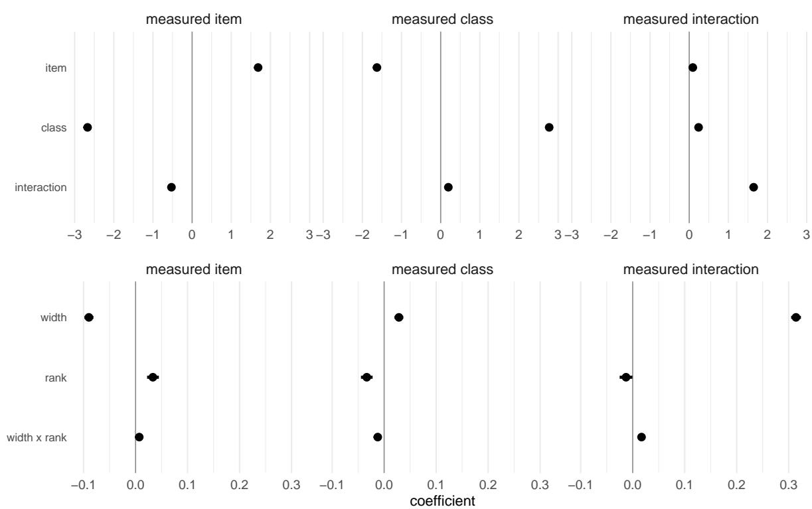  
Figure 8: Coefficient estimates from the size model (Equation 3), one panel per measured component. The upper block holds the planted effect sizes and the lower the architecture terms, which are on a much smaller scale and so are drawn on their own axis. Points are posterior medians with 95% intervals.

## D.2 Overlap models

Table 12 reports every coefficient of the overlap model (Equation 3).

<table><tr><td>arm</td><td>measure</td><td>term</td><td>estimate</td><td>error</td><td>95% CI</td><td>P(b&gt; 0)</td></tr><tr><td>relu</td><td>item_class</td><td>item</td><td>-0.51</td><td>0.04</td><td>[-0.59, -0.42]</td><td>0.00</td></tr><tr><td></td><td>int_margins</td><td>item</td><td>-0.96</td><td>0.04</td><td>[-1.05, -0.88]</td><td>0.00</td></tr><tr><td></td><td>item_class</td><td>class</td><td>-1.62</td><td>0.05</td><td>[-1.71, -1.53]</td><td>0.00</td></tr><tr><td></td><td>int_margins item_class</td><td>class</td><td>-0.62</td><td>0.05 0.04</td><td>[-0.71, -0.53]</td><td>0.00</td></tr><tr><td></td><td></td><td>interaction</td><td>0.31</td><td></td><td>[0.23, 0.39]</td><td>1.00</td></tr><tr><td></td><td>int_margins</td><td>interaction</td><td>-0.57</td><td>0.04</td><td>[-0.65, -0.49]</td><td>0.00</td></tr><tr><td></td><td>item_class</td><td>width</td><td>-0.38</td><td>0.01</td><td>[-0.40, -0.37]</td><td>0.00</td></tr><tr><td></td><td>int_margins</td><td>width</td><td>-0.30</td><td>0.01</td><td>[-0.32, -0.29]</td><td>0.00</td></tr><tr><td></td><td>item_class</td><td>rank</td><td>-0.03</td><td>0.01</td><td>[-0.04, -0.01]</td><td>0.00</td></tr><tr><td></td><td>int_margins item_class</td><td>rank width x rank</td><td>-0.03</td><td>0.01</td><td>[-0.05, -0.02] [-0.03, -0.00]</td><td>0.00</td></tr><tr><td></td><td>int_margins</td><td>width x rank</td><td>-0.01</td><td>0.01</td><td></td><td>0.00</td></tr><tr><td></td><td>item_class</td><td>item x width</td><td>-0.02</td><td>0.01</td><td>[-0.04, -0.01]</td><td>0.00</td></tr><tr><td></td><td>int_margins</td><td></td><td>-0.30</td><td>0.03</td><td>[-0.37, -0.23]</td><td>0.00</td></tr><tr><td></td><td>item_class</td><td>item x width</td><td>-0.39</td><td>0.03</td><td>[-0.46, -0.33]</td><td>0.00</td></tr><tr><td></td><td>int_margins</td><td>class x width</td><td>0.37</td><td>0.04</td><td>[0.29, 0.44]</td><td>1.00</td></tr><tr><td></td><td></td><td>class x width</td><td>0.12</td><td>0.04</td><td>[0.04, 0.19]</td><td>1.00</td></tr><tr><td></td><td>item_class</td><td>interaction x width</td><td>0.34</td><td>0.03</td><td>[0.27, 0.40]</td><td>1.00</td></tr><tr><td></td><td>int_margins</td><td>interaction x width</td><td>0.04</td><td>0.03</td><td>[-0.03, 0.10]</td><td>0.85</td></tr><tr><td></td><td>item_class</td><td>item x rank</td><td>0.12</td><td>0.03</td><td>[0.06, 0.18]</td><td>1.00</td></tr><tr><td></td><td>int_margins</td><td>item x rank</td><td>0.09</td><td>0.03</td><td>[0.03, 0.15]</td><td>1.00</td></tr><tr><td></td><td>item_class</td><td>class x rank</td><td>0.12</td><td>0.03</td><td>[0.05, 0.18]</td><td>1.00</td></tr><tr><td></td><td>int_margins</td><td>class x rank</td><td>0.04</td><td>0.03</td><td>[-0.03, 0.11]</td><td>0.88</td></tr><tr><td></td><td>item_class</td><td>interaction x rank</td><td>0.09</td><td>0.03</td><td>[0.03, 0.15]</td><td>1.00</td></tr><tr><td></td><td>int_margins</td><td>interaction x rank</td><td>0.04</td><td>0.03</td><td>[-0.02, 0.10]</td><td>0.92</td></tr><tr><td></td><td>item_class</td><td>item x width x rank</td><td>0.05</td><td>0.02</td><td>[0.00, 0.10]</td><td>0.98</td></tr><tr><td></td><td>int_margins</td><td>item x width x rank</td><td>0.06</td><td>0.02</td><td>[0.01, 0.11]</td><td>0.99</td></tr><tr><td></td><td>item_class</td><td>class x width x rank</td><td>0.02</td><td>0.03</td><td>[-0.03, 0.07]</td><td>0.77</td></tr><tr><td></td><td>int_margins</td><td>class x width x rank</td><td>0.01</td><td>0.03</td><td>[-0.04, 0.07]</td><td>0.69</td></tr><tr><td>linear</td><td>item_class</td><td>interaction x width x rank</td><td>-0.03</td><td>0.02</td><td>[-0.08, 0.02]</td><td>0.13</td></tr><tr><td></td><td>int_margins</td><td>interaction x width x rank</td><td>-0.04</td><td>0.03</td><td>[-0.09, 0.01]</td><td>0.04</td></tr><tr><td></td><td>item_class</td><td>item</td><td>-0.57</td><td>0.05</td><td>[-0.67, -0.47]</td><td>0.00</td></tr><tr><td></td><td>int_margins item_class</td><td>item</td><td>-1.71</td><td>0.05</td><td>[-1.81, -1.61]</td><td>0.00</td></tr><tr><td></td><td>int_margins</td><td>class</td><td>-0.49</td><td>0.05 0.05</td><td>[-0.59, -0.38] [-0.80, -0.58]</td><td>0.00</td></tr><tr><td></td><td>item_class</td><td>class</td><td>-0.69</td><td>0.05</td><td>[0.02, 0.22]</td><td>0.00</td></tr><tr><td></td><td>int_margins</td><td>interaction</td><td>0.12</td><td>0.05</td><td>[-0.52, -0.32]</td><td>0.99</td></tr><tr><td></td><td>item_class</td><td>interaction width</td><td>-0.42 -0.00</td><td>0.00</td><td>[-0.01, 0.01]</td><td>0.00</td></tr><tr><td></td><td>int_margins</td><td>width</td><td>0.11</td><td>0.00</td><td>[0.10, 0.11]</td><td>0.40</td></tr><tr><td></td><td>item_class</td><td>rank</td><td></td><td>0.01</td><td>[-0.06, -0.03]</td><td>1.00</td></tr><tr><td></td><td>int_margins</td><td>rank</td><td>-0.05</td><td>0.01</td><td>[-0.07, -0.03]</td><td>0.00</td></tr><tr><td></td><td>item_class</td><td>width x rank</td><td>-0.05</td><td>0.00</td><td>[-0.02, -0.01]</td><td>0.00</td></tr><tr><td></td><td>int_margins</td><td>width x rank</td><td>-0.02</td><td>0.00</td><td>[-0.03, -0.02]</td><td>0.00</td></tr><tr><td></td><td>item_class</td><td>item x width</td><td>-0.02</td><td>0.02</td><td>[0.21, 0.29]</td><td>0.00</td></tr><tr><td></td><td>int_margins</td><td></td><td>0.25</td><td>0.02</td><td>[-0.43, -0.36]</td><td>1.00</td></tr><tr><td></td><td>item_class</td><td>item x width</td><td>-0.40</td><td>0.02</td><td>[0.27, 0.36]</td><td>0.00</td></tr><tr><td></td><td>int_margins</td><td>class x width class x width</td><td>0.31</td><td>0.02</td><td>[-0.34, -0.26]</td><td>1.00</td></tr><tr><td></td><td>item_class</td><td>interaction x width</td><td>-0.30</td><td>0.02</td><td>[-0.13, -0.06]</td><td>0.00</td></tr><tr><td></td><td></td><td></td><td>-0.10</td><td>0.02</td><td>[-0.68, -0.61]</td><td>0.00</td></tr><tr><td></td><td>int_margins</td><td>interaction x width</td><td>-0.65</td><td></td><td></td><td>0.00</td></tr><tr><td></td><td>item_class</td><td>item x rank</td><td>0.04</td><td>0.04</td><td>[-0.03, 0.12]</td><td>0.88</td></tr><tr><td></td><td>int_margins</td><td>item x rank</td><td>0.07</td><td>0.04</td><td>[-0.01, 0.14]</td><td>0.96</td></tr><tr><td></td><td>item_class</td><td>class x rank</td><td>0.06</td><td>0.04</td><td>[-0.01, 0.14]</td><td>0.94</td></tr><tr><td></td><td>int_margins</td><td>class x rank</td><td>-0.01</td><td>0.04</td><td>[-0.09, 0.07]</td><td>0.40</td></tr><tr><td></td><td>item_class</td><td>interaction x rank</td><td>-0.23</td><td>0.04</td><td>[-0.30, -0.16]</td><td>0.00</td></tr><tr><td></td><td>int_margins</td><td>interaction x rank</td><td>-0.26</td><td>0.04 0.01</td><td>[-0.33, -0.19] [-0.02, 0.03]</td><td>0.00 0.67</td></tr><tr><td>int_margins</td><td>item_class</td><td>item x width x rank</td><td>0.01 0.01</td></table>

Table 12: Every coefficient of the overlap model (Equation 3), with Estimate, Estimated error, and 95% CIs.

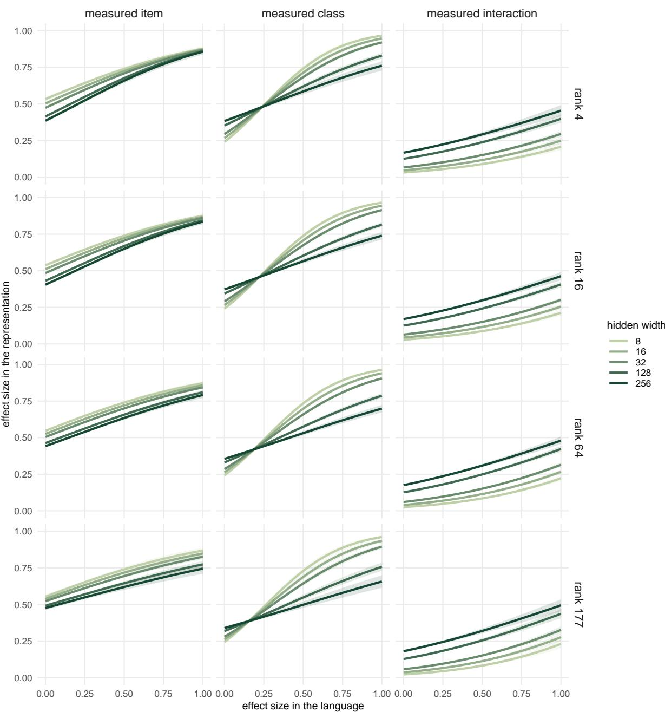  
Figure 9: Model results for the size model (Equation 3). Columns are the three measured components, rows are the planted interaction rank, and lines are hidden widths, with 95% intervals. Holding rank fixed within a row is what separates the width effect from the width-by-rank term; the near-identical rows show how little the rank changes it.

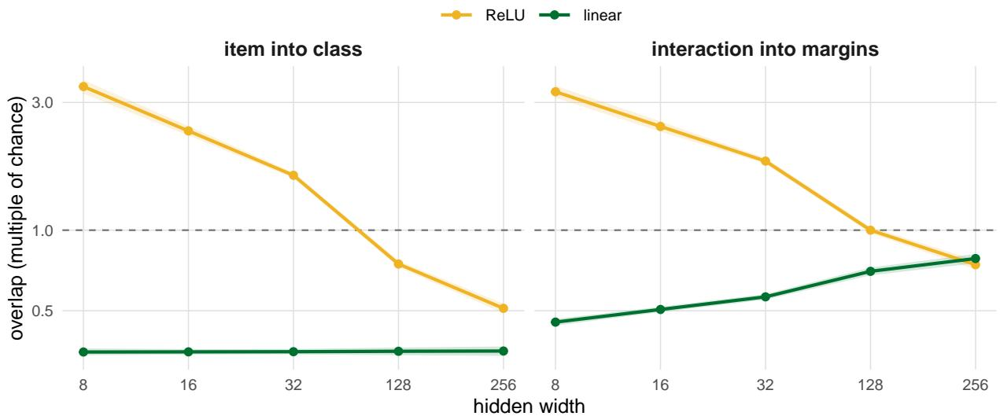  
Figure 10: Two overlap measurements as a function of width of the hidden layer. Left: the item effect projected onto the class direction. Right: the interaction projected onto the span of both margins. The dashed line is chance.

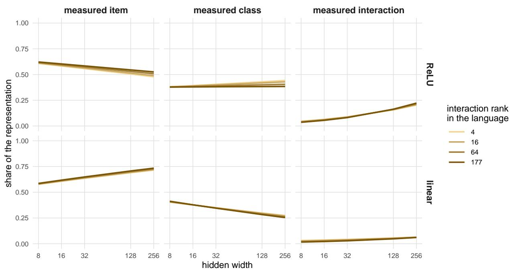  
Figure 11: Fraction of the representation by each component (such that they sum to 1), against hidden width, with one line per rank of the interaction planted in the language and 95% intervals.

## E Stimulus Counts

The six general-domain English Universal Dependencies treebanks (Nivre et al., 2020) we concatenate are EWT (Silveira et al., 2014), GUM (Zeldes, 2017), LinES (Ahrenberg, 2007), ParTUT (Sanguinetti and Bosco, 2015), GENTLE (Aoyama et al., 2023), and PUD (Zeman et al., 2017).

<table><tr><td>class</td><td>item types</td><td>median tokens</td></tr><tr><td>part of speech (noun / verb)</td><td>78</td><td>18 / 18</td></tr><tr><td>grammatical role (subject / object)</td><td>49</td><td>15 / 19</td></tr></table>

Table 13: Stimuli for the two linguistic categories, with the two classes of each in parentheses. Item types is how many word forms occur in both of them at least ten times; forms occurring in only one are excluded. Median tokens is how often a typical form occurs in each of its two classes, in the order they are listed.

## F Model Details

<table><tr><td>family</td><td>model</td><td>params</td><td>width</td><td>layers</td><td>training data</td><td>tokens</td></tr><tr><td rowspan="3">BabyLM</td><td>opt-babylm-125m</td><td>125M</td><td>768</td><td>12</td><td>BabyLM (child-available)</td><td>~3B</td></tr><tr><td>opt-babylm-350m</td><td>350M</td><td>1024</td><td>24</td><td>BabyLM (child-available)</td><td>~3B</td></tr><tr><td>opt-babylm-1.3B</td><td>1.3B</td><td>2048</td><td>24</td><td>BabyLM (child-available)</td><td>~3B</td></tr><tr><td rowspan="3">Pythia</td><td>pythia-160m</td><td>160M</td><td>768</td><td>12</td><td>the Pile</td><td>~300B</td></tr><tr><td>pythia-410m</td><td>410M</td><td>1024</td><td>24</td><td>the Pile</td><td>~300B</td></tr><tr><td>pythia-1.4b</td><td>1.4B</td><td>2048</td><td>24</td><td>the Pile</td><td>~300B</td></tr></table>

Table 14: The six models, paired by width. Training-token counts are approximate; the OPT-BabyLM models train for 20 epochs over a 100M-word corpus, which is roughly 150M tokens, so their effective token exposure is about twenty times that.

The six models are listed in Table 14. The two families are matched on width rather than on parameter count, which is what the measure is sensitive to: the chance level for overlap is the class subspace rank over the width, so a comparison across models of different width has to be read against different chance levels. Pairing at 768, 1024, and 2048 removes that from the family comparison.

Beyond width, the families differ in the size of their training corpora, by more than two orders of magnitude, which is the manipulation of interest.

## G Standardizing the Hidden States

Rogue dimensions could in principle affect what we measure. Table 15 reports part of speech at the deepest layer, measured both with and without the per-dimension rescaling.

<table><tr><td></td><td colspan="2">interaction</td><td colspan="2">class effect</td><td colspan="2">item-class overlap</td></tr><tr><td>model</td><td>std</td><td>raw</td><td>std</td><td>raw</td><td>std</td><td>raw</td></tr><tr><td>BabyLM 125M</td><td>0.095</td><td>0.095</td><td>0.072</td><td>0.074</td><td>0.0052</td><td>0.0053</td></tr><tr><td>BabyLM 350M</td><td>0.122</td><td>0.122</td><td>0.066</td><td>0.068</td><td>0.0056</td><td>0.0061</td></tr><tr><td>BabyLM 1.3B</td><td>0.104</td><td>0.104</td><td>0.050</td><td>0.051</td><td>0.0035</td><td>0.0036</td></tr><tr><td>Pythia 160M</td><td>0.231</td><td>0.228</td><td>0.078</td><td>0.089</td><td>0.0058</td><td>0.0081</td></tr><tr><td>Pythia 410M</td><td>0.244</td><td>0.242</td><td>0.098</td><td>0.123</td><td>0.0067</td><td>0.0195</td></tr><tr><td>Pythia 1.4B</td><td>0.242</td><td>0.238</td><td>0.086</td><td>0.124</td><td>0.0055</td><td>0.0234</td></tr></table>

Table 15: Part of speech at the deepest layer, measured with and without the per-dimension rescaling. Sizes are shares of the item-by-class structure; overlaps are the raw fractions, not multiples of chance.

## H Deepest-Layer Measurements

Table 16 gives the results of the overlap measurement at the final layer along with the null.
<table><tr><td>class</td><td>model</td><td>item-class overlap</td><td>its null</td><td>interaction overlap</td><td>its null</td></tr><tr><td>part of speech</td><td>BabyLM 125M</td><td>0.0052 (4.2×)</td><td>0.0012</td><td>0.178 (3.5×)</td><td>0.051</td></tr><tr><td></td><td>BabyLM 350M</td><td>0.0056 (5.9×)</td><td>0.0010</td><td>0.166 (4.3×)</td><td>0.039</td></tr><tr><td></td><td>BabyLM 1.3B</td><td>0.0035 (7.6×)</td><td>0.0005</td><td>0.106 (4.8×)</td><td>0.022</td></tr><tr><td></td><td>Pythia 160M</td><td>0.0058 (4.6×)</td><td>0.0013</td><td>0.231 (4.2×)</td><td>0.055</td></tr><tr><td></td><td>Pythia 410M</td><td>0.0067 (6.9×)</td><td>0.0010</td><td>0.239 (6.1×)</td><td>0.039</td></tr><tr><td></td><td>Pythia 1.4B</td><td>0.0055 (11.3×)</td><td>0.0005</td><td>0.209 (9.7×)</td><td>0.021</td></tr><tr><td>grammatical role</td><td>BabyLM 125M</td><td>0.0054 (4.0×)</td><td>0.0013</td><td>0.118 (3.5×)</td><td>0.034</td></tr><tr><td></td><td>BabyLM 350M</td><td>0.0051 (5.5×)</td><td>0.0009</td><td>0.102 (4.0×)</td><td>0.025</td></tr><tr><td></td><td>BabyLM 1.3B</td><td>0.0033 (6.7×)</td><td>0.0005</td><td>0.071 (4.7×)</td><td>0.015</td></tr><tr><td></td><td>Pythia 160M</td><td>0.0049 (3.9×)</td><td>0.0012</td><td>0.179 (5.3×)</td><td>0.034</td></tr><tr><td></td><td>Pythia 410M</td><td>0.0047 (4.9×)</td><td>0.0010</td><td>0.161 (6.5×)</td><td>0.025</td></tr><tr><td></td><td>Pythia 1.4B</td><td>0.0062 (13.0×)</td><td>0.0005</td><td>0.141 (11.2×)</td><td>0.013</td></tr></table>

Table 16: Overlap measurement and the null values at the final layer of each model. Each overlap is the fraction of one component lying inside another’s subspace: the item effect inside the class subspace, the interaction inside the span of the two main effects. Each is followed by the overlap divided by its own null, so 4.2x means the overlap is 4.2 times what random orientation gives.

Table 17 reports each component’s share at the final hidden layer alongside the same measurement after the unembedding, on the same tokens. A hidden layer is only meaningful relative to what reads it, and a linear map whose gain differs across directions does not preserve shares, so the two need not agree. The interaction’s share is close to stable in both categories, moving by at most 0.045, so the claims we make about it do not depend on where it was measured. The main effects shift somewhat for part of speech, where the class effect takes a larger share of the structure after the unembedding than it holds in the hidden layer.

<table><tr><td></td><td></td><td colspan="2">item effect</td><td colspan="2">class effect</td><td colspan="2">interaction</td></tr><tr><td>class</td><td>model</td><td>hidden</td><td>output</td><td>hidden</td><td>output</td><td>hidden</td><td>output</td></tr><tr><td>part of speech</td><td>BabyLM 125M</td><td>0.832</td><td>0.751</td><td>0.069</td><td>0.142</td><td>0.099</td><td>0.107</td></tr><tr><td></td><td>BabyLM 350M</td><td>0.810</td><td>0.721</td><td>0.064</td><td>0.146</td><td>0.126</td><td>0.134</td></tr><tr><td></td><td>BabyLM 1.3B</td><td>0.843</td><td>0.757</td><td>0.049</td><td>0.123</td><td>0.108</td><td>0.120</td></tr><tr><td></td><td>Pythia 160M</td><td>0.688</td><td>0.577</td><td>0.077</td><td>0.143</td><td>0.235</td><td>0.280</td></tr><tr><td></td><td>Pythia 410M</td><td>0.656</td><td>0.619</td><td>0.095</td><td>0.121</td><td>0.248</td><td>0.260</td></tr><tr><td></td><td>Pythia 1.4B</td><td>0.670</td><td>0.614</td><td>0.084</td><td>0.135</td><td>0.246</td><td>0.251</td></tr><tr><td>grammatical role</td><td>BabyLM 125M</td><td>0.903</td><td>0.901</td><td>0.050</td><td>0.057</td><td>0.047</td><td>0.042</td></tr><tr><td></td><td>BabyLM 350M</td><td>0.890</td><td>0.887</td><td>0.050</td><td>0.062</td><td>0.060</td><td>0.051</td></tr><tr><td></td><td>BabyLM 1.3B</td><td>0.894</td><td>0.884</td><td>0.039</td><td>0.052</td><td>0.067</td><td>0.063</td></tr><tr><td></td><td>Pythia 160M</td><td>0.828</td><td>0.904</td><td>0.078</td><td>0.026</td><td>0.094</td><td>0.070</td></tr><tr><td></td><td>Pythia 410M</td><td>0.838</td><td>0.844</td><td>0.074</td><td>0.071</td><td>0.088</td><td>0.084</td></tr><tr><td></td><td>Pythia 1.4B</td><td>0.828</td><td>0.830</td><td>0.078</td><td>0.081</td><td>0.094</td><td>0.089</td></tr></table>

Table 17: Each component’s share of the item-by-class structure at the final hidden layer and after the unembedding, measured on identical tokens. Both members of a pair are point estimates from one run, which is what makes them comparable to each other; they therefore sit about 0.003 from the re-split medians quoted elsewhere.

## H.1 How much of a token the components account for

The fraction of squared length reported for each measurement demonstrates how much a representation comprises item, class, or interaction components relative to each other. However, it does not say how much of the entire representation comprises that information. In this section, we calculate how much of the overall representation each component takes up (Table 18). We operationalize this by estimating how much of a token’s hidden state each one accounts for as the reduction in squared error against guessing the grand mean. The components are orthogonal, so their contributions accumulate, and the three do not sum to the whole, since most of what varies in a token is the context it appears in.

<table><tr><td>class</td><td>model</td><td>word</td><td>class effect</td><td>interaction</td></tr><tr><td>part of speech</td><td>BabyLM 125M</td><td>36.3</td><td>3.1</td><td>4.2</td></tr><tr><td></td><td>BabyLM 350M</td><td>31.2</td><td>2.5</td><td>4.7</td></tr><tr><td></td><td>BabyLM 1.3B</td><td>25.8</td><td>1.5</td><td>3.2</td></tr><tr><td></td><td>Pythia 160M</td><td>22.4</td><td>2.5</td><td>7.5</td></tr><tr><td></td><td>Pythia 410M</td><td>20.3</td><td>3.0</td><td>7.6</td></tr><tr><td></td><td>Pythia 1.4B</td><td>18.8</td><td>2.4</td><td>6.8</td></tr><tr><td>grammatical role</td><td>BabyLM 125M</td><td>38.4</td><td>2.1</td><td>1.9</td></tr><tr><td></td><td>BabyLM 350M</td><td>33.0</td><td>1.8</td><td>2.2</td></tr><tr><td></td><td>BabyLM 1.3B</td><td>25.9</td><td>1.1</td><td>1.9</td></tr><tr><td></td><td>Pythia 160M</td><td>28.0</td><td>2.6</td><td>3.1</td></tr><tr><td></td><td>Pythia 410M</td><td>27.5</td><td>2.4</td><td>2.9</td></tr><tr><td></td><td>Pythia 1.4B</td><td>24.9</td><td>2.4</td><td>2.8</td></tr></table>

Table 18: How much of a token’s hidden state each component accounts for, at the deepest layer, as the percentage reduction in squared error against guessing the grand mean.

## I Ruling Out Context

Because our stimuli use the same tokens across classes, the two uses of an item at the word position differ only in their left contexts. The item-by-class interaction could therefore reflect differences in context rather than lexical structure built by the model. To test this possibility, we estimate how much of the interaction can be predicted from the left context alone.

In a causal model, the hidden state at a word position depends on the current word and the preceding context. We approximate the contribution of the preceding context using a linear map, $h _ { t } \approx W h _ { t - 1 }$ , which predicts the next state from the previous one. We fit a separate map at each layer using empirical-Bayes ridge regression, with the regularization strength selected by evidence optimization. Crucially, we train each map on token pairs whose target words are not among the items in our analysis. The map therefore estimates context carry-over without being trained on the items to which we apply it.

We then apply this map to the preceding-word states used to compute the interaction, yielding the interaction predicted by context alone. To measure the similarity between the actual and predicted interactions, we calculate their squared cosine similarity. We estimate the overlap between the two interactions by averaging the dot products between the predicted interaction from one split and the actual interaction from the other. We then divide the squared overlap by the product of the two interactions sizes, with each size estimated by the dot product between its two independent splits. Using cross-split dot products ensures that the estimates reflect shared structure rather than noise specific to either split. We call the resulting value the context-explained share; its complement, the word-built share, is the portion not explained by this item-independent prediction.

Across all six models and both categories, the context explains only a small part of the interaction at the deepest layer (Table 19). The word-built share runs 0.79–0.92, while the context-explained share runs 0.08–0.21. A null control that mismatches items before the comparison yields values indistinguishable from zero (at most 0.000 in absolute value). At shallower layers, the context-explained share is larger in the OPT-BabyLM models, reaching 0.44 at a quarter of model depth, but decreases with depth. In Pythia, it remains small throughout. Thus, the interaction cannot be explained as a linear prediction from the preceding context alone, using the same standard of linear decodability applied to the probe in Experiment 3.7

A simpler magnitude control yields a consistent result. Applying the same decomposition to the pre-word state, which represents the context before the target word is encountered, produces a smaller interaction relative to the overall representation. This proportion also remains flat across depth, unlike the interaction at the word position, which grows with depth.

<table><tr><td>model</td><td>word-built</td><td>context</td><td>null</td></tr><tr><td>POS (noun/verb)</td><td></td><td></td><td></td></tr><tr><td>BabyLM 125M</td><td>0.85 [0.82, 0.88]</td><td>0.15</td><td>-0.00</td></tr><tr><td>Pythia 160M</td><td>0.86 [0.83, 0.87]</td><td>0.14</td><td>-0.00</td></tr><tr><td>BabyLM 350M</td><td>0.89 [0.86, 0.91]</td><td>0.11</td><td>-0.00</td></tr><tr><td>Pythia 410M</td><td>0.81 [0.77, 0.83]</td><td>0.19</td><td>-0.00</td></tr><tr><td>BabyLM 1.3B</td><td>0.89 [0.87, 0.91]</td><td>0.11</td><td>-0.00</td></tr><tr><td>Pythia 1.4B</td><td>0.79 [0.75, 0.81]</td><td>0.21</td><td>-0.00</td></tr><tr><td>role (subject/object)</td><td></td><td></td><td></td></tr><tr><td>BabyLM 125M</td><td>0.85 [0.80, 0.90]</td><td>0.15</td><td>-0.00</td></tr><tr><td>Pythia 160M</td><td>0.92 [0.88, 0.95]</td><td>0.08</td><td>-0.00</td></tr><tr><td>BabyLM 350M</td><td>0.88 [0.83, 0.93]</td><td>0.12</td><td>-0.00</td></tr><tr><td>Pythia 410M</td><td>0.87 [0.82, 0.91]</td><td>0.13</td><td>-0.00</td></tr><tr><td>BabyLM 1.3B</td><td>0.88 [0.84, 0.92]</td><td>0.12</td><td>-0.00</td></tr><tr><td>Pythia 1.4B</td><td>0.87 [0.82, 0.92]</td><td>0.13</td><td>-0.00</td></tr></table>

Table 19: How much of the deepest-layer interaction is attributable to the left context, by model and category. Word-built is the share requiring word-dependent processing, with its bootstrap interval; context is the share an item-independent carry-over of the context predicts; null mismatches items before the comparison.