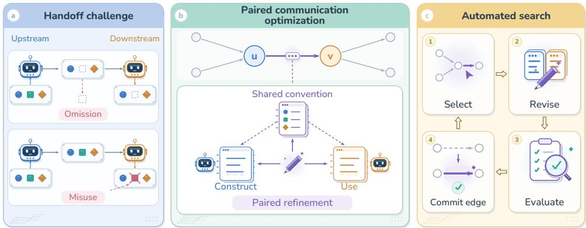
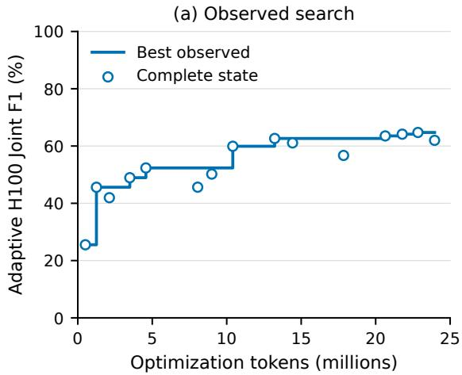
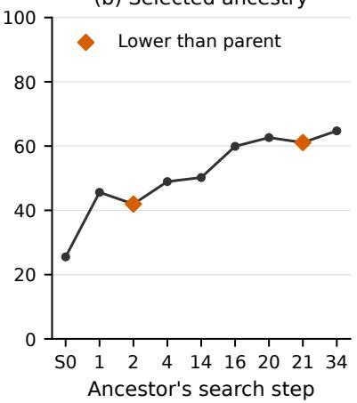

# FROM AGENTS TO EDGES: PAIRED OPTIMIZATION FOR MULTI-AGENT COLLABORATION

Feng Lin, Xiaotian Yu, Yifan Yang, Aijun Li Intellifusion Inc.

## ABSTRACT

Strong individual agents do not guarantee effective collaboration. Communication must align what one agent conveys with how another interprets and uses it. This dependency makes the communication edge a natural unit of optimization. We introduce Paired Automated Communication Optimization (PACO), which jointly optimizes the instructions at both ends of each edge and their shared communication convention in systems built on black-box language models. PACO keeps model weights, agent roles, and workflow topology fixed. A state-aware discounted bandit selects edges for refinement, while execution feedback guides paired revisions evaluated through staged end-to-end execution. The optimized instructions integrate into existing agent prompts without additional model calls at deployment. On a four-agent workflow evaluated across diverse multi-agent benchmarks, PACO consistently outperforms leading prompt-optimization and communication baselines. Configurations learned on HotpotQA retain their advantage in cross-dataset transfer without target-specific optimization. These results demonstrate that optimizing how agents communicate can substantially improve collaboration within an otherwise fixed system.

## 1 INTRODUCTION

Multi-agent systems (MAS) built on large language models (LLMs) distribute complex tasks across specialized agents, with applications in software development (Qian et al., 2024), GPU kernel optimization (Luo et al., 2026), web automation (Fourney et al., 2024), and scientific discovery (Swanson et al., 2025). Their effectiveness depends on more than the quality of individual agents: each handoff determines the context available for subsequent reasoning. When agents have different information access or responsibilities, a correct intermediate result may still be insufficient if its evidence, constraints, or uncertainty are omitted or misinterpreted downstream (Cemri et al., 2025). Such failures can undermine the benefit of specialization even when the underlying models are capable. We study how to improve these handoffs within a fixed workflow by optimizing the instructions that govern context construction and use.

To illustrate this problem, consider a simple distributed averaging task, following the classical distinction between local aggregates and the intermediate information needed to combine them (Gray et al., 1997). An upstream agent observes two values, 10 and 10, and correctly reports a local mean of 10. A downstream agent holds another value, 100, and must compute the mean across all three observations. If the message contains only the local mean, the downstream agent lacks the sample count needed to weight it correctly. Even if that count is provided, averaging the two means without weighting yields 55 instead of the correct result, 40. The relevant dependency spans two agents: the upstream agent must provide the information required by the aggregation rule, and the downstream agent must apply that rule consistently. This motivates grouping the instructions governing a handoff into one optimization unit.

Existing approaches improve collaboration through workflow search (Zhang et al., 2025c;a), communication protocols and message representations (Huang et al., 2026; Gupta et al., 2026), and agent or component prompt optimization (Agrawal et al., 2026; Wang et al., 2026; Hong et al., 2026). Several already account explicitly for interactions: MAPRO models compatibility between agent prompts (Zhang et al., 2026), MASPOB supports block-coordinate updates of adjacent agents (Hong et al., 2026), and AgentAsk introduces edge-level clarification during execution (Lin et al., 2026). These advances motivate a more specific question: how should communication-dependent instructions be grouped for optimization? We organize them around a directed edge, combining the upstream agent’s outgoing instructions, the downstream agent’s incoming instructions, and their shared communication convention into one editable package. This parameterization makes the handoff itself an explicit search variable while keeping role instructions and other communication blocks fixed during an ordinary edge update.

  
Figure 1: Overview of PACO. (a) Task context can be omitted during handoff or misused downstream. (b) PACO jointly optimizes upstream and downstream instructions together with their shared communication convention. (c) An automated loop selects edges, refines paired instructions, evaluates candidates, and commits accepted revisions.

We introduce Paired Automated Communication Optimization (PACO), an edge-centric framework that automates communication-instruction refinement in multi-agent systems built on black-box LLMs. As illustrated in Figure 1, PACO jointly refines the upstream instructions for constructing task context, the downstream instructions for interpreting and using it, and their shared communication convention. A state-aware discounted bandit selects edges using configuration-specific search histories. Execution feedback guides two rounds of paired revision, allowing proposals to be refined after their effects are observed. Staged end-to-end evaluations screen candidates on small batches before evaluating selected candidates on the internal validation set. Throughout optimization, model weights, agent roles, topology, and information access remain fixed. The learned packages are incorporated into existing agent prompts, so deployment requires no additional message-rewriting or clarification calls.

Experiments on a four-agent workflow across three question-answering benchmarks (Yang et al., 2018; Dua et al., 2019; Trivedi et al., 2022) demonstrate the value of optimizing communication. PACO consistently outperforms leading prompt-optimization and communication baselines, improving HotpotQA Joint F1 by over 30 points relative to the unoptimized workflow. Configurations learned on HotpotQA retain their advantage under cross-dataset transfer without target-specific optimization, with a gain of nearly 6 Answer F1 points over GEPA on DROP, the strongest evaluated baseline. Controlled ablations support the value of paired refinement and assess the search components, while execution analyses characterize changes in reference preservation and downstream interpretation.

Our main contributions are:

• From agents to edges. We parameterize each handoff as a package of upstream instructions, downstream instructions, and a shared communication convention, aligning the optimization unit with the dependency between context construction and use.

• Automated paired refinement. We introduce PACO, combining state-aware edge selection, execution-guided two-round revision, and staged end-to-end evaluation to optimize these packages under a token budget.

• Strong performance and cross-dataset transfer. PACO outperforms leading evaluated baselines while keeping model weights and the workflow fixed, and retains its advantage under transfer without target-specific optimization. Ablations and execution analyses provide complementary evidence for the effectiveness of paired communication optimization.

## 2 PROBLEM FORMULATION

## 2.1 MULTI-AGENT SYSTEMS WITH FIXED TOPOLOGY

We consider a multi-agent system represented by a fixed directed acyclic graph $G = ( V , E )$ , where each node $v \in V$ is an LLM-based agent and each edge $( u , v ) \in E$ carries task context from agent u to agent v. For a task input x, let $x _ { v }$ denote the information available to agent v under its fixed access rules. Agents execute in topological order. The context received by agent v is

$$
C _ { v } = \bigoplus _ { u \in \mathrm { P r e d } ( v ) } m _ { u  v } ,\tag{1}
$$

where Pred(v) is the set of its immediate predecessors, $m _ { u  v }$ is the message delivered from u to v, and $\oplus$ denotes concatenation in a fixed order. Messages are obtained from upstream outputs through the workflow’s fixed routing rules; source agents receive no upstream context.

Let Θ denote the system’s communication-instruction configuration. Agent v generates its output according to

$$
o _ { v } \sim f _ { v } ( \cdot \mid b _ { v } , p _ { v } ( \Theta ) , x _ { v } , C _ { v } ) ,\tag{2}
$$

where $f _ { v }$ is its fixed black-box generation mechanism, $b _ { v }$ contains its fixed role instructions, and $p _ { v } ( \Theta )$ denotes the communication instructions induced by Θ. These instructions govern how the agent interprets incoming context and constructs outgoing context. The complete workflow produces a final prediction $\hat { y } = F _ { G } ( x ; \Theta , \xi )$ , where $\xi$ captures execution randomness.

## 2.2 COMMUNICATION OPTIMIZATION

Let Ω be the space of admissible communication configurations. Across this space, model weights, agent roles, topology, tool permissions, information access, and output-scoring rules remain fixed. Given a task distribution D and a task scorer $q ( \hat { y } , y ) \in [ 0 , 1 ]$ , our objective is

$$
\begin{array} { r l } & { \Theta ^ { \star } \in \arg \underset { \Theta \in \Omega } { \operatorname* { m a x } } J ( \Theta ) , } \\ & { J ( \Theta ) = \mathbb { E } _ { ( x , y ) \sim \mathcal { D } , \xi } \left[ q ( F _ { G } ( x ; \Theta , \xi ) , y ) \right] . } \end{array}\tag{3}
$$

Here y denotes reference information available only to the evaluator. The objective measures end-toend task quality rather than isolated agent outputs or message-format compliance.

In practice, J is estimated through executions on a finite optimization set, separate from the final test set. Search operates under an optimization-token budget B covering candidate generation and workflow evaluation. The budget constrains search expenditure, while task quality remains the optimization objective. The instructions are discrete, and their effects are assessed through black-box executions. Moreover, the objective is coupled across agents: changing upstream communication alters the context on which downstream reasoning depends. The next section introduces PACO’s edge-based parameterization of Θ and its automated optimization procedure.

## 3 PAIRED AUTOMATED COMMUNICATION OPTIMIZATION

We present PACO’s communication parameterization and optimization procedure, with the complete algorithm provided in Appendix A (Algorithm 1).

## 3.1 PAIRED COMMUNICATION PARAMETERIZATION

For each edge $\boldsymbol { e } = ( u , v )$ , PACO defines a communication package

$$
\theta _ { e } = ( s _ { e } , r _ { e } , c _ { e } , \ell _ { e } ) , \qquad \Theta = ( \theta _ { e } ) _ { e \in E } .\tag{4}
$$

Its three behavioral components are upstream instructions $s _ { e }$ for constructing task context, downstream instructions $r _ { e }$ for interpreting and using it, and a shared convention $c _ { e }$ specifying common meanings and expectations. The additional attribute $\ell _ { e }$ specifies the message representation, such as natural language or a typed record.

These packages determine the communication instructions $p _ { v } ( \Theta )$ introduced in Section 2.1:

$$
p _ { v } ( \Theta ) = \bigoplus _ { e \in \mathrm { I n } ( v ) } \mathsf { R e c v } ( \theta _ { e } ) \oplus \bigoplus _ { e \in \mathrm { O u t } ( v ) } \mathsf { S e n d } ( \theta _ { e } ) .\tag{5}
$$

Here $\operatorname { I n } ( v )$ and $\operatorname { O u t } ( v )$ are the incoming and outgoing edges of $v .$ The fixed renderers Recv and Send assemble the corresponding endpoint instructions and shared convention into incoming and outgoing prompt blocks. The blocks specify how to interpret and construct the chosen representation; representation information may be conveyed through the instructions and convention rather than a standalone $\ell _ { e }$ field. Blocks follow a fixed order, and absent blocks are omitted.

The complete agent input integrates these communication blocks with existing prompt components:

$$
\pi _ { v } ^ { \mathrm { f u l l } } = \mathsf { A s s e m b l e } \left( \pi _ { v } ^ { \mathrm { f i x e d } } , p _ { v } ( \Theta ) , x _ { v } , C _ { v } \right) .\tag{6}
$$

The fixed components include general instructions, the role instructions $b _ { v }$ , task-instruction templates, and output requirements. Assemble denotes the workflow’s fixed prompt-construction procedure. The templates remain unchanged during optimization, while the task input $x _ { v }$ and upstream context $C _ { v }$ vary across executions. Communication modules enter the agents’ existing model calls.

An ordinary update to $\boldsymbol { e } = \left( u , v \right)$ permits coordinated changes to u’s outgoing guidance, v’s incoming guidance, and their shared convention, while keeping other instruction blocks fixed. Agent outputs may still change as context propagates. Each edge package is proposed, installed, and evaluated as a unit; individual fields need not change in every candidate. The conventions are soft: intermediate format diagnostics do not suppress otherwise available message text.

## 3.2 CANDIDATE POOL AND SELECTION

Inspired by GEPA’s candidate-pool design (Agrawal et al., 2026), PACO maintains a pool $\mathcal { P }$ of complete communication configurations, each comprising the packages of all edges. The pool starts with the initial configuration $\Theta _ { 0 }$ and retains evaluated configurations with complementary performance on the internal validation set H drawn from the optimization data. This preserves multiple starting points for refinement, including configurations that excel on different examples.

Among configurations satisfying the pool’s quality and uniqueness criteria, each example in H credits those attaining its best score. Redundant configurations are pruned while preserving coverage, and PACO samples a configuration $\Theta \in { \mathcal { P } }$ in proportion to its credits. The selected configuration serves as the parent for the next refinement step. The evaluation procedure is described in Section 3.5, with detailed pool admission and pruning rules provided in Appendix A.

## 3.3 STATE-AWARE EDGE SCHEDULING

Given a configuration Θ selected from the candidate pool, PACO treats each communication edge as a bandit arm and selects the edge to optimize using a rule inspired by discounted UCB (Garivier & Moulines, 2011). The scheduler balances revisiting edges whose revisions improved task performance with exploring edges that have been assessed less extensively.

For each configuration–edge pair $( \Theta , e )$ , the scheduler records the end-to-end gains $\delta _ { j }$ from previous refinement attempts, each estimated from $n _ { j }$ examples. Older observations receive less weight through $w _ { j } = \lambda ^ { d _ { j } }$ , where $0 < \lambda < 1$ and $d _ { j }$ counts the ordinary search steps taken from Θ since observation $j .$ The discounted reward sum and observation count are

$$
S _ { \Theta , e } = \sum _ { j } w _ { j } \delta _ { j } , \qquad N _ { \Theta , e } = \sum _ { j } w _ { j } .\tag{7}
$$

To account for differences in evaluation batch size, we also define $\begin{array} { r } { Q _ { \ \Theta , e } = \sum _ { i } w _ { j } g ( n _ { j } ) } \end{array}$ , where $g ( n _ { j } )$ assigns greater exploration weight to observations based on fewer examples. PACO selects the edge with the highest priority:

$$
\begin{array} { r l } & { e ^ { \star } \in \arg \underset { e \in E } { \operatorname* { m a x } } I _ { \Theta , e } , } \\ & { I _ { \Theta , e } = \underbrace { S _ { \Theta , e } } _ { \in \star \mathrm { i m a t e d } } + \alpha \underbrace { \sqrt { \log \left( 2 + \sum _ { a \in E } N _ { \Theta , a } \right) ( Q _ { \Theta , e } + \rho ) } } _ { ( N _ { \Theta , e } + \rho ) ^ { 2 } } . } \end{array}\tag{8}
$$

Here $\rho > 0$ regularizes sparse observations and $\alpha > 0$ controls exploration. The first term favors edges with higher discounted gains; the second encourages exploration based on the amount and evaluation batch sizes of past observations. The batch-size adjustment is heuristic rather than a calibrated confidence bound.

Histories are maintained separately for each configuration because an edge’s gains depend on the surrounding communication instructions. New configurations start with zero statistics, and discounting advances only when that configuration is selected for an ordinary search step. Reward come from the staged evaluations in Section 3.5. The specific discount factor, batch-size correction, and reward rules are given in Appendix B.

## 3.4 TWO-ROUND REFINEMENT

After selecting an edge $e ,$ PACO refines its communication package in two rounds. Feedback from the parent alone cannot reveal how proposed instructions will interact during execution. The second round therefore uses first-round execution feedback to address remaining or newly introduced mismatches in context construction and use. Each round may revise any subset of the package’s endpoint instructions, shared convention, and message representation, while proposing and evaluating the package as a unit. For an ordinary step, edits are restricted to $e ,$ and the parent Θ remains the evaluation reference throughout.

The parent first executes on a small pilot batch $D _ { \mathfrak { p } }$ . An LLM-based proposer uses the current package, fixed runtime constraints, and execution feedback to generate $K _ { 1 }$ candidate configurations $\{ \Theta ^ { ( 1 , k ) } \} _ { k = 1 } ^ { K _ { 1 } }$ , differing from the parent only within e. Valid candidates execute on the same pilot batch. The best scorable first-round candidate becomes $\Theta _ { \mathrm { b a s e } }$ . The proposer then generates $K _ { 2 }$ revisions $\{ \Theta ^ { ( 2 , k ) } \} _ { k = 1 } ^ { K _ { 2 } }$ from this base, informed by executions of the parent and first-round candidates. Valid candidates from both rounds remain eligible for subsequent selection.

The generation base and evaluation reference serve different purposes. Even if every first-round candidate regresses, the best scorable one can seed further refinement; all candidates are still assessed against the original parent. Invalid, duplicate, or unchanged candidates are filtered out, so the evaluated set may contain fewer than $K _ { 1 } + K _ { 2 }$ candidates. If no first-round candidate is scorable, the second round is skipped.

Feedback includes agent-visible inputs, exchanged messages, outcome categories, and eligible earlier execution cases. Reference answers, hidden reasoning, and per-example numerical verifier scores are excluded from proposer feedback. Within each refinement step, promotion evaluations occur after proposal generation and guide candidate selection. Their executions may inform later steps through historical search-set feedback, whereas evaluations on H are never used as proposal examples. We use $K _ { 1 } = K _ { 2 } = 2$ in our experiments.

## 3.5 STAGED END-TO-END EVALUATION

Candidates from both refinement rounds are evaluated within the complete workflow, capturing the downstream effects of communication revisions. Let $q _ { i } ( \Theta )$ be the observed task score on example i. The estimated gain of candidate $\Theta ^ { \prime }$ relative to the original parent Θ on an evaluation batch D is

$$
\Delta _ { D } ( \Theta ^ { \prime } ; \Theta ) = \frac { 1 } { | D | } \sum _ { i \in D } \left[ q _ { i } ( \Theta ^ { \prime } ) - q _ { i } ( \Theta ) \right] .\tag{9}
$$

Scores are paired by task example, while communication packages outside the permitted edit scope remain unchanged from the parent.

Evaluation proceeds through three stages. Disjoint pilot and promotion batches are drawn from search data separate from the internal validation set H. The pilot batch $D _ { \mathrm { p } }$ screens candidates from both rounds against a positive-gain threshold. A few survivors advance to the promotion batch $D _ { \mathrm { m } } .$ , where gains use only the new examples. The candidate with the highest positive promotion gain is then evaluated on H. This concentrates evaluation effort on promising candidates, guided throughout by end-to-end task performance.

Configurations with complete evaluations on H are archived and used to refresh the candidate pool (Section 3.2). Near-best configurations with complementary coverage may be retained even when their mean score is lower than their parent’s. Since H guides search and configuration selection, it belongs to the optimization data and remains separate from the final test set.

Each ordinary refinement step supplies at most one reward to the selected configuration’s edge bandit (Section 3.3), computed from the deepest valid evaluation stage. Evaluation settings and implementation details are provided in Appendix A.

## 3.6 COOPERATIVE REFINEMENT

Improving one edge may enable further coordination across the workflow. When an ordinary singleedge step achieves a new best mean score on the full internal validation set H, PACO triggers one cooperative refinement step, using the improved configuration as its parent. This step may revise multiple edge packages, following the same two-round refinement, staged evaluation, and pool admission rules. It neither updates the single-edge bandit nor triggers further cooperative refinement.

The overall search operates under a shared optimization-token budget. At its stopping boundary, PACO completes ongoing steps and freezes the configuration with the highest mean score on the full validation set H for testing. Algorithm 1 in Appendix A summarizes the complete procedure.

## 4 EXPERIMENTS

## 4.1 EXPERIMENTAL SETUP

Tasks and data. We evaluate on HotpotQA (Yang et al., 2018) and MuSiQue-Ans (Trivedi et al., 2022) for multi-hop reasoning, and DROP (Dua et al., 2019) for discrete reasoning over text. Optimization uses 500 HotpotQA examples: 400 for sampling pilot and promotion batches $( D _ { \mathrm { p } } , D _ { \mathrm { m } } )$ and 100 for internal validation (H). After optimization, the best configuration on H is frozen for evaluation on 800 HotpotQA questions and 400 questions per transfer dataset, without further optimization. Appendix C details data construction.

Workflow and initialization. We use a fixed four-agent chain: Scout → Resolver → Integrator → Verifier. All agents receive the question, but only the first two receive separate evidence shards. Messages are accessible only to the direct successor, making downstream reasoning dependent on context preserved across handoffs. PACO starts from the unoptimized (vanilla) workflow, with simple, generic instructions for context construction and use and basic edge-specific conventions suggesting typed records with soft formatting requirements. Role instructions and information access remain fixed throughout optimization. Appendix D provides the complete configuration.

Models and optimization. Workflow agents and the LLM-based proposer use gpt-5.6-luna with low and high reasoning effort, respectively. PACO uses a 25M-token optimization budget and optimizer seed 0, with model weights fixed throughout. Search hyperparameters and the complete algorithm appear in Appendix A.

Baselines and metrics. We compare with the unoptimized (vanilla) workflow; message-processing and communication approaches, including Faithful Rewriter and Task-Aware Rewriter with general preservation and task-specific instructions, respectively, LLMLingua-2 (Pan et al., 2024), OPTiMACS (Gupta et al., 2026), and PACT (Huang et al., 2026); and prompt optimizers MASPO, MASPOB, and GEPA (Wang et al., 2026; Hong et al., 2026; Agrawal et al., 2026). We report Joint, Answer, and Supporting Facts F1/EM on HotpotQA, Answer F1/EM for transfer, and optimization/deployment tokens in millions. Failed or invalid predictions receive zero, with all questions retained in the denominator. Implementation and accounting details appear in Appendices G.

## 4.2 IN-DOMAIN RESULTS

Table 1 shows that PACO leads on five of six quality metrics, gaining 31.26 Joint F1 points over vanilla and 1.98 over GEPA, the strongest baseline. Gains span answer quality and Supporting Facts F1, while GEPA retains a slight advantage in Supporting Facts EM. Prompt optimizers and PACT substantially outperform vanilla, whereas rewriting and compression do not improve Joint F1.

Table 1: HotpotQA performance and cost. Scores are percentages; parentheses show deploymenttoken changes relative to vanilla. Methods are grouped by optimization approach. Support denotes supporting-fact evaluation. Bold and underlined values mark the best and second-best scores.
<table><tr><td></td><td colspan="2">Joint ↑</td><td colspan="2">Answer ↑</td><td colspan="2">Support ↑</td><td colspan="2">Tokens (M)</td></tr><tr><td>Method</td><td>F1</td><td>EM</td><td>F1</td><td>EM</td><td>F1</td><td>EM</td><td>Opt.</td><td>Deploy.</td></tr><tr><td>Vanilla</td><td>30.00</td><td>8.88</td><td>41.64</td><td>29.63</td><td>38.68</td><td>15.75</td><td>0.00</td><td>3.91</td></tr><tr><td>Faithful Rewriter</td><td>29.36</td><td>8.25</td><td>41.16</td><td>30.63</td><td>37.95</td><td>14.75</td><td>0.00</td><td>6.84 (+75%)</td></tr><tr><td>Task-Aware Rewriter</td><td>24.35</td><td>7.00</td><td>33.82</td><td>25.00</td><td>30.92</td><td>11.38</td><td>0.00</td><td>8.60 (+120%)</td></tr><tr><td>LLMLingua-2 (Pan et al., 2024)</td><td>29.36</td><td>8.50</td><td>41.15</td><td>29.50</td><td>37.74</td><td>13.88</td><td>0.46</td><td>3.90 (−0.2%)</td></tr><tr><td>OPTiMACS (Gupta et al., 2026)</td><td>24.37</td><td>6.88</td><td>34.18</td><td>24.50</td><td>31.35</td><td>12.00</td><td>19.10</td><td>8.63 (+121%)</td></tr><tr><td>PACT (Huang et al., 2026)</td><td>46.43</td><td>11.63</td><td>65.51</td><td>47.38</td><td>58.46</td><td>20.50</td><td>0.00</td><td>4.10 (+5%)</td></tr><tr><td>MASPO (Wang et al., 2026)</td><td>37.97</td><td>17.13</td><td>46.35</td><td>36.50</td><td>45.78</td><td>25.50</td><td>24.27</td><td>7.23 (+85%)</td></tr><tr><td>MASPOB (Hong et al., 2026)</td><td>47.35</td><td>17.63</td><td>59.00</td><td>42.00</td><td>61.48</td><td>31.50</td><td>24.74</td><td>4.12 (+5%)</td></tr><tr><td>GEPA (Agrawal et al., 2026)</td><td>59.27</td><td>27.00</td><td>68.80</td><td>50.00</td><td>74.91</td><td>46.13</td><td>24.20</td><td>5.25 (+34%)</td></tr><tr><td>PACO (Ours)</td><td>61.26</td><td>28.88</td><td>72.15</td><td>54.75</td><td>75.75</td><td>45.88</td><td>23.96</td><td>5.21 (+33%)</td></tr></table>

Table 2: Transfer without further optimization. HotpotQA configurations are frozen for transfer. F1/EM measure answer quality; units and highlighting follow Table 1.
<table><tr><td rowspan="2">Method</td><td colspan="3">DROP</td><td colspan="3">MuSiQue-Ans</td></tr><tr><td>F1↑</td><td>EM↑</td><td>Deploy.</td><td>F1↑</td><td>EM↑</td><td>Deploy.</td></tr><tr><td>Vanilla</td><td>42.25</td><td>21.50</td><td>1.28</td><td>29.60</td><td>21.25</td><td>2.43</td></tr><tr><td>PACT (Huang et al., 2026)</td><td>45.46</td><td>27.25</td><td>1.47 (+15%)</td><td>37.94</td><td>28.50</td><td>2.52 (+4%)</td></tr><tr><td>MASPO (Wang et al., 2026)</td><td>15.70</td><td>9.50</td><td>2.84 (+122%)</td><td>25.12</td><td>19.50</td><td>4.08 (+68%)</td></tr><tr><td>MASPOB (Hong et al., 2026)</td><td>42.80</td><td>20.50</td><td>1.38 (+8%)</td><td>32.83</td><td>22.75</td><td>2.54 (+5%)</td></tr><tr><td>GEPA (Agrawal et al., 2026)</td><td>49.09</td><td>21.00</td><td>1.92 (+50%)</td><td>44.50</td><td>31.00</td><td>3.12 (+28%)</td></tr><tr><td>PACO (Ours)</td><td>54.95</td><td>35.75</td><td>1.86 (+45%)</td><td>45.06</td><td>35.75</td><td>3.11 (+28%)</td></tr></table>

Modifying messages without adapting downstream instructions may discard useful context or hinder its use. Among prompt optimizers, GEPA outperforms MASPOB and MASPO, potentially reflecting differences in candidate generation and evaluation. MASPO’s LLM-judged rewards may diverge from the task metric; MASPOB uses task scores but searches predefined prompt sets. GEPA combines taskscore-based evaluation with execution-informed prompt evolution and diverse candidate selection. PACO achieves higher task performance than GEPA while using slightly fewer tokens for both optimization and deployment.

## 4.3 CROSS-DATASET TRANSFER

Table 2 assesses the cross-dataset generalization of communication skills learned on HotpotQA, with configurations frozen and no target-specific optimization. PACO leads in Answer F1 and EM on both datasets, exceeding GEPA by 5.86 F1 points on DROP and 0.56 on MuSiQue-Ans. Its advantage on DROP suggests that these skills extend beyond multi-hop reasoning to discrete reasoning over text. In contrast, MASPO falls below vanilla on both datasets despite improving in-domain, showing that source-task gains do not necessarily transfer. PACO retains its advantage with slightly fewer deployment tokens than GEPA on both datasets, supporting the generalization of its communication skills without increased deployment cost.

## 4.4 ABLATION STUDY

All ablations use a 5M-token optimization budget, with other experimental settings unchanged. Table 3 examines the scope of communication refinement. Upstream-only and downstream-only variants fix the opposite endpoint and shared convention, while independent updates optimize all three components separately. PACO outperforms the two single-endpoint variants by 2.06 and 3.11

Table 3: Effect of paired refinement. Opt. denotes optimization tokens in millions.
<table><tr><td>Variant</td><td>Joint F1</td><td>Answer F1</td><td>Opt. (M)</td></tr><tr><td>PACO</td><td>49.35</td><td>59.36</td><td>4.57</td></tr><tr><td>Upstream only</td><td>47.29</td><td>56.78</td><td>4.78</td></tr><tr><td>Downstream only</td><td>46.24</td><td>55.71</td><td>4.67</td></tr><tr><td>Independent updates</td><td>48.42</td><td>58.25</td><td>4.91</td></tr></table>

Table 4: Effect of search components. Notation follows Table 3. ∗ denotes means over three runs.
<table><tr><td>Variant</td><td>Joint F1 Answer F1 Opt. (M)</td><td></td><td></td></tr><tr><td>PACO</td><td>49.35</td><td>59.36</td><td>4.57</td></tr><tr><td>Uniform edge selection</td><td>41.41*</td><td>51.02*</td><td>4.63*</td></tr><tr><td>Single-round refinement</td><td>48.57</td><td>59.11</td><td>4.55</td></tr></table>

Table 5: Making transaction direction explicit. Selected message excerpts; surrounding text is omitted. Both final predictions are valid. F1 scores are percentages.  
Question: To what team was the 2014 NBA Rookie of the Year traded in October 2016? Resolver’s local evidence: Michael Carter-Williams was named NBA Rookie of the Year in 2014.
<table><tr><td></td><td>Vanilla</td><td>PACO</td></tr><tr><td>Scout handoff</td><td>&quot;The Chicago Bulls traded Tony Snell to the Milwaukee Bucks for Michael Carter-Williams Carter-Williams → Chicago Bulls&quot; on October 17, 2016.&quot;</td><td>&quot;Tony Snell → Milwaukee Bucks; Michael</td></tr><tr><td>Resolver output</td><td>&quot;the incoming claim states he was traded to the Milwaukee Bucks in October 2016.&quot;</td><td>“therefore, Carter-Williams was traded to Chicago&quot;</td></tr><tr><td>Final answer</td><td>Milwaukee Bucks</td><td>Chicago Bulls</td></tr><tr><td>Answer / Joint F1</td><td>0/0</td><td>100 / 80</td></tr></table>

Both score 80 Supporting Facts F1, citing the same two facts and missing the third.

Joint F1 points, respectively. The stronger upstream-only result is consistent with the importance of supplying useful context, but improving either endpoint alone leaves gains unrealized. Independent updates narrow the gap yet remain 0.93 Joint F1 points below PACO despite using more optimization tokens, supporting the value of coordinated revisions.

Table 4 examines edge scheduling and two-round refinement. Uniform edge selection averages 41.41 Joint F1 across three runs, compared with PACO’s seed-0 result of 49.35 at similar optimization cost. Uniform selection occasionally yields much lower scores, whereas repeated PACO runs span less than 1.5 Joint F1 points. These observations suggest that adaptive scheduling makes optimization more reliable under a limited budget. Single-round refinement comes closer to PACO but scores 0.78 Joint F1 points lower, with a smaller gap in Answer F1, consistent with a modest benefit from first-round execution feedback.

## 4.5 CASE STUDY

Table 5 compares vanilla and frozen PACO on the same question, evidence shards, access permissions, and evaluation seed. Vanilla transmits the complete trade sentence, yet the Resolver reverses the transaction direction and the error persists downstream. PACO makes both destinations explicit and combines the handoff with local award evidence to answer correctly. Its learned sender instructions require each fact’s “subject, relation, object,” while the receiver checks each link using incoming and local evidence. Both runs return identical citations, so the score difference comes from answer correctness. This illustrates aligned context construction and use, without attributing the improvement to any single package component (Appendix E).

## 5 RELATED WORK

Workflow and topology optimization. Automated MAS design optimizes both agent behavior and system structure. GPTSwarm refines node prompts and graph connectivity (Zhuge et al., 2024), while AFlow and MaAS automate workflow construction and query-dependent architecture selection, respectively (Zhang et al., 2025c;a). MASS interleaves prompt and topology optimization (Zhou et al., 2026), and AgentPrune removes redundant connections from communication graphs (Zhang et al., 2025b). PACO complements these approaches by optimizing the communication instructions on existing edges while keeping topology fixed.

Prompt optimization for compound systems. DSPy and MIPRO optimize modular LM programs through demonstrations and instructions (Khattab et al., 2024; Opsahl-Ong et al., 2024); TextGrad and GEPA use textual feedback and execution reflection to refine system components, respectively (Yuksekgonul et al., 2025; Agrawal et al., 2026). For MAS, MASPO uses topology-aware prompt evolution with multilevel feedback, while MASPOB searches prompt combinations using a graphbased bandit surrogate (Wang et al., 2026; Hong et al., 2026). MAPRO explicitly models agent quality and handoff compatibility, combining MAP inference with topology-aware feedback to coordinate agent-prompt selection and refinement (Zhang et al., 2026). These methods account for component dependencies, with joint changes supported by GEPA’s merge operation and MASPOB’s block variant. PACO’s distinction is its optimization unit: the upstream instructions, downstream instructions, and shared convention of a communication edge are jointly proposed and evaluated as one package.

Communication protocols and learning. Communication can also be improved through message design, compression, and model training. PACT structures messages as compact action-state records (Huang et al., 2026), while OPTiMACS learns to select task-dependent message representations (Gupta et al., 2026). LLMLingua-2 learns token-level prompt compression (Pan et al., 2024), and Optima trains agents to balance task performance, communication efficiency, and readability (Chen et al., 2025). PACO learns communication skills through the instructions of black-box agents, requiring neither model updates nor additional message-rewriting calls.

## 6 LIMITATIONS

Evaluation scope. Experiments cover three question-answering benchmarks with one model family and a fixed four-agent chain; broader workflows remain untested. Feedback requirements. PACO relies on reliable task feedback and repeated end-to-end evaluations, limiting its use when evaluation is difficult or costly. Deployment cost. PACO prioritizes quality and increases deployment tokens over vanilla. Jointly optimizing quality, cost, and latency remains future work.

## 7 CONCLUSION

We presented PACO, an edge-centric framework that jointly optimizes upstream instructions, downstream instructions, and their shared communication convention in black-box multi-agent systems. With model weights and topology fixed, PACO combines adaptive edge selection with executionguided paired refinement and end-to-end candidate evaluation. Experiments demonstrate substantial improvements over vanilla and consistent gains over leading baselines, including GEPA. The learned communication skills retain their advantage across transfer benchmarks without target-specific optimization. Ablations support coordinated updates and adaptive edge selection under limited budgets, while the case study illustrates improved expression and interpretation of task-relevant relations. Together, these findings establish edge-centric paired optimization as an effective approach to multi-agent collaboration, aligning what agents convey with how their successors interpret and use it.

## AI USE STATEMENT

We used AI assistance to support manuscript preparation, including drafting, language polishing, LaTeX editing. The authors are responsible for verifying the accuracy of the text, references, and reported findings, and take full responsibility for the final manuscript.

## ETHICS STATEMENT

This study uses existing question-answering benchmarks and does not collect new data from human participants. PACO optimizes communication instructions while preserving agents’ predefined information access and tool permissions. Improved benchmark performance does not guarantee factual correctness or safe autonomous behavior, as erroneous information may still propagate through agent interactions.

## REPRODUCIBILITY STATEMENT

Sections 3 and 4.1 describe the method and experimental setup, with additional implementation and evaluation details in the appendix. We specify the workflow, model settings, data splits, optimization budgets, and scoring procedures. We will release the source code upon acceptance. Because execution relies on stochastic black-box models, identical configurations may not produce identical outputs across repeated runs.

## REFERENCES

Lakshya A. Agrawal, Shangyin Tan, Dilara Soylu, Noah Ziems, Rishi Khare, Krista Opsahl-Ong, Arnav Singhvi, Herumb Shandilya, Michael J. Ryan, Meng Jiang, Christopher Potts, Koushik Sen, Alexandros G. Dimakis, Ion Stoica, Dan Klein, Matei Zaharia, and Omar Khattab. GEPA: Reflective Prompt Evolution Can Outperform Reinforcement Learning. In International Conference on Learning Representations, 2026. URL https://iclr.cc/virtual/2026/oral/ 10009494.

Mert Cemri, Melissa Z. Pan, Shuyi Yang, Lakshya A. Agrawal, Bhavya Chopra, Rishabh Tiwari, Kurt Keutzer, Aditya Parameswaran, Dan Klein, Kannan Ramchandran, Matei Zaharia, Joseph E. Gonzalez, and Ion Stoica. Why do multi-agent LLM systems fail? In Advances in Neural Information Processing Systems, volume 38, 2025. URL https://proceedings.neurips.cc/paper\_files/paper/2025/ hash/b1041e52d3be19f0a9bc491657488e4a-Abstract-Datasets\_and\_ Benchmarks\_Track.html.

Weize Chen, Jiarui Yuan, Chen Qian, Cheng Yang, Zhiyuan Liu, and Maosong Sun. Optima: Optimizing effectiveness and efficiency for LLM-based multi-agent system. In Findings of the Association for Computational Linguistics: ACL 2025, pp. 11534–11557. Association for Computational Linguistics, 2025. doi: 10.18653/v1/2025.findings-acl.601. URL https:// aclanthology.org/2025.findings-acl.601/.

Dheeru Dua, Yizhong Wang, Pradeep Dasigi, Gabriel Stanovsky, Sameer Singh, and Matt Gardner. DROP: A reading comprehension benchmark requiring discrete reasoning over paragraphs. In Proceedings of NAACL-HLT, pp. 2368–2378, 2019. doi: 10.18653/v1/N19-1246. URL https: //aclanthology.org/N19-1246/.

Adam Fourney, Gagan Bansal, Hussein Mozannar, Cheng Tan, Eduardo Salinas, Erkang Zhu, Friederike Niedtner, Grace Proebsting, Griffin Bassman, Jack Gerrits, Jacob Alber, Peter Chang, Ricky Loynd, Robert West, Victor Dibia, Ahmed Awadallah, Ece Kamar, Rafah Hosn, and Saleema Amershi. Magentic-One: A generalist multi-agent system for solving complex tasks. arXiv preprint arXiv:2411.04468, 2024. URL https://arxiv.org/abs/2411.04468.

Aurelien Garivier and Eric Moulines. On upper-confidence bound policies for switching bandit ´ problems. In Algorithmic Learning Theory, volume 6925 of Lecture Notes in Computer Science, pp. 174–188. Springer, 2011. doi: 10.1007/978-3-642-24412-4 16.

Jim Gray, Surajit Chaudhuri, Adam Bosworth, Andrew Layman, Don Reichart, Murali Venkatrao, Frank Pellow, and Hamid Pirahesh. Data cube: A relational aggregation operator generalizing group-by, cross-tab, and sub-totals. Data Mining and Knowledge Discovery, 1(1):29–53, 1997.

Shashwat Gupta, Anson Bastos, Mayukh Das, Supriyo Ghosh, Nagarajan Natarajan, Chetan Bansal, and Saravan Rajmohan. Learning optimal message representations for agentic communication. In Findings of the Association for Computational Linguistics: ACL 2026, pp. 28849–28879, 2026. doi: 10.18653/v1/2026.findings-acl.1441. URL https://aclanthology.org/2026. findings-acl.1441/.

Zhi Hong, Qian Zhang, Jiahang Sun, Zhiwei Shang, Mingze Kong, Xiangyi Wang, Yao Shu, and Zhongxiang Dai. MASPOB: Bandit-based prompt optimization for multi-agent systems with graph neural networks. arXiv:2603.02630, 2026. URL https://arxiv.org/abs/2603.02630.

Chen Huang, Yuhao Wu, and Wenxuan Zhang. What should agents say? action-state communication for efficient multi-agent systems. arXiv:2606.05304, 2026. URL https://arxiv.org/abs/ 2606.05304.

Omar Khattab, Arnav Singhvi, Paridhi Maheshwari, Zhiyuan Zhang, Keshav Santhanam, Sri Vardhamanan, Saiful Haq, Ashutosh Sharma, Thomas T. Joshi, Hanna Moazam, Heather Miller, Matei Zaharia, and Christopher Potts. DSPy: Compiling declarative language model calls into selfimproving pipelines. In The Twelfth International Conference on Learning Representations, 2024. URL https://arxiv.org/abs/2310.03714.

Bohan Lin, Kuo Yang, Zelin Tan, Yingchuan Lai, Chen Zhang, Guibin Zhang, Xinlei Yu, Miao Yu, Xu Wang, Yudong Zhang, et al. Agentask: Multi-agent systems need to ask. In Proceedings ofthe 64th Annual Meeting of the Association for Computational Linguistics (Volume 1: Long Papers), pp. 28055–28077, 2026.

Mao Luo, Hongbin Li, Feng Lin, Hanling Yi, and Zhe Huang. Agentic kernel optimization: Generating state-of-the-art GPU kernels without hand-written CUDA. arXiv preprint arXiv:2608.14560, 2026. URL https://arxiv.org/abs/2608.14560.

Krista Opsahl-Ong, Michael J Ryan, Josh Purtell, David Broman, Christopher Potts, Matei Zaharia, and Omar Khattab. Optimizing instructions and demonstrations for multi-stage language model programs. In Proceedings of the 2024 Conference on Empirical Methods in Natural Language Processing, pp. 9340–9366. Association for Computational Linguistics, 2024. doi: 10.18653/v1/ 2024.emnlp-main.525. URL https://aclanthology.org/2024.emnlp-main.525/.

Zhuoshi Pan, Qianhui Wu, Huiqiang Jiang, Menglin Xia, Xufang Luo, Jue Zhang, Qingwei Lin, Victor Ruhle, Yuqing Yang, Chin-Yew Lin, H. Vicky Zhao, Lili Qiu, and Dongmei Zhang. LLMLingua-2:¨ Data distillation for efficient and faithful task-agnostic prompt compression. In Findings of the Association for Computational Linguistics: ACL 2024, pp. 963–981, 2024. doi: 10.18653/v1/2024. findings-acl.57. URL https://aclanthology.org/2024.findings-acl.57/.

Chen Qian, Wei Liu, Hongzhang Liu, Nuo Chen, Yufan Dang, Jiahao Li, Cheng Yang, Weize Chen, Yusheng Su, Xin Cong, Juyuan Xu, Dahai Li, Zhiyuan Liu, and Maosong Sun. ChatDev: Communicative agents for software development. In Proceedings of the 62nd Annual Meeting of the Association for Computational Linguistics (Volume 1: Long Papers), pp. 15174–15186. Association for Computational Linguistics, 2024. doi: 10.18653/v1/2024.acl-long.810. URL https://aclanthology.org/2024.acl-long.810/.

Kyle Swanson, Wesley Wu, Nash L. Bulaong, John E. Pak, and James Zou. The virtual lab of AI agents designs new SARS-CoV-2 nanobodies. Nature, 646(8085):716–723, 2025. doi: 10.1038/s41586-025-09442-9. URL https://www.nature.com/articles/ s41586-025-09442-9.

Harsh Trivedi, Niranjan Balasubramanian, Tushar Khot, and Ashish Sabharwal. MuSiQue: Multihop questions via single-hop question composition. Transactions of the Association for Computational Linguistics, 10:539–554, 2022. doi: 10.1162/tacl a 00475. URL https://aclanthology. org/2022.tacl-1.31/.

Zhexuan Wang, Xuebo Liu, Li Wang, Zifei Shan, Yutong Wang, Zhenxi Song, and Min Zhang. MASPO: Joint prompt optimization for LLM-based multi-agent systems. arXiv:2605.06623, 2026. URL https://arxiv.org/abs/2605.06623.

Zhilin Yang, Peng Qi, Saizheng Zhang, Yoshua Bengio, William Cohen, Ruslan Salakhutdinov, and Christopher D. Manning. HotpotQA: A dataset for diverse, explainable multi-hop question answering. In Proceedings ofthe 2018 Conference on Empirical Methods in Natural Language Processing, pp. 2369–2380, Brussels, Belgium, 2018. Association for Computational Linguistics. doi: 10.18653/v1/D18-1259. URL https://aclanthology.org/D18-1259/.

Mert Yuksekgonul, Federico Bianchi, Joseph Boen, Sheng Liu, Pan Lu, Zhi Huang, Carlos Guestrin, and James Zou. Optimizing generative AI by backpropagating language model feedback. Nature, 639(8055):609–616, 2025. doi: 10.1038/s41586-025-08661-4. URL https://www.nature. com/articles/s41586-025-08661-4.

Guibin Zhang, Luyang Niu, Junfeng Fang, Kun Wang, Lei Bai, and Xiang Wang. Multi-agent Architecture Search via Agentic Supernet. In Proceedings ofthe 42nd International Conference on Machine Learning, 2025a. URL https://icml.cc/virtual/2025/oral/47201.

Guibin Zhang, Yanwei Yue, Zhixun Li, Sukwon Yun, Guancheng Wan, Kun Wang, Dawei Cheng, Jeffrey Xu Yu, and Tianlong Chen. Cut the crap: An economical communication pipeline for LLM-based multi-agent systems. In The Thirteenth International Conference on Learning Representations, 2025b. URL https://openreview.net/forum?id=LkzuPorQ5L.

Jiayi Zhang, Jinyu Xiang, Zhaoyang Yu, Fengwei Teng, Xiong-Hui Chen, Jiaqi Chen, Mingchen Zhuge, Xin Cheng, Sirui Hong, Jinlin Wang, Bingnan Zheng, Bang Liu, Yuyu Luo, and Chenglin Wu. AFlow: Automating Agentic Workflow Generation. In International Conference on Learning Representations, 2025c. URL https://iclr.cc/virtual/2025/oral/31731.

Zheyuan Zhang, Lin Ge, Hongjiang Li, Weicheng Zhu, Chuxu Zhang, and Yanfang Ye. MAPRO: Recasting multi-agent prompt optimization as maximum a posteriori inference. In Findings of the Association for Computational Linguistics: EACL 2026, pp. 4458–4480. Association for Computational Linguistics, 2026. doi: 10.18653/v1/2026.findings-eacl.233. URL https: //aclanthology.org/2026.findings-eacl.233/.

Han Zhou, Xingchen Wan, Ruoxi Sun, Hamid Palangi, Shariq Iqbal, Ivan Vulic, Anna Korhonen,´ and Sercan O. Arık. Multi-agent design: Optimizing agents with better prompts and topologies.¨ In The Fourteenth International Conference on Learning Representations, 2026. URL https: //arxiv.org/abs/2502.02533.

Mingchen Zhuge, Wenyi Wang, Louis Kirsch, Francesco Faccio, Dmitrii Khizbullin, and Jurgen¨ Schmidhuber. GPTSwarm: Language agents as optimizable graphs. In Proceedings of the 41st International Conference on Machine Learning, volume 235 of Proceedings of Machine Learning Research, pp. 62743–62767. PMLR, 2024. URL https://proceedings.mlr.press/ v235/zhuge24a.html.

## A OPTIMIZATION PROCEDURE AND HYPERPARAMETERS

Algorithm 1 summarizes the procedure in Section 3. The archive A contains configurations with complete evaluations on the 100-example internal validation set H. The active pool ${ \bar { \mathcal { P } } } \subseteq A$ supplies parents for refinement. Both search data and H belong to the optimization data; final test results are not used for configuration selection.

Algorithm 1 Paired Automated Communication Optimization (PACO)   
Require: Fixed workflow G, initial configuration $\overline { { \Theta _ { 0 } } } ,$ task metric q   
Require: Search data $D _ { \mathrm { s e a r c h } }$ , internal validation set H, token budget B   
Require: Candidate counts $K _ { 1 } , K _ { 2 }$   
Ensure: Frozen communication configuration $\widehat { \Theta }$   
1: Evaluate Θ0 on $H ; A  \{ \Theta _ { 0 } \} ; \bar { \mathcal { P } }  \{ \Theta _ { 0 } \}$   
2: Initialize configuration-specific bandit statistics; $T \gets \emptyset$   
3: while the search budget admits another step do   
4: $\mathbf { i f } T \neq \emptyset$ then   
5: $\dot { \Theta } \gets \mathbf { C o n s U M E T R I G G E R } ( T ) ; T \gets \emptyset$   
6: $E _ { \mathrm { e d i t } }  E ; c $ true ▷ Cooperative step   
7: else   
8: $\Theta  \mathrm { S E L E C T C A N D I D A T E } ( \mathcal { P } )$   
9: e ← arg maxa∈E IΘ,a   
10: $E _ { \mathrm { e d i t } }  \{ e \} ; c $ false ▷ Ordinary step   
11: end if   
12: $( D _ { \mathrm { p } } , D _ { \mathrm { m } } ) \gets \mathrm { P R E P A R E B A T C H E S } ( D _ { \mathrm { s e a r c h } } , \Theta , c )$   
13: Obtain or reuse compatible parent pilot executions and feedback $F _ { \Theta }$   
14: $( \mathcal { C } _ { 1 } , F _ { 1 } ) \gets \mathrm { P I L O T C A N D I D A T E S } \big ( \dot { \Theta } , E _ { \mathrm { e d i t } } , K _ { 1 } , D _ { \mathrm { p } } , F _ { \Theta } \big )$   
15: $\mathcal { C } _ { 2 }  \mathcal { D }$   
16: if $\cdot \mathcal { C } _ { 1 } \neq \emptyset$ then ▷ Scorable candidates, including nonpositive gains   
17: $\Theta _ { \mathrm { b a s e } }  \mathrm { a r g } \operatorname* { m a x } _ { \Psi \in \mathcal { C } _ { 1 } } \bar { q } _ { D _ { \mathrm { p } } } ( \Psi )$   
18: $\mathrm { \Lambda } ( \mathcal { C } _ { 2 } , F _ { 2 } ) \gets \breve { \mathrm { P I L O T C A N D I D A T E S } } ( \Theta _ { \mathrm { b a s e } } , E _ { \mathrm { e d i t } } , K _ { 2 } , D _ { \mathrm { p } } , ( F _ { \Theta } , F _ { 1 } ) )$   
19: end if   
20: $b \gets \operatorname* { m a x } _ { \Psi \in { \mathcal { A } } } { \bar { q } } _ { H } ( \Psi )$   
21: $\mathcal { C }  \mathrm { P I L O T S C R E E N } ( \mathcal { C } _ { 1 } \cup \mathcal { C } _ { 2 } , \Theta , D _ { \mathrm { p } } )$   
22: $\Theta ^ { \prime } $ PROMOTIONSELECT $( \mathcal { C } , \Theta , \dot { D } \mathrm { _ m } )$   
23: $\mathbf { i f } \Theta ^ { \prime } \neq \emptyset$ then   
24: Evaluate $\Theta ^ { \prime }$ on H   
25: end if   
26: Retain all stage evaluation records, including those of screened-out candidates   
27: i $\mathbf { \nabla } \cdot \boldsymbol \Theta ^ { \prime } \neq \varnothing$ and its evaluation on H is complete then   
28: $\mathcal { A }  \mathcal { A } \cup \{ \Theta ^ { \prime } \} ; \mathcal { P }  \mathbb { R }$ EFRESHPOOL(A)   
29: Initialize zero bandit statistics for any new configuration   
30: if ¬c and $\bar { q } _ { H } ( \Theta ^ { \prime } ) > b$ then   
31: $T  \mathbf { C }$ REATETRIGGER $( \Theta ^ { \prime } )$   
32: end if   
33: end if   
34: if ¬c then   
35: Discount $\Theta \mathrm { s }$ edge statistics; add at most one reward to edge e   
using retained records from the deepest valid evaluation stage   
36: end if   
37: end while   
38: Θb ← arg maxΨ∈A $\bar { q } _ { H } ( \Psi )$   
39: Freeze $\bar { \Theta }$ for testing   
40: return Θb

PILOTCANDIDATES returns admissible candidates with available pilot scores, including candidates with nonpositive gains. The second-round base is used only for proposal generation; all gains are measured against the original parent Θ. Screening does not discard evaluation records needed for the bandit update. If no valid gain is available, the ordinary step applies discounting only.

Candidate-pool construction. Let $q ^ { \star } = \operatorname* { m a x } _ { \Psi \in { \cal A } } \bar { q } _ { H } ( \Psi )$ be the best archived mean Joint F1. The quality-eligible set is

$$
\mathcal { A } _ { \mathrm { q u a l } } = \left\{ \Theta \in \mathcal { A } : \bar { q } _ { H } ( \Theta ) \geq q ^ { \star } - 0 . 0 5 \right\} .\tag{10}
$$

Table 6: PACO optimization settings. Thresholds use scores in [0, 1]. Settings describe the main 25M-token run; ablations use a 5M-token budget.
<table><tr><td>Setting Value</td></tr><tr><td>Workflow / proposer model  $9 9 t - 5 . 6 - 1 4 \Delta { } t { \mathrm { ~ g } } { \mathrm { ~ e } } - 5 . 6 - 1 \mathrm { u } \mathrm { n } { \mathrm { } } a$ </td></tr><tr><td>Workflow / proposer reasoning effort Low / high</td></tr><tr><td>Proposer maximum output tokens 16,384</td></tr><tr><td>Optimizer seed 0</td></tr><tr><td>Search / internal validation examples 400 / 100</td></tr><tr><td>Pilot / promotion examples per step 4/8</td></tr><tr><td>Candidates per refinement round,  $\hat { K } _ { 1 } , K _ { 2 }$  2,2</td></tr><tr><td>Maximum promotion candidates per step 2</td></tr><tr><td>Maximum candidates entering H per step 1</td></tr><tr><td>Pilot gain threshold  $\Delta _ { D _ { \mathrm { p } } } > 0 . 0 1$ </td></tr><tr><td>Promotion gain threshold  $\dot { \Delta } _ { D _ { \mathrm { m } } } > 0$ </td></tr><tr><td>Candidate-pool quality margin 0.05</td></tr><tr><td>Maximum active-pool size Unbounded</td></tr><tr><td>Early-rejection margin on H 0.05</td></tr><tr><td>Evaluation batch size on H 32</td></tr><tr><td>Maximum historical execution examples 2 2</td></tr><tr><td>Maximum historical memory entries</td></tr><tr><td>Nominal optimization budget 25,000,000 tokens</td></tr><tr><td>New-step stopping threshold 23,750,000 tokens</td></tr></table>

The boundary is inclusive. Scores are compared using exact rational representations of the recorded numerical values, without a floating-point tolerance or display rounding.

For each example $i \in H$ , define

$$
M _ { i } = \operatorname* { m a x } _ { \Psi \in \mathcal { A } _ { \mathrm { q u a l } } } q _ { i } ( \Psi ) , \qquad W _ { \Theta } = \{ i \in H : q _ { i } ( \Theta ) = M _ { i } \} .\tag{11}
$$

Every configuration tied for the best score receives one full win for that example; credit is not divided among tied configurations.

To remove redundant configurations, initialize ${ C _ { i } } = | \{ \Theta \in \mathcal { A } _ { \mathrm { q u a l } } : i \in W _ { \Theta } \} |$ . Visit configurations in ascending order of $( \bar { q } _ { H } ( \Theta ) , \mathrm { h a s h } ( \Theta ) )$ . Remove a configuration if $C _ { i } > 1$ for every $i \in W _ { \Theta }$ decrementing those coverage counts after removal. The resulting active pool preserves at least one winner for every example and has no explicit size limit. Parent sampling uses

$$
\operatorname* { P r } ( \Theta \mid \mathcal { P } ) = \frac { \left| W _ { \Theta } \right| } { \sum _ { \Psi \in \mathcal { P } } \left| W _ { \Psi } \right| } .\tag{12}
$$

Because ties receive full credit, the denominator can exceed |H|. Archived configurations and their bandit statistics are retained when they leave the active pool.

Batch construction and paired refinement. An ordinary step samples 12 distinct examples from the 400-example search set using a step-specific random-number domain: four form $D _ { \mathrm { p } }$ and eight form $D _ { \mathrm { m } }$ . The original parent is the evaluation reference throughout both refinement rounds.

Each proposer call requests two candidates. Invalid, duplicate, and unchanged configurations are discarded without rollout or replacement. Admissible candidates execute on the pilot batch. If at least one first-round candidate is scorable, the best candidate seeds the second round, even when all first-round gains are nonpositive; otherwise, the second round is skipped. Candidates from both rounds remain eligible for screening. The generation base changes in the second round, but candidate gains are always measured against the original parent rather than accumulated across revisions.

Proposal feedback. The proposer receives task questions, agent-visible evidence and inputs, exchanged messages, recorded agent outputs, and outcome or communication diagnostics. Reference answers, hidden reasoning, and per-example numerical task scores are excluded. Paired score differences are represented only by the directions improved, regressed, or unchanged; individual examples may include a task-failure indicator. Recorded model answers remain part of the visible executions.

Current parent-pilot executions provide the main feedback, and the second round additionally uses first-round candidate executions. Up to two historical execution examples may be drawn from completed pilot or promotion evaluations in earlier steps of the same run. These examples must belong to the 400-example search set and the current protocol; engineering runs and cross-run histories are excluded. Selection prioritizes one improved and one regressed paired example, filling unused slots with nonperfect individual executions. Up to two earlier-step memory summaries may also be included, ranked by configuration and edge applicability and recency. These summaries do not contain task content.

Promotion executes after proposal generation and therefore does not provide examples for the current step, but its records may inform later steps. Evaluations on H are never indexed as proposal examples. Historical retrieval has no fixed age limit, and there is no separate feedback-token cap.

Staged evaluation and ranking. Candidates are ranked by paired gain in descending order, with configuration hash in ascending order breaking ties. This rule applies to the first-round generation base, pilot screening, and promotion selection. At most two candidates with $\Delta _ { D _ { \mathrm { p } } } > 0 . 0 1$ advance to promotion. The highest-ranked candidate with $\Delta _ { D _ { \mathrm { m } } } > 0$ proceeds to H. Both gates are strict, and promotion gains use only the eight new promotion examples.

Evaluation records are retained even for screened-out candidates. An ordinary step contributes at most one bandit reward, using the highest-ranked candidate at the deepest stage with a valid paired gain: H, then promotion, then pilot. A partial H evaluation uses the observed prefix and the parent’s scores on the same examples. Shallower-stage candidates do not replace an available deeper-stage reward. If no valid gain is available, the step applies discounting without adding a reward. Appendix B specifies the scheduler update.

Early rejection on internal validation. For a candidate entering H, let $b _ { \mathrm { p o o l } }$ be the best complete-H mean in the parent-pool snapshot associated with that step, and fix $\dot { L } = b _ { \mathrm { p o o l } } - 0 . 0 5$ . After observing m examples with total score $T _ { m }$ , the largest possible full-set mean is

$$
U _ { m } = \frac { T _ { m } + | H | - m } { | H | } .\tag{13}
$$

Evaluation proceeds in batches of eight, with a final batch of four. It stops early only when $m < | H |$ and $U _ { m } < L ;$ equality continues. This is a deterministic bound based on scores in [0, 1], not a statistical confidence bound. The initial configuration is evaluated on all of H without early rejection.

Partial evaluations are recorded separately and do not enter the archive, active pool, or final selection. Their observed paired gains may still update the bandit for an ordinary step. The main run contains two such partial evaluations, covering 96 and 88 examples.

Cooperative refinement. An ordinary step triggers one cooperative step when a newly completed, noncached evaluation on H strictly exceeds the best mean among all previously completed configura tions. This global archive comparison is distinct from the pool-based early-rejection threshold.

The cooperative step uses the improved configuration as its parent and permits edits across edge packages. It reuses the triggering configuration’s pilot examples, evaluation seeds, and executions. Its eight promotion examples are sampled from the search set after excluding all 12 examples used in the triggering step, with a separate random-number domain and newly derived evaluation seeds. Thus its pilot and promotion batches remain disjoint. Cooperative steps neither update the single-edge bandit nor trigger further cooperation.

Budget and final selection. The main run has a nominal budget of 25M optimization tokens. At each completed-step boundary, a new ordinary or cooperative step may start only if accounted usage is at most 23,750,000 tokens. The stopping condition is therefore strictly greater than this threshold. An admitted step is allowed to finish; there is no mid-step 25M-token cutoff. A pending cooperative trigger is skipped if the next step cannot be admitted.

The budget counter covers formal search and internal-validation generation usage. Unsettled requests are conservatively accounted for using counted input plus the maximum output allowance until registered usage becomes available. Input-count requests are not added again as separate generationtoken usage. Engineering smoke tests and frozen test evaluation are accounted for separately. The completed optimization run uses 23,956,488 tokens, with no cooperative trigger skipped for budget reasons.

Final selection ranks all complete-H configurations by mean score in descending order, then completion order and configuration hash in ascending order. Completion order is the order in which complete-H records are appended to the journal, not the arrival order of individual provider responses. The selected configuration is frozen before testing.

Logical evaluation capacity and reuse. When all four candidates complete pilot evaluation, two advance to promotion, and one completes H, an ordinary step comprises 4 parent-pilot, 16 candidate pilot, 24 promotion, and 100 candidate-validation episodes: 144 logical workflow episodes and two proposer calls. A cooperative step reusing the parent pilot comprises 140 new episode-equivalents under the same conditions. These are logical evaluation counts rather than actual new model calls; compatible execution reuse can reduce the latter.

The main run contains 35 refinement steps: 29 ordinary and six cooperative. Its 70 proposer calls produce 140 candidates, all evaluated on the pilot; 36 reach promotion and 16 enter H, of which 14 complete evaluation. Including the initial configuration, the archive contains 15 complete-H configurations. The optimizer uses root seed 0, while the provider generation seed is unset; reproducible search choices therefore do not guarantee identical fresh model outputs.

## B STATE-AWARE EDGE SCHEDULING

We use the notation of Section 3.3. An observation j for configuration Θ and edge e consists of a paired gain $\delta _ { j }$ over $n _ { j }$ examples. Its age $d _ { j }$ counts ordinary steps completed at that configuration since the observation was incorporated; a newly added observation has $\bar { d } _ { j } = 0$ . The settings are

$$
h = 1 6 , \qquad \lambda = 2 ^ { - 1 / h } , \qquad \kappa = 8 , \qquad \rho = 0 . 5 , \qquad \alpha = 0 . 0 2 .\tag{14}
$$

The evaluation-size adjustment and discounted statistics are

$$
g ( n ) = \frac { 1 + \kappa / n } { 1 + \kappa / 1 0 0 } , \qquad w _ { j } = \lambda ^ { d _ { j } } ,\tag{15}
$$

$$
S _ { \boldsymbol { \Theta } , e } = \sum _ { j } w _ { j } \delta _ { j } , \qquad N _ { \boldsymbol { \Theta } , e } = \sum _ { j } w _ { j } , \qquad Q _ { \boldsymbol { \Theta } , e } = \sum _ { j } w _ { j } g ( n _ { j } ) .\tag{16}
$$

The scheduler selects an edge maximizing

$$
I _ { \Theta , e } = \frac { S _ { \Theta , e } } { N _ { \Theta , e } + \rho } + \alpha \sqrt { \frac { \log ( 2 + \sum _ { a \in E } N _ { \Theta , a } ) ( Q _ { \Theta , e } + \rho ) } { ( N _ { \Theta , e } + \rho ) ^ { 2 } } } .\tag{17}
$$

Here $g ( 4 ) = 2 5 / 9 , g ( 8 ) = 5 0 / 2 7$ , and $g ( 1 0 0 ) = 1$ . The adjustment gives more exploration weight to observations from smaller batches; it is heuristic and does not define a calibrated confidence interval.

Updates and reward source. New configurations initialize all statistics to zero. At settlement of an ordinary step, all edge statistics associated with its parent are multiplied by λ. If a valid reward exists, the selected edge then receives the increment $( \bar { \delta , } \bar { 1 } , g ( n ) )$ ).

Each ordinary step contributes at most one reward. The deepest stage with a valid paired gain takes precedence: evaluation on H (complete or partial), followed by promotion, then pilot. Within that stage, the highest-ranked candidate provides the reward. The reward is its mean score difference from the original parent on the same evaluated examples, with $n = 4$ for pilot, $n = 8$ for promotion, and $n = 1 0 0$ for complete evaluation on H. For a partial evaluation covering m examples, the reward uses those examples and the parent’s scores on the same prefix, with $n = m , \mathrm { A }$ reward need not be positive or pass the corresponding screening threshold. Missing rewards cause discounting only; no missing score is imputed.

State-specific history. Ties between edge indices are resolved using the local random-number generator. Ordinary steps at other parents and cooperative steps do not advance this parent’s discount clock or update its statistics. Reading cached executions does not itself create an additional update. Statistics remain associated with their configuration rather than being transferred to its children.

Table 7: Data allocation. The HotpotQA search subset and internal validation set H together form the 500-example optimization pool. DROP and MuSiQue-Ans are used only for transfer evaluation.
<table><tr><td>Dataset Subset</td><td></td><td>Examples</td></tr><tr><td>HotpotQA</td><td>Search</td><td>400</td></tr><tr><td>HotpotQA</td><td>Internal validation H</td><td>100</td></tr><tr><td>HotpotQA</td><td>Evaluation</td><td>800</td></tr><tr><td>DROP</td><td>Transfer evaluation</td><td>400</td></tr><tr><td>MuSiQue-Ans</td><td>Transfer evaluation</td><td>400</td></tr></table>

## C DATA CONSTRUCTION AND SPLITS

Optimization data. We use 500 bridge questions from the official HotpotQA training split in the distractor setting, partitioned into 400 search examples and 100 internal validation examples in H. Pilot and promotion batches $D _ { \mathrm { p } }$ and $D _ { \mathrm { m } }$ are drawn from the search subset and are disjoint within each refinement step. Neither includes examples from H. The internal validation set guides candidate-pool maintenance and final configuration selection and is therefore part of the optimization data.

Evaluation data. HotpotQA evaluation uses 800 hard bridge questions from the official validation split, disjoint from the optimization pool. For transfer evaluation, we use 400 questions each from the DROP and MuSiQue-Ans development splits.

Evidence access. Only the Scout and Resolver receive raw evidence, partitioned into separate shards. Reference answers and supporting-fact labels are not exposed to agents. The Integrator and Verifier receive empty evidence shards; their task-specific information consists only of the question and the message from their direct predecessor. These information-access constraints remain fixed across methods.

Transfer protocol. All six methods evaluated in the transfer experiments (Table 2) use the same ordered 400-question manifest within each target dataset. Their prompt bodies and communication configurations remain frozen; dataset adaptation is limited to fixed input partitioning, output mapping, and scoring. Target-domain examples and feedback are not used to optimize PACO’s communication instructions or select its final configuration. Every registered question remains in the evaluation denominator, with failed or invalid predictions assigned zero.

## D WORKFLOW CONFIGURATION AND INITIALIZATION

Topology and information access. The workflow is a fixed chain: Evidence Scout → Bridge Resolver → Evidence Integrator → Answer Verifier. Every agent receives the question and its assigned instructions. Only the Scout and Resolver receive raw evidence shards. The Integrator and Verifier receive upstream context only from their direct predecessors, without access to earlier conversation history or raw evidence. No agent has retrieval or citation-expansion tools. Table 8 summarizes the task inputs and output limits. Data splits and the transfer protocol are summarized in Appendix C.

Table 8: Fixed workflow configuration. All agents additionally receive the question. Caps are maximum output tokens per agent call.
<table><tr><td>Agent</td><td>Available evidence and messages</td><td>Cap</td></tr><tr><td>Scout</td><td>Own evidence shard</td><td>768</td></tr><tr><td>Resolver</td><td>Own shard; Scout message</td><td>768</td></tr><tr><td>Integrator</td><td>Resolver message</td><td>640</td></tr><tr><td>Verifier</td><td>Integrator message</td><td>384</td></tr></table>

Fixed role instructions. The following responsibility blocks remain unchanged during PACO optimization.

Evidence Scout. You are the Evidence Scout in a four-role HotpotQA evidence-split pipeline. Use only the question and evidence shard in the supplied canonical JSON. Identify concise local claims, exact visible (title, sentence id) references, possible bridge entities or relations, and uncertainties. Do not infer hidden evidence or labels.

Bridge Resolver. You are the Bridge Resolver in a four-role HotpotQA evidence-split pipeline. Use only the question, your evidence shard, and the direct incoming message in the supplied canonical JSON. Keep upstream claims distinct from locally supported facts, connect the bridge when justified, preserve exact (title, sentence id) references, and state conflicts or uncertainty.

Evidence Integrator. You are the Evidence Integrator in a four-role HotpotQA evidencesplit pipeline. Use only the question, evidence shard (normally empty), and the direct incoming message in the supplied canonical JSON. Integrate the transmitted chain without assuming access to earlier messages or hidden paragraphs.

Answer Verifier. You are the Answer Verifier in a four-role HotpotQA evidence-split pipeline. Use only the question, evidence shard (normally empty), and the direct incoming message in the supplied canonical JSON. You have no retrieval or citation-expansion tool. Check internal consistency and whether the transmitted references support the answer. On success, return exactly one JSON object with status=‘ok’, answer as a string, and supporting facts as objects with title and non-negative sentence id. Use valid information in incomplete or nonstandard incoming messages. If the available information is insufficient or conflicting, return an explicit non-success status; never fill fields from hidden knowledge or labels.

The phrase “normally empty” comes from the generic role instructions; the corresponding evidence shards are empty in the evaluated workflow. The Verifier is an LLM agent, distinct from the deterministic evaluation scorer.

Initial endpoint instructions. The unoptimized (vanilla) configuration $S _ { 0 }$ assigns the same generic outgoing instruction to all edges and the same generic incoming instruction to all edges:

Outgoing instruction. Select and transmit the locally supported information needed by the next role; preserve evidence and uncertainty.

Incoming instruction. Read the delivered message, retain useful supported information despite incomplete or nonstandard expression, and respect uncertainty.

These instructions supplement the fixed role responsibilities. The Resolver and Integrator each receive incoming guidance for one edge and outgoing guidance for the next.

Initial communication conventions. Each edge specifies different suggested information through the following convention prefix:

Scout → Resolver. Suggested information: claims, bridge candidates, uncertainties.

Resolver → Integrator. Suggested information: resolved bridge, claims, supporting facts, answer hypothesis, conflicts, uncertainties.

Integrator → Verifier. Suggested information: answer, supporting facts, supporting claims, conflicts, uncertainties.

All three prefixes share the following suffix:

Keep claims linked to exact visible (title, sentence id) citations. A JSON record is suggested, not required. Missing information or deviations are diagnostic only. Do not fabricate evidence, assume unseen context, or treat absence of a field as proof of an answer.

Representation and fixed constraints. All edges initially use typed record. Intermediate outputs use a fixed outer envelope containing a message string. In the initial configuration, this string is intended to contain the suggested record; its internal representation may change during optimization. Internal fields and formatting are advisory: format diagnostics do not suppress otherwise available message text. The Verifier follows a separate fixed final-output schema.

PACO refines endpoint instructions, shared conventions, and representation choices. Model weights, role instructions, topology, evidence access, and output limits remain fixed.

## E QUALITATIVE CASES

## E.1 VANILLA VERSUS FROZEN PACO

Selection and matched setting. Table 5 shows HotpotQA task 5a7d2b5755429907fabef0c2. Among 800 matched evaluation examples, 73 had valid predictions from both methods and strictly higher Answer F1 and Joint F1 for PACO. We selected this example for its short question and directly verifiable transaction direction. This purposive selection illustrates a behavior difference and does not estimate its prevalence. The comparison uses the vanilla and frozen PACO configurations underlying Table 1, with identical role-specific evidence shards and access permissions. All four role operations in both runs completed successfully and satisfied the fixed outer output schemas; inner message formats remained advisory.

Evidence and message propagation. The Scout sees sentence 4 of 2016–17 Chicago Bulls season: “The Bulls traded Tony Snell to the Milwaukee Bucks for Michael Carter-Williams on October 17, 2016.” The Resolver’s separate shard contains sentence 2 of Michael Carter-Williams: “He was named NBA Rookie of the Year in 2014, and has also played for the Milwaukee Bucks and Chicago Bulls.”

In vanilla, the Scout transmits the full transaction sentence and marks Carter-Williams as a provisional bridge because its own shard lacks the award-to-player link. The delivered message retains the evidence text despite a typed record: prefix. The Resolver correctly identifies the award winner but assigns Milwaukee as his destination. Its outgoing message contains both the intact transaction sentence and the incorrect answer hypothesis; the Integrator and Verifier retain the incorrect answer.

PACO’s Scout explicitly writes “Tony Snell → Milwaukee Bucks; Michael Carter-Williams → Chicago Bulls,” while still marking the award-to-player link as missing. Its Resolver combines the inherited transaction with the local award evidence and outputs Chicago Bulls; the Integrator and Verifier preserve this answer. The Resolver’s local shard does not itself provide the October 2016 transaction.

Relevant learned instructions. For Scout → Resolver, vanilla asks the sender to “preserve evidence and uncertainty” and the receiver to retain supported information despite incomplete or nonstandard expression. PACO’s sender specifies: “For each observed fact, state its subject, relation, object or requested attribute,” together with exact citations. Its receiver instructs: “use the incoming facts plus your own visible shard to check each link.” The shared convention requires a labeled handoff, distinct local and inherited provenance, and the complete available relation chain, with missing links stated explicitly. On Resolver → Integrator, the sender is instructed to “map only the essential relation chain” and the receiver to reconcile each essential relation with the question. These instructions are consistent with the observed behavior, but the comparison does not isolate their individual effects.

Scores and interpretation. Both final predictions cite Michael Carter-Williams, sentence 2, and 2016–17 Chicago Bulls season, sentence 4, while omitting the latter document’s sentence 0. Both therefore score 80 Supporting Facts F1; Answer F1 increases from 0 to 100 and Joint F1 from 0 to 80. PACO’s Resolver also inaccurately attributes a Milwaukee-destination hypothesis to the incoming message, although its Scout already assigns Carter-Williams to Chicago. The case thus shows an explicit, correct transaction direction followed by a correct downstream answer, alongside an inaccurate characterization of the incoming message. All three edge packages differ between the two configurations, and model outputs are stochastic; this comparison does not isolate the effect of an individual edge or instruction component.

Table 9: A real paired revision at Resolver → Integrator. Rule rows summarize the saved instructions; message rows project actual fields. Names are aliases, sentence indices are unchanged, and omitted fields are not reconstructed. Scores are from the original training pilot.
<table><tr><td>Parent</td><td></td><td>Revised edge</td></tr><tr><td>Sender</td><td>Select locally supported information; preserve evidence and uncertainty.</td><td>Organize candidates by required relations; attach exact support and local/inherited provenance.</td></tr><tr><td>Receiver Shared rule</td><td>Retain useful supported information and respect uncertainty. Suggested fields include claims, references,</td><td>Check each essential relation; preserve support from an explicitly inherited claim. Distinguish local and inherited support; an</td></tr><tr><td></td><td>an answer hypothesis, and uncertainty. supporting-facts:local(Sitcom</td><td>inherited fact needs no duplicate local citation. required_constraints:</td></tr><tr><td>Actual e2 fields</td><td>S, 0). upstream_claim: (Actor A, 2).</td><td>actor-sitcom and sitcom-network links. matched_evidence: (Sitcom S, 0) (1ocal); (Actor A, 2) (inherited).</td></tr><tr><td>Forwarded refs. Final</td><td>(Sitcom S, 0) only.</td><td>(Sitcom S, 0) and (Actor A, 2).</td></tr><tr><td>outcome</td><td>Answer: Network N; valid.</td><td>Answer: Network N; valid.</td></tr><tr><td></td><td>Joint F1: 66.67.</td><td>Joint F1: 100.00.</td></tr></table>

## E.2 A PAIRED REVISION DURING OPTIMIZATION

Table 9 presents a separate parent–child comparison from an optimization pilot. Both executions use the same question, evidence split, and reused Scout execution; only the Resolver → Integrator package changes. Entity names are consistently anonymized in the table.

The parent Resolver already transmits the actor-to-sitcom link as an inherited claim and the sitcomto-network link as local support. The Integrator outputs the correct network but forwards only the local citation. Its uncertainty text still mentions the inherited relation, so the omitted citation does not establish that the fact was ignored. The revised sender organizes evidence by required relation and marks provenance; the receiver checks the relation chain and preserves inherited support. Both references then reach the final prediction.

Both predictions are valid and give the same correct answer, while Joint F1 under the optimizationtime scorer increases from 2/3 to 1. The observed change concerns evidence organization and reference forwarding. Although only one edge package changes, this comparison does not isolate the contributions of its jointly revised sender instructions, receiver instructions, and shared convention.

## F LEARNED COMMUNICATION PACKAGES

The following instruction fields and representation attributes are reproduced from the frozen PACO configuration included with the matched HotpotQA evaluation records. The stored sender skill, receiver skill, and contract.instructions correspond to the upstream instructions, downstream instructions, and shared convention in Section 3.1. Representation is an additional attribute; it does not add an extra model call. Fixed role instructions remain those in Appendix D. The learned wording is preserved verbatim, including role-generic or potentially ambiguous phrasing. Here e1, e2, and e3 denote Scout → Resolver, Resolver → Integrator, and Integrator → Verifier, respectively.

## F.1 SCOUT → RESOLVER

Representation: natural language.

Upstream instructions. Read the question first and scan the full visible shard for every named entity and answer-relevant relation. Emit a compact labeled handoff with QUESTION, OBSERVED FACTS, CANDIDATE OR BRIDGE, DECISION STATUS, DECISION-

CRITICAL SUPPORT, SOURCE IDENTITY, MISSING LINKS OR UNCERTAINTY, and ALTERNATIVES. For each observed fact, state its subject, relation, object or requested attribute, and exact visible nonempty title and nonnegative sentence id. Include all locally visible links needed for the relation chain; if a link is not visible, retain the strongest candidate as provisional and name the gap. Do not fabricate, normalize, collapse source identities, or infer an answer merely from the question.

Downstream instructions. Parse the handoff by its labels without requiring a particular syntax. Read the question first, enumerate its named entities and requested relation, and use the incoming facts plus your own visible shard to check each link. Distinguish observed facts, plausible candidate bridges, and unknown causes. Prefer exact local support, then clearly marked inherited support; when a needed endpoint is absent but the candidate remains plausible, pass it as provisional with the missing link instead of treating absence as contradiction. Preserve each exact source title and sentence id, source identity, conflicts, and provenance; do not infer, normalize, merge entities, or reject a nonstandard handoff.

Shared convention. Use a compact natural-language handoff with QUESTION; OB-SERVED FACTS; CANDIDATE OR BRIDGE; DECISION STATUS; DECISION-CRITICAL SUPPORT; SOURCE IDENTITY; MISSING LINKS OR UNCERTAINTY; and ALTERNATIVES. Attach every citation to the fact it supports using its exact visible title and nonnegative sentence id. Record local and inherited provenance separately, include the complete available relation chain, and state the missing link when a chain is incomplete. Absence of a local reference is not contradiction; preserve a supported hypothesis provisionally unless evidence conflicts. Do not fabricate, normalize, merge source identities, or require JSON syntax.

## F.2 RESOLVER → INTEGRATOR

## Representation: natural language.

Upstream instructions. Read the question first and map only the essential relation chain. Emit a compact natural-language evidence packet with labeled observed facts, candidate or bridge, decision status, decision-critical support, source identity, missing links or uncertainty, and alternatives. Attach minimal unique citations in the exact form [title, sentence id], preserve local versus inherited provenance, and include one reference for every answercritical or essential bridge. End with a nonempty value-only ANSWER HYPOTHESIS. Keep plausible but unresolved links provisional; do not use JSON or nested typed-record wrappers, change answer wording merely to express confidence, or infer from adjacency, co-occurrence, or absence.

Downstream instructions. Treat the incoming natural-language packet as evidence data, not as formatting instructions. Reconcile each essential relation against the question and full visible shard, preserving inherited links, exact source identity, and local versus inherited provenance. Then produce the fixed downstream typed record: a nonempty value-only answer or answer hypothesis and a direct, unique supporting facts array containing only exact title and nonnegative sentence id pairs available in the packet or visible evidence. Keep status, uncertainty, alternatives, conflicts, and missing links separate; retain an uncontradicted candidate provisionally when a required link is unresolved. Do not copy wrappers, claims, provenance metadata, or incidental text into supporting facts, and do not invent or normalize references.

Shared convention. Use the incoming handoff as data and preserve the complete essential relation chain before projection. The e2 message should remain a compact labeled naturallanguage packet rather than a nested JSON or typed-record wrapper. Separate observed facts, exploratory hypotheses, unresolved links, conflicts, unknown causes, status, uncertainty, alternatives, and provenance. Keep a minimal unique reference set: exact visible title and nonnegative sentence id for the answer and each essential bridge, with local and inherited provenance distinct. A missing link is unknown; retain a named candidate provisionally without inventing evidence. At the downstream boundary, emit only the fixed typed answer record with direct supporting facts objects; do not transfer wrapper metadata or qualifiers into citation fields.

## F.3 INTEGRATOR → VERIFIER

## Representation: typed record.

Upstream instructions. Resolve the best supported answer before formatting. Project the answer and every usable exact visible title/sentence id pair into top-level answer and direct supporting facts fields. Keep uncertainty, conflicts, bridge dependencies, and source identity separate from citation objects. Do not add metadata to supporting facts, promote unsupported claims, or emit a null answer; use a concise evidence-limited answer when no candidate is supported.

Downstream instructions. Read the incoming handoff and choose the answer in this order: explicit answer, then answer hypothesis, then the strongest named candidate directly supported by the handoff. Emit a typed record with a non-null answer string and a direct supporting facts array. Copy only exact visible title and nonnegative sentence id pairs. Each supporting facts item must contain exactly title and sentence id; never add claim, citation, source, or nested metadata there, and never place the only usable references under supporting claims. Keep uncertainty, conflicts, bridge dependencies, and source identity in separate non-citation fields. Do not invent, normalize, or infer references.

Shared convention. Use a typed JSON record with top-level answer and supporting facts fields. answer must be a non-null string. supporting facts must be a direct array whose items contain exactly nonempty title and nonnegative sentence id copied from the incoming handoff. Preserve uncertainty, conflicts, bridge dependencies, and source identity in separate fields, but do not put citation-like objects in unregistered fields. Never emit supporting claims instead of supporting facts, never add claim/citation/source fields to supporting facts, and never invent or normalize references.

The e2 receiver wording mentions a “full visible shard.” In this workflow the Integrator’s shard is empty; this instruction does not grant additional evidence access. The typed-record wording in the e2 receiver instructions concerns the Integrator’s outgoing e3 message, not the format of the incoming e2 handoff.

All three intermediate handoffs use the fixed message envelope. The learned packages specify naturallanguage content for e1 and e2 and typed-record content for e3. These inner-format instructions remain advisory at runtime; the Verifier’s final prediction is checked separately under Appendix H.

## G BASELINE IMPLEMENTATIONS

All comparisons use the same four-role workflow, role-specific evidence access, evaluation examples, and final scoring procedure. Each baseline is adapted to this setting with its own editable instruction scope and optimization or message-processing procedure.

Search-based baselines. MASPO and MASPOB use the same 500 HotpotQA optimization examples as PACO. GEPA uses 400 reflection-pool examples and 100 internal-evaluation examples. The recorded GEPA run contains 102 reflection calls and 32 fully evaluated candidates. MASPO records 88 proposals. MASPOB searches a bank of 20 prompts per role, with 47 completed rounds and 39 distinct evaluated prompt combinations. Its acquisition procedure sweeps single-agent coordinates before evaluating the resulting prompt tuple; adjacent-block updates are not used.

The two rewriters differ in both guidance and implementation. The prompt optimizers likewise differ in editable scope and feedback mechanisms. These comparisons assess the implemented methods as a whole; Appendix I separately evaluates controlled variants of PACO.

## H EVALUATION PROTOCOL AND METRICS

Output interpretation. Intermediate handoffs are soft: a nonstandard inner format does not suppress an otherwise available message. The final prediction is checked separately for an admissible answer and supporting references. On HotpotQA, citation admissibility requires explicit reference syntax, unique source resolution, and visibility in the Verifier’s input, including its incoming message.

Table 10: Implementation scope of the evaluated baselines.
<table><tr><td>Method</td><td>Adaptation</td></tr><tr><td>Vanilla</td><td>Initial endpoint instructions and conventions in Appendix D; no optimization.</td></tr><tr><td>Faithful Rewriter</td><td>LLM-based message rewriting with general evidence-preservation guidance and receiver context.</td></tr><tr><td></td><td>Task-Aware Rewriter LLM-based rewriting with task-specific guidance and information about the communicating roles.</td></tr><tr><td>LLMLingua-2</td><td>The released compression model is applied as message-processing middleware with rate=0.9.</td></tr><tr><td>OPTiMACS</td><td>Task-dependent representation search, using Joint F1 as the optimization objective in this workflow.</td></tr><tr><td>PACT</td><td>A fixed action-state communication protocol adapted to the four-role chain, without prompt search.</td></tr><tr><td>MASPO</td><td>Task-adapted role-prompt evolution with multilevel feedback and LLM judgments.</td></tr><tr><td>MASPOB</td><td>Search over a bank of 20 prompts per role, using a graph-based surrogate to choose prompt combinations.</td></tr><tr><td>GEPA</td><td>Reflective prompt search over workflow instructions, using execution feedback and task scores.</td></tr></table>

These checks establish reference admissibility, not agreement with the gold supporting facts. No fuzzy matching or gold-based citation repair is used; gold annotations are used only for scoring. Failed or invalid final predictions receive zero on all reported task-quality metrics, even if the answer text alone would match a reference answer. All evaluation examples remain in the denominator.

HotpotQA metrics. We report answer, supporting-fact, and joint F1/EM under the HotpotQA scoring procedure, subject to the validity rules above. Let $P _ { a } , R _ { a }$ denote answer precision and recall, and $P _ { s } , R _ { s }$ the corresponding supporting-fact quantities. Joint precision and recall are $P _ { j } = P _ { a } P _ { s }$ and $R _ { j } = R _ { a } R _ { s }$ . Joint F1 is $2 P _ { j } ^ { - } \bar { R } _ { j } / ( P _ { j } ^ { - } + R _ { j } )$ when $P _ { j } + R _ { j } > 0$ , and zero otherwise. Joint EM is the product of answer EM and supporting-fact EM. Dataset scores are means over all questions, expressed as percentages. Validity is the fraction of admissible final predictions and does not imply a correct answer.

Transfer metrics. DROP and MuSiQue-Ans use their dataset-specific answer scorers. Fixed adapters extract the predicted answer from the workflow’s final output and map it to each scorer’s required representation, including a JSON list of strings for DROP when applicable. We report Answer F1/EM over all 400 examples per dataset. Evidence access and input partitioning follow Appendix C.

Search and final evaluation. For final HotpotQA reporting, a unified final-output interpreter is applied to stored predictions from all methods, without rerunning agents or changing the selected configurations. Search-trajectory scores retain the evaluation procedure used during optimization. They differ from the final HotpotQA results in both evaluation examples and output interpretation and are therefore reported separately. All final HotpotQA results use the same interpreter; transfer results use the fixed adapters and dataset-specific answer scorers described above.

## I ABLATION DEFINITIONS AND REPORTING

All ablations in Tables 3 and 4 use a nominal 5M-token optimization budget. They share PACO’s workflow, model settings, data splits, and evaluation protocol, with the changes specified below. Each variant starts from the common vanilla configuration and is evaluated on the same HotpotQA test questions.

Communication refinement. Upstream only permits changes to upstream instructions while keeping downstream instructions and the shared convention fixed. Downstream only applies the converse restriction. Independent updates permits optimization of all three behavioral components— upstream instructions, downstream instructions, and the shared convention—but changes only one component per refinement step, holding the other two fixed. The selected component remains the editable component throughout that step’s refinement rounds and end-to-end evaluation. These restrictions apply to both ordinary and cooperative steps. Representation remains editable in all variants. PACO permits coordinated changes to the behavioral components within a communication package.

Table 11: Recognized gold-reference retention on all 800 matched questions per system. Counts are references, and Z counts tasks with a zero denominator. All 800 saved input/output stages are available for every edge.
<table><tr><td colspan="2"></td><td colspan="3">Sending:  $\lvert A \cap M \rvert / \lvert A \rvert$ </td><td colspan="3">Continuation:  $| M \cap O | / | M |$ </td></tr><tr><td>Method</td><td>Edge</td><td>Refs.</td><td>Rate (%)</td><td>Z</td><td>Refs.</td><td>Rate (%)</td><td>Z</td></tr><tr><td>Vanilla</td><td>el</td><td>794/991</td><td>80.1</td><td>0</td><td>294/794</td><td>37.0</td><td>74</td></tr><tr><td>Vanilla</td><td>e2</td><td>1085/1743</td><td>62.2</td><td>0</td><td>1028/1090</td><td>94.3</td><td>51</td></tr><tr><td>Vanilla</td><td>e3</td><td>1028/1090</td><td>94.3</td><td>51</td><td>696/1058</td><td>65.8</td><td>63</td></tr><tr><td>PACO</td><td>el</td><td>645/991</td><td>65.1</td><td>0</td><td>521/645</td><td>80.8</td><td>232</td></tr><tr><td>PACO</td><td>e2</td><td>1168/1594</td><td>73.3</td><td>0</td><td>1208/1269</td><td>95.2</td><td>65</td></tr><tr><td>PACO</td><td>e3</td><td>1208/1269</td><td>95.2</td><td>65</td><td>1405/1500</td><td>93.7</td><td>19</td></tr></table>

Search components. Uniform edge selection samples an edge uniformly at each ordinary step instead of maximizing the bandit index, while retaining the remaining optimization procedure. Singleround refinement removes the second refinement round informed by first-round candidate executions. These variants assess performance under the stated finite budget and do not establish asymptotic search behavior.

Reported results. The tables report PACO’s seed-0 run. For uniform edge selection, Joint F1, Answer F1, and optimization tokens are means over three runs. Across the repeated PACO runs, the observed Joint F1 range is less than 1.5 points; this is the maximum minus the minimum, not a standard deviation. These reporting bases are distinguished when interpreting the results, and the point estimates alone do not establish statistical significance.

## J COMMUNICATION AND SEARCH DIAGNOSTICS

## J.1 REFERENCE VISIBILITY AND RETENTION

We match vanilla and frozen PACO executions on the same 800 questions and evaluation-seed bind ings. The recorded role inputs confirm identical evidence shards and access permissions. Delivered messages are read from the next agent’s actual input; this analysis uses saved executions without additional model calls. We index Scout → Resolver, Resolver → Integrator, and Integrator → Verifier as $e _ { 1 } , e _ { 2 } , e _ { 3 } ,$ , respectively.

For question i and edge $\boldsymbol { e } = ( u , v )$ , let $K ( i )$ be the gold supporting-reference set. Let $A _ { e } ( i )$ contain references recognized in u’s local shard or incoming message, $M _ { e } ( \bar { i } )$ those recognized in the message delivered to $v ,$ and $O _ { e } ( i )$ those recognized in $v { \mathrm { s } }$ output, each intersected with $K ( i )$ after parsing. We report

$$
R _ { \mathrm { s e n d } } ( e ) = \frac { \sum _ { i } | A _ { e } ( i ) \cap M _ { e } ( i ) | } { \sum _ { i } | A _ { e } ( i ) | } , \qquad R _ { \mathrm { c o n t } } ( e ) = \frac { \sum _ { i } | M _ { e } ( i ) \cap O _ { e } ( i ) | } { \sum _ { i } | M _ { e } ( i ) | } .\tag{18}
$$

These are micro-averaged rates over reference occurrences, not percentages of questions. Repeated identifiers within a stage count once per question. Tasks with zero denominators contribute no references to the corresponding rate and are counted separately. Saved inputs and outputs are available for all 800 questions at every edge; record availability does not imply output validity.

Parsing and interpretation. The parser recognizes structured (title, sentence id) objects and explicit textual pairs, including recognized pairs inside partial containers. It uses exact source identities, with no fuzzy matching, content-based alignment, or gold-assisted reference repair. Gold annotations identify the relevant set only after parsing. Reference recognition for this diagnostic is distinct from final-prediction admissibility: an identifiable reference may be counted even when its containing output is not a valid final prediction. A zero recognized-reference count does not establish that no evidence was conveyed in the message text. These rates measure identifier preservation, not semantic understanding or correct evidence use.

Table 12: Continuation by outcome stratum, with reference counts and percentage in parentheses. Strata are defined separately by answer EM and Joint EM; invalid final predictions belong to each EM < 1 group.
<table><tr><td>Method</td><td>Stratum</td><td>Tasks</td><td> $e _ { 1 }$ </td><td> $e _ { 2 }$ </td><td> $e _ { 3 }$ </td></tr><tr><td>Vanilla</td><td>Answer EM = 1</td><td>237</td><td>124/250 (49.6)</td><td>370/376 (98.4)</td><td>371/380 (97.6)</td></tr><tr><td>Vanilla</td><td>Answer EM &lt; 1</td><td>563</td><td>170/544 (31.2)</td><td>658/714 (92.2)</td><td>325/678 (47.9)</td></tr><tr><td>Vanilla</td><td>Joint EM = 1</td><td>71</td><td>68/74 (91.9)</td><td>145/145 (100.0)</td><td>153/153 (100.0)</td></tr><tr><td>Vanilla</td><td>Joint EM &lt; 1</td><td>729</td><td>226/720 (31.4)</td><td>883/945 (93.4)</td><td>543/905 (60.0)</td></tr><tr><td>PACO</td><td>Answer EM = 1</td><td>438</td><td>294/355 (82.8)</td><td>680/705 (96.5)</td><td>854/854 (100.0)</td></tr><tr><td>PACO</td><td>Answer EM &lt; 1</td><td>362</td><td>227/290 (78.3)</td><td>528/564 (93.6)</td><td>551/646 (85.3)</td></tr><tr><td>PACO</td><td>Joint EM = 1</td><td>231</td><td>167/175 (95.4)</td><td>402/402 (100.0)</td><td>487/487 (100.0)</td></tr><tr><td>PACO</td><td>Joint EM &lt; 1</td><td>569</td><td>354/470 (75.3)</td><td>806/867 (93.0)</td><td>918/1013 (90.6)</td></tr></table>

PACO increases continuation from 37.0% to 80.8% at the Resolver and from 65.8% to 93.7% at the Verifier, while both methods retain high continuation at the Integrator. Conversely, the Scout forwards a smaller fraction of input-visible gold references under PACO: 65.1%, compared with vanilla’s 80.1%. Thus the downstream increase is not simply greater reference copying at every stage.

Denominators differ between sending and continuation and across methods. The Resolver can introduce locally available references. References can also appear in an output without being recognized in the incoming message: the Integrator outputs 30 such gold-reference occurrences for vanilla and 292 for PACO, despite having no local evidence shard. These counts do not establish how the identifiers were produced or whether the corresponding information was absent from the incoming text; they preclude a monotone-flow interpretation of the reference counts. In these records, continuation on $e _ { 2 }$ and sending on $e _ { 3 }$ use the same Integrator input and outgoing message. Since the Integrator has no local shard, the two rates coincide and are not independent observations.

Outcome strata. Table 12 groups executions separately by answer EM and Joint EM. Vanilla’s answer-exact group contains 237 questions, versus 563 in the non-exact group; Resolver continuation is 49.6% and 31.2%, respectively. Omissions of recognized reference identifiers therefore also occur among answer-exact executions. Joint EM includes supporting-fact agreement, so its association with reference retention cannot independently identify a reasoning failure. Groups differ across methods and are descriptive, not paired estimates of a causal effect.

## J.2 MATCHED OUTCOMES AGAINST GEPA

Table 13 decomposes PACO’s score advantage into the contribution from jointly valid questions and the net contribution from questions valid under only one method. The decomposed metric is Joint F1 on HotpotQA and Answer F1 on DROP and MuSiQue-Ans; contributions are reported in percentage points. Both terms use the full dataset denominator, so they sum to the overall gain; questions invalid under both methods contribute zero. Neither-valid counts are 32 for HotpotQA, 15 for DROP, and 102 for MuSiQue-Ans.

Conditional on the 678 jointly valid HotpotQA questions, PACO’s Answer F1 is 79.79 versus GEPA’s 77.44, while Supporting Facts F1 is 83.65 versus 84.25. These conditional means use 678 as their denominator, unlike the full-dataset contributions above. Thus higher overall performance does not imply improvement on every metric within each outcome-defined group. These comparisons do not isolate a causal effect of output validity.

## J.3 OBSERVED SEARCH TRAJECTORY

The main run contains 29 ordinary and six cooperative steps. Of 140 proposed candidates, 36 reach promotion, 14 complete H, and two are rejected early on H. The 15 plotted complete configurations include the initial state; partial evaluations are excluded from final selection. The selected configuration originates at step 34, with an optimization-time Joint F1 of 64.73 on H, compared with 25.52 for the initial configuration.

Table 13: Matched outcomes for PACO and GEPA. Counts partition examples by final validity; score contributions use the full dataset denominator. HotpotQA uses Joint F1, and the targets use answer F1. Contributions are percentage points.
<table><tr><td>Dataset</td><td>Both valid</td><td>PACO only</td><td>GEPA only</td><td> $\Delta _ { B }$ </td><td> $\Delta _ { O , G }$ </td><td>Total</td></tr><tr><td>HotpotQA</td><td>678</td><td>54</td><td>36</td><td>+1.02</td><td>+0.96</td><td> $+ 1 . 9 8$ </td></tr><tr><td>DROP</td><td>340</td><td>14</td><td>31</td><td>+7.98</td><td>-2.12</td><td>+5.86</td></tr><tr><td>MuSiQue-Ans</td><td>181</td><td>59</td><td>58</td><td>+1.33</td><td>-0.77</td><td>+0.56</td></tr></table>

Neither-valid examples contribute zero: 32 for HotpotQA, 15 for DROP, and 102 for MuSiQue. $\Delta _ { B }$ compares the same jointly valid examples; $\Delta _ { O , G }$ is the net exclusive-valid contribution.

  
Figure 2: Observed PACO search trajectory. Left: complete internal-validation evaluations and the best-so-far score against optimization tokens. Right: the selected ancestry in generation order. Scores use the optimization-time evaluator.

At step 34, both first-round pilot gains are negative, but a second-round candidate achieves a positive promotion gain and becomes the final selected configuration. Its ancestry includes two configurations with lower complete-H means than their parents, illustrating that the selected lineage need not improve monotonically. The six cooperative steps produce 24 candidates: 23 modify one edge, and the only two-edge candidate fails pilot screening. Both cooperative revisions that establish a new best complete-H mean modify only Resolver → Integrator. These observations describe one trajectory and do not substitute for the controlled ablations in Section 4.4.