# FROM HINDSIGHT TO FORESIGHT: DISSECTING CLIN-ICAL EVIDENCE ACQUISITION IN LARGE LANGUAGEMODELS

Ziyang Ling   
School of Biomedical Engineering,   
Division of Life Sciences and Medicine,   
University of Science and Technology of China   
Hefei, Anhui, China   
zaneling@mail.ustc.edu.cn

## ABSTRACT

Large language models (LLMs) often diagnose full sight, static clinical cases well yet struggle in foresight, dynamic diagnosis. Prior work has improved this limitation by quantifying the information models acquire and by developing stronger follow-up strategies to improve diagnostic accuracy. In contrast, we introduce a distinctive hindsight to systematically dissect why LLMs fail to acquire diagnostically critical evidence, tracing the failure from evidence identification, utilization and downstream diagnostic updating through not only diagnostic accuracy, but also evidence coverage, trajectory dynamics, and elicited probability and information entropy. Starting experiments from the breakdown at the level of capabilities, to the diagnosis of the pre-event state before the evidence arrives, and to the post-event state transition after the evidence arrives, our research has revealed the profound limitations and internal causes existing in the dynamic diagnostic process. At the same time, we have also conducted sufficient verification and generalization experiments to prove that these limitations are widespread. Together, these findings shift the central challenge from whether LLMs possess relevant clinical knowledge to whether they can identify, acquire, and effectively use the right evidence under clinical diagnosis and conduct a more detailed mechanism analysis to identify the exact location of the capability gap.

## 1 INTRODUCTION

Large language models (LLMs) can answer many medical questions, make clinical judgments, and achieve very high diagnostic accuracy when complete clinical evidence is presented upfront (Singhal et al., 2023; 2025; Arora et al., 2025). However, such strong performance on static, informationcomplete tasks does not reliably translate to realistic clinical capabilities, where LLMs still exhibit substantial performance degradation when they must interact with patients, actively acquire missing evidence, and reason through sequential diagnostic processes (Bean et al., 2026; Chen et al., 2026b; Li et al., 2024; Johri et al., 2025; Tu et al., 2025). This gap has motivated the development of dynamic and interactive diagnostic benchmarks, as conventional static question-answering benchmarks cannot adequately capture the iterative evidence acquisition and sequential decision-making required in real world clinical diagnosis (Schmidgall et al., 2026; Chen et al., 2026b). Besides, EviMed and related evidence-centered work measure whether relevant or sufficient information is covered; expectedinformation and evidence-gap methods propose better targets or policies (Long & Wei, 2026; Huang et al., 2026; Wong et al., 2026; Sanghvi et al., 2026; Dai et al., 2026).

To bridge this capability gap, several recent studies have explored methods to improve follow-up questioning and progressive evidence acquisition. FOLLOWUPQ uses a multi-agent framework to generate personalized follow-up questions by jointly leveraging patient messages and longitudinal EHR context (Gatto et al., 2025). KG-FOLLOWUP incorporates structured medical knowledge graphs to guide the identification of missing clinical information and generate more comprehensive questions (Sun et al., 2026). DDO formulates symptom inquiry and diagnosis as separate but collaborative decision processes, explicitly optimizing sequential information acquisition (Jia et al., 2025). DOCTOR-R1 uses agentic reinforcement learning to learn high-yield inquiry strategies over multi-turn clinical interactions (Lai et al., 2026).

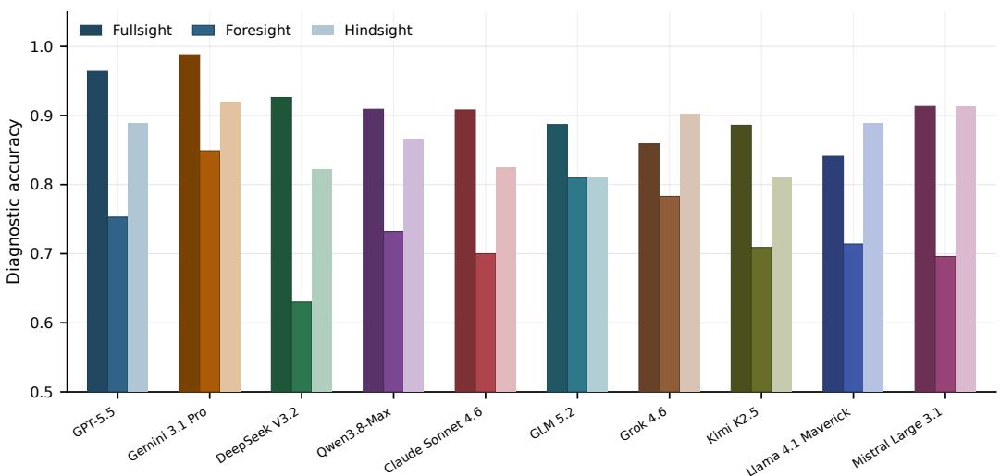  
Figure 1: Diagnostic accuracy of ten general-purpose LLMs under three evidence-access settings (798 model–case pairs). Fullsight receives the complete case upfront; Foresight prospectively acquires evidence over at least six turns; and Hindsight retrospectively selects and orders diagnostically critical evidence from the completed case without reference diagnosis, before re-diagnosis.

Benchmarks and studies show that prospective acquisition is difficult and that stronger evidence collection can help, but they do not jointly trace the behavioral mechanism from an attempted action to the evidence actually obtained and then to diagnosis. Rather than treating this gap as a surface performance deficit, we seek to dissect the underlying behavioral process and identify where and why prospective evidence acquisition breaks down. Our key question is therefore narrower and deeper: what specifically limits LLMs’ prospective evidence acquisition, which factors most strongly shape these limitations, and what underlying mechanisms give rise to them?

Most existing static evaluations contrast complete-information disclosure once, what we call Fullsight, with prospective interactive diagnosis what we call Foresight that models perform well when all evidence is available upfront. MedAction analyzes multi-turn diagnosis and identifies ungrounded test ordering, unreliable diagnostic updating, and degraded conversational coherence as recurring failures (Hsu et al., 2026). CDEG compares successful and failed diagnostic trajectories to identify decision-critical evidence, then tests its effect through controlled interventions (Dai et al., 2026).

However, this contrast alone cannot show whether models can recognize useful evidence once a case is complete, or where that evidence is lost during a step-by-step consultation. We introduce Hindsight as a retrospective perspective: after seeing the fully realized case, the model identifies the facts most useful for diagnosis. This reveals something Fullsight accuracy cannot show on its own that a model may recognize useful evidence after seeing its result but fail to seek it actively and priority while the result is unknown. We first observe this pattern across ten completed models shown in Figure 1. We then compare Hindsight and Foresight at each disclosure depth, tracing what the model asks, what evidence it obtains, and how its diagnosis changes. Our focus of analysis can be presented as

$$
\underbrace { A _ { \mathrm { F u l l } } - A _ { \mathrm { F o r e } } } _ { 1 6 . 8 \mathrm { p p ~ t o t a l ~ g a p } } = \underbrace { ( A _ { \mathrm { F u l l } } - A _ { \mathrm { H i n d } } ) } _ { 4 . 5 \mathrm { p p } } + \underbrace { ( A _ { \mathrm { H i n d } } - A _ { \mathrm { F o r e } } ) } _ { \mathrm { f o c u s ~ o f ~ o u r ~ a n a l y s i s } } .\tag{1}
$$

The small first difference shows that retrospectively selected evidence retains much of the diagnostic value of the complete case. The second difference motivates our deeper analysis of clinical evidence acquisition ability gap in interactive diagnosis.

Our contributions are: (1) We introduce hindsight as a new perspective to examine evidence recognition in interactive diagnosis that LLMs often fail to find those facts. Fullsight demonstrates LLMs do not lack medical knowledge and hindsight proves evidence recognition ability in LLMs and provides a reference for the cognitive ability limit which reveals a gap between recognizing useful evidence afterward and acquiring it while the outcome is still unknown; (2) We examine this gap throughout the foresight trajectory. At each step, we track what the model asks, what new evidence it actually obtains, and how its diagnosis changes. Comparing these trajectories with the useful facts identified in hindsight lets us distinguish problems that arise before evidence arrives from problems that persist after it arrives. Controlled evidence additions then test whether a missed fact can change the diagnosis; (3) We test the findings from multiple facets. Comparisons of question formats, fact counts, evidence order, and diagnostic history help rule out simple explanations for the gap. Further tests across models and datasets examine how broadly the pattern holds and prove the prevalence of the conclusions drawn from our research.

## 2 RELATED WORK

Interactive diagnosis benchmarks. Recent benchmarks have moved beyond static medical QA toward interactive and sequential diagnosis. MediQ, CRAFT-MD, and AMIE evaluate adaptive questioning and simulated diagnostic conversations (Li et al., 2024; Johri et al., 2025; Tu et al., 2025); AgentClinic, AI Hospital, and MedAgentBench provide simulated clinical or EHR environments (Schmidgall et al., 2026; Fan et al., 2025; Jiang et al., 2025). MedR-Bench, Q4Dx, MINT, Diagnosis Arena, RareArena, and CPC-Bench further extend evaluation to test selection, sequential revision, and broader diagnostic reasoning (Qiu et al., 2025; Werthaim et al., 2026; Fang et al., 2026; Zhu et al., 2026; Chen et al., 2026a; Buckley et al., 2025).

Follow-up methods. A growing line of work improves how models decide what information to acquire next and how the acquired evidence shapes their judgments. EviMed and MT-InfoSeek explicitly model missing or sufficient evidence (Long & Wei, 2026; Huang et al., 2026); MedClarify, MeDxAgent, and CDEG prioritize diagnostically informative or decision-critical evidence (Wong et al., 2026; Sanghvi et al., 2026; Dai et al., 2026). Sequential Diagnosis and Doctor-R1 instead learn cost-aware or adaptive inquiry policies over multi-turn interactions (Nori et al., 2025; Lai et al., 2025). Evidence-auditing studies examine output changes under controlled evidence subsets (Liao et al., 2026), information-based approaches analyze how particular evidence shifts diagnostic uncertainty, and hindsight studies show that access to outcome or future information can alter subsequent judgments (Fischhoff, 1975; Matsuura et al., 2026).

## 3 EXPERIMENTAL SETUP

## 3.1 EXPERIMENTAL DESIGN

Figure 2 organizes the study from the visible performance gap to the stages at which it arises. We first establish the contrast among fullsight diagnosis, foresight acquisition, and hindsight retrospective evidence identification (A). Results in Figure 1 reveal the phenomenon. Then, we delved deeper into the phenomenon, and thoroughly analyzed where the gap in evidence acquisition lies. We divide evidence acquisition into three steps. First, before a result is known (B), we distinguish requests from newly obtained evidence, compare free-form requests with a result-blind menu, and examine adaptation after no-match and duplication actions. Second, for the evidence actually acquired (C), we match evidence counts case by case, separate evidence-set effects from order effects, and test whether diagnostically critical facts are reached. Third, after evidence arrives (D), we track diagnostic transitions, intervene with a retrospectively identified fact, and test the entropy presentation, diagnostic distribution and how prior context history affect the response. The final part E include validation experiments for recurrence, ablation, and robustness.

## 3.2 DATASETS AND COHORTS.

The frozen source universe contains 320 cases: 140 AgentClinic MedQA cases, 80 dermatology cases, and 100 DiagnosisArena cases. Thus the primary estimand is conditional on complete-case competence, not population-level clinical accuracy. Prespecified derived cohorts are the resultblind menu cohort $( N = 1 2 0 )$ , evidence-set/order cohort $( N = 1 0 0 )$ , selector-robustness cohort $( N = 1 0 0 )$ , four-model shared cohort $( N = 5 9 )$ ), shared menu cohort $( N = 5 0 )$ , and balanced EviMed bridge $( N = 2 0 0 )$ . The generated cohort-flow file records every case ID.

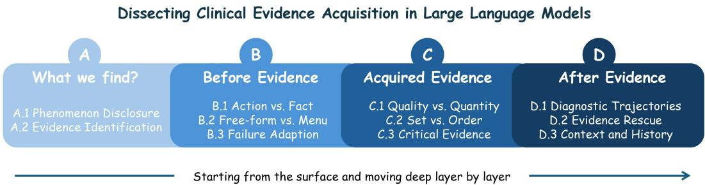  
Figure 2: Experiment design overview. Starting from the observed ability gap (A) to three steps of clinical evidence acquisition of LLMs, including (B) before evidence, (C) acquired evidence analysis and (D) after evidence examination.

## 3.3 MODELS AND CONFIGURATION.

Initial experiment completed 10 general LLMs, yielding 798 eligible model–case pairs. The strict study uses GPT-5.5 and separates four roles: a selector proposes evidence targets, the environment matcher realizes at most one canonical fact, a fresh diagnostic call reads each evidence prefix, and a diagnosis-equivalence judge scores the output. The shared replications additionally use DeepSeek V3.2, Gemini 3.1 Pro Preview, and GLM 5.2. We use OpenRouter as API service, temperature 0, provider-default top-p, maximum outputs of 3,500 tokens by stage, and at most three transport retries.

## 3.4 METRICS

Common metrics include Diagnostic Accuracy, Evidence Yield, Critical-Evidence Reach, Stable Sufficiency, Wrong-State Persistence, and Information Coverage Rate. Individual experiments use additional task-specific metrics. Owing to space constraints, all metric definitions, formulas, and denominators are provided in Appendix.

## 4 RESULTS AND ANALYSIS

## 4.1 A. ABILITY GAP

## 4.1.1 A.1 PHENOMENON DISCLOSURE

Experiments across 10 general LLMs shown in figure 1 reveal a V-shaped diagnostic accuracy curve in fullsight–foresight–hindsight trajectory. It is clear that LLMs do not lack knowledge, and they have sufficient ability to review and identify relevant evidence, and can select and prioritize the most diagnostically valuable evidence from the full evidence set which is an upper limit that a model can potentially reach under comprehensive consideration. Obviously, there are still limitations in the ability to acquire evidence in foresight, which have not yet reached the upper limit.

## 4.1.2 A.2 CRITICAL EVIDENCE

Foresight’s poor performance cannot simply be attributed to an inability to diagnose the disease. We examine this gap in the primary cohort $( N = 1 8 1 )$ ) and a separate 12-step continuation cohort $( N = 1 4 0 ;$ Table 1). At k = 3, Foresight reached 33.1% accuracy, whereas hindsight reached 73.5%, yielding a paired gap of 40.3 percentage points (95% CI 32.6–48.6). To assess the direction and consistency of the paired difference, we report the matched-pair odds ratio and the two-sided exact McNemar p-value, both calculated from cases in which only one condition produced the correct diagnosis. $\mathrm { A t } k = 3$ , discordant outcomes strongly favored Hindsight over Foresight (OR $= 1 5 . 6 0 , p = 6 . 4 0 \times 1 0 ^ { - 1 8 } )$ . Extending the original policy to twelve requests improved Foresight to 52.5%, but Hindsight remained higher at 77.3%, leaving a 24.9-point gap (95% CI 17.1–32.0; OR $= 7 . 4 3 , p = 1 . 3 6 \check { \times } 1 0 ^ { - 9 } )$ . The continuation cohort showed the same pattern, demonstrating that the recognition advantage remained directionally consistent even under a larger acquisition budget. Thus, hindsight identifies realized evidence that supports correct diagnosis substantially more often than the evidence acquired prospectively.

Table 1: Fine-grained recognition–acquisition gaps across evidence depth, comparing retrospective Hindsight with prospective Foresight in two separately analyzed cohorts.
<table><tr><td rowspan="2">Round k</td><td colspan="5">Panel A: Primary cohort  $\underline { { ( N = 1 8 1 ) } }$ </td><td colspan="6">Panel B: Continuation cohort</td></tr><tr><td></td><td>Foresight Hindsight</td><td>Gap [95% CI]</td><td>OR</td><td>Exact p</td><td></td><td>Foresight Hindsight</td><td></td><td>Gap [95% CI]</td><td>OR</td><td>Exact p</td></tr><tr><td>1</td><td>18.8</td><td>55.8</td><td>37.0 [29.3, 45.3]</td><td>12.17</td><td> $1 . 0 0 \times 1 0 ^ { - 1 5 }$ </td><td></td><td>15.7</td><td>57.1</td><td>41.4 [32.9, 50.0]</td><td>20.33</td><td> $4 . 7 4 \times 1 0 ^ { - 1 5 }$ </td></tr><tr><td>2</td><td>29.3</td><td>66.3</td><td>37.0 [28.7, 45.3]</td><td>9.38</td><td> $9 . 1 0 \times 1 0 ^ { - 1 5 }$ </td><td></td><td>25.7</td><td>66.4</td><td>40.7 [31.4, 50.0]</td><td>12.40</td><td> $1 . 4 2 \times { { 1 0 } ^ { - 1 3 } }$ </td></tr><tr><td>3</td><td>33.1</td><td>73.5</td><td>40.3 [32.6, 48.6]</td><td>15.60</td><td> $6 . 4 0 \times 1 0 ^ { - 1 8 }$ </td><td></td><td>29.3</td><td>70.0</td><td>40.7 [31.4, 50.0]</td><td>15.25</td><td> $3 . 9 2 \times 1 0 ^ { - 1 4 }$ </td></tr><tr><td>4</td><td>35.9</td><td>75.1</td><td>39.2 [31.5, 47.0]</td><td>18.75</td><td> $5 . 2 4 \times { { 1 0 } ^ { - 1 8 } }$ </td><td></td><td>30.7</td><td>75.0</td><td>44.3 [35.7, 52.9]</td><td>32.00</td><td> $6 . 0 0 \times { { 1 0 } ^ { - 1 7 } }$ </td></tr><tr><td>5</td><td>34.8</td><td>74.0</td><td>39.2 [30.9, 47.5]</td><td>9.88</td><td> $8 . 3 8 \times 1 0 ^ { - 1 6 }$ </td><td></td><td>28.6</td><td>73.6</td><td>45.0 [35.7, 54.3]</td><td>16.75</td><td> $8 . 7 4 \times 1 0 ^ { - 1 6 }$ </td></tr><tr><td>6</td><td>42.0</td><td>75.7</td><td>33.7 [26.0, 41.4]</td><td>11.17</td><td> $3 . 9 5 \times 1 0 ^ { - 1 4 }$ </td><td></td><td>37.1</td><td>73.6</td><td>36.4 [27.1, 45.0]</td><td>13.75</td><td> $1 . 7 0 \times 1 0 ^ { - 1 2 }$ </td></tr><tr><td>7</td><td>46.4</td><td>79.6</td><td>33.1 [26.0, 40.9]</td><td>16.00</td><td> $5 . 8 7 \times { { 1 0 } ^ { - 1 5 } }$ </td><td></td><td>42.9</td><td>77.1</td><td>34.3 [25.7, 42.9]</td><td>13.00</td><td> $1 . 1 0 \times 1 0 ^ { - 1 1 }$ </td></tr><tr><td>8</td><td>47.0</td><td>74.6</td><td>27.6 [19.3, 35.9]</td><td>5.55</td><td> $1 . 5 5 \times 1 0 ^ { - 9 }$ </td><td></td><td>41.4</td><td>72.9</td><td>31.4 [21.4, 41.4]</td><td>5.89</td><td> $1 . 0 5 \times 1 0 ^ { - 8 }$ </td></tr><tr><td>9</td><td>49.7</td><td>77.3</td><td>27.6 [19.3, 35.9]</td><td>6.00</td><td> $8 . 0 0 \times 1 0 ^ { - 1 0 }$ </td><td></td><td>45.7</td><td>77.9</td><td>32.1 [22.9, 41.4]</td><td>7.43</td><td> $1 . 3 6 \times { { 1 0 } ^ { - 9 } }$ </td></tr><tr><td>10</td><td>49.7</td><td>76.8</td><td>27.1 [19.3, 34.8]</td><td>6.44</td><td> $6 . 8 1 \times 1 0 ^ { - 1 0 }$ </td><td></td><td>45.0</td><td>76.4</td><td>31.4 [22.1, 40.7]</td><td>7.29</td><td> $2 . 4 0 \times 1 0 ^ { - 9 }$ </td></tr><tr><td>11</td><td>53.6</td><td>77.3</td><td>23.8 [16.0, 31.5]</td><td>6.38</td><td> $9 . 0 5 \times 1 0 ^ { - 9 }$ </td><td></td><td>49.3</td><td>77.1</td><td>27.9 [18.6, 37.1]</td><td>7.50</td><td> $1 . 8 3 \times 1 0 ^ { - 8 }$ </td></tr><tr><td>12</td><td>52.5</td><td>77.3</td><td>24.9 [17.1, 32.0]</td><td>7.43</td><td> $1 . 3 6 \times 1 0 ^ { - 9 }$ </td><td>47.9</td><td></td><td>77.1</td><td>29.3 [20.0, 37.9]</td><td>7.83</td><td> $5 . 8 1 \times { { 1 0 } ^ { - 9 } }$ </td></tr></table>

We therefore use hindsight as a plausible empirical upper reference for the remainder of the analysis. It is not an existing clinical acquisition method, a deployable policy, or a formal global optimum. Rather, it asks what diagnostic trajectory the same LLM can retrospectively construct from its own medical knowledge once the complete realized case is visible, while withholding the reference diagnosis. In this sense, hindsight approximates the upper envelope of evidence recognition available to the model when uncertainty about which observations will be realized has been removed.

## 4.2 B. BEFORE EVIDENCE: TARGET CHOICE AND ACTION REALIZATION

Having established hindsight as a retrospective upper limit reference, we first localize the gap before evidence reaches the diagnostic step. Foresight evidence acquisition can fail because the model selects an uninformative target or because the requested information is not successfully realized.

## 4.2.1 B.1 REQUEST ̸= EVIDENCE

An evidence request does not translate one-to-one into new evidence. Only 58.7% of request slots yield a new unique fact in Figure 3. 25.3% repeat an observed fact and 16.0% return no matched evidence. Consequently, three free-form requests produce only 2.09 unique facts on average. The effective evidence budget is therefore substantially smaller than the nominal request budget.

## 4.2.2 B.2 MENU VS. FREEFORM

Free-form foresight may fail because a natural-language request does not match a canonical fact or targets information that is absent from the realized case. To test whether these interface-level failures explain the acquisition gap, we introduce a result-blind menu that replaces open-ended request generation with a fixed set of candidate targets while withholding their outcomes. Shown in the right part of Figure 3, menu and free-form Foresight both reach 31.7% accuracy at $k = 3 ,$ substantially below the 75.0% achieved by hindsight. Thus, the gap cannot be explained solely by free-text mismatch or requests for unavailable evidence: even with a structured target space, the model still struggles to select and realize diagnostically informative evidence.

## 4.2.3 B.3 ADAPTATION AFTER FAILURE

We then examine whether foresight recovers after a request produces no new evidence. Among 343 duplicate or no-match events with an eligible subsequent request, the next request obtains new evidence after 83/194 duplicates (42.8%) and 51/149 no-match outcomes (34.2%). Recovery varies across failure positions and request categories rather than improving monotonically with additional turns (Figure 4).

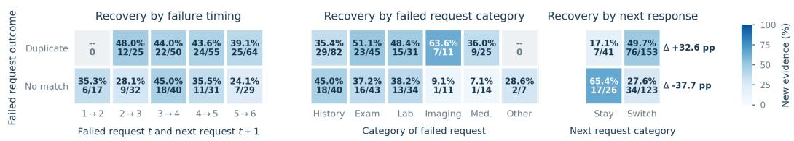

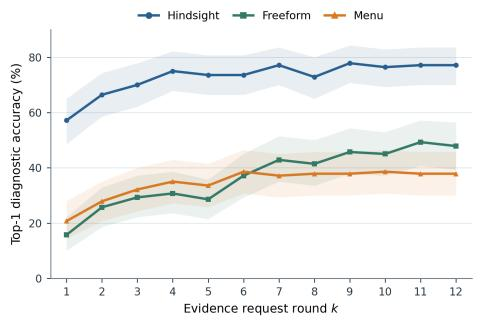

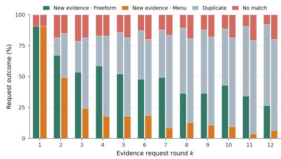  
Figure 3: Acquired evidence analysis. Left: Diagnostic accuracy across request rounds under hindsight, free-form Foresight, and result-blind menu foresight; Right: Outcomes of free-form and menu requests, partitioned into new evidence, duplicate evidence, and no match.  
Figure 4: Recovery after unsuccessful evidence requests. Next-request recovery rates are stratified by failure timing, failed-request category, and whether the next request stays in or switches category.

The value of changing request category depends on the preceding failure. After a duplicate, switching category is associated with higher recovery than staying in the same category (49.7% versus 17.1%). After a no-match, the association reverses: recovery is lower after switching than after staying (27.6% versus 65.4%). The acquisition bottleneck arises not only from target selection and action realization, but also from failure-specific adaptation across successive requests.

## 4.3 C. ACQUIRED EVIDENCE: COMPOSITION AND DIAGNOSTIC VALUE

As we have previously evaluated the relation between request and evidence, now we focus on the evidence that entered the case state and ask two questions: what determines its diagnostic value, and whether information change is sufficient to identify the diagnostic value.

## 4.3.1 C.1 EVIDENCE AMOUNT, IDENTITY, AND ORDER

As shown in Table 2, we first test whether the gap is explained by foresight acquiring fewer evidence quantity. For each case and request budget, we truncate hindsight to the number of unique facts actually obtained by Foresight. At k = 3, foresight has acquired 2.09 facts on average and reaches 33.1% accuracy, whereas count-matched hindsight reaches 63.0%, leaving a paired gap of 29.8 percentage points. The gap remains 28.7 points at k = 6 (42.0% versus 70.7%). In the separate continuation cohort, a 21.4-point gap remains at k = 12. Thus, acquiring fewer facts explains only part of the foresight deficit.

The remaining difference is also associated with evidence identity. Critical Evidence Recall is only 16.0% at k = 3, and the hindsight Top-1 fact is never reached within six requests in 64.6% of primary cases. Meanwhile, hindsight reaches stable diagnostic correctness earlier: at k = 2, the stable-correct rates are 50.3% for hindsight and 23.2% for foresight. Foresight therefore often accumulates evidence without reaching the facts prioritized by the retrospective reference.

Table 2: Evidence-value decomposition. Panel A matches the realized evidence count case by case; Panel B reports evidence identity and diagnostic stability through k = 12 on the primary cohort; Panel C reports paired set and order interventions. Stable denotes a correct diagnosis at every remaining depth through k = 12; when fewer than k non-initial facts are available, CER is computed over the available Hindsight prefix. Gap and effect columns are percentage points.
<table><tr><td colspan="6">Panel A: same number of evidence items</td></tr><tr><td colspan="6"></td></tr><tr><td>Cohort / k</td><td>Mean mi(k)</td><td>Foresight</td><td>Matched Hindsight</td><td>Gap</td><td>95% CI</td></tr><tr><td>Primary / 3</td><td>2.09</td><td>33.1%</td><td>63.0%</td><td>29.8</td><td>[22.1, 37.6]</td></tr><tr><td>Primary / 6</td><td>3.52</td><td>42.0%</td><td>70.7%</td><td>28.7</td><td>[20.4, 37.0]</td></tr><tr><td>Continuation / 6</td><td>3.70</td><td>37.1%</td><td>72.9%</td><td>35.7</td><td>[27.1, 44.3]</td></tr><tr><td>Continuation / 12</td><td>5.96</td><td>47.9%</td><td>69.3%</td><td>21.4</td><td>[12.1, 30.7]</td></tr></table>

<table><tr><td>Contrast</td><td>Ref.</td><td>Alt.</td><td>Effect</td><td>95% CI</td><td>Measure</td></tr><tr><td>Same-set reranking</td><td>34.3%</td><td>43.7%</td><td>9.3</td><td>[5.5, 13.2]</td><td>AUSC</td></tr><tr><td>Set replacement</td><td>43.7%</td><td>70.3%</td><td>26.7</td><td>[19.0, 34.5]</td><td>AUSC</td></tr><tr><td>Hindsight-order</td><td>44.3%</td><td>70.3%</td><td>26.0</td><td>[20.2, 32.0]</td><td>AUSC</td></tr></table>

<table><tr><td colspan="6">Panel B: evidence identity and stable sufficiency (N = 181)</td></tr><tr><td colspan="6">Hindsight Foresight</td></tr><tr><td>k</td><td>CER</td><td>Top-1 reached</td><td>stable</td><td>Hindsight stable</td><td>Stable gap</td></tr><tr><td>1</td><td>5.5%</td><td>5.5%</td><td>12.7%</td><td>40.3%</td><td>27.6</td></tr><tr><td>2</td><td>12.2%</td><td>13.3%</td><td>18.8%</td><td>45.3%</td><td>26.5</td></tr><tr><td>3</td><td>16.0%</td><td>18.2%</td><td>20.4%</td><td>50.3%</td><td>29.8</td></tr><tr><td>4</td><td>20.9%</td><td>23.8%</td><td>23.2%</td><td>50.8%</td><td>27.6</td></tr><tr><td>5</td><td>23.8%</td><td>30.4%</td><td>25.4%</td><td>55.2%</td><td>29.8</td></tr><tr><td>6</td><td>26.9%</td><td>35.4%</td><td>27.6%</td><td>58.6%</td><td>30.9</td></tr><tr><td>7</td><td>28.6%</td><td>38.7%</td><td>34.3%</td><td>60.8%</td><td>26.5</td></tr><tr><td>8</td><td>30.1%</td><td>42.5%</td><td>36.5%</td><td>62.4%</td><td>26.0</td></tr><tr><td>9</td><td>31.6%</td><td>44.8%</td><td>39.2%</td><td>66.3%</td><td>27.1</td></tr><tr><td>10</td><td>33.6%</td><td>45.9%</td><td>44.2%</td><td>68.0%</td><td>23.8</td></tr><tr><td>11</td><td>34.6%</td><td>49.2%</td><td>49.2%</td><td>71.3%</td><td>22.1</td></tr><tr><td>12</td><td>35.7%</td><td>53.6%</td><td>52.5%</td><td>77.3%</td><td>24.9</td></tr></table>

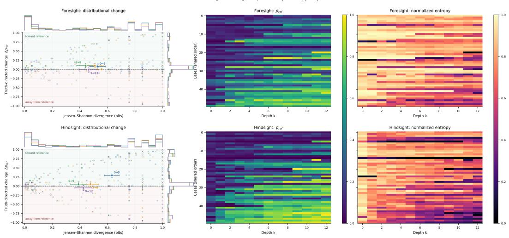  
Figure 5: Distributional change and diagnostic value. Rows compare Foresight and Hindsight; columns show case-level JSD versus $\Delta p _ { \mathrm { r e f } } .$ aligned reference-probability trajectories, and normalized entropy trajectories.

Direct interventions further separate evidence identity from order. In the fixed N = 100 panel, reranking the Foresight set raises normalized six-prefix accuracy from 34.3% to 43.7%, a gain of 9.3 points. Replacing that set with the selected set under the same ranking rule raises accuracy to 70.3%, a further gain of 26.7 points . Reversing the Hindsight order reduces accuracy from 70.3% to 44.3%, an order effect of 26.0 points. Evidence identity and order therefore make distinct contributions: selection determines which diagnostic value is available, while order determines how early that value becomes accessible.

## 4.3.2 C.2 DISTRIBUTIONAL CHANGE ̸= DIAGNOSTIC VALUE

Figure 5 provides two views of the same diagnostic process. The top row shows Foresight and the bottom row Hindsight. In each row, the left panel plots the magnitude of change between adjacent diagnostic distributions (JSD) against its truth-directed component, $\Delta p _ { \mathrm { r e f } } ;$ the middle and right panels show $p _ { \mathrm { r e f } }$ and normalized entropy across all evidence depths for the same ordered set of 50 cases. The scatter analysis includes only intervals containing at least one newly acquired unique fact.

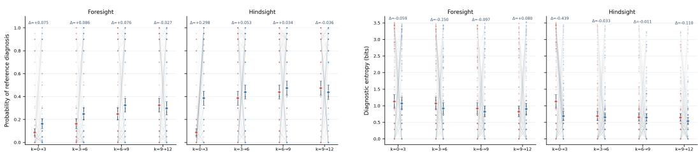  
Figure 6: Diagnostic updating after evidence arrival from initial to round 12.

A large distributional change is not necessarily diagnostically useful: at similar JSD values, $\Delta p _ { \mathrm { r e f } }$ may be positive, negligible, or negative. This distinction is clearest at 0 → 3. Hindsight produces only a moderately larger mean JSD than Foresight (0.633 versus 0.531), but a much larger increase in reference-diagnosis probability (0.298 versus 0.084). The heatmaps show the corresponding state trajectories: Hindsight tends to increase $p _ { \mathrm { r e f } }$ earlier, whereas entropy does not consistently track whether the diagnosis moves toward the reference answer.

The figure therefore identifies two post-arrival failures. New evidence may produce little diagnostic response, or it may substantially change the distribution in the wrong direction. Evidence value consequently cannot be inferred from update magnitude or concentration alone; it depends on whether the update is truth-directed. These probability distributions are elicited readouts rather than direct measurements of latent belief.

## 4.4 D. AFTER EVIDENCE: DIAGNOSTIC UPDATING

Section 4.3 showed that foresight often acquires evidence with lower diagnostic value. We now ask what happens after evidence enters the case state that whether the diagnostic distribution changes, and whether a missed high-value fact can reverse an incorrect diagnosis.

## 4.4.1 D.1 DIAGNOSTIC-STATE UPDATING

Figure 6 follows the same 181 cases across four three-step intervals. Under hindsight, most updating occurs in the first interval which is from $k = 0 \tan { k } = 3 ,$ the mean probability assigned to the reference diagnosis increases by 0.298, while diagnostic entropy changes by −0.439 bits. Later hindsight intervals show little additional change. Foresight increases the reference-diagnosis probability more gradually through $k = 9$ , but none of its entropy changes is clearly different from zero; from $k = 9$ to $k = \mathrm { 1 2 }$ , it shows no reliable additional gain. Thus, retrospectively prioritized evidence produces an early, concentrated diagnostic update, whereas prospectively acquired evidence yields slower and less consistent concentration. Together, these fixed-support probability distributions and entropy measures provide a behavioral proxy for how the model’s implicit diagnostic state changes as evidence accumulates.

## 4.4.2 D.2 CONTROLLED RESCUE BY HIGH-VALUE EVIDENCE

The trajectory results alone cannot show whether a missed fact caused diagnostic failure. We therefore intervene on incorrect Foresight states by adding either an unseen hindsight ranked fact or a prefrozen matched-control fact from the same case. In the prespecified complete-grid cohort, the mean critical-minus-control rescue is +38.8 percentage points for hindsight Rank 1, +24.8 for Rank 2, and +10.3 for Rank 3. The Rank-1-minus-Rank-3 contrast is +28.5 points. By contrast, the Rank-1 difference between insertion at $k = 1$ and $k = 1 2$ is not clearly supported. These results show that omission of high-value evidence can directly contribute to diagnostic failure. Rescue depends more clearly on evidence rank than on the measured insertion depth. The all-eligible analysis is reported in the appendix: its critical-minus-control effect is positive in all 15 rank–depth cells, but its changing denominators do not permit a fixed-cohort comparison of insertion timing.

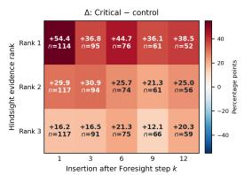

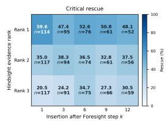

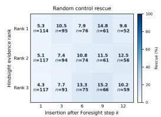

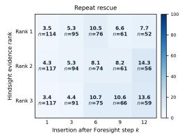

Figure 7: Diagnostic rescue by evidence rank and insertion depth. Cells report rescue rates and eligible counts after inserting evidence. The left panel shows the critical-minus-random difference in percentage points, and the right three are individuals.  
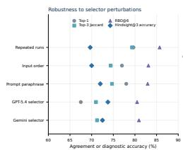

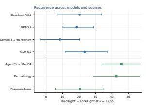

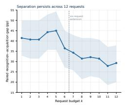

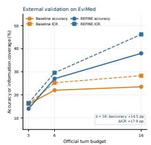  
Figure 8: Robustness and external validation. The recognition–acquisition gap recurs across selector perturbations, model backbones, source cohorts, and longer horizons.

## 4.5 E. ROBUSTNESS AND EXTERNAL VALIDATION

This gap recurs across implementation choices and evaluation settings (Figure 8). On the shared 59-case cohort, all four model backbones show positive paired gaps, with three confidence intervals excluding zero; the gap is also positive within each source cohort. In the separate 140-case continuation cohort, it remains 29.3 percentage points at $k = 1 2$ . Thus, the observed separation is not attributable to a single selector, model, data source, or short disclosure horizon. External validation provides the same practical conclusion. On 200 balanced EviMed cases, REFINE improves information coverage by 17.9 points and diagnostic accuracy by 14.5 points over the official free-form baseline at k = 16, showing that stronger prospective acquisition can improve both realized evidence and diagnosis. Full selector perturbations, model- and source-specific estimates, EviMed comparisons, and controlled ablations are reported in appendix.

## 5 CONCLUSION

Our work reframes the gap between static and interactive diagnosis as a failure to translate recognized evidence value into prospective action. Fullsight establishes that the model can solve the completed case, while hindsight shows that, once the case is realized, the same model can identify a compact and diagnostically useful trajectory without access to the reference diagnosis. The persistent separation from foresight therefore cannot be reduced to missing disease knowledge. Our stage-wise analysis localizes the loss: (1) before evidence arrives, requests do not reliably obtain novel facts, and it is hard to recover from previous failure; (2) among the facts obtained, identity and order matter beyond quantity, while distributional change or increased confidence does not guarantee diagnostic truth-directed progress; (3) after evidence arrives, high-value facts can produce earlier updates and directly rescue incorrect diagnoses. Recurrence across model backbones and data sources supports a multi-stage evidence acquisition bottleneck.

Hindsight is neither a deployable acquisition policy nor evidence that the entire retrospective gap is avoidable. It is an empirical reference that reveals what the model’s existing knowledge can support once uncertainty about evidence realization is removed, and our conclusions remain conditional on complete-case competence and controlled evidence environments. The next challenge is to convert this retrospective recognition into prospective control under the information available at decision time. Future clinical follow-up should jointly optimize target realizability, novelty, diagnostic value, sequencing, and failure-specific recovery, while being evaluated across the full chain from request to realized evidence to diagnostic transition. Closing the gap from hindsight to foresight therefore means turning available medical knowledge into timely, reliable evidence-seeking behavior.

## AI USE STATEMENT

During the preparation of this manuscript, the authors used generative AI tools (large language models) only for limited and well-defined tasks: improving the clarity and grammar of the prose, formatting tables and citations, and writing routine code boilerplate such as data-processing and plotting scripts. These tools were not used to generate research ideas, hypotheses, scientific claims, experimental results, metrics, or analyses, nor to survey or summarize the literature without independent verification by the authors.

## REFERENCES

Rahul K. Arora, Jason Wei, Rebecca Soskin Hicks, Preston Bowman, Joaquin Quinonero Candela,˜ Foivos Tsimpourlas, Michael Sharman, Meghan Shah, Andrea Vallone, Alex Beutel, Johannes Heidecke, and Karan Singhal. Healthbench: Evaluating large language models towards improved human health, 2025. URL https://arxiv.org/abs/2505.08775.

Andrew M. Bean, Rebecca Elizabeth Payne, Guy Parsons, Hannah Rose Kirk, Juan Ciro, Rafael Mosquera-Gomez, Sara Hincapi´ e M, Aruna S. Ekanayaka, Lionel Tarassenko, Luc Rocher, and´ Adam Mahdi. Reliability of llms as medical assistants for the general public: a randomized preregistered study. Nature Medicine, 32:609–615, 2026. doi: 10.1038/s41591-025-04074-y.

Thomas A. Buckley, Riccardo Conci, Peter G. Brodeur, Jason Gusdorf, Sourik Beltran, Bita Behrouzi,´ Byron Crowe, Jacob Dockterman, Muzzammil Muhammad, Sarah Ohnigian, Andrew Sanchez, James A. Diao, Aashna P. Shah, Daniel Restrepo, Eric S. Rosenberg, Andrew S. Lea, Marinka Zitnik, Scott H. Podolsky, Zahir Kanjee, Raja-Elie E. Abdulnour, Jacob M. Koshy, Adam Rodman, and Arjun K. Manrai. Advancing medical artificial intelligence using a century of cases, 2025. URL https://arxiv.org/abs/2509.12194.

Haichao Chen, Zhengyun Zhao, Songchi Zhou, Shikai Hu, Jinyuan Wang, Ye Jin, Xianghong Jin, Yih Chung Tham, Xiaofei Wang, Weizhi Ma, Honghan Wu, Bin Sheng, Shuyang Zhang, Sheng Yu, and Tien Yin Wong. Rarearena: a comprehensive benchmark dataset unveiling the potential of large language models in rare disease diagnosis. The Lancet Digital Health, 8(2):100953, 2026a. doi: 10.1016/j.landig.2025.100953.

Xi Chen, Hanyu Zhou, Huahui Yi, Mingke You, WeiZhi Liu, Li Wang, Ziyuan Qin, Hairui Li, Xue Zhang, Yingman Guo, Songlin Li, Yunan Hu, Qianjiang Xiong, Rongxiao Li, Lei Fan, Qicheng Lao, Weili Fu, Jian Li, and Kang Li. Grounding large language models in clinical diagnostics. Nature Communications, 17:4401, 2026b. doi: 10.1038/s41467-026-70274-w.

Xiwei Dai, Zijie Meng, Zhiting Fan, Yixuan Tang, Guanyu Jiang, Ziru Niu, and Zuozhu Liu. Cdeg: Learning decision-critical evidence for long-horizon diagnostic agents, 2026. URL https: //arxiv.org/abs/2608.22899.

Zhihao Fan, Lai Wei, Jialong Tang, Wei Chen, Wang Siyuan, Zhongyu Wei, and Fei Huang. AI hospital: Benchmarking large language models in a multi-agent medical interaction simulator. In Proceedings of the 31st International Conference on Computational Linguistics, pp. 10183– 10213. Association for Computational Linguistics, 2025. URL https://aclanthology. org/2025.coling-main.680/.

Jinrui Fang, Runhan Chen, Xu Yang, Jian Yu, Jiawei Xu, Ashwin Vinod, Wenqi Shi, Tianlong Chen, Heng Ji, ChengXiang Zhai, Ying Ding, and Yuji Zhang. Benchmarking multi-turn medical diagnosis: Hold, lure, and self-correction, 2026. URL https://arxiv.org/abs/2604. 04325.

Baruch Fischhoff. Hindsight is not equal to foresight: The effect of outcome knowledge on judgment under uncertainty. Journal ofExperimental Psychology: Human Perception and Performance, 1 (3):288–299, 1975. doi: 10.1037/0096-1523.1.3.288. URL https://doi.org/10.1037/ 0096-1523.1.3.288.

Joseph Gatto, Parker Seegmiller, Timothy E. Burdick, Inas S. Khayal, Sarah DeLozier, and Sarah M. Preum. Follow-up question generation for enhanced patient-provider conversations. In Proceedings ofthe 63rd Annual Meeting ofthe Associationfor Computational Linguistics (Volume 1: Long Papers), pp. 25222–25240, Vienna, Austria, July 2025. Association for Computational Linguistics. doi: 10.18653/v1/2025.acl-long.1226. URL https://aclanthology.org/2025. acl-long.1226/.

Hsin-Ling Hsu, Zizheng Wang, Donghua Zhang, Nai-Chia Chen, Jerry Wang, Jun-En Ding, Chia-Hsuan Hsu, Guoan Wang, Feng Liu, Fang-Ming Hung, Chenwei Wu, and Liyue Shen. Medaction: Towards active multi-turn clinical diagnostic llms, 2026. URL https://arxiv.org/abs/ 2605.07305.

Yepeng Huang, Jiawen Zhang, Michelle Dai, Xiaorui Su, Shanghua Gao, Zi Wang, and Marinka Zitnik. Do llms know what to ask and when? evaluating multi-turn information seeking, 2026. URL https://arxiv.org/abs/2608.14808.

Zhihao Jia, Mingyi Jia, Junwen Duan, and Jianxin Wang. DDO: Dual-decision optimization for LLMbased medical consultation via multi-agent collaboration. In Proceedings ofthe 2025 Conference on Empirical Methods in Natural Language Processing, pp. 26369–26386, Suzhou, China, November 2025. Association for Computational Linguistics. doi: 10.18653/v1/2025.emnlp-main.1340. URL https://aclanthology.org/2025.emnlp-main.1340/.

Yixing Jiang, Kameron C. Black, Gloria Geng, Danny Park, James Zou, Andrew Y. Ng, and Jonathan H. Chen. Medagentbench: A virtual ehr environment to benchmark medical llm agents. NEJM AI, 2(9):AIdbp2500144, 2025. doi: 10.1056/AIdbp2500144.

Shreya Johri, Jaehwan Jeong, Benjamin A. Tran, Daniel I. Schlessinger, Shannon Wongvibulsin, Leandra A. Barnes, Hong-Yu Zhou, Zhuo Ran Cai, Eliezer M. Van Allen, David Kim, Roxana Daneshjou, and Pranav Rajpurkar. An evaluation framework for clinical use of large language models in patient interaction tasks. Nature Medicine, 31:77–86, 2025. doi: 10.1038/s41591-024-03328-5.

Yunghwei Lai, Kaiming Liu, Ziyue Wang, Weizhi Ma, and Yang Liu. Doctor-r1: Mastering clinical inquiry with experiential agentic reinforcement learning, 2025. URL https://arxiv.org/ abs/2510.04284.

Yunghwei Lai, Kaiming Liu, Ziyue Wang, Weizhi Ma, and Yang Liu. Doctor-r1: Mastering clinical inquiry with experiential agentic reinforcement learning. In The Fourteenth International Conference on Learning Representations, 2026.

Shuyue Stella Li, Vidhisha Balachandran, Shangbin Feng, Jonathan S. Ilgen, Emma Pierson, Pang Wei Koh, and Yulia Tsvetkov. Mediq: Question-asking llms and a benchmark for reliable interactive clinical reasoning. In Advances in Neural Information Processing Systems, volume 37, 2024. doi: 10.52202/079017-0908.

Junchi Liao, Jiawen Deng, and Fuji Ren. Auditing evidence use in medical llm diagnosis, 2026. URL https://arxiv.org/abs/2607.20848.

Zhuohan Long and Zhongyu Wei. Strong reasoning isn’t enough: Evaluating evidence elicitation in interactive diagnosis. In Findings ofthe Associationfor Computational Linguistics: ACL 2026, pp. 27559–27575. Association for Computational Linguistics, 2026. doi: 10.18653/v1/2026. findings-acl.1372. URL https://aclanthology.org/2026.findings-acl.1372/.

Misaki Matsuura, Sayantan Kumar, Ojas Kadam, and Jeremy C. Weiss. Hindsight bias in clinical temporal reasoning: How future data exposure affects large language model judgment, 2026. URL https://arxiv.org/abs/2609.13454.

Harsha Nori, Mayank Daswani, Christopher Kelly, Scott Lundberg, Marco Tulio Ribeiro, Marc Wilson, Xiaoxuan Liu, Viknesh Sounderajah, Jonathan Carlson, Matthew P. Lungren, Bay Gross, Peter Hames, Mustafa Suleyman, Dominic King, and Eric Horvitz. Sequential diagnosis with language models, 2025. URL https://arxiv.org/abs/2506.22405.

Pengcheng Qiu, Chaoyi Wu, Shuyu Liu, Yanjie Fan, Weike Zhao, Zhuoxia Chen, Hongfei Gu, Chuanjin Peng, Ya Zhang, Yanfeng Wang, and Weidi Xie. Quantifying the reasoning abilities of llms on clinical cases. Nature Communications, 16:9799, 2025. doi: 10.1038/s41467-025-64769-1.

Akshat Sanghvi, Naren Akash, Raza Imam, Amit Sharma, and Mohit Jain. Medxagent: Multi-agent consultation for interactive medical diagnosis, 2026. URL https://arxiv.org/abs/2606. 03416.

Samuel Schmidgall, Rojin Ziaei, Carl Harris, Ji Woong Kim, Eduardo Pontes Reis, Jeffrey Jopling, and Michael Moor. Agentclinic: a multimodal benchmark for tool-using clinical ai agents. npj Digital Medicine, 9(1):499, 2026. doi: 10.1038/s41746-026-02674-7.

Karan Singhal, Shekoofeh Azizi, Tao Tu, S. Sara Mahdavi, Jason Wei, Hyung Won Chung, Nathan Scales, Ajay Tanwani, Heather Cole-Lewis, Stephen Pfohl, et al. Large language models encode clinical knowledge. Nature, 620:172–180, 2023. doi: 10.1038/s41586-023-06291-2.

Karan Singhal, Tao Tu, Juraj Gottweis, Rory Sayres, Ellery Wulczyn, Mohamed Amin, Le Hou, Kevin Clark, Stephen R. Pfohl, Heather Cole-Lewis, et al. Toward expert-level medical question answering with large language models. Nature Medicine, 31:943–950, 2025. doi: 10.1038/ s41591-024-03423-7.

Liwen Sun, Xiang Yu, Ming Tan, Zhuohao Chen, Anqi Cheng, Ashutosh Joshi, and Chenyan Xiong. Linking knowledge to care: Knowledge graph-augmented medical follow-up question generation. In Findings ofthe Associationfor Computational Linguistics: EACL 2026, pp. 846–853, Rabat, Morocco, March 2026. Association for Computational Linguistics. doi: 10.18653/v1/2026. findings-eacl.43. URL https://aclanthology.org/2026.findings-eacl.43/.

Tao Tu, Mike Schaekermann, Anil Palepu, Khaled Saab, Jan Freyberg, Ryutaro Tanno, Amy Wang, Brenna Li, Mohamed Amin, Yong Cheng, et al. Towards conversational diagnostic artificial intelligence. Nature, 642:442–450, 2025. doi: 10.1038/s41586-025-08866-7.

Mai Werthaim, Maya Kimhi, Alexander Apartsin, and Yehudit Aperstein. A benchmark for evaluating diagnostic questioning efficiency of llms in patient conversations. Scientific Reports, 16:6121, 2026. doi: 10.1038/s41598-026-37022-y.

Hui Min Wong, Philip Heesen, Pascal Janetzky, Martin Bendszus, and Stefan Feuerriegel. Medclarify: An information-seeking ai agent for medical diagnosis with case-specific follow-up questions, 2026. URL https://arxiv.org/abs/2602.17308.

Yakun Zhu, Zhongzhen Huang, Linjie Mu, Yutong Huang, Wei Nie, Jiaji Liu, Shaoting Zhang, Pengfei Liu, and Xiaofan Zhang. Diagnosisarena: Benchmarking diagnostic reasoning for large language models. In Findings ofthe Associationfor Computational Linguistics: ACL 2026, pp. 3074–3098. Association for Computational Linguistics, 2026. doi: 10.18653/v1/2026.findings-acl.151. URL https://aclanthology.org/2026.findings-acl.151/.

## A METHODS, FROZEN PROTOCOLS, AND METRIC DEFINITIONS

## A.1 STUDY UNIT, EVIDENCE STATE, AND INTERPRETATION

The unit of the controlled study is a case, not an API request. For case $c ,$ let $x _ { c }$ be its initial presentation, $y _ { c } ^ { * }$ its reference diagnosis, and $\mathcal { U } _ { c }$ the realized non-initial atomic-fact inventory, with a stable canonical ID for every fact. Let $E _ { c } ^ { q } ( k )$ be the set ofuniquefact IDs actually available after k opportunities under condition $q ,$ and let $L _ { c } ^ { \bar { q } } ( k )$ be the corresponding ordered list. A failed or duplicate request advances k but leaves $E _ { c } ^ { q } ( k )$ unchanged. A fresh diagnostic probe reads $x _ { c }$ and $L _ { c } ^ { q } ( k )$ ; its top diagnosis is ${ \hat { y } } _ { c } ^ { q } ( k )$ . The initial state $k = \bar { 0 }$ is shared. All main comparisons use the same cases and the same independent semantic diagnosis rule.

Fullsight sees the completed case at once and is used to establish complete-case competence. Atomic Foresight chooses one prospective request at a time. Diagnosis-Unconditioned Hindsight (Hindsight) ranks facts after seeing $\mathcal { U } _ { c }$ , but without the reference diagnosis or the Fullsight answer. The Hindsight prefix is a retrospective recognition reference, not an executable acquisition policy. Withholding an explicit diagnostic label does not remove the information advantage of seeing the realized evidence. Case-level and source-level estimates therefore describe the stated conditional cohorts, not unconditional clinical accuracy.

## A.2 CASE FLOW AND FROZEN ANALYSIS PANELS

The source universe was frozen before the final primary outcomes. It contains 320 cases: 140 AgentClinic MedQA, 80 dermatology, and 100 DiagnosisArena. Fullsight was semantically correct on 190. Six of these were removed by the recorded Fullsight quality-control exclusion and three dermatology cases had fewer than six non-initial atomic facts. The remaining 181 cases were protocolcomplete, Fullsight-correct, and structurally eligible: 98 AgentClinic MedQA, 49 dermatology, and 34 DiagnosisArena. All six main action slots and paired diagnostic prefixes are represented for these cases. The exclusions were fixed before the paired analysis.

Table 3: Frozen study panels. Subsets overlap; their counts must not be added. A panel’s own eligibility and denominator govern its result.
<table><tr><td>Panel</td><td>Cases</td><td>Purpose</td></tr><tr><td>Source universe / Fullsight-correct / strict primary</td><td>320 / 190 / 181</td><td>Conditional six-step paired analysis</td></tr><tr><td>Result-blind menu</td><td>120</td><td>Frozen primary subset</td></tr><tr><td>Evidence-set/order intervention</td><td>100</td><td>Fixed six-prefix panel</td></tr><tr><td>Selector perturbation</td><td>100</td><td>Repeats, prompt, and order; alternative-model selector: 80</td></tr><tr><td>Four-model paired replication</td><td>59</td><td>Same case IDs across backbones</td></tr><tr><td>Shared four-model menu</td><td>50</td><td>Free/menu/Hindsight at three re- quests</td></tr><tr><td>Twelve-step continuation</td><td>140</td><td>Original policies continued for six slots</td></tr><tr><td>Fixed-support updating</td><td>181</td><td>Depths 0, 3, 6, 9, and 12</td></tr><tr><td>Rank-by-time rescue / complete grid</td><td>140 / 33</td><td>Eligible cells / fixed panel in every cell</td></tr><tr><td>EviMed external bridge</td><td>200</td><td>50 each from four source families</td></tr></table>

The earlier 12-model-slot screen yielded ten completed general-purpose models and 798 eligible model–case records. The two medical-model slots failed infrastructure gates and are not partial efficacy estimates. That screen’s retrospective condition and screening/retest calls differ from the strict primary protocol; the joined records contain no identical screening and reported request. We use it for breadth only, never pool its numerators or denominators with the 181-case paired analysis.

For the external bridge, the distributed EviMed source pool contained 800 cases (200 from each of AgentClinic MedQA, DiagnosisArena, RareArena/RDC, and Derm/CRAFT-MD). The source-ID overlap comparison removed 317 exact internal overlaps, leaving 483 eligible cases; a balanced 50-per-source sample of 200 was frozen for analysis. Normalized-text hash and similarity checks supplemented the exact-ID comparison. The resulting EviMed denominator is distinct from the internal 181-case denominator.

## A.3 MODEL ROLES, PROMPTS, VISIBILITY, AND DEPLOYMENT

The strict primary acquisition, ranking, and diagnostic model was deepseek/deepseek-v3.2 through OpenRouter. Four-model recurrence also used openai/gpt-5.4, google/gemini-3.1-pro-preview, and $\mathrm { z } - \mathrm { a i } / \mathrm { g } \mathrm { 1 m } - 5 . 2$ as the condition’s acquisition/diagnostic backbone on the shared cases. GPT-5.5 was the independent diagnosis-equivalence grader. Selector, acquisition, matcher, diagnostic probe, and grader are separate roles; none inherits another role’s unseen fields. The prompt wording, output schemas, parser rules, and stage-specific settings are specified below.

Retrospective selector. The primary DeepSeek selector receives $x _ { c }$ followed by the complete non-initial pool, one line per [FACT ID] fact text, in canonical order. Its instruction requires six distinct supplied IDs and JSON arrays ranked fact ids and rationales, each of length six. Exact-ID membership, uniqueness, and length are validated; no fuzzy remapping is allowed. The Top-3 prefix is the principal three-step comparator. Two frozen evidence-list permutations, repeated calls, a prompt paraphrase, and GPT-5.5/Gemini selectors probe robustness. The shared-model replication requested the frozen three-fact ranking for the other backbones. These variants never change the primary selector after observing outcomes.

Prompt: Retrospective evidence selector   
System. Rank exactly six supplied non-initial atomic facts by diagnostic usefulness for determining the   
diagnosis from the initial presentation. You do not know the gold diagnosis, Fullsight diagnosis, or   
Foresight trajectory. Use only supplied IDs, once each. Return JSON only:   
{"ranked\_fact\_ids":["..."],"rationales":["..."]}. Both arrays must have length six.   
User template. INITIAL PRESENTATION: {initial presentation}. COMPLETE   
NON-INITIAL ATOMIC EVIDENCE POOL: one [FACT ID] fact text per line, in canonical order.   
Return the requested JSON ranking.

Selector agreement is measured per case before averaging: Top-1 agreement is an exact equality indicator; Top-3 Jaccard is $| D _ { c , a } ^ { ( 3 ) } \cap D _ { c , b } ^ { ( 3 ) } | / | D _ { c , a } ^ { ( 3 ) } \cup D _ { c , b } ^ { ( \overline { { 3 } } ) } |$ . Rank-biased overlap at depth six uses $a _ { d } = | D _ { c , a } ^ { ( d ) } \cap D _ { c , b } ^ { ( d ) } | / d$ and $\begin{array} { r } { \mathrm { R B O @ 6 } = 0 . 1 \sum _ { d = 1 } ^ { 6 } a _ { d } ( 0 . 9 ) ^ { d - 1 } + a _ { 6 } ( 0 . 9 ) ^ { 6 } } \end{array}$ . Repeatability averages the three pairs from each of the three frozen repeated rankings per case. Downstream robustness is a new diagnostic probe on each alternative Top-3 prefix, with the same accuracy rule and the variant’s own case denominator.

Prospective action. At step t, the action prompt provides the initial presentation, previously returned fact IDs and text, every earlier request and its status, the current step, and remaining opportunities. Its system instruction states that the policy cannot see hidden evidence, candidate IDs, a complete case, or any diagnosis label. It asks for exactly one clinical information request and JSON fields request, request type (history, physical exam, lab, imaging, medication, or other), and reason short. A blank request is invalid; an unrecognized request type is deterministically mapped to other. The action model does not see the matcher’s candidate scores or the future result. The system and user templates are shown below.

Prompt: Prospective information request   
System. You are the clinical acquisition policy. Use only the supplied initial presentation, previously   
acquired facts, and prior request outcomes. You cannot see hidden evidence, candidate IDs, a full case, or   
any diagnosis label. Choose exactly one clinical information request for this step. Return JSON only:   
{"request":"free-text request",   
"request\_type":"history|physical\_exam|lab|imaging|medication|other",   
"reason\_short":"brief rationale"}.   
User template. INITIAL PRESENTATION: {initial presentation}. PREVIOUSLY ACQUIRED   
FACTS: [FACT ID] fact text, one per line. PRIOR REQUEST OUTCOMES: for each earlier step,   
include its request, status (matched, duplicate, or no-match), and returned fact or none. CURRENT STEP t   
OF 6; REMAINING OPPORTUNITIES INCLUDING THIS ONE: {remaining}. Return the JSON   
action now.

Deterministic realization. The frozen m1 lexical type v1 matcher sees the just-issued request, its request type, U , and acquired IDs. It tokenizes case-folded alphanumeric words and Chinese-character bigrams, scores each compatible fact by lexical cosine plus a 0.08 type/modality bonus and a 0.12 exact-normalized-text bonus (capped at 1), and retains candidates with score at least 0.10 and at least 60% of the top score. Canonical fact ID breaks ties. The first selected ID is either new or duplicate; no candidate is a no-match. These three statuses exhaust action outcomes and consume one slot each. A request can release at most one new fact. No provider call, manual override, or post-hoc clinical repair is made by the matcher.

Result-blind menu. The menu condition replaces free-text target generation with 103 global clinical targets, frozen before case outcomes and shuffled deterministically for each case and round. The action prompt shows the initial presentation, observed acquired evidence, and target names; it never shows their unrealized results. It asks for one selected target ID in JSON. The same one-fact, duplicate, and no-match accounting applies. A structured target space changes the interface but does not supply hidden evidence or equalize the facts ultimately obtained.

## Prompt: Result-blind evidence menu

System. You are selecting the single next clinical evidence target prospectively. Choose exactly one label   
from the global result-blind menu. You see target names but never hidden results. Do not diagnose and do   
not invent a label. Return JSON only as   
{"selected\_target":"TARGET\_ID","reason\_short":"brief"}.   
User template. INITIAL PRESENTATION: {initial presentation}. OBSERVED ACQUIRED   
EVIDENCE: [FACT ID] fact text, one per line, or “no acquired evidence yet.” GLOBAL TARGET   
MENU: [TARGET ID] target name, one per line in the case-round permutation.

Fresh diagnostic probe and blinded grader. The diagnostic call is stateless with respect to prior diagnostic answers: it receives only x and the ordered available evidence prefix for the current condition. Its system prompt requests JSON top diagnosis and one to five unique ordered differential entries with confidence in [0, 1], with no condition label, reference diagnosis, future evidence, or multiple-choice options. A valid top diagnosis is moved to the first differential position if necessary; percentage confidences in (1, 100] are divided by 100. Exact normalized diagnosis matches are accepted first. Otherwise an independent GPT-5.4 grader receives an opaque task ID, the reference diagnosis, and the prediction only. It accepts standard synonyms and rejects materially broader, narrower, or different diseases. The grader does not see the acquisition condition or aggregate result. The Final-v1 JSON output is correct plus a brief reason; unresolved invalid outputs are not silently imputed. The prompts are shown below.

Prompt: Fresh diagnostic probe   
System. You are a diagnostic reasoning probe. Use only the initial presentation and available evidence in   
this request. Do not assume hidden facts, future evidence, condition names, or multiple-choice options.   
Return JSON only:   
{"top diagnosis":"string","differential":[{"diagnosis":"string",   
"confidence":0.0}]}   
Provide 1–5 unique diagnoses, ordered most to least likely; the first must equal top diagnosis and   
confidences must be in [0, 1].   
User template. INITIAL PRESENTATION: {initial presentation}. AVAILABLE CLINICAL   
EVIDENCE: each available fact as a separate bullet in the condition-specific order. Return the requested   
JSON object now.

Prompt: Independent diagnosis-equivalence grader   
System. You are an independent semantic diagnosis equivalence grader. Decide whether each candidate   
diagnosis is clinically equivalent to the reference diagnosis, allowing standard synonyms but not broader,   
narrower, or different diseases. Return JSON only as   
{"judgments":[{"task\_id":"...","correct":true,"reason":"brief"}]}.   
User template. For each item: TASK {opaque task id}; REFERENCE:   
{reference diagnosis}; CANDIDATE: {candidate prediction}.

Request settings and reproducibility. The Final-v1 protocol froze temperature 0 on 2026-09-17 and left $t o p _ { p }$ at the provider default; a provider-side deterministic seed was unavailable. The primary selector used a 5,500-token output ceiling, raised to 6,500 only for a frozen-prompt invalid/truncatedresponse recovery. Action calls used 1,600 tokens, diagnostic probes 3,500, and Final-v1 grader batches 6,000. Invalid action/probe schemas could be retried up to three attempts under the frozen prompt and schema reminder; selector recovery was a schema-only retry under unchanged visibility. Failed attempts were retained in the request ledger, and unresolved records were excluded until a valid rerun without redefining cohort membership. The separate fixed-support extension used JSON-object responses, low reasoning effort, a 7,500-token ceiling, and its own missing-task recovery rule. The analysis environment used macOS 26.5.1 arm64 and Python 3.9.6. A provider-side deterministic seed was unavailable, so API responses are not claimed to be byte-for-byte reproducible.

Twelve-step continuation. The separate 140-case extension continued the existing six-step Atomic policy through slots 7–12; it did not restart a newly optimized twelve-step policy. The first six action records and Hindsight ranking positions were fixed. The Hindsight selector was prompted to append six distinct IDs from the remaining realized pool, without reference diagnosis, Fullsight answer, Atomic trajectory, or diagnostic outcomes. The Atomic prompt retained the same system instruction and added an explicit extension-phase step/budget line. Fresh diagnostic probes scored the continued prefixes. DeepSeek V3.2, temperature 0, provider-default $t o p _ { p } .$ , low reasoning effort, and the same deterministic matcher were frozen for the formal run; stage-specific output limits remained 5,500/6,500 selector, 1,600 action, 3,500 probe, 7,500 readout, and 6,000 grader tokens. A two-case pilot lacking the reasoning setting was quarantined before expansion, and two billed JSON responses were recovered from a provider reasoning field without new clinical calls.

## A.4 PRIMARY DIAGNOSTIC AND EVIDENCE METRICS

Let C be the relevant frozen case set, $N = | \mathcal { C } |$ , and $z _ { c } ^ { q } ( k ) = \mathbf { 1 } [ \hat { y } _ { c } ^ { q } ( k ) \equiv y _ { c } ^ { * } ]$ , where ≡ is the frozen semantic-equivalence judgment. Means give every case equal weight. The primary confirmatory

estimand is the paired three-step difference on the strict 181-case set:

$$
\begin{array} { r l } & { \quad \quad A _ { q } ( k ) = N ^ { - 1 } \displaystyle \sum _ { c \in \mathcal { C } } z _ { c } ^ { q } ( k ) , } \\ & { \quad \quad \quad \Delta _ { \mathrm { H i n d s i g h t - F } } ( k ) = N ^ { - 1 } \displaystyle \sum _ { c } \left( z _ { c } ^ { \mathrm { H i n d s i g h t } } ( k ) - z _ { c } ^ { \mathrm { F } } ( k ) \right) , } \\ & { \quad \quad \quad \quad \quad \mathrm { A U S C } _ { q } = \displaystyle \frac { 1 } { 6 N } \displaystyle \sum _ { c } \displaystyle \sum _ { k = 1 } ^ { 6 } z _ { c } ^ { q } ( k ) , } \\ & { \quad \quad \quad \quad \Delta _ { \mathrm { A U S C } } = \displaystyle \mathrm { A U S C } _ { \mathrm { H i n d s i g h t } } - \Delta \mathrm { U S C } _ { \mathrm { F } } . } \end{array}\tag{2}
$$

(3)

The average under the six discrete prefixes is an arithmetic mean, not a continuous-time area or a per-request success probability. Other k values, extensions, and perturbation panels are descriptive unless separately specified. $\mathrm { A t } k = 0$ , the same initial diagnostic call is reused for paired conditions.

For each case, let $n _ { c } ( k ) = | E _ { c } ^ { \mathrm { F } } ( k ) |$ and let $D _ { c } ^ { ( r ) }$ be the first r unique canonical IDs in its Hindsight ranking. The action/evidence metrics are

$$
\begin{array} { r l } & { ~ \mathrm { Y i e l d } ( k ) = \displaystyle \frac { 1 } { N } \sum _ { c } \frac { n _ { c } ( k ) } { k } , \qquad k > 0 , } \\ & { ~ \mathrm { C E R @ } k = \displaystyle \frac { 1 } { N } \sum _ { c } \frac { | E _ { c } ^ { \mathrm { F } } ( k ) \cap D _ { c } ^ { ( k ) } | } { k } , } \\ & { \mathrm { T o p 1 R e a c h } ( k ) = \displaystyle \frac { 1 } { N } \sum _ { c } \mathbf { 1 } [ D _ { c } ^ { ( 1 ) } \subseteq E _ { c } ^ { \mathrm { F } } ( k ) ] , } \\ & { \mathrm { T o p 1 N e v e r @ } 6 = 1 - \mathrm { T o p 1 R e a c h } ( 6 ) . } \end{array}\tag{4}
$$

(5)

In the six-slot primary path, FillRate is $\textstyle \sum _ { c } n _ { c } ( 6 ) / ( 6 N )$ ; no-match and duplicate rates use the corresponding number of statuses over the same 6N slots. Thus FillRate plus the two failure rates equals one. CER is exact-ID overlap with thefirst k Hindsight facts; it is neither semantic recall nor recall of a clinician-authored critical-fact gold set. The order of facts is irrelevant to CER but relevant to diagnostic probes.

The casewise actual-fact-count control defines $m _ { c } ( k ) = n _ { c } ( k )$ and compares Foresight@k with a fresh diagnosis after the first $m _ { c } ( k )$ Hindsight-ranked facts. I $\dot { \cdot } m _ { c } ( k ) = 0 .$ , both conditions use the initial state. Its accuracy gap is the paired mean of $z _ { c } ^ { \mathrm { t } }$ indsight $( m _ { c } ( k ) ) - z _ { c } ^ { \mathrm { F } } ( k )$ over all 181 cases; no failed-fill case is dropped. Equal fact count does not imply equal fact identity, order, or prospective visibility.

Define stable correctness for a six-prefix path as

$$
\begin{array} { r l } & { k _ { c } ^ { \mathrm { s t a b l e } , q } = \operatorname* { m i n } \bigl \{ j \in \{ 0 , \dots , 6 \} : z _ { c } ^ { q } ( t ) = 1 \forall t \in \{ j , \dots , 6 \} \bigr \} , } \\ & { \quad S _ { q } ( k ) = N ^ { - 1 } \displaystyle \sum _ { c } \mathbf { 1 } [ k _ { c } ^ { \mathrm { s t a b l e } , q } \leq k ] . } \end{array}\tag{6}
$$

If no such $j$ exists, $k _ { c } ^ { \mathrm { s t a b l e } , q } > 6$ . This differs from the first correct prefix: a later relapse prevents an earlier prefix from being called stable. Casewise trajectories are evaluated at every available prefix.

For the 100-case fixed order panel, $F F$ is the originally obtained Foresight fact set in acquisition order, FR is that same obtained set reranked by an independent selector call, HH is the Hindsight set in its selected order, and HR is the Hindsight set in reverse order. For each condition the six-prefix AUSC is computed as in Eq. equation 3, with repeated unchanged evidence when the Foresight set contains fewer than six facts. The three reported paired contrasts are

$$
\begin{array} { r } { G _ { \mathrm { o r d e r , F } } = \overline { { \mathrm { A U S C } _ { F R } - \mathrm { A U S C } _ { F F } } } , } \\ { G _ { \mathrm { s e t } } = \overline { { \mathrm { A U S C } _ { H H } - \mathrm { A U S C } _ { F R } } } , } \\ { S _ { \mathrm { o r d e r , H } } = \overline { { \mathrm { A U S C } _ { H H } - \mathrm { A U S C } _ { H R } } } . } \end{array}\tag{7}
$$

Bars denote the mean over the fixed 100 cases. These are interventions on presentation/set for an independently queried diagnostic model, not an additive decomposition of a prospective policy’s avoidable error.

## A.5 ACTION ADAPTATION AND DIAGNOSTIC TRANSITIONS

For the 181-case six-step trajectories, each adjacent pair $k  k + 1$ for $k = 1 , \ldots , 5$ is classified WW,WC,CC, or $C W$ from diagnostic correctness. The pooled transition denominator is the number of eligible pairs, with case-cluster resampling for uncertainty. In particular,

$$
\begin{array} { r l r } & { } & { \mathrm { W S P } = \displaystyle \frac { \# W W } { \# W W + \# W C } , \qquad P ( W \to C \mid W ) = \frac { \# W C } { \# W W + \# W C } , } \\ & { } & { P ( C \to W \mid C ) = \displaystyle \frac { \# C W } { \# C C + \# C W } . } \end{array}\tag{8}
$$

Correct-state retention is $\# C C / ( \# C C + \# C W )$ . Evidence-conditioned WSP uses the same wrongorigin denominator restricted to whether the next action returned a new fact. The always-wrong measure is the proportion of cases wrong at every $k = 1 , \ldots , 6$ . These measures are observational state transitions; they do not attribute all $W  C$ changes to the immediately preceding fact.

Action stagnation rate is the six-slot fraction of duplicate or no-match outcomes; longest stagnation run counts consecutive such outcomes within a case. A failure-recovery opportunity is a duplicate/nomatch action at $t \leq 5 ;$ recovery is a new fact at $t + 1$ . Hence

$$
\mathrm { F R R } = \frac { \# \{ t \leq 5 : \mathrm { f a i l u r e } _ { t } , \mathrm { n e w } _ { t + 1 } \} } { \# \{ t \leq 5 : \mathrm { f a i l u r e } _ { t } \} } .\tag{9}
$$

The request-type and target-modality adaptation rates have that same eligible failure-follow-up denominator, with a changed type or modality in the numerator. Request-text novelty is 1−TF–IDF cosine similarity between the failed request and its immediate successor, averaged within eligible cases. Stratified recovery rates use the corresponding failure-type, position, or switching subset as denominator; they describe associations, not randomized strategy effects. At Hindsight rank cutoff $r \in \{ 1 , 3 , 6 \}$ , define $\mathcal { T } _ { r }$ as all $( c , k )$ with $k = 1 , \ldots , 5$ , an incorrect Foresight diagnosis at k, and a newly returned fact at $k + 1$ belonging to $D _ { c } ^ { ( r ) }$ . Evidence-conditioned nonresponse (ECNR@r) is

$$
\mathrm { E C N R @ } r = \frac { 1 } { | T _ { r } | } \sum _ { ( c , k ) \in \mathcal { T } _ { r } } \mathbf { 1 } [ z _ { c } ^ { \mathrm { F } } ( k + 1 ) = 0 ] .\tag{10}
$$

Event and case denominators are specified for each analysis.

## A.6 CONTROLLED ONE-FACT RESCUE

Two distinct frozen interventions test diagnostic response after an incorrect state. In the earlier 114-case Top-1 rescue, eligibility was fixed before new outcomes: primary membership, incorrect Atomic@3, absent Hindsight Top-1 in the first three realized facts, a valid Hindsight Top-1, and a complete Atomic@3 probe. S0 is the original wrong answer; S1 appends the missing Hindsight Top-1 to the same prefix; S2 appends one preselected unseen control fact to that prefix. The control excludes initial, acquired, and Hindsight Top-3 facts; same-modality controls are preferred and a documented fallback is used otherwise. Frozen SHA-256 ordering, prompt hashes, and complete evidence sequences were fixed before all outcome calls. The S1 wrong-to-correct rate is $N _ { e } ^ { - 1 } \sum _ { c } ^ { \bullet } z _ { c } ^ { S 1 }$ because all S0 states are wrong, and the paired critical-minus-control effect is $\begin{array} { r } { N _ { e } ^ { - 1 } \sum _ { c } ( z _ { c } ^ { S 1 } - z _ { c } ^ { S 2 } ) } \end{array}$ with $N _ { e } = 1 1 4$

The later rank-by-insertion-depth experiment evaluates Hindsight ranks $1 - 3 { \mathrm { ~ a t ~ } } k \in \{ 1 , 3 , 6 , 9 , 1 2 \}$ always comparing immediate fresh-context correctness after a critical fact with correctness after a pre-frozen matched control. For cell $( r , k )$ , both rescue rates and their difference use that cell’s eligible paired cases as denominator. The all-eligible denominators vary across cells $( 9 1 - 1 1 7 ) ;$ ; a 33-case complete-grid panel supplies the fixed denominator for rank and timing contrasts. Controls exclude all facts acquired through action 12 and Hindsight ranks 1–6, with deterministic fallback and SHA-256 choice. Neither experiment estimates a deployable policy that could know the missing fact prospectively.

Prompt: One-fact rescue diagnostic probe   
System. You are a diagnostic reasoning probe. Use only the initial presentation and available evidence in   
this request. Do not assume hidden facts, future evidence, condition names, or multiple-choice options.   
Return JSON only:   
{"top diagnosis":"string","differential":[{"diagnosis":"string",   
"confidence":0.0}]}.   
Provide 1–5 unique diagnoses, ordered most to least likely; the first must equal top diagnosis and   
confidences must be in [0, 1].   
User template. INITIAL PRESENTATION: {initial presentation}. AVAILABLE CLINICAL   
EVIDENCE: each fact in the fixed prefix on its own line, followed by either the inserted Hindsight-ranked   
fact or the preselected control fact. Return the requested JSON object now.

## A.7 STANDARDIZED ELICITED DISTRIBUTION AND VALUE METRICS

The probabilistic readout is a separate elicitation call, not the model’s internal belief. For each case, a fixed support of 8–12 diagnosis candidates plus OTHER was constructed from pre-existing differential outputs with semantic deduplication and the reference answer retained. The same support is used across the compared evidence states. The model sees candidate labels and available clinical evidence, but not the reference indicator. It must assign nonnegative mass to every fixed candidate $\operatorname { I D } ;$ raw sums must be within 0.01 of one, and invalid vectors are not arbitrarily normalized. The support is fixed for each case before the compared readouts.

Prompt: Fixed-support probability readout   
System. You are a clinical diagnostic probability allocator. Each task is independent. Use only the clinical   
state shown for that task. Allocate probabilities from 0 to 1 across exactly the supplied candidate IDs   
including OTHER. The values for each task must sum to 1. Do not add, omit, rename, or merge candidate   
IDs. omit, rename, or merge candidate IDs. Return JSON only as   
{"readouts":[{"task id":"...","probabilities":{"candidate id 01":0.0,   
"OTHER":0.0}}]}.   
User template. For each independent task, provide its opaque task ID, initial presentation, currently   
available clinical evidence, and the fixed list of candidate IDs with diagnosis labels. Assign mass to every   
candidate ID and OTHER.

For accepted vector $p _ { c , k } ^ { q }$ and the support index $y _ { c } ^ { * }$ , define $\widetilde { p } _ { * } ( p ) \ = \ 1 0 ^ { - 6 }$ when $p _ { y _ { c } ^ { * } } = 0$ , and $\widetilde { p } _ { * } ( p ) = p _ { y _ { c } ^ { * } }$ otherwise. Then

$$
\begin{array} { r l r } & { } & { H ( \boldsymbol { p } ) = - \displaystyle \sum _ { j } p _ { j } \log _ { 2 } p _ { j } , } \\ & { } & { \boldsymbol { S } _ { * } ( \boldsymbol { p } ) = - \log _ { 2 } \widetilde { p } _ { * } ( \boldsymbol { p } ) , } \\ & { } & { \mathrm { U R } ( \boldsymbol { a } , \boldsymbol { b } ) = H ( p _ { a } ) - H ( p _ { b } ) , } \\ & { } & { \mathrm { T D G } ( \boldsymbol { a } , \boldsymbol { b } ) = \boldsymbol { S } _ { * } ( p _ { a } ) - \boldsymbol { S } _ { * } ( p _ { b } ) } \\ & { } & { = \log _ { 2 } \frac { \widetilde { p } _ { * } ( p _ { b } ) } { \widetilde { p } _ { * } ( p _ { a } ) } . } \end{array}\tag{11}
$$

(12)

The $1 0 ^ { - 6 }$ floor applies only when reference mass is exactly zero in the frozen implementation; entropy and Brier scores retain the raw accepted probabilities. A $1 0 ^ { - 9 }$ floor sensitivity is reported because zero-mass transitions materially affect mean TDG. Positive UR means concentration; positive TDG means increased probability of the reference diagnosis. The two signs need not agree. The trajectory summaries also report $\Delta p _ { * } = p _ { b , y _ { c } ^ { * } } - p _ { a , y _ { c } ^ { * } }$ and the paired mean entropy or reference-probability change over $0  3 , 3  6 , 6  9 .$ , and ${ \overset { \ll } { 9 } } \to 1 2$ . The 9 and 12 states are the separately frozen 181-case extension, not unreported points interpolated from the six-step primary readouts.

Jensen–Shannon divergence measures magnitude of change:

$$
\begin{array} { r } { \mathrm { J S D } ( p , q ) = \frac 1 2 D _ { \mathrm { K L } } ( p \| m ) + \frac 1 2 D _ { \mathrm { K L } } ( q \| m ) , \quad m = ( p + q ) / 2 , } \end{array}\tag{13}
$$

with base $^ { - 2 }$ logarithms and zero-mass terms defined by continuity. The distributional-change scatter excludes intervals with no newly acquired unique fact; this restriction is a denominator condition, not a judgment about diagnostic quality. Normalized entropy, when plotted, divides $H ( p )$ by $\log _ { 2 } { \left| \mathrm { s u p p o r t } _ { c } \right| }$ . The one-hot Brier score is $\begin{array} { r } { \sum _ { j } ( p _ { j } - 1 [ j \ = \ y _ { c } ^ { * } ] ) ^ { 2 } } \end{array}$ ; multiclass log loss in the calibration table $\mathrm { i s } - \ln \operatorname* { m a x } ( p _ { y _ { c } ^ { * } } , 1 0 ^ { - 6 } )$ ; ten-bin ECE is $\sum _ { b } ( n _ { b } / n ) | \bar { p } _ { b } - \bar { a } _ { b } |$ , using the elicited top candidate’s confidence and its observed correctness. We do not interpret calibration, JSD, or entropy as a direct latent-state measurement.

The descriptive quadrant labels use two frozen tolerances, $\epsilon _ { \mathrm { U R } } = 0 . 0 2$ and $\epsilon _ { \mathrm { T D G } } = 0 . 0 5$ bits. Positive UR/TDG is productive narrowing; negative UR/positive TDG is productive broadening; positive UR/negative TDG is overconfident misdirection; both negative is diffuse deterioration; observations within either tolerance are neutral/mixed. Readout reliability is quantified by same-state Top-1 agreement, Spearman correlation of reference probability and entropy, and median JSD under identical repeats, candidate-order permutations, prompt paraphrase, and candidate-support replacement. The initial reliability assessment sampled 40 initial, 40 Foresight@3, and 40 Hindsight@3 states. The reliability target set was not fully met, so probabilistic results are sensitivity analyses.

For the frozen local counterfactual fact panel at a decision point, each candidate $f$ is appended separately to the same evidence prefix and assigned realized $\mathrm { T } \bar { \mathrm { D } } \mathrm { G } ( f )$ . The panel contains the actual selected fact when matched, unseen Hindsight-ranked facts, and random unseen facts, with at most six unique entries; it is not a global search. Among $m \geq 2$ valid candidates and one matched actual choice, average-rank ties give

$$
\mathrm { C V P } = \frac { \mathrm { r a n k } _ { \mathrm { \uparrow } } ( \mathrm { T D G } _ { \mathrm { c h o s e n } } ) - 1 } { m - 1 } , \qquad \mathrm { T D A R } = \operatorname* { m a x } _ { f \in \mathrm { p a n e l } } \mathrm { T D G } ( f ) - \mathrm { T D G } _ { \mathrm { c h o s e n } } .\tag{14}
$$

TopValueHit@1/@2 indicate whether the chosen fact has descending TDG rank at most 1/2. The original panel has 200 decision points from 100 cases, of which 138 points in 92 cases meet the actual-choice estimability rule. The later free/menu/random policy comparison reports each policy’s estimable denominator separately; it does not assume that identical percentages imply identical cases. TDAR is nonnegative by construction, and realized TDG is not prospective expected information gain.

## A.8 EXTERNAL INFORMATION COVERAGE AND STATISTICAL INFERENCE

For EviMed, $G _ { c }$ denotes the official indexed reference-fact set and $E _ { c } ^ { q } ( k )$ the unique reference IDs returned by the patient/reporter simulator under strategy q. Information Coverage Rate is the mean of case-level fractions,

$$
\mathrm { I C R } _ { q } ( k ) = \frac { 1 } { N } \sum _ { c \in \mathcal { C } } \frac { | E _ { c } ^ { q } ( k ) \cap G _ { c } | } { | G _ { c } | } .\tag{15}
$$

It is not pooled numerator divided by pooled denominator. The external run used the EviMed role definitions and REFINE sequence, a 16-turn budget, and DeepSeek V3.2 doctor/patient/reporter/summarizer/diagnostician/verifier roles at temperature 0. Its batched transport adapter multiplexed independent cases under opaque IDs while retaining case-local histories and indexed simulator facts. The menu uses the same result-blind 103-target pool. The Hindsight row is a retrospective reference with greater realized evidence yield, not an equal-fact prospective arm.

For the main paired diagnostic endpoint and other Final-v1 estimates, 95% intervals are percentile intervals from 5,000 case bootstrap resamples with seed 20260917. In each draw the two conditions of a case remain paired. The four-model panel samples shared case clusters so all four model records for one case remain together. The exact $k = 3$ McNemar analysis uses only discordant paired diagnoses: if b cases are Hindsight-only correct and c are Foresight-only correct, the matched-pair odds ratio is $b / c$ and the two-sided exact p value is from Binomial $( b + { \dot { c } } , 1 / 2 )$ ; concordant pairs do not contribute. Bootstrap intervals and this exact discordance test answer different questions. Six-step trajectory dynamics and the 114-case rescue use 10,000 case-cluster draws with seed 20260920; the later rank-by-depth rescue uses 10,000 draws with seed 20260924. Fixed-support 12-step updates use their own 10,000-case bootstrap with seed 20260924. Every cell-specific estimate retains its own observed denominator; no missing output is imputed inside the bootstrap.

## B EXPERIMENT A: CAPABILITY CONTRAST

## B.1 WHAT THE BROAD SCREEN ESTABLISHES

The opening ten-model comparison is a descriptive discovery screen. Twelve model slots were planned; ten general-purpose models completed all required stages, whereas Ling 3.0 Flash Sante and MedGemma 27B IT failed infrastructure gates. The ten complete rows contribute 798 eligible model–case pairs, with model-specific denominators of 63–92. The eligible-pair-weighted accuracies are 91.0% for complete-case Fullsight, 74.2% for prospective Foresight, and 86.5% for the earlier retrospective condition. Thus the descriptive Fullsight–Foresight difference is 16.8 percentage points (pp), partitioned arithmetically into 4.5 pp between Fullsight and the early retrospective condition and 12.3 pp between that condition and Foresight. Nine of ten complete models have a positive retrospective-minus-prospective point estimate; GLM 5.2 ties. Grok 4.6’s retrospective point estimate exceeds its Fullsight estimate, illustrating that these are noisy empirical accuracies, not an ordered mathematical bound.

Table 4: All ten completed models in the early capability screen. Values are percent correct among each model’s eligible cases. The early retrospective selector was diagnosis-conditioned and is not pooled with the strict diagnosis-unconditioned experiment.
<table><tr><td>Model</td><td>N</td><td>Full</td><td>Fore</td><td>Hind</td></tr><tr><td>GPT-5.5</td><td>89</td><td>96.4</td><td>75.3</td><td>88.8</td></tr><tr><td>Gemini 3.1 Pro</td><td>86</td><td>98.8</td><td>84.9</td><td>91.9</td></tr><tr><td>DeepSeek V3.2</td><td>73</td><td>92.6</td><td>63.0</td><td>82.2</td></tr><tr><td>Qwen3.8-Max</td><td>82</td><td>90.9</td><td>73.2</td><td>86.6</td></tr><tr><td>Claude Sonnet 4.6</td><td>80</td><td>90.8</td><td>70.0</td><td>82.5</td></tr><tr><td>GLM 5.2</td><td>84</td><td>88.7</td><td>81.0</td><td>81.0</td></tr><tr><td>Grok 4.6</td><td>92</td><td>85.9</td><td>78.3</td><td>90.2</td></tr><tr><td>Kimi K2.5</td><td>80</td><td>88.6</td><td>70.9</td><td>81.0</td></tr><tr><td>Llama 4 Maverick</td><td>63</td><td>84.1</td><td>71.4</td><td>88.9</td></tr><tr><td>Mistral Large 3</td><td>69</td><td>91.3</td><td>69.6</td><td>91.3</td></tr></table>

The screen’s retrospective ranking had access to a completed diagnosis and its own completed-case fact inventory. Its model-specific eligibility and earlier protocol differ from the primary DeepSeek V3.2 comparison below. The Fullsight screen–retest audit also identifies separate calls: 0.0% ofjoined screening and reported records share a request ID, and 9.1% change correctness. Temperature zero therefore does not turn retesting into an identical-request control. No medical-versus-general-model comparison is made because neither planned medical model completed the infrastructure gate.

## B.2 STRICT COHORT, VISIBILITY, AND PAIRED ESTIMAND

The frozen source universe has 320 cases: 140 AgentClinic MedQA, 80 dermatology, and 100 DiagnosisArena. Fullsight was semantically correct on 190/320 (59.4%). Six of these 190 were excluded by recorded Fullsight quality-control reasons and three lacked six non-initial canonical facts. The primary cohort therefore contains 181 cases (98 AgentClinic MedQA, 49 dermatology, 34 DiagnosisArena). Every primary estimate conditions on Fullsight correctness, protocol completeness, and at least six non-initial facts; it is not unconditional clinical accuracy. Fullsight receives the entire case. Atomic Foresight sees the initial presentation, its already returned facts and previous request outcomes, and one further action is allowed per step. The strict Hindsight selector sees the initial presentation and complete non-initial fact inventory, but no reference diagnosis, Fullsight diagnosis, Foresight trajectory, or downstream diagnostic outcome. A fresh diagnostic call receives only the initial presentation and the ordered evidence prefix for its condition.

For case c, let $Y _ { c } ^ { F } ( k )$ and $Y _ { c } ^ { H } ( k )$ indicate semantic correctness of the top diagnosis after k prospective requests and k retrospectively ranked facts, respectively. The paired difference is

$$
\widehat { \Delta } ( k ) = \frac { 1 } { N } \sum _ { c = 1 } ^ { N } \left[ Y _ { c } ^ { H } ( k ) - Y _ { c } ^ { F } ( k ) \right] .\tag{16}
$$

An action with no match or a duplicate still consumes one Foresight budget slot; the same evidence prefix may therefore be diagnosed at consecutive values of k. Let $n _ { 0 1 }$ denote cases wrong under Foresight and correct under Hindsight and $n _ { 1 0 }$ the reverse. The matched-pair odds ratio is $n _ { 0 1 } / n _ { 1 0 }$ and the two-sided exact McNemar test conditions on $n _ { 0 1 } + n _ { 1 0 }$ discordant cases. The 95% intervals for $\widehat { \Delta } ( k )$ are percentile intervals from 5,000 paired case bootstrap resamples, seed 20260917. The $k = 3$ difference was the frozen confirmatory endpoint; the other budgets are descriptive.

Table 5: Primary paired accuracy at every original request budget $( N = 1 8 1 )$ . The interval is for the within-case Hindsight-minus-Foresight difference, not for two independent accuracies.
<table><tr><td>k</td><td>Foresight</td><td>Hindsight</td><td>Gap</td><td>95% CI low</td><td>95% CI high</td></tr><tr><td>1</td><td>18.8%</td><td>55.8%</td><td>37.0%</td><td>29.3%</td><td>45.3%</td></tr><tr><td>2</td><td>29.3%</td><td>66.3%</td><td>37.0%</td><td>28.7%</td><td>45.3%</td></tr><tr><td>3</td><td>33.1%</td><td>73.5%</td><td>40.3%</td><td>32.6%</td><td>48.6%</td></tr><tr><td>4</td><td>35.9%</td><td>75.1%</td><td>39.2%</td><td>31.5%</td><td>47.0%</td></tr><tr><td>5</td><td>34.8%</td><td>74.0%</td><td>39.2%</td><td>30.9%</td><td>47.5%</td></tr><tr><td>6</td><td>42.0%</td><td>75.7%</td><td>33.7%</td><td>26.0%</td><td>41.4%</td></tr></table>

At k = 3, 60/181 prospective and 133/181 retrospective diagnoses are correct (33.1% and 73.5%). The 40.3-pp paired difference has a 95% interval of 32.6–48.6 pp. The 78 cases correct only under Hindsight and five correct only under Foresight give an odds ratio of 15.60 and an exact two-sided McNemar $p = 6 . 4 0 \times 1 0 ^ { - 1 8 }$ . At k = 6, accuracies are 42.0% and 75.7%, leaving 33.7 pp (95% CI 26.0–41.4). These facts support a large separation between recognition after results are visible and prospective acquisition. They do not quantify how much of the separation could be removed by an implementable policy with only prospective information.

Selector and deployment record. The primary selector was DeepSeek V3.2 via OpenRouter, frozen on 17 September 2026, temperature 0, provider-default top-p, nominal max tokens=5,500 (6,500 only in a frozen-prompt response recovery). Its system instruction was: “Rank exactly six supplied non-initial atomicfacts by diagnostic usefulnessfor determining the diagnosisfrom the initial presentation. You do not know the gold diagnosis, Fullsight diagnosis, or Foresight trajectory. Use only supplied IDs, once each.” It requested JSON arrays ranked fact ids and rationales, each of length six. The user message supplied the initial presentation and one [FACT ID]–text line per complete non-initial fact in canonical order. Invalid, repeated, or out-of-pool IDs were rejected; there was one schema-only retry, while transport recovery reused the frozen prompt. Case and order permutations used seed 20260918; the provider exposed no deterministic generation seed.

Atomic action generation and diagnostic probing were separate DeepSeek V3.2 calls. The action output limit was 1,600 tokens and the diagnostic output limit 3,500; a separate GPT-5.5 semantic judge used up to 6,000 tokens. All ran at temperature zero and provider-default top-p. The action prompt required a single free-text request, one declared request category, and a short reason while explicitly prohibiting hidden facts, candidate IDs, the complete case, and diagnoses. The diagnostic probe requested one top diagnosis and 1–5 ordered differential entries, without condition name or multiple-choice options. The judge saw an opaque task ID, reference diagnosis, and prediction but not experimental condition. Temperature zero does not guarantee identical provider outputs.

Twelve-request continuation. The 140-case continuation is a frozen subset of the 181 primary cases, requiring at least 12 non-initial facts. It extends the original six-step Foresight trajectory by six actions; it is not a new policy optimized from the first turn for a 12-step horizon, nor an independent sample. The original six hindsight IDs remain fixed, and the selector chooses six additional distinct IDs from the remaining complete pool without seeing diagnosis or earlier trajectories. The continuation used the same OpenRouter DeepSeek V3.2 acquisition/diagnosis model and GPT-5.5 semantic judge, temperature zero, provider-default top-p, low reasoning effort, and a frozen prompt for the extension budget. At k = 12 in this fixed subset, 67/140 Foresight and 108/140 Hindsight diagnoses are correct (47.9% versus 77.1%; difference 29.3 pp, 95% CI 20.0–37.9). The 181-case primary protocol ends at $k = 6 ;$ no 181-case k > 6 value is estimated. The extension demonstrates persistence over the observed additional requests, not independent replication. Full round-by-round estimates for the primary and continuation cohorts are in Table 1.

## Clinical case study: A.2: Missed injury mechanism and tendon function

In AgentClinic case agentclinic medqa 14, a 22-year-old man initially reports right ring-finger pain and swelling for two days. The reference condition is flexor digitorum profundus tendon avulsion (“jersey finger”). In six prospective requests, the policy acquires progressive swelling (P5), distal interphalangeal tenderness (E6), a blood-pressure entry (E2), and a hand radiograph describing soft-tissue swelling (E12); the third request repeats $\hat { \mathrm { E } } 6 .$ , and the sixth returns no match. Its top diagnosis moves from cellulitis to septic/infectious arthritis and remains incorrect at $k = 6$ . The diagnosis-unconditioned retrospective selector ranks the jersey-pull mechanism (P4), inability to flex the distal interphalangeal joint (E7), and absence of fracture (E11) first. None of these three was acquired prospectively. The fresh Hindsight diagnosis becomes correct after P4,E7 and stays correct through $k = 6 .$ This trace shows the central contrast at the level of clinical observations, while the retrospective selector’s access to realized results prevents it from serving as a prospective clinical policy.

## C EXPERIMENT B: BEFORE EVIDENCE ARRIVES

## C.1 A REQUEST IS NOT A NEW OBSERVATION

Let $a _ { c t }$ be the one action attempted at turn t and $m ( { a _ { c t } } )$ the deterministic match to the canonical non-initial fact inventory. A request has outcome new if the matcher returns a fact ID not previously acquired, duplicate if the selected ID is already acquired, and no match if no candidate passes the matcher. The three categories are mutually exclusive, exhaustive, and each consumes a turn. For the ordered set of unique acquired fact IDs $\dot { E _ { c } ( k ) }$ after k requests, mean realized fact count and per-slot evidence yield are

$$
\overline { { U } } ( k ) = N ^ { - 1 } \sum _ { c } | E _ { c } ( k ) | , \qquad F ( k ) = N ^ { - 1 } \sum _ { c } | E _ { c } ( k ) | / k = \overline { { U } } ( k ) / k .\tag{17}
$$

These count observed canonical facts, not clinical usefulness or successful reasoning. The primary cohort has exactly $1 8 1 \times 6 = 1 . 0 8 6$ request slots: 637 new facts (58.7%), 275 duplicates (25.3%), and 174 no matches (16.0%). Thus $\overline { { U } } ( 3 ) = 3 7 9 / 1 8 1 = 2 . 0 9$ and $\overline { { U } } ( 6 ) = 6 3 7 / 1 8 1 = 3 . 5 2$ , despite nominal budgets of three and six.

Table 6: Action realization by request position in the 181-case primary cohort. Every position has 181 attempts. Cumulative unique facts count newly returned IDs, so duplicate and no-match turns do not increase it.
<table><tr><td>Turn</td><td>New</td><td>Duplicate</td><td>No match</td><td>New/181</td><td>Mean unique by turn</td></tr><tr><td>1</td><td>164</td><td>0</td><td>17</td><td>90.6%</td><td>0.91</td></tr><tr><td>2</td><td>124</td><td>25</td><td>32</td><td>68.5%</td><td>1.59</td></tr><tr><td>3</td><td>91</td><td>50</td><td>40</td><td>50.3%</td><td>2.09</td></tr><tr><td>4</td><td>95</td><td>55</td><td>31</td><td>52.5%</td><td>2.62</td></tr><tr><td>5</td><td>88</td><td>64</td><td>29</td><td>48.6%</td><td>3.10</td></tr><tr><td>6</td><td>75</td><td>81</td><td>25</td><td>41.4%</td><td>3.52</td></tr><tr><td>All</td><td>637</td><td>275</td><td>174</td><td>58.7%</td><td></td></tr></table>

The frozen matcher m1 lexical type v1 sees the free-text request, declared category, complete canonical non-initial fact texts, and IDs already returned; the policy never sees its candidate list before choosing. Candidate score is lexical cosine similarity plus a 0.08 category/modality bonus and a 0.12 exact normalized-text bonus, capped at one. Candidates must score at least 0.10 and at least 60% of the top score; ties use canonical fact ID. The first candidate is returned, with no model-based repair or manual override. Matching is an operational simulator, not proof that a human interlocutor would return the same fact. In particular, a lexical match can be clinically weak or modality-incongruent.

## Clinical case study: B.1: A request need not return useful evidence

In the jersey-finger case above, six clinically worded requests produce only four unique facts. The third asks again about appearance and range of motion but returns the already observed distal-joint tenderness (E6); the sixth asks about fever and injury history but has no match. The fourth asks for blood count and inflammatory markers yet the deterministic matcher returns blood pressure (E2). This is counted as a new canonical fact under the frozen rule, while its content does not answer the laboratory question. The trace therefore demonstrates both why nominal request count overstates evidence yield and why a new status alone is not an information-value metric

## C.2 RESULT-BLIND MENU CONTROLS FREE-TEXT TARGETING

The structured control uses a fixed global library of 103 clinical target labels. On each turn, the model sees the initial presentation, observed acquired facts, and target names in a case-and-round-seeded permutation; it does not see target results or the case’s complete fact inventory. Its exact system instruction begins: “You are selecting the single next clinical evidence target prospectively. Choose exactly one label from the global result-blind menu. You see target names but never hidden results.” It returns JSON fields selected target and reason short. A chosen target’s frozen query template and category are passed through the same deterministic matcher; targets can be selected again, and a duplicate or no-match still consumes the turn. The menu experiment is therefore a targetgeneration interface comparison, not equalization of evidence sets, realized yields, or prospective information with Hindsight.

The frozen 120-case primary-menu cohort is a subset of the 181 primary cases (63 AgentClinic MedQA, 35 dermatology, 22 DiagnosisArena). It uses the same six budgets and DeepSeek V3.2 diagnostic model. At k = 3, free-form and menu accuracy are both 38/120 (31.7%), while Hindsight is 90/120 (75.0%). The mean numbers of unique realized facts are 2.09, 1.61, and 3.00, respectively. Across all 720 slots per prospective condition, free-form yields 412 new, 190 duplicate, and 118 no-match outcomes; menu yields 263 new, 335 duplicate, and 122 no-match outcomes. The menu reduces no-match little and increases repetition substantially; it does not close the diagnostic gap. Accuracy at k = 6 is 38.3% free-form, 42.5% menu, and 75.8% Hindsight, with mean unique fact counts 3.43, 2.19, and 6.00.

Table 7: All six budgets in the 120-case result-blind menu comparison. Accuracies are top-diagnosis correctness; fact columns are the mean unique realized non-initial facts.
<table><tr><td>k</td><td>Free acc.</td><td>Menu acc.</td><td>Hindsight acc.</td><td>Free facts</td><td>Menu facts</td><td>Hindsight facts</td></tr><tr><td>1</td><td>16.7%</td><td>25.0%</td><td>57.5%</td><td>0.89</td><td>0.90</td><td>1.00</td></tr><tr><td>2</td><td>26.7%</td><td>30.0%</td><td>70.0%</td><td>1.57</td><td>1.40</td><td>2.00</td></tr><tr><td>3</td><td>31.7%</td><td>31.7%</td><td>75.0%</td><td>2.09</td><td>1.61</td><td>3.00</td></tr><tr><td>4</td><td>33.3%</td><td>38.3%</td><td>76.7%</td><td>2.58</td><td>1.81</td><td>4.00</td></tr><tr><td>5</td><td>31.7%</td><td>35.8%</td><td>78.3%</td><td>3.05</td><td>2.02</td><td>5.00</td></tr><tr><td>6</td><td>38.3%</td><td>42.5%</td><td>75.8%</td><td>3.43</td><td>2.19</td><td>6.00</td></tr></table>

The separate 140-case 12-turn menu continuation uses the same frozen subset as the A.2 continuation, while reusing an earlier menu prefix only when the prior prefix was verified as identical for that case. The DeepSeek V3.2 menu selector and diagnostic probe ran through OpenRouter at temperature zero, with 1,200- and 2,500-token output limits for new selection and probe calls; GPT-5.5 judged semantic equivalence. The following later budgets show that a longer menu run does not eliminate its repetition bottleneck. The 140-case menu has 53/140 correct top diagnoses at k = 12 (37.9%), compared with 67/140 (47.9%) free-form and 108/140 (77.1%) retrospective. By then it has obtained only 378 new fact events across 1,680 requests, versus 834 free-form; 1,006 menu requests are duplicates. This continuation is descriptive and shares cases with the primary analysis.

Table 8: Extended menu comparison on the frozen 140-case subset. The right columns count realized new and duplicate outcomes cumulatively over 140k request slots per prospective condition; each condition’s diagnostic accuracy is evaluated at the indicated budget.
<table><tr><td rowspan="2">k</td><td colspan="3">Accuracy (%)</td><td colspan="2">Free-form</td><td colspan="2">Menu</td></tr><tr><td>Free</td><td>Menu</td><td>Hind</td><td>New</td><td>Duplicate</td><td>New</td><td>Duplicate</td></tr><tr><td>3</td><td>29.3</td><td>32.1</td><td>70.0</td><td>296</td><td>55</td><td>230</td><td>130</td></tr><tr><td>6</td><td>37.1</td><td>38.6</td><td>73.6</td><td>518</td><td>191</td><td>306</td><td>396</td></tr><tr><td>9</td><td>45.7</td><td>37.9</td><td>77.9</td><td>689</td><td>391</td><td>351</td><td>696</td></tr><tr><td>12</td><td>47.9</td><td>37.9</td><td>77.1</td><td>834</td><td>626</td><td>378</td><td>1006</td></tr></table>

## Clinical case study: B.2: Repeated menu targets in a lupus case

For dermatology case case 117, the initial vignette describes a 40-year-old woman with a recurrent sun-associated nasal and cheek eruption; the reference diagnosis is systemic lupus erythematosus. The menu selector chooses EXAM SKIN on each of turns 1–3, and each template query produces no match. At turn 4 it selects HX SKIN; that history template matches the canonical physical exam fact E1, eroded butterfly-shaped malar plaques. At turn 5 it requests autoimmune serology, but no such laboratory result is in the case inventory, so the slot is a no-match. The menu diagnosis is correct at $k = 5$ with one unique returned fact; the free-form trajectory has two unique facts, including E1, yet remains incorrect in the diagnostic call. This example exposes both target-to-fact matching limits and diagnosis-call variability. It cannot establish a patient-level causal benefit of menu selection, nor does a missing test result mean the test would be unavailable in real practice.

## C.3 ADAPTATION AFTER AN UNPRODUCTIVE ACTION

An adaptation opportunity is a duplicate or no-match at turn $t \in \{ 1 , \ldots , 5 \}$ with an observed next request. The unit of analysis is this event, rather than the case; a case can contribute several events. Recovery is the indicator that the immediately following request returns a previously unseen canonical fact. The denominator comprises 343 events from 162 cases: 194 duplicates and 149 no-matches. Recovery occurs after 83/194 duplicates (42.8%; 95% CI 35.5–50.6) and 51/149 no-matches (34.2%; 95% CI 25.9–44.4). Intervals use 10,000 case-cluster bootstrap draws, seed 20260924, preserving within-case dependence among events.

Table 9: Immediate recovery by position of the failed request. Entries are recovered/eligible events (percentage). No duplicate is possible at turn 1 because no fact has yet been acquired.
<table><tr><td>Failed turn</td><td>After duplicate</td><td>After no-match</td></tr><tr><td>1</td><td></td><td>6/17 (35.3%)</td></tr><tr><td>2</td><td>12/25 (48.0%)</td><td>9/32 (28.1%)</td></tr><tr><td>3</td><td>22/50 (44.0%)</td><td>18/40 (45.0%)</td></tr><tr><td>4</td><td>24/55 (43.6%)</td><td>11/31 (35.5%)</td></tr><tr><td>5</td><td>25/64 (39.1%)</td><td>7/29 (24.1%)</td></tr><tr><td>All</td><td>83/194 (42.8%)</td><td>51/149 (34.2%)</td></tr></table>

Declared request-category switching is a coarse measure of changed action, not proof that the model explored a different clinical hypothesis. After a duplicate, 153/194 next requests switch category; after a no-match, 123/149 switch. Switching is associated with recovery after 76/153 duplicates (49.7%) versus 7/41 when staying (17.1%). After a no-match, the direction reverses: 34/123 switches recover (27.6%) versus 17/26 stays (65.4%). The corresponding case-cluster bootstrap switch-minusstay differences are +32.6 pp (95% CI 17.0–46.3) and −37.7 pp (95% CI −56.0 to −17.4). These are observational associations: target difficulty, case content, turn position, and prior strategy can confound the comparison.

Table 10: Failure-specific category switching and next-turn recovery. Rates and 95% case-cluster bootstrap intervals are taken from the frozen B.3 analysis.
<table><tr><td>Failure</td><td>Next category</td><td>Recovered</td><td>Eligible</td><td>Rate [95% CI]</td></tr><tr><td>duplicate</td><td>stay</td><td>7</td><td>41</td><td>17.1 [6.1, 30.8]</td></tr><tr><td>duplicate</td><td>switch</td><td>76</td><td>153</td><td>49.7 [41.2, 58.7]</td></tr><tr><td>no match</td><td>stay</td><td>17</td><td>26</td><td>65.4 [47.6, 82.1]</td></tr><tr><td>no match</td><td>switch</td><td>34</td><td>123</td><td>27.6 [19.2, 38.3]</td></tr></table>

Table 11: Recovery stratified by the failed request’s declared category. Small imaging and medication no-match strata are descriptive.
<table><tr><td>Failed category</td><td>After duplicate</td><td>After no-match</td></tr><tr><td>History</td><td>29/82 (35.4%)</td><td>18/40 (45.0%)</td></tr><tr><td>Physical exam</td><td>23/45 (51.1%)</td><td>16/43 (37.2%)</td></tr><tr><td>Laboratory</td><td>15/31 (48.4%)</td><td>13/34 (38.2%)</td></tr><tr><td>Imaging</td><td>7/11 (63.6%)</td><td>1/11 (9.1%)</td></tr><tr><td>Medication</td><td>9/25 (36.0%)</td><td>1/14 (7.1%)</td></tr><tr><td>Other</td><td></td><td>2/7 (28.6%)</td></tr></table>

At case level, the longest run of consecutive nonproductive actions has length 0 for 10 cases, 1 for 69, 2 for 51, 3 for 22, 4 for 15, 5 for five, and 6 for nine. Thus 102/181 cases (56.4%) have a run of at least two, and 51/181 (28.2%) a run of at least three. This distribution uses cases as its denominator and is deliberately separate from the event-conditioned recovery table.

## Clinical case study: B.3: Recovery after unproductive requests

In case 117, a question about medications and autoimmune history at turn 2 yields no match, another history question at turn 3 also yields no match, and switching to a physical-exam category at turn 4 still yields no match. Repeating the physical-exam category at turn 5, this time requesting precise morphology and distribution, returns the malar-plaque fact E1; a turn-6 serology request again yields no match. This is a three-failure stagnation run followed by recovery when the content of the request changes without a category switch. In the jersey-finger case, a duplicate physical-exam result at turn 3 is followed by a category switch to laboratory at turn 4; the matcher returns a new blood-pressure fact, although the request asked for blood count and inflammatory markers. Both traces show why recovery of a new canonical ID must be distinguished from acquisition of useful clinical evidence.

Scope. The B analyses identify losses between action, simulator realization, and subsequent action. They do not isolate which of lexical matching, prospective target choice, inaccessible facts, or downstream diagnosis caused a particular wrong answer. The C and D analyses hold fact count, fact identity, order, or evidence prefix fixed to address those later stages of the argument.

## D EXPERIMENT C: ACQUIRED EVIDENCE, IDENTITY, ORDER, AND VALUE

This appendix expands Experiment C in the order of the main text. The unit of analysis is the fact actually returned by an action, rather than the request alone. The diagnosis-unconditioned Hindsight selector sees the completed case and ranks its non-initial atomic facts, but receives neither the reference diagnosis nor the prospective trajectory. It is consequently a retrospective reference for evidence identity and ordering, not a policy that could be deployed at the prospective decision point. The primary paired cohort contains 181 Fullsight-correct, protocol-complete cases; the six-action order intervention uses a fixed subset of 100 cases (61 AgentClinic MedQA, 19 dermatology, 20 DiagnosisArena). The 140-case count-matched continuation is another fixed subset of the primary cohort. These denominators are kept separate throughout.

Prompts, scoring, and deployment. The acquisition call asks the clinical policy, using only the initial presentation, acquired facts, and previous request outcomes, to choose one free-text clinical information request and a request type. It cannot see hidden fact IDs or diagnosis labels. The environment matcher returns at most one new atomic fact per action, or records duplicate or no match. The Hindsight selector is instructed to “rank exactly six” non-initial facts by diagnostic usefulness, to use only supplied IDs once, and is explicitly told that the gold diagnosis, Fullsight diagnosis, and Foresight trajectory are unavailable. The same-set reranker instead receives all and only the facts Foresight actually acquired and must use every supplied ID exactly once. Fresh diagnostic probes receive just the initial presentation and the evidence prefix; their JSON output contains a top diagnosis and up to five ordered differential diagnoses. The C1 acquisition, ranking, and probe calls used deepseek/deepseek-v3.2 through OpenRouter at temperature zero, with a six-action cap. Case/order randomization is seeded in the frozen run configuration; the provider did not expose a deterministic generation seed. Diagnostic correctness uses normalized exact matching followed where needed by a blinded independent GPT-5.5 judge; uncertain is scored incorrect. C1 intervals use paired case-level percentile bootstraps (5,000 draws), rather than independent provider-call resampling.

Table 12: Actual fact-count matching. Accuracy and paired difference are percentages and percentage points, respectively. The continuation cohort is reported separately from the primary 181 cases.
<table><tr><td>Cohort / requests</td><td>Mean  $m _ { i } ( k )$ </td><td>Foresight</td><td>Matched Hindsight</td><td>Gap</td><td>95% CI (pp)</td></tr><tr><td>Primary / 3</td><td>2.09</td><td>33.1</td><td>63.0</td><td>29.8</td><td>[22.1, 37.6]</td></tr><tr><td>Primary / 6</td><td>3.52</td><td>42.0</td><td>70.7</td><td>28.7</td><td>[20.4, 37.0]</td></tr><tr><td>Continuation / 6</td><td>3.70</td><td>37.1</td><td>72.9</td><td>35.7</td><td>[27.1, 44.3]</td></tr><tr><td>Continuation / 12</td><td>5.96</td><td>47.9</td><td>69.3</td><td>21.4</td><td>[12.1, 30.7]</td></tr></table>

Table 13: Primary-cohort count-matched strata. m is the number of unique facts actually obtained. The last column is the paired Hindsight-minus-Foresight accuracy difference with a case bootstrap 95% interval, in percentage points.
<table><tr><td> $k$ </td><td>m</td><td>N</td><td>Foresight (%)</td><td>Matched Hindsight (%)</td><td>Gap [95% CI] (pp)</td></tr><tr><td>3</td><td>0</td><td>11</td><td>0.0</td><td>0.0</td><td>0.0 [0.0, 0.0]</td></tr><tr><td>3</td><td>1</td><td>26</td><td>19.2</td><td>42.3</td><td>23.1 [3.8, 42.3]</td></tr><tr><td>3</td><td>2</td><td>79</td><td>36.7</td><td>74.7</td><td>38.0 [25.3, 50.6]</td></tr><tr><td>3</td><td>3</td><td>65</td><td>40.0</td><td>67.7</td><td>27.7 [15.4, 40.0]</td></tr><tr><td>6</td><td>0</td><td>9</td><td>0.0</td><td>0.0</td><td>0.0 [0.0, 0.0]</td></tr><tr><td>6</td><td>1</td><td>5</td><td>20.0</td><td>40.0</td><td>20.0 [0.0, 60.0]</td></tr><tr><td>6</td><td>2</td><td>23</td><td>30.4</td><td>56.5</td><td>26.1 [4.3, 47.8]</td></tr><tr><td>6</td><td>3</td><td>49</td><td>46.9</td><td>85.7</td><td>38.8 [22.4, 55.1]</td></tr><tr><td>6</td><td>4</td><td>46</td><td>37.0</td><td>73.9</td><td>37.0 [21.7, 52.2]</td></tr><tr><td>6</td><td>5</td><td>39</td><td>61.5</td><td>76.9</td><td>15.4 [-2.6, 33.3]</td></tr><tr><td>6</td><td>6</td><td>10</td><td>40.0</td><td>70.0</td><td>30.0 [0.0, 60.0]</td></tr></table>

## D.1 MATCHING THE AMOUNT ACTUALLY ACQUIRED

Let $F _ { i } ( k )$ be the set of unique non-initial facts returned to Foresight for case i after k requests, with $m _ { i } ( k ) = \lvert F _ { i } ( k )$ |. If $H _ { i }$ is the ordered Hindsight fact list, the count-matched comparator exposes the first $m _ { i } ( k )$ facts of $H _ { i }$ to a fresh diagnostic probe. Thus the two probes receive the same number of realized facts, while their fact identities and the selector’s information remain different. The paired accuracy difference is $\begin{array} { r } { N ^ { - 1 } \sum _ { i } \lbrace \mathbf { 1 } [ \hat { y } _ { i } ( H _ { i } ^ { 1 : m _ { i } ( k ) } ) = y _ { i } ] - \mathbf { 1 } [ \hat { y } _ { i } ( F _ { i } ( k ) ) = y _ { i } ] \rbrace } \end{array}$ . Empty matched sets stay in the denominator. An action producing a duplicate or no match does not increase $m _ { i } ( k )$ ; no fictitious fact is inserted to fill the slot.

The primary count distribution is 11, 26, 79, 65 cases with $\begin{array} { r l r } { m _ { i } ( 3 ) } & { { } = } & { 0 , 1 , 2 , 3 . } \end{array}$ and 9, 5, 23, 49, 46, 39, 10 cases with $m _ { i } ( 6 ) = 0 , 1 , 2 , 3 , 4 , 5 , 6 .$ Table 13 exposes the corresponding casewise comparisons rather than only their pooled mean. Small strata have wide intervals and are descriptive; the matched result is the paired estimate in Table 12.

Table 14: Critical evidence and stable correctness in the primary 181 cases, requests 1–6. Stable(6) requires correctness at every later prefix through request 6. CER and Top-1 reach use exact canonical fact IDs. All entries are percentages.
<table><tr><td>k</td><td>CER</td><td>Top-1 reached</td><td> $\mathrm { F \ s t a b l e ^ { ( 6 ) } }$ </td><td>Hindsight stable(6)</td></tr><tr><td>1</td><td>5.5</td><td>5.5</td><td>14.4</td><td>43.1</td></tr><tr><td>2</td><td>12.2</td><td>13.3</td><td>23.2</td><td>50.3</td></tr><tr><td>3</td><td>16.0</td><td>18.2</td><td>27.1</td><td>56.4</td></tr><tr><td>4</td><td>20.9</td><td>23.8</td><td>30.9</td><td>60.2</td></tr><tr><td>5</td><td>23.8</td><td>30.4</td><td>34.8</td><td>66.9</td></tr><tr><td>6</td><td>26.9</td><td>35.4</td><td>42.0</td><td>75.7</td></tr></table>

## Clinical case study: C.1: A missed functional finding

In agentclinic medqa 14, a 22-year-old man presents with two days of right ring-finger pain and swelling; the reference diagnosis is flexor digitorum profundus tendon avulsion (jersey finger). By request 3, Foresight has obtained two unique facts (progressive swelling/pain, P5, and distal interphalangeal tenderness, E6); its third request repeats E6. Hindsight puts the finger caught in another player’s jersey (P4) and inability to flex the distal interphalangeal joint (E7) first. Both facts are absent from the prospective six-request set. With two Hindsight facts, the fresh diagnostic probe identifies jersey finger; with two Foresight facts it gives septic arthritis. The paired correctness is 1 versus 0 at both $\dot { k } = \bar { 3 }$ and $k = 6 .$ . This case illustrates an identity difference within the same fact count, rather than proving that either single fact would always be sufficient.

## D.2 CRITICAL-FACT REACH AND STABLE SUFFICIENCY

For each case, Critical Evidence Recall at request k is the canonical-ID overlap between facts in $F _ { i } ( k )$ and the first k Hindsight-ranked facts, divided by the number of Hindsight facts available in that prefix (normally k for $k \leq 6 )$ . Top-1 reach instead asks whether the single highest-ranked Hindsight fact occurs anywhere among facts obtained by request k. They answer distinct questions: average coverage of a ranked prefix and reach of its first member. Neither equates the Hindsight ordering with a clinician gold standard. For the primary 181 cases, CER@3 is 16.0%, and Hindsight Top-1 is present in only 18.2% by request 3; in 64.6% it is still absent after six requests.

Stable sufficiency also needs an explicit horizon. For condition c and horizon $K = 6 ,$ define

$$
s _ { i } ^ { ( K ) } ( c ) = \operatorname* { m i n } \{ k \in \{ 0 , \ldots , K \} : \hat { y } _ { i , c , j } = y _ { i } \mathrm { ~ f o r ~ e v e r y ~ } j = k , \ldots , K \} ,\tag{18}
$$

with $s _ { i } ^ { ( K ) } > K$ if the condition never remains correct through K. The reported stable-by-k rate is $\begin{array} { r } { N ^ { - 1 } \sum _ { i } \mathbf { 1 } [ s _ { i } ^ { ( K ) } ( c ) \leq k ] } \end{array}$ . It is therefore possible to be correct at a given prefix but not yet stable. At $k = 2 ,$ the six-step horizon yields 23.2% Foresight versus 50.3% Hindsight. The primary 181-case diagnostic trajectory is complete through six requests only; no twelve-step stable-sufficiency rate is inferred for that primary denominator. The fixed 140-case count-matched continuation subset in Table 12 is not used for these stable-sufficiency rates. Six-request and twelve-request stablesufficiency horizons are not interchangeable.

The case above connects reach to sufficiency: agentclinic medqa 14 never reaches Hindsight Top-1 within six requests and is wrong at every prospective prefix through request 6, while the Hindsight prefix becomes correct at request 2 and remains correct. It does not imply that Top-1 reach is necessary in every case; the cohort rates deliberately report reach and diagnostic stability as separate outcomes.

## D.3 CHANGING ORDER WHILE HOLDING THE SET FIXED

The direct order experiment uses fresh diagnostic probes for four sequences: the realized Foresight set in its original unique-fact order (FF), that same set reranked by the result-blind-todiagnosis same-set prompt (FR), the Hindsight set in its Hindsight order (HH), and that same Hindsight set in reverse order (HR). A sequence with fewer than six unique facts retains its last available prefix state for the remaining positions; no new fact is imputed. The area under the six-prefix accuracy curve is $\begin{array} { r } { \mathrm { A U S C } _ { i } ( c ) = \frac { 1 } { 6 } \sum _ { k = 1 } ^ { 6 } \mathbf { 1 } [ \hat { y } _ { i , c , k } = y _ { i } ] . } \end{array}$ The paired contrasts are $G _ { \mathrm { o r d e r , } \mathrm { ~ F ~ } } = \mathrm { ~ \overline { { A U S C } } } ( F R ) - \mathrm { A U S C } ( F F ) , G _ { \mathrm { s e t ~ } } = \mathrm { ~ \overline { { A U S C } } } ( H H ) - \mathrm { A U S C } ( F R )$ , and $S _ { \mathrm { o r d e r , H } } = \overline { { \mathrm { A U S C } ( H H ) - \mathrm { A U S C } ( H R ) } }$ . The set contrast changes fact identity as well as the retrospective information available to its selector; it is not a prospectively attainable causal policy effect.

Table 15: Fixed 100-case set/order intervention. AUSC is the mean fraction of the first six prefix diagnoses that are correct; intervals are paired case-level bootstrap 95% intervals. The last three rows report paired percentage-point contrasts, rather than independent arm comparisons.
<table><tr><td>Sequence or contrast</td><td>Estimate (%)</td><td>95% CI</td></tr><tr><td>FF: Foresight set, original order</td><td>34.3</td><td>[26.8, 42.0]</td></tr><tr><td>FR: Foresight set, reranked</td><td>43.7</td><td>[34.8, 52.7]</td></tr><tr><td>HR: Hindsight set, reversed</td><td>44.3</td><td>[38.0, 50.8]</td></tr><tr><td>HH: Hindsight set, Hindsight order</td><td>70.3</td><td>[63.3, 77.0]</td></tr><tr><td>FR — FF: same-set order gain (pp)</td><td>9.3</td><td>[5.5, 13.2]</td></tr><tr><td>HH – FR: set contrast (pp)</td><td>26.7</td><td>[19.0, 34.5]</td></tr><tr><td>HH – HR: Hindsight-order sensitivity (pp)</td><td>26.0</td><td>[20.2, 32.0]</td></tr></table>

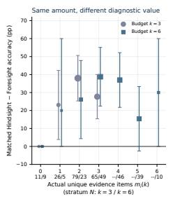

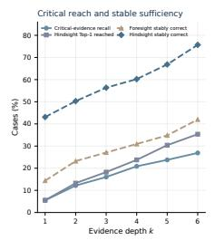

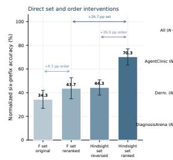

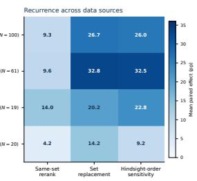  
Figure 9: Four aligned supplementary panels for Experiment C: residual diagnostic gap within actual fact-count strata; critical-fact reach and six-step stable sufficiency; four set/order arms; and source-stratified effects. The horizontal four-panel arrangement keeps equally sized panels at the same visual scale.

The case mix makes the direction of these aggregate effects inspectable. For AgentClinic $( N = 6 1 )$ dermatology $( N = 1 9 )$ , and DiagnosisArena $\bar { ( N = 2 0 ) }$ , the same-set reranking gains are respectively 9.6, 14.0, and 4.2 points; the set contrasts are 32.8, 20.2, and 14.2 points; and Hindsight-order sensitivities are 32.5, 22.8, and 9.2 points. These subgroup means are exploratory and their smaller denominators do not support a ranking of source families.

## Clinical case study: C.3: A skin lesion whose identifying sign was not requested

In dermatology case case 34, a 44-year-old woman has a longstanding left shin nodule; the reference diagnosis is dermatofibroma. The completed case contains inward dimpling on pressure (E6), which the Hindsight selector ranks first. Foresight instead obtains irritation while shaving (P5), absence of pain/tenderness (P6), and location on the shin (E5), with three duplicate-return actions. The original prospective order produces no correct diagnosis at any of six prefixes (FF AUSC 0); reranking only those same three facts makes the probe correct at prefixes 3–6 (FR AUSC 4/6). Hindsight’s selected set in Hindsight order gives the correct diagnosis at all six prefixes (HH AUSC 1), while reversing it delays correctness until prefix 4 (HR $\mathrm { { A U S C 3 / 6 ) } }$ . The case shows why order can matter even when the set is unchanged and why ordering the acquired set cannot recover a high-ranked fact that was never obtained.

## D.4 DISTRIBUTIONAL CHANGE AND TRUTH-DIRECTED VALUE

The C2 scatter compares two quantities computed from a fixed candidate support within each case. For elicited distributions p and q at two depths, their Jensen–Shannon divergence is $\mathrm { J S D } ( p , q ) =$ $\begin{array} { r l r } { \frac { 1 } { 2 } \mathrm { K L } _ { 2 } ( p \| m ) + \frac { 1 } { 2 } \mathrm { K L } _ { 2 } ( q \| m ) } & { { } } & { } \end{array}$ , where $m = { ( p + q ) } / { 2 } ;$ it measures update magnitude in bits, with no direction toward the reference answer. The truth-directed coordinate is $\Delta p _ { \mathrm { r e f } } = q ( y _ { i } ) - p ( y _ { i } )$ ; positive values move probability mass toward the reference diagnosis. Entropy is $\begin{array} { r } { H ( p ) = - \sum _ { j } p _ { j } \log _ { 2 } p _ { j } ; } \end{array}$ for the separate heatmap experiment it is normalized by $\log _ { 2 } J _ { i }$ , where $J _ { i }$ is that case’s actual fixed support size. Lower entropy alone does not establish better diagnosis. The probability vector is an elicited output to an explicit allocation prompt, not an observation of the model’s internal belief.

Table 16: Six-step C2 scatter inputs from the 181-case rereadout, restricted to intervals with at least one new fact. Means and percentile 95% case-bootstrap intervals are shown for JSD (bits) and reference-probability change. Denominators are case–intervals, not a fixed 50-case heatmap sample.
<table><tr><td>Sequence</td><td>Interval</td><td>n</td><td>Mean JSD [95% CI]</td><td>Mean  $\Delta p _ { \mathrm { r e f } }$  [95% CI]</td></tr><tr><td>Foresight</td><td> $0  3$ </td><td>170</td><td>0.531 [0.472, 0.586]</td><td>0.084 [0.043, 0.127]</td></tr><tr><td>Foresight</td><td> $3  6$ </td><td>146</td><td>0.509 [0.449, 0.572]</td><td>0.099 [0.040, 0.157]</td></tr><tr><td>Hindsight</td><td> $0  3$ </td><td>181</td><td>0.633 [0.578, 0.686]</td><td>0.298 [0.239, 0.359]</td></tr><tr><td>Hindsight</td><td> $3  6$ </td><td>181</td><td>0.477 [0.420, 0.536]</td><td>0.053 [-0.015, 0.122]</td></tr></table>

The six-step scatter comparisons in Table 16 come from the 181-case fixed-support current-protocol rereadout, at endpoints 0, 3, 6. An interval is included only if at least one new unique fact appears between its endpoints, so the denominators vary. The bridge to older probability calls failed its prespecified agreement gate; the published six-step comparisons use newly measured states under one current protocol rather than mixing batches. In this readout run, the probability allocator received the current clinical state and a frozen, case-specific set of anonymized candidate IDs including OTHER; its JSON response had to assign a probability to every supplied ID and sum to one. The run used deepseek/deepseek-v3.2 through OpenRouter at temperature zero, reasoning effort=low, JSON-object response format, a 7,500-token completion cap, and batches of at most eight tasks with no case repeated inside a batch. The post-gate amendment renormalized all collected state vectors by their raw sum, with raw vectors retained; interval means use 10,000 case-level bootstrap draws. The adjacent $p _ { \mathrm { r e f } }$ /normalized-entropy heatmaps shown in the main figure come from a separate aligned 50-case experiment with four independent readouts per state (base twice, candidate order reversed, and rotated). Those heatmaps and the scatter do not share one 50-case denominator or one readout protocol. In the 50-case study, the actual initial-only diagnoses form a case-specific candidate list, the reference diagnosis is inserted as an unmarked candidate when needed, and OTHER is appended; candidate coordinates are aggregated by a median and renormalized. The formal collection used DeepSeek V3.2 via OpenRouter, temperature zero, reasoning effort=none, and a 512-token completion cap, with a 10,000-draw nested case/replicate bootstrap.

The main contrast is at 0 → 3: mean JSD differs by about 0.103 bits, whereas mean truth-directed change differs by about 0.214 in probability. That is a descriptive contrast in the elicited distributions. It does not identify the expected information gain of an action or a latent belief transition. Sameevidence negative controls show that elicited probability vectors can change even without a new fact. Individual scatter points therefore need particular caution; aggregate contrasts and the new-fact restriction are more defensible. The separate 50-case experiment also documented candidate-order and repeated-readout variation. No per-case probability from one protocol is combined numerically with the other protocol.

## Clinical case study: C.4: Change without movement toward the diagnosis

For agentclinic medqa 108, the initial complaint is a year of dyspnea in a 60-year-old man, and the reference diagnosis is silicosis. By prospective request 3, the acquired facts are absence of recent fever, chest pain, wheeze, or cough (P7) and worsening with exertion (P4); the occupational and radiographic findings have not arrived. The 181-case scatter records a large 0 → 3 Foresight JSD of 0.855 bits, yet $\Delta p _ { \mathrm { r e f } } = - 0 . 0 5 0$ . Hindsight’s first three ranked facts are eggshell lymph-node calcification (E2), interstitial reticulonodular infiltrates (E1), and prolonged silica exposure (P8); its corresponding JSD is 0.759 bits and $\Delta p _ { \mathrm { r e f } } = + 0 . 8 5 0$ . The signs and probabilities are from the same frozen 181-case scatter protocol. This example makes the distinction between update magnitude and direction tangible; it is not an individual causal estimate.

Claim boundary. Count matching fixes quantity but not identity; same-set reranking fixes identity but changes order; set replacement uses retrospective information; and probability allocation adds a measurement layer with observable instability. Together the accuracy-based controls support an acquired-fact composition and timing deficit. They do not establish clinical safety, an optimal prospective strategy, or direct access to an internal diagnostic state.

## E EXPERIMENT D: DIAGNOSTIC UPDATING AFTER EVIDENCE ARRIVES

The D analyses use three distinct estimands: observed transitions after a naturally acquired fact, elicited distributions at frozen evidence prefixes, and immediate diagnostic rescue after an inserted fact. Hindsight is a retrospective reference, not an online policy.

## E.1 OBSERVED STATE TRANSITIONS

The 181 primary cases have five adjacent transitions across six diagnostic prefixes. Each transition is wrong-to-wrong (WW), wrong-to-correct (WC), correct-to-correct (CC), or correct-to-wrong (CW), using independent diagnosis-equivalence grades. Table 17 reports all event denominators. Of 630 transitions beginning wrong, 572 remain wrong (90.8%); 259/275 transitions beginning correct stay correct (94.2%). Wrong-state persistence is 272/330 when a new fact arrives and 300/300 when the next action is stagnant. New evidence is therefore necessary for a correct transition in these observed rows, but is not sufficient. In 95/181 cases (52.5%), all diagnoses at $k = 1 , \ldots , 6$ are wrong. The case-mean action-stagnation rate is 41.3%; next-action recovery after a duplicate or no-match is 134/343 (39.1%).

Table 17: Primary six-step trajectory dynamics. ECNR conditions on an initially wrong state followed by a newly arrived hindsight Top-r fact. Intervals use 10,000 case-cluster bootstrap draws, seed 20260920.
<table><tr><td>Measure</td><td>Numerator</td><td>Denominator</td><td>Estimate (95% CI)</td></tr><tr><td>Wrong-state persistence</td><td>572</td><td>630</td><td>90.8% [88.2, 93.1]</td></tr><tr><td>Wrong-to-correct transition</td><td>58</td><td>630</td><td>9.2% [6.9, 11.8]</td></tr><tr><td>Correct-state retention</td><td>259</td><td>275</td><td>94.2% [90.9, 96.9]</td></tr><tr><td>Action stagnation rate</td><td></td><td>181 cases</td><td>41.3% [37.9, 44.8]</td></tr><tr><td>Failure recovery by next action</td><td>134</td><td>343</td><td>39.1% [33.2, 45.4]</td></tr><tr><td>ECNR@1</td><td>15</td><td>38</td><td>39.5% [23.9, 55.6]</td></tr><tr><td>ECNR@3</td><td>48</td><td>91</td><td>52.7% [42.4, 62.7]</td></tr><tr><td>ECNR@6</td><td>106</td><td>159</td><td>66.7% [58.9, 74.0]</td></tr></table>

These event rates are clustered within cases and are not independent-binomial estimates.

## E.2 FOUR-INTERVAL FIXED-SUPPORT READOUT

A current-protocol batch remeasured the same 181 cases at a common $k = 0$ and at $k = 3 , 6 , 9 , 1 2$ under each evidence path: $1 8 1 ( 1 + 2 \times 4 ) = 1 , 6 2 9$ states. The within-case candidate support includes OTHER and remains fixed. All 1,629 states are structurally valid. A 30-case bridge failed the prespecified agreement gates against historical $k = 0 , 3 ,$ 6 data (Top-1 0.440, reference-probability Spearman 0.540, entropy Spearman 0.082, median JSD 0.388 bits); the four-interval estimates therefore use only the current batch.

Table 18: Mean change [case-bootstrap 95% CI] in elicited reference-diagnosis probability, $N = 1 8 1$ per interval. The last column is the Hindsight-minus-Foresight difference in changes.
<table><tr><td>Interval</td><td>Foresight</td><td>Hindsight</td><td>Hind – Fore</td></tr><tr><td>0 → 3</td><td>0.075 [0.036, 0.116]</td><td>0.298 [0.239, 0.359]</td><td>0.223 [0.153, 0.293]</td></tr><tr><td> $3  6$ </td><td>0.086 [0.037, 0.135]</td><td>0.053 [-0.016, 0.121]</td><td>-0.032 [-0.120, 0.054]</td></tr><tr><td> $6  9$ </td><td>0.076 [0.024, 0.131]</td><td>0.034 [-0.030, 0.100]</td><td>-0.042 [-0.122, 0.038]</td></tr><tr><td> $9  1 2$ </td><td>-0.027 [-0.088, 0.032]</td><td>-0.036 [-0.106, 0.032]</td><td>-0.009 [-0.101, 0.080]</td></tr></table>

Table 19: Mean change [case-bootstrap 95% CI] in elicited entropy, in bits, from the same currentprotocol states. A decrease means greater concentration, regardless of diagnostic correctness.
<table><tr><td>Interval</td><td>Foresight</td><td>Hindsight</td><td>Hind – Fore</td></tr><tr><td>0 → 3</td><td>-0.059 [-0.320, 0.200]</td><td>-0.439 [-0.680, -0.199]</td><td>-0.380 [-0.609, -0.155]</td></tr><tr><td>3 → 6</td><td>-0.150 [-0.395, 0.093]</td><td>-0.033 [-0.217, 0.154]</td><td>0.117 [-0.201, 0.429]</td></tr><tr><td> $6  9$ </td><td>-0.097 [-0.310, 0.117]</td><td>-0.011 [-0.179, 0.157]</td><td>0.085 [-0.206, 0.365]</td></tr><tr><td>9 → 12</td><td>0.080 [-0.131, 0.293]</td><td>-0.110 [-0.269, 0.051]</td><td>-0.190 [-0.462, 0.086]</td></tr></table>

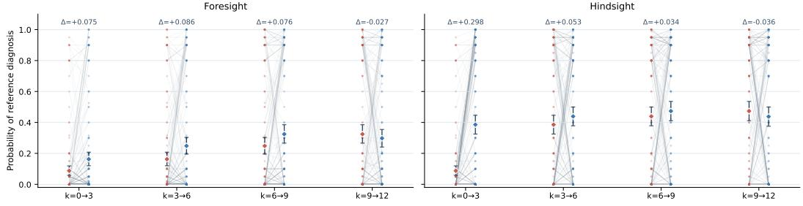  
Fixed-support probability readouts across four measured intervals Interval start Interval end Mean and 95% bootstrap C

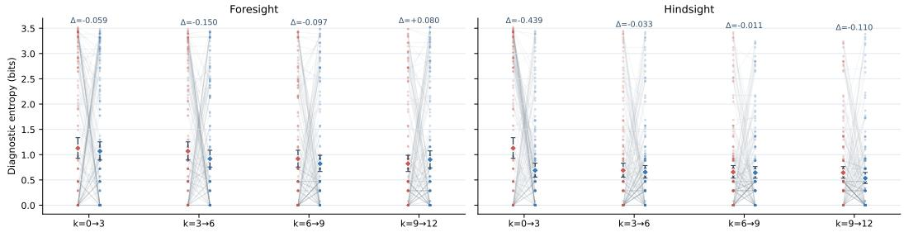  
Fixed-support diagnostic entropy across four measured intervals Interval start Interval end Mean and 95% bootstrap C  
Figure 10: Detailed current-protocol state-pair readouts for the 181 cases. The upper two panels show reference-diagnosis probability and the lower two show diagnostic entropy, each separated by Foresight and Hindsight. Faint lines represent individual elicited state pairs; diamonds and interval summarize endpoint means. The main figure reports the more legible interval changes from these same states.

Over the first three request steps, Hindsight raises mean $p _ { \mathrm { r e f } }$ by 0.298 versus 0.075 for Foresight; the difference in changes is 0.223 [0.153, 0.293]. Hindsight entropy falls by 0.439 bits, whereas the Foresight change is -0.059 [-0.320, 0.200]. Later between-condition contrasts have intervals crossing zero. These are elicited probability readouts, not direct observations of latent model belief.

The same deterministic projection $p _ { j } ^ { \prime } = p _ { j } / \sum _ { \ell } p _ { \ell }$ was applied to all structurally valid current-batch vectors. Before projection, 28/1,629 vectors in 24 cases had raw mass differing from one by more than 0.01 (range 0.90–1.10). Excluding all 24 affected cases leaves the first hindsight interval at +0.294 [0.230, 0.360]. Identical-evidence negative controls have 37.5–52.9% Top-1 changes and mean JSD 0.37–0.45 bits. Therefore individual-state lines illustrate heterogeneity, and small changes within one case should not be treated as causal evidence effects.

## E.3 RANK-BY-TIMING RESCUE

The main D.2 experiment starts from the fixed 140-case twelve-step subset of the primary cohort. Its fixed complete grid contains 33 cases eligible for all 15 cells: Hindsight rank $r \in \{ 1 , 2 , 3 \}$ crossed with insertion after Atomic step $k \in \{ 1 , 3 , 6 , 9 , 1 2 \}$ . At every cell, the critical and control probes share the same initial presentation and Atomic prefix; only the appended fact changes. Frozen controls are unseen through step 12, outside Hindsight ranks 1–6, and selected by a documented broad modality/inventory fallback. This is not information-equivalent matching. A repeated unaugmented prefix estimates output variability. The endpoint is correctness immediately after insertion.

Table 20: Fixed complete-grid rescue $( N = 3 3$ in every cell). Critical and control columns are percent correct; difference is percentage points [case-cluster 95% CI].
<table><tr><td>Hindsight rank</td><td>k</td><td>N</td><td>Critical</td><td>Control</td><td>Difference [95% CI]</td></tr><tr><td>1</td><td>1</td><td>33</td><td>48.5</td><td>3.0</td><td>45.5 [27.3, 63.6]</td></tr><tr><td>1</td><td>3</td><td>33</td><td>39.4</td><td>3.0</td><td>36.4 [18.2, 54.5]</td></tr><tr><td>1</td><td>6</td><td>33</td><td>45.5</td><td>6.1</td><td>39.4 [21.2, 57.6]</td></tr><tr><td>1</td><td>9</td><td>33</td><td>45.5</td><td>9.1</td><td>36.4 [15.2, 57.6]</td></tr><tr><td>1</td><td>12</td><td>33</td><td>42.4</td><td>6.1</td><td>36.4 [18.2, 54.5]</td></tr><tr><td>2</td><td>1</td><td>33</td><td>27.3</td><td>9.1</td><td>18.2 [0.0, 36.4]</td></tr><tr><td>2</td><td>3</td><td>33</td><td>39.4</td><td>6.1</td><td>33.3 [15.2, 51.5]</td></tr><tr><td>2</td><td>6</td><td>33</td><td>33.3</td><td>6.1</td><td>27.3 [9.1, 45.5]</td></tr><tr><td>2</td><td>9</td><td>33</td><td>24.2</td><td>6.1</td><td>18.2 [3.0, 33.3]</td></tr><tr><td>2</td><td>12</td><td>33</td><td>33.3</td><td>6.1</td><td>27.3 [9.1, 45.5]</td></tr><tr><td>3</td><td>1</td><td>33</td><td>12.1</td><td>6.1</td><td>6.1 [0.0, 15.2]</td></tr><tr><td>3</td><td>3</td><td>33</td><td>15.2</td><td>6.1</td><td>9.1 [0.0, 21.2]</td></tr><tr><td>3</td><td>6</td><td>33</td><td>24.2</td><td>9.1</td><td>15.2 [-3.0, 33.3]</td></tr><tr><td>3</td><td>9</td><td>33</td><td>15.2</td><td>9.1</td><td>6.1 [0.0, 15.2]</td></tr><tr><td>3</td><td>12</td><td>33</td><td>21.2</td><td>6.1</td><td>15.2 [3.0, 27.3]</td></tr></table>

Across the five depths, mean critical-minus-control rescue is $+ 3 8 . 8 , + 2 4 . 8 ,$ , and +10.3 points for ranks 1, 2, and 3. The Rank-1-minus-Rank-3 contrast is $+ 2 8 . 5 [ 1 0 . 9 , 4 6 . 7 ]$ , Holm-adjusted $p = 0 . 0 1 6 3$ after 200,000 sign-flip permutations. The Rank-1 k = 1 versus k = 12 contrast is +9.1 [-3.0, 21.2], adjusted $p = 0 . 3 7 4 7$ ; the rank-by-time interaction $\mathrm { i s } + 1 8 . 2 [ 0 . 0 , 3 6 . 4 ]$ , adjusted $p = 0 . 2 2 0 2$ . The fixed-grid data support a rank effect more clearly than a timing effect.

Natural-arrival nonresponse is 15/38 for Rank 1, 33/53 for Ranks 2–3, and 58/68 for Ranks 4–6. Frozen correctness retests agree in 89.4% of states, but normalized exact Top-1 strings agree in 41.6%; the sign of the critical-minus-control effect agrees in 12/15 cells.

## Clinical case study: D.2: Chronic cough and rank-dependent rescue

Case agentclinic medqa 151 is a 50-year-old man with two months of cough; the reference diagnosis is Valley fever. Hindsight Rank 1 is pathology describing necrotizing granulomas with spherules and endospores (E5); Rank 2 is hiking near Phoenix (P11); Rank 3 is positive PAS/silver staining (E10). The respective controls are no joint deformity (E20), occasional alcohol use (P10), and blood pressure 120/82 (E13), matched only on recorded coarse modality. The unaugmented repeat predicts upper airway cough syndrome and is incorrect at all five depths. Appending E5 yields coccidioidomycosis and is correct in 5/5 probes; appending P11 is also correct in 5/5; E10 instead leads to an incorrect Pneumocystis diagnosis in 5/5. All fifteen controls remain incorrect. This illustration does not estimate a population effect.

Table 21: All-eligible sensitivity. Every critical-minus-control point estimate is positive, but the denominator changes by rank and depth; these rows are not a fixed-cohort timing series.
<table><tr><td>Hindsight rank</td><td>k</td><td>N</td><td>Critical</td><td>Control</td><td>Difference [95% CI]</td></tr><tr><td>1</td><td>1</td><td>114</td><td>59.6</td><td>5.3</td><td>54.4 [44.7, 64.0]</td></tr><tr><td>1</td><td>3</td><td>95</td><td>47.4</td><td>10.5</td><td>36.8 [25.3, 48.4]</td></tr><tr><td>1</td><td>6</td><td>76</td><td>52.6</td><td>7.9</td><td>44.7 [32.9, 56.6]</td></tr><tr><td>1</td><td>9</td><td>61</td><td>50.8</td><td>14.8</td><td>36.1 [21.3, 50.8]</td></tr><tr><td>1</td><td>12</td><td>52</td><td>48.1</td><td>9.6</td><td>38.5 [23.1, 53.8]</td></tr><tr><td>2</td><td>1</td><td>117</td><td>35.0</td><td>5.1</td><td>29.9 [20.5, 39.3]</td></tr><tr><td>2</td><td>3</td><td>94</td><td>38.3</td><td>7.4</td><td>30.9 [21.3, 41.5]</td></tr><tr><td>2</td><td>6</td><td>74</td><td>36.5</td><td>10.8</td><td>25.7 [12.2, 37.8]</td></tr><tr><td>2</td><td>9</td><td>61</td><td>32.8</td><td>11.5</td><td>21.3 [8.2, 34.4]</td></tr><tr><td>2</td><td>12</td><td>56</td><td>37.5</td><td>12.5</td><td>25.0 [10.7, 39.3]</td></tr><tr><td>3</td><td>1</td><td>117</td><td>20.5</td><td>4.3</td><td>16.2 [9.4, 23.1]</td></tr><tr><td>3</td><td>3</td><td>91</td><td>24.2</td><td>7.7</td><td>16.5 [8.8, 25.3]</td></tr><tr><td>3</td><td>6</td><td>75</td><td>34.7</td><td>13.3</td><td>21.3 [10.7, 33.3]</td></tr><tr><td>3</td><td>9</td><td>66</td><td>27.3</td><td>15.2</td><td>12.1 [4.5, 19.7]</td></tr><tr><td>3</td><td>12</td><td>59</td><td>30.5</td><td>10.2</td><td>20.3 [8.5, 32.2]</td></tr></table>

a Critical minus control  
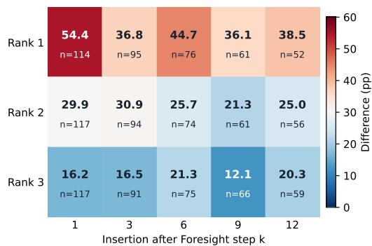

b Critical-fact rescue  
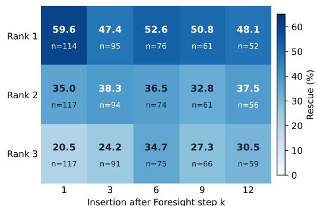

c Same-case control rescue  
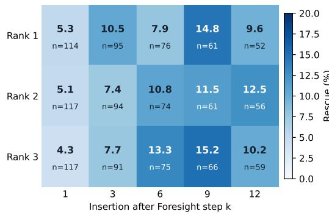

d Unaugmented repeat rescue  
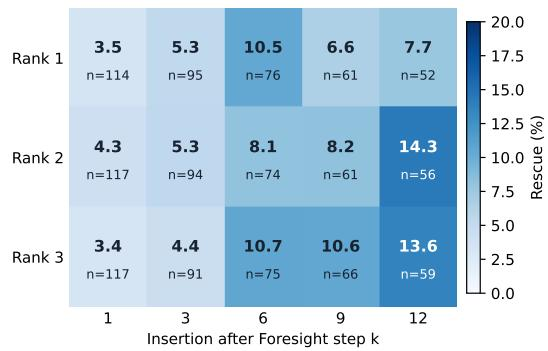  
Figure 11: Four panels for the all-eligible D.2 sensitivity analysis: critical-minus-control rescue in percentage points, critical-fact rescue, pre-frozen same-case control rescue, and unaugmented repeat rescue. Each cell prints its eligible count; denominators vary across ranks and insertion depths and cannot be read as a fixed-cohort timing series. The control follows the coarse modality/inventory rule.

## E.4 DISTINCT SINGLE-FACT ATOMIC@3 RESCUE

A second, separately frozen intervention contains 114 primary cases that were wrong at Atomic@3, had not acquired Hindsight Top-1, and had a complete diagnostic probe. S0 is the original wrong result. S1 appends the missing Hindsight Top-1; S2 appends one frozen unseen same-case control outside Hindsight Top-3, preferring the same recorded modality and using a documented fallback otherwise. Both use the identical Atomic@3 prefix, with the added fact last. These 114 cases are not the 33 complete-grid cases and the effects must not be pooled. S1 rescues 19/114 (16.7%), versus

Table 22: Frozen N = 114 single-fact rescue. The difference is paired percentage points; the worst-case row conservatively scores two transport-salvaged outputs.
<table><tr><td>Condition/contrast</td><td>Numerator</td><td>N</td><td>Estimate (95% CI)</td></tr><tr><td>S1: add missing Hindsight Top-1</td><td>19</td><td>114</td><td>16.7% [9.6, 23.7]</td></tr><tr><td>S2: add random unseen control</td><td>6</td><td>114</td><td>5.3% [1.8, 9.6]</td></tr><tr><td>Paired S1-S2</td><td>13</td><td>114</td><td>11.4 pp [4.4, 19.3]</td></tr><tr><td>Worst-case S1 (2 salvages incorrect)</td><td>18</td><td>114</td><td>15.8% [9.6, 22.8]</td></tr></table>

Table 23: Exploratory single-fact strata by clean-prefix sufficiency and control-modality fallback.
<table><tr><td>Subset</td><td>S1 correct</td><td>S2 correct</td><td>N</td><td>Paired difference (95% CI)</td></tr><tr><td>Hindsight Top-1 prefix correct</td><td>18</td><td>5</td><td>53</td><td>24.5 pp [11.3, 37.7]</td></tr><tr><td>Hindsight Top-1 prefix incorrect</td><td>1</td><td>1</td><td>61</td><td>0.0 pp [-4.9, 4.9]</td></tr><tr><td>Control modality matched</td><td>12</td><td>4</td><td>83</td><td>9.6 pp [2.4, 18.1]</td></tr><tr><td>Control fallback modality</td><td>7</td><td>2</td><td>31</td><td>16.1 pp [0.0, 32.3]</td></tr></table>

6/114 (5.3%) for S2: paired +11.4 points [4.4, 19.3], exact McNemar p = 0.0044. In the 53 cases where Hindsight Top-1 alone diagnoses correctly from a clean prefix, the S1-S2 contrast is +24.5 points; it is 0.0 in the other 61. This post-hoc split describes heterogeneity and does not identify a unique mechanism.

Clinical case study: D.3: Recurrent lesions in a child

In agentclinic medqa 114, a three-year-old has recurrent skin lesions since infancy. Atomic@3 predicts atopic dermatitis. Adding missed Hindsight Top-1 E4 (abnormal nitroblue tetrazolium test) changes the diagnosis to chronic granulomatous disease, whereas frozen control E9 (respiratory-rate record) leaves the atopic-dermatitis prediction. This is an observed diagnostic intervention, not evidence that a prospective agent knew to request E4.

## E.5 SECONDARY READOUT AND VALUE ANALYSES

Readout robustness uses 120 isolated states: 40 initial, 40 Atomic@3, and 40 Hindsight@3. Each has identical repeats, candidate-order permutations, and a paraphrased prompt; a separate audit replaces low-probability candidates. Moderate entropy stability and support sensitivity rule out treating any one vector as a validated internal belief. Descriptive calibration across 120 states gives 10-bin ECE 0.135, Brier 0.872, and log loss 3.631. A bounded local fact panel spans 200 t = 0, 3 decision points from 100 cases, but 138 points in 92 cases have a matched actual choice and at least two valid candidates. Mean actual-choice value percentile is 0.401 [0.350, 0.453]; only 7.2% choose the highest-TDG candidate. The separate free/menu/random policy comparison below has different estimability subsets and should not be equated with that estimate. TDG is a realized log-probability change, not prospective expected information gain. Changing the reference-probability floor from $1 0 ^ { - 6 }$ to $1 0 ^ { - 9 }$ changes some mean TDG values by as much as 1.156 bits. This analysis does not support preferential selection of the highest-value candidate.

Table 24: Elicited-readout reliability. Top-1 is agreement; probability and entropy columns are Spearman correlations; JSD is median Jensen–Shannon divergence.
<table><tr><td>Perturbation</td><td>Top-1</td><td>ρ(gold)</td><td>ρ(entropy)</td><td>Median JSD</td></tr><tr><td>Test-retest</td><td>75.4%</td><td>0.867</td><td>0.556</td><td>0.081</td></tr><tr><td>Candidate order</td><td>65.4%</td><td>0.814</td><td>0.485</td><td>0.088</td></tr><tr><td>Prompt paraphrase</td><td>66.7%</td><td>0.680</td><td>0.479</td><td>0.093</td></tr><tr><td>Candidate-support replacement</td><td>68.3%</td><td>0.823</td><td>0.550</td><td>0.100</td></tr></table>

Table 25: Local choice-value comparison. CVP is choice-value percentile; selected TDG is in bits.
<table><tr><td>Choice policy</td><td>Estimable</td><td>Mean CVP</td><td>Mean selected TDG</td></tr><tr><td>Actual free</td><td>138</td><td>0.570</td><td>2.274</td></tr><tr><td>Prospective menu</td><td>147</td><td>0.565</td><td>2.750</td></tr><tr><td>Random panel</td><td>200</td><td>0.639</td><td>2.207</td></tr></table>

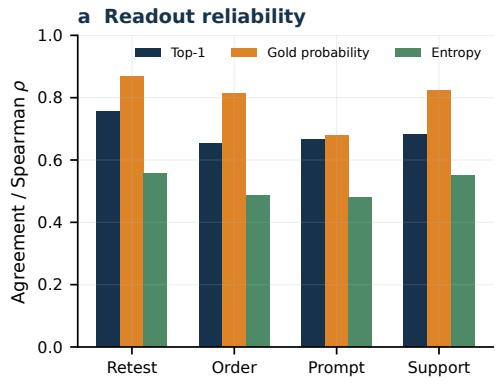

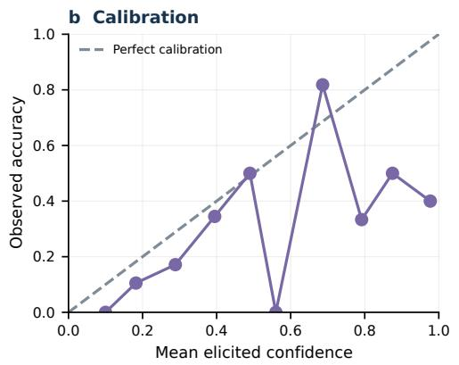

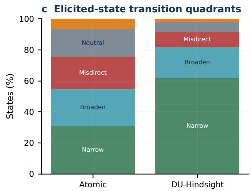

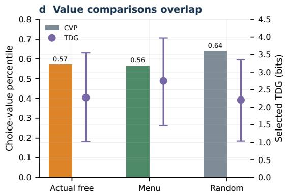  
Figure 12: Four aligned secondary panels: readout reliability, calibration, elicited-state transition classes, and local value-policy comparison. These analyses are sensitivity evidence.

## F EXPERIMENT E: ROBUSTNESS, RECURRENCE, AND EXTERNAL TRANSFER

## F.1 SELECTOR REPEATABILITY AND DOWNSTREAM SENSITIVITY

The primary Hindsight selector sees the complete realized non-initial fact pool but neither the reference diagnosis nor Fullsight output. The selector audit freezes 100 cases, makes three independent repeats, two fact-order permutations, and one prompt paraphrase, and separately tests GPT-5.5 and Gemini 3.1 Pro Preview as alternative selectors on 80 cases. In the three-repeat pairwise distribution, mean Top-1 agreement is 83.7%, Top-3 Jaccard is 0.789, and rank-biased overlap at six is 0.862. The selector is therefore not deterministic at the fact level. Table 26 reports each variant’s agreement and downstream Hindsight@3 diagnostic accuracy; positive retrospective utility survives the tested perturbations, while exact ranks vary.

Table 26: Selector perturbation audit. Agreement is against the primary selector; Hindsight@3 is the resulting diagnostic accuracy, not a selector accuracy score. Alternative-model rows have $N = 8 0$ same-model perturbations have $N = 1 0 0$
<table><tr><td>Selector</td><td>Variant</td><td>Top-1</td><td>Jaccard</td><td>RBO@6</td><td>Hindsight@3</td></tr><tr><td>Gemini</td><td>cross selector</td><td>72.5%</td><td>0.713</td><td>0.809</td><td>72.5%</td></tr><tr><td>GPT</td><td>cross selector</td><td>67.5%</td><td>0.710</td><td>0.805</td><td>73.8%</td></tr><tr><td>DS</td><td>order 1</td><td>77.0%</td><td>0.719</td><td>0.829</td><td>70.0%</td></tr><tr><td>DS</td><td>order 2</td><td>77.0%</td><td>0.769</td><td>0.833</td><td>70.0%</td></tr><tr><td>DS</td><td>primary</td><td>100.0%</td><td>1.000</td><td>1.000</td><td>76.0%</td></tr><tr><td>DS</td><td>prompt alt</td><td>78.0%</td><td>0.747</td><td>0.829</td><td>72.0%</td></tr><tr><td>DS</td><td>repeat 1</td><td>79.0%</td><td>0.769</td><td>0.854</td><td>70.0%</td></tr><tr><td>DS</td><td>repeat 2</td><td>80.0%</td><td>0.813</td><td>0.851</td><td>71.0%</td></tr><tr><td>DS</td><td>repeat 3</td><td>80.0%</td><td>0.798</td><td>0.866</td><td>68.0%</td></tr></table>

The candidate pool, IDs, diagnostic probe, and clinical label are held fixed while the ranking call changes. The first two facts in a perturbed ranking may differ from the primary ranking, so this is a sensitivity test of the claim, not evidence of a unique ground-truth evidence order.

## F.2 SHARED-CASE MODEL AND SOURCE RECURRENCE

The paired four-model replication uses the identical 59 eligible cases for DeepSeek V3.2, GPT-5.5, Gemini 3.1 Pro Preview, and GLM 5.2. The acquisition/diagnosis roles use the model assigned to each condition; the diagnosis-equivalence judge is separate. The gap is positive in all four point estimates. Gemini’s 95% interval includes zero, so this is directional recurrence, not a claim that every backbone has a statistically resolved gap.

Table 27: Paired three-action recognition-acquisition gap on the same 59 cases per model. The gap interval resamples shared cases and is not a model ranking.
<table><tr><td>Model</td><td>Atomic@3</td><td>Hindsight@3</td><td>Gap</td><td>95% CI</td></tr><tr><td>DeepSeek V3.2</td><td>35.6%</td><td>55.9%</td><td>20.3%</td><td>[6.8%, 33.9%]</td></tr><tr><td>GPT-5.5</td><td>47.5%</td><td>66.1%</td><td>18.6%</td><td>[10.2%, 28.8%]</td></tr><tr><td>Gemini 3.1 Pro Preview</td><td>54.2%</td><td>62.7%</td><td>8.5%</td><td>[-3.4%, 20.3%]</td></tr><tr><td>GLM 5.2</td><td>37.3%</td><td>61.0%</td><td>23.7%</td><td>[11.9%, 37.3%]</td></tr></table>

A separate shared 50-case menu control gives the following free/menu/Hindsight accuracies at three actions: DeepSeek 40/52/60%, Gemini 56/58/70%, GLM 40/48/66%, and GPT-5.5 52/60/68%. This subset asks a different interface question from the 59-case paired replication and is not pooled with it. Within the 181-case primary cohort, the three source strata at k = 3 are AgentClinic MedQA (N = 98): Foresight 34.7%, Hindsight 80.6%, gap 45.9 points; dermatology (N = 49): 42.9%, 85.7%, gap 42.9; DiagnosisArena (N = 34): 14.7%, 35.3%, gap 20.6. These are conditional-on-Fullsight-correct source comparisons; the small DiagnosisArena eligible stratum limits precision.

## F.3 EVIMED/REFINE BRIDGE

The external bridge uses 200 cases, 50 each from AgentClinic MedQA, DiagnosisArena, RareArena, and Derm/CRAFT-MD, after source-aware ID, normalized-text-hash, and high-similarity overlap audits against the internal campaign. Doctor, patient/reporter, summarizer, diagnostician, and verifier use DeepSeek V3.2 at temperature zero. The official baseline and REFINE retain their official roles, action space, indexed-fact patient/reporter response rules, stopping rule, and summarizerdiagnostician-verifier loop. A compatibility adapter multiplexes independent cases through a JSON transport envelope; it changes transport, not case-local visibility. The global 103-target result-blind menu is an additional interface control. The Hindsight path remains a retrospective, non-interactive reference.

Table 28: EviMed at the official 16-turn budget, N = 200 per strategy. ICR is indexed-reference information coverage; diagnostic accuracy is independently graded; facts are mean unique realized items. The Hindsight row is retrospective and acquires more facts.
<table><tr><td>Strategy</td><td>ICR</td><td>Accuracy</td><td>Unique facts</td><td>No-new rate</td></tr><tr><td>Official baseline</td><td>28.3%</td><td>23.5%</td><td>5.74</td><td>0.0%</td></tr><tr><td>Menu control</td><td>32.6%</td><td>35.0%</td><td>6.49</td><td>82.7%</td></tr><tr><td>Official REFINE</td><td>46.2%</td><td>38.0%</td><td>9.48</td><td>0.0%</td></tr><tr><td>Hindsight reference</td><td>73.3%</td><td>53.0%</td><td>14.12</td><td>0.0%</td></tr></table>

Table 29: EviMed prefix endpoints. The rows at 3 and 6 turns are descriptive; the official evaluation budget is 16 turns. ICR and accuracy entries are percentages.
<table><tr><td>k</td><td>Strategy</td><td>ICR</td><td>Accuracy</td><td>Facts</td></tr><tr><td>3</td><td>Official baseline</td><td>16.0</td><td>16.0</td><td>2.98</td></tr><tr><td>3</td><td>Menu</td><td>23.2</td><td>19.0</td><td>4.26</td></tr><tr><td>3</td><td>REFINE</td><td>16.5</td><td>14.0</td><td>2.93</td></tr><tr><td>3</td><td>Hindsight reference</td><td>18.9</td><td>36.0</td><td>3.00</td></tr><tr><td>6</td><td>Official baseline</td><td>25.2</td><td>22.0</td><td>5.01</td></tr><tr><td>6</td><td>Menu</td><td>27.1</td><td>25.5</td><td>5.20</td></tr><tr><td>6</td><td>REFINE</td><td>29.6</td><td>27.0</td><td>5.88</td></tr><tr><td>6</td><td>Hindsight reference</td><td>36.8</td><td>42.5</td><td>5.96</td></tr><tr><td>16</td><td>Official baseline</td><td>28.3</td><td>23.5</td><td>5.74</td></tr><tr><td>16</td><td>Menu</td><td>32.6</td><td>35.0</td><td>6.49</td></tr><tr><td>16</td><td>REFINE</td><td>46.2</td><td>38.0</td><td>9.48</td></tr><tr><td>16</td><td>Hindsight reference</td><td>73.3</td><td>53.0</td><td>14.12</td></tr></table>

At 16 turns, REFINE exceeds the official free-form baseline by 17.9 ICR points (46.2% versus 28.3%) and 14.5 accuracy points (38.0% versus 23.5%). REFINE also obtains 9.48 versus 5.74 unique facts on average. The comparison therefore establishes that a stronger prospective workflow can improve realized coverage and diagnosis, but it is not an equal-evidence-quantity mechanism test. At the same budget, the menu obtains 6.49 facts and 35.0% accuracy; the retrospective Hindsight reference obtains 14.12 and 53.0%.

## F.4 INTERPRETATION OF RECURRENCE

The 140-case twelve-action continuation is a fixed subset of the strict 181-case cohort; the 59-case model replication and 200-case external bridge answer separate questions with different budgets and interfaces. Their directional results support recurrence of an acquisition problem. They do not provide a pooled clinical accuracy estimate, show that Hindsight is prospectively attainable, or remove simulator and readout limitations

## G QUALITY CONTROLS, EXECUTION, AND CLAIM BOUNDARIES

## G.1 NUMERICAL AND PROTOCOL CHECKS

The analyses retain case identifiers across eligibility, evidence acquisition, diagnostic readouts, and interventions, allowing denominators to be checked at the case, step, and case–interval levels. The primary six-step analyses use 181 eligible cases; the extended action analyses use the fixed 140-case subset; the diagnostic-menu comparison uses 120 cases; and the complete rank-by-timing intervention grid uses 33 cases. The corresponding all-eligible rank-by-timing analysis has varying denominators and is reported separately as a sensitivity analysis. Bootstrap resampling is clustered by case when a case contributes multiple observations. The reported figures and tables were checked against their stated cohorts, estimands, and uncertainty calculations.

The broad ten-model screening analysis is a separate, descriptive experiment. Its selector could condition on each model’s own Fullsight diagnosis, whereas the strict primary Hindsight trajectory does not receive the reference diagnosis or a Fullsight answer. The screen and the primary analysis therefore address different questions. Neither the screen nor a Hindsight ranking should be interpreted as an attainable prospective upper bound.

## G.2 PROTOCOL DATES, EXECUTION, AND DEVIATIONS

The primary six-step protocol was frozen on 2026-09-17; its case-bootstrap seed is 20260917. The 114-case single-fact rescue was frozen on 2026-09-19, before S1/S2 outcomes, with seed 20260920 and 10,000 case-bootstrap draws. The D2 rank-by-timing grid and same-batch D1 readout are separate later analyses; D2 uses seed 20260924, 10,000 case-cluster bootstrap draws, 200,000 signflip permutations for prespecified contrasts, and Holm correction over its three confirmatory contrasts. The D1 current-batch readout uses seed 20260924 and 10,000 case-bootstrap draws. Provider calls were routed through OpenRouter with temperature zero, but a provider seed was unavailable, so exact replay of model outputs is not guaranteed even with frozen prompts. Request and response checksums support run-level consistency checks rather than deterministic replay.

The earlier D1 bridge failed and was not merged with the later measurement batch. D1’s deterministic simplex projection was frozen before completing the full collection. D2’s balanced complete-grid analysis was fixed before intervention outcomes and is distinct from its changing-denominator alleligible sensitivity. Two S1 rescue outputs required transport salvage and are covered by a worst-case bound. The broad ten-model screen and its later retest are different requests: 0.0% of joined records are the same request, and 9.1% flip correctness. Accordingly, the broad screen is descriptive breadth and does not share the strict primary estimand.

## G.3 MANUAL CLINICAL AUDIT

All clinical-audit judgments reported here were made by human reviewers. The audit covers 100 unique cases and 150 manual review records; 50 cases have two review records. The case-bootstrap intervals in Table 30 describe uncertainty over the sampled cases. Table 31 reports agreement between the two manual review records for the 50 doubly assessed cases.

Table 30: Outcomes of the manual clinical audit. Confidence intervals resample cases.
<table><tr><td>Manual clinical-review outcome</td><td>Estimate</td><td>95% CI</td></tr><tr><td>Top-1 diagnostically relevant</td><td>100.0%</td><td>[100.0%, 100.0%]</td></tr><tr><td>Top-3 contains critical evidence</td><td>100.0%</td><td>[100.0%, 100.0%]</td></tr><tr><td>Top-3 order reasonable (strict)</td><td>97.5%</td><td>[95.5%, 99.5%]</td></tr><tr><td>Critical evidence missing from Top-3</td><td>1.0%</td><td>[0.0%, 2.5%]</td></tr><tr><td>Any Top-6 item answer-revealing</td><td>1.0%</td><td>[0.0%, 2.5%]</td></tr><tr><td>Reviewer-Hindsight Top-1 agreement</td><td>89.0%</td><td>[83.0%, 94.5%]</td></tr><tr><td>Reviewer-Hindsight Top-3 Jaccard</td><td>0.870</td><td>[0.829, 0.907]</td></tr><tr><td>Overall selector quality (1–5)</td><td>4.57</td><td>[4.48, 4.66]</td></tr></table>

Table 31: Agreement between two manual review records on 50 doubly assessed cases. Chanceadjusted and continuous-rating measures are reported alongside exact agreement where applicable.
<table><tr><td>Manual review judgment</td><td>Exact agreement</td><td>Kappa / ICC</td></tr><tr><td>Top-1 relevance</td><td>100.0%</td><td>n.a.</td></tr><tr><td>Top-3 critical evidence</td><td>100.0%</td><td>n.a.</td></tr><tr><td>Top-3 order</td><td>90.0%</td><td>0.000</td></tr><tr><td>Missing-evidence flag</td><td>96.0%</td><td>0.000</td></tr><tr><td>Answer-revealing flag</td><td>96.0%</td><td>0.000</td></tr><tr><td>Preferred Top-1 evidence</td><td>88.0%</td><td></td></tr><tr><td>Preferred Top-3 evidence</td><td>0.810 Jaccard</td><td></td></tr><tr><td>Quality rating</td><td></td><td>QWK 0.148; ICC 0.150</td></tr><tr><td>Confidence rating</td><td></td><td>QWK 0.000; ICC 0.000</td></tr></table>

At least one judgment differs between the two review records for 38 of the 50 doubly assessed cases. Exact agreement and chance-adjusted agreement should therefore be interpreted together, especially for low-prevalence binary judgments. This sampled manual audit informs the interpretation of the selector and evidence rankings; it does not measure outcomes in prospective patient care.

## G.4 LIMITS OF THE ESTIMAND

The 181-case primary cohort is selected from 320 initial cases for Fullsight correctness, protocol completeness, and at least six non-initial facts. It measures what happens on cases the model could solve with a complete case; it is not an unconditional clinical accuracy estimate. Hindsight sees all realized facts before ranking, although the reference diagnosis is withheld; it can infer a likely diagnosis from those facts. Matching the number of acquired facts does not equalize fact identity, diagnostic value, or information available at the time of prospective choice. The deterministic lexical/type matcher can return a clinically coarse or mismatched canonical fact, as the case studies show. Simulated patient and reporter responses are not bedside encounters. Cohort-scale diagnosisequivalence scoring uses model-assisted semantic grading; the sampled clinical audit described above was performed manually.

The fixed-support probability vector depends on candidate support, prompt, provider batch, and repeated-call variability. Entropy reduction can accompany movement away from the reference diagnosis; truth-directed gain depends on probability-floor choices. Clinical vignettes illustrate individual behavior but cannot establish prevalence or causality by themselves. The rank-by-timing and one-fact rescue interventions test diagnostic response once a fact is supplied; they do not show that a prospective system can find and obtain that fact. The work should not be used as evidence for autonomous patient care without prospective safety, calibration, fairness, privacy, and clinicianoversight evaluation.