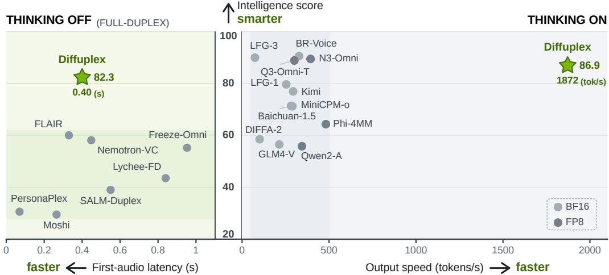
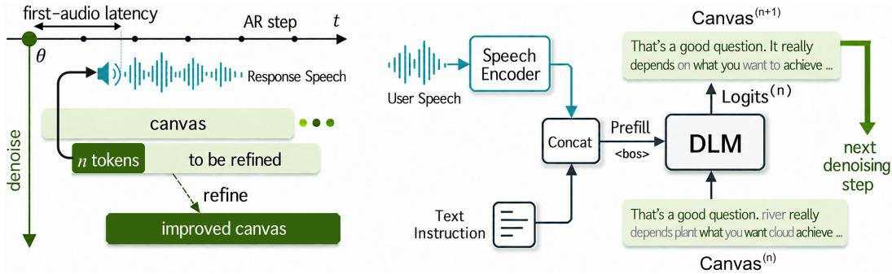
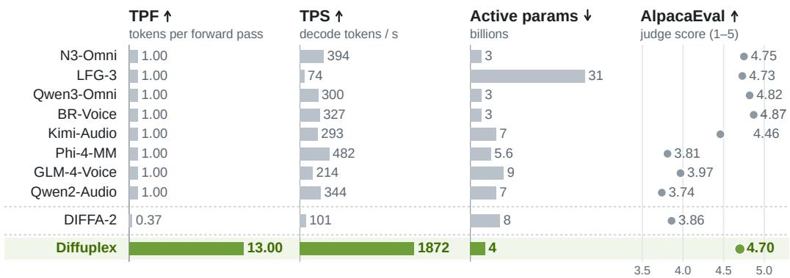
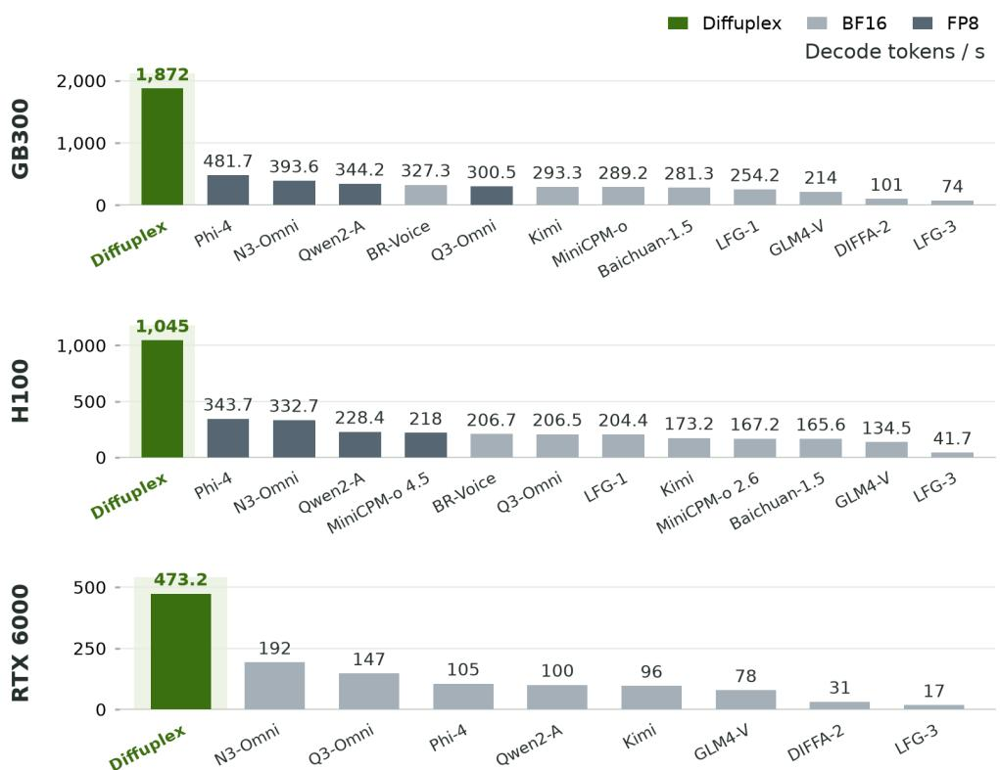
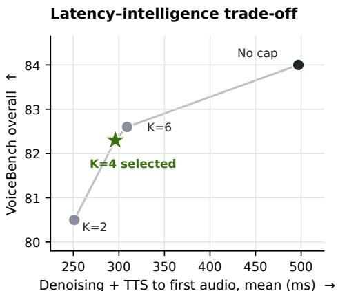
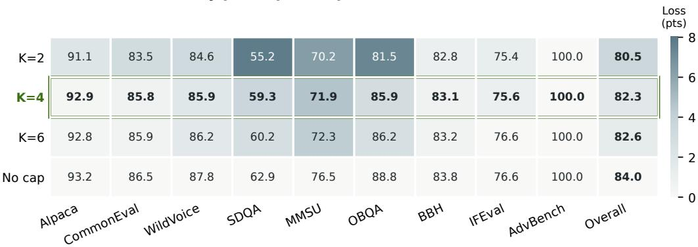

# FULL-DUPLEX SPOKEN LANGUAGE MODELING WITH DISCRETE DIFFUSION

Chen Chen Pin-Jui Ku Ankita Pasad Ante Jukic Zhehuai Chen Boris Ginsburg ´ NVIDIA

## ABSTRACT

We introduce Diffuplex, a full-duplex spoken language model based on discrete diffusion that achieves an unprecedented balance between linguistic intelligence and response efficiency. With thinking mode, Diffuplex delivers 13.0 tokens per forward pass, reaching an average of 1872 tokens per second and substantially surpassing the frontier autoregressive (AR) models in decoding speed. Without thinking, Diffuplex matches the first-audio latency of existing full-duplex models while achieving markedly stronger linguistic intelligence. This capability is enabled by separating when to say from what to say at the training level, rather than compressing both into a single autoregressive timeline. During inference, Diffuplex continuously tracks the user speech through an AR interaction policy, while independently generating and refining response content through parallel diffusion. Consequently, semantic computation is no longer bounded by the perception audio frame rate, allowing intelligence and responsiveness to improve simultaneously. Taken together, these results establish a new paradigm for spoken agents that can sustain real-time dialogue while devoting parallel computation to intelligent response generation. Training code and checkpoints will be avaliable soon1.

  
Figure 1: Spoken intelligence and response efficiency. The shared vertical axis is the VoiceBench overall score across 9 subsets, higher score means smarter model. Left: Diffuplex without thinking versus full-duplex spoken dialogue models, plotted against first-audio latency (from the end of user speech to the start of model speech). Right: Diffuplex with thinking versus frontier turn-based AR models, plotted against output speed. All output speeds were measured at batch 1 on the same NVIDIA GB300 GPU. More decoding speed results on different GPUs are provided at Appendix A.

## 1 INTRODUCTION

An ideal spoken language model should exhibit both fluid conversational behavior (when to say) and intelligent response generation (what to say). From a cognitive perspective, when to say requires tracking real-time speaking stream of interlocutor, whereas what to say involves progressively formulating internal thoughts. Neural recordings during conversation identify distinct activity associated with speech perception, planning, and production, even when these processes overlap in time (Castellucci et al., 2022). This suggests a useful design principle: conversational timing and response formulation should be coordinated without being forced into a single sequential process.

Turning this separation into a spoken language model, however, remains a formidable challenge. While recent full-duplex models that unify when to say and what to say deliver fluid interactions, they exhibit severe linguistic and cognitive degradation compared with frontier autoregressive (AR) models—which handle only what to say and rely on an external voice activity detection to govern response timing. We argue that this degradation arises from conflating these two learnable dimensions into a single one-dimensional AR timeline: (1) Conflicting Objectives: Optimizing both tasks via a single Cross-Entropy loss results in gradient conflict, where the dense supervision of low-level temporal alignment heavily dilutes the delicate representations required for high-level semantic generation Li et al. (2026). (2) Temporal Frame-Rate Binding: By tying AR generation directly to a rigid physical frame rate, e.g., 80 ms in Moshi (Defossez et al., 2024), the model is compelled to´ process semantics in lockstep with real-time spoken input, stripping its capacity to allocate elastic test-time compute (i.e., Chain-of-Thought) for deep inference.

To break this coupling, we exploit a distinctive property of discrete diffusion language models (DLM): response tokens can be generated and refined in parallel (Nie et al., 2025). This introduces a second computational axis that is independent of physical time. As illustrated in Figure 2, an AR policy advances along the horizontal timeline t, continuously processing incoming speech and determining when a response should begin. Once triggered at time θ, a diffusion process expands orthogonally from the timeline and iteratively refines an entire response canvas (i.e., a generation block). To support streaming interaction, we further design an anchored first-n decoding strategy: the first n response tokens are finalized early and immediately synthesized, while audio playback provides a time buffer for the remaining token refinement.

We instantiate this two-axis formulation as Diffuplex, a spoken language model that separates semantic generation from conversational control within a unified backbone. We efficiently connect a pretrained speech encoder (NVIDIA, 2025) to a text DLM (DiffusionGemma Team et al., 2026), allowing Diffuplex to take spoken input as diffusion condition, while inheriting the linguistic capabilities and knowledge encoded in the text model. Since the same backbone can also operate in AR mode, we introduce only a lightweight state embedding and prediction head to learn semantically informed speaking decisions from conversational data. At inference time, the two modes assume complementary roles: the AR mode continuously processes the incoming speech stream and determines when to say, while the diffusion mode is triggered at appropriate moments to generate and iteratively refine what to say in parallel.

Experiments on public benchmarks evaluate Diffuplex along two complementary dimensions: response quality and conversational behavior. With thinking enabled, Diffuplex achieves an overall score of 86.9 across the 9 VoiceBench subsets (Chen et al., 2024), approaching the strongest leaderboard systems while finalizing an average of 13.0 tokens per forward pass, compared with one token for the evaluated AR baselines. Meanwhile, Diffuplex exhibits responsive full-duplex behavior, with turn-taking and barge-in latency comparable to strong full-duplex models, while exceeding existing open-source systems by more than 20 points in spoken intelligence.

Our contributions are threefold. First, we show that diffusion-based spoken language modeling delivers both strong linguistic capabilities and exceptional generation speed, averaging 1,872 tokens per second on a single GB300 GPU—far outpacing its AR counterparts. Second, we demonstrate that conversational control and response generation can be learned separately within a shared back bone: an AR policy tracks streaming speech, while diffusion generates response content. Third, we show how to translate fast parallel text generation into full-duplex spoken interaction, enabling rapid responses to conversational events such as turn-taking and barge-in. We believe these contributions lay the groundwork for building both fast and intelligent spoken agents, paving the way for seamless and highly capable voice interactions.

## 2 RELATED WORK

## 2.1 SPOKEN LANGUAGE MODELS

Turn-based spoken language models extend text LLMs with speech encoders or discrete acoustic tokens, enabling unified speech understanding and generation (Wang et al., 2026a). AudioPaLM transfers linguistic knowledge from a text LLM to speech tasks, while SpeechGPT develops crossmodal instruction-following through modality adaptation and speech instruction tuning (Rubenstein et al., 2023; Zhang et al., 2023). More recent systems, such as Qwen2.5-Omni, jointly generate text and speech through specialized reasoning and synthesis modules (Xu et al., 2025a). Despite their strong linguistic capabilities, these models largely retain a turn-oriented interaction protocol and generate response content autoregressively.

Full-duplex models instead process user and agent speech as concurrent streams, allowing interruptions, overlaps, and backchannels without explicit turn segmentation (Wang et al., 2026b). Moshi models the two speakers with parallel audio-token streams, while OmniFlatten serializes multimodal dialogue events into a unified sequence (Defossez et al., 2024; Zhang et al., 2024). Freeze-Omni fur- ´ ther connects streaming speech interfaces to a frozen text LLM to preserve its linguistic capabilities (Wang et al., 2024a). PersonaPlex adds role and voice control to a full-duplex speech model, Lychee FD addresses acoustic–semantic interference, and Listen-Write-Speak provides a visible text channel during real-time conversation (Roy et al., 2026; Liu et al., 2026; Zhang et al., 2026). These systems achieve responsive interaction, but typically bind semantic generation and conversational control to the same frame-synchronous AR process. Diffuplex instead separates these functions: an AR policy tracks conversational timing, whereas a DLM generates response content along an independent computational axis.

## 2.2 DIFFUSION LANGUAGE MODELS WITH SPOKEN INPUT

Diffusion language models generate text through iterative refinement rather than strictly left-to-right decoding. Early work explored continuous diffusion for controllable text generation (Li et al., 2022), while masked discrete diffusion substantially narrowed the likelihood gap with AR models (Sahoo et al., 2024). LLaDA demonstrated that diffusion language models can scale to general-purpose pretraining and instruction following (Nie et al., 2025). Most relevant to our work, DiffusionGemma converts a pretrained AR mixture-of-experts model into a discrete DLM that refines 256-token canvases in parallel while retaining AR capabilities (DiffusionGemma Team et al., 2026).

The extension of DLMs to spoken input remains comparatively underexplored. Recent works have applied diffusion decoders to automatic speech recognition (ASR), either training a speechconditioned diffusion decoder from scratch or attaching a frozen encoder or DLM for parallel transcript decoding (Baas et al., 2022; Kwon et al., 2025; Yen et al., 2026; Khurdula et al., 2026). DIFFA moves beyond transcription by first aligning speech through ASR and subsequently training speech-conditioned instruction following; DIFFA-2 further scales this framework to general audio understanding (Zhou et al., 2026a;b). These studies establish that DLMs can understand spoken input, but do not address full-duplex interaction or explicitly separate conversational timing from response generation. Diffuplex closes this gap by combining a streaming AR interaction policy with parallel diffusion-based response generation. Cross-modal distillation has also been explored to align the capabilities of speech models with text teachers (Cao et al., 2026).

## 3 METHOD

Overview. Diffuplex follows a three-stage training curriculum. In Stage 1, we perform speech–text modality alignment using ASR data, enabling a pretrained text diffusion language model to condition on continuous speech representations. In Stage 2, we train the model on spoken-instruction–textresponse pairs to acquire instruction-following capabilities, thereby learning what to say. In Stage 3, we preserve the capabilities acquired in Stage 2 while introducing an AR interaction mode that learns a conversational policy, i.e., when to say.

At inference time, the model operates along two decoupled computational axes. A causal AR branch continuously processes incoming speech to model conversational behavior, while a diffusion branch generates responses conditioned on the accumulated context. In Section 3.4, we introduce denoising strategies designed to enable low-latency and fluid speech-to-speech interaction.

  
Figure 2: Overview of Diffuplex. Left: The horizontal axis represents real-time AR interaction, while a predicted <bos> triggers diffusion generation along the vertical axis at θ. An early refined prefix of n tokens is streamed to the speech synthesizer as the remaining canvas continues denoising. Right: Speech features and the text instruction are jointly prefilled into the DLM as condition, which iteratively refines each response canvas through bidirectional denoising.

## 3.1 STAGE 1: MODALITY ALIGNMENT

We construct the speech frontend using a Parakeet encoder (NVIDIA, 2025) followed by a randomly initialized projection layer that maps acoustic representations into the embedding space of DiffusionGemma (DiffusionGemma Team et al., 2026). Given these speech embeddings and textual instruction as conditioning context, the model reconstructs the complete ASR transcript through iterative denoising. We first warm up the projection layer on LibriSpeech (Panayotov et al., 2015), then jointly optimize the projection layer and speech encoder on an English ASR mixture drawn primarily from Granary (Rao Koluguri et al., 2025). The diffusion language model remains frozen throughout this stage, requiring the speech frontend to produce representations compatible with its pretrained textual latent space.

Auxiliary loss. Recent work suggests that an auxiliary CTC objective can improve diffusion-based ASR performance (Khurdula et al., 2026). We did not observe consistent gains in our setting and instead employ an auxiliary AR next-token loss alongside the diffusion objective. The resulting Stage 1 model achieves a word error rate (WER) of 2.3 on LibriSpeech (Panayotov et al., 2015) test-clean and 4.2 on test-other.

## 3.2 STAGE 2: SPOKEN INSTRUCTION-FOLLOWING

We sample 600K speech-instruction examples from the Nemotron-Omni SFT corpus (NVIDIA, 2026) and mix them with 5% ASR replay, drawn from 37.5K transcription examples. To strengthen the capability without thinking, 70% of responses directly supervise final answers without explicit <think> content. The speech encoder, projection layer, and DLM are jointly optimized using the same diffusion and auxiliary AR objectives as in Stage 1, while the MoE router remains frozen.

Joint adaptation exposes an empirical trade-off. With a small learning rate, long-form generation of DLM remains coherent, but the model only weakly grounds its responses in the spoken input. Increasing the learning rate improves speech adaptation but causes the pretrained language distribution to drift, resulting in repetition and incorrect termination. This tension cannot be addressed by setting different learning rates for three modules, or replaying text-only data.

Text-Anchored distillation. We therefore retain a frozen copy of the pretrained DLM as a textual anchor. For each paired training example, the trainable student receives the spoken request, whereas the frozen teacher receives its written counterpart. Then we minimize forward KL divergence between their output distributions for both the diffusion canvas and the causal AR readout.

This cross-modal supervision effectively transfers the anchor teacher’s textual capabilities to the speech-conditioned student.

## 3.3 STAGE 3: FULL-DUPLEX INTERACTION MODELING

Natural conversation does not arrive as a sequence of pre-segmented turns with explicit boundaries. We therefore learn a streaming interaction policy directly from conversational speech data. The user audio is treated as a continuous stream and divided into 80-ms chunks. At each step, the model autoregressively predicts one interaction state conditioned only on the observed speech prefix and previous states.

In Diffuplex, we represent this policy using four states: <listen>, <speak>, <bos>, <eos>. The first two indicate whether the model should listen or retain the conversational floor, whereas <bos> and <eos> denote taking and yielding the floor, respectively. These transition events are sparse and therefore receive larger loss weights than the persistent states:

$$
\mathcal { L } _ { \mathrm { p o l i c y } } = - \sum _ { t } w _ { s _ { t } } \log p ( s _ { t } \mid a _ { \le t } , s _ { < t } ) ,\tag{1}
$$

where $a { \scriptscriptstyle \leq } t$ denotes the speech observed up to time t. As the model cannot anticipate user’s behavior, the ${ < } \mathrm { b } \mathrm { o } s >$ and <eos> targets include a short reaction delay that allows sufficient acoustic evidence to accumulate. The interaction state tokens are independent of the DLM vocabulary, with a trainable word embedding matrix. At each AR step, the previous state embedding is combined with the chunk-level speech representation for the next state token prediction.

Causality of encoder. Stage 3 reuses speech encoder from Stage 2 but operates under strict causal constraints: a 10-second trailing window without lookahead aligned with streaming inference. To bridge this representation shift, a lightweight LoRA adapter (Hu et al., 2021) is introduced, but is not activated when computing diffusion context. This design preserves encoding quality while meeting online constraints, without requiring a separate causal encoder or suffering train-test mismatch.

## 3.4 INFERENCE AND DENOISE

When the AR branch emits <bos>, the speech-encoder features accumulated so far are prefilled, together with the text prompt, through the DLM’s causal pass to build its key–value cache, and the response is generated as a sequence of 256-token canvases that attend to this cache. Each denoising pass is one bidirectional forward over the canvas. We largely follow the inference recipe of DiffusionGemma (DiffusionGemma Team et al., 2026): at every pass its entropy-bounded sampler selects the lowest-entropy positions whose mutual-information bound stays below an entropy bound $\beta { = } 0 . 1$ , keeps their sampled tokens for the next pass, and fully re-noises all non-selected positions; the sampling temperature decays linearly across the budget of at most N=48 passes. Denoising terminates early once the highest-probability predictions are identical across two consecutive passes and the average entropy over the canvas falls below a confidence threshold γ. The converged canvas is committed and appended to the cache before the next one is opened. Because the original recipe was designed for offline text generation, we depart from it in two respects that are essential for spoken interaction. First, the opening of the response is committed long before the canvas converges, so that speech synthesis can start within a few passes (anchoredprefix). Second, the denoising schedule is shortened so that fewer passes separate consecutive speech packets (denoising schedule).

Anchored prefix. Under the original decoding scenario, the first word of the answer is final only when the whole canvas has converged, typically after tens of passes. The leading positions, however, settle much earlier. We therefore commit the first $n { = } 8$ positions of the first canvas after at most K passes and stream them to the synthesizer while the rest keeps denoising. Position 0 is seeded with the argmax of the causal AR readout at the prefill, which is trained with the auxiliary AR loss and costs nothing extra. During the first K−1 passes, non-accepted front positions are refilled with the denoiser’s argmax rather than noise, and a front position $i < n$ is frozen at its argmax at the first pass j satisfying

$$
H \big ( p _ { i } ^ { ( j ) } \big ) < \tau \quad \mathrm { o r } \quad j = K ,\tag{2}
$$

where $p _ { i } ^ { ( j ) }$ is the temperature-scaled distribution at pass j and $\tau { = } 0 . 0 5$ . Frozen positions are never re-sampled, so the first n tokens can be handed to the TTS system after one prefill and at most K passes regardless of response length, and speech synthesis begins while the remainder of the canvas is still denoising; K trades latency against the quality of the opening (Appendix E).

Denoising schedule. The pretrained schedule (temperature $0 . 8  0 . 4 , \gamma { = } 0 . 0 0 5 )$ spends its last passes confirming an already converged canvas. We anneal from 0.7 to 0.2 and relax γ to 0.025, and cut any response whose canvas ends in a trailing run of $\geq 3 2$ tokens drawn from at most two distinct tokens, a degenerate loop that a sharper schedule occasionally produces. Committed text is streamed to an interleaved text–speech TTS model (Du et al., 2025), the anchored prefix forming the first packet, so synthesis of the opening overlaps with the denoising of the remainder.

The AR interaction policy and diffusion response generator share the same backbone parameters but maintain separate KV caches. The AR cache advances causally with incoming audio to support turntaking decisions; once the policy emits <bos>, the observed speech context is separately prefilled to initialize the diffusion cache. This keeps the policy’s streaming history distinct from the context used to denoise the response.

## 3.5 SPEECH SYNTHESIZER

As the first n tokens are finalized early in the denoising process, Diffuplex is agnostic to the choice of speech synthesizer. These tokens can be immediately passed to any high-quality TTS model while the remaining canvas continues to be refined; consequently, the TTS model itself need not provide native streaming inference. In this work, we adopt CosyVoice 3 (Du et al., 2025) for its synthesis quality and voice-cloning capability. When voice cloning is unnecessary, it can be replaced with a smaller single-speaker TTS model to further reduce first-audio latency. This modular interface allows synthesis quality, speaker flexibility, and latency to be traded off without retraining Diffuplex.

User interruption. When the AR interaction policy emits <eos>, any remaining response audio is immediately truncated, allowing Diffuplex to yield naturally to the user. If the user interrupts within one second, we discard this unspoken canvas rather than appending it to the KV cache for the next interaction. Consequently, only content that has effectively entered the conversation is retained in the context, preventing frequent interruptions or hesitations from corrupting conversation context.

## 4 EXPERIMENTAL SETUP

## 4.1 TRAINING DETAILS

Training follows the three stages described in Section 3. Appendix C summarizes the training data, configurations, computing resource, and optimization settings for all stages.

## 4.2 BENCHMARK AND EVALUATION

VoiceBench (Chen et al., 2024) evaluates the spoken intelligence of voice assistants across openended dialogue, knowledge and reasoning, instruction following, and safety. It comprises nine evaluation subsets with both real and synthetic speech, incorporating variations in speakers, acoustic environments, and linguistic content. The metric contains both LLM judge score and accuracy, and we report them on average for comparison.

Full-Duplex-Bench v1 (Lin et al., 2025) evaluates fundamental real-time conversational behaviors under four controlled scenarios: pause handling, backchanneling, smooth turn-taking, and user interruption. We also add the “turn-taking dynamics” track from Full-Duplex-Bench v3 (Lin et al., 2026a), as all recording is collected from human speakers with conversational disfluencies.

## 4.3 BASELINE

We compare Diffuplex against three classes of spoken models: (1) Turn-based AR models represent the dominant high-capability paradigm, and we enable thinking where supported. As the intermediate reasoning trace is not presented to the user, enabling thinking in AR models would result in relatively high first-audio latency. (2) Turn-based diffusion models generate response tokens through parallel iterative refinement and can therefore reduce decoding latency relative to autoregressive generation. (3) Full-duplex AR models interleave speech perception and generation along a fixed-rate temporal stream, enabling low first-audio latency and fluid turn-taking. Because AR steps are tied to perceived audio chunks, these systems do not have a separate thinking phase. Original publications and model cards for every compared system are listed in Appendix D.

Table 1: VoiceBench results across turn-based AR and full-duplex models. Open-ended QA columns use a 5-point judge scale; the remaining columns and Overall use a 0–100 scale.
<table><tr><td rowspan="2">Model</td><td colspan="3">Open-ended QA</td><td colspan="3">Knowledge and Reasoning</td><td colspan="2">Ins. and Safety</td><td rowspan="2">Overall</td></tr><tr><td>Alp. Com.</td><td></td><td>Wil.</td><td>SDQA MMSU</td><td>OBQA</td><td>BBH</td><td>IFE.</td><td>Adv.</td></tr><tr><td colspan="9">Turn-based AR Models</td><td></td></tr><tr><td>BR-Voice</td><td>4.87</td><td>4.71</td><td>4.66</td><td>74.3 85.7</td><td>96.0</td><td>90.4</td><td>83.2</td><td>99.8</td><td>90.5</td></tr><tr><td>LFG-3</td><td>4.73</td><td>4.40</td><td>4.45</td><td>78.1 85.5</td><td>94.7</td><td>92.2</td><td>88.5</td><td>98.3</td><td>89.9</td></tr><tr><td>Nemotron-3 Omni</td><td>4.75</td><td>4.57</td><td>4.58</td><td>71.4 82.3</td><td>93.0</td><td>91.1</td><td>88.7</td><td>100</td><td>89.4</td></tr><tr><td>Qwen3-Omni-Thinking</td><td>4.82</td><td>4.53</td><td>4.53</td><td>78.1 83.0</td><td>94.3</td><td>88.9</td><td>80.6</td><td>97.2</td><td>88.8</td></tr><tr><td>GPT-4o-Audio</td><td>4.78</td><td>4.49</td><td>4.58</td><td>75.5 80.3</td><td>89.2</td><td>84.1</td><td>76.0</td><td>98.7</td><td>86.8</td></tr><tr><td>Kimi-Audio</td><td>4.46</td><td>3.97</td><td>4.20</td><td>63.1 62.2</td><td>83.5</td><td>69.7</td><td>61.1</td><td>100</td><td>76.9</td></tr><tr><td>DIFFA-2</td><td></td><td></td><td>40.8</td><td>Turn-based Diffusion Models</td><td>61.5</td><td>53.1*</td><td></td><td>85.6</td><td>58.5</td></tr><tr><td colspan="10">3.86 3.67 2.80* 38.1 40.8</td></tr><tr><td></td><td></td><td></td><td></td><td>Full-duplex AR Models</td><td></td><td></td><td></td><td></td><td></td></tr><tr><td>Nemotron-3 VoiceChat</td><td>3.59</td><td>3.12</td><td>3.06</td><td>43.4 50.5</td><td>64.4</td><td>52.7</td><td>17.1</td><td>99.6</td><td>58.1</td></tr><tr><td>Lychee-FD</td><td>3.31</td><td>2.28</td><td>1.75</td><td>34.4 22.9</td><td>29.2</td><td>51.0</td><td>22.6</td><td>84.4</td><td>43.5</td></tr><tr><td>Freeze-Omni</td><td>4.03</td><td>3.46</td><td>3.15</td><td>53.5 28.1</td><td>31.0</td><td>50.7</td><td>23.4</td><td>97.3</td><td>55.2</td></tr><tr><td>Moshi</td><td>2.01</td><td>1.60</td><td>1.30</td><td>15.6 24.0 Stage-2</td><td>25.9</td><td>47.4</td><td>10.1</td><td>44.2</td><td>29.5</td></tr><tr><td colspan="10"></td></tr><tr><td>Diffuplex w/o thinking</td><td>4.71</td><td>4.36</td><td>4.48</td><td>60.2 77.4</td><td>89.7</td><td>83.4</td><td>77.2</td><td>97.5</td><td>84.1</td></tr><tr><td>Diffuplex w. thinking</td><td>4.70</td><td>4.32</td><td>4.47</td><td>63.8 83.0 Stage-3, K=4</td><td>94.1</td><td>88.4</td><td>84.4</td><td>98.7</td><td>86.9</td></tr><tr><td colspan="10"></td></tr><tr><td>Diffuplex (full-duplex)</td><td>4.65</td><td>4.29</td><td>4.30</td><td>59.3 71.9</td><td>85.9</td><td>83.1</td><td>75.6</td><td>100.0</td><td>82.3</td></tr></table>

## 5 EVALUATION AND RESULTS

## 5.1 RESULTS ON SPOKEN INTELLIGENCE

Table 1 reports two evaluation settings for Diffuplex. Stage 2 evaluates the speech-conditioned response generator on complete spoken requests, with and without thinking. Stage 3 starts from the Stage 2 checkpoint, freezes the response generator, and adds the streaming interaction policy; its row evaluates the full-duplex system by committing the first n=8 tokens within K=4 denoising passes. Results marked with ∗ were reproduced by us when the corresponding numbers were unavailable in the source paper (Zhou et al., 2026b).

As shown in Table 1, the Stage 2 response generator scores 84.1 without thinking and 86.9 with thinking. The largest gains from enabling thinking occur on IFEval (+7.2), MMSU (+5.6), BBH (+5.0), and OpenBookQA (+4.4), while the three open-ended QA subsets change little. This suggests that additional inference-time reasoning helps most on instruction following and knowledgeintensive questions. In the full-duplex Stage 3 setting, the non-thinking score is 82.3, 1.8 points below Stage 2. The largest decreases are on MMSU (−5.5), OpenBookQA (−3.8), and WildVoice (−0.18 on the 5-point judge scale, equivalent to −3.6 on the 0–100 scale), while BBH decreases by 0.3 points. Because Stage 3 freezes the response generator, this decrease does not indicate forgetting from further language-model training. It is consistent with the change to streaming turn decisions and early-prefix decoding, although these contributions are not isolated by this comparison. Appendix E shows the measured latency–quality trade-off as K varies with n=8. Stage 3 still exceeds the strongest full-duplex AR baseline in the table by 24.2 points.

Generality across diffusion backbones. We apply the same speech adaptation and textanchored training strategy to Nemotron-Labs-Diffusion-8B (Fu et al., 2026). The resulting speechconditioned model reaches a VoiceBench overall score of approximately 78.7 with thinking enabled. This result shows that the strategy transfers to a second diffusion backbone; we attribute the lower score primarily to its weaker text-model capability relative to DiffusionGemma.

Table 2: Conversation behavior results.“TOR-v1” and “TOR-v3” denote the Full-Duplex-Bench v1 and v3 (with disfluency), respectively. “Syn.” and “Cand.” stand for Synthetic and Candor audio. Closed-source models (e.g., GPT-Realtime) are excluded due to API-induced latency overheads.
<table><tr><td rowspan="2">Model</td><td colspan="3">Turn Taking</td><td colspan="2">User Interruption</td><td colspan="2">Pause Handling</td></tr><tr><td>TOR-v1 ↑</td><td>TOR-v3 ↑</td><td>Latency ↓</td><td>TOR↑</td><td>Latency ↓</td><td>Syn. ↓</td><td>Cand. ↓</td></tr><tr><td>Freeze-Omni</td><td>0.336</td><td>0.312</td><td>0.953</td><td>0.867</td><td>1.409</td><td>0.642</td><td>0.481</td></tr><tr><td>Moshi</td><td>0.941</td><td>0.925</td><td>0.265</td><td>1.000</td><td>0.257</td><td>0.985</td><td>0.980</td></tr><tr><td>PersonaPlex</td><td>0.992</td><td>0.985</td><td>0.070</td><td>1.000</td><td>0.400</td><td>0.584</td><td>0.662</td></tr><tr><td>Raon-SpeechChat</td><td>0.832</td><td>0.810</td><td>1.034</td><td>0.980</td><td>1.219</td><td>0.212</td><td>0.299</td></tr><tr><td>Nemotron-VC</td><td>0.820</td><td>0.798</td><td>0.448</td><td>1.000</td><td>0.480</td><td>0.153</td><td>0.255</td></tr><tr><td>Lychee-FD</td><td>0.983</td><td>0.971</td><td>0.840</td><td>0.945</td><td></td><td>0.100</td><td></td></tr><tr><td>Diffuplex</td><td>0.933</td><td>0.980</td><td>0.396</td><td>0.945</td><td>0.239</td><td>0.679</td><td>0.667</td></tr><tr><td>Diffuplex (w/o Fisher)</td><td>1.000</td><td>0.990</td><td>0.536</td><td>1.000</td><td>0.691</td><td>0.380</td><td>0.431</td></tr></table>

## 5.2 RESULTS ON CONVERSATION BEHAVIOR

We report two variants of our model because we find that adding the Fisher conversational corpus (Cieri et al., 2004) into Stage 3 training noticeably changes the learned conversation policy. Including Fisher favors aggressive, low-latency turn transitions; without Fisher, the model focuses on semantically informed turn-taking. The remaining baselines are representative full-duplex spoken dialogue models proposed in recent years. We evaluate all systems on turn-taking, user interruption, and pause handling, where higher TOR and lower latency or pause-handling scores indicate better performance. First-audio latency spans the Stage 3 AR turn decision, response denoising, and TTS.

As shown in Table 2, Diffuplex achieves the strongest turn-taking accuracy on both benchmark versions while correctly responding to user interruptions. Diffuplex with Fisher substantially reduces both turn-taking and interruption latency, but this responsiveness comes at the cost of weaker pause handling. A similar pattern appears in Moshi and PersonaPlex, both of which use Fisher-style conversational data: they enter turns rapidly, yet are more likely to interpret a temporary user pause as the end of a turn. These results expose a fundamental trade-off between aggressive response timing and semantic turn understanding. Training on fast-paced conversational data encourages the mode to respond to acoustic silence, whereas excluding such data allows Diffuplex to wait for stronger semantic evidence before taking the floor. Our two variants therefore provide distinct operating points between interaction latency and robustness to natural hesitation and disfluency.

## 5.3 TPF AND TPS ANALYSIS

We measure decoding efficiency on spoken AlpacaEval, whose relatively long responses make generation differences easier to observe. Figure 3 places tokens finalized per forward pass (TPF) and decoded tokens per second (TPS) alongside active parameter counts and AlpacaEval scores. All models use the same audio and system/user prompts, batch 1, bf16 weights and KV cache, on one NVIDIA GB300 GPU. We enable thinking where available; DIFFA-2 has no thinking mode. Appendix E explains our choice of measurement hardware.

Figure 3 shows that Diffuplex finalizes 13.0 tokens per forward pass, compared with 1.00 for every evaluated AR baseline and 0.37 for DIFFA-2. Its throughput reaches up to 1872 tokens/s, versus 394 for Nemotron-3 Omni and 300 for Qwen3-Omni-Thinking, while requiring 4B active parameters compared with 3B for each of those two models. The accompanying AlpacaEval scores place this efficiency comparison alongside spoken response quality. The throughput gain is smaller than the TPF gain because each diffusion pass processes a 256-token canvas and costs more than a singletoken AR step. Thus, the figure shows both the pass-level parallelism and the realized decoding speed, with model size and response quality visible in the same comparison.

## 5.4 ABLATION AND MORE RESULTS

We ablate three components that are central to transferring the capabilities of a text DLM to spoken interaction. Removing Stage 1 tests whether explicit speech–text alignment is necessary before instruction tuning, while removing the text anchor evaluates whether the frozen text teacher prevents semantic drift during speech-conditioned adaptation. We additionally freeze the DLM throughout Stage 2 to examine whether adapting only the speech encoder and projection layer is sufficient. The text-input setting serves as an upper-bound diagnostic that separates the model’s underlying linguistic capability from errors introduced by speech conditioning.

  
Figure 3: Decoding efficiency and score context on AlpacaEval. TPF and TPS are measured at batch 1 on one NVIDIA GB300 GPU.

Table 3: Ablation study on VoiceBench. “text input” denotes that user input is text as the test set has paired transcript. “AR decoding” denotes the response is generated by autoregressive decoding. Thinking is disabled for all models.
<table><tr><td rowspan="2">Setting</td><td rowspan="2">Open-ended QA Alp. Com.</td><td rowspan="2">Wil.</td><td rowspan="2"></td><td colspan="3">Knowledge and Reasoning</td><td rowspan="2">Ins. and Safety IFE.</td><td rowspan="2">Adv.</td><td rowspan="2">Overall</td></tr><tr><td>SDQA</td><td>MMSU</td><td>OBQA BBH</td></tr><tr><td>Diffuplex</td><td>4.71</td><td>4.36</td><td>4.48</td><td>60.2</td><td>77.4</td><td>89.7</td><td>83.4</td><td>77.2</td><td>97.5</td><td>84.1</td></tr><tr><td>Diffuplex (text input)</td><td>4.81</td><td>4.53</td><td>4.81</td><td>73.4</td><td>84.7</td><td>93.8</td><td>94.8</td><td>81.3</td><td>100</td><td>90.1</td></tr><tr><td>Diffuplex (AR decoding)</td><td>4.77</td><td>4.38</td><td>4.50</td><td>64.6</td><td>73.8</td><td>87.9</td><td>86.5</td><td>80.3</td><td>99.6</td><td>85.1</td></tr><tr><td>w/o text anchor</td><td>3.96</td><td>3.25</td><td>3.05</td><td>48.4</td><td>54.2</td><td>64.6</td><td>61.5</td><td>61.3</td><td>100</td><td>66.1</td></tr><tr><td>w/o Stage 1</td><td>1.00</td><td>1.00</td><td>1.01</td><td>0.0</td><td>24.3</td><td>31.2</td><td>44.8</td><td>15.1</td><td>93.8</td><td>29.9</td></tr><tr><td>w/o trainable DLM</td><td>4.02</td><td>3.16</td><td>3.51</td><td>50.0</td><td>52.8</td><td>62.5</td><td>56.2</td><td>49.8</td><td>96.9</td><td>64.7</td></tr></table>

As shown in Table 3, the text-input model reaches an overall score of 90.1, while Diffuplex retains 84.1 with spoken input, indicating that most of the underlying language capability is successfully transferred to speech. Removing Stage 1 causes performance to collapse to 29.9, confirming that instruction tuning alone cannot reliably ground the DLM in acoustic representations. Removing the text anchor also reduces the score substantially, from 84.1 to 66.1, demonstrating its importance in preserving the response distribution of the pretrained text model. Keeping the DLM frozen yields only 64.7, suggesting that frontend alignment alone is insufficient and that controlled adaptation of the language backbone remains necessary for strong spoken instruction following.

We clarify that Diffuplex can also respond user spoken request in AR mode, as cross-entropy loss is computed during Stage 1 and Stage 2. Interestingly, the AR performance is even better than diffusion decoding as shown in Table 3. Furthermore, Appendix E separately ablates the pass cap K for committing the first n tokens and reports its effect on first-audio latency and VoiceBench scores.

Broader capability. We further examine the broader capabilities of Diffuplex as a language model, with the user query given either as text or as speech (Table 4). These capabilities include reasoning on Big Bench Audio (Artificial Analysis, 2024; Suzgun et al., 2023; Srivastava et al., 2023) and GPQA-Diamond (Rein et al., 2024), knowledge on Llama-Questions (Nachmani et al., 2024) and MMLU-Pro (Wang et al., 2024b), and instruction following on IFEval (Zhou et al., 2023), IF-Bench (Pyatkin et al., 2025), and MultiChallenge (Deshpande et al., 2025).

Table 4: Diffuplex across more benchmarks, grouped by capability. Shaded columns are spoken (audio-input) benchmarks; the others are text.
<table><tr><td colspan="2">Reasoning</td><td colspan="2">Knowledge</td><td colspan="3">Instruction following</td></tr><tr><td>Big Bench Audio</td><td>GPQA-Diamond</td><td>Llama-Questions</td><td>MMLU-Pro</td><td>IFEval</td><td></td><td>IFBench MultiChallenge</td></tr><tr><td>97.5</td><td>67.4</td><td>81.3</td><td>80.4</td><td>94.5</td><td>61.6</td><td>53.5</td></tr></table>

## 6 CONCLUSION

We introduced Diffuplex, a full-duplex spoken language model that decouples conversational control from semantic generation. Diffuplex utilize AR decoding to continuously determine when to speak, while a speech-conditioned DLM independently generates what to say through parallel refinement. This separation preserves the linguistic capabilities of a strong text model without binding semantic computation to the physical audio frame rate. Together with anchored-prefix decoding and modular speech synthesis, Diffuplex enables low-latency interaction while retaining strong spoken intelli gence. Experiments across spoken understanding and full-duplex dialogue benchmarks demonstrate that Diffuplex substantially narrows the capability gap between responsive full-duplex systems and intelligent turn-based models. We hope this two-axis formulation provides a useful foundation for future spoken agents that are both conversationally natural and cognitively capable.

## REFERENCES

Artificial Analysis. Big bench audio. https://huggingface.co/datasets/ ArtificialAnalysis/big\_bench\_audio, 2024. Audio version of a subset of BIG-Bench Hard for evaluating reasoning in audio models.

Matthew Baas, Kevin Eloff, and Herman Kamper. TransFusion: Transcribing speech with multinomial diffusion. In Artificial Intelligence Research (SACAIR), 2022.

Jagadeesh Balam, Travis Bartley, Edresson Casanova, Sanjay Chauhan, Chen Chen, et al. NemotronLabs VoiceChat: An open full-duplex speech-to-speech model with tool calling capabilities, 2026. URL https://arxiv.org/abs/2609.21967.

Di Cao, Dongjie Fu, Hai Yu, Siqi Zheng, Xu Tan, and Tao Jin. X-OPD: Cross-modal on-policy distillation for capability alignment in speech LLMs, 2026. URL https://arxiv.org/ abs/2603.24596.

Gregg A. Castellucci, Christopher K. Kovach, Matthew A. Howard, Jeremy D. W. Greenlee, and Michael A. Long. A speech planning network for interactive language use. Nature, 602:117–122, 2022. doi: 10.1038/s41586-021-04270-z.

Yiming Chen, Xianghu Yue, Chen Zhang, Xiaoxue Gao, Robby T. Tan, and Haizhou Li. VoiceBench: Benchmarking LLM-based voice assistants, 2024. URL https://arxiv.org/ abs/2410.17196.

Yunfei Chu, Jin Xu, Qian Yang, Haojie Wei, Xipin Wei, Zhifang Guo, Yichong Leng, Yuanjun Lv, Jinzheng He, Junyang Lin, Chang Zhou, and Jingren Zhou. Qwen2-Audio technical report, 2024. URL https://arxiv.org/abs/2407.10759.

Christopher Cieri, David Miller, and Kevin Walker. The fisher corpus: A resource for the next generations of speech-to-text. In Proceedings of the Fourth International Conference on Language Resources and Evaluation (LREC), 2004. URL https://www.ldc.upenn.edu/sites/ default/files/lrec2004-fisher-corpus\_0.pdf.

Alexandre Defossez, Laurent Mazar´ e, Manu Orsini, Am´ elie Royer, Patrick P´ erez, Herv´ e J´ egou,´ Edouard Grave, and Neil Zeghidour. Moshi: A speech-text foundation model for real-time dialogue, 2024.

Kaustubh Deshpande, Ved Sirdeshmukh, Johannes Baptist Mols, Lifeng Jin, Ed-Yeremai Hernandez-Cardona, Dean Lee, Jeremy Kritz, Willow E. Primack, Summer Yue, and Chen Xing. MultiChallenge: A realistic multi-turn conversation evaluation benchmark challenging to frontier LLMs. In Findings of the Association for Computational Linguistics: ACL 2025, 2025.

DiffusionGemma Team, Adrien Ali Ta¨ıga, James Assiene, Daniele Calandriello, Rahma Chaabouni, Joao Gante, Tamara von Glehn, Nate Keating, Chris Knutsen, Martin Kukla, Tianlin Liu, et al.˜ DiffusionGemma technical report, 2026.

Zhihao Du, Changfeng Gao, Yuxuan Wang, Fan Yu, Tianyu Zhao, Hao Wang, Xiang Lv, Hui Wang, Xian Shi, Keyu An, et al. CosyVoice 3: Towards in-the-wild speech generation via scaling-up and post-training, 2025. URL https://arxiv.org/abs/2505.17589.

Harishchandra Dubey, Ashkan Aazami, Vishak Gopal, Babak Naderi, Sebastian Braun, Ross Cutler, Alex Ju, Mehdi Zohourian, Min Tang, Hannes Gamper, Mehrsa Golestaneh, and Robert Aichner. ICASSP 2023 deep noise suppression challenge, 2023. URL https://arxiv.org/abs/ 2303.11510.

Yonggan Fu, Lexington Whalen, Abhinav Garg, Chengyue Wu, Maksim Khadkevich, Nicolai Oswald, Enze Xie, Daniel Egert, Sharath Turuvekere Sreenivas, Shizhe Diao, Chenhan Yu, Ye Yu, Weijia Chen, Sajad Norouzi, Jingyu Liu, Shiyi Lan, Ligeng Zhu, Jin Wang, Jindong Jiang, Morteza Mardani, Mehran Maghoumi, Song Han, Ante Jukic, Nima Tajbakhsh, Jan Kautz,´ and Pavlo Molchanov. Nemotron-Labs-Diffusion: A tri-mode language model unifying autoregressive, diffusion, and self-speculation decoding, 2026. URL https://arxiv.org/abs/ 2607.05722.

glenn2. LFG-3 model card. Hugging Face model card, 2026. URL https://huggingface. co/glenn2/LFG-3.

Fabian Gloeckle, Badr Youbi Idrissi, Baptiste Roziere, David Lopez-Paz, and Gabriel Synnaeve.\` Better & faster large language models via multi-token prediction. In Proceedings of the 41st International Conference on Machine Learning, volume 235 of Proceedings ofMachine Learning Research, pp. 15706–15734. PMLR, 2024.

Edward J. Hu, Yelong Shen, Phillip Wallis, Zeyuan Allen-Zhu, Yuanzhi Li, Shean Wang, Lu Wang, and Weizhu Chen. LoRA: Low-rank adaptation of large language models, 2021. URL https: //arxiv.org/abs/2106.09685.

Ke Hu, Ehsan Hosseini-Asl, Chen Chen, Edresson Casanova, Subhankar Ghosh, Piotr Zelasko,˙ Zhehuai Chen, Jason Li, Jagadeesh Balam, and Boris Ginsburg. SALM-Duplex: Efficient and direct duplex modeling for speech-to-speech language model, 2025. URL https://arxiv. org/abs/2505.15670.

Yuxuan Hu, Heng Lu, Ruchao Fan, Yao Qian, Xiaofei Wang, Jian Xue, Heming Wang, Shuohang Wang, Young Jin Kim, Yelong Shen, and Jinyu Li. Preserving speech-to-text LLM capabilities in speech-to-speech generation, 2026. URL https://arxiv.org/abs/2606.30944.

Harsha Vardhan Khurdula, Abhinav Kumar Singh, Yoeven D. Khemlani, and Vineet Agarwal. Audio-native speech recognition with a frozen discrete-diffusion language model, 2026.

Beomsoo Kim, Changho Choi, Dohyun Kim, Dongki Lee, et al. Raon-Speech technical report, 2026. URL https://arxiv.org/abs/2605.23912.

KimiTeam, Ding Ding, Zeqian Ju, Yichong Leng, Songxiang Liu, et al. Kimi-Audio technical report, 2025. URL https://arxiv.org/abs/2504.18425.

Taeyoun Kwon, Junhyuk Ahn, Taegeun Yun, Heeju Jwa, Yoonchae Choi, Siwon Park, Jongchan Kim, Hyungon Ryu, Hyuk-Jae Lee, and Nam-Joon Kim. Whisfusion: Parallel ASR decoding with masked diffusion. arXiv preprint arXiv:2508.07048, 2025.

Xiang Lisa Li, John Thickstun, Ishaan Gulrajani, Percy Liang, and Tatsunori B. Hashimoto. Diffusion-LM improves controllable text generation. In Advances in Neural Information Processing Systems, volume 35, 2022. URL https://arxiv.org/abs/2205.14217.

Yuxin Li, Donghang Wu, Guan-Ting Lin, Hung-yi Lee, Chengwei Qin, Zhehuai Chen, and Chen Chen. Decoupling conversational dynamics in full-duplex spoken models through reinforcement learning. arXiv preprint arXiv:2607.07148, 2026.

Guan-Ting Lin, Jiachen Lian, Tingle Li, Qirui Wang, Gopala Anumanchipalli, Alexander H. Liu, and Hung-yi Lee. Full-Duplex-Bench: A benchmark to evaluate full-duplex spoken dialogue models on turn-taking capabilities, 2025. URL https://arxiv.org/abs/2503.04721.

Guan-Ting Lin, Chen Chen, Zhehuai Chen, and Hung-yi Lee. Full-Duplex-Bench-v3: Benchmarking tool use for full-duplex voice agents under real-world disfluency, 2026a. URL https: //arxiv.org/abs/2604.04847.

Qingjian Lin, Yuxin Li, Haoyang Zhang, Jun Chen, Yechang Huang, Feng Tian, Xie Li, Xiangyu Tony Zhang, Daijiao Liu, Yuxin Zhang, Jinglan Gong, Bo Zhao, Fei Tian, Xuerui Yang, Gang Yu, Xiangyu Zhang, and Daxin Jiang. ParaASR: Multi-token prediction for fast and longcontext LLM-based speech recognition, 2026b. URL https://arxiv.org/abs/2607. 29279.

Zhenyu Liu, Xuanyu Zhang, Yunxin Li, Qixun Teng, Shenyuan Jiang, Haolan Chen, Mingjun Zhao, Fanbo Meng, Yu Xu, Yancheng He, Baotian Hu, Haizhou Li, and Min Zhang. Hierarchical acoustic-semantic modeling: Modality separation and semantic coherence for full-duplex SLMs. In Proceedings of the 64th Annual Meeting of the Association for Computational Linguistics, pp. 9264–9280, 2026. doi: 10.18653/v1/2026.acl-long.419. URL https://aclanthology. org/2026.acl-long.419/.

Microsoft, Abdelrahman Abouelenin, Atabak Ashfaq, Adam Atkinson, et al. Phi-4-Mini technical report: Compact yet powerful multimodal language models via mixture-of-LoRAs, 2025. URL https://arxiv.org/abs/2503.01743.

Eliya Nachmani, Alon Levkovitch, Roy Hirsch, Julian Salazar, Chulayuth Asawaroengchai, Soroosh Mariooryad, Ehud Rivlin, RJ Skerry-Ryan, and Michelle Tadmor Ramanovich. Spoken question answering and speech continuation using spectrogram-powered LLM. In International Conference on Learning Representations, 2024.

Shen Nie, Fengqi Zhu, Zebin You, Xiaolu Zhang, Jingyang Ou, Jun Hu, Jun Zhou, Yankai Lin, Ji-Rong Wen, and Chongxuan Li. Large language diffusion models, 2025.

NVIDIA. Parakeet speech recognition models. NVIDIA NeMo documentation, 2025. URL https://docs.nvidia.com/nemo-framework/user-guide/latest/ nemotoolkit/asr/models.html.

NVIDIA. Nemotron 3 Nano Omni: Efficient and open multimodal intelligence, 2026. URL https: //arxiv.org/abs/2604.24954.

OpenAI. GPT-4o system card. OpenAI technical report, 2024. URL https://openai.com/ index/gpt-4o-system-card/.

Vassil Panayotov, Guoguo Chen, Daniel Povey, and Sanjeev Khudanpur. LibriSpeech: An ASR corpus based on public domain audio books. In 2015 IEEE International Conference on Acoustics, Speech and Signal Processing (ICASSP), pp. 5206–5210, 2015. doi: 10.1109/ICASSP.2015. 7178964.

Valentina Pyatkin, Saumya Malik, Victoria Graf, Hamish Ivison, Shengyi Huang, Pradeep Dasigi, Nathan Lambert, and Hannaneh Hajishirzi. Generalizing verifiable instruction following. In Advances in Neural Information Processing Systems, Datasets and Benchmarks Track, 2025.

Alec Radford, Jong Wook Kim, Tao Xu, Greg Brockman, Christine McLeavey, and Ilya Sutskever. Robust speech recognition via large-scale weak supervision, 2022. URL https://arxiv. org/abs/2212.04356.

Nithin Rao Koluguri, Monica Sekoyan, George Zelenfroynd, Sasha Meister, Shuoyang Ding, Sofia Kostandian, He Huang, Nikolay Karpov, Jagadeesh Balam, Vitaly Lavrukhin, Yifan Peng, Sara Papi, Marco Gaido, Alessio Brutti, and Boris Ginsburg. Granary: Speech recognition and translation dataset in 25 european languages, 2025. URL https://arxiv.org/abs/2505. 13404.

David Rein, Betty Li Hou, Asa Cooper Stickland, Jackson Petty, Richard Yuanzhe Pang, Julien Dirani, Julian Michael, and Samuel R. Bowman. GPQA: A graduate-level google-proof Q&A benchmark. In First Conference on Language Modeling, 2024.

Rajarshi Roy, Jonathan Raiman, Sang-gil Lee, Teodor-Dumitru Ene, Robert Kirby, Sungwon Kim, Jaehyeon Kim, and Bryan Catanzaro. PersonaPlex: Voice and role control for full duplex conversational speech models, 2026. URL https://arxiv.org/abs/2602.06053.

Paul K. Rubenstein, Chulayuth Asawaroengchai, Duc Dung Nguyen, Ankur Bapna, Zalan Borsos,´ Felix de Chaumont Quitry, Peter Chen, Dalia El Badawy, Wei Han, Eugene Kharitonov, Han-´ nah Muckenhirn, Dirk Padfield, James Qin, Danny Rozenberg, Tara Sainath, Johan Schalkwyk, Matt Sharifi, Michelle Tadmor Ramanovich, Marco Tagliasacchi, Alexandru Tudor, Mihajlo Velimirovic, Damien Vincent, Jiahui Yu, Yongqiang Wang, Vicky Zayats, Neil Zeghidour, Yu Zhang,´ Zhishuai Zhang, Lukas Zilka, and Christian Frank. AudioPaLM: A large language model that can speak and listen, 2023.

Subham Sekhar Sahoo, Marianne Arriola, Yair Schiff, Aaron Gokaslan, Edgar Marroquin, Justin T. Chiu, Alexander Rush, and Volodymyr Kuleshov. Simple and effective masked diffusion language models. In Advances in Neural Information Processing Systems, volume 37, 2024. URL https: //arxiv.org/abs/2406.07524.

Aarohi Srivastava et al. Beyond the imitation game: Quantifying and extrapolating the capabilities of language models. Transactions on Machine Learning Research, 2023.

Mirac Suzgun, Nathan Scales, Nathanael Scharli, Sebastian Gehrmann, Yi Tay, Hyung Won Chung,¨ Aakanksha Chowdhery, Quoc V. Le, Ed H. Chi, Denny Zhou, and Jason Wei. Challenging BIGbench tasks and whether chain-of-thought can solve them. In Findings of the Association for Computational Linguistics: ACL 2023, 2023.

Joachim Thiemann, Nobutaka Ito, and Emmanuel Vincent. The diverse environments multi-channel acoustic noise database (DEMAND): A database of multichannel environmental noise recordings. Proceedings of Meetings on Acoustics, 19(1):035081, 2013. doi: 10.1121/1.4799597. URL https://doi.org/10.1121/1.4799597.

Siyin Wang, Zengrui Jin, Changli Tang, Qiujia Li, Bo Li, Chen Chen, Yuchen Hu, Wenyi Yu, Yixuan Li, Jimin Zhuang, et al. Towards general auditory intelligence for machine listening and speaking. Nature Machine Intelligence, pp. 1–20, 2026a.

Siyin Wang, Wenyi Yu, Xianzhao Chen, Xiaohai Tian, Jun Zhang, Lu Lu, Yuxuan Wang, and Chao Zhang. End-to-end listen, look, speak and act. In International Conference on Learning Representations, pp. 66804–66829, 2026b.

Xiong Wang, Yangze Li, Chaoyou Fu, Yunhang Shen, Lei Xie, Ke Li, Xing Sun, and Long Ma. Freeze-Omni: A smart and low-latency speech-to-speech dialogue model with frozen LLM, 2024a.

Yubo Wang, Xueguang Ma, Ge Zhang, Yuansheng Ni, Abhranil Chandra, Shiguang Guo, Weiming Ren, Aaran Arulraj, Xuan He, Ziyan Jiang, Tianle Li, Max Ku, Kai Wang, Alex Zhuang, Rongqi Fan, Xiang Yue, and Wenhu Chen. MMLU-Pro: A more robust and challenging multitask language understanding benchmark. In Advances in Neural Information Processing Systems, Datasets and Benchmarks Track, 2024b.

Yuhao Wang, Heyang Liu, Ziyang Cheng, Ronghua Wu, Qunshan Gu, Yanfeng Wang, and Yu Wang. VocalNet: Speech LLMs with multi-token prediction for faster and high-quality generation. In Proceedings of the 2025 Conference on Empirical Methods in Natural Language Processing, pp. 19584–19601, Suzhou, China, 2025.

Donghang Wu, Tianyu Zhang, Yuxin Li, Hexin Liu, Chen Chen, Eng Siong Chng, and Yoshua Bengio. The silent thought: Modeling internal cognition in full-duplex spoken dialogue models via latent reasoning, 2026. URL https://arxiv.org/abs/2603.17837.

Jin Xu, Zhifang Guo, Jinzheng He, Hangrui Hu, Ting He, Shuai Bai, Keqin Chen, Jialin Wang, Yang Fan, Kai Dang, Bin Zhang, Xiong Wang, Yunfei Chu, and Junyang Lin. Qwen2.5-Omni technical report, 2025a.

Jin Xu, Zhifang Guo, Hangrui Hu, Yunfei Chu, Xiong Wang, et al. Qwen3-Omni technical report, 2025b. URL https://arxiv.org/abs/2509.17765.

Hao Yen, Pin-Jui Ku, Ante Jukic, and Sabato Marco Siniscalchi. MDM-ASR: Bridging accuracy´ and efficiency in ASR with diffusion-based non-autoregressive decoding. In Proceedings of Interspeech, 2026.

Aohan Zeng, Zhengxiao Du, Mingdao Liu, Kedong Wang, Shengmin Jiang, Lei Zhao, Yuxiao Dong, and Jie Tang. GLM-4-Voice: Towards intelligent and human-like end-to-end spoken chatbot, 2024. URL https://arxiv.org/abs/2412.02612.

Dong Zhang, Shimin Li, Xin Zhang, Jun Zhan, Pengyu Wang, Yaqian Zhou, and Xipeng Qiu. SpeechGPT: Empowering large language models with intrinsic cross-modal conversational abilities, 2023.

Luoyuan Zhang, Bokai Xu, Junbo Cui, Weiyue Sun, Yingjing Xu, Hanyu Liu, and Yuan Yao. Liberating LLM capabilities in full-duplex speech models, 2026. URL https://arxiv.org/ abs/2606.07547.

Qinglin Zhang, Luyao Cheng, Chong Deng, Qian Chen, Wen Wang, Siqi Zheng, Jiaqing Liu, Hai Yu, Chaohong Tan, Zhihao Du, and Shiliang Zhang. OmniFlatten: An end-to-end GPT model for seamless voice conversation, 2024.

Jeffrey Zhou, Tianjian Lu, Swaroop Mishra, Siddhartha Brahma, Sujoy Basu, Yi Luan, Denny Zhou, and Le Hou. Instruction-following evaluation for large language models. arXiv preprint arXiv:2311.07911, 2023.

Jiaming Zhou, Hongjie Chen, Shiwan Zhao, Jian Kang, Jie Li, Enzhi Wang, Yujie Guo, Haoqin Sun, Hui Wang, Aobo Kong, Yong Qin, and Xuelong Li. DIFFA: Large language diffusion models can listen and understand. In Proceedings of the AAAI Conference on Artificial Intelligence, volume 40, pp. 35112–35120, 2026a. doi: 10.1609/aaai.v40i41.40817.

Jiaming Zhou, Xuxin Cheng, Shiwan Zhao, Yuhang Jia, Cao Liu, Ke Zeng, Xunliang Cai, and Yong Qin. DIFFA-2: A practical diffusion large language model for general audio understanding. In Findings ofthe Associationfor Computational Linguistics: ACL 2026, pp. 4789–4805, San Diego, California, United States, 2026b. Association for Computational Linguistics. doi: 10.18653/ v1/2026.findings-acl.235. URL https://aclanthology.org/2026.findings-acl. 235/.

  
Figure 4: Output speed across different hardware (GPU). For RTX 6000, the Diffuplex is BF16 while GB300 and H100 are FP8.

## A FIGURE 1 DETAILS

Beyond GB300, we report the decoding speed on NVIDIA RTX 6000 and H 100 in Figure 4, which are popular GPU types on cluster even local machine. The test set is AlpacaEval and the TPF ranges from 13.0 to 13.7.

Inference Implementation on GB300. We decode with a torch-free CUDA runtime that implements the sampler described in Sec. 3.4. In precision, the mixture-of-experts layers use a grouped matrix multiplication with 4-bit weights and activations (NVFP4, E2M1, 16-element groups) in place of 4-bit weights with 16-bit activations, the dense projections and the head use FP8, the rotary tables are kept in FP32, and amax reduction, scale finalization and row quantization are fused into one pass; the experts are requantized from bf16 with 9.5% relative RMS error, and the model occupies 16.2 GB, 3.2× less than bf16. In attention, we use the FlashAttention-4 kernels for the 256-wide head dimension. In the mixture-of-experts and dense layers, every matrix multiplication uses a per-shape tuned plan with a fixed split-K quantum so that it is graph-capturable, and the expert activation scales are finalized in a fused kernel.

## B MORE DISCUSSION

Can Stage 3 be trained without the listening-mode LoRA? The interaction head can be trained without the adapter, but the resulting policy mainly learns an acoustic voice-activity detector: it reacts to speech and silence while failing to distinguish a within-turn hesitation from a true turn ending. In particular, it does not handle pauses reliably. The listening-mode LoRA gives the causal speech pathway enough flexibility to use conversational context for turn decisions while the diffusion response pathway remains fixed.

Why is there no direct multi-token-prediction (MTP) baseline? Our efficiency metric counts finalized answer-text tokens per backbone forward pass. Diffuplex reaches 10.15 on spoken AlpacaEval, above the fixed proposal horizons of representative text MTP configurations, such as four-token prediction (Gloeckle et al., 2024); this is a comparison with those configurations, not a universal upper bound on MTP. Among the speech-input MTP studies most relevant to our setting, ParaASR applies a six-token proposal to acoustically constrained transcription (Lin et al., 2026b), whereas VocalNet and PRIME-Speech apply MTP to speech or codec tokens rather than parallelizing the answer-text stream (Wang et al., 2025; Hu et al., 2026). Their output units and tasks differ from open-ended spoken question answering, so their reported token rates cannot be placed directly alongside our answer-text TPF. A promising solution is using MTP to replace the early prefix in Diffuplex, which might result in lower first-audio latency. We view it as our future work.

## C TRAINING DETAILS

We train the speech-conditioned response model in three phases: Stage 1a, Stage 1b, and Stage 2. The backbone is DiffusionGemma-26B-A4B-it (DiffusionGemma Team et al., 2026), paired with a Parakeet speech encoder (NVIDIA, 2025) and a projection layer that maps speech features into the backbone’s embedding space. These response-model phases use a 256-token diffusion canvas and an auxiliary autoregressive (AR) next-token objective. Audio is converted to 16-kHz mono waveforms before feature extraction. The training seed is 42.

## C.1 STAGE 1A: PROJECTOR WARM-UP

We train the projection layer while freezing the speech encoder and language model. The data comprise the LibriSpeech (Panayotov et al., 2015) train-clean-100, train-clean-360, and train-other-500 partitions, totaling 281,099 utterances (approximately 960 hours). Targets are lowercase transcripts without punctuation. We train for two epochs, or 1,098 optimizer updates, with global batch size 512. The AR loss has weight 0.1 relative to the diffusion loss. We use AdamW with peak learning rate $3 \times 1 0 ^ { - 4 }$ , 28 warm-up updates, and cosine decay to $3 \times 1 0 ^ { - 5 }$

## C.2 STAGE 1B: SPEECH ENCODER ADAPTATION

Starting from Stage 1a, we unfreeze the speech encoder and continue training it with the projector while keeping the language model frozen. The data are a 32-source English ASR mixture drawn primarily from Granary (Rao Koluguri et al., 2025), with additional internal ASR and LibriSpeech data. Unlike Stage 1a, the transcription targets retain punctuation and capitalization. We train for 4,032 updates with global batch size 512, corresponding to approximately 2.06 million sampled presentations. The AR loss weight is 0.05. We use AdamW with peak learning rate $2 \times 1 0 ^ { - 5 }$ , 403 warm-up updates, and cosine decay to $1 0 ^ { - 5 }$

## C.3 STAGE 2: SPOKEN INSTRUCTION TUNING

Starting from the Stage 1b speech frontend, Stage 2 adapts the model to spoken requests. Its training pool contains 600,000 speech-instruction examples selected from Nemotron-Omni SFT (NVIDIA, 2026) and 37,500 ASR replay examples. The two tasks are sampled with probabilities 95% and 5%. We optimize the speech encoder, projector, and diffusion language model, keeping the MoE router frozen. The diffusion and AR loss weights are both 1.0. To retain the pretrained model’s textual capabilities, a frozen copy of the language model receives the written form of each speechinstruction example; forward KL losses between teacher and student are applied to the diffusion canvas and AR readout with weights 3.0 and 1.0, respectively.

Stage 2 uses a maximum padded sequence length of 8,192 tokens and global batch size 128. We use AdamW with peak learning rates $1 0 ^ { - 5 }$ for the speech frontend and $\mathrm { \bar { 3 } \times 1 0 ^ { - 6 } }$ for the language model, 200 warm-up updates, and cosine decay. The selected joint-training checkpoint is after 2,266 optimizer updates. Stages 1a, 1b, and 2 use 64 GPUs with BF16 computation, FP32 optimizer parameters, and gradient-norm clipping at 1.0.

## C.4 STAGE 3: FULL-DUPLEX INTERACTION TRAINING

Data. The main Stage 3 mixture combines 120 hours of clean synthetic conversations with 70 hours of internal conversational corpus. The clean data provide clearly defined turns and pauses; the internal data add natural hesitations, backchannels, and user interruptions. We also train a variant with Fisher telephone conversations (Cieri et al., 2004) to expose the policy to faster, spontaneous turn exchanges. For the noise-augmented recipe, we add stationary fan and office ambience selected from DNS5 (Dubey et al., 2023) and DEMAND (Thiemann et al., 2013) to the clean synthetic recordings. We also mix quiet pink/white noise and short nonspeech events such as doors, typing, and chair movement. A small fraction of the recordings retains its original silence.

Optimization. Starting from the Stage 2 checkpoint, we train the four-state interaction head and a listening-mode LoRA adapter (Hu et al., 2021), while keeping the response generator fixed. The policy is trained with cross-entropy on 80-ms state labels, with extra weight on the sparse start- and stop-speaking transitions. We use AdamW with peak learning rate $1 0 ^ { - 3 }$ , 50 warm-up updates, and cosine decay to $1 0 ^ { - 4 }$ over 3,000 updates. Global batch size is 32 on two nodes with eight GPUs each.

## D COMPARED MODELS AND THEIR SOURCES

We cite the original reports or public model cards for every model used in the comparisons. The systems address different operating regimes, and their reported scores and latencies should be read together with the evaluation settings in Sections 5.1–5.3.

Turn-based speech and audio models. LFG-3 is documented in its public model card (glenn2, 2026). Nemotron-3 Omni (NVIDIA, 2026), Qwen3-Omni-Thinking (Xu et al., 2025b), and Kimi-Audio (KimiTeam et al., 2025) provide the other high-capability comparisons in Table 1. The Whisper-L + GPT-4o cascade uses Whisper (Radford et al., 2022) and GPT-4o (OpenAI, 2024); the GPT-4o-Audio row is likewise attributed to GPT-4o’s audio-capable system (OpenAI, 2024). The efficiency comparison in Figure 3 additionally includes Phi-4-Multimodal (Microsoft et al., 2025), GLM-4-Voice (Zeng et al., 2024), and Qwen2-Audio (Chu et al., 2024). These models differ in parameter activation and speech-output design, which is why Figure 3 displays active parameters and a quality measure alongside decoding speed.

Diffusion-based models. DIFFA-2 (Zhou et al., 2026b) is the speech-conditioned diffusion baseline. Our response backbone is DiffusionGemma (DiffusionGemma Team et al., 2026); the backbone-transfer experiment uses Nemotron-Labs-Diffusion (Fu et al., 2026). These citations credit the respective model authors independently of our speech adaptation and evaluation.

Full-duplex systems. The conversational baselines include Moshi (Defossez et al., 2024), Freeze-´ Omni (Wang et al., 2024a), PersonaPlex (Roy et al., 2026), Lychee-FD (Liu et al., 2026), Raon-SpeechChat (Kim et al., 2026), and Nemotron VoiceChat (Balam et al., 2026); “Nemotron-VC” is the abbreviated label in Figure 1. Figure 1 also includes SALM-Duplex (Hu et al., 2025) and FLAIR (Wu et al., 2026). Our implementation uses a Parakeet speech encoder (NVIDIA, 2025) and CosyVoice 3 speech synthesis (Du et al., 2025). Each system is included to show a distinct point in the space of spoken intelligence, decoding speed, or conversational responsiveness.

## E SENSITIVITY OF EARLY PREFIX COMMITMENT

The analysis in this chapter is based on the NVIDIA RTX 6000 rather than H100- or GB300-class server accelerators. The motivation is deployment relevance: spoken assistants may ultimately need to run under the tighter compute and power budgets of portable devices, so a workstation-class GPU offers a more accessible reference point than a large server accelerator. Notably, the deployed checkpoint is Stage 3 with BF16 precision.

We fix the committed prefix length at n=8 tokens and vary the maximum number of denoising passes K before that prefix is finalized. The reported Stage 3 setting uses $K { = } 4 ;$ the uncapped

Time to commit the first eight tokens
<table><tr><td rowspan=1 colspan=1>Pass cap</td><td rowspan=1 colspan=1>Passes</td><td rowspan=1 colspan=1>LM prefixmean / med</td><td rowspan=1 colspan=1>First audiomean / med</td></tr><tr><td rowspan=1 colspan=1>K=2</td><td rowspan=1 colspan=1>2.0</td><td rowspan=1 colspan=1>83 / 83</td><td rowspan=1 colspan=1>251 /252</td></tr><tr><td rowspan=1 colspan=1>K=4</td><td rowspan=1 colspan=1>3.8</td><td rowspan=1 colspan=1>127 / 129</td><td rowspan=1 colspan=1>296 / 297</td></tr><tr><td rowspan=1 colspan=1>K=6</td><td rowspan=1 colspan=1>4.3</td><td rowspan=1 colspan=1>141 /131</td><td rowspan=1 colspan=1>309 / 300</td></tr><tr><td rowspan=1 colspan=1>No cap</td><td rowspan=1 colspan=1>11.5</td><td rowspan=1 colspan=1>328 / 195</td><td rowspan=1 colspan=1>497 / 363</td></tr></table>

Times in ms; Stage 3 AR decision delay is excluded.

Figure 5: Measured latency–quality trade-off for committing the first $n { = } 8$ tokens. Latency is measured from a supplied turn boundary to first audio, excluding the Stage 3 AR turn-decision delay. The left panel shows mean post-trigger latency and VoiceBench overall score; the right panel reports passes to prefix commitment and mean/median timing. The green star marks the reported K=4 configuration; “No cap” uses the stock decoder.

VoiceBench score by prefix pass cap $( n = 8 )$  
  
Figure 6: VoiceBench subset scores under the same n=8 prefix setting. Printed values are absolute scores on the 0–100 scale; cell shading indicates the loss relative to unconstrained decoding in the same column. The green outline identifies the K=4 setting used for the Stage 3 result.

decoder uses the Stage 2 decoding configuration in a separate evaluation run. To isolate the effect of the decoding schedule, we supply the turn boundary and measure the time from that boundary to first audio. These measured post-trigger times include denoising and TTS but exclude the Stage 3 AR turn-decision delay.

With $K { = } 2 ,$ mean post-trigger first-audio latency is 251 ms and the overall score is 80.5. At $K { = } 4$ the first eight tokens are fixed after 3.8 passes on average; latency is 296 ms (297 ms median) and the score rises to 82.3. Increasing the cap to K=6 yields 309 ms and 82.6, while uncapped decoding takes 497 ms and scores 84.0. Across these settings, higher K is associated with better VoiceBench scores and longer post-trigger latency. Figure 6 gives the corresponding subset scores.