# Facts Don’t Speak Louder than Words: The Behavioral Essence of Long-CoT Distillation

Yongcan Yu1,2∗, Jian Liang1,2†, Lingxiao He3, Kuangpu Guo1,4, Yanbo Wang1,2, Shuo Lu1,2, Meng Wang3, Ran He1,2

1NLPR & MAIS, Institute of Automation, Chinese Academy of Sciences 2School of Artificial Intelligence, University of Chinese Academy of Sciences 3Meituan 4University of Science and Technology of China {yuyongcan0223, liangjian92}@gmail.com

## Abstract

While long chain-of-thought (CoT) distillation significantly improves the reasoning abilities of language models, its underlying mechanism remains poorly understood. Current pipelines generally rely on rejection sampling to gather reasoning traces across diverse prompts, assuming that factual correctness and broad problem coverage are indispensable. Surprisingly, we find that training exclusively on flawed reasoning trajectories or a restricted prompt set yields nearly comparable performance. Driven by this counterintuitive finding, we propose the Behavioral Hypothesis: the essence of Long-CoT distillation is behavioral alignment with structured reasoning patterns, rather than factual knowledge memorization. We then validate this by demonstrating substantial reasoning gains even when models are fine-tuned exclusively on previously mastered problems—effectively isolating behavioral alignment from novel knowledge injection. Having established that reasoning patterns are the true bottleneck, we investigate how to learn them across varying levels of complexity optimally. We reveal a critical interplay: while the recent probability-based loss excels at learning simple patterns, the standard cross-entropy loss is essential for scaling to complex CoTs. We believe these insights demystify CoT distillation and provide a principled foundation for the future development of reasoning models. Code is available on https://github.com/yuyongcan/Long-CoT-Distillation.

## 1 Introduction

Large reasoning models [1, 2, 3, 4] have recently garnered widespread attention due to their remarkable performance in handling complex tasks (e.g., mathematics [5, 6, 7, 8], coding [9, 10], scientific reasoning [11, 12], and others [13, 14]). Consequently, Long Chain-of-Thought (Long-CoT) distillation has emerged as a widely adopted post-training paradigm to endow models with these advanced reasoning capabilities [15, 16]. However, while Long-CoT distillation significantly improves the reasoning abilities of language models, the underlying mechanism remains poorly understood.

Current distillation pipelines heavily depend on rejection sampling [17] to curate correct reasoning traces across diverse prompts [15, 16, 18]. This practice operates under the implicit assumption that CoT correctness and broad problem coverage are highly important for effective distillation. In this work, we revisit these assumptions across model families (Qwen3, Qwen2.5, and Llama 3.1) and two training losses. First, we observe that models fine-tuned exclusively on incorrect reasoning trajectories achieve performance nearly comparable (97.7%) to those trained on correct samples. In these settings, localized factual errors do not erase the value of otherwise structured reasoning demonstrations. Furthermore, we show that in data-constrained scenarios, mixing incorrect trajectories into the training set acts as an effective strategy to reinforce the model’s behavioral alignment with step-by-step reasoning. Second, we explore the role of prompt diversity. Under a fixed trajectory budget, we observe that heavily sampling from a highly restricted set of prompts (e.g., 500) yields performance virtually identical to training on a vastly diverse dataset. Thus, broad problem coverage is not the dominant bottleneck under a fixed trajectory budget.

Driven by these observations, we propose the Behavioral Hypothesis: learning structured reasoning behaviors is a central driver of Long-CoT distillation, beyond memorization of perfectly correct and diverse factual knowledge. Models learn to organize pre-existing knowledge into sustained, step-by-step reasoning. Two complementary observations support this account: models trained on incorrect trajectories improve even on the training prompts, and models fine-tuned on problems they can already solve still improve on held-out benchmarks. The latter comparison reduces the role of novel problem-specific knowledge without assuming that knowledge transfer is absent altogether. Additional science-domain training, alternative teachers, newer benchmarks, and representation comparisons provide further evidence in Section C.

Finally, building upon the importance of reasoning patterns, we investigate how CoT complexity interacts with the choice of optimization objective. While recent research broadly advocates replacing the standard cross-entropy loss (− log p) with probability-based loss (−p) to enhance reasoning acquisition [19, 20, 21], our experiments across progressively complex datasets reveal a critical divergence. Specifically, although the −p loss yields notable gains over − log p on simpler CoTs, it suffers from pronounced performance degradation as reasoning complexity increases. Conversely, − log p loss scales robustly, effectively capturing the benefits of complex, lengthy reasoning traces. These findings highlight the absence of a universally superior loss function and underscore the necessity of tailoring the optimization objective to the intrinsic complexity of the data. In summary, our main contributions are as follows:

• Challenging Prevailing Distillation Assumptions: We empirically deconstruct the deeply rooted assumptions that factual correctness and broad problem coverage are indispensable for effective Long-CoT distillation.

• Proposing and Empirically Supporting the Behavioral Hypothesis: We introduce the Behavioral Hypothesis, providing strong empirical evidence that the essence of reasoning distillation lies in structural behavioral alignment (internalizing step-by-step methodologies) rather than factual knowledge memorization.

• Investigating Complexity-Aware Optimization: We uncover a critical divergence in learning dynamics, demonstrating that the efficacy of optimization objectives (e.g., −p vs. − log p) is fundamentally dictated by the intrinsic complexity of the reasoning trajectories.

By illuminating the fundamental mechanisms of reasoning distillation, we believe our study provides actionable guidance for data curation and objective optimization in Long-CoT distillation, paving the way for more efficient and robust reasoning models.

## 2 Experimental Setup

Unless otherwise specified, all experiments in this paper follow the default setup described in this section. For experiments that require different data construction, sampling strategies, or training hyperparameters, we explicitly describe the deviations in the corresponding sections.

## 2.1 Training and Evaluation Details

Models and training configuration. We conduct experiments on a diverse set of open-source language models, including Qwen3-1.7B-Base, Qwen3-4B-Base, Qwen3-8B-Base, Qwen3-14B-Base [22], Qwen2.5-7B [23], and Llama-3.1-8B-Instruct [24]. Unless otherwise noted, our default supervised fine-tuning (SFT) dataset strictly consists of correct CoT trajectories. These are constructed by sampling responses from Qwen3-4B [22] on the DAPO-Math-17K [25] prompt set and applying rigorous rejection sampling [17] to filter out any reasoning traces leading to incorrect answers. We perform full-parameter fine-tuning using verl [26]. Unless specified otherwise, we train for 3 epochs with global batch size 128 and learning rate $1 0 ^ { - 5 }$ . Both objectives use AdamW $( \beta _ { 1 } = 0 . 9 , \beta _ { 2 } = 0 . 9 5$ weight decay 0.01), cosine decay with 10% warmup, gradient clipping at 1.0, and bf16 precision; we do not tune these settings separately for the two losses. Simple-CoT training uses 1 epoch, and the micro-batch size varies with model/context length (typically 4 per GPU, 2 for the 8B easy-set comparison, and 1 for 32K contexts).

Evaluation benchmarks and metrics. We evaluate the fine-tuned models on mathematical reasoning benchmarks and broader reasoning benchmarks. For mathematical reasoning, we use 5 widely-used benchmarks, including AIME 2024 [27], AMC23 [28], Minerva Math [29], Olympiad Bench [30], and MATH [6]. For MATH, we evaluate on a sampled subset of 2,000 examples. Following the evaluation protocol of Qwen2.5-Math [31], we sample 16 responses with a temperature of 1.0 for each test problem. To rigorously assess the model’s inherent reasoning generation capability, we report the avg@k (averaged pass@1) across all sampled responses. For broader reasoning ability, we evaluate on GPQA-Diamond [11] for science reasoning and MMLU-Pro [32] for general reasoning, and LiveCodeBench-v2 [10] for coding. These evaluations are conducted using the Evalchemy framework [33] with a temperature of 0.6. For GPQA-Diamond, we sample 6 responses per example, while for MMLU-Pro and LiveCodeBench-v2, we sample 3 responses per example. Similar to the mathematical benchmarks. All our experiments were conducted on 8 NVIDIA A100-80G GPUs.

## 2.2 Training Objectives

We conduct experiments with two widely-used SFT losses: the standard cross-entropy loss $\left( - \log p \right)$ and the recently popularized plain probability-based loss $( - p )$

Standard supervised fine-tuning. Given a training dataset $\tau$ consisting of input-output pairs $( x , \tilde { y } )$ , where $\tilde { y } = ( y _ { 1 } , \dots , y _ { N } )$ denotes the target reasoning trajectory and final answer, the model is trained by modeling token-level conditional probabilities $p _ { \theta } ( y _ { t } \mid y _ { < t } , x )$ . The standard SFT objective minimizes the negative log-likelihood (NLL), which is equivalent to the cross-entropy loss:

$$
\mathcal { L } _ { \log p } ( \theta ) = \mathbb { E } _ { ( x , \tilde { y } ) \sim \mathcal { T } } \left[ \sum _ { t = 1 } ^ { N } - \log p _ { \theta } ( y _ { t } \mid y _ { < t } , x ) \right] .\tag{1}
$$

SFT with plain-p objective. Since standard NLL optimization can sometimes lead to overfitting and poor generalization in lengthy generation tasks, recent works [19, 20, 21] have proposed replacing it with a probability-based objective. This formulation directly maximizes the token probabilities:

$$
\mathcal { L } _ { p } ( \theta ) = \mathbb { E } _ { ( x , \tilde { y } ) \sim \mathcal { T } } \left[ \sum _ { t = 1 } ^ { N } - p _ { \theta } ( y _ { t } \mid y _ { < t } , x ) \right] .\tag{2}
$$

## 3 Rethinking the Role of Correctness and Diversity in Distillation

Long-CoT distillation is commonly built upon two intuitive assumptions: the distilled trajectories should be factually correct, and the training prompts should be sufficiently diverse [1, 15, 16, 18]. These assumptions naturally motivate the standard practice of using rejection sampling [17] to curate correct reasoning traces across a broad set of problems.

In this section, we systematically revisit both assumptions. We first investigate whether the factual correctness of CoT trajectories is strictly essential by comparing models fine-tuned on correct versus incorrect reasoning traces under two optimization objectives. We then examine whether incorrect trajectories can still provide meaningful supervision when correct samples are scarce. Finally, we control the total volume of training trajectories while varying the number of unique prompts to determine if prompt diversity itself is a key driver of reasoning improvement. Across these controlled settings, we consistently find that neither CoT correctness nor prompt diversity is the primary bottleneck for Long-CoT distillation.

## 3.1 The Impact of CoT Correctness

Setup. To systematically isolate the impact of factual correctness, we establish a controlled training environment. We randomly sample 3,000 prompts from the DAPO-Math-17K [25] dataset. For each prompt, we employ Qwen3-4B (non-thinking) to generate 16 reasoning trajectories, yielding a pool of 48,000 question-answer pairs. Subsequently, we utilize math-verify [34] to rigorously assess the correctness of each trajectory. This evaluation yields 22,222 correct (positive) samples and 25,778 incorrect (negative) samples. This natural distribution provides a well-balanced foundation for comparison. Finally, we independently fine-tune the base models on these two disjoint datasets.

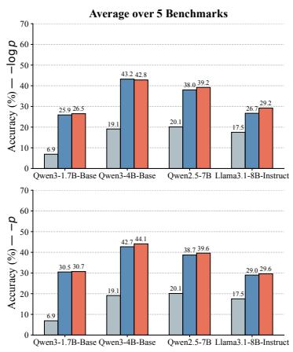

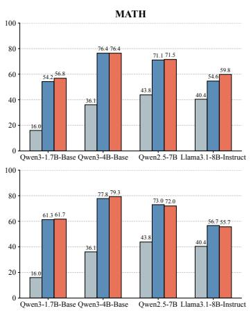

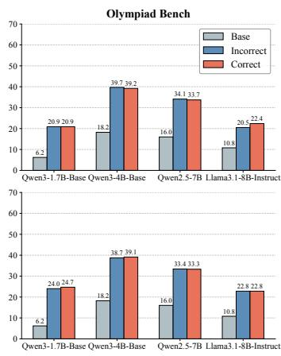  
Figure 1: Incorrect Trajectories Teach Long-CoT Behavior Almost as Effectively as Correct Ones. We compare models fine-tuned on positive versus negative CoT trajectories under two training objectives. Across models and benchmarks, negative trajectories retain most of the distillation gains achieved by positive trajectories.

Table 1: The Negligible Impact of CoT Correctness Extends Beyond Math Benchmarks. We evaluate whether the weak dependence on CoT correctness generalizes to non-math domains, including general reasoning, scientific reasoning, and coding tasks. Across models and training objectives, negative CoT trajectories achieve average performance nearly identical to positive trajectories. P and N denote positive and negative CoT trajectories, respectively.
<table><tr><td rowspan="2">Method Data</td><td rowspan="2"></td><td colspan="4">Qwen3-1.7B-Base</td><td rowspan="2">Method Data</td><td rowspan="2"></td><td colspan="4">Qwen3-4B-Base</td></tr><tr><td>MMLUPro</td><td>GPQA-D</td><td>LCBv2 Average</td><td></td><td>MMLUPro</td><td>GPQA-D</td><td>LCBv2</td><td>Average</td></tr><tr><td>Base</td><td>-</td><td>28.1</td><td>14.4</td><td>8.9</td><td>17.1</td><td>Base</td><td>一</td><td>46.1</td><td>16.2</td><td>19.8</td><td>27.4</td></tr><tr><td>-logp</td><td>P</td><td>35.3</td><td>21.3</td><td>13.8</td><td>23.5</td><td>-logp</td><td>P</td><td>52.9</td><td>29.6</td><td>29.4</td><td>37.3</td></tr><tr><td>-logp</td><td>N</td><td>34.3</td><td>23.0</td><td>14.3</td><td>23.9 (+0.4)</td><td>-logp</td><td>N</td><td>56.4</td><td>31.5</td><td>28.8</td><td>38.9 (+1.6)</td></tr><tr><td>-p</td><td>P</td><td>34.9</td><td>15.7</td><td>9.3</td><td>20.0</td><td>-p</td><td>P</td><td>54.3</td><td>34.3</td><td>24.8</td><td>37.8</td></tr><tr><td>-p</td><td>N</td><td>34.7</td><td>14.7</td><td>7.9</td><td>19.1 (-0.9)</td><td>-p</td><td>N</td><td>52.6</td><td>33.5</td><td>24.4</td><td>36.8 (-1.0)</td></tr><tr><td rowspan="2">Method</td><td rowspan="2">Data</td><td colspan="4">Llama-3.1-8B-Instruct</td><td rowspan="2">Method Data</td><td colspan="4">Qwen2.5-7B</td><td rowspan="2"></td></tr><tr><td>MMLUPro</td><td>GPQA-D</td><td>LCBv2</td><td>Average</td><td></td><td>MMLUPro</td><td>GPQA-D</td><td>LCBv2 Average</td></tr><tr><td>Base</td><td></td><td>34.9</td><td>24.5</td><td>17.7</td><td>25.7</td><td>Base</td><td></td><td>38.2</td><td>27.2</td><td>5.6</td><td>23.7</td></tr><tr><td>-logp</td><td>P</td><td>42.3</td><td>32.7</td><td>21.5</td><td>32.2</td><td>-logp</td><td>P</td><td>50.6</td><td>24.0</td><td>29.4</td><td>34.7</td></tr><tr><td>-logp</td><td>N</td><td>40.4</td><td>32.1</td><td>21.3</td><td>31.3 (-0.9)</td><td>-logp</td><td>N</td><td>48.7</td><td>26.7</td><td>28.0</td><td>34.5 (-0.2)</td></tr><tr><td>-p</td><td>P</td><td>42.3</td><td>22.3</td><td>20.9</td><td>28.5</td><td>-p</td><td>P</td><td>47.7</td><td>22.1</td><td>31.2</td><td>33.7</td></tr><tr><td>-p</td><td>N</td><td>41.9</td><td>23.4</td><td>20.7</td><td>28.7 (+0.2)</td><td>-p</td><td>N</td><td>45.9</td><td>22.0</td><td>30.1</td><td>32.7 (-1.0)</td></tr></table>

Results. As illustrated in Figure 1, models fine-tuned exclusively on negative (incorrect) reasoning trajectories exhibit remarkable performance gains on mathematical reasoning tasks, capturing the vast majority of the improvements achieved by their positive (correct) counterparts. Quantitatively, on mathematical datasets, models trained on negative samples achieve 97.7% of the absolute accuracy of those trained on positive samples $( A c c _ { \mathrm { n e g } } / A c c _ { \mathrm { p o s } } )$ and retain an impressive 94.7% of the relative performance gain $\bar { ( } ( A c c _ { \mathrm { n e g } } - \bar { A } c c _ { \mathrm { b a s e } } ) / ( \ddot { A c } c _ { \mathrm { p o s } } \stackrel { . } { - } A c c _ { \mathrm { b a s e } } ) )$ . This trend holds consistently across different base models and under both − log p and −p loss, resulting in a consistently narrow performance gap between the positive and negative data settings. Furthermore, Table 1 demonstrates that this weak dependence on CoT correctness extends well beyond the mathematical domain. Across broader evaluation suites encompassing general reasoning (MMLU-Pro), scientific problem-solving (GPQA-Diamond), and coding (LiveCodeBench-v2), the average performance discrepancy between positive and negative CoT distillation remains strikingly minimal, averaging within approximately a 1% margin. Additional evaluations on AIME 2026 and LiveCodeBench-v6, along with models trained on science QA and with alternative teachers, show the same positive-versus-negative pattern (Section C). Collectively, these results suggest that final-answer correctness is not the dominant factor in the settings studied.

## 3.2 The Utility of Incorrect Trajectories

Setup. To investigate how the ratio of positive to negative samples influences distillation outcomes, we leverage the datasets constructed in Section 3.1. Specifically, we establish varying baselines of positive samples by subsampling subsets of {512, 1024, 2048, 5120} correct trajectories. For each baseline size, we then supplement the training data with incorrect trajectories at positive-to-negative ratios of {1:0, 1:1, 1:2, 1:5}. To ensure that the models can fully learn and converge, especially in scenarios where the total dataset size is exceedingly small (e.g., 512 samples), we extend the training duration to 15 epochs across all mixed datasets.

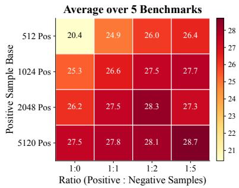

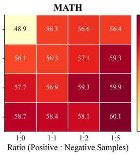

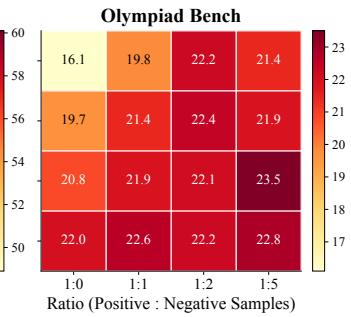  
Figure 2: Negative CoTs Effectively Mitigate the Scarcity of Correct Data. We train Qwen3-1.7B-Base with different positive sample bases and varying ratios of positive to negative CoT trajectories. Adding negative trajectories consistently improves performance when positive data is scarce.

Results. As illustrated in Figure 2, injecting negative trajectories consistently enhances performance when positive data is scarce. For instance, when the positive sample base is strictly limited to 512, increasing the proportion of negative samples from 1:0 to 1:5 yields a substantial absolute increase in the average accuracy across five math benchmarks, rising from 20.4% to 26.4%. However, the benefit of incorporating incorrect trajectories diminishes as the volume of positive data grows. Ultimately, these findings confirm that in scenarios where correct samples are scarce, supplementing the training set with mixed incorrect trajectories effectively bolsters the model’s acquisition of reasoning patterns. This reinforces the conclusion that incorrect CoT trajectories still provide vital behavioral supervision for Long-CoT distillation.

## 3.3 The Impact of Prompt Diversity

Setup. To systematically isolate and evaluate the impact of prompt diversity on Long-CoT distillation, we design a controlled experiment where the total trajectory budget remains fixed. Specifically, we randomly sample prompt subsets of varying sizes from the DAPO-Math-17K dataset, containing {500, 1K, 2K, 4K, 8K, 16K} unique prompts. To ensure the total volume of training samples is strictly controlled within the same order of magnitude across all settings, we employ Qwen3-4B (non-thinking) to sample an inversely proportional number of candidate trajectories for each prompt: generating {128, 64, 32, 16, 8, 4} responses per prompt, respectively. Finally, we apply standard rejection sampling to these generated candidates, filtering strictly for correct reasoning traces to construct our final fine-tuning datasets.

Results. As depicted in Figure 3, maintaining a fixed trajectory budget reveals that the reasoning performance of the distilled models is remarkably insensitive to the diversity of the source prompts. Across four distinct base models and five mathematical benchmarks, the average accuracy curves remain notably flat as the data composition transitions from a highly diverse prompt set to a heavily restricted one. For instance, fine-tuning on merely 500 unique problems sampled 128 times each, yields average benchmark results virtually identical to those achieved by utilizing 16K distinct problems sampled 4 times each. This stable performance trajectory suggests that broad problem coverage is not the dominant bottleneck at the trajectory budgets considered.

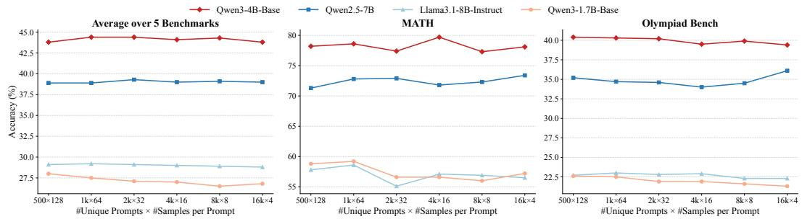  
Figure 3: Prompt Diversity Is Not the Bottleneck Under a Fixed Trajectory Budget. We fix the total number of CoT trajectories and vary the source prompt diversity, ranging from a small prompt set with many sampled trajectories per prompt (500 × 128) to a large prompt set with fewer trajectories per prompt (16k × 4).

## 4 The Behavioral Hypothesis of Long-CoT Distillation

Our observations in Section 3 suggest that neither final-answer correctness nor broad prompt diversity is the dominant bottleneck in the studied settings. We propose the Behavioral Hypothesis: a central benefit of Long-CoT distillation is learning structured reasoning patterns rather than memorizing perfectly correct, diverse problem-specific facts.

We distinguish two complementary aspects of a reasoning trajectory, Factual Knowledge and Reasoning Behaviors (illustrated in Figure 6).

## 4.1 Deconstructing CoT: Factual Knowledge vs. Reasoning Behaviors

Factual Knowledge. This dimension encompasses domain-specific axioms, problem constraints, and the precise execution of intermediate computations. Conventional distillation pipelines implicitly assume that models must internalize a broad, error-free spectrum of this knowledge. However, while a localized factual flaw (e.g., a hallucinated index or arithmetic error) almost inevitably corrupts the final answer, it does not necessarily invalidate the structural integrity of the entire trajectory.

Reasoning Behaviors. Distinct from factual accuracy, this dimension governs the meta-cognitive processes of problem-solving. It dictates how a model organizes its pre-existing knowledge into a deep, step-by-step format. It includes domain-agnostic, highly reusable actions such as problem decomposition, logical chaining, and sustaining derivation over long contexts. As demonstrated by our negative sample training (Figure 6), a model can execute flawless reasoning behaviors even when operating on flawed initial facts.

Building on this distinction, we test whether behavioral alignment can explain gains beyond problem-specific knowledge injection using two complementary comparisons.

## 4.2 Evidence I: Resistance to Factual Memorization

Setup. To assess the degree to which models memorize flawed factual details, we evaluate those fine-tuned on incorrect trajectories directly on their respective training sets in Table 2. The training configuration and datasets are identical to Section 3.1.

Results. We observe a striking phenomenon: fine-tuning on negative samples yields significant improvements even when evaluated on the training set itself. If the distillation process relied heavily on factual knowledge acquisition, a model trained on flawed facts would predictably rote-memorize those errors, causing its groundtruth accuracy on the training set to collapse. Instead, both Qwen3-1.7B-Base and Qwen3-4B-Base maintain highly comparable accuracy to their positive counterparts across both SFT objectives. This small divergence is consistent with models learning useful structural patterns from flawed trajectorie rather than simply reproducing the erroneous final answers.

Table 2: Models Avoid Overfitting to Flawed Facts on the Training Set. Numbers in parentheses indicate performance gains relative to the base model.
<table><tr><td rowspan="2">Model</td><td rowspan="2">Loss</td><td colspan="2">Acc (Gains) (%)</td></tr><tr><td>Positive</td><td>Negative</td></tr><tr><td>Qwen3 1.7B-Base</td><td>-logp -p</td><td>14.3 (+7.4) 17.3 (+10.4)</td><td>13.5 (+6.6) 15.7 (+8.8)</td></tr><tr><td>Qwen3</td><td>-logp</td><td>36.4 (+23.3)</td><td>34.6 (+21.5)</td></tr><tr><td>4B-Base</td><td></td><td>35.4 (+22.3) 34.1 (+21.0)</td><td></td></tr><tr><td></td><td>-p</td><td></td><td></td></tr></table>

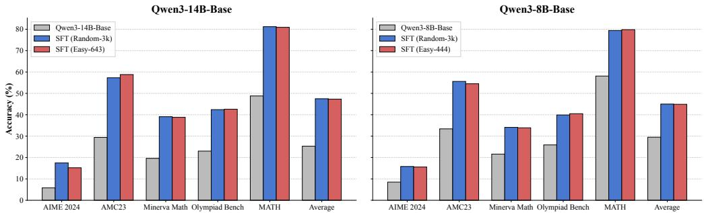  
Figure 4: Substantial Gains on Previously Solvable Problems. Fine-tuning on easy subsets that the base model can already solve (Easy-643/444) yields improvements comparable to training on a larger, randomly sampled dataset (Random-3k) across math benchmarks. This reduces the role of new problem-specific answers as an explanation for the gains.

## 4.3 Evidence II: Isolating Behavioral Alignment via Solvable Problems

Setup. To explicitly isolate the behavioral mechanism from knowledge transfer, we mitigate the impact of “novel knowledge injection”. We construct training datasets exclusively comprising problems that the base models can already solve. Specifically, we evaluate the models on the DAPO-Math-17K dataset across 8 sampling iterations, retaining prompts correctly answered at least 7 times. This yields highly confident, solvable subsets (Easy-444 for Qwen3-8B-Base and Easy-643 for Qwen3-14B-Base). Since the base model already solves these prompts reliably, this comparison limits the role of novel problem-specific knowledge as an explanation for subsequent gains. To ensure a fair volumetric comparison with the experiments in Section 3.1, we repeatedly sample trajectories from these subsets to match the scale of our baseline. We then benchmark these models against those fine-tuned on the Random-3k dataset.

Results. As illustrated in Figure 4, fine-tuning base models exclusively on subsets they can already solve yields remarkable improvements that closely match the Random-3k baseline across all evaluated benchmarks. Because the base models could already answer these prompts, learning previously unseen problem-specific answers alone is unlikely to explain the gains.

Remarkably, despite being exposed to extremely limited novel factual knowledge, the models still perform competitively with the performance of the broader SFT baseline. Together with Table 2 and the late-layer representation comparison in Section C, these results support the Behavioral Hypothesis: distillation helps models organize what they already know into reusable reasoning patterns.

## 5 Further Exploration: Harmonizing CoT Complexity and Optimization

Motivated by the role of structured reasoning, we investigate how trajectory complexity interacts with the choice of optimization objective. Specifically, we compare the standard cross-entropy loss (− log p) with the recently popularized plain probability-based loss (−p) across datasets of varying reasoning depths.

## 5.1 Empirical Divergence Across Complexity Levels

Setup. To systematically study the effect of CoT complexity, we construct three datasets representing distinct tiers of reasoning depth: Simple, Medium, and Complex. We repurpose the data from Section 3.1 for the Medium dataset. For the Complex dataset, we employ the same pipeline but run

Qwen3-4B (thinking), sampling 8 responses per prompt. The Simple dataset is built by sampling a subset from NuminaMath-CoT [35].

The token length distributions and word cloud analyses (detailed in Section A.2) highlight the signif icant semantic contrast across these tiers. The average token length scales aggressively across the Simple (426), Medium (1,337), and Complex (9,062) datasets. Crucially, the word cloud analysis reveals that this scaling in length is accompanied by a qualitative shift in reasoning behaviors. While the Simple dataset is dominated by concrete, task-oriented vocabulary (e.g., "solution", "value"), the Complex dataset is heavily populated with meta-cognitive markers (e.g., "wait", "maybe", "alternatively"). This demonstrates that the extended trajectories in the Complex dataset are not merely bloated calculations, but encapsulate genuine trial-and-error and advanced self-correction behaviors.

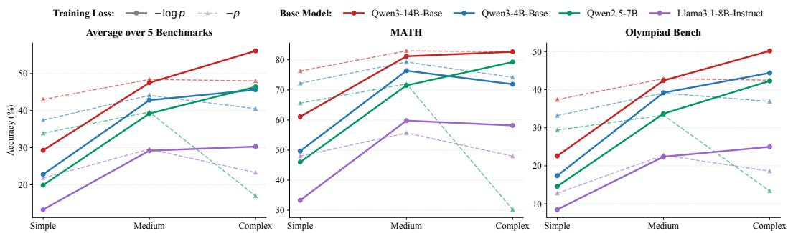  
Figure 5: CoT Complexity Dictates the Appropriate Distillation Objective. We compare four base models fine-tuned with − log p loss (solid lines) and −p loss (dashed lines) across varying CoT complexities. The results reveal a clear dichotomy: while the −p loss excels on simpler CoTs, it suffers from pronounced degradation on highly complex reasoning traces. Conversely, the standard − log p loss scales robustly with complexity.

Results. As illustrated in Figure 5, our evaluation reveals a clear divergence driven by CoT complexity. First, we find that training on more complex reasoning data unlocks higher peak performance. However, this scaling benefit is conditional on using the correct loss function. Specifically, this divergence directly challenges the emerging consensus that the −p loss is universally superior for reasoning acquisition [19, 21]. As depicted in Figure 5, while the −p loss indeed yields notable gains on simpler CoTs, this initial advantage completely collapses as reasoning traces become more intricate. On the Complex dataset, models trained with −p suffer a steep performance drop. In contrast, the standard − log p loss scales robustly, maintaining steady upward trajectories and effectively capturing the benefits of extended reasoning. Ultimately, these findings highlight that the efficacy of these distillation objectives is highly context-dependent, underscoring the necessity of matching the loss function to the intrinsic complexity of the training trajectories.

## 5.2 The Mechanics: A Perspective on Gradient Dynamics

To understand this performance divergence, we revisit the gradient dynamics of the two objectives. Taking the derivative of the loss with respect to the predicted probability p yields $\begin{array} { r } { \frac { \partial } { \partial p } ( - \log p ) = - \frac { 1 } { p } } \end{array}$ and $\textstyle { \frac { \partial } { \partial p } } ( - p ) = - 1$ . Applying the chain rule, the gradient of − log p loss with respect to the model parameters θ can be formally expressed directly in terms of $\mathbf { \partial } - p \mathbf { : }$

$$
\nabla _ { \theta } \bigl ( - \log p \bigr ) = \frac { 1 } { p } \nabla _ { \theta } \bigl ( - p \bigr ) .\tag{3}
$$

This highlights a core difference in how the objectives treat "hard tokens" (where prediction confidence p is small). The − log p loss acts as a dynamic amplifier, heavily penalizing low-p predictions via the $1 / p$ multiplier. In contrast, the $- p$ loss applies a uniform penalty, resulting in the selective under-learning of hard tokens. This mechanism drives the performance divergence across different complexity tiers.

This selective learning mechanism explains the performance crossing across complexity tiers. Simple CoTs: The Overfitting Dilemma. In straightforward reasoning, the overall logic is highly predictable.

Hard tokens are relatively rare and typically represent random noise rather than key logical transitions. Here, the 1/p amplifier of − log p forces the model to over-optimize on this noise, leading to overfitting. Conversely, the −p loss avoids excessive updates on these low-p regions, acting as a robust regularizer that improves generalization. Complex CoTs: The Coherence Collapse. Complex reasoning involves behaviors like backtracking and hypothesis exploration, which drastically increase the density of hard tokens. Because −p under-penalizes low-p predictions, it fails to provide the rigorous supervision necessary to master these vital transitions. Since deep reasoning is strictly sequential, failing to internalize these structural tokens corrupts the logical coherence of the entire trajectory, fracturing the reasoning chain. The response lengths in Table 11 are consistent with this account: after training on complex trajectories averaging roughly 9K tokens, −p-trained Qwen2.5-7B and Llama-3.1-8B-Instruct generate more than 20K tokens on average, versus roughly 14K and 13K under − log p, respectively. This contrast suggests that learning difficult transitions, including when to stop, matters for long-chain coherence. In summary, while the −p objective prevents overfitting on simple samples, the gradient amplification intrinsic to − log p is essential for maintaining structural coherence in complex, long-chain reasoning.

## 6 Related Work

Long-CoT distillation has become an important method for endowing models with the ability to reason about complex tasks [18]. Early approaches focused on constructing training sets by collecting large and diverse amounts of data through a pipeline. Guo et al. [1] constructed a dataset containing 600K CoT instances through rejection sampling to train other models. Similarly, Zhang et al. [16] constructed a 500k dataset encompassing various scenarios. Furthermore, Luo et al. [15] emphasized the correctness of CoT, optimizing the CoT dataset by simplifying and correcting the intermediate steps. Alternatively, Zhao et al. [36] propose to rewrite the SFT dataset, arguing that data diversity is one of the key factors. These pipelines motivate controlled tests of how correctness and prompt coverage affect distillation. Earlier work already found that flawed traces can help: Li et al. [37] contrast CoT structure with perturbed content, and Li et al. [38] use negative traces with dual-LoRA and calibration. Du et al. [39] demonstrate reasoning gains from just 20–50 high-quality CoTs. Unlike those settings, we test direct SFT on flawed traces across model families, fixed-budget prompt diversity, and the interaction of CoT complexity with the training loss.

Another line of work [40, 41, 42] focuses on modifying the optimization objective of SFT to enhance post-training reasoning capabilities. Wu et al. [19] unified SFT and reinforcement learning (RL) under a single framework and proposed that using −p instead of − log p as the loss function can improve generalization on reasoning tasks. Subsequently, Zhu et al. [20], Li et al. [21] adopted this approach, incorporating −p as part of their loss function. However, our work reveals that the effectiveness of this modified loss function in prior studies is limited to relatively simple SFT datasets. On longer and more complex datasets, the standard SFT loss performs better in our experiments. Complementarily, Fan et al. [43] interpolate between the two losses according to data noise; our study identifies trajectory complexity as another relevant factor.

Even though CoT distillation has proven to be widely effective, the specific components that actually drive its success are not yet fully understood [44]. Li et al. [37] argued that the structure of CoT is crucial for model learning. On the other hand, Chandra et al. [45] contended that the underlying data distribution is of paramount importance. Furthermore, Feng et al. [46] argued that both naive CoT lengthening and increased review steps actually hurt model performance. Ren et al. [47] reexamined the generalization of SFT from the perspectives of the optimization process, data, and model capabilities, concluding that SFT can indeed achieve generalization. Building on these observations, we compare multiple architectures, evaluation domains, losses, and training-data compositions; we also test whether flawed traces can supplement scarce correct data.

## 7 Conclusion

This study dismantles the established assumptions of Long-CoT distillation, proving that successful reasoning transfer does not strictly require flawless trajectories or extensive prompt diversity. Instead, we introduce the Behavioral Hypothesis: distillation fundamentally teaches models the structural methodology of step-by-step reasoning, rather than rote factual memorization. Furthermore, we reveal a critical divergence in optimization: while the −p loss excels on simpler trajectories, the standard cross-entropy loss (− log p) remains strictly essential for scaling to complex, lengthy reasoning. Ultimately, by isolating these behavioral drivers, our findings provide a highly efficient and principled blueprint for data curation and objective selection in the next generation of reasoning models.

## References

[1] Daya Guo, Dejian Yang, Haowei Zhang, Junxiao Song, Peiyi Wang, Qihao Zhu, Runxin Xu, Ruoyu Zhang, Shirong Ma, Xiao Bi, et al. Deepseek-r1 incentivizes reasoning in llms through reinforcement learning. Nature, 645(8081):633–638, 2025.

[2] Aaron Jaech, Adam Kalai, Adam Lerer, Adam Richardson, Ahmed El-Kishky, Aiden Low, Alec Helyar, Aleksander Madry, Alex Beutel, Alex Carney, et al. Openai o1 system card. arXiv preprint arXiv:2412.16720, 2024.

[3] Jiankai Sun, Chuanyang Zheng, Enze Xie, Zhengying Liu, Ruihang Chu, Jianing Qiu, Jiaqi Xu, Mingyu Ding, Hongyang Li, Mengzhe Geng, et al. A survey of reasoning with foundation models: Concepts, methodologies, and outlook. ACM Computing Surveys, 57(11):1–43, 2025.

[4] Yanbo Wang, Yongcan Yu, Jian Liang, and Ran He. A comprehensive survey on trustworthiness in reasoning with large language models. arXiv preprint arXiv:2509.03871, 2025.

[5] Karl Cobbe, Vineet Kosaraju, Mohammad Bavarian, Mark Chen, Heewoo Jun, Lukasz Kaiser, Matthias Plappert, Jerry Tworek, Jacob Hilton, Reiichiro Nakano, et al. Training verifiers to solve math word problems. arXiv preprint arXiv:2110.14168, 2021.

[6] Dan Hendrycks, Collin Burns, Saurav Kadavath, Akul Arora, Steven Basart, Eric Tang, Dawn Song, and Jacob Steinhardt. Measuring mathematical problem solving with the math dataset. In Proc. NeurIPS, 2021.

[7] Shuo Lu, Jianjie Cheng, Yinuo Xu, Yongcan Yu, Lijun Sheng, Peijie Wang, Siru Jiang, Yongguan Hu, Run Ling, Yihua Shao, et al. Do mllms really understand space? a mathematical reasoning evaluation. arXiv preprint arXiv:2602.11635, 2026.

[8] Yongcan Yu, Lingxiao He, Jian Liang, Kuangpu Guo, Meng Wang, Qianlong Xie, Xingxing Wang, and Ran He. Understanding and mitigating spurious signal amplification in test-time reinforcement learning for math reasoning. arXiv preprint arXiv:2604.21327, 2026.

[9] Carlos E Jimenez, John Yang, Alexander Wettig, Shunyu Yao, Kexin Pei, Ofir Press, and Karthik R Narasimhan. Swe-bench: Can language models resolve real-world github issues? In Proc. ICLR, 2024.

[10] Naman Jain, King Han, Alex Gu, Wen-Ding Li, Fanjia Yan, Tianjun Zhang, Sida Wang, Armando Solar-Lezama, Koushik Sen, and Ion Stoica. Livecodebench: Holistic and contamination free evaluation of large language models for code. In Proc. ICLR, 2025.

[11] David Rein, Betty Li Hou, Asa Cooper Stickland, Jackson Petty, Richard Yuanzhe Pang, Julien Dirani, Julian Michael, and Samuel R. Bowman. GPQA: A graduate-level google-proof q&a benchmark. In Proc. COLM, 2024.

[12] Long Phan, Alice Gatti, Ziwen Han, Nathaniel Li, Josephina Hu, Hugh Zhang, Chen Bo Calvin Zhang, Mohamed Shaaban, John Ling, Sean Shi, et al. Humanity’s last exam. arXiv preprint arXiv:2501.14249, 2025.

[13] Shuo Lu, Yinuo Xu, Jianjie Cheng, Lingxiao He, Meng Wang, and Jian Liang. Deepresearchslice: Bridging the retrieval-utilization gap via explicit text slicing. arXiv preprint arXiv:2601.03261, 2025.

[14] Shuo Lu, Haohan Wang, Wei Feng, Weizhen Wang, Shen Zhang, Yaoyu Li, Ao Ma, Zheng Zhang, Jingjing Lv, Junjie Shen, et al. One size, many fits: Aligning diverse group-wise click preferences in large-scale advertising image generation. arXiv preprint arXiv:2602.02033, 2026.

[15] Yijia Luo, Yulin Song, Xingyao Zhang, Jiaheng Liu, Weixun Wang, GengRu Chen, Wenbo Su, and Bo Zheng. Deconstructing long chain-of-thought: A structured reasoning optimization framework for long cot distillation. arXiv preprint arXiv:2503.16385, 2025.

[16] YiFan Zhang, Xingyu Lu, Shukang Yin, Chaoyou Fu, Wei Chen, Xiao Hu, Bin Wen, Kaiyu Jiang, Changyi Liu, Tianke Zhang, Haonan fan, Kaibing Chen, Jiankang Chen, Haojie Ding, Kaiyu Tang, Zhang Zhang, Liang Wang, Fan Yang, Tingting Gao, and Guorui Zhou. Thyme: Think beyond images. In Proc. ICLR, 2026.

[17] Yuxuan Tong, Xiwen Zhang, Rui Wang, Ruidong Wu, and Junxian He. Dart-math: Difficultyaware rejection tuning for mathematical problem-solving. In Proc. NeurIPS, 2024.

[18] Xinyu Guan, Li Lyna Zhang, Yifei Liu, Ning Shang, Youran Sun, Yi Zhu, Fan Yang, and Mao Yang. rstar-math: Small llms can master math reasoning with self-evolved deep thinking. In Proc. ICML, 2025.

[19] Yongliang Wu, Yizhou Zhou, Zhou Ziheng, Yingzhe Peng, Xinyu Ye, Xinting Hu, Wenbo Zhu, Lu Qi, Ming-Hsuan Yang, and Xu Yang. On the generalization of SFT: A reinforcement learning perspective with reward rectification. In Proc. ICLR, 2026.

[20] He Zhu, Junyou Su, Peng Lai, Ren Ma, Wenjia Zhang, Linyi Yang, and Guanhua Chen. Anchored supervised fine-tuning. In Proc. ICLR, 2026.

[21] Gaotang Li, Ruizhong Qiu, Xiusi Chen, Heng Ji, and Hanghang Tong. Beyond log likelihood: Probability-based objectives for supervised fine-tuning across the model capability continuum. arXiv preprint arXiv:2510.00526, 2025.

[22] An Yang, Anfeng Li, Baosong Yang, Beichen Zhang, Binyuan Hui, Bo Zheng, Bowen Yu, Chang Gao, Chengen Huang, Chenxu Lv, et al. Qwen3 technical report. arXiv preprint arXiv:2505.09388, 2025.

[23] An Yang, Baosong Yang, Beichen Zhang, Binyuan Hui, Bo Zheng, Bowen Yu, Chengyuan Li, Dayiheng Liu, Fei Huang, Haoran Wei, et al. Qwen2. 5 technical report. arXiv e-prints, pages arXiv–2412, 2024.

[24] Aaron Grattafiori, Abhimanyu Dubey, Abhinav Jauhri, Abhinav Pandey, Abhishek Kadian, Ahmad Al-Dahle, Aiesha Letman, Akhil Mathur, Alan Schelten, Alex Vaughan, et al. The llama 3 herd of models. arXiv preprint arXiv:2407.21783, 2024.

[25] Qiying Yu, Zheng Zhang, Ruofei Zhu, Yufeng Yuan, Xiaochen Zuo, Yu Yue, Weinan Dai, Tiantian Fan, Gaohong Liu, Lingjun Liu, et al. Dapo: An open-source llm reinforcement learning system at scale. arXiv preprint arXiv:2503.14476, 2025.

[26] Guangming Sheng, Chi Zhang, Zilingfeng Ye, Xibin Wu, Wang Zhang, Ru Zhang, Yanghua Peng, Haibin Lin, and Chuan Wu. Hybridflow: A flexible and efficient rlhf framework. In Proc. EuroSys, 2025.

[27] American Institute of Mathematics. Aime 2024 competition mathematical problems, 2024.

[28] Mathematical Association of America. Amc 2023 competition problems, 2023.

[29] Aitor Lewkowycz, Anders Andreassen, David Dohan, Ethan Dyer, Henryk Michalewski, Vinay Ramasesh, Ambrose Slone, Cem Anil, Imanol Schlag, Theo Gutman-Solo, et al. Solving quantitative reasoning problems with language models. In Proc. NeurIPS, 2022.

[30] Chaoqun He, Renjie Luo, Yuzhuo Bai, Shengding Hu, Zhen Thai, Junhao Shen, Jinyi Hu, Xu Han, Yujie Huang, Yuxiang Zhang, et al. Olympiadbench: A challenging benchmark for promoting agi with olympiad-level bilingual multimodal scientific problems. In Proc. ACL, 2024.

[31] An Yang, Beichen Zhang, Binyuan Hui, Bofei Gao, Bowen Yu, Chengpeng Li, Dayiheng Liu, Jianhong Tu, Jingren Zhou, Junyang Lin, et al. Qwen2.5-math technical report: Toward mathematical expert model via self-improvement. arXiv preprint arXiv:2409.12122, 2024.

[32] Yubo Wang, Xueguang Ma, Ge Zhang, Yuansheng Ni, Abhranil Chandra, Shiguang Guo, Weiming Ren, Aaran Arulraj, Xuan He, Ziyan Jiang, et al. Mmlu-pro: A more robust and challenging multi-task language understanding benchmark. In Proc. NeurIPS, 2024.

[33] Negin Raoof, Etash Kumar Guha, Ryan Marten, Jean Mercat, Eric Frankel, Sedrick Keh, Hritik Bansal, Georgios Smyrnis, Marianna Nezhurina, Trung Vu, Zayne Rea Sprague, Mike A Merrill, Liangyu Chen, Caroline Choi, Zaid Khan, Sachin Grover, Benjamin Feuer, Ashima Suvarna, Shiye Su, Wanjia Zhao, Kartik Sharma, Charlie Cheng-Jie Ji, Kushal Arora, Jeffrey Li, Aaron Gokaslan, Sarah M Pratt, Niklas Muennighoff, Jon Saad-Falcon, John Yang, Asad Aali, Shreyas Pimpalgaonkar, Alon Albalak, Achal Dave, Hadi Pouransari, Greg Durrett, Sewoong Oh, Tatsunori Hashimoto, Vaishaal Shankar, Yejin Choi, Mohit Bansal, Chinmay Hegde, Reinhard Heckel, Jenia Jitsev, Maheswaran Sathiamoorthy, Alex Dimakis, and Ludwig Schmidt. Evalchemy: Automatic evals for llms. https://github.com/mlfoundations/evalchemy, 2025. Software.

[34] Hugging Face. Math-verify, 2024. URL https://github.com/huggingface/ Math-Verify.

[35] Jia Li, Edward Beeching, Lewis Tunstall, Ben Lipkin, Roman Soletskyi, Shengyi Huang, Kashif Rasul, Longhui Yu, Albert Q Jiang, Ziju Shen, et al. Numinamath: The largest public dataset in ai4maths with 860k pairs of competition math problems and solutions. Hugging Face repository, 2024.

[36] Shiwan Zhao, Xuyang Zhao, Jiaming Zhou, Aobo Kong, Qicheng Li, and Yong Qin. Mind the gap: Data rewriting for stable off-policy supervised fine-tuning. In Proc. ICASSP, 2026.

[37] Dacheng Li, Shiyi Cao, Tyler Griggs, Shu Liu, Xiangxi Mo, Eric Tang, Sumanth Hegde, Kourosh Hakhamaneshi, Shishir G Patil, Matei Zaharia, et al. Language models can easily learn to reason from demonstrations. In Findings ofEMNLP, 2025.

[38] Yiwei Li, Peiwen Yuan, Shaoxiong Feng, Boyuan Pan, Bin Sun, Xinglin Wang, Heda Wang, and Kan Li. Turning dust into gold: Distilling complex reasoning capabilities from llms by leveraging negative data. In Proc. AAAI, 2024.

[39] Wei Du, Branislav Kisacanin, George Armstrong, Shubham Toshniwal, Ivan Moshkov, Alexan Ayrapetyan, Sadegh Mahdavi, Dan Zhao, Shizhe Diao, Dragan Masulovic, et al. The challenge of teaching reasoning to llms without rl or distillation. arXiv preprint arXiv:2507.09850, 2025.

[40] Wenhong Zhu, Ruobing Xie, Rui Wang, Xingwu Sun, Di Wang, and Pengfei Liu. Proximal supervised fine-tuning. In Proc. ICLR, 2026.

[41] Tao Liu, Taiqiang Wu, Runming Yang, Shaoning Sun, Junjie Wang, and Yujiu Yang. Profit: Leveraging high-value signals in sft via probability-guided token selection. arXiv preprint arXiv:2601.09195, 2026.

[42] Yijie Chen, Yijin Liu, and Fandong Meng. Sed-sft: Selectively encouraging diversity in supervised fine-tuning. arXiv preprint arXiv:2602.07464, 2026.

[43] Yaoyou Fan, Chao Zhang, Xiaoyu Tan, Chenxing Sun, Yu Yuan, Haoyu Feng, Lu Pan, Ke Zeng, and Xunliang Cai. Navigating the pareto frontier of alignment: Spectrum-adaptive fine-tuning for llms. In Proc. ICML, 2026.

[44] Yongcan Yu, Lingxiao He, Shuo Lu, Lijun Sheng, Yinuo Xu, Yanbo Wang, Kuangpu Guo, Jianjie Cheng, Meng Wang, Qianlong Xie, et al. Reassessing the role of supervised fine-tuning: An empirical study in vlm reasoning. arXiv preprint arXiv:2512.12690, 2025.

[45] Abhranil Chandra, Ayush Agrawal, Arian Hosseini, Sebastian Fischmeister, Rishabh Agarwal, Navin Goyal, and Aaron Courville. Shape of thought: When distribution matters more than correctness in reasoning tasks. arXiv preprint arXiv:2512.22255, 2025.

[46] Yunzhen Feng, Julia Kempe, Cheng Zhang, Parag Jain, and Anthony Hartshorn. What characterizes effective reasoning? revisiting length, review, and structure of cot. arXiv preprint arXiv:2509.19284, 2025.

[47] Qihan Ren, Peng Wang, Ruikun Cai, Shuai Shao, Dadi Guo, Yuejin Xie, Yafu Li, Quanshi Zhang, Xia Hu, Jing Shao, et al. Rethinking generalization in reasoning sft: A conditional analysis on optimization, data, and model capability. arXiv preprint arXiv:2604.06628, 2026.

[48] Lisa Alazraki, Maximilian Mozes, Jon Ander Campos, Tan Yi-Chern, Marek Rei, and Max Bartolo. No need for explanations: Llms can implicitly learn from mistakes in-context. In Proc. EMNLP, 2025.

[49] Rafael Rafailov, Archit Sharma, Eric Mitchell, Christopher D Manning, Stefano Ermon, and Chelsea Finn. Direct preference optimization: Your language model is secretly a reward model. In Proc. NeurIPS, 2023.

[50] Shengnan An, Zexiong Ma, Zeqi Lin, Nanning Zheng, Jian-Guang Lou, and Weizhu Chen. Learning from mistakes makes llm better reasoner. arXiv preprint arXiv:2310.20689, 2023.

[51] Xinyu Zhu, Mengzhou Xia, Zhepei Wei, Wei-Lin Chen, Danqi Chen, and Yu Meng. The surprising effectiveness of negative reinforcement in llm reasoning. In Proc. NeurIPS, 2025.

[52] Simon Kornblith, Mohammad Norouzi, Honglak Lee, and Geoffrey Hinton. Similarity of neural network representations revisited. In Proc. ICML, 2019.

## A Experimental Details

## A.1 Losses

Unifying the two objectives. To systematically analyze the two SFT losses (− log p and −p), it is essential to recognize that they are not isolated heuristics. Instead, they can be elegantly unified under a generalized family of probability-based loss functions parameterized by α, defined as $\begin{array} { r } { f _ { \alpha } ( p ) = \frac { 1 - p ^ { \alpha } } { \alpha } } \end{array}$ . This formulation bridges the two objectives:

$$
f _ { \alpha } ( p ) = \left\{ \begin{array} { l l } { \operatorname* { l i m } _ { \alpha \to 0 } \frac { 1 - p ^ { \alpha } } { \alpha } = - \log p , } & { \mathrm { ( N L L ~ l o s s ) } , } \\ { \frac { 1 - p ^ { 1 } } { 1 } = 1 - p \equiv - p , } & { \mathrm { ( p l a i n - } p \mathrm { l o s s , } \mathrm { u p ~ t o ~ a ~ c o n s t a n t ) } . } \end{array} \right.\tag{4}
$$

While Equation (4) demonstrates that − log p and −p share a unified mathematical origin, our experiments reveal that their actual optimization behaviors diverge profoundly depending on the complexity of the reasoning task. We will extensively evaluate their empirical performance and fundamentally deconstruct their gradient dynamics in Section 5.

## A.2 Dataset Demonstration and Analysis

A Concrete Case Study. To concretely illustrate the distinction between factual knowledge and reasoning behaviors, Figure 6 presents a side-by-side comparison of a positive and a negative reasoning trajectory for the same mathematical problem. In the positive sample, the model correctly identifies the boundary conditions and executes flawless calculations to reach the accurate final answer. Conversely, the negative sample introduces a localized factual error early in the process—specifically, hallucinating an incorrect starting index (k = 2 instead of k = 1). Inevitably, this flawed initial fact corrupts the final calculated answer.

However, crucially, the structural integrity of the reasoning process remains completely intact. Despite the factual hallucination, the negative sample successfully exhibits advanced reasoning behaviors identical to those of the positive sample: it correctly recognizes the complex "telescoping product" pattern, unfolds the abstract symbols into explicit sequential multiplications without skipping steps, and logically deduces the continuous "cancel out" mechanism. This concrete example vividly demonstrates why incorrect trajectories can still provide high-quality behavioral supervision for Long-CoT distillation: they effectively teach the model the structured methodology of how to reason step-by-step, even when operating on flawed initial facts.

Datasets with Different Complexity Tiers. To provide a deeper understanding of the intrinsic differences across the varying complexity levels, this section presents detailed dataset statistics and analysis. First, as illustrated by the boxplot in Figure 7, the response token lengths scale aggressively across the Simple, Medium, and Complex datasets. This provides a quantitative reflection of the progressively increasing reasoning depth.

However, this scaling in complexity is not merely a superficial accumulation of token length. As further revealed by the word cloud analysis in Figure 8, there is a fundamental qualitative shift in the lexical distribution across the datasets. In the Simple dataset, the vocabulary is heavily dominated by concrete, task-oriented words (e.g., "function", "equation", "value"). Interestingly, the Medium dataset serves as a clear transitional phase: alongside standard mathematical terms, we begin to observe the early emergence of exploratory vocabulary such as "try" and "possible". Ultimately, in stark contrast to the simplest instances, the Complex dataset exhibits a dense population of advanced meta-cognitive markers (e.g., "wait", "maybe", "alternatively"). This progressive semantic transition convincingly demonstrates that the extended trajectories within the Complex dataset encapsulate genuine trial-and error, hypothesis exploration, and self-correction behaviors, which are the quintessential elements of advanced Long-CoT reasoning.

## B Extended Related Work

Learning from Negative Samples. Utilizing incorrect data to enhance the reasoning capabilities of LLMs has gained significant attention, primarily through in-context learning and optimizationbased approaches. Instead of relying solely on high-quality demonstrations, recent studies show that injecting flawed examples directly into the prompt can help models delineate task boundaries [48]. Alternatively, optimization-based methods actively update model weights to penalize or refine erroneous outputs during training. This is typically achieved by constructing positive-negative pairs to maximize the likelihood margin in preference learning [49, 1, 14], training models on flawed trajectories to trigger iterative self-correction [50], or explicitly minimizing the likelihood of negative samples to encourage broader exploration and significantly improve pass@k performance [51]. While existing literature predominantly treats negative samples strictly as penalization targets or examples of what to avoid, our findings fundamentally challenge this paradigm. We demonstrate that factually flawed trajectories can actually serve as highly effective positive supervision for Long-CoT distillation, provided their structural reasoning behaviors remain intact.

<table><tr><td colspan="3">Question: Find the value of the product</td></tr><tr><td colspan="3"> ${ \frac { 8 } { 4 } } \cdot { \frac { 1 2 } { 8 } } \cdot { \frac { 1 6 } { 1 2 } } \cdots { \frac { 4 n + 4 } { 4 n } } \cdot \cdot \cdot { \frac { 2 0 0 8 } { 2 0 0 4 } } .$ </td></tr><tr><td colspan="3"></td></tr><tr><td>√ Positive Sample (Correct Fact &amp; Perfect Behavior) Step 1: Understand the pattern</td><td>X Negative Sample Step 1: Understand the pattern</td><td>(Flawed Fact, but Same Behavior)</td></tr><tr><td>The terms are:  ${ \begin{array} { l } { { \frac { 8 } { 4 } } , { \frac { 1 2 } { 8 } } , \dots , { \frac { 2 0 0 8 } { 2 0 0 4 } } . } \end{array} }$  Each term has the general form:  ${ \frac { 4 ( n + 1 ) } { 4 n } } = { \frac { n + 1 } { n } }$ </td><td></td><td>The terms are:  ${ \begin{array} { l } { { \frac { 8 } { 4 } } , { \frac { 1 2 } { 8 } } , \ldots , { \frac { 2 0 0 8 } { 2 0 0 4 } } . } \end{array} }$  Let the general term be:  ${ \frac { 4 ( k + 1 ) } { 4 k } } = { \frac { k + 1 } { k } }$  So the product becomes:</td></tr><tr><td>- Correct boundary condition —</td><td></td><td> $\prod _ { k = 2 } ^ { 5 0 2 } { \frac { k + 1 } { k } }$  [!] Factual Error: Hallucinated starting index  $( k = 2$ </td></tr><tr><td> ${ \frac { 2 } { 1 } } \cdot { \frac { 3 } { 2 } } \cdot { \frac { 4 } { 3 } } \cdots { \frac { 5 0 2 } { 5 0 1 } }$ </td><td></td><td></td></tr><tr><td></td><td></td><td></td></tr><tr><td>Observe that this is a telescoping product. Most terms</td><td></td><td></td></tr><tr><td></td><td></td><td>Step 2: Telescoping Product</td></tr><tr><td></td><td></td><td></td></tr><tr><td>Step 2: Telescoping Product</td><td>instead of  $k = 1 )$ </td><td></td></tr><tr><td></td><td></td><td></td></tr><tr><td>Write out the product explicitly:</td><td>This is a telescoping product.</td><td></td></tr><tr><td></td><td>Let&#x27;s write out the product:</td><td></td></tr><tr><td></td><td></td><td></td></tr><tr><td></td><td></td><td> ${ \frac { 3 } { 2 } } \cdot { \frac { 4 } { 3 } } \cdot { \frac { 5 } { 4 } } \cdot \cdot \cdot { \frac { 5 0 3 } { 5 0 2 } }$ </td></tr><tr><td></td><td></td><td></td></tr><tr><td>cancel out...</td><td>We can see that most terms cancel out...</td><td></td></tr><tr><td>Final Answer:</td><td></td><td></td></tr><tr><td></td><td>Final Answer:</td><td></td></tr><tr><td></td><td></td><td></td></tr><tr><td></td><td></td><td></td></tr><tr><td></td><td></td><td></td></tr><tr><td>502</td><td></td><td></td></tr><tr><td></td><td></td><td> $\boxed { \frac { 5 0 3 } { 2 } }$ </td></tr><tr><td></td><td></td><td></td></tr><tr><td></td><td></td><td></td></tr></table>

<table><tr><td>Shared Reasoning Behaviors (The Essence of Distillation): • Pattern Recognition: Successfully identifies the complex &quot;telescoping product&quot; structure.</td></tr><tr><td>• Process Unfolding: Expands the abstract symbols into explicit sequential multiplications without</td></tr><tr><td>skipping steps. • Logical Deduction: Accurately describes the continuous &quot;cancel out&quot; mechanism between</td></tr><tr><td>numerators and denominators.</td></tr></table>

Figure 6: Factual Flaws vs. Behavioral Alignment in Long-CoT Distillation. Given the same initial problem, the negative sample hallucinated an incorrect starting index $( k = 2 )$ , leading to a wrong final answer, yet it perfectly replicated the core, step-by-step reasoning behaviors of the positive sample. This structurally intact deduction demonstrates why incorrect CoT trajectories still provide high-quality behavioral supervision.

Token Length Distribution (Qwen3 Tokenizer)  
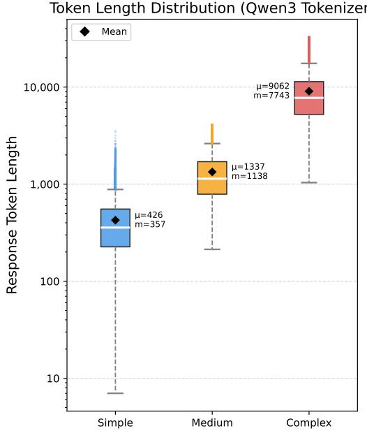  
Figure 7: Token Length Distribution Across Reasoning Complexity Tiers. The boxplot illustrates the scaling of response lengths across Simple, Medium, and Complex datasets.

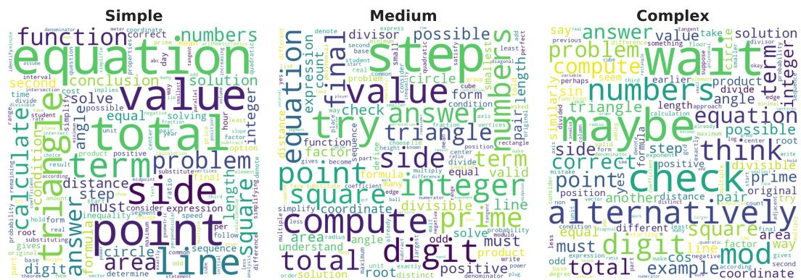  
Figure 8: Word Cloud Analysis Reveals Lexical Shifts Across CoT Complexities. The lexical distribution shows a transition from concrete task-oriented words in the Simple dataset, through exploratory terms in the Medium dataset, to meta-cognitive markers in the Complex dataset.

## C Additional Experiments Following Peer Review

We report further controls on training domain, teacher choice, more recent test sets, and hiddenstate representations. P and N denote trajectories selected by correct and incorrect final answers, respectively; mathematical averages are computed over the five benchmarks in Section 3.1.

Science-domain supervision. We fine-tune Qwen3 base models on correct (SFT-P) or incorrect (SFT-N) trajectories from a science QA subset of GURU, then evaluate both mathematical and non-mathematical reasoning. Table 3 shows similar improvements from both groups of trajectories, including when assessed on mathematical problems outside the science training domain. Non-math average is the unweighted mean over SuperGLUE, GPQA-Diamond, and MMLU-Pro.

Table 3: Cross-domain evaluation after science QA (GURU) training. The base models are evaluated without fine-tuning; P/N distinguish final-answer correctness of the training trajectories. Values are percentages.
<table><tr><td>Student</td><td>Training</td><td>Math avg.</td><td>SuperGLUE</td><td>GPQA-D</td><td>MMLU-Pro</td><td>Non-math avg.</td></tr><tr><td rowspan="3">Qwen3-1.7B-Base</td><td>Base</td><td>6.9</td><td>10.6</td><td>15.9</td><td>27.3</td><td>17.9</td></tr><tr><td>SFT-P</td><td>27.2</td><td>18.0</td><td>22.0</td><td>34.9</td><td>25.0</td></tr><tr><td>SFT-N</td><td>26.8</td><td>18.3</td><td>24.5</td><td>34.0</td><td>25.6</td></tr><tr><td rowspan="3">Qwen3-4B-Base</td><td>Base</td><td>19.1</td><td>8.5</td><td>16.0</td><td>45.6</td><td>23.4</td></tr><tr><td>SFT-P</td><td>44.6</td><td>29.1</td><td>34.8</td><td>49.0</td><td>37.6</td></tr><tr><td>SFT-N</td><td>43.7</td><td>29.8</td><td>36.4</td><td>49.4</td><td>38.5</td></tr></table>

Alternative teachers and thinking-mode traces. The main study samples from Qwen3-4B in non-thinking mode. We repeat the correct-versus-incorrect comparison using Gemma3-12B-it as a different teacher family and Qwen3-4B in thinking mode to sample extended CoTs. Both are evaluated on Qwen3-1.7B-Base and Qwen3-4B-Base with the same five math benchmarks. As summarized in Table 4, training on incorrect final answers remains competitive across these settings.

Table 4: Teacher and sampling-mode controls: avg@16 accuracy (%) across the five mathematical benchmarks. Base is the corresponding student before fine-tuning.
<table><tr><td>Teacher / mode</td><td>Student</td><td>Base</td><td>SFT-P</td><td>SFT-N</td></tr><tr><td rowspan="2">Gemma3-12B-it</td><td>Qwen3-1.7B-Base</td><td>6.9</td><td>22.8</td><td>22.2</td></tr><tr><td>Qwen3-4B-Base</td><td>19.1</td><td>38.5</td><td>38.4</td></tr><tr><td rowspan="2">Qwen3-4B / thinking</td><td>Qwen3-1.7B-Base</td><td>6.9</td><td>20.9</td><td>20.4</td></tr><tr><td>Qwen3-4B-Base</td><td>19.1</td><td>46.5</td><td>44.4</td></tr></table>

More recent benchmarks. We evaluate the four student architectures in Figure 1 on AIME 2026 and LiveCodeBench-v6. Table 5 averages the accuracy of Qwen3-1.7B/4B-Base, Qwen2.5-7B, and Llama-3.1-8B-Instruct for each condition. Flawed-trajectory SFT remains comparable to correcttrajectory SFT with either objective, as in the original benchmarks.

Table 5: Correct vs. incorrect trajectory distillation on newer evaluation sets; percentages averaged over four student architectures (rounded to one decimal place).
<table><tr><td>Loss</td><td>Training data</td><td>AIME 2026</td><td>LiveCodeBench-v6</td></tr><tr><td rowspan="3">1 − log p</td><td>Base</td><td>1.3</td><td>9.3</td></tr><tr><td>P</td><td>5.5</td><td>16.6</td></tr><tr><td>N</td><td>5.6</td><td>16.9</td></tr><tr><td rowspan="2">-p</td><td>P</td><td>6.2</td><td>16.0</td></tr><tr><td>N</td><td>7.1</td><td>16.0</td></tr></table>

Representation-level comparison. We compute linear centered kernel alignment (CKA) [52] between token-aligned late-layer response representations of Qwen3-4B variants, using 128 held-out MATH problems paired with identical reference reasoning traces. Table 6 reports strong agreement between models trained on correct and incorrect trajectories, compared with their similarity to the base model and to a model trained on NuminaMath-CoT trajectories. Shared evaluation inputs keep the input traces identical across model pairs. The near-identical representations learned from

Table 6: Linear CKA between late-layer response-token representations on the same held-out MATH inputs and reference traces (128 problems). SFT-numina is fine-tuned on NuminaMath-CoT.
<table><tr><td>Qwen3-4B model pair</td><td>Linear CKA</td></tr><tr><td>Base vs. SFT-P</td><td>0.383</td></tr><tr><td>Base vs. SFT-N</td><td>0.397</td></tr><tr><td>SFT-P vs. SFT-N</td><td>0.998</td></tr><tr><td>SFT-P vs. SFT-numina</td><td>0.412</td></tr></table>

positive and negative traces, despite their divergence from the base model, are consistent with a shared reasoning pattern at the representation level.

## D Detailed Experimental Results

Table 7: Detailed avg@16 Evaluation Results Corresponding to Figure 1.
<table><tr><td>Model</td><td>Method</td><td>Data</td><td>AIME 2024</td><td>AMC23</td><td>Minerva Math</td><td>Olympiad Bench</td><td>MATH</td><td>Average</td></tr><tr><td rowspan="5">Qwen3-1.7B-Base</td><td>Base</td><td></td><td>1.3</td><td>6.0</td><td>5.0</td><td>6.2</td><td>16.0</td><td>6.9</td></tr><tr><td>-logp</td><td>P</td><td>4.4</td><td>29.1</td><td>21.5</td><td>20.9</td><td>56.8</td><td>26.5</td></tr><tr><td>-logp</td><td>N</td><td>2.1</td><td>31.9</td><td>20.2</td><td>20.9</td><td>54.2</td><td>25.9</td></tr><tr><td>D</td><td>P</td><td>7.3</td><td>35.6</td><td>24.1</td><td>24.7</td><td>61.7</td><td>30.7</td></tr><tr><td></td><td>N</td><td>7.7</td><td>34.8</td><td>24.5</td><td>24.0</td><td>61.3</td><td>30.5</td></tr><tr><td rowspan="5">Qwen3-4B-Base</td><td>Base</td><td></td><td>5.8</td><td>23.8</td><td>11.5</td><td>18.2</td><td>36.1</td><td>19.1</td></tr><tr><td>-logp</td><td>P</td><td>12.3</td><td>51.4</td><td>34.5</td><td>39.2</td><td>76.4</td><td>42.8</td></tr><tr><td>-logp</td><td>N</td><td>15.0</td><td>52.0</td><td>33.0</td><td>39.7</td><td>76.4</td><td>43.2</td></tr><tr><td>-D</td><td>P</td><td>15.6</td><td>53.1</td><td>33.5</td><td>39.1</td><td>79.3</td><td>44.1</td></tr><tr><td></td><td>N</td><td>15.2</td><td>49.4</td><td>32.3</td><td>38.7</td><td>77.8</td><td>42.7</td></tr><tr><td rowspan="5">Qwen2.5-7B</td><td>Base</td><td>-</td><td>2.5</td><td>24.2</td><td>14.1</td><td>16.0</td><td>43.8</td><td>20.1</td></tr><tr><td>-logp</td><td>P</td><td>12.1</td><td>50.0</td><td>28.9</td><td>33.7</td><td>71.5</td><td>39.2</td></tr><tr><td>-logp</td><td>N</td><td>10.6</td><td>45.5</td><td>28.8</td><td>34.1</td><td>71.1</td><td>38.0</td></tr><tr><td>-P</td><td>P</td><td>13.7</td><td>47.5</td><td>31.4</td><td>33.3</td><td>72.0</td><td>39.6</td></tr><tr><td></td><td>N</td><td>13.7</td><td>43.8</td><td>29.8</td><td>33.4</td><td>73.0</td><td>38.7</td></tr><tr><td rowspan="5">Llama3.1-8B-Instruct</td><td>Base</td><td></td><td>1.9</td><td>16.1</td><td>18.5</td><td>10.8</td><td>40.4</td><td>17.5</td></tr><tr><td>-logp</td><td>P</td><td>3.3</td><td>33.8</td><td>26.5</td><td>22.4</td><td>59.8</td><td>29.2</td></tr><tr><td>-logp</td><td>N</td><td>4.4</td><td>29.1</td><td>24.7</td><td>20.5</td><td>54.6</td><td>26.7</td></tr><tr><td>-D</td><td>P</td><td>3.9</td><td>36.1</td><td>29.6</td><td>22.8</td><td>55.7</td><td>29.6</td></tr><tr><td></td><td>N</td><td>6.9</td><td>32.0</td><td>26.6</td><td>22.8</td><td>56.7</td><td>29.0</td></tr></table>

## E Limitations

While this study provides valuable insights into the mechanisms of Long-CoT distillation through the Behavioral Hypothesis, it has a few notable limitations. First, the experiments were primarily conducted on small-to-medium open-source models, such as the Qwen3 series (ranging from 1.7B to 14B parameters), Qwen2.5-7B, and Llama-3.1-8B-Instruct; it remains to be seen if these behavioral alignment dynamics scale identically to massively larger frontier models. Although Table 4 also includes a Gemma3-12B-it teacher and Qwen3-4B thinking-mode traces, much larger frontier teachers have not been studied.

Second, regarding the taxonomy of factual errors. In our experiments, the “incorrect” trajectories were generated by a competent teacher model and filtered by final answer exact-match. As illustrated in Figure 6, this means our negative set contains many “near-correct” traces that exhibit strong logical decomposition but suffer from late-stage arithmetic slips or localized indexing hallucinations. Therefore, our conclusion is most directly applicable to the robustness against localized factual flaws rather than a complete collapse of reasoning. Future work should develop a more granular taxonomy of error types (e.g., arithmetic slips, logically invalid decompositions, contradictory branches, irrelevant rambling) to systematically isolate which specific categories of “incorrectness” strictly preserve behavioral alignment and which actively degrade it.

Table 8: Detailed pass@16 Evaluation Results Corresponding to Figure 1.
<table><tr><td>Model</td><td>Method</td><td>Data</td><td>AIME 2024</td><td>AMC23</td><td>Minerva Math</td><td>Olympiad Bench</td><td>MATH</td><td>Average</td></tr><tr><td rowspan="5">Qwen3-1.7B-Base</td><td>Base</td><td></td><td>10.0</td><td>75.0</td><td>39.3</td><td>47.7</td><td>80.4</td><td>50.5</td></tr><tr><td>-logp</td><td>P</td><td>20.0</td><td>75.0</td><td>55.1</td><td>51.0</td><td>86.3</td><td>57.5</td></tr><tr><td>-logp</td><td>N</td><td>13.3</td><td>77.5</td><td>52.9</td><td>49.3</td><td>87.3</td><td>56.1</td></tr><tr><td>—P</td><td>P</td><td>20.0</td><td>77.5</td><td>49.6</td><td>49.9</td><td>86.1</td><td>56.6</td></tr><tr><td></td><td>N</td><td>16.7</td><td>82.5</td><td>51.1</td><td>48.1</td><td>84.3</td><td>56.5</td></tr><tr><td rowspan="5">Qwen3-4B-Base</td><td>Base</td><td>-</td><td>30.0</td><td>87.5</td><td>49.6</td><td>58.7</td><td>88.2</td><td>62.8</td></tr><tr><td>-logp</td><td>P</td><td>30.0</td><td>95.0</td><td>63.2</td><td>66.1</td><td>93.7</td><td>69.6</td></tr><tr><td>-logp</td><td>N</td><td>36.7</td><td>87.5</td><td>63.6</td><td>66.2</td><td>93.7</td><td>69.5</td></tr><tr><td>-p</td><td>P</td><td>26.7</td><td>80.0</td><td>53.7</td><td>59.6</td><td>92.5</td><td>62.5</td></tr><tr><td>-p</td><td>N</td><td>36.7</td><td>85.0</td><td>53.3</td><td>60.0</td><td>92.5</td><td>65.5</td></tr><tr><td rowspan="5">Qwen2.5-7B</td><td>Base</td><td></td><td>23.3</td><td>70.0</td><td>50.7</td><td>51.9</td><td>85.4</td><td>56.3</td></tr><tr><td>-logp</td><td>P</td><td>43.3</td><td>80.0</td><td>60.7</td><td>64.1</td><td>92.5</td><td>68.1</td></tr><tr><td>-logp</td><td>N</td><td>30.0</td><td>87.5</td><td>61.0</td><td>65.0</td><td>92.3</td><td>67.2</td></tr><tr><td>-p</td><td>P</td><td>23.3</td><td>82.5</td><td>53.3</td><td>55.6</td><td>90.3</td><td>61.0</td></tr><tr><td>-p</td><td>N</td><td>26.7</td><td>77.5</td><td>56.2</td><td>56.3</td><td>89.9</td><td>61.3</td></tr><tr><td rowspan="5">Llama3.1-8B-Instruct</td><td>Base</td><td></td><td>16.7</td><td>60.0</td><td>51.1</td><td>40.3</td><td>78.6</td><td>49.3</td></tr><tr><td>-logp</td><td>P</td><td>20.0</td><td>80.0</td><td>61.8</td><td>51.9</td><td>89.9</td><td>60.7</td></tr><tr><td>-logp</td><td>N</td><td>26.7</td><td>75.0</td><td>59.6</td><td>52.4</td><td>85.3</td><td>59.8</td></tr><tr><td>-D</td><td>P</td><td>23.3</td><td>85.0</td><td>62.5</td><td>52.3</td><td>85.6</td><td>61.7</td></tr><tr><td></td><td>N</td><td>33.3</td><td>87.5</td><td>57.4</td><td>50.7</td><td>85.0</td><td>62.8</td></tr></table>

Table 9: Averaged Response Token Lengths Corresponding to Figure 1.
<table><tr><td>Model</td><td>Method</td><td>Data</td><td>AIME 2024</td><td>AMC23</td><td>Minerva Math</td><td>Olympiad Bench</td><td>MATH</td><td>Average</td></tr><tr><td rowspan="5">Qwen3-1.7B-Base</td><td>Base</td><td></td><td>1123.7</td><td>989.6</td><td>765.3</td><td>916.7</td><td>747.3</td><td>908.5</td></tr><tr><td>-logp</td><td>P</td><td>2419.3</td><td>1686.8</td><td>905.7</td><td>1818</td><td>1002.5</td><td>1566.5</td></tr><tr><td>-logp</td><td>N</td><td>2510.3</td><td>1762.9</td><td>980.4</td><td>1802.3</td><td>1066.2</td><td>1624.4</td></tr><tr><td></td><td>P</td><td>3172.3</td><td>2115</td><td>998.8</td><td>2323</td><td>1161.8</td><td>1954.2</td></tr><tr><td>-D</td><td>N</td><td>3318.5</td><td>2210.7</td><td>1092.8</td><td>2466.4</td><td>1247.7</td><td>2067.2</td></tr><tr><td rowspan="5">Qwen3-4B-Base</td><td>Base</td><td></td><td>1532.7</td><td>1312.2</td><td>1451.7</td><td>1348.7</td><td>1266.9</td><td>1382.4</td></tr><tr><td>-logp</td><td>P</td><td>2575.3</td><td>1650.3</td><td>756.6</td><td>1623.8</td><td>878.3</td><td>1496.9</td></tr><tr><td>-logp</td><td>N</td><td>2514.1</td><td>1671.5</td><td>799.3</td><td>1597.9</td><td>890</td><td>1494.6</td></tr><tr><td>PP</td><td>P</td><td>3117.7</td><td>1869</td><td>772.7</td><td>1946.3</td><td>910.9</td><td>1723.3</td></tr><tr><td></td><td>N</td><td>3192.7</td><td>1873.7</td><td>830.2</td><td>1996</td><td>970.2</td><td>1772.6</td></tr><tr><td rowspan="5">Qwen2.5-7B</td><td>Base</td><td></td><td>822.9</td><td>748</td><td>699.6</td><td>741.4</td><td>589.6</td><td>720.3</td></tr><tr><td>-logp</td><td>P</td><td>2498.1</td><td>1644.5</td><td>932</td><td>1688.6</td><td>919.4</td><td>1536.5</td></tr><tr><td>-logp</td><td>N</td><td>2560.5</td><td>1710.8</td><td>973.6</td><td>1711.7</td><td>958.3</td><td>1583.0</td></tr><tr><td>-p</td><td>P</td><td>3095.7</td><td>1827.1</td><td>994.6</td><td>2131.3</td><td>1041.2</td><td>1818.0</td></tr><tr><td>-p</td><td>N</td><td>3304.2</td><td>2047.9</td><td>1102.1</td><td>2180.5</td><td>1101</td><td>1947.1</td></tr><tr><td rowspan="5">Llama3.1-8B-Instruct</td><td>Base</td><td></td><td>1376.4</td><td>1204.9</td><td>784.3</td><td>1267.1</td><td>740.8</td><td>1074.7</td></tr><tr><td>-logp</td><td>P</td><td>2446.5</td><td>1666.4</td><td>859.1</td><td>1784.2</td><td>923.5</td><td>1535.9</td></tr><tr><td>-logp</td><td>N</td><td>2397.4</td><td>1706.9</td><td>872.1</td><td>1749.6</td><td>952.2</td><td>1535.6</td></tr><tr><td>Pｐ</td><td>P</td><td>2486</td><td>1639.5</td><td>803.6</td><td>1930</td><td>1021.2</td><td>1576.1</td></tr><tr><td></td><td>N</td><td>2813.4</td><td>1848.6</td><td>913.6</td><td>2105.2</td><td>1101.3</td><td>1756.4</td></tr></table>

Table 10: Averaged Response Token Lengths Corresponding to Figure 5.
<table><tr><td>Model</td><td>Dataset</td><td>Loss</td><td>AIME 2024</td><td>AMC23</td><td>Minerva Math</td><td>Olympiad Bench</td><td>MATH</td><td>Average</td></tr><tr><td rowspan="6">Qwen3-4B-Base</td><td rowspan="2">Simple</td><td>-logp</td><td>763.3</td><td>639</td><td>643.7</td><td>677.7</td><td>442</td><td>633.1</td></tr><tr><td>-p</td><td>1400.8</td><td>913.6</td><td>684.9</td><td>956.8</td><td>573.2</td><td>905.9</td></tr><tr><td rowspan="2">Medium</td><td>-logp</td><td>2575.3</td><td>1650.3</td><td>756.6</td><td>1623.8</td><td>878.3</td><td>1496.9</td></tr><tr><td>-p</td><td>3117.7</td><td>1869</td><td>772.7</td><td>1946.3</td><td>910.9</td><td>1723.3</td></tr><tr><td rowspan="2">Complex</td><td>-logp</td><td>19348.9</td><td>12440.8</td><td>8881.1</td><td>12102.3</td><td>8281.8</td><td>12211.0</td></tr><tr><td>-p</td><td>12524.4</td><td>6254.3</td><td>2616.5</td><td>6253.2</td><td>3230.8</td><td>6175.8</td></tr><tr><td rowspan="5">Qwen3-14B-Base</td><td rowspan="2">Simple</td><td>-logp</td><td>737.2</td><td>649.6</td><td>514.8</td><td>679.3</td><td>460.2</td><td>608.2</td></tr><tr><td>-p</td><td>1310.4</td><td>794.1</td><td>547.1</td><td>37.35</td><td>525.9</td><td>643.0</td></tr><tr><td rowspan="2">Medium</td><td>-logp</td><td>2378.8</td><td>1462.3</td><td>674.4</td><td>1506.9</td><td>780</td><td>1360.5</td></tr><tr><td>-p</td><td>3176.2</td><td>1729</td><td>719.8</td><td>1896.4</td><td>885.8</td><td>1681.4</td></tr><tr><td rowspan="2">Complex</td><td>-logp</td><td>12705.1</td><td>7637.9</td><td>5366.7</td><td>7703.5</td><td>4663.7</td><td>7615.4</td></tr><tr><td>-p</td><td>14752.5</td><td>7494.1</td><td>1456.3</td><td>7337.4</td><td>2962.3</td><td>6800.5</td></tr><tr><td rowspan="6">Qwen2.5-7B</td><td rowspan="2">Simple</td><td>-logp</td><td>628.8</td><td>535.6</td><td>597.9</td><td>644.0</td><td>427.6</td><td>547.5</td></tr><tr><td>-p</td><td>1029.3</td><td>701.9</td><td>564.4</td><td>812.3</td><td>468.6</td><td>715.3</td></tr><tr><td rowspan="2">Medium</td><td>-logp</td><td>2498.1</td><td>1644.5</td><td>932</td><td>1688.6</td><td>919.4</td><td>1536.5</td></tr><tr><td>-p</td><td>3095.7</td><td>1827.1</td><td>994.6</td><td>2131.3</td><td>1041.2</td><td>1818.0</td></tr><tr><td rowspan="2">Complex</td><td>-logp</td><td>22299.1</td><td>14533.1</td><td>10226.6</td><td>14354.1</td><td>7673</td><td>13817.2</td></tr><tr><td>-p</td><td>32269.2</td><td>31560.7</td><td>20972.8</td><td>31208.2</td><td>29950.4</td><td>29192.3</td></tr><tr><td rowspan="6">Llama3.1-8B-Instruct</td><td rowspan="2">Simple</td><td>-logp</td><td>777.1</td><td>663</td><td>595.8</td><td>734.4</td><td>486.4</td><td>651.3</td></tr><tr><td>-p</td><td>889.2</td><td>697.3</td><td>502.4</td><td>731.1</td><td>439.4</td><td>651.9</td></tr><tr><td rowspan="2">Medium</td><td>-logp</td><td>2446.5</td><td>1666.4</td><td>859.1</td><td>1784.2</td><td>923.5</td><td>1535.9</td></tr><tr><td>-p</td><td>2486</td><td>1639.5</td><td>803.6</td><td>1930</td><td>1021.2</td><td>1576.1</td></tr><tr><td rowspan="2">Complex</td><td>-logp</td><td>19768.9</td><td>14155.6</td><td>6962.8</td><td>13722.8</td><td>8127.2</td><td>12547.5</td></tr><tr><td>-p</td><td>30295.9</td><td>23400.8</td><td>13187</td><td>22117.1</td><td>15326.5</td><td>20865.5</td></tr></table>

Table 11: Averaged Response Token Lengths Corresponding to Figure 5.
<table><tr><td>Model</td><td>Dataset</td><td>Loss</td><td>AIME 2024</td><td>AMC23</td><td>Minerva Math</td><td>Olympiad Bench</td><td>MATH</td><td>Average</td></tr><tr><td rowspan="5">Qwen3-4B-Base</td><td rowspan="2">Simple</td><td>-logp</td><td>763.3</td><td>639</td><td>643.7</td><td>677.7</td><td>442</td><td>633.1</td></tr><tr><td>-p</td><td>1400.8</td><td>913.6</td><td>684.9</td><td>956.8</td><td>573.2</td><td>905.9</td></tr><tr><td rowspan="2">Medium</td><td>-logp</td><td>2575.3</td><td>1650.3</td><td>756.6</td><td>1623.8</td><td>878.3</td><td>1496.9</td></tr><tr><td>-p</td><td>3117.7</td><td>1869</td><td>772.7</td><td>1946.3</td><td>910.9</td><td>1723.3</td></tr><tr><td rowspan="2">Complex</td><td>-logp</td><td>19348.9</td><td>12440.8</td><td>8881.1</td><td>12102.3</td><td>8281.8</td><td>12211.0</td></tr><tr><td>-p</td><td>12524.4</td><td>6254.3</td><td>2616.5</td><td>6253.2</td><td>3230.8</td><td>6175.8</td></tr><tr><td rowspan="5">Qwen3-14B-Base</td><td rowspan="2">Simple</td><td>-logp</td><td>737.2</td><td>649.6</td><td>514.8</td><td>679.3</td><td>460.2</td><td>608.2</td></tr><tr><td>-p</td><td>1310.4</td><td>794.1</td><td>547.1</td><td>37.35</td><td>525.9</td><td>643.0</td></tr><tr><td rowspan="2">Medium</td><td>-logp</td><td>2378.8</td><td>1462.3</td><td>674.4</td><td>1506.9</td><td>780</td><td>1360.5</td></tr><tr><td>-p</td><td>3176.2</td><td>1729</td><td>719.8</td><td>1896.4</td><td>885.8</td><td>1681.4</td></tr><tr><td rowspan="2">Complex</td><td>-logp</td><td>12705.1</td><td>7637.9</td><td>5366.7</td><td>7703.5</td><td>4663.7</td><td>7615.4</td></tr><tr><td>-p</td><td>14752.5</td><td>7494.1</td><td>1456.3</td><td>7337.4</td><td>2962.3</td><td>6800.5</td></tr><tr><td rowspan="5">Qwen2.5-7B</td><td rowspan="2">Simple</td><td>-logp</td><td>628.8</td><td>535.6</td><td>597.9</td><td>644.0</td><td>427.6</td><td>547.5</td></tr><tr><td>-p</td><td>1029.3</td><td>701.9</td><td>564.4</td><td>812.3</td><td>468.6</td><td>715.3</td></tr><tr><td rowspan="2">Medium</td><td>-logp</td><td>2498.1</td><td>1644.5</td><td>932</td><td>1688.6</td><td>919.4</td><td>1536.5</td></tr><tr><td>-p</td><td>3095.7</td><td>1827.1</td><td>994.6</td><td>2131.3</td><td>1041.2</td><td>1818.0</td></tr><tr><td rowspan="2">Complex</td><td>-logp</td><td>22299.1</td><td>14533.1</td><td>10226.6</td><td>14354.1</td><td>7673</td><td>13817.2</td></tr><tr><td>-p</td><td>32269.2</td><td>31560.7</td><td>20972.8</td><td>31208.2</td><td>29950.4</td><td>29192.3</td></tr><tr><td rowspan="6">Llama3.1-8B-Instruct Medium</td><td rowspan="2">Simple</td><td>-logp</td><td>777.1</td><td>663</td><td>595.8</td><td>734.4</td><td>486.4</td><td>651.3</td></tr><tr><td>-p</td><td>889.2</td><td>697.3</td><td>502.4</td><td>731.1</td><td>439.4</td><td>651.9</td></tr><tr><td rowspan="2"></td><td>-logp</td><td>2446.5</td><td>1666.4</td><td>859.1</td><td>1784.2</td><td>923.5</td><td>1535.9</td></tr><tr><td>-p</td><td>2486</td><td>1639.5</td><td>803.6</td><td>1930</td><td>1021.2</td><td>1576.1</td></tr><tr><td rowspan="2">Complex</td><td>-logp</td><td>19768.9</td><td>14155.6</td><td>6962.8</td><td>13722.8</td><td>8127.2</td><td>12547.5</td></tr><tr><td>-p</td><td>30295.9</td><td>23400.8</td><td>13187</td><td>22117.1</td><td>15326.5</td><td>20865.5</td></tr></table>

Table 12: The detailed accuracy in Figure 5.
<table><tr><td>Model</td><td>CoT</td><td>Loss</td><td>AIME 2024</td><td>AMC23</td><td>Minerva Math</td><td>Olympiad Bench</td><td>MATH</td><td>Average</td></tr><tr><td rowspan="5">Qwen3-4B-Base</td><td rowspan="3">Simple</td><td>-logp</td><td>3.3</td><td>25.9</td><td>17.8</td><td>17.4</td><td>49.7</td><td>22.8</td></tr><tr><td>-p</td><td>8.8</td><td>43.0</td><td>29.6</td><td>33.2</td><td>72.2</td><td>37.4 (+14.6)</td></tr><tr><td>-logp</td><td>12.3</td><td>51.4</td><td>34.5</td><td>39.2</td><td>76.4</td><td>42.8</td></tr><tr><td rowspan="2">Medium Complex</td><td>-P</td><td>15.6</td><td>53.1</td><td>33.5</td><td>39.1</td><td>79.3</td><td>44.1 (+1.3)</td></tr><tr><td>-logp</td><td>24.4</td><td>57.3</td><td>30.0</td><td>44.4</td><td>71.9</td><td>45.6</td></tr><tr><td rowspan="6">Qwen3-14B-Base</td><td rowspan="3">Simple</td><td>-p</td><td>12.5</td><td>47.2</td><td>31.7</td><td>36.9</td><td>74.2</td><td>40.5 (-5.1)</td></tr><tr><td>-logp</td><td>2.9</td><td>33.6</td><td>26.2</td><td>22.6</td><td>61.1</td><td>29.3</td></tr><tr><td>-p</td><td>10.2</td><td>52.0</td><td>39.3</td><td>37.4</td><td>76.3</td><td>43.0 (+13.7)</td></tr><tr><td rowspan="3">Medium</td><td>-logp</td><td>17.5</td><td>57.3</td><td>39.1</td><td>42.4</td><td>81.2</td><td>47.5</td></tr><tr><td>-P</td><td>15.4</td><td>60.5</td><td>40.4</td><td>42.9</td><td>83.0</td><td>48.4 (+0.9)</td></tr><tr><td>-logp</td><td>33.1 14.6</td><td>71.1</td><td>43.3</td><td>50.2</td><td>82.7</td><td>56.1</td></tr><tr><td rowspan="5">Qwen2.5-7B</td><td rowspan="2">Complex Simple</td><td>-p</td><td></td><td>60.8</td><td>39.5</td><td>42.5</td><td>82.7</td><td>48.0 (-8.1)</td></tr><tr><td>-logp</td><td>1.7</td><td>22.8</td><td>14.2</td><td>14.6</td><td>46.0</td><td>19.9</td></tr><tr><td rowspan="3">Medium</td><td>-p</td><td>6.1</td><td>39.4</td><td>28.8</td><td>29.4</td><td>65.6</td><td>33.9 (+14.0)</td></tr><tr><td>-logp</td><td>12.1 13.7</td><td>50.0</td><td>28.9</td><td>33.7</td><td>71.5</td><td>39.2</td></tr><tr><td>-p -logp</td><td>17.7</td><td>47.5 56.6</td><td>31.4 36.3</td><td>33.3</td><td>72.0</td><td>39.6 (+0.4)</td></tr><tr><td rowspan="3"></td><td>Complex</td><td></td><td></td><td></td><td>42.3</td><td></td><td>79.3 46.4</td><td>17.0 (-29.4)</td></tr><tr><td rowspan="2">Simple</td><td>-p</td><td>2.7</td><td>15.8</td><td>22.9</td><td>13.4</td><td>30.2</td><td></td></tr><tr><td>-logp</td><td>0.2</td><td>11.7</td><td>13.0</td><td>8.5</td><td>33.3</td><td>13.3</td></tr><tr><td rowspan="5">Llama3.1-8B</td><td rowspan="2">Medium</td><td>-P</td><td>3.7</td><td>21.1</td><td>23.4</td><td>12.8</td><td>48.0</td><td>21.8 (+8.5)</td></tr><tr><td>-logp</td><td>3.3</td><td>33.8</td><td>26.5</td><td>22.4</td><td>59.8</td><td>29.2</td></tr><tr><td rowspan="2">Complex</td><td>-p</td><td>3.9</td><td>36.1</td><td>29.6</td><td>22.8</td><td>55.7</td><td>29.6 (+0.4)</td></tr><tr><td>-logp</td><td>5.4</td><td>37.0</td><td>25.8</td><td>25.0</td><td>58.2</td><td>30.3</td></tr><tr><td rowspan="2"></td><td>-p</td><td>3.1</td><td>24.8</td><td>21.9</td><td>18.6</td><td>48.0</td><td>23.3 (-7.0)</td></tr><tr><td></td><td></td><td></td><td></td><td></td><td></td><td></td></tr></table>

Table 13: Detailed avg@16 Evaluation Results Corresponding to Figure 3.
<table><tr><td>Model</td><td>Setting</td><td>AIME 2024</td><td>AMC23</td><td>Minerva Math</td><td>Olympiad Bench</td><td>MATH</td><td>Average</td></tr><tr><td rowspan="6">Qwen3-1.7B-Base</td><td>500 × 128</td><td>5.2</td><td>30.9</td><td>22.3</td><td>22.6</td><td>58.8</td><td>28.0</td></tr><tr><td> $1 \mathbf { k } \times 6 4$ </td><td>3.5</td><td>30.2</td><td>21.9</td><td>22.5</td><td>59.2</td><td>27.5</td></tr><tr><td> $2 \mathbf { k } \times 3 2$ </td><td>3.3</td><td>32.2</td><td>21.4</td><td>21.9</td><td>56.6</td><td>27.1</td></tr><tr><td>4k × 16</td><td>4.2</td><td>30.9</td><td>21.3</td><td>21.9</td><td>56.6</td><td>27.0</td></tr><tr><td> $8 \mathbf { k } \times 8$ </td><td>5.6</td><td>28.6</td><td>20.7</td><td>21.6</td><td>56.0</td><td>26.5</td></tr><tr><td> $1 6 \mathbf { k } \times 4$ </td><td>4.0</td><td>30.5</td><td>21.2</td><td>21.3</td><td>57.2</td><td>26.8</td></tr><tr><td rowspan="6">Qwen3-4B-Base</td><td> $5 0 0 \times 1 2 8$ </td><td>12.7</td><td>52.3</td><td>35.5</td><td>40.4</td><td>78.2</td><td>43.8</td></tr><tr><td> $1 \mathbf { k } \times 6 4$ </td><td>14.6</td><td>54.4</td><td>34.0</td><td>40.3</td><td>78.6</td><td>44.4</td></tr><tr><td> $2 \mathbf { k } \times 3 2$ </td><td>15.2</td><td>54.7</td><td>34.6</td><td>40.2</td><td>77.4</td><td>44.4</td></tr><tr><td> $4 \mathbf { k } \times 1 6$ </td><td>15.6</td><td>51.6</td><td>34.2</td><td>39.5</td><td>79.7</td><td>44.1</td></tr><tr><td> $8 \mathbf { k } \times 8$ </td><td>16.3</td><td>53.6</td><td>34.5</td><td>39.9</td><td>77.3</td><td>44.3</td></tr><tr><td> $1 6 \mathbf { k } \times 4$ </td><td>14.0</td><td>53.0</td><td>34.6</td><td>39.4</td><td>78.1</td><td>43.8</td></tr><tr><td rowspan="6">Qwen2.5-7B</td><td> $5 0 0 \times 1 2 8$ </td><td>9.6</td><td>47.5</td><td>31.0</td><td>35.2</td><td>71.3</td><td>38.9</td></tr><tr><td> $1 \mathbf { k } \times 6 4$ </td><td>11.2</td><td>45.0</td><td>30.8</td><td>34.7</td><td>72.8</td><td>38.9</td></tr><tr><td> $2 \mathbf { k } \times 3 2$ </td><td>10.8</td><td>48.6</td><td>29.5</td><td>34.6</td><td>72.9</td><td>39.3</td></tr><tr><td>4k × 16</td><td>9.6</td><td>50.2</td><td>29.6</td><td>34.0</td><td>71.8</td><td>39.0</td></tr><tr><td> $8 \mathbf { k } \times 8$ </td><td>10.4</td><td>48.6</td><td>29.8</td><td>34.5</td><td>72.3</td><td>39.1</td></tr><tr><td>16k × 4</td><td>9.6</td><td>47.0</td><td>29.1</td><td>36.1</td><td>73.4</td><td>39.0</td></tr><tr><td rowspan="6">Llama3.1-8B-Instruct</td><td>500 × 128</td><td>3.7</td><td>33.9</td><td>27.4</td><td>22.7</td><td>57.8</td><td>29.1</td></tr><tr><td>1k × 64</td><td>5.6</td><td>31.4</td><td>27.5</td><td>23.0</td><td>58.6</td><td>29.2</td></tr><tr><td>2k × 32</td><td>5.6</td><td>35.2</td><td>26.7</td><td>22.8</td><td>55.1</td><td>29.1</td></tr><tr><td>4k × 16</td><td>4.2</td><td>34.5</td><td>26.3</td><td>22.9</td><td>57.1</td><td>29.0</td></tr><tr><td>8k×8</td><td>4.0</td><td>34.8</td><td>26.6</td><td>22.3</td><td>56.9</td><td>28.9</td></tr><tr><td>16k × 4</td><td>4.6</td><td>34.2</td><td>26.3</td><td>22.3</td><td>56.5</td><td>28.8</td></tr></table>

## NeurIPS Paper Checklist

## 1. Claims

Question: Do the main claims made in the abstract and introduction accurately reflect the paper’s contributions and scope?

Answer: [Yes]

Justification: In the abstract and conclusion of the introduction.

Guidelines:

• The answer [N/A] means that the abstract and introduction do not include the claims made in the paper.

• The abstract and/or introduction should clearly state the claims made, including the contributions made in the paper and important assumptions and limitations. A [No] or [N/A] answer to this question will not be perceived well by the reviewers.

• The claims made should match theoretical and experimental results, and reflect how much the results can be expected to generalize to other settings.

• It is fine to include aspirational goals as motivation as long as it is clear that these goals are not attained by the paper.

## 2. Limitations

Question: Does the paper discuss the limitations of the work performed by the authors?

Answer: [Yes]

Justification: See Appendix D.

Guidelines:

• The answer [N/A] means that the paper has no limitation while the answer [No] means that the paper has limitations, but those are not discussed in the paper.

• The authors are encouraged to create a separate “Limitations” section in their paper.

• The paper should point out any strong assumptions and how robust the results are to violations of these assumptions (e.g., independence assumptions, noiseless settings, model well-specification, asymptotic approximations only holding locally). The authors should reflect on how these assumptions might be violated in practice and what the implications would be.

• The authors should reflect on the scope of the claims made, e.g., if the approach was only tested on a few datasets or with a few runs. In general, empirical results often depend on implicit assumptions, which should be articulated.

• The authors should reflect on the factors that influence the performance of the approach. For example, a facial recognition algorithm may perform poorly when image resolution is low or images are taken in low lighting. Or a speech-to-text system might not be used reliably to provide closed captions for online lectures because it fails to handle technical jargon.

• The authors should discuss the computational efficiency of the proposed algorithms and how they scale with dataset size.

• If applicable, the authors should discuss possible limitations of their approach to address problems of privacy and fairness.

• While the authors might fear that complete honesty about limitations might be used by reviewers as grounds for rejection, a worse outcome might be that reviewers discover limitations that aren’t acknowledged in the paper. The authors should use their best judgment and recognize that individual actions in favor of transparency play an important role in developing norms that preserve the integrity of the community. Reviewers will be specifically instructed to not penalize honesty concerning limitations.

## 3. Theory assumptions and proofs

Question: For each theoretical result, does the paper provide the full set of assumptions and a complete (and correct) proof?

Answer: [N/A]

Justification: N/A

Guidelines:

• The answer [N/A] means that the paper does not include theoretical results.

• All the theorems, formulas, and proofs in the paper should be numbered and crossreferenced.

• All assumptions should be clearly stated or referenced in the statement of any theorems.

• The proofs can either appear in the main paper or the supplemental material, but if they appear in the supplemental material, the authors are encouraged to provide a short proof sketch to provide intuition.

• Inversely, any informal proof provided in the core of the paper should be complemented by formal proofs provided in appendix or supplemental material.

• Theorems and Lemmas that the proof relies upon should be properly referenced.

## 4. Experimental result reproducibility

Question: Does the paper fully disclose all the information needed to reproduce the main experimental results of the paper to the extent that it affects the main claims and/or conclusions of the paper (regardless of whether the code and data are provided or not)?

Answer: [Yes]

Justification: See experimental setups.

Guidelines:

• The answer [N/A] means that the paper does not include experiments.

• If the paper includes experiments, a [No] answer to this question will not be perceived well by the reviewers: Making the paper reproducible is important, regardless of whether the code and data are provided or not.

• If the contribution is a dataset and/or model, the authors should describe the steps taken to make their results reproducible or verifiable.

• Depending on the contribution, reproducibility can be accomplished in various ways. For example, if the contribution is a novel architecture, describing the architecture fully might suffice, or if the contribution is a specific model and empirical evaluation, it may be necessary to either make it possible for others to replicate the model with the same dataset, or provide access to the model. In general. releasing code and data is often one good way to accomplish this, but reproducibility can also be provided via detailed instructions for how to replicate the results, access to a hosted model (e.g., in the case of a large language model), releasing of a model checkpoint, or other means that are appropriate to the research performed.

• While NeurIPS does not require releasing code, the conference does require all submissions to provide some reasonable avenue for reproducibility, which may depend on the nature of the contribution. For example

(a) If the contribution is primarily a new algorithm, the paper should make it clear how to reproduce that algorithm.

(b) If the contribution is primarily a new model architecture, the paper should describe the architecture clearly and fully.

(c) If the contribution is a new model (e.g., a large language model), then there should either be a way to access this model for reproducing the results or a way to reproduce the model (e.g., with an open-source dataset or instructions for how to construct the dataset).

(d) We recognize that reproducibility may be tricky in some cases, in which case authors are welcome to describe the particular way they provide for reproducibility. In the case of closed-source models, it may be that access to the model is limited in some way (e.g., to registered users), but it should be possible for other researchers to have some path to reproducing or verifying the results.

## 5. Open access to data and code

Question: Does the paper provide open access to the data and code, with sufficient instructions to faithfully reproduce the main experimental results, as described in supplemental material?

## Answer: [No]

Justification: Code and representative training/evaluation data are publicly available at https://github.com/yuyongcan/Long-CoT-Distillation and https:// huggingface.co/datasets/yuyongcan/Long-CoT-Distillation. The released configurations cover selected experiments rather than every model and domain in the paper.

Guidelines:

• The answer [N/A] means that paper does not include experiments requiring code.

• Please see the NeurIPS code and data submission guidelines (https://neurips.cc/ public/guides/CodeSubmissionPolicy) for more details.

• While we encourage the release of code and data, we understand that this might not be possible, so [No] is an acceptable answer. Papers cannot be rejected simply for not including code, unless this is central to the contribution (e.g., for a new open-source benchmark).

• The instructions should contain the exact command and environment needed to run to reproduce the results. See the NeurIPS code and data submission guidelines (https: //neurips.cc/public/guides/CodeSubmissionPolicy) for more details.

• The authors should provide instructions on data access and preparation, including how to access the raw data, preprocessed data, intermediate data, and generated data, etc.

• The authors should provide scripts to reproduce all experimental results for the new proposed method and baselines. If only a subset of experiments are reproducible, they should state which ones are omitted from the script and why.

• At submission time, to preserve anonymity, the authors should release anonymized versions (if applicable).

• Providing as much information as possible in supplemental material (appended to the paper) is recommended, but including URLs to data and code is permitted.

## 6. Experimental setting/details

Question: Does the paper specify all the training and test details (e.g., data splits, hyperparameters, how they were chosen, type of optimizer) necessary to understand the results?

Answer: [Yes]

Justification: See experimental setups.

Guidelines:

• The answer [N/A] means that the paper does not include experiments.

• The experimental setting should be presented in the core of the paper to a level of detail that is necessary to appreciate the results and make sense of them.

• The full details can be provided either with the code, in appendix, or as supplemental material.

## 7. Experiment statistical significance

Question: Does the paper report error bars suitably and correctly defined or other appropriate information about the statistical significance of the experiments?

Answer: [Yes]

Justification: We report the avg@16 to mitigate the variance.

Guidelines:

• The answer [N/A] means that the paper does not include experiments.

• The authors should answer [Yes] if the results are accompanied by error bars, confidence intervals, or statistical significance tests, at least for the experiments that support the main claims of the paper.

• The factors of variability that the error bars are capturing should be clearly stated (for example, train/test split, initialization, random drawing of some parameter, or overall run with given experimental conditions).

• The method for calculating the error bars should be explained (closed form formula, call to a library function, bootstrap, etc.)

• The assumptions made should be given (e.g., Normally distributed errors).

• It should be clear whether the error bar is the standard deviation or the standard error of the mean.

• It is OK to report 1-sigma error bars, but one should state it. The authors should preferably report a 2-sigma error bar than state that they have a 96% CI, if the hypothesis of Normality of errors is not verified.

• For asymmetric distributions, the authors should be careful not to show in tables or figures symmetric error bars that would yield results that are out of range (e.g., negative error rates).

• If error bars are reported in tables or plots, the authors should explain in the text how they were calculated and reference the corresponding figures or tables in the text.

## 8. Experiments compute resources

Question: For each experiment, does the paper provide sufficient information on the computer resources (type of compute workers, memory, time of execution) needed to reproduce the experiments?

Answer: [Yes]

Justification: We use 8 A100-80G GPUs.

Guidelines:

• The answer [N/A] means that the paper does not include experiments.

• The paper should indicate the type of compute workers CPU or GPU, internal cluster, or cloud provider, including relevant memory and storage.

• The paper should provide the amount of compute required for each of the individual experimental runs as well as estimate the total compute.

• The paper should disclose whether the full research project required more compute than the experiments reported in the paper (e.g., preliminary or failed experiments that didn’t make it into the paper).

## 9. Code of ethics

Question: Does the research conducted in the paper conform, in every respect, with the NeurIPS Code of Ethics https://neurips.cc/public/EthicsGuidelines?

Answer: [Yes]

Justification: N/A

Guidelines:

• The answer [N/A] means that the authors have not reviewed the NeurIPS Code of Ethics.

• If the authors answer [No], they should explain the special circumstances that require a deviation from the Code of Ethics.

• The authors should make sure to preserve anonymity (e.g., if there is a special consideration due to laws or regulations in their jurisdiction).

## 10. Broader impacts

Question: Does the paper discuss both potential positive societal impacts and negative societal impacts of the work performed?

Answer: [N/A]

Justification: N/A

Guidelines:

• The answer [N/A] means that there is no societal impact of the work performed.

• If the authors answer [N/A] or [No], they should explain why their work has no societal impact or why the paper does not address societal impact.

• Examples of negative societal impacts include potential malicious or unintended uses (e.g., disinformation, generating fake profiles, surveillance), fairness considerations (e.g., deployment of technologies that could make decisions that unfairly impact specific groups), privacy considerations, and security considerations.

• The conference expects that many papers will be foundational research and not tied to particular applications, let alone deployments. However, if there is a direct path to any negative applications, the authors should point it out. For example, it is legitimate to point out that an improvement in the quality of generative models could be used to generate Deepfakes for disinformation. On the other hand, it is not needed to point out that a generic algorithm for optimizing neural networks could enable people to train models that generate Deepfakes faster.

• The authors should consider possible harms that could arise when the technology is being used as intended and functioning correctly, harms that could arise when the technology is being used as intended but gives incorrect results, and harms following from (intentional or unintentional) misuse of the technology.

• If there are negative societal impacts, the authors could also discuss possible mitigation strategies (e.g., gated release of models, providing defenses in addition to attacks, mechanisms for monitoring misuse, mechanisms to monitor how a system learns from feedback over time, improving the efficiency and accessibility of ML).

## 11. Safeguards

Question: Does the paper describe safeguards that have been put in place for responsible release of data or models that have a high risk for misuse (e.g., pre-trained language models, image generators, or scraped datasets)?

Answer: [N/A]

Justification: N/A

Guidelines:

• The answer [N/A] means that the paper poses no such risks.

• Released models that have a high risk for misuse or dual-use should be released with necessary safeguards to allow for controlled use of the model, for example by requiring that users adhere to usage guidelines or restrictions to access the model or implementing safety filters.

• Datasets that have been scraped from the Internet could pose safety risks. The authors should describe how they avoided releasing unsafe images.

• We recognize that providing effective safeguards is challenging, and many papers do not require this, but we encourage authors to take this into account and make a best faith effort.

## 12. Licenses for existing assets

Question: Are the creators or original owners of assets (e.g., code, data, models), used in the paper, properly credited and are the license and terms of use explicitly mentioned and properly respected?

Answer: [Yes]

Justification: N/A

Guidelines:

• The answer [N/A] means that the paper does not use existing assets.

• The authors should cite the original paper that produced the code package or dataset.

• The authors should state which version of the asset is used and, if possible, include a URL.

• The name of the license (e.g., CC-BY 4.0) should be included for each asset.

• For scraped data from a particular source (e.g., website), the copyright and terms of service of that source should be provided.

• If assets are released, the license, copyright information, and terms of use in the package should be provided. For popular datasets, paperswithcode.com/datasets has curated licenses for some datasets. Their licensing guide can help determine the license of a dataset.

• For existing datasets that are re-packaged, both the original license and the license of the derived asset (if it has changed) should be provided.

• If this information is not available online, the authors are encouraged to reach out to the asset’s creators.

## 13. New assets

Question: Are new assets introduced in the paper well documented and is the documentation provided alongside the assets?

Answer: [N/A]

Justification: N/A

Guidelines:

• The answer [N/A] means that the paper does not release new assets.

• Researchers should communicate the details of the dataset/code/model as part of their submissions via structured templates. This includes details about training, license, limitations, etc.

• The paper should discuss whether and how consent was obtained from people whose asset is used.

• At submission time, remember to anonymize your assets (if applicable). You can either create an anonymized URL or include an anonymized zip file.

## 14. Crowdsourcing and research with human subjects

Question: For crowdsourcing experiments and research with human subjects, does the paper include the full text of instructions given to participants and screenshots, if applicable, as well as details about compensation (if any)?

Answer: [N/A]

Justification: N/A

Guidelines:

• The answer [N/A] means that the paper does not involve crowdsourcing nor research with human subjects.

• Including this information in the supplemental material is fine, but if the main contribution of the paper involves human subjects, then as much detail as possible should be included in the main paper.

• According to the NeurIPS Code of Ethics, workers involved in data collection, curation, or other labor should be paid at least the minimum wage in the country of the data collector.

## 15. Institutional review board (IRB) approvals or equivalent for research with human subjects

Question: Does the paper describe potential risks incurred by study participants, whether such risks were disclosed to the subjects, and whether Institutional Review Board (IRB) approvals (or an equivalent approval/review based on the requirements of your country or institution) were obtained?

Answer: [N/A]

Justification: N/A

Guidelines:

• The answer [N/A] means that the paper does not involve crowdsourcing nor research with human subjects.

• Depending on the country in which research is conducted, IRB approval (or equivalent) may be required for any human subjects research. If you obtained IRB approval, you should clearly state this in the paper.

• We recognize that the procedures for this may vary significantly between institutions and locations, and we expect authors to adhere to the NeurIPS Code of Ethics and the guidelines for their institution.

• For initial submissions, do not include any information that would break anonymity (if applicable), such as the institution conducting the review.

## 16. Declaration of LLM usage

Question: Does the paper describe the usage of LLMs if it is an important, original, or non-standard component of the core methods in this research? Note that if the LLM is used only for writing, editing, or formatting purposes and does not impact the core methodology, scientific rigor, or originality of the research, declaration is not required.

Answer: [N/A]

Justification: N/A

Guidelines:

• The answer [N/A] means that the core method development in this research does not involve LLMs as any important, original, or non-standard components.

• Please refer to our LLM policy in the NeurIPS handbook for what should or should not be described.