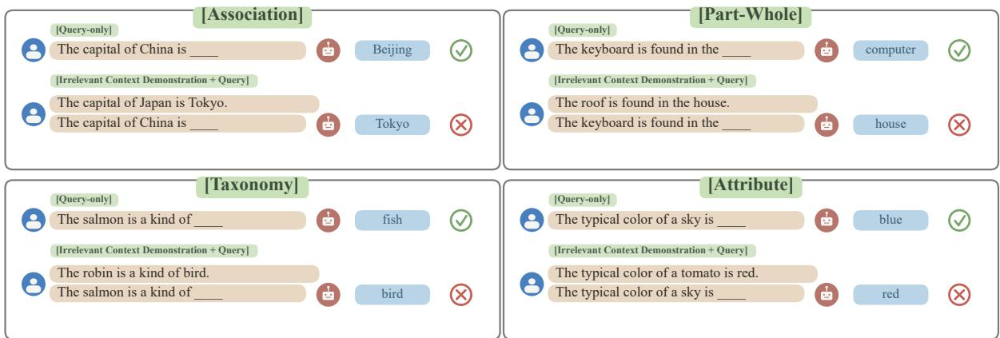
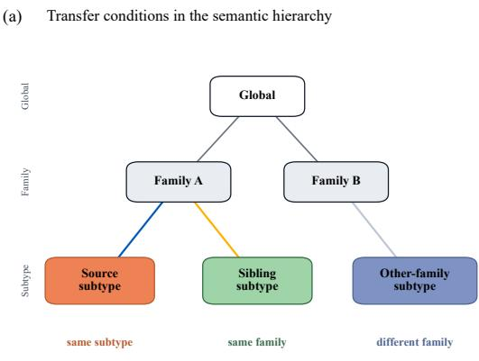
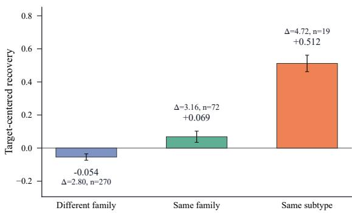
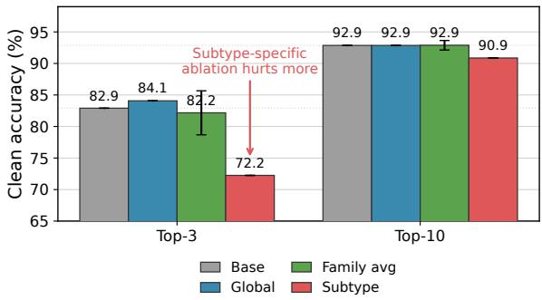
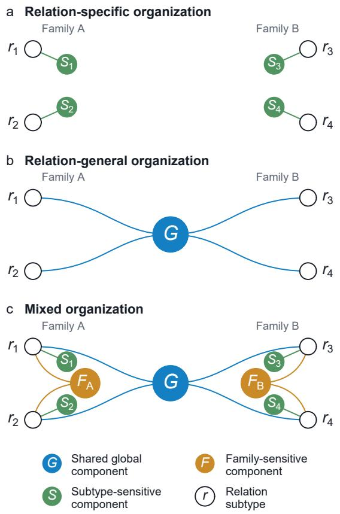
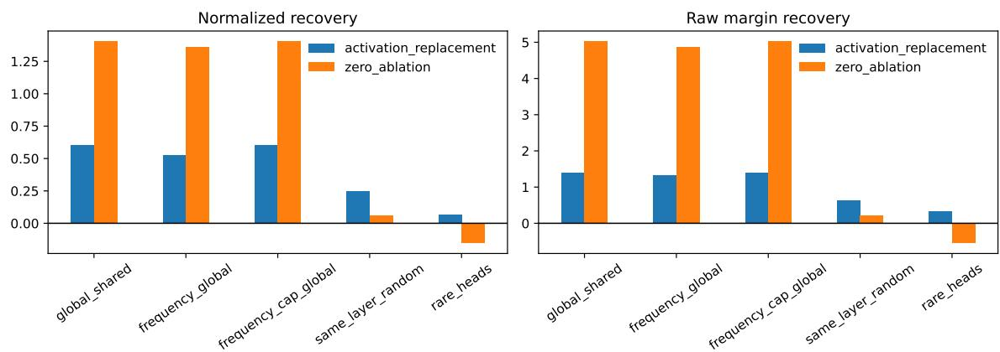
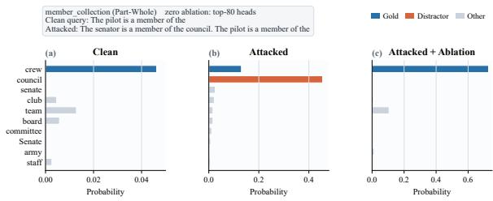

# From Relation-Specific Heads to Shared Interventions: Contextual Entrainment in Language Models

Jinghan Zheng\* McGill University jinghan.zheng@mail.mcgill.ca

Jiajun Shi\* Dalian University of Technology violet@mail.dlut.edu.cn

## Abstract

Large language models rely on prompt context to perform in-context learning, follow formats, and adapt to local evidence. This ability, however, also raises a robustness concern: models may reuse irrelevant tokens from earlier context when answering a later query. Prior work identi fies this behavior as contextual entrainment and finds attention heads whose ablation reduces it, arguing that these heads are largely task- or relation-specific. But are the mechanisms behind contextual entrainment truly isolated by relation, or do relation-conditioned searches recover reusable components shared across relations? Using factual-distractor relation completion prompts across 19 lexical-semantic subtypes, we identify attention heads whose ablation reduces entrainment and test how the resulting head sets transfer recovery ability across exact relations, semantic families, and mixed relation distributions. Same-family transfer exceeds different-family transfer, family resid uals weaken once globally shared heads are removed, and subtype-specific searches repeat edly rediscover many global heads. Cleancompletion and context-use probes further suggest that this shared intervention can reduce harmful copying while preserving ordinary relation completion and simple in-context abili ties. Our findings provide a more precise perspective on contextual entrainment and its mitigation: harmful context following is not best addressed by searching for isolated relationspecific circuits, but by using heterogeneous attack prompts to reveal reusable intervention targets whose effects are shaped by semantic relation structure.1

## 1 Introduction

Large language models exhibit a wide range of context-dependent behaviors: they follow instructions, infer task formats from demonstrations, maintain discourse entities, and answer questions based on prompt-local evidence (Brown et al., 2020; Olsson et al., 2022). These abilities, often grouped under in-context learning, entail a sensitivity to previous tokens.

This matters in settings where models must reason over long or heterogeneous inputs, including retrieval-augmented generation, long-context question answering, and tool-augmented interaction (Shi et al., 2023; Yoran et al., 2024; Cuconasu et al., 2024; Wu et al., 2024; Cheng et al., 2025). In such settings, irrelevant context is not always random noise: it can provide structured cues that models incorporate into later predictions. Cheng et al. (2025) make this concern concrete through hallucinations in irrelevant-contexts, showing that models can combine abstract class cues with features drawn from the query or context, producing systematic but unreliable answers. Our setting studies a token-level version of this problem: the distractor sentence is factually true for another subject, but its answer token becomes misleading evidence for a later, structurally parallel query.

This token-level route is closely related to contextual entrainment. Following Niu et al. (2025), we use this term for cases where tokens that appear earlier in the prompt become more likely to be generated later, even when they do not answer the current query. For example:

The capital of Japan is Tokyo. The capital of China is

can increase the probability of the distractor token Tokyo, even though the correct answer is Beijing. The first sentence is true, and the repeated relation frame makes the earlier city name immediately available at the second answer position, where it competes with the correct continuation.

Recent mechanistic work has begun to localize this behavior inside transformer models. Niu et al. (2025) identify attention heads whose ablation reduces contextual entrainment and argue that the recovered head sets are largely task- or relation-specific. They noticed that there existed overlapping attention heads in the result of different relations. However, what this overlap reflects remains unclear. Related work on knowledge conflict, however, shows that head-level interventions can sometimes generalize across relations and prompt formats (Jin et al., 2024). This distinction matters for both interpretation and mitigation. If entrainment heads are isolated relationspecific mechanisms, then contextual entrainment is organized into many narrow circuits, and mitigating it may require searching separately for each relation. If relation-conditioned searches instead recover overlapping shared components, then apparent task specificity may reflect how a reusable context-following mechanism is selected under different data slices. This leaves an open question: when a head set is discovered from a single relation, is it an isolated relation-specific mechanism, or a mixture of components with different scopes?

  
Figure 1: Factual-distractor examples across four lexical-semantic families.

This question gives a head-level complement to Cheng et al. (2025): if irrelevant context systematically shapes factual predictions, we ask whether the interventions that reduce this sensitivity are relation-specific or shared across relations. We hypothesize that relation-conditioned searches recover mixtures of shared and relation-sensitive components. Rather than treating each relationspecific search result as a separate module, we ask whether these head sets contain components that operate at different levels of generality. We refer to this as a mixed-circuit account of contextual entrainment. This account makes different predictions from two simpler alternatives. If entrainmentrelated heads are purely relation-specific, a head set found on one subtype should transfer little beyond that subtype. If they are fully general, semantic relatedness should not affect transfer. The mixedcircuit account predicts the middle case: strongest transfer to the same subtype, weaker but positive transfer within the same semantic family, and weakest transfer across unrelated families.

We test this hypothesis on a controlled lexicalsemantic benchmark with 19 relation subtypes grouped into Association, Attribute, Part–Whole, and Taxonomy. As illustrated in Figure 1, each clean relation-completion prompt is paired with an attacked prompt that prepends a true but irrelevant parallel fact from the same subtype. The answer token in this prepended fact serves as the distractor: it appears in the immediate context, but it is not the correct continuation for the later query. This lets us isolate prompt-local token reuse without introducing an explicit false statement about the queried subject. We then search for entrainmentrelated heads and evaluate how the resulting interventions transfer across same-subtype, samefamily, different-family, and mixed-relation conditions.

Contributions. We make three contributions. First, we identify a reusable global intervention component embedded in relation-conditioned head sets, connecting cross-relation transfer with the repeated rediscovery of shared heads. Second, we provide converging intervention evidence for a mixed-circuit account through comparisons of global, family, and subtype circuits, global-head exclusion, and approximately additive combinations of shared and residual components. Third, we examine the practical consequences of search scope: in our primary-model experiments, mixedrelation search identifies interventions that reduce factual-distractor entrainment while better preserving clean external relation completion than the evaluated subtype-specific intervention.

## 2 Related Work

Distraction and contextual entrainment. LLMs are highly sensitive to prompt context, and prior work shows that irrelevant or misleading evidence can substantially alter model outputs, especially in retrieval-augmented generation and long-context question answering (Shi et al., 2023; Yoran et al., 2024; Cuconasu et al., 2024; Wu et al., 2024). Cheng et al. (2025) further show that irrelevant contextual cues can induce structured hallucinations through class-based misgeneralization. Niu et al. (2025) formalize contextual entrainment: tokens that appear earlier in the prompt are more likely to be generated later, even when they are random or semantically irrelevant. They identify attention heads whose ablation reduces entrainment and emphasize relation specificity, while also observing some cross-relation functional overlap.Our study examines how such overlap is organized into reusable shared and relation-sensitive intervention components.

Attention heads as context mechanisms. Mechanistic interpretability has shown that attention heads can implement identifiable computations, including induction-like copying, name moving, and task-specific circuits (Olsson et al., 2022; Wang et al., 2023). Induction heads are especially relevant here because they implement a form of pattern completion: continuations from earlier contexts are reused at later matching positions (Olsson et al., 2022). Related work on knowledge conflict further suggests that attention heads can mediate competition between parametric memory and external context, and that head-level interventions can generalize across relations and prompt formats (Jin et al., 2024). Together, these findings make it plausible that factual-distractor prompts share a reusable context-following component even when their surface relations differ.

Circuit discovery by differentiable masking. A growing line of work uses activation patching, pruning, and differentiable masks to identify causally relevant components in language models. Yu et al.

(2025) use Gumbel-Sigmoid masking for gradientbased joint computation-graph pruning in languagemodel circuit discovery, building on continuous relaxations of discrete variables and sparse stochastic gates (Maddison et al., 2017; Jang et al., 2017; Louizos et al., 2018). Niu et al. (2025) apply a related Gumbel-Sigmoid head-search framework to contextual entrainment. These methods make it possible to move beyond descriptive transfer patterns and ask whether head sets discovered from individual relations reflect isolated mechanisms or repeatedly recovered shared structure.

Shared and distributed mechanisms. Broader mechanistic work argues that model mechanisms can be distributed, overlapping, and partly redundant rather than cleanly modular (Elhage et al., 2022; McGrath et al., 2023). This matters for head search: low overlap between recovered head sets is not, by itself, evidence for isolated task-specific mechanisms. At the same time, work on relation representations suggests that factual relations are systematically organized in model states (Hernandez et al., 2024). Together, these perspectives motivate our question: whether relation-conditioned causal searches recover narrow local effects, or broader shared structure with relation-sensitive modulation.

## 3 Methodology

We first define the attacked relation-completion task and intervention, then describe how head sets are searched and evaluated, before introducing the benchmark and transfer conditions used to test our hypothesis. All main experiments use LLaMA-3.1- 8B (AI@Meta, 2024). Interventions are performed by zero-ablating selected attention head outputs during the forward pass, while leaving all model parameters unchanged.

## 3.1 Task Definition

We define contextual entrainment as an attacked relation-completion task with four entities and answers: a query subject $s _ { q } .$ , its gold answer ygold, a different distractor subject $s _ { d } ,$ and its distractor answer $y _ { \mathrm { d i s t } }$ . Using the country–capital example in Figure 1, China is the query subject, Beijing is the gold answer, Japan is the distractor subject, and Tokyo is the distractor answer. We use this terminology throughout the paper.

Each example is built from a relation template $T ( \cdot )$ . The clean prompt queries the answer for the query subject alone, while the attacked prompt prepends a structurally parallel factual statement about the distractor subject:

$$
x _ { \mathrm { c l e a n } } = T ( s _ { q } ) , x _ { \mathrm { a t t a c k } } = T ( s _ { d } ) + y _ { \mathrm { d i s t } } + T ( s _ { q } ) .
$$

The attacked prompt places a concrete distractor answer in the local context of the later query, where it competes with the gold answer at the shared answer position.

We use factual distractors rather than counterfactual context. The prepended statement is true for another subject but irrelevant to the current query. This design isolates prompt-local token reuse from explicit memory–context conflict, making the attack weaker but cleaner. Our goal is to test whether a true earlier answer for one subject interferes with the correct continuation for another.

## 3.2 Gumbel-Sigmoid Head Search

To identify candidate anti-entrainment circuits, we run a differentiable head-search procedure in the spirit of Niu et al. (2025).Each attention head receives a learnable binary mask $m _ { i } .$ , where $m _ { i } = 1$ zeros its output-projected contribution to the residual stream at all sequence positions. We optimize these masks with a Gumbel-Sigmoid straightthrough relaxation (Maddison et al., 2017; Jang et al., 2017; Louizos et al., 2018), which allows gradient-based search over discrete head subsets. We then use the learned mask scores to define ranked top-K interventions for later analyses.

For attacked prompts, the objective maximizes recovery of the gold-over-distractor margin while encouraging sparsity:

$$
\mathcal { L } = - \mathbb { E } _ { x \in \mathcal { B } } \left[ M _ { \theta } ^ { \mathrm { a b l } } ( x ) - M _ { \theta } ( x ) \right] + \frac { \lambda } { \vert \mathcal { H } \vert } \sum _ { i } \sigma ( \alpha _ { i } ) .
$$

After search, the learned mask scores define a head ranking, from which we export top- $. K$ interventions. We use $K = 8 0$ , selected by a held-out sweep balancing attack recovery and clean-prompt harm. Additional optimization details are in $\mathsf { A p - }$ pendix H.

Subtype-specific, family-shared, and globalshared sets contain the top-K heads searched on one subtype, a balanced mixture of subtypes within one family, and a balanced mixture of all eligible subtypes, respectively. Family-residual sets exclude global-shared heads from the full family ranking and retain the top-K remaining heads without retraining.

## 3.3 Evaluation Metrics

We evaluate interventions by how much they restore the model’s preference for the gold answer over the distractor answer. For a prompt x, let $\ell ( y \mid x )$ be the model logit for token y at the answer position. We measure this preference with the margin

$$
M ( x ) = \ell ( y _ { \mathrm { g o l d } } \mid x ) - \ell ( y _ { \mathrm { d i s t } } \mid x ) .
$$

This logit margin directly measures the model’s relative preference between the gold and distractor answers, with the softmax normalizer canceling out, and is therefore less noisy than probability differences under ablations that can shift mass to unrelated tokens.

The factual distractor is harmful when it lowers this margin, so we define attack drop as

$$
D = M ( x _ { \mathrm { c l e a n } } ) - M ( x _ { \mathrm { a t t a c k } } ) .
$$

Because context following is generally useful, we evaluate recovery only on valid attacked cases: the clean prompt must favor the gold answer and the distractor must reduce the margin by at least $D \geq$ 0.5. This isolates cases where prompt-local context induces a measurable factual-distractor effect.

For a head set S, the raw causal effect of zero ablation is

$$
\Delta _ { S } = M _ { S } ( x _ { \mathrm { a t t a c k } } ) - M ( x _ { \mathrm { a t t a c k } } ) ,
$$

where $M _ { S }$ is the margin after ablating S. Positive $\Delta _ { S }$ means the intervention shifts the model away from the distractor and toward the gold answer. Since target subtypes differ in attack strength, we also report normalized recovery,

$$
R _ { S } = \frac { \Delta _ { S } } { D } ,
$$

where $R _ { S } = 1$ indicates full recovery of the attackinduced margin loss (e.g., if ablating S improves the attacked margin by $\Delta = 0 . 5$ on both country– capital (France–Paris) with $D \ : = \ : 0 . 5$ and part– whole (wheel–car) with $D = 2 .$ , then R is 1 vs. 0.25). Values above 1 indicate over-recovery: the intervention increases the attacked margin by more than the margin loss induced by the distractor. We therefore interpret such values as intervention effects rather than bounded percentages. Similar over-recovery effects are reported by Niu et al. (2025).

For transfer analyses, we further remove targetspecific recoverability by centering normalized recovery within each target:

$$
\widetilde { R } _ { s , t } = R _ { s , t } - \frac { 1 } { | S | } \sum _ { s ^ { \prime } \in S } R _ { s ^ { \prime } , t } .
$$

This asks whether a source circuit performs better than the average source circuit on the same target (e.g., on target country–capital (France–Paris), if most sources cluster around $R \approx 0 . 6$ but a samefamily source reaches $R = 0 . 8$ , then $\widetilde { R } \approx + 0 . 2$ captures above-average transfer rather than target ease). We use $\widetilde { R }$ for same-family versus differentfamily comparisons, while also reporting raw margin changes $\Delta$

## 3.4 Lexical-Semantic Benchmark

Having defined the task, intervention, and evaluation metrics in general terms, we now instantiate them on a controlled lexical-semantic benchmark with 19 relation subtypes grouped into four families: Association, Attribute, Part–Whole, and Taxonomy. Taxonomic, part–whole, and attribute relations are standard organizing relations in lexical semantics and WordNet-style lexical databases (Cruse, 1986; Miller, 1995; Fellbaum, 1998); Association covers non-taxonomic factual and functional mappings common in relation-completion benchmarks (Petroni et al., 2019; Hernandez et al., 2024). Representative examples and statistics are shown in Figure 1 and Table 1, respectively. More details are reported in Appendix A.

## 3.5 Transfer and Circuit Conditions

A circuit searched on source subtype s is evaluated on target subtype t. We group source–target pairs as same-subtype, same-family, or different-family transfer. To analyze recovered circuits, we compare subtype-specific,family-shared, global-shared, and family-residual head sets, where family residuals exclude the global-shared top-K heads from the corresponding family ranking. We also measure head overlap and define frequency-global heads by rediscovery frequency across subtype-specific searches.

## 4 Results

The results test whether relation-conditioned head searches identify isolated relation-specific circuits or mixed circuits with shared components. At first glance, searches on different lexical-semantic subtypes return different top-K heads, and these differences matter for transfer. The key result, however, is that this surface-level task dependence masks a shared structure: relation-conditioned searches repeatedly include a global component, with familyand subtype-level variation layered around it.

We organize this pattern using the mixed-circuit hypothesis. For a subtype of relation $r ,$ a set of heads recovered by relation-specific search can be functionally viewed as

$$
C _ { r } \approx G + F _ { \mathrm { f a m } ( r ) } + S _ { r } + \epsilon ,
$$

where $G$ is a reusable global context-following component, $F _ { \mathrm { f a m } ( r ) }$ is semantic-family modulation, $S _ { r }$ is subtype-specific structure, and ϵ captures template, optimizer, or factual-completion idiosyncrasies. This decomposition is not intended to be a strict linear factorization of head effects; rather, it provides a guide to interpret transfer, residual, and overlap patterns.

We first verify that the recovered head sets have genuine causal effects on factual-distractor entrainment and that transfer is graded by semantic relatedness (Figure 2). We then use transfer, residualization, head overlap, additive intervention tests, and clean-capability probes to distinguish isolated taskspecific circuits from the mixed-circuit account.

## 4.1 Transfer Is Graded by Semantic Relatedness

Figure 2 summarizes this structure: the transfer matrix falls between two extremes—isolated relationspecific circuits and fully universal heads.

Figure 2 shows a graded pattern: differentfamily transfer is weakest, same-family transfer is stronger, and same-subtype transfer is strongest. After target-centering, different-family transfer is below the target average (−0.054), same-family transfer is above it (+0.069), and same-subtype transfer is much larger (+0.512). This hierarchy remains significant under clustered bootstrap, celllevel tests, and family-label permutation controls; full statistics are reported in Appendix B.

<table><tr><td>Family</td><td>Sub.</td><td>Pairs</td><td>Valid test</td><td>Rate</td><td>D</td></tr><tr><td>Association</td><td>4</td><td>163</td><td>441/480</td><td>91.9</td><td>3.92</td></tr><tr><td>Attribute</td><td>5</td><td>244</td><td>293/600</td><td>48.8</td><td>2.69</td></tr><tr><td>Part-Whole</td><td>5</td><td>224</td><td>492/600</td><td>82.0</td><td>4.77</td></tr><tr><td>Taxonomy</td><td>5</td><td>227</td><td>496/600</td><td>82.7</td><td>3.60</td></tr><tr><td>Total</td><td>19</td><td>858</td><td>1722/2280</td><td>75.5</td><td>3.86</td></tr></table>

Table 1: Benchmark statistics by semantic family after tokenizer and valid-attack filtering. Valid test uses the main filter $D \geq 0 . 5 ; \bar { D }$ is the mean attack drop.

(b) Transfer is graded by semantic relatedness  
  
Figure 2: Transfer is graded by semantic relatedness. The top panel illustrates the transfer conditions from a source circuit to target relations. The bottom panel reports target-centered recovery, which controls for targetspecific recoverability.

Relation-specific searches therefore do not recover isolated subtype modules, but neither do they recover a fully relation-agnostic circuit. Semantic family and exact subtype both modulate transfer.

## 4.2 Family Effects Are Built on Global Shared Heads

The graded transfer pattern suggests that semantic relatedness modulates transfer, but it does not by itself determine whether this structure reflects family-specific modules or variations around a shared mechanism. We therefore compare four circuit constructions: circuits searched on a balanced mixture of all active subtypes (global-shared), circuits searched only within the target family (familyshared), circuits searched on the exact target subtype (subtype-specific), and family rankings after removing global-shared top-K heads (family resid-

<table><tr><td>Circuit</td><td>Assoc.</td><td>Attr.</td><td>P-W</td><td>Tax.</td><td>Avg.</td></tr><tr><td>Global shared</td><td>1.502</td><td>1.801</td><td>1.028</td><td>1.531</td><td>1.464</td></tr><tr><td>Family shared</td><td>1.486</td><td>1.904</td><td>0.925</td><td>0.943</td><td>1.306</td></tr><tr><td>Family residual</td><td>0.881</td><td>1.243</td><td>0.699</td><td>0.997</td><td>0.959</td></tr><tr><td>Subtype-specific</td><td>1.606</td><td>1.619</td><td>1.069</td><td>1.361</td><td>1.404</td></tr></table>

Table 2: Shared-circuit decomposition. Values are normalized recovery. Family residuals exclude globalshared top-K heads from the family ranking.
<table><tr><td>Head set</td><td> $K = 2 0$ </td><td> $K = 4 0$ </td><td> $K = 8 0$ </td></tr><tr><td>Global search</td><td>0.207</td><td>0.724</td><td>1.464</td></tr><tr><td>Frequency-defined global</td><td>0.364</td><td>0.639</td><td>1.350</td></tr><tr><td>Frequency ∩ global</td><td>0.361</td><td>0.788</td><td>1.431</td></tr><tr><td>Subtype-specific</td><td>0.301</td><td>0.654</td><td>1.404</td></tr><tr><td>Family-shared</td><td>0.204</td><td>0.551</td><td>1.306</td></tr><tr><td>Rare heads</td><td>0.004</td><td>0.014</td><td>0.082</td></tr></table>

Table 3: Frequency-defined global heads recover most of the global circuit’s effect, while rarely rediscovered heads do not. Values are normalized recovery.

ual).

Table 2 supports the mixed-circuit account. The global-shared circuit is the strongest aggregate intervention, with average recovery 1.464, while family-shared circuits remain effective but weaker on average (1.306). Subtype-specific circuits are also strong (1.404), indicating that exact relation structure still contributes. Thus, familyconditioned search is useful, but it is not the dominant source of recovery.

The residual comparison provides more direct evidence. Once globally shared heads are removed from the family ranking, average family recovery drops from 1.306 to 0.959. The residual remains positive, so family structure is not absent. However, the drop shows that much of the apparent family-shared effect is carried by heads that also belong to the global circuit. In the decomposition, G carries the largest recoverable component, while $F _ { \mathrm { f a m } ( r ) }$ and $S _ { r }$ account for the remaining semantic variation in transfer. Thus, same-family transfer is real, but much of this family structure is organized around a reusable global core rather than independent family modules.

## 4.3 Relation-Specific Searches Rediscover the Global Core

A strong global circuit could still be an artifact of mixed-relation search. If so, it would not need to appear inside relation-specific circuits. The mixedcircuit account predicts the opposite: the same global heads should be repeatedly rediscovered when searching on individual subtypes.

This prediction is borne out in the overlap statistics. Global-shared circuits overlap with familyshared circuits by 40.25 heads on average, compared with 6.25 expected by random overlap. They overlap with subtype-specific circuits by 32.84 heads on average, and 75 of the 80 global-shared heads appear in at least one subtype-specific top-K circuit. The global circuit is therefore not separate from relation-specific circuits; it is largely made of heads that narrower searches also select.

Rediscovery frequency is itself predictive of causal effect. If we rank heads only by how often they appear in subtype-specific top-K circuits, the resulting frequency-defined global heads recover much of the global-search circuit. At $K = 8 0$ , they reach recovery 1.350, close to the global-search recovery 1.464, while rarely rediscovered heads recover only 0.082 (Table 3). This provides headlevel evidence that G is already embedded in the subtype circuits $C _ { r }$

## 4.4 The Mixed-Circuit Decomposition Predicts Intervention Effects

The mixed-circuit account treats a relationconditioned head set as a combination of a global component, a family-level residual, and a subtypelevel residual.

For each target subtype, we construct disjoint head sets corresponding to the global component G, the family-residual component $F$ , and the subtyperesidual component $S ,$ , and evaluate interventions that include different subsets of these components. We then fit a regression over raw margin recovery:

$$
\Delta = \beta _ { 0 } + \beta _ { G } I _ { G } + \beta _ { F } I _ { F } + \beta _ { S } I _ { S } + \epsilon ,
$$

where $I _ { G } , I _ { F }$ , and $I _ { S }$ indicate whether the corresponding component is ablated.

The fitted coefficients support the mixed-circuit decomposition. The global component has the largest effect $( \beta _ { G } ~ = ~ 2 . 9 3 6 )$ , while family and subtype residuals also contribute positively $( \beta _ { F } =$ $1 . 0 0 9 , \beta _ { S } = 1 . 1 5 9 )$ . The additive model explains substantial variance in raw recovery $( R ^ { 2 } = 0 . 5 7 2 )$ adding all interaction terms barely improves fit $( R ^ { 2 } \ : = \ : 0 . 5 7 8 )$ , and additive and full-interaction predictions are nearly identical $( r = 0 . 9 9 5 )$ . Thus, the components are not independent modules, but their causal effects are well approximated by an additive decomposition.

A fixed-budget diagnostic supports the same conclusion. An 80-head mixture combining $G _ { 4 0 } , F _ { 2 0 }$ and $S _ { 2 0 }$ achieves the strongest recovery among matched 80-head interventions, outperforming pure global, family-only, and subtype-specific alternatives. This indicates that $G$ carries the dominant recoverable effect, while $F _ { \mathrm { f a m } ( r ) }$ and S add smaller but useful residual contributions. Details in $\mathsf { A p - }$ pendix F.

External clean relation-completion capability  
  
Figure 3: External LRE clean relation-completion capability after ablation.

## 4.5 Global Circuits Preserve Clean Relation Completion

A final test asks whether the global circuit reduces entrainment by broadly disrupting relationcompletion behavior rather than by selectively counteracting the distractor. If ablating it only damaged general relation completion, then its recovery effect would be less meaningful. We therefore run a clean capability evaluation on external LRE relations, where prompts contain no distractor context.

Figure 3 summarizes the clean-capability probe. The global circuit preserves external relation completion closely, and family-shared circuits remain similarly close to the base model on average. By contrast, subtype-specific circuits cause larger collateral degradation across the 19 subtype-specific interventions. The figure uses the country–capital subtype as an example of a narrow subtype-specific intervention; the full subtype-specific breakdown is reported in Appendix D.

This pattern is consistent with the idea that mixed-relation search is not merely broader, but cleaner. One plausible explanation is that singlerelation search can entangle distractor suppression with ordinary factual-completion machinery for that relation. Heterogeneous search instead favors heads whose ablation consistently reduces factualdistractor entrainment across relation environments while better preserving clean relation completion.

## 5 Robustness and Reproducibility

The core empirical pattern is stable under several additional checks: transfer remains semantically graded, and the shared global component remains useful across alternative analyses.

Controls: Uniformly random and same-layer random head controls are near zero or negative, indicating that recovery is not a generic consequence of ablating many heads or ablating heads from sensitive layers (Appendix B). Thresholds, templates, and seeds: Same-family transfer remains stronger than different-family transfer across valid-attack thresholds from $D \geq 0 . 2 5$ to $D \geq 1 . 0$ . Crosstemplate recovery remains positive, and an eightsubtype three-seed matrix preserves the same qualitative hierarchy. Model replication: We replicate the main experiments on Mistral-7B (Jiang et al., 2023) and Qwen2.5-7B (Yang et al., 2024) under the same evaluation protocol. Additional probes: A context-use probe suggests that global ablation does not notably damage ordinary in-context learning ability, as reflected in simple few-shot spelling correction, translation, and in-context mapping tasks. Appendix E further shows that the global effect is not specific to zero ablation via clean-toattacked activation replacement.

Detailed results are reported in Appendices B–E.

## 6 Discussion

From task-specific heads to mixed circuits. Our results refine the task-specific interpretation of contextual entrainment heads proposed by Niu et al. (2025). Consistent with prior work, searches on different relation tasks do not return identical head sets. This variability is not surprising: transformer computations are often distributed and redundant, with multiple components able to support overlapping functions or compensate for one another under intervention (Elhage et al., 2022; McGrath et al., 2023). The key question is therefore not whether different tasks select exactly the same heads, but whether the selected heads are functionally isolated. Our results suggest that they are not. Relationconditioned searches repeatedly contain a global component that transfers across semantic families, while family and subtype structure modulate this shared component.

Why a global core is significant. Contextual entrainment is behaviorally general: models often reuse prompt-local structure across tasks and relations (Olsson et al., 2022; Niu et al., 2025). However, this behavioral generality does not by itself imply a shared circuit-level intervention. The same vulnerability could have been implemented by largely separate relation-specific head sets, in which case a circuit found for one relation would transfer little beyond that relation. Our results show instead that relation-conditioned searches repeatedly recover a strong relation-general component. Semantic family and subtype structure still shape the effect, but mainly by modulating this shared component rather than replacing it with separate modular circuits. Thus, the significance of the global core is mechanistic: apparent relation specificity partly reflects different uses of a reusable context-following substrate.

  
Figure 4: Comparison among single-relation, generalrelation and mixed-relation search.

Why mixed search can reduce side effects. Single-relation search entangles two components: heads that reduce distractor copying and heads involved in normal relation completion. This explains why subtype-specific circuits are strong but have larger side effects. Heterogeneous search changes the selection pressure: a head is favored only if its ablation consistently reduces distractor entrainment across different relations. The resulting global circuit better preserves ordinary completion while targeting harmful context following.

Implication for RAG and factual context use. The global component also suggests a practical direction for settings with heterogeneous factual context. In retrieval-augmented generation, multidocument question answering, dialogue history, and tool-augmented agent traces, the model may see true facts that are useful locally but irrelevant to the current query. A mitigation method therefore cannot simply suppress context use, since factual grounding is the purpose of these systems. Prior relation-specific interventions may be difficult to deploy in such settings, where a single context can mix many relation types and factual roles. In our controlled relation-completion setting, mixedrelation search identifies reusable interventions that reduce factual-distractor copying while largely preserving clean completion. These findings motivate future evaluation of shared interventions in RAG and long-context tasks.

## 7 Conclusion

By analyzing entrainment across lexical-semantic relations, we show that context following in LLMs is neither fully relation-specific nor fully relationgeneral. Head-level intervention and transfer analyses reveal mixed circuits: a reusable global component supports broad context following, while semantic-family and subtype structure shape how this component is used in particular relations. These findings challenge the view that entrainmentrelated heads form isolated relation-specific modules. Apparent task specificity instead emerges from overlapping shared and relation-sensitive components. For mitigation, this suggests starting from heterogeneous attack data to identify broad reusable interventions, while using relation-specific searches for fine-grained specialization.

## 8 Limitations

Several limitations remain. LLaMA-3.1-8B serves as our primary case study, and corresponding crossmodel results for Mistral-7B and Qwen2.5-7B are reported in Appendix C. Our benchmark is also controlled: prompts use relation-completion templates, and answers are restricted to single tokens so that gold-versus-distractor margins are directly comparable. This design improves interpretability, but it leaves open whether the same mixed-circuit structure appears in more natural long-context or retrieval settings. We did not conduct our experiments using larger LMs due to resource limitations.

Our conclusions are also conditional on valid attacked cases. This filtering is appropriate for studying harmful entrainment, since recovery is meaningful only when the factual distractor actually weakens the gold-over-distractor margin. However, it does not characterize all uses of context following, including cases where context helps the model answer correctly. Finally, head ablation identifies causally useful components, but it does not fully specify the internal algorithm by which the model resolves competition between the gold answer and the distractor. Future work should combine head-level interventions with activation patching or representation-level analyses, and should evaluate stability over more seeds and broader prompt distributions.

## References

AI@Meta. 2024. The llama 3 herd of models. arXiv preprint arXiv:2407.21783.

Tom B. Brown, Benjamin Mann, Nick Ryder, Melanie Subbiah, Jared Kaplan, Prafulla Dhariwal, Arvind Neelakantan, Pranav Shyam, Girish Sastry, Amanda Askell, Sandhini Agarwal, Ariel Herbert-Voss, Gretchen Krueger, Tom Henighan, Rewon Child, Aditya Ramesh, Daniel M. Ziegler, Jeffrey Wu, Clemens Winter, and 12 others. 2020. Language models are few-shot learners. In Advances in Neural Information Processing Systems.

Ziling Cheng, Meng Cao, Marc-Antoine Rondeau, and Jackie CK Cheung. 2025. Stochastic chameleons: Irrelevant context hallucinations reveal class-based (mis)generalization in LLMs. In Proceedings ofthe 63rd Annual Meeting ofthe Associationfor Computational Linguistics (Volume 1: Long Papers), pages 30187–30214, Vienna, Austria. Association for Computational Linguistics.

D. Alan Cruse. 1986. Lexical Semantics. Cambridge University Press.

Florin Cuconasu, Giovanni Trappolini, Federico Siciliano, Simone Filice, Cesare Campagnano, Yoelle Maarek, Nicola Tonellotto, and Fabrizio Silvestri. 2024. The power of noise: Redefining retrieval for RAG systems. In Proceedings of the 47th International ACM SIGIR Conference on Research and Development in Information Retrieval.

Nelson Elhage, Tristan Hume, Catherine Olsson, Nicholas Schiefer, Tom Henighan, Shauna Kravec, Zac Hatfield-Dodds, Robert Lasenby, Dawn Drain, Carol Chen, Roger Grosse, Sam McCandlish, Jared Kaplan, Dario Amodei, Martin Wattenberg, and Christopher Olah. 2022. Toy models of superposition. https://transformer-circuits.pub/ 2022/toy\_model/index.html.

Christiane Fellbaum, editor. 1998. WordNet: An Electronic Lexical Database. MIT Press.

Evan Hernandez, Arnab Sen Sharma, Tal Haklay, Kevin Meng, Martin Wattenberg, Jacob Andreas, Yonatan Belinkov, and David Bau. 2024. Linearity of relation decoding in transformer language models. In Proceedings of the International Conference on Learning Representations.

Eric Jang, Shixiang Gu, and Ben Poole. 2017. Categorical reparameterization with gumbel-softmax. In International Conference on Learning Representations.

Albert Q. Jiang, Alexandre Sablayrolles, Arthur Mensch, Chris Bamford, Devendra Singh Chaplot, Diego de las Casas, Florian Bressand, Gianna Lengyel, Guillaume Lample, Lucile Saulnier, Lélio Renard Lavaud, Marie-Anne Lachaux, Pierre Stock, Teven Le Scao, Thibaut Lavril, Thomas Wang, Timothée Lacroix, and William El Sayed. 2023. Mistral 7b. arXiv preprint arXiv:2310.06825.

Zhuoran Jin, Pengfei Cao, Hongbang Yuan, Yubo Chen, Jiexin Xu, Huaijun Li, Xiaojian Jiang, Kang Liu, and Jun Zhao. 2024. Cutting off the head ends the conflict: A mechanism for interpreting and mitigating knowledge conflicts in language models. In Findings of the Association for Computational Linguistics: ACL 2024, pages 1193–1215, Bangkok, Thailand. Association for Computational Linguistics.

David Jurgens, Saif Mohammad, Peter Turney, and Keith Holyoak. 2012. SemEval-2012 task 2: Measuring degrees of relational similarity. In \*SEM 2012: The First Joint Conference on Lexical and Computational Semantics, pages 356–364, Montr ’eal, Canada. Association for Computational Linguistics.

Christos Louizos, Max Welling, and Diederik P. Kingma. 2018. Learning sparse neural networks through L0 regularization. In International Conference on Learning Representations.

Chris J. Maddison, Andriy Mnih, and Yee Whye Teh. 2017. The concrete distribution: A continuous relaxation of discrete random variables. In International Conference on Learning Representations.

Thomas McGrath, Matthew Rahtz, János Kramár, Vladimir Mikulík, and Shane Legg. 2023. The hydra effect: Emergent self-repair in language model computations. arXiv preprint arXiv:2307.15771.

George A. Miller. 1995. Wordnet: A lexical database for english. Communications ofthe ACM, 38(11):39– 41.

Jane Morris and Graeme Hirst. 2004. Non-classical lexical semantic relations. In Proceedings of the Computational Lexical Semantics Workshop at HLT-NAACL 2004, pages 46–51, Boston, Massachusetts, USA. Association for Computational Linguistics.

Jingcheng Niu, Xingdi Yuan, Tong Wang, Hamidreza Saghir, and Amir H. Abdi. 2025. Llama see, llama do: A mechanistic perspective on contextual entrainment and distraction in LLMs. In Proceedings ofthe 63rd Annual Meeting ofthe Associationfor Computational Linguistics (Volume 1: Long Papers), pages 16218–16239, Vienna, Austria. Association for Computational Linguistics.

Catherine Olsson, Nelson Elhage, Neel Nanda, Nicholas Joseph, Nova DasSarma, Tom Henighan, Ben Mann, Amanda Askell, Yuntao Bai, Anna Chen, Tom Conerly, Dawn Drain, Deep Ganguli, Zac Hatfield-Dodds, Danny Hernandez, Scott Johnston, Andy Jones, Jackson Kernion, Liane Lovitt, and 7 others. 2022. In-context learning and induction heads. https://transformer-circuits.pub/2022/ in-context-learning-and-induction-heads/ index.html.

Fabio Petroni, Tim Rocktäschel, Patrick Lewis, Anton Bakhtin, Yuxiang Wu, Alexander H. Miller, and

Sebastian Riedel. 2019. Language models as knowledge bases? In Proceedings of the 2019 Conference on Empirical Methods in Natural Language Processing and the 9th International Joint Conference on Natural Language Processing (EMNLP-IJCNLP), pages 2463–2473, Hong Kong, China. Association for Computational Linguistics.

Freda Shi, Xinyun Chen, Kanishka Misra, Nathan Scales, David Dohan, Ed H. Chi, Nathanael Schärli, and Denny Zhou. 2023. Large language models can be easily distracted by irrelevant context. In Proceedings ofthe 40th International Conference on Machine Learning.

Peter D. Turney. 2006. Similarity of semantic relations. Computational Linguistics, 32(3):379–416.

Kevin Ro Wang, Alexandre Variengien, Arthur Conmy, Buck Shlegeris, and Jacob Steinhardt. 2023. Interpretability in the wild: A circuit for indirect object identification in GPT-2 small. In International Conference on Learning Representations.

Siye Wu, Jian Xie, Jiangjie Chen, Tinghui Zhu, Kai Zhang, and Yanghua Xiao. 2024. How easily do irrelevant inputs skew the responses of large language models? In First Conference on Language Modeling.

An Yang, Baosong Yang, Beichen Zhang, Binyuan Hui, Bo Zheng, Bowen Yu, Chengyuan Li, Dayiheng Liu, Fei Huang, Haoran Wei, Huan Lin, Jian Yang, Jianhong Tu, Jianwei Zhang, Jianxin Yang, Jiaxi Yang, Jingren Zhou, Junyang Lin, Kai Dang, and 24 others. 2024. Qwen2.5 technical report. arXiv preprint arXiv:2412.15115.

Ori Yoran, Tomer Wolfson, Ori Ram, and Jonathan Berant. 2024. Making retrieval-augmented language models robust to irrelevant context. In International Conference on Learning Representations.

Lei Yu, Jingcheng Niu, Zining Zhu, Xi Chen, and Gerald Penn. 2025. Sheaf discovery with joint computation graph pruning and flexible granularity. In Proceedings of the 2025 Conference on Empirical Methods in Natural Language Processing, pages 8822–8837, Suzhou, China. Association for Computational Linguistics.

## A Benchmark Details

Table 4 lists the 19 relation subtypes used in the benchmark. Each subtype contains factual $( x , y )$ pairs and two relation-specific templates. We filter examples so that both the gold answer and the distractor answer are single tokens under the model tokenizer.

Tables 4 and 5 provide the subtype and template details.

Definition of Association. We use ASSOCIA-TION as an operational cover family for relation subtypes that are not taxonomic, meronymic, or attributive, but are linked by conventional thematic, functional, institutional, or usage-based knowledge (e.g., country–capital, profession–workplace, sport– equipment, and task–tool). This follows computational lexical-semantics work emphasizing that many useful word-pair relations are broader, nonclassical relational links rather than WordNet-style taxonomic or part–whole relations (Morris and Hirst, 2004; Turney, 2006; Jurgens et al., 2012). We therefore treat ASSOCIATION as a heterogeneous contrast family, not as a single classical semantic primitive.

Overlapping family boundaries. The family labels are operational groupings rather than mutually exclusive lexical-semantic primitives. Some relation types naturally sit near the boundary between families. Material relations are a clear example: they can be viewed as substance meronymy when the material is treated as a constituent of an object, but also as attribute-value relations when the material is treated as a property of the object. We therefore retain material-based subtypes in both the Part–Whole and Attribute families instead of manually removing these boundary cases. This choice makes the family-transfer test more conservative: overlap between families should blur, rather than sharpen, same-family versus different-family distinctions. The fact that we still observe graded same-subtype, same-family, and different-family transfer under this operational grouping supports the robustness of the semantic-structure result.

<table><tr><td>Family</td><td>Subtype</td><td>Example pair</td><td>Representative template</td></tr><tr><td>Association</td><td>country-capital</td><td>France → Paris</td><td>The capital of France is Paris.</td></tr><tr><td>Association</td><td>profession-workplace</td><td>doctor → hospital</td><td>The workplace of a doctor is a hospital.</td></tr><tr><td>Association</td><td>sport-equipment</td><td>tennis → racket</td><td>The equipment used in tennis is a racket.</td></tr><tr><td>Association</td><td>task-tool</td><td>writing → pen</td><td>The tool used for writing is a pen.</td></tr><tr><td>Attribute</td><td>color</td><td>banana → yellow</td><td>The typical color of a banana is yellow.</td></tr><tr><td>Attribute</td><td>shape</td><td>coin → round</td><td>The typical shape of a coin is round.</td></tr><tr><td>Attribute</td><td>material</td><td>window → glass</td><td>The typical material of a window is glass.</td></tr><tr><td>Attribute</td><td>temperature</td><td>ice → cold</td><td>The typical temperature of ice is cold.</td></tr><tr><td>Attribute</td><td>size</td><td>elephant → large</td><td>The typical size of an elephant is large.</td></tr><tr><td>Part-Whole</td><td>component-object</td><td>wheel → car</td><td>The wheel is a component of the car.</td></tr><tr><td>Part-Whole</td><td>member-collection</td><td>player → team</td><td>The player is a member of the team.</td></tr><tr><td>Part-Whole</td><td>portion-whole</td><td>slice → cake</td><td>The slice is a portion of the cake.</td></tr><tr><td>Part-Whole</td><td>material-object</td><td>table → wood</td><td>The table is made of wood.</td></tr><tr><td>Part-Whole</td><td>body-part-body</td><td>finger → hand</td><td>The finger is part of the hand.</td></tr><tr><td>Taxonomy</td><td>animal</td><td>sparrow → bird</td><td>The sparrow is a kind of bird.</td></tr><tr><td>Taxonomy</td><td>plant</td><td>rose → flower</td><td>The rose is classified as a flower.</td></tr><tr><td>Taxonomy</td><td>artifact</td><td>hammer → tool</td><td>The hammer is a type of tool.</td></tr><tr><td>Taxonomy</td><td>food</td><td>apple → fruit</td><td>The apple is a type of fruit.</td></tr><tr><td>Taxonomy</td><td>vehicle</td><td>sedan → car</td><td>The sedan is a kind of car.</td></tr></table>

Table 4: Relation subtypes and representative templates in the lexical-semantic benchmark.

<table><tr><td>Subtype</td><td>Template 1</td><td>Template 2</td></tr><tr><td rowspan="4">country-capital profession-workplace</td><td>The capital of {x} is {y}.</td><td>The capital city of {x} is {y}.</td></tr><tr><td>The workplace of a {x} is a {y}.</td><td>A {x} typically works in a {y}.</td></tr><tr><td>The equipment used in {x} is a {y}.</td><td>People use a {y} in {x}.</td></tr><tr><td>The tool used for {x} is a {y}.</td><td>People use a {y} for {x}.</td></tr><tr><td rowspan="4">color shape</td><td></td><td>The color commonly associated with a {x} is {y}.</td></tr><tr><td>The typical color of a {x} is {y}.</td><td>The shape commonly associated with a {x} is {y}.</td></tr><tr><td>The typical shape of a {x} is {y}.</td><td></td></tr><tr><td>The typical material of a {x} is {y}.</td><td>A {x} is typically made of {y}.</td></tr><tr><td rowspan="4">temperature size</td><td>The typical temperature of {x} is {y}. The typical size of a {x} is {y}.</td><td>A {x} is typically {y} in temperature. A {x} is typically {y} in size.</td></tr><tr><td></td><td></td></tr><tr><td>The {x} is a component of the {y}.</td><td>The {y} contains a component called a {x}.</td></tr><tr><td>The {x} is a member of the {y}.</td><td>The {y} includes the member {x}.</td></tr><tr><td rowspan="4">portion-whole material-object</td><td>The {x} is a portion of the {y}.</td><td>The {y} contains a portion called a {x}.</td></tr><tr><td>The {x} is made of {y}. The {x} is part of the {y}.</td><td>The material of the {x} is {y}.</td></tr><tr><td></td><td>The {y} contains the body part {x}.</td></tr><tr><td>The {x} is a kind of {y}.</td><td>The {x} is classified as a {y}.</td></tr><tr><td rowspan="4">animal plant</td><td>The {x} is a kind of {y}.</td><td>The {x} is classified as a {y}.</td></tr><tr><td>The {x} is a type of {y}.</td><td>The {x} is classified as a {y}.</td></tr><tr><td>The {x} is a type of {y}.</td><td>The {x} is classified as a {y}.</td></tr><tr><td>The {x} is a kind of {y}.</td><td>The {x} is classified as a {y}.</td></tr></table>

Table 5: Prompt templates used for each relation subtype.

## B Additional Transfer Statistics

Valid-attack filtering. Our main experiments define valid attacked cases as examples where the clean prompt favors the gold answer and the factual distractor reduces the gold-over-distractor margin by at least $D \ge 0 . 5$ . This retains 1,722 of 2,280 LLaMA-3.1-8B test attacks across 19 relation subtypes. Table 6 shows that the same-family advantage is stable across nearby threshold choices.

<table><tr><td>Threshold</td><td>Valid tests</td><td>Same-family</td><td>Diff.-family</td><td>Raw adv.</td><td>Centered adv.</td><td>p</td></tr><tr><td>D ≥ 0.25</td><td>1776</td><td>0.997</td><td>0.871</td><td>0.125</td><td>0.128</td><td>0.0022</td></tr><tr><td> $D \stackrel { - } { \geq } 0 . 5 0$ </td><td>1722</td><td>0.956</td><td>0.838</td><td>0.118</td><td>0.123</td><td>0.0021</td></tr><tr><td> $D \subseteq 0 . 7 5$ </td><td>1660</td><td>0.926</td><td>0.812</td><td>0.113</td><td>0.118</td><td>0.0021</td></tr><tr><td> $D \stackrel { \textstyle = } { \geq } 1 . 0 0$ </td><td>1590</td><td>0.885</td><td>0.779</td><td>0.106</td><td>0.112</td><td>0.0024</td></tr></table>

Table 6: Valid-attack threshold sensitivity. Same-family transfer remains stronger than different-family transfer across all tested attack-drop thresholds. Same-family and different-family columns report non-target-centered normalized recovery. The centered advantage is computed after target-centering; p is the cell-level Welch test for the centered same-family versus different-family comparison.

Dependency-aware inference. For the samefamily advantage test, we use target-centered recovery and additionally run a two-way clustered bootstrap over source and target subtypes. For each bootstrap sample, we resample source and target subtypes with replacement, reconstruct the corresponding transfer cells, recompute target-centered recovery, and then recompute the same-family minus different-family advantage.

<table><tr><td>Statistic</td><td>Observed</td><td>Median</td><td>95% CI</td><td>p</td></tr><tr><td>Same-family advantage</td><td>0.123</td><td>0.115</td><td>[0.003, 0.236]</td><td>0.024</td></tr></table>

Table 7: Two-way clustered bootstrap over source and target subtypes. The statistic is the target-centered samefamily minus different-family advantage.

Random baselines. Table 8 reports the full random and same-layer random controls. Each cell reports non-target-centered normalized recovery, with raw attacked-margin change in parentheses.

<table><tr><td>Method</td><td>Diff.-family</td><td>Same-family</td><td>Same-subtype</td></tr><tr><td>Gumbel</td><td>0.693 (2.711)</td><td>1.081 (3.737)</td><td>1.407 (5.418)</td></tr><tr><td>Random</td><td>-0.167 (-0.695)</td><td>-0.089 (-0.395)</td><td>-0.123 (-0.458)</td></tr><tr><td>Same-layer random</td><td>-0.202 (-0.659)</td><td>-0.117 (-0.349)</td><td>-0.213 (-0.818)</td></tr></table>

Table 8: Random and same-layer random controls.

Graded transfer detail. Table 9 reports targetcentered recovery and raw margin gains for the three transfer conditions.

<table><tr><td>Transfer condition</td><td>Target-centered recovery</td><td>Raw ∆</td></tr><tr><td>Different-family</td><td>-0.054</td><td>2.80</td></tr><tr><td>Same-family</td><td>+0.069</td><td>3.16</td></tr><tr><td>Same-subtype</td><td>+0.512</td><td>4.72</td></tr></table>

Table 9: Target-centered transfer by semantic relatedness. Target-centering removes target-specific recoverability before comparing source circuits.

## C Robustness and Cross-Model Replication

This appendix reports robustness checks for template variation, seed stability, and cross-model replication.

Template robustness. Cross-template recovery remains positive but weaker than same-template recovery: Association drops from 1.671 to 1.488, Attribute from 1.855 to 1.610, Part–Whole from 0.801 to 0.690, and Taxonomy from 1.721 to 0.968.

Seed stability. In an eight-subtype mini transfer matrix over three seeds, same-family transfer remains positive (0.071, 0.276, 0.259), samesubtype transfer is larger (0.510, 0.726, 0.631), and different-family transfer remains negative (−0.097, −0.167, −0.148).

Cross-model replication. Table 11 reports nontarget-centered transfer recovery for all three models under valid-attack filtering. Using the same protocol, we completed the five core analyses on Mistral-7B-v0.1 and Qwen2.5-7B as well. Table 10 summarizes the main replication signals. Across both models, subtype searches rediscover nearly all global heads, observed global–family overlap is far above the uniform-head baseline, and additive decomposition changes only minimally after adding interaction terms. Together, these results support the same qualitative conclusion as in LLaMA: a shared global core persists, while subtype-specific residual structure remains comparatively weak.

<table><tr><td>Metric</td><td>Mistral-7B</td><td>Qwen2.5-7B</td></tr><tr><td>Global heads rediscovered</td><td>79/80</td><td>79/80</td></tr><tr><td>Uniform expected overlap</td><td>6.25</td><td>8.16</td></tr><tr><td>Global-family mean overlap</td><td>40.75</td><td>46.25</td></tr><tr><td>Additive  $R ^ { 2 }$ </td><td>0.523</td><td>0.553</td></tr><tr><td>Full-interaction  $R ^ { 2 }$ </td><td>0.528</td><td>0.560</td></tr><tr><td>Prediction correlation</td><td>0.995</td><td>0.994</td></tr></table>

Table 10: Compact summary of the main cross-model replication results under the same protocol. Overlap rows compare observed head-set overlap against the within-model uniform-head baseline; the final three rows summarize the additive decomposition analysis.

<table><tr><td>Model</td><td>Diff.-family</td><td>Same-family</td><td>Same-subtype</td></tr><tr><td>LLaMA-3.1-8B</td><td>1.000</td><td>1.141</td><td>1.675</td></tr><tr><td>Mistral-7B</td><td>1.000</td><td>1.239</td><td>1.823</td></tr><tr><td>Qwen2.5-7B</td><td>1.000</td><td>1.229</td><td>1.614</td></tr></table>

Table 11: Cross-model transfer summary. Values are non-target-centered normalized recovery under valid-attack filtering. Row-wise normalization by the different-family value is used to reduce apparent differences induced by model-specific scale.

## D External Clean and Context-Use Probes

<table><tr><td>Circuit</td><td>Top-3</td><td>Top-10</td></tr><tr><td>Base</td><td>82.90</td><td>92.86</td></tr><tr><td>Global shared</td><td>84.07</td><td>92.86</td></tr><tr><td>Family-shared avg.</td><td>82.17</td><td>92.89</td></tr><tr><td>Subtype-specific avg.</td><td>78.50</td><td>91.72</td></tr><tr><td>Subtype-specific: country-capital</td><td>72.25</td><td>90.87</td></tr></table>

Table 12: External LRE clean capability. Global-shared ablation preserves clean relation completion, while subtype-specific circuits cause larger collateral degradation on average.

External LRE clean capability. We evaluate relation-completion prompts without distractor context. The global mixed-relation circuit preserves clean relation-completion accuracy, while the subtype-specific circuits cause larger top-3 degradation.

<table><tr><td rowspan="2">Relation</td><td colspan="3">Top-3</td><td colspan="3">Top-10</td></tr><tr><td>Base</td><td>Global</td><td>Subtype</td><td>Base</td><td>Global</td><td>Subtype</td></tr><tr><td>fruit outside color</td><td>40.0</td><td>56.7</td><td>13.3</td><td>86.7</td><td>83.3</td><td>86.7</td></tr><tr><td>landmark in country</td><td>90.0</td><td>91.5</td><td>88.0</td><td>95.5</td><td>96.0</td><td>95.5</td></tr><tr><td>landmark on continent</td><td>84.5</td><td>84.0</td><td>76.5</td><td>97.0</td><td>97.5</td><td>97.0</td></tr><tr><td>product by company</td><td>85.5</td><td>86.0</td><td>84.0</td><td>93.5</td><td>93.0</td><td>91.0</td></tr><tr><td>star constellation name</td><td>85.6</td><td>87.8</td><td>41.7</td><td>89.2</td><td>89.9</td><td>80.6</td></tr><tr><td>task done by tool</td><td>68.8</td><td>71.9</td><td>68.8</td><td>90.6</td><td>90.6</td><td>90.6</td></tr><tr><td>task person type</td><td>80.0</td><td>80.0</td><td>80.0</td><td>85.0</td><td>85.0</td><td>85.0</td></tr><tr><td>work location</td><td>57.6</td><td>51.5</td><td>60.6</td><td>75.8</td><td>72.7</td><td>75.8</td></tr><tr><td>Overall</td><td>82.9</td><td>84.1</td><td>72.2</td><td>92.9</td><td>92.9</td><td>90.9</td></tr></table>

Table 13: External LRE clean capability test (full perrelation breakdown; corresponds to Figure 3 in the main text). Base denotes no ablation; Global denotes the mixed-relation global circuit; Subtype denotes the country–capital subtype-specific circuit.

Context-use preservation. We also evaluate simple context-use tasks, including few-shot spelling correction, few-shot translation, and synthetic incontext mapping. Global ablation leaves the spelling and translation probes unchanged at 100% top-10 accuracy across all tested shot counts. On the harder synthetic mapping probes, performance is more variable, with the largest degradation on nonce-label mapping. Overall, top-1 accuracy is unchanged, top-3 accuracy drops from 39.71 to 38.60, and top-10 accuracy drops from 66.91 to 61.03 (Table 14).

<table><tr><td>Circuit</td><td>n</td><td>K</td><td>Top-1</td><td>Top-3</td><td>Top-10</td><td>∆Top-3</td><td>∆Top-10</td></tr><tr><td>Base</td><td>272</td><td>0</td><td>31.62</td><td>39.71</td><td>66.91</td><td>0.00</td><td>0.00</td></tr><tr><td>Global shared</td><td>272</td><td>80</td><td>31.62</td><td>38.60</td><td>61.03</td><td>1.10</td><td>5.88</td></tr></table>

Table 14: Expanded context-use preservation probe. Accuracies and drops are in percentage points; positive drops mean worse than the base model.

## E Activation Replacement Robustness

To test whether the global component is specific to zero ablation, we run a clean-to-attacked activation replacement intervention. For each valid attacked prompt, we first run the corresponding clean prompt and cache the selected heads’ finalposition outputs. We then run the attacked prompt while replacing those same head outputs at the answer position with their clean-prompt activations. This intervention is less destructive than zero ablation and tests whether the selected heads carry attack-sensitive contextual signal.

Figure 5 reports the results on 100 valid attacked cases, balanced across the four semantic families. Global-shared heads recover 60.4% of the attackinduced margin loss under activation replacement, with a raw margin increase of 1.40. Frequencydefined global heads show a similar effect, recovering 52.4% of the margin loss. By contrast, rare heads recover only 6.5%. The logit decomposition further distinguishes global heads from controls: global replacement both increases the gold logit and decreases the distractor logit, whereas rare and same-layer random heads reduce the gold logit. This supports the interpretation that the global component is not merely a zero-ablation artifact.

  
Figure 5: Activation replacement robustness. Clean-to-attacked activation replacement recovers substantial attacked margin for global and frequency-defined global heads, while rare heads remain weak. Zero ablation is stronger, but the replacement result shows that the global component is not merely a zero-ablation artifact.

## F Additive Decomposition Details

We test whether the mixed-circuit decomposition is approximately additive at the level of causal intervention effects. For each target subtype, we construct disjoint global, family-residual, and subtyperesidual components and evaluate interventions that include or exclude each component. We then fit regressions predicting raw margin recovery $\Delta$ from component indicators.

Factorial regression. The additive model is

$$
\Delta = \beta _ { 0 } + \beta _ { G } I _ { G } + \beta _ { F } I _ { F } + \beta _ { S } I _ { S } + \epsilon ,
$$

where $I _ { G } , I _ { F } ,$ and $I _ { S }$ indicate whether the global, family-residual, or subtype-residual component is ablated. Table 15 compares this additive model with a full interaction model.

<table><tr><td>Term</td><td>Additive</td><td>Full interaction</td></tr><tr><td>Intercept</td><td>-0.254</td><td>-0.001</td></tr><tr><td>G</td><td>2.936</td><td>2.492</td></tr><tr><td>F</td><td>1.009</td><td>0.735</td></tr><tr><td>S</td><td>1.159</td><td>0.886</td></tr><tr><td>G:F</td><td></td><td>0.425</td></tr><tr><td>G:S</td><td></td><td>0.422</td></tr><tr><td>F:S</td><td></td><td>0.085</td></tr><tr><td> $G { : } F { : } S$ </td><td></td><td>0.079</td></tr><tr><td> $R ^ { 2 }$ </td><td>0.572</td><td>0.578</td></tr></table>

Table 15: Factorial regression on raw margin recovery; interaction terms add little beyond the additive model.

The additive model captures most of the explainable structure: adding all interaction terms increases $R ^ { 2 }$ from 0.572 to 0.578, and the predictions of the additive and full-interaction models are nearly identical $( r ~ = ~ 0 . 9 9 5 )$ . Thus, the decomposition should not be read as a literal linear factorization of model internals, but it is a good functional approximation of how the causal effects combine.

Fixed-budget diagnostic. As a complementary check, we construct an 80-head mixed intervention by combining $G _ { 4 0 } , F _ { 2 0 }$ , and $S _ { 2 0 } \colon$ the top 40 global heads, 20 family-residual heads excluding those global heads, and 20 subtype-residual heads excluding both previous sets. This keeps the total intervention size fixed at 80 heads.

This fixed-budget result is diagnostic rather than an optimized allocation. Its purpose is to show that family- and subtype-residual components can add useful signal beyond the global core under a controlled head budget. Combined with the regression analysis, it supports the mixed-circuit interpretation at the level of causal intervention effects: $G$ is the dominant component, while $F _ { \mathrm { f a m } ( r ) }$ and $S _ { r }$ provide smaller positive residual effects.

<table><tr><td>Condition</td><td>Recovery</td><td>Raw ∆</td><td>Clean harm</td></tr><tr><td> $G _ { 4 0 } + F _ { 2 0 } + S _ { 2 0 }$ </td><td>1.550</td><td>5.003</td><td>-1.012</td></tr><tr><td>G80 global only</td><td>1.464</td><td>4.900</td><td>-0.990</td></tr><tr><td> $S _ { 8 0 }$  subtype only</td><td>1.404</td><td>4.715</td><td>-1.073</td></tr><tr><td> $F _ { 8 0 }$  family only</td><td>1.306</td><td>4.254</td><td>-1.111</td></tr><tr><td>Random 80</td><td>-0.091</td><td>-0.308</td><td>0.523</td></tr><tr><td>Same-layer random 80</td><td>-0.321</td><td>-1.000</td><td>0.664</td></tr></table>

Table 16: Fixed-budget diagnostic (80 heads): the structured mix slightly outperforms single-component circuits; random controls fail.

  
Figure 6: An illustrative factual-distractor example under the ranking-based intervention used in our Gumbel-Sigmoid head search. The clean prompt favors crew; the distractor context shifts probability toward council; and zero-ablating the top-80 heads exported from the learned mask scores reverses this shift.

## G Illustrative Gumbel-Sigmoid Intervention

Figure 6 shows a representative valid attacked case used to visualize the intervention produced by our Gumbel-Sigmoid head search. The figure is illustrative rather than a separate evaluation result; all quantitative analyses in the main text are computed over filtered held-out attack cases.

## H Gumbel-Sigmoid Search Details

This appendix provides additional details for the differentiable head-search procedure described in Section 3.2. For each attention head $h _ { i } ,$ , we introduce a learnable mask logit $\alpha _ { i }$ . During search, we sample a relaxed mask

$$
\tilde { m } _ { i } = \sigma \left( \frac { \alpha _ { i } + g _ { i } } { \tau } \right) ,
$$

where $g _ { i }$ is logistic noise induced by the Gumbel reparameterization and $\tau$ is a temperature hyperparameter. In the forward pass, we use a straightthrough binary mask obtained by thresholding $\tilde { m } _ { i } .$ while gradients are passed through the relaxed value. A binary value of $m _ { i } = 1$ means that the corresponding head output is zero-ablated; $m _ { i } = 0$ leaves the head active.

For a batch of attacked prompts $B { \mathrm { , } }$ the search objective is

$$
\mathcal { L } = - \mathbb { E } _ { x \in \mathcal { B } } \left[ M _ { \theta } ^ { \mathrm { a b l } } ( x ) - M _ { \theta } ( x ) \right] + \frac { \lambda } { | \mathcal { H } | } \sum _ { i = 1 } ^ { | \mathcal { H } | } \sigma ( \alpha _ { i } ) ,
$$

where $M _ { \theta } ( x )$ is the attacked margin of the original model, $M _ { \theta } ^ { \mathrm { a b l } } ( x )$ is the margin under the current differentiable mask, H is the set of all attention heads, and $\lambda$ controls sparsity. Since $M _ { \theta } ( x )$ is constant with respect to the mask for a fixed batch, this objective is equivalent during optimization to maximizing the ablated margin while penalizing the expected number of selected heads.

We anneal the Gumbel-Sigmoid temperature during search and optimize mask logits with gradient descent while keeping all model parameters frozen. After optimization, the learned mask scores define a ranking over heads, and the main experiments use the top $K = 8 0$ interventions exported from that ranking. We select this value with a held-out K-sweep over $K \in \{ 2 0 , 4 0 , 6 0 , 8 0 \}$ , choosing a setting that provides strong attacked-margin recovery while avoiding excessive clean-prompt harm. For frequency-defined analyses, we additionally report results at $K \in \{ 2 0 , 4 0 , 8 0 \}$

For the main LLaMA-3.1-8B experiments, subtype-specific Gumbel searches use 450 optimization steps, while family-shared and globalshared searches use 650 steps because they aggregate more heterogeneous training cases. The seed-stability runs use 300 steps. We use a search batch size of 2, an evaluation batch size of 4, learning rate 0.08, sparsity weight $\lambda = 0 . 0 2 5$ , and a Gumbel-Sigmoid temperature annealed from 1.0 to 0.25. The main head budget is $K = 8 0$ , selected from a held-out sweep over $K \in \{ 2 0 , 4 0 , 6 0 , 8 0 \}$ Each subtype uses 120 train attack pairs and 120 test attack pairs before valid-attack filtering; the main valid-attack threshold is $D \geq 0 . 5$

## I Artifact use.

We use publicly available model checkpoints and relation-completion resources for research evaluation, following their respective access conditions. Our constructed benchmark consists of synthetic templates and factual lexical-semantic pairs.