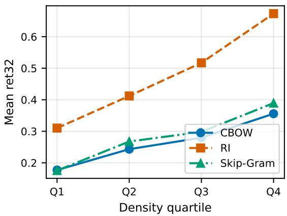
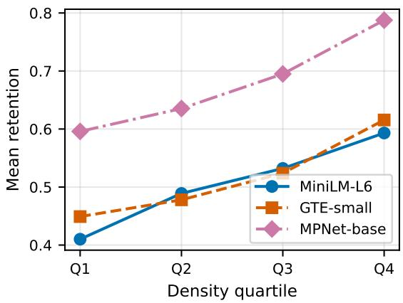
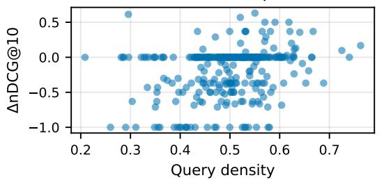
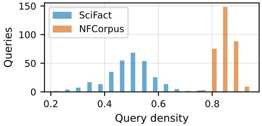
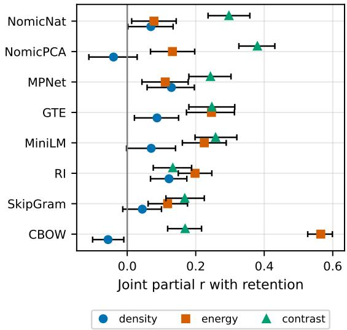
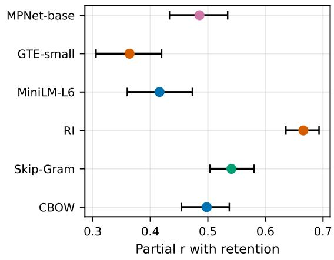

# Geometric Structure Predicts Per-Example Neighborhood Loss Under PCA Truncation

Sriram Loganathan, Gokul Anand, Ragavan Arivazhagan

Department of Computer Science San Jose State University San Jose, CA, USA

## Abstract

Dimensionality reduction can preserve the average performance of text embeddings even when a substantial fraction of their dimensions is removed. Aggregate metrics, however, do not reveal whether degradation is distributed uniformly across examples. We study per-example neighborhood stability under PCA truncation across static word embeddings and modern sentence encoders. Per-item neighbor retention varies widely and is predictable from geometric properties of the representation and its alignment with the retained PCA subspace. The fraction of centered-vector energy retained by the truncated subspace is strongest for CBOW and RI, with neighborhood contrast leading on SkipGram and the modern/Matryoshka settings (GTE approximately tied), while local density is associated with retention in marginal analysis but adds little unique information once energy and contrast are controlled (R-squared increments 0.001 to 0.010). Local intrinsic dimensionality accounts for more variation than density on modern sentence encoders in pairwise comparison. On SciFact, query density predicts retrieval degradation under aggressive compression; on NFCorpus the primary 32d association does not replicate, and a direct variancerestriction test leaves that null unresolved. Average compression performance conceals systematic per-example variation that geometry makes visible.

## 1 Introduction

Truncation is routine for serving retrieval and classification, and published means change little for similarity, analogies, and retrieval. A stable mean does not identify which representations are damaged, since the same average is consistent with concentrated loss in sparse or unusual neighborhoods.

We ask what properties of full-space representations predict per-example damage before compressing. We measure per-item neighbor retention under

PCA truncation across static word vectors, modern sentence encoders at 384 and 768 dimensions, native Matryoshka prefixes, and gold relevance judgments on two retrieval benchmarks. The candidate predictors span local density, retained subspace energy, neighborhood contrast, boundary gap, and intrinsic dimensionality, tested against frequency, hubness, margin, and norm controls.

No single predictor dominates universally. Retained subspace energy leads on CBOW and RI while neighborhood contrast leads on SkipGram and the modern and Matryoshka encoders (GTE approximately tied); local density is consistently associated with retention but contributes little unique information jointly. On SciFact, query density predicts gold retrieval degradation at 32d and 64d; the primary 32d association does not replicate on NF-Corpus, and a direct variance-restriction test leaves that null unresolved.

Contributions: (1) A per-example measurement of compression fragility across static, modern, and Matryoshka representations. (2) A joint decomposition showing that the informative geometric signals differ by representation regime, with retained energy and neighborhood contrast explaining most of density’s marginal association. (3) Downstream retrieval evidence on SciFact and mixed transfer to NFCorpus, together with limits on adaptive allocation.

## 2 Related Work

Embedding compression and PCA. PCA truncation with post-processing is evaluated on aggregate similarity benchmarks (Raunak et al., 2019). Quantized and distilled variants report means over translation and language modeling tasks. Recent large-scale studies establish that random dimension deletion barely moves aggregate retrieval and classification scores (Takeshita et al., 2025), and that task-conditioned redundancy varies by task type (Tsukagoshi and Sasano, 2025). Takeshita et al. (2025) report aggregate robustness curves and anisotropy analyses, but do not examine perexample stratification. Follow-up work shows truncation robustness is largely inherent rather than Matryoshka-induced except under heavy reduction (Takeshita et al., 2026), and that PCA compression can help or hurt retrieval by domain (Zuo and Khashabi, 2026). These studies report aggregate robustness without testing whether full-space geometry predicts per-example neighborhood loss under truncation.

Variable and nested dimensions. Matryoshka representation learning trains encoders whose prefixes work standalone (Kusupati et al., 2022). Adaptive per-word code lengths are learned endto-end by downstream tasks (Kim et al., 2020). Frequency-aware sparse coding compresses raretoken embeddings of fine-tuned models (Tamura et al., 2024). These approaches operate during training or use frequency-based allocation.

Representation geometry and anisotropy. Static embeddings are anisotropic and a few rogue dimensions dominate cosine (Ethayarajh, 2019; Timkey and van Schijndel, 2021). Removing dominant directions changes aggregate behavior (Mu et al., 2018). Modern work links PC removal to metric choice (Parupudi, 2026) and shows anisotropy alone does not explain semantic deficits (Fuster Baggetto and Fresno, 2022). Dimensionality-reduction quality is itself studied at the aggregate level through trustworthiness and continuity (Venna and Kaski, 2001) and the co-ranking framework (Lee and Verleysen, 2009), which score whole projections rather than predicting per-example retention from full-space features. Global intrinsic dimension of network representations is estimated with TwoNN across layers (Ansuini et al., 2019), again as a population summary rather than a per-item predictor.

Per-item stability and heterogeneity. Wordembedding stability across retrains varies per word, with frequency playing a complex role (highfrequency stable, low-frequency unstable, mediumfrequency high-variance) (Wendlandt et al., 2018; Hellrich and Hahn, 2016). Frequency distorts similarity judgments and rare words segregate into static subregions (Gong et al., 2018). These establish per-item heterogeneity under retraining, not under PCA truncation at inference time. Nearestneighbor difficulty is also studied per query: local intrinsic dimensionality serves as a hardness signal for approximate search (Amsaleg et al., 2015), but that literature does not test which geometry predicts neighbor loss caused by truncating the embeddings themselves.

Frequency and rare-word behavior. Top principal components track frequency bins under shuffled-corpus controls (Valentini et al., 2023). We treat frequency as a confound throughout (log controls and within-decile analyses) rather than as the predictor.

Prior work has largely evaluated compression at the aggregate level or studied per-item stability under different perturbations. We instead ask which full-space geometric properties predict perexample neighborhood loss under truncation.

## 3 Measuring Per-Example Compression Damage

Let $V \in \mathbb { R } ^ { N \times d }$ be row-normalized embeddings of N items (words or sentences); all similarities below are dot products on L2-normalized vectors (cosine). For PCA truncation to $p < d$ on static families we center with the full-vocabulary mean and keep top-$p$ SVD components, then renormalize; on modern encoders we center with a train-split mean (SST-2 train subset, SciFact corpus) and keep top-p components, then renormalize. For item $i ,$ let $A _ { i }$ be its top-k neighbor set at full rank and $B _ { i } ( p )$ at rank p, self excluded, $k = 1 0$ throughout. Retention is $R _ { 1 0 } ( i , p ) = | A _ { i } \cap B _ { i } ( p ) | / 1 0 ;$ loss is $L _ { 1 0 } = 1 { - } R _ { 1 0 }$ Local density is $D _ { 1 0 } ( i )$ , the mean cosine to the top-10 neighbors in full space. Competing signals: hubness $N _ { 1 0 }$ (times i appears in others’ top-10), margin (top-1 minus top-2 similarity), vector norm, local intrinsic dimension (Levina-Bickel MLE over the 50-neighborhood (Levina and Bickel, 2004), with TwoNN background (Facco et al., 2017); see also (Ruppik et al., 2025; Valeriani et al., 2023; Lee et al., 2025)), log frequency or a rarity proxy. For sentences, rarity is the mean over lowercased whitespace tokens of negative log frequency plus one, with frequencies counted on the evaluation sentences. Associations are Pearson partial correlations with paired bootstrap 95% CIs (2,000 resamples for static embeddings and 5,000 for modern encoders). Neighbor sets use a chunked exact top-k implementation with self-exclusion by id, validated against brute-force search. Replication criteria were specified before evaluating the modern encoders; details are provided in Appendix D. Joint analysis uses one primary matched-severity width per family (static 200d to 32d; 384d to 64d; 768d to 128d; Nomic native and PCA 128d separately). Competitors are computed from full-space rank-ordered similarities to rank 50: boundary gap $s _ { 1 0 } - s _ { 1 1 }$ , neighborhood contrast (mean $s _ { 1 : 1 0 }$ minus mean $s _ { 1 1 : 3 0 } )$ , retained energy $\| P _ { p } x _ { c } \| ^ { 2 } / \| x _ { c } \| ^ { 2 }$ on centered vectors with the PCA operator used for truncation (and a separately labeled native-prefix analogue for Nomic), and Levina-Bickel ID over the 50-neighborhood. We call a partial correlation marginal when it controls frequency only, pairwise when it additionally controls one competing geometric predictor, and joint when it conditions on the full predictor set. Joint partial correlations condition on all predictors simultaneously. To quantify density’s incremental predictive contribution, we additionally report the change in $R ^ { 2 }$ when density is added after the competing variables. Decoupled variants use ranks 11–30 and 11–50 only. Uncertainty uses paired bootstrap CIs; confirmatory tests are Holm-corrected.

## 4 Experimental Setup

Static families: Word2Vec CBOW 200d window 4 on fairytales (18,210 words) (Mikolov et al., 2013); Skip-Gram 200d same corpus (17,620 words); Random Indexing with damped PPMI graph averaging on text8sub (18,254 words). Per family n = 1500 sampled words (all eval-covered words plus random fill, seed 7). Truncations 100/50/32. Eval: WordSim353 (231 covered pairs) (Finkelstein et al., 2002) and a 40-question analogy subset. Modern encoders: MiniLM-L6 (22.7M, 384d) (Wang et al., 2020), GTE-small (33M, 384d) (Li et al., 2023), MPNet-base (109M, 768d) (Song et al., 2020), Nomic v1.5 (137M, 768d, Matryoshka-trained) (Nussbaum et al., 2024). Each Nomic input is prefixed with the literal string classification:. Native truncation then applies layer norm to the full 768 dimensions, slices the first K dimensions, and L2 renormalizes. Sentence eval: SST-2 validation (872 sentences) (Socher et al., 2013) with PCA fit on an 8000-sentence train subset (seed 7); truncations matched by severity ratio (384d: 128/64/32; 768d: 256/128/64). The severity analysis adds a PCA-256 anchor on MiniLM only (256/128/64/32); the 256d point is not severity-matched. Retrieval: SciFact (5,183 docs, 300 queries, test qrels) and NFCorpus (3,633 docs, 323 queries, test qrels)

<table><tr><td>Family</td><td>ret100</td><td>ret50</td><td>ret32</td></tr><tr><td>CBOW/fairytales</td><td>0.616</td><td>0.378</td><td>0.264</td></tr><tr><td>RI/text8sub</td><td>0.819</td><td>0.620</td><td>0.478</td></tr><tr><td>SkipGram/fairytales</td><td>0.591</td><td>0.398</td><td>0.283</td></tr></table>

Table 1: Mean neighbor retention @10 by PCA truncation $( n = 1 5 0 0$ each).

<table><tr><td>Family</td><td>density</td><td>hub.</td><td>hub.|den.</td><td>norm</td><td>margin</td></tr><tr><td>CBOW</td><td>0.498</td><td>0.398</td><td>0.027</td><td>0.128</td><td>0.091</td></tr><tr><td>RI</td><td>0.666</td><td>0.473</td><td>0.040</td><td>-0.065</td><td>-0.171</td></tr><tr><td>SkipGram</td><td>0.541</td><td>0.377</td><td>0.020</td><td>-0.081</td><td>0.171</td></tr></table>

Table 2: Partial correlations with ret32 controlling log frequency, plus hubness controlling density and log frequency. Raw hubness predicts retention, but the association falls near zero after controlling for density and log frequency in all families. Dual control applies to the hub|den column only; density, hubness, norm, and margin columns control log frequency.

(Thakur et al., 2021); PCA fit on corpus only. Sci-Fact uses MiniLM-L6 and NFCorpus uses GTEsmall. Query density is measured against the corpus index. We report two retrieval analyses: gold relevance changes against test qrels (∆ = truncated minus full, so negative values indicate degradation), and label-free neighborhood overlap losses (1 minus overlap, so positive values indicate degradation). Gold metrics use 300 qrel-matched queries; label-free overlap uses the first 300 cached queries. All runs are CPU-only with no external APIs.

## 5 Local Geometry Predicts Compression Fragility

Mean retention at 32d varies across words on every family (Table 1 for means 0.264, 0.478, and 0.283; per-word 32d SD near 0.2 from the per-row distributions). Controlling for log frequency, the density partials are 0.498 CI [0.454, 0.537] for CBOW, 0.666 CI [0.636, 0.693] for RI, and 0.541 CI [0.504, 0.580] for SkipGram. After controlling for density, hubness partials fall to 0.027, 0.040, and 0.020. On CBOW, the norm partial falls from 0.42 (raw) to 0.13 controlling log frequency (RI and SG norm partials are already near zero at -0.065 and -0.081). Margin partials lie between -0.171 and +0.171 on all families. Retention rises monotonically across density quartiles on all families (Figure 1).

  
Figure 1: Dose response: ret32 by density quartile on three static families. Monotone on all families.

  
Figure 2: Modern dose response by density quartile at matched severity (ret64 for 384d MiniLM-L6 and GTE-small, ret128 for 768d MPNet-base), SST-2 val, n = 872. Monotone on all three.

## 6 Generalization to Modern and Matryoshka Encoders

On the two 384d encoders at 64d, density partials are 0.416 CI [0.360, 0.473] for MiniLM with hubness at 0.011, and 0.364 CI [0.306, 0.420] for GTEsmall with hubness at -0.066 (CI [-0.136, +0.009]). The hubness estimate is near zero for MiniLM; for GTE-small, the confidence interval is wider and extends farther from zero. On MPNet-base 768d, density partial is 0.517 CI [0.473, 0.561] at 64d with hubness at 0.032 controlling density; at the matched-severity width of 128d it is 0.485 CI [0.433, 0.534]. Quartile response is monotone on all three tested encoders (Figure 2).

On Nomic v1.5, mean retention is higher under native truncation at each tested width (0.709/0.598/0.473 vs 0.532/0.487/0.424 at

<table><tr><td>Dim</td><td>mean ∆</td><td>partial</td><td>95% CI</td></tr><tr><td></td><td colspan="3">∆nDCG@10</td></tr><tr><td>128 64 32</td><td>-0.034 -0.105 -0.192</td><td>+0.098 +0.142</td><td>[-0.037,0.227] [0.025, 0.252] [0.129, 0.354]</td></tr><tr><td></td><td></td><td>+0.249 ∆Recall@10</td><td></td></tr><tr><td>128 64</td><td>-0.026</td><td>+0.174</td><td>[0.077, 0.267]</td></tr><tr><td>32</td><td>-0.092 -0.186</td><td>+0.157 +0.266</td><td>[0.051, 0.255] [0.166, 0.362]</td></tr></table>

Table 3: SciFact gold changes under truncation $( n =$ 300). ∆ = truncated minus full, so negative values indicate degradation. Denser queries lose less; all cells except 128d nDCG exclude zero.

256/128/64); the paired difference of density partials at 128d is −0.035 CI [−0.100, +0.031], which does not distinguish the two operators (no paired retention-difference CI was computed). Density remains associated with retention under both operators, with partial correlations of 0.383/0.395/0.428 native and 0.420/0.430/0.389 PCA. SST-2 probe flips by density are rare (up to 7.2% MiniLM, 1.7% GTE). Section 8 compares these signals jointly.

## 7 Downstream Retrieval Consequences

On SciFact with test qrels (n = 300), mean ∆nDCG@10 (truncated minus full) is −0.034, −0.105, −0.192 and mean ∆recall is −0.026, −0.092, −0.186 at 128, 64, 32 dimensions; negative values indicate degradation. At 32d, density partials reach +0.249 for nDCG (CI 0.129 to 0.354) and +0.266 for recall (CI 0.166 to 0.362); positive sign means denser queries lose less quality (full per-width estimates in Table 3). Without labels, neighborhood overlap loss, defined as 1 minus overlap so larger means worse, rises from 0.222 to 0.514 across cutoffs. Density correlates positively with neighborhood retention on this labelfree scale, with partials r 0.543/0.526/0.530 at 128/64/32 (equivalently, denser queries lose less overlap). Note this sign convention differs from gold ∆ in Table 3, where negative means worse.

The NFCorpus control (n = 323, GTEsmall) gives null 32d partials −0.028, CI [−0.128, +0.073] (nDCG) and +0.019, CI [−0.077, +0.109] (recall). The 128d nDCG estimate is +0.096 CI +0.009 to +0.180, while the primary 32d estimates on both metrics include zero. NFCorpus query density has mean 0.84 std 0.03 (range 0.77–0.94) versus SciFact mean 0.50 std 0.09 (range 0.21–0.76), with smaller degradation overall. NFCorpus exhibits substantially less variation in query density within its own embedding space. Because the two benchmarks use different encoders, their absolute density levels are not directly comparable. Restricting SciFact to narrower density bands attenuates the point estimates monotonically, but the attenuation confidence interval includes zero, leaving range restriction unresolved. The retrieval consequence is supported on SciFact where density varies; NFCorpus does not show a consistent association across metrics and truncation levels. WordSim stratum differences are likewise null at n = 231.

SciFact (n=300): denser queries lose less  

NFCorpus occupies a narrow dense band  
  
Figure 3: Left: per-query ∆nDCG@10 (truncated minus full; negative values indicate degradation) vs density on SciFact at 32d. Right: query density histograms (Sci-Fact with MiniLM-L6, NFCorpus with GTE-small, so absolute density scales are not directly comparable); NFCorpus occupies a narrow dense band with little variation to predict from. The left panel uses the same ∆ convention as Table 3.

## 8 Joint Geometric Predictors of Retention

## 8.1 Which geometric signals remain informative jointly?

Tested jointly at matched severity, retained energy is positively associated with retention in all eight settings (0.078 to 0.565), the leading joint predictor within CBOW and RI (for Nomic native, the analogous retained prefix-energy fraction). Neighborhood contrast is also positively associated with retention in all eight (0.133 to 0.380), leading or tying on the other six including SkipGram and a tie with energy on GTE-small (0.25 versus 0.25). After joint control, density partials are small across all settings (between -0.06 and 0.13), with R-squared increments of 0.001 to 0.010; RI (0.122) and MP-Net (0.129) remain Holm-significant but small. The rank-10 boundary gap is near zero throughout and the top-1-minus-top-2 margin shows no consistent association with retention, so a single rank-boundary gap does not explain the observed variation in retention. Density is associated with retention in marginal analysis in all settings, and outside the top-10 neighborhood in all six settings tested with annulus density (annulus ranks 11–30 partials 0.225 to 0.597), but contributes little additional explanatory power once energy and neighborhood contrast are included. Table 4 summarizes the joint partials; Figure 4 plots them.

<table><tr><td>Setting</td><td>density</td><td>energy</td><td>contrast</td></tr><tr><td>CBOW</td><td>-0.06</td><td>0.57</td><td>0.17</td></tr><tr><td>SG</td><td>0.04</td><td>0.12</td><td>0.17</td></tr><tr><td>RI</td><td>0.12</td><td>0.20</td><td>0.13</td></tr><tr><td>MiniLM</td><td>0.07</td><td>0.22</td><td>0.26</td></tr><tr><td>GTE</td><td>0.09</td><td>0.25</td><td>0.25</td></tr><tr><td>MPNet</td><td>0.13</td><td>0.11</td><td>0.24</td></tr><tr><td>Nomic PCA</td><td>-0.04</td><td>0.13</td><td>0.38</td></tr><tr><td>Nomic native</td><td>0.07</td><td>0.08</td><td>0.30</td></tr></table>

Table 4: Joint partial correlations with retention at matched severity (static ret32, 384d ret64, 768d ret128), controlling boundary gap, contrast, energy (retained prefix-energy fraction for Nomic native), ID, hubness, frequency, and margin. After joint control, density partials are small across all settings (RI and MPNet remain Holm-significant but small); energy and contrast lead by regime. Joint-partial confidence intervals are shown in Figure 4; boundary gap, ID, margin, and R-squared increments are reported in Table 6.

The relationship with intrinsic dimensionality differs across representation regimes. On static CBOW and Skip-Gram, density remains associated with retention after controlling for ID (0.278 and 0.296 in the log1p-frequency specification), whereas the ID partial is near zero (−0.048 and −0.124), confirmed at a scale-matched neighborhood (CBOW 0.341 at k = 1000). On MiniLM and GTE-small the pattern reverses: intrinsic dimensionality retains the larger partial association (−0.390 MiniLM, −0.386 GTE, after controlling for density), while density falls to 0.025 and 0.046. Density remains independently associated on the static embeddings, whereas it largely vanishes after

  
Figure 4: Joint multivariable model partials with 95% CIs: density (circles) against retained energy (squares) and neighborhood contrast (triangles) across eight settings. Energy and contrast are positive throughout; density partials are small (-0.06 to 0.13).

ID control on the modern encoders. The pairwise pattern completes across all eight settings: RI density 0.466 with ID at -0.224, MPNet density 0.091 with ID at -0.315, and Nomic density near zero on both paths with ID at -0.36 and -0.32. With the ID neighborhood at 10 instead of 50, MPNet density rises to 0.260, so the ID result is estimator-sensitive and reported as such. Marginal density partials by setting are plotted in Appendix Figure 5.

## 8.2 Robustness and interpretation

On MiniLM, changing the centering leaves the density partial unchanged (0.416 before and after); removing PC1 across spaces changes the measurement frame and the resulting cross-space partial is −0.012. Within a fixed frame, the estimates below use the same centering and frame throughout. Two checks locate the change: (1) within-PC1-bin and residualized estimates (0.472 and 0.469) show PC1 position alone does not explain density; (2) recomputation inside residual space gives 0.589. The near-zero cross-space estimate is consistent with the change in measurement frame. Within a fixed frame, denser neighborhoods keep ranks better in our tests.

Two qualifications remain. When retention is scored as rank displacement, the density partial is 0.186; when it is scored as preserved distance structure, the association is null, so part of the overlap result is specific to the overlap metric defined in Sec. 3 as $R _ { 1 0 }$ . Matched-severity noise retains a substantial but weaker association than PCA (0.282 vs. 0.416), suggesting that generic neighborhood stability contributes to the association, while additional PCA-specific structure may remain. Controlling for full-dimension probe correctness changes nothing (0.415), and within-frequency-decile analy ses show no Simpson pattern on any family. Retention falls monotonically with severity on MiniLM (means 0.720, 0.626, 0.506, 0.383 at 256, 128, 64, 32 dimensions; all adjacent drops positive); the density-rank association with the 256-to-32 drop is −0.129 (Spearman CI [−0.193, −0.064]; see Appendix B). One interpretation is that retained energy captures how strongly an item’s representation lies in the retained PCA subspace. Neighborhood contrast may capture a complementary source of stability: neighborhoods that are better separated from their local background have fewer close competitors after truncation. This pattern is consistent with density covarying with high-energy, high-contrast regions: density predicts retention marginally but contributes little additional information once those variables are included. Intrinsic dimensionality carries additional signal on modern encoders in pairwise models without energy (for example -0.390 MiniLM and -0.386 GTE-small), but in the joint model with energy controlled its partial falls to -0.09 MiniLM and -0.07 GTE (Table 6), and on MPNet it is sensitive to neighborhood size where density rises to 0.260 with ID at 10 instead of 50. Part of the pattern reflects generic neighborhood stability, which matched-severity noise reproduces in attenuated form, suggesting that additional PCA-specific structure may remain. The weak boundary-gap result suggests that neighborhoodlevel contrast is more informative than a single rank cutoff.

## 9 Implications for Selective Allocation

We test whether assigning dimensions by predicted fragility beats uniform truncation at a matched mean budget. Median-split (48 above-median hubness, 16 rest), quartile (64 top quartile, 21 rest), and inverse (48 low-hubness, 16 high-hubness) allocations average 32 dimensions against uniform 32d; mixed-width pairs compare at the weaker word’s width, with 20 random 48/16 splits as control. For retrieval, a hybrid routes below-mediandensity queries (about half) to 128d and the rest to 32d, averaging 80 dims per query against a uniform 80d comparator; each query is ranked independently with queries and corpus at the same width. Median, quartile, and inverse per-word allocations show no improvement, with CIs covering zero and results within the 20-draw randomallocation distribution. A retrieval hybrid routing low-density queries to 128d performs below uniform 80d (hybrid-minus-uniform ∆nDCG difference −0.062 CI [−0.083, −0.042]).

The aggregate retention-versus-dimension curve is concave, which favors uniform allocation under a shared-curve approximation. Selective allocation also faces a pairwise constraint: similarity quality depends on both endpoints, limiting the benefit of assigning extra dimensions to only one item. None of the tested selective budgets beats uniform budgets under the tested operators. This negative result limits the tested operators. Future methods may need to exploit structure beyond mean-preserving dimension reallocation, for example through reranking cascades.

## 10 Conclusion

Per-example neighborhood loss under PCA truncation is predictable from geometry. Retained subspace energy is positively associated with retention in all eight settings tested, as is neighborhood contrast, while density is associated with retention in marginal analysis but adds little unique information once they are controlled. Energy leads on CBOW and RI while contrast leads on SkipGram and the modern/Matryoshka settings, with GTE approximately tied. Density remains associated with retention outside the top-10 neighborhood in all six settings tested with annulus density. On SciFact, query density predicts gold retrieval degradation; on NFCorpus the primary 32d association does not replicate and a direct variance-restriction test leaves that null unresolved.

Compression evaluations should report subgroup or per-example degradation alongside aggregate means, since means can remain stable while damage concentrates in fragile neighborhoods. None of the selective allocation schemes we tested outperforms uniform truncation.

## 11 Limitations

The downstream association is observed on only one of the two retrieval benchmarks. The two retrieval benchmarks differ in both dataset and encoder, so the NFCorpus result cannot be attributed separately to either factor. No adaptive method succeeded. We test English only, a narrow set of 768d encoders (MPNet-base and Nomic v1.5), and one sentence corpus for geometry. Lexical sources such as concreteness and polysemy remain untested, as does bootstrap-retrain stability. Analogy evaluation is at floor, so no analogy claims are made. The hubness control is less conclusive for GTE-small because its confidence interval extends farther from zero. Joint attribution depends on estimator choices (ID neighborhood size matters on MPNet). Geometry is a predictive correlate with stated limits, not an established cause.

## References

Laurent Amsaleg, Oussama Chelly, Teddy Furon, Stephane Girard, Michael E. Houle, Ken-ichi Kawarabayashi, and Michael Nett. 2015. Estimating local intrinsic dimensionality. In Proceedings of the 21st ACM SIGKDD International Conference on Knowledge Discovery and Data Mining (KDD 2015), pages 29–38.

Alessio Ansuini, Alessandro Laio, Jakob H. Macke, and Davide Zoccolan. 2019. Intrinsic dimension of data representations in deep neural networks. In Advances in Neural Information Processing Systems 32 (NeurIPS 2019).

Kawin Ethayarajh. 2019. How contextual are contextualized word representations? comparing the geometry of BERT, ELMo, and GPT-2 embeddings. In Proceedings of the 2019 Conference on Empirical Methods in Natural Language Processing and the 9th International Joint Conference on Natural Language Processing (EMNLP-IJCNLP), pages 55–65, Hong Kong, China. Association for Computational Linguistics.

Elena Facco, Maria d’Errico, Alex Rodriguez, and Alessandro Laio. 2017. Estimating the intrinsic dimension of datasets by a minimal neighborhood information. Scientific Reports, 7:12140.

Lev Finkelstein, Evgeniy Gabrilovich, Yossi Matias, Ehud Rivlin, Zach Solan, Gadi Wolfman, and Eytan Ruppin. 2002. Placing search in context: the concept revisited. ACM Transactions on Information Systems, 20(1):116–131.

Alejandro Fuster Baggetto and Victor Fresno. 2022. Is anisotropy really the cause of BERT embeddings not being semantic? In Findings ofthe Association for Computational Linguistics: EMNLP 2022, pages 4271–4281, Abu Dhabi, United Arab Emirates. Association for Computational Linguistics.

Chengyue Gong, Di He, Xu Tan, Tao Qin, Liwei Wang, and Tie-Yan Liu. 2018. FRAGE: Frequency-agnostic

word representation. In Advances in Neural Information Processing Systems 31 (NeurIPS 2018), Montreal, Canada.

Johannes Hellrich and Udo Hahn. 2016. Bad companyneighborhoods in neural embedding spaces considered harmful. In Proceedings ofCOLING 2016, the 26th International Conference on Computational Linguistics: Technical Papers, pages 2785–2796, Osaka, Japan. The COLING 2016 Organizing Committee.

Yeachan Kim, Kang-Min Kim, and SangKeun Lee. 2020. Adaptive compression of word embeddings. In Proceedings ofthe 58th Annual Meeting ofthe Associationfor Computational Linguistics, pages 3950– 3959, Online. Association for Computational Linguistics.

Aditya Kusupati, Gantavya Bhatt, Aniket Rege, Matthew Wallingford, Aditya Sinha, Vivek Ramanujan, William Howard-Snyder, Kaifeng Chen, Sham Kakade, Prateek Jain, and Ali Farhadi. 2022. Matryoshka representation learning. In Advances in Neural Information Processing Systems 35 (NeurIPS 2022), pages 30233–30249.

Andrew Lee, Melanie Weber, Fernanda Viegas, and Martin Wattenberg. 2025. Shared global and local geometry of language model embeddings. Preprint, arXiv:2503.21073.

John A. Lee and Michel Verleysen. 2009. Quality assessment of dimensionality reduction: Rank-based criteria. Neurocomputing, 72(7-9):1431–1443.

Elizaveta Levina and Peter J. Bickel. 2004. Maximum likelihood estimation of intrinsic dimension. In Advances in Neural Information Processing Systems 17 (NIPS 2004), pages 777–784. MIT Press.

Zehan Li, Xin Zhang, Yanzhao Zhang, Dingkun Long, Pengjun Xie, and Meishan Zhang. 2023. Towards general text embeddings with multi-stage contrastive learning. Preprint, arXiv:2308.03281.

Tomas Mikolov, Kai Chen, Greg Corrado, and Jeffrey Dean. 2013. Efficient estimation of word representations in vector space. In International Conference on Learning Representations (ICLR 2013 Workshop Track).

Jiaqi Mu, Suma Bhat, and Pramod Viswanath. 2018. All-but-the-top: Simple and effective postprocessing for word representations. In International Conference on Learning Representations (ICLR 2018), Vancouver, Canada.

Zach Nussbaum, John X. Morris, Brandon Duderstadt, and Andriy Mulyar. 2024. Nomic embed: Training a reproducible long context text embedder. Preprint, arXiv:2402.01613.

V. S. Raghu Parupudi. 2026. Anisotropy decides cosine vs. rank metrics for text embeddings. Preprint, arXiv:2606.29571.

Vikas Raunak, Vivek Gupta, and Florian Metze. 2019. Effective dimensionality reduction for word embeddings. In Proceedings of the 4th Workshop on Representation Learning for NLP (RepL4NLP-2019), pages 235–243, Florence, Italy. Association for Computational Linguistics.

Benjamin Matthias Ruppik, Julius von Rohrscheidt, Carel van Niekerk, Michael Heck, Renato Vukovic, Shutong Feng, Hsien-chin Lin, Nurul Lubis, Bastian Rieck, Marcus Zibrowius, and Milica Gasic. 2025. Less is more: Local intrinsic dimensions of contextual language models. In Advances in Neural Information Processing Systems 38 (NeurIPS 2025).

Richard Socher, Alex Perelygin, Jean Wu, Jason Chuang, Christopher D. Manning, Andrew Y. Ng, and Christopher Potts. 2013. Recursive deep models for semantic compositionality over a sentiment treebank. In Proceedings of the 2013 Conference on Empirical Methods in Natural Language Processing, pages 1631–1642, Seattle, Washington, USA. Association for Computational Linguistics.

Kaitao Song, Xu Tan, Tao Qin, Jianfeng Lu, and Tie-Yan Liu. 2020. MPNet: Masked and permuted pretraining for language understanding. In Advances in Neural Information Processing Systems 33 (NeurIPS 2020).

Sotaro Takeshita, Yurina Takeshita, Simone Paolo Ponzetto, and Daniel Ruffinelli. 2026. To mrl or not to mrl: Text embeddings are robust to truncation without matryoshka learning, except in heavy truncation scenarios. Preprint, arXiv:2605.16608.

Sotaro Takeshita, Yurina Takeshita, Daniel Ruffinelli, and Simone Paolo Ponzetto. 2025. Randomly removing 50% of dimensions in text embeddings has minimal impact on retrieval and classification tasks. In Proceedings of the 2025 Conference on Empirical Methods in Natural Language Processing, pages 27705–27726, Suzhou, China. Association for Computational Linguistics.

Kohki Tamura, Naoki Yoshinaga, and Masato Neishi. 2024. Further compressing distilled language models via frequency-aware partial sparse coding of embeddings. In Proceedings of the 28th Conference on Computational Natural Language Learning, pages 388–399, Miami, FL, USA. Association for Computational Linguistics.

Nandan Thakur, Nils Reimers, Andreas Rücklé, Abhishek Srivastava, and Iryna Gurevych. 2021. BEIR: A heterogeneous benchmark for zero-shot evaluation of information retrieval models. In Proceedings of the Neural Information Processing Systems Track on Datasets and Benchmarks 1 (NeurIPS Datasets and Benchmarks 2021).

William Timkey and Marten van Schijndel. 2021. All bark and no bite: Rogue dimensions in transformer language models obscure representational quality. In Proceedings of the 2021 Conference on Empirical Methods in Natural Language Processing, pages

4527–4546, Online and Punta Cana, Dominican Republic. Association for Computational Linguistics.

Hayato Tsukagoshi and Ryohei Sasano. 2025. Redundancy, isotropy, and intrinsic dimensionality of prompt-based text embeddings. In Findings of the Associationfor Computational Linguistics: ACL 2025, pages 25915–25930, Vienna, Austria. Association for Computational Linguistics.

Francisco Valentini, Juan Sosa, Diego Slezak, and Edgar Altszyler. 2023. Investigating the frequency distortion of word embeddings and its impact on bias metrics. In Findings of the Association for Computational Linguistics: EMNLP 2023, pages 113–126, Singapore. Association for Computational Linguistics.

Lucrezia Valeriani, Diego Doimo, Francesca Cuturello, Alessandro Laio, Alessio Ansuini, and Alberto Cazzaniga. 2023. The geometry of hidden representations of large transformer models. In Advances in Neural Information Processing Systems 36 (NeurIPS 2023), pages 51234–51252.

Jarkko Venna and Samuel Kaski. 2001. Neighborhood preservation in nonlinear projection methods: An experimental study. In Proceedings ofthe International Conference on Artificial Neural Networks (ICANN 2001), pages 485–491.

Wenhui Wang, Furu Wei, Li Dong, Hangbo Bao, Nan Yang, and Ming Zhou. 2020. MiniLM: Deep selfattention distillation for task-agnostic compression of pre-trained transformers. In Advances in Neural Information Processing Systems 33 (NeurIPS 2020), pages 5776–5788.

Laura Wendlandt, Jonathan K. Kummerfeld, and Rada Mihalcea. 2018. Factors influencing the surprising instability of word embeddings. In Proceedings of the 2018 Conference of the North American Chapter ofthe Associationfor Computational Linguistics: Human Language Technologies, Volume 1 (Long Papers), pages 2092–2102, New Orleans, Louisiana. Association for Computational Linguistics.

Chunsheng Zuo and Daniel Khashabi. 2026. More than efficiency: Embedding compression improves domain adaptation in dense retrieval. In Proceedings of the First Workshop on Structured Understanding, Retrieval, and Generation in the LLM Era (SURGeLLM 2026), pages 361–377, San Diego, California, United States. Association for Computational Linguistics.

## A Additional Null Results

Each entry maps to its main-text section: adaptive allocations and hybrid routing (Sec. 9), WordSim strata (Sec. 7), and severity analysis (Sec. 8.2).

## B Analysis Corrections

The severity analysis prespecified a positive directional criterion (Spearman at least +0.50). As coded, the 256-to-32 drop is positive when items lose more neighborhoods, so the scientifically expected association is negative and the preregistered sign was misspecified. The observed Spearman correlation of −0.129 (CI [−0.193, −0.064]) is significant in the scientifically expected direction. We retain the original criterion for transparency but do not use it to support the observed effect.

<table><tr><td>Analysis</td><td>Result</td></tr><tr><td>Median allocation</td><td>95% CI [−0.059, +0.037]; no im- provement</td></tr><tr><td>Quartile allocation</td><td>95% CI [−0.048, +0.025]; no im- provement</td></tr><tr><td>High-high pairs</td><td>0.528 vs 0.515 (70 of 231 pairs); no statistically significant advan-</td></tr><tr><td>Inverse allocation</td><td>tage 95% CI [−0.054, +0.044]; no im-</td></tr><tr><td>Random allocation</td><td>provement Mean -0.010, range [−0.045, +0.014]; compara-</td></tr><tr><td>Retrieval hybrid</td><td>ble Hybrid-minus-uniform ∆ —0.062, 95% CI [−0.083, −0.042]; signifi-</td></tr><tr><td>WordSim strata</td><td>cantly worse Differences near +0.03 to +0.04 with CIs covering zero; no signifi-</td></tr><tr><td>Severity analysis</td><td>cant effect Monotone retention; Spearman -0.129 (CI [−0.193, -0.064]) significant in expected direction; prespecified positive criterion mis- specified</td></tr></table>

Table 5: Null results with descriptive analysis names. CI = 95% bootstrap confidence interval.

## C Joint, Decoupled, ID, and Range-Restriction Results

  
Figure 5: Marginal density partial correlations with 95% CIs across six PCA settings at matched severity (static ret32, 384d ret64, 768d ret128; frequency controlled). All six associations are positive, with 95% confidence intervals excluding zero.

<table><tr><td>Setting</td><td>gap</td><td>ID</td><td>margin</td><td> $\Delta R ^ { 2 }$ </td></tr><tr><td>CBOW</td><td>0.02</td><td>-0.09</td><td>-0.04</td><td>0.002</td></tr><tr><td>SG</td><td>0.02</td><td>-0.10</td><td>-0.07</td><td>0.001</td></tr><tr><td>RI</td><td>0.05</td><td>-0.12</td><td>-0.03</td><td>0.007</td></tr><tr><td>MiniLM</td><td>0.06</td><td>-0.09</td><td>-0.10</td><td>0.003</td></tr><tr><td>GTE</td><td>0.04</td><td>-0.07</td><td>-0.06</td><td>0.005</td></tr><tr><td>MPNet</td><td>0.08</td><td>-0.09</td><td>-0.11</td><td>0.010</td></tr><tr><td>Nomic PCA Nomic native</td><td>0.00 0.02</td><td>-0.13 -0.11</td><td>-0.11 -0.04</td><td>0.001 0.003</td></tr></table>

Table 6: Joint model companions: boundary gap, ID, and margin partials given all other predictors, plus OLS R-squared increment from adding density. Gap is near zero throughout; ID is negative and small; density increments are 0.001 to 0.010.

<table><tr><td>Setting</td><td>density | F+ID</td><td>ID | F+D</td></tr><tr><td>CBOW</td><td>0.278 [0.229, 0.322] -0.048 [-0.096, +0.000]</td><td></td></tr><tr><td>SkipGram</td><td>0.296 [0.244, 0.346] -0.124 [-0.170, -0.074]</td><td></td></tr><tr><td>RI</td><td></td><td>0.466 [0.418, 0.510]-0.224 [-0.276, -0.172]</td></tr><tr><td>MiniLM</td><td>0.025 [-0.044, 0.094] -0.390 [-0.447, -0.329]</td><td></td></tr><tr><td>GTE</td><td>0.046 [-0.019, 0.108]-0.386 [-0.444, -0.332]</td><td></td></tr><tr><td>MPNet</td><td>0.091 [0.022, 0.157]-0.315 [-0.377, -0.251]</td><td></td></tr><tr><td></td><td>Nomic PCA 0.005 [-0.064, 0.071] -0.358 [-0.415, -0.298]</td><td></td></tr><tr><td></td><td></td><td>Nomic native 0.005 [-0.062, 0.073] -0.323 [-0.384, -0.260]</td></tr></table>

Table 7: Pairwise ID dual controls with the same Levina-Bickel estimator at matched severity (F frequency, D density; log1p for CBOW/SkipGram, raw for RI, rarity elsewhere). SkipGram ordering is sensitive to this choice (raw 0.134/-0.217 vs log1p 0.296/-0.124) with the same regime pattern either way. MPNet density rises to 0.260 with ID at 10 instead of 50, so the ID result is estimator-sensitive. Density remains independently associated in static settings but is substantially reduced after ID control in modern encoders; ID shows the complementary pattern.

<table><tr><td>Family</td><td>D10</td><td>annulus 11-30 annulus 11–50</td></tr><tr><td>CBOW</td><td>0.498</td><td>0.457 0.449</td></tr><tr><td>SG</td><td>0.541</td><td>0.472 0.464</td></tr><tr><td>RI</td><td>0.666</td><td>0.597 0.582</td></tr><tr><td>MiniLM</td><td>0.416</td><td>0.327 0.313</td></tr><tr><td>GTE</td><td>0.364</td><td>0.225 0.201</td></tr><tr><td>MPNet</td><td>0.485</td><td>0.416 0.405</td></tr></table>

Table 8: Decoupled density partials with 95% CIs excluding zero in every cell. MPNet uses ret128; Sec. 6 reports ret64 value 0.517. Annulus predictors exclude the top-10 set entirely yet retain 55 to 92 percent of the D10 association. Cross-representation MiniLM density versus GTE retention is 0.184 CI [0.115, 0.251].

<table><tr><td>Band</td><td>n</td><td>SD</td><td></td><td>nDCG partial recall partial</td></tr><tr><td>A full</td><td>300</td><td>0.086</td><td>0.249</td><td>0.266</td></tr><tr><td>B</td><td>150</td><td>0.028</td><td>0.105</td><td>0.098</td></tr><tr><td>C</td><td>128</td><td>0.023</td><td>0.085</td><td>0.022</td></tr><tr><td>D</td><td>82</td><td>0.014</td><td>0.059</td><td>0.009</td></tr></table>

Table 9: SciFact 32d associations within restricted density bands. Points attenuate monotonically but attenuation CIs cover zero (Band C nDCG attenuation CI [-0.357, +0.030]), so range restriction is unresolved as the NFCorpus explanation.

## D Reproducibility Details

CPU-only Python 3.11 stack (numpy, scipy, sklearn, pandas, torch CPU, sentence-transformers, datasets). Seeds: subset 7, with 5,000 bootstrap resamples for modern dual-controls. The neighbor module was validated against brute-force search. All experiment scripts, per-row CSVs, and JSONs will be released as supplementary material. Total program compute under five hours wall clock. The Nomic prompt prefix is the literal string classification: (with trailing space).

Prespecified replication criteria: a partial correlation counts as replicated when its 95% CI lower bound exceeds 0.20 at $n \geq 5 0 0 ;$ ; hubness counts as controlled when its density-controlled estimate lies between −0.10 and 0.10.