POLYU VCLAB •PREPRINT 2026

# HaloBlock: Faster and Better Decoding for Difusion Large Language Models

Zhaohui Zheng1 Chenhang He1 Jinrui Zhang1 Ming-Ming Cheng2 Lei Zhang†1

1 The Hong Kong Polytechnic University 2 College of Computer Science, Nankai University

† Corresponding author (cslzhang@comp.polyu.edu.hk).

Code

Abstract. Difusion large language models (dLLMs) have attracted increasing research attention due to their bidirectional attention and arbitrary order decoding. However, there are two issues in dLLMs inference: the decoding dificulty is dominated by the tokens on the right side of the block, and the block-wise decoding inherently sufers from boundary contextual discontinuity. To tackle these limitations, we propose HaloBlock, a dificulty-aware adaptive halo mechanism for dLLM inference. We first leverage bidirectional cumulative entropy to characterize block decoding dificulty. Then, based on the bidirectional decoding dificulty, we adaptively allocate bidirectional halo regions on both sides of each block to mitigate boundary contextual discontinuity. The dificulty-aware design of HaloBlock smooths cross-block context propagation and lowers decoding dificulty for hard tokens, yielding better generation quality and faster convergence. Evaluated on LLaDA-8B-Instruct, Dream-7B-Instruct and LLaDA-1.5 across mathematical reasoning and code generation benchmarks, HaloBlock demonstrates consistent accuracy improvements and higher inference eficiency. Source codes are publicly available at https://github.com/PolyU-VCLab/HaloBlock.

KEYWORDS : Difusion Large Language Models, PolyU VCLab

## 1 Introduction

Difusion large language models (dLLMs) [1–3] have recently emerged as a promising alternative to the classic autoregressive (AR) LLMs, attracting rapidly growing research attention due to their parallelism. Equipped with inherent bidirectional attention and arbitrary-order decoding, dLLMs exhibit remarkable performance on long-range understanding and controllable editing tasks [4, 5]. Despite their architectural advantages, dLLMs sufer from substantially high inference overhead and the convergence dificulty in decoding text. Pioneering works [6, 7] have established block difusion for semi-autoregressive decoding and key-value (KV) cache for inference acceleration, both of which have become the standard components in modern dLLM inference.

While block-wise decoding successfully alleviates the dificulty of global decoding, it introduces new challenges. The first is the inherent imbalanced dificulty in intra-block decoding. Fig. 1(a) shows the sawtooth-shaped variation in per-token NFE across token index. The left-side tokens receive stronger support from preceding context, which significantly reduces their decoding dificulty, whereas tokens on the right benefit far less from contextual cues and thus face substantially higher decoding dificulty (a failure example is shown in Fig. 1(b)). This position-dependent convergence heterogeneity is broadly consistent with the observations in adaptive parallel decoding literature [8, 9], but its intra-block form in block-wise dLLM inference has not been identified or formalized. Furthermore, as the total forward passes per block are dictated by the hardest tokens, this uneven dificulty distribution becomes a non-trivial issue on inference eficiency. We refer to this imbalanced dificulty in intra-block decoding as left-dominance efect. Second, a less discussed issue is the contextual discontinuity at block boundaries. This discontinuity arises primarily from the asynchronized KV cache update across blocks, a fundamental limitation of block-wise decoding designs [7]. During intra-block

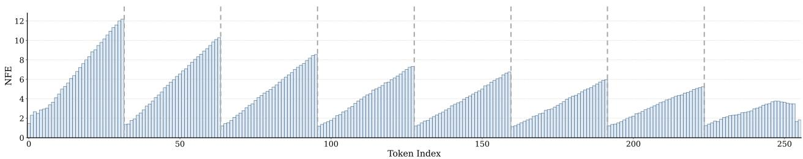  
(a) Token-wise NFE

Prompt: Becky bought 20 apples for 45 cents each and received a \$1 discount. Kelly bought 20 apples for 50 cents each and received a 10 percent discount. How much more did Kelly pay than Becky?  
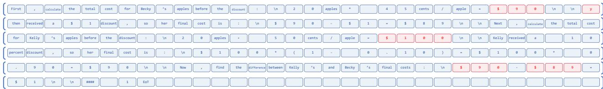  
Answer: First, calculate the total cost for Becky's apples before the discount:\n20 apples \* 45 cents/apple = \$90\n\ny then received a \$1 discount, so her final cost is:\n\$90 - \$1 = \$89\n\nNext, calculate the total cost for Kelly's apples before the discount:\n20 apples \* 50 cents/apple = \$100\n\nKelly received a 10 percent discount, so her final cost is:\n\$100 \* (1 - 0.10) = \$100 \* 0.90 = \$90\n\nNow, find the difference between Kelly's and Becky's final costs:\n\$90 - \$89 = \$1\n\n#### 1

(b) Illustrative examples

Figure 1. Illustration of the inference for dLLMs using LLaDA-8B-Instruct. (a) Token-wise Number of Function Evaluations (NFE). (b) An example of mathematical reasoning. The reasoning errors are highlighted in red bold. We see the left-dominance efect in block-wise decoding. Zoom in for a better view.

decoding iterations, the KV cache outside the current block is held constant. This forces intra-block to interact with stale context and thus undermines cross-block semantic coherence.

To address the above challenges, we propose HaloBlock, a token-dificulty-aware decoding scheme for dLLMs. Specifically, we first employ bidirectional cumulative entropy as a token-level metric to represent the token decoding dificulty. Based on the estimated dificulty, we adaptively allocate halo regions to both ends of each decoding block. The left halo consists of already decoded tokens from preceding blocks, while the right halo is composed of masked placeholder tokens. With bidirectional attention, these halo regions efectively expand the receptive field of the current block and refresh the contextual information at boundaries, alleviating the boundary contextual discontinuity caused by asynchronous KV cache updates. As a result, HaloBlock retains suficient contextual coverage for high-uncertainty regions, which eases the decoding dificulty and achieves faster decoding convergence. Our contributions are as follows:

• We reveal the key structural limitations, i.e., left-dominance efect and boundary contextual discontinuity, in block-wise decoding of dLLMs.

• We present HaloBlock, a training-free dificulty-aware decoding framework that adaptively allocates halos to each block, which efectively reduces the decoding dificulty and smooths the context generation at block boundaries.

• Experiments on representative dLLM, including LLaDA-8B-Instruct, Dream-7B-Instruct, and LLaDA-1.5, verify the efectiveness of HaloBlock, which yields clear improvements in generation accuracy and even achieves a modest speedup in inference.

## 2 Related Work

The predominant auto-regressive (AR) language models [10–14] have long been used in Natural Language Processing. Recently, difusion large language models (dLLMs) [1, 2, 15] emerge as a promising alternatives to AR models. Unlike AR models that are constrained to strict left-to-right generation, dLLMs are equipped with bidirectional attention and support arbitrary-order decoding, granting them unique strengths in long-range context understanding and controllable text editing [4, 5]. There are mainly two directions to further improve dLLMs: to accelerate the inference speed and to improve the generation quality. Block-difusion [6] established a semi-AR model by introducing block discrete denoising difusion. Fast dLLM [7] introduced prefix cache and dual cache to enable KV cache reusing for the full bidirectional attention dLLMs.

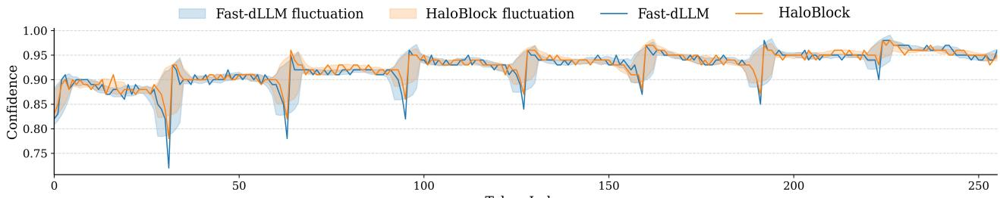

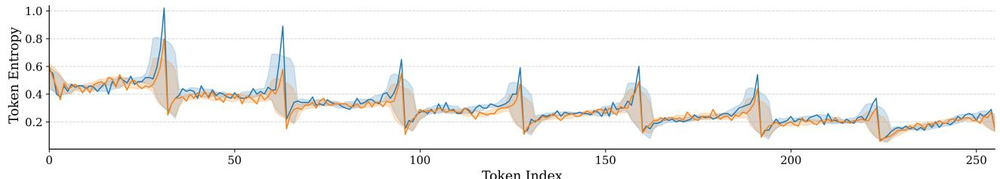  
Figure 2. Visualization of token confidence and token entropy on LLaDA-8B-Instruct (GSM8K) with generation length $T _ { x } = 2 5 6$ and block size � = 32.

Beyond the KV cache improvements [16, 17], LLaDA [1] firstly demonstrated that a strong reasoning performance can be achieved by training a large-scale dLLM from scratch. For generation quality, it has been found in AdaBlock [9] that a reasonable block size is related to the semantic segment of the sequence: better alignment, better reasoning accuracy. Unmasking or re-masking usually requires multiple hyper-parameters and meticulous selection pipeline to converge [18, 19]. In addition, researchers have attempted to add some assistant blocks, tokens, or masks to calibrate, supplement, and expand the decoding range [20, 21].

Apart from the above training-free methods, there are some training approaches to enhance the parallel decoding for dLLMs as well. DParallel [22] performs self-distillation on pre-trained difusion LLMs to encourage the models to decode more tokens at a time. DMPO [23] studies a distribution matching policy optimization framework tailored for reinforcement learning fine-tuning of dLLMs. D2F [24] introduces discrete difusion forcing to simultaneously enable accurate block-level KV cache and parallel decoding across multiple blocks through a causally-restricted attention architecture. D3LLM [25] employs pseudo-trajectory distillation to guide dLLM inference. Among all the aforementioned methods, a prevailing belief is that block-wise decoding and KV cache have become the standard components of dLLMs to improve decoding quality and speed, respectively.

## 3 Methodology

We start with a standard conditional text generation problem. A sequence � to be generated of length $T _ { x }$ is initialized by a series of [MASK] tokens. Together with the prompt � of length $T _ { p }$ , we form the input sequence $S = [ P , X ]$ . � is decoded iteratively from the [MASK] tokens to the sampled tokens in the vocabulary space V. Block-wise decoding, which was first introduced by [6], partitions the sequence � into a series of sub-sequences $X _ { i }$ , each of which consists of a mount of tokens with length � as the block size. The decoding algorithm is performed on the blocks one by one from left to right. A static KV cache � is used to interact with � for inference acceleration.

## 3.1 Empirical Analysis

Block-wise decoding vs. full sequence decoding. Block-wise decoding is semi-autoregressive. It can be seen as an intermediate case between � = 1 and $t = T _ { x } , \mathrm { i . e . , } 1 \leq t \leq T _ { x }$ . Generally speaking, the sequence � can be viewed as a preceding subsequence of a longer generating sequence. Once � is generated, it can be seen as the prefix condition text to generate the subsequent text. From this perspective, each decoding block is functionally equivalent to a miniature full-sequence generation task. Both block-wise decoding and full sequence decoding follow the same discrete difusion denoising, and they are conditioned on left-side prefix context. This leads to a conclusion: the limitations observed in full-sequence difusion decoding will not be eliminated by sequence splitting; instead, they will manifest within each individual block on a smaller scale.

For full-sequence dLLM inference, a well-known intrinsic limitation is the position-dependent disparity in per-token decoding dificulty. Because of the sequential nature of natural language, tokens near the left side of the sequence benefit from richer accumulated contextual cues from the prefix, which reduces denoising dificulty and leads to faster convergence [26]. Tokens closer to the end of the sequence, by contrast, have access to far fewer contextual information and thus require more denoising iterations to reach comparable confidence. This uneven dificulty distribution, referred to as the left-dominance efect in this work, is a native property of difusion-based language generation and becomes more pronounced as the sequence length increases.

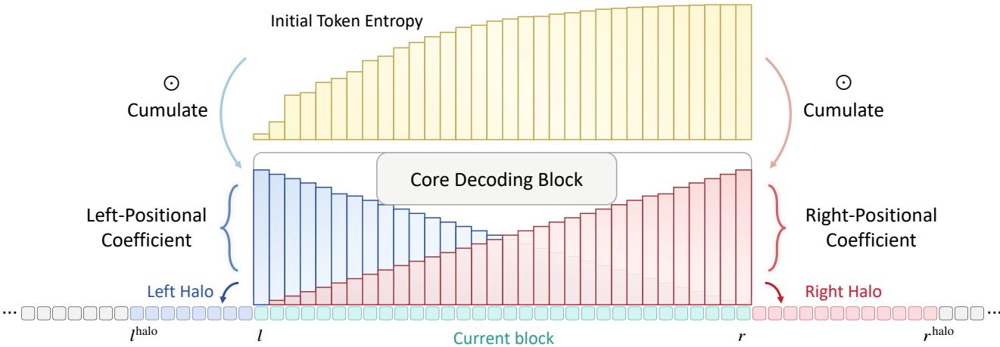  
Figure 3. Computational graph of the HaloBlock. The halo lengths are determined by the bidirectional decoding dificulty, which is cumulated by the positional coeficients and the initial token entropy.

Left-dominance efect. In Fig. 1(a), we visualize the per-token Number of Function Evaluations (NFE) when tokens are sampled and unmasked. It shows that NFE grows linearly as token index increases inside a block. Although the confidence-aware parallel decoding strategy [1, 7] favors the high-confidence token more, which does not introduce position bias, the number of forward passes required for token sampling still exhibits a clear left-dominance efect. The tokens near the right-side of the block require much more iteration to converge. This trend holds for all blocks and results in a sawtooth-shaped variation in per-token NFE across token index. As a result, it may easily lead to false prediction near the right edge of the block. An example is illustrated in Fig. 1(b), where the prediction errors occur at a non-trivial frequency in the right area.

Boundary contextual discontinuity. The contextual discontinuity is presumably caused by the asynchronous KV cache updates at the block boundary [7]. To better analyze this phenomenon, we visualize the token confidence and token entropy for every position of the sequence and average them over all samples. As shown in Fig. 2, there are apparent confidence jumps and entropy jumps at the block boundaries. Notably, token confidence and entropy are relatively stable for most positions in the block, and only jump sharply near the block end. This suggests that the linear growth in NFE merely reflects a gradual increase in per-token decoding dificulty, while accumulated denoising errors manifest abruptly at block boundaries.

## 3.2 HaloBlock

Motivated by the aforementioned limitations of dLLM decoding, we introduce HaloBlock, a dificulty-aware block-wise decoding framework for dLLM inference. A halo is an auxiliary token region appended to both sides of the decoding block. Halo tokens participate in KV-cache updates during iterative denoising, faciliting dynamic contextual cues update and supporting the current block. Let $X _ { i } = { \cal S } [ l _ { i } : r _ { i } ]$ be the �-th block with left edge $l _ { i }$ and right edge $r _ { i }$ . The dLLM M infers the sequence � and outputs the full logits � and the full KV cache �. We first introduce bidirectional halo regions to deliver contextual support for the block:

$$
l _ { i } ^ { \mathrm { h a l o } } , r _ { i } ^ { \mathrm { h a l o } } = \mathrm { B i d i r e c t i o n a l H a l o A l l o c a t i o n } ( l _ { i } , r _ { i } , z [ l _ { i } : r _ { i } ] ) , \quad l _ { i } ^ { \mathrm { h a l o } } , r _ { i } ^ { \mathrm { h a l o } } \le T _ { p } + T _ { x } ,\tag{1}
$$

where $z [ l _ { i } : r _ { i } ]$ represents block logits. In the following, we delve deep into the function of Bidirectional Halo Allocation (Alg. 1).

The core of this allocation function is to quantify decoding dificulty in a bidirectional manner, so that halo lengths on each side can be matched to the actual contextual demand of tokens near the corresponding boundary. We use initial token entropy at the first iterative step as the fundamental measure of per-token decoding dificulty. Given the block logits $z [ l _ { i } : r _ { i } ]$ , we compute the token-level probability distribution via softmax function, and

## Algorithm 1 Bidirectional Halo Allocation

Inputs: Block edges $l , r ,$ block logits $\boldsymbol { z } ~ \in ~ \mathbb { R } ^ { t \times | \mathcal { V } | }$ . Inherited parameters: sequence $S ~ \in ~ \mathcal { V } ^ { T _ { p } + T _ { x } }$   
temperature �, halo factor �.   
Output: HaloBlock edges $l _ { \mathrm { h a l o } } ,$ �halo   
1: � ← Softmax(�)   
2: � ← − Í � log � ⊲ Token entropy   
$3 \colon \mathrm { p o s } \gets \{ 0 , 1 , \ldots , t - 1 \}$ ⊲ Position indices within the block   
4: �left ← 1 − pos/(� − 1); �right ← pos/(� − 1) ⊲ Linear positional coeficients   
$\begin{array} { r } { 5 \colon { \cal U } ^ { \mathrm { l e f t } }  \alpha \sum ( { \cal H } \odot c _ { \mathrm { l e f t } } ) } \end{array}$ ⊲ Left halo length   
$6 \colon U ^ { \mathrm { r i g h t } }  \alpha \sum ( H \odot c _ { \mathrm { r i g h t } } )$ ⊲ Right halo length   
$\tau { : } ~ l ^ { \mathrm { h a l o } } \gets \operatorname* { m a x } \big ( 0 , ~ l - \lfloor U ^ { \mathrm { l e f t } } \rfloor \big ) ; ~ r ^ { \mathrm { h a l o } } \gets \operatorname* { m i n } \big ( T _ { p } + T _ { x } , ~ r + \lfloor U ^ { \mathrm { r i g h t } } \rfloor \big )$   
8: return $l ^ { \mathrm { h a l o } } , r ^ { \mathrm { h a l o } }$

derive entropy for each position:

$$
H [ l _ { i } : r _ { i } ] = - \sum _ { \nu \in [ \mathcal { N } ] } p [ l _ { i } : r _ { i } ] ( \nu ) \log p [ l _ { i } : r _ { i } ] ( \nu ) ; \quad p [ l _ { i } : r _ { i } ] = \mathrm { S o f t m a x } ( z [ l _ { i } : r _ { i } ] ) .\tag{2}
$$

To capture the directional demand for context, we introduce a pair of linear positional coeficients for each token, which is given by:

$$
c _ { \mathrm { l e f t } } [ l _ { i } : r _ { i } ] = 1 - \mathrm { p o s } / ( t - 1 ) ; \quad c _ { \mathrm { r i g h t } } [ l _ { i } : r _ { i } ] = \mathrm { p o s } / ( t - 1 ) , \quad \mathrm { p o s } = \{ 0 , 1 , . . . , t - 1 \} .\tag{3}
$$

These coeficients assign higher weights to tokens closer to the corresponding block boundary, as tokens near the edge rely more heavily on cross-boundary context for accurate denoising. We then allocate halo length by cumulating the decoding dificulty for both directions on all [MASK] tokens:

$$
U _ { i } ^ { \mathrm { l e f t } } = \alpha \sum ( H [ l _ { i } : r _ { i } ] \odot c _ { \mathrm { l e f t } } [ l _ { i } : r _ { i } ] ) ; \quad U _ { i } ^ { \mathrm { r i g h t } } = \alpha \sum ( H [ l _ { i } : r _ { i } ] \odot c _ { \mathrm { r i g h t } } [ l _ { i } : r _ { i } ] ) ,\tag{4}
$$

where $\alpha \geq 0$ is introduced to control the scale of halo regions. Finally, the edges of HaloBlock can be represented as:

$$
l _ { i } ^ { \mathrm { h a l o } } = \operatorname* { m a x } \left( 0 , \ l - \lfloor U _ { i } ^ { \mathrm { l e f t } } \rfloor \right) ; \quad r _ { i } ^ { \mathrm { h a l o } } = \operatorname* { m i n } \left( T _ { p } + T _ { x } , \ r + \lfloor U _ { i } ^ { \mathrm { r i g h t } } \rfloor \right) ,\tag{5}
$$

where ⌊·⌋ denotes rounding operation. The resulting HaloBlock is represented by $S [ l _ { i } ^ { \mathrm { h a l o } } : r _ { i } ^ { \mathrm { h a l o } } ]$ with left edge $l _ { i } ^ { \mathrm { h a l o } }$ and right edge $r _ { i } ^ { \mathrm { h a l o } }$ . An overview of HaloBlock computational graph is shown in Fig. 3.

## 3.3 Block-wise decoding with HaloBlock

Integrated into the block-wise decoding pipeline, HaloBlock alleviates the two issues identified in our empirical analysis (see Sec. 3.1) in a unified manner.

For the intra-block left-dominance efect, the adaptive halo allocation provides asymmetric contextual support: the right side, which sufers from higher decoding dificulty, receives a longer halo and thus more contextual cues to reduce denoising uncertainty. By delivering more context to harder tokens, the dificulty gap within the block is narrowed. Since the total number of forward iterations is determined by the hardest tokens, this leads to faster convergence and lower overall NFE (will be evidenced in the experimental section).

For boundary contextual discontinuity, the extended halo region allows tokens near block edges to attend to a wider range of contextual tokens during iterative denoising. Unlike the standard setting where cross-block KV cache stays static, the halo region updates its KV states along with the current block in each iteration. This synchronized KV cache update alleviates the sharp confidence jump at block boundaries and improves cross-block semantic coherence (refer to the comparison in Fig. 2).

Notably, our HaloBlock is plug-and-play while preserving the original block-wise decoding workflow. The core sampling logic, block scheduling, and KV cache mechanism remain intact, ensuring compatibility with existing dLLM inference optimizations. The full algorithm is provided in Appendix A.

Table 1. Quantitative results of dLLM inference on LLaDA-8B-Instruct. The inference time is measured in average over three indepentent runs.
<table><tr><td>Benchmark</td><td>Method</td><td>Training-Free</td><td>Acc.↑</td><td>TPS↑</td><td>NFE↓</td><td>Time↓</td></tr><tr><td rowspan="6">GSM8K (5-shot)</td><td>LLaDA</td><td></td><td>78.5</td><td>4.0</td><td>256.0</td><td>5:19:24</td></tr><tr><td>dParallel [22]</td><td></td><td>76.4</td><td>27.1</td><td>32.3</td><td>0:40:30</td></tr><tr><td>D2F [24]</td><td></td><td>73.9</td><td>56.0</td><td>47.4</td><td>0:13:25</td></tr><tr><td>d3LLM [25]</td><td></td><td>73.5</td><td>43.0</td><td>25.8</td><td>0:26:12</td></tr><tr><td>Fast dLLM [7]</td><td>√</td><td>76.0</td><td>58.5</td><td>62.8</td><td>0:22:24</td></tr><tr><td>AdaBlock [9]</td><td>√</td><td>78.6</td><td>34.5</td><td>91.2</td><td>0:40:37</td></tr><tr><td></td><td>HaloBlock (Ours)</td><td>√</td><td>79.5</td><td>61.4</td><td>59.5</td><td>0:20:46</td></tr><tr><td rowspan="6">MATH (4-shot)</td><td>LLaDA</td><td></td><td>33.6</td><td>5.6</td><td>256.0</td><td>15:25:44</td></tr><tr><td>dParallel [22]</td><td></td><td>31.5</td><td>25.0</td><td>46.2</td><td>2:40:10</td></tr><tr><td>D2F [24]</td><td></td><td>29.4</td><td>56.7</td><td>84.4</td><td>1:26:09</td></tr><tr><td>d3LLM [25]</td><td></td><td>30.7</td><td>54.6</td><td>35.4</td><td>1:16:07</td></tr><tr><td>Fast dLLM [7]</td><td>√</td><td>32.5</td><td>53.7</td><td>92.6</td><td>1:36:34</td></tr><tr><td>AdaBlock [9]</td><td>V</td><td>32.9</td><td>34.8</td><td>110.4</td><td>2:28:41</td></tr><tr><td></td><td>HaloBlock (Ours)</td><td>√</td><td>33.2</td><td>57.2</td><td>88.9</td><td>1:30:33</td></tr><tr><td rowspan="6">HumanEval (0-shot)</td><td>LLaDA</td><td></td><td>42.1</td><td>10.9</td><td>256.0</td><td>0:15:16</td></tr><tr><td>dParallel [22]</td><td></td><td>39.6</td><td>60.3</td><td>31.6</td><td>0:01:45</td></tr><tr><td>D2F [24]</td><td></td><td>41.5</td><td>34.5</td><td>34.4</td><td>0:02:26</td></tr><tr><td>d3LLM [25]</td><td></td><td>39.6</td><td>14.3</td><td>50.2</td><td>0:03:17</td></tr><tr><td>Fast dLLM [7]</td><td>V</td><td>42.1</td><td>55.3</td><td>87.0</td><td>0:02:53</td></tr><tr><td>AdaBlock [9] HaloBlock (Ours)</td><td>√</td><td>39.0</td><td>42.1</td><td>94.2</td><td>0:03:47</td></tr><tr><td></td><td></td><td>√</td><td>43.3</td><td>60.4</td><td>84.5</td><td>0:02:38</td></tr><tr><td rowspan="6">MBPP (3-shot)</td><td>LLaDA</td><td></td><td>40.6</td><td>3.8</td><td>256.0</td><td>1:38:24</td></tr><tr><td>dParallel [22]</td><td></td><td>39.8</td><td>11.5</td><td>23.2</td><td>0:09:28</td></tr><tr><td>D2F [24]</td><td></td><td>36.6</td><td>31.7</td><td>31.3</td><td>0:04:14</td></tr><tr><td>d3LLM [25]</td><td></td><td>36.0</td><td>29.3</td><td>20.3</td><td>0:04:15</td></tr><tr><td>Fast dLLM [7]</td><td>√</td><td>38.8</td><td>37.2</td><td>70.6</td><td>0:08:33</td></tr><tr><td>AdaBlock [9]</td><td>√</td><td>40.8</td><td>31.2</td><td>86.8</td><td>0:12:14</td></tr><tr><td></td><td>HaloBlock (Ours)</td><td>√</td><td>41.2</td><td>38.9</td><td>65.7</td><td>0:08:15</td></tr></table>

## 4 Experiments

Models and benchmarks. We evaluate HaloBlock on standard dLLMs: LLaDA-8B-Instruct [1], Dream-7B-Instruct [2], and LLaDA-1.5 [27]. We adopt four widely used benchmarks: GSM8K (5-shot) [28] and MATH (4-shot) [29] for mathematical reasoning, as well as MBPP (3-shot) [30] and HumanEval (0-shot) [31] for code generation. Generation quality is measured by task accuracy. Generation eficiency is measured by token per second (TPS) and the total inference time for intuitive comparison. We also report average NFE to show the number of model forward pass. All experiments run on four NVIDIA H20 GPUs.

Evaluation details. To provide a fair comparison, we unify the inference pipeline for each model to establish a clean block-wise decoding framework for dLLM inference. For LLaDA series, we use the representative Fast dLLM framework [7], and we implement HaloBlock on top of Fast dLLM. For Dream-7B-Instruct, we use the dParallel [22] framework, upon which HaloBlock is implemented. Since diferent methods may favor diferent KV cache strategy, we adopt the one that achieves the best task accuracy, which is fixed in comparison. HaloBlock introduces one hyperparameter: the halo factor � in Eqn. (4) to control the scale of halo regions. We conduct a grid search on GSM8K dataset and set � = 2, which is fixed in all the evaluation. All other dLLM inference settings remain unchanged.

To conduct a comprehensive comparison, we compare HaloBlock against five state-of-the-art dLLM inference approaches, consisting of three training-based methods: dParallel [22], D2F [24], and d3LLM [25], as well as two training-free methods: Fast dLLM [7] and AdaBlock [9]. All these competitors represent the most recent advances in eficient dLLM inference. We follow the work of our predecessors and use the optimal hyper-parameters of these methods.

Table 2. Quantitative results of dLLM inference on Dream-7B-Instruct. The inference time is measured in average over three indepentent runs.
<table><tr><td>Benchmark</td><td>Method</td><td>Training-Free</td><td>Acc.↑</td><td>TPS↑</td><td>NFE↓</td><td>Time↓</td></tr><tr><td rowspan="6">GSM8K (5-shot)</td><td>Dream</td><td></td><td>82.9</td><td>19.2</td><td>256.0</td><td>1:13:20</td></tr><tr><td>dParallel [22]</td><td></td><td>81.3</td><td>138.1</td><td>41.8</td><td>0:10:11</td></tr><tr><td>D2F [24]</td><td></td><td>77.5</td><td>50.9</td><td>48.7</td><td>0:12:06</td></tr><tr><td>d3LLM [25]</td><td></td><td>81.7</td><td>162.0</td><td>24.0</td><td>0:07:58</td></tr><tr><td>Fast dLLM [7]</td><td>√</td><td>77.8</td><td>88.1</td><td>66.1</td><td>0:14:46</td></tr><tr><td>AdaBlock [9]</td><td>√</td><td>77.8</td><td>94.1</td><td>66.2</td><td>0:14:10</td></tr><tr><td></td><td>HaloBlock (Ours)</td><td>√</td><td>82.3</td><td>173.1</td><td>38.0</td><td>0:08:08</td></tr><tr><td rowspan="6">MATH (4-shot)</td><td>Dream</td><td></td><td>38.3</td><td>7.9</td><td>256.0</td><td>11:16:58</td></tr><tr><td>dParallel [22]</td><td></td><td>37.3</td><td>110.0</td><td>66.5</td><td>0:48:33</td></tr><tr><td>D2F [24]</td><td></td><td>30.9</td><td>52.8</td><td>82.8</td><td>1:14:55</td></tr><tr><td>d3LLM [25]</td><td></td><td>37.1</td><td>37.3</td><td>41.8</td><td>2:23:14</td></tr><tr><td>Fast dLLM [7]</td><td>√</td><td>37.2</td><td>48.4</td><td>128.8</td><td>1:39:28</td></tr><tr><td>AdaBlock [9]</td><td>√</td><td>38.4</td><td>63.1</td><td>103.3</td><td>1:24:05</td></tr><tr><td></td><td>HaloBlock (Ours)</td><td>√</td><td>38.3</td><td>122.8</td><td>63.4</td><td>0:43:29</td></tr><tr><td rowspan="6">HumanEval (0-shot)</td><td>Dream</td><td></td><td>55.5</td><td>12.6</td><td>256.0</td><td>0:13:55</td></tr><tr><td>dParallel [22]</td><td></td><td>53.7</td><td>134.5</td><td>34.1</td><td>0:01:12</td></tr><tr><td>D2F [24]</td><td></td><td>51.2</td><td>28.5</td><td>107.6</td><td>0:03:15</td></tr><tr><td>d3LLM [25]</td><td></td><td>56.1</td><td>68.4</td><td>35.5</td><td>0:02:25</td></tr><tr><td>Fast dLLM [7]</td><td>√</td><td>51.2</td><td>37.2</td><td>89.6</td><td>0:02:06</td></tr><tr><td>AdaBlock [9]</td><td>√</td><td>54.9</td><td>61.5</td><td>68.7</td><td>0:02:44</td></tr><tr><td></td><td>HaloBlock (Ours)</td><td>√</td><td>56.1</td><td>149.0</td><td>31.6</td><td>0:01:06</td></tr><tr><td rowspan="6">MBPP (3-shot)</td><td>Dream</td><td></td><td>57.6</td><td>17.1</td><td>256.0</td><td>0:30:34</td></tr><tr><td>dParallel [22]</td><td></td><td>53.4</td><td>187.0</td><td>27.1</td><td>0:02:50</td></tr><tr><td>D2F [24]</td><td></td><td>53.2</td><td>36.3</td><td>67.7</td><td>0:05:36</td></tr><tr><td>d3LLM [25]</td><td></td><td>54.8</td><td>111.9</td><td>31.8</td><td>0:04:46</td></tr><tr><td>Fast dLLM [7]</td><td>√</td><td>52.8</td><td>30.7</td><td>53.3</td><td>0:05:09</td></tr><tr><td>AdaBlock [9]</td><td>√</td><td>55.0</td><td>101.0</td><td>51.0</td><td>0:04:59</td></tr><tr><td></td><td>HaloBlock (Ours)</td><td>√</td><td>54.6</td><td>214.5</td><td>27.0</td><td>0:02:24</td></tr></table>

## 4.1 Experimental Results

Main results. We conduct a series of experiments on diferent dLLMs and various decoding settings. The results of LLaDA-8B-Instruct are summarized in Tab. 1. We see that HaloBlock balances speed and accuracy very well across all the four benchmarks, outperforming both training-based and training-free eficient dLLM inference methods. Specifically, HaloBlock produces the best task accuracy among all the advanced strategies of dLLM inference. Comparing to the base model Fast dLLM, our method consistently improves the task accuracy by +3.5%, +0.7%, +1.2%, and +2.4% on GSM8K, MATH, HumanEval, and MBPP benchmarks, respectively. Notably, HaloBlock even achieves faster inference speed and decoding convergence speed. For example, compared to Fast dLLM, TPS is improved by 2.9 token/s on GSM8K with 3.3 lower average NFE. The inference time is notably reduced by 7.3% from 0:22:24 to 0:20:46. Similarly, Tab. 2 reports quantitative results on Dream-7B-Instruct. In terms of accuracy, HaloBlock remains highly competitive with the vanilla Dream model. Compared to the baseline dParallel, HaloBlock produces +1.0, +1.0, +2.4, +1.2 accuracy gains on GSM8K, MATH, HumanEval, and MBPP, respectively. For inference eficiency, compared to existing training-free methods, HaloBlock consistently delivers the highest TPS and fastest inference time across all four benchmarks. Those training-based approaches that achieve acceleration by reducing the number of model forward passes; however, they generally sufer from non-negligible accuracy degradation. By contrast, HaloBlock yields a more favorable speed-accuracy trade-of for dLLM inference. For the experimental results of LLaDA-1.5, kindly refer to Appendix B.

HaloBlock eases the boundary contextual discontinuity. To verify how HaloBlock takes efect on block-wise decoding, we visualize per-token denoising confidence and token entropy over a 256-token generation sequence. As shown in Fig. 2, we observe consistent and abrupt discontinuities at every block boundary:

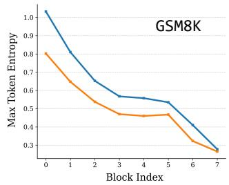

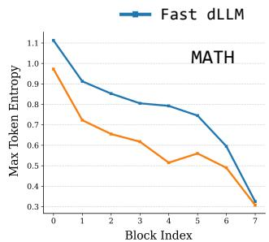

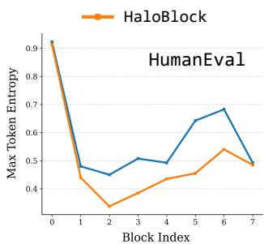

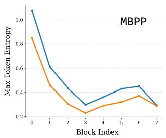  
Figure 4. Visualization of the max token entropy for each block when the tokens are unmasked. HaloBlock reduces the max token entropy, which indicates lower uncertainty.

Table 3. Quantitative results of dLLM inference with various generation length $T _ { x }$ and block size �. The inference time is measured in average over three indepentent runs.
<table><tr><td rowspan="2">Method</td><td rowspan="2"> $T _ { x }$ </td><td colspan="3">t = 8</td><td colspan="3">t = 16</td><td colspan="3">t = 32</td></tr><tr><td>Acc.↑</td><td>TPS↑</td><td>Time↓</td><td>Acc.↑</td><td>TPS↑</td><td>Time↓</td><td>Acc.↑</td><td>TPS↑</td><td>Time↓</td></tr><tr><td>LLaDA</td><td>256</td><td>80.5</td><td>4.4</td><td>4:49:38</td><td>79.2</td><td>4.5</td><td>4:48:55</td><td>78.5</td><td>4.0</td><td>5:19:24</td></tr><tr><td>Fast dLLM</td><td>256</td><td>78.9</td><td>24.1</td><td>0:52:40</td><td>77.4</td><td>35.9</td><td>0:35:32</td><td>76.0</td><td>58.5</td><td>0:22:24</td></tr><tr><td>HaloBlock</td><td>256</td><td>80.7</td><td>25.5</td><td>0:50:11</td><td>79.8</td><td>38.7</td><td>0:33:00</td><td>79.5</td><td>61.4</td><td>0:20:46</td></tr><tr><td>LLaDA</td><td>512</td><td>80.4</td><td>2.1</td><td>11:30:26</td><td>77.7</td><td>2.1</td><td>11:31:15</td><td>76.1</td><td>2.5</td><td>10:14:10</td></tr><tr><td>Fast dLLM</td><td>512</td><td>76.7</td><td>15.5</td><td>1:36:27</td><td>76.9</td><td>25.5</td><td>0:56:01</td><td>74.5</td><td>40.4</td><td>0:37:17</td></tr><tr><td>HaloBlock</td><td>512</td><td>78.8</td><td>15.6</td><td>1:35:38</td><td>79.5</td><td>27.1</td><td>0:54:35</td><td>77.5</td><td>42.7</td><td>0:34:53</td></tr></table>

denoising confidence drops sharply and token entropy spikes upward, as tokens adjacent to the partition lose direct connection to the new contextual information from the neighboring block. These jumps mark positions where decoding uncertainty rises abruptly, which corresponds to where most generation errors occur in block-wise dLLM. HaloBlock efectively smooths these boundary-induced fluctuations. With adaptive halo regions extending the attention window across partitions, the magnitude of confidence drops and entropy spikes at boundaries is substantially reduced, yielding a more stable and continuous generation across the entire generated sequence.

HaloBlock accelerates decoding convergence by reducing decoding dificulty. One might expect that attaching the efective context window via halo regions would incur higher computational overhead per forward pass. To further understand the source of HaloBlock’s eficiency gains, we visualize the maximum token entropy within each block across 8 consecutive blocks, evaluated on four benchmarks: GSM8K, MATH, HumanEval, and MBPP. As shown in Fig. 4, across all four datasets, HaloBlock consistently yields lower maximum token entropy for every block compared to the Fast dLLM baseline. In block-wise decoding, the convergence speed of each block is highly correlated with the token of the highest uncertainty, as this token acts as the rate-limiting step for the entire block. The reduction in maximum per-block token entropy indicates that HaloBlock efectively lowers the decoding dificulty of the hardest tokens within each block, which directly leads to faster convergence. As a result, we observe that HaloBlock reaches acceptable denoising quality with fewer model forward passes compared to the baseline, which explains why HaloBlock achieves higher throughput despite operating with a slightly larger efective attention scope: it trades a modest increase in per-step compute for a substantial reduction in the number of iterative steps. More analyses of HaloBlock can be found in Appendix C.

## 4.2 Ablation Study

Performance across diferent generation length. We experiment HaloBlock under two widely adopted generation lengths, 256 and 512, to verify its robustness across output length. As shown in Tab. 3, doubling the sequence length reduces throughput for all three methods, as each forward pass operates on a longer sequence and incurs higher computational cost. Across generation length 256 and 512, HaloBlock boosts the generation quality while achieving inference speedup. Meanwhile, the throughput advantage of HaloBlock over Fast dLLM remains consistent across lengths, indicating that the overhead of halo allocation is negligible and does not scale with total sequence length.

Performance across diferent block size. We further examine how decoding performance varies with block size $t \in \{ 8 , 1 6 , 3 2 \}$ . It can be seen from Tab. 3 that larger block sizes yield higher throughput, since more tokens are denoised in parallel per forward evaluation. However, larger blocks also cause accuracy degradation: when � increases from 8 to 32, the task accuracy of Fast dLLM drops 2.9 at $T _ { x } = 2 5 6$ and 2.2 at $T _ { x } = 5 1 2 .$ HaloBlock efectively improves this accuracy-speed balance. Across all tested block sizes, it recovers the majority of the accuracy drops, while retaining or even improving inference eficiency.

Table 4. Ablation study on halo factor �. The results are reported by task accuracy and inference time.
<table><tr><td>Model</td><td>Baseline</td><td> $\alpha = 1$ </td><td> $\alpha = 2$ </td><td> $\alpha = 3$ </td><td> $\alpha = 4$ </td></tr><tr><td>LLaDA</td><td>76.0 0:22:24</td><td>78.0 0:20:32</td><td>79.5 0:20:46</td><td>79.2 0:21:22</td><td>78.2 0:22:17</td></tr><tr><td>Dream</td><td>81.3 0:10:11</td><td>81.8 0:07:49</td><td>82.3 0:08:08</td><td>82.0 0:08:44</td><td>81.8 0:08:48</td></tr></table>

Table 5. Performance of HaloBlock upon more blockwise decoding methods.
<table><tr><td>Model</td><td>Acc.↑</td><td>TPS↑</td><td>NFE↓</td><td>Time↓</td></tr><tr><td>AdaBlock</td><td>78.6</td><td>34.5</td><td>91.2</td><td>0:40:37</td></tr><tr><td>AdaBlock + Ours</td><td>79.4</td><td>35.6</td><td>87.5</td><td>0:39:33</td></tr><tr><td>dParallel</td><td>81.3</td><td>138.1</td><td>41.8</td><td>0:10:11</td></tr><tr><td> $\mathrm { d P a r a l l e l + O u r s }$ </td><td>82.3</td><td>173.1</td><td>38.0</td><td>0:08:08</td></tr></table>

Efect of halo factor �. In Eqn. (4), HaloBlock introduces one hyper-parameter � to control the scale of halo regions. We investigate the efect of HaloBlock under various halo factors. Tab. 4 reports the experimental results on LLaDA-8B-Instruct and Dream-7B-Instruct. We can see that all the choices of � improve the performance of dLLM. In practice, we empirically set $\alpha = 2$ for all models.

Halo region: dificulty-aware vs. static. We perform a grid search over static halo configurations, where left and right halo lengths are varied respectively from 1 to 16 tokens. As shown in Fig. 5, static halos improve over the 76.0 baseline across most settings, with peak accuracy at around (9, 10). Our HaloBlock reaches 79.5% accuracy without the need of laboriously tuning the left and the right halo length. An intriguing finding is the strong asymmetry between left and right halo sensitivity. A short right halo $( U ^ { \mathrm { { r i g h t } } } \leq 5 )$ leads to marked accuracy drops, and even worse performance than having no halo at all in some configurations. This asymmetry presumably stems from the directional nature of sequence generation. The left boundary of a block adjoins already decoded tokens with fully available context, thus it is less dependent on halo extension. The right boundary faces mask tokens, where native contextual information is inherently scarce, making adequate right halo

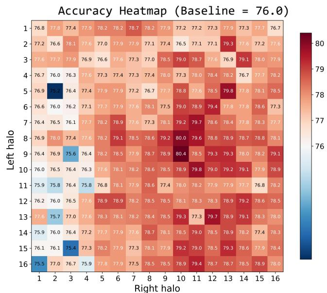  
Figure 5. Visualization of accuracy heatmap with static halo region on LLaDA-8B-Instruct (GSM8K).

coverage critical for stable decoding. Our dificulty-aware approach adaptively prioritizes high-dificulty positions and allocates halo capacity eficiently.

Compatibility of HaloBlock. We then verify that HaloBlock is orthogonal to some recent dLLM inference optimizations. For example, adaptive block size methods such as AdaBlock [9], dynamically assigns block sizes via semantic delimiters. Due to its better alignment between block size and semantic step, AdaBlock can efectively enhance the sampling quality. We then adapt HaloBlock to AdaBlock. The results in Tab. 5 show that further improvements can be achieved in both generation quality and inference eficiency. These results show the consistent efectiveness of HaloBlock: better generation accuracy, faster decoding convergence, and lower inference cost.

## 5 Conclusion

In this paper, we presented HaloBlock, a simple yet efective method to improve the inference speed and accuracy of dLLMs by alleviating the issues of left-dominance efect and boundary contextual discontinuity. HaloBlock quantifies token decoding dificulty via bidirectional cumulative entropy and use it to adaptively appending halo regions to both sides of each block. Extensive evaluations on LLaDA and Dream models demonstrated that HaloBlock achieves consistent generation quality improvement, as well as faster decoding convergence and lower inference time cost. This work has implications for how we model token decoding dificulty and design contextual support algorithms in block-wise difusion large language model inference.

Limitations. While simple and efective, as many other dLLM acceleration methods, HaloBlock still relies on block-wise decoding and KV cache. In addition, currently we apply HaloBlock to the popular LLaDA, LLaDA-1.5, and Dream models. In the future, we will adapt HaloBlock to the recently developed dLLMs such as LLaDA-2.0 [32], SDAR [33], d3LLM [25] and DMPO [23], etc.

## References

[1] Shen Nie, Fengqi Zhu, Zebin You, Xiaolu Zhang, Jingyang Ou, Jun Hu, Jun Zhou, Yankai Lin, Ji-Rong Wen, and Chongxuan Li. Large language difusion models. In NeurIPS, pages 50608–50646, 2025.

[2] Jiacheng Ye, Zhihui Xie, Lin Zheng, Jiahui Gao, Zirui Wu, Xin Jiang, Zhenguo Li, and Lingpeng Kong. Dream 7b: Difusion large language models. arXiv preprint arXiv:2509.01142, 2025.

[3] Ling Yang, Ye Tian, Bowen Li, Xinchen Zhang, Ke Shen, Yunhai Tong, and Mengdi Wang. MMaDA: Multimodal large difusion language models. In NeurIPS, pages 138867–138907, 2025.

[4] Che Hyun Lee, Heeseung Kim, Jiheum Yeom, and Sungroh Yoon. EdiText: Controllable coarse-to-fine text editing with difusion language models. In ACL, pages 22798–22815, 2025.

[5] Shufan Li, Yuchen Zhu, Jiuxiang Gu, Kangning Liu, Zhe Lin, Yongxin Chen, Molei Tao, Aditya Grover, and Jason Kuen. LaViDa-R1: Advancing reasoning for unified multimodal difusion language models. In ICML, 2026.

[6] Marianne Arriola, Aaron Gokaslan, Justin Chiu, Zhihan Yang, Zhixuan Qi, Jiaqi Han, Subham Sahoo, and Volodymyr Kuleshov. Block difusion: Interpolating between autoregressive and difusion language models. In ICLR, pages 50726–50753, 2025.

[7] Chengyue Wu, Hao Zhang, Shuchen Xue, Zhijian Liu, Shizhe Diao, Ligeng Zhu, Ping Luo, Song Han, and Enze Xie. Fast-dLLM: Training-free acceleration of difusion llm by enabling kv cache and parallel decoding. In ICLR, pages 57027–57051, 2026.

[8] Daniel Israel, Guy Van den Broeck, and Aditya Grover. Accelerating difusion llms via adaptive parallel decoding. NeurIPS, pages 52870–52888, 2025.

[9] Guanxi Lu, Hao Chen, Yuto Karashima, Zhican Wang, Daichi Fujiki, and Hongxiang Fan. AdaBlock-dLLM: Semantic-aware difusion llm inference via adaptive block size. In ICLR, volume 2026, pages 140018–140033, 2026.

[10] Tom Brown, Benjamin Mann, Nick Ryder, Melanie Subbiah, Jared D Kaplan, Prafulla Dhariwal, Arvind Neelakantan, Pranav Shyam, Girish Sastry, Amanda Askell, et al. Language models are few-shot learners. In NeurIPS, pages 1877–1901, 2020.

[11] Josh Achiam, Steven Adler, Sandhini Agarwal, Lama Ahmad, Ilge Akkaya, Florencia Leoni Aleman, Diogo Almeida, Janko Altenschmidt, Sam Altman, Shyamal Anadkat, et al. Gpt-4 technical report. arXiv preprint arXiv:2303.08774, 2023.

[12] Hugo Touvron, Thibaut Lavril, Gautier Izacard, Xavier Martinet, Marie-Anne Lachaux, Timothée Lacroix, Baptiste Rozière, Naman Goyal, Eric Hambro, Faisal Azhar, et al. Llama: Open and eficient foundation language models. arXiv preprint arXiv:2302.13971, 2023.

[13] Hugo Touvron, Louis Martin, Kevin Stone, Peter Albert, Amjad Almahairi, Yasmine Babaei, Nikolay Bashlykov, Soumya Batra, Prajjwal Bhargava, Shruti Bhosale, et al. Llama 2: Open foundation and fine-tuned chat models. arXiv preprint arXiv:2307.09288, 2023.

[14] Jinze Bai, Shuai Bai, Yunfei Chu, Zeyu Cui, Kai Dang, Xiaodong Deng, Yang Fan, Wenbin Ge, Yu Han, Fei Huang, et al. Qwen technical report. arXiv preprint arXiv:2309.16609, 2023.

[15] Subham S Sahoo, Marianne Arriola, Yair Schif, Aaron Gokaslan, Edgar Marroquin, Justin T Chiu, Alexander Rush, and Volodymyr Kuleshov. Simple and efective masked difusion language models. Advances in Neural Information Processing Systems, 37:130136–130184, 2024.

[16] Xinyin Ma, Runpeng Yu, Gongfan Fang, and Xinchao Wang. dKV-Cache: The cache for difusion language models. In NeurIPS, pages 149009–149033, 2025.

[17] Zhiyuan Liu, Yicun Yang, Yaojie Zhang, Junjie Chen, Chang Zou, Qingyan Wei, Shaobo Wang, Yichen Zhu, and Linfeng Zhang. dLLM-Cache: Accelerating difusion large language models with adaptive caching. In ICML, 2026.

[18] Feng Hong, Geng Yu, Yushi Ye, Haicheng Huang, Huangjie Zheng, Ya Zhang, Yanfeng Wang, and Jiangchao Yao. Wide-in, narrow-out: Revokable decoding for eficient and efective dllms. In ICLR, pages 40132–40150, 2026.

[19] Xiaojing Qi, Lun Du, Xinyuan Zhang, Lanning Wei, Tao Jin, and Da Zheng. Hierarchy decoding: A training-free parallel decoding strategy for difusion large language models. In ICLR, 2026.

[20] Jinsong Li, Xiaoyi Dong, Yuhang Zang, Yuhang Cao, Jiaqi Wang, and Dahua Lin. Beyond fixed: Training-free variable-length denoising for difusion large language models. In ICLR, pages 91715–91731, 2026.

[21] Xinhua Chen, Sitao Huang, Cong Guo, Chiyue Wei, Yintao He, Jianyi Zhang, Hai Li, and Yiran Chen. DPad: Eficient difusion language models with sufix dropout. In ICLR, pages 57286–57316, 2026.

[22] Zigeng Chen, Gongfan Fang, Xinyin Ma, Ruonan Yu, and Xinchao Wang. dParallel: Learnable parallel decoding for dLLMs. In ICLR, pages 53193–53211, 2026.

[23] Yuchen Zhu, Wei Guo, Jaemoo Choi, Petr Molodyk, Bo Yuan, Molei Tao, and Yongxin Chen. Enhancing reasoning for difusion LLMs via distribution matching policy optimization. In ICML, 2026.

[24] Xu Wang, Chenkai Xu, Yijie Jin, Jiachun Jin, Hao Zhang, Kai Yu, and Zhijie Deng. Difusion llms can do faster-than-ar inference via discrete difusion forcing. In ICLR, pages 2282–2299, 2026.

[25] Yu-Yang Qian, Junda Su, Lanxiang Hu, Peiyuan Zhang, Zhijie Deng, Peng Zhao, and Hao Zhang. d3LLM: Ultra-fast difusion LLM using pseudo-trajectory distillation. In ICML, 2026.

[26] Tong Wu, Zhihao Fan, Xiao Liu, Hai-Tao Zheng, Yeyun Gong, Jian Jiao, Juntao Li, Jian Guo, Nan Duan, Weizhu Chen, et al. AR-Difusion: Auto-regressive difusion model for text generation. NeurIPS, pages 39957–39974, 2023

[27] Fengqi Zhu, Rongzhen Wang, Shen Nie, Xiaolu Zhang, Chunwei Wu, Jun Zhou, Yankai Lin, Ji-Rong Wen, and Chongxuan Li. Llada 1.5: Variance-reduced preference optimization for large language difusion models. In Proceedings of the 64th Annual Meeting of the Association for Computational Linguistics (Volume 1: Long Papers), pages 11425–11460, 2026.

[28] Karl Cobbe, Vineet Kosaraju, Mohammad Bavarian, Mark Chen, Heewoo Jun, Lukasz Kaiser, Matthias Plappert, Jerry Tworek, Jacob Hilton, Reiichiro Nakano, et al. Training verifiers to solve math word problems. arXiv preprint arXiv:2110.14168, 2021.

[29] Dan Hendrycks, Collin Burns, Saurav Kadavath, Akul Arora, Steven Basart, Eric Tang, Dawn Song, and Jacob Steinhardt. Measuring mathematical problem solving with the math dataset. In NeurIPS, 2021.

[30] Jacob Austin, Augustus Odena, Maxwell Nye, Maarten Bosma, Henryk Michalewski, David Dohan, Ellen Jiang, Carrie Cai, Michael Terry, Quoc Le, et al. Program synthesis with large language models. arXiv preprint arXiv:2108.07732, 2021.

[31] Mark Chen, Jerry Tworek, Heewoo Jun, Qiming Yuan, Henrique Ponde De Oliveira Pinto, Jared Kaplan, Harri Edwards, Yuri Burda, Nicholas Joseph, Greg Brockman, et al. Evaluating large language models trained on code. arXiv preprint arXiv:2107.03374, 2021.

[32] Tiwei Bie, Maosong Cao, Kun Chen, Lun Du, Mingliang Gong, Zhuochen Gong, Yanmei Gu, Jiaqi Hu, Zenan Huang, Zhenzhong Lan, et al. LLaDA2.0: Scaling up difusion language models to 100b. arXiv preprint arXiv:2512.15745, 2025.

[33] Shuang Cheng, Yihan Bian, Dawei Liu, Yuhua Jiang, Yihao Liu, Linfeng Zhang, Qian Yao, Zhongbo Tian, Wenhai Wang, Qipeng Guo, et al. SDAR: A synergistic difusion-autoregression paradigm for scalable sequence generation. In Findings ofthe Associationfor Computational Linguistics: ACL 2026, pages 22058–22075, 2026.

Algorithm 2 HaloBlock   
Inputs: Model M, prompt sequence $P \in \mathcal { V } ^ { T _ { p } }$ , refinement steps �, generation length � , block size �, the   
number of blocks �, temperature �, halo factor �.   
Output: Generated full sequence $S = [ P , X ] \in \mathcal { V } ^ { T _ { p } + T _ { x } }$   
1: $S \gets [ P , [ \mathtt { N A S K } ] , \cdot \cdot \cdot , [ \mathtt { M A S K } ] ]$ ⊲ Initialize sequence   
$T _ { x }$   
2: for � = 1 to � do   
3: $l  T _ { p } + ( i - 1 ) \cdot t ; \quad r  l + t$ ⊲ Left and right edges of block $X _ { i }$   
4: $\bar { J } \gets ( S [ l : r ] = [ \mathbb { M } \mathrm { \sf { A } S K } ] )$   
5: $\left\{ n _ { k } \right\} _ { k = 1 } ^ { s } \gets \mathsf { A l l o c Q u o t a } ( \mathcal { I } , s )$ ⊲ Allocate unmasking quota per step   
6: $\mathcal { R } \gets \mathbf { 1 } ^ { T _ { p } + T _ { x } }$ ⊲ KV cache update indicator   
7: $z , Y \gets M ( S , \mathcal { R } )$ ⊲ Obtain full logits and full KV cache   
8: $S \gets \mathsf { S a m p l i n g } ( z [ l : r ] , \bar { J } , S , n _ { 1 } )$ ⊲ Decode and update �   
9: �halo, �halo = BidirectionalHaloAllocation(�, �, �[� : �])   
10: $\mathcal { R } \gets \Theta ^ { T _ { p } + T _ { x } } ; \quad \mathcal { R } [ l ^ { \mathrm { h a l o } } : r ^ { \mathrm { h a l o } } ] \gets 1$ ⊲ Identify KV cache update indicator   
11: for � = 2 to � do   
12: $\bar { J } \gets ( S [ l : r ] = [ \mathbb { M } \mathrm { \sf { A } S K } ] )$   
13: if Í I = 0 then   
14: break ⊲ Early exit when block is fully unmasked   
15: end if   
16: $z _ { j } , Y \gets M ( S [ l ^ { \mathrm { h a l o } } : r ^ { \mathrm { h a l o } } ] , Y , \mathcal { R } )$ ⊲ Block-level logits with updated KV cache   
17: $S \gets \mathsf { S a m p l i n g } ( z _ { j } [ l - l ^ { \mathrm { h a l o } } : r - l ^ { \mathrm { h a l o } } ] , \bar { \boldsymbol { \tau } } , S , n _ { j } )$ ⊲ Decode and update �   
18: end for   
19: end for   
20: return �

## Appendix

## A Block-wise Decoding with HaloBlock

We present the formal algorithm for the proposed HaloBlock in Alg. 2, where we adopt Fast dLLM [7] as an example baseline framework.

## B Experimental Results on LLaDA-1.5

We compare HaloBlock with the training-free dLLM inference methods, Fast dLLM [7] and AdaBlock [9] on LLaDA-1.5. The quantitative results are presented in Tab. B.1. Compared to Fast dLLM and AdaBlock, HaloBlock yields accuracy gains and better eficiency under all the four benchmarks. This again demonstrates the efectiveness of our proposed method.

## C More Analysis on HaloBlock

HaloBlock eases the decoding dificulty. To further analyze the behavior of using HaloBlock on dLLM inference, we introduce cumulative decoding uncertainty (CDU) to represent the decoding dificulty for the

Table B.1. Quantitative results of dLLM inference on LLaDA-1.5. The inference time is measured in average over three indepentent runs.
<table><tr><td>Benchmark</td><td>Method</td><td>Training-Free</td><td>Acc.↑</td><td>TPS↑</td><td>NFE↓</td><td>Time↓</td></tr><tr><td rowspan="4">GSM8K (5-shot)</td><td>LLaDA-1.5 [27]</td><td></td><td>80.5</td><td>3.8</td><td>256.0</td><td>5:14:26</td></tr><tr><td>Fast dLLM [7]</td><td>√</td><td>80.3</td><td>46.3</td><td>84.0</td><td>0:25:15</td></tr><tr><td>AdaBlock [9]</td><td>√</td><td>79.8</td><td>31.7</td><td>88.1</td><td>0:37:06</td></tr><tr><td>HaloBlock (Ours)</td><td>√</td><td>81.1</td><td>49.4</td><td>79.4</td><td>0:24:03</td></tr><tr><td rowspan="4">MATH (4-shot)</td><td>LLaDA-1.5 [27]</td><td></td><td>33.2</td><td>5.2</td><td>256.0</td><td>13:12:47</td></tr><tr><td>Fast dLLM [7]</td><td>V</td><td>32.5</td><td>40.6</td><td>106.5</td><td>1:51:09</td></tr><tr><td>AdaBlock [9]</td><td>√</td><td>33.0</td><td>42.9</td><td>108.1</td><td>2:04:13</td></tr><tr><td>HaloBlock (Ours)</td><td>√</td><td>33.3</td><td>45.9</td><td>100.3</td><td>1:38:10</td></tr><tr><td rowspan="4">HumanEval (0-shot)</td><td>LLaDA-1.5 [27]</td><td></td><td>43.3</td><td>4.4</td><td>256.0</td><td>0:12:23</td></tr><tr><td>Fast dLLM [7]</td><td>√</td><td>35.4</td><td>15.1</td><td>106.2</td><td>0:03:57</td></tr><tr><td>AdaBlock [9]</td><td>V</td><td>37.8</td><td>12.3</td><td>123.5</td><td>0:04:05</td></tr><tr><td>HaloBlock (Ours)</td><td>√</td><td>39.0</td><td>18.0</td><td>101.3</td><td>0:03:13</td></tr><tr><td rowspan="4">MBPP (3-shot)</td><td>LLaDA-1.5 [27]</td><td></td><td>39.2</td><td>1.4</td><td></td><td></td></tr><tr><td>Fast dLLM [7]</td><td>√</td><td>35.2</td><td>20.2</td><td>256.0 45.3</td><td>1:27:34 0:06:06</td></tr><tr><td>AdaBlock [9]</td><td>V</td><td>37.6</td><td>14.1</td><td>52.0</td><td>0:09:04</td></tr><tr><td>HaloBlock (Ours)</td><td>√</td><td>37.6</td><td>25.4</td><td>42.7</td><td>0:05:25</td></tr></table>

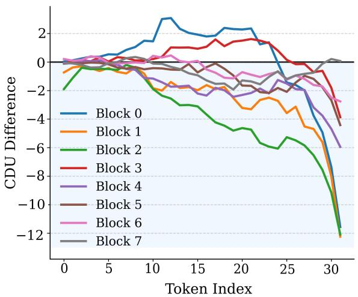  
(a) LLaDA

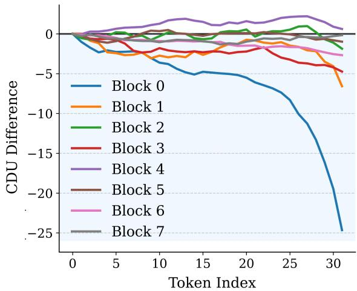  
(b) Dream  
Figure C.1. Visualization of CDU diference for every block. The diference is calculated by subtracting the CDU of our HaloBlock from the CDU of Fast dLLM. The block size $t = 3 2$

sequence $S [ l : r ]$

$$
\mathbf { C D U } [ l : r ] = \sum _ { j = 1 } ^ { s } | | H _ { j } [ l : r ] \cdot \bar { J _ { j } } | | _ { 2 } , \quad j \in \{ 1 , 2 , \cdots , s \} ,\tag{C.1}
$$

where $\bar { \varPsi } _ { j } = ( S _ { j } [ l : r ] = [ \tt N A S K ] )$ denotes the iterative indicator of the sequence $S [ l : r ]$ checking whether the tokens are unmasked. Therefore, CDU calculates the cumulative token entropy from the beginning to the final unmasking. For easy tokens, the unmasking is quickly achieved, resulting in a low CDU, while for hard tokens, CDU is large as they need multiple iteration to converge.

To showcase how our method afects decoding dificulty, we visualize the CDU diference between our HaloBlock and Fast dLLM. We calculate the CDU diference by subtracting the CDU of our HaloBlock from the CDU of Fast dLLM. As shown in Fig. C.1, when the token approaches the right edge of the block, our method can generally produce lower CDU as the CDU diference decreases to negatives. This indicates that our method can efectively reduce the decoding dificulty of hard tokens located on the right side of the block. As a result, faster decoding convergence is achieved. The average NFE is reduced as Tab. 1, Tab. 2, and Tab. B.1 show.

HaloBlock is hyper-parameter free. In Fig. 5 of the main paper, we plot the accuracy heatmap with static halo region on GSM8K dataset. We here supplement the accuracy heatmap on MBPP [30]. Comparing the two accuracy heatmaps in Fig. C.2(a) and Fig. C.2(b), one can see that the optimal halo configuration on GSM8K may not be the optimum on MBPP. Particularly, the accuracy peak of GSM8K is at (9, 10), which intriguingly turns out to be a performance degradation point on MBPP, yielding an accuracy of 37.6% even lower than the baseline 38.8%. This observation demonstrates that static fixed-size halo configurations cannot generalize across diferent tasks, as optimal halo lengths are task-dependent and cannot be manually pre-tuned for all downstream scenarios. By comparison, our adaptive halo allocation dynamically determines left- and right-halo lengths based on bidirectional token decoding dificulty. It obviates dataset-specific hyperparameter tuning and achieves robust performance across diferent reasoning and code-generation benchmarks.

Accuracy of HaloBlock = 79.5  
Accuracy Heatmap of GSM8K (Baseline = 76.0)  
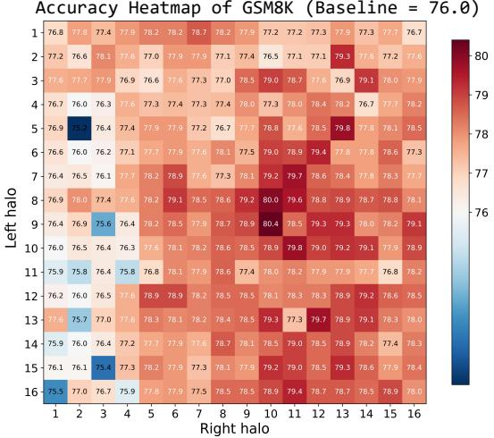  
(a)

Accuracy Heatmap of MBPP (Baseline = 38.8)  
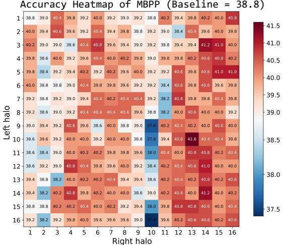  
(b)

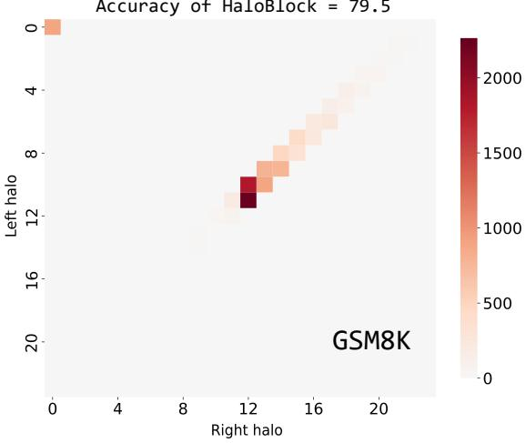  
(c)

Accuracy of HaloBlock = 41.2  
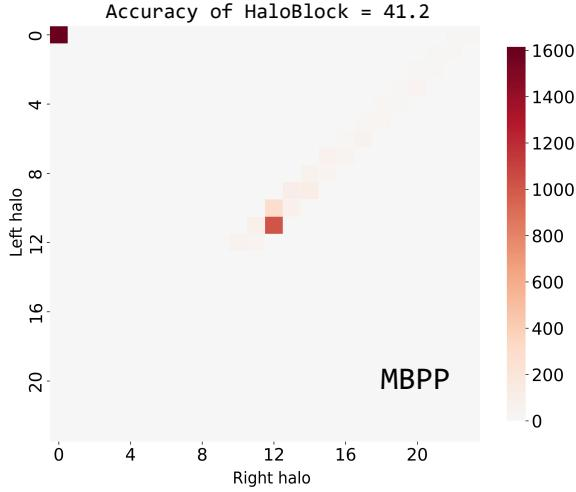  
(d)  
Figure C.2. Visualization of accuracy heatmap with static halo region and the statistical count of halo length by our HaloBlock. Our adaptive halo allocation generally performs better than static halos.

Statistical count of halo length. We plot the statistical count of halo length on GSM8K and MBPP in Fig. C.2(c) and (d). It shows that our HaloBlock produces dynamic halo length. For easy tokens, the halo lengths are mostly fall into 0, because the cumulative entropies approach 0. For dificult tokens, the model’s output probability distribution is more dispersed, leading to higher entropy. HaloBlock therefore allocates larger halo length for these hard tokens, which account for a non-trivial proportion of all tokens. In addition, an asymmetric distribution of halo allocation can also be observed: the right halo length is generally longer than the left counterpart, due to the left-dominance efect.

Visualization. We showcase three mathematical reasoning cases of dLLM inference in Fig. C.3, Fig. C.4, and Fig. C.5. We also visualize the dynamic halo length for every block. The changes in the halo region once again exhibit asymmetry, with the right halo being generally longer. Then, we compare the inference results produced by our HaloBlock and the baseline Fast dLLM [7]. The examples show that HaloBlock benefits from the halo region, which allow the current block to see more contextual information and reduce reasoning errors.

\#### 10

Prompt: Jennie is helping at her mom’s ofice. She has a pile of 60 letters needing stamps, and a pile of letters already stamped. She puts stamps on one-third of the letters needing stamps. If there are now 30 letters in the pile of already-stamped letters, how many were in that pile when Jennie began?

Block-wise decoding results of HaloBlock  
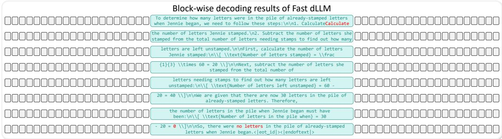

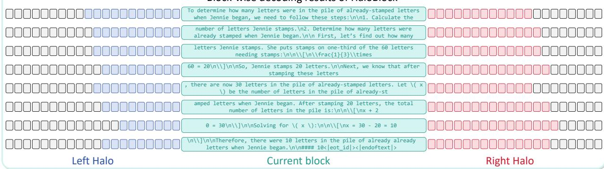  
Note: In the above, the reasoning errors are highlighted in red and the missing predictions are highlighted in bold black.

Answer by Fast dLLM: To determine how many letters were in the pile of already-stamped letters when Jennie began, we need to follow these steps:

## 1. Calculate the number of letters Jennie stamped.

2. Subtract the number of letters she stamped from the total number of letters needing stamps to find out how many letters are left unstamped.

First, calculate the number of letters Jennie stamped:

1 Number of letters stamped = 3 × 60 = 20

Next, subtract the number of letters she stamped from the total number of letters needing stamps to find out how many letters are left unstamped:

Number of letters left unstamped = 60 − 20 = 40

We are given that there are now 30 letters in the pile of already-stamped letters. Therefore, the number of letters in the pile when Jennie began must have been:

Number of letters in the pile when = 30 − 20 = 0

So, there were no letters in the pile of already-stamped letters when Jennie began.

Answer by HaloBlock: To determine how many letters were in the pile of already-stamped letters when Jennie began, we need to follow these steps:

## 1. Calculate the number of letters Jennie stamps.

2. Determine how many letters were already stamped when Jennie began.

First, let’s find out how many letters Jennie stamps. She puts stamps on one-third of the 60 letters needing stamps:

$$
{ \frac { 1 } { 3 } } \times 6 0 = 2 0
$$

So, Jennie stamps 20 letters.

Next, we know that after stamping these letters, there are now 30 letters in the pile of already-stamped letters. Let � be the number of letters in the pile of already-stamped letters when Jennie began. After stamping 20 letters, the total number of letters in the pile is:

$$
x + 2 0 = 3 0
$$

Solving for �:

$$
x = 3 0 - 2 0 = 1 0
$$

Therefore, there were 10 letters in the pile of alreadystamped letters when Jennie began.

Figure C.3. Example 1: Comparison of inference results between the baseline Fast dLLM and HaloBlock. We visualize the dynamic halo length in colors. Reasoning errors are highlighted in red.

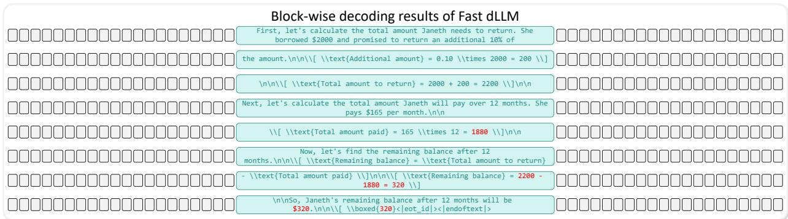  
#### 220.

Prompt: Janeth borrowed \$2000 and promised to return it with an additional 10% of the amount. If she is going to pay \$165 a month for 12 months, how much will be Janeth’s remaining balance by then?

Block-wise decoding results of HaloBlock  
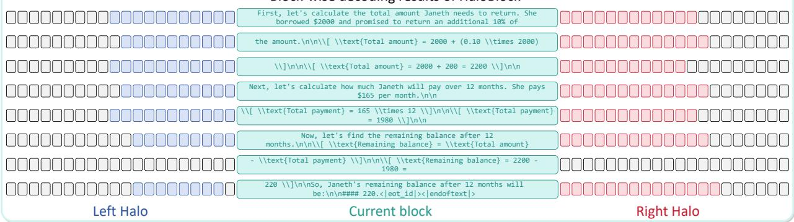

Note: In the above, the reasoning errors are highlighted in red and the missing predictions are highlighted in bold black.

Answer by Fast dLLM: First, let’s calculate the total amount Janeth needs to return. She borrowed \$2000 and promised to return an additional 10% of the amount.

$$
\mathrm { A d d i t i o n a l \ a m o u n t } = 0 . 1 0 \times 2 0 0 0 = 2 0 0
$$

$$
\mathrm { T o t a l \ a m o u n t \ t o \ r e t u r n } = 2 0 0 0 + 2 0 0 = 2 2 0 0
$$

Next, let’s calculate the total amount Janeth will pay over 12 months. She pays \$165 per month.

$$
{ \mathrm { T o t a l ~ a m o u n t ~ p a i d } } = 1 6 5 \times 1 2 = 1 8 8 0
$$

Now, let’s find the remaining balance after 12 months.

$$
{ \mathrm { R e m a i n i n g ~ b a l a n c e } } = { \mathrm { T o t a l ~ a m o u n t ~ t o ~ r e t u r n } } - { \mathrm { T o t a l ~ a m o u n t ~ p a i d } }
$$

$$
{ \mathrm { R e m a i n i n g ~ b a l a n c e } } = 2 2 0 0 - 1 8 8 0 = 3 2 0
$$

So, Janeth’s remaining balance after 12 months will be \$320. 320

Answer by HaloBlock: First, let’s calculate the total amount Janeth needs to return. She borrowed \$2000 and promised to return an additional 10% of the amount.

$$
\mathrm { T o t a l a m o u n t } = 2 0 0 0 + ( 0 . 1 0 \times 2 0 0 0 )
$$

$$
\mathrm { T o t a l a m o u n t } = 2 0 0 0 + 2 0 0 = 2 2 0 0
$$

Next, let’s calculate how much Janeth will pay over 12 months. She pays \$165 per month.

$$
\mathrm { T o t a l \ p a y m e n t } = 1 6 5 \times 1 2
$$

$$
\mathrm { T o t a l p a y m e n t } = 1 9 8 0
$$

Now, let’s find the remaining balance after 12 months.

$$
{ \mathrm { R e m a i n i n g ~ b a l a n c e } } = { \mathrm { T o t a l ~ a m o u n t - T o t a l ~ p a y m e n t } }
$$

$$
{ \mathrm { R e m a i n i n g ~ b a l a n c e } } = 2 2 0 0 - 1 9 8 0 = 2 2 0
$$

So, Janeth’s remaining balance after 12 months will be:

Figure C.4. Example 2: Comparison of inference results between the baseline Fast dLLM and HaloBlock. We visualize the dynamic halo length in colors. Reasoning errors are highlighted in red

Prompt: Shannon makes her own madeleine cookies and eats 2 a night as a treat. She wants to make enough cookies to last her for 30 days by storing them in the freezer. Her recipe makes 1 dozen madeleine cookies. How many dozens of cookies will she need to make so she has enough for 30 days?

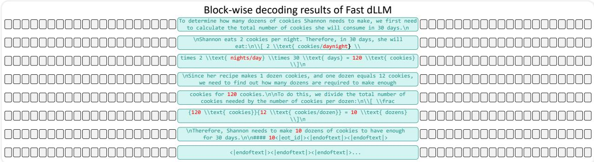

Block-wise decoding results of HaloBlock  
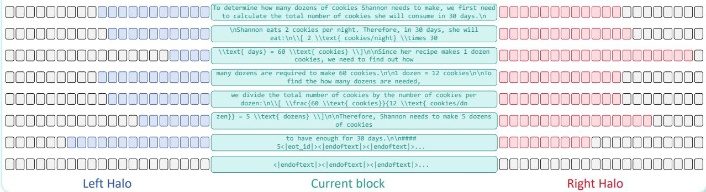  
Note: In the above figure, the reasoning errors are highlighted in red and the missing predictions are highlight in bold black.

Answer by Fast dLLM: To determine how many dozens of cookies Shannon needs to make, we first need to calculate the total number of cookies she will consume in 30 days.

Shannon eats 2 cookies per night. Therefore, in 30 days, she will eat:

$$
2 \ { \mathrm { c o o k i e s } } / { \mathrm { d a y n i g h t } } \times 2 \ { \mathrm { n i g h t s } } / { \mathrm { d a y } } \times 3 0 \ { \mathrm { d a y s } } = 1 2 0 \ { \mathrm { c o o k i e s } }
$$

Since her recipe makes 1 dozen cookies, and one dozen equals 12 cookies, we need to find out how many dozens are required to make enough cookies for 120 cookies.

To do this, we divide the total number of cookies needed by the number of cookies per dozen:

$$
{ \frac { 1 2 0 \mathrm { c o o k i e s } } { 1 2 \mathrm { c o o k i e s } / \mathrm { d o z e n } } } = 1 0 \mathrm { d o z e n s }
$$

Therefore, Shannon needs to make 10 dozens of cookies to have enough for 30 days.

\#### 10

Answer by HaloBlock: To determine how many dozens of cookies Shannon needs to make, we first need to calculate the total number of cookies she will consume in 30 days.

Shannon eats 2 cookies per night. Therefore, in 30 days, she will eat:

$$
2 \mathrm { c o o k i e s } / \mathrm { n i g h t } \times 3 0 \mathrm { d a y s } = 6 0 \mathrm { c o o k i e s }
$$

Since her recipe makes 1 dozen cookies, we need to find out how many dozens are required to make 60 cookies.

1 dozen = 12 cookies

To find the how many dozens are needed, we divide the total number of cookies by the number of cookies per dozen:

$$
{ \frac { 6 0 \mathrm { c o o k i e s } } { 1 2 \mathrm { c o o k i e s } / \mathrm { d o z e n } } } = 5 \mathrm { d o z e n s }
$$

Therefore, Shannon needs to make 5 dozens of cookies to have enough for 30 days.

\#### 5

Figure C.5. Example 3: Comparison of inference results between the baseline Fast dLLM and HaloBlock. We visualize the dynamic halo length in colors. Reasoning errors are highlighted in red.