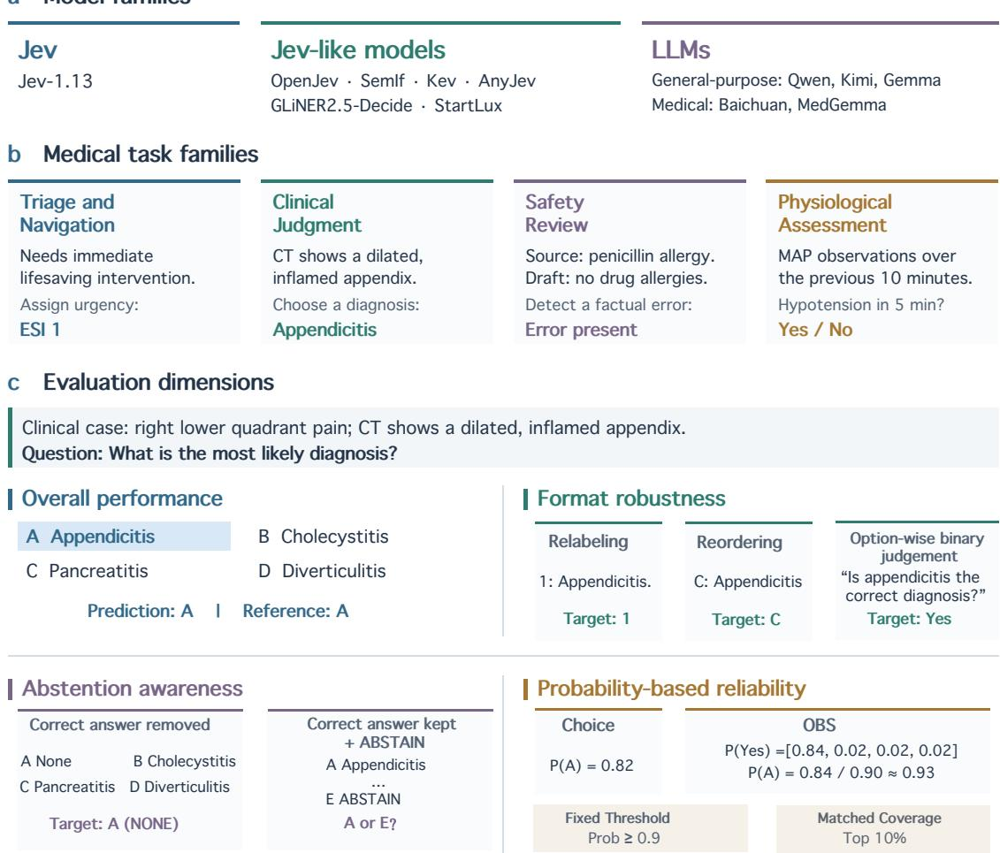
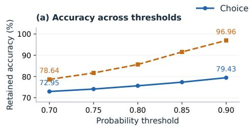
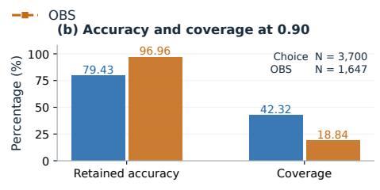
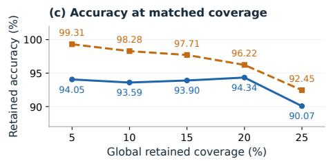
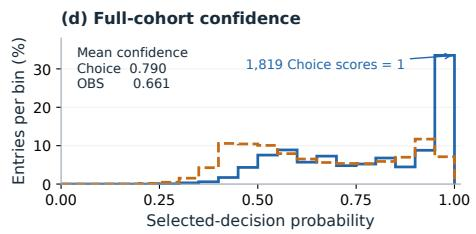
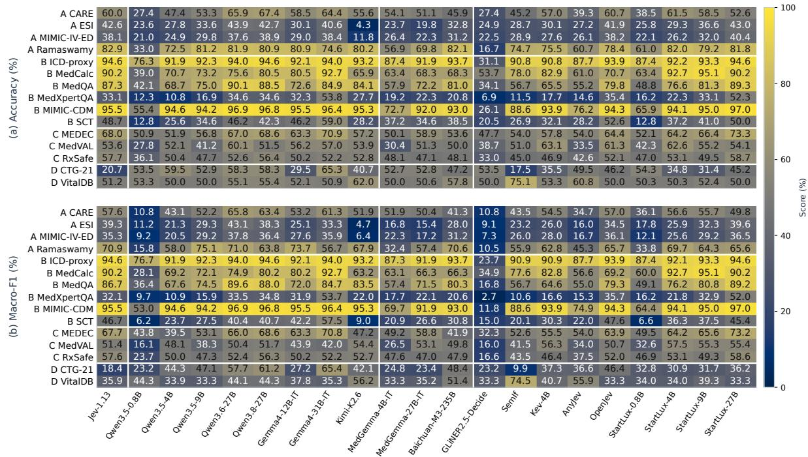
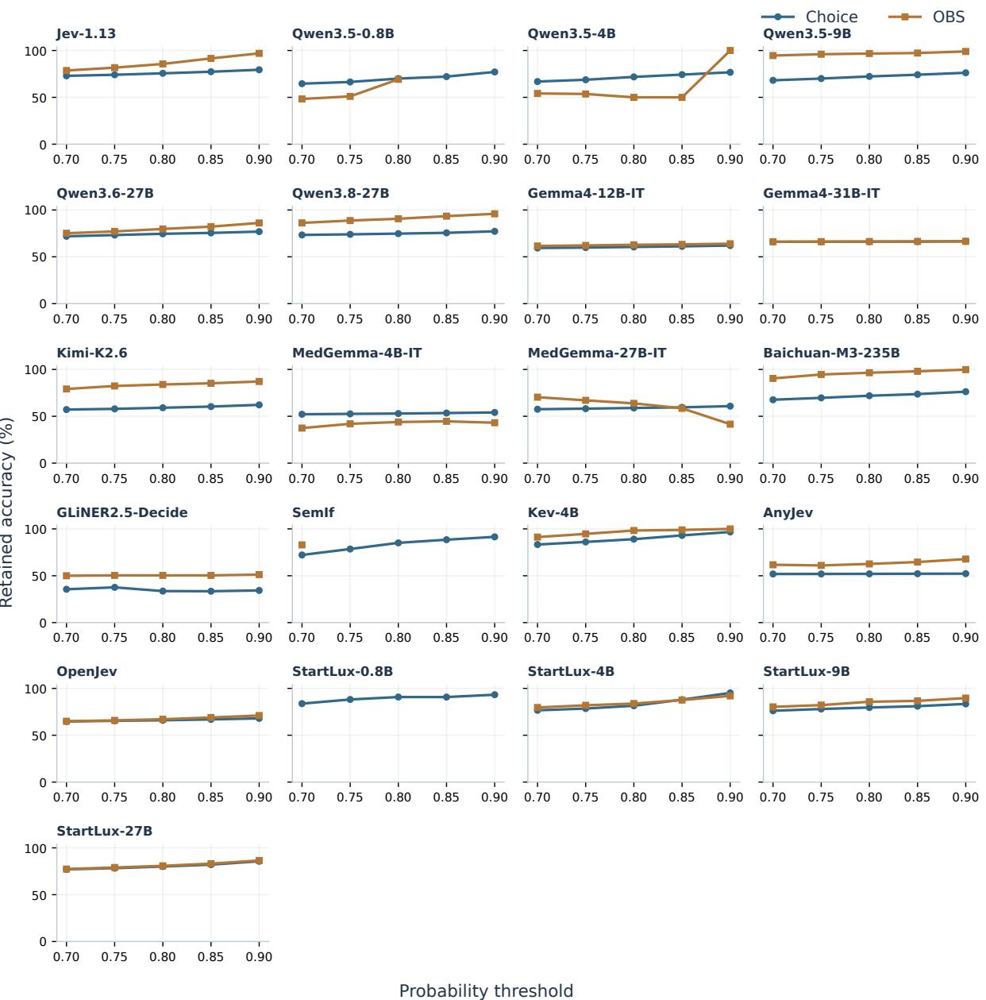
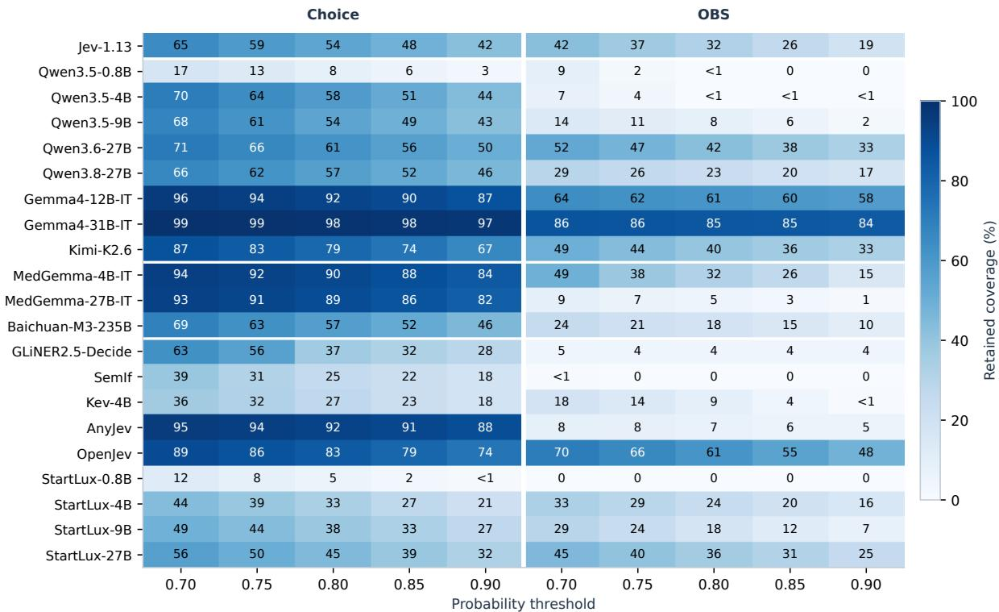
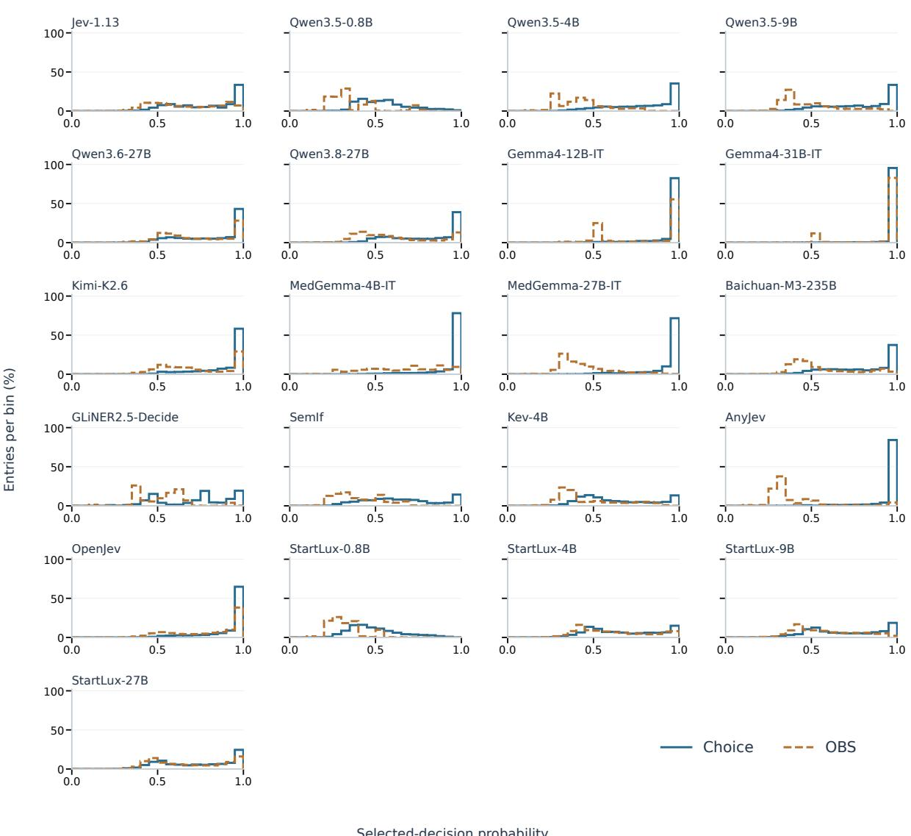

# How Reliable Are System-One Decisions in Medicine? A Comparative Study of Jev, Jev-like Models, and LLMs

Yanrui Du1,2\*, Danyang Zhao1\*, Sendong Zhao1, Wenhao Li1 Yibo Gao1, Haochun Wang1, Zhuoer Xu2, Shiwen Cui2, Bing Qin1† 1Harbin Institute of Technology 2Ant Group

## Abstract

Jev has attracted considerable attention for its rapid, generalizable decision-making, yet its medical reliability remains underexplored. To address this gap, our study compares various types of system-one decision models across 15 medical datasets comprising 8,742 instances under a unified protocol. Beyond accuracy, we assess decision stability and the ability to recognize unreliable decisions. Our results show that Jev rivals leading models on primarily textdriven tasks but is less effective on numerically driven tasks, revealing a distinct capability boundary. Under question-format variations, Jev demonstrates strong robustness, achieving the lowest decision reversal rate and relatively small accuracy fluctuations. Among evaluated open-source alternatives, only StartLux exhibits comparable robustness. But these strengths do not extend to reliable abstention awareness: most evaluated models show limitations in both recognizing missing correct answers and using optional abstention. Moreover, we find that Jev’s probability-based answer selection can be improved by changing how decisions are scored: normalizing option-wise binary scores yields higher retained accuracy than choice scoring. Taken together, our findings provide early guidance for improving and applying decision models in medicine.

## 1 Introduction

Medical decision-making demands reliability beyond accuracy, as errors and inconsistencies under uncertainty can compromise patient care. Reliable models should not only make accurate decisions, but also remain consistent under meaningpreserving format changes, recognize missing correct answers, and abstain when appropriate. Their probability scores should further help distinguish reliable decisions from errors (Hager et al., 2024;

Griot et al., 2025). These requirements make medicine a demanding setting for evaluating both the quality of model decisions and the extent to which they can be trusted.

Traditional decision models typically pair pretrained backbones with task-specific classification heads, requiring additional training or adaptation when tasks change (Devlin et al., 2019). Jev offers a different approach: it directly scores candidate decisions specified at inference time without task-specific training, enabling rapid decisionmaking across heterogeneous tasks (Almeida, 2026; Deußer et al., 2026). Together with emerging Jev-like models, it represents a growing class of system-one decision models that make direct decisions without elicited reasoning traces. Yet broader task generality does not guarantee reliable decisions, particularly in demanding medical settings. Existing medical evaluations of Jev have primarily focused on accuracy within a limited range of tasks (Madrid-García and Merino-Barbancho, 2026; Huang et al., 2026), leaving its broader decision reliability insufficiently explored. This gap motivates a systematic comparison across medical tasks and model families that goes beyond accuracy to examine decision consistency, abstention awareness, and probability-based reliability.

To this end, we systematically compare Jev, nine Jev-like model configurations, and eleven general-purpose and medical large language models (LLMs) across 15 medical datasets comprising 8,742 instances. All models are evaluated under a system-one protocol that requires direct decisions without elicited reasoning traces. As illustrated in Figure 1, the evaluation spans four medical task families, covering both primarily text-driven and numerically driven decisions. We measure overall performance using accuracy and macro-F1, alongside three complementary dimensions of reliability. Format robustness examines decision consistency under option relabeling, option reordering, and conversion to option-wise binary judgments. Abstention awareness assesses whether models recognize missing correct answers and abstain effectively when given the option. Probability-based reliability examines whether higher decision probabilities identify more accurate decisions at fixed probability thresholds and matched coverage.

  
Figure 1: Overview of the comparative evaluation. Three model families, four medical task families, and four evaluation dimensions. A shared clinical judgment case illustrates performance, format changes, missing-answer recognition, optional abstention, and probability-based selection.

Our results reveal distinct strengths and limitations across system-one medical decision models. Jev rivals leading LLMs on primarily text-driven tasks but performs substantially worse on numerically driven Physiological Assessment, achieving 35.95% accuracy compared with 58.10% for Gemma4-31B-IT. Under format variations, Jev demonstrates strong decision stability, attaining the lowest mean decision reversal rate (6.17%) and a low within-dataset accuracy variance (1.70 pp2), while StartLux-27B exhibits comparable robustness with a reversal rate of 6.47%. These strengths, however, do not extend to reliable abstention awareness: replacing the correct answer with none reduces Jev’s accuracy from 77.62% to 65.60%. With optional abstention, its dataset-mean retained accuracy reaches 75.24%, only 0.33 percentage points above the original full-cohort baseline and 0.29 points below its original decisions on the same retained subsets. Interestingly, our analysis identifies a more reliable probability-based selection strategy for Jev by normalizing option-wise scores (OBS). Across probability thresholds, OBS yields retained accuracies of 78.64-96.96%, substantially exceeding the 72.95-79.43% achieved by direct Choice scoring. Meanwhile, at the same top 5% coverage, OBS further improves retained accuracy from 94.05% to 99.31%. Overall, our contributions can be summarized as:

• Comprehensive evaluation. We establish a unified evaluation of system-one medical decisionmaking, comparing 21 models across 15 datasets, 8,742 instances, and 4 medical task families.

• Reliability characterization. We evaluate reliability beyond aggregate accuracy through format robustness and abstention awareness, revealing clear task-dependent capability boundaries and persistent limitations in abstention behavior.

• Probability-based selection. We systematically compare direct Choice scoring with normalizing option-wise scores (OBS), identifying OBS as a more reliable strategy for selecting Jev’s answers.

## 2 Related Work

## 2.1 Generalizable Decision Models

Jev scores instruction-conditioned candidates across tasks rather than generating unrestricted text (Almeida, 2026; Deußer et al., 2026). Jevlike alternatives explore related interfaces through different architectures and readouts, while prior studies examine scientific decisions, probability semantics, and presentation sensitivity (Deng et al., 2026; Porcedda, 2026; Sun et al., 2026; Hu et al., 2026). Medical evaluations cover examination questions and radiology factuality but remain limited in task coverage and cross-model comparisons (mahlernim, 2026; Madrid-García and Merino-Barbancho, 2026; Huang et al., 2026). Our evaluation jointly examines task performance and reliability across model families; Appendix A provides additional context and model references.

## 2.2 Medical Evaluation and Reliability

Medical benchmarks extend from knowledge examinations to records, medical actions, and health conversations (Jin et al., 2020; Zuo et al., 2025; Bedi et al., 2025; Hager et al., 2024; Arora et al., 2025). Reliability studies additionally examine input and option sensitivity (Ness et al., 2024; Pezeshkpour and Hruschka, 2024; Zheng et al., 2023), answer availability and abstention (Kadavath et al., 2022; Griot et al., 2025), and selective decision-making and calibration (Kamath et al., 2020; Guo et al., 2017). These complementary perspectives motivate our evaluation beyond aggregate accuracy. Appendix A details their relationship to the present candidate-based framework.

## 3 Preliminary

We evaluate 8,742 entries from 15 datasets in four task families. Each input contains evidence, instructions, and candidate decisions.

A: Triage and Navigation. Patient messages and triage records support care-seeking and urgency decisions (3,095 entries).

B: Clinical Judgment. Medical narratives support diagnosis, management, coding, and rule- or evidence-based judgments (2,501 entries).

C: Safety Review. Medical text and patient constraints support error detection, document-risk assessment, and medication selection (1,812 entries).

D: Physiological Assessment. Numerical features and time-stamped observations support state classification and short-horizon event assessment (1,334 entries).

Dataset sources, references, and input–output examples appear in Appendices B–C.

Models and decision protocol. Jev, nine Jevlike configurations, and eleven general-purpose or medical LLMs decide without elicited reasoning or tools. They receive matched task content, excluding reference answers. Choice selects the highestscoring candidate. LLMs use the forced assistant prefill “The answer is \boxed{” and candidatenormalized next-token probabilities. Option-wise binary scoring (OBS) separately judges each candidate and normalizes affirmative probabilities across candidates. Model sources, readouts, and label conventions are detailed in Appendix D.

## 4 Overall Performance Evaluation

The overall performance helps establish the baseline for subsequent reliability analyses.

## 4.1 Evaluation Setup

We evaluate the original Choice using accuracy and macro-F1 (%). Accuracy accepts any reference answer, and macro-F1 uses unique-reference entries and each dataset’s fixed label inventory. Taskfamily and overall scores average dataset-level scores equally, over the constituent datasets and all 15 datasets, respectively. Reference handling is detailed in Appendix C.

## 4.2 Results and Analysis

Competitive text-driven decisions, weaker numerical assessment. Jev approaches leading LLMs across the three primarily text-driven families in Table 1. In Clinical Judgment, its accuracy/macro-F1 of 74.91/74.31 exceeds Qwen3.8-27B’s 72.88/72.52 but trails Gemma4- 31B-IT’s 80.14/79.82. In Safety Review, Jev achieves accuracy close to Gemma4-31B-IT (59.76% versus 60.04%) with higher macro-F1 (58.89% versus 55.01%). This competitiveness does not extend to numerically driven Physiological Assessment, where Jev scores 35.95/27.19 against Gemma4-31B-IT’s 58.10/50.37. Its CTG-21 accuracy is 20.70%, below the cohort’s 53.50% majority-class baseline, and its balanced VitalDB accuracy is 51.20%. The task boundary is therefore more informative than its overall score of 61.62/58.67.

<table><tr><td>Model</td><td>A.Triage and Navigation</td><td>B.Clinical Judgment</td><td>C.Safety Review</td><td>D.Physiological Assessment</td><td>Overall</td></tr><tr><td>Jev</td><td></td><td></td><td></td><td></td><td></td></tr><tr><td>Jev-1.13</td><td>55.9 / 50.8</td><td>74.9 / 74.3</td><td>59.8 / 58.9</td><td>35.9 / 27.2</td><td>61.6 / 58.7</td></tr><tr><td>General-purpose LLMs</td><td></td><td></td><td></td><td></td><td></td></tr><tr><td>Qwen3.5-0.8B</td><td>26.3 / 11.7</td><td>39.7 / 35.0</td><td>38.3 / 27.9</td><td>53.4 / 33.8</td><td>37.6 / 27.2</td></tr><tr><td>Qwen3.5-4B</td><td>43.2 / 35.7</td><td>60.4 / 59.7</td><td>51.4 / 45.9</td><td>54.8 / 39.1</td><td>53.2 / 47.8</td></tr><tr><td>Qwen3.5-9B</td><td>49.5 / 46.5</td><td>64.4 / 62.7</td><td>48.6 / 46.2</td><td>51.4 / 40.2</td><td>55.5 / 52.1</td></tr><tr><td>Qwen3.6-27B</td><td>57.3 / 54.4</td><td>72.9 / 71.5</td><td>59.9 / 56.3</td><td>56.7 / 50.9</td><td>64.0 / 61.2</td></tr><tr><td>Qwen3.8-27B</td><td>57.5 / 50.5</td><td>72.9 / 72.5</td><td>58.8 / 58.8</td><td>56.8 / 52.8</td><td>63.8 / 61.3</td></tr><tr><td>Gemma4-12B-IT</td><td>49.6 / 44.9</td><td>69.9 / 69.0</td><td>56.5 / 52.4</td><td>40.8 / 32.5</td><td>57.9 / 54.4</td></tr><tr><td>Gemma4-31B-IT</td><td>54.5 / 46.8</td><td>80.1 / 79.8</td><td>60.0 / 55.0</td><td>58.1 / 50.4</td><td>66.3 / 62.1</td></tr><tr><td>Kimi-K2.6</td><td>38.0 / 32.7</td><td>65.7 / 61.0</td><td>54.6 / 51.4</td><td>51.3 / 49.2</td><td>54.2 / 50.0</td></tr><tr><td>Medical LLMs</td><td></td><td></td><td></td><td></td><td></td></tr><tr><td>MedGemma-4B-IT</td><td>40.3 / 30.9</td><td>56.3 / 52.7</td><td>42.9 / 41.1</td><td>51.4 / 29.1</td><td>48.7 / 41.4</td></tr><tr><td>MedGemma-27B-IT</td><td>40.8 / 35.1</td><td>63.6 / 61.7</td><td>52.4 / 53.0</td><td>51.7 / 29.3</td><td>53.7 / 48.5</td></tr><tr><td>Baichuan-M3-235B</td><td>48.0 / 42.8</td><td>65.9 / 64.1</td><td>50.6 / 46.5</td><td>52.5 / 49.9</td><td>56.3 / 53.0</td></tr><tr><td>Jev-like models</td><td></td><td></td><td></td><td></td><td></td></tr><tr><td>GLiNER2.5-Decide</td><td>22.9 / 9.4</td><td>28.7 / 17.5</td><td>39.8 / 21.6</td><td>51.8 / 28.3</td><td>32.5 / 17.6</td></tr><tr><td>SemIf</td><td>44.4 / 37.2</td><td>58.8 / 57.4</td><td>50.0 / 45.8</td><td>46.3 / 42.2</td><td>51.5 / 47.7</td></tr><tr><td>Kev-4B</td><td>47.6 / 42.8</td><td>63.8 / 63.2</td><td>55.9 / 52.7</td><td>44.4 / 39.0</td><td>55.3 / 52.4</td></tr><tr><td>AnyJev</td><td>38.3 / 28.2</td><td>53.8 / 51.9</td><td>43.4 / 41.9</td><td>55.1 / 46.3</td><td>47.8 / 42.8</td></tr><tr><td>OpenJev</td><td>54.8 / 48.3</td><td>71.1 / 70.0</td><td>59.3 / 55.5</td><td>48.1 / 39.9</td><td>61.3 / 57.3</td></tr><tr><td>StartLux-0.8B</td><td>36.9 / 24.9</td><td>49.1 / 47.3</td><td>47.1 / 43.0</td><td>52.3 / 33.4</td><td>45.9 / 38.6</td></tr><tr><td>StartLux-4B</td><td>49.7 / 44.4</td><td>69.2 / 68.9</td><td>60.0 / 58.3</td><td>42.5 / 32.4</td><td>58.6 / 55.4</td></tr><tr><td>StartLux-9B</td><td>51.6 / 45.4</td><td>73.1 / 72.4</td><td>57.0 / 56.8</td><td>41.9 / 35.5</td><td>60.0 / 57.2</td></tr><tr><td>StartLux-27B</td><td>54.4 / 47.9</td><td>78.9 / 78.1</td><td>62.0 / 62.4</td><td>47.6 / 34.7</td><td>64.8 / 61.1</td></tr></table>

Table 1: Original-choice accuracy / macro-F1 (%), averaged equally across datasets. Bold indicates column-wise best scores. More detailed dataset-level results appear in Figure 3 in Appendix E.

Jev-like alternatives differ in both accuracy and task profile. OpenJev approaches Jev overall (61.34/57.31), whereas StartLux-27B exceeds it (64.83/61.11) and leads Safety Review. Neither matches Gemma4-31B-IT’s overall 66.34/62.13. The dataset-level results in Figure 3 further qualify family averages. Jev exceeds 94% accuracy on ICD-proxy and MIMIC-CDM but struggles on MedXpertQA and SCT. Within Triage and Navigation, broader care-seeking decisions are easier for Jev than five-level ESI classification. These differences motivate examining reliability beyond aggregate performance.

## 5 Format Robustness Evaluation

Beyond accuracy, we examine format robustness in terms of how consistently models respond when the same medical evidence and candidate meanings are presented through different request formats. We assess consistency at two levels: aggregate performance and individual decisions.

## 5.1 Evaluation Setup

To examine these levels, we use three paired interventions. Relabeling tests sensitivity to candidate labels, and reordering tests sensitivity to candidate order. Both preserve the original decision formulation. Option-wise binary scoring (OBS) tests sensitivity to reformulating a joint choice as separate candidate judgments, using the protocol described in Section 3. Together, these interventions examine presentation invariance and consistency across decision formulations. Table 2 illustrates the interventions using the same synthetic case as Figure 1.

Performance stability. We measure changes in accuracy and its variation across formats. For dataset d and transformation $t ,$

<table><tr><td>Format</td><td>Candidate presentation</td><td>Probability readout</td><td>Identity alignment</td></tr><tr><td>Original</td><td>A: appendicitis; B: cholecystitis; C: pancreatitis; D: diverticulitis.</td><td>Joint candidate probabilities  $p _ { k } ;$  select</td><td></td></tr><tr><td>Relabeling</td><td>1: appendicitis; 2: cholecystitis; 3: pancreatitis; 4: diverticulitis.</td><td>arg maxk pk.</td><td> $1 {  } \mathrm { A } , 2 {  } \mathrm { B } , 3 {  } \mathrm { C } ,$  4→D.</td></tr><tr><td>Reordering</td><td>A: pancreatitis; B: diverticulitis; C: appendicitis; D: cholecystitis.</td><td></td><td> $\mathrm { \bf A } \to \mathrm { \bf C } , \mathrm { \bf B } \to \mathrm { \bf D } ,$  C→A, D→B.</td></tr><tr><td>Binary (OBS)</td><td>Original A-D candidates retained. For each candidate: Affirmative “Is [candidate] the correct diagnosis?&quot; Yes / No.</td><td> $q _ { k } ;$  normalize  $\begin{array} { r } { \tilde { p } _ { k } = q _ { k } / \sum _ { j } q _ { j } ; } \end{array}$  select</td><td></td></tr></table>

Table 2: Paired format interventions for one synthetic case: CT shows an inflamed appendix; what is the most likely diagnosis? Every row retains the same evidence and candidate meanings. The final column maps presented candidate identities to original identities.

$$
\Delta _ { d t } = 1 0 0 ( \mathrm { A c c } _ { d t } - \mathrm { A c c } _ { d 0 } ) ,\tag{1}
$$

$$
\overline { { \Delta } } _ { d } = \frac { 1 } { 4 } \sum _ { t = 0 } ^ { 3 } \Delta _ { d t } ,\tag{2}
$$

$$
V _ { \Delta } = \frac { 1 } { D } \sum _ { d = 1 } ^ { D } \frac { 1 } { 4 } \sum _ { t = 0 } ^ { 3 } ( \Delta _ { d t } - \overline { { \Delta } } _ { d } ) ^ { 2 } .\tag{3}
$$

Here, t = 0 denotes the original format, $\Delta _ { d 0 } = 0$ and $D = 1 5$ . We report dataset-mean accuracy changes in percentage points and the mean withindataset variance $V _ { \Delta }$ in squared percentage points.

Decision consistency. We measure whether individual answers change after semantic alignment. With alignment mapping $\pi _ { t }$ and $N _ { d }$ entries in dataset $d ,$

$$
F _ { d t } = \frac { 1 } { N _ { d } } \sum _ { i = 1 } ^ { N _ { d } } \mathbf { 1 } [ \hat { y } _ { i 0 } \neq \pi _ { t } ( \hat { y } _ { i t } ) ] ,\tag{4}
$$

$$
\overline { { F } } = \frac { 1 } { 3 D } \sum _ { d = 1 } ^ { D } \sum _ { t = 1 } ^ { 3 } F _ { d t } .\tag{5}
$$

We report reversal rates for each transformation and their mean as percentages. This captures answer changes that may be masked by stable aggregate accuracy.

## 5.2 Results and Analysis

Jev combines small accuracy changes with consistent decisions. Across relabeling, reordering, and OBS, Jev’s accuracy changes by only +0.45, −0.03, and +0.05 percentage points (Table 3). Its within-dataset variance of 1.70 $\mathsf { p p } ^ { 2 }$ is below every evaluated LLM, though StartLux-4B and -9B are lower still. Jev also has the lowest mean decision reversal rate, 6.17%, compared with 7.41% for Gemma4-31B-IT and 10.75% for Qwen3.8- 27B. Stable aggregate accuracy thus coincides with greater individual decision consistency, rather than merely offsetting answer changes.

Reformulation exposes differences hidden by baseline accuracy. OBS leaves Jev’s accuracy nearly unchanged but reduces Gemma4-31B-IT, Qwen3.6-27B, and Qwen3.8-27B accuracy by 2.84, 3.55, and 3.84 points, respectively. Kimi-K2.6 instead gains 5.42 points (Table 15). The effect of changing the decision formulation is therefore model-dependent, even among models with competitive original-choice scores.

StartLux approaches Jev’s robustness, other alternatives remain less stable. StartLux-27B’s mean reversal rate of 6.47% nearly matches Jev’s, with lower relabeling sensitivity but higher reordering and OBS sensitivity. OpenJev reaches 13.71%, about 2.2 times Jev’s rate, despite similar original accuracy. SemIf, AnyJev, and GLiNER2.5-Decide exceed 32% (Table 15). Comparable task competence does not imply comparable robustness.

## 6 Abstention Awareness Evaluation

We next examine whether models recognize when no correct option is available and whether optional abstention helps them avoid incorrect decisions when a correct option remains present.

## 6.1 Evaluation Setup

We assess abstention awareness through two directchoice interventions. Correct-answer replacement substitutes “none of the above” (NONE) for the correct candidate while preserving its position and all other options. Selecting NONE is correct in the modified task. Optional abstention retains all original candidates and adds ABSTAIN to examine whether withholding decisions improve retained accuracy at the cost of coverage. In the example in Figure 1, the former replaces appendicitis in option A with NONE, whereas the latter retains all four diagnoses and adds ABSTAIN as option E.

<table><tr><td>Model</td><td>∆ Rel.</td><td>∆ Reord.</td><td>∆ OBS</td><td> $V _ { \Delta }$ </td><td> $F _ { \mathrm { R e l } }$ </td><td> $F _ { \mathrm { R e o } }$ </td><td> $F _ { \mathrm { O B S } }$ </td><td> $\overline { F }$ </td></tr><tr><td colspan="9"> $J e \nu$ </td></tr><tr><td>Jev-1.13</td><td>+0.45</td><td>-0.03</td><td>+0.05</td><td>1.70</td><td>3.9</td><td>6.3</td><td>8.3</td><td>6.2</td></tr><tr><td colspan="9">General-purpose LLMs</td></tr><tr><td>Qwen3.6-27B</td><td>-0.17</td><td>-0.34</td><td>-3.55</td><td>18.29</td><td>5.4</td><td>9.2</td><td>16.1</td><td>10.2</td></tr><tr><td>Qwen3.8-27B</td><td>+0.40</td><td>-0.20</td><td>-3.84</td><td>19.79</td><td>5.1</td><td>10.3</td><td>16.9</td><td>10.7</td></tr><tr><td>Ġemma4-31B-IT</td><td>+0.42</td><td>-0.59</td><td>-2.84</td><td>22.23</td><td>3.5</td><td>6.3</td><td>12.4</td><td>7.4</td></tr><tr><td colspan="9">Medical LLMs</td></tr><tr><td>Baichuan-M3-235B</td><td>+0.74</td><td>+1.38</td><td>-6.16</td><td>21.04</td><td>6.4</td><td>16.6</td><td>33.9</td><td>19.0</td></tr><tr><td colspan="9">Jev-like models</td></tr><tr><td>OpenJev</td><td>-0.68</td><td>+0.66</td><td>-2.73</td><td>6.85</td><td>8.2</td><td>13.6</td><td>19.3</td><td>13.7</td></tr><tr><td>StartLux-4B</td><td>-0.27</td><td>-0.75</td><td>-0.39</td><td>1.26</td><td>4.8</td><td>8.6</td><td>9.5</td><td>7.6</td></tr><tr><td>StartLux-9B</td><td>-0.23</td><td>+0.38</td><td>-0.28</td><td>1.31</td><td>4.4</td><td>8.1</td><td>9.2</td><td>7.2</td></tr><tr><td>StartLux-27B</td><td>-0.08</td><td>-0.14</td><td>-0.25</td><td>6.45</td><td>2.9</td><td>6.5</td><td>10.0</td><td>6.5</td></tr></table>

Table 3: Format robustness across all 15 datasets, with equal dataset weights. ∆ Rel., ∆ Reord., and $\Delta$ OBS denote accuracy changes (percentage points) under relabeling, reordering, and OBS, respectively. $V _ { \Delta }$ denotes mean within-dataset accuracy variance (squared percentage points). $F _ { \mathrm { R e l } } , F _ { \mathrm { R e o } } .$ and $F _ { \mathrm { O B S } }$ denote prediction reversal rates (%) under the corresponding interventions and $\overline { F }$ is their mean. Alongside Jev, the three general LLMs, one medical LLM, and four Jev-like models with highest overall accuracy in Table 1 are shown. Table 15 reports all 21 models.

Both experiments focus on Clinical Judgment, where clearly distinguishable alternatives support interpretable evaluation. Correct-answer replacement covers four datasets (2,382 entries) with unique accepted answers and more than three options, whereas optional abstention covers all six datasets (2,501 entries).

Evaluation metrics. For correct-answer replacement, we report NONE accuracy and its percentagepoint change from original accuracy on matched items. We additionally measure conditional NONE accuracy, reported as NONE Acc (orig. correct), by restricting each dataset to items the model originally answered correctly. This measures whether models recognize missing correct answers on questions they initially answered successfully. Moreover, Slot flip measures changes in the selected option position, whereas correctness flip counts both correct-to-incorrect and incorrect-to-correct transitions. The latter captures the total change in correctness, unlike accuracy differences, which reflect the net balance of improvements and errors.

For optional abstention, let $S _ { d }$ denote the retained subset of dataset d, $N _ { d }$ its original size, and $\mathcal { D } _ { S }$ the datasets with nonempty retained subsets. We report the mean abstention rate and retained

accuracy

$$
R = \frac { 1 } { D _ { B } } \sum _ { d = 1 } ^ { D _ { B } } \left( 1 - \frac { | S _ { d } | } { N _ { d } } \right) ,\tag{6}
$$

$$
A _ { S } ^ { + } = \frac { 1 } { | \mathcal { D } _ { S } | } \sum _ { d \in \mathcal { D } _ { S } } \frac { 1 } { | S _ { d } | } \sum _ { i \in S _ { d } } \mathbf { 1 } [ \hat { y } _ { d i } ^ { + } \in G _ { d i } ] ,\tag{7}
$$

where $D _ { B } = 6 , \hat { y } _ { d i } ^ { + }$ is the decision after adding ABSTAIN, and $G _ { d i }$ is the accepted reference set. Mean coverage is $1 - R$ Accuracy changes are measured against original decisions on the full cohort and the same retained subsets

$$
\Delta = 1 0 0 ( A _ { S } ^ { + } - A _ { \mathrm { a l l } } ^ { 0 } ) , \qquad \Delta ^ { S } = 1 0 0 ( A _ { S } ^ { + } - A _ { S } ^ { 0 } ) .\tag{8}
$$

The former captures the gain associated with abstention, while the latter controls for sample selection. All metrics use equal dataset weights, excluding empty subsets from retained-accuracy means. Exact retained counts and dataset-mean macro-F1 are reported in Table 19 in the appendix.

## 6.2 Results and Analysis

Task competence does not ensure missinganswer recognition. Correct-answer replacement reduces accuracy for 19 of 21 models (Tables 4 and 17). Jev drops from 77.62% to 65.60% (−12.02 points), while Gemma4-31B-IT and StartLux-27B lose 16.4 and 16.5 points. The exceptions are Kev-4B, which gains 10.43 points to reach 77.40%, and GLiNER2.5-Decide, which improves from a low baseline. Jev’s conditional

<table><tr><td colspan="7"></td></tr><tr><td>Model</td><td>Original Acc</td><td>NONE Acc</td><td>∆ Acc</td><td>Slot flip</td><td>Correctness flip</td><td>(orig. correct)</td></tr><tr><td>Jev</td><td></td><td></td><td></td><td></td><td></td><td></td></tr><tr><td>Jev-1.13</td><td>77.6</td><td>65.6</td><td>-12.0</td><td>18.4</td><td>16.2</td><td>70.1</td></tr><tr><td>General-purpose LLMs</td><td></td><td></td><td></td><td></td><td></td><td></td></tr><tr><td>Qwen3.6-27B</td><td>78.9</td><td>69.0</td><td>-9.9</td><td>16.2</td><td>15.4</td><td>73.7</td></tr><tr><td>Qwen3.8-27B</td><td>78.6</td><td>68.4</td><td>-10.2</td><td>17.5</td><td>15.8</td><td>72.8</td></tr><tr><td>Gemma4-31B-IT</td><td>82.3</td><td>65.9</td><td>-16.4</td><td>22.6</td><td>22.0</td><td>70.5</td></tr><tr><td>Medical LLMs</td><td></td><td></td><td></td><td></td><td></td><td></td></tr><tr><td>Baichuan-M3-235B</td><td>72.1</td><td>51.1</td><td>-21.0</td><td>28.1</td><td>25.8</td><td>54.8</td></tr><tr><td>Jev-like models</td><td></td><td></td><td></td><td></td><td></td><td></td></tr><tr><td>OpenJev</td><td>75.8</td><td>64.7</td><td>-11.1</td><td>20.6</td><td>18.2</td><td>70.2</td></tr><tr><td>StartLux-4B</td><td>71.3</td><td>60.0</td><td>-11.2</td><td>20.1</td><td>16.9</td><td>64.2</td></tr><tr><td>StartLux-9B</td><td>75.7</td><td>60.9</td><td>-14.8</td><td>20.8</td><td>19.6</td><td>64.5</td></tr><tr><td>StartLux-27B</td><td>83.3</td><td>66.8</td><td>-16.5</td><td>22.4</td><td>21.2</td><td>69.5</td></tr></table>

Table 4: Correct-answer replacement across four Clinical Judgment datasets (2,382 paired entries). Accuracy and reversal rates are percentages. ∆ Acc is NONE accuracy minus original accuracy in percentage points. NONE Acc (orig. correct) measures accuracy after replacement on items each model originally answered correctly. Model selection follows Table 3; complete results appear in Table 17.

NONE accuracy is only 70.14% on originally correct items, similar to OpenJev’s 70.21% and StartLux-27B’s 69.50%. Kev-4B reaches 86.74%. Although these model-specific subsets differ, the failures cannot be attributed solely to questions models already answered incorrectly.

Optional abstention offers limited gains at a coverage cost. Jev abstains on 4.48% of entries on average across datasets, yet retained accuracy rises only 0.33 points, from 74.91% to 75.24% (Tables 5 and 18). Gemma4-31B-IT similarly gains 0.61 points with 4.21% abstention. StartLux-27B instead loses 0.66 points while withholding 5.58% of decisions. Kev-4B gains 4.06 points but sacrifices 23.87% coverage. Providing an abstention option therefore does not consistently yield more accurate retained decisions.

Selection benefits can mask worse retained answers. On the same retained subsets, Jev’s original decisions score 75.53%, exceeding its postabstention accuracy by 0.29 points. StartLux-27B and Kev-4B likewise lose 1.49 and 1.05 points against their same-subset controls. For these models, selecting easier items is partly offset by deteriorating answers. Effective abstention must both identify unreliable decisions and preserve the quality of retained ones; the explicit option alone does not reliably achieve both. Coling

## 7 Probability-Based Reliability

Decision probabilities can guide downstream routing, indicating which answers to accept and which to defer for additional computation or review (Kamath et al., 2020; Chen et al., 2023; Ong et al., 2025). Useful signals must distinguish correct decisions from errors, not merely assign high scores. We compare direct Choice with normalized optionwise binary scoring (OBS) for Jev’s probabilitybased answer selection.

## 7.1 Evaluation Setup

We pool all 8,742 entries and compare retained accuracy and coverage at probability thresholds 0.70/0.75/0.80/0.85/0.90 and global top-5/10/15/20/25% selection. Confidence is the probability of the selected answer. Matched coverage fixes retained counts, not item identities. We also compare full-cohort probability distributions. Definitions, cross-model results, and task-level coverage appear in Appendices H–K.

## 7.2 Results and Analysis

OBS improves threshold selection, but retains fewer decisions. As the threshold rises from 0.70 to 0.90, Jev’s retained accuracy increases more steeply under OBS, from 78.64% to 96.96%, than under Choice, from 72.95% to 79.43% (Figure 2(a)). At 0.90, this 17.53-point OBS advantage comes with lower coverage, 18.84% versus 42.32% (Figure 2(b)). OBS is more accurate at every tested threshold, but a shared cutoff does not equate selection budgets.

The advantage persists at matched coverage. OBS also outperforms Choice at all five global retention levels (Figure 2(c)), reaching 99.31% versus 94.05% accuracy at 5% coverage and 92.45% versus 90.07% at 25%. With nearly unchanged unfiltered accuracy (Section 5), the main benefit is better probability-based answer selection.

<table><tr><td></td><td colspan="2">Original Choice</td><td colspan="2">With Abstention</td><td colspan="2">Gains</td></tr><tr><td>Model</td><td> $A _ { \mathrm { a l l } } ^ { 0 }$ </td><td> $A _ { S } ^ { 0 }$ </td><td> $R$ </td><td> $A _ { S } ^ { + }$ </td><td> $\Delta$ </td><td> $\Delta _ { S }$ </td></tr><tr><td colspan="7">Jev</td></tr><tr><td>Jev-1.13</td><td>74.9</td><td>75.5</td><td>4.5</td><td>75.2</td><td>+0.3</td><td>-0.3</td></tr><tr><td colspan="7">General-purpose LLMs</td></tr><tr><td>Qwen3.6-27B</td><td>72.9</td><td>73.5</td><td>2.8</td><td>73.2</td><td>+0.3</td><td>-0.3</td></tr><tr><td>Qwen3.8-27B</td><td>72.9</td><td>73.4</td><td>2.3</td><td>74.1</td><td>+1.3</td><td>+0.8</td></tr><tr><td>Gemma4-31B-IT</td><td>80.1</td><td>80.9</td><td>4.2</td><td>80.7</td><td>+0.6</td><td>-0.1</td></tr><tr><td colspan="7">Medical LLMs</td></tr><tr><td>Baichuan-M3-235B</td><td>65.9</td><td>66.3</td><td>1.7</td><td>67.6</td><td>+1.8</td><td>+1.3</td></tr><tr><td colspan="7">Jev-like models</td></tr><tr><td>OpenJev</td><td>71.1</td><td>71.9</td><td>4.1</td><td>72.7</td><td>+1.6</td><td>+0.8</td></tr><tr><td>StartLux-4B</td><td>69.2</td><td>70.2</td><td>6.0</td><td>69.8</td><td>+0.7</td><td>-0.3</td></tr><tr><td>StartLux-9B</td><td>73.1</td><td>73.8</td><td>4.7</td><td>73.4</td><td>+0.2</td><td>-0.4</td></tr><tr><td>StartLux-27B</td><td>78.9</td><td>79.7</td><td>5.6</td><td>78.2</td><td>-0.7</td><td>-1.5</td></tr></table>

Table 5: Optional abstention across six Clinical Judgment datasets (2,501 entries). $A _ { \mathrm { a l l } } ^ { 0 }$ and $A _ { S } ^ { 0 }$ are original accuracy on the full cohort and retained subset. R is the mean abstention rate and $A _ { S } ^ { + }$ the mean retained accuracy (all in %). Gains $\Delta$ and $\Delta ^ { S }$ are in percentage points, computed before rounding. Model selection follows Table $_ { 3 ; }$ complete results appear in Table 18.

  
Figure 2: Jev’s probability-based selection. Choice (blue) and OBS (orange) compared through (a) threshold accuracy, (b) accuracy and coverage at 0.90, (c) accuracy at matched global coverage, and (d) confidence distributions (bin width 0.05). Accuracy pools retained entries; coverage uses all 8,742 entries. These are selection results, not calibration curves.

Less extreme probabilities accompany better selection. Choice assigns probability one to 1,819 decisions, including 102 errors. OBS produces no such scores and brings a flatter probability distribution (Figure 2(d)). This reduces unwarranted certainty on some decisions, and the evidence for reliability comes from retained accuracy.

High-confidence coverage aligns with task strengths. Jev’s high-confidence decisions concentrate on tasks where it performs well, consistent with the task-specific strengths identified in Section 4. At the 0.90 OBS threshold, ICD-proxy and MIMIC-CDM, where Jev exceeds 94% accuracy, account for 78.08% of retained entries, while CTG-21 and MedXpertQA contribute none (Appendix K). Global selection gains therefore partly reflect concentration on stronger tasks, rather than uniform improvements across tasks. OBS also does not consistently improve selection across all models, as detailed in Appendices H–J.

## 8 Conclusion

Across 21 models and 15 medical datasets, accuracy alone does not establish reliable decisions.

Jev combines competitive text-driven performance with strong format robustness, but struggles with numerical tasks and abstention. Normalized optionwise scoring improves its probability-based answer selection, highlighting both task suitability and decision formulation as essential considerations for evaluating medical decision models.

## Limitations

Coverage of an evolving model landscape. Growing interest in Jev has motivated an expanding range of Jev-like models with diverse designs. Given evaluation costs, our study focuses on representative configurations. Its primary aim is to establish a common benchmark for assessing decision reliability in medicine. The reported comparisons capture a snapshot of the evaluated models; incorporating emerging alternatives under the same protocol will be important for tracking progress.

From isolated decisions to interactive environments. Our benchmark covers individual decisions across diverse medical tasks, but does not evaluate their role in interactive workflows. Jev could potentially support intermediate decisions in medical agents, such as selecting tools or determining the next action. Assessing these applications requires executable medical environments that capture changing information, sequential dependencies, and the consequences of earlier decisions. Our results do not establish Jev’s effectiveness in agentbased settings. Further evaluation is needed to determine whether its strengths in isolated decisions translate into reliable end-to-end behavior.

## References

Asad Aali, Vasiliki Bikia, Maya Varma, Nicole Chiou, Sophie Ostmeier, Arnav Singhvi, Magdalini Paschali, Ashwin Kumar, Andrew Johnston, Karimar Amador-Martinez, Eduardo Juan Perez Guerrero, Paola Naovi Cruz Rivera, Sergios Gatidis, Christian Bluethgen, Eduardo Pontes Reis, Eddy D. Zandee van Rilland, Poonam Laxmappa Hosamani, Kevin R Keet, Minjoung Go, and 8 others. 2025. Medval: Toward expert-level medical text validation with language models. arXiv preprint.

Asma Ben Abacha, Wen-wai Yim, Yujuan Fu, Zhaoyi Sun, Meliha Yetisgen, Fei Xia, and Thomas Lin. 2024. Medec: A benchmark for medical error detection and correction in clinical notes. arXiv preprint.

Diogo Almeida. 2026. Introducing System One Models and Jev. TypeSafe AI technical announcement. Accessed 2 October 2026; non-peer-reviewed resource.

ARISENetwork. n.d. ARISENetwork/mast. First-party model card or source repository. Accessed 2026-10- 02; metadata verified against the first-party API or web page.

Rahul K. Arora, Jason Wei, Rebecca Soskin Hicks, Preston Bowman, Joaquin Quiñonero-Candela, Foivos Tsimpourlas, Michael Sharman, Meghan Shah, Andrea Vallone, Alex Beutel, Johannes Heidecke, and

Karan Singhal. 2025. Healthbench: Evaluating large language models towards improved human health. arXiv preprint.

baichuan-inc. 2026. baichuan-inc/Baichuan-M3-235B model card. First-party model card or source repository. Accessed 2026-10-02; metadata verified against the first-party API or web page.

Suhana Bedi, Hejie Cui, Miguel Fuentes, Alyssa Unell, Michael Wornow, Juan M. Banda, Nikesh Kotecha, Timothy Keyes, Yifan Mai, Mert Oez, Hao Qiu, Shrey Jain, Leonardo Schettini, Mehr Kashyap, Jason Alan Fries, Akshay Swaminathan, Philip Chung, Fateme Nateghi, Asad Aali, and 62 others. 2025. Medhelm: Holistic evaluation of large language models for medical tasks. arXiv preprint.

D. Campos and J. Bernardes. 2000. Cardiotocography.

Lingjiao Chen, Matei Zaharia, and James Zou. 2023. FrugalGPT: How to use large language models while reducing cost and improving performance. arXiv preprint.

Boyuan Deng, Shuyi Fan, Hongyang Zhang, and Xinhong Xie. 2026. Jev for scientific decisions: Evaluating semantic choices and their consequences. arXiv preprint.

Tobias Deußer, Lorenz Sparrenberg, and Rafet Sifa. 2026. Evaluating and benchmarking the system one model jev. arXiv preprint.

Jacob Devlin, Ming-Wei Chang, Kenton Lee, and Kristina Toutanova. 2019. BERT: Pre-training of deep bidirectional transformers for language understanding. In Proceedings ofthe 2019 Conference of the North American Chapter of the Association for Computational Linguistics: Human Language Technologies, Volume 1 (Long and Short Papers), pages 4171–4186, Minneapolis, Minnesota. Association for Computational Linguistics.

fastino. 2026. fastino/GLiNER2.5-Decide model card. First-party model card or source repository. Accessed 2026-10-02; metadata verified against the firstparty API or web page.

google. 2025a. google/medgemma-27b-it model card. First-party model card or source repository. Accessed 2026-10-02; metadata verified against the firstparty API or web page.

google. 2025b. google/medgemma-4b-it model card. First-party model card or source repository. Accessed 2026-10-02; metadata verified against the firstparty API or web page.

google. 2026a. google/gemma-4-12B-it model card. First-party model card or source repository. Accessed 2026-10-02; metadata verified against the firstparty API or web page.

google. 2026b. google/gemma-4-31B-it model card. First-party model card or source repository. Accessed 2026-10-02; metadata verified against the firstparty API or web page.

Maxime Griot, Coralie Hemptinne, Jean Vanderdonckt, and Demet Yuksel. 2025. Large language models lack essential metacognition for reliable medical reasoning. Nature Communications, 16(1).

Chuan Guo, Geoff Pleiss, Yu Sun, and Kilian Q. Weinberger. 2017. On calibration of modern neural networks. In Proceedings ofthe 34th International Conference on Machine Learning, volume 70 of Proceedings ofMachine Learning Research, pages 1321– 1330. PMLR.

Paul Hager, Friederike Jungmann, Robbie Holland, Kunal Bhagat, Inga Hubrecht, Manuel Knauer, Jakob Vielhauer, Marcus Makowski, Rickmer Braren, Georgios Kaissis, and Daniel Rueckert. 2024. Evaluation and mitigation of the limitations of large language models in clinical decision-making. Nature Medicine, 30(9):2613–2622.

Jianyi Hu, Hangtao Zhang, Yi Liu, Yeqi Zeng, Li Zeng, Xianlong Wang, Rui Wang, and Leo Yu Zhang. 2026. Jevadvbench: A benchmark and black-box attacks for reinforcement learning for calibrated decisions models. arXiv preprint.

Yining Hua, Hongbin Na, and Cyrus Ayubcha. 2026. Care-bench: Benchmarking patient-facing llm triage. arXiv preprint.

Jiaju Huang, Hao Yang, Xinyu Ma, Xinglong Liang, Kunyan Cai, Junqiang Ma, Shaobin Chen, Yue Sun, and Tao Tan. 2026. Can jev judge radiology reports? evaluating a system one model for clinical factuality. arXiv preprint.

jaredpalmer. 2026. jaredpalmer/kev-4b model card. First-party model card or source repository. Accessed 2026-10-02; metadata verified against the firstparty API or web page.

jaredpalmer. n.d. jaredpalmer/kev. First-party model card or source repository. Accessed 2026-10-02; metadata verified against the first-party API or web page.

Yixing Jiang, Kameron C. Black, Gloria Geng, Danny Park, James Zou, Andrew Y. Ng, and Jonathan H. Chen. 2025. Medagentbench: A realistic virtual ehr environment to benchmark medical llm agents. arXiv preprint.

Di Jin, Eileen Pan, Nassim Oufattole, Wei-Hung Weng, Hanyi Fang, and Peter Szolovits. 2020. What disease does this patient have? a large-scale open domain question answering dataset from medical exams. arXiv preprint.

Alistair E. W. Johnson, Lucas Bulgarelli, Lu Shen, Alvin Gayles, Ayad Shammout, Steven Horng, Tom J. Pollard, Sicheng Hao, Benjamin Moody, Brian Gow,

Li-wei H. Lehman, Leo A. Celi, and Roger G. Mark. 2023. Mimic-iv, a freely accessible electronic health record dataset. Scientific Data, 10(1).

Saurav Kadavath, Tom Conerly, Amanda Askell, Tom Henighan, Dawn Drain, Ethan Perez, Nicholas Schiefer, Zac Hatfield-Dodds, Nova DasSarma, Eli Tran-Johnson, Scott Johnston, Sheer El-Showk, Andy Jones, Nelson Elhage, Tristan Hume, Anna Chen, Yuntao Bai, Sam Bowman, Stanislav Fort, and 17 others. 2022. Language models (mostly) know what they know. arXiv preprint.

Amita Kamath, Robin Jia, and Percy Liang. 2020. Selective question answering under domain shift. In Proceedings ofthe 58th Annual Meeting ofthe Association for Computational Linguistics, pages 5684– 5696, Online. Association for Computational Linguistics.

Nikhil Khandekar, Qiao Jin, Guangzhi Xiong, Soren Dunn, Serina S Applebaum, Zain Anwar, Maame Sarfo-Gyamfi, Conrad W Safranek, Abid A Anwar, Andrew Zhang, Aidan Gilson, Maxwell B Singer, Amisha Dave, Andrew Taylor, Aidong Zhang, Qingyu Chen, and Zhiyong Lu. 2024. Medcalcbench: Evaluating large language models for medical calculations. arXiv preprint.

Hyung-Chul Lee, Yoonsang Park, Soo Bin Yoon, Seong Mi Yang, Dongnyeok Park, and Chul-Woo Jung. 2022. Vitaldb, a high-fidelity multi-parameter vital signs database in surgical patients. Scientific Data, 9(1).

Meng Lu, Brandon Ho, Dennis Ren, and Xuan Wang. 2024. TriageAgent: Towards better multi-agents collaborations for large language model-based clinical triage. In Findings of the Association for Computational Linguistics: EMNLP 2024, pages 5747–5764, Miami, Florida, USA. Association for Computational Linguistics.

Mingyu Derek Ma, Chenchen Ye, Yu Yan, Xiaoxuan Wang, Peipei Ping, Timothy S Chang, and Wei Wang. 2024. Clibench: A multifaceted and multigranular evaluation of large language models for clinical decision making. arXiv preprint.

Alfredo Madrid-García and Beatriz Merino-Barbancho. 2026. Jev in medicine: A benchmark evaluation. arXiv preprint.

mahlernim. 2026. Jev in Korean: a 100-question sample check. Public evaluation repository. Accessed 2 October 2026; non-peer-reviewed resource.

moonshotai. 2026. moonshotai/Kimi-K2.6 model card. First-party model card or source repository. Accessed 2026-10-02; metadata verified against the firstparty API or web page.

Robert Osazuwa Ness, Katie Matton, Hayden Helm, Sheng Zhang, Junaid Bajwa, Carey E. Priebe, and Eric Horvitz. 2024. Medfuzz: Exploring the robustness of large language models in medical question answering. arXiv preprint.

nokia-applied-research. n.d. nokia-appliedresearch/AnyJev. First-party model card or source repository. Accessed 2026-10-02; metadata verified against the first-party API or web page.

Isaac Ong, Amjad Almahairi, Vincent Wu, Wei-Lin Chiang, Tianhao Wu, Joseph E Gonzalez, M Kadous, and Ion Stoica. 2025. RouteLLM: Learning to route LLMs from preference data. In International Conference on Learning Representations, pages 34433– 34448.

Pouya Pezeshkpour and Estevam Hruschka. 2024. Large language models sensitivity to the order of options in multiple-choice questions. In Findings ofthe Associationfor Computational Linguistics: NAACL 2024, pages 2006–2017, Mexico City, Mexico. Association for Computational Linguistics.

Riccardo Porcedda. 2026. Jev thinks "i don’t know”, but doesn’t say it: Introducing sys1cal-v1 dataset for probability calibration. arXiv preprint.

Qwen. 2026a. Qwen/Qwen3.5-0.8B model card. Firstparty model card or source repository. Accessed 2026-10-02; metadata verified against the first-party API or web page.

Qwen. 2026b. Qwen/Qwen3.5-4B model card. Firstparty model card or source repository. Accessed 2026-10-02; metadata verified against the first-party API or web page.

Qwen. 2026c. Qwen/Qwen3.5-9B model card. Firstparty model card or source repository. Accessed 2026-10-02; metadata verified against the first-party API or web page.

Qwen. 2026d. Qwen/Qwen3.6-27B model card. Firstparty model card or source repository. Accessed 2026-10-02; metadata verified against the first-party API or web page.

Qwen. 2026e. Qwen/Qwen3.8-27B model card. Firstparty model card or source repository. Accessed 2026-10-02; metadata verified against the first-party API or web page.

Ashwin Ramaswamy, Alvira Tyagi, Hannah Hugo, Joy Jiang, Pushkala Jayaraman, Mateen Jangda, Alexis E. Te, Steven A. Kaplan, Joshua Lampert, Robert Freeman, Nicholas Gavin, Ashutosh K. Tewari, Ankit Sakhuja, Bilal Naved, Alexander W. Charney, Mahmud Omar, Michael A. Gorin, Eyal Klang, and Girish N. Nadkarni. 2026. Chatgpt health performance in a structured test of triage recommendations. Nature Medicine, 32(5):1671–1675.

razorback16. n.d. razorback16/openjev: Open, Jevcompatible System One decision server on DiffusionGemma. Open-source software repository. Accessed 2 October 2026; first-party non-peer-reviewed resource.

Karan Singhal, Shekoofeh Azizi, Tao Tu, S. Sara Mahdavi, Jason Wei, Hyung Won Chung, Nathan Scales, Ajay Tanwani, Heather Cole-Lewis, Stephen Pfohl, Perry Payne, Martin Seneviratne, Paul Gamble, Chris Kelly, Abubakr Babiker, Nathanael Schärli, Aakanksha Chowdhery, Philip Mansfield, Dina Demner-Fushman, and 13 others. 2023. Large language models encode clinical knowledge. Nature, 620(7972):172–180.

StartLux Models. 2026. StartLux-Decision: Typed decision models. https://huggingface. co/collections/startlux-models/ startlux-decision. Released model collection; accessed 2026-10-09.

Yu Sun, Junhao Xu, Jiajia Shi, and Zijin Yang. 2026. Type-safe is not error-free: Typed decision models follow the option name, not the definition bound to it. arXiv preprint.

TheoLeeCJ. n.d. TheoLeeCJ/SemIf-OpenJev. Firstparty model card or source repository. Accessed 2026-10-02; metadata verified against the first-party API or web page.

TypeSafe AI. 2026. Jev 1.13 jaggedness. Model behavior documentation. Accessed 2 October 2026; non-peer-reviewed resource.

Chaoyi Wu, Pengcheng Qiu, Jinxin Liu, Hongfei Gu, Na Li, Ya Zhang, Yanfeng Wang, and Weidi Xie. 2024. Towards evaluating and building versatile large language models for medicine. arXiv preprint.

Jiahao Zhao, Luxin Xu, Minghuan Tan, Lichao Zhang, Ahmadreza Argha, Hamid Alinejad-Rokny, and Min Yang. 2025. Rxsafebench: Identifying medication safety issues of large language models in simulated consultation. arXiv preprint.

Chujie Zheng, Hao Zhou, Fandong Meng, Jie Zhou, and Minlie Huang. 2023. Large language models are not robust multiple choice selectors. arXiv preprint.

Yuxin Zuo, Shang Qu, Yifei Li, Zhangren Chen, Xuekai Zhu, Ermo Hua, Kaiyan Zhang, Ning Ding, and Bowen Zhou. 2025. Medxpertqa: Benchmarking expert-level medical reasoning and understanding. arXiv preprint.

## A Extended Related Work

## A.1 Generalizable Decision Models

Jev formulates decision-making as instructionconditioned candidate selection rather than unrestricted text generation, enabling direct decisions across heterogeneous tasks (Almeida, 2026). Prior work has examined its zero-shot capabilities (Deußer et al., 2026), scientific decisionmaking (Deng et al., 2026), and probability semantics (Porcedda, 2026). Related models—including SemIf, Kev, AnyJev, GLiNER2.5-Decide, Open-Jev, and StartLux—implement similar decision interfaces through different mechanisms (TheoLeeCJ, n.d.; jaredpalmer, n.d.; nokia-appliedresearch, n.d.; fastino, 2026; razorback16, n.d.; StartLux Models, 2026). Studies of option naming and adversarial inputs further indicate that such decisions may remain sensitive to presentation changes (Sun et al., 2026; Hu et al., 2026).

Medical evaluations of Jev remain limited to a public examination pilot (mahlernim, 2026), a 2,823-item reliability study (Madrid-García and Merino-Barbancho, 2026), and a radiology factuality assessment (Huang et al., 2026). Although informative, these studies cover relatively narrow settings and largely emphasize answer accuracy. How Jev and related models compare across diverse medical tasks, decision formats, and reliability dimensions therefore remains unclear.

## A.2 Medical Evaluation and Reliability

Medical evaluation has expanded from knowledge examinations (Jin et al., 2020; Singhal et al., 2023; Zuo et al., 2025) to benchmarks involving medical records, diagnostic and treatment decisions, agentbased tasks, and health-related conversations (Bedi et al., 2025; Wu et al., 2024; Hager et al., 2024; Ma et al., 2024; Jiang et al., 2025; Arora et al., 2025). However, aggregate accuracy alone cannot establish whether decisions remain reliable under changes in evidence, candidate presentation, or answer availability.

Reliability requires complementary evaluation dimensions. Prior studies examine robustness to medical-case perturbations and answer presentation (Ness et al., 2024; Pezeshkpour and Hruschka, 2024; Zheng et al., 2023), recognition of inadequate answer sets and appropriate abstention (Kadavath et al., 2022; Griot et al., 2025), selective decision-making (Kamath et al., 2020), and probability calibration (Guo et al., 2017). Motivated by these perspectives, our unified candidate-based framework evaluates Jev, Jev-like models, and LLMs in terms of format robustness, abstention awareness, and probability-based reliability, in addition to overall performance.

## B Task Composition and Adaptation Details

We define the medical task families, model groups, and shared decision protocol used throughout the evaluation.

## B.1 Medical Decision Tasks and Datasets

Our evaluation comprises 8,742 entries from 15 selected or adapted medical datasets. Each entry presents a task, the available evidence, and a set of candidate answers, from which the model selects one response. This common formulation enables comparisons across models while preserving the distinct targets and references of the source tasks. Table 6 summarizes dataset sources, input evidence, decision targets, candidate counts, and evaluation sizes.

We group the tasks into four families according to the decision requested. These families provide complementary settings for examining the capabilities and limitations of direct decision models.

A: Triage and Navigation. These tasks concern when or where a patient should seek care. Models assign urgency or select a care-seeking action using patient disclosures, presenting complaints, and available clinical measurements. This family includes CARE (Hua et al., 2026), ESI scenarios drawn from MIMIC-IV and TriageAgent (Johnson et al., 2023; Lu et al., 2024), a MIMIC-IV-ED cohort, and Ramaswamy’s care-seeking scenarios (Ramaswamy et al., 2026).

B: Clinical Judgment. These tasks require interpreting clinical evidence to select a diagnosis, management action, coding category, or judgment about the effect of new evidence. Inputs combine clinical narratives, structured findings, and, where applicable, explicit scoring rules. They include threshold judgments adapted from MedCalc (Khandekar et al., 2024) and script-concordance judgments from SCT (ARISENetwork, n.d.), alongside diagnosis, coding, and examination tasks.

C: Safety Review. These tasks require assessing the correctness or safety of an existing clinical statement, document, or treatment candidate. Decisions depend on the supplied clinical context, source evidence, or patient-specific constraints. We use MEDEC (Abacha et al., 2024) for error detection, MedVAL (Aali et al., 2025) for document-risk assessment, and RxSafe (Zhao et al., 2025) for medication selection under patient-specific safety constraints.

D: Physiological Assessment. These tasks use numerical observations as the principal evidence for assessing a physiological state or predicting a future event. They include static feature-based classification and short-horizon forecasting from time-series observations. Numerical measurements also occur in A–C; their central role in the decision distinguishes D. The two tasks use CTG summary features (Campos and Bernardes, 2000) and intraoperative observations from VitalDB (Lee et al., 2022), respectively.

We adapt calculation tasks into threshold judgments with supplied scoring rules and interactive tasks into static decisions based on available evidence. Reference answers follow the source datasets, including examination answers, recorded labels, expert judgments, and observation-derived outcomes. Each dataset contributes at most 1,000 entries; some cohorts share source material or underlying scenarios. Appendix C provides examples, adaptations, and reference definitions.

<table><tr><td>Domain</td><td>Dataset</td><td></td><td>K</td><td>Input evidence</td><td>Classification target</td></tr><tr><td>A</td><td>CARE</td><td>135</td><td>4</td><td>Chronological patient messages</td><td>Clarify / self-care / nonurgent care / urgent care†</td></tr><tr><td></td><td>ESI</td><td>1,000</td><td>5</td><td>Triage records and clinical vignettes</td><td>ESI  $1 / \mathrm { E S I } 2 / \mathrm { E S I } 3 / \mathrm { E S I } 4 / \mathrm { E S I } 5 ^ { \dag }$ </td></tr><tr><td></td><td>MIMIC-IV-ED</td><td>1,000</td><td></td><td>Chief complaint, demographics, pain, vital signs</td><td>ESI  $1 / \mathrm { E S I } 2 / \mathrm { E S I } 3 / \mathrm { E S I } 4 / \mathrm { E S I } 5 ^ { \dag }$ </td></tr><tr><td></td><td>Ramaswamy</td><td>960</td><td></td><td>4 Care-seeking narratives with available measurements</td><td>Home care / care within weeks / care within 24–48 hours / immediate ED</td></tr><tr><td></td><td>A subtotal</td><td>3,095</td><td></td><td></td><td>Triage and Navigation</td></tr><tr><td>B</td><td>ICD-proxy</td><td>1,000</td><td>4</td><td>Admission-related narrative excerpts</td><td>ICD candidates  $\mathrm { A / B / C / D ^ { \ddagger } ; e . g . , D      : J 1 5 }$  (bacterial pneumonia)</td></tr><tr><td></td><td>MedCalc</td><td>41</td><td>2</td><td>Patient note, calculation question, scoring rules</td><td>Threshold not met / threshold met†</td></tr><tr><td></td><td>MedQA</td><td>252</td><td>4</td><td>Clinical vignette and clinical</td><td>Clinical candidates  $\mathbf { A } / \mathbf { B } / \mathbf { C } / \mathbf { D } ^ { \ddag } ; \mathbf { e . g . , B } ;$  ketotifen eye drops</td></tr><tr><td></td><td>MedXpertQA</td><td>130</td><td>10</td><td>question Acute clinical vignette and clinical question</td><td>Clinical candidates  $\mathrm { ~ A ~ / ~ B ~ / ~ } / \mathrm { ~ \cdot ~ \cdot ~ } / \mathrm { ~ J ^ { \ddag } ; e . g . , B \mathrm { : } }$  identify the threatened person to police</td></tr><tr><td></td><td>MIMIC-CDM</td><td>1,000</td><td>4</td><td>Clinical history, examination findings, reports, laboratory results</td><td>Appendicitis / cholecystitis / diverticulitis / pancreatitis†</td></tr><tr><td></td><td>SCT</td><td>78</td><td>5</td><td>Clinical scenario, hypothesis, new evidence</td><td>Support change  $- 2 / - 1 / 0 / + 1 / + 2 ^ { \dagger }$ </td></tr><tr><td></td><td>B subtotal</td><td>2,501</td><td></td><td></td><td>Clinical Judgment</td></tr><tr><td>C</td><td>MEDEC</td><td>509</td><td>2</td><td>Clinical document under review</td><td>Error absent / error present†</td></tr><tr><td></td><td>MedVAL</td><td>388</td><td>4</td><td>Source document, candidate document, document purpose</td><td>No risk / low risk / moderate risk / high risk†</td></tr><tr><td></td><td>RxSafe</td><td>915</td><td></td><td>3 Consultation dialogue and</td><td>Medication candidates  $\operatorname { A } / \operatorname { B } / \operatorname { C } ^ { \ddagger } ; \operatorname { e . g . , A } \colon$ </td></tr><tr><td></td><td>C subtotal</td><td>1,812</td><td></td><td>medication candidates</td><td>Harvoni Safety Review</td></tr><tr><td>D</td><td>CTG-21</td><td>1,000</td><td></td><td>3 Numerical CTG summary features</td><td>Normal / suspect / pathologic†</td></tr><tr><td></td><td>VitalDB</td><td></td><td>334</td><td>2 Time-stamped MAP observations, age, sex</td><td>Low-MAP event absent / low-MAP event present†</td></tr><tr><td></td><td>D subtotal</td><td>1,334</td><td></td><td></td><td>Physiological Assessment</td></tr><tr><td></td><td>Total</td><td>8,742</td><td></td><td>15 datasets; single-selection baseline questions.</td><td></td></tr></table>

Table 6: Benchmark composition and input evidence. Inputs include task instructions, candidate answers, and applicable definitions or constraints. N denotes the number of entries, not independent patients; K denotes the number of candidates in the baseline task. † indicates fixed class meanings within a dataset, while ‡ indicates question-specific candidates, with illustrative options shown in the table. Full task examples and adaptation details are provided in Appendix C.

## C Dataset Inputs, Targets, and Examples

Table 6 summarizes the evaluated datasets, sample counts, and candidate classes. Tables 7–10 present abridged, paraphrased examples of task inputs and source-derived reference answers. The examples are condensed for readability, while evaluation uses the complete stored inputs. Reference answers, including recorded ESI and coding labels, follow the source datasets and their task-specific definitions.

<table><tr><td>Dataset / target</td><td>Example input (abridged)</td><td>Expected benchmark output</td></tr><tr><td>CARE / 4 actions</td><td>Ongoing root-canal treatment with severe tooth pain; the disclosed follow- up denies fever, facial swelling, pus, swallowing or breathing difficulty. Choose A: clarify; B: self-care; C: nonurgent care; D: urgent evaluation.</td><td>C: recommend nonurgent professional care.</td></tr><tr><td>ESI / 5 levels</td><td>An eight-month-old with fever, cough, vomiting, reduced intake, list- lessness, and a sunken fontanel; respirations are regular and unlabored. Apply the supplied ESI decision rules. A-E correspond to ESI 1–5.</td><td>B: ESI 2, from the TriageAgent scenario reference.</td></tr><tr><td>MIMIC-IV-ED / 5 levels</td><td>Initial complaint: burn. Age 30, male, walk-in; temperature 98.2 F, pulse 75/min, respirations 14/min, oxygen saturation 100%, BP 124/77 mmHg, pain 4/10. Predict the recorded ESI among 1–5.</td><td>E: recorded ESI 5. This is a historical nurse label, not a newly inferred clinical gold standard.</td></tr><tr><td>Ramaswamy / 4 destinations</td><td>Two resolved episodes of unilateral arm numbness; currently normal neurologic examination and listed normal glucose. Options: A home; B physician in weeks; C physician within 24–48 hours; D immediate ED.</td><td>C or D is accepted in this source item; the model still selects one option.</td></tr></table>

Table 7: A: Triage and Navigation, 3,095 entries. Output labels preserve each example’s original letter mapping. These tasks assess care urgency or routing, not a full differential diagnosis.

<table><tr><td colspan="2">Dataset / target</td><td>Example input (abridged)</td><td>Expected benchmark output</td></tr><tr><td>ICD-proxy categories</td><td>/4</td><td>Admission-related narrative describes cough, dyspnea, feverishness, and severe multifocal pneumonia. Candidates: A G40 epilepsy; B S02 skull/facial fracture; C S82 lower-leg fracture; D J15 bacterial pneu- monia.</td><td>D: J15, the source&#x27;s first- listed three-character ICD category.</td></tr><tr><td>MedCalc / binary flag</td><td></td><td>Original question asks for admission GCS before treatment. Note de- scribes no eye opening, incomprehensible vocalization, and abnormal flexion to pain. Supplied rules yield  $1 + 2 + 3 = 6 ;$  test whether GCS ≤ 8. A: flag absent; B: flag present.</td><td>B: threshold flag met. This does not itself specify airway treatment.</td></tr><tr><td>MedQA / 4 alter- natives</td><td></td><td>Recurrent springtime itchy, watery eyes and sneezing; bilateral conjuncti- val injection, normal visual acuity, and unremarkable anterior chamber. Best treatment? A erythromycin; B ketotifen; C warm compresses; D fluorometholone.</td><td>B: ketotifen eye drops, re- taining the source examina- tion answer.</td></tr><tr><td>MedXpertQA / 10 alternatives</td><td></td><td>An oriented 19-year-old describes a specific plan to kill his father. A police officer requests the threatened person&#x27;s identity. The source asks for the most appropriate next step among ten original responses, including B: identify the father to the officer.</td><td>B: the original examination reference. All ten alter- natives are retained during evaluation.</td></tr><tr><td>MIMIC-CDM /4 diagnoses</td><td></td><td>Right upper quadrant and epigastric pain; focal tenderness; ultrasound describes gallbladder distension, stones/sludge, and wall thickening. The actual input also includes the remaining work-up. A appendicitis; B</td><td>B: cholecystitis. This is a static diagnosis decision, not tool selection.</td></tr><tr><td>SCT / 5 evidence updates</td><td></td><td>cholecystitis; C diverticulitis; D pancreatitis. A febrile three-week-old infant is being evaluated. Hypothesis: starting acyclovir. New evidence: a brief seizure-like episode. Choose change in appropriateness from -2 to +2 (A-E).</td><td>E (+2) has maximum expert credit 1.00; D (+1) receives partial credit 0.25, not an ac-</td></tr></table>

Table 8: B: Clinical Judgment, 2,501 entries. Different tasks retain examination answers, coding proxies, recorded diagnoses, explicit numerical rules, or expert-credit references; they are not interchangeable gold-standard constructions.

<table><tr><td>Dataset / target</td><td>Example input (abridged)</td><td>Expected benchmark output</td></tr><tr><td>MEDEC / error detection</td><td>Clinical note describes fever, diarrhea, abdominal pain and a rash after freshwater activities during travel to Brazil, and attributes the presentation to hepatitis A. Judge medical correctness: A no error; B an error is present.</td><td>B: medical error present, as labeled in the source. No lo- calization or correction is re- quired.</td></tr><tr><td>grades</td><td>MedVAL / 4 risk Source dialogue discusses urinary symptoms, a prostate evaluation, labo- ratory tests, Flomax and specialist referral. The candidate note addition- expert review required, ac- ally asserts a suspected urinary infection and an antibiotic course. The cording to the physician- complete original and candidate documents are supplied for review. A no assigned source grade. risk; B low; C moderate; D high.</td><td>C: moderate document risk;</td></tr><tr><td></td><td>RxSafe / 3 medi- Consultation describes hepatitis C and concurrent atorvastatin use. A: Harvoni, the source ref- cation candidates Choose an appropriate medication while considering the described inter- erence among these candi- action risk. Candidates: A Harvoni; B Mavyret; C hyoscyamine.</td><td>dates; not a general claim that the drug has no interac- tion risk.</td></tr></table>

Table 9: C: Safety Review, 1,812 entries. The reviewed object is a clinical assertion, generated document, or candidate medication. Document risk is distinct from illness severity; candidate selection is distinct from unrestricted prescribing.

<table><tr><td>Dataset / target</td><td>Example input (abridged)</td><td>Expected benchmark output</td></tr><tr><td>CTG-21 / 3 states</td><td>Fetal heart-rate baseline 140; AC 0; FM 0.00142; UC 0.00284; DL 0.00709; DS/DP 0; ASTV 62; MSTV 1.2; ALTV 0; MLTV 3.9; histogram width 93, minimum 66, maximum 159, peaks 5, zeros 2, mode 142, mean 136, median 144, variance 26, tendency 1. Definitions and source units</td><td>A: normal fetal state. Other candidates are B: suspect and C: pathologic. All 21 features, not a raw CTG im-</td></tr><tr><td>VitalDB / future event</td><td>accompany every field. An intraoperative case supplies age/sex and 60 pre-decision ten-second MAP medians, beginning (−600, 84), (−590, 86), (−580, 85), . . . in seconds/mmHg. Predict whether the next five minutes contain six consec- utive bins below 65 mmHg. A: no; B: yes.</td><td>age, are used. A: no qualifying future episode in this item. The reference is derived from fu- ture measurements that are not part of the input.</td></tr></table>

Table 10: D: Physiological Assessment, 1,334 entries. CTG values are rounded here for readability; evaluation preserves source precision. VitalDB is a probabilistic forecast with an observed future label, not a deterministically implied outcome from the abbreviated history.

## D Models and Input Protocol

<table><tr><td>Family</td><td>Evaluated configuration</td><td>Source</td><td>Decision readout</td></tr><tr><td>Jev</td><td>Jev-1.13</td><td>TypeSafe (Almeida, 2026)</td><td>C: native choice probabilities; B: native noul probabilities.</td></tr><tr><td>Jev-like</td><td>GLiNER2.5-Decide</td><td>Fastino (fastino, 2026)</td><td>C: candidate-logit softmax; B: two-class-logit softmax.</td></tr><tr><td></td><td>SemIf</td><td>TheoLeeCJ (TheoLeeCJ, n.d.)</td><td>C: candidate-token softmax; B: two-candidate-token softmax.</td></tr><tr><td></td><td>Kev-4B</td><td>Jared Palmer (jaredpalmer, 2026)</td><td>C: native decision-head probabilities; B: native noul probabilities.</td></tr><tr><td></td><td>AnyJev (raw)</td><td>Nokia Applied Research (nokia-</td><td>C: candidate-slot softmax; B: native yes/no probabilities.</td></tr><tr><td></td><td>OpenJev</td><td>applied-research, n.d.) OpenJev (razorback16, n.d.)</td><td>C: answer-slot softmax; B: binary answer-slot softmax.</td></tr><tr><td></td><td>StartLux-0.8B; 4B; 9B; 27B</td><td>StartLux Models (StartLux Models, 2026)</td><td>C: native choice probabilities; B: native noul probabilities.</td></tr><tr><td>LLM: general</td><td>Qwen3.5-0.8B; 4B; 9B</td><td>Qwen (Qwen, 2026a,b,c)</td><td></td></tr><tr><td rowspan="4"></td><td>Qwen3.6-27B; Qwen3.8-27B</td><td>Qwen (Qwen, 2026d,e)</td><td>Shared by all eleven LLMs:</td></tr><tr><td>Gemma4-12B-IT; 31B-IT Kimi-K2.6</td><td>Google (google, 2026a,b)</td><td>C: candidate-label-token softmax;</td></tr><tr><td></td><td>Moonshot AI (moonshotai, 2026)</td><td>B: binary-label-token softmax. Both use the same fixed-prefix readout under the</td></tr><tr><td>MedGemma-4B-IT; 27B-IT</td><td>Google (google, 2025b,a)</td><td>system-one protocol.</td></tr><tr><td>LLM: medical</td><td>Baichuan-M3-235B</td><td>Baichuan (baichuan-inc, 2026)</td><td></td></tr></table>

Table 11: Model provenance and evaluated readouts. Multi-size rows identify separate configurations, totaling 21 models. C denotes the joint Choice distribution; B denotes the binary distribution for one candidate judgment. OBS extracts B’s affirmative probability for each candidate and normalizes across candidates. All LLMs use the same fixed-prefix, single-token-label protocol with model-specific chat templates. Backbone and adapter details appear in Appendix D.

Candidate probabilities. For LLM label logprobabilities $\ell _ { k }$ , Choice uses

$$
p _ { k } = \frac { \exp ( \ell _ { k } ) } { \sum _ { j = 1 } ^ { K } \exp ( \ell _ { j } ) } .\tag{9}
$$

OBS normalizes the affirmative probability $q _ { k }$ of each candidate judgment as

$$
\widetilde { p } _ { k } = \frac { q _ { k } } { \sum _ { j = 1 } ^ { K } q _ { j } } .\tag{10}
$$

Both select the maximum-scoring candidate. Binary judgments retain the complete task context and candidate set.

Table 11 lists the evaluated configurations and their sources. Jev denotes the Jev-1.13 service version (Almeida, 2026; TypeSafe AI, 2026). The Jev-like group comprises models with related decision interfaces and diverse architectures and implementations. The four StartLux sizes are evaluated as separate configurations within the same model family. The following details specify the evaluated backbones, adapters, and inference settings.

Unified Jev inputs and native interfaces. SemIf and Kev use Qwen3.5-4B-Base; Kev adds the released LoRA, pointer head, and temperature. Any-Jev uses Qwen3-4B through its raw interface without a fitted medical head. GLiNER2.5-Decide uses DeBERTa-v3-large. OpenJev’s backbone is specified below. All nine Jev-like configurations receive complete Jev-format requests, whereas LLMs receive the corresponding chat-formatted inputs. The adapters preserve the state, question instructions, types, criteria, and candidate order; gold references remain outside the request. StartLux uses the released StartLuxDecision.decide interface and checkpoint temperatures. Kev uses its native request representation and unrounded decision-head probabilities. Both support native Choice and noul judgments.

Content-preserving text adapters. AnyJev serializes the original state and the full question JSON into its raw interface, with original candidate identifiers and descriptions. Its Choice readout uses internal letter slots, and its native binary readout maps affirmative/negative answers to the supplied criteria. SemIf receives the serialized state as evidence and the complete question JSON as its criterion, using fixed internal letter slots for candidate scoring. GLiNER receives the complete state/question JSON and the candidate descriptions as classification inputs, with a softmax over class logits. SemIf and GLiNER implement OBS as content-preserving two-class adapters, not native noul heads. Fixed internal slots do not remove displayed identifiers from the full question text; relabeling can therefore still affect these adapters predictions. The reported robustness is that of each evaluated model–adapter pair.

OpenJev implementation. OpenJev uses diffusiongemma-26B-A4B-it with the native prompt and canvas construction, BF16 eager inference, one diffusion step, one sample, and seed 1234 for each request. Candidate probabilities are softmax logits at the answer slot.

LLM readout and numeric labels. LLMs use their model-specific chat templates without elicited reasoning. The evaluator forcibly appends The answer is \boxed{ as an assistant-response prefill, rather than asking the model to generate this prefix. A forward pass reads the next-token distribution immediately after the opening brace. The log-probabilities of valid single-token candidate labels are softmax-normalized over those labels only, equivalently renormalizing their token probabilities. The label with the largest normalized probability determines the prediction; neither sampled continuations nor answer-sequence likelihoods are used. OBS applies the identical prefill to each candidate proposition, normalizes over its affirmative and negative label tokens, and then renormalizes the affirmative probabilities across candidates.

All binary source tasks are represented as twocandidate choices in the baseline. Under OBS, each candidate is evaluated through a separate binary judgment, using A=True and B=False as the response labels. An illustrative, synthetic prompt is: “Given the patient evidence and the complete candidate set, is candidate [ID: meaning] the correct response under the stated task rule?” Each request retains the dataset-specific instructions, constraints, field definitions, and observations. Clinical “no event” labels describe task outcomes, binary “false” labels indicate rejection of a candidate proposition, and ABSTAIN denotes optional withholding.

The abstention analysis uses direct choice and is restricted to B: Clinical Judgment. Answer removal uses 2,382 entries from ICD-proxy, MedQA, MedXpertQA, and MIMIC-CDM; optional abstention uses all six B datasets (2,501 entries). SCT and all $K \leq 3$ tasks are excluded from answer removal.

## E Overall Performance: Full Accuracy and Macro-F1

  
Figure 3: Dataset-level original-choice accuracy (top) and macro-F1 (bottom) (%) for all 21 model configurations.

Figure 3 presents the annotated accuracy and macro-F1 heatmaps, while Tables 12–14 provide the corresponding dataset-level results for all models.Macro-F1 is computed on entries with unique references using the original candidate inventory. For examination-style tasks, candidate classes represent answer identities, with macro-F1 reflecting performance across these answer options.

<table><tr><td></td><td>Jev</td><td colspan="4">General-purpose LLMs</td></tr><tr><td>Dataset</td><td>Jev- 1.13</td><td>Qwen3.5- 0.8B</td><td>Qwen3.5- 4B</td><td>Qwen3.5- 9B</td><td>Qwen3.6- 27B</td></tr><tr><td>A CARE</td><td>60.0 / 57.6</td><td>27.4 / 10.8</td><td>47.4 /43.1</td><td>53.3 / 52.2</td><td>65.9 / 65.8</td></tr><tr><td>A ESI</td><td>42.6 / 39.3</td><td>23.6 / 11.2</td><td>27.8 / 21.3</td><td>33.6 / 29.3</td><td>43.9 / 43.1</td></tr><tr><td>A MIMIC-IV-ED</td><td>38.1 / 35.3</td><td>21.0 / 9.2</td><td>24.9 / 20.5</td><td>29.8 / 29.2</td><td>37.6 / 37.8</td></tr><tr><td>A Ramaswamy</td><td>82.9 / 70.9</td><td>33.0 / 15.8</td><td>72.5 / 58.0</td><td>81.2 / 75.1</td><td>81.9 / 71.0</td></tr><tr><td>B ICD-proxy</td><td>94.6 / 94.6</td><td>76.3 / 76.7</td><td>91.9/91.9</td><td>92.3 / 92.3</td><td>94.0 / 94.0</td></tr><tr><td>B MedCalc</td><td>90.2 / 90.2</td><td>39.0 / 28.1</td><td>70.7 / 69.2</td><td>73.2 / 72.1</td><td>75.6 / 74.9</td></tr><tr><td>B MedQA</td><td>87.3 / 86.7</td><td>42.1 / 36.4</td><td>68.7 / 67.6</td><td>75.0 / 74.5</td><td>90.1 / 89.6</td></tr><tr><td>B MedXpertQA</td><td>33.1 / 32.1</td><td>12.3 / 9.7</td><td>10.8 / 10.9</td><td>16.9 / 15.9</td><td>34.6 / 33.5</td></tr><tr><td>B MIMIC-CDM</td><td>95.5 / 95.5</td><td>55.4 / 53.0</td><td>94.6 / 94.6</td><td>94.2 / 94.2</td><td>96.9 / 96.9</td></tr><tr><td>B SCT</td><td>48.7 / 46.7</td><td>12.8 / 6.2</td><td>25.6 / 23.7</td><td>34.6 / 27.5</td><td>46.2 / 40.4</td></tr><tr><td>C MEDEC</td><td>68.0 / 67.7</td><td>50.9 / 43.8</td><td>51.9 / 39.5</td><td>56.8 / 53.1</td><td>67.0 / 66.0</td></tr><tr><td>C MedVAL</td><td>53.6 / 51.4</td><td>27.8 / 16.1</td><td>52.1 / 48.1</td><td>41.2 / 38.3</td><td>60.1 / 50.4</td></tr><tr><td>C RxSafe</td><td>57.7 / 57.6</td><td>36.1 / 23.7</td><td>50.4 / 50.0</td><td>47.7 / 47.3</td><td>52.6 / 52.4</td></tr><tr><td>D CTG-21</td><td>20.7 / 18.4</td><td>53.5 / 23.2</td><td>59.5 / 44.3</td><td>52.9 / 47.1</td><td>58.3 / 57.7</td></tr><tr><td>D VitalDB</td><td>51.2 / 35.9</td><td>53.3 / 44.3</td><td>50.0 / 33.9</td><td>50.0 / 33.3</td><td>55.1 / 44.1</td></tr></table>

<table><tr><td rowspan="2"></td><td colspan="4">General-purpose LLMs</td></tr><tr><td>Qwen3.8- 27B</td><td>Gemma4- 12B-IT</td><td>Gemma4- 31B-IT</td><td>Kimi-K2.6</td></tr><tr><td>Dataset</td><td></td><td>58.5 / 53.2</td><td></td><td></td></tr><tr><td>A CARE A ESI</td><td>67.4 / 63.4 42.7 / 38.3</td><td>30.1 / 25.1</td><td>64.4 / 61.3 40.6 / 33.3</td><td>55.6 / 51.9 4.3 / 4.7</td></tr><tr><td>A MIMIC-IV-ED</td><td>38.9 / 36.4</td><td>29.0 / 27.6</td><td>38.4 / 35.9</td><td>11.8 / 6.4</td></tr><tr><td>A Ramaswamy</td><td>80.9 / 63.8</td><td>80.9 / 73.7</td><td>74.6 / 56.7</td><td>80.2 / 67.9</td></tr><tr><td>B ICD-proxy</td><td>94.6 / 94.6</td><td>92.1 / 92.1</td><td>94.0 / 94.0</td><td>93.2 / 93.2</td></tr><tr><td>B MedČalc</td><td>80.5 / 80.2</td><td>80.5 / 80.2</td><td>92.7 / 92.7</td><td>65.9 / 63.2</td></tr><tr><td>B MedQA</td><td>88.5 / 88.0</td><td>72.6 / 72.0</td><td>84.9 / 84.7</td><td>84.1 / 83.5</td></tr><tr><td>B MedXpertQA</td><td>34.6 / 34.8</td><td>32.3 / 31.9</td><td>53.8 / 53.7</td><td>27.7 / 22.0</td></tr><tr><td>B MIMIC-CDM</td><td>96.8 / 96.8</td><td>95.5 / 95.5</td><td>96.4 / 96.4</td><td>95.3 / 95.3</td></tr><tr><td>B SCT</td><td>42.3 / 40.7</td><td>46.2 / 42.2</td><td>59.0 / 57.5</td><td>28.2 / 9.0</td></tr><tr><td>C MEDEC</td><td>68.6 / 68.6</td><td>63.3 / 63.3</td><td>70.9 / 70.8</td><td>57.2 / 47.2</td></tr><tr><td>C MedVAL</td><td>51.5 /51.7</td><td>56.2 / 43.9</td><td>57.0 / 42.0</td><td>53.9 / 54.4</td></tr><tr><td>C RxSafe</td><td>56.4 / 56.3</td><td>50.2 / 50.2</td><td>52.2 / 52.2</td><td>52.8 / 52.7</td></tr><tr><td>D CTG-21</td><td>58.3 / 61.2</td><td>29.5 / 27.2</td><td>65.3 / 65.4</td><td>40.7 / 42.1</td></tr><tr><td>D VitalDB</td><td>55.4 / 44.3</td><td>52.1 / 37.8</td><td>50.9 / 35.3</td><td>62.0 / 56.2</td></tr><tr><td></td><td></td><td></td><td></td><td></td></tr><tr><td rowspan="2"></td><td colspan="3">Medical LLMs</td><td>Jev-like models</td></tr><tr><td>MedGemma- 4B-IT</td><td>MedGemma- 27B-IT</td><td>Baichuan- M3-235B</td><td>GLiNER2.5- Decide</td></tr><tr><td>Dataset A CARE</td><td>54.1 / 51.9</td><td>51.1 / 50.4</td><td>45.9 / 41.3</td><td>27.4 / 10.8</td></tr><tr><td>A ESI</td><td>23.7 / 16.8</td><td>19.8 / 15.4</td><td>32.8 / 28.0</td><td>24.9 / 9.1</td></tr><tr><td>A MIMIC-IV-ED</td><td>26.4 / 22.3</td><td>22.3 / 17.2</td><td>31.2 / 31.2</td><td>22.5 / 7.3</td></tr><tr><td>A Ramaswamy</td><td>56.9 / 32.4</td><td>69.8 / 57.4</td><td>82.1 / 70.6</td><td>16.7 / 10.5</td></tr><tr><td>B ICD-proxy</td><td>87.4 / 87.3</td><td>91.9 / 91.9</td><td>93.7 / 93.7</td><td>31.1 / 23.7</td></tr><tr><td>B MedĊalc</td><td>63.4 / 63.1</td><td>68.3 / 66.3</td><td>68.3 / 66.3</td><td>53.7 / 34.9</td></tr><tr><td>BMedQA</td><td>57.9 / 57.4</td><td>72.2 / 71.5</td><td>81.0 / 80.3</td><td>34.1 / 16.8</td></tr><tr><td>B MedXpertQA</td><td>19.2 / 17.7</td><td>22.3 / 22.1</td><td>20.8 / 20.6</td><td>6.9 / 2.7</td></tr><tr><td>B MIMIC-CDM</td><td>72.7 / 69.7</td><td>92.0 / 91.9</td><td>93.0 / 93.0</td><td>26.1 / 11.8</td></tr><tr><td>B SCT</td><td>37.2 / 20.9</td><td>34.6 / 26.6</td><td>38.5 / 30.8</td><td>20.5 / 15.0</td></tr><tr><td>C MEDEC</td><td>50.1 / 49.2</td><td>58.9 / 58.8</td><td>53.6 / 41.9</td><td>47.7 / 32.3</td></tr><tr><td>C MedVAL</td><td>30.4 / 26.5</td><td>51.3 / 53.1</td><td>50.0 / 49.8</td><td>38.7 / 16.0</td></tr><tr><td>C RxSafe</td><td>48.1 / 47.6</td><td>47.1 / 47.0</td><td>48.1 / 47.9</td><td>33.0 / 16.6</td></tr><tr><td>D CTG-21</td><td>52.7 / 24.8</td><td>52.8 / 23.4</td><td>47.2 / 48.4</td><td>53.5 / 23.2</td></tr><tr><td>D VitalDB</td><td>50.0 / 33.3</td><td>50.6 / 35.2</td><td>57.8 / 51.4</td><td>50.0 / 33.3</td></tr><tr><td colspan="5">Jev-like models</td></tr><tr><td>Dataset</td><td colspan="3"></td><td></td></tr><tr><td></td><td>SemIf</td><td>Kev-4B</td><td>AnyJev</td><td>OpenJev</td></tr><tr><td>A CARE</td><td>45.2 / 43.5</td><td>57.0 / 54.5</td><td>39.3 / 34.7</td><td>60.7 / 57.0</td></tr><tr><td>A ESI</td><td>28.7 / 23.2</td><td>30.1 / 26.0</td><td>27.2 / 16.0</td><td>41.9 / 34.5</td></tr><tr><td>A MIMIC-IV-ED</td><td>28.9 / 26.0</td><td>27.6 / 28.0</td><td>26.1 / 16.7</td><td>38.2 / 36.1</td></tr><tr><td>A Ramaswamy</td><td>74.7 / 55.9</td><td>75.5 / 62.8</td><td>60.7 / 45.3</td><td>78.4 / 65.7</td></tr><tr><td>B ICD-proxy</td><td>90.8 / 90.9</td><td>90.8 / 90.9</td><td>87.7 / 87.7</td><td>93.9 / 93.9</td></tr><tr><td>BMedCalc</td><td>78.0 / 77.6</td><td>82.9 / 82.8</td><td>61.0 / 56.6</td><td>70.7 / 69.2</td></tr><tr><td>B MedQA</td><td>56.7 / 56.7</td><td>65.5 / 64.6</td><td>55.2 / 55.0</td><td>79.8 / 79.3</td></tr><tr><td>B MedXpertQA</td><td>11.5 / 10.6</td><td>17.7 / 16.6</td><td>14.6 / 15.3</td><td>35.4 / 35.7</td></tr><tr><td>B MIMIC-CDM</td><td>88.6 / 88.6</td><td>93.9 / 93.9</td><td>76.2 / 74.9</td><td>94.3 / 94.3</td></tr><tr><td>B SCT</td><td>26.9 / 20.1</td><td>32.1 / 30.3</td><td>28.2 / 22.0</td><td></td></tr><tr><td>C MEDEC</td><td>54.0 / 52.6</td><td>57.8 / 55.5</td><td>54.0 / 54.0</td><td>52.6 / 47.6</td></tr><tr><td>C MedVAL</td><td>51.0 / 41.5</td><td>63.1 / 56.3</td><td>33.5 / 34.0</td><td>64.4 / 63.9</td></tr><tr><td>C RxSafe</td><td>45.0 / 43.5</td><td>46.9 / 46.4</td><td>42.6 / 37.5</td><td>61.3 / 50.7</td></tr><tr><td></td><td></td><td>35.5 / 37.3</td><td>49.5 / 36.6</td><td>52.1 / 52.0</td></tr><tr><td>D CTG-21</td><td>17.5 / 9.9</td><td></td><td></td><td>46.2 / 46.4</td></tr><tr><td>D VitalDB</td><td>75.1 / 74.5</td><td>53.3 / 40.7</td><td>60.8 / 55.9</td><td>50.0 / 33.3</td></tr><tr><td></td><td colspan="4">Jev-like models</td></tr><tr><td>Dataset</td><td>StartLux-0.8B</td><td>StartLux-4B</td><td>StartLux-9B</td><td>StartLux-27B</td></tr><tr><td>A CARE</td><td>38.5 / 36.1</td><td>61.5 / 56.6</td><td>58.5 / 55.7</td><td>52.6 / 49.8</td></tr><tr><td>A ESI</td><td>25.8 / 17.8</td><td>29.3 / 25.9</td><td>36.6 / 32.3</td><td>43.0 / 39.6</td></tr><tr><td>A MIMIC-IV-ED</td><td>22.1 / 12.1</td><td>26.2 / 25.6</td><td>32.0 / 29.2</td><td>40.4 / 36.5</td></tr><tr><td>A Ramaswamy</td><td>61.0 / 33.8</td><td>82.0 / 69.7</td><td>79.2 / 64.3</td><td>81.8 / 65.6</td></tr><tr><td>B ICD-proxy</td><td>87.4 / 87.4</td><td>92.2 / 92.1</td><td>93.3 / 93.3</td><td>94.6 / 94.6</td></tr><tr><td>B MedČalc</td><td>63.4 / 60.0</td><td>92.7 / 92.7</td><td>95.1 / 95.1</td><td>90.2 / 90.2</td></tr><tr><td>BMedQA</td><td>48.8 / 49.1</td><td>76.6 / 76.2</td><td>81.3 / 80.8</td><td>89.3 / 89.2</td></tr><tr><td>B MedXpertQA</td><td>16.2 / 16.2</td><td>22.3 / 21.8</td><td>33.1 / 32.9</td><td>52.3 / 52.0</td></tr><tr><td>B MIMI-CDM</td><td>65.9 / 64.4</td><td>94.1 / 94.1</td><td>95.0 / 95.0</td><td>97.0 / 97.0</td></tr><tr><td>B SCT</td><td>12.8 / 6.6</td><td>37.2 / 36.3</td><td>41.0 / 37.5</td><td>50.0 / 45.4</td></tr><tr><td>C MEDEC</td><td>52.1 / 49.5</td><td>64.2 / 64.2</td><td>66.4 / 65.6</td><td>73.3 / 73.2</td></tr><tr><td>C MedVAL</td><td>42.3 / 32.6</td><td>62.6 / 57.5</td><td>55.2 / 55.3</td><td>54.1 / 55.4</td></tr><tr><td>C RxSafe</td><td>47.0 / 46.9</td><td>53.1 / 53.1</td><td>49.5 / 49.3</td><td>58.7 / 58.6</td></tr><tr><td>D CTG-21</td><td>54.3 / 32.8</td><td>34.8 / 30.9</td><td>31.4 /31.7</td><td>45.2 / 36.2</td></tr><tr><td>D VitalDB</td><td>50.3 / 34.0</td><td>50.3 / 34.0</td><td>52.4 / 39.3</td><td>50.0 / 33.3</td></tr></table>

Table 12: Original choice: Acc / macro-F1 (%), panel 1 of 3. Model-family headings follow Table 1. All 15 datasets are retained. A–D identify the four decision families. Ramaswamy F1 uses 480 unique-reference items and SCT F1 uses 76; accuracy uses all respective items.

Table 13: Original choice: Acc / macro-F1 (%), panel 2 of 3, under the same scoring convention and model-family organization as Table 12.

Table 14: Original choice: Acc / macro-F1 (%), panel 3 of 3, completing the Jev-like model block with the four StartLux configurations. Scoring and model-family organization follow Table 12.

## F Format Robustness: Decision and Probability Consistency

<table><tr><td>Model</td><td>∆ Rel.</td><td>∆ Reord.</td><td>∆ OBS</td><td> $V _ { \Delta }$ </td><td> $F _ { \mathrm { R e l } }$ </td><td> $F _ { \mathrm { R e o } }$ </td><td> $F _ { \mathrm { O B S } }$ </td><td>F</td></tr><tr><td>Jev</td><td></td><td></td><td></td><td></td><td></td><td></td><td></td><td></td></tr><tr><td>Jev-1.13</td><td>+0.45</td><td>-0.03</td><td>+0.05</td><td>1.70</td><td>3.9</td><td>6.3</td><td>8.3</td><td>6.2</td></tr><tr><td>General-purpose LLMs</td><td></td><td></td><td></td><td></td><td></td><td></td><td></td><td></td></tr><tr><td>Qwen3.5-0.8B</td><td>-0.87</td><td>+1.05</td><td>-3.31</td><td>50.95</td><td>20.6</td><td>45.3</td><td>44.2</td><td>36.7</td></tr><tr><td>Qwen3.5-4B</td><td>+0.28</td><td>-0.05</td><td>-4.63</td><td>21.51</td><td>10.7</td><td>18.9</td><td>40.9</td><td>23.5</td></tr><tr><td>Qwen3.5-9B</td><td>+0.66</td><td>+1.11</td><td>-4.75</td><td>14.30</td><td>9.7</td><td>18.5</td><td>36.8</td><td>21.7</td></tr><tr><td>Qwen3.6-27B</td><td>-0.17</td><td>-0.34</td><td>-3.55</td><td>18.29</td><td>5.4</td><td>9.2</td><td>16.1</td><td>10.2</td></tr><tr><td>Qwen3.8-27B</td><td>+0.40</td><td>-0.20</td><td>-3.84</td><td>19.79</td><td>5.1</td><td>10.3</td><td>16.9</td><td>10.7</td></tr><tr><td>Gemma4-12B-IT</td><td>+0.49</td><td>-0.27</td><td>-3.17</td><td>13.65</td><td>6.8</td><td>11.8</td><td>23.8</td><td>14.1</td></tr><tr><td>Gemma4-31B-IT Kimi-K2.6</td><td>+0.42</td><td>-0.59</td><td>-2.84</td><td>22.23</td><td>3.5</td><td>6.3</td><td>12.4</td><td>7.4</td></tr><tr><td></td><td>+6.51</td><td>+1.94</td><td>+5.42</td><td>44.32</td><td>23.2</td><td>27.2</td><td>31.6</td><td>27.3</td></tr><tr><td>Medical LLMs</td><td></td><td></td><td></td><td></td><td></td><td></td><td></td><td></td></tr><tr><td>MedGemma-4B-IT</td><td>-0.19</td><td>-2.12</td><td>-14.71</td><td>98.69</td><td>11.1</td><td>33.9</td><td>67.7</td><td>37.6</td></tr><tr><td>MedGemma-27B-IT</td><td>+0.76</td><td>+0.57</td><td>-4.83</td><td>14.01</td><td>8.2</td><td>15.8</td><td>39.6</td><td>21.2</td></tr><tr><td>Baichuan-M3-235B</td><td>+0.74</td><td>+1.38</td><td>-6.16</td><td>21.04</td><td>6.4</td><td>16.6</td><td>33.9</td><td>19.0</td></tr><tr><td>Jev-like models</td><td></td><td></td><td></td><td></td><td></td><td></td><td></td><td></td></tr><tr><td>GLiNER2.5-Decide</td><td>+0.31</td><td>-2.03</td><td>-1.02</td><td>20.76</td><td>16.1</td><td>71.7</td><td>23.0</td><td>36.9</td></tr><tr><td>SemIf</td><td>-2.43</td><td>-1.96</td><td>-10.04</td><td>74.08</td><td>13.4</td><td>32.5</td><td>60.4</td><td>35.4</td></tr><tr><td>Kev-4B</td><td>+0.58</td><td>-1.02</td><td>+0.12</td><td>2.42</td><td>4.9</td><td>13.4</td><td>15.9</td><td>11.4</td></tr><tr><td>AnyJev</td><td>-0.68</td><td>+0.31</td><td>-5.97</td><td>14.23</td><td>15.0</td><td>37.4</td><td>44.5</td><td>32.3</td></tr><tr><td>OpenJev</td><td>-0.68</td><td>+0.66</td><td>-2.73</td><td>6.85</td><td>8.2</td><td>13.6</td><td>19.3</td><td>13.7</td></tr><tr><td>StartLux-0.8B</td><td>-0.31</td><td>+0.11</td><td>-1.76</td><td>5.26</td><td>9.4</td><td>11.5</td><td>18.3</td><td>13.1</td></tr><tr><td>StartLux-4B</td><td>-0.27</td><td>-0.75</td><td>-0.39</td><td>1.26</td><td>4.8</td><td>8.6</td><td>9.5</td><td>7.6</td></tr><tr><td>StartLux-9B</td><td>-0.23</td><td>+0.38</td><td>-0.28</td><td>1.31</td><td>4.4</td><td>8.1</td><td>9.2</td><td>7.2</td></tr><tr><td>StartLux-27B</td><td>-0.08</td><td>-0.14</td><td>-0.25</td><td>6.45</td><td>2.9</td><td>6.5</td><td>10.0</td><td>6.5</td></tr></table>

Table 15: Format robustness across all 15 datasets, with equal dataset weights. $\Delta$ Rel., $\Delta$ Reord., and $\Delta$ OBS denote accuracy changes (percentage points) under relabeling, reordering, and OBS, respectively. $V _ { \Delta }$ denotes mean within-dataset accuracy variance (squared percentage points). $F _ { \mathrm { R e l } } , F _ { \mathrm { R e o } }$ , and $F _ { \mathrm { O B S } }$ denote prediction reversal rates (%) under the corresponding interventions and $\bar { \overline { { F } } }$ is their mean.

This section supplements Section 5. Table 16 reports accuracy, macro-F1, and prediction reversal after semantic alignment; Figure 4 adds probability changes on the same cohorts. All averages weight datasets equally. Relabeling and reordering preserve option meanings, whereas OBS changes probability construction. The resulting probability distance captures differences between the joint-choice and option-wise scoring formulations. Accuracychange variance and mean reversal follow the maintext definitions.

variation distance as

Probability-distribution distance. For entry i in dataset d and transformation t, let $p _ { d i 0 }$ denote the original Choice distribution and let $p _ { d i t }$ denote the transformed candidate distribution. Before comparison, $p _ { d i t }$ is mapped back to the original candidate identities by the semantic-alignment mapping $\pi _ { t } .$ . For OBS, $p _ { d i t }$ is the normalized distribution obtained from the affirmative probabilities of the option-wise binary judgments. We compute total

$$
\mathrm { T V } _ { d i t } = \frac { 1 } { 2 } \sum _ { k = 1 } ^ { K _ { d i } } \left| p _ { d i 0 , k } - [ \pi _ { t } ( p _ { d i t } ) ] _ { k } \right| ,\tag{11}
$$

where $K _ { d i }$ is the number of candidates for entry i. A value of zero indicates identical aligned distributions, whereas one indicates disjoint probability mass. To match the other robustness summaries, we first average over the $N _ { d }$ entries in each dataset and then average the $D = 1 5$ dataset means equally:

$$
\mathrm { T V } _ { t } = \frac { 1 } { D } \sum _ { d = 1 } ^ { D } \frac { 1 } { N _ { d } } \sum _ { i = 1 } ^ { N _ { d } } \mathrm { T V } _ { d i t } .\tag{12}
$$

Thus, the reported distance measures how strongly the candidate-probability distribution changes under each evaluated interface transformation after candidate identities have been aligned.

<table><tr><td>Model</td><td>Original</td><td>Relabeling</td><td>Reordering</td><td>OBS</td><td> $F _ { \mathrm { R e l } }$ </td><td> $F _ { \mathrm { R e o } }$ </td><td> $F _ { \mathrm { O B S } }$ </td></tr><tr><td colspan="8"> $J e \nu$ </td></tr><tr><td>Jev-1.13</td><td>61.6 / 58.7</td><td>62.1 / 58.9</td><td>61.6 / 58.4</td><td>61.7 / 58.5</td><td>3.9</td><td>6.3</td><td>8.3</td></tr><tr><td colspan="8">General-purpose LLMs</td></tr><tr><td>Qwen3.5-0.8B</td><td>37.6 / 27.2</td><td>36.8 / 26.6</td><td>38.7 / 31.9</td><td>34.3 / 19.0</td><td>20.6</td><td>45.3</td><td>44.2</td></tr><tr><td>Qwen3.5-4B</td><td>53.2 / 47.8</td><td>53.5 / 48.2</td><td>53.2 / 48.3</td><td>48.6 / 38.8</td><td>10.7</td><td>18.9</td><td>40.9</td></tr><tr><td>Qwen3.5-9B</td><td>55.5 / 52.1</td><td>56.2 / 52.7</td><td>56.6 /53.3</td><td>50.8 / 43.6</td><td>9.7</td><td>18.5</td><td>36.8</td></tr><tr><td>Qwen3.6-27B</td><td>64.0 / 61.2</td><td>63.8 / 61.2</td><td>63.6 / 60.6</td><td>60.4 / 56.6</td><td>5.4</td><td>9.2</td><td>16.1</td></tr><tr><td>Qwen3.8-27B</td><td>63.8 / 61.3</td><td>64.2 / 61.6</td><td>63.6 / 60.9</td><td>60.0 / 55.1</td><td>5.1</td><td>10.3</td><td>16.9</td></tr><tr><td>Gemma4-12B-IT</td><td>57.9 /54.4</td><td>58.4 / 54.9</td><td>57.7 / 54.2</td><td>54.8 / 50.0</td><td>6.8</td><td>11.8</td><td>23.8</td></tr><tr><td>Gemma4-31B-IT</td><td>66.3 / 62.1</td><td>66.8 / 62.4</td><td>65.8 / 61.7</td><td>63.5 / 59.5</td><td>3.5</td><td>6.3</td><td>12.4</td></tr><tr><td>Kimi-K2.6</td><td>54.2 / 50.0</td><td>60.7 / 57.4</td><td>56.1 / 53.3</td><td>59.6 / 56.3</td><td>23.2</td><td>27.2</td><td>31.6</td></tr><tr><td colspan="8">Medical LLMs</td></tr><tr><td>MedGemma-4B-IT</td><td>48.7 / 41.4</td><td>48.5 / 41.5</td><td>46.6 / 42.8</td><td>34.0 / 21.2</td><td>11.1</td><td>33.9</td><td>67.7</td></tr><tr><td>MedGemma-27B-IT</td><td>53.7 / 48.5</td><td>54.4 / 49.8</td><td>54.2 / 49.1</td><td>48.8 / 37.8</td><td>8.2</td><td>15.8</td><td>39.6</td></tr><tr><td>Baichuan-M3-235B</td><td>56.3 / 53.0</td><td>57.0 /53.3</td><td>57.6 /53.8</td><td>50.1 / 43.1</td><td>6.4</td><td>16.6</td><td>33.9</td></tr><tr><td colspan="8">Jev-like models</td></tr><tr><td>GLiNER2.5-Decide</td><td>32.5 / 17.6</td><td>32.8 / 19.0</td><td>30.4 / 24.6</td><td>31.4 / 15.3</td><td>16.1</td><td>71.7</td><td>23.0</td></tr><tr><td>SemIf</td><td>51.5 / 47.7</td><td>49.1 / 44.0</td><td>49.6 / 45.3</td><td>41.5 / 31.5</td><td>13.4</td><td>32.5</td><td>60.4</td></tr><tr><td>Kev-4B</td><td>55.3 /52.4</td><td>55.9 / 53.1</td><td>54.3 / 51.1</td><td>55.4 / 51.9</td><td>4.9</td><td>13.4</td><td>15.9</td></tr><tr><td>AnyJev</td><td>47.8 / 42.8</td><td>47.1 /41.9</td><td>48.1 /43.8</td><td>41.8 / 33.1</td><td>15.0</td><td>37.4</td><td>44.5</td></tr><tr><td>OpenJev</td><td>61.3 / 57.3</td><td>60.7 / 56.5</td><td>62.0 / 58.2</td><td>58.6 / 54.4</td><td>8.2</td><td>13.6</td><td>19.3</td></tr><tr><td>StartLux-0.8B</td><td>45.9 / 38.6</td><td>45.5 / 38.3</td><td>46.0 /38.8</td><td>44.1 / 36.5</td><td>9.4</td><td>11.5</td><td>18.3</td></tr><tr><td>StartLux-4B</td><td>58.6 / 55.4</td><td>58.3 / 55.1</td><td>57.9 / 54.6</td><td>58.2 / 54.9</td><td>4.8</td><td>8.6</td><td>9.5</td></tr><tr><td>StartLux-9B</td><td>60.0 / 57.2</td><td>59.8 / 57.0</td><td>60.4 /57.7</td><td>59.7 / 56.7</td><td>4.4</td><td>8.1</td><td>9.2</td></tr><tr><td>StartLux-27B</td><td>64.8 / 61.1</td><td>64.8 / 61.0</td><td>64.7 / 61.0</td><td>64.6 / 61.3</td><td>2.9</td><td>6.5</td><td>10.0</td></tr></table>

Table 16: Complete original, relabeling, reordering, and OBS accuracy / macro-F1 (%), plus the three paired reversal rates, for all 21 models. All scores use equal dataset weights. The main text adds the within-dataset four-format variance and the three-format mean reversal.

<table><tr><td>Jev-1.13</td><td>+0.45</td><td>-0.03</td><td>+0.05</td></tr><tr><td>Qwen3.5-0.8B</td><td>-0.87</td><td>+1.05</td><td>-3.31</td></tr><tr><td>Qwen3.5-4B</td><td>+0.28</td><td>-0.05</td><td>-4.63</td></tr><tr><td>Qwen3.5-9B</td><td>+0.66</td><td>+1.11</td><td>-4.75</td></tr><tr><td>Qwen3.6-27B</td><td>-0.17</td><td>-0.34</td><td>-3.55</td></tr><tr><td>Qwen3.8-27B</td><td>+0.40</td><td>-0.20</td><td>-3.84</td></tr><tr><td>Gemma4-12B-IT</td><td>+0.49</td><td>-0.27</td><td>-3.17</td></tr><tr><td>Gemma4-31B-IT</td><td>+0.42</td><td>-0.59</td><td>-2.84</td></tr><tr><td>Kimi-K2.6</td><td>+6.51</td><td>+1.94</td><td>+5.42</td></tr><tr><td>MedGemma-4B-IT</td><td>-0.19</td><td>-2.12</td><td>-14.71</td></tr><tr><td>MedGemma-27B-IT</td><td>+0.76</td><td>+0.57</td><td>-4.83</td></tr><tr><td>Baichuan-M3-235B</td><td>+0.74</td><td>+1.38</td><td>-6.16</td></tr><tr><td>GLiNER2.5-Decide</td><td>+0.31</td><td>-2.03</td><td>-1.02</td></tr><tr><td>Semlf</td><td>-2.43</td><td>-1.96</td><td>-10.04</td></tr><tr><td>Kev-4B</td><td>+0.58</td><td>-1.02</td><td>+0.12</td></tr><tr><td>AnyJev</td><td>-0.68</td><td>+0.31</td><td>-5.97</td></tr><tr><td>OpenJev</td><td>-0.68</td><td>+0.66</td><td>-2.73</td></tr><tr><td>StartLux-0.8B</td><td>-0.31</td><td>+0.11</td><td>-1.76</td></tr><tr><td>StartLux-4B</td><td>-0.27</td><td>-0.75</td><td>-0.39</td></tr><tr><td>StartLux-9B</td><td>-0.23</td><td>+0.38</td><td>-0.28</td></tr><tr><td>StartLux-27B</td><td>-0.08</td><td>-0.14</td><td>-0.25</td></tr><tr><td></td><td>Relabel.</td><td>Reorder.</td><td>OBS</td></tr><tr><td colspan="4">Accuracy change (pp)</td></tr></table>

<table><tr><td rowspan=1 colspan=1>3.9</td><td rowspan=1 colspan=1>6.3</td><td rowspan=1 colspan=1>8.3</td></tr><tr><td rowspan=1 colspan=1>20.6</td><td rowspan=1 colspan=1>45.3</td><td rowspan=1 colspan=1>44.2</td></tr><tr><td rowspan=1 colspan=1>10.7</td><td rowspan=1 colspan=1>18.9</td><td rowspan=1 colspan=1>40.9</td></tr><tr><td rowspan=1 colspan=1>9.7</td><td rowspan=1 colspan=1>18.5</td><td rowspan=1 colspan=1>36.8</td></tr><tr><td rowspan=1 colspan=1>5.4</td><td rowspan=1 colspan=1>9.2</td><td rowspan=1 colspan=1>16.1</td></tr><tr><td rowspan=1 colspan=1>5.1</td><td rowspan=1 colspan=1>10.3</td><td rowspan=1 colspan=1>16.9</td></tr><tr><td rowspan=1 colspan=1>6.8</td><td rowspan=1 colspan=1>11.8</td><td rowspan=1 colspan=1>23.8</td></tr><tr><td rowspan=1 colspan=1>3.5</td><td rowspan=1 colspan=1>6.3</td><td rowspan=1 colspan=1>12.4</td></tr><tr><td rowspan=1 colspan=1>23.2</td><td rowspan=1 colspan=1>27.2</td><td rowspan=1 colspan=1>31.6</td></tr><tr><td rowspan=1 colspan=1>11.1</td><td rowspan=1 colspan=1>33.9</td><td rowspan=1 colspan=1>67.7</td></tr><tr><td rowspan=1 colspan=1>8.2</td><td rowspan=1 colspan=1>15.8</td><td rowspan=1 colspan=1>39.6</td></tr><tr><td rowspan=1 colspan=1>6.4</td><td rowspan=1 colspan=1>16.6</td><td rowspan=1 colspan=1>33.9</td></tr><tr><td rowspan=1 colspan=1>16.1</td><td rowspan=1 colspan=1>71.7</td><td rowspan=1 colspan=1>23.0</td></tr><tr><td rowspan=1 colspan=1>13.4</td><td rowspan=1 colspan=1>32.5</td><td rowspan=1 colspan=1>60.4</td></tr><tr><td rowspan=1 colspan=1>4.9</td><td rowspan=1 colspan=1>13.4</td><td rowspan=1 colspan=1>15.9</td></tr><tr><td rowspan=1 colspan=1>15.0</td><td rowspan=1 colspan=1>37.4</td><td rowspan=1 colspan=1>44.5</td></tr><tr><td rowspan=1 colspan=1>8.2</td><td rowspan=1 colspan=1>13.6</td><td rowspan=1 colspan=1>19.3</td></tr><tr><td rowspan=1 colspan=1>9.4</td><td rowspan=1 colspan=1>11.5</td><td rowspan=1 colspan=1>18.3</td></tr><tr><td rowspan=1 colspan=1>4.8</td><td rowspan=1 colspan=1>8.6</td><td rowspan=1 colspan=1>9.5</td></tr><tr><td rowspan=1 colspan=1>4.4</td><td rowspan=1 colspan=1>8.1</td><td rowspan=1 colspan=1>9.2</td></tr><tr><td rowspan=1 colspan=1>2.9</td><td rowspan=1 colspan=1>6.5</td><td rowspan=1 colspan=1>10.0</td></tr><tr><td rowspan=1 colspan=3>Relabel.Reorder.  OBSDecision reversals (%)</td></tr></table>

<table><tr><td rowspan=1 colspan=1>0.027</td><td rowspan=1 colspan=1>0.049</td><td rowspan=1 colspan=1>0.156</td></tr><tr><td rowspan=1 colspan=1>0.150</td><td rowspan=1 colspan=1>0.310</td><td rowspan=1 colspan=1>0.342</td></tr><tr><td rowspan=1 colspan=1>0.096</td><td rowspan=1 colspan=1>0.166</td><td rowspan=1 colspan=1>0.442</td></tr><tr><td rowspan=1 colspan=1>0.073</td><td rowspan=1 colspan=1>0.152</td><td rowspan=1 colspan=1>0.379</td></tr><tr><td rowspan=1 colspan=1>0.048</td><td rowspan=1 colspan=1>0.081</td><td rowspan=1 colspan=1>0.164</td></tr><tr><td rowspan=1 colspan=1>0.044</td><td rowspan=1 colspan=1>0.081</td><td rowspan=1 colspan=1>0.249</td></tr><tr><td rowspan=1 colspan=1>0.067</td><td rowspan=1 colspan=1>0.116</td><td rowspan=1 colspan=1>0.332</td></tr><tr><td rowspan=1 colspan=1>0.037</td><td rowspan=1 colspan=1>0.064</td><td rowspan=1 colspan=1>0.151</td></tr><tr><td rowspan=1 colspan=1>0.224</td><td rowspan=1 colspan=1>0.268</td><td rowspan=1 colspan=1>0.344</td></tr><tr><td rowspan=1 colspan=1>0.110</td><td rowspan=1 colspan=1>0.330</td><td rowspan=1 colspan=1>0.690</td></tr><tr><td rowspan=1 colspan=1>0.083</td><td rowspan=1 colspan=1>0.159</td><td rowspan=1 colspan=1>0.581</td></tr><tr><td rowspan=1 colspan=1>0.056</td><td rowspan=1 colspan=1>0.149</td><td rowspan=1 colspan=1>0.353</td></tr><tr><td rowspan=1 colspan=1>0.075</td><td rowspan=1 colspan=1>0.477</td><td rowspan=1 colspan=1>0.337</td></tr><tr><td rowspan=1 colspan=1>0.095</td><td rowspan=1 colspan=1>0.179</td><td rowspan=1 colspan=1>0.340</td></tr><tr><td rowspan=1 colspan=1>0.030</td><td rowspan=1 colspan=1>0.073</td><td rowspan=1 colspan=1>0.186</td></tr><tr><td rowspan=1 colspan=1>0.149</td><td rowspan=1 colspan=1>0.375</td><td rowspan=1 colspan=1>0.601</td></tr><tr><td rowspan=1 colspan=1>0.086</td><td rowspan=1 colspan=1>0.122</td><td rowspan=1 colspan=1>0.226</td></tr><tr><td rowspan=1 colspan=1>0.040</td><td rowspan=1 colspan=1>0.052</td><td rowspan=1 colspan=1>0.189</td></tr><tr><td rowspan=1 colspan=1>0.033</td><td rowspan=1 colspan=1>0.056</td><td rowspan=1 colspan=1>0.113</td></tr><tr><td rowspan=1 colspan=1>0.027</td><td rowspan=1 colspan=1>0.045</td><td rowspan=1 colspan=1>0.152</td></tr><tr><td rowspan=1 colspan=1>0.025</td><td rowspan=1 colspan=1>0.044</td><td rowspan=1 colspan=1>0.097</td></tr><tr><td rowspan=1 colspan=3>Relabel. Reorder.  OBSTotal variation [0, 1]</td></tr></table>

Figure 4: Three distinct views of each interface change for all models, with equal dataset weighting. Left: accuracy change relative to original choice, in percentage points. Middle: the percentage of predictions that change after semantic alignment. Right: total-variation distance between aligned candidate distributions. A small accuracy difference can coexist with many flips or a large probability shift.

## G Abstention Awareness: Clinical Judgment Details

<table><tr><td>Model</td><td>Original Acc</td><td>NONE Acc</td><td>∆ Acc</td><td>Slot flip</td><td>Correctness flip</td><td>NONE Acc (orig. correct)</td></tr><tr><td>Jev</td><td></td><td></td><td></td><td></td><td></td><td></td></tr><tr><td>Jev-1.13</td><td>77.6</td><td>65.6</td><td>-12.0</td><td>18.4</td><td>16.2</td><td>70.1</td></tr><tr><td>General-purpose LLMs</td><td></td><td></td><td></td><td></td><td></td><td></td></tr><tr><td>Qwen3.5-0.8B</td><td>46.5</td><td>34.7</td><td>-11.8</td><td>52.3</td><td>47.9</td><td>48.5</td></tr><tr><td>Qwen3.5-4B</td><td>66.5</td><td>51.9</td><td>-14.5</td><td>29.8</td><td>26.2</td><td>51.9</td></tr><tr><td>Qwen3.5-9B</td><td>69.6</td><td>59.3</td><td>-10.4</td><td>24.4</td><td>21.1</td><td>62.1</td></tr><tr><td>Qwen3.6-27B</td><td>78.9</td><td>69.0</td><td>-9.9</td><td>16.2</td><td>15.4</td><td>73.7</td></tr><tr><td>Qwen3.8-27B</td><td>78.6</td><td>68.4</td><td>-10.2</td><td>17.5</td><td>15.8</td><td>72.8</td></tr><tr><td>Gemma4-12B-IT</td><td>73.1</td><td>64.6</td><td>-8.5</td><td>21.4</td><td>18.6</td><td>70.7</td></tr><tr><td>Gemma4-31B-IT</td><td>82.3</td><td>65.9</td><td>-16.4</td><td>22.6</td><td>22.0</td><td>70.5</td></tr><tr><td>Kimi-K2.6</td><td>75.1</td><td>62.9</td><td>-12.2</td><td>20.2</td><td>18.0</td><td>69.2</td></tr><tr><td>Medical LLMs</td><td></td><td></td><td></td><td></td><td></td><td></td></tr><tr><td>MedGemma-4B-IT</td><td>59.3</td><td>4.7</td><td>-54.6</td><td>60.6</td><td>54.8</td><td>5.9</td></tr><tr><td>MedGemma-27B-IT</td><td>69.6</td><td>46.6</td><td>-23.0</td><td>30.1</td><td>27.9</td><td>49.4</td></tr><tr><td>Baichuan-M3-235B</td><td>72.1</td><td>51.1</td><td>-21.0</td><td>28.1</td><td>25.8</td><td>54.8</td></tr><tr><td>Jev-like models</td><td></td><td></td><td></td><td></td><td></td><td></td></tr><tr><td>GLiNER2.5-Decide</td><td>24.6</td><td>40.4</td><td>+15.8</td><td>26.5</td><td>22.4</td><td>87.5</td></tr><tr><td>SemIf</td><td>61.9</td><td>35.9</td><td>-26.0</td><td>36.4</td><td>33.9</td><td>42.1</td></tr><tr><td>Kev-4B</td><td>67.0</td><td>77.4</td><td>+10.4</td><td>21.4</td><td>21.1</td><td>86.7</td></tr><tr><td>AnyJev</td><td>58.4</td><td>40.2</td><td>-18.2</td><td>32.5</td><td>27.8</td><td>47.6</td></tr><tr><td>OpenJev</td><td>75.8</td><td>64.7</td><td>-11.1</td><td>20.6</td><td>18.2</td><td>70.2</td></tr><tr><td>StartLux-0.8B</td><td>54.6</td><td>33.1</td><td>-21.5</td><td>31.4</td><td>29.1</td><td>38.6</td></tr><tr><td>StartLux-4B</td><td>71.3</td><td>60.0</td><td>-11.2</td><td>20.1</td><td>16.9</td><td>64.2</td></tr><tr><td>StartLux-9B</td><td>75.7</td><td>60.9</td><td>-14.8</td><td>20.8</td><td>19.6</td><td>64.5</td></tr><tr><td>StartLux-27B</td><td>83.3</td><td>66.8</td><td>-16.5</td><td>22.4</td><td>21.2</td><td>69.5</td></tr><tr><td></td><td colspan="2">Original Choice</td><td colspan="2">With Abstention</td><td colspan="2">Gains</td></tr><tr><td>Model</td><td> $A _ { \mathrm { a l l } } ^ { 0 }$ </td><td> $A _ { S } ^ { 0 }$ </td><td> $R$ </td><td> $A _ { S } ^ { + }$ </td><td> $\Delta$ </td><td> $\Delta _ { S }$ </td></tr><tr><td colspan="7">Jev</td></tr><tr><td>Jev-1.13</td><td>74.9</td><td>75.5</td><td>4.5</td><td>75.2</td><td>+0.3</td><td>-0.3</td></tr><tr><td colspan="7">General-purpose LLMs</td></tr><tr><td>Qwen3.5-0.8B</td><td>39.7</td><td>44.9</td><td>35.2</td><td>44.7</td><td>+5.0</td><td>-0.2</td></tr><tr><td>Qwen3.5-4B</td><td>60.4</td><td>60.8</td><td>2.8</td><td>62.4</td><td>+2.0</td><td>+1.6</td></tr><tr><td>Qwen3.5-9B</td><td>64.4</td><td>65.4</td><td>3.2</td><td>65.0</td><td>+0.6</td><td>-0.4</td></tr><tr><td>Qwen3.6-27B</td><td>72.9</td><td>73.5</td><td>2.8</td><td>73.2</td><td>+0.3</td><td>-0.3</td></tr><tr><td>Qwen3.8-27B</td><td>72.9</td><td>73.4</td><td>2.3</td><td>74.1</td><td>+1.3</td><td>+0.8</td></tr><tr><td>Gemma4-12B-IT</td><td>69.9</td><td>71.0</td><td>5.0</td><td>71.7</td><td>+1.9</td><td>+0.7</td></tr><tr><td>Gemma4-31B-IT</td><td>80.1</td><td>80.9</td><td>4.2</td><td>80.7</td><td>+0.6</td><td>-0.1</td></tr><tr><td>Kimi-K2.6</td><td>65.7</td><td>70.5</td><td>41.3</td><td>71.4</td><td>+5.7</td><td>+1.0</td></tr><tr><td colspan="7">Medical LLMs</td></tr><tr><td>MedGemma-4B-IT</td><td>56.3</td><td>56.6</td><td>0.8</td><td>56.2</td><td>-0.1</td><td>-0.4</td></tr><tr><td>MedGemma-27B-IT</td><td>63.6</td><td>64.3</td><td>2.1</td><td>64.0</td><td>+0.5</td><td>-0.3</td></tr><tr><td>Baichuan-M3-235B</td><td>65.9</td><td>66.3</td><td>1.7</td><td>67.6</td><td>+1.8</td><td>+1.3</td></tr><tr><td colspan="7">Jev-like models</td></tr><tr><td>GLiNER2.5-Decide</td><td>28.7</td><td>25.4</td><td>59.9</td><td>25.3</td><td>-3.5</td><td>-0.2</td></tr><tr><td>SemIf</td><td>58.8</td><td>59.9</td><td>11.9</td><td>56.4</td><td>-2.4</td><td>-3.5</td></tr><tr><td>Kev-4B</td><td>63.8</td><td>68.9</td><td>23.9</td><td>67.9</td><td>+4.1</td><td>-1.1</td></tr><tr><td>AnyJev</td><td>53.8</td><td>54.3</td><td>5.3</td><td>51.9</td><td>-1.9</td><td>-2.4</td></tr><tr><td>OpenJev</td><td>71.1</td><td>71.9</td><td>4.1</td><td>72.7</td><td>+1.6</td><td>+0.8</td></tr><tr><td>StartLux-0.8B</td><td>49.1</td><td>53.2</td><td>33.1</td><td>55.8</td><td>+6.7</td><td>+2.6</td></tr><tr><td>StartLux-4B</td><td>69.2</td><td>70.2</td><td>6.0</td><td>69.8</td><td>+0.7</td><td>-0.3</td></tr><tr><td>StartLux-9B</td><td>73.1</td><td>73.8</td><td>4.7</td><td>73.4</td><td>+0.2</td><td>-0.4</td></tr><tr><td>StartLux-27B</td><td>78.9</td><td>79.7</td><td>5.6</td><td>78.2</td><td>-0.7</td><td>-1.5</td></tr></table>

Table 17: Correct-answer replacement across four Clinical Judgment datasets (2,382 paired entries). Accuracy and reversal rates are percentages. ∆ Acc is NONE accuracy minus original accuracy in percentage points. NONE Acc (orig. correct) measures accuracy after replacement on items each model originally answered correctly.

Table 18: Optional abstention across six Clinical Judgment datasets (2,501 entries). $A _ { \mathrm { a l l } } ^ { 0 }$ and $A _ { S } ^ { 0 }$ are original accuracy on the full cohort and retained subset. R is the mean abstention rate and $A _ { S } ^ { + }$ the mean retained accuracy (all in %). Gains $\Delta$ and $\Delta ^ { S }$ are in percentage points, computed before rounding.

As in Section 6, this analysis uses direct choice only. Correct-answer replacement covers four Clinical Judgment datasets (2,382 entries) and is reported in Table 17. Table 19 below supplements the optional-abstention comparison in Table 5, using all six Clinical Judgment datasets (2,501 entries). Both experiments average dataset-level rates equally. The optional-abstention full-cohort baseline thus matches the Clinical Judgment score in Table 1. Retained counts are pooled across datasets, while accuracy and abstention rates are averaged equally across datasets.

<table><tr><td>Model</td><td>Abstain</td><td>Retained Acc/F1</td><td>Original: all</td><td>Original: retained</td><td>Retained N</td></tr><tr><td> $J e \nu$ </td><td></td><td></td><td></td><td></td><td></td></tr><tr><td>Jev-1.13</td><td>4.5</td><td>75.2 / 74.5</td><td>74.9 / 74.3</td><td>75.5 / 74.9</td><td>2241</td></tr><tr><td>General-purpose LLMs</td><td></td><td></td><td></td><td></td><td></td></tr><tr><td>Qwen3.5-0.8B</td><td>35.2</td><td>44.7 / 38.6</td><td>39.7 / 35.0</td><td>44.9 / 39.9</td><td>1469</td></tr><tr><td>Qwen3.5-4B</td><td>2.8</td><td>62.4 / 62.0</td><td>60.4 / 59.7</td><td>60.8 / 60.1</td><td>2333</td></tr><tr><td>Qwen3.5-9B</td><td>3.2</td><td>65.0 / 63.3</td><td>64.4 / 62.7</td><td>65.4 / 63.8</td><td>2330</td></tr><tr><td>Qwen3.6-27B</td><td>2.8</td><td>73.2 / 71.6</td><td>72.9 / 71.5</td><td>73.5 / 72.2</td><td>2336</td></tr><tr><td>Qwen3.8-27B</td><td>2.3</td><td>74.1 / 73.6</td><td>72.9 / 72.5</td><td>73.4 / 73.0</td><td>2363</td></tr><tr><td>Gemma4-12B-IT</td><td>5.0</td><td>71.7 / 70.8</td><td>69.9 / 69.0</td><td>71.0 / 70.1</td><td>2207</td></tr><tr><td>Gemma4-31B-IT</td><td>4.2</td><td>80.7 / 80.6</td><td>80.1 / 79.8</td><td>80.9 / 80.5</td><td>2261</td></tr><tr><td>Kimi-K2.6</td><td>41.3</td><td>71.4 / 62.4</td><td>65.7 / 61.0</td><td>70.5 / 61.6</td><td>774</td></tr><tr><td>Medical LLMs</td><td></td><td></td><td></td><td></td><td></td></tr><tr><td>MedGemma-4B-IT</td><td>0.8</td><td>56.2 / 52.2</td><td>56.3 / 52.7</td><td>56.6 / 53.0</td><td>2461</td></tr><tr><td>MedGemma-27B-IT</td><td>2.1</td><td>64.0 / 62.2</td><td>63.6 / 61.7</td><td>64.3 / 62.5</td><td>2376</td></tr><tr><td>Baichuan-M3-235B</td><td>1.7</td><td>67.6 / 65.6</td><td>65.9 / 64.1</td><td>66.3 / 64.5</td><td>2406</td></tr><tr><td>Jev-like models</td><td></td><td></td><td></td><td></td><td></td></tr><tr><td>GLiNER2.5-Decide</td><td>59.9</td><td>25.3 / 15.3</td><td>28.7 / 17.5</td><td>25.4 / 15.7</td><td>633</td></tr><tr><td>SemIf</td><td>11.9</td><td>56.4 / 53.5</td><td>58.8 / 57.4</td><td>59.9 / 57.8</td><td>2162</td></tr><tr><td>Kev-4B</td><td>23.9</td><td>67.9 / 67.0</td><td>63.8 / 63.2</td><td>68.9 / 68.2</td><td>1846</td></tr><tr><td>AnyJev</td><td>5.3</td><td>51.9 / 47.8</td><td>53.8 / 51.9</td><td>54.3 / 51.7</td><td>2350</td></tr><tr><td>OpenJev</td><td>4.1</td><td>72.7 / 71.5</td><td>71.1 / 70.0</td><td>71.9 / 70.8</td><td>2255</td></tr><tr><td>StartLux-0.8B</td><td>33.1</td><td>55.8 / 54.2</td><td>49.1 / 47.3</td><td>53.2 / 51.4</td><td>1216</td></tr><tr><td>StartLux-4B</td><td>6.0</td><td>69.8 / 69.3</td><td>69.2 / 68.9</td><td>70.2 / 69.8</td><td>2151</td></tr><tr><td>StartLux-9B</td><td>4.7</td><td>73.4 / 72.5</td><td>73.1 / 72.4</td><td>73.8 / 73.1</td><td>2225</td></tr><tr><td>StartLux-27B</td><td>5.6</td><td>78.2 / 77.6</td><td>78.9 / 78.1</td><td>79.7 / 78.9</td><td>2178</td></tr></table>

Table 19: All-model direct-choice abstention comparison in B only (six datasets; 2,501 entries). Accuracy, macro-F1, and abstention rates are computed within each dataset and averaged equally. Original: all uses choice without an abstention option on the complete B cohort; Original: retained uses that protocol on exactly the modified version’s retained items. Retained N is the pooled count across datasets and excludes refusals. Retained-set metrics omit a dataset only when no entries are retained there (GLiNER2.5-Decide on SCT).

Comparing retained accuracy with “Original: retained” gives $\Delta ^ { S }$ , the change on the same retained items; comparing it with “Original: all” gives $\Delta ,$ the change relative to the full-cohort baseline. For Jev, these differences are −0.29 and +0.33 percentage points, respectively: the small full-cohort gain accompanies selection of easier subsets, while decisions on those subsets become slightly less accurate. For GLiNER2.5-Decide, $\Delta$ additionally reflects the exclusion of SCT from the retainedaccuracy mean; $\Delta ^ { S }$ still compares the same five datasets.

## H Probability-Based Reliability: Full Threshold Comparison

Selection metrics. On the pooled cohort of $N =$ 8,742 entries, ci is the probability assigned to the saved Choice decision or the largest normalized OBS probability. With accepted reference set $G _ { i } ,$

threshold selection uses

$$
\begin{array} { l } { { \displaystyle S _ { \tau } = \{ i : c _ { i } \geq \tau \} , \qquad C _ { \tau } = | S _ { \tau } | / N , } } \\ { { \displaystyle A _ { \tau } = \frac { 1 } { | S _ { \tau } | } \sum _ { i \in S _ { \tau } } \mathbf { 1 } [ \hat { y } _ { i } \in G _ { i } ] . } } \end{array}\tag{13}
$$

For fixed global coverage, the same metrics apply to the highest-confidence $\lfloor N r \rfloor$ entries, where $r \in \{ 0 . 0 5 , 0 . 1 0 , 0 . 1 5 , 0 . 2 0 , 0 . 2 5 \}$ . Coverage fixes the retained count, not the selected items or their task composition.

  
Figure 5: Retained accuracy across confidence thresholds for all 21 models. Blue circles denote Choice; orange squares denote normalized OBS. Missing points indicate empty retained sets. Coverage and counts are reported in Figure 6 and Table 22.

<table><tr><td>Model</td><td>Choice Acc</td><td>Cov.</td><td>OBS Acc</td><td>Cov.</td></tr><tr><td>Jev</td><td></td><td></td><td></td><td></td></tr><tr><td>Jev-1.13</td><td>79.4</td><td>42.3</td><td>97.0</td><td>18.8</td></tr><tr><td>General-purpose LLMs</td><td></td><td></td><td></td><td></td></tr><tr><td>Qwen3.5-0.8B</td><td>77.1</td><td>3.1</td><td></td><td>0.0</td></tr><tr><td>Qwen3.5-4B</td><td>76.7</td><td>44.0</td><td>100.0</td><td>0.0</td></tr><tr><td>Qwen3.5-9B</td><td>76.2</td><td>42.5</td><td>99.0</td><td>2.3</td></tr><tr><td>Qwen3.6-27B</td><td>76.9</td><td>50.1</td><td>86.1</td><td>33.1</td></tr><tr><td>Qwen3.8-27B</td><td>77.2</td><td>45.9</td><td>95.9</td><td>17.3</td></tr><tr><td>Gemma4-12B-IT</td><td>62.0</td><td>87.2</td><td>64.0</td><td>57.7</td></tr><tr><td>Gemma4-31B-IT</td><td>66.5</td><td>96.9</td><td>66.6</td><td>83.9</td></tr><tr><td>Kimi-K2.6</td><td>62.2</td><td>66.6</td><td>87.1</td><td>33.2</td></tr><tr><td>Medical LLMs</td><td></td><td></td><td></td><td></td></tr><tr><td>MedGemma-4B-IT</td><td>54.1</td><td>84.4</td><td>43.1</td><td>14.9</td></tr><tr><td>MedGemma-27B-IT</td><td>60.8</td><td>81.7</td><td>41.6</td><td>1.0</td></tr><tr><td>Baichuan-M3-235B</td><td>76.3</td><td>45.6</td><td>99.8</td><td>10.4</td></tr><tr><td>Jev-like models</td><td></td><td></td><td></td><td></td></tr><tr><td>GLiNER2.5-Decide</td><td>34.3</td><td>28.2</td><td>51.2</td><td>4.2</td></tr><tr><td>SemIf</td><td>91.5</td><td>18.5</td><td></td><td>0.0</td></tr><tr><td>Kev-4B</td><td>96.8</td><td>18.4</td><td>100.0</td><td>0.8</td></tr><tr><td>AnyJev</td><td>52.2</td><td>88.3</td><td>67.8</td><td>5.3</td></tr><tr><td>OpenJev</td><td>68.0</td><td>73.6</td><td>71.0</td><td>48.0</td></tr><tr><td>StartLux-0.8B</td><td>93.2</td><td>0.8</td><td></td><td>0.0</td></tr><tr><td>StartLux-4B</td><td>95.2</td><td>21.4</td><td>92.0</td><td>15.6</td></tr><tr><td>StartLux-9B</td><td>83.4</td><td>26.6</td><td>89.7</td><td>7.3</td></tr><tr><td>StartLux-27B</td><td>85.7</td><td>32.4</td><td>86.5</td><td>25.1</td></tr><tr><td></td><td></td><td></td><td></td><td></td></tr></table>

Table 20: Retained accuracy and coverage (%) at τ = 0.90. Accuracy pools retained entries; coverage uses all 8,742 entries. Results for all five thresholds are in Table 21.

This section supplements Section 7 with all five confidence thresholds: 0.70, 0.75, 0.80, 0.85, and 0.90. For each of the 21 models, adjacent rows compare direct choice (C) with normalized optionwise binary scoring (O). Confidence is the probability assigned to the selected candidate, and both protocols use their original candidate sets.

Figure 5 and Table 21 report retained accuracy, while Table 20 summarizes accuracy and coverage at 0.90, and Table 22 reports retained sample counts. Accuracy is pooled across retained entries from all 15 datasets, with undefined accuracy for empty retained subsets indicated by “–”. Coverage is the retained count divided by 8,742. Comparisons use common confidence thresholds, with coverage and retained subsets determined separately for each model and scoring protocol. Figure 6 illustrates the resulting coverage patterns.

<table><tr><td>Model</td><td>Mode</td><td>0.70</td><td>0.75</td><td>0.80</td><td>0.85</td><td>0.90</td></tr><tr><td> $J e \nu$ </td><td></td><td></td><td></td><td></td><td></td><td></td></tr><tr><td>Jev-1.13</td><td>C</td><td>72.9</td><td>74.1</td><td>75.6</td><td>77.3</td><td>79.4</td></tr><tr><td></td><td>OBS</td><td>78.6</td><td>81.7</td><td>85.7</td><td>91.6</td><td>97.0</td></tr><tr><td>General-purpose LLMs</td><td></td><td></td><td></td><td></td><td></td><td></td></tr><tr><td>Qwen3.5-0.8B</td><td>C</td><td>64.6</td><td>66.4</td><td>70.0</td><td>72.1</td><td>77.1</td></tr><tr><td></td><td>OBS</td><td>48.3</td><td>51.0</td><td>69.2</td><td></td><td></td></tr><tr><td>Qwen3.5-4B</td><td>C</td><td>66.9</td><td>68.8</td><td>71.8</td><td>74.3</td><td>76.7</td></tr><tr><td></td><td>OBS</td><td>54.1</td><td>53.6</td><td>50.0</td><td>50.0</td><td>100.0</td></tr><tr><td>Qwen3.5-9B</td><td>C</td><td>68.2</td><td>70.1</td><td>72.3</td><td>74.1</td><td>76.2</td></tr><tr><td></td><td>OBS</td><td>94.6</td><td>96.0</td><td>96.8</td><td>97.3</td><td>99.0</td></tr><tr><td>Qwen3.6-27B</td><td>C</td><td>71.9</td><td>73.2</td><td>74.6</td><td>75.5</td><td>76.9</td></tr><tr><td></td><td>OBS</td><td>75.2</td><td>77.1</td><td>79.7</td><td>82.2</td><td>86.1</td></tr><tr><td>Qwen3.8-27B</td><td>C</td><td>73.3</td><td>74.0</td><td>74.8</td><td>75.6</td><td>77.2</td></tr><tr><td></td><td>OBS</td><td>86.2</td><td>88.7</td><td>90.6</td><td>93.4</td><td>95.9</td></tr><tr><td>Gemma4-12B-IT</td><td>C</td><td>59.4</td><td>59.9</td><td>60.5</td><td>61.2</td><td>62.0</td></tr><tr><td></td><td>OBS</td><td>61.6</td><td>62.2</td><td>62.8</td><td>63.3</td><td>64.0</td></tr><tr><td>Gemma4-31B-IT</td><td>C</td><td>66.0</td><td>66.1</td><td>66.2</td><td>66.3</td><td>66.5</td></tr><tr><td></td><td>OBS</td><td>66.1</td><td>66.2</td><td>66.3</td><td>66.4</td><td>66.6</td></tr><tr><td>Kimi-K2.6</td><td>C</td><td>57.2</td><td>57.9</td><td>59.1</td><td>60.4</td><td>62.2</td></tr><tr><td></td><td>OBS</td><td>79.1</td><td>82.3</td><td>83.9</td><td>85.2</td><td>87.1</td></tr><tr><td>Medical LLMs</td><td></td><td></td><td></td><td></td><td></td><td></td></tr><tr><td>MedGemma-4B-IT</td><td>C</td><td>52.2</td><td>52.6</td><td>52.9</td><td>53.5</td><td>54.1</td></tr><tr><td></td><td>OBS</td><td>37.4</td><td>42.0</td><td>43.9</td><td>44.6</td><td>43.1</td></tr><tr><td>MedGemma-27B-IT</td><td>C</td><td>57.6</td><td>58.1</td><td>58.9</td><td>59.5</td><td>60.8</td></tr><tr><td></td><td>OBS</td><td>70.4</td><td>67.0</td><td>63.8</td><td>58.5</td><td>41.6</td></tr><tr><td>Baichuan-M3-235B</td><td>C</td><td>67.7</td><td>69.7</td><td>71.9</td><td>73.7</td><td>76.3</td></tr><tr><td></td><td>OBS</td><td>90.4</td><td>94.6</td><td>96.5</td><td>98.0</td><td>99.8</td></tr><tr><td>Jev-like models</td><td></td><td></td><td></td><td></td><td></td><td></td></tr><tr><td>GLiNER2.5-Decide</td><td>C</td><td>35.6</td><td>37.6</td><td>33.6</td><td>33.5</td><td>34.3</td></tr><tr><td></td><td>OBS</td><td>50.0</td><td>50.4</td><td>50.4</td><td>50.4</td><td>51.2</td></tr><tr><td>SemIf</td><td>C</td><td>72.2</td><td>78.6</td><td>85.1</td><td>88.5</td><td>91.5</td></tr><tr><td></td><td>OBS</td><td>82.9</td><td></td><td></td><td></td><td></td></tr><tr><td>Kev-4B</td><td>C</td><td>83.3</td><td>86.1</td><td>89.1</td><td>93.1</td><td>96.8</td></tr><tr><td></td><td>OBS</td><td>91.3</td><td>94.7</td><td>98.3</td><td>98.9</td><td>100.0</td></tr><tr><td>AnyJev</td><td>C</td><td>51.9</td><td>52.0</td><td>52.0</td><td>52.2</td><td>52.2</td></tr><tr><td></td><td>OBS</td><td>61.7</td><td>61.0</td><td>62.6</td><td>64.6</td><td>67.8</td></tr><tr><td>OpenJev</td><td>C</td><td>64.7</td><td>65.4</td><td>66.0</td><td>66.9</td><td>68.0</td></tr><tr><td></td><td>OBS</td><td>64.9</td><td>65.8</td><td>67.1</td><td>68.9</td><td>71.0</td></tr><tr><td>StartLux-0.8B</td><td>C</td><td>83.7</td><td>88.2</td><td>90.8</td><td>90.7</td><td>93.2</td></tr><tr><td></td><td>OBS</td><td></td><td></td><td></td><td></td><td></td></tr><tr><td>StartLux-4B</td><td>C</td><td>76.6</td><td>78.5</td><td>81.4</td><td>88.0</td><td>95.2</td></tr><tr><td></td><td>OBS</td><td>79.6</td><td>81.9</td><td>83.8</td><td>87.6</td><td>92.0</td></tr><tr><td>StartLux-9B</td><td>C</td><td>76.1</td><td>78.0</td><td>79.6</td><td>81.0</td><td>83.4</td></tr><tr><td></td><td>OBS</td><td>80.3</td><td>82.1</td><td>85.7</td><td>86.7</td><td>89.7</td></tr><tr><td>StartLux-27B</td><td>C</td><td>77.0</td><td>78.3</td><td>80.1</td><td>82.1</td><td>85.7</td></tr><tr><td></td><td></td><td></td><td></td><td></td><td></td><td></td></tr><tr><td></td><td>OBS</td><td>77.4</td><td>79.1</td><td>80.8</td><td>83.2</td><td>86.5</td></tr><tr><td>Jev</td><td></td><td></td><td></td><td></td><td></td><td></td></tr><tr><td>Jev-1.13</td><td>C</td><td>5659</td><td>5139</td><td>4683</td><td>4209</td><td>3700</td></tr><tr><td></td><td>OBS</td><td>3712</td><td>3236</td><td>2782</td><td>2262</td><td>1647</td></tr><tr><td>General-purpose LLMs</td><td></td><td></td><td></td><td></td><td></td><td></td></tr><tr><td>Qwen3.5-0.8B</td><td>C</td><td>1499</td><td>1111</td><td>734</td><td>506</td><td>271</td></tr><tr><td></td><td>OBS</td><td>793</td><td>147</td><td>13</td><td>0</td><td>0</td></tr><tr><td>Qwen3.5-4B</td><td>C</td><td>6122</td><td>5631</td><td>5067</td><td>4486</td><td>3850</td></tr><tr><td></td><td>OBS</td><td>615</td><td>306</td><td>14</td><td>2</td><td>1</td></tr><tr><td>Qwen3.5-9B</td><td>C</td><td>5905</td><td>5353</td><td>4741</td><td>4278</td><td>3717</td></tr><tr><td></td><td>OBS</td><td>1226</td><td>980</td><td>741</td><td>481</td><td>198</td></tr><tr><td>Qwen3.6-27B</td><td>C</td><td>6224</td><td>5805</td><td>5336</td><td>4889</td><td>4384</td></tr><tr><td></td><td>OBS</td><td>4578</td><td>4135</td><td>3691</td><td>3306</td><td>2894</td></tr><tr><td>Qwen3.8-27B</td><td>C</td><td>5812</td><td>5379</td><td>4951</td><td>4530</td><td>4011</td></tr><tr><td></td><td>OBS</td><td>2544</td><td>2258</td><td>2006</td><td>1760</td><td>1511</td></tr><tr><td>Gemma4-12B-IT</td><td>C</td><td>8351</td><td>8227</td><td>8043</td><td>7865</td><td>7626</td></tr><tr><td></td><td>OBS</td><td>5570</td><td>5447</td><td>5325</td><td>5209</td><td>5044</td></tr><tr><td>Gemma4-31B-IT</td><td>C</td><td>8648</td><td>8616</td><td>8567</td><td>8537</td><td>8471</td></tr><tr><td></td><td>OBS</td><td>7519</td><td>7479</td><td>7436</td><td>7396</td><td>7336</td></tr><tr><td>Kimi-K2.6</td><td>C</td><td>7587</td><td>7262</td><td>6874</td><td>6439</td><td>5819</td></tr><tr><td></td><td>OBS</td><td>4326</td><td>3817</td><td>3481</td><td>3189</td><td>2900</td></tr><tr><td>Model</td><td>Mode</td><td>0.70</td><td>0.75</td><td>0.80</td><td></td><td></td></tr><tr><td></td><td></td><td></td><td></td><td></td><td>0.85</td><td>0.90</td></tr><tr><td>Medical LLMs</td><td>C</td><td>8211</td><td></td><td></td><td></td><td></td></tr><tr><td>MedGemma-4B-IT</td><td>OBS</td><td>4294</td><td>8075 3343</td><td>7910 2789</td><td>7690 2291</td><td>7375</td></tr><tr><td>MedGemma-27B-IT</td><td>C</td><td>8144</td><td>7974</td><td>7752</td><td>7514</td><td>1306 7138</td></tr><tr><td></td><td>OBS</td><td>777</td><td>579</td><td>417</td><td>253</td><td>89</td></tr><tr><td>Baichuan-M3-235B</td><td>C</td><td>5996</td><td>5496</td><td>4957</td><td>4521</td><td>3983</td></tr><tr><td></td><td>OBS</td><td>2120</td><td>1837</td><td>1597</td><td>1324</td><td>911</td></tr><tr><td></td><td></td><td></td><td></td><td></td><td></td><td></td></tr><tr><td>Jev-like models</td><td>C</td><td></td><td></td><td></td><td></td><td></td></tr><tr><td>GLiNER2.5-Decide</td><td></td><td>5496</td><td>4872</td><td>3206</td><td>2822</td><td>2467</td></tr><tr><td></td><td>OBS C</td><td>396 3405</td><td>375 2746</td><td>375 2224</td><td>373</td><td>363</td></tr><tr><td>SemIf</td><td>OBS</td><td>41</td><td></td><td></td><td>1919</td><td>1616</td></tr><tr><td>Kev-4B</td><td>C</td><td>3167</td><td>0</td><td>0</td><td>0</td><td>0</td></tr><tr><td></td><td>OBS</td><td>1582</td><td>2768</td><td>2340 819</td><td>1978</td><td>1605</td></tr><tr><td>AnyJev</td><td>C</td><td>8325</td><td>1226 8211</td><td>8079</td><td>373</td><td>68</td></tr><tr><td></td><td>OBS</td><td>724</td><td></td><td>605</td><td>7935</td><td>7721</td></tr><tr><td>OpenJev</td><td>C</td><td></td><td>685</td><td></td><td>540</td><td>463</td></tr><tr><td></td><td></td><td>7814</td><td>7560</td><td>7282</td><td>6916</td><td>6432</td></tr><tr><td>StartLux-0.8B</td><td>OBS</td><td>6116</td><td>5744</td><td>5327</td><td>4808</td><td>4199</td></tr><tr><td></td><td>C</td><td>1051</td><td>726</td><td>455</td><td>216</td><td>74</td></tr><tr><td></td><td>OBS</td><td>0</td><td>0</td><td>0</td><td>0</td><td>0</td></tr><tr><td>StartLux-4B</td><td>C</td><td>3817</td><td>3392</td><td>2911</td><td>2383</td><td>1869</td></tr><tr><td></td><td>OBS</td><td>2893</td><td>2493</td><td>2082</td><td>1735</td><td>1360</td></tr><tr><td>StartLux-9B</td><td>C</td><td>4261</td><td>3806</td><td>3339</td><td>2901</td><td>2323</td></tr><tr><td></td><td>OBS</td><td>2538</td><td>2056</td><td>1556</td><td>1034</td><td>638</td></tr><tr><td>StartLux-27B</td><td>C</td><td>4896</td><td>4396</td><td>3927</td><td>3398</td><td>2831</td></tr><tr><td></td><td>OBS</td><td>3960</td><td>3539</td><td>3135</td><td>2731</td><td>2191</td></tr></table>

Table 21: Threshold comparison with adjacent choice (C) and normalized OBS (O) rows. Cells are pooled retained accuracy (%). Empty subsets have undefined scores (–). Retained populations are determined separately for each model and scoring protocol. Table 22 reports exact counts.

Table 22: Exact retained N for the threshold scores in Table 21. C: choice; O: normalized OBS. The pre-threshold denominator is 8,742 for every model and protocol.

  
Figure 6: Rounded coverage percentages at every threshold for all models; < 1 denotes nonzero coverage below 1%. The denominator is $8 , 7 4 2$ complete parent items. Accuracy and coverage jointly characterize the operating points of probability-based selection.

## I Fixed-Coverage Confidence Ranking

<table><tr><td rowspan=1 colspan=4>5%      10%     15%</td><td rowspan=1 colspan=2>20%     25%</td></tr><tr><td rowspan=1 colspan=1>Jev-1.13</td><td rowspan=1 colspan=1>+5.3</td><td rowspan=1 colspan=1>+4.7</td><td rowspan=1 colspan=1>+3.8</td><td rowspan=1 colspan=1>+1.9</td><td rowspan=1 colspan=1>+2.4</td></tr><tr><td rowspan=1 colspan=1>Qwen3.5-0.8B</td><td rowspan=1 colspan=1>-20.6</td><td rowspan=1 colspan=1>-19.9</td><td rowspan=1 colspan=1>-14.7</td><td rowspan=1 colspan=1>-14.4</td><td rowspan=1 colspan=1>-13.0</td></tr><tr><td rowspan=1 colspan=1>Qwen3.5-4B</td><td rowspan=1 colspan=1>-47.1</td><td rowspan=1 colspan=1>-42.6</td><td rowspan=1 colspan=1>-36.2</td><td rowspan=1 colspan=1>-30.4</td><td rowspan=1 colspan=1>-24.0</td></tr><tr><td rowspan=1 colspan=1>Qwen3.5-9B</td><td rowspan=1 colspan=1>-2.5</td><td rowspan=1 colspan=1>-2.7</td><td rowspan=1 colspan=1>-4.2</td><td rowspan=1 colspan=1>-5.5</td><td rowspan=1 colspan=1>-4.0</td></tr><tr><td rowspan=1 colspan=1>Qwen3.6-27B</td><td rowspan=1 colspan=1>+0.5</td><td rowspan=1 colspan=1>+0.3</td><td rowspan=1 colspan=1>+0.8</td><td rowspan=1 colspan=1>+5.1</td><td rowspan=1 colspan=1>+4.2</td></tr><tr><td rowspan=1 colspan=1>Qwen3.8-27B</td><td rowspan=1 colspan=1>-0.5</td><td rowspan=1 colspan=1>-0.8</td><td rowspan=1 colspan=1>-1.4</td><td rowspan=1 colspan=1>-3.8</td><td rowspan=1 colspan=1>-4.1</td></tr><tr><td rowspan=1 colspan=1>Gemma4-12B-IT</td><td rowspan=1 colspan=1>+10.1</td><td rowspan=1 colspan=1>+11.2</td><td rowspan=1 colspan=1>+10.6</td><td rowspan=1 colspan=1>+9.6</td><td rowspan=1 colspan=1>+6.3</td></tr><tr><td rowspan=1 colspan=1>Gemma4-31B-IT</td><td rowspan=1 colspan=1>+12.6</td><td rowspan=1 colspan=1>+19.7</td><td rowspan=1 colspan=1>+24.9</td><td rowspan=1 colspan=1>+24.3</td><td rowspan=1 colspan=1>+17.3</td></tr><tr><td rowspan=1 colspan=1>Kimi-K2.6</td><td rowspan=1 colspan=1>-0.5</td><td rowspan=1 colspan=1>-0.8</td><td rowspan=1 colspan=1>-0.2</td><td rowspan=1 colspan=1>+5.3</td><td rowspan=1 colspan=1>+8.5</td></tr><tr><td rowspan=1 colspan=1>MedGemma-4B-IT</td><td rowspan=1 colspan=1>-38.4</td><td rowspan=1 colspan=1>-38.1</td><td rowspan=1 colspan=1>-36.8</td><td rowspan=1 colspan=1>-33.4</td><td rowspan=1 colspan=1>-27.1</td></tr><tr><td rowspan=1 colspan=1>MedGemma-27B-IT</td><td rowspan=1 colspan=1>-34.3</td><td rowspan=1 colspan=1>-27.3</td><td rowspan=1 colspan=1>-28.9</td><td rowspan=1 colspan=1>-24.3</td><td rowspan=1 colspan=1>-20.4</td></tr><tr><td rowspan=1 colspan=1>Baichuan-M3-235B</td><td rowspan=1 colspan=1>+0.0</td><td rowspan=1 colspan=1>+0.6</td><td rowspan=1 colspan=1>+0.2</td><td rowspan=1 colspan=1>+1.3</td><td rowspan=1 colspan=1>-1.2</td></tr><tr><td rowspan=1 colspan=1>GLiNER2.5-Decide</td><td rowspan=1 colspan=1>+16.0</td><td rowspan=1 colspan=1>+9.3</td><td rowspan=1 colspan=1>+2.5</td><td rowspan=1 colspan=1>+3.7</td><td rowspan=1 colspan=1>+9.4</td></tr><tr><td rowspan=1 colspan=1>Semlf</td><td rowspan=1 colspan=1>-34.6</td><td rowspan=1 colspan=1>-38.1</td><td rowspan=1 colspan=1>-32.6</td><td rowspan=1 colspan=1>-24.8</td><td rowspan=1 colspan=1>-21.1</td></tr><tr><td rowspan=1 colspan=1>Kev-4B</td><td rowspan=1 colspan=1>-1.1</td><td rowspan=1 colspan=1>-1.8</td><td rowspan=1 colspan=1>-4.5</td><td rowspan=1 colspan=1>-5.7</td><td rowspan=1 colspan=1>-4.8</td></tr><tr><td rowspan=1 colspan=1>AnyJev</td><td rowspan=1 colspan=1>-27.2</td><td rowspan=1 colspan=1>-25.5</td><td rowspan=1 colspan=1>-19.5</td><td rowspan=1 colspan=1>-14.4</td><td rowspan=1 colspan=1>-11.0</td></tr><tr><td rowspan=1 colspan=1>OpenJev</td><td rowspan=1 colspan=1>-6.4</td><td rowspan=1 colspan=1>-0.1</td><td rowspan=1 colspan=1>+3.9</td><td rowspan=1 colspan=1>+4.5</td><td rowspan=1 colspan=1>+4.7</td></tr><tr><td rowspan=1 colspan=1>StartLux-0.8B</td><td rowspan=1 colspan=1>-28.4</td><td rowspan=1 colspan=1>-35.5</td><td rowspan=1 colspan=1>-21.2</td><td rowspan=1 colspan=1>-15.5</td><td rowspan=1 colspan=1>-13.1</td></tr><tr><td rowspan=1 colspan=1>StartLux-4B</td><td rowspan=1 colspan=1>-0.2</td><td rowspan=1 colspan=1>-0.7</td><td rowspan=1 colspan=1>-6.9</td><td rowspan=1 colspan=1>-9.0</td><td rowspan=1 colspan=1>-7.1</td></tr><tr><td rowspan=1 colspan=1>StartLux-9B</td><td rowspan=1 colspan=1>-6.4</td><td rowspan=1 colspan=1>-8.5</td><td rowspan=1 colspan=1>-5.9</td><td rowspan=1 colspan=1>-4.9</td><td rowspan=1 colspan=1>-2.8</td></tr><tr><td rowspan=1 colspan=1>StartLux-27B</td><td rowspan=1 colspan=1>-1.1</td><td rowspan=1 colspan=1>-2.2</td><td rowspan=1 colspan=1>-5.8</td><td rowspan=1 colspan=1>-5.9</td><td rowspan=1 colspan=1>-5.4</td></tr></table>

OBS − Choice accuracy (pp)  
Figure 7: OBS minus Choice accuracy (percentage points) at matched global coverage for all 21 models. Positive values favor OBS. Absolute accuracies and retained counts are reported in Table 23.

Figure 7 visualizes OBS-minus-Choice accuracy, and Table 23 compares all 21 models at the same retained proportions: the top 5%, 10%, 15%, 20%, and 25% of predictions by confidence. These correspond to 437, 874, 1,311, 1,748, and 2,185 entries from the full cohort of 8,742. Unlike fixed thresholds, this comparison holds the number of retained predictions constant across models and protocols.

Jev benefits from OBS at every tested coverage. OBS yields higher retained accuracy than Choice at all five coverage levels. At 5% coverage, Jev improves from 94.05% to 99.31%; at 25%, it improves from 90.07% to 92.45%. The advantage therefore persists beyond the different coverage levels induced by a shared probability threshold, supporting stronger global discrimination under OBS.

The effect varies across models. Gemma4-12B-IT, Gemma4-31B-IT, and Qwen3.6-27B also benefit from OBS at all five coverage levels. In contrast, SemIf, Kev-4B, AnyJev, and all four StartLux configurations obtain lower retained accuracy under OBS throughout. OpenJev favors Choice at 5% and 10% coverage but favors OBS at 15–25%. These differences show that the advantage of binary reformulation depends on the model and selection level.

<table><tr><td>Model</td><td>Mode</td><td>5%</td><td>10%</td><td>15%</td><td>20%</td><td>25%</td></tr><tr><td colspan="7">Jev</td></tr><tr><td>Jev-1.13</td><td>C</td><td>94.05</td><td>93.59</td><td>93.90</td><td>94.34</td><td>90.07</td></tr><tr><td></td><td>OBS</td><td>99.31</td><td>98.28</td><td>97.71</td><td>96.22</td><td>92.45</td></tr><tr><td colspan="7">General-purpose LLMs</td></tr><tr><td>Qwen3.5-0.8B</td><td>C</td><td>70.48</td><td>68.65</td><td>64.99</td><td>63.39</td><td>60.73</td></tr><tr><td></td><td>OBS</td><td>49.89</td><td>48.74</td><td>50.27</td><td>48.97</td><td>47.78</td></tr><tr><td>Qwen3.5-4B</td><td>C</td><td>99.54</td><td>99.43</td><td>98.17</td><td>94.11</td><td>88.88</td></tr><tr><td></td><td>OBS</td><td>52.40</td><td>56.86</td><td>62.01</td><td>63.73</td><td>64.85</td></tr><tr><td>Qwen3.5-9B</td><td>C</td><td>100.00</td><td>99.20</td><td>97.79</td><td>93.76</td><td>87.78</td></tr><tr><td></td><td>OBS</td><td>97.48</td><td>96.45</td><td>93.59</td><td>88.27</td><td>83.80</td></tr><tr><td>Qwen3.6-27B</td><td>C</td><td>99.54</td><td>99.31</td><td>98.47</td><td>92.96</td><td>89.79</td></tr><tr><td></td><td>OBS</td><td>100.00</td><td>99.66</td><td>99.31</td><td>98.11</td><td>93.96</td></tr><tr><td>Qwen3.8-27B</td><td>C</td><td>100.00</td><td>99.77</td><td>98.86</td><td>97.25</td><td>93.14</td></tr><tr><td></td><td>OBS</td><td>99.54</td><td>98.97</td><td>97.48</td><td>93.48</td><td>89.02</td></tr><tr><td>Gemma4-12B-IT</td><td>C</td><td>88.79</td><td>87.41</td><td>87.03</td><td>84.38</td><td>82.01</td></tr><tr><td></td><td>OBS</td><td>98.86</td><td>98.63</td><td>97.64</td><td>93.99</td><td>88.33</td></tr><tr><td>Gemma4-31B-IT</td><td>C</td><td>86.50</td><td>78.72</td><td>72.85</td><td>71.00</td><td>74.69</td></tr><tr><td></td><td>OBS</td><td>99.08</td><td>98.40</td><td>97.71</td><td>95.31</td><td>91.95</td></tr><tr><td>Kimi-K2.6</td><td>C</td><td>100.00</td><td>99.54</td><td>97.41</td><td>90.33</td><td>84.12</td></tr><tr><td></td><td>OBS</td><td>99.54</td><td>98.74</td><td>97.25</td><td>95.65</td><td>92.59</td></tr><tr><td colspan="7">Medical LLMs</td></tr><tr><td>MedGemma-4B-IT</td><td>C</td><td>82.38</td><td>82.49</td><td>79.79</td><td>76.37</td><td>72.72</td></tr><tr><td></td><td>OBS</td><td>43.94</td><td>44.39</td><td>42.94</td><td>42.96</td><td>45.58</td></tr><tr><td>MedGemma-27B-IT</td><td>C</td><td>99.08</td><td>97.37</td><td>95.58</td><td>92.96</td><td>87.96</td></tr><tr><td></td><td>OBS</td><td>64.76</td><td>70.02</td><td>66.67</td><td>68.71</td><td>67.55</td></tr><tr><td>Baichuan-M3-235B</td><td>C</td><td>100.00</td><td>99.31</td><td>97.86</td><td>93.94</td><td>90.30</td></tr><tr><td></td><td>OBS</td><td>100.00</td><td>99.89</td><td>98.09</td><td>95.25</td><td>89.06</td></tr><tr><td colspan="7">Jev-like models</td></tr><tr><td>GLiNER2.5-Decide</td><td>C</td><td>32.27</td><td>36.27</td><td>39.21</td><td>38.04</td><td>35.24</td></tr><tr><td></td><td>OBS</td><td>48.28</td><td>45.54</td><td>41.72</td><td>41.70</td><td>44.67</td></tr><tr><td>SemIf</td><td>C</td><td>99.54</td><td>97.83</td><td>95.27</td><td>90.39</td><td>85.58</td></tr><tr><td>Kev-4B</td><td>OBS</td><td>64.99</td><td>59.73</td><td>62.70</td><td>65.62</td><td>64.44</td></tr><tr><td></td><td>C</td><td>99.77</td><td>99.66</td><td>98.93</td><td>95.54</td><td>90.66</td></tr><tr><td>AnyJev</td><td>OBS C</td><td>98.63</td><td>97.83</td><td>94.43</td><td>89.87</td><td>85.90</td></tr><tr><td></td><td>OBS</td><td>94.51</td><td>86.38</td><td>80.17</td><td>75.23</td><td>71.17</td></tr><tr><td>OpenJev</td><td>C</td><td>67.28</td><td>60.87</td><td>60.64</td><td>60.81</td><td>60.14</td></tr><tr><td></td><td>OBS</td><td>89.24 82.84</td><td>88.56</td><td>85.96</td><td>84.78</td><td>82.84</td></tr><tr><td>StartLux-0.8B</td><td>C</td><td></td><td>88.44</td><td>89.86</td><td>89.24</td><td>87.51</td></tr><tr><td></td><td></td><td>90.62</td><td>86.61</td><td>79.94</td><td>75.74</td><td>73.32</td></tr><tr><td>StartLux-4B</td><td>OBS</td><td>62.24</td><td>51.14</td><td>58.73</td><td>60.24</td><td>60.18</td></tr><tr><td></td><td>C</td><td>100.00</td><td>99.89</td><td>99.39</td><td>96.40</td><td>90.48</td></tr><tr><td></td><td>OBS</td><td>99.77</td><td>99.20</td><td>92.52</td><td>87.36</td><td>83.34</td></tr><tr><td>StartLux-9B</td><td>C</td><td>99.77</td><td>96.34</td><td>92.45</td><td>88.84</td><td>84.35</td></tr><tr><td></td><td>OBS</td><td>93.36</td><td>87.87</td><td>86.58</td><td>83.92</td><td>81.51</td></tr><tr><td>StartLux-27B</td><td>C</td><td>100.00</td><td>100.00</td><td>99.54</td><td>96.11</td><td>91.99</td></tr><tr><td></td><td>OBS</td><td>98.86</td><td>97.83</td><td>93.75</td><td>90.16</td><td>86.54</td></tr></table>

Table 23: Global fixed-coverage selection, all models. Adjacent rows compare original choice (C) and normalized OBS. Cells are pooled retained accuracy (%). The five columns retain exactly 437, 874, 1,311, 1,748, and 2,185 entries, respectively, for every row. Task mixtures may differ.

## J Confidence Distributions and Probability Concentration

  
Figure 8: Choice versus normalized OBS confidence distributions for all 21 models on the same 8,742 entries. Confidence is the probability assigned to the predicted label. Lines show the percentage of entries in confidence bins of width 0.05. Blue solid lines denote Choice; orange dashed lines denote OBS.

Figure 8 and Table 24 compare Choice and OBS confidence distributions across all 21 models on the same 8,742 entries. The summaries distinguish confidence variation across predictions from the concentration of candidate probabilities within each prediction.

OBS lowers confidence while spreading candidate probabilities. For Jev, mean confidence decreases from 0.790 under Choice to 0.661 under OBS, while normalized entropy increases from 0.378 to 0.621. Thus, OBS assigns less probability to the selected answer and distributes more probability across alternatives. Similar shifts occur in the other evaluated models, but their magnitudes differ: OpenJev’s mean confidence decreases from 0.915 to 0.811, whereas AnyJev’s decreases from 0.961 to 0.402.

Task mixture matters even without sample selection. For Jev, pooled confidence SD rises slightly from 0.192 to 0.198, although within-dataset SD declines in 12 of 15 datasets. The exceptions are ICD-proxy, MedQA, and MIMIC-CDM. The equaldataset mean SD falls from 0.152 to 0.135, while normalized entropy increases on average in every dataset. OBS can therefore make probabilities within an item more uniform while narrowing the spread of confidence within a task. The pooled distribution additionally reflects differences between tasks.

Confidence shape is not reliability. Jev has 1,819 Choice predictions with confidence exactly one, versus none under OBS. Correct-prediction mean confidence falls from 0.847 to 0.724, and incorrect-prediction mean confidence from 0.700 to 0.563. Jev’s selection advantage is established by its higher retained accuracy at matched coverage, not by lower confidence or higher entropy alone.

<table><tr><td></td><td></td><td></td><td></td><td></td><td>Mean</td><td>Mean</td><td></td><td></td></tr><tr><td>Model</td><td>Mode</td><td>Mean c</td><td> $\operatorname { S D } ( c )$ </td><td> $\mathrm { I Q R } ( c )$ </td><td> $\mathrm { { \cal S D } } _ { d }$ </td><td>H</td><td> $c _ { \mathrm { c o r r e c t } }$ </td><td> $c _ { \mathrm { w r o n g } }$ </td></tr><tr><td> $J e \nu$ </td><td></td><td></td><td></td><td></td><td></td><td></td><td></td><td></td></tr><tr><td>Jev-1.13</td><td>C OBS</td><td>0.790</td><td>0.192 0.198</td><td>0.370</td><td>0.152 0.135</td><td>0.378</td><td>0.847</td><td>0.700 0.563</td></tr><tr><td></td><td></td><td>0.661</td><td></td><td>0.372</td><td></td><td>0.621</td><td>0.724</td><td></td></tr><tr><td>General-purpose LLMs</td><td></td><td></td><td></td><td></td><td></td><td></td><td></td><td></td></tr><tr><td>Qwen3.5-0.8B</td><td>C</td><td>0.553</td><td>0.151</td><td>0.200</td><td>0.092</td><td>0.785</td><td>0.605</td><td>0.515</td></tr><tr><td></td><td>OBS</td><td>0.367</td><td>0.145</td><td>0.173</td><td>0.013</td><td>0.929</td><td>0.401</td><td>0.349</td></tr><tr><td>Qwen3.5-4B</td><td>C</td><td>0.804</td><td>0.191</td><td>0.333</td><td>0.163</td><td>0.383</td><td>0.862</td><td>0.724</td></tr><tr><td></td><td>OBS</td><td>0.430</td><td>0.144</td><td>0.204</td><td>0.048</td><td>0.914</td><td>0.462</td><td>0.393</td></tr><tr><td>Qwen3.5-9B</td><td>C</td><td>0.794</td><td>0.190</td><td>0.340</td><td>0.159</td><td>0.394</td><td>0.846</td><td>0.718</td></tr><tr><td></td><td>OBS</td><td>0.487</td><td>0.168</td><td>0.204</td><td>0.075</td><td>0.806</td><td>0.550</td><td>0.411</td></tr><tr><td>Qwen3.6-27B</td><td>C</td><td>0.827</td><td>0.184</td><td>0.340</td><td>0.150</td><td>0.324</td><td>0.861</td><td>0.760</td></tr><tr><td></td><td>OBS</td><td>0.744</td><td>0.201</td><td>0.410</td><td>0.144</td><td>0.439</td><td>0.806</td><td>0.649</td></tr><tr><td>Qwen3.8-27B</td><td>C</td><td>0.803</td><td>0.193</td><td>0.371</td><td>0.151</td><td>0.364</td><td>0.840</td><td>0.733</td></tr><tr><td></td><td>OBS</td><td>0.601</td><td>0.216</td><td>0.339</td><td>0.136</td><td>0.648</td><td>0.672</td><td>0.492</td></tr><tr><td>Gemma4-12B-IT</td><td>C</td><td>0.959</td><td>0.098</td><td>0.019</td><td>0.082</td><td>0.089</td><td>0.977</td><td>0.934</td></tr><tr><td></td><td>OBS</td><td>0.807</td><td>0.233</td><td>0.493</td><td>0.148</td><td>0.286</td><td>0.837</td><td>0.767</td></tr><tr><td>Gemma4-31B-IT</td><td>C</td><td>0.990</td><td>0.052</td><td>0.000</td><td>0.045</td><td>0.021</td><td>0.993</td><td>0.983</td></tr><tr><td></td><td>OBS</td><td>0.926</td><td>0.170</td><td>0.000</td><td>0.161</td><td>0.092</td><td>0.937</td><td>0.907</td></tr><tr><td>Kimi-K2.6</td><td>C</td><td>0.898</td><td>0.144</td><td>0.164</td><td>0.125</td><td>0.202</td><td>0.926</td><td>0.864</td></tr><tr><td></td><td>OBS</td><td>0.736</td><td>0.204</td><td>0.421</td><td>0.132</td><td>0.435</td><td>0.800</td><td>0.632</td></tr><tr><td>Medical LLMs</td><td></td><td></td><td></td><td></td><td></td><td></td><td></td><td></td></tr><tr><td>MedGemma-4B-IT</td><td>C</td><td>0.948</td><td>0.109</td><td>0.037</td><td>0.100</td><td>0.109</td><td>0.965</td><td>0.930</td></tr><tr><td></td><td>OBS</td><td>0.661</td><td>0.220</td><td>0.372</td><td>0.140</td><td>0.571</td><td>0.672</td><td>0.656</td></tr><tr><td>MedGemma-27B-IT</td><td>C</td><td>0.935</td><td>0.114</td><td>0.058</td><td>0.108</td><td>0.156</td><td>0.957</td><td>0.907</td></tr><tr><td></td><td>OBS</td><td>0.450</td><td>0.154</td><td>0.170</td><td>0.087</td><td>0.857</td><td>0.474</td><td>0.422</td></tr><tr><td>Baichuan-M3-235B</td><td>C</td><td>0.808</td><td>0.186</td><td>0.340</td><td>0.143</td><td>0.363</td><td>0.857</td><td>0.735</td></tr><tr><td></td><td>OBS</td><td>0.564</td><td>0.191</td><td>0.265</td><td>0.078</td><td>0.735</td><td>0.641</td><td>0.471</td></tr><tr><td>Jev-like models</td><td></td><td></td><td></td><td></td><td></td><td></td><td></td><td></td></tr><tr><td>GLiNER2.5-Decide</td><td>C</td><td>0.724</td><td>0.206</td><td>0.432</td><td>0.070</td><td>0.545</td><td>0.752</td><td>0.711</td></tr><tr><td></td><td>OBS</td><td>0.527</td><td>0.139</td><td>0.234</td><td>0.024</td><td>0.812</td><td>0.559</td><td>0.513</td></tr><tr><td>SemIf</td><td>C</td><td>0.651</td><td>0.209</td><td>0.317</td><td>0.143</td><td>0.646</td><td>0.724</td><td>0.567</td></tr><tr><td></td><td>OBS</td><td>0.399</td><td>0.137</td><td>0.230</td><td>0.048</td><td>0.951</td><td>0.441</td><td>0.364</td></tr><tr><td>Kev-4B</td><td>C</td><td>0.639</td><td>0.207</td><td>0.355</td><td>0.133</td><td>0.638</td><td>0.723</td><td>0.527</td></tr><tr><td></td><td>OBS</td><td>0.477</td><td>0.187</td><td>0.277</td><td>0.071</td><td>0.844</td><td>0.539</td><td>0.391</td></tr><tr><td>AnyJev</td><td>C</td><td>0.961</td><td>0.099</td><td>0.009</td><td>0.100</td><td>0.080</td><td>0.967</td><td>0.956</td></tr><tr><td></td><td>OBS</td><td>0.402</td><td>0.184</td><td>0.165</td><td>0.107</td><td>0.794</td><td>0.429</td><td>0.378</td></tr><tr><td>OpenJev</td><td>C</td><td>0.915</td><td>0.133</td><td>0.109</td><td>0.121</td><td>0.176</td><td>0.933</td><td>0.883</td></tr><tr><td></td><td>OBS</td><td>0.811</td><td>0.195</td><td>0.349</td><td>0.152</td><td>0.336</td><td>0.844</td><td>0.760</td></tr><tr><td>StartLux-0.8B</td><td>C</td><td>0.497</td><td>0.150</td><td>0.194</td><td>0.092</td><td>0.851</td><td>0.553</td><td>0.441</td></tr><tr><td></td><td>OBS</td><td>0.322</td><td>0.086</td><td>0.099</td><td>0.018</td><td>0.992</td><td>0.340</td><td>0.304</td></tr><tr><td>StartLux-4B</td><td>C</td><td>0.679</td><td>0.201</td><td>0.368</td><td>0.132</td><td>0.581</td><td>0.750</td><td>0.578</td></tr><tr><td></td><td>OBS</td><td>0.614</td><td>0.206</td><td>0.347</td><td>0.137</td><td>0.677</td><td>0.674</td><td>0.527</td></tr><tr><td>StartLux-9B</td><td>C</td><td>0.704</td><td>0.205</td><td>0.394</td><td>0.146</td><td>0.536</td><td>0.768</td><td>0.610</td></tr><tr><td></td><td>OBS</td></table>

Table 24: All-model distribution summaries on the full paired cohort. Adjacent rows compare choice (C) and normalized OBS, each with $N = 8 , 7 4 2$ . All values are on a 0–1 scale. Mean c, SD(c), and IQR(c) pool entries; Mean $\mathrm { S D } _ { d }$ averages within-dataset SDs equally. Mean H is pooled normalized within-item entropy. The last columns give mean confidence conditional on correct or incorrect predictions under that $\mathrm { r o w } { \mathbf { \dot { s } } }$ protocol; those subsets need not match between rows.

## K Jev Task Coverage under Probability-Based Selection

Tables 25–28 show how selection distributes across task families and datasets. For task d, within-task coverage is $| S \cap d | / N _ { d } ,$ , whereas its share of the retained pool is $| S \cap d | / | S |$ . The tables report exact retained counts and within-task coverage. Family coverage pools the entries within each family, matching the pooled analysis in Section 7. All settings use the same selections as the preceding accuracy comparisons. Fixed-coverage selection ranks all 8,742 entries globally, not separately within datasets.

High-probability selections concentrate on Jev’s stronger tasks. Clinical Judgment has the highest within-family coverage under both scoring interfaces at every tested threshold and global retention level. At the 0.90 OBS threshold, it retains 1,361 of 2,501 entries (54.42%) and contributes 82.64% of the retained pool, despite accounting for only 28.61% of the full cohort. ICD-proxy and MIMIC-CDM together account for 78.08% of that pool, consistent with their high original accuracy. At global top-5% coverage, 418 of the 437 OBS-selected entries (95.65%) belong to Clinical Judgment.

This concentration is not uniform across all textdriven tasks. OBS retains no CTG-21 or MedXpertQA entries at 0.90, and no entries from either dataset at any tested global retention level. Conversely, VitalDB contributes retained entries despite its weaker overall accuracy. Thus, the results indicate concentration in particular task strengths. Global retained-accuracy improvements also reflect changing task composition.

<table><tr><td>Family</td><td>Task</td><td>N</td><td>Readout</td><td>0.70</td><td>0.75</td><td>0.80</td><td>0.85</td><td>0.90</td></tr><tr><td>A</td><td>Triage / navigation</td><td>3095</td><td>Choice OBS</td><td>1879 (60.7) 669 (21.6)</td><td>1607 (51.9) 474 (15.3)</td><td>1371 (44.3) 314 (10.1)</td><td>1146 (37.0) 140 (4.5)</td><td>881 (28.5) 26 (0.8)</td></tr><tr><td>B</td><td>Clinical judgment</td><td>2501</td><td>Choice OBS</td><td>2235 (89.4) 1994 (79.7)</td><td>2183 (87.3) 1902 (76.0)</td><td>2127 (85.0) 1811 (72.4)</td><td>2065 (82.6) 1660 (66.4)</td><td>1997 (79.8) 1361 (54.4)</td></tr><tr><td>C</td><td>Safety review</td><td>1812</td><td>Choice OBS</td><td>1139 (62.9)</td><td>1006 (55.5)</td><td>873 (48.2)</td><td>713 (39.3)</td><td>557 (30.7)</td></tr><tr><td>D</td><td>Physiological assessment</td><td>1334</td><td>Choice OBS</td><td>742 (40.9) 406 (30.4) 307 (23.0)</td><td>580 (32.0) 343 (25.7) 280 (21.0)</td><td>422 (23.3) 312 (23.4) 235 (17.6)</td><td>274 (15.1) 285 (21.4) 188 (14.1)</td><td>132 (7.3) 265 (19.9) 128 (9.6)</td></tr></table>

Table 25: Jev coverage by task family at probability thresholds. Cells report retained counts followed by within-task coverage (%) in parentheses. The denominator is the row’s N, not the total selected pool. Choice and OBS use their own selections.

<table><tr><td>Family</td><td>Task</td><td>N</td><td>Readout</td><td>5%</td><td>10%</td><td>15%</td><td>20%</td><td>25%</td></tr><tr><td rowspan="2">A</td><td rowspan="2">Triage / navigation</td><td>3095</td><td>Choice</td><td>34 (1.1)</td><td>69 (2.2)</td><td>100 (3.2)</td><td>123 (4.0)</td><td>256 (8.3)</td></tr><tr><td></td><td>OBS</td><td>0 (0.0)</td><td>3 (0.1)</td><td>12 (0.4)</td><td>37 (1.2)</td><td>117 (3.8)</td></tr><tr><td rowspan="2">B</td><td rowspan="2">Clinical judgment</td><td>2501</td><td>Choice</td><td>355 (14.2)</td><td>699 (27.9)</td><td>1052 (42.1)</td><td>1411 (56.4)</td><td>1614 (64.5)</td></tr><tr><td></td><td>OBS</td><td>418 (16.7)</td><td>823 (32.9)</td><td>1159 (46.3)</td><td>1417 (56.7)</td><td>1635 (65.4)</td></tr><tr><td rowspan="2">C</td><td rowspan="2">Safety review</td><td>1812</td><td>Choice</td><td>22 (1.2)</td><td>47 (2.6)</td><td>70 (3.9)</td><td>84 (4.6)</td><td>148 (8.2)</td></tr><tr><td></td><td>OBS</td><td>19 (1.0)</td><td>47 (2.6)</td><td>85 (4.7)</td><td>149 (8.2)</td><td>253 (14.0)</td></tr><tr><td rowspan="2">D</td><td rowspan="2">Physiological assessment</td><td>1334</td><td>Choice</td><td>26 (1.9)</td><td>59 (4.4)</td><td>89 (6.7)</td><td>130 (9.7)</td><td>167 (12.5)</td></tr><tr><td></td><td>OBS</td><td>0 (0.0)</td><td>1 (0.1)</td><td>55 (4.1)</td><td>145 (10.9)</td><td>180 (13.5)</td></tr></table>

Table 26: Jev coverage by task family under global top-percentage selection. Columns denote global retained proportions; they do not impose equal coverage within tasks. Cells report retained counts followed by within-task coverage (%) in parentheses. The denominator is the row’s N, not the total selected pool. Choice and OBS use their own selections.

<table><tr><td>Family</td><td>Task</td><td>N</td><td>Readout</td><td>0.70</td><td>0.75</td><td>0.80</td><td>0.85</td><td>0.90</td></tr><tr><td>A</td><td>CARE</td><td>135</td><td>Choice OBS</td><td>62 (45.9) 23 (17.0)</td><td>53 (39.3)</td><td>41 (30.4)</td><td>31 (23.0)</td><td>25 (18.5)</td></tr><tr><td>A</td><td>ESI</td><td>1000</td><td>Choice</td><td>578 (57.8)</td><td>22 (16.3) 528 (52.8)</td><td>19 (14.1) 459 (45.9)</td><td>15 (11.1) 402 (40.2)</td><td>11 (8.1) 323 (32.3)</td></tr><tr><td>A</td><td>MIMIC-IV-ED</td><td>1000</td><td>OBS Choice</td><td>283 (28.3) 576 (57.6)</td><td>209 (20.9) 493 (49.3)</td><td>135 (13.5) 428 (42.8)</td><td>54 (5.4) 365 (36.5)</td><td>3 (0.3) 298 (29.8)</td></tr><tr><td>A</td><td>Ramaswamy</td><td>960</td><td>OBS Choice OBS</td><td>247 (24.7) 663 (69.1) 116 (12.1)</td><td>191 (19.1) 533 (55.5) 52 (5.4)</td><td>134 (13.4) 443 (46.1) 26 (2.7)</td><td>55 (5.5) 348 (36.2) 16 (1.7)</td><td>5 (0.5) 235 (24.5)</td></tr><tr><td>B</td><td>ICD-proxy</td><td>1000</td><td>Choice</td><td>939 (93.9)</td><td>924 (92.4)</td><td>911 (91.1)</td><td>885 (88.5)</td><td>7 (0.7) 864 (86.4)</td></tr><tr><td>B</td><td>MedCalc</td><td>41</td><td>OBS Choice</td><td>856 (85.6) 33 (80.5)</td><td>826 (82.6) 33 (80.5)</td><td>781 (78.1) 32 (78.0)</td><td>724 (72.4) 29 (70.7)</td><td>592 (59.2) 25 (61.0)</td></tr><tr><td>B</td><td>MedQA</td><td>252</td><td>OBS Choice</td><td>31 (75.6) 215 (85.3)</td><td>27 (65.9) 201 (79.8)</td><td>25 (61.0) 191 (75.8)</td><td>20 (48.8) 183 (72.6)</td><td>19 (46.3) 169 (67.1)</td></tr><tr><td>B</td><td>MedXpertQA</td><td>130</td><td>OBS Choice</td><td>170 (67.5) 57 (43.8)</td><td>146 (57.9) 47 (36.2)</td><td>126 (50.0) 35 (26.9)</td><td>99 (39.3) 26 (20.0)</td><td>54 (21.4) 22 (16.9)</td></tr><tr><td>B</td><td>MIMIC-CDM</td><td>1000</td><td>OBS Choice</td><td>7 (5.4) 965 (96.5)</td><td>2 (1.5) 956 (95.6)</td><td>0 (0.0) 940 (94.0)</td><td>0 (0.0) 930 (93.0)</td><td>0 (0.0)</td></tr><tr><td>B</td><td>SCT</td><td>78</td><td>OBS Choice</td><td>925 (92.5) 26 (33.3)</td><td>897 (89.7) 22 (28.2)</td><td>876 (87.6) 18 (23.1)</td><td>814 (81.4) 12 (15.4)</td><td>909 (90.9) 694 (69.4)</td></tr><tr><td>C</td><td>MEDEC</td><td>509</td><td>OBS Choice</td><td>5 (6.4)</td><td>4 (5.1)</td><td>3 (3.8)</td><td>3 (3.8)</td><td>8 (10.3) 2 (2.6)</td></tr><tr><td>C</td><td>MedVAL</td><td>388</td><td>OBS Choice</td><td>362 (71.1) 252 (49.5)</td><td>314 (61.7) 190 (37.3)</td><td>268 (52.7) 130 (25.5)</td><td>212 (41.7) 86 (16.9)</td><td>155 (30.5) 48 (9.4)</td></tr><tr><td>C</td><td>RxSafe</td><td>915</td><td>OBS</td><td>149 (38.4) 69 (17.8)</td><td>127 (32.7) 56 (14.4)</td><td>111 (28.6) 51 (13.1)</td><td>89 (22.9) 37 (9.5)</td><td>79 (20.4) 20 (5.2)</td></tr><tr><td></td><td></td><td></td><td>Choice OBS</td><td>628 (68.6) 421 (46.0)</td><td>565 (61.7) 334 (36.5)</td><td>494 (54.0) 241 (26.3)</td><td>412 (45.0) 151 (16.5)</td><td>323 (35.3) 64 (7.0)</td></tr><tr><td>D D</td><td>CTG-21 VitalDB</td><td>1000 334</td><td>Choice OBS Choice</td><td>92 (9.2) 3 (0.3) 314 (94.0)</td><td>34 (3.4) 0 (0.0) 309 (92.5)</td><td>16 (1.6) 0 (0.0) 296 (88.6)</td><td>4 (0.4) 0 (0.0) 281 (84.1) 265 (79.3)</td><td>0 (0.0) 0 (0.0)</td></tr><tr><td>Family</td><td>Task</td><td>N</td><td>Readout</td><td>5%</td><td>10%</td><td>15%</td><td>20%</td><td>25%</td></tr><tr><td rowspan="2">A</td><td rowspan="2">CARE</td><td>135</td><td>Choice</td><td>3 (2.2)</td><td>6 (4.4)</td><td>9 (6.7)</td><td>15 (11.1)</td><td>17 (12.6)</td></tr><tr><td></td><td>OBS</td><td>0 (0.0)</td><td>3 (2.2)</td><td>8 (5.9)</td><td>12 (8.9)</td><td>15 (11.1)</td></tr><tr><td rowspan="2">A</td><td rowspan="2">ESI</td><td>1000</td><td>Choice</td><td>16 (1.6)</td><td>33 (3.3)</td><td>47 (4.7)</td><td>54 (5.4)</td><td>109 (10.9)</td></tr><tr><td></td><td>OBS</td><td>0 (0.0)</td><td>0 (0.0)</td><td>2 (0.2)</td><td>7 (0.7)</td><td>45 (4.5)</td></tr><tr><td rowspan="2">A</td><td rowspan="2">MIMIC-IV-ED</td><td>1000</td><td>Choice</td><td>13 (1.3)</td><td>27 (2.7)</td><td>39 (3.9)</td><td>46 (4.6)</td><td>106 (10.6)</td></tr><tr><td></td><td>OBS</td><td>0 (0.0)</td><td>0 (0.0)</td><td>2 (0.2)</td><td>7 (0.7)</td><td>41 (4.1)</td></tr><tr><td rowspan="2">A</td><td rowspan="2">Ramaswamy</td><td>960</td><td>Choice</td><td>2 (0.2)</td><td>3 (0.3)</td><td>5 (0.5)</td><td>8 (0.8)</td><td>24 (2.5)</td></tr><tr><td></td><td>OBS</td><td>0 (0.0)</td><td>0 (0.0)</td><td>0 (0.0)</td><td>11 (1.1)</td><td>16 (1.7)</td></tr><tr><td>B</td><td>ICD-proxy</td><td>1000</td><td>Choice</td><td>154 (15.4)</td><td>301 (30.1)</td><td>454 (45.4)</td><td>609 (60.9)</td><td>710 (71.0)</td></tr><tr><td rowspan="2">B</td><td rowspan="2">MedCalc</td><td></td><td>OBS</td><td>184 (18.4)</td><td>373 (37.3)</td><td>507 (50.7)</td><td>621 (62.1)</td><td>719 (71.9)</td></tr><tr><td>41</td><td>Choice</td><td>4 (9.8)</td><td>7 (17.1)</td><td>8 (19.5)</td><td>10 (24.4)</td><td>16 (39.0)</td></tr><tr><td rowspan="2">B</td><td rowspan="2">MedQA</td><td></td><td>OBS</td><td>9 (22.0)</td><td>13 (31.7)</td><td>16 (39.0)</td><td>19 (46.3)</td><td>19 (46.3)</td></tr><tr><td>252</td><td>Choice</td><td>15 (6.0)</td><td>34 (13.5)</td><td>51 (20.2)</td><td>70 (27.8)</td><td>92 (36.5)</td></tr><tr><td rowspan="2">B</td><td rowspan="2">MedXpertQA</td><td></td><td>OBS</td><td>2 (0.8)</td><td>12 (4.8)</td><td>30 (11.9)</td><td>57 (22.6)</td><td>89 (35.3)</td></tr><tr><td>130</td><td>Choice</td><td>0 (0.0)</td><td>1 (0.8)</td><td>2 (1.5)</td><td>4 (3.1)</td><td>6 (4.6)</td></tr><tr><td rowspan="2">B</td><td rowspan="2">MIMIC-CDM</td><td></td><td>OBS</td><td>0 (0.0)</td><td>0 (0.0)</td><td>0 (0.0)</td><td>0 (0.0)</td><td>0 (0.0)</td></tr><tr><td>1000</td><td>Choice</td><td>181 (18.1)</td><td>353 (35.3)</td><td>534 (53.4)</td><td>715 (71.5)</td><td>787 (78.7)</td></tr><tr><td rowspan="2">B</td><td rowspan="2">SCT</td><td></td><td>OBS</td><td>223 (22.3)</td><td>425 (42.5)</td><td>606 (60.6)</td><td>718 (71.8)</td><td>805 (80.5)</td></tr><tr><td>78</td><td>Choice</td><td>1 (1.3)</td><td>3 (3.8)</td><td>3 (3.8)</td><td>3 (3.8)</td><td>3 (3.8)</td></tr><tr><td rowspan="2">C</td><td rowspan="2">MEDEC</td><td rowspan="2"></td><td>OBS</td><td>0 (0.0)</td><td>0 (0.0)</td><td>0 (0.0)</td><td>2 (2.6)</td><td>3 (3.8)</td></tr><tr><td></td><td>3 (0.6)</td><td>10 (2.0)</td><td></td><td></td><td></td></tr><tr><td rowspan="2">C</td><td rowspan="2">MedVAL</td><td>509</td><td>Choice OBS</td><td>16 (3.1)</td><td>24 (4.7)</td><td>19 (3.7)</td><td>25 (4.9)</td><td>39 (7.7)</td></tr><tr><td>388</td><td></td><td>8 (2.1)</td><td>18 (4.6)</td><td>33 (6.5)</td><td>52 (10.2)</td><td>79 (15.5)</td></tr><tr><td rowspan="2">C</td><td rowspan="2">RxSafe</td><td></td><td>Choice OBS</td><td>0 (0.0)</td><td>4 (1.0)</td><td>24 (6.2)</td><td>26 (6.7)</td><td>37 (9.5)</td></tr><tr><td>915</td><td></td><td></td><td></td><td>15 (3.9) 27 (3.0)</td><td>25 (6.4)</td><td>35 (9.0)</td></tr><tr><td rowspan="2">D</td><td rowspan="2"></td><td></td><td>Choice</td><td>11 (1.2) 3 (0.3)</td><td>19 (2.1)</td><td></td><td>33 (3.6)</td><td>72 (7.9)</td></tr><tr><td></td><td>OBS</td><td></td><td>19 (2.1)</td><td>37 (4.0)</td><td>72 (7.9)</td><td>139 (15.2)</td></tr><tr><td rowspan="2"></td><td rowspan="2">CTG-21</td><td>1000</td><td>Choice</td><td>0 (0.0)</td><td>0 (0.0)</td><td>0 (0.0)</td><td>0 (0.0)</td><td>0 (0.0)</td></tr><tr><td></td><td>OBS</td><td>0 (0.0)</td><td>0 (0.0)</td><td>0 (0.0)</td><td>0 (0.0)</td><td>0 (0.0)</td></tr><tr><td rowspan="2">D</td><td rowspan="2">VitalDB</td><td>334</td><td>Choice</td><td>26 (7.8)</td><td>59 (17.7)</td><td>89 (26.6)</td><td>130 (38.9)</td><td>167 (50.0)</td></tr><tr><td></td><td>OBS</td><td>0 (0.0)</td><td>1 (0.3)</td><td>55 (16.5)</td><td>145 (43.4)</td><td>180 (53.9)</td></tr></table>

Table 27: Jev coverage by dataset at probability thresholds. Cells report retained counts followed by within-task coverage (%) in parentheses. The denominator is the row’s N, not the total selected pool. Choice and OBS use their own selections.

Table 28: Jev coverage by dataset under global top-percentage selection. Across datasets, each column retains 437, 874, 1,311, 1,748, or 2,185 entries per readout. Cells report retained counts followed by within-task coverage (%) in parentheses. The denominator is the row’s N, not the total selected pool. Choice and OBS use their own selections.

## L Ethical Considerations

This study evaluates the reliability of automated decision models in medical settings, where incorrect or overconfident predictions may have serious consequences for patient safety. Our experiments are conducted on existing medical benchmarks and are intended for research evaluation rather than clinical deployment. The evaluated models should not be used as substitutes for qualified healthcare professionals, particularly given the observed limitations in numerical assessment, abstention awareness, and confidence-based decision selection. Although our analysis identifies potential improvements in reliability, stronger benchmark performance does not establish clinical safety or readiness for real-world use. Furthermore, medical datasets may contain demographic imbalances, annotation uncertainties, and biases inherited from their original sources, which could affect model behavior across patient populations. The use of clinical data also requires appropriate attention to privacy, data access conditions, and responsible handling of potentially sensitive information. We therefore emphasize that further validation, including assessments of population-level disparities and prospective clinical evaluation, is necessary before considering these models for consequential medical applications.