# Hybrid Reasoning Agents

Jiaru Zou<sup>1,2\*†</sup>, Yunzhe Qi<sup>3,4†</sup>, Sirui Chen<sup>3†</sup>, Federico Bianchi<sup>2</sup>, Shang Zhu<sup>2</sup>, Pan Lu<sup>1</sup>, Jingrui He<sup>3</sup>, James Zou<sup>1,2</sup>

<sup>1</sup>Stanford University <sup>2</sup>Together AI <sup>3</sup>UIUC <sup>4</sup>Meta

<sup>\*</sup>Project Lead <sup>†</sup>Core Contributor

## ABSTRACT

How can we build an agent that thinks beyond human language, yet still acts through it in the external environment? Modern LLM agents still reason and interact through text, while latent reasoning ofers an eficient internal medium but lacks native tool access and reasoning transparency. We bridge these two directions with Hybrid Reasoning Agents (HybridAgents), which dynamically navigate between latent reasoning and text-based interaction throughout a unified generation process. Architecturally, a lightweight HybridLink enables seamless transitions between text and latent modes, while the agent’s continuous working memory preserves lossless hybrid context across multiple turns. These designs preserve tool-integrated agentic capabilities while making latent thoughts directly inspectable. Building on this architecture, we further develop dedicated post-training algorithms for hybrid reasoning: HybridSFT stabilizes tool-integrated hybrid generation by teaching the backbone to coordinate with HybridLink, then HybridRL scales reasoning by learning when to think in latent space and when to act through text. We evaluate HybridAgent at 3 model scales across 11 benchmarks covering mathematics, science, medicine, search, and agentic reasoning. Compared with frontier LLM Agents and agentic frameworks spanning both text-based and latent methods, HybridAgent consistently improves performance by 10.4%, while delivering 35.5%–54.7% token reduction, 1.8×–2.6× faster inference, and 2.7×–3.7× cost savings.

Code: https://github.com/togethercomputer/HybridAgent

Correspondence: jiaru@stanford.edu, jamesz@stanford.edu

HybridLink

Last-layer State

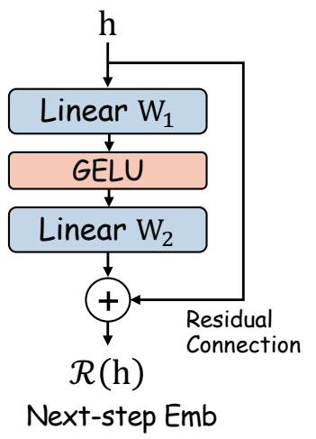

## HybridAgent

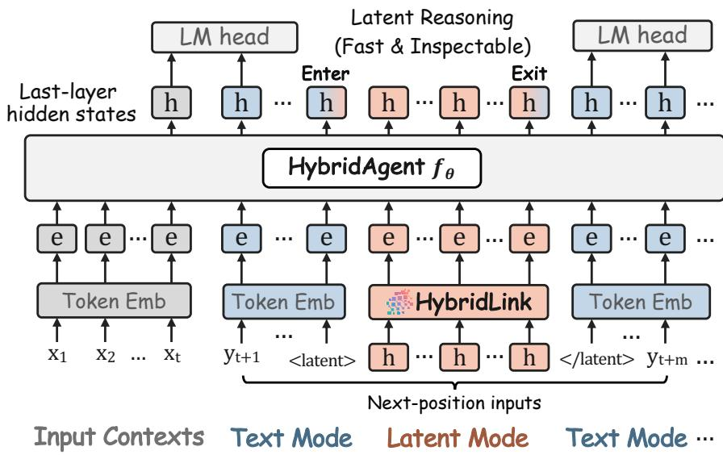  
Figure 1 | HybridAgent Architecture Overview. Left: A HybridLink maps last-layer hidden states back into the input embedding space, letting the agent enter latent mode for recurrent, fast, inspectable inner thinking and return to text mode for tool calls and external monitoring. Right: HybridAgent performs hybrid reasoning that thinks in latent space and acts through text within a single generation process. Building on this architecture, HybridAgent (i) achieves multi-turn hybrid generation by carrying the entire hybrid context through its own working memory (Section 3), and (ii) can be converted from any standard pre-trained LLM through a dedicated post-training pipeline (Section 4).

## 1. Introduction

Frontier intelligence no longer scales through the model’s reasoning alone, but depends increasingly on its ability to interact with the external world (Kwa et al., 2026; Sun et al., 2026; Team, 2026). To solve a hard problem, an LLM agent must reach beyond the model itself by continually invoking specialized tools, observing feedback from the environment, and adapting its next move (Feng et al., 2026; Qu et al., 2025; Silver and Sutton, 2025). Beneath this expanding repertoire of agent harnesses lies a single lingua franca: text, the common medium of both the agent’s autoregressive generation and its environment interaction (Sumers et al., 2024; Zhang et al., 2026b). All intermediate reasoning trajectories are generated token by token as text before the agent can act on the environment.

A separate line of work on latent reasoning points in a diferent direction (Chen et al., 2025; Zhu et al., 2025b). By unfolding computation directly in continuous hidden space, latent models bypass the need to decode and verbalize every intermediate step, providing more eficient internal reasoning within the model’s “own language" (Hao et al., 2024; Wang et al., 2025; Yu et al., 2026). However, today’s latent reasoners remain largely sealed behind the model boundary. Unlike decoded text, continuous latent vectors (i) lack native pathways for tool invocation across multi-turn agentic reasoning (Chang et al., 2026), and (ii) do not readily expose human-interpretable semantics, leaving them dificult to supervise during training (Chen et al., 2026) and to audit or debug at inference (Korbak et al., 2025). These constraints keep latent reasoning models from operating as capable agents in their own right.

Taken together, agentic interaction and eficient inner reasoning have so far required a diferent medium each, leaving the two lines of work apart in the development of next-generation agents. We believe this division can be closed by building a new type of agent that combines both strengths to think beyond text while still acting through it. We call this unified design HybridAgent, one that dynamically navigates between latent reasoning and text-based interaction within a single generation.

Building such an agent is hard, since it needs to handle both dense continuous vectors and sparse discrete tokens as hybrid inputs, and determine when to transition between text and latent modes to balance agentic actions and reasoning eficiency. To ofset the hardness, we first revisit the model architecture and extend its autoregressive generation interface to support hybrid inputs. At the heart of this design is HybridLink, a lightweight residual adapter that bridges latent thoughts from the lastlayer hidden space back into the input embedding space and enables sequence-wise recurrence within latent mode. Then, we realize multi-turn hybrid generation through the agent’s own working memory, carrying complete hybrid trajectories of text, latent thoughts, and tool observations across turns. Surprisingly, we find that HybridAgent can render its thoughts in latent mode as human-readable pseudo-text, making latent reasoning transparent and directly inspectable rather than opaque.

To further unlock the potential of hybrid reasoning, we equip HybridAgent with dedicated posttraining algorithms. HybridSFT first stabilizes tool-integrated hybrid generation through activation and self-conditioned training, which adapts the backbone to reason over latent thoughts produced by its own HybridLink, enabling reliable coordination between the two components and closing the traininference mismatch. Then, HybridRL scales agentic reasoning capabilities by training HybridAgent to adaptively balance latent reasoning and text-based interaction. To realize this, we enable policy optimization over hybrid trajectories through hybrid policy factorization and exact rollout replay.

We provide theoretical grounding for HybridAgent through complementary analyses of multi-turn context continuation and hybrid policy optimization. From an architectural standpoint, we show that continuous working memory losslessly preserves the entire hybrid context across diferent turns. From a learning perspective, the hybrid policy factorization and exact latent-context replay in HybridRL provide a well-founded basis for policy updates over complete hybrid trajectories.

Empirically, we evaluate HybridAgent on 11 benchmarks spanning mathematics, science, medicine, knowledge-intensive search, and challenging agentic reasoning. We instantiate and train HybridAgent with Qwen3-Base models (Yang et al., 2025a) across 4B, 8B, and 14B scales. Compared with frontier LLM agents and agentic frameworks spanning both text-based and latent reasoning, HybridAgent achieves an average performance improvement of 10.4% and exhibits strong test-time scalability. In terms of eficiency, HybridAgent reduces token usage by 35.5%–54.7%, delivers 1.8×–2.6× inference speedup, and lowers computational cost by 2.7×–3.7×. Additional in-depth analyses of training dynamics, reasoning auditability, and agentic tool-use reliability reveal a clear division of labor between the two reasoning modes: HybridAgent shifts more internal reasoning into semantically rich and interpretable latent thoughts, while reserving text for external inspection and tool interaction.

## 2. Preliminary

Hybrid Generation in LLMs. We consider an LLM agent $f _ { \theta }$ built upon a standard Transformer parameterized by �. To enable hybrid generation, the agent operates autoregressively in two modes: (i) text, which performs explicit generation in the token space, and (ii) latent, which performs implicit generation in the continuous representation space. Formally, given an input context � with corresponding input embeddings $E = [ e _ { 1 } , \dots , e _ { t } ] \in \mathbb { R } ^ { t \times d _ { h } }$ , the agent computes the last-layer hidden state $h _ { t }$ through a forward pass, and the hybrid input representation for the next step � + 1 is:

$$
e _ { t + 1 } = \left\{ \begin{array} { l l } { \mathrm { E m b } ( y _ { t + 1 } ) , \quad y _ { t + 1 } \sim \mathrm { S o f t m a x } ( W _ { \mathrm { o u t } } h _ { t } ) , } & { \mathrm { i f ~ t e x t ~ m o d e } , } \\ { h _ { t } , } & { \mathrm { i f ~ l a t e n t ~ m o d e } , } \end{array} \right.\tag{1}
$$

where $W _ { \mathrm { o u t } }$ is the vocabulary projection matrix, Emb(·) is the token embedding function, and $h _ { t }$ is directly reused as the next latent input in standard latent reasoning (Cheng and Van Durme, 2024; Coda-Forno et al., 2025; Hao et al., 2024). The next hidden state of $f _ { \theta }$ is then computed as:

$$
h _ { t + 1 } = f _ { \theta } \big ( \big [ E _ { \leq t } ; e _ { t + 1 } \big ] \big ) .\tag{2}
$$

Throughout inference, the hybrid agent dynamically switches between the two generation modes, producing a hybrid trajectory that balances the model’s inner reasoning with external interaction.

Tool-Integrated Agentic Reasoning. A hybrid agent can leverage its text mode to interact with external environments. Similar to standard LLM agents, the hybrid agent generates a tool call as a sequence of text, invokes the corresponding tool (e.g., Python, Search), and receives the resulting observations. A complete single-turn hybrid reasoning trajectory � can be represented as:

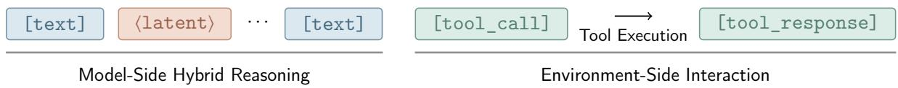

(3)

where [·] and ⟨·⟩ denote text chunks and latent vectors, respectively. The whole trace is then appended as input for the next generation turn, and the process continues until a final text answer is produced.

## 3. Building a Hybrid Reasoning Agent

We introduce HybridAgent, a hybrid framework that dynamically navigates between explicit text and continuous latent reasoning within a single unified generation process. As illustrated in Figure 1, the architecture preserves an LLM agent’s autoregressive generation and tool-calling interfaces while accommodating both text and latent inputs. Below, we first present the hybrid interface for seamless text-latent mode transition (Section 3.1), followed by multi-turn hybrid generation (Section 3.2).

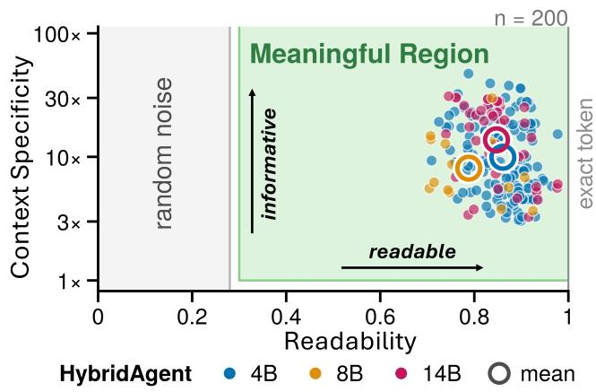

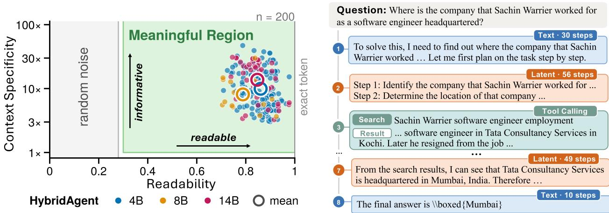  
Figure 2 | Interpretable Latent Mode in HybridAgent. All latent steps can be expressed as readable pseudo-text carrying their semantics for external inspection. Left: Quantitatively, latent thoughts are highly readable and context-specific (see Appendix F). Right: Qualitatively, latent pseudo-text stays semantically aligned with surrounding text reasoning and tool calls. (“Steps” counts forward passes).

## 3.1. Hybrid Mode Interface

Existing latent reasoning models typically feed the last-layer hidden state $h _ { t }$ directly back as the next-step input $e _ { t + 1 }$ . This design is not well suited to hybrid generation, as substituting $h _ { t }$ for a token embedding creates a representation mismatch with the pretrained input space, making transitions between continuous latent states and discrete tokens dificult. To support both latent and text modes in a shared input interface, we add a lightweight adapter HybridLink to work alongside the backbone.

HybridLink as a Bridge. An LLM agent’s last-layer hidden states naturally encode the semantics of its current generation, so the HybridLink R is designed to carry this information from the hidden representation space back into the input embedding space. Formally, given any last-layer hidden state $h _ { t }$ , HybridLink simulates its corresponding next-step input embedding as:

$$
{ e } _ { t + 1 } = \mathcal { R } ( h _ { t } ) = h _ { t } + W _ { 2 } \sigma ( W _ { 1 } h _ { t } ) ,\tag{4}
$$

where $W _ { 1 } , W _ { 2 }$ are standard linear projections, � is an activation function (e.g., GELU). As the residual connection largely preserves the original semantics of $h _ { t } ,$ HybridLink only needs to align the distributional diference rather than learn the entire projection from scratch. Accordingly, the link module is lightweight, with approximately $2 d _ { h } ^ { 2 }$ parameters (e.g., ∼10M parameters for a 4B LLM).

Dynamic Text-Latent Mode Transition. Next, we describe how HybridAgent transitions between text and latent modes during generation, together with the entry and exit decisions for each mode.

In text mode, HybridAgent behaves exactly as a standard LLM, sampling the next token from the vocabulary at each step. The process continues until the agent generates one special token <latent>, which serves as the entry anchor for the latent mode. For the next forward pass, the agent uses HybridLink for latent reasoning in place of the LM head and token embedding layer.

In latent mode, each step’s last-layer hidden state is passed through HybridLink via Eq. 4, allowing HybridAgent to continue its generation flow entirely in latent space without token decoding and re-embedding. This sequence-wise recurrent computation over continuous representations extends the agent’s efective reasoning depth, enabling more expressive internal reasoning. The latent reasoning span terminates when the semantics of the last-layer hidden state $h _ { t }$ align with the exit anchor </latent>. Specifically, at any latent step �, the latent mode closes by satisfying the condition:

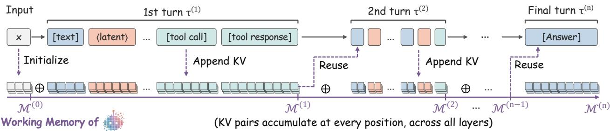  
Figure 3 | Multi-Turn Hybrid Generation over HybridAgent’s Own Working Memory. HybridAgent accumulates key-value (KV) entries from text, latent thoughts, and tool observations in continuous working memory, directly reusing and updating it across turns to preserve the full hybrid context.

$$
\underset { \nu \in \mathcal { V } } { \arg \operatorname* { m a x } } ~ \cos ( \mathcal { R } ( h _ { t } ) , \mathrm { E m b } ( \nu ) ) = < / \mathrm { 1 a t e n t } > .\tag{5}
$$

HybridAgent then returns to its text mode, and this transition continues during generation. At each step, the agent adaptively decides whether to remain in its current mode or switch, allowing the length and frequency of text and latent spans to emerge dynamically rather than follow preset configurations.

Interpretable Latent Mode. During hybrid generation, a useful property of HybridAgent is that its latent mode remains decoding-free yet directly interpretable. To inspect any latent reasoning span, one can easily recover its semantics by mapping each latent step produced by HybridLink to its nearest token embedding, as in Eq. 5. We illustrate this interpretability property clearly in Figure 2.

## 3.2. Multi-Turn Hybrid Generation over Working Memory

In standard LLM agents, each turn’s generated content and tool outputs are appended to the textual context and re-encoded as the next turn’s input prefix. Hybrid trajectories, however, interleave text tokens with latent vectors and can’t be reconstructed through conventional tokenization alone. Instead, HybridAgent carries the complete context across turns through its continuous working memory.

Cross-Turn Working Memory. Recall that a single-turn hybrid trajectory � in Eq. 3 consists of model-generated text, latent thoughts, and external tool interactions. During input construction, all contents are mapped into the same input space through either the input embedding layer or HybridLink. This shared space allows the Transformer to process all three components uniformly and collect their KV entries throughout generation. We leverage these accumulated KV entries as the HybridAgent’s continuous working memory to achieve multi-turn hybrid generation.

As illustrated in Figure 3, HybridAgent first initializes its working memory M from the input context � and then accumulates the KV entries generated throughout the first-turn trajectory $\tau ^ { ( 1 ) }$ , i.e.,

$$
\begin{array} { r l } & { \boldsymbol { \mathcal { M } } ^ { ( 0 ) } = \left[ K _ { \leq | x | } , \boldsymbol { V } _ { \leq | x | } \right] , } \\ & { \boldsymbol { \mathcal { M } } ^ { ( 1 ) } = \boldsymbol { \mathcal { M } } ^ { ( 0 ) } \oplus \left[ K _ { \leq t } , \boldsymbol { V } _ { \leq t } \right] , \quad t = 1 , \ldots , | \boldsymbol { \tau } ^ { ( 1 ) } | . } \end{array}\tag{6}
$$

Here, $M ^ { ( 1 ) }$ preserves the complete first-turn hybrid context in positional order across all Transformer layers. For each subsequent turn, the agent directly resumes generation from the current working memory and updates it by appending newly generated KV entries at each step. This process continues across the sequence of hybrid trajectories $\{ \tau ^ { ( 1 ) } , \tau ^ { ( 2 ) } , \dots , \tau ^ { ( n ) } \}$ until the final answer is produced. We further provide a formal justification for this continuation process in Appendix A. Overall, multi-turn hybrid generation proceeds over one continuous working memory flow, preserving the complete hybrid context across turns without requiring intermediate token-space reconstruction.

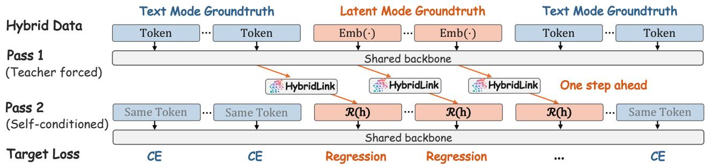  
Figure 4 | Self-Conditioned HybridSFT. A teacher-forced first pass produces next-step latent inputs via HybridLink. A second pass replaces ground-truth latent embeddings Emb(·) with the predictions R (ℎ) and jointly trains the backbone and HybridLink using CE at text and regression at latent positions.

## 4. Learning to Perform Hybrid Reasoning

With the overall framework in place, we now turn to training. As HybridAgent leaves the backbone architecture intact, no pre-training from scratch is required. Instead, we adapt the standard agentic post-training pipeline of supervised fine-tuning and reinforcement learning to the hybrid setting. The two training stages serve complementary roles: SFT teaches the agent to coordinate with HybridLink and instantiate reliable tool use for stable hybrid generation (Section 4.1), while RL further scales reasoning by learning when to think in latent space and when to act through text (Section 4.2).

## 4.1. Stabilize Generation via Hybrid Supervised Fine-tuning

As a first step toward stabilizing hybrid reasoning in HybridAgent, we design the entire HybridSFT stage through a hybrid data curation pipeline and a staged training procedure.

Hybrid Data Recipe. To curate high-quality training data, we filter existing text-based agentic SFT datasets from multiple sources and convert them into hybrid trajectories through automatic annotation. We assign reasoning steps to latent mode based on both LLM Experts’ judgments and target models’ own prediction entropy, while retaining a small set of key steps for tool interactions and external debugging/auditing in text mode (see Appendix E for data curation details).

Format and HybridLink Activation. As a warm start, we adapt the backbone to the hybrid data format and initialize the HybridLink. For format activation, we perform standard text SFT to teach the backbone when to enter and exit latent mode by emitting the two special anchor tokens. We then freeze the backbone and train HybridLink to align last-layer hidden states at latent positions with their target input embeddings. For a training instance $( x , y ) \in \mathcal { D } _ { \mathrm { S F T } }$ , the activation objectives are:

$$
\begin{array} { r l } & { \mathcal { L } _ { \mathrm { B a c k b o n e } } = \mathrm { C E } \big ( f _ { \theta } ( x ) , y \big ) , } \\ & { \mathcal { L } _ { \mathrm { H y b r i d L i n k } } = \lambda _ { \cos } \Big ( 1 - \cos \big ( \mathcal { R } ( h _ { \mathrm { l a t } } ) , \mathrm { E m b } ( y _ { \mathrm { l a t } } ) \big ) \Big ) + \lambda _ { \mathrm { m s e } } \big \| \mathcal { R } ( h _ { \mathrm { l a t } } ) - \mathrm { E m b } ( y _ { \mathrm { l a t } } ) \big \| _ { 2 } ^ { 2 } , } \end{array}\tag{7}
$$

where $h _ { \mathrm { l a t } }$ is the last-layer hidden states at latent positions, $y _ { \mathrm { l a t } }$ is the corresponding ground-truth text tokens, and $\lambda _ { \mathrm { c o s } } , \lambda _ { \mathrm { m s e } }$ balance directional and magnitude alignment, respectively.

Self-Conditioned HybridSFT. The activation provides a well-aligned initialization, but the backbone has not yet learned to reason over latent thoughts produced by its own HybridLink (see Appendix B.1 for details on this train-inference mismatch). We therefore adopt a two-pass self-conditioned training scheme as illustrated in Figure 4. In the first pass, HybridAgent is teacher-forced on the ground-truth hybrid sequence. HybridLink maps the generated last-layer hidden states at latent positions one step ahead to form latent inputs for the next pass. In the second pass, HybridAgent processes the same sequence but replaces the ground-truth latent embeddings with its own latent inputs. We jointly supervise text and latent positions on the second pass as:

```latex
Algorithm 1 Hybrid Reinforcement Learning (HybridRL)
Input: Agent $f _ { \theta }$ (SFT initialized in Section 4.1), HybridLink R, task set $\mathcal { D } _ { \mathrm { R L } }$ , group size �, �
1: for each training step do
2: Sample $x \sim \mathcal { D } _ { \mathrm { { R L } } } ;$ Collect $\{ \tau _ { i } \} _ { i = 1 } ^ { G } \gets f _ { \theta } ( x )$ ⊲ Hybrid Policy Rollout
3: Record $\tau _ { i }$ with latent $z _ { i } = \mathcal { R } ( \bar { H } _ { i } ) \ ( \mathrm { E q . } \ 4 )$ , text $y _ { i } ,$ and tool observations $o _ { i }$
4: Compute rewards $r _ { i }$ (Eq. 11) and group-normalized advantages $A _ { i }$
5: Replay $\tau _ { i }$ with $\left( z _ { i } , y _ { i } , o _ { i } \right)$ to obtain $\pi _ { \theta } ( y _ { i , t } \mid \tau _ { i , < t } )$ ⊲ Exact Rollout Replay
6: Compute $\rho _ { i , t }$ via Eq. 9 and Eq. 10 ⊲ Hybrid Policy Factorization
7: Update $\theta \gets \theta - \eta \nabla _ { \theta } \mathcal { L } _ { \mathrm { { R L } } }$ (standard RL objective) ⊲ Hybrid Policy Update
8: end for
```

$$
\mathcal { L } _ { \mathrm { H y b r i d S F T } } = \mathcal { L } _ { \mathrm { B a c k b o n e } } + \mathcal { L } _ { \mathrm { H y b r i d L i n k } } ,\tag{8}
$$

where the CE loss $\mathcal { L } _ { \mathrm { B a c k b o n e } }$ and regression loss $\mathcal { L } _ { \mathrm { H y b r i d L i n k } }$ are applied only at text and latent positions, respectively. Overall, HybridSFT trains the agent to coordinate its backbone with HybridLink for coherent reasoning across text and latent modes, supporting stable hybrid generation at inference.

## 4.2. Scale Reasoning via Hybrid Reinforcement Learning

A HybridAgent cannot straightforwardly adopt popular RL algorithms such as PPO (Schulman et al., 2017) or GRPO (Shao et al., 2024), as they assume every generated position carries a token-level likelihood. Specifically, at each position �, standard RL computes the per-token importance ratio as:

$$
\rho _ { t } = { \frac { \pi _ { \theta } ( y _ { t } \mid y _ { < t } ) } { \pi _ { \theta _ { \mathrm { o l d } } } ( y _ { t } \mid y _ { < t } ) } } ,\tag{9}
$$

where $\pi _ { \boldsymbol { \theta } } , \pi _ { \boldsymbol { \theta } _ { \mathrm { o l d } } }$ denote the current and rollout policies. At latent positions, however, HybridAgent generates continuous vectors rather than sampled tokens, leaving no token-level likelihood. Thus, the importance ratio $\rho _ { t }$ is undefined. We address this incompatibility with two simple components.

Hybrid Policy Factorization. Recall that, in a hybrid trajectory, latent thoughts are computed entirely in the continuous latent space through HybridLink, and tool responses are the masked observations from the environment. Thus, policy sampling during rollout is confined to model-generated text positions. To justify why policy optimization needs only to operate over these sampled positions, we formalize the hybrid policyfactorization below with detailed theoretical analyses.

Proposition 4.1 (Hybrid Policy Factorization). Let � be a hybrid trajectory generated by the policy �<sub>�</sub> (induced by �<sub>�</sub>) with fixed HybridLink R. Then the hybrid policy factorizes as:

$$
\pi _ { \boldsymbol { \theta } } ( \tau \mid \boldsymbol { x } ) = \prod _ { t \in \mathcal { T } } \pi _ { \boldsymbol { \theta } } ( y _ { t } \mid \boldsymbol { x } , \tau _ { < t } ) ,\tag{10}
$$

where T is the set of sampled text positions of trajectory �.

The proof and additional theoretical justifications are provided in Appendix C. Proposition 4.1 shows that likelihood-ratio updates over sampled text positions are suficient to optimize the full hybrid trajectory, making the importance ratio in Eq. 9 well-defined for the HybridAgent policy.

Policy Update via Exact Rollout Replay. Policy optimization generally involves rebuilding a diferentiable computation graph for the rollouts. Applying this to HybridAgent further requires recomputing sampled text-token likelihoods conditioned on the same preceding latent thoughts used during rollout. We satisfy this requirement via exact latent-context replay. During hybrid rollout, we record latent thoughts alongside sampled text tokens and tool observations. During policy updates, we replay the full hybrid trajectory in embedding space with a single diferentiable forward pass, keeping the recorded latent inputs unchanged while recomputing the sampled likelihoods in Eq. 10.

Algorithm 1 outlines the full HybridRL training procedure. We keep the HybridLink fixed to preserve deterministic latent transitions. For the reward design, we simply formulate it as:

$$
r ( \tau ) = r _ { \mathrm { c o r r e c t } } + r _ { \mathrm { f o r m a t } } + r _ { \mathrm { t o o l } } ,\tag{11}
$$

where $r _ { \mathrm { c o r r e c t } }$ measures answer correctness, $r _ { \mathrm { f o r m a t } }$ penalizes invalid formatting, and $r _ { \mathrm { t o o l } }$ encourages multi-tool use. We impose no explicit reward for mode usage, allowing HybridAgent to adaptively balance text and latent generation and discover efective hybrid reasoning strategies during RL.

## 5. Empirical Evaluations

Tasks and Datasets. We conduct comprehensive evaluations of HybridAgent on 11 benchmarks across various domains: (i) Mathematical Reasoning, including AIME 25 (math ai, 2025), AIME 26 (MathArena, 2026), and MATH500 (HuggingFaceH4, 2023); (ii) Knowledge-Intensive Reasoning, including GPQA-Diamond (Rein et al., 2023), MedQA (Yang et al., 2024), and MuSiQue (Trivedi et al., 2022); and (iii) Agentic Reasoning, including General AI Assistants (GAIA) (Mialon et al., 2024), Humanity’s Last Exam (HLE) (Center for AI Safety et al., 2026), WebWalker (Wu et al., 2025), SealQA (Pham et al., 2026), and DeepSearchQA (DSQA) (Gupta et al., 2026). We adopt the standard evaluation metric for each dataset. Additional benchmark details are in Appendix H.1.

Baselines. For baseline comparisons, we evaluate HybridAgent against (i) Text-based Agentic Methods, covering standard text SFT (with tools) and multi-turn tool-integrated RL methods such as GRPO (Shao et al., 2024) and ARPO (Dong et al., 2025b); (ii) Latent Reasoning Methods, including SoftThinking (Zhang et al., 2025), Coconut (Hao et al., 2024), and SoftCoT (Xu et al., 2025b); (iii) Frontier LLM Agents, including GPT-5.6-Luna (OpenAI, 2026), Kimi-K3 (Team, 2026), GLM-5.3-Flash (GLM-5-Team et al., 2026), DeepSeek-V4.1-Flash (DeepSeek-AI, 2026), QwQ-32B (Team, 2025); and (iv) Agentic Frameworks, including ReAct (Yao et al., 2023), Search-o1 (Li et al., 2025a), and WebThinker (Li et al., 2025b). Additional baseline details are provided in Appendix H.2.

Models and Training Setups. We instantiate HybridAgent with Qwen3-Base backbones (Yang et al., 2025a) at three scales of 4B, 8B, and 14B. We then apply HybridSFT with 54K hybrid trajectories curated through our automatic annotation pipeline, followed by HybridRL with 12K deep reasoning examples (Yu et al., 2025) and 1K agentic search examples (Dong et al., 2025b). During RL, we set rollout batches of 512 trajectories (64 × 8), followed by one optimization pass over 8 minibatches.

Implementation Details. HybridAgent interacts with external environments primarily through two types of tools: a Python interpreter within sandbox environments and a live search engine (e.g., Tavily). We cap tool usage at 10 calls per trajectory and retrieve the top 10 snippets for each search query. As current serving engines do not support multi-turn hybrid generation, we extend the training and inference infrastructure to enable text, latent, and tool-calling transitions and persistent KV workingmemory transfer. RL rollouts use a sampling temperature of 1.0, and evaluation uses temperature 0.6, top-p 0.95, and top-k 20. We conduct experiments on H100 GPUs using five independent seeds. Additional training/inference details and hyperparameter setups are provided in Appendix H.3.

Table 1 | Main Results of HybridAgent over Agentic Reasoning Tasks. We report GAIA and WebWalker by dificulty level, HLE by category (NS/CE/SF), SealQA on the Seal-0 (“S-0") and Seal-Hard (“Hard") splits, and DSQA by full-correct rate (“Acc.") and F1 score. Across 5 independent runs, the average standard deviations of HybridAgent are ±0.014 in accuracy, with a corresponding 95% CI of ±0.017. At 8B and 14B scales, HybridAgent consistently outperforms advanced LLM agents, agentic frameworks, and matched text and latent baselines. Best performance is highlighted.
<table><tr><td rowspan="2">Method</td><td colspan="4">GAIA</td><td colspan="4">WebWalker</td><td colspan="4">HLE</td><td colspan="2">SealQA</td><td colspan="2">DSQA</td></tr><tr><td>Lv.1</td><td>Lv.2</td><td>Lv.3</td><td>Avg.</td><td></td><td>Easy Med. Hard</td><td></td><td>Avg.</td><td>NS</td><td>CE</td><td>SF</td><td>Avg.</td><td>S-0</td><td>Hard</td><td>Acc.</td><td>F1</td></tr><tr><td>Frontier LLM Agents</td><td></td><td></td><td></td><td></td><td></td><td></td><td></td><td></td><td></td><td></td><td></td><td></td><td></td><td></td><td></td><td></td></tr><tr><td>QwQ-32B</td><td>30.9</td><td>6.5</td><td>5.2</td><td>18.9</td><td>7.5</td><td>2.1</td><td>4.6</td><td>4.3</td><td>11.5</td><td>7.3</td><td>5.2</td><td>9.6</td><td>1.8</td><td>10.6</td><td>11.3</td><td>23.9</td></tr><tr><td>GLM-5.3-Flash</td><td>38.5</td><td>28.8</td><td>8.3</td><td>30.1</td><td>8.9</td><td>8.3</td><td>9.9</td><td>9.0</td><td>13.3</td><td>14.7</td><td>16.8</td><td>14.2</td><td>9.0</td><td>22.0</td><td>16.038.5</td><td></td></tr><tr><td>DeepSeekV4.1-Flash</td><td>43.6</td><td>42.3</td><td>16.7</td><td>39.8</td><td>22.2</td><td>16.7</td><td>12.7</td><td>16.5</td><td>28.5</td><td>25.3</td><td>30.5</td><td>28.4</td><td>14.4 33.5</td><td></td><td>19.3 38.6</td><td></td></tr><tr><td>Kimi-K3</td><td>46.2</td><td>42.3</td><td>25.0</td><td>41.7</td><td>11.1</td><td>11.9</td><td>7.0</td><td>10.0</td><td>29.4</td><td>32.0</td><td>37.9</td><td>31.4</td><td>11.7</td><td>28.0</td><td>21.7</td><td>46.0</td></tr><tr><td>GPT-5.6-Luna</td><td>48.7</td><td>32.7</td><td>25.0</td><td>37.9</td><td>15.6</td><td>8.3</td><td>11.3</td><td>11.0</td><td>30.9</td><td>25.3</td><td>25.3</td><td>29.0</td><td>11.7</td><td>29.1</td><td>23.3</td><td>49.4</td></tr><tr><td>Agentic Frameworks</td><td></td><td></td><td></td><td></td><td></td><td></td><td></td><td></td><td></td><td></td><td></td><td></td><td></td><td></td><td></td><td></td></tr><tr><td>Search-o1</td><td>46.2 23.1</td><td></td><td>0.0</td><td>29.1</td><td>11.1</td><td>21.4</td><td>16.9</td><td>17.5</td><td>6.4</td><td>4.0</td><td>10.5</td><td>6.8</td><td>3.6</td><td>11.8</td><td>12.3</td><td>25.3</td></tr><tr><td>WebThinker</td><td>48.7</td><td>26.9</td><td>8.3</td><td>33.0</td><td>13.3</td><td>23.8</td><td>18.3</td><td>19.5</td><td>7.0</td><td>4.0</td><td>9.5</td><td>7.0</td><td>4.5</td><td>12.6</td><td>11.7</td><td>24.7</td></tr><tr><td>ReAct</td><td>48.7</td><td>25.0</td><td>8.3</td><td>32.0</td><td>11.1</td><td>20.2</td><td>12.7</td><td>15.5</td><td>5.8</td><td>5.3</td><td>10.5</td><td>6.6</td><td>7.2</td><td>15.0</td><td>14.632.3</td><td></td></tr><tr><td colspan="11">8B-level Latent &amp; Text Methods</td><td></td><td></td><td></td><td></td><td></td></tr><tr><td>Qwen3-8B (thinking)</td><td></td><td>28.1 15.4</td><td></td><td>16.7 20.4</td><td>0.0</td><td>2.4</td><td>2.8</td><td>2.0</td><td>3.9</td><td>2.7</td><td>8.4</td><td>4.6</td><td>2.7</td><td>5.9</td><td>3.3</td><td>14.6</td></tr><tr><td>Coconut</td><td>7.7</td><td>1.9</td><td>0.0</td><td>3.9</td><td>0.0</td><td>1.2</td><td>0.0</td><td>0.5</td><td>1.5</td><td>0.0</td><td>1.1</td><td>1.2</td><td>0.0</td><td>1.6</td><td>1.7</td><td>6.1</td></tr><tr><td>SoftThinking</td><td>23.1</td><td>9.6</td><td>8.3</td><td>14.6</td><td>0.0</td><td>1.2</td><td>1.4</td><td>1.0</td><td>3.6</td><td>2.7</td><td>6.3</td><td>4.0</td><td>0.0</td><td>3.9</td><td>2.3</td><td>11.2</td></tr><tr><td>GRPO</td><td>48.7</td><td>25.0</td><td>8.3</td><td>32.0</td><td>28.9</td><td>32.1</td><td>28.2</td><td>30.0</td><td>7.9</td><td>4.0</td><td>10.5</td><td>7.8</td><td>15.3</td><td>23.6</td><td>17.3</td><td>33.8</td></tr><tr><td>ARPO</td><td>53.9</td><td>32.7</td><td>16.7</td><td>38.8</td><td>31.1</td><td>35.7</td><td>28.2</td><td>32.0</td><td>7.3</td><td>6.7</td><td>15.8</td><td>8.8</td><td>18.9</td><td>26.0</td><td>18.0</td><td>37.2</td></tr><tr><td>HybridAgent (8B)</td><td>51.3</td><td></td><td></td><td>44.2 25.0 43.7</td><td></td><td></td><td>48.9 45.2 35.2 42.5</td><td></td><td>14.2</td><td></td><td>8.0 20.0 14.4</td><td></td><td>22.5 35.8</td><td></td><td>20.0 40.7</td><td></td></tr><tr><td colspan="14">14B-level Latent &amp; Text Methods</td><td></td><td></td><td></td><td></td></tr><tr><td>Qwen3-14B (thinking)</td><td>33.3 13.5</td><td></td><td>0.0</td><td>19.4</td><td>6.7</td><td>2.4</td><td>4.2</td><td>4.0</td><td>5.5</td><td>6.7</td><td>11.6</td><td>6.8</td><td>3.6</td><td>7.9</td><td>4.0</td><td>15.1</td></tr><tr><td>Coconut</td><td>10.3</td><td>5.8</td><td>0.0</td><td>6.8</td><td>2.2</td><td>2.4</td><td>1.4</td><td>2.0</td><td>3.9</td><td>4.0</td><td>5.3</td><td>4.2</td><td>0.0</td><td>2.8</td><td>2.0</td><td>7.5</td></tr><tr><td>SoftThinking</td><td>23.1</td><td>11.5</td><td>8.3</td><td>15.5</td><td>6.7</td><td>3.6</td><td>7.0</td><td>5.5</td><td>3.9</td><td>5.3</td><td>9.5</td><td>5.2</td><td>2.7</td><td>6.3</td><td>5.7</td><td>15.4</td></tr><tr><td>GRPO</td><td>51.3</td><td>34.6</td><td>0.0</td><td>36.9</td><td>35.6</td><td>42.9</td><td>35.2</td><td>38.5</td><td>7.9</td><td>6.7</td><td>12.6</td><td>8.6</td><td>17.1</td><td>24.4</td><td>18.6</td><td>43.9</td></tr><tr><td>ARPO</td><td>56.4</td><td>40.4</td><td>16.7</td><td>43.7</td><td>40.0</td><td>44.1</td><td>36.6</td><td>40.5</td><td>10.3</td><td>10.7</td><td>13.7</td><td>10.0</td><td>17.1</td><td>22.8</td><td>16.3</td><td>38.2</td></tr><tr><td>HybridAgent (14B)</td><td>53.8</td><td></td><td></td><td>55.8 33.3 52.4</td><td>48.9</td><td>52.4</td><td>46.5</td><td>49.5</td><td>16.1 13.3</td><td></td><td>17.9 16.0</td><td></td><td>24.3 37.8</td><td></td><td></td><td>21.7 46.8</td></tr></table>

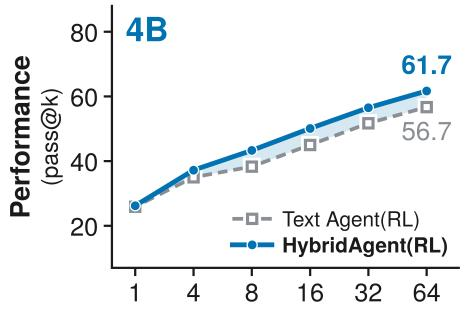

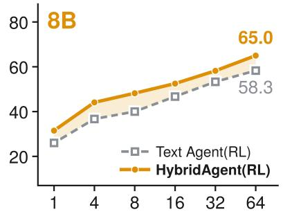

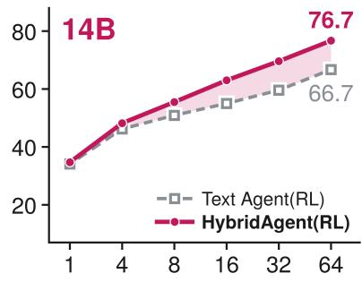  
Figure 5 | Scalability of HybridAgent at Test-time. We evaluate pass@k (4, 8, 16, 32, 64) performance on 100 hard math and science questions and compare with text agents trained with GRPO.

## 5.1. Scaling Performance via Hybrid Reasoning

Main Results. Tables 1 and 2 report the overall performance of HybridAgent across 11 benchmarks spanning math, science, medicine, and knowledge search domains. On challenging agentic reasoning benchmarks, HybridAgent delivers competitive performance over larger frontier LLM agents and specialized tool-use frameworks, with HybridAgent (14B) improving over the strongest agentic baseline by an average of 17.4%. In addition, under matched model sizes and training budgets, HybridSFT and HybridRL demonstrate consistent training efectiveness and improve over corresponding text/latent baselines by 18.5% at the SFT stage and 10.4% at the RL stage. Together, HybridAgent combines the strengths of text-based agentic tool use with faster and more expressive latent reasoning, allowing the agent to interact externally while achieving deeper thinking depth internally.

Table 2 | Main Results of HybridAgent on Math and Knowledge-Intensive Search. We evaluate performance across both SFT and RL stages. Small-size benchmarks like AIME25/26 are reported on avg@16 accuracy. Across all tasks, HybridAgent yields an average std. of ±0.031 (math) and ±0.018 (search), with corresponding 95% CI of ±0.038 and ±0.022. Under the same training budgets and model setups, HybridSFT and HybridRL improve both text-based and latent reasoning methods.
<table><tr><td>Method</td><td>AIME25</td><td>AIME26</td><td>MATH500</td><td>GPQA-D</td><td>MedQA MuSiQue</td><td></td></tr><tr><td colspan="7">Qwen3-8B-Base</td></tr><tr><td>Coconut</td><td>13.1</td><td>9.6</td><td>51.4</td><td>26.8</td><td>61.7</td><td>14.0</td></tr><tr><td>SoftCoT</td><td>16.5</td><td>17.9</td><td>63.6</td><td>28.9</td><td>62.0</td><td>19.5</td></tr><tr><td>Standard Text SFT</td><td>30.0</td><td>28.3</td><td>78.2</td><td>32.3</td><td>69.7</td><td>23.5</td></tr><tr><td>HybridAgent (SFT)</td><td>30.8</td><td>29.2</td><td>78.4</td><td>31.8</td><td>70.0</td><td>26.5</td></tr><tr><td>GRPO</td><td>36.3</td><td>39.4</td><td>82.0</td><td>43.9</td><td>74.3</td><td>27.5</td></tr><tr><td>ARPO</td><td>37.1</td><td>41.5</td><td>82.8</td><td>46.5</td><td>74.7</td><td>28.5</td></tr><tr><td>HybridAgent (RL)</td><td>39.2</td><td>43.3</td><td>84.6</td><td>48.0</td><td>75.3</td><td>32.0</td></tr><tr><td colspan="7">Qwen3-14B-Base</td></tr><tr><td>Coconut</td><td>16.3</td><td>15.2</td><td>61.2</td><td>29.3</td><td>65.3</td><td>17.5</td></tr><tr><td>SoftCoT</td><td>22.7</td><td>23.8</td><td>74.0</td><td>36.4</td><td>67.7</td><td>20.0</td></tr><tr><td>Standard Text SFT</td><td>30.8</td><td>31.7</td><td>83.8</td><td>43.9</td><td>78.0</td><td>28.0</td></tr><tr><td>HybridAgent (SFT)</td><td>32.5</td><td>31.7</td><td>84.2</td><td>45.5</td><td>78.7</td><td>29.5</td></tr><tr><td>GRPO</td><td>40.8</td><td>42.5</td><td>87.4</td><td>52.5</td><td>81.0</td><td>32.0</td></tr><tr><td>ARPO</td><td>42.1</td><td>43.3</td><td>87.0</td><td>54.0</td><td>80.3</td><td>31.5</td></tr><tr><td>HybridAgent (RL)</td><td>43.3</td><td>45.8</td><td>88.2</td><td>55.1</td><td>81.7</td><td>34.5</td></tr></table>

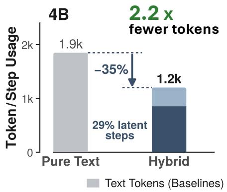

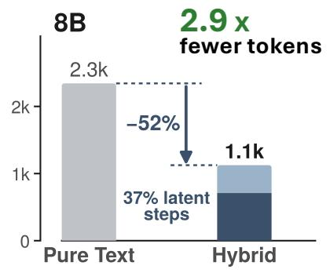

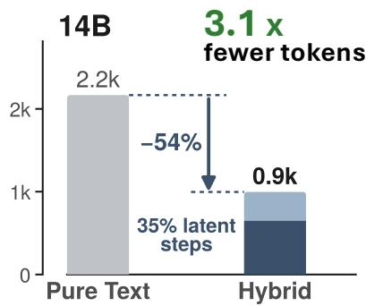  
Figure 6 | Eficient Hybrid Generation of HybridAgent across Model Scales. HybridAgent reduces both text-token usage and total generation steps compared with matched text-based LLM agents.

Scaling Hybrid Reasoning at Test Time. To further examine the test-time scalability of our hybrid reasoning paradigm, we increase inference compute budgets through additional sampling and evaluate pass@k performance. Figure 5 shows that HybridAgent exhibits a clear upward trend as sampling increases across all model scales, while benefiting more from increased test-time compute than agents with text-only RL. Additional 4B-scale experiments and case studies are in Appendix G and J.

## 5.2. Eficiency Advantage on Hybrid Generation

Beyond performance efectiveness, a key architectural advantage of HybridAgent is that latent mode enables efficient generation without costly explicit token decoding. We evaluate this property empirically along three complementary dimensions: (i) token throughput, (ii) wall-clock inference time, and (iii) actual computation cost. As shown in Figures 6 and 7, HybridAgent adaptively balances its hybrid reasoning across text and latent modes by using 2.7× fewer text tokens, reducing total generation steps by up to 54%, and achieving 2.1× faster inference than

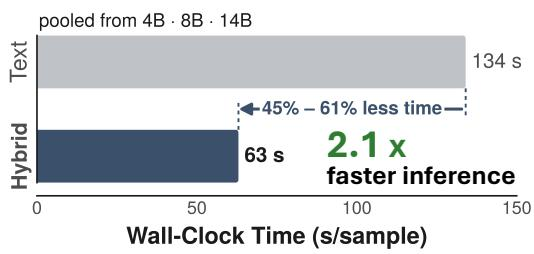  
Figure 7 | Inference time speedup of HybridAgent across all model scales.

text-based baselines. Together with the cost analyses in Table 9 (see Appendix G.2), HybridAgent generates more concise and refined reasoning trajectories, reducing inference overhead and cost.

## 6. In-depth Analyses

RoadMap. We further analyze HybridAgent from 3 complementary perspectives to assess the method design and better understand its hybrid reasoning behavior. (i) Training Dynamics: We study how self-conditioning in HybridSFT improves reasoning performance (Table 3) and latent interpretability (Figure 8), and how HybridRL shifts more reasoning into latent mode while strengthening tool interaction (Figure 9). (ii) Latent-Mode: We intervene on latent content, ordering, and reasoning depth to examine HybridAgent’s causal reliance on latent thoughts (Table 5), and ablate HybridLink architectures to assess the benefits of residual alignment (Table 6). (iii) Text-Mode: We evaluate textbased agentic tool use (Figure 10) and auditability of HybridAgent (Table 7) to verify that text-mode supports reliable environment interaction and remains informative for external monitoring/debugging.

## 6.1. Training Dynamics on HybridSFT and HybridRL

<table><tr><td>Method</td><td>AIME25</td><td></td><td>AIME26 MATH500</td></tr><tr><td>Coconut</td><td>16.3</td><td>15.2</td><td>61.2</td></tr><tr><td>Standard Text SFT</td><td>30.8</td><td>31.7</td><td>83.8</td></tr><tr><td>Qwen3-14B-Base</td><td>4.9</td><td>3.0</td><td>47.0</td></tr><tr><td>+ Format Activation</td><td>20.6</td><td>19.8</td><td>62.4</td></tr><tr><td>+ HybridLink Activation</td><td>23.8</td><td>22.5</td><td>73.8</td></tr><tr><td>+ Self-Condition (HybridSFT)</td><td>32.5</td><td>31.7</td><td>84.2</td></tr></table>

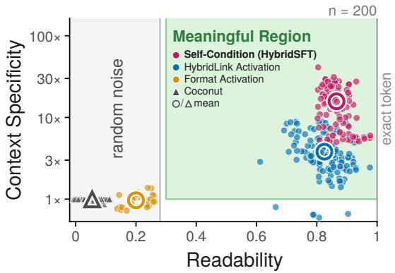  
Table 3 and Figure 8 | Efectiveness and Interpretability of Self-Conditioned HybridSFT. Left: We compare successive HybridSFT stages with latent and text training baselines using the same Qwen3-14B-Base backbone. Right: We evaluate the readability and context-specificity across 200 downstream questions, showing how self-conditioning improves latent transparency.

Self-Conditioning Enables Efective and Interpretable HybridSFT. To understand why selfconditioned training is necessary for HybridAgent during SFT, we compare HybridSFT against variants with only format and HybridLink activations as well as latent SFT baselines like Coconut, from both performance and interpretability perspectives. As shown in Table 3, although all SFT variants improve the original shared Qwen3-14B-Base backbone, activation alone remains insuficient. Self-conditioned supervision further improves performance by an average of 30.5% over HybridLink activation, bringing HybridSFT to parity with standard text SFT across all three math benchmarks.

We further probe the semantics of the latent thoughts produced by each method over 200 questions spanning all downstream domains. Figure 8 reveals a clear progression, where HybridLink activation first makes latent contents more interpretable, and the additional self-conditioned training sharpens the latent readability and semantic informativeness. We then take a closer look to examine individual test instances through detailed case studies in Appendix J. Specifically, methods with low faithfulness and specificity generally produce largely unreadable artifacts of the embedding geometry, whereas the complete HybridSFT yields clear and semantically coherent latent readouts. Overall, these analyses reveal that self-conditioned training is essential to HybridSFT for making the latent reasoning traces in HybridAgent fully transparent and directly interpretable.

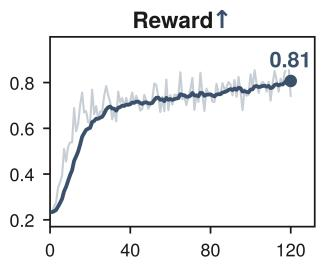

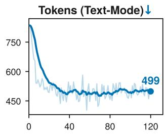

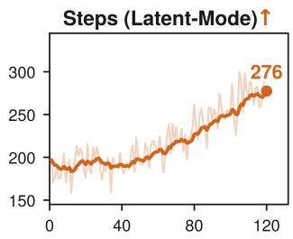

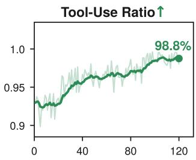  
Figure 9 | Training Dynamics of HybridRL. As training progresses, HybridAgent shifts more generation from text to latent mode while increasing reward and tool use. These trends reflect how HybridAgent adaptively learns to allocate its reasoning and tool calling eforts across the two modes.

Training Dynamics of HybridRL. We analyze HybridAgent’s training behaviors to examine how it dynamically shifts and allocates reasoning efort across text/latent modes under HybridRL. In Figure 9, as the training step increases, our 14B agent progressively allocates more generation to latent mode while simultaneously strengthening its tool-invocation capability. Through training, HybridAgent adaptively learns to better utilize its two modes, shifting more reasoning into faster latent thinking while selectively exposing only key steps for external auditing and tool use through the text interface.

Reward Shaping in HybridRL. We ablate each reward component in Eq. 11 using HybridAgent (8B), removing one term at a time under otherwise identical setups. In Table 4, all three components provide complementary supervision. Excluding �<sub>correct</sub> causes the largest overall degradation, reducing performance by 6.4%- 17.8%, while removing $r _ { \mathrm { f o r m a t } }$ consistently lowers performance by 4.7%-6.9%. The benefit of $r _ { \mathrm { t o o l } }$ is most pronounced on agentic benchmarks such as GAIA and

Table 4 | Ablation on HybridRL rewards.
<table><tr><td colspan="4">Reward Design MATH500 GAIA WebWalker</td></tr><tr><td>HybridRL (8B)</td><td>84.6</td><td>43.7</td><td>42.5</td></tr><tr><td> $\mathbf { w } / \mathbf { o } r _ { \mathrm { c o r r e c t } }$ </td><td>79.2</td><td>35.9</td><td>37.5</td></tr><tr><td> $\mathbf { W } / 0 ~ r _ { \mathrm { f o r m a t } }$ </td><td>80.6</td><td>40.7</td><td>40.5</td></tr><tr><td> $\mathbf { W } / 0 ~ r _ { \mathrm { t o o l } }$ </td><td>84.2</td><td>38.8</td><td>41.0</td></tr></table>

WebWalker. Since the reward is granted only to trajectories that invoke both Python and search tools, removing $r _ { \mathrm { t o o l } }$ has a minor efect on MATH500, where Python alone is typically suficient, but reduces GAIA and WebWalker by 11.2% and 3.5%. Overall, each reward component provides complementary supervision for answer correctness, format structure, and efective multi-tool use.

## 6.2. Causal Reliance and HybridLink Design in Latent Mode

Does HybridAgent Causally Rely on its Latent Mode Thoughts? To examine whether latent thoughts are functionally used during hybrid reasoning, we intervene on the latent vectors generated by 8B and 14B HybridAgent on the MATH500 downstream task. We perturb their content, ordering, and reasoning duration through 4 diferent types of controlled interventions, including (i) noise perturbation, (ii) latent replacement, (iii) latent permutation, and (iv) latent computation restriction. Table 5 details the intervention setups and reports performance under each scenario.

Table 5 | Causal Interventions on HybridAgent Latent Mode. We report MATH500 accuracy (%) for 8B and 14B scales under diferent interventions on latent-mode thoughts generated by HybridAgent. Performance drops substantially when latent semantics or structure are disrupted, indicating that HybridAgent causally relies on semantically meaningful latent-mode thoughts. Here, � denotes the original latent vector and �<sup>′</sup> denotes the intervened counterpart. The relative perturbation strength � is computed as $\| \nu ^ { \prime } - \nu \| / \| \nu \|$ , averaged over latent steps, where � = 0 means no intervention.
<table><tr><td>Latent-Mode Intervention</td><td>Setup Description</td><td>Strength d</td><td>8B-Scale</td><td>14B-Scale</td></tr><tr><td>Noise Perturbation Gaussian Noise</td><td>Add perturbation with random noise of</td><td>0.5</td><td>72.6</td><td>75.0</td></tr><tr><td>(σ = 0.5) Gaussian Noise</td><td>magnitude 0.5|v| before latent feedback. Add perturbation with random noise of</td><td>2.0</td><td>66.4</td><td>70.2</td></tr><tr><td>(σ = 2.0) Latent Replacement</td><td>magnitude 2.0∥v∥l before latent feedback.</td><td></td><td></td><td></td></tr><tr><td>Random-token Replacement</td><td>Replace v with a uniformly sampled token embedding, rescaled to ∥vυ||.</td><td>1.6</td><td>41.2</td><td>44.6</td></tr><tr><td>Cross-problem Replacement</td><td>Replace each latent span with the corresponding latents from a different</td><td>1.4</td><td>44.8</td><td>48.6</td></tr><tr><td>Mean-latent Replacement</td><td>partner problem. Replace every v with the mean latent vector from the original HybridAgent trajectories.</td><td>1.0</td><td>53.6</td><td>58.4</td></tr><tr><td>Nearest-token Replacement</td><td>Replace v with its nearest token embedding, rescaled to ∥|v||.</td><td>0.2</td><td>82.6</td><td>87.2</td></tr><tr><td>Latent Permutation Within-block</td><td>Randomly permute latent vectors within each</td><td></td><td></td><td></td></tr><tr><td>Permutation Latent Computation Restriction</td><td>block; Preserve content but disrupt order.</td><td>0.8</td><td>73.2</td><td>76.4</td></tr><tr><td>One-step Only for Latent Span</td><td>Force each latent span to terminate after one generation step.</td><td>一</td><td>72.2</td><td>75.0</td></tr><tr><td>Block Latent-Mode Entry</td><td>Prevent entry into latent mode, forcing the agent to reason entirely in text.</td><td>一</td><td>80.4</td><td>78.8</td></tr><tr><td>HybridAgent (ours)</td><td>No intervention; the agent feeds back its own generated latent vector v at every latent step.</td><td>0.0</td><td>84.6</td><td>88.2</td></tr></table>

As shown in the table, disrupting latent thoughts consistently degrades performance across both scales. Specifically, cross-problem and random-token replacement reduce accuracy by 44.9-47.0% and 49.4-51.3%, while disrupting their ordering or restricting each latent span to one step leads to 13.4-15.0% degradation. Notably, cross-problem replacement causes substantially greater degradation than even stronger Gaussian perturbations, suggesting that performance depends on the semantic content of latent thoughts rather than perturbation magnitude alone. These analysis results on causal interventions indicate that HybridAgent functionally relies on the semantics, ordering, and suficient reasoning depth of its latent thoughts during hybrid reasoning.

HybridLink Design. We next validate the efectiveness of HybridLink and its residual connection by comparing our adopted 2-layer residual design against 4 alternative architectures: (i) direct hiddenstate reuse $( \mathrm { i . e . , } e _ { t + 1 } { = } h _ { t } )$ without learned alignment, (ii) 1-layer projection, (iii) 1-layer projection with residual connection, and (iv) 2-layer projection without residual connection. We end-to-end train each HybridLink variant with the 14B backbone under the same setup and evaluate across tasks.

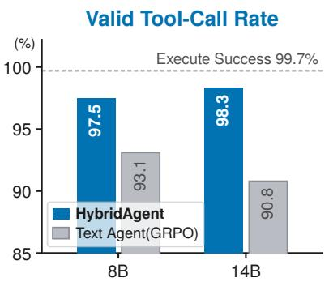

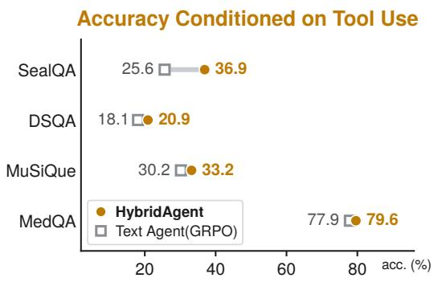

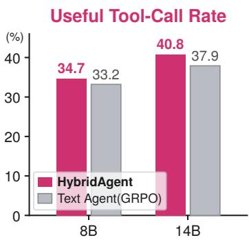  
Figure 10 | Agentic Tool-Use Analysis on HybridAgent. Left: Valid tool-call rate across 8B and 14B scales; "Execute Success" measures error-free execution among valid tool calls. Middle: Final-answer accuracy on questions where the agent performs at least one tool call. Right: Useful tool-call rate, measuring the fraction of tool calls whose execution results contain the final answer.

As shown in Table 6, the full two-layer residual design of HybridLink yields consistent gains across all three downstream benchmarks, with the residual branch benefiting both one- and two-layer projection networks. Specifically, incorporating the residual connection contributes an average improvement of 4.3% across diferent layer depths. This observed trend aligns with our design motivation in Section 3.1, where the residual connection preserves the semantics of input last-layer hidden states while the learned projection aligns these representa-

Table 6 | Efectiveness of HybridLink. We compare accuracy across alternative architectural designs.
<table><tr><td>HybridLink Design</td><td>MATH500 MedQA MuSiQue</td></tr><tr><td>Identity (No Alignment)</td><td>71.4 73.7 24.5</td></tr><tr><td>1-Layer</td><td>83.6 79.7 28.5</td></tr><tr><td>1-Layer+Res.</td><td>86.4 80.3 31.0</td></tr><tr><td>2-Layer</td><td>85.8 81.0 31.5</td></tr><tr><td>2-Layer+Res. (ours)</td><td>88.2 81.7 34.5</td></tr></table>

tions with the input embedding space. Together, these two components make HybridLink a more efective and stable interface for hybrid training and generation.

## 6.3. Tool Use and Reasoning Auditability in Text Mode

Does HybridAgent Text-Mode Preserve Agentic Tool Use? In Figure 10, we analyze agentic toolcalling capabilities by comparing HybridAgent with normal LLM agents trained on GRPO, examining whether hybrid reasoning preserves reliable external interactions through its text mode. Across 8B and 14B scales, HybridAgent achieves higher valid tool-call rates while matching the 99.7% execution success of valid calls, showing that hybrid reasoning preserves a reliable text-mode tool interface. More importantly, the gains extend beyond call validity, as HybridAgent improves final-answer accuracy by 2.2%-44.1% on questions where tools are invoked. The 4.5%-7.7% higher useful tool-call rate further indicates that HybridAgent not only invokes tools correctly, but also retrieves evidence that more directly contributes to solving the task. These findings suggest that HybridAgent preserves the reliable and efective agentic tool use of standard LLM agents through its text mode, while exposing fewer text tokens with interleaved latent reasoning.

Does HybridAgent Text-Mode Preserve External Auditability? A natural question of hybrid reasoning is whether shifting computation into latent mode might potentially compromise the external auditability provided by text. To examine this, we evaluate HybridAgent against matched text agents on MATH500 and AIME25/26, covering 560 problems under identical setups. For each question, an external observer sees only the exposed text steps, tool calls, and tool outputs, while latent spans remain hidden behind their boundary markers. We evaluate four complementary dimensions following commonly adopted evaluation protocols.

Table 7 | Monitorability and Debuggability through HybridAgent Text-Mode. We compare HybridAgent with matched same-size text agents to examine whether its exposed text remains suficient for external monitoring, debugging, correction, and rationale-based inspection under hybrid reasoning. All comparisons are evaluated using paired bootstrap 95% confidence intervals.
<table><tr><td rowspan="2">Metric</td><td rowspan="2">Measurement</td><td colspan="2">8B Scale</td><td colspan="2">14B Scale</td></tr><tr><td>HybridAgent</td><td>Text Agent</td><td>HybridAgent</td><td>Text Agent</td></tr><tr><td rowspan="3">Visible Trace</td><td>Text-Mode tokens per instance</td><td>302</td><td>596</td><td>284</td><td>497</td></tr><tr><td>Latent-Mode steps per instance</td><td>170</td><td></td><td>183</td><td></td></tr><tr><td>Key reasoning steps per 100 visible tokens ↑</td><td>0.72</td><td>0.57</td><td>0.86</td><td>0.67</td></tr><tr><td rowspan="3">Monitoring</td><td>Weak-monitor AUROC (MATH500) ↑</td><td>0.840</td><td>0.772</td><td>0.860</td><td>0.818</td></tr><tr><td>Strong-monitor AUROC (all tasks) ↑</td><td>0.961</td><td>0.935</td><td>0.989</td><td>0.990</td></tr><tr><td>First error correctly localized (%) ↑</td><td>99.2</td><td>94.2</td><td>98.1</td><td>100.0</td></tr><tr><td rowspan="3">Debugging</td><td>Error diagnosis matches reference (%) ↑</td><td>97.6</td><td>93.5</td><td>97.2</td><td>96.3</td></tr><tr><td>Useful corrective hint / Answer leakage (%) ↑ /↓</td><td>97.6/ 0.8</td><td>98.7 / 0.0</td><td>100.0/ 0.9</td><td>98.2 / 0.9</td></tr><tr><td>Fix-rate gain from targeted hint vs. generic retry (∆) ↑</td><td>+9.1</td><td>+3.4</td><td>+5.4</td><td>+3.5</td></tr><tr><td>Correction Sufficiency</td><td>Answer-agreement gain from visible text only (∆) ↑</td><td>+0.25</td><td>+0.17</td><td>+0.30</td><td>+0.28</td></tr></table>

• Monitoring: Measure whether a blind external monitor can predict rollout correctness from the input problem and visible trace generated by each agent, following Baker et al. (2025). We report AUROC using GPT-4o-mini (Hurst et al., 2024) as a weak monitor, which relies primarily on the visible trace rather than solving the problem independently, and GPT-5.6-Luna (OpenAI, 2026) as a strong monitor with more powerful task-solving capability.

• Debugging: Following first-error localization (Zheng et al., 2025a), a judge model (GPT-5.6-Luna) is deployed to identify the first erroneous visible step from a failed rollout and produces a corrective hint, with the diagnosis verified against the reference ground-truth solution.

• Correction: Each failed problem is re-attempted using the corrective hint generated during debugging, and compared against a generic correctness-only feedback baseline (Huang et al., 2024) that simply tells the agent its previous answer was incorrect and asks it to retry.

• Rationale Suficiency: Following suficiency evaluation in DeYoung et al. (2020), a weak reader (GPT-4o-mini) predicts the agent’s own answer from the exposed text steps alone after removing the final answer, measuring whether the visible trace retains suficient decision-relevant information.

As shown in Table 7, HybridAgent exposes 43%-49% fewer text-mode tokens while performing 170-183 reasoning steps in latent mode, yet the visible trace contains 26%-28% more key reasoning steps per 100 tokens. This reduction preserves external monitorability, with AUROC remaining within 0.022 of matched text agents across both weak and strong monitors. The exposed text also remains debuggable, localizing the first error in 98%-99% of failed rollouts and yielding reference-consistent diagnoses in 97%-98% of cases with below 1% answer leakage. Moreover, text-derived corrective hints produce significant fix-rate gains of 5.4 and 9.1 points at 14B and 8B, while rationale suficiency remains comparable to or higher than text agents. As shown by the analyses above, HybridAgent uses its text mode to maintain a compact yet informative textual interface for external monitoring, debugging, and correction. This provides an important safeguard for agent generation, facilitating human auditing and intervention while preserving eficient internal reasoning.

## 7. Related Work

Latent Reasoning Beyond Text. Recent works have explored applying intermediate reasoning beyond discrete language tokens into continuous hidden spaces (Hao et al., 2024; Yu et al., 2026; Zhu et al., 2025a), allowing models to perform internal computation without explicitly verbalizing every reasoning step (Geiping et al., 2026; Shen et al., 2026; Zhu et al., 2025b). Existing approaches broadly realize this idea by inputting last-layer hidden states (Saunshi et al., 2025; Tack et al., 2026), compressing textual chains of thought into latent representations (Cheng and Van Durme, 2024; Zhang et al., 2026a), or directly optimizing continuous reasoning trajectories (Chen et al., 2024; Tan et al., 2026). These methods improve reasoning eficiency and depth but make direct inspection and external interaction dificult (Chen et al., 2026; Korbak et al., 2025). HybridAgent builds on this direction by integrating directly inspectable latent reasoning as a native built-in mode within the agentic generation process, while preserving direct text-based auditing and tool interaction.

Agentic Reasoning and Tool Use. Frontier LLM agents (DeepSeek-AI, 2026; GLM-5-Team et al., 2026; Team, 2026) extend reasoning beyond static generation by interacting with external environments through tools (Qu et al., 2025; Shen, 2024), such as search engines (Jin et al., 2025; Zheng et al., 2025b), code interpreters (Bianchi et al., 2026; Feng et al., 2026), and APIs (Patil et al., 2025; Qin et al., 2024). A growing line of work further improves these capabilities through post-training over multi-turn tool-use trajectories (Dong et al., 2025a; Qian et al., 2025), enabling agents to plan, act, observe, and revise their reasoning (Li et al., 2025c; Su et al., 2025). Despite this progress, existing agentic frameworks remain text-centric for both model-side reasoning and environment-side interaction, incurring large generation overhead from verbalizing every intermediate step (Cuadron et al., 2025; Xu et al., 2025a). HybridAgent decouples these roles by interleaving continuous thoughts for internal reasoning and retaining text only where explicit interaction and monitoring are required.

We discuss additional related work and its relation to HybridAgent in Appendix D.

## 8. Discussion and Future Directions

Implications for Frontier Agent Safety and Secure Deployment. Frontier labs (e.g., OpenAI, Anthropic) provide API-based access to reasoning models while hiding the chain-of-thought from customers to protect intellectual property and limit information leakage, yet Panfilov et al. (2026) show that the encrypted traces returned to clients can be replayed into a sibling model and transcribed verbatim. HybridAgent places proprietary reasoning on a diferent footing. Latent thoughts exist only as backbone hidden states that are readable solely through the provider-owned HybridLink (Section 3), so no text exists to leak. The same property aids monitoring. Because the latent trace is held by the provider rather than the client, providers can assess the safety of reasoning and actions over the full readout, including the portion users never see, while the agent benefits from faster inner thinking. Text mode is then reserved for what users legitimately need, such as tool calls, key decisions, and the final answer, preserving an auditable trace without exposing the full reasoning.

Future Directions on Hybrid Agent Harness and Eficient Post-Training. Future work can build a new type of agent harness around HybridAgent, where latent working memory is a first-class component. Context management can then operate on KV entries directly, workflows can schedule steps by mode, keeping tool calls and human-facing checkpoints in text while routine computation stays latent, and one agent’s hybrid trajectory can serve as its message to another. Hybrid generation can also make post-training more eficient. Because latent thoughts remain auditable during rollout, an external critic can assign step-level credit to latent spans, branch promising trajectories, or terminate ones whose latent reasoning has already gone wrong, before any text or tool call is produced.

## 9. Conclusion

We introduce HybridAgent, a unified hybrid reasoning framework that combines eficient latent reasoning with text-based inspection and tool interaction. HybridAgent enables multi-turn hybrid generation through both architectural designs and dedicated post-training algorithms on SFT and RL stages. Across 11 benchmarks and 3 model scales, HybridAgent achieves strong performance against advanced LLM agents and agentic frameworks spanning text-based and latent reasoning methods, while substantially reducing inference time, token usage, and computational cost. Overall, HybridAgent provides a scalable and eficient framework for next-generation agents that can reason beyond human language while retaining agentic interaction in environments and external inspectability.

## Acknowledgments

The authors thank the members of the Zou Lab and the iDEA-iSAIL Lab for helpful discussions and feedback. Jiaru also thanks Jiuding Sun, Weiyan Shi, Martijn Bartelds, Yongchan Kwon, and many others in the Stanford NLP Group and the Together Agent Team for their support and discussions.

## References

B. Baker, J. Huizinga, L. Gao, Z. Dou, M. Y. Guan, A. Madry, W. Zaremba, J. Pachocki, and D. Farhi. Monitoring reasoning models for misbehavior and the risks of promoting obfuscation, 2025. URL https://arxiv.org/abs/2503.11926.

S. Bengio, O. Vinyals, N. Jaitly, and N. Shazeer. Scheduled sampling for sequence prediction with recurrent neural networks. Advances in neural information processing systems, 28, 2015.

F. Bianchi, Y. Kwon, A. Pappu, and J. Zou. Harnessing the collective intelligence of ai agents in the wild for new discoveries, 2026. URL https://arxiv.org/abs/2606.10402.

M. Bigverdi, Z. Luo, C.-Y. Hsieh, E. Shen, D. Chen, L. G. Shapiro, and R. Krishna. Perception tokens enhance visual reasoning in multimodal language models, 2024. URL https://arxiv.org/abs/ 2412.03548.

L. Brito and C. Baquero. When latent agents lie: Kv-cache integrity in multi-agent llm collaboration, 2026. URL https://arxiv.org/abs/2606.28958.

Center for AI Safety, Scale AI, and HLE Contributors Consortium. A benchmark of expert-level academic questions to assess AI capabilities. Nature, 649:1139–1146, 2026. doi: 10.1038/ s41586-025-09962-4. URL https://arxiv.org/abs/2501.14249.

S. Chang, T. Bai, X. Zhang, Q. Ma, Q. Liu, Z. Liao, Y. Miao, and L. Niu. Unlocking the black box of latent reasoning: An interpretability-guided approach to intervention. In Proceedings of the 64th Annual Meeting of the Association for Computational Linguistics (Volume 1: Long Papers), pages 34019–34032, 2026.

H. Chen, Y. Feng, Z. Liu, W. Yao, A. Prabhakar, S. Heinecke, R. Ho, P. Mui, S. Savarese, C. Xiong, et al. Language models are hidden reasoners: Unlocking latent reasoning capabilities via self-rewarding. arXiv preprint arXiv:2411.04282, 2024.

X. Chen, A. Zhao, H. Xia, X. Lu, H. Wang, Y. Chen, W. Zhang, J. Wang, W. Li, and X. Shen. Reasoning beyond language: A comprehensive survey on latent chain-of-thought reasoning. arXiv preprint arXiv:2505.16782, 2025.

X. Chen, C. T. Leong, G. Wenjin, J. Wang, W. Li, and X. Shen. What makes efective supervision in latent chain-of-thought: An information-theoretic analysis. In Forty-third International Conference on Machine Learning, 2026. URL https://openreview.net/forum?id=x21YkF1UfR.

J. Cheng and B. Van Durme. Compressed chain of thought: Eficient reasoning through dense representations. arXiv preprint arXiv:2412.13171, 2024.

J. Coda-Forno, Z. Zhao, Q. Zhang, D. Tamboli, W. Li, X. Fan, L. Zhang, E. Schulz, and H.-P. Tseng. Exploring system 1 and 2 communication for latent reasoning in llms. arXiv preprint arXiv:2510.00494, 2025.

A. Cuadron, D. Li, W. Ma, X. Wang, Y. Wang, S. Zhuang, S. Liu, L. G. Schroeder, T. Xia, H. Mao, et al. The danger of overthinking: Examining the reasoning-action dilemma in agentic tasks. arXiv preprint arXiv:2502.08235, 2025.

L. Dai, L. Xiang, and K. Yang. A token/kv-cache communication media selection and resource allocation strategy for multi-agent collaboration. Science China Information Sciences, 69(10):200306, 2026.

DeepSeek-AI. Deepseek-v4.1-flash: Pushing the limits of kv cache compression, 2026.

J. DeYoung, S. Jain, N. F. Rajani, E. Lehman, C. Xiong, R. Socher, and B. C. Wallace. ERASER: A benchmark to evaluate rationalized NLP models. In D. Jurafsky, J. Chai, N. Schluter, and J. Tetreault, editors, Proceedings of the 58th Annual Meeting of the Association for Computational Linguistics, pages 4443–4458, Online, July 2020. Association for Computational Linguistics. doi: 10.18653/v1/2020.acl-main.408. URL https://aclanthology.org/2020.acl-main.408/.

G. Dong, Y. Chen, X. Li, J. Jin, H. Qian, Y. Zhu, H. Mao, G. Zhou, Z. Dou, and J. Wen. Tool-star: Empowering llm-brained multi-tool reasoner via reinforcement learning. CoRR, abs/2505.16410, 2025a. doi: 10.48550/ARXIV.2505.16410. URL https://doi.org/10.48550/arXiv.2505. 16410.

G. Dong, H. Mao, K. Ma, L. Bao, Y. Chen, Z. Wang, Z. Chen, J. Du, H. Wang, F. Zhang, et al. Agentic reinforced policy optimization. arXiv preprint arXiv:2507.19849, 2025b.

J. Feng, S. Huang, X. Qu, G. Zhang, Y. Qin, B. Zhong, C. Jiang, J. Chi, and W. Zhong. Retool: Reinforcement learning for strategic tool use in LLMs. In The Fourteenth International Conference on Learning Representations, 2026. URL https://openreview.net/forum?id=tRk1nofSmz.

R. Fu and G. Luo. Selar: Selective latent reasoning in large language models. In Proceedings of the 64th Annual Meeting of the Association for Computational Linguistics (Volume 1: Long Papers), pages 7073–7087, 2026.

J. Geiping, S. McLeish, N. Jain, J. Kirchenbauer, S. Singh, B. Bartoldson, B. Kailkhura, A. Bhatele, and T. Goldstein. Scaling up test-time compute with latent reasoning: A recurrent depth approach. Advances in Neural Information Processing Systems, 38:41340–41391, 2026.

I. Gim, G. Chen, S.-s. Lee, N. Sarda, A. Khandelwal, and L. Zhong. Prompt cache: Modular attention reuse for low-latency inference. Proceedings of Machine Learning and Systems, 6:325–338, 2024.

GLM-5-Team et al. GLM-5: from vibe coding to agentic engineering, 2026. URL https://arxiv. org/abs/2602.15763.

N. Gupta, R. Chatterjee, L. Haas, C. Tao, A. Wang, C. Liu, H. Oiwa, E. Gribovskaya, J. Ackermann, J. Blitzer, S. Goldshtein, and D. Das. Deepsearchqa: Bridging the comprehensiveness gap for deep research agents, 2026. URL https://arxiv.org/abs/2601.20975.

S. Hao, S. Sukhbaatar, D. Su, X. Li, Z. Hu, J. Weston, and Y. Tian. Training large language models to reason in a continuous latent space. arXiv preprint arXiv:2412.06769, 2024.

J. Hu, W. Huang, W. Wang, H. Wang, tiancheng hu, zhang qin, H. Feng, X. Chen, Y. Shan, and T. Xie. EPIC: Eficient position-independent caching for serving large language models. In Forty-second International Conference on Machine Learning, 2025. URL https://openreview.net/forum? id=qjd3ZUiHRT.

J. Huang, X. Chen, S. Mishra, H. S. Zheng, A. W. Yu, X. Song, and D. Zhou. Large language models cannot self-correct reasoning yet. In The Twelfth International Conference on Learning Representations, 2024. URL https://openreview.net/forum?id=IkmD3fKBPQ.

HuggingFaceH4. Math-500 dataset. https://huggingface.co/datasets/HuggingFaceH4/ MATH-500, 2023.

A. Hurst, A. Lerer, A. P. Goucher, A. Perelman, A. Ramesh, A. Clark, A. Ostrow, A. Welihinda, A. Hayes, A. Radford, et al. Gpt-4o system card. arXiv preprint arXiv:2410.21276, 2024.

B. Jin, H. Zeng, Z. Yue, J. Yoon, S. Arik, D. Wang, H. Zamani, and J. Han. Search-r1: Training llms to reason and leverage search engines with reinforcement learning. arXiv preprint arXiv:2503.09516, 2025.

J. Juravsky, B. Brown, R. S. Ehrlich, D. Y. Fu, C. Re, and A. Mirhoseini. Hydragen: High-throughput LLM inference with shared prefixes. In Workshop on Eficient Systems for Foundation Models II @ ICML2024, 2024. URL https://openreview.net/forum?id=Ye3ia34Fpp.

T. Korbak, M. Balesni, E. Barnes, Y. Bengio, J. Benton, J. Bloom, M. Chen, A. Cooney, A. Dafoe, A. Dragan, et al. Chain of thought monitorability: A new and fragile opportunity for ai safety. arXiv preprint arXiv:2507.11473, 2025.

T. Kwa, B. West, J. Becker, A. Deng, K. Garcia, M. Hasin, S. Jawhar, M. Kinniment, N. Rush, S. Von Arx, et al. Measuring ai ability to complete long software tasks. Advances in Neural Information Processing Systems, 38:92213–92266, 2026.

W. Kwon, Z. Li, S. Zhuang, Y. Sheng, L. Zheng, C. H. Yu, J. Gonzalez, H. Zhang, and I. Stoica. Eficient memory management for large language model serving with pagedattention. In Proceedings of the 29th symposium on operating systems principles, pages 611–626, 2023.

X. Li, G. Dong, J. Jin, Y. Zhang, Y. Zhou, Y. Zhu, P. Zhang, and Z. Dou. Search-o1: Agentic searchenhanced large reasoning models. In C. Christodoulopoulos, T. Chakraborty, C. Rose, and V. Peng, editors, Proceedings of the 2025 Conference on Empirical Methods in Natural Language Processing, pages 5420–5438, Suzhou, China, Nov. 2025a. Association for Computational Linguistics. ISBN 979-8-89176-332-6. doi: 10.18653/v1/2025.emnlp-main.276. URL https://aclanthology. org/2025.emnlp-main.276/.

X. Li, J. Jin, G. Dong, H. Qian, Y. Wu, J.-R. Wen, Y. Zhu, and Z. Dou. Webthinker: Empowering large reasoning models with deep research capability. In The Thirty-ninth Annual Conference on Neural Information Processing Systems, 2025b. URL https://openreview.net/forum?id= 7LKKHBAMzH.

Z. Li, H. Zhang, S. Han, S. Liu, J. Xie, Y. Zhang, Y. Choi, J. Zou, and P. Lu. In-the-flow agentic system optimization for efective planning and tool use. arXiv preprint arXiv:2510.05592, 2025c.

Y. Liu. Beyond tokens: a unified framework for latent communication in llm-based multi-agent systems, 2026. URL https://arxiv.org/abs/2606.05711.

F. Lv, L. Wang, R. Hong, Y. Du, X. Wu, T. Gao, G. Zhou, and C. Zhang. Beyond tokens: Dynamic latent reasoning via semantic residual refinement. In S. Koenig, C. Jenkins, and M. E. Taylor, editors, Fortieth AAAI Conference on Artificial Intelligence, Thirty-Eighth Conference on Innovative Applications of Artificial Intelligence, Sixteenth Symposium on Educational Advances in Artificial Intelligence, AAAI 2026, Singapore, January 20-27, 2026, pages 32383–32391. AAAI Press, 2026. doi: 10.1609/AAAI.V40I38.40513. URL https://doi.org/10.1609/aaai.v40i38.40513.

D. Ma, Y. Wang, and T. Lan. Block-attention for eficient prefilling. In The Thirteenth International Conference on Learning Representations, 2025. URL https://openreview.net/forum?id= 7zNYY1E2fq.

math ai. AIME 2025 dataset. https://huggingface.co/datasets/math-ai/aime25, 2025.

MathArena. Aime 2026 dataset. https://huggingface.co/datasets/MathArena/aime\_ 2026, 2026.

G. Mialon, C. Fourrier, T. Wolf, Y. LeCun, and T. Scialom. GAIA: a benchmark for general AI assistants. In The Twelfth International Conference on Learning Representations, 2024. URL https: //openreview.net/forum?id=fibxvahvs3.

X. Mou, S. Wang, Z. Li, Y. He, and Z. Wei. Hylat: Eficient multi-agent communication via hybrid latent-text protocol. arXiv preprint arXiv:2605.25421, 2026.

A. Ning, Y.-L. Kuo, and G. Gomes. Learning when to stop: Adaptive latent reasoning via reinforcement learning. arXiv preprint arXiv:2511.21581, 2025.

OpenAI. GPT-5.6 Luna. OpenAI API model documentation, 2026. URL https://developers. openai.com/api/docs/models/gpt-5.6-luna. Accessed: 2026-09-16.

A. Panfilov, D. Schmotz, I. Shumailov, L. Beurer-Kellner, J. Schaefer, A. Prabhu, J. Geiping, and M. Andriushchenko. Stealing reasoning traces from proprietary llm apis, 2026. URL https: //arxiv.org/abs/2608.09867.

S. G. Patil, H. Mao, F. Yan, C. C.-J. Ji, V. Suresh, I. Stoica, and J. E. Gonzalez. The berkeley function calling leaderboard (BFCL): From tool use to agentic evaluation of large language models. In Forty-second International Conference on Machine Learning, 2025. URL https://openreview. net/forum?id=2GmDdhBdDk.

T. Pham, N. P. Nguyen, P. Zunjare, W. Chen, Y.-M. Tseng, and T. Vu. SealQA: Raising the bar for reasoning in search-augmented language models. In The Fourteenth International Conference on Learning Representations, 2026. URL https://openreview.net/forum?id=zWb7ueH16c.

C. Qian, E. C. Acikgoz, Q. He, H. WANG, X. Chen, D. Hakkani-Tür, G. Tur, and H. Ji. ToolRL: Reward is all tool learning needs. In The Thirty-ninth Annual Conference on Neural Information Processing Systems, 2025. URL https://openreview.net/forum?id=eOLdGbXT6t.

Y. Qin, S. Liang, Y. Ye, K. Zhu, L. Yan, Y. Lu, Y. Lin, X. Cong, X. Tang, B. Qian, S. Zhao, L. Hong, R. Tian, R. Xie, J. Zhou, M. Gerstein, dahai li, Z. Liu, and M. Sun. ToolLLM: Facilitating large language models to master 16000+ real-world APIs. In The Twelfth International Conference on Learning Representations, 2024. URL https://openreview.net/forum?id=dHng2O0Jjr.

C. Qu, S. Dai, X. Wei, H. Cai, S. Wang, D. Yin, J. Xu, and J.-r. Wen. Tool learning with large language models: a survey. Frontiers of Computer Science, 19(8), Jan. 2025. ISSN 2095-2236. doi: 10.1007/s11704-024-40678-2. URL http://dx.doi.org/10.1007/s11704-024-40678-2.

M. Ranzato, S. Chopra, M. Auli, and W. Zaremba. Sequence level training with recurrent neural networks. arXiv preprint arXiv:1511.06732, 2015.

D. Rein, B. L. Hou, A. C. Stickland, J. Petty, R. Y. Pang, J. Dirani, J. Michael, and S. R. Bowman. Gpqa: A graduate-level google-proof q&a benchmark, 2023. URL https://arxiv.org/abs/ 2311.12022.

N. Saunshi, N. Dikkala, Z. Li, S. Kumar, and S. J Reddi. Reasoning with latent thoughts: On the power of looped transformers. In International Conference on Learning Representations, volume 2025, pages 14855–14881, 2025.

J. Schulman, F. Wolski, P. Dhariwal, A. Radford, and O. Klimov. Proximal policy optimization algorithms. arXiv preprint arXiv:1707.06347, 2017.

Z. Shao, P. Wang, Q. Zhu, R. Xu, J. Song, X. Bi, H. Zhang, M. Zhang, Y. K. Li, Y. Wu, and D. Guo. Deepseekmath: Pushing the limits of mathematical reasoning in open language models, 2024. URL https://arxiv.org/abs/2402.03300.

X. Shen, Y. Wang, Y. Zhou, X. Shi, P. Zhao, Y. Wang, and J. Gu. Eficient reasoning with hidden thinking. In Forty-third International Conference on Machine Learning, 2026. URL https:// openreview.net/forum?id=Hn81xuLaXY.

Z. Shen. Llm with tools: A survey, 2024. URL https://arxiv.org/abs/2409.18807.

G. Sheng, C. Zhang, Z. Ye, X. Wu, W. Zhang, R. Zhang, Y. Peng, H. Lin, and C. Wu. Hybridflow: A flexible and eficient rlhf framework. In Proceedings of the Twentieth European Conference on Computer Systems, pages 1279–1297, 2025.

D. Shi, A. Asi, K. Li, X. Yuan, L. Pan, W. Lee, and W. Xiao. Swireasoning: Switch-thinking in latent and explicit for pareto-superior reasoning LLMs. In The Fourteenth International Conference on Learning Representations, 2026. URL https://openreview.net/forum?id=t33kMzEAg8.

D. Silver and R. S. Sutton. Welcome to the era of experience. Google AI, 1(11):6, 2025.

H. Su, S. Diao, X. Lu, M. Liu, J. Xu, X. Dong, Y. Fu, P. Belcak, H. Ye, H. Yin, Y. Dong, E. Bakhturina, T. Yu, Y. Choi, J. Kautz, and P. Molchanov. Toolorchestra: Elevating intelligence via eficient model and tool orchestration, 2025. URL https://arxiv.org/abs/2511.21689.

T. Sumers, S. Yao, K. R. Narasimhan, and T. L. Grifiths. Cognitive architectures for language agents. Transactions on Machine Learning Research, 2024. ISSN 2835-8856. URL https://openreview. net/forum?id=1i6ZCvflQJ. Survey Certification, Featured Certification.

Y. Sun, X. Han, W. Zhang, Y. Pang, T. Wang, Y. Cao, Y. Huang, C. Duroiu, H. Zhang, J. Lin, et al. Agents’ last exam. arXiv preprint arXiv:2606.05405, 2026.

J. Tack, J. Lanchantin, J. Dwivedi-Yu, A. Cohen, I. Kulikov, J. Lan, S. Hao, Y. Tian, J. E. Weston, and X. Li. Llm pretraining with continuous concepts. In International Conference on Learning Representations, volume 2026, pages 54214–54231, 2026.

W. Tan, J. Li, J. Ju, Z. Luo, R. Song, and J. Luan. Think silently, think fast: Dynamic latent compression of llm reasoning chains. Advances in Neural Information Processing Systems, 38:4646–4668, 2026.

Y. Tang, W. Su, Y. Zhou, Y. Liu, M. Zhang, S. Ma, and Q. Ai. Augmenting multi-agent communication with state delta trajectory. In C. Christodoulopoulos, T. Chakraborty, C. Rose, and V. Peng, editors, Proceedings of the 2025 Conference on Empirical Methods in Natural Language Processing, pages

10219–10240, Suzhou, China, Nov. 2025. Association for Computational Linguistics. ISBN 979- 8-89176-332-6. doi: 10.18653/v1/2025.emnlp-main.518. URL https://aclanthology.org/ 2025.emnlp-main.518/.

K. Team. Kimi K3: open frontier intelligence. CoRR, abs/2607.24653, 2026. doi: 10.48550/ARXIV. 2607.24653. URL https://doi.org/10.48550/arXiv.2607.24653.

Q. Team. Qwq-32b: Embracing the power of reinforcement learning, March 2025. URL https: //qwenlm.github.io/blog/qwq-32b/.

H. Trivedi, N. Balasubramanian, T. Khot, and A. Sabharwal. MuSiQue: Multihop questions via single-hop question composition. Transactions of the Associationfor Computational Linguistics, 2022.

Q. Wang, Y. Shi, Y. Wang, Y. Zhang, P. Wan, K. Gai, X. Ying, and Y. Wang. Monet: Reasoning in latent visual space beyond images and language. arXiv preprint arXiv:2511.21395, 2025.

J. Wu, W. Yin, Y. Jiang, Z. Wang, Z. Xi, R. Fang, L. Zhang, Y. He, D. Zhou, P. Xie, and F. Huang. WebWalker: Benchmarking LLMs in web traversal. In W. Che, J. Nabende, E. Shutova, and M. T. Pilehvar, editors, Proceedings of the 63rd Annual Meeting of the Association for Computational Linguistics (Volume 1: Long Papers), pages 10290–10305, Vienna, Austria, July 2025. Association for Computational Linguistics. ISBN 979-8-89176-251-0. doi: 10.18653/v1/2025.acl-long.508. URL https://aclanthology.org/2025.acl-long.508/.

S. Xu, W. Xie, L. Zhao, and P. He. Chain of draft: Thinking faster by writing less, 2025a. URL https://arxiv.org/abs/2502.18600.

X. Xu, T. Yu, X. Chen, H. Wang, J. McAuley, and S. Mitra. Thinkrouter: Eficient reasoning via routing thinking between latent and discrete spaces. arXiv preprint arXiv:2602.11683, 2026.

Y. Xu, X. Guo, Z. Zeng, and C. Miao. SoftCoT: Soft chain-of-thought for eficient reasoning with LLMs. In W. Che, J. Nabende, E. Shutova, and M. T. Pilehvar, editors, Proceedings of the 63rd Annual Meeting of the Association for Computational Linguistics (Volume 1: Long Papers), pages 23336–23351, Vienna, Austria, July 2025b. Association for Computational Linguistics. ISBN 979-8- 89176-251-0. doi: 10.18653/v1/2025.acl-long.1137. URL https://aclanthology.org/2025. acl-long.1137/.

A. Yang, A. Li, B. Yang, B. Zhang, B. Hui, B. Zheng, B. Yu, C. Gao, C. Huang, C. Lv, et al. Qwen3 technical report. arXiv preprint arXiv:2505.09388, 2025a.

H. Yang, H. Chen, H. Guo, Y. Chen, C.-S. Lin, S. Hu, J. Hu, X. Wu, and X. Wang. Llm-medqa: Enhancing medical question answering through case studies in large language models. arXiv preprint arXiv:2501.05464, 2024.

J. Yang, B. Hou, W. Wei, Y. Bao, and S. Chang. KVLink: Accelerating large language models via eficient KV cache reuse. In The Thirty-ninth Annual Conference on Neural Information Processing Systems, 2025b. URL https://openreview.net/forum?id=oDcAGSXZZP.

J. Yang, C. Chen, S. Wu, Y. Liu, Y. Fan, L. Li, S. Lai, C. Qin, and Z. Guo. Demystifying hidden-state recurrence: Switchable latent reasoning with on-policy reinforcement learning. arXiv preprint arXiv:2606.13106, 2026.

S. Yao, J. Zhao, D. Yu, N. Du, I. Shafran, K. R. Narasimhan, and Y. Cao. React: Synergizing reasoning and acting in language models. In The Eleventh International Conference on Learning Representations, 2023. URL https://openreview.net/forum?id=WE\_vluYUL-X.

L. Ye, Z. Tao, Y. Huang, and Y. Li. ChunkAttention: Eficient self-attention with prefix-aware KV cache and two-phase partition. In L.-W. Ku, A. Martins, and V. Srikumar, editors, Proceedings of the 62nd Annual Meeting of the Association for Computational Linguistics (Volume 1: Long Papers), pages 11608–11620, Bangkok, Thailand, Aug. 2024. Association for Computational Linguistics. doi: 10.18653/v1/2024.acl-long.623. URL https://aclanthology.org/2024.acl-long.623/.

X. Ye, Y. Mao, J. Zhang, Y. Liu, L. Hao, F. Wu, Z. Li, Y. Liao, Z. Wang, Z. Liu, Z. Yin, L. Yuan, P. Torr, H. Sun, xiangxiang Zeng, M. Wang, L. Cong, S. Gao, and X. Tang. Latentchem: From textual cot to latent thinking in chemical reasoning. In Workshop on Latent & Implicit Thinking – Going Beyond CoT Reasoning, 2026. URL https://openreview.net/forum?id=ToCIS6xUwF.

Q. Yu, Z. Zhang, R. Zhu, Y. Yuan, X. Zuo, Y. Yue, W. Dai, T. Fan, G. Liu, J. Liu, L. Liu, X. Liu, H. Lin, et al. DAPO: An open-source LLM reinforcement learning system at scale. In The Thirty-ninth Annual Conference on Neural Information Processing Systems, 2025. URL https://openreview. net/forum?id=2a36EMSSTp.

X. Yu, Z. Chen, Y. He, T. Fu, G. Dong, C. Yang, C. Xu, Y. Ma, X. Hu, Z. Cao, et al. The latent space: Foundation, evolution, mechanism, ability, and outlook. arXiv preprint arXiv:2604.02029, 2026.

Z. Yue, B. Jin, H. Zeng, H. Zhuang, Z. Qin, J. Yoon, L. Shang, J. Han, and D. Wang. Hybrid latent reasoning via reinforcement learning. In The Thirty-ninth Annual Conference on Neural Information Processing Systems, 2025. URL https://openreview.net/forum?id=LjtgTpWH71.

G. Zhang, M. Fu, and S. Yan. Memgen: Weaving generative latent memory for self-evolving agents. In International Conference on Learning Representations, volume 2026, pages 22555–22588, 2026a.

J. Zhang, S. Hu, C. Lu, R. Lange, and J. Clune. Darwin gödel machine: open-ended evolution of self-improving agents. In International Conference on Learning Representations, volume 2026, pages 104223–104294, 2026b.

Z. Zhang, X. He, W. Yan, A. Shen, C. Zhao, and X. E. Wang. Soft thinking: Unlocking the reasoning potential of LLMs in continuous concept space. In The Thirty-ninth Annual Conference on Neural Information Processing Systems, 2025. URL https://openreview.net/forum?id=ByQdHPGKgU.

C. Zheng, Z. Zhang, B. Zhang, R. Lin, K. Lu, B. Yu, D. Liu, J. Zhou, and J. Lin. Processbench: Identifying process errors in mathematical reasoning. In Proceedings of the 63rd Annual Meeting of the Association for Computational Linguistics (Volume 1: Long Papers), pages 1009–1024, 2025a.

L. Zheng, L. Yin, Z. Xie, C. Sun, J. Huang, C. H. Yu, S. Cao, C. Kozyrakis, I. Stoica, J. E. Gonzalez, C. Barrett, and Y. Sheng. SGLang: Eficient execution of structured language model programs. In The Thirty-eighth Annual Conference on Neural Information Processing Systems, 2024. URL https://openreview.net/forum?id=VqkAKQibpq.

Y. Zheng, D. Fu, X. Hu, X. Cai, L. Ye, P. Lu, and P. Liu. Deepresearcher: Scaling deep research via reinforcement learning in real-world environments. In Proceedings of the 2025 Conference on Empirical Methods in Natural Language Processing, pages 414–431, 2025b.

H. Zhu, S. Hao, Z. Hu, J. Jiao, S. Russell, and Y. Tian. Reasoning by superposition: A theoretical perspective on chain of continuous thought. In ICML 2025 Workshop on Methods and Opportunities at Small Scale, 2025a. URL https://openreview.net/forum?id=1cD9iO5Isv.

R.-J. Zhu, T. Peng, T. Cheng, X. Qu, J. Huang, D. Zhu, H. Wang, K. Xue, X. Zhang, Y. Shan, et al. A survey on latent reasoning. arXiv preprint arXiv:2507.06203, 2025b.

## Table of Contents

A Multi-turn Continuation over Working Memory 25   
B Design and Analyses of Hybrid Supervised Fine-tuning 27   
B.1 Why Self-Conditioned Training? . 27   
B.2 Learning When to Enter and Exit Latent Mode . 28   
C Theoretical Analyses of Hybrid Reinforcement Learning 29   
C.1 Formulation of Hybrid Policy Factorization . 29   
C.2 Hybrid Policy Optimization 29   
D Extended Related Work 32   
E Hybrid Data Curation 33   
F Latent Interpretability Evaluation (Figures 2 and 8) 34   
G Additional Experiments 35   
G.1 Experiments on 4B-Scale HybridAgent 35   
G.2 Cost Analyses on HybridAgent . 35   
H Experiment Setups 36   
H.1 Benchmark and Evaluation Details 36   
H.2 Baseline Details . 37   
H.3 Implementation Details 38   
I Prompt Template 41   
J Case Study of HybridAgent 43

## Appendix

## A. Multi-turn Continuation over Working Memory

Following our notation in Section 2, denote the input sequence $E _ { \le t } = \left[ e _ { 1 } , \ldots , e _ { t } \right]$ and working memory $\boldsymbol { \mathcal { M } } _ { t } = [ K _ { \le t } , V _ { \le t } ]$ at step �, where � and � collect the keys and values across all layers.

Theorem A.1 (Lossless Multi-Turn Working Memory). Given the multi-turn generation process in Section 3.2, consider the fixed HybridAgent $f _ { \theta }$ and HybridLink R under consistent inference settings. At step $t ,$ let $h _ { t + 1 }$ be the hidden output obtained by processing $e _ { t + 1 }$ with the complete working memory M<sub>�</sub>. Then,

$$
\begin{array} { r l r l } { \underbrace { h _ { t + 1 } } _ { \mathrm { ~ \normalfont ~  ~ } } } & { { } = } & { } & { { } \underbrace { f _ { \theta } \big ( [ \boldsymbol { E } _ { \leq t } ; \boldsymbol { e } _ { t + 1 } ] \big ) } _ { \mathrm { ~ \normalfont ~  ~ } } } \end{array}\tag{12}
$$

$$
p r o c e s s e _ { t + 1 } u s i n g \ { \mathcal { M } } _ { t } ~ a p p l y \ t h e { c o m p l e t e } ~ h y b r i d \ p r e f i x
$$

Thus, working memory preserves the text, latent, and tool observations for continued reasoning, without converting latent thoughts into text.

Remark A.2. Theorem A.1 shows that retaining complete working memory preserves the efect of the full hybrid history on subsequent generation across turns. This justifies resuming HybridAgent after tool interactions without reconstructing earlier turns or converting latent thoughts into text.

Proof. Fix $f _ { \theta }$ and HybridLink ${ \mathcal { R } } ,$ and use the same deterministic causal operations, masks, and positional encoding, preserving all existing KV entries. Each cached forward run produces both a hidden output and an updated memory:

$$
\underbrace { ( e _ { t + 1 } , \mathcal { M } _ { t } ) } _ { \mathrm { n e x t ~ i n p u t ~ a n d ~ p r e c e d i n g ~ c o n t e x t } } \xrightarrow [ ] { \mathrm { c a c h e d ~ f o r w a r d ~ r u n } } \underbrace { ( h _ { t + 1 } , \mathcal { M } _ { t + 1 } ) } _ { \mathrm { h i d d e n ~ o u t p u t ~ a n d ~ u p d a t e d ~ m e m o r y } } .
$$

The hidden output determines the next text distribution or latent input, while the updated memory provides the context for the following forward run. Here, layer and head indices are omitted for notation simplicity. We compare a memory-based forward run with a full-prefix forward run under the same model and inference settings.

Base case $( t = 1 )$ . Both forward runs start with empty memory and the same input $e _ { 1 }$ . At the first layer, they produce the same queries, keys, values, and attention outputs. The remaining token-wise operations produce the same input to the next layer. Repeating this argument through all layers gives

$$
\begin{array} { r } { M _ { 1 } = [ K _ { 1 } , V _ { 1 } ] . } \end{array}
$$

Both forward runs also produce the same final hidden output, $h _ { 1 } = f _ { \theta } ( [ e _ { 1 } ] )$

Induction hypothesis. Suppose that, after processing step $t ,$ the stored keys and values are equal to those computed by a full-prefix forward run:

$$
\underbrace { \mathcal { M } _ { t } } _ { \substack { \mathrm { s t o r e d ~ K V ~ m e m o r y } } } = \underbrace { \left[ K _ { \le t } , V _ { \le t } \right] } _ { \substack { \mathrm { K V ~ c o m p u t e d ~ f r o m ~ t h e ~ c o m p l e t e ~ p r e f i x ~ } E _ { \le t } } } .
$$

Induction step $( t  t + 1 )$ . Causality and unchanged positional encoding preserve the earlier keys and values when $e _ { t + 1 }$ is appended. Both forward runs start the first layer with the same input $e _ { t + 1 }$

If their inputs to the current layer are equal, each head computes the same query, new keys and values. The earlier KV entries are equal by the induction hypothesis. With the same attention mask, each head therefore produces the same attention output. The remaining token-wise operations produce the same input to the following layer.

Repeating this implication through all layers gives the same final hidden output:

$$
h _ { t + 1 } = f _ { \theta } \big ( \big [ E _ { \leq t } ; e _ { t + 1 } \big ] \big ) .
$$

It also gives the same new keys and values, $K _ { t + 1 } , V _ { t + 1 }$ . Appending them to the stored memory and substituting the induction hypothesis yields

$$
\begin{array} { r l } & { M _ { t + 1 } = M _ { t } \oplus \left[ K _ { t + 1 } , V _ { t + 1 } \right] } \\ & { \qquad = \left[ K _ { \leq t } , V _ { \leq t } \right] \oplus \left[ K _ { t + 1 } , V _ { t + 1 } \right] } \\ & { \qquad = \left[ K _ { \leq t + 1 } , V _ { \leq t + 1 } \right] . } \end{array}
$$

Thus, the updated memory satisfies the induction hypothesis at � + 1, while the hidden-output equality establishes Eq. 12. By induction, at every input position, the cached forward run produces the same hidden output and updated KV memory as the full-prefix forward run.

At the end of each turn $j \in \{ 1 , \ldots , n \}$ , let $\begin{array} { r } { t \ = \ | \boldsymbol { x } | + \sum _ { i = 1 } ^ { j } | \tau ^ { ( i ) } | } \end{array}$ count all input slots processed so far, including the initial context and all text, latent, and tool-observation inputs. Starting from $M ^ { ( 0 ) } = [ K _ { \leq | x | } , V _ { \leq | x | } ]$ , repeated concatenation gives

$$
\begin{array} { l } { { \mathcal { M } ^ { ( j ) } = \mathcal { M } ^ { ( 0 ) } \oplus \left[ K _ { | x | + 1 : t } , V _ { | x | + 1 : t } \right] } } \\ { { \quad \ = [ K _ { \leq | x | } , V _ { \leq | x | } ] \oplus [ K _ { | x | + 1 : t } , V _ { | x | + 1 : t } ] } } \\ { { \quad \ = [ K _ { \leq t } , V _ { \leq t } ] . } } \end{array}
$$

Each new entry is appended exactly once, so turn boundaries do not change the memory used by subsequent forward runs.

Finally, the established hidden-state equality gives

$$
\begin{array} { r l } & { { \mathrm { S o f t m a x } } ( W _ { \mathrm { o u t } } h _ { t } ) = { \mathrm { S o f t m a x } } ( W _ { \mathrm { o u t } } f _ { \theta } ( E _ { \leq t } ) ) , } \\ & { \quad \quad \quad \quad \mathcal { R } ( h _ { t } ) = \mathcal { R } ( f _ { \theta } ( E _ { \leq t } ) ) . } \end{array}
$$

where we retain the corresponding hidden states and tool observations, while using the same random draws for sampling and tool execution in both runs. Then, both runs process the same next input with the same memory and reasoning mode, producing the same hidden output and updated KV memory. Repeating this argument step by step gives identical subsequent hybrid sequences under the shared random draws, and hence identical generation probabilities. Therefore, working memory preserves the efect of the complete hybrid history across turns, without reconstructing latent thoughts as text.

## B. Design and Analyses of Hybrid Supervised Fine-tuning

We expand on the method description of HybridSFT (Section 4.1), providing additional design justifications and implementation details for the overall training scheme.

## B.1. Why Self-Conditioned Training?

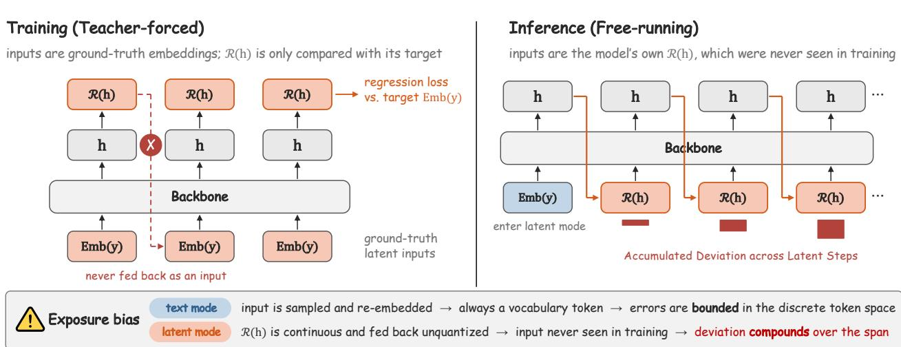  
Figure 11 | Train-Inference Mismatch in Latent Reasoning. We illustrate the exposure bias that arises when teacher-forced training meets free-running inference. Left: During activation, the backbone consumes ground-truth embeddings Emb(�) at latent positions, while HybridLink outputs R(ℎ) are only trained to match their targets and never fed back as inputs. Right: At inference, every latent input is the model’s own R(ℎ), so deviations from the target embeddings accumulate across the span.

The format and HybridLink activation provide a well-aligned initialization, but both are teacher-forced (Figure 11, left). At every latent position, the backbone consumes the ground-truth embedding Emb(�), and HybridLink is trained only to match its output R(ℎ) to that target; the prediction itself is never fed back as an input. At inference, the agent instead runs free (Figure 11, right). Once it enters latent mode, every subsequent input is its own R(ℎ), which neither the backbone nor HybridLink has been conditioned on. This train-inference mismatch is akin to exposure bias (Bengio et al., 2015; Ranzato et al., 2015), a standard issue in autoregressive sequence models that are trained on ground-truth prefixes but consume their own predictions at inference.

It is worth noting that exposure bias is present in both text and latent modes, since both feed the model’s own outputs back as inputs. In text mode (as in standard LLM SFT), each fed-back input is sampled and re-embedded, and thus always corresponds to a token in the discrete vocabulary. A prediction error, where the sampled token difers from the ground-truth target, only changes which token is fed back; the input representation itself never leaves the set seen in training, so errors cannot compound in the input space. Latent mode, in contrast, has no such projection. R (ℎ) is continuous and fed back unquantized, so even a small deviation from the target embedding becomes an input the backbone has never seen in training. This deviation propagates to the next hidden state and hence the next latent input, compounding over the tens to hundreds of steps in a latent span and gradually eroding the semantic coherence of the latent trace.

Self-conditioned HybridSFT closes this gap by training both components on the model’s own generated latent inputs. As in Figure 4, the teacher-forced first pass applies HybridLink to the last-layer hidden state at each latent position, yielding the model’s own prediction of the next latent input. The second pass then replaces the ground-truth latent embeddings with these predictions and trains the backbone and HybridLink jointly, so both parts learn under the same latent inputs they encounter at inference. Under this training scheme, the backbone learns to read, and HybridLink learns to produce, latent inputs under the same conditions they encounter at inference. Thus, HybridAgent is trained as an integrated whole rather than two separately activated components.

## B.2. Learning When to Enter and Exit Latent Mode

As stated in Section 3, HybridAgent transitions between modes through two special tokens, the entry anchor <latent> and the exit anchor </latent>. Within a latent span, these anchors are the only positions supervised by $\mathcal { L } _ { \mathrm { B a c k b o n e } }$ , while every other latent position is supervised by $\mathcal { L } _ { \mathrm { H y b r i d L i n k } }$ alone. The two transitions are not symmetric, however. Entering latent mode is decided in text mode, where the backbone samples the next token from the vocabulary as usual, whereas exiting must be decided from a continuous latent state through the readout in Eq. 5. HybridSFT therefore treats the entry anchor as an ordinary token and gives the exit anchor dedicated supervision.

Entry as a Text-Mode Decision. Since entering is a text mode decision, <latent> is simply a cross-entropy target, and the backbone learns from the preceding context when to switch. The anchor position then serves as the first latent step, with its last-layer hidden state passed through HybridLink to produce the next latent input, so the span begins without any additional mechanism.

Exit as a Latent-Mode Decision. Exiting takes place in latent mode, where no token is sampled. By Eq. 5, a span closes when the HybridLink’s output R(ℎ) is nearest to Emb(</latent>), a decision depending on both components, where the backbone produces a hidden state that encodes the exit and HybridLink maps it onto the anchor embedding. HybridSFT therefore supervises the last latent step of each span from both sides. On the HybridLink side, the regression target at this step is Emb(</latent>), given slightly more weight than the span interior so that the single exit signal is not diluted. On the backbone side, </latent> is also a cross-entropy target predicted from the same hidden state, so the backbone itself learns to signal the exit.

## C. Theoretical Analyses of Hybrid Reinforcement Learning

## C.1. Formulation of Hybrid Policy Factorization

Following our notation in Algorithm 1, denote ${ \boldsymbol \tau } = ( z , y , o )$ as a hybrid trajectory, where $\mathcal { T }$ is the set of sampled text positions. Here, $\pi _ { \boldsymbol { \theta } } ( \tau \mid \boldsymbol { x } )$ denotes the likelihood of the agent’s outputs along trajectory $\tau ,$ given input �. Meanwhile, tool observations are generated by the environment and serve as context for subsequent model decisions. We formalize the factorization of the hybrid policy below.

Proposition C.1 (Restatement of Hybrid Policy Factorization). Let � be a hybrid trajectory generated by the policy $\pi _ { \theta }$ (induced by $f _ { \theta } )$ withfixed ${ \mathcal { R } } .$ Then the hybrid policy factorizes as:

$$
\pi _ { \boldsymbol { \theta } } ( \tau \mid \boldsymbol { x } ) = \prod _ { t \in \mathcal { T } } \pi _ { \boldsymbol { \theta } } ( y _ { t } \mid \boldsymbol { x } , \tau _ { < t } ) ,\tag{13}
$$

where $\mathcal { T }$ is the set of sampled text positions of trajectory �.

Proof. Fix � and a realized trajectory �. At a latent continuation, we have $\operatorname* { P r } ( e _ { t } = \mathcal { R } ( h _ { t - 1 } ) \mid x , \tau _ { < t } ) = 1$ with a fixed HybridLink ${ \mathcal { R } } .$ . Deterministic reasoning mode transitions (without sampling) also have conditional mass 1. The probability chain rule thus gives

$$
\pi _ { \theta } ( \tau \mid x ) = \left[ \prod _ { t \in \mathcal { T } } \pi _ { \theta } ( y _ { t } \mid x , \tau _ { < t } ) \right] \left[ \prod _ { t : \mathrm { d e t e r m i n i s t i c } } 1 \right] = \prod _ { t \in \mathcal { T } } \pi _ { \theta } ( y _ { t } \mid x , \tau _ { < t } ) ,
$$

where deterministic steps receive the probability of 1.

Remark C.2. Proposition C.1 shows that the hybrid policy factorizes over sampled text positions, with each text-token probability conditioned on the complete preceding hybrid context, including text, latent thoughts, and tool observations. Building on this factorization formulation, we show in the next subsection (Theorem C.3) how exact rollout replay enables HybridRL’s policy updates to assign credit to complete recorded hybrid trajectories.

## C.2. Hybrid Policy Optimization

Recall that we collect $\{ \tau _ { i } = ( z _ { i } , y _ { i } , o _ { i } ) \} _ { i = 1 } ^ { G } .$ , with group size $G \geq 2$ , using the rollout policy $\pi _ { \theta _ { \mathrm { o l d } } }$ . During replay, $\pi _ { \theta } ( y _ { i , t } \mid x , \tau _ { i , < t } )$ scores the recorded prefix with the current model across step �; $\tau _ { \theta } ( \tau _ { i } \mid x )$ is the product in Eq. 13 under this same evaluation. Let $r _ { i } = r ( \tau _ { i } )$ be the reward, and $A _ { i }$ be the fixed group-normalized advantage. Let $\mathcal { T } _ { i }$ denote the sampled text positions of $\tau _ { i }$ . Define

$$
\rho _ { i , t } ( \theta ) = \frac { \pi _ { \theta } ( y _ { i , t } \mid x , \tau _ { i , < t } ) } { \pi _ { \theta _ { \mathrm { o l d } } } ( y _ { i , t } \mid x , \tau _ { i , < t } ) } ,\tag{14}
$$

$$
\mathcal { L } _ { \mathrm { R L } } ( \theta ) = - \frac { 1 } { \sum _ { i } | \mathcal { T } _ { i } | } \sum _ { i } \sum _ { t \in \mathcal { T } _ { i } } \operatorname* { m i n } \bigl \{ \rho _ { i , t } ( \theta ) A _ { i } , \mathrm { c l i p } ( \rho _ { i , t } ( \theta ) ) A _ { i } \bigr \} .\tag{15}
$$

Here, $\mathrm { c l i p } ( \rho )$ restricts $\rho$ to $[ 1 - \epsilon , 1 + \epsilon ]$ , where $0 < \epsilon < 1$ . Thus, ratios suficiently close to 1 are unchanged: $\mathrm { c l i p } ( \rho ) = \rho$ whenever $| \rho - 1 | < \epsilon$ . In the following theorem, we connect this objective to our hybrid policy optimization over complete recorded hybrid trajectories.

Theorem C.3 (Gradient Equivalence in Hybrid Policy Optimization). Based on the rollout replay (Section 4.2), record each trajectory’s latent inputs and tool observations. Under Theorem A.1 and the replay conditions in Algorithm 1, the accumulated text-token gradient is equivalent to the advantageweighted likelihood gradient for the complete hybrid trajectories:

$$
- \nabla _ { \theta } \mathcal { L } _ { \mathrm { R L } } ( \theta _ { \mathrm { o l d } } ) = \frac { 1 } { \sum _ { i } \left| \mathcal { T } _ { i } \right| } \sum _ { i } A _ { i } \nabla _ { \theta } \log \pi _ { \theta } ( \tau _ { i } \mid x ) \left| _ { \theta = \theta _ { \mathrm { o l d } } } . \right|\tag{16}
$$

Therefore, the text-token update assigns advantage-weighted policy credit to optimize the complete recorded hybrid trajectories.

Remark C.4. At $\theta = \theta _ { \mathrm { o l d } }$ , HybridRL produces the same policy update as optimizing the advantageweighted recorded-trajectory objective. By preserving the context that produced each reward, exact rollout replay enables the backbone to learn from complete recorded hybrid trajectories.

Proof. For trajectory $\tau _ { i } ,$ we omit the sample index on � and � for notation simplicity. At step � of the �-th hybrid trajectory $\tau _ { i } ,$ the subsequent input can be denoted by

$$
e _ { t } = \left\{ \begin{array} { l l } { { \mathrm { E m b } ( y _ { i , t } ) , } } & { { \mathrm { g e n e r a t e d ~ t e x t ~ t o k e n } , } } \\ { { z _ { i , t } , } } & { { \mathrm { r e c o r d e d ~ l a t e n t ~ i n p u t } , } } \\ { { \mathrm { E m b } ( o _ { i , t } ) , } } & { { \mathrm { t o o l ~ o b s e r v a t i o n } . } } \end{array} \right.
$$

During replay, $z _ { i , t }$ denotes the latent input recorded under $\theta _ { \mathrm { o l d } }$ and is fixed when diferentiating with respect to the current parameters $\theta ,$ leading to $\begin{array} { r } { \frac { \partial z _ { i , t } } { \partial \theta } = \stackrel { \triangledown } { 0 } } \end{array}$ . Here, although the latent inputs are fixed, $h _ { t - 1 } = f _ { \theta } ( E _ { \leq t - 1 } )$ remains parameter-dependent and retains the chain-rule contribution $\left( \frac { \partial h _ { t - 1 } } { \partial \theta } \right) ^ { \top } \nabla _ { h _ { t - 1 } }$ <sub>1</sub> log $\pi _ { \theta } ( y _ { i , t } \mid x , \tau _ { i , < t } )$ , allowing trajectory-level rewards to optimize the backbone’s processing of the complete recorded hybrid context, while keeping the latent inputs fixed.

Then, by causality and Theorem A.1, full-sequence replay scores each sampled text token at position $t \in \mathcal { T } _ { i }$ using the hidden state $h _ { t - 1 } = f _ { \theta } ( E _ { \leq t - 1 } )$ computed from the recorded hybrid prefix. With this prefix, taking the logarithm and diferentiating Eq. 13 gives

$$
\nabla _ { \theta } \log \pi _ { \theta } ( \tau _ { i } \mid x ) = \sum _ { t \in \mathcal { T } _ { i } } \nabla _ { \theta } \log \pi _ { \theta } ( y _ { i , t } \mid x , \tau _ { i , < t } ) ,\tag{17}
$$

which expresses the complete recorded-trajectory score as a sum of text-token scores. To connect this equality to the implemented loss, we next show that each token-ratio gradient equals its text-token score at the rollout policy $\theta _ { \mathrm { o l d } }$

The rollout probability in the denominator of Eq. 14 is fixed during diferentiation. Therefore,

$$
\begin{array} { r l } & { \nabla _ { \theta } \rho _ { i , t } ( \theta ) = \frac { \nabla _ { \theta } \pi _ { \theta } ( y _ { i , t } \mid x , \tau _ { i , < t } ) } { \pi _ { \theta _ { \mathrm { o l d } } } ( y _ { i , t } \mid x , \tau _ { i , < t } ) } } \\ & { \quad \quad \quad \quad = \frac { \pi _ { \theta } ( y _ { i , t } \mid x , \tau _ { i , < t } ) } { \pi _ { \theta _ { \mathrm { o l d } } } ( y _ { i , t } \mid x , \tau _ { i , < t } ) } \frac { \nabla _ { \theta } \pi _ { \theta } ( y _ { i , t } \mid x , \tau _ { i , < t } ) } { \pi _ { \theta } ( y _ { i , t } \mid x , \tau _ { i , < t } ) } } \\ & { \quad \quad \quad = \rho _ { i , t } ( \theta ) \nabla _ { \theta } \log \pi _ { \theta } ( y _ { i , t } \mid x , \tau _ { i , < t } ) , } \end{array}
$$

where the last equality uses $\nabla _ { \theta }$ log $p = ( \nabla _ { \theta } p ) / p$ . At $\theta = \theta _ { \mathrm { o l d } }$ , exact replay reproduces the rollout probability, giving $\rho _ { i , t } ( \theta _ { \mathrm { o l d } } ) = 1$ . Therefore, evaluating the derivative yields

$$
\nabla _ { \theta } \rho _ { i , t } ( \theta ) \big | _ { \theta = \theta _ { \mathrm { o l d } } } = \nabla _ { \theta } \log \pi _ { \theta } ( y _ { i , t } \mid x , \tau _ { i , < t } ) \big | _ { \theta = \theta _ { \mathrm { o l d } } } .
$$

Since clipping leaves ratios near 1 unchanged, each summand in Eq. 15 equals $\rho _ { i , t } ( \theta ) A _ { i }$ locally, leading to

$$
\begin{array} { r l } & { - \nabla _ { \theta } \mathcal { L } _ { \mathrm { R L } } ( \theta ) | _ { \theta = \theta _ { \mathrm { o l d } } } = \frac { 1 } { \sum _ { i } | \mathcal { T } _ { i } | } \displaystyle \sum _ { i } A _ { i } \displaystyle \sum _ { t \in \mathcal { T } _ { i } } \nabla _ { \theta } \rho _ { i , t } ( \theta ) \Bigg | _ { \theta = \theta _ { \mathrm { o l d } } } } \\ & { \quad \quad \quad = \frac { 1 } { \sum _ { i } | \mathcal { T } _ { i } | } \displaystyle \sum _ { i } A _ { i } \displaystyle \sum _ { t \in \mathcal { T } _ { i } } \nabla _ { \theta } \log \pi _ { \theta } ( y _ { i , t } \mid x , \tau _ { i , \cdot < t } ) \Bigg | _ { \theta = \theta _ { \mathrm { o l d } } } } \\ & { \quad \quad \quad = \frac { 1 } { \sum _ { i } | \mathcal { T } _ { i } | } \displaystyle \sum _ { i } A _ { i } \nabla _ { \theta } \log \pi _ { \theta } ( \tau _ { i } \mid x ) \Bigg | _ { \theta = \theta _ { \mathrm { o l d } } } , } \end{array}
$$

where the second equality uses the token-ratio derivative at $\theta _ { \mathrm { o l d } }$ , and the final equality uses Eq. 17.

## D. Extended Related Work

Adaptive Reasoning on Text and Latent Space. Beyond fixed-length chains of thought, recent work lets LLMs adapt how long and in which medium they reason (Bigverdi et al., 2024; Lv et al., 2026; Yang et al., 2026; Ye et al., 2026), for example by learning when to stop latent reasoning or deciding whether explicit deliberation is needed (Ning et al., 2025). Several methods interleave latent reasoning with text decoding (Yue et al., 2025), using confidence or entropy signals (Xu et al., 2026) to shift into continuous representations at uncertain steps and explore alternative reasoning paths (Fu and Luo, 2026; Shi et al., 2026). However, existing methods largely operate within one reasoning pass or switch modes only at single-turn granularity, and their latent states remain largely opaque to inspect directly. Orthogonal to this line, HybridAgent uses latent mode for eficient deeper reasoning, carries latent context across multiple turns through continuous working memory, keeps latent thoughts directly readable, and preserves the agentic tool-use abilities for long-horizon tasks.

Hybrid Communication among Agents. A recent line of work in multi-agent systems (MAS) parallel to HybridAgent studies hybrid-protocol communication, in which each inter-agent message combines two media. A latent channel carries dense intermediate signals such as hidden states or KV entries, while a text channel carries concise commitments that remain inspectable. Early instances augment each natural-language message with the sender’s internal state trajectory (Tang et al., 2025), and later work formalizes the dual-channel design by routing elaborate reasoning through latent vectors while keeping answers and decisions in text (Dai et al., 2026; Mou et al., 2026). More recent works take the same view from the deployment side, pairing every latent payload with a visible text commitment wherever oversight is required (Liu, 2026) and evaluating the security of latent transfer alongside visible text (Brito and Baquero, 2026). Complementary to these inter-agent protocols in the MAS setting, HybridAgent decides the medium at the level of each generation step within a single agent, switching between latent reasoning and text-based tool interaction over multi-turn trajectories.

KV-Cache Reuse. Reusing key–value (KV) entries across generation steps is standard practice for eficient serving (Kwon et al., 2023; Zheng et al., 2024), and recent work extends it across requests, caching shared prefixes and prompt modules (Gim et al., 2024; Juravsky et al., 2024; Ye et al., 2024) and composing independently encoded caches so that repeated context need not be prefilled again (Hu et al., 2025; Ma et al., 2025; Yang et al., 2025b). These methods treat the KV cache as an optimization over a context that could in principle be re-encoded from text. HybridAgent likewise builds on the backbone’s own KV entries, using them as a unified working memory that stores and propagates both latent and text information across multi-turn hybrid generation.

## E. Hybrid Data Curation

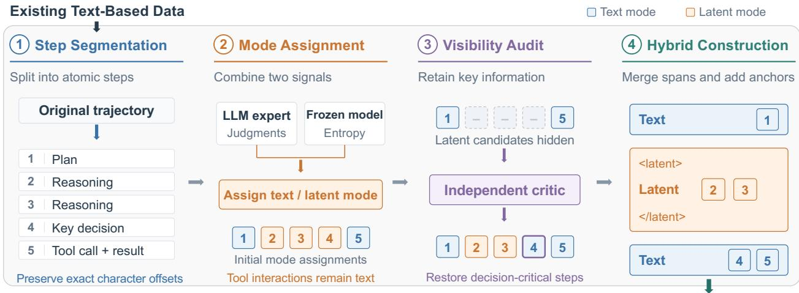  
Figure 12 | Hybrid Data Curation Pipeline. We convert text-based demonstrations into multi-turn hybrid trajectories using complementary signals from LLM judgments and model entropy to assign reasoning modes, followed by a visibility audit that preserves decision-critical steps in text mode.

We curate the hybrid training data by converting existing multi-turn agentic demonstrations (Dong et al., 2025b; Yu et al., 2025) into 54k hybrid trajectories for text and latent supervision. Specifically, an automatic annotation pipeline is designed to assign each source CoT step to either text or latent mode, based on complementary signals from external LLM judges and the target model’s entropybased confidence, with no human labeling needed. Accordingly, high-confidence reasoning steps that the model can handle reliably are assigned as latent targets, while audit-critical reasoning and tool-interaction steps are retained as text targets. We describe the detailed curation pipeline below.

1 Step Segmentation. We first split each source trajectory into atomic reasoning steps using a deterministic procedure, recording their exact character ofsets. These ofsets allow subsequent annotations to identify and group steps while preserving the original content and ordering.

2 Mode Assignment. We then leverage external LLM experts (GPT-6.1-Sol/GPT-5.6-Luna) to assign each reasoning step to text or latent mode, with tool interactions and key steps needed for external inspection retained in text mode (See Prompts in Appendix I). Meanwhile, we complement the external selection with the target model’s prediction entropy. We teacher-force the original textual trajectory through a frozen base model and compute the mean token-level entropy for each step �:

$$
H _ { s } = - \frac { 1 } { \vert \mathcal { T } _ { s } \vert } \sum _ { t \in \mathcal { I } _ { s } } \sum _ { \nu \in \mathcal { N } } f _ { \theta } ( \nu \mid x , \tau _ { < t } ) \log f _ { \theta } ( \nu \mid x , \tau _ { < t } ) ,\tag{18}
$$

where $f _ { \theta } ( \nu \mid x , \tau _ { < t } )$ denotes the frozen base model’s next-token probability after the vocabulary projection and softmax. Here, � is the input question, $\tau _ { < t }$ contains preceding reasoning and tool observations, $\mathcal { I } _ { s }$ indexes the tokens in step �, and $_ \textmd { ‰}$ is the vocabulary. Low-entropy steps become latent candidates, while high-entropy steps remain in text mode. Initial mode assignments combining the two complementary signals are then refined through the visibility audit below.

3 Visibility Audit. An independent LLM critic next examines the visible version of each annotated trajectory, with candidate latent spans hidden. The critic assesses whether the remaining text and tool interactions provide suficient information to follow the agent’s decisions. When decision-critical information is missing, the corresponding source steps are restored to text mode. This audit helps preserve the key information needed for external debugging and inspection.

4 Hybrid Trajectory Construction. We merge adjacent latent-assigned steps into continuous spans and programmatically insert the special anchors <latent> and $< / 1$ atent>. Tool calls and observations remain in text form. Finally, we verify that removing the inserted anchors recovers the original trajectory byte for byte. This consistency check ensures that the pipeline annotates reasoning modes without rewriting or altering the source demonstrations.

## F. Latent Interpretability Evaluation (Figures 2 and 8)

In this section, we describe the evaluation setup and metrics used to measure the readability and context specificity of latent readouts in Figures 2 and 8.

Probe Setup. We evaluate HybridAgent across 200 questions spanning downstream tasks, including AIME25/26 (math ai, 2025; MathArena, 2026), MATH-500 (HuggingFaceH4, 2023), MuSiQue (Trivedi et al., 2022), GAIA (Mialon et al., 2024), and DSQA (Gupta et al., 2026). Figure 2 compares the final HybridRL checkpoints of HybridAgent at 4B, 8B, and 14B scales. Figure 8 compares format activation, HybridLink activation, self-conditioned HybridSFT, and Coconut on the shared Qwen3- 14B-Base backbone. Generation uses temperature 0.6, top-p 0.95, top-k 20, and a fixed random seed. Each unit inside the plots is a latent span: a maximal sequence of consecutive latent steps. Each plotted point represents one span, and rings mark the means of per-span scores for each model or variant. The annotation $n = 2 0 0$ refers to total number of questions.

Readability. For a latent span � containing $L _ { b }$ latent inputs ${ \mathcal { Z } } _ { b , t }$ , we measure readability score through their average nearest-token alignment, following Eq. 5:

$$
\mathrm { R e a d } ( b ) = \frac { 1 } { L _ { b } } \sum _ { t = 1 } ^ { L _ { b } } \operatorname* { m a x } _ { \nu \in \mathcal { V } } \cos \left( z _ { b , t } , \mathrm { E m b } ( \nu ) \right) ,\tag{19}
$$

where V is the vocabulary and Emb(�) is the input embedding of token �. A score of 1 indicates that every latent input shares the direction of a vocabulary embedding, corresponding to the “exact token” reference. This alignment serves as a geometric proxy for readability. To calibrate the noise reference, we apply the same readout to 2,000 Gaussian random vectors and use their mean nearest-token similarity as the threshold $\tau _ { \mathrm { n o i s e } }$ . Spans above this threshold exhibit stronger average token alignment than the Gaussian reference.

Context Specificity. Context specificity measures whether a span’s pseudo-text is more relevant to its originating question than to other questions from the same task. Let $P _ { b }$ denote the pseudo-text obtained by nearest-token readout of span $^ { b , }$ as in Eq. 5. Let $W ( s )$ extract the content words from string �: lower-cased alphanumeric tokens longer than two characters, with stop words removed. We use Jaccard overlap, $J ( A , B ) = | A \cap B | / | A \cup B |$ . For a task-specific question set $\{ q _ { 1 } , \dots , q _ { M } \}$ with $M \geq 2 .$ let �(�) identify the question that produced span �. We define the context specificity score as:

$$
S \mathrm { p e c } ( b ) = \frac { J \bigl ( W ( P _ { b } ) , W ( q _ { i ( b ) } ) \bigr ) } { \displaystyle { \frac { 1 } { M - 1 } \sum _ { j = 1 \atop j \neq i ( b ) } ^ { M } J \bigl ( W ( P _ { b } ) , W ( q _ { j } ) \bigr ) } } ,\tag{20}
$$

when the denominator is positive. A score of 1× indicates equal overlap, while higher scores above 1× indicate greater lexical relevance to the originating question. We exclude readouts without content words and plot positive scores on a logarithmic axis.

Meaningful Region. The shaded region contains spans whose readability exceeds $\tau _ { \mathrm { n o i s e } }$ and whose context specificity exceeds 1. The two axes are complementary: readability measures alignment with

token embeddings, while context specificity measures relevance to the originating question. Together, they provide evidence of readable, question-specific latent readouts that support external inspection.

## G. Additional Experiments

## G.1. Experiments on 4B-Scale HybridAgent

Table 8 | 4B-Scale HybridAgent on Math and Knowledge-Intensive Search. We evaluate performance across both SFT and RL stages. AIME25/26 are reported on avg@16 accuracy.
<table><tr><td>Method</td><td>AIME25</td><td>AIME26</td><td>MATH500</td><td>GPQA-D</td></tr><tr><td>Qwen3-4B-Base</td><td></td><td></td><td></td><td></td></tr><tr><td>Coconut</td><td>10.6</td><td>13.3</td><td>40.6</td><td>17.2</td></tr><tr><td>SoftCoT</td><td>14.8</td><td>18.5</td><td>55.2</td><td>26.3</td></tr><tr><td>Standard Text SFT</td><td>19.0</td><td>22.7</td><td>77.4</td><td>31.8</td></tr><tr><td>HybridAgent (SFT)</td><td>22.5</td><td>23.3</td><td>76.8</td><td>30.8</td></tr><tr><td>GRPO</td><td>28.1</td><td>35.6</td><td>80.6</td><td>36.9</td></tr><tr><td>ARPO</td><td>31.3</td><td>36.3</td><td>81.8</td><td>38.4</td></tr><tr><td>HybridAgent (RL)</td><td>35.2</td><td>37.5</td><td>82.2</td><td>40.9</td></tr></table>

To examine the efectiveness of hybrid reasoning at smaller model scales, we evaluate HybridAgent and corresponding text-based and latent baselines on Qwen3-4B-Base. As shown in Table 8, HybridSFT outperforms both latent baselines across all four benchmarks and improves over standard text SFT on AIME25 and AIME26. HybridRL further improves performance across all four benchmarks, achieving the best results and exceeding ARPO by an average of 2.0 percentage points. Together with 8B and 14B comparisons in Table 1 and 2, these results show that the benefits of hybrid reasoning can extend to diferent model scales of HybridAgent across downstream reasoning tasks.

## G.2. Cost Analyses on HybridAgent

Table 9 | Cost Analyses on HybridAgent. We compare HybridAgent with text agents under the same backbones, reporting compute per question and estimated monetary cost per 1M questions. Each text or latent generation step is charged as one full backbone forward pass. Monetary costs assume \$2.50 per H100-hour and 10% utilization of peak BF16 throughput (approximately \$0.007 per PFLOP).
<table><tr><td>Model Backbone</td><td>(TFLOP)</td><td>Text Agent HybridAgent (TFLOP)</td><td>Cost / 1M questions (Text Agent → HybridAgent)</td><td>Cheaper by</td></tr><tr><td>Qwen3-4B-Base</td><td>51.2</td><td>13.9</td><td>$359 → $98</td><td>3.7×</td></tr><tr><td>Qwen3-8B-Base</td><td>62.5</td><td>17.2</td><td>$439 → $121</td><td>3.6×</td></tr><tr><td>Qwen3-14B-Base</td><td>66.9</td><td>25.1</td><td>$470 → $176</td><td>2.7×</td></tr></table>

Cost Analyses on HybridAgent. To examine whether the eficiency of hybrid generation translates into lower computational cost, we compare HybridAgent with matched text agents across 4B, 8B, and 14B backbones. We estimate decoding compute by charging every text or latent step a full backbone forward pass, together with the cost of vocabulary projection or the HybridLink adapter, respectively. Step counts are averaged over matched evaluations with the same questions, generation budgets, and tool-call limits. We further estimate monetary costs assuming \$2.50 per H100-hour and 10% utilization of peak BF16 throughput. These estimates cover generation compute and exclude prompt prefill, context-dependent attention, and external tool execution. As shown in Table 9, HybridAgent consistently reduces estimated decoding compute across all three model scales, from 51.2–66.9 TFLOP to 13.9–25.1 TFLOP per question, corresponding to reductions of 62.5%–72.9%. Under the stated pricing and utilization assumptions, the estimated cost of answering one million questions decreases from \$359 to \$98 at 4B, from \$439 to \$121 at 8B, and from \$470 to \$176 at 14B, yielding cost reduction factors of 3.7×, 3.6×, and 2.7×, respectively. Together with the shorter generation trajectories in Figure 6, these results demonstrate that hybrid reasoning reduces overall decoding compute while explicitly accounting for the backbone computation incurred by latent steps.

## H. Experiment Setups

## H.1. Benchmark and Evaluation Details

We evaluate HybridAgent on 11 benchmarks spanning mathematical, knowledge-intensive, and agentic reasoning. Together, these benchmarks assess complementary capabilities in multi-step problem solving, specialized knowledge application, evidence integration, and tool-assisted information seeking. We follow the setup of Dong et al. (2025b) and describe each benchmark in detail below.

## (i) Mathematical Reasoning Tasks

AIME 25 (math ai, 2025): AIME 25 comprises 30 problems from the 2025 American Invitational Mathematics Examination, covering algebra, geometry, number theory, and combinatorics. Its integeranswer problems evaluate competition-level mathematical reasoning, requiring models to combine mathematical insights with precise multi-step calculations.

AIME 26 (MathArena, 2026): AIME 26 contains 30 problems from the 2026 American Invitational Mathematics Examination, following the same competition format as AIME 25. It provides a complementary assessment of mathematical problem solving across a separate annual problem set, testing sustained reasoning and accurate numerical derivation.

MATH500 (HuggingFaceH4, 2023): MATH500 is a 500-problem subset of the MATH test set, spanning 7 mathematical subjects and 5 dificulty levels. It evaluates math reasoning across diverse problem types, including symbolic manipulation, geometric deduction, and numerical computation.

## (ii) Knowledge-Intensive Reasoning Tasks

GPQA-Diamond (Rein et al., 2023): GPQA-Diamond is a curated subset of 198 expert-written multiplechoice questions in biology, physics, and chemistry. Selected through expert and non-expert validation, these questions assess advanced scientific knowledge and reasoning that remain challenging for non-experts even with web access.

MedQA (Yang et al., 2024): MedQA is a multiple-choice question-answering benchmark derived from professional medical licensing examinations. The dataset contains 300 questions in total. Its questions assess medical knowledge and clinical reasoning, requiring models to interpret patient information and identify appropriate diagnoses, investigations, or treatments.

MuSiQue (Trivedi et al., 2022): MuSiQue is a multi-hop question-answering benchmark constructed by composing single-hop questions into connected reasoning chains of two to four hops. It evaluates the ability to combine evidence across multiple passages, with question construction designed to reduce shortcuts that bypass intermediate reasoning steps. Following Dong et al. (2025b), we use 200 test-set questions for downstream evaluation across all methods.

## (iii) Agentic Reasoning Tasks

General AI Assistants (GAIA) (Mialon et al., 2024): GAIA evaluates general-purpose assistants on real-world questions involving reasoning, web browsing, information processing, and external tool use. Its three dificulty levels reflect increasingly demanding combinations of reasoning steps and tool interactions, assessing the ability to coordinate these capabilities toward a verifiable answer.

Humanity’s Last Exam (HLE) (Center for AI Safety et al., 2026): HLE comprises expert-authored questions across a broad range of academic disciplines, including mathematics, natural sciences, and the humanities. Its multiple-choice and short-answer problems assess advanced subject knowledge and reasoning on questions designed to resist quick answers through direct web retrieval.

WebWalker (Wu et al., 2025): WebWalkerQA, referred to as WebWalker in our evaluations, is an agentic search benchmark requiring exploration of website subpages and integration of information from one or multiple sources. Its easy, medium, and hard categories reflect increasing traversal depth, testing the ability to locate and synthesize evidence beyond surface-level search results.

SealQA (Pham et al., 2026): SealQA evaluates search-augmented question answering on factual questions for which retrieved information may be noisy, conflicting, or unhelpful. We evaluate on Seal-0 and Seal-Hard, which test factual accuracy and reasoning under challenging retrieval conditions. Seal-0 targets questions selected for near-zero accuracy among the non-reasoning models used during benchmark construction; Seal-Hard includes a broader collection of dificult questions.

DeepSearchQA (DSQA) (Gupta et al., 2026): DeepSearchQA evaluates multi-step web research through tasks that require assembling complete answer sets from information distributed across sources. It tests search planning, evidence aggregation, entity disambiguation, and the ability to determine when suficient information has been collected. We report both full-correct rate and F1 score to assess complete task success and the balance between answer precision and coverage.

## H.2. Baseline Details

To evaluate the efectiveness and eficiency of HybridAgent, we compare with 4 categories of methods, including (i) Text-based Agentic Methods, (ii) Latent Reasoning Methods, (iii) Frontier LLM Agents, and (iv) Agentic Frameworks. We describe the implementation details of each baseline below.

## (i) Text-based Agentic Methods

Standard Text SFT: We apply standard SFT using the same training data and backbone models as HybridAgent. During evaluation, the models can invoke tools and incorporate the returned observations into subsequent reasoning. We use this baseline mostly to compare with the HybridSFT.

Agentic RL (GRPO/ARPO): We apply commonly adopted agentic RL methods after standard text SFT to further train the text agent baselines. GRPO (Shao et al., 2024) optimizes the policy using group-normalized rewards from sampled responses without requiring a separate critic. ARPO (Dong et al., 2025b): ARPO combines entropy-guided adaptive rollouts with step-level advantage attribution to improve multi-turn tool use. We train these methods using the same RL training data and backbone models as HybridAgent, primarily to evaluate the efectiveness of HybridRL.

## (ii) Latent Reasoning Methods

Coconut (Hao et al., 2024): Coconut performs continuous latent reasoning by directly feeding the model’s last hidden state back as the next input embedding. A staged training curriculum progressively replaces textual reasoning steps with latent thoughts, teaching the model to reason in continuous space before generating a textual answer.

SoftCoT (Xu et al., 2025b): SoftCoT uses a lightweight frozen assistant model to generate questiondependent soft thought representations, which a trainable projection maps into the target LLM’s representation space. These representations guide subsequent generation, enabling latent reasoning while keeping the assistant and target LLM frozen.

SoftThinking (Zhang et al., 2025): SoftThinking is a context-based method that represents intermediate reasoning as probability-weighted mixtures of vocabulary embeddings. Feeding these hidden continuous representations back into the model preserves alternatives from the next-token distribution.

We implement all latent reasoning baselines using the same backbone models and, where applicable, training settings and budgets as HybridAgent to ensure a fair comparison.

## (iii) Frontier LLM Agents

To evaluate HybridAgent in a broader context, we compare it with current leading closed-source and open-source LLM agents, including GPT-5.6-Luna (OpenAI, 2026), Kimi-K3 (Team, 2026), GLM-5.3- Flash (GLM-5-Team et al., 2026), DeepSeek-V4.1-Flash (DeepSeek-AI, 2026), and QwQ-32B (Team, 2025), to assess both performance and inference eficiency of HybridAgent.

## (iv) Agentic Frameworks

We further compare HybridAgent with established agentic frameworks that integrate multi-step reasoning with external tool calling and environmental interactions. We apply Qwen3-14B as the backbone for all these frameworks, with the same tool access and usage budgets as HybridAgent.

ReAct (Yao et al., 2023): ReAct interleaves natural-language reasoning with actions and observations from an external environment. This interaction loop allows an agent to gather information, revise its reasoning, and determine subsequent actions based on tool feedback.

Search-o1 (Li et al., 2025a): Search-o1 augments large reasoning models with adaptive search to address knowledge gaps encountered during reasoning. Its Reason-in-Documents module analyzes retrieved documents and extracts relevant evidence before incorporating it into ongoing reasoning.

WebThinker (Li et al., 2025b): WebThinker equips LLMs with a Deep Web Explorer that supports iterative search, webpage navigation, and information extraction. Its Think-Search-and-Draft strategy interleaves reasoning, evidence collection, and report generation to support complex research tasks.

Overall, these baseline methods provide complementary comparisons across training stages, text-based and latent-space reasoning, and tool-integrated agentic settings.

## H.3. Implementation Details

Models and Training Details. We instantiate HybridAgent with Qwen3-Base backbones (Yang et al., 2025a) at three scales of 4B, 8B, and 14B. For HybridLink, we use the same two-layer design across all three backbones. The HybridSFT training data is constructed by converting 54K text-only sources (Dong et al., 2025a,b) into hybrid trajectories. We apply format and HybridLink activation for one epoch each, followed by one additional epoch of self-conditioned training. HybridRL training utilizes 12K deep reasoning examples (Yu et al., 2025) for math and 1K agentic reasoning and search examples (Dong et al., 2025b) for deep search. We train HybridAgent with the GRPO objective and set rollout batches of 512 trajectories (64 × 8), followed by one optimization pass over 8 minibatches.

Training Hyperparameters. Table 10, 11, and 12 provide detailed parameter setups on HybridSFT and HybridRL. Following Dong et al. (2025b); Yu et al. (2025), we use HybridAgent checkpoints from deep reasoning training for mathematical evaluations and the checkpoint from agentic search training for knowledge-intensive search and agentic reasoning evaluations, as detailed in Appendix H.1.

Table 10 | Hyperparameter Setups of HybridSFT.
<table><tr><td>Hyperparameter</td><td>Value</td></tr><tr><td>Base model</td><td>Qwen3-4B/8B/14B-Base</td></tr><tr><td>Maximum sequence length</td><td>16,888</td></tr><tr><td>Effective batch size</td><td>16</td></tr><tr><td>Backbone learning rate</td><td> $7 \times 1 0 ^ { - 6 }$ </td></tr><tr><td>HybridLink learning rate (Activation / Self-conditioning)</td><td> $2 \times 1 0 ^ { - 4 } / 5 \times 1 0 ^ { - 5 }$ </td></tr><tr><td>Weight decay</td><td>0.0</td></tr><tr><td>Warmup ratio</td><td>0.1</td></tr><tr><td>Learning rate scheduler</td><td>Cosine</td></tr><tr><td>Latent regression weights  $( \lambda _ { \mathrm { c o s } } / \lambda _ { \mathrm { m s e } } )$ </td><td> $1 . 0 / 0 . 2$ </td></tr><tr><td>Number of training epochs</td><td> $3 \ : ( 1 \ : / \ : 1 \ : / \ : 1 )$ </td></tr></table>

Table 11 | Hyperparameter Setups of HybridRL on Agentic Search.
<table><tr><td>Hyperparameter</td><td>Value</td></tr><tr><td>Initialization</td><td>8B/14B HybridSFT checkpoint</td></tr><tr><td>Unique prompts per rollout batch</td><td>64</td></tr><tr><td>Rollouts per prompt (group size)</td><td>8</td></tr><tr><td>Minibatches per rollout batch</td><td>8</td></tr><tr><td>Optimization epochs per rollout batch</td><td>1</td></tr><tr><td>Total rollout batch size</td><td>512 trajectories (64 × 8)</td></tr><tr><td>Optimization per rollout batch Rollout sampling temperature</td><td>1 pass over 8 minibatches 1.0</td></tr><tr><td>Rollout sampling top-p</td><td>1.0</td></tr><tr><td>Reward rcorrect</td><td>token-level F1 ∈ [0, 1]</td></tr><tr><td>Reward rformat</td><td>0 / -1</td></tr><tr><td>Reward rtool</td><td>0.1</td></tr><tr><td>Latent steps per latent block (min/max) 16 / 256</td><td></td></tr><tr><td>Max tool calls per rollout</td><td></td></tr><tr><td></td><td>10</td></tr><tr><td>Weight decay</td><td>0.01</td></tr><tr><td>KL penalty coefficient</td><td>0</td></tr><tr><td>Learning rate schedule</td><td>constant</td></tr><tr><td>Training steps</td><td>150</td></tr><tr><td>Maximum sequence length</td><td>16,888</td></tr><tr><td>Backbone learning rate</td><td> $1 \times 1 0 ^ { - 6 }$ </td></tr><tr><td>Optimizer</td><td>AdamW, β = (0.9, 0.95)</td></tr><tr><td>Search API Setup (per call)</td><td>top-10, 1000 characters each</td></tr></table>

Inference Setups. During inference, we set the temperature, top-p, and top-k to 0.6, 0.95, and 20, respectively. The generation budget is adjusted for each task based on its relative dificulty and counts both text tokens and latent steps, with limits of 4,096 for mathematical reasoning and knowledge-intensive search tasks, and 24,000 for challenging agentic reasoning tasks. For each latent span, we enforce a minimum of 16 and a maximum of 256 steps to ensure sustained and semantically rich latent reasoning. HybridAgent interacts with external environments primarily through two types of tools: a Python interpreter within sandbox environments and a live search engine (e.g., Tavily). We cap tool usage at 10 calls per trajectory and retrieve the top 10 snippets for each search query. We utilize GPT-5.6-Luna as both the search-page summarizer and LLM judge. All training and inference are conducted on 32 H100 GPUs. We also provide detailed prompt templates in Appendix I.

Table 12 | Hyperparameter Setups of HybridRL on Deep Reasoning.
<table><tr><td>Hyperparameter</td><td>Value</td></tr><tr><td>Initialization</td><td>4B/8B/14B HybridSFT checkpoint</td></tr><tr><td>Unique prompts per rollout batch</td><td>64</td></tr><tr><td>Rollouts per prompt (group size)</td><td>8</td></tr><tr><td>Minibatches per rollout batch</td><td>8</td></tr><tr><td>Optimization epochs per rollout batch</td><td>1</td></tr><tr><td>Total rollout batch size</td><td>512 trajectories (64 × 8)</td></tr><tr><td>Optimization per rollout batch</td><td>1 pass over 8 minibatches</td></tr><tr><td>Rollout sampling temperature</td><td>1.0</td></tr><tr><td>Rollout sampling top-p</td><td>1.0</td></tr><tr><td>Reward rcorrect</td><td>Math Verify (0 / 1)</td></tr><tr><td>Reward rformat</td><td>0/-1</td></tr><tr><td>Reward rtool</td><td>+0.1</td></tr><tr><td>Latent steps per latent span (min/max) 16 / 256</td><td></td></tr><tr><td>Max tool calls per rollout</td><td>5</td></tr><tr><td>Weight decay</td><td>0.01</td></tr><tr><td>KL penalty coefficient</td><td>0</td></tr><tr><td>Learning rate schedule</td><td>Constant</td></tr><tr><td>Training steps</td><td>200</td></tr><tr><td>Maximum sequence length</td><td>16,888</td></tr><tr><td>Backbone learning rate</td><td> $1 \times 1 0 ^ { - 6 }$ </td></tr><tr><td>Optimizer</td><td>AdamW, β = (0.9, 0.95)</td></tr></table>

Infrastructure and Configurations. As existing training and inference frameworks such as verl (Sheng et al., 2025) and vLLM (Kwon et al., 2023) do not directly support multi-turn hybrid generation, we extend their infrastructure to enable hybrid training and generation in HybridAgent. A shared generation loop coordinates text mode, latent mode, and tool interaction while maintaining each trajectory’s persistent KV cache as continuous working memory across turns. The agent enters latent mode through the special entry anchor <latent>, feeds HybridLink-generated latent inputs back into the backbone, and returns to text mode when the nearest-token readout matches the exit anchor </latent>, as in Eq. 5. Tool observations are tokenized and processed against the existing working memory, appending new KV entries without reconstructing or re-prefilling earlier context.

The engine also supports batched rollouts with per-sequence state tracking, allowing trajectories to occupy diferent generation states within the same batch. Pending tool calls execute concurrently, with waiting and completed sequences masked from further generation. Per-sequence attention masks and position tracking preserve each trajectory’s causal context as generation proceeds. For HybridRL, exact latent-context replay recomputes sampled text-token likelihoods in a single diferentiable forward pass while keeping recorded latent inputs unchanged. We check rollout–replay agreement of log-probabilities at unchanged policy parameters. Multi-node data parallelism, sharded optimizer states, mixed precision, gradient checkpointing, and resumable checkpoints support full-parameter backbone optimization. Overall, the same engine supports RL rollouts, training-time validation, and downstream evaluation, ensuring consistent mode transitions and working-memory handling across configurable sampling settings, generation budgets, and tool-call setups.

## I. Prompt Template

Prompt Template for HybridAgent Training and Inference   
System Prompt (shared across examples)   
You are a helpful assistant that solves the given question step by step with   
the help of an online live search tool and a python interpreter tool. Given a   
question, you first think about the reasoning process and then provide the   
final answer, invoking the search tool for factual information and the python   
interpreter tool for calculations whenever needed.   
Format:   
- <think> ... </think>: your reasoning. Start every round with <think>; close   
it with </think> and then output exactly one of: a <search> call, a <python>   
call, or the final <answer>.   
- <latent> ... </latent>: latent reasoning, allowed only inside <think> ...   
</think>. Put routine internal reasoning (planning, recalling, restating,   
routine double-checking) in latent mode. Outside <latent>, write only the few   
decisive steps - key facts, decisions, and conclusions - as plain text.   
Always start and end the think block with plain text: open with a brief   
plain-text step (e.g. what the question or the latest result tells you), and   
close with the plain-text decision or conclusion that leads to your next   
action.   
<search> query </search>: call the online live search tool.   
- <python> code </python>: call the python interpreter tool; use print() to   
show the output.   
- <result> ... </result>: the tool output, inserted by the system after your   
</search> or </python>. Never write <result> yourself. After each result,   
start the next round with <think> - or, if the result directly settles the   
question, give the final <answer> immediately. If a result is empty, an   
error, or a tool-limit notice, do not repeat the same call - adjust your   
approach or give your best final answer.   
- <answer> ... </answer>: the final response, with the exact final answer   
enclosed in \boxed{} in latex format.   
Format example:   
<think>   
This is a key first step.<latent>This is the latent reasoning   
process.</latent>This is a key reasoning step.   
</think><search>search query here</search><result>search result   
here</result><think>   
This is a key first step.<latent>This is the latent reasoning   
process.</latent>This is the key decision step.   
</think><python>python code here</python><result>python interpreter result   
here</result><think>   
This is a key first step.<latent>This is the latent reasoning   
process.</latent>This is the key conclusion.   
</think><answer>\boxed{answer here}</answer>   
User Prompt (questionfor the current example)   
{question}

Prompt Template for Downstream LLM Judge   
Given a Question and its Golden Answer, verify whether the Predicted Answer   
is correct. The prediction is correct if it fully aligns with the meaning and   
key information of the Golden Answer. Respond with "Correct" if the   
prediction is correct and "Incorrect" otherwise.   
Question: {question}   
Golden Answer: {labeled\_answer}   
Predicted Answer: {pred\_answer}

## Prompt Template for LLM-Guided Hybrid Data Annotation

System Prompt   
You are a data expert for classifying Chain-of-Thought (CoT) steps produced by   
an assistant that can use tools (search, python) and outputs a final answer.   
For each CoT step you will be given, you must label it as either:   
- <sub>\*\*</sub>0 (latent mode)<sub>\*\*</sub>: Internal thinking that is not critical for auditing or   
debugging. Prefer latent for routine reasoning, filler, or steps that do not   
need to be shown as text for correctness or interpretability.   
- <sub>\*\*</sub>1 (text mode)<sub>\*\*</sub>: Must be text when (a) the step clearly calls an external   
tool or relates to a tool call (e.g. contains <search>...</search>,   
<python>...</python>, <result>...</result>, or <answer>...</answer>), or (b)   
the step is important for auditing/debugging (e.g. the step that states the   
final answer, or a core middle step that corresponds to the key solution   
decision). For efficiency, do NOT mark too many steps as text: only those that   
are clearly tool-related or genuinely important for understanding the solution.   
Balance: Prefer latent for non-essential inner reasoning; use text only for   
tool steps and a small set of critical reasoning/answer steps.   
When you respond, you MUST first write your reasoning, then output the final   
JSON array inside a \`\`\`json ... \`\`\` code block. Do not skip the reasoning   
section.   
User Prompt   
Below are {num\_steps} chain-of-thought steps from one conversation, labeled   
step0 to step{N}.   
{steps\_block}   
Do the following in order:   
1. Reasoning: for each step from step0 to step{N}, give its label (0 = latent,   
1 = text) and a brief reason, e.g. "step0: 0 - internal planning"; "step3: 1 -   
contains <search>".   
2. Check: confirm that every step is labeled and that your array will have   
exactly {num\_steps} entries.   
3. Final answer: end with a JSON code block containing only the array of   
{num\_steps} integers (0 or 1), in order from step0 to step{N}:   
An example of the final array format for the given steps is:   
\`\`\`json   
[0,1,1,0]

## J. Case Study of HybridAgent

<table><tr><td colspan="2">HybridAgent on Mathematical Reasoning</td></tr><tr><td colspan="2">QUESTION If each point of the circle  $x ^ { 2 } + y ^ { 2 } = 2 5$  is reflected in the point (4, 1), the set of image points satisfies the equation  $x ^ { 2 } + { a } y ^ { 2 } +$  - bx + cy + d = 0. Compute ordered quadruple  $( a , b , c , d )$  of real numbers.</td></tr><tr><td colspan="2">TURN 01</td></tr><tr><td>TEXT</td><td>To solve this problem, we need to find the image of each point  $( x _ { 1 } , y _ { 1 } )$  on the circle  $x ^ { 2 } + y ^ { 2 } = 2 5$  it is reflected in the point (4, 1).</td></tr><tr><td>LATENT</td><td>The reflection of a point  $( x _ { 1 } , y _ { 1 } )$  in another point  $( x _ { 0 } , y _ { 0 } )$  is given by the formula:  $( x _ { 2 } , y _ { 2 } ) = ( 2 x _ { 0 } - x _ { 1 } , 2 y _ { 0 } - y _ { 1 } )$ </td></tr><tr><td></td><td>In this case,  $( x _ { 0 } , y _ { 0 } ) = ( 4 , 1 ) ,$  so the reflection of  $( x _ { 1 } , y _ { 1 } )$  is:  $( x _ { 2 } , y _ { 2 } ) = ( 2 \cdot 4 - x _ { 1 } , 2 \cdot 1 - y _ { 1 } ) = ( 8 - x _ { 1 } , 2 - y _ { 1 } ) .$ </td></tr><tr><td>TEXT LATENT</td><td>Now, we need to find the equation of the locus of these image points  $( x _ { 2 } , y _ { 2 } )$  Since  $( x _ { 1 } , y _ { 1 } )$  lies on the circle  $x ^ { 2 } + y ^ { 2 } = 2 5$  we substitute  $x _ { 1 } = 8 - x _ { 2 }$  and  $y _ { 1 } = 2 - y _ { 2 }$ </td></tr><tr><td>TEXT</td><td>into the circle's equation:  $( 8 - x _ { 2 } ) ^ { 2 } + ( 2 - y _ { 2 } ) ^ { 2 } = 2 5 \ /$  We will expand and simplify this equation to find the values of  $a , b , c ,$  and d. Let's start by expanding</td></tr><tr><td></td><td>the squares:  $( 8 - x _ { 2 } ) ^ { 2 } = 6 4 - 1 6 x _ { 2 } + x _ { 2 } ^ { 2 } ,$ </td></tr><tr><td>LATENT</td><td> $( 2 - y _ { 2 } ) ^ { 2 } = 4 - 4 y _ { 2 } + y _ { 2 } ^ { 2 } .$  Adding these together, we get:  $6 4 - 1 6 x _ { 2 } + x _ { 2 } ^ { 2 } + 4 - 4 y _ { 2 } + y _ { 2 } ^ { 2 } = 2 5 .$ </td></tr><tr><td></td><td>Simplify the left side:  $x _ { 2 } ^ { 2 } + y _ { 2 } ^ { 2 } - 1 6 x _ { 2 } - 4 y _ { 2 } + 6 8 = 2 5$  . Rearrange to standard form by moving the left side:</td></tr><tr><td></td><td> $x _ { 2 } ^ { 2 } + y _ { 2 } ^ { 2 } - 1 6 x _ { 2 } - 4 y _ { 2 } + 4 3 = 0 .$ </td></tr><tr><td>TEXT</td><td>Now we can identify the coefficients  $a , b , c ,$  and d:  $a = 1$   $b = - 1 6 ,$  c = −4,  $d = 4 3 .$ </td></tr><tr><td>TOOL python</td><td>Let's confirm this by implementing the steps in Python to ensure the result is accurate. from sympy import symbols, Eq, simplify</td></tr><tr><td></td><td>x  $\mathrm { 1 , ~ y 1 , ~ \ x 2 , ~ y 2 ~ = ~ s y m b o l s ~ ( ~ ` \times 1 ~ y 1 ~ \times 2 ~ y 2 ' ) }$  polynomial_form = Eq(simplified_eq.lhs - simplified_eq.rhs, 0)</td></tr><tr><td>ERROR</td><td>print(polynomial_form) Python exited with code 1</td></tr><tr><td></td><td>Partial stderr: Traceback (most recent call last): File "&lt;string&gt;", line 53, in &lt;module&gt; File "&lt;string&gt;", line 38, in _execute_user_code</td></tr><tr><td>TURN 02</td><td> $\mathrm { F i 1 e ~ } \ " \mathrm { < p y t h o n - t o o l > " , ~ \ i i n e ~ \ 1 2 , ~ \ i n ~ \ < m o d u l e > }$  NameError: name 'solve' is not defined</td></tr><tr><td>TEXT</td><td>It seems that the symbolic computation code had an issue because the solve function was not imported.</td></tr><tr><td>| TOOL</td><td>Let me correct that by importing the necessary functions from sympy. I'll also ensure the code is properly encapsulated within the environment.</td></tr><tr><td>python</td><td>from sympy import symbols, Eq, solve, simplify x1, y1, x2, y2 = symbols('x1 y1 x2 y2')</td></tr><tr><td>RESULT</td><td>print(polynomial_form) Eq  $( ~ ( \times 2 ~ - ~ 8 ) \star \star 2 ~ + ~ ( \times 2 ~ - ~ 2 ) \star \star 2 ~ - ~ 2 5 , ~ 0 )$ </td></tr><tr><td colspan="2">TURN 03</td></tr><tr><td>LATENT</td><td>The output confirms our earlier manual calculation. The equation of the locus of the image points is: (x2  $8 { \bar { ) } } ^ { 2 } + ( y _ { 2 } - 2 ) ^ { 2 } - 2 5 = 0 .$  Expanding this, we get: x2 − 16x2 + 64 + y2 − 4y2 + 4 − 25 = 0.</td></tr><tr><td>TEXT</td><td>Simplifying further:  $x _ { 2 } ^ { 2 } + y _ { 2 } ^ { 2 } - 1 6 x _ { 2 } - 4 y _ { 2 } + 4 3 = 0 .$  Thus, the values of a, b, c, and d are: a = 1, b = −16, c = −4, d = 43.</td></tr><tr><td></td><td>So, the ordered quadruple  $( a , b , c , d )$  is: √ Correct answer</td></tr><tr><td>ANSWER</td><td> $\overline { { ( 1 , - 1 6 , - 4 , 4 3 ) } }$ </td></tr><tr><td colspan="2">HybridAgent on Knowledge-Intensive Reasoning</td></tr><tr><td colspan="2">QuEstion What field of work was the person who discovered the mathematical relationship between peaks and curves of light at different temperatures in?</td></tr><tr><td colspan="2">TURN 01</td></tr><tr><td>TEXT</td><td>Okay, so I need to figure out what field of work the person was who discovered the mathematical rela- tionship between peaks and curves of light at different temperatures. Hmm, let me think about this step by step.</td></tr><tr><td>LATENT</td><td>First, I remember that there's a specific in in physics or to the color of light by objects at different temperature. Maybe it's some like the black's function or Wait, or, that's more about the energy of energy from a black body.</td></tr><tr><td>TEXT</td><td>Wait, the question mentions “peaks and curves of light at different temperatures." That sounds like the relationship between temperature and the spectrum of emitted light. Oh, right! The person I'm thinking of is Max Planck. He's known for his work on black-body radiation. Planck's law describes the spectral density of electromagnetic radiation emitted by a black body in thermal equilibrium at a given temperature.</td></tr><tr><td>LATENT</td><td>So the question is about for the field of work. So I need was a physics, but I need to be more. Let me do a quick search to confirm. I'll look up the discovery related to peaks and curves of light at different temperatures and the corresponding field.</td></tr><tr><td>TOOL search</td><td>discovery of mathematical relationship between peaks and curves of light at different temperatures field</td></tr><tr><td>RESULT</td><td>Page 1: Wien's displacement law states that the black-body radiation curve for different temperatures will peak at different wavelengths that are inversely</td></tr><tr><td></td><td>Page 2: Each blackbody curve represents a blackbody at a specific temperature, and each curve peaks at a different wavelength, so you can figure out the temperature of a blackbody by measuring the wavelength at which its [...]</td></tr><tr><td colspan="2">TURN 02</td></tr><tr><td>TEXT</td><td>Okay, so the question is asking about the field of work of the person who discovered the mathematical relationship between peaks and curves of light at different temperatures.</td></tr><tr><td>LATENT</td><td>From the search results, I can see that the key is to the's distance law. The is about by William Wien. The search results mention that Wien's displacement law was discovered by Wilhelm Wien. Now I need to find out what field of work Wilhelm Wien was in. Let me do another search to find out William Wien's field of work.</td></tr><tr><td>TEXT</td><td>Wait, I already have the answer from the first search. The question is about the field of work. Since the discovery is related to black-body radiation and physics, it's safe to assume that Wilhelm Wien was a</td></tr><tr><td>| LATENT</td><td>physicist. Let me verify this through another search query:</td></tr><tr><td colspan="2">TOOL Wilhelm Wien field of work search</td></tr><tr><td>RESULT</td><td>Page 1: Wilhelm Wien From ETHW Jump to:navigation, search Wilhelm Wien Birthdate : 1864 Birth- place : East Prussia Associated organizations : University of Munich Fields of study : Quantum physics Awards : Nobel Prize in physics Biography Wilhelm Wien was a German physicist and Nobel-Prize</td></tr><tr><td colspan="2">winner who pioneered the study of quantum physics. [..] From early in his career, Wien [... ] TURN 03</td></tr><tr><td>TEXT</td><td>Okay, so the question is asking about the field of work of the person who discovered the mathematical relationship between peaks and curves of light at different temperatures.</td></tr><tr><td>LATENT</td><td>From the first search, I found that the person is related to William's distance law, which was found by William Wien. Then, I did another search to find Wilhelm Wien's field of work. The search results</td></tr><tr><td>TEXT</td><td>clearly state that Wilhelm Wien was a German physicist. Multiple sources confirm that his primary area of work was physics, specifically in the study of thermal radiation and quantum physics. He was awarded the Nobel Prize in Physics for his work on black-body</td></tr><tr><td>LATENT</td><td>radiation. Then the field of work is physics. The person who discovered the mathematical relationship between peaks and curves of light at different temperatures was Wilhelm Wien, and his field of work wàs physics.</td></tr><tr><td>ANSWER</td><td>√ Correct answer</td></tr><tr><td></td><td>Physics</td></tr><tr><td>HybridAgent on Agentic Reasoning</td><td></td></tr><tr><td colspan="2">QuEstion Use the density values from Marisa Alviar-Agnew and Henry Agnew's CK-12-licensed Introductory Chemistry materials on LibreTexts, as compiled on 08/21/2023. If I remove one cup of honey at a time, how</td></tr><tr><td colspan="2">I have one gallon of honey and one gallon of mayonnaise at  $2 5 ^ { \circ } \mathrm { C } .$  many cups must I remove for the remaining honey to weigh less than the mayonnaise? Assume that the containers have equal mass.</td></tr><tr><td>TURN 01</td><td></td></tr><tr><td>TEXT of mayonnaise.</td><td>I need the smallest number of one-cup removals that makes the remaining honey lighter than one gallon</td></tr><tr><td>LATENT</td><td>Because the containers have equal mass, I only need to compare their contents. I first need the densities of honey and mayonnaise at  $2 5 ^ { \circ } \mathrm { C }$  from the specified chemistry reference.</td></tr><tr><td>TEXT</td><td>Since the containers have equal mass, I can compare their contents using  $m = \rho V$  . I'll first look up the densities at  $2 5 ^ { \circ } \mathrm { C } .$ </td></tr><tr><td>| TOOL search RESULT</td><td>density of honey and mayonnaise in g/mL</td></tr><tr><td></td><td>Page 1: Plug in the values we measured earlier, and we'll get the densities of honey and mayonnaise. The table above shows the densities of honey and mayonnaise. We can see that both substances have a density of approximately 5g/mL. Page 2: Table \(\PageIndex{1 }\): Densities of Common Substances I (g/cm3) I --- || blood | 1.035 || body fat | 0.918 [. ..]</td></tr><tr><td>TURN 02</td><td>Substance I Density at  $2 5 ^ { \circ } \mathrm { C }$ </td></tr><tr><td colspan="2">TEXT For the calculation, I use 1.42 g/mL for honey and 0.91</td></tr><tr><td>LATENT</td><td> $\mathrm { g / m L }$  for mayonnaise. I'll convert the volumes to milliliters to calculate their masses. Using U.S. liquid measures, one gallon is approximately 3785.41 mL and one cup is approximately</td></tr><tr><td></td><td>236.588 mL. The initial mass of the honey is  $m _ { \mathrm { h o n e y } } = 1 . 4 2 \times 3 7 8 5 . 4 1 = 5 3 7 5 . 2 8 2 2 { \mathrm { g } } .$ </td></tr><tr><td>TEXT</td><td>The honey initially weighs about 5375.28 g, while the mayonnaise weighs 0.91 × 3785.41 ≈ I now need the mass removed per cup to determine when the honey falls below this value.</td></tr><tr><td>LATENT</td><td>Each cup of honey has mass</td></tr><tr><td></td><td> $m _ { \mathrm { c u p } } = 1 . 4 2 \times 2 3 6 . 5 8 8 = 3 3 5 . 9 5 4 9 6 { \mathrm { g } } .$ </td></tr><tr><td></td><td>After removing n cups, the required inequality is</td></tr><tr><td></td><td> $5 3 7 5 . 2 8 2 2 - 3 3 5 . 9 5 4 9 6 n < 3 4 4 4 . 7 2 3 1 ,$ </td></tr><tr><td colspan="2"> $n > { \frac { 5 3 7 5 . 2 8 2 2 - 3 4 4 4 . 7 2 3 1 } { 3 3 5 . 9 5 4 9 6 } } \approx 5 . 7 4 6 4 8 .$ </td></tr><tr><td>TEXT</td><td>The smallest valid integer is  $n = 6 .$  I'll verify this with Python. Each cup removes 335.95496 g. The condition 5375.2822 – 335.95496n &lt; 3444.7231 requires</td></tr><tr><td>| TOOL python</td><td>n &gt; 5.74648. I'll check in Python that six cups are sufficient and five are not. from math import floor rho_h, rho_m = 1.42, 0.91</td></tr><tr><td></td><td>gallon_ml, cup_ml = 3785.41, 236.588 m_h = rho_h * gallon_ml m_m = rho_m * gallon_ml m_cup = rho_h * cup_ml  $\mathrm { ~ n ~ = ~ f ~ l o o r ~ ( ~ ( m \_ h ~ - ~ m \_ m ) ~ / ~ \ell ~ m \_ c u p ) ~ + ~ 1 ~ }$  assert  $\mathrm { m \_ h ^ { \mathrm { ~ - ~ } } ~ } \mathrm { n \_ ~ } \star \mathrm { m \_ c u p ~ } < \mathrm { m \_ m }$ </td></tr><tr><td colspan="2">RESULT Number of cups to remove:</td></tr><tr><td>TURN 03 TEXT</td><td>Python confirms the minimum: six cups leave about 3359.55 g of honey, below the mayonnaise's</td></tr><tr><td colspan="2">3444.72 g; five cups leave about 3695.51 g, which is still too heavy.</td></tr><tr><td>LATENT</td><td>Six one-cup removals are therefore necessary and sufficient.</td></tr><tr><td>ANSWER</td><td>6</td></tr></table>