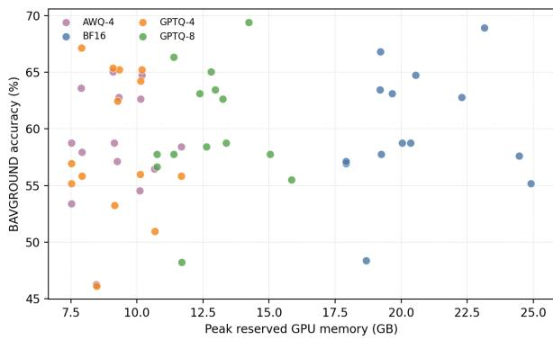

# Lightweight but Linguistically Fair? Quantisation Robustness across Bavarian, German, and English

Jophin John1 Michael Hoffmann1 Piroska Lendvai2 Florent Dufour3

1Leibniz Supercomputing Centre (LRZ), Garching, Germany 2Bavarian Academy of Sciences and Humanities, Munich, Germany 3TUM University Hospital and Technical University of Munich, Munich, Germany Correspondence: Jophin.John@lrz.de

## Abstract

Post-training quantisation reduces the memory cost of large language models, but it remains unclear whether compression preserves language skills of regional varieties as reliably as their standard-language counterparts. We study this question for Bavarian, Standard German, and English using BAVGROUND, a multiple choice benchmark, where 206 source questions are aligned across all three languages. Across 14 open-weight 7B–10B instruction models, we compare BF16 with 8-bit GPTQ and two 4- bit settings, GPTQ and AWQ. Eight-bit GPTQ remains close to BF16 and largely preserves the relative behaviour of the three languages, while 4-bit quantisation was found to be much less stable. The two 4-bit methods reduce av erage accuracy by about 1.4–1.5 percentage points and change 11.9–16.0% of BF16 decisions, with changes concentrated on examples where the BF16 model is already uncertain. This instability does not translate into a consistent Bavarian disadvantage. Although Bavar ian, a low-resource dialect, has lower base line accuracy than German and English, the language most affected at 4 bits varies across models and quantisation methods. Calibra tion further shapes these cross-language effects: the relative Bavarian–German effect changes with calibration language, while changing the calibration source has little average effect on GPTQ-4 but can affect AWQ-4 much more strongly. Free-form evaluation on five mod els further shows that 4-bit compression can degrade generated responses even in settings where multiple-choice accuracy changes only modestly, while 8-bit GPTQ remains compar atively stable. Overall, our results show that quantisation robustness for regional language varieties depends on the model, quantisation method, calibration data, and evaluation setting, and cannot be measured by aggregate multilin gual accuracy alone.

## 1 Introduction

Post-training quantisation is increasingly used to reduce the memory cost of large language models and enable deployment under tighter hardware budgets. Weight-only methods such as GPTQ (Frantar et al., 2023) and AWQ (Lin et al., 2024) can substantially reduce model size while often preserving aggregate benchmark accuracy. This makes quantisation particularly attractive for open-weight models and deployment settings in which memory capacity is a primary constraint.

However, preservation of aggregate performance does not imply that all languages are preserved equally well. Multilingual models are trained and evaluated disproportionately on high-resource standard languages, while regional and low-resource varieties often receive less representation in training data, tokeniser construction, and benchmark design (Ahia et al., 2021; Hooker et al., 2021). Prior work has shown that quantisation can affect languages unevenly and that automatic metrics can underestimate degradation visible in generated outputs (Marchisio et al., 2024). What remains less understood is whether these effects also extend to regional varieties that are linguistically close to a high-resource standard language.

Answering this question requires a comparison in which language varies while the underlying content remains fixed. Standard multilingual benchmarks such as MMLU (Hendrycks et al., 2021), MGSM (Shi et al., 2023), and FLORES-200 (NLLB Team et al., 2022) do not provide the aligned regional-variety–standard-language setting needed for such a comparison. Without this alignment, differences between language varieties can be difficult to separate from differences in the questions or evaluation conditions themselves.

We address this gap using BAVGROUND (John et al., 2026), a multiple-choice benchmark, whose 206 source questions are aligned across Bavarian,

Standard German, and English. This allows us to compare each quantised model with its own BF16 baseline on the same underlying questions and examine whether compression affects Bavarian differently from German and English. We evaluate 14 open-weight 7B–10B instruction models under BF16, GPTQ-8, GPTQ-4, and AWQ-4, and further test how these cross-language effects change with both the language composition and source of the calibration data.

Across this controlled comparison, GPTQ-8 remains close to BF16 and largely preserves the relative performance of Bavarian, German, and English. At 4 bits, robustness becomes more dependent on the model, quantisation method, and calibration data, without consistently disadvantaging Bavarian. Free-form evaluation further reveals degradation that is not always apparent from multiple-choice accuracy.

Our contributions are threefold:

• We conduct a controlled quantisation study across 14 open-weight 7B–10B models using aligned Bavarian, Standard German, and English questions, allowing direct comparison of a regional variety with its standard language across precision levels and quantisation methods.

• We examine how calibration data shape crosslanguage quantisation robustness by varying both their language composition and source, and relate item-level prediction instability to BF16 decision margins.

• We extend prior findings on evaluationdependent multilingual quantisation effects to a dialect–standard-language pair. Our blinded free-form evaluation tests whether robustness observed in multiple-choice accuracy carries over to generated responses.

## 2 Related Work

Post-training quantisation: Post-Training Quantization (PTQ) (Frantar et al., 2023; Lin et al., 2024; Xiao et al., 2023) converts the weights and, in some approaches, the activations of a neural network from their original 32- or 16-bit floating-point representations to lower-precision formats, typically 8-bit or 4-bit integers. GPTQ uses approximate second-order information to minimise layer-wise reconstruction error during low-bit weight quantisation (Frantar et al., 2023), whereas AWQ identifies activation-salient channels and rescales them prior to weight quantisation (Lin et al., 2024). These methods can provide strong quality–efficiency trade-offs, with prior evaluations showing that moderate quantisation often preserves much of a model’s aggregate performance, particularly for larger models (Giagnorio et al., 2026).

Early studies established that neural networks can retain useful performance under reduced numerical precision, while highlighting their sensitivity to quantisation (Sung et al., 2015). Aggregate performance, however, does not always change uniformly with precision. Quantised models can sometimes match or even slightly outperform their higher-precision counterparts on particular tasks or benchmarks (Badshah and Sajjad, 2024; Lee et al., 2025). Such improvements tend to depend on the model, task, and evaluation setting rather than reflecting a general benefit of lower precision. More importantly, stable or improved aggregate scores can conceal losses on particular subsets of the evaluation data. This makes it necessary to examine systematically where quantisation changes model behaviour rather than treating aggregate robustness as evidence that all capabilities are preserved equally.

Multilingual and language-aware quantisation: Recent work has examined these effects more directly in multilingual settings. Marchisio et al. (2024) show that quantisation robustness varies substantially across languages and that automatic metrics can miss degradation visible in generated outputs. Calibration data can also shape these effects. Zeng et al. (2024) show that multilingual calibration can improve preservation of lowerresource languages, while Chimoto et al. (2026) find that the language composition of GPTQ and AWQ calibration data affects multilingual quantisation quality. These studies establish that languagespecific robustness depends on more than bit width alone. However, they primarily compare distinct languages, where differences in script, typology, content, and benchmark construction can accompany language identity. This leaves open whether similar effects arise between a regional variety and its closely related standard language when the underlying content is held fixed.

Regional and cultural evaluation: Accomplishing regional and cultural evaluation requires targeted benchmark datasets that can distinguish language-specific effects from differences in the evaluated content. This is particularly challenging for regional and culturally specific language varieties, which are often unevenly represented in both training data and existing benchmarks. Evaluation of dialectal language skills receives increasing attention in the context of assessing Large language model (LLM) fairness and bias (Lin et al., 2025). Often, the focus of these studies is on English, involving synthetically generated data and humanin-the loop validation, e.g. by Ziems et al. (2023), but there are examples involving LLM-as-judge approaches too (Faisal et al., 2025). LLMs have been shown to encode cultural knowledge unevenly across regions and languages (Santy et al., 2023; Arora et al., 2023), while reliably evaluating such knowledge remains an open problem (Hershcovich et al., 2022). Li et al. (2024) propose a method for incorporating cultural differences into LLMs, while Durmus et al. (2024) investigate how language models represent subjective opinions across countries.

Recent benchmarks address these concerns through more targeted cultural evaluation. Chiu et al. (2025) introduce CulturalBench, comprising 1,696 human-written and human-verified English questions across 45 global regions, and show that multilingual capability does not necessarily imply multicultural competence. Closer to our setting, John et al. (2026) introduce BAVGROUND, a benchmark of Bavarian cultural knowledge with aligned Bavarian, Standard German, and English questions. We use BAVGROUND for our quantisation study and describe the benchmark and its alignment in Section 3.

## 3 Experimental Setup

We evaluate post-training quantisation by comparing each quantised model with its own BF16 baseline. The three-way alignment of BAVGROUND allows us to measure performance changes on the same underlying questions in English, Standard German, and Bavarian. We additionally measure peak GPU memory and batch-size-one throughput on a single NVIDIA GH200 GPU. Full hardware and runtime details are provided in Appendix B.

## 3.1 Benchmark

Our work uses the BAVGROUND dataset that contains 206 source questions, each realised in English, German and Bavarian, yielding alltogether 618 multiple-choice instances. The questions of this dataset span eight cultural domains which are each divided into two subsets: GEN, covering broadly accessible (or general) cultural knowledge, and GRD, which consists of question-answer pairs handmade constructed from regional newspapers, historical references, and specialist anthropological sources. The evaluated set contains 240 GEN and 378 GRD instances. Because all three language versions correspond to the same source question, cross-language comparisons are paired by source item rather than across independent monolingual benchmarks.

## 3.2 Models and Quantisation

We evaluate 14 open-weight 7B–10B instruction models chosen to cover a range of language and pretraining profiles. The main panel includes the Bavarian-adapted GENBA-10B (Hoffmann et al., 2025), the German-focused LeoLM and LLaMmlein, five European multilingual models (EuroLLM, Mistral, Occiglot, Teuken, and Salamandra), and six broader multilingual models (Llama 3.1, Qwen2.5, Gemma 2, Aya Expanse, Granite 3.0, and OLMo 2). GENBA-10B is specifically adapted to English, German, and Bavarian, while Llama 3.1 provides a closely related parentmodel comparison. Exact checkpoint identifiers are listed in Appendix C.

For each model in this main panel, we compare the original BF16 checkpoint with GPTQ-8, GPTQ-4, and AWQ-4, yielding 56 model–precision configurations. The GPTQ-8 and GPTQ-4 comparison isolates the effect of precision within the same quantisation method, while GPTQ-4 and AWQ-4 compare two methods at the same 4-bit precision. All quantised models use a group size of 128, with embeddings and output layers retained at their original precision. Quantisation is calibrated on approximately 250k tokens balanced across English, German, and Bavarian, using translated instructionstyle examples from Alpaca, Dolly, and OpenHermes. These data are used only for post-training quantisation, with no detected exact-text overlap with BAVGROUND questions, answer options, or recorded source references.

We additionally test calibration sensitivity on four models by repeating GPTQ-4 and AWQ-4 with balanced, English-only, German-only, and Bavarian-only calibration data while keeping the calibration budget, sequence length, and other quantisation settings fixed (Appendix A.8). To test whether these effects also depend on the type of text used for calibration, we repeat the 4-bit experiments with version-pinned Wikimedia text in English, German, and Bavarian. The calibrationlanguage ablation uses seed 42, while the focused calibration-source comparison uses three seeds; the latter is additionally evaluated across all 14 models using balanced seed-42 calibration. Finally, a supplementary Qwen-family analysis evaluates additional checkpoints from Qwen2, Qwen2.5, and Qwen3 to test whether the behaviour observed for Qwen2.5 in the main panel extends across Qwen generations and model sizes.

## 3.3 Evaluation Protocol

Our primary evaluation uses multiple-choice accuracy. For each question, we select the answer candidate with the highest mean token-level conditional log-likelihood given the question context. Length normalisation reduces answer-length effects, while scoring the option text rather than A–D labels avoids model-specific label priors. We also evaluate answer-letter likelihood and greedy generation as diagnostics for label bias and output-format failures, but neither contributes to the primary accuracy measure. We additionally evaluate free-form generation on five representative models using all 618 BAVGROUND instances. Each quantised response is compared with its BF16 counterpart by a blinded pairwise LLM judge (gpt-5.6-luna). Judging prioritises semantic correctness, allows ties, and considers Bavarian dialect appropriateness secondarily. A random 20% subset is repeated with reversed response order to check position bias. Full judge instructions and coverage statistics are given in Appendix A.14.

## 3.4 Quantisation Effects and Statistical Analysis

For model $m ,$ quantisation setting $q ,$ and language ℓ, we define the BF16-relative change as $\begin{array} { r } { \Delta _ { m , q , \ell } = S _ { m , q , \ell } - S _ { m , \mathrm { B F } 1 6 , \ell } . } \end{array}$ We measure whether quantisation widens the pre-existing gap between Bavarian and comparator language c using

$$
A _ { m , q , c } = \Delta _ { m , q , \mathrm { B A R } } - \Delta _ { m , q , c } ,\tag{1}
$$

which we term dialect-gap amplification. Negative values indicate that Bavarian degrades more under quantisation than the comparator language, while positive values indicate greater degradation of the comparator. We also compare BF16 and quantised predictions item by item to distinguish correct-to-incorrect, incorrect-to-correct, and correctness-preserving answer changes. We use 5,000 bootstrap replicates throughout, resampling source questions for aggregate effects and both models and questions for dialect-gap amplification. We treat cross-language effects as practically equivalent when the 90% confidence interval falls entirely within a ±2 percentage-point margin, and check the sensitivity of this conclusion at ±1 and ±3 points. Full resampling and sensitivity results are reported in Appendix A.3.

## 4 Results

We first examine the overall effect of quantisation and whether robustness differs between Bavarian, its closely related standard language German, and English. We then analyse how calibration data, prediction instability, and free-form generation shape this dialect–standard-language comparison, before considering the resulting deployment trade-offs.

## 4.1 Eight-bit robustness is broadly preserved, while four-bit robustness does not follow linguistic specialisation

Across the 14 models, GPTQ-8 remains essentially unchanged from BF16, with a mean accuracy difference of +0.03 percentage points. In contrast, both 4-bit methods reduce mean accuracy by about 1.4–1.5 points. The 95% confidence interval for GPTQ-8 includes zero, whereas those for GPTQ-4 and AWQ-4 indicate a clearer aggregate loss. Full confidence intervals are reported in Appendix A.1. The average 4-bit loss, however, hides substantial variation across models (Table 1). GPTQ-4 effects range from a 2.3-point gain for Qwen2.5 to a 6.6- point loss for GENBA-10B, while AWQ-4 ranges from a 3.2-point gain for Gemma 2 to a 5.7-point loss for Granite. This variation does not follow the models’ linguistic focus.

German-oriented models such as Teuken, LeoLM, and LLaMmlein are not consistently more robust, and the Bavarian-adapted GENBA-10B is among the models most affected by GPTQ-4. Conversely, several broader multilingual models remain comparatively stable. Apparent gains are checkpoint-dependent rather than family-wide, as illustrated by the heterogeneous Qwen-family results (Appendix A.2). Taken together, these results suggest that linguistic specialisation does not consistently protect a model from aggressive compression. GPTQ-8 is stable across a diverse set of models, whereas 4-bit robustness depends more strongly on the individual model and quantisation method than on whether the model was specialised for German, Bavarian, or broader multilingual use.

<table><tr><td>Model</td><td>BF16</td><td>GPTQ-8</td><td>GPTQ-4</td><td>AWQ-4</td><td>Best</td></tr><tr><td>Aya Expanse 8B</td><td>58.7</td><td>58.4 (-0.3)</td><td>53.2 (-5.5)</td><td>58.7 (+0.0)</td><td>BF16</td></tr><tr><td>EuroLLM 9B</td><td>68.9</td><td>69.4 (+0.5)</td><td>65.2 (-3.7)</td><td>64.7 (-4.2)</td><td>GPTQ-8</td></tr><tr><td>GENBA-10B</td><td>57.6</td><td>57.8 (+0.2)</td><td>51.0 (-6.6)</td><td>56.5 (-1.1)</td><td>GPTQ-8</td></tr><tr><td>Gemma 2 9B</td><td>55.2</td><td>55.5 (+0.3)</td><td>55.8 (+0.6)</td><td>58.4 (+3.2)</td><td>AWQ-4</td></tr><tr><td>Granite 3.0 8B</td><td>62.8</td><td>62.6 (-0.2)</td><td>62.5 (-0.3)</td><td>57.1 (-5.7)</td><td>BF16</td></tr><tr><td>LLaMmlein 7B</td><td>57.1</td><td>57.8 (+0.6)</td><td>57.0 (-0.2)</td><td>58.7 (+1.6)</td><td>AWQ-4</td></tr><tr><td>LeoLM 7B</td><td>57.0</td><td>56.6 (-0.3)</td><td>55.2 (-1.8)</td><td>53.4 (-3.6)</td><td>BF16</td></tr><tr><td>Llama 3.1 8B</td><td>64.7</td><td>65.0 (+0.3)</td><td>65.2 (+0.5)</td><td>62.8 (-1.9)</td><td>GPTQ-4</td></tr><tr><td>Mistral 7B v0.3</td><td>66.8</td><td>66.3 (-0.5)</td><td>67.2 (+0.3)</td><td>63.6 (-3.2)</td><td>GPTQ-4</td></tr><tr><td>OLMo 2 7B</td><td>58.7</td><td>58.7 (+0.0)</td><td>56.0 (-2.8)</td><td>54.5 (-4.2)</td><td>BF16</td></tr><tr><td>Occiglot 7B</td><td>57.8</td><td>57.8 (+0.0)</td><td>55.8 (-1.9)</td><td>57.9 (+0.2)</td><td>AWQ-4</td></tr><tr><td>Qwen2.5 7B</td><td>63.1 63.4</td><td>63.1 (+0.0)</td><td>65.4 (+2.3)</td><td>65.0 (+1.9)</td><td>GPTQ-4</td></tr><tr><td>Salamandra 7B</td><td></td><td>63.4 (+0.0)</td><td>64.2 (+0.8)</td><td>62.6 (-0.8)</td><td>GPTQ-4</td></tr><tr><td>Teuken 7B</td><td>48.4</td><td>48.2 (-0.2)</td><td>46.1 (-2.3)</td><td>46.3 (-2.1)</td><td>BF16</td></tr></table>

Table 1: Primary BAVGROUND accuracy under post-training quantisation. Scores are percentages under option-text likelihood evaluation. Values in parentheses are absolute changes in percentage points relative to the same model in BF16. The Best column denotes the highest-accuracy precision setting for each model, including BF16.

## 4.2 Bavarian’s lower baseline does not translate into greater quantisation fragility

These model-level differences also raise the question of whether Bavarian’s weaker baseline makes it more vulnerable to compression. Bavarian starts from a lower BF16 accuracy than German and English (56.9% vs. 60.7% and 62.4%) and is also tokenised less compactly (Appendix A.5). We therefore examine whether quantisation widens the existing gap between Bavarian and German or English. Table 2 shows that this is not the case at 8 bits. The Bavarian–German and Bavarian–English effects both fall within our ±2 percentage-point equivalence region, indicating that GPTQ-8 largely preserves the relative language pattern. At 4 bits, however, the effects are less consistent. GPTQ-4 tends towards greater Bavarian degradation relative to German, while AWQ-4 shifts the average contrast in the opposite direction; neither satisfies the equivalence criterion.

Per-model results make this heterogeneity clearer (Table 11). Bavarian accuracy decreases in 10 of 14 models under GPTQ-4 and 8 under AWQ-4, compared with 5 under GPTQ-8. These losses are not consistently larger than those in German: under GPTQ-4, Bavarian degrades more than German for 9 models and less for four, while AWQ-4 is almost evenly split between the two directions. Linguistically specialised models show the same variation. LeoLM, LLaMmlein, and Teuken lose more in Bavarian under GPTQ-4, whereas GENBA-10B shows the opposite pattern, losing 3.4 points in Bavarian, 5.3 in German, and 11.2 in English. Adaptation to Bavarian therefore does not make a model uniformly more robust, although it may influence which language is better preserved under compression. The same disconnect appears beyond language. The harder GRD subset has lower BF16 accuracy than GEN (57.9% vs. 63.4%), yet both show nearly identical 4-bit losses (Appendix A.6). Lower baseline performance therefore does not consistently predict greater quantisation sensitivity. Instead, the language most affected at 4 bits depends more on the individual model and quantisation method than on baseline performance or linguistic specialisation.

## 4.3 Calibration data reshape 4-bit cross-language robustness

The language-specific effects also depend on the calibration corpus (Table 3). Under GPTQ-4, German-only calibration produces the strongest Bavarian disadvantage, with a −3.16-point Bavarian–German contrast, whereas Bavarian-only calibration nearly removes it at +0.12 points. Bavarian accuracy itself improves from a −3.52- point change under German-only calibration to only −0.36 points under Bavarian-only calibration. This pattern is consistent across the four models: German-only calibration always degrades Bavarian more than German, while Bavarian-only calibration substantially reduces the difference. AWQ-4 behaves differently. Its mean Bavarian–German contrast remains positive across all four calibration regimes, indicating greater German than Bavarian degradation on average. Under German-only calibration, GPTQ-4 and AWQ-4 even produce opposite Bavarian–German directions for three of the four models. Calibration composition can therefore change not only the magnitude of the crosslanguage effect, but also its direction, with the outcome depending on the quantisation method.

<table><tr><td>Setting</td><td>∆BAR</td><td>∆DE</td><td>∆EN</td><td>ABAR-DE</td><td>ABAR-EN</td></tr><tr><td>GPTQ-8</td><td>-0.1</td><td>0.0</td><td>+0.2</td><td>-0.1</td><td>-0.3</td></tr><tr><td>GPTQ-4</td><td>-1.9</td><td>-0.5</td><td>-1.9</td><td>-1.4</td><td>0.0</td></tr><tr><td>AWQ-4</td><td>-1.1</td><td>-2.1</td><td>-1.1</td><td>+1.0</td><td>0.0</td></tr></table>

Table 2: Language-specific accuracy changes from BF16, macro-averaged across the 14 models. Values are percentage points. BAR–DE and BAR–EN compare the Bavarian change with German and English, respectively; negative values indicate greater degradation in Bavarian.
<table><tr><td></td><td colspan="2">GPTQ-4</td><td colspan="2">AWQ-4</td></tr><tr><td>Calibration</td><td>∆BAR</td><td>BAR-DE</td><td>∆BAR</td><td>BAR-DE</td></tr><tr><td>Balanced</td><td>-1.82</td><td>-0.85</td><td>+0.97</td><td>+4.25</td></tr><tr><td>English only</td><td>-2.55</td><td>-1.09</td><td>+1.09</td><td>+3.88</td></tr><tr><td>German only</td><td>-3.52</td><td>-3.16</td><td>-1.33</td><td>+3.28</td></tr><tr><td>Bavarian only</td><td>-0.36</td><td>+0.12</td><td>-0.36</td><td>+1.82</td></tr></table>

Table 3: Calibration-language sensitivity in the focused four-model ablation. Values are mean percentage-point changes from BF16. Negative BAR–DE values indicate greater Bavarian degradation. Full results are reported in Appendix A.8.

We also test whether these effects depend on the type of calibration text. In the focused threeseed comparison, GPTQ-4 remains stable when translated instruction data are replaced with Wikimedia text. AWQ-4 also changes little in aggregate, but its Bavarian–German contrast shifts by −4.63 points, showing that calibration source can alter cross-language robustness even when overall accuracy remains similar. Across finite paired runs in the broader panel, GPTQ-4 remains comparatively stable, whereas AWQ-4 loses 3.12 points after excluding one invalid Gemma 2 configuration. Calibration effects therefore depend on the model and quantisation method as well as on both the language composition and source of the calibration data (Appendix A.9).

## 4.4 Small accuracy losses conceal substantial prediction instability

Beyond these cross-language differences, aggregate accuracy also hides how often quantisation changes individual predictions. GPTQ-8 changes only 1.18% of matched BF16 predictions, compared with 11.93% for GPTQ-4 and 16.00% for

AWQ-4. For both 4-bit methods, correct-toincorrect changes outnumber compensating gains, with additional wrong-to-wrong changes further increasing the divergence from BF16. These changes are strongly concentrated on questions where the BF16 model is already uncertain. GPTQ-4 and AWQ-4 alter roughly 40–43% of predictions in the lowest-margin decile, but only 1–2% in the highest; GPTQ-8 changes 10.16% in the lowest decile and none in the highest (Table 4). An item-level analysis confirms that pre-quantisation decision margin is a much stronger predictor of instability than language or prompt length (Appendix A.11). The small average losses at 4 bits therefore hide substantial changes in individual predictions, particularly on questions where the model was already uncertain before quantisation.

## 4.5 Free-form evaluation reveals degradation hidden by multiple-choice accuracy

The gap between aggregate accuracy and model behaviour becomes even clearer in free-form generation. GPTQ-8 remains close to BF16, with 76.1% of comparisons judged as ties and the quantised response winning or tying in 86.9% of cases. At 4 bits, BF16 responses are preferred more often, particularly under AWQ-4 (Table 5). The difference between the two 4-bit methods is much larger here than in multiple-choice accuracy. GPTQ-4 and AWQ-4 have similar average multiple-choice losses, yet AWQ-4 shows substantially poorer retention in free-form responses. This gap is also visible at the model level. For example, Qwen2.5 7B improves on the multiple-choice benchmark under GPTQ-4, while its BF16 responses are still preferred overall in the free-form comparison. This shows that a small gain in fixed-choice accuracy does not necessarily carry over to generated responses.

<table><tr><td></td><td colspan="2">Low margin (D1)</td><td colspan="2">High margin (D10)</td></tr><tr><td>Setting</td><td>Change</td><td>Loss</td><td>Change</td><td>Loss</td></tr><tr><td>GPTQ-8</td><td>10.16</td><td>3.23</td><td>0.00</td><td>0.00</td></tr><tr><td>GPTQ-4</td><td>39.95</td><td>15.94</td><td>1.62</td><td>0.69</td></tr><tr><td>AWQ-4</td><td>43.42</td><td>16.28</td><td>1.27</td><td>0.23</td></tr></table>

Table 4: Prediction instability by BF16 selected-answer margin. D1 and D10 denote the lowest- and highest-margin deciles, respectively. “Change” is the percentage of paired predictions that differ from BF16, while “Loss” is the percentage of all paired rows that are BF16-correct and become incorrect after quantisation. Mean BF16 margins are 0.025 in D1 and 3.338 in D10.
<table><tr><td>Setting</td><td>N1</td><td>BF16 win</td><td>Quant. win</td><td></td><td></td><td>Tie Not worse Net quant.</td></tr><tr><td>GPTQ-8</td><td>3047</td><td>13.1</td><td>10.8</td><td>76.1</td><td>86.9</td><td>-2.3</td></tr><tr><td>GPTQ-4</td><td>3049</td><td>36.2</td><td>29.8</td><td>33.9</td><td>63.7</td><td>-6.4</td></tr><tr><td>AWQ-4</td><td>3048</td><td>45.7</td><td>28.1</td><td>26.1</td><td>54.2</td><td>-17.6</td></tr></table>

Table 5: Blinded pairwise comparison of BF16 and quantised free-form responses across five models and all BAVGROUND instances. N is the number of successfully parsed comparisons. “Not worse” combines quantised wins and ties; net preference is the quantised-win rate minus the BF16-win rate.

The same mismatch between fixed-choice accuracy and generated responses is also visible across languages. GPTQ-8 remains close to BF16 in Bavarian, German, and English. At 4 bits, however, the degradation is more pronounced. Under GPTQ-4, BF16 responses are preferred more strongly in Bavarian and German, while English remains comparatively stable. AWQ-4 shows degradation across all three languages, with German at least as affected as Bavarian. This mirrors the multiplechoice results above: 4-bit compression can affect Bavarian substantially, but the effect is not consistently stronger than in German. Because the freeform comparison relies on pairwise judging, we also checked sensitivity to response order, which was generally consistent. We treat these results as complementary evidence of response preservation rather than as human validation of Bavarian naturalness or sociolinguistic quality (Appendix A.14).

## 4.6 Large memory savings do not require proportional quality loss

Despite the quality losses observed above, quantisation can still offer substantial memory savings with little change in multiple-choice accuracy. Across the measured configurations, 11 quantised model configurations reduce peak reserved memory by at least 50% while losing no more than one percentage point relative to BF16 (Figure 1). Mistral 7B GPTQ-4 provides one of the strongest quality– memory trade-offs in our measurements: memory falls from 19.2 GB to 7.9 GB, a 58.9% reduction, while multiple-choice accuracy remains essentially unchanged (66.8% vs. 67.2%) (Appendix A.15). Its Bavarian, German, and English multiple-choice scores also remain close to their BF16 baselines (Appendix A.4). The same Mistral configuration also shows why this trade-off depends on how quality is measured. Although its multiple-choice accuracy is preserved, free-form judging gives GPTQ-4 a −3.9 point net preference relative to BF16 overall and −5.1 points in Bavarian (Appendix A.14). A strong quality–memory trade-off under fixedchoice evaluation can therefore still hide degradation in generated responses. More broadly, GPTQ-4 matches or exceeds GPTQ-8 multiple-choice accuracy for 5 of 14 models despite using fewer bits, showing that greater compression is not uniformly worse.

## 5 Discussion

The clearest distinction in our results is between broadly stable 8-bit quantisation and less predictable 4-bit compression. GPTQ-8 largely preserves average accuracy and the relative behaviour of Bavarian, German, and English. At 4 bits, however, robustness varies more across models and methods, with no consistent protection from linguistic specialisation. This makes calibration par-

  
Figure 1: Quality–memory frontier across completed model and precision settings. Points show BAV-GROUND multiple-choice accuracy against peak reserved GPU memory.

ticularly important.

Changing the calibration language can alter the Bavarian–German effect under GPTQ-4, while calibration source reveals a different methoddependent pattern. GPTQ-4 remains comparatively stable across instruction-style and Wikimedia data, whereas AWQ-4 shows stronger cross-language shifts and model-specific failures. Robustness therefore depends not only on the checkpoint and method, but also on the calibration data. These differences are also difficult to explain from baseline performance. Bavarian starts from lower BF16 accuracy and less compact tokenisation, yet neither consistently predicts larger losses. Instead, prediction changes concentrate on low-margin BF16 decisions, explaining why small average accuracy changes can conceal substantial behavioural differences.

The free-form results show the same mismatch: GPTQ-4 and AWQ-4 have similar fixed-choice losses, but AWQ-4 preserves generated responses less well. For closely related varieties, the question is therefore not only whether quantisation lowers performance, but whether it changes the relative behaviour of the dialect and standard language. In our aligned Bavarian–German comparison, this depends on the model, quantisation method, calibration data, and evaluation setting rather than on baseline performance or linguistic specialisation alone. Robustness should therefore be assessed via language-specific changes on matched questions, not aggregate multilingual accuracy.

## 6 Conclusion

We asked whether making language models lighter through post-training quantisation also preserves their behaviour across Bavarian, Standard German, and English. For GPTQ-8, the answer is largely yes. Performance remains close to BF16 and the relative differences between the three languages are broadly preserved. At 4 bits, this stability weakens. Bavarian is not consistently more affected than German, but the relative behaviour of the two languages varies more across models, quantisation methods, and calibration data. The aligned dialect vs. standard language comparison is important here because these changes are difficult to identify from aggregate multilingual accuracy alone. It also shows that lower baseline performance in Bavarian does not by itself imply greater fragility, while free-form evaluation reveals losses that fixed-choice accuracy can miss. Our matrix of experiments indicates that quantisation can therefore make models substantially lighter without necessarily harming Bavarian more than German, but linguistic preservation at 4 bits cannot be assumed from compression level alone. For regional language varieties, lightweight deployment and linguistic robustness need to be evaluated together.

## 7 Limitations

Our study focuses on Bavarian and BAVGROUND, so the findings may not generalise to other dialects or low-resource languages, and we do not model Bavarian’s internal regional or orthographic variation. The free-form analysis broadens the evaluation beyond multiple choice but relies on a single LLM judge. The response-order audit shows high consistency, out of 9,270 planned comparisons, 112 were excluded due to output truncation and 14 due to malformed pair identifiers. The calibration-language ablation is deliberately focused, covering four models and one seed per condition. The calibration-source experiment adds three-seed replication for the focused four-model comparison while its broader seed-42 comparison uses balanced calibration, with 14 valid GPTQ-4 and 13 valid AWQ-4 pairs. Broader replication would therefore be useful for establishing how stable these calibration effects are across models and seeds. Finally, the memory results are specific to our hardware, software stack, and batch-size-one inference setup.

AI Assistance Usage Statement: Generative AI tools were used for language editing, formatting assistance, and support in generating figures. All resulting text, figures, references, and numerical values were reviewed and verified.

## References

Orevaoghene Ahia, Julia Kreutzer, and Sara Hooker. 2021. The low-resource double bind: An empirical study of pruning for low-resource machine translation. In Findings of the Association for Computational Linguistics: EMNLP 2021, pages 3316–3333. Association for Computational Linguistics.

Arnav Arora, Lucie-aimée Kaffee, and Isabelle Augenstein. 2023. Probing pre-trained language models for cross-cultural differences in values. In Proceedings of the First Workshop on Cross-Cultural Considerations in NLP (C3NLP), pages 114–130, Dubrovnik, Croatia. Association for Computational Linguistics.

Sher Badshah and Hassan Sajjad. 2024. Quantifying the capabilities of llms across scale and precision. arXiv preprint arXiv:2405.03146.

Everlyn Asiko Chimoto, Mostafa Elhoushi, and Bruce Bassett. 2026. Calibrating beyond English: Language diversity for better quantized multilingual LLMs. In Proceedings of the 19th Conference of the European Chapter ofthe Associationfor Computational Linguistics (Volume 1: Long Papers), pages 4822–4838, Rabat, Morocco. Association for Computational Linguistics.

Yu Ying Chiu, Liwei Jiang, Bill Yuchen Lin, Chan Young Park, Shuyue Stella Li, Sahithya Ravi, Mehar Bhatia, Maria Antoniak, Yulia Tsvetkov, Vered Shwartz, and Yejin Choi. 2025. Culturalbench: A robust, diverse, and challenging cultural benchmark by human-ai culturalteaming. Preprint, arXiv:2410.02677.

Esin Durmus, Karina Nguyen, Thomas I. Liao, Nicholas Schiefer, Amanda Askell, Anton Bakhtin, Carol Chen, Zac Hatfield-Dodds, Danny Hernandez, Nicholas Joseph, Liane Lovitt, Sam McCandlish, Orowa Sikder, Alex Tamkin, Janel Thamkul, Jared Kaplan, Jack Clark, and Deep Ganguli. 2024. Towards measuring the representation of subjective global opinions in language models. Preprint, arXiv:2306.16388.

Fahim Faisal, Md Mushfiqur Rahman, and Antonios Anastasopoulos. 2025. Dialectal toxicity detection: Evaluating LLM-as-a-judge consistency across language varieties. In Findings of the Association for Computational Linguistics: EMNLP 2025, pages 12429–12452, Suzhou, China. Association for Computational Linguistics.

Elias Frantar, Saleh Ashkboos, Torsten Hoefler, and Dan Alistarh. 2023. GPTQ: Accurate post-training

quantization for generative pre-trained transformers. In International Conference on Learning Representations.

Alessandro Giagnorio, Antonio Mastropaolo, Saima Afrin, Massimiliano Di Penta, and Gabriele Bavota. 2026. Evaluating the impact of post-training quantization on large language models for code generation. In Proceedings of the 2026 34th IEEE/ACM International Conference on Program Comprehension, pages 195–206.

Dan Hendrycks, Collin Burns, Steven Basart, Andy Zou, Mantas Mazeika, Dawn Song, and Jacob Steinhardt. 2021. Measuring massive multitask language understanding. Preprint, arXiv:2009.03300.

Daniel Hershcovich, Stella Frank, Heather Lent, Miryam de Lhoneux, Mostafa Abdou, Stephanie Brandl, Emanuele Bugliarello, Laura Cabello Piqueras, Ilias Chalkidis, Ruixiang Cui, Constanza Fierro, Katerina Margatina, Phillip Rust, and Anders Søgaard. 2022. Challenges and strategies in crosscultural NLP. In Proceedings of the 60th Annual Meeting of the Association for Computational Linguistics (Volume 1: Long Papers), pages 6997–7013, Dublin, Ireland. Association for Computational Linguistics.

Michael Hoffmann, Jophin John, Stefan Schweter, Gokul Ramakrishnan, Hoi-Fong Mak, Alice Zhang, Dmitry Gaynullin, and Nicolay J. Hammer. 2025. Llama-genba-10b: A trilingual large language model for german, english and bavarian. Preprint, arXiv:2509.05668.

Sara Hooker, Aaron Courville, Gregory Clark, Yann Dauphin, and Andrea Frome. 2021. What do compressed deep neural networks forget? Preprint, arXiv:1911.05248.

Jophin John, Michael Hoffmann, Jan Fillies, Michael A. Hedderich, and Barbara Plank. 2026. Bavground: A benchmark for regional cultural grounding and dialect competence in bavarian. Preprint, arXiv:2608.12894.

Jemin Lee, Sihyeong Park, Jinse Kwon, Jihun Oh, and Yongin Kwon. 2025. Exploring the trade-offs: Quantization methods, task difficulty, and model size in large language models from edge to giant. In Proceedings ofthe Thirty-Fourth International Joint Conference on Artificial Intelligence, pages 8113–8121.

Cheng Li, Mengzhou Chen, Jindong Wang, Sunayana Sitaram, and Xing Xie. 2024. Culturellm: Incorporating cultural differences into large language models. Preprint, arXiv:2402.10946.

Fangru Lin, Shaoguang Mao, Emanuele La Malfa, Valentin Hofmann, Adrian de Wynter, Xun Wang, Si-Qing Chen, Michael J. Wooldridge, Janet B. Pierrehumbert, and Furu Wei. 2025. Assessing dialect fairness and robustness of large language models in reasoning tasks. In Proceedings of the 63rd Annual

Meeting of the Association for Computational Linguistics (Volume 1: Long Papers), pages 6317–6342, Vienna, Austria. Association for Computational Linguistics.

Ji Lin, Jiaming Tang, Haotian Tang, Shang Yang, Wei-Ming Chen, Wei-Chen Wang, Guangxuan Xiao, Xingyu Dang, Chuang Gan, and Song Han. 2024. AWQ: Activation-aware weight quantization for llm compression and acceleration. In Proceedings of Machine Learning and Systems.

Kelly Marchisio, Saurabh Dash, Hongyu Chen, Dennis Aumiller, Ahmet Üstün, Sara Hooker, and Sebastian Ruder. 2024. How does quantization affect multilingual llms? In Findings of the Association for Computational Linguistics: EMNLP 2024, pages 15928–15947. Association for Computational Linguistics.

NLLB Team, Marta R. Costa-jussà, James Cross, Onur Çelebi, Maha Elbayad, Kenneth Heafield, Kevin Heffernan, Elahe Kalbassi, Janice Lam, Daniel Licht, Jean Maillard, Anna Sun, Skyler Wang, Guillaume Wenzek, Al Youngblood, Bapi Akula, Loic Barrault, Gabriel Mejia Gonzalez, Prangthip Hansanti, and 20 others. 2022. No language left behind: Scaling human-centered machine translation. arXiv preprint arXiv:2207.04672.

Sebastin Santy, Jenny Liang, Ronan Le Bras, Katharina Reinecke, and Maarten Sap. 2023. NLPositionality: Characterizing design biases of datasets and models. In Proceedings of the 61st Annual Meeting of the Associationfor Computational Linguistics (Volume 1: Long Papers), pages 9080–9102, Toronto, Canada. Association for Computational Linguistics.

Freda Shi, Mirac Suzgun, Markus Freitag, Xuezhi Wang, Suraj Srivats, Soroush Vosoughi, Hyung Won Chung, Yi Tay, Sebastian Ruder, Denny Zhou, Dipanjan Das, and Jason Wei. 2023. Language models are multilingual chain-of-thought reasoners. In The Eleventh International Conference on Learning Representations.

Wonyong Sung, Sungho Shin, and Kyuyeon Hwang. 2015. Resiliency of deep neural networks under quantization. arXiv preprint arXiv:1511.06488.

Guangxuan Xiao, Ji Lin, Mickael Seznec, Hao Wu, Julien Demouth, and Song Han. 2023. Smoothquant: Accurate and efficient post-training quantization for large language models. Preprint, arXiv:2211.10438.

Hongchuan Zeng, Hongshen Xu, Lu Chen, and Kai Yu. 2024. Multilingual brain surgeon: Large language models can be compressed leaving no language behind. In Proceedings ofthe 2024 Joint International Conference on Computational Linguistics, Language Resources and Evaluation (LREC-COLING 2024), pages 11794–11812, Torino, Italia. ELRA and ICCL.

Caleb Ziems, William Held, Jingfeng Yang, Jwala Dhamala, Rahul Gupta, and Diyi Yang. 2023. Multi-VALUE: A framework for cross-dialectal English

NLP. In Proceedings of the 61st Annual Meeting of the Association for Computational Linguistics (Volume 1: Long Papers), pages 744–768, Toronto, Canada. Association for Computational Linguistics.

## A Additional Analyses

## A.1 Aggregate Bootstrap Confidence Intervals

Table 6 reports the clustered-bootstrap confidence intervals for the aggregate BF16-relative accuracy differences used in Section 4.1. We resample the 206 aligned source questions and retain all associated English, German, and Bavarian instances for each sampled source question. These intervals therefore quantify item uncertainty conditional on the evaluated 14-model panel.

## A.2 Focused Qwen-Family Analysis

To probe whether the Qwen2.5 7B improvement in the main matrix is representative of the broader family, we additionally evaluate five Qwen checkpoints. Table 7 summarises these results. This is a descriptive family analysis rather than a clean scaling study because model generation and architecture vary across several rows.

As Table 7 shows, the Qwen2.5 7B gain is not representative of all checkpoints in the family: Qwen2 7B, Qwen2.5 3B, and Qwen3 4B are best preserved by GPTQ-8, while Qwen2.5 7B and Qwen3 8B show their highest multiple-choice scores under GPTQ-4. These results therefore indicate substantial checkpoint-level heterogeneity rather than a consistent family-wide benefit from 4-bit quantisation.

Within Qwen2.5, the 7B checkpoint is 2.4 points stronger than the 3B checkpoint in BF16 overall and 6.8 points stronger on Bavarian. Across model generations, however, parameter count does not predict either baseline quality or quantisation response. In particular, Qwen3 8B shows a large +8.6-point GPTQ-4 increase from a comparatively weak BF16 baseline. We report this result descriptively and do not treat it as evidence that 4-bit quantisation improves generation quality; the free-form results for Qwen2.5 already demonstrate that multiple-choice gains can coexist with worse pairwise output preferences.

## A.3 Crossed Bootstrap and Practical Equivalence

Table 8 reports crossed-bootstrap estimates and confidence intervals for dialect-gap amplification. We jointly resample models and source questions to capture uncertainty from both the evaluated model set and the 206 aligned BAVGROUND source questions. We use 5,000 replicates and report 90% and 95% confidence intervals.

<table><tr><td>Setting</td><td>∆ vs. BF16</td><td>95% CI</td><td>Source clusters</td><td>Paired rows</td></tr><tr><td>GPTQ-8</td><td>+0.03</td><td>[-0.14, +0.21]</td><td>206</td><td>8,652</td></tr><tr><td>GPTQ-4</td><td>-1.47</td><td>[-2.21, -0.72]</td><td>206</td><td>8,652</td></tr><tr><td>AWQ-4</td><td>-1.42</td><td>[-2.21, -0.61]</td><td>206</td><td>8,652</td></tr></table>

Table 6: Aggregate accuracy change under quantisation, measured in percentage points relative to each model’s BF16 baseline. Confidence intervals are 95% percentile intervals from 5,000 bootstrap samples clustered by source question.
<table><tr><td>Model</td><td>BF16</td><td>Best quantised</td><td>∆</td></tr><tr><td>Qwen2 7B Instruct</td><td>63.8</td><td>63.6 (GPTQ-8)</td><td>-0.2</td></tr><tr><td>Qwen2.5 3B Instruct</td><td>60.7</td><td>60.4 (GPTQ-8)</td><td>-0.3</td></tr><tr><td>Qwen2.5 7B Instruct</td><td>63.1</td><td>65.4 (GPTQ-4)</td><td>+2.3</td></tr><tr><td>Qwen3 4B</td><td>51.9</td><td>51.6 (GPTQ-8)</td><td>-0.3</td></tr><tr><td>Qwen3 8B</td><td>48.1</td><td>56.6 (GPTQ-4)</td><td>+8.6</td></tr></table>

Table 7: Focused Qwen-family results on BAVGROUND. Scores are overall multiple-choice accuracy (%). “Best quantised” selects the highest observed quantised configuration for each checkpoint.

Because a non-significant difference does not establish comparable robustness, we also assess practical equivalence using a ±2 percentage-point margin. Two language effects are considered practically equivalent only when the full 90% confidence interval lies within this region.

GPTQ-8 is the only setting for which both Bavarian–German and Bavarian–English contrasts satisfy the equivalence criterion. Neither 4-bit method establishes equivalence. The Bavarian– German point estimates also differ in direction between GPTQ-4 and AWQ-4, reinforcing that the 4-bit language effect is not consistent across quantisation methods.

We additionally test the sensitivity of these conclusions to ±1, ±2, and ±3 percentage-point margins (Table 9). GPTQ-8 remains the most robust setting: its Bavarian–German contrast is equivalent even under the stricter ±1-point margin, while its Bavarian–English contrast is equivalent from ±2 points onward. Neither 4-bit Bavarian–German contrast reaches equivalence even at ±3 points, whereas the Bavarian–English contrasts for GPTQ-4 and AWQ-4 become equivalent only under this wider margin.

## A.4 Per-Model Language Effects

The aggregate dialect-gap estimates average over substantial model-level variation. We therefore examine the direction of the Bavarian–German effect for each model before reporting the full per-model results. Table 10 summarises how often Bavarian degrades more than German, how often the two effects are similar, and how often German degrades more than Bavarian.

The sign pattern reinforces the aggregate results. GPTQ-8 is nearly balanced across directions and the individual contrasts are generally small. GPTQ-4 shows a clearer tendency towards greater Bavarian degradation, with 9 of 14 models exhibiting a negative Bavarian–German contrast, although the effect is not universal. AWQ-4 is more evenly split, with greater Bavarian degradation for six models and greater German degradation for seven. Thus, the direction of the 4-bit language effect remains strongly model- and quantiser-dependent.

Table 11 reports the corresponding languagespecific changes from BF16 for every model and quantisation setting. The Bavarian- and Germanfocused models are also heterogeneous. LeoLM, LLaMmlein, and Teuken show larger Bavarian than German losses under GPTQ-4, whereas GENBA-10B shows the opposite pattern, with its largest GPTQ-4 degradation occurring in English. Several of these directions change again under AWQ-4, providing no evidence that linguistic specialisation alone determines language-specific robustness under quantisation.

## A.5 Tokenizer Segmentation

Bavarian prompts are generally tokenised slightly less compactly than German and substantially less compactly than English as seen in Table 12. Across domains, BAR/DE prompt ratios range from 1.00 to 1.05, while BAR/EN ratios range from 1.10 to 1.20. Gold-answer ratios show a similar tendency, although the magnitude varies by domain. Since Bavarian does not consistently exhibit greater quantisation degradation, tokenisation length alone is insufficient to explain the observed language-level robustness differences.

<table><tr><td>Setting</td><td>Contrast</td><td>Estimate</td><td>90% CI</td><td>95% CI</td><td>Equivalent</td></tr><tr><td>GPTQ-8</td><td>BAR-DE</td><td>-0.07</td><td>[-0.73, +0.59]</td><td>[-0.83, +0.69]</td><td>Yes</td></tr><tr><td>GPTQ-8</td><td>BAR-EN</td><td>-0.35</td><td>[-1.04, +0.31]</td><td>[-1.21, +0.45]</td><td>Yes</td></tr><tr><td>GPTQ-4</td><td>BAR-DE</td><td>-1.42</td><td>[-3.43, +0.59]</td><td>[-3.81, +0.90]</td><td>No</td></tr><tr><td>GPTQ-4</td><td>BAR-EN</td><td>+0.00</td><td>[-2.08, +2.18]</td><td>[-2.46, +2.67]</td><td>No</td></tr><tr><td>AWQ-4</td><td>BAR-DE</td><td>+1.01</td><td>[-1.35, +3.40]</td><td>[-1.94, +3.88]</td><td>No</td></tr><tr><td>AWQ-4</td><td>BAR-EN</td><td>+0.03</td><td>[-2.32, +2.50]</td><td>[-2.77, +3.02]</td><td>No</td></tr></table>

Table 8: Dialect-gap amplification under a crossed bootstrap over models and source questions. Values are percentage points. Negative estimates indicate greater Bavarian degradation. Practical equivalence requires the 90% confidence interval to lie entirely within the ±2 percentage-point region.
<table><tr><td>Setting</td><td>Contrast</td><td>±1 pp</td><td>±2 pp</td><td>±3 pp</td></tr><tr><td>GPTQ-8</td><td>BAR-DE</td><td>Yes</td><td>Yes</td><td>Yes</td></tr><tr><td>GPTQ-8</td><td>BAR-EN</td><td>No</td><td>Yes</td><td>Yes</td></tr><tr><td>GPTQ-4</td><td>BAR-DE</td><td>No</td><td>No</td><td>No</td></tr><tr><td>GPTQ-4</td><td>BAR-EN</td><td>No</td><td>No</td><td>Yes</td></tr><tr><td>AWQ-4</td><td>BAR-DE</td><td>No</td><td>No</td><td>No</td></tr><tr><td>AWQ-4</td><td>BAR-EN</td><td>No</td><td>No</td><td>Yes</td></tr></table>

Table 9: Sensitivity of practical-equivalence conclusions to alternative equivalence margins. Entries indicate whether the 90% crossed-bootstrap confidence interval lies fully within the stated percentage-point region.

## A.6 Task difficulty and quantisation sensitivity

Table 13 gives the full comparison between the GEN and GRD subsets. Source-grounded questions are harder before quantisation, with a mean BF16 accuracy of 57.9%, compared with 63.4% for general cultural questions. The difference in baseline difficulty is not reflected in their response to compression. GPTQ-4 reduces accuracy by 1.5 points on GRD and 1.4 on GEN, while AWQ-4 reduces both by approximately 1.4 points. GPTQ-8 leaves both subsets essentially unchanged.

The same lack of correspondence appears across cultural domains. Language is the hardest domain in BF16, at 40.5%, and loses 2.2 points under GPTQ-4 and 1.9 under AWQ-4. Historical, despite having the highest BF16 accuracy at 68.3%, shows similarly large losses of 2.2 and 3.0 points. Politics, in contrast, reaches 61.7% in BF16 but changes little under either 4-bit method (+0.4 for GPTQ-4 and −0.1 for AWQ-4). Across both question types and domains, lower baseline accuracy therefore does not consistently correspond to greater quantisation sensitivity. Full domain-level results are reported in Appendix A.7.

## A.7 Domain-Level Quantisation Effects

The domain-level results show that baseline difficulty does not monotonically predict quantisation sensitivity. Language is the weakest BF16 domain (40.5%) and loses 2.2 and 1.9 points under GPTQ-4 and AWQ-4, respectively. However, Historical is the strongest BF16 domain (68.3%) and experiences similarly large drops of 2.2 and 3.0 points. Politics, by contrast, remains almost unchanged under both 4-bit settings despite intermediate BF16 performance.

## A.8 Calibration-Language Ablation

Models and calibration corpus construction. The focused calibration-language ablation uses four instruction-tuned models: GENBA-10B, Llama 3.1 8B, Qwen2.5 7B, and EuroLLM 9B. Exact checkpoint identifiers are provided in Table 15. Calibration data are drawn from languagespecific English, German, and Bavarian instruction corpora derived from Alpaca, Dolly, and OpenHermes. Each language pool is independently shuffled using Python seed 42, and complete records are selected until the target budget is reached. The balanced condition allocates approximately 83,333 whitespace-delimited tokens per language, whereas each monolingual condition uses approximately 250,000 tokens from a single language. Budgets are measured using whitespace tokenisation rather than model-specific tokenisers. The selected examples are not aligned translations, and their source mixtures may differ across languages. Consequently, language is confounded with corpus content, topic, and style; we interpret these results as an exploratory calibration-corpus composition ablation rather than an isolated causal effect of calibration language. Exact corpus sizes are reported in Table 16.

<table><tr><td>Setting</td><td> $\mathbf { B A R } < \mathbf { D E }$ </td><td>Similar</td><td> $\mathrm { B A R } > \mathrm { D E }$ </td></tr><tr><td>GPTQ-8</td><td>6</td><td>2</td><td>6</td></tr><tr><td>GPTQ-4</td><td>9</td><td>1</td><td>4</td></tr><tr><td>AWQ-4</td><td>6</td><td>1</td><td>7</td></tr></table>

Table 10: Direction of the per-model Bavarian–German quantisation effect. BAR < DE indicates greater Bavarian degradation, while BAR > DE indicates greater German degradation. Values within ±0.25 percentage points are grouped as similar.

Table 17 expands the calibration analysis from Section 4.3. Values are macro-averaged across the four models in the focused ablation and are measured relative to each model’s own BF16 checkpoint.

As Table 17 shows, calibration composition can substantially change the cross-language effect of 4-bit quantisation. For GPTQ-4, German-only calibration produces the strongest Bavarian disadvantage, whereas Bavarian-only calibration nearly removes the Bavarian–German differential. AWQ-4 shows the opposite aggregate direction across all four regimes, with German generally degrading more than Bavarian, although the magnitude varies with calibration language.

To assess whether these averages are driven by individual models, Table 18 summarises the direction of the Bavarian–German effect, with the individual estimates reported in Table 19. The German-only GPTQ-4 result is the most consistent case: Bavarian degrades more than German for all four models, with BAR–DE ranging from −6.8 to −0.5 points. Under Bavarian-only calibration, the GPTQ-4 pattern becomes mixed, while AWQ-4 remains predominantly positive across calibration regimes. This confirms that calibration composition can change both the magnitude and, in some cases, the direction of the measured cross-language effect.

## A.9 Calibration-Source Robustness

The main experiments use translated instructionstyle calibration data from Alpaca, Dolly, and

OpenHermes. To test whether the observed effects depend on this type of calibration text, we repeat the 4-bit experiments with natural Wikipedia text in English, German, and Bavarian. We use the corresponding November 2023 Wikimedia snapshots and keep the calibration budget and sequence length unchanged, packing each calibration set into 120 sequences of 2,048 tokens. The corpus is version-pinned and contains no detected exact or near overlap with BAVGROUND or the instructionstyle calibration data.

We compare the two calibration sources in two settings. The focused experiment covers four models, both 4-bit quantisers, all four calibrationlanguage conditions, and three seeds. We additionally compare balanced calibration across all 14 models at seed 42. Table 20 reports both comparisons.

As Table 20 shows, changing the calibration source has little effect on average GPTQ-4 accuracy in the focused three-seed comparison, with a difference of only +0.18 points. AWQ-4 also does not degrade on average, increasing by +1.25 points, but its cross-language behaviour changes substantially. With Wikimedia calibration, the Bavarian–German contrast shifts by −4.63 points under AWQ-4, as German improves by 3.76 points while Bavarian decreases by 0.87 points. No corresponding shift is observed for GPTQ-4, where the Bavarian–German contrast changes by only +0.56 points.

The broader comparison shows a different form of source sensitivity. GPTQ-4 remains close across calibration sources, changing by only −0.39 points across 14 models. Excluding Gemma 2 from both paired AWQ-4 conditions, AWQ-4 decreases by 3.12 points across 13 models. The excluded Wikimedia run produced non-finite option scores for all 618 instances, which were deterministically mapped to option A; its apparent accuracy is therefore invalid. Aya Expanse and OLMo 2 show large accuracy losses despite finite likelihoods and complete evaluation runs. Thus, AWQ-4 exhibits greater calibration-source sensitivity than GPTQ-4 even after excluding the invalid run.

<table><tr><td>Model</td><td>Quantiser</td><td>∆BAR</td><td>∆DE</td><td>∆EN</td><td>BAR-DE</td><td>BAR-EN</td></tr><tr><td>Aya Expanse 8B</td><td>GPTQ-8</td><td>+0.0</td><td>-0.5</td><td>-0.5</td><td>+0.5</td><td>+0.5</td></tr><tr><td>Aya Expanse 8B</td><td>GPTQ-4</td><td>-7.8</td><td>+0.0</td><td>-8.7</td><td>-7.8</td><td>+1.0</td></tr><tr><td>Aya Expanse 8B</td><td>AWQ-4</td><td>+0.0</td><td>+2.4</td><td>-2.4</td><td>-2.4</td><td>+2.4</td></tr><tr><td>EuroLLM 9B</td><td>GPTQ-8</td><td>+1.0</td><td>+0.5</td><td>+0.0</td><td>+0.5</td><td>+1.0</td></tr><tr><td>EuroLLM 9B</td><td>GPTQ-4</td><td>-4.9</td><td>-1.9</td><td>-4.4</td><td>-2.9</td><td>-0.5</td></tr><tr><td>EuroLLM 9B</td><td>AWQ-4</td><td>-1.5</td><td>-8.3</td><td>-2.9</td><td>+6.8</td><td>+1.5</td></tr><tr><td>GENBA-10B</td><td>GPTQ-8</td><td>+0.0</td><td>+0.0</td><td>+0.5</td><td>+0.0</td><td>-0.5</td></tr><tr><td>GENBA-10B</td><td>GPTQ-4</td><td>-3.4</td><td>-5.3</td><td>-11.2</td><td>+1.9</td><td>+7.8</td></tr><tr><td>GENBA-10B</td><td>AWQ-4</td><td>+2.9</td><td>-3.4</td><td>-2.9</td><td>+6.3</td><td>+5.8</td></tr><tr><td>Gemma 2 9B</td><td>GPTQ-8</td><td>+0.5</td><td>+0.0</td><td>+0.5</td><td>+0.5</td><td>+0.0</td></tr><tr><td>Gemma 2 9B</td><td>GPTQ-4</td><td>-0.5</td><td>+2.4</td><td>+0.0</td><td>-2.9</td><td>-0.5</td></tr><tr><td>Gemma 2 9B</td><td>AWQ-4</td><td>+0.0</td><td>+5.3</td><td>+4.4</td><td>-5.3</td><td>-4.4</td></tr><tr><td>Granite 3.0 8B</td><td>GPTQ-8</td><td>+0.0</td><td>-0.5</td><td>+0.0</td><td>+0.5</td><td>+0.0</td></tr><tr><td>Granite 3.0 8B</td><td>GPTQ-4</td><td>+0.5</td><td>-0.5</td><td>-1.0</td><td>+1.0</td><td>+1.5</td></tr><tr><td>Granite 3.0 8B</td><td>AWQ-4</td><td>-3.4</td><td>-8.7</td><td>-4.9</td><td>+5.3</td><td>+1.5</td></tr><tr><td>LLaMmlein 7B</td><td>GPTQ-8</td><td>-0.5</td><td>+1.0</td><td>+1.5</td><td>-1.5</td><td>-1.9</td></tr><tr><td>LLaMmlein 7B</td><td>GPTQ-4</td><td>-1.9</td><td>+0.5</td><td>+1.0</td><td>-2.4</td><td>-2.9</td></tr><tr><td>LLaMmlein 7B</td><td>AWQ-4</td><td>+1.0</td><td>-1.0</td><td>+4.9</td><td>+1.9</td><td>-3.9</td></tr><tr><td>LeoLM 7B</td><td>GPTQ-8</td><td>-1.0</td><td>-0.5</td><td>+0.5</td><td>-0.5</td><td>-1.5</td></tr><tr><td>LeoLM 7B</td><td>GPTQ-4</td><td>-3.4</td><td>+1.0</td><td>-2.9</td><td>-4.4</td><td>-0.5</td></tr><tr><td>LeoLM 7B</td><td>AWQ-4</td><td>-4.4</td><td>-0.5</td><td>-5.8</td><td>-3.9</td><td>+1.5</td></tr><tr><td>Llama 3.1 8B</td><td>GPTQ-8</td><td>+0.0</td><td>+0.5</td><td>+0.5</td><td>-0.5</td><td>-0.5</td></tr><tr><td>Llama 3.1 8B</td><td>GPTQ-4</td><td>-1.0</td><td>-0.5</td><td>+2.9</td><td>-0.5</td><td>-3.9</td></tr><tr><td>Llama 3.1 8B</td><td>AWQ-4</td><td>-0.5</td><td>-0.5</td><td>-4.9</td><td>+0.0</td><td>+4.4</td></tr><tr><td>Mistral 7B v0.3</td><td>GPTQ-8</td><td>-1.5</td><td>-1.0</td><td>+1.0</td><td>-0.5</td><td>-2.4</td></tr><tr><td>Mistral 7B v0.3</td><td>GPTQ-4</td><td>+0.5</td><td>+0.5</td><td>+0.0</td><td>+0.0</td><td>+0.5</td></tr><tr><td>Mistral 7B v0.3</td><td>AWQ-4</td><td>-4.9</td><td>-3.9</td><td>-1.0</td><td>-1.0</td><td>-3.9</td></tr><tr><td>OLMo 2 7B</td><td>GPTQ-8</td><td>+0.5</td><td>-0.5</td><td>+0.0</td><td>+1.0</td><td>+0.5</td></tr><tr><td>OLMo 2 7B</td><td>GPTQ-4</td><td>-2.4</td><td>-3.9</td><td>-1.9</td><td>+1.5</td><td>-0.5</td></tr><tr><td>OLMo 2 7B</td><td>AWQ-4</td><td>-3.4</td><td>-8.3</td><td>-1.0</td><td>+4.9</td><td>-2.4</td></tr><tr><td>Occiglot 7B</td><td>GPTQ-8</td><td>+0.5</td><td>+0.0</td><td>-0.5</td><td>+0.5</td><td>+1.0</td></tr><tr><td>Occiglot 7B</td><td>GPTQ-4</td><td>-2.9</td><td>-1.5</td><td>-1.5</td><td>-1.5</td><td>-1.5</td></tr><tr><td>Occiglot 7B</td><td>AWQ-4</td><td>+1.0</td><td>-0.5</td><td>+0.0</td><td>+1.5</td><td>+1.0</td></tr><tr><td>Qwen2.5 7B</td><td>GPTQ-8</td><td>-0.5</td><td>+0.5</td><td>+0.0</td><td>-1.0</td><td>-0.5</td></tr><tr><td>Qwen2.5 7B</td><td>GPTQ-4</td><td>+1.9</td><td>+3.9</td><td>+1.0</td><td>-1.9</td><td>+1.0</td></tr><tr><td>Qwen2.5 7B</td><td>AWQ-4</td><td>+2.9</td><td>-1.0</td><td>+3.9</td><td>+3.9</td><td>-1.0</td></tr><tr><td>Salamandra 7B</td><td>GPTQ-8</td><td>+0.0</td><td>+0.0</td><td>+0.0</td><td>+0.0</td><td>+0.0</td></tr><tr><td>Salamandra 7B</td><td>GPTQ-4</td><td>+1.9</td><td>+0.5</td><td>+0.0</td><td>+1.5</td><td>+1.9</td></tr><tr><td>Salamandra 7B</td><td>AWQ-4</td><td>-0.5</td><td>+0.5</td><td>-2.4</td><td>-1.0</td><td>+1.9</td></tr><tr><td>Teuken 7B</td><td>GPTQ-8</td><td>-0.5</td><td>+0.0</td><td>+0.0</td><td>-0.5</td><td>-0.5</td></tr><tr><td>Teuken 7B</td><td>GPTQ-4</td><td>-3.9</td><td>-2.4</td><td>-0.5</td><td>-1.5</td><td>-3.4</td></tr><tr><td>Teuken 7B</td><td>AWQ-4</td><td>-4.4</td><td>-1.5</td><td>-0.5</td><td>-2.9</td><td>-3.9</td></tr></table>

Table 11: Per-model language-specific accuracy changes under balanced trilingual calibration. ∆BAR, ∆DE, and ∆EN denote percentage-point changes from each model’s BF16 accuracy. BAR–DE and BAR–EN compare these changes across languages; negative values indicate greater Bavarian degradation.

Together, the two comparisons show that calibration source can affect more than aggregate accuracy. In the replicated focused experiment, changing the source alters the relative preservation of Bavarian and German under AWQ-4 even though overall accuracy does not decline. In the broader model panel, the same quantiser also shows stronger model-specific instability. GPTQ-4 is considerably more stable in both respects. Natural Wikimedia calibration therefore does not provide a consistent advantage for Bavarian, and the effect of calibration source depends strongly on the quantisation method.

## A.10 Instability by BF16 Decision Margin

The margin-extreme results are reported in the main text in Table 4. The analysis uses the same paired BF16–quantised item rows as the transition decomposition and groups examples by deciles of the

BF16 selected-answer margin.

The resulting pattern is strongly monotonic: answer changes are concentrated among low-margin predictions and become rare for high-margin examples. In the lowest decile, GPTQ-4 and AWQ-4 alter roughly 40–43% of decisions, whereas only 1–2% change in the highest decile. GPTQ-8 is substantially more stable overall, but still changes 10.16% of the lowest-margin predictions and none of the highest-margin predictions. This supports the interpretation that quantisation primarily perturbs decisions that are already weakly separated in BF16 rather than uniformly disrupting highconfidence predictions.

## A.11 Item-Level Instability Model

Table 21 reports the item-level logistic model predicting whether quantisation changes the selected answer. The model includes model and sourcequestion effects; continuous predictors are standardised, with Bavarian and AWQ-4 as the categor-

<table><tr><td>Domain</td><td>Prompt BAR/DE</td><td>Prompt BAR/EN</td><td>Prompt DE/EN</td><td>Gold BAR/DE</td><td>Gold BAR/EN</td></tr><tr><td>Building &amp; Sacred Heritage</td><td>1.04</td><td>1.18</td><td>1.14</td><td>1.09</td><td>1.30</td></tr><tr><td>Language</td><td>1.00</td><td>1.10</td><td>1.09</td><td>0.94</td><td>1.06</td></tr><tr><td>Politics</td><td>1.03</td><td>1.17</td><td>1.14</td><td>1.01</td><td>1.31</td></tr><tr><td>Historical</td><td>1.05</td><td>1.17</td><td>1.12</td><td>1.07</td><td>1.20</td></tr><tr><td>Landscape</td><td>1.03</td><td>1.14</td><td>1.11</td><td>1.05</td><td>1.22</td></tr><tr><td>Living Traditions &amp; Customs</td><td>1.03</td><td>1.18</td><td>1.15</td><td>1.03</td><td>1.38</td></tr><tr><td>Arts &amp; Identity</td><td>1.03</td><td>1.18</td><td>1.15</td><td>1.06</td><td>1.26</td></tr><tr><td>Culinary</td><td>1.02</td><td>1.20</td><td>1.17</td><td>1.01</td><td>1.43</td></tr></table>

Table 12: Relative tokenisation length across aligned language versions, computed from BF16 runs and paired by model and source question. Ratios above 1 indicate that the numerator language requires more tokens. Gold denotes the gold answer option.
<table><tr><td>Subset</td><td>BF16</td><td>∆GPTQ-8</td><td>∆GPTQ-4</td><td>∆AWQ-4</td></tr><tr><td>GEN</td><td>63.4</td><td>+0.2</td><td>-1.4</td><td>-1.4</td></tr><tr><td>GRD</td><td>57.9</td><td>-0.1</td><td>-1.5</td><td>-1.4</td></tr></table>

Table 13: Performance on general (GEN) and source-grounded (GRD) BAVGROUND questions, macro-averaged across the 14 models. BF16 reports absolute option-text accuracy (%); quantised columns report the mean absolute change from each model’s BF16 score in percentage points.

ical reference levels.

As shown in Table 21, BF16 selected-answer margin is by far the strongest predictor of instability: a one-standard-deviation increase corresponds to substantially lower odds of an answer change (OR = 0.038). In contrast, the German- and English-versus-Bavarian coefficients are close to one, providing little evidence that language identity explains additional item-level fragility once other factors are accounted for.

## A.12 Item-Level Prediction Instability by Domain

As seen in Table 22, the domain-level transition analysis further illustrates why aggregate accuracy can understate behavioural change. For example, AWQ-4 changes 17.0% of Culinary predictions while aggregate Culinary accuracy changes by only +0.1 points. GPTQ-4 similarly changes 11.9% of Politics predictions despite a small +0.4-point accuracy improvement. Large numbers of losses and gains can therefore cancel at the aggregate level.

## A.13 Most Quantisation-Sensitive Items

It can be observed in Table 23 that the highest-loss items are not confined to Bavarian. The two largest observed loss rates occur on Bavarian instances (21.4%), but English and German items also appear among the most sensitive examples, with loss rates reaching 19.0%. This item-level heterogeneity is consistent with the aggregate finding that compression does not induce a uniform Bavarian-specific failure mode.

## A.14 Free-Form Pairwise Judge Results

Judge protocol. The full free-form analysis uses gpt-5.6-luna as a blinded pairwise judge. Each request provides the language, BAVGROUND domain, question, gold answer, and anonymous Answer A and Answer B. Model names, BF16/quantised status, and quantiser labels are never shown to the judge. The exact instructions are:

You are comparing anonymous short free-form answers to BAVGROUND cultural QA items. Judge each comparison independently. Prefer the answer that is more semantically correct with respect to the gold answer. Use ties when both answers are equivalently correct, equivalently wrong, or indistinguishable in quality. Do not reward verbosity. Penalize empty/refusal answers and answers that contradict the gold answer. For Bavarian items, consider dialect appropriateness, but factual correctness is the primary criterion.

The structured response contains an overall winner together with separate fields for factual correctness, instruction following, fluency, and dialect appropriateness. The paper uses the overall winner as the primary outcome. Primary comparisons use one randomised side assignment; 20% are duplicated with A/B reversed for a position audit, and those audit duplicates are excluded from ranking aggregates.

The evaluation plan contains 9,270 primary comparisons and 11,115 rows including reversed-order audits. Of these, 9,144 primary comparisons (98.6%) were successfully parsed; 112 were lost to seven max-output-token truncations and 14 to malformed pair identifiers. Additionally, 1,813 reversed-order judgments were parsed; 1,811 had parsed primary partners, of which 1,809 were evaluable for the position-consistency audit after excluding two unjudgeable pairs. Position consistency was 93.1% (1,684/1,809). Missing comparisons are excluded rather than imputed.

<table><tr><td>Domain</td><td>BF16</td><td>∆GPTQ-8</td><td>∆GPTQ-4</td><td>∆AWQ-4</td></tr><tr><td>Language</td><td>40.5</td><td>-0.4</td><td>-2.2</td><td>-1.9</td></tr><tr><td>Building &amp; Sacred Heritage</td><td>57.1</td><td>+0.0</td><td>-2.4</td><td>-3.1</td></tr><tr><td>Politics</td><td>61.7</td><td>-0.3</td><td>+0.4</td><td>-0.1</td></tr><tr><td>Arts &amp; Identity</td><td>62.7</td><td>+0.2</td><td>-1.6</td><td>-0.9</td></tr><tr><td>Culinary</td><td>62.8</td><td>+0.3</td><td>+0.0</td><td>+0.1</td></tr><tr><td>Landscape</td><td>63.4</td><td>+0.3</td><td>-2.4</td><td>-1.6</td></tr><tr><td>Living Traditions &amp; Customs</td><td>63.9</td><td>+0.2</td><td>-1.2</td><td>-0.7</td></tr><tr><td>Historical</td><td>68.3</td><td>-0.0</td><td>-2.2</td><td>-3.0</td></tr></table>

Table 14: Domain-level BAVGROUND performance averaged across the 14 models. BF16 reports absolute optiontext accuracy (%); quantised columns report absolute percentage-point changes from each model’s BF16 score before averaging.
<table><tr><td>Model</td><td>Checkpoint identifier</td></tr><tr><td>GENBA-10B Llama 3.1 Instruct EuroLLM Instruct Qwen2.5 Instruct Mistral Instruct v0.3 Gemma 2 IT Aya Expanse Granite 3.0 Instruct LeoLM Chat LLaMmlein Chat Occiglot EU5 Instruct Teuken Instruct</td><td>GENBA-10B-instruct (Hoffmann et al., 2025) meta-1lama/Llama-3.1-8B-Instruct utter-project/EuroLLM-9B-Instruct Qwen/Qwen2.5-7B-Instruct mistralai/Mistral-7B-Instruct-v0.3 google/gemma-2-9b-it CohereLabs/aya-expanse-8b ibm-granite/granite-3.0-8b-instruct LeoLM/leo-hessianai-7b-chat LSX-UniWue/LLaMmlein_7B_chat</td></tr></table>

Table 15: Exact checkpoint identifiers used in the quantisation study.

Language breakdown. Table 24 shows that GPTQ-8 is close to BF16 in all three languages. Four-bit results are more heterogeneous: GPTQ-4 is comparatively favourable in English but more negative in Bavarian and German, while AWQ-4 is negative in all three languages. These rates concern relative preservation against each model’s own BF16 answer rather than absolute model quality.

Model-level retention. Pooling the three quantisers for each model, EuroLLM and Mistral show the smallest net loss relative to their BF16 outputs, whereas Qwen2.5 and GENBA-10B show larger net differences (Table 25). This ranking is not an absolute model-quality leaderboard.

Across models, GPTQ-8 is the best-retained setting for EuroLLM (94.2% not worse; +1.3 net), Mistral (91.8%; −1.2), GENBA-10B (88.1%; −1.5), and Llama 3.1 (83.6%; −3.0). Qwen2.5 differs: its best free-form setting is GPTQ-4 (54.7% not worse; −3.6 net), even though GPTQ-8 is the most conservative setting for most other models.

Bavarian retention. The highest-retained Bavarian model–quantiser combinations are dominated by GPTQ-8: Mistral GPTQ-8 has a −0.5-point net preference, EuroLLM and GENBA-10B GPTQ-8 each have −1.5 points, and Llama 3.1 GPTQ-8 has −2.1 points. EuroLLM GPTQ-4 is the strongest displayed 4-bit Bavarian setting at −2.9 points. This pattern reinforces the main result that 8-bit quantisation is substantially more stable, while also showing that the remaining free-form degradation is not unique to Bavarian.

## A.15 Memory and Throughput Measurements

Table 26 reports the representative configurations used for the quality–memory analysis in Section 4.6. The memory reductions are substantial across both 8-bit and 4-bit settings, but the batchsize-one throughput measurements do not show a corresponding speed improvement. In particular, the lower-precision Mistral and EuroLLM configurations use considerably less memory than their BF16 counterparts while processing fewer items per second on the inference stack used here.

<table><tr><td>Calibration</td><td>Documents</td><td>EN tokens</td><td>DE tokens</td><td>BAR tokens</td></tr><tr><td>Balanced</td><td>1,383</td><td>83,416</td><td>83,423</td><td>83,607</td></tr><tr><td>EN-only</td><td>1,369</td><td>250,238</td><td></td><td></td></tr><tr><td>DE-only</td><td>1,387</td><td></td><td>250,291</td><td></td></tr><tr><td>BAR-only</td><td>1,363</td><td></td><td></td><td>250,106</td></tr></table>

Table 16: Calibration corpus statistics for seed 42. Token counts use whitespace-delimited tokens rather than model-specific tokenisers. Language pools are sampled independently, without aligned source-example IDs. Exact normalised-text checks found no overlap with BAVGROUND questions, answer options, or recorded source references.
<table><tr><td>Setting</td><td>Calibration</td><td>∆EN</td><td>∆DE</td><td>∆BAR</td><td>BAR-DE</td><td>BAR-EN</td></tr><tr><td>GPTQ-4</td><td>Balanced</td><td>-2.91</td><td>-0.97</td><td>-1.82</td><td>-0.85</td><td>+1.09</td></tr><tr><td>GPTQ-4</td><td>English only</td><td>-2.79</td><td>-1.46</td><td>-2.55</td><td>-1.09</td><td>+0.24</td></tr><tr><td>GPTQ-4</td><td>German only</td><td>-0.12</td><td>-0.36</td><td>-3.52</td><td>-3.16</td><td>-3.40</td></tr><tr><td>GPTQ-4</td><td>Bavarian only</td><td>-0.85</td><td>-0.49</td><td>-0.36</td><td>+0.12</td><td>+0.49</td></tr><tr><td>AWQ-4</td><td>Balanced</td><td>-1.70</td><td>-3.28</td><td>+0.97</td><td>+4.25</td><td>+2.67</td></tr><tr><td>AWQ-4</td><td>English only</td><td>-1.33</td><td>-2.79</td><td>+1.09</td><td>+3.88</td><td>+2.43</td></tr><tr><td>AWQ-4</td><td>German only</td><td>-2.55</td><td>-4.61</td><td>-1.33</td><td>+3.28</td><td>+1.21</td></tr><tr><td>AWQ-4</td><td>Bavarian only</td><td>-1.70</td><td>-2.18</td><td>-0.36</td><td>+1.82</td><td>+1.33</td></tr></table>

Table 17: Full calibration-language ablation. All values are mean accuracy changes in percentage points relative to BF16. Positive BAR–DE indicates that German degrades more than Bavarian; negative values indicate greater Bavarian degradation.

These measurements show that the main deployment benefit in this setting is capacity rather than inference speed. The result is specific to the hardware, software stack, and batch-size-one regime used here, and should not be taken to imply that quantisation cannot improve throughput under other inference engines or deployment conditions.

Across all profiled configurations, 11 quantised settings reduce peak reserved memory by at least 50% while remaining within one percentage point of their BF16 accuracy; 15 remain within two points at the same memory-reduction level. The largest reduction within the one-point range is Mistral 7B GPTQ-4 at 58.9%. Comparing GPTQ precisions within models also shows that quality is not monotonic in bit-width: GPTQ-4 scores below GPTQ-8 for 9 of 14 models, but matches or exceeds it for five. Table 27 summarises these quality–memory trade-offs across the profiled configurations. These comparisons are descriptive and should not be interpreted as evidence that 4-bit quantisation generally improves quality.

## B Experimental setup

## B.1 Hardware and Software

The metadata captured by the completed runs reports the environment summarised in Table 28. We omit secrets and user-specific cache paths from the paper, but preserve the relevant hardware and package versions needed to interpret the measurements.

## B.2 Evaluation, Calibration, and Runtime Configuration

Table 29 summarises the common runtime configuration. The full evaluation uses 618 BAV-GROUND instances and three protocols, so a completed model–precision run produces 1,854 result rows. The reported matrix contains 56 completed model–precision runs, corresponding to 103,824 raw result rows before paper-specific aggregation.

## C Reproducibility Details

## C.1 Model Checkpoint Identifiers

Table 15 lists the checkpoint identifiers used for the models in Table 1. The GENBA-10B instruction checkpoint is reported under an anonymised local identifier during double-blind review; the released artifact records its immutable revision/hash without exposing a user-specific filesystem path.

<table><tr><td>Setting</td><td>Calibration</td><td>Neg.</td><td>Similar</td><td>Pos.</td><td>Range</td></tr><tr><td>GPTQ-4</td><td>Balanced</td><td>3</td><td>0</td><td>1</td><td>[−2.9, +1.9]</td></tr><tr><td>GPTQ-4</td><td>English only</td><td>2</td><td>0</td><td>2</td><td>[−3.9, +1.0]</td></tr><tr><td>GPTQ-4</td><td>German only</td><td>4</td><td>0</td><td>0</td><td>[−6.8, −0.5]</td></tr><tr><td>GPTQ-4</td><td>Bavarian only</td><td>1</td><td>1</td><td>2</td><td>[−1.5, +1.0]</td></tr><tr><td>AWQ-4</td><td>Balanced</td><td>0</td><td>1</td><td>3</td><td>[0.0, +6.8]</td></tr><tr><td>AWQ-4</td><td>English only</td><td>0</td><td>1</td><td>3</td><td>[0.0, +6.3]</td></tr><tr><td>AWQ-4</td><td>German only</td><td>0</td><td>1</td><td>3</td><td>[0.0, +8.7]</td></tr><tr><td>AWQ-4</td><td>Bavarian only</td><td>1</td><td>0</td><td>3</td><td>[−3.4, +5.8]</td></tr></table>

Table 18: Direction of the per-model Bavarian–German quantisation effect in the four-model calibration ablation. Negative values indicate greater Bavarian degradation and positive values greater German degradation. Values within ±0.25 percentage points are grouped as similar; the final column reports the per-model BAR–DE range.
<table><tr><td>Model</td><td>Quantiser</td><td>Balanced</td><td>EN-only</td><td>DE-only</td><td>BAR-only</td></tr><tr><td>EuroLLM 9B</td><td>GPTQ-4</td><td>-2.91</td><td>-2.43</td><td>-6.80</td><td>+0.97</td></tr><tr><td>GENBA-10B</td><td>GPTQ-4</td><td>+1.94</td><td>+0.97</td><td>-0.97</td><td>+0.97</td></tr><tr><td>Llama 3.1 8B</td><td>GPTQ-4</td><td>-0.49</td><td>+0.97</td><td>-0.49</td><td>0.00</td></tr><tr><td>Qwen2.5 7B</td><td>GPTQ-4</td><td>-1.94</td><td>-3.88</td><td>-4.37</td><td>-1.46</td></tr><tr><td>EuroLLM 9B</td><td>AWQ-4</td><td>+6.80</td><td>+5.34</td><td>+8.74</td><td>+5.83</td></tr><tr><td>GENBA-10B</td><td>AWQ-4</td><td>+6.31</td><td>+6.31</td><td>+2.91</td><td>+3.40</td></tr><tr><td>Llama 3.1 8B</td><td>AWQ-4</td><td>0.00</td><td>0.00</td><td>0.00</td><td>-3.40</td></tr><tr><td>Qwen2.5 7B</td><td>AWQ-4</td><td>+3.88</td><td>+3.88</td><td>+1.46</td><td>+1.46</td></tr></table>

Table 19: Per-model Bavarian–German dialect-gap amplification (in percentage points) under different calibrationlanguage conditions at seed 42. Values are computed as $\Delta _ { \mathrm { B A R } } - \Delta _ { \mathrm { D E } }$ relative to each model’s BF16 baseline. Negative values indicate greater Bavarian degradation, while positive values indicate greater German degradation. Results are exploratory because calibration corpora were independently sampled and are not content-aligned.

## C.2 Quantisation Parameters

Table 30 summarises the common quantisation settings used throughout the main 14-model matrix. GPTQ-8 and GPTQ-4 differ only in weight precision, while GPTQ-4 and AWQ-4 provide the corresponding method-level comparison at 4-bit precision. Unless otherwise noted, all quantised checkpoints use the same group size, calibration budget, sequence length, and balanced English– German–Bavarian calibration condition.

As shown in Table 30, the main matrix holds calibration composition and core quantisation settings fixed across models so that observed differences primarily reflect model, bit-width, and quantiser effects rather than deliberately changing the calibration regime. The calibration-language ablation in Section A.8 relaxes only the language composition of the calibration corpus while keeping the remaining settings fixed.

<table><tr><td>Setting Instruction Wikimedia ∆</td></tr><tr><td>Focused: 4 models, 3 seeds, all calibration conditions</td></tr><tr><td>GPTQ-4 62.25 62.43 +0.18</td></tr><tr><td>AWQ-4 61.86 63.11 +1.25 Overall 62.06 62.77 +0.72</td></tr><tr><td>Finite paired runs: balanced calibration, seed 42</td></tr><tr><td>GPTQ-4 (14 models) 58.55 58.16 -0.39</td></tr><tr><td>AWQ-4 (13 models) 58.61 55.49 -3.12</td></tr><tr><td>Overall (27 pairs) 58.58 56.87 -1.71</td></tr></table>

Table 20: BAVGROUND accuracy under translated instruction-style and natural Wikimedia calibration. The focused comparison covers four models, four calibration-language conditions, two quantisers, and three seeds. The broader comparison uses balanced calibration at seed 42; the invalid Gemma 2 AWQ-4 Wikimedia run is excluded from both paired AWQ conditions. $\Delta$ denotes Wikimedia minus instruction-style accuracy in percentage points.

<table><tr><td>Predictor</td><td>Log-odds</td><td>OR</td><td>z</td></tr><tr><td>BF16 selected-answer margin</td><td>-3.263</td><td>0.038</td><td>-28.18</td></tr><tr><td>BF16 correct-answer margin</td><td>-0.040</td><td>0.961</td><td>-0.92</td></tr><tr><td>Prompt tokens</td><td>+0.243</td><td>1.275</td><td>+1.87</td></tr><tr><td>Gold-answer tokens</td><td>-0.549</td><td>0.577</td><td>-3.80</td></tr><tr><td>German vs. Bavarian</td><td>-0.065</td><td>0.938</td><td>-1.13</td></tr><tr><td>English vs. Bavarian</td><td>+0.002</td><td>1.002</td><td>+0.02</td></tr><tr><td>GPTQ-4 vs. AWQ-4</td><td>-0.408</td><td>0.665</td><td>-8.41</td></tr><tr><td>GPTQ-8 vs. AWQ-4</td><td>-3.033</td><td>0.048</td><td>-28.45</td></tr></table>

Table 21: Item-level model predicting whether quantisation changes the selected answer. Continuous predictors are standardised. Bavarian and AWQ-4 are the categorical reference levels. The model includes model and sourcequestion effects. OR denotes odds ratio.

<table><tr><td>Domain</td><td>Setting</td><td>∆Acc.</td><td>Loss</td><td>Gain</td><td>Change</td></tr><tr><td>Building &amp; Sacred Heritage</td><td>GPTQ-8</td><td>+0.0</td><td>0.3</td><td>0.3</td><td>1.0</td></tr><tr><td>Building &amp; Sacred Heritage</td><td>GPTQ-4</td><td>-2.4</td><td>5.7</td><td>3.3</td><td>12.6</td></tr><tr><td>Building &amp; Sacred Heritage</td><td>AWQ-4</td><td>-3.1</td><td>7.5</td><td>4.4</td><td>18.0</td></tr><tr><td>Language</td><td>GPTQ-8</td><td>-0.4</td><td>0.5</td><td>0.1</td><td>1.0</td></tr><tr><td>Language</td><td>GPTQ-4</td><td>-2.2</td><td>5.6</td><td>3.4</td><td>15.2</td></tr><tr><td>Language</td><td>AWQ-4</td><td>-1.9</td><td>7.3</td><td>5.4</td><td>20.7</td></tr><tr><td>Politics</td><td>GPTQ-8</td><td>-0.3</td><td>0.8</td><td>0.5</td><td>1.5</td></tr><tr><td>Politics</td><td>GPTQ-4</td><td>+0.4</td><td>4.4</td><td>4.8</td><td>11.9</td></tr><tr><td>Politics</td><td>AWQ-4</td><td>-0.1</td><td>5.8</td><td>5.7</td><td>16.1</td></tr><tr><td>Historical</td><td>GPTQ-8</td><td>+0.0</td><td>0.4</td><td>0.4</td><td>1.0</td></tr><tr><td>Historical</td><td>GPTQ-4</td><td>-2.2</td><td>5.6</td><td>3.4</td><td>11.6</td></tr><tr><td>Historical</td><td>AWQ-4</td><td>-3.0</td><td>7.1</td><td>4.2</td><td>15.3</td></tr><tr><td>Landscape</td><td>GPTQ-8</td><td>+0.3</td><td>0.3</td><td>0.6</td><td>1.4</td></tr><tr><td>Landscape</td><td>GPTQ-4</td><td>-2.4</td><td>5.1</td><td>2.8</td><td>11.0</td></tr><tr><td>Landscape</td><td>AWQ-4</td><td>-1.6</td><td>6.6</td><td>5.0</td><td>15.0</td></tr><tr><td>Living Traditions &amp; Customs</td><td>GPTQ-8</td><td>+0.2</td><td>0.2</td><td>0.4</td><td>0.7</td></tr><tr><td>Living Traditions &amp; Customs</td><td>GPTQ-4</td><td>-1.2</td><td>3.7</td><td>2.5</td><td>8.6</td></tr><tr><td>Living Traditions &amp; Customs</td><td>AWQ-4</td><td>-0.7</td><td>4.3</td><td>3.6</td><td>10.8</td></tr><tr><td>Arts &amp; Identity</td><td>GPTQ-8</td><td>+0.2</td><td>0.3</td><td>0.5</td><td>1.1</td></tr><tr><td>Arts &amp; Identity</td><td>GPTQ-4</td><td>-1.6</td><td>5.3</td><td>3.7</td><td>12.4</td></tr><tr><td>Arts &amp; Identity</td><td>AWQ-4</td><td>-0.9</td><td>6.6</td><td>5.7</td><td>15.1</td></tr><tr><td>Culinary</td><td>GPTQ-8</td><td>+0.3</td><td>0.6</td><td>0.9</td><td>1.8</td></tr><tr><td>Culinary</td><td>GPTQ-4</td><td>+0.0</td><td>4.7</td><td>4.7</td><td>12.3</td></tr><tr><td>Culinary</td><td>AWQ-4</td><td>+0.1</td><td>5.5</td><td>5.6</td><td>17.0</td></tr></table>

Table 22: Item-level prediction changes relative to BF16, aggregated by domain. ∆Acc. is the mean accuracy change in percentage points. Loss and Gain are correct-to-incorrect and incorrect-to-correct transition rates (%), respectively; Change is the overall answer-change rate (%), including correctness-preserving answer changes.

<table><tr><td>Item</td><td>Lang.</td><td>Domain</td><td>Losses</td><td>Gains</td><td>Loss Rate</td><td>Change Rate</td></tr><tr><td>politics_012</td><td>BAR</td><td>Politics</td><td>9</td><td>2</td><td>21.4</td><td>26.2</td></tr><tr><td>building_and_sacred_heritage_025</td><td>BAR</td><td>Building/Sacred Heritage</td><td>9</td><td>0</td><td>21.4</td><td>23.8</td></tr><tr><td>culinary_002</td><td>EN</td><td>Culinary</td><td>8</td><td>3</td><td>19.0</td><td>28.6</td></tr><tr><td>culinary_022</td><td>EN</td><td>Culinary</td><td>8</td><td>0</td><td>19.0</td><td>21.4</td></tr><tr><td>language_024</td><td>DE</td><td>Language</td><td>8</td><td>1</td><td>19.0</td><td>21.4</td></tr><tr><td>historical_007</td><td>BAR</td><td>Historical</td><td>7</td><td>5</td><td>16.7</td><td>35.7</td></tr><tr><td>culinary_017</td><td>EN</td><td>Culinary</td><td>7</td><td>6</td><td>16.7</td><td>33.3</td></tr><tr><td>landscape_025</td><td>DE</td><td>Landscape</td><td>7</td><td>4</td><td>16.7</td><td>26.2</td></tr><tr><td>politics_003</td><td>DE</td><td>Politics</td><td>7</td><td>3</td><td>16.7</td><td>26.2</td></tr><tr><td>language_006</td><td>DE</td><td>Language</td><td>7</td><td>1</td><td>16.7</td><td>23.8</td></tr></table>

Table 23: Ten of the most quantisation-sensitive source-item/language slices, ranked by loss rate and then answerchange rate across paired quantised comparisons. Losses count BF16-correct → quantised-incorrect transitions; gains count the reverse. Rates are percentages across all paired model–quantisation comparisons for that itemlanguage slice.

<table><tr><td>Language</td><td>Setting</td><td>N</td><td>Quant. not worse</td><td>Net quant.</td></tr><tr><td>BAR</td><td>GPTQ-8</td><td>997</td><td>86.1</td><td>-2.5</td></tr><tr><td>BAR</td><td>GPTQ-4</td><td>999</td><td>59.8</td><td>-7.8</td></tr><tr><td>BAR</td><td>AWQ-4</td><td>998</td><td>51.2</td><td>-18.8</td></tr><tr><td>DE</td><td>GPTQ-8</td><td>1021</td><td>86.8</td><td>-1.3</td></tr><tr><td>DE</td><td>GPTQ-4</td><td>1022</td><td>59.7</td><td>-13.7</td></tr><tr><td>DE</td><td>AWQ-4</td><td>1021</td><td>52.2</td><td>-21.7</td></tr><tr><td>EN</td><td>GPTQ-8</td><td>1029</td><td>87.9</td><td>-3.0</td></tr><tr><td>EN</td><td>GPTQ-4</td><td>1028</td><td>71.6</td><td>+2.3</td></tr><tr><td>EN</td><td>AWQ-4</td><td>1029</td><td>59.1</td><td>-12.3</td></tr></table>

Table 24: Full-benchmark free-form preservation by language and quantiser, using primary comparisons only. Reversed-order position-audit judgments are excluded. “Quant. not worse” is the quantised-win plus tie rate; net quantised preference is the quantised-win rate minus the BF16-win rate. Values except N are percentages. The 9,144 primary comparisons agree with Tables 5 and 25.

<table><tr><td>Model</td><td>N</td><td>Quant. not worse</td><td>Net quant.</td></tr><tr><td>EuroLLM 9B</td><td>1850</td><td>77.2</td><td>-5.8</td></tr><tr><td>Mistral 7B</td><td>1824</td><td>75.3</td><td>-5.9</td></tr><tr><td>Llama 3.1 8B</td><td>1798</td><td>64.3</td><td>-6.9</td></tr><tr><td>Qwen2.5 7B</td><td>1835</td><td>58.1</td><td>-12.1</td></tr><tr><td>GENBA-10B</td><td>1837</td><td>66.3</td><td>-13.0</td></tr></table>

Table 25: Model-level free-form quantisation retention, pooled over GPTQ-8, GPTQ-4, and AWQ-4. Values except N are percentages.

<table><tr><td>Model</td><td>Setting</td><td>Acc.</td><td>Mem.</td><td>Red.</td><td>Items/s</td></tr><tr><td>EuroLLM 9B</td><td>BF16</td><td>68.9</td><td>23.2</td><td>0</td><td>2.42</td></tr><tr><td>EuroLLM 9B</td><td>GPTQ-8</td><td>69.4</td><td>14.2</td><td>38</td><td>0.98</td></tr><tr><td>EuroLLM 9B</td><td>GPTQ-4</td><td>65.2</td><td>10.2</td><td>56</td><td>1.31</td></tr><tr><td>Mistral 7B v0.3</td><td>BF16</td><td>66.8</td><td>19.2</td><td>0</td><td>3.11</td></tr><tr><td>Mistral 7B v0.3</td><td>GPTQ-8</td><td>66.3</td><td>11.4</td><td>41</td><td>1.69</td></tr><tr><td>Mistral 7B v0.3</td><td>GPTQ-4</td><td>67.2</td><td>7.9</td><td>59</td><td>1.70</td></tr><tr><td>Qwen2.5 7B</td><td>GPTQ-4</td><td>65.4</td><td>9.1</td><td>54</td><td>2.06</td></tr></table>

Table 26: Representative quality, memory, and throughput measurements. Acc. is BAVGROUND option-text accuracy (%); Mem. is peak reserved GPU memory in GB; Red. is the reduction relative to the BF16 version of the same model; and Items/s is batch-size-one evaluation throughput on the GH200/Transformers inference setup.

<table><tr><td>Criterion</td><td>Configurations</td></tr><tr><td>≥ 50% memory reduction, within 1 pp of BF16</td><td>11</td></tr><tr><td>≥ 50% memory reduction, within 2 pp of BF16</td><td>15</td></tr><tr><td>Quantised accuracy ≥ BF16 accuracy</td><td>19</td></tr><tr><td>GPTQ-4 accuracy &lt; GPTQ-8</td><td>9/14</td></tr><tr><td>GPTQ-4 accuracy ≥ GPTQ-8</td><td>5/14</td></tr></table>

Table 27: Summary of quality–memory trade-offs across the profiled configurations. Accuracy comparisons are descriptive; “within 1 pp” and “within 2 $\mathsf { p p } ^ { \mathsf { ^ { * } } }$ refer to absolute percentage-point differences from each model’s BF16 accuracy.

<table><tr><td>Component</td><td>Captured setting</td></tr><tr><td>Accelerator</td><td>NVIDIA GH200 reported by nvidia-smi; 97,871 MiB device memory (ap- proximately 95.6 GiB), driver 580.95.05, and 900 W power limit.</td></tr><tr><td>Operating system</td><td>Linux on aarch64; kernel 6.2.0-1015-nvidia-64k.</td></tr><tr><td>Python Core packages</td><td>Python 3.10.12. torch 2.13.0, transformers 5.14.1, accelerate 1.14.0, GPTQModel 7.3.2,</td></tr><tr><td></td><td>bitsandbytes 0.50.0, numpy 2.2.6, pandas 2.3.3, scipy 1.15.3, nvidia-ml-py 13.610.43.</td></tr><tr><td>Inference backend</td><td>Hugging Face Transformers with automatic device mapping. Quantised check- points are loaded as Hugging Face-compatible GPTQ or AWQ checkpoints.</td></tr></table>

Table 28: Hardware and software details captured in run metadata.

<table><tr><td>Aspect</td><td>Setting</td></tr><tr><td>Evaluation config</td><td>configs/evaluation/bavground_full.yaml; languages en, de, and bar; protocols option_text_avg, letter, and generate_letter_and_text.</td></tr><tr><td>Runtime parameters</td><td>Batch size 1, maximum sequence length 4096, maximum generation length 24 tokens, random seed 42, prompt saving enabled, and resumable runs enabled.</td></tr><tr><td>Quantisation settings</td><td>BF16 reference plus GPTQ-8, GPTQ-4, and AWQ-4. Quantised runs use group size 128, asymmetric zero-point quantisation where supported, and source precision for embeddings and the language-model head.</td></tr><tr><td>Calibration</td><td>Balanced English-German-Bavarian calibration condition, seed 42, target size approximately 250k tokens, and calibration sequence length 2048. No exact normalised-text overlap was detected with BAvGRoUND questions, answer</td></tr><tr><td>Runtime telemetry</td><td>options, or recorded source references. Run metadata records model-loading duration, peak allocated and reserved GPU memory after loading and inference, average and maximum power draw, total energy, phase-level energy for model loading and inference, and nvidia-smi snapshots before and after execution.</td></tr></table>

Table 29: Common evaluation, calibration, and runtime settings.

<table><tr><td>Parameter</td><td>Main-matrix setting</td></tr><tr><td>GPTQ weight precision</td><td>8-bit or 4-bit</td></tr><tr><td>AWQ weight precision</td><td>4-bit</td></tr><tr><td>Group size</td><td>128</td></tr><tr><td>Calibration budget</td><td>~250k tokens</td></tr><tr><td>Calibration sequence length</td><td>2048</td></tr><tr><td>Calibration seed</td><td>42</td></tr><tr><td>Calibration languages</td><td>Balanced EN/DE/BAR</td></tr><tr><td>Embeddings</td><td>Source dtype</td></tr><tr><td>LM head</td><td>Source dtype</td></tr><tr><td>GPTQ inference dtype</td><td>FP16</td></tr></table>

Table 30: Common quantisation settings used in the main evaluation matrix. Backend-specific saved checkpoint settings and any architecture-dependent exceptions are reported in the released run manifest.