# MATCH THE CANVAS, NOT JUST THE ANSWER: PREDICTABILITY-AWARE SFT FOR DIFFUSION LANGUAGE MODELS

Miao Li<sup>1,\*</sup> Hanyang Jiang<sup>1,\*</sup> Hengyu Fu<sup>2</sup> Baihe Huang<sup>2</sup> Yating Liu<sup>3</sup> Yuhang Cai<sup>2</sup> Changkun Guan<sup>1</sup> Zhongzhu Chen<sup>4</sup> Jiecheng Lu<sup>1</sup> Michael A. Boateng<sup>1</sup> Pascal Van Hentenryck<sup>1</sup>

<sup>1</sup>Georgia Institute of Technology <sup>2</sup>University of California, Berkeley <sup>3</sup>University of Chicago <sup>4</sup>University of Michigan

{mli746,scottjhy,cguan62,jlu414}@gatech.edu   
{mboateng6,pvh}@gatech.edu {hengyuf,baihe huang}@berkeley.edu willcai@berkeley.edu yatingliu@uchicago.edu zhongzhc@umich.edu Equal contribution.

## ABSTRACT

Diffusion language models (DLMs) enable flexible parallel generation by resolving tokens according to the model’s evolving predictability rather than a fixed left-to-right order. This flexibility, however, introduces training choices absent from standard autoregressive teacher forcing: which reference tokens are visible when a target is supervised and how much generation space is allocated. Standard supervised fine-tuning (SFT) typically makes these choices through random masking, independently of inference. Our analysis shows how this training–inference mismatch can misdirect supervision. Random masking can conceal prediction errors or penalize uncertainty that decoding would otherwise resolve, while the attention-visible input length can change which response formulations the model favors, even when the underlying solution is unchanged. Motivated by these findings, we propose Predictability-Aware Canvas Selection and Supervision (PACS), an SFT method. PACS uses the model’s own predictability to select each example’s attention-visible input length and supervises reference tokens immediately before their confidence-guided revelation. Across reasoning and code-generation benchmarks, PACS consistently achieves the highest mean accuracy among the compared SFT methods, with gains of up to 12.84 percentage points over vanilla SFT on individual benchmarks. Code will be released upon publication.

## 1 INTRODUCTION

Diffusion language models (DLMs) offer a promising route to parallel text generation (Lou et al., 2024; Sahoo et al., 2024; Shi et al., 2024). Their flexible generation order allows tokens to be generated in parallel according to the model’s evolving predictability rather than a fixed left-to-right schedule.

At inference time, a widely used way to realize this flexibility is confidence-guided decoding, which uses token-level confidence to decide which predictions to commit (Wu et al., 2026a). Standard autoregressive (AR) decoding extends a contiguous prefix one token at a time. Masked DLMs such as LLaDA (Nie et al., 2025) and Dream (Ye et al., 2025), by contrast, begin with an allocated response region filled with [MASK] tokens. We call the full attention-visible input—the prompt, visible response tokens, and remaining masked positions—the canvas, illustrated in Fig. 1. As confident predictions replace selected masks, the canvas evolves and conditions subsequent predictions.

At training time, this flexibility makes DLM SFT inherently more difficult to specify. In AR teacher forcing, once a reference answer is given, the context for predicting each target is fixed by the preceding reference tokens. For a masked DLM, however, the reference fixes the target tokens but does not itself specify the canvas from which they should be predicted. The same reference can therefore be paired with different canvas lengths, visible reference tokens, and mask patterns, each defining a different prediction problem.

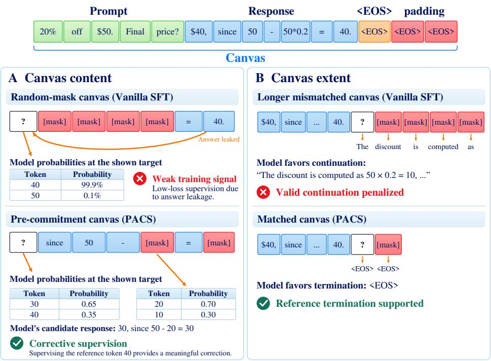  
Figure 1: The training canvas changes reference supervision. Top: A canvas includes prompt tokens (green), visible answer tokens (blue), and masked positions (red). A: Visible reference content can conceal or expose a commitment-time disagreement. B: Canvas extent can alter the prediction problem, inducing an extra stopping signal on a mismatched canvas but not on the matched canvas.

Full-attention masked DLMs such as LLaDA and Dream accommodate variable-length responses within a preallocated generation canvas, with EOS marking the response boundary. During SFT, their training recipes pad shorter examples with the same EOS token for batched computation. These positions remain attention-visible and participate in masking and reconstruction, teaching the model to predict EOS beyond the response. The allocated extent therefore contributes to the context in which the reference is predicted. As we show, this choice can introduce training signals that adjust how a correct solution is expressed, rather than correct its reasoning.

Vanilla masked-diffusion SFT typically constructs the visible context by randomly masking the reference response, independently of the model’s confidence-guided decoding decisions. During inference, by contrast, those decisions determine which predictions are committed and hence what context becomes available next. We therefore study how the model’s own decoding behavior can guide training-canvas construction:

## A reference answer tells us which tokens to teach—but how can the model’s own predictions help us choose the training canvas?

We investigate how the canvas’s revealed content and length affect supervision for the same reference. These choices determine which reference tokens are visible when a target is supervised and how many input positions the model can attend to.

First, random masking can omit reference content that the model’s reveal process would establish before selecting a target, or expose later content prematurely. These cases can respectively penalize missing-context uncertainty or conceal errors present at token selection (Figure 1A).

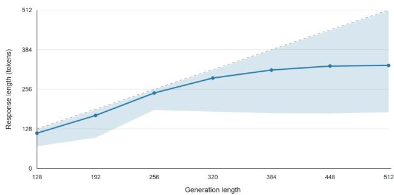  
Figure 2: Longer canvases induce longer responses. Realized response length increases with allocated generation length.

Second, canvas extent can change reference predictability even when the solution is fixed. In our setting, longer canvases produce longer responses (Figure 2), and changing extent shifts reference loss, particularly in later response blocks (Figure 4). Supervision may therefore compensate for differences in response formulation rather than reasoning errors; Figure 1B illustrates this at termination.

These observations motivate supervision at token selection, rather than uniformly stronger or weaker supervision. We therefore develop PACS, which selects a canvas using commitment-level reference predictability along a confidence-guided, reference-conditioned reveal process and fine-tunes on the corresponding pre-commitment states, without changing the reference.

Our contributions are as follows:

• We identify two sources of how training-canvas choices can misdirect supervision in fullattention DLM: the visible reference content revealed when a target is supervised, and the attention-visible extent of the training canvas. Both shift the prediction problem induced by the same fixed reference.

• We introduce PACS, a predictability-aware SFT procedure that addresses these two mismatches by selecting the initial canvas through commitment-level reference predictability and supervising the corresponding pre-commitment states along the resulting referenceconditioned trajectory.

• Across four reasoning and code-generation benchmarks, PACS achieves the highest average accuracy among the compared SFT methods on both LLaDA-8B-Instruct and Dream-7B-Instruct at every evaluated generation budget, with individual-benchmark gains of up to 12.84 percentage points over vanilla SFT.

## 2 PRELIMINARIES

## 2.1 MASKED DIFFUSION LANGUAGE MODELS AND CANVASES

We consider full-attention masked DLMs that operate on a prompt followed by a preallocated region of token positions. This region can extend beyond the eventual response and include attention-visible padding, such as positions added for batching. At the start of decoding, all non-prompt positions contain [mask] tokens; generation proceeds by iteratively revealing selected predictions.

We call the complete attention-visible input the canvas. For a tokenized prompt $P ,$ we write the canvas as $C = ( \bar { C } _ { 1 } , \dots , C _ { L } )$ , where L counts all attention-visible positions. The non-prompt canvas positions are $\mathcal { T } _ { L } = \{ | P | + 1 , \ldots , L \}$ and contain visible tokens or [mask]. We write $p _ { \theta , i } ( \cdot \mid C )$ for the token distribution at position i produced by the model with parameters θ.

For a prompt–response pair $( P , A )$ , where A includes its terminating EOS token, the clean canvas has token values

$$
( y _ { 1 } , \ldots , y _ { L } ) = [ P , A , \mathtt { E } \mathtt { O } \mathtt { S } ^ { L - | P | - | A | } ] , \qquad L \ge | P | + | A | .\tag{1}
$$

The EOS ending A marks the reference boundary; subsequent EOS copies fill the remaining attentionvisible positions. Termination and padding are thus different roles of the same token value. Here $y _ { i }$ specifies the clean target at each non-prompt position.

## 2.2 CONFIDENCE-GUIDED DECODING

For a fixed canvas length $L ,$ let $C ^ { ( s ) }$ denote the canvas before decoding step $s ,$ initialized as $C ^ { ( 0 ) } = [ P , [ \mathtt { m a s k } ] ^ { L - | P | } ]$ . Full-canvas decoding makes all masked positions in $\mathcal { T } _ { L }$ eligible for revelation. Semi-AR decoding instead processes contiguous response blocks from left to right, restricting eligibility to the first unfinished block; future blocks remain attention-visible as masks.

At each eligible position i, confidence is defined as the probability of the model’s most likely token:

$$
c _ { i } ( C ) = \operatorname* { m a x } _ { v \in \mathcal { V } } p _ { \theta , i } ( v \mid C ) ,\tag{2}
$$

where $\nu$ is the non-mask output vocabulary. For a threshold $\tau \in ( 0 , 1 )$ , the commitment set $S ^ { ( s ) }$ contains eligible positions with $c _ { i } ( C ^ { ( s ) } ) \geq \tau$ . Their predicted tokens are revealed together to form $C ^ { ( s + 1 ) }$ , after which confidence is recomputed.

## 2.3 TRAINING CANVASES IN SUPERVISED FINE-TUNING

During supervised fine-tuning (SFT), padding accommodates variable-length prompt–response pairs in batched training. Some recipes set L to the longest prompt–response sequence in each minibatch (Hu et al., 2026; Li et al., 2025), while others use a dataset-level or otherwise globally fixed training extent (Zhao et al., 2025; Wang et al., 2026a; Parashar et al., 2026; Chen et al., 2026b).

Vanilla SFT samples a masking probability $t \sim \mathrm { U n i f } ( 0 , 1 )$ and constructs a training canvas $C$ from the clean tokens in Equation 1. Each $y _ { i }$ at a non-prompt position $i \in \mathcal { Z } _ { L }$ is independently replaced by [mask] with probability $t ,$ including the EOS-padding tokens; the prompt is unchanged. The objective is

$$
\mathcal { L } _ { \mathrm { S F T } } ( \theta ) = - \mathbb { E } _ { ( P , A ) , t , C } \left[ \frac { 1 } { t ( L - | P | ) } \sum _ { i \in \mathcal { I } _ { L } } \mathbf { 1 } [ C _ { i } = [ \mathrm { m a s k } ] ] \log p _ { \theta , i } ( y _ { i } \mid C ) \right] .\tag{3}
$$

The expectation is over training pairs, masking probabilities, and sampled training canvases. Here, $\mathbf { 1 } [ \cdot ]$ denotes an indicator. Under this objective, every masked padding position is supervised to reconstruct EOS and contributes to the loss. Both masked and unmasked padding positions remain attention-visible. Thus, padding determines the attention-visible extent, while random masking de termines which token values are visible and which positions receive supervision.

## 3 RELATED WORK

Supervised fine-tuning for diffusion language models. Vanilla masked-diffusion SFT reconstructs randomly masked reference tokens (Sahoo et al., 2024; Shi et al., 2024; Nie et al., 2025). Because masks are sampled independently of model predictions, training contexts need not reflect confidence-guided decoding. Recent methods incorporate decoding structure or token predictability. Block-based approaches condition prediction on preceding clean blocks (Arriola et al., 2025; Chen et al., 2026b; Jain, 2026). Chen et al. (2026a) guide masking with teacher-derived difficulty rankings, while Parashar et al. (2026) adapt target selection to model-estimated difficulty and visible context. PACS shares this motivation of using model predictability to shape supervision, but follows confidence-guided decoding more directly: after each reference revelation, confidence is recomputed to determine which positions are supervised next.

Trajectory-aware training and reference supervision. Recent work brings training closer to confidence-guided inference by learning from states visited during the model’s own decoding process (Wang et al., 2026b; Shao et al., 2026; Ren et al., 2026). For on-policy reinforcement learning and distillation, these trajectories can be followed directly because model-generated tokens remain part of subsequent states. Fixed-reference SFT cannot follow such trajectories exactly: teache forcing replaces model predictions with reference tokens, changing the states from which later decisions are made. PACS therefore takes a middle ground, retaining reference supervision while letting model predictability guide the evolving reveal process.

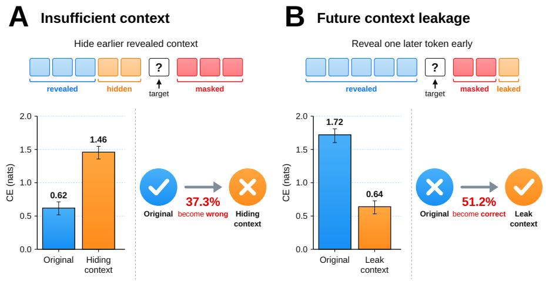

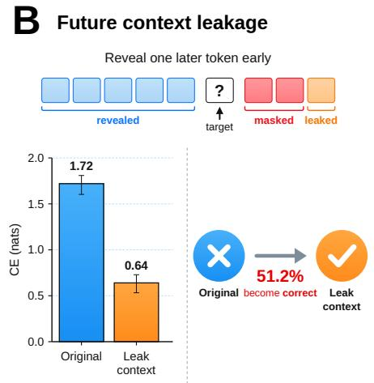  
Figure 3: Changing context around commitment can create or conceal reference disagreement. LLaDA-8B-Instruct on GSM8K. A: Insufficient context. Hiding reference tokens revealed in the preceding step makes 37.3% of initially correct predictions wrong. B: Future context leakage. Revealing one reference token scheduled for the following reveal step early makes 51.2% of initially wrong predictions correct.

From response compatibility to canvas compatibility. Recent SFT methods adapt supervision to the learner’s response distribution through likelihood-based response selection (Zhang et al., 2026), reference rewriting (Yang et al., 2024), or selective use of correct model-generated answers (Gupta et al., 2025). These approaches seek to teach the task while limiting unnecessary changes to the model’s existing response patterns. PACS extends this principle to a degree of freedom absent from standard AR teacher forcing: the attention-visible extent of the training canvas. In full-attention masked DLMs, changing this extent can alter reference predictability even when the solution itself is unchanged. Compatibility therefore depends not only on the reference response, but also on the canvas on which it is taught. PACS preserves the reference and selects its canvas using commitmentlevel reference predictability, adapting the prediction conditions rather than the answer.

## 4 HOW CANVAS SHAPES REFERENCE SUPERVISION

In this section, we examine the canvas mismatches that motivate PACS. We show how changing the reference content available at supervision or the canvas length changes predictions for the same reference response. These observations motivate when PACS supervises each target and how it selects the training canvas. All diagnostics use a frozen model; experimental details appear in Appendix C.

## 4.1 THE CANVAS CAN CREATE OR CONCEAL COMMITMENT DISAGREEMENT

We construct reference-conditioned trajectories by selecting masked positions according to model confidence and revealing their reference tokens before the next selection. A target’s prediction immediately before revelation is its commitment prediction. We call it correct (reference-agreeing) when the most likely token matches the reference, and wrong otherwise. Starting from this original canvas, we change the surrounding content while keeping the target masked and the canvas length fixed. Figure 3 compares mean reference CE before and after each change and reports the corresponding correct-to-wrong or wrong-to-correct transitions.

Insufficient context. We consider targets predicted correctly at commitment that were already eligible in the immediately preceding reveal step. For each target, we hide the reference tokens revealed in that step by replacing them with [mask], leaving the target masked and all other positions unchanged. After hiding this context, 37.3% of these initially correct predictions become wrong, and mean reference CE increases by 0.84 nats (Figure 3A). The additional supervision thus penalizes uncertainty from missing context, rather than an error at the target’s original selection step.

Future context leakage. We instead consider targets predicted incorrectly at commitment. Starting from each target’s original canvas, we reveal one reference token selected in the following reveal step of the original trajectory, leaving the target masked and all other positions unchanged. Revealing this token early makes 51.2% of these initially wrong predictions correct and reduces mean reference CE by 1.08 nats (Figure 3B). Conversely, future context leakage can weaken corrective supervision at positions the model still predicts incorrectly at commitment. By making these targets appear easier, the leaked information suppresses the reference-loss signal for errors that remain on the original canvas.

Together, these results show that canvas content can misdirect corrective supervision relative to the model’s errors at commitment. These findings motivate supervising each target on the canvas present when the confidence-guided rule selects it for revelation.

## 4.2 CANVAS EXTENT CHANGES REFERENCE PREDICTABILITY

Even when the reference response is unchanged, varying the canvas length can change the probabilities assigned to its tokens. Section 4.1 motivates commitment-level scoring as a way to assess how well a canvas supports the reference when its tokens are selected for revelation. We therefore use mean CE at commitment to examine how this predictability changes with canvas extent. Let $C ^ { ( s ) }$ be the canvas before reveal step $s , S _ { L } ^ { ( s ) }$ the positions selected by the confidence-guided rule, and $T _ { L }$ the total number of reveal steps:

$$
\operatorname { C E } _ { \mathrm { t r } } ( P , A ; L ) = - { \frac { 1 } { | { \mathcal { R } } | } } \sum _ { s = 0 } ^ { T _ { L } - 1 } \sum _ { i \in S _ { L } ^ { ( s ) } \cap { \mathcal { R } } } \log p _ { \theta , i } { \Big ( } y _ { i } \mid C ^ { ( s ) } { \Big ) } .\tag{4}
$$

Here, $\mathcal { R }$ contains the reference positions through the first response-termination token, inclusive, and $y _ { i }$ is the reference token at position i. Each target is scored once, immediately before its revelation.

To study this effect, we generate references at source generation length $K _ { 0 } = 3 8 4$ and reevaluate them at other lengths, where $K = L - | P |$ . Each candidate uses its own reference-conditioned trajectory, and CE changes are paired against the same reference evaluated at $K _ { 0 }$

Figure 4A shows positive mean paired ∆CE at both shorter and longer lengths. Panels B and C show that the excess CE is particularly pronounced in later response blocks for $K \ : \ : = \ : 2 5 6$ and $K = 5 1 2$ . This additional loss need not reflect a reasoning error. It may also reflect differences between the model’s response behavior under a given canvas and the formulation of the fixed reference. The termination example in Figure 1B illustrates one such discrepancy. For these source-generated references, the observed sensitivity to extent motivates using $\mathrm { C E } _ { \mathrm { t r } } ^ { \bar { } }$ as an empirical measure of compatibility between a fixed reference and a candidate canvas.

## 5 PREDICTABILITY-AWARE CANVAS SELECTION AND SUPERVISION

Section 4 shows that both canvas content and canvas extent shape reference supervision. Accordingly, PACS has two components: commitment-based canvas selection, which chooses a canvas under which the reference is well supported along the model’s reveal trajectory, and commitmentlevel SFT, which teaches the reference at the corresponding pre-commitment states.

## 5.1 COMMITMENT-BASED CANVAS SELECTION

Recall that the clean canvas extends the reference with attention-visible EOS padding. When replaced by [mask] and included in supervision, these positions are trained to reconstruct EOS and contribute to the loss. PACS selects this attention-visible canvas extent for each fixed reference using commitment-level predictability, rather than inheriting it from a padding convention.

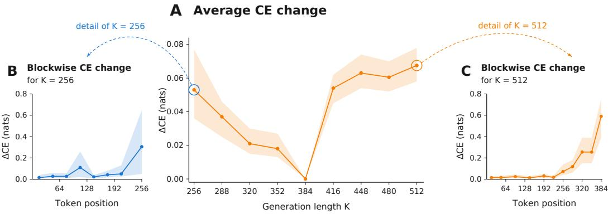

Figure 4: Canvas-extent mismatch increases reference cross-entropy. Target responses are generated at source generation length $K _ { 0 } ~ = ~ 3 8 4$ , and ∆CE is the change of CE compared to that evaluated at $K _ { 0 } .$ . A (center): Mean ∆CE across generation lengths, evaluated along each candidate’s own reference-conditioned trajectory. B (left) and C (right): Detailed blockwise ∆CE across response positions for $K = 2 5 6 { \mathrm { \bar { ( b l u e ) } } }$ and $K = 5 1 2$ (orange).  
Algorithm 1 PACS: canvas selection and commitment-level SFT   
Require: Training pairs D, frozen model $p _ { \theta _ { 0 } }$ , candidate lengths $\Lambda ( P , A )$   
1: for all $( P , A ) { \overset { \vartriangle } { \in } } { \mathcal { D } }$ do   
2: Construct a trajectory $\mathcal { T } _ { L } ( P , A )$ for each $L \in \Lambda ( P , A )$ using confidence-guided decoding   
3: Score each candidate with $\operatorname { C E } _ { \operatorname { t r } } ( P , A ; L )$   
4: Select $L ^ { * } ( P , A )$ by equation 6 and retain $\mathcal { T } _ { L ^ { * } } ( P , A )$   
5: end for   
6: Initialize $\theta  \theta _ { 0 }$   
7: Fine-tune $p _ { \theta }$ on the retained pre-commitment canvases, supervising only selected reference po  
sitions using equation 7   
8: return $p _ { \theta }$

Let D contain the training pairs $( P , A )$ . For each pair, let R be the scored reference positions defined in Section 4.2, and let $ { \Lambda } (  { \bar { P } } , A )$ be a finite, nonempty set of candidate total canvas lengths satisfying $L \geq | P | + | A |$ . Each candidate retains the same prompt and reference but allocates $\mathbf { \bar { \boldsymbol { L } } } - | \mathbf { \boldsymbol { P } } | - | \mathbf { \boldsymbol { A } } |$ attention-visible positions beyond the reference.

For each $L \in \Lambda ( P , A )$ , the frozen model $p _ { \theta }$ constructs the reference-conditioned trajectory from Section 4.1 (details in Appendix C). The padding positions begin as [mask] and take their clean EOS values when revealed. We record the pre-commitment canvases and commitment sets as

$$
\begin{array} { r } { \mathcal { T } _ { L } ( P , A ) = \left( C ^ { ( s ) } , S _ { L } ^ { ( s ) } \right) _ { s = 0 } ^ { T _ { L } - 1 } , } \end{array}\tag{5}
$$

with every position in R committed once along the trajectory.

We compare candidates using $\mathrm { C E } _ { \mathrm { t r } } ( P , A ; L )$ from Equation $^ { 4 , }$ scoring only the same reference span R across all lengths. Thus, the additional padding affects the conditioning canvas but does not add targets to the selection score. We select

$$
L ^ { * } ( P , A ) \in \underset { L \in \Lambda ( P , A ) } { \arg \operatorname* { m i n } } \ \mathrm { C E } _ { \mathrm { t r } } ( P , A ; L ) ,\tag{6}
$$

and retain the selected canvas length and trajectory $\mathcal { T } _ { L ^ { * } } ( P , A )$ for SFT in Section 5.2.

## 5.2 COMMITMENT-LEVEL SUPERVISED FINE-TUNING

For each training pair, let $L ^ { * } = L ^ { * } ( P , A )$ . The selected trajectory $\mathcal { T } _ { L ^ { * } } ( P , A )$ supplies the precommitment canvases for fine-tuning. Rather than applying loss to all unresolved positions on each

canvas, we supervise only the positions selected for commitment:

$$
\mathcal { L } _ { \mathrm { c o m m i t } } ( \theta ) = - \mathbb { E } _ { ( P , A ) \sim \mathcal { D } } \left[ \frac { 1 } { | \mathcal { R } | } \sum _ { s = 0 } ^ { T _ { L ^ { * } } - 1 } \sum _ { i \in S _ { L ^ { * } } ^ { ( s ) } \cap \mathcal { R } } \log p _ { \theta , i } \Big ( y _ { i } \mid C ^ { ( s ) } \Big ) \right] .\tag{7}
$$

Each reference position in R is therefore supervised once along the selected trajectory.

This implements confidence-guided teacher forcing: the frozen model determines which positions are selected at each step, while the reference supplies the values revealed before the next prediction. The resulting canvases remain reference-consistent, but their reveal order follows the model’s own confidence-guided decoding behavior. Supervising the pre-commitment prediction focuses the loss on the prediction problem encountered when the decoder elects to commit. The method therefore changes the context in which each reference token is taught, rather than removing difficult targets.

Canvas selection and commitment-level SFT operate on the same conditional prediction tasks: candidate canvases are assessed through their pre-commitment reference predictions, and the selected trajectory supplies those same conditioning states for fine-tuning. Integrating these two components, Algorithm 2 summarizes the complete decoding-aware SFT procedure.

## 6 EXPERIMENTS

We evaluate downstream generation, isolate the contribution of each PACS component to examine how canvas selection changes reference supervision.

## 6.1 EXPERIMENTAL SETUP

We evaluate LLaDA-8B-Instruct and Dream-7B-Instruct on GSM8K, MATH500, MBPP, and HumanEval. Each checkpoint is evaluated at $K _ { \mathrm { e v a l } } ~ \in ~ \{ 1 2 8 , 2 5 6 , 5 1 2 \}$ . Tables 1 and 2 show the $K _ { \mathrm { e v a l } } = 2 5 6$ results; bold marks the highest score in each benchmark column. Complete threelength scores and the relative percentage gains $\Delta$ of PACS over the corresponding initial checkpoint appear in Tables A.2 and A.3. Additional training details are provided in Section A.1.

Data and comparisons. For a fair comparison, all SFT methods use the same training data, prepared from the training splits of GSM8K (Cobbe et al., 2021) and MATH (Hendrycks et al., 2021) and from OpenCoder (Huang et al., 2025). We follow the reference-guided response-construction procedure of ReGFT (Wu et al., 2026b), using confidence-guided decoding (Wu et al., 2026a) to generate model-written reference responses. We compare vanilla random-mask SFT (Sahoo et al., 2024; Shi et al., 2024; Nie et al., 2025), semi-AR block SFT (Jain, 2026; Chen et al., 2026b), LIFT (Parashar et al., 2026), TRIMS (Chen et al., 2026a), and PACS.

Canvas search. For each pair $( P , A )$ , let $L _ { \mathrm { r e f } } = | P | + | A |$ be the minimum feasible total canvas length and $L _ { \mathrm { m i n } } = B \lceil L _ { \mathrm { r e f } } \ ' B \rceil$ its rounded value, with $B = 3 2$ . We consider the nested families

$$
\Lambda _ { K } ( P , A ) = \left\{ \{ L _ { \mathrm { r e f } } \} , \qquad K = 1 , \ldots , K = 1 , \ldots , N \right. 
$$

Duplicate lengths are evaluated once. Our main family is $\Lambda _ { \operatorname* { m a i n } } = \Lambda _ { 4 }$ . PACS selects each example’s canvas using commitment-level reference CE (Section 5.1); the search extent is chosen on held-out validation (Section 6.4).

Main results. PACS outperforms vanilla SFT in 22 of 24 model–benchmark–length settings and ties in the remaining two, achieving the highest accuracy among all compared methods in 19 settings (Tables A.2 and A.3). At $K _ { \mathrm { e v a l } } = 2 5 6$ , it improves MATH500 by 2.00 and 5.00 percentage points and HumanEval by 9.15 and 6.71 points on LLaDA and Dream, respectively (Tables 1 and 2). The full results show that these gains extend across both backbones and all three generation budgets.

Table 1: LLaDA-8B-Instruct results (%) at $K _ { \mathrm { e v a l } } = 2 5 6 .$
<table><tr><td>Method</td><td>GSM8K</td><td>MATH500</td><td>MBPP</td><td>HumanEval</td></tr><tr><td>Initial</td><td>75.44</td><td>36.40</td><td>40.86</td><td>37.80</td></tr><tr><td>Vanilla SFT</td><td>76.27</td><td>37.00</td><td>49.03</td><td>38.41</td></tr><tr><td>Semi-AR block</td><td>78.20</td><td>38.40</td><td>48.60</td><td>43.90</td></tr><tr><td>LIFT</td><td>77.63</td><td>37.00</td><td>46.69</td><td>39.63</td></tr><tr><td>TRIMS</td><td>77.63</td><td>38.00</td><td>52.92</td><td>40.24</td></tr><tr><td>PACS</td><td>77.94</td><td>39.00</td><td>49.42</td><td>47.56</td></tr></table>

Table 2: Dream-7B-Instruct results (%) at $K _ { \mathrm { e v a l } } = 2 5 6 .$
<table><tr><td>Method</td><td>GSM8K</td><td>MATH500</td><td>MBPP</td><td>HumanEval</td></tr><tr><td>Initial</td><td>80.52</td><td>43.80</td><td>45.53</td><td>51.83</td></tr><tr><td>Vanilla SFT</td><td>80.06</td><td>44.20</td><td>60.31</td><td>54.27</td></tr><tr><td>Semi-AR block</td><td>80.21</td><td>43.60</td><td>61.09</td><td>58.53</td></tr><tr><td>LIFT</td><td>80.36</td><td>44.80</td><td>50.58</td><td>52.44</td></tr><tr><td>TRIMS</td><td>80.44</td><td>45.60</td><td>52.14</td><td>53.66</td></tr><tr><td>PACS</td><td>80.52</td><td>49.20</td><td>61.48</td><td>60.98</td></tr></table>

## 6.2 COMPONENT ANALYSIS

We cross two canvas rules with random or confidence-guided ordering. Within each canvas rule, random ordering matches the corresponding confidence trajectory’s per-step reveal counts. Appendix C.3 details the schedule-matched control.

Table 3 shows that canvas selection improves both reveal-order variants, while confidence-guided ordering outperforms schedule-matched random ordering under either canvas rule. Combining both components achieves the highest accuracy on all four benchmarks, supporting complementary benefits from selecting the canvas extent and the pre-commitment states used for supervision.

Table 3: Contributions of canvas selection and reveal ordering. LLaDA at $K _ { \mathrm { e v a l } } = 2 5 6$
<table><tr><td>Canvas rule</td><td>Reveal order</td><td></td><td>GSM8K MATH500</td><td>MBPP</td><td>HumanEval</td></tr><tr><td>Batch-max</td><td>Random</td><td>76.27</td><td>37.00</td><td>45.14</td><td>39.63</td></tr><tr><td>Batch-max</td><td>Confidence-guided (ours)</td><td>77.48</td><td>38.00</td><td>47.08</td><td>40.90</td></tr><tr><td>Trajectory-selected (ours) Random</td><td></td><td>77.03</td><td>37.40</td><td>47.86</td><td>44.51</td></tr><tr><td>Trajectory-selected (ours) Confidence-guided (ours)</td><td></td><td>77.94</td><td>39.00</td><td>49.42</td><td>47.56</td></tr></table>

## 6.3 CANVAS CHOICE AND REFERENCE PREDICTABILITY

We compare predictability-based canvas selection with length rules motivated by existing SFT recipes. Batch-max uses the longest example in each batch, representing batch-dependent padding. Dataset-max uses a shared maximum length across training examples, providing a control for glob ally specified training extents. We additionally include Random visible length, which samples feasible canvas lengths without predictability-based selection (Ye et al., 2025). Figure 5 compares target CE and downstream test performance after SFT on MATH500 and HumanEval at $K _ { \mathrm { e v a l } } = 2 5 6$

With the reference responses unchanged, PACS yields lower reference CE and higher test accuracy than batch-max, dataset-max, and random visible lengths (Figure 5).

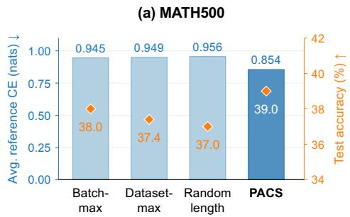

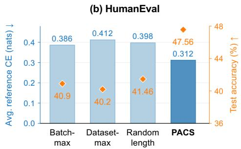  
Figure 5: Canvas choice and reference predictability. Target CE (blue bars, left) and post-SFT test accuracy (orange diamonds, right) for four canvas-length rules on MATH500 and HumanEval with LLaDA-8B-Instruct at $K _ { \mathrm { e v a l } } = 2 5 6$

## 6.4 ABLATION ON CANVAS SEARCH EXTENT

We vary the nested candidate family $\Lambda _ { K }$ defined in Section 6.1, holding the commitment-level reference CE selection criterion fixed.

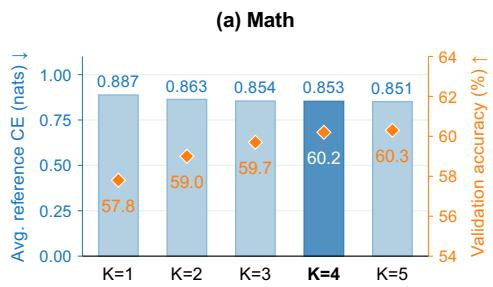

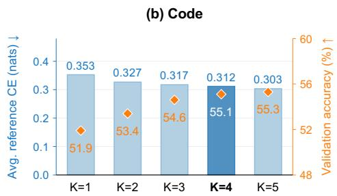  
Figure 6: Canvas search extent at $K _ { \mathrm { e v a l } } = 2 5 6$ . Bars show average reference CE (left axis); orange diamonds show held-out validation accuracy (right axis).

Most validation improvement is obtained by our main family $\Lambda _ { 4 } ;$ expanding to $\Lambda _ { 5 }$ adds only 0.1 percentage points on Math and 0.2 points on Code (Figure 6). A compact candidate family therefore captures most of the observed benefit while limiting per-example search.

## 7 CONCLUSION

This work highlights training-canvas construction as an integral part of masked-DLM fine-tuning: revealed reference content and attention-visible extent shape the learning problem even when the answer is fixed. PACS couples canvas selection and reference-consistent pre-commitment supervision through commitment-level reference predictability, bringing the model’s decoding behavior into the construction of its training tasks. Experiments across mathematical reasoning, code generation, and multiple generation lengths support this decoding-aware perspective on supervision. More broadly, this work opens promising directions for future research on predictability-aware canvas construction across diverse DLM architectures, including block diffusion and hybrid diffusion–AR models.

## AI USE STATEMENT

AI assistance with manuscript writing was limited to language polishing, including improvements to grammar, clarity, and readability. The authors reviewed all AI-assisted revisions and take full responsibility for the final manuscript.

## REFERENCES

Marianne Arriola, Aaron Gokaslan, Justin Chiu, Zhihan Yang, Zhixuan Qi, Jiaqi Han, Subham Sahoo, and Volodymyr Kuleshov. Block diffusion: Interpolating between autoregressive and diffusion language models. In International Conference on Learning Representations, volume 2025, pp. 50726–50753, 2025.

Lingjie Chen, Ruizhong Qiu, Yuyu Fan, Yanjun Zhao, and Hanghang Tong. TRIMS: Trajectory-ranked instruction masked supervision for diffusion language models. arXiv preprint arXiv:2604.00666, 2026a. URL https://arxiv.org/abs/2604.00666.

Zigeng Chen, Gongfan Fang, Xinyin Ma, Ruonan Yu, and Xinchao Wang. dParallel: Learnable parallel decoding for dLLMs. In The Fourteenth International Conference on Learning Representations, 2026b. URL https://proceedings.iclr.cc/paper\_files/paper/2026/ hash/57250222014c35949476f3f272c322d2-Abstract-Conference.html.

Karl Cobbe, Vineet Kosaraju, Mohammad Bavarian, Mark Chen, Heewoo Jun, Lukasz Kaiser, Matthias Plappert, Jerry Tworek, Jacob Hilton, Reiichiro Nakano, Christopher Hesse, and John Schulman. Training verifiers to solve math word problems. arXiv preprint arXiv:2110.14168, 2021.

Sonam Gupta, Yatin Nandwani, Asaf Yehudai, Dinesh Khandelwal, Dinesh Raghu, and Sachindra Joshi. Selective self-to-supervised fine-tuning for generalization in large language models. In Findings ofthe Associationfor Computational Linguistics: NAACL 2025, pp. 6255–6264, 2025.

Dan Hendrycks, Collin Burns, Saurav Kadavath, Akul Arora, Steven Basart, Eric Tang, Dawn Song, and Jacob Steinhardt. Measuring mathematical problem solving with the MATH dataset. In Proceedings of the Neural Information Processing Systems Track on Datasets and Benchmarks, volume 1, 2021.

Yuezhou Hu, Harman Singh, Monishwaran Maheswaran, Haocheng Xi, Coleman Hooper, Jintao Zhang, Aditya Tomar, Michael W. Mahoney, Sewon Min, Mehrdad Farajtabar, Kurt Keutzer, Amir Gholami, and Chenfeng Xu. Residual Context Diffusion Language Models. arXiv preprint arXiv:2601.22954, 2026. URL https://arxiv.org/abs/2601.22954v2.

Siming Huang, Tianhao Cheng, Jason Klein Liu, Weidi Xu, Jiaran Hao, Liuyihan Song, Yang Xu, Jian Yang, Jiaheng Liu, Chenchen Zhang, Linzheng Chai, Ruifeng Yuan, Xianzhen Luo, Qiufeng Wang, YuanTao Fan, Qingfu Zhu, Zhaoxiang Zhang, Yang Gao, Jie Fu, Qian Liu, Houyi Li, Ge Zhang, Yuan Qi, Xu Yinghui, Wei Chu, and Zili Wang. OpenCoder: The open cookbook for top-tier code large language models. In Proceedings of the 63rd Annual Meeting of the Association for Computational Linguistics (Volume 1: Long Papers), pp. 33167–33193, 2025. doi: 10.18653/ v1/2025.acl-long.1591. URL https://aclanthology.org/2025.acl-long.1591/.

Gagan Jain. Adaptive block diffusion: Resolving training-inference mismatch in diffusion language models, 2026.

Shufan Li, Konstantinos Kallidromitis, Hritik Bansal, Akash Gokul, Yusuke Kato, Kazuki Kozuka, Jason Kuen, Zhe Lin, Kai-Wei Chang, and Aditya Grover. LaViDa: A Large Diffusion Language Model for Multimodal Understanding. arXiv preprint arXiv:2505.16839, 2025. URL https: //arxiv.org/abs/2505.16839v4.

Aaron Lou, Chenlin Meng, and Stefano Ermon. Discrete diffusion modeling by estimating the ratios of the data distribution. In Proceedings of the 41st International Conference on Machine Learning, volume 235 of Proceedings of Machine Learning Research, pp. 32819–32848. PMLR, 21–27 Jul 2024.

Shen Nie, Fengqi Zhu, Zebin You, Xiaolu Zhang, Jingyang Ou, Jun Hu, Jun Zhou, Yankai Lin, Ji-Rong Wen, and Chongxuan Li. Large language diffusion models. In Advances in Neural Information Processing Systems, volume 38, 2025. doi: 10.52202/085713-1689. Oral presentation.

Shubham Parashar, Atharv Chagi, Jacob Helwig, Lakshmi Jotsna Madhavarapu, Sushil Vemuri, James Caverlee, Dileep Kalathil, and Shuiwang Ji. Learnability-informed fine-tuning of diffusion language models. In Forty-third International Conference on Machine Learning, 2026. URL https://openreview.net/forum?id=IgzMfT6eUx.

Haolin Ren, Ziyang Huang, Chenhao Yuan, Jun Zhao, and Kang Liu. Trace-based on-policy distillation for masked diffusion language models. arXiv preprint arXiv:2607.16872, 2026. URL https://arxiv.org/abs/2607.16872.

Subham Sekhar Sahoo, Marianne Arriola, Yair Schiff, Aaron Gokaslan, Edgar Marroquin, Justin T. Chiu, Alexander Rush, and Volodymyr Kuleshov. Simple and effective masked diffusion language models. In Advances in Neural Information Processing Systems, volume 37, pp. 130136–130184, 2024. doi: 10.52202/079017-4135. URL https://proceedings.neurips.cc/paper\_files/paper/2024/hash/ eb0b13cc515724ab8015bc978fdde0ad-Abstract-Conference.html.

Yawen Shao, Jie Xiao, Kai Zhu, Yu Liu, Hongchen Luo, Xueyang Fu, Yang Cao, Wei Zhai, and Zheng-Jun Zha. Back on track: Aligning rewards and states for reasoning in diffusion large language models. arXiv preprint arXiv:2606.08501, 2026.

Jiaxin Shi, Kehang Han, Zhe Wang, Arnaud Doucet, and Michalis K. Titsias. Simplified and generalized masked diffusion for discrete data. In Advances in Neural Information Processing Systems, volume 37, pp. 103131–103167, 2024. doi: 10.52202/079017-3277. URL https://proceedings.neurips.cc/paper\_files/paper/2024/hash/ bad233b9849f019aead5e5cc60cef70f-Abstract-Conference.html.

Shuaidi Wang, Zhan Zhuang, Ruping Huang, and Yu Zhang. NaRA: Noise-Aware LoRA for Parameter-Efficient Fine-Tuning of Diffusion LLMs. arXiv preprint arXiv:2605.29716, 2026a. URL https://arxiv.org/abs/2605.29716v1.

Yinjie Wang, Ling Yang, Bowen Li, Ye Tian, Ke Shen, and Mengdi Wang. Revolutionizing reinforcement learning framework for diffusion large language models. In International Conference on Learning Representations, volume 2026, pp. 101476–101501, 2026b.

Chengyue Wu, Hao Zhang, Shuchen Xue, Zhijian Liu, Shizhe Diao, Ligeng Zhu, Ping Luo, Song Han, and Enze Xie. Fast-dllm: Training-free acceleration of diffusion llm by enabling kv cache and parallel decoding. In International Conference on Learning Representations, volume 2026, pp. 57027–57051, 2026a.

Yangzhen Wu, Shanda Li, Zixin Wen, Xin Zhou, Ameet Talwalkar, Yiming Yang, Wenhao Huang, and Tianle Cai. Learn hard problems during rl with reference guided fine-tuning. arXiv preprint arXiv:2603.01223, 2026b.

Zhangchen Xu, Yang Liu, Yueqin Yin, Mingyuan Zhou, and Radha Poovendran. Kodcode: A diverse, challenging, and verifiable synthetic dataset for coding. arXiv preprint arXiv:2503.02951, 2025.

Zhaorui Yang, Tianyu Pang, Haozhe Feng, Han Wang, Wei Chen, Minfeng Zhu, and Qian Liu. Selfdistillation bridges distribution gap in language model fine-tuning. In Proceedings of the 62nd Annual Meeting of the Association for Computational Linguistics (Volume 1: Long Papers), pp. 1028–1043, 2024.

Jiacheng Ye, Zhihui Xie, Lin Zheng, Jiahui Gao, Zirui Wu, Xin Jiang, Zhenguo Li, and Lingpeng Kong. Dream 7B: Diffusion large language models. arXiv preprint arXiv:2508.15487, 2025. URL https://arxiv.org/abs/2508.15487.

Dylan Zhang, Qirun Dai, and Hao Peng. The best instruction-tuning data are those that fit. Advances in Neural Information Processing Systems, 38:141172–141208, 2026.

Siyan Zhao, Devaansh Gupta, Qinqing Zheng, and Aditya Grover. d1: Scaling Reasoning in Diffusion Large Language Models via Reinforcement Learning. arXiv preprint arXiv:2504.12216, 2025. URL https://arxiv.org/abs/2504.12216v2.

## A ADDITIONAL EXPERIMENT DETAILS

## A.1 TRAINING CONFIGURATIONS

Table A.1 reports the SFT hyperparameters. The shared GSM8K, MATH, and OpenCoder training corpus is described in Section 6.1; PACS’s four-candidate canvas family with B = 32 is defined in Section 6.1. Decoding settings and prompt formats are given in Sections A.2 and A.3.

Table A.1: Hyperparameters used for PACS.
<table><tr><td>Hyperparameter</td><td>Value</td></tr><tr><td>Learning rate Learning rate scheduler type</td><td> $5 \times 1 0 ^ { - 6 }$  Cosine</td></tr><tr><td>Adam  $\beta$  parameters Gradient accumulation steps</td><td> $\beta _ { 1 } = 0 . 9 , \ \beta _ { 2 } = 0 . 9 9 9$  4</td></tr><tr><td>Per-device train batch size</td><td>2</td></tr><tr><td>Epochs</td><td>1</td></tr><tr><td>Precision</td><td>bf16</td></tr><tr><td>LoRA r</td><td>32</td></tr><tr><td>LoRA α</td><td></td></tr><tr><td>Weight decay</td><td>64</td></tr><tr><td></td><td>0.0</td></tr><tr><td>Maximum gradient norm</td><td>1.0</td></tr><tr><td>Warmup ratio</td><td>5%</td></tr><tr><td>Random seed</td><td>42</td></tr></table>

## A.2 DECODE CONFIGURATION

The following settings are shared by all four benchmarks.

<table><tr><td>Parameter</td><td>Value</td></tr><tr><td>gen_length</td><td>{128, 256, 512}</td></tr><tr><td>block_length</td><td>32</td></tr><tr><td>temperature</td><td>0.0 (greedy)</td></tr><tr><td>cfg_scale</td><td>0.0</td></tr><tr><td>confidence_threshold</td><td>0.9</td></tr><tr><td>seed</td><td>42</td></tr></table>

At temperature zero, add\_gumbel\_noise is a no-op. Decoding uses blockwise confidencethreshold parallel unmasking: at each forward pass, every masked position in the active block whose top-1 softmax probability is at least 0.9 is committed. If no position meets the threshold, the single highest-confidence masked position is committed (Wu et al., 2026a).

The same confidence-guided selection rule is used to construct PACS’s reference-conditioned training trajectories: the frozen model determines which positions are revealed at each step, while the reference supplies their token values.

## A.3 GENERATION PROMPTS

All four benchmarks use a single user turn, with no added task instruction or few-shot exemplars.

```python
msgs = [{"role": "user", "content": benchmark_item}]
s = tokenizer.apply_chat_template(msgs, add_generation_prompt=True, tokenize=
,→ False)
```

## A.3.1 HUMANEVAL

## LLaDA-8B-Instruct Source:

```python
<|startoftext|><|start_header_id|>user<|end_header_id|>
from typing import List
def has_close_elements(numbers: List[float], threshold: float) -> bool:
""" Check if in given list of numbers, are any two numbers closer to each
,→ other than
given threshold.
>>> has_close_elements([1.0, 2.0, 3.0], 0.5)
False
>>> has_close_elements([1.0, 2.8, 3.0, 4.0, 5.0, 2.0], 0.3)
True
"""<|eot_id|><|start_header_id|>assistant<|end_header_id|>
```

## A.3.2 MBPP

## LLaDA-8B-Instruct

```python
<|startoftext|><|start_header_id|>user<|end_header_id|>
def remove_Occ(s,ch):
"""Write a python function to remove first and last occurrence of a given
,→ character from the string.
>>> remove_Occ('hello', 'l')
'heo'
>>> remove_Occ('abcda', 'a')
'bcd'
>>> remove_Occ('PHP', 'P')
'H'
"""<|eot_id|><|start_header_id|>assistant<|end_header_id|>
```

## A.4 SELECTED-BIN DISTRIBUTIONS

Figure A.1 shows which canvas bins are selected within each cumulative candidate family for Math and OpenCoder. Let $T = | P | + | A |$ and $L = L _ { \operatorname* { m i n } } ( P , A )$ . The families are

$$
\begin{array} { r l } & { \Lambda _ { 1 } = \{ T \} , } \\ & { \Lambda _ { K } = \{ T \} \cup \{ L + 3 2 j | j = 0 , \ldots , K - 2 \} , \qquad K \in \{ 2 , 3 , 4 , 5 \} . } \end{array}
$$

Each family retains all earlier candidates; duplicate lengths are considered once. Here K indexes the nominal family, not its cardinality after deduplication, and $K = 4$ is the main configuration.

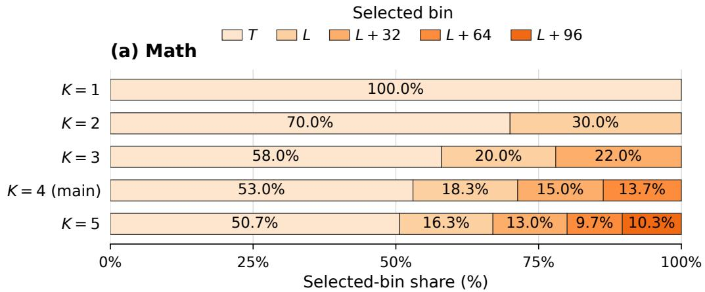

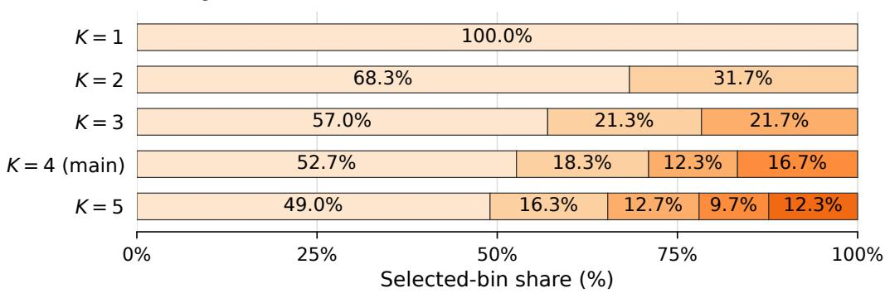  
Figure A.1: Selected-bin proportions across candidate families. Each horizontal bar is normalized independently to 100% and shows the fraction of examples for which PACS selects each candidate in the nested family $\Lambda _ { K } ( P , A )$ . We use $L _ { \mathrm { r e f } } = | P | + \mathrm { \hat { | } } A | , L _ { \mathrm { m i n } } = B \left\lceil L _ { \mathrm { r e f } } / B \right\rceil$ , and $B = 3 2 ^ { \circ }$ so the bins correspond to $L _ { \mathrm { r e f } } , L _ { \mathrm { m i n } } , L _ { \mathrm { m i n } } + B , L _ { \mathrm { m i n } } + 2 B$ , and $L _ { \mathrm { m i n } } + 3 B _ { \cdot }$ . Segment labels give percentages rounded to one decimal place. Bins not contained in a given $\Lambda _ { K }$ have no segment, and colors identify the same candidate lengths across datasets and families. $\Lambda _ { 4 }$ is the main configuration.

The selected bins show that predictability-based canvas selection does not collapse to the shortest feasible canvas or to a single fixed offset. Under our main family $\Lambda _ { 4 } ,$ , PACS selects $L _ { \mathrm { r e f } }$ for only 53.0% of Math and 52.7% of OpenCoder examples; the remaining 47.0% and 47.3%, respectively, are distributed across $L _ { \mathrm { m i n } } , L _ { \mathrm { m i n } } + B _ { \mathrm { m } }$ , and $L _ { \operatorname* { m i n } } + 2 B$ . Thus, for nearly half of the training examples, the reference is better supported on a canvas extending beyond its exact length, and the preferred extent varies across examples. This heterogeneity is precisely why a single global canvas rule is insufficient for our setting: exploiting the candidate family requires selecting, for each reference, the canvas on which its commitment-level predictions are best supported. PACS performs this selection using reference predictability rather than imposing the same extent on every example. The similar distributions across Math and OpenCoder suggest that this need for example-specific canvas selection is not confined to one domain. Finally, expanding to $\Lambda _ { 5 }$ assigns only 10.3% of

Math and 12.3% of OpenCoder examples to the newly added $L _ { \operatorname* { m i n } } + 3 B$ candidate, consistent with diminishing returns from searching substantially beyond the main family.

## A.5 COMPLETE RESULTS ACROSS GENERATION LENGTHS

Tables A.2 and A.3 report the complete $K _ { \mathrm { e v a l } } \in \{ 1 2 8 , 2 5 6 , 5 1 2 \}$ comparisons. ∆ is PACS’s relative percentage gain over the corresponding initial checkpoint.

Table A.2: Complete LLaDA-8B-Instruct results (%) across $K _ { \mathrm { e v a l } } \in \{ 1 2 8 , 2 5 6 , 5 1 2 \}$
<table><tr><td></td><td colspan="3">GSM8K</td><td colspan="3">MATH500</td></tr><tr><td>Model / Seq Len</td><td>128</td><td>256</td><td>512</td><td>128</td><td>256</td><td>512</td></tr><tr><td>LLaDA-Instruct</td><td>76.12</td><td>75.44</td><td>79.08</td><td>35.60</td><td>36.40</td><td>38.80</td></tr><tr><td>+ Vanilla</td><td>77.03</td><td>76.27</td><td>78.77</td><td>35.60</td><td>37.00</td><td>39.40</td></tr><tr><td>+ Semi-AR Block</td><td>76.12</td><td>78.20</td><td>79.23</td><td>34.00</td><td>38.40</td><td>39.20</td></tr><tr><td>+ LIFT</td><td>75.89</td><td>77.63</td><td>78.85</td><td>35.40</td><td>37.00</td><td>38.00</td></tr><tr><td>+ TRIMS</td><td>76.88</td><td>77.63</td><td>79.53</td><td>34.80</td><td>38.00</td><td>39.60</td></tr><tr><td>+ PACS (Ours)</td><td>77.10</td><td>77.94</td><td>80.97</td><td>35.80</td><td>39.00</td><td>40.00</td></tr><tr><td>∆(%)</td><td>+1.29%</td><td>+3.31%</td><td>+2.39%</td><td>+0.56%</td><td>+7.14%</td><td>+3.09%</td></tr><tr><td colspan="7"></td></tr><tr><td></td><td></td><td>MBPP</td><td></td><td></td><td>HumanEval</td><td></td></tr><tr><td>Model / Seq Len</td><td>128</td><td>256</td><td>512</td><td>128</td><td>256</td><td>512</td></tr><tr><td>LLaDA-Instruct</td><td>24.12</td><td>40.86</td><td>49.81</td><td>28.05</td><td>37.80</td><td>43.90</td></tr><tr><td>+ Vanilla</td><td>24.90</td><td>49.03</td><td>50.19</td><td>26.83</td><td>38.41</td><td>46.95</td></tr><tr><td>+ Semi-AR Block</td><td>34.24</td><td>48.60</td><td>50.20</td><td>27.40</td><td>43.90</td><td>48.20</td></tr><tr><td>+ LIFT</td><td>27.63</td><td>46.69</td><td>48.25</td><td>25.00</td><td>39.63</td><td>46.30</td></tr><tr><td>+ TRIMS</td><td>34.24</td><td>52.92</td><td>50.58</td><td>23.78</td><td>40.24</td><td>45.73</td></tr><tr><td>+ PACS (Ours)</td><td>37.74</td><td>49.42</td><td>52.14</td><td>30.49</td><td>47.56</td><td>46.95</td></tr><tr><td>∆(%)</td><td>+56.47%</td><td>+20.95%</td><td>+4.68%</td><td>+8.70%</td><td>+25.82%</td><td>+6.95%</td></tr></table>

Table A.3: Complete Dream-7B-Instruct results (%) across $K _ { \mathrm { e v a l } } \in$ {128, 256, 512}.
<table><tr><td></td><td colspan="3">GSM8K</td><td colspan="3">MATH500</td></tr><tr><td>Model / Seq Len</td><td>128</td><td>256</td><td>512</td><td>128</td><td>256</td><td>512</td></tr><tr><td>Dream-Instruct-7B</td><td>70.66</td><td>80.52</td><td>80.74</td><td>37.20</td><td>43.80</td><td>44.20</td></tr><tr><td>+ Vanilla</td><td>70.35</td><td>80.06</td><td>80.36</td><td>37.20</td><td>44.20</td><td>44.80</td></tr><tr><td>+ Semi-AR Block</td><td>70.43</td><td>80.21</td><td>80.06</td><td>37.00</td><td>43.60</td><td>43.40</td></tr><tr><td>+ LIFT</td><td>71.41</td><td>80.36</td><td>80.81</td><td>36.00</td><td>44.80</td><td>45.20</td></tr><tr><td>+ TRIMS</td><td>71.26</td><td>80.44</td><td>80.59</td><td>37.40</td><td>45.60</td><td>45.40</td></tr><tr><td>+ PACS (Ours)</td><td>72.33</td><td>80.52</td><td>80.89</td><td>37.20</td><td>49.20</td><td>46.20</td></tr><tr><td>∆(%)</td><td>+2.36%</td><td>0.00%</td><td>+0.19%</td><td>0.00%</td><td>+12.33%</td><td>+4.52%</td></tr><tr><td colspan="5"></td><td>HumanEval</td><td></td></tr><tr><td>Model / Seq Len</td><td>128</td><td>MBPP 256</td><td>512</td><td>128</td><td>256</td><td>512</td></tr><tr><td>Dream-Instruct-7B</td><td>31.52</td><td>45.53</td><td>46.69</td><td>45.73</td><td>51.83</td><td>48.17</td></tr><tr><td>+ Vanilla</td><td>48.25</td><td>60.31</td><td>59.92</td><td>42.07</td><td>54.27</td><td>50.61</td></tr><tr><td>+ Semi-AR Block</td><td>49.81</td><td>61.09</td><td>58.75</td><td>45.73</td><td>58.53</td><td>56.71</td></tr><tr><td>+ LIFT</td><td>33.07</td><td>50.58</td><td>51.75</td><td>46.34</td><td>52.44</td><td>54.26</td></tr><tr><td>+ TRIMS</td><td>32.30</td><td>52.14</td><td>51.36</td><td>41.46</td><td>53.66</td><td>56.10</td></tr><tr><td>+ PACS (Ours)</td><td>48.64</td><td>61.48</td><td>61.48</td><td>47.56</td><td>60.98</td><td>57.93</td></tr><tr><td></td><td></td><td></td><td></td><td></td><td></td><td></td></tr><tr><td>∆(%)</td><td>+54.31%</td><td>+35.03%</td><td>+31.68%</td><td>+4.00%</td><td>+17.65%</td><td>+20.26%</td></tr></table>

## B SUPPLEMENTARY EXPERIMENTS

## B.1 ROBUSTNESS TO TRAINING DATASETS

To test whether the gains of PACS depend on the training-data source, we repeat the comparison using an alternative mathematics–code corpus. For mathematical reasoning, we use Math14k, following the training setup of NaRA (Wang et al., 2026a); Math14k combines GSM8K and AQuA examples with model-generated rationales. For code generation, we use KodCode, a large-scale synthetic coding dataset with verified solutions and unit tests (Xu et al., 2025).

All methods are trained on the same retained examples and data splits under this alternative corpus, and are evaluated with the same decoding configuration as in the main experiments. This comparison tests whether the relative benefit of PACS persists when the supervision data are changed, rather than being specific to the training sources used in the main results.

Table B.1: Performance on the alternative training corpus. All methods use Math14k and KodCode and are evaluated using LLaDA-8B-Instruct at $\bar { K _ { \mathrm { e v a l } } } \bar { = } 2 5 6$ . Bold marks the highest score in each benchmark column.
<table><tr><td>Method</td><td>GSM8K</td><td>MATH500</td><td>MBPP</td><td>HumanEval</td></tr><tr><td>Vanilla SFT</td><td>75.82</td><td>36.20</td><td>42.41</td><td>36.59</td></tr><tr><td>Semi-AR block</td><td>77.56</td><td>37.60</td><td>41.63</td><td>37.80</td></tr><tr><td>LIFT</td><td>77.10</td><td>36.40</td><td>40.08</td><td>38.41</td></tr><tr><td>TRIMS</td><td>77.03</td><td>37.20</td><td>43.58</td><td>35.98</td></tr><tr><td>PACS</td><td>77.41</td><td>38.20</td><td>42.80</td><td>40.24</td></tr></table>

PACS improves over vanilla SFT on all four benchmarks and achieves the highest accuracy on MATH500 and HumanEval under the alternative training corpus, supporting the persistence of its benefits across training-data sources.

## B.2 SANITY REPRODUCTION OF PRIOR BASELINES

To validate our implementations of the strongest SFT baselines, we reproduce representative results from LIFT and TRIMS using LLaDA-8B-Instruct. For each method, we follow the corresponding paper’s training data, number of fine-tuning epochs, and evaluation configuration rather than our PACS training recipe. For LIFT, we reproduce the reported $\mathrm { L I F T _ { 3 } }$ results on GSM8K and MATH500 using the 20-epoch training setup and $K _ { \mathrm { e v a l } } = 5 1 2$ (Parashar et al., 2026). For TRIMS, we reproduce its coding results on MBPP and HumanEval using the reported 30-epoch training recipe and the same decoding configuration as the original evaluation (Chen et al., 2026a).

Table B.2: Sanity reproduction of prior SFT baselines on LLaDA-8B-Instruct. Reported values are taken from the corresponding papers; each reproduction follows the training and evaluation configuration of the original result.
<table><tr><td>Method</td><td>Benchmark</td><td>Reported</td><td>Reproduction</td></tr><tr><td> $\mathrm { L F T _ { 3 } }$ </td><td>GSM8K</td><td>79.40</td><td>79.30</td></tr><tr><td> $\mathrm { L F T _ { 3 } }$ </td><td>MATH500</td><td>38.40</td><td>38.20</td></tr><tr><td>TRIMS</td><td>MBPP</td><td>41.80</td><td>41.63</td></tr><tr><td>TRIMS</td><td>HumanEval</td><td>37.20</td><td>36.59</td></tr></table>

The reproduced scores are within 0.61 percentage points of the corresponding reported results across all four comparisons (Table B.2). This close agreement provides a sanity check for our implementations before the controlled comparisons in the main experiments.

For the controlled comparisons in the main experiments, we retain each baseline’s paper-selected training configuration rather than retuning it under the PACS setup. For LIFT, we use the $\mathrm { L I F T _ { 3 } }$ variant reported as the strongest configuration in the original study; TRIMS likewise uses the configuration selected in its paper. This keeps the baseline comparisons tied to the methods’ reported training choices while changing only the shared data and evaluation protocol used in our study.

## B.3 COMPUTATIONAL COST

All methods use a common prepared corpus, whose construction cost is excluded from the runtime comparison. Table B.3 summarizes runtime on the OpenCoder workload. Vanilla and semiautoregressive SFT use 20-epoch schedules. For TRIMS and LIFT, we adopt the 30-epoch and 20-epoch main training schedules reported in their respective papers (Chen et al., 2026a; Parashar et al., 2026). Vanilla SFT samples the masking probability α ∼ Unif(0.1, 1).

Table B.3: Runtime on the OpenCoder workload.
<table><tr><td>Method</td><td>Runtime</td></tr><tr><td>Vanilla SFT</td><td>≈1 h 13 min</td></tr><tr><td>Semi-AR block</td><td>≈1 h 16 min</td></tr><tr><td>LIFT</td><td>≈8 h 24 min</td></tr><tr><td>TRIMS</td><td>≈1 h 21 min</td></tr><tr><td>PACS</td><td>≈14 h 55 min</td></tr></table>

Timings use one H200. The timed LIFT variant is LIFT . The timed PACS run uses four candidate lengths.

PACS allocates additional computation to constructing and learning from successive referenceconditioned prediction states. Confidence-guided position selection is recomputed as reference tokens are revealed, and canvas selection compares this process across candidate lengths. Its higher computational cost therefore reflects multiple prediction states per reference, rather than simply more epochs of independently sampled masking configurations.

Matched post-training budgets. To distinguish the effect of the supervision procedure from that of additional computation, the matched-budget comparison includes both method-specific preprocessing and optimization, while excluding shared corpus construction. Comparisons use common hardware and validation-selected checkpoints, evaluated at $K _ { \mathrm { e v a l } } ~ = ~ 2 5 6$ . Table B.4 reports the results.

Table B.4: Compute-matched comparison on LLaDA-8B-Instruct at $K _ { \mathrm { e v a l } } = 2 5 6$ . Budgets include method-specific preprocessing and optimization, excluding shared corpus construction. Accuracy is reported on MATH500 (n = 500) and HumanEval $( n = 1 6 4 )$ . Bold marks the highest score for each benchmark and budget.
<table><tr><td></td><td colspan="2">4 GPU-hours</td><td colspan="2">8 GPU-hours</td><td colspan="2">12 GPU-hours</td></tr><tr><td>Method</td><td>MATH500</td><td>HumanEval</td><td>MATH500</td><td>HumanEval</td><td>MATH500</td><td>HumanEval</td></tr><tr><td>Vanilla SFT</td><td>37.20</td><td>39.02</td><td>37.40</td><td>39.63</td><td>37.20</td><td>39.02</td></tr><tr><td>Semi-AR block</td><td>38.40</td><td>43.90</td><td>38.60</td><td>44.51</td><td>38.60</td><td>43.90</td></tr><tr><td>LIFT</td><td>36.40</td><td>38.41</td><td>37.00</td><td>39.63</td><td>37.20</td><td>40.85</td></tr><tr><td>TRIMS</td><td>37.60</td><td>40.24</td><td>38.20</td><td>40.85</td><td>38.20</td><td>39.63</td></tr><tr><td>PACS</td><td>37.40</td><td>40.24</td><td>38.80</td><td>43.90</td><td>39.00</td><td>46.34</td></tr></table>

Table B.4 shows that PACS makes effective use of additional post-training computation. It achieves the highest MATH500 accuracy at 8 GPU-hours and leads both benchmarks at 12 GPU-hours, surpassing the strongest baseline by 0.40 percentage points on MATH500 and 2.44 points on HumanEval. These gains under matched total budgets support the effectiveness of PACS beyond simply allocating more computation. Its growing advantage at larger budgets highlights the value of directing post-training computation toward predictability-aware canvas selection and supervision.

## B.4 CANVAS SELECTION UNDER OTHER SUPERVISION RULES

Within each supervision pair, we hold the references, loss support, normalization, and optimization fixed while changing only the canvas rule. Table B.5 compares batch-max and PACS-selected lengths under random-mask SFT, semi-AR block SFT, and confidence-guided reference revelation. Figure B.1 further compares four canvas-length rules under semi-AR block SFT.

Table B.5: Canvas selection under different supervision rules. LLaDA-8B-Instruct at $K _ { \mathrm { e v a l } } = 2 5 6 .$ For trajectory-selected rows, canvas lengths are chosen from the same four-candidate family used in the main experiments.
<table><tr><td>Supervision</td><td>Length rule</td><td>GSM8K</td><td>MATH500</td><td>MBPP</td><td>HumanEval</td></tr><tr><td>Random-mask SFT</td><td>Batch-max</td><td>76.27</td><td>37.00</td><td>49.03</td><td>38.41</td></tr><tr><td>Random-mask SFT</td><td>Trajectory-selected</td><td>76.50</td><td>37.20</td><td>49.42</td><td>39.02</td></tr><tr><td>Semi-AR block</td><td>Batch-max</td><td>78.20</td><td>38.40</td><td>48.60</td><td>43.90</td></tr><tr><td>Semi-AR block</td><td>Trajectory-selected</td><td>78.39</td><td>38.80</td><td>49.03</td><td>45.73</td></tr><tr><td>Confidence trajectory</td><td>Batch-max</td><td>77.48</td><td>38.00</td><td>47.08</td><td>40.90</td></tr><tr><td>Confidence trajectory</td><td>Trajectory-selected</td><td>77.94</td><td>39.00</td><td>49.42</td><td>47.56</td></tr></table>

(a) MATH500  
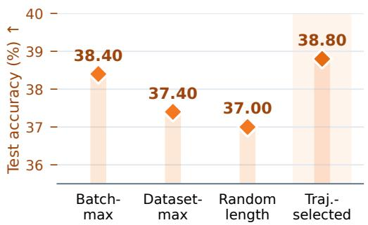

(b) HumanEval  
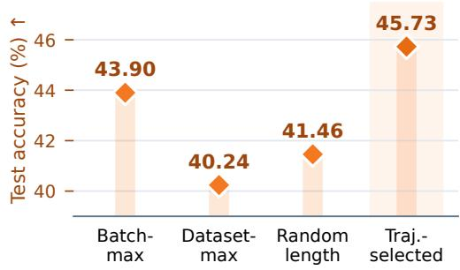  
Figure B.1: Semi-AR block canvas-choice test accuracy. Post-SFT test accuracy (orange diamonds) on MATH500 and HumanEval at $K _ { \mathrm { e v a l } } = 2 5 6$ for four canvas-length rules.

PACS-selected canvases improve or match batch-max accuracy on all four benchmarks under each supervision rule. On HumanEval, the gains increase from 0.61 percentage points under random masking to 1.83 under semi-AR block SFT and 6.66 under confidence-guided reference revelation. The four-rule semi-AR comparison further shows that selected canvases outperform batchmax, dataset-max, and random lengths on both MATH500 and HumanEval. These results support the applicability of predictability-based canvas selection across supervision rules, with the largest observed gains when paired with confidence-guided reference revelation.

## C DETAILS OF THE CANVAS DIAGNOSTICS

Experimental settings. We use LLaDA-8B-Instruct on 300 prompts from GSM8K. Referenceconditioned trajectories follow the confidence-guided decoding rule in Section 2.2, with confidence threshold $\tau = 0 . 9$ and block size $B = 3 2$ . Source responses are generated at temperature 0.

## C.1 INTERVENTIONS ON REVEALED CONTENT

Both interventions start from a target’s original pre-commitment canvas. We leave the target masked and modify only the specified surrounding reference content. The target is then reevaluated on the modified canvas; its identity and reference value remain unchanged. For each candidate generation length K, we retain only examples whose scored reference length satisfies $m \ < \ K$ . Both the candidate and source-length evaluations use this same subset and score the same complete reference spans. The retained subset may therefore vary across candidate lengths.

Withholding established content. We consider targets whose original commitment predictions agree with the reference. For a target selected at iteration s, we replace the reference tokens revealed at iteration $s - 1$ with [MASK], leaving all other positions unchanged. We restrict the comparison to targets that were already eligible at iteration $s - 1$ . This restriction excludes targets that become eligible only after the preceding step, for example when decoding advances to a new block.

Revealing subsequent content. We consider targets whose original commitment predictions disagree with the reference. Starting from the original pre-commitment canvas, we reveal exactly one reference token randomly selected at iteration $s + 1$ of the original trajectory, keeping the current target masked. All other positions remain unchanged. The next step is defined by the original reveal schedule, not by sequence position.

Reported quantities. For each intervention, we report the fraction of targets whose referenceagreement status changes and the mean paired CE difference. The difference is computed as the intervention CE minus the original commitment CE. The two interventions use different initial cohorts: reference-agreeing targets for withholding and reference-disagreeing targets for additional revelation. Confidence intervals are obtained by prompt-level bootstrap resampling.

## C.2 INTERVENTIONS ON CANVAS EXTENT

The frozen model first generates each reference response at source generation length $K _ { 0 } = 3 8 4$ We then keep the reference and model parameters fixed while varying the evaluation extent $K$ corresponding to total canvas length $L = { \bar { | P | } } + K$

Fixed-trajectory control. We retain the source reveal trajectory and reevaluate its precommitment predictions after changing the attention-visible canvas extent. The reveal schedule is not recomputed. This control examines the effect of extent without allowing confidence-based selection to produce a different trajectory.

Candidate-trajectory comparison. For each candidate length, we construct a new referenceconditioned trajectory. Both the predictions and the subsequent selections can therefore change with the canvas extent. We score each reference target on its pre-commitment canvas and aggregate using Equation 4.

For each construction, Figure 4A reports the change in mean CE relative to the source-length evaluation. Figure 4B reports the corresponding position-wise changes for candidate trajectories at $K = 2 5 6$ and $K = 5 \bar { 1 2 }$ . The increase toward later response positions is consistent with the continuation and termination effects illustrated in Figure 1B.

## C.3 SCHEDULE-MATCHED RANDOM-ORDER CONTROL

We construct a random-order trajectory that matches the reveal schedule of the corresponding frozen PACS trajectory while removing confidence-based position selection.

For block b and step s, let

$$
q _ { b , s } = | S _ { b , s } ^ { \mathrm { P A C S } } |
$$

denote the number of positions selected by PACS at that step. Let $\mathcal { E } _ { b , s } ^ { \mathrm { r a n d } }$ be the currently eligible masked positions in the active block of the random trajectory. We sample

$$
S _ { b , s } ^ { \mathrm { r a n d } } \sim \mathrm { U n i f } \left\{ S \subseteq { \mathcal { E } } _ { b , s } ^ { \mathrm { r a n d } } : | S | = q _ { b , s } \right\} .\tag{8}
$$

Thus, PACS and the random-order control reveal the same number of positions at every step, but differ in which eligible positions are selected.

For each $i \in S _ { b , s } ^ { \mathrm { r a n d } }$ , the reference-token loss is computed on the pre-revelation canvas. The selected masks are then replaced by their corresponding reference values before the next step:

$$
C _ { i } ^ { ( s + 1 ) } = { \left\{ \begin{array} { l l } { y _ { i } , } & { i \in S _ { b , s } ^ { { \mathrm { r a n d } } } , } \\ { C _ { i } ^ { ( s ) } , } & { { \mathrm { o t h e r w i s e } } . } \end{array} \right. }\tag{9}
$$

Consequently, both variants use reference-consistent intermediate canvases and identical per-step reveal counts; the only difference is whether the revealed positions are chosen by model confidence or uniformly at random.

Equivalently, the random trajectory can be constructed by sampling one uniform random permutation of the eligible positions within each block and partitioning that permutation according to the PACS reveal counts $( q _ { b , 1 } , q _ { b , 2 } , \ldots )$ . This implements sampling without replacement while exactly preserving the number of reveals at each step.

This control is intentionally schedule matched rather than an independent random decoding rule: its purpose is to isolate the contribution of confidence-based position ordering from differences in reveal rate, trajectory length, or amount of visible reference context.

## D ALGORITHM

Algorithm 2 Canvas selection and commitment-level SFT   
Require: Training pairs D, frozen model $p _ { \theta _ { 0 } }$ , candidate sets $\Lambda ( P , A )$   
1: Initialize $\mathcal { D } _ { \mathrm { P A C S } }  \emptyset$   
2: for all $( P , A ) \in { \mathcal { D } }$ do   
3: Determine the scored reference span R and $m = | \mathcal { R } |$   
4: for all $L \in \Lambda ( P , A )$ do   
5: Construct $\overset { \cdot } { \mathcal { T } _ { L } } ( P , A )$ using confidence-guided reference revelation   
6: Compute CE<sub>tr</sub>(P, A; L)   
7: end for   
8: Select L<sup>∗</sup>(P, A) using equation 6   
9: Add (P, A, R, m, L<sup>∗</sup>, T<sub>L</sub>∗ (P, A)) to D<sub>PACS</sub>   
10: end for   
11: Initialize p<sub>θ</sub> from $p _ { \theta _ { 0 } }$   
12: Fine-tune p<sub>θ</sub> on D<sub>PACS</sub> using equation 7   
13: return p<sub>θ</sub>