# Multi-Stream Residual Computation in Difusion Language Models

Ekaterina Alimaskina BRAIn Lab Yandex Research

Suren Kazarian BRAIn Lab

Gleb Molodtsov Aleksandr Beznosikov BRAIn Lab BRAIn Lab

Code: https://github.com/brain-lab-research/diffusion-residual-streams

Difusion language models reconstruct masked tokens in parallel, ofering an alternative to autoregressive generation. Yet their Transformer backbones typically carry visible evidence and evolving masked predictions through a single residual stream. We equip masked difusion models with multiple residual streams that persist through depth and adaptive routing between them, then investigate how they support these complementary roles. On the pretraining task, two streams reduce reconstruction perplexity by 5.71% on validation data and 5.13% on average across external corpora compared with standard residual connections. We observe that, without predefined roles, visible and masked positions learn distinct routing patterns. Causal interventions show that this distinction organizes read and write routing, while tokenspecific write strength remains important within each role. Guided by these findings, a model trained with role-conditioned routing recovers half the validation gain from adding a second stream. State interventions explain the benefit of the additional stream: it preserves early token representations for later reuse while evidence accumulates at masked positions. This mechanism recurs at a larger model scale, showing how persistent streams support context preservation alongside prediction refinement.

## 1 Introduction

Difusion language models have recently emerged as an alternative to autoregressive language modeling [Austin et al., 2021, Hoogeboom et al., 2021, Sahoo et al., 2024, Nie et al., 2025, Ye et al., 2025]. Rather than generating text token by token, they predict many missing positions in parallel and refine uncertain predictions over successive steps. Reconstruction can use context from both sides, supporting flexible generation orders and naturally accommodating text infilling.

The two generation schemes also difer in what they require of each token position. Under next-token training, autoregressive positions share a largely uniform prediction task: each uses its prefix to predict the following token. Masked difusion combines two complementary roles within the same denoising pass. Visible positions carry observed tokens that supply evidence for reconstruction, while masked positions must gather contextual information to form and refine predictions. These roles coexist in every partially corrupted sequence, so the backbone must accommodate observed evidence and evolving predictions across positions and through depth.

Despite these diferent roles, most masked difusion models inherit the standard Transformer residual pathway. Attention and MLP branches can respond to the corruption mask, but at each position they read from and write to a single persistent state. We ask whether learned routes through depth can better support these complementary roles.

Work beyond text difusion shows that residual pathways can be made learnable. ReZero and DenseFormer regulate updates or combine information across depth, while Hyper-Connections introduce multiple persistent streams with learned read, mixing, and write patterns [Bachlechner et al., 2021, Pagliardini et al., 2024, Zhu et al., 2025, Xie et al., 2025]. For masked difusion, this flexibility ofers a way to preserve useful evidence while refining predictions, with routing that can adapt to the diferent roles of visible and masked positions.

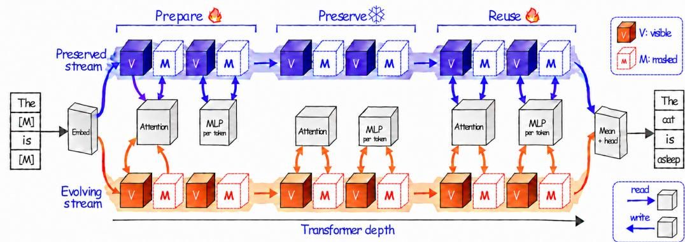  
Figure 1: Prepare–preserve–reuse within a denoising pass. Early blocks prepare position-specific states, one stream preserves them while the other accumulates evidence, and late blocks reuse the retained information. Arrows show selected read and write routes; weak connections are omitted.

We first introduce token-conditioned update strength within a single residual stream. This improves difusion modeling and provides a learned baseline for evaluating the benefit of multiple persistent states. Two streams capture most of the further gain, so we focus on how the model uses this added capacity. Causal interventions show that the visible/masked distinction organizes read and write-destination routing, while token-specific write volume remains important within each role.

Stream-state interventions show how the extra state supports denoising: it keeps early information available while the model gathers evidence for masked predictions. One stream retains positionspecific states formed in early blocks through middle depth, as visible-source influence accumulates at masked targets. Late layers then increase reading from this stream and reuse the retained visible state. This preservation–transfer–reuse sequence recurs at a larger model scale, while preservation followed by renewed late reading also extends across stream counts. These findings motivate residual pathways that adapt to token roles and coordinate evidence preservation with prediction refinement.

## Contributions. Our main contributions are threefold:

• Residual expansion. We establish the benefits of learned residual transport in masked difusion. Two persistent streams capture 86.6% of the largest additional validation-CE gain beyond learned single-stream control in the stream-count sweep and achieve the largest mean masked-reconstruction perplexity reduction across four external corpora.

• Role specialization. We separate write destination from write volume and show through controlled interventions that masked/visible roles organize read and write-destination routing, while token-specific write volume matters for visible evidence early and masked predictions late. These findings also guide a role-factorized interface trained from scratch.

• State reuse. We uncover a preservation–transfer–reuse mechanism linking persistent states to denoising computation: one stream preserves early position-specific states through middle depth while visible-source influence accumulates at masked targets, and late layers reuse the retained visible state. Its functional stages recur at a larger model scale. Models with two, three, and four streams also preserve early states and resume reading them in late layers.

## 2 Related Work

Text difusion language models. Discrete difusion extends corruption and denoising to categorical sequences [Austin et al., 2021, Hoogeboom et al., 2021, Lou et al., 2024]. Masked difusion develops this approach for language modeling, training models to reconstruct missing tokens from partially observed sequences [Sahoo et al., 2024]. Recent systems demonstrate progress in training objectives, decoding, and scale [Nie et al., 2025, Ye et al., 2025]. These advances establish denoising as a practical alternative to autoregressive generation, while generally retaining the standard Transformer residual pathway. We investigate this architectural choice: whether multiple persistent states and learned routes through depth can better support the computation performed within a denoising pass.

Mask-dependent computation in difusion models. Recent work shows that token mask state afects both context processing and internal representations. Appended mask tokens can act as distractors and impair context comprehension [Piskorz et al., 2026]. Masked and unmasked positions exhibit diferent activation distributions, motivating state-specific transformations for quantization [Yan et al., 2026]. Reusing hidden states across denoising steps also benefits from distinguishing unchanged, still-masked, and newly revealed tokens [Miele et al., 2026]. These findings motivate treating mask state as a computational variable. We ask how the complementary roles of visible evidence and masked predictions organize the processing, preservation, and reuse of information through network depth.

Residual architectures outside text difusion. Residual redesigns ofer forms of control over information flow. ReZero introduces zero-initialized learnable gates on residual branches [Bachlechner et al., 2021], while DeepNorm combines residual scaling with depth-dependent initialization [Wang et al., 2024]. DenseFormer learns weighted combinations of current and earlier representations [Pagliardini et al., 2024], while Attention Residuals aggregates representations across depth using input-dependent softmax attention [Kimi Team, 2026]. They regulate updates or retrieve information from layer history. In masked difusion, visible positions provide evidence, whereas masked positions construct predictions from it. This distinction motivates asking whether residual routing should adapt to a token’s role and current state, beyond update scaling and retrieval from layer history.

Hyper-Connections provide an interface through parallel streams and learned maps governing how sublayers read, mix, and update them, with token-dependent connection weights in the dynamic variant [Zhu et al., 2025]. mHC constrains mixing toward doubly stochastic matrices via Sinkhorn–Knopp normalization [Xie et al., 2025], while mHC-lite constructs them exactly as convex combinations of permutation matrices, avoiding iterative normalization [Yang and Gao, 2026]. We extend this interface to text difusion, establishing its pretraining benefits and revealing how denoising organizes residual information flow without prescribed routes for masked or visible positions.

Mechanistic analyses of multi-stream residual pathways. Analyses of autoregressive HC and mHC models report asymmetric stream reliance, concentrated read/write routing, and near-identity mixing [Peng et al., 2026, Alimaskina et al., 2026, Zhao et al., 2026]. These findings motivate going beyond aggregate performance to understand how learned interfaces use the additional streams. We study corruption-role-conditioned routing, separate write destination from volume, and trace source-dependent prediction recovery alongside the preservation of early states.

## 3 Decomposing Residual Transport

Multi-stream residual interface. Following the mHC notation, let $\pmb { x } _ { \ell } \in \mathbb { R } ^ { n \times d }$ contain the residual streams of one token entering sublayer $\ell ,$ with the token index omitted. For attention, $\mathcal { F } _ { \ell }$ jointly consumes the read representations of all positions. The interface updates the streams as

$$
\begin{array} { r } { \pmb { x } _ { \ell + 1 } = \mathcal { H } _ { \ell } ^ { \mathrm { r e s } } \pmb { x } _ { \ell } + \mathcal { H } _ { \ell } ^ { \mathrm { p o s t } \top } \mathcal { F } _ { \ell } \left( \mathcal { H } _ { \ell } ^ { \mathrm { p r e } } \pmb { x } _ { \ell } \right) . } \end{array}\tag{1}
$$

The token-conditioned mappings $\mathcal { H } _ { \ell } ^ { \mathrm { p r e } } , \mathcal { H } _ { \ell } ^ { \mathrm { r e s } }$ , and $\mathcal { H } _ { \ell } ^ { \mathrm { p o s t } }$ respectively determine what the sublayer reads, how existing streams are carried forward, and how its output is written back. In mHC-lite, $\mathcal { H } _ { \ell } ^ { \mathrm { r e s } }$ is exactly doubly stochastic and therefore preserves the mean across streams. Streams are initialized by replication and averaged before the final output head. Blocks are indexed from zero; $a _ { k }$ and $m _ { k }$ denote their attention and MLP interfaces.

Separating write destination from volume. The post-mapping controls both where a sublayer update is written and how strongly it enters the residual streams. Its entries conflate these two decisions; normalizing them separates allocation from strength:

$$
q _ { \ell } = \frac { \mathcal { H } _ { \ell } ^ { \mathrm { p o s t } } } { \mathcal { H } _ { \ell } ^ { \mathrm { p o s t } } \mathbf { 1 } _ { n } } , \qquad \nu _ { \ell } = \frac { 1 } { n } \mathcal { H } _ { \ell } ^ { \mathrm { p o s t } } \mathbf { 1 } _ { n } .\tag{2}
$$

Here $q \ell \mathbf { 1 } _ { n } = 1$ is the write destination, while $\nu _ { \ell }$ is the write volume. Equivalently, $\mathcal { H } _ { \ell } ^ { \mathrm { p o s t } } = n \nu _ { \ell } q _ { \ell } \colon$ $q _ { \ell }$ determines how the update is divided among streams, and $\nu _ { \ell }$ scales that allocation.

Because $\mathcal { H } _ { \ell } ^ { \mathrm { r e s } }$ is doubly stochastic, it transports the existing streams without changing their mean. Averaging Equation 1 over streams therefore gives

$$
\bar { \mathbf { x } } _ { \ell + 1 } = \bar { \mathbf { x } } _ { \ell } + \nu _ { \ell } \mathcal { F } _ { \ell } \left( \mathcal { H } _ { \ell } ^ { \mathrm { p r e } } \mathbf { x } _ { \ell } \right) ,\tag{3}
$$

where $\bar { \mathbf { \ b { x } } } _ { \ell }$ is the mean across streams. Thus $\nu _ { \ell }$ sets the coeficient of the branch update in the mean state: it is a token-dependent counterpart of the unit update coeficient in a standard residual connection. The update norm also depends on the branch output. The destination $q _ { \ell }$ determines which individual streams receive that update, shaping the states available to later sublayers.

We analyze the HC-family post-mapping [Zhu et al., 2025, Xie et al., 2025, Yang and Gao, 2026] via normalized write destination and overall write strength, enabling separate interventions on these two coordinates. Our results show this distinction matters: masked versus visible role largely organizes reading and write destination, while write volume is most sensitive to within-role averaging. Replacing token-dependent write volume also degrades autoregressive models (Appendix E.1), suggesting that token-dependent update strength is a general component of learned residual transport.

Takeaway. The residual interface has four controls: reading selects what a sublayer uses, mixing redistributes existing states across streams, write destination allocates the new update, and write volume controls its overall strength.

## 4 How Many Residual Streams Does Difusion Need?

Before analyzing how difusion uses residual streams, we ask how many are useful. We compare mHC-lite variants $( n = 1 , 2 , 3 , 4 )$ with a standard-residual baseline using a 16-block Qwen-style backbone [Qwen Team, 2024], approximately 337M parameters, and the Dream tokenizer [Ye et al., 2025]. All models are trained on the same ordered 3.5B tokens from FineWeb-Edu [Penedo et al., 2024], with the backbone, token budget, and learning-rate schedule held fixed. The learned $n = 1$ interface provides token-dependent update strength, while wider variants add routing across persistent streams. This width sweep guides the choice of model for the mechanistic analysis. Full training and evaluation details appear in Appendices A and B. Even one learned stream improves over the standard

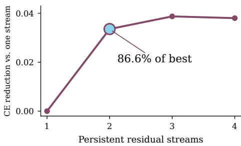  
Figure 2: Two streams capture most gain from additional streams. Validation-CE reduction relative to learned $n \ = \ 1$ . The $n = 2$ model captures 86.6% of the largest additional gain in the matched stream-count sweep.

residual, reducing validation reconstruction perplexity by 2.50%. Two streams bring this reduction to 5.71%, capturing 86.6% of the best additional CE gain beyond learned � = 1 (Figure 2). Adding a third or fourth stream yields only a further 0.52% or 0.45% reduction in perplexity relative to $n = 2$ Since most of the benefit is already achieved with two streams, we use $n = 2$ for the mechanistic analysis. At 1B, two streams reduce validation reconstruction perplexity by 3.47% versus the matched standard residual (Appendix I).

To test whether the benefit of two streams extends beyond FineWeb-Edu, we evaluate all checkpoints on OpenWebText, WikiText-103, LAMBADA, and C4 using identical examples and masks at three corruption levels. All multi-stream variants improve over the standard-residual baseline on every corpus. Although wider models lead on individual corpora, � = 2 achieves the largest mean perplexity reduction, at 5.13% (Table 1). Full details and paired bootstrap intervals appear in Appendix B.

Table 1: Two streams transfer best on average. Maskedreconstruction perplexity reduction (%) over the standard residual. Higher is better; column bests are bold.
<table><tr><td>Interface</td><td>OWT WT103</td><td>LAMBADA</td><td>C4</td><td>Mean</td></tr><tr><td>Standard residual</td><td>0.00 0.00</td><td>0.00</td><td>0.00</td><td>0.00</td></tr><tr><td>n = 1</td><td>1.44 1.17</td><td>-0.15</td><td>1.77</td><td>1.06</td></tr><tr><td>n = 2</td><td>4.61 7.61</td><td>3.02</td><td>5.29</td><td>5.13</td></tr><tr><td>n = 3</td><td>5.51 6.15</td><td>2.27</td><td>5.17</td><td>4.78</td></tr><tr><td>n = 4</td><td>5.14 3.30</td><td>2.67</td><td>5.39</td><td>4.13</td></tr></table>

Takeaway. Two streams capture most of the in-domain benefit of residual expansion and achieve the strongest mean transfer across four corpora. We therefore use � = 2 to trace how denoising uses the learned interface.

## 5 The Corruption Mask Organizes Residual Routing

The second stream improves performance beyond token-dependent update strength, suggesting that routing across persistent states also matters. We therefore ask what guides this routing. In masked difusion, the corruption mask distinguishes positions that provide observed evidence from those that predict missing content. Our interventions test which routing decisions follow this role distinction and which require finer token-specific information.

Causal interventions. We study the � = 2 model at � = 0.5 with 50% masking, where both token roles are well represented. Each intervention targets one control – read, mixing, write destination, or write volume – throughout the network. The remaining controls are computed normally from the intervened states. At each attention and MLP interface, we test three replacements: a global mean shared by all tokens, separate role means for masked and visible tokens, and a role swap that exchanges these two means. We also test joint replacement of all four controls. Calibration uses sequences disjoint from evaluation, and roles are identified from the corrupted input. Appendix A specifies how stream-wise write gains are reconstructed for destination, volume, and joint interventions.

Remove token dependence

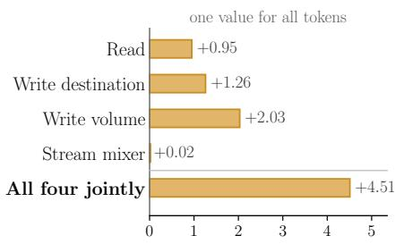

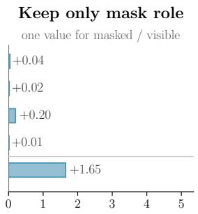  
Exchange the roles

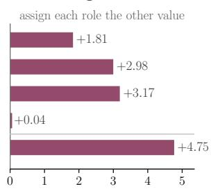  
Increase in masked-target CE relative to the dynamic router (0); standard residual = +0.066

Figure 3: Masked and visible tokens use distinct residual routes. Role-conditioned means remove most degradation from global averaging of read and write destination. Swapping either setting performs worse than the standard residual. A shared mixer nearly preserves performance, while write volume retains substantial within-role dependence. Lower masked-target CE is better. Individual rows replace one control, leaving the others state-dependent; the joint row replaces all four. Estimates and confidence intervals appear in Appendix D.

Figure 3 shows that collapsing read/write destination to one mean substantially degrades performance. Separate means for masked and visible positions largely remove this degradation. For read and write destination, role-conditioned means remove 95.7% and 98.6% of the CE increase caused by global averaging, respectively, measured relative to the intact model.

This identifies the corruption mask as a major organizing factor for read and write-destination routing. Swapping the two role means sharply degrades denoising, showing that these routes are functionally specialized and must remain matched to token role. Mixing behaves diferently: using a single mean at each interface causes little degradation, indicating that a largely shared mixing configuration supports denoising. The benefit of role-conditioned read and write-destination means recurs in the larger 1B model (Appendix I.3).

Write volume remains sensitive even to role-conditioned averaging, showing that token-specific update strength matters within each role. Applying role means to all four controls at once is substantially more disruptive than replacing any one individually: joint replacement raises CE by 1.6453 (Appendix D). We therefore test role-conditioned routing in a factorized interface trained from scratch, allowing its controls to adapt together.

Training a role-factorized interface. Our role-factorized two-stream model, termed Factorized Residual Routing (FRR), learns separate read and write-destination settings for masked and visible tokens at each attention and MLP interface. Write volume remains token-dependent, while stream mixing is fixed to the identity. Write gains factorize into volume and normalized destination, retaining the full router’s total write-volume range. The backbone, data order, corruption masks, and optimization schedule match the other learned-interface models (Appendix C).

FRR reaches a validation CE of 3.5634, improving over learned $n = 1 \ ( 3 . 5 8 0 2 )$ and recovering 50.2% of the gain achieved by full $n = 2 ( 3 . 5 4 6 7 )$ . Thus, the masked/visible distinction can guide the learning of useful read and write routes: even with identity mixing, role-conditioned routes and token-dependent write strength allow the model to benefit from a second persistent state. Full $n = 2$ provides a further 0.0167 CE improvement.

Takeaway. The masked/visible distinction guides read and write routing, while token-specific write strength remains consequential within each role. FRR turns this division into a trained architecture that recovers half the gain from a second stream.

## 6 Write Volume Matters for Visible Tokens Early and Masked Tokens Late

Masked/visible role organizes read and write-destination routing, while write volume carries functionally important variation within each role. Tokens with the same role can follow similar routes while receiving updates of diferent strength. $\mathbf { A t } \ t = 0 . 5$ , replacing write volume with its masked/visible mean increases CE by 0.200, compared with 0.041 for read, 0.017 for write destination, and 0.006 for mixing. We therefore ask whether denoising depends on matching each volume to the token state that produced it, and how this dependence changes across depth and corruption levels.

Causal interventions. We first test whether each volume must remain attached to the token state that produced it. A role-mean replacement assigns the calibrated mean for the token’s role and interface wherever the proportional replacement satisfies the gain bounds, removing within-role variation at those positions. A within-role shufle exchanges current volumes between random disjoint pairs of same-role positions within each sequence and interface. An exchange is applied only when both directions satisfy the gain bounds, preserving the exact set of volume values within the group. Both interventions preserve each afected token’s current normalized write destination. The reconstruction and acceptance rules are specified in Appendix A.

We then locate this dependence through depth by applying the role-mean replacement to one block at a time. Finally, we repeat the full-network replacement across corruption levels to determine when token-specific volume is most useful. Read and mixing remain dynamic; calibration uses disjoint sequences, and efects are measured by the increase in masked-target CE.

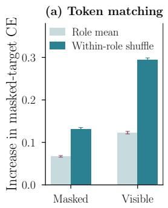

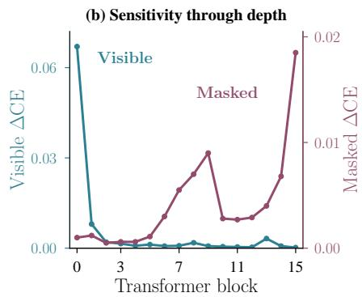

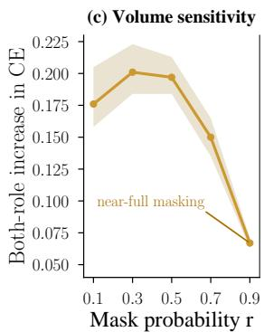  
Figure 4: The functional role of token-specific write volume shifts through depth. (a) At � = 0.5, within-role shufling is more damaging than role-mean replacement while preserving the current volume multiset within each sequence and role at every intervened interface. (b) Single-block interventions reveal an early-visible / late-masked sensitivity profile; efects use separate zero-anchored axes. (c) Sensitivity to within-role volume variation decreases near full masking. Error bars and bands show paired 95% sequence-bootstrap intervals; � = 1,024 in (a–b) and 128 per corruption level in (c).

Write volume is matched to token state. Within-role shufling is more damaging than role-mean replacement for both roles (Figure 4a). For masked positions, shufling increases CE by 0.132, compared with 0.068 under averaging; for visible positions, the corresponding increases are 0.294 and 0.124. Accepted exchanges retain the original write strengths but assign them to diferent tokens of the same role. The CE increase under this distribution-preserving exchange establishes the functional importance of matching write strength to token state within each role.

Write-volume dependence shifts through depth. Single-block interventions locate this token– volume dependence through depth (Figure 4b). In the first block, replacing visible-token volume increases CE by +0.0673, while replacing masked-token volume has an efect of only +0.0015. Visible-token sensitivity peaks in the first block; masked-token sensitivity peaks near the readout.

These interventions show that denoising depends most on visible-token write volume early and masked-token write volume late. Since volume scales the branch update, this depth profile links early evidence integration to later prediction refinement within a single denoising pass. The zero visible efect in the final block follows from the absence of subsequent attention. Across interior blocks, visible-token sensitivity declines sharply after the first block, while masked-token sensitivity follows a non-monotonic profile that peaks near the readout. Token-specific volume assignment and the early-visible / late-masked endpoint contrast also recur at 1B (Appendix I.3).

Token-specific volume is most consequential under partial observation. Finally, we test how the importance of token-specific volume changes with corruption level (Figure 4c). Replacing volume with role means increases CE by 0.177–0.201 at 10–50% masking, but by only 0.067 at 90% masking, when few visible tokens remain. The largest measured CE cost thus occurs with substantial visible context. Together with the depth interventions, this points to a role for write volume in regulating how the model uses observed evidence to predict missing content.

Takeaway. Denoising depends on matching write strength to token state: within-role shufling degrades predictions despite preserving volume distributions. Sensitivity peaks for visible tokens in the first block and masked tokens near the readout, and is greatest with substantial visible context. Write volume helps coordinate evidence integration and prediction refinement.

## 7 Residual Streams Preserve Early States While Accumulating Evidence

We now trace the information carried by the two streams through depth in the 337M model, then compare their functional stages with 1B (Appendix I). In this 337M model, stream 0 is the evolving stream, �E, and stream 1 the preserved stream, �P. These names describe their middle-depth functions: �E receives ongoing updates, while �P stays close to its early post-�0 state.

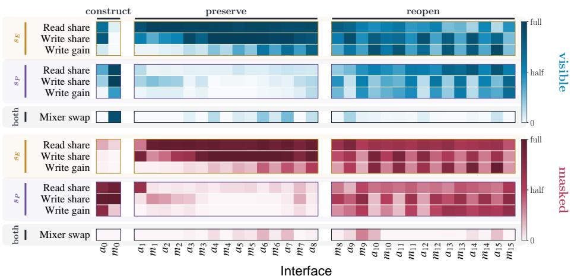  
Figure 5: The preserved stream has little read/write activity at middle depth and reopens late. Columns show the 32 attention/MLP interfaces $( a _ { k } , m _ { k } )$ ); rows show per-stream read share, write share $\overline { { g } } _ { \ell i } / \sum _ { j } \overline { { g } } _ { \ell j } ,$ , and role-mean physical write gain $\overline { { g } } _ { \ell i }$ . Mixer of-diagonal mass is shown once per role, with visible positions above and masked positions below. Scales are 0–1 for shares, 0–2 for gains, and 0–0.25 for mixer mass. Across $a _ { 1 } { - } a _ { 8 }$ � receives $6 \%$ of read mass and 3% of write gain.

Early blocks prepare position-specific states. In the 337M model, this preparation is concentrated in the first block. The first attention interface leaves $s _ { \mathrm { P } }$ largely unchanged at visible positions but writes context into it at masked positions. Its write shares computed from role-mean gains for $\left( { \boldsymbol { s } } _ { \mathrm { E } } , { \boldsymbol { s } } _ { \mathrm { P } } \right)$ are (0.88, 0.12) and (0.02, 0.98), respectively (Figure 5). The first MLP, $m _ { 0 }$ , then reads mainly from �P and adds its update mainly back to it. Together, these operations form an early state from the information initially available at each position: the observed token itself at visible positions and the context gathered by the first attention branch at masked positions. Meanwhile, $s _ { \mathrm { E } }$ receives the attention update at visible positions but remains closer to the mask input at masked positions, providing diferent starting states for the ongoing computation.

The interventions test whether the next MLP needs this role-dependent input. At masked positions, removing the attention update sharply increases CE, but restoring only its contribution to the following MLP input removes 98.2% of that increase. At visible positions, redirecting the attention output into � instead of $s _ { \mathrm { E } }$ increases CE by 3.04. These results show that the first block relies on role-dependent routing to determine what information the MLP receives when forming $s _ { \mathrm { P } } .$

An early state remains useful while changing little. Through the middle layers, attention and MLP branches predominantly read from and write to $s _ { \mathrm { E } } .$ , while $s _ { \mathrm { P } }$ receives little read or write activity and mixing remains nearly diagonal, so little of the preserved state is mixed into the active stream (Figure 5). Its similarity to its own post-�0 state also remains high (Appendix G). We test whether this early state can still replace the current state, and whether it must belong to the same position.

At $^ { a _ { 8 } , }$ replacing �P with the same position’s post-�0 state increases masked-target CE by only 0.006 when visible positions are modified and 0.004 when masked positions are modified. Shufling states within the same role and sequence is more damaging, but restoring each position’s own post-�0 state removes 95% of the damage at masked positions and 98% at visible positions. Thus, � retains useful information prepared early at each position while $s _ { \mathrm { E } }$ continues to evolve.

Masked targets gather visible-source influence during preservation. To test what the evolving stream carries during preservation, we mask a visible source $j$ and measure the loss increase at a masked target �. At a depth, we restore one or both streams at the source or target using states from the original run with the source visible, then rerun the remaining layers. Other positions retain their ablated-run states. Recovery is the fraction of the source-ablation loss increase removed by the patch. We analyze selected source–target pairs where removing the source degrades the target’s prediction. Restoring the source tests whether later layers can use its restored state to repair the target prediction. Restoring the target tests whether useful source influence has already reached that position. Patching streams separately identifies which stream supports recovery. Full intervention and pair-selection details appear in Appendix F.

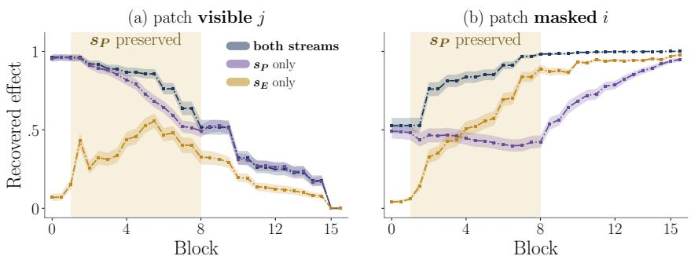  
Figure 6: Masked targets gather visible evidence in $s _ { \mathrm { E } }$ during preservation. Mean recovery falls when restoring both source streams (left) and rises when restoring target �E (right). Bands show 95% bootstrap intervals; shading marks �P preservation. Details are in Appendix F.

For selected pairs, visible-source influence is increasingly recoverable from the target’s $s _ { \mathrm { E } }$ during preservation. Restoring this stream reverses 5.9% of the source-ablation efect at $a _ { 1 }$ , but 88.9% at $a _ { 8 }$ (Figure 6). By the interval’s end, the target’s evolving stream alone carries enough source-dependent information to recover most of the lost prediction benefit. Recovery from the target’s $s _ { \mathrm { P } }$ is substantial at the start but remains roughly flat, consistent with retaining its early context-dependent state.

Restoring both source streams recovers 96.2% of the ablation efect at $a _ { 1 }$ and $5 1 . 6 \%$ at $a _ { 8 } \colon$ the network can use restored source evidence even after substantial information has accumulated at the target. Restoring the source’s � alone yields substantial target recovery during preservation (Figure 6a).

Late layers reuse and transform the preserved stream. Branches resume reading and writing � around $m _ { 8 } { - } m _ { 1 0 }$ (Figure 5). Its similarity to the post-� state then declines, marking a transition from preservation to further transformation. We test late contributions by replacing both states at selected positions with the current � or $s _ { \mathrm { E } }$ . After $m _ { 1 2 }$ , visible-position duplication increases CE by +0.010 for $s _ { \mathrm { P } }$ versus +0.148 for $s _ { \mathrm { E } }$ . Thus, late visible $s _ { \mathrm { P } }$ supports downstream denoising with little loss, while masked positions benefit from both states. Together with renewed late reading, this links preservation to reuse of retained visible information and masked-prediction refinement using complementary stream states. Full results are in Appendix G.

Preservation and renewed late reading recur across stream counts. Difusion models with two to four streams share a pattern at masked and visible positions: one stream stays close to its first-block state, with little middle-depth reading and renewed late reading. Three- and four-stream AR show similar patterns, with more middle-depth reading and earlier departure from the early state. In two-stream AR, reading continues throughout the interval (Appendix H). Two-stream interventions also establish evidence gathering at masked targets during preservation.

The functional stages recur in a 1B-parameter model. The separately trained 32-block 1B model repeats early preparation, position-specific preservation, source-to-target transfer, and late visible-state reuse (Appendix I). Preparation extends beyond the first block, and the preserved stream is $s _ { 0 } .$ . The same functional sequence therefore recurs with diferent stream identities and stage boundaries. At masked targets, useful source influence is available in both streams.

Takeaway. Denoising shows a preservation–transfer–reuse pattern: early blocks prepare positionspecific states, one stream retains useful information as masked targets gather context, and late layers reuse retained visible states. Preservation and renewed late reading recur across stream counts and are stronger in difusion than in matched AR controls.

## 8 Conclusion

Our findings show that residual architecture shapes both model quality and how difusion language models preserve evidence and refine predictions. Multiple persistent states retain useful early information while others evolve, and learned routing returns it to active computation later. This links visible and masked token roles to information processing through depth. We hope this work encourages closer study of residual architectures and pathways tailored to denoising, making when information is retained, updated, and reused an explicit consideration in difusion-model design.

## References

Ekaterina Alimaskina, Gleb Molodtsov, and Aleksandr Beznosikov. Analyzing stream collapse in hyperconnections: From diagnosis to mitigation. arXiv preprint arXiv:2606.03483, 2026. URL https://arxiv. org/abs/2606.03483.

Jacob Austin, Daniel D. Johnson, Jonathan Ho, Daniel Tarlow, and Rianne van den Berg. Structured denoising difusion models in discrete state-spaces. In Advances in Neural Information Processing Systems, volume 34, pages 17981–17993, 2021. URL https://arxiv.org/abs/2107.03006.

Thomas Bachlechner, Bodhisattwa Prasad Majumder, Henry Mao, Gary Cottrell, and Julian McAuley. ReZero is all you need: Fast convergence at large depth. In Proceedings ofthe Thirty-Seventh Conference on Uncertainty in Artificial Intelligence, volume 161 of Proceedings of Machine Learning Research, pages 1352–1361. PMLR, 2021. URL https://proceedings.mlr.press/v161/bachlechner21a.html.

Emiel Hoogeboom, Didrik Nielsen, Priyank Jaini, Patrick Forré, and Max Welling. Argmax flows and multinomial difusion: Learning categorical distributions. In Advances in Neural Information Processing Systems, volume 34, pages 12454–12465, 2021. URL https://arxiv.org/abs/2102.05379.

Kimi Team. Attention residuals. arXiv preprint arXiv:2603.15031, 2026. URL https://arxiv.org/abs/2603 .15031.

Aaron Lou, Chenlin Meng, and Stefano Ermon. Discrete difusion modeling by estimating the ratios of the data distribution. In Proceedings ofthe 41st International Conference on Machine Learning, 2024. URL https://arxiv.org/abs/2310.16834.

Andrea Miele, Yiming Qin, Alba Carballo-Castro, Justin Deschenaux, and Pascal Frossard. Fixed-point masked generative modeling. arXiv preprint arXiv:2605.31215, 2026. URL https://arxiv.org/abs/2605.31215.

Shen Nie, Fengqi Zhu, Zebin You, Xiaolu Zhang, Jingyang Ou, Jun Hu, Jun Zhou, Yankai Lin, Ji-Rong Wen, and Chongxuan Li. Large language difusion models. Advances in Neural Information Processing Systems, 38:50608–50646, 2025.

Matteo Pagliardini, Amirkeivan Mohtashami, François Fleuret, and Martin Jaggi. DenseFormer: Enhancing information flow in transformers via depth weighted averaging. In Advances in Neural Information Processing Systems, volume 37, 2024. URL https://arxiv.org/abs/2402.02622.

Guilherme Penedo, Hynek Kydlíček, Loubna Ben allal, Anton Lozhkov, Margaret Mitchell, Colin Rafel, Leandro Von Werra, and Thomas Wolf. The FineWeb datasets: Decanting the web for the finest text data at scale. In Advances in Neural Information Processing Systems, volume 37, 2024. URL https: //arxiv.org/abs/2406.17557.

William Peng, Josheev Rai, Kevin Tseng, Siwei Wang, and Sean Wu. Ablate and rescue: A causal analysis of residual stream hyper-connections. arXiv preprint arXiv:2603.14833, 2026. URL https://arxiv.org/abs/ 2603.14833.

Julianna Piskorz, Cristina Pinneri, Alvaro Correia, Motasem Alfarra, Risheek Garrepalli, and Christos Louizos. Masks can be distracting: On context comprehension in difusion language models. In Proceedings ofthe 43rd International Conference on Machine Learning, 2026. URL https://arxiv.org/abs/2511.21338.

Qwen Team. Qwen2.5 technical report. arXiv preprint arXiv:2412.15115, 2024. URL https://arxiv.org/ab s/2412.15115.

Subham Sekhar Sahoo, Marianne Arriola, Yair Schif, Aaron Gokaslan, Edgar Marroquin, Justin T. Chiu, Alexander Rush, and Volodymyr Kuleshov. Simple and efective masked difusion language models. In Advances in Neural Information Processing Systems, volume 37, pages 130136–130184, 2024. URL https://arxiv.org/abs/2406.07524.

Hongyu Wang, Shuming Ma, Li Dong, Shaohan Huang, Dongdong Zhang, and Furu Wei. Deepnet: Scaling transformers to 1,000 layers. IEEE Transactions on Pattern Analysis and Machine Intelligence, 46(10): 6761–6774, 2024.

Zhenda Xie, Yixuan Wei, Huanqi Cao, Chenggang Zhao, Chengqi Deng, Jiashi Li, Damai Dai, Huazuo Gao, Jiang Chang, Kuai Yu, Liang Zhao, Shangyan Zhou, Zhean Xu, Zhengyan Zhang, Wangding Zeng, Shengding Hu, Yuqing Wang, Jingyang Yuan, Lean Wang, and Wenfeng Liang. mHC: Manifold-constrained hyper-connections. arXiv preprint arXiv:2512.24880, 2025. URL https://arxiv.org/abs/2512.24880.

Xin Yan, Aqiang Wang, Zhenglin Wan, Xingrui Yu, and Ivor W. Tsang. STaR-Quant: State-time consistent post-training quantization for difusion large language models. arXiv preprint arXiv:2606.04945, 2026. URL https://arxiv.org/abs/2606.04945.

Yongyi Yang and Jianyang Gao. mHC-lite: You don’t need 20 Sinkhorn–Knopp iterations. arXiv preprint arXiv:2601.05732, 2026. URL https://arxiv.org/abs/2601.05732.

Jiacheng Ye, Zhihui Xie, Lin Zheng, Jiahui Gao, Zirui Wu, Xin Jiang, Zhenguo Li, and Lingpeng Kong. Dream 7B: Difusion large language models. arXiv preprint arXiv:2508.15487, 2025. URL https: //arxiv.org/abs/2508.15487.

Pengxiang Zhao, Xing Li, Xianzhi Yu, Wei Guo, and Zhenhua Dong. How does mHC use its residual streams? Selective routing and near-identity mixing. arXiv preprint arXiv:2609.05309, 2026. URL https://arxiv.org/abs/2609.05309.

Defa Zhu, Hongzhi Huang, Zihao Huang, Yutao Zeng, Yunyao Mao, Banggu Wu, Qiyang Min, and Xun Zhou. Hyper-connections. In International Conference on Learning Representations, 2025. URL https: //arxiv.org/abs/2409.19606.

## A Experimental protocol and residual coordinates

Pretraining and validation. All width and FRR comparisons use a 16-block Qwen-style Transformer with 1,024 hidden dimensions, 2,816 MLP dimensions, 16 query heads, four key–value heads, and tied embeddings for the 152,064-token Dream vocabulary (tokenizer revision ebb8da7f). The ordered training sample is from FineWeb-Edu 10BT (revision 87f09149). Each run uses 1,024-token sequences, 53,400 optimizer updates, and 65,536 efective tokens per update: 3,499,622,400 nominal training tokens. Each block contains one attention and one MLP residual interface, giving 32 routing sites. The mechanistic analyses use the final � = 2 checkpoint at update 53,399.

Optimization and initialization. The 337M runs use fused AdamW with $\beta = ( 0 . 9 , 0 . 9 5 )$ and $\epsilon = 1 0 ^ { - 8 }$ . The learning rate warms up linearly for 300 updates to $3 \times 1 0 ^ { - 4 }$ , then follows cosine decay to $3 \times 1 0 ^ { - 5 }$ . Global gradient-norm clipping uses a threshold of 1.0. Training and the permutation of training blocks use seed 1337. All learned-interface MDLM and AR runs $( n = 1 , 2 , 3 , 4 )$ , original 337M standard-residual baselines and FRR apply weight decay 0.1 to parameters with at least two dimensions and zero decay to the remaining parameters.

Linear and embedding weights are initialized from $N ( 0 , 0 . 0 2 ^ { 2 } )$ , linear biases to zero, and RMSNorm scales to one. In the full router, read, write, and mixer head weights start at zero, and dynamic-head scale factors start at 0.01. Mixer biases are zero for the identity permutation and −8 for the other permutations. Read and write biases are −1 except for one stream with bias +1; this preferred stream alternates across interfaces. Stream embeddings are initialized to zero and frozen, so the initial stream states replicate the backbone input. FRR constructs the same initial backbone before replacing its interfaces with the factorization described in Appendix C.

At training time, each sequence draws a corruption level $t \sim \mathrm { U n i f o r m } ( 0 , 1 )$ , floored at 0.02. Tokens are masked independently with probability �, with one position forced masked if the draw produces none. Corruption levels and masks use seed 1,337,000,000 plus the microbatch index. The MDLM objective averages the masked token CE sum divided by 1,024� across sequences. This is the same corruption and normalization rule for all MDLM interfaces. AR uses causal attention and next-token loss without corruption masks.

The in-domain validation comparison uses the same 64 held-out blocks and fixed masks for each model. Its MDLM score is the equally weighted mean of masked-reconstruction CE at mask probabilities $r \in \{ 0 . 1 , 0 . 3 , 0 . 5 , 0 . 7 , 0 . 9 \}$ . At each ratio, each sequence’s summed masked-target loss is divided by the expected masked count 1,024�, then averaged over the 64 sequences. Reconstruction perplexity denotes the exponential of the corresponding reconstruction score. During fixed-corruption evaluation, the training corruption parameter is set to � = �. AR validation uses the $6 4 \times 1 , 0 2 3$ next-token targets. Within each objective, the same validation protocol is applied at the same training step.

External-corpus evaluation. We use Skylion007/openwebtext (plain\_text, train), Salesf orce/wikitext (wikitext-103-raw-v1, test), EleutherAI/lambada\_openai (en, test), and allenai/c4 (en, validation). Dataset revisions are not pinned; the Dream tokenizer revision is ebb8da7f. Records retain their dataset order without shufling. OpenWebText and C4 are streamed from their first up to 2,000 and 3,000 records, respectively; WikiText-103 and LAMBADA follow split order. Empty or whitespace-only texts are skipped. Each text is tokenized without additional special tokens and followed by $\mathsf { e o s \_ t o k e n \_ i d } .$ . The concatenated stream is cut into 256 full 1,024-token blocks per corpus, stopping once these blocks are obtained; a final incomplete block is excluded. All models receive the same blocks and masks at $r \in \{ 0 . 1 , 0 . 5 , 0 . 9 \}$ , with mask seeds 901, 905, and 909. We calculate actual-masked-token CE separately at each ratio and average the three CE values. The relative improvement shown in the main text is $1 0 0 [ 1 - \mathrm { { e x p } ( \mathrm { { C E } _ { \mathrm { { m o d e l } } } - \mathrm { { C E } _ { \mathrm { { r e s i d u a l } } } ) ] } } }$ ]. Paired intervals use 10,000 sequence resamples, shared across models and ratios. All four corpora use this masked-reconstruction protocol, including LAMBADA.

Causal interventions. Unless stated otherwise, calibration means are computed in float64 on 64 sequences disjoint from evaluation, separately at each attention and MLP interface. The 337M model has 32 interfaces, and the 1B model has 64. The 337M role and volume interventions use 1,024 common held-out sequences at $r = 0 . 5 ;$ the corresponding 1B setup uses 128 held-out sequences. Within each comparison, every condition uses the same corrupted inputs and masked targets. Role labels are read from the corrupted input, never from the clean target. Interventions target specified router coordinates at selected tokens and interfaces; unselected controls are computed normally from the current states, and subsequent states and router outputs are recomputed normally. Read interventions replace the pre-mapping $\mathcal { H } _ { \ell } ^ { \mathrm { p r e } }$ ; read shares in the figures express its relative weights across streams. In a role swap, masked positions receive the visible calibration mean and vice versa. The instrumented intact path was checked against the original logits in FP32 and BF16.

The causal splits use fixed block IDs. At 337M, calibration uses blocks 128–191, discovery uses 256–383, and confirmation uses 1024–2047. At 1B, calibration uses 128–191 and evaluation uses 1024–1151. Corruption masks use the block-specific seed 782 + 1009 block\_id + 10017 round(100�). Volume-shufle runs use seeds 130921 and 130922, with permutations formed separately by block, interface, and role.

For sequence $s ,$ let $L _ { s } ( c )$ be its summed target loss under condition $^ { c , }$ and $N _ { s }$ its valid target count. Each of the 5,000 paired sequence-bootstrap resamples � computes

$$
\widehat { \mathrm { C E } } _ { B } ( c ) = \frac { \sum _ { s \in B } L _ { s } ( c ) } { \sum _ { s \in B } N _ { s } } , \qquad \Delta _ { B } ( c ) = \widehat { \mathrm { C E } } _ { B } ( c ) - \widehat { \mathrm { C E } } _ { B } ( \mathrm { i n t a c t } ) .\tag{4}
$$

Intervals and gain ratios are calculated within the same paired resample.

Routing-profile aggregation. For each interface and token role, read share is $\overline { { h } } _ { i } / \sum _ { j } \overline { { h } } _ { j }$ , where $\overline { { h } } _ { i }$ averages that stream’s pre-mapping weight across all positions of the role. Positions receive equal weight, so each sequence contributes according to its number of positions in that role. The main 337M routing profile uses the 64 calibration sequences, containing $^ { 3 2 , 5 2 9 }$ masked and 33,007 visible positions.

Write coordinates and volume interventions. The routing interventions target the full mHClite checkpoints, whose physical write gains lie in [0, 2]. For two-stream write interventions, let $V = g _ { 0 } + g _ { 1 } = 2 \nu _ { \ell }$ and, for $V > 0 , q _ { i } = g _ { i } / V$ . These coordinates are computed from the current router output in the intervened forward pass. Calibration means are computed separately for volume and normalized destination; destination means average $q _ { i } = g _ { i } / V$ directly, rather than taking the ratio of mean gains to mean volume.

A proposed volume $V ^ { \prime }$ is applied through $g _ { i } ^ { \prime } = V ^ { \prime } q _ { i } = ( V ^ { \prime } / V ) g _ { i }$ , preserving normalized destination. The replacement is accepted only when $V > 0 , V ^ { \prime } > 0$ , and the proposed gains are finite and lie in [0, 2]. For finite positive volumes and normalized destination, the upper-bound condition is $V ^ { \prime } \operatorname* { m a x } _ { i } q _ { i } \le 2$ . Otherwise, both gains remain unchanged. Accepted replacements therefore preserve � and keep gains in [0, 2] without clipping. Mean-based volume interventions propose the calibrated global or role-conditioned mean for the interface, using the opposite role’s mean for role swaps. Role-mean replacement removes within-role volume variation at positions where the proposal is accepted.

Within-role shufling uses random disjoint pairs of positions, formed separately within each sequence, role, and interface. For a pair �, �, we propose $g _ { a , i } ^ { \prime } = V _ { b } q _ { a , i }$ and $g _ { b , i } ^ { \prime } = V _ { a } q _ { b , i }$ . The exchange is accepted only when both original volumes are positive and both proposed gain pairs are finite and satisfy the gain bounds: $V _ { b } \operatorname* { m a x } _ { i } { q _ { a , i } } \le 2$ and $V _ { a } \operatorname* { m a x } _ { i } q _ { b , i } \leq 2$ . Rejected pairs and unpaired positions remain unchanged. Thus, shufling preserves each token’s normalized destination and the complete multiset of volumes within each group, to numerical precision.

Destination and joint interventions. Destination interventions replace normalized destination � while retaining the token’s current volume �. Joint interventions replace all four controls—read, mixing, normalized write destination, and write volume—with their prescribed calibration means. The proposed write gains are reconstructed as $g _ { i } ^ { \prime } = V ^ { \prime } q _ { i } ^ { \prime } ,$ with any unselected write coordinate retained from the current router output. The proposed gain pair is applied only when both reconstructed gains are finite and lie in [0, 2]; otherwise, both current gains remain unchanged. No clipping is used. In joint interventions, rejection of the write-gain pair does not undo the read and mixing replacements. For corruption-level sweeps, role means are recalibrated on disjoint calibration sequences at each mask ratio and remain fixed during evaluation. Numerical checks verify normalized-destination preservation and gain bounds for volume interventions, as well as volume-multiset preservation under shufling.

Volume-intervention coverage. At each interface, acceptance coverage is the fraction of selected valid token positions for which the proposed volume replacement satisfies the acceptance rule. Accepted proposals are counted even when the proposed volume equals the original value. For within-role shufling, the numerator includes both positions of each mutually feasible pair; rejected pairs and unpaired positions remain in the denominator. Padding is excluded. Table 2 reports coverage averaged across interfaces at $r = 0 . 5 .$

Table 2: Mean interface-wise acceptance coverage (%) for volume interventions at � = 0.5. Global mean and role swap target both roles; the other rows target the specified role.
<table><tr><td>Intervention</td><td>337M</td><td>1B</td></tr><tr><td>Role mean, masked</td><td>97.48</td><td>99.51</td></tr><tr><td>Role mean, visible</td><td>98.22</td><td>99.58</td></tr><tr><td>Within-role shuffle, masked</td><td>93.33</td><td>97.09</td></tr><tr><td>Within-role shuffle, visible</td><td>93.15</td><td>97.04</td></tr><tr><td>Global mean, both roles</td><td>97.59</td><td>99.48</td></tr><tr><td>Role swap, both roles</td><td>95.15</td><td>99.10</td></tr></table>

Mean coverage exceeds 93% for role-mean replacement and within-role shufling at both scales. Volume role-swap coverage is 1.38% at one masked-position interface in the 337M model. CE efects are measured for the accepted-replacement procedures defined above.

Destination and joint acceptance coverage. We measured acceptance during full-network intervention replays at � = 0.5, targeting both token roles at every attention and MLP interface. A position is accepted when both proposed gains are finite and lie in [0, 2]; numerically unchanged accepted proposals are counted. Rejected proposals retain both current gains. In joint interventions, rejection of the gain pair does not undo the read and mixing replacements. Coverage is the mean of interface-wise accepted/selected percentages (� = 32 for 337M; � = 64 for 1B). For the “All” column, role counts are pooled within each interface before averaging. Padding is excluded. The replays reproduced the corresponding CE estimates reported in Table 7 and Appendix I.3.

Table 3: Acceptance coverage (%) for destination and joint interventions using normalized write destination $q _ { i } = g _ { i } / \bigl ( g _ { 0 } + g _ { 1 } \bigr )$
<table><tr><td>Model</td><td>Intervention</td><td>Masked</td><td>Visible</td><td>All</td></tr><tr><td>337M</td><td>Destination, global mean</td><td>93.84</td><td>98.45</td><td>96.15</td></tr><tr><td>337M</td><td>Destination, role means</td><td>97.00</td><td>97.61</td><td>97.31</td></tr><tr><td>337M</td><td>Destination, role swap</td><td>91.04</td><td>98.48</td><td>94.76</td></tr><tr><td>337M</td><td>Joint, global mean</td><td>100.00</td><td>100.00</td><td>100.00</td></tr><tr><td>337M</td><td>Joint, role means</td><td>100.00</td><td>100.00</td><td>100.00</td></tr><tr><td>337M</td><td>Joint, role swap</td><td>100.00</td><td>100.00</td><td>100.00</td></tr><tr><td>1B</td><td>Destination, global mean</td><td>99.30</td><td>99.47</td><td>99.39</td></tr><tr><td>1B</td><td>Destination, role means</td><td>98.93</td><td>99.44</td><td>99.18</td></tr></table>

Joint acceptance was 100.00% in the measured runs.

## B Stream width and transfer

Table 4: Final in-domain validation at update 53,399. Learned $n = 1$ retains token-adaptive scalar gates. Lower CE is better.
<table><tr><td>Interface</td><td>Parameters</td><td>MDLM CE</td><td>AR CE</td></tr><tr><td>Standard residual</td><td>336.1M</td><td>3.605514</td><td>3.018551</td></tr><tr><td>Learned  $n = 1$ </td><td>336.2M</td><td>3.580209</td><td>3.014518</td></tr><tr><td> $n = 2$ </td><td>336.6M</td><td>3.546667</td><td>2.986202</td></tr><tr><td>n = 3</td><td>337.4M</td><td>3.541492</td><td>2.966527</td></tr><tr><td> $n = 4$ </td><td>340.4M</td><td>3.542203</td><td>2.957888</td></tr></table>

At $n \ = \ 1$ , the residual mixer reduces to the identity; the learned pre- and post-mappings are token-dependent scalar read and write gates.

Relative to learned $n = 1$ , adding a second stream reduces validation CE by 0.033542, capturing 86.6% of the largest additional reduction (0.038717 at $n = 3 )$ . Relative to the standard-residual baseline, $n = 2$ reduces CE by 0.058847, or 91.9% of the largest observed reduction (0.064022 at $n = 3 )$ . The best wider model improves on $n = 2$ by a further 0.005175 CE. These percentages use diferent reference models; the main text reports the gain beyond learned $n = 1$ to quantify the benefit of additional streams.

Table 5: External masked-reconstruction CE change from the standard residual, with paired 95% sequencebootstrap intervals. $\mathrm { A l l } n \geq 2$ models improve on every corpus; $n = 2$ has the largest mean percentage reduction across corpora.
<table><tr><td>Corpus</td><td>Streams</td><td>ΔCE</td><td>95% interval</td></tr><tr><td rowspan="5">OpenWebText</td><td>n = 1</td><td>-.0145</td><td>[-.0190,−.0100]</td></tr><tr><td>n = 2</td><td>-.0472</td><td>[-.0521,−.0423]</td></tr><tr><td>n = 3</td><td>-.0566</td><td>[-.0618,-.0516]</td></tr><tr><td>n = 4</td><td>-.0528</td><td>[-.0583,-.0476]</td></tr><tr><td>n = 1</td><td>-.0118</td><td>[-.0178,-.0058]</td></tr><tr><td rowspan="4">WikiText-103</td><td>n = 2</td><td>-.0791</td><td>[-.0848,-.0735]</td></tr><tr><td>n = 3</td><td>-.0635</td><td>[-.0702,−.0564]</td></tr><tr><td>n = 4</td><td>-.0336</td><td>[-.0395,−.0275]</td></tr><tr><td></td><td></td><td>[−.0026, +.0057]</td></tr><tr><td rowspan="4">LAMBADA</td><td>n = 1</td><td>+.0015</td><td></td></tr><tr><td>n = 2</td><td>-.0306</td><td>[-.0350,-.0263]</td></tr><tr><td>n = 3</td><td>-.0230</td><td>[-.0275,-.0184]</td></tr><tr><td>n = 4</td><td>-.0271</td><td>[-.0313,-.0229]</td></tr><tr><td rowspan="4">C4</td><td>n = 1</td><td>-.0178</td><td>[-.0224,−.0133]</td></tr><tr><td>n = 2</td><td>-.0544</td><td>[-.0600,-.0488]</td></tr><tr><td>n = 3</td><td>-.0531</td><td>[-.0584,-.0480]</td></tr><tr><td>n = 4</td><td>-.0554</td><td>[-.0611,-.0499]</td></tr></table>

The $n = 2$ improvement is positive on all four external corpora. Its relative reconstruction-perplexity reductions are 4.61% on OpenWebText, 7.61% on WikiText-103, 3.02% on LAMBADA, and 5.29% on C4, for a 5.13% unweighted mean. Larger width improves some individual corpora, while $n = 2$ gives the strongest mean transfer in this sweep.

## C Role-factorized routing learned from scratch

FRR trains two persistent streams with a compact interface. At each attention and MLP site, each role $\rho \in$ {masked, visible} has free read logits $\pmb { u } _ { \ell , \rho }$ and destination logits $z _ { \ell , \rho } .$ . Read weights are $h _ { \ell , \rho , i } = \sigma ( u _ { \ell , \rho , i } )$ , without sum normalization; destination is ${ \pmb d } _ { \ell , \rho } = \mathrm { s o f t m a x } ( z _ { \ell , \rho } )$ . The masked and visible read logits start equal, copied from the initial full-router read bias.

The token-dependent volume predictor takes the concatenated current states $[ s _ { 0 } ; s _ { 1 } ] \in \mathbb { R } ^ { 2 0 4 8 }$

$$
\nu _ { \ell } = 2 \sigma ( \alpha _ { \ell } W _ { \ell } \mathrm { R M S N o r m } ( [ s _ { 0 } ; s _ { 1 } ] ) + b _ { \ell } ) .\tag{5}
$$

RMSNorm uses $\epsilon = 1 0 ^ { - 6 }$ , followed by one linear projection to a scalar and the sigmoid. The predictor starts with $\begin{array} { r } { W _ { \ell } = 0 , b _ { \ell } = 0 , } \end{array}$ and $\alpha _ { \ell } = 0 . 0 1$ , giving initial volume $\nu _ { \ell } = 1$ . Physical gains are $g _ { i } = 2 \nu _ { \ell } d _ { i }$ , and the old-state mixer is the identity. Thus $0 < \nu _ { \ell } < 2 , 0 < g _ { i } < 4 ,$ , and $\begin{array} { r } { \sum _ { i } g _ { i } = 2 \nu _ { \ell } < 4 } \end{array}$ FRR has a per-stream gain bound of $4 ;$ the full mHC-lite router and its intervention protocol use a bound of 2. Both parameterizations retain the same write-volume range $0 < \nu _ { \ell } < 2$

FRR tests whether role-conditioned routing together with dynamic volume can guide the learning of useful two-stream routes. It is trained from scratch with the same training seed, data order, corruption masks, backbone, learning-rate schedule, and validation blocks as the width comparison. Its optimizer parameter groups match full $n = 2$ , and backbone and router parameters share the scheduled learning rate with peak $3 \times 1 0 ^ { - 4 }$

Table 6: Final MDLM validation CE by corruption ratio. The mean weights the five ratios equally.
<table><tr><td>Interface</td><td> $r = . 1$ </td><td> $r = . 3$ </td><td> $r = . 5$ </td><td> $r = . 7$ </td><td> $r = . 9$ </td><td>Mean</td></tr><tr><td>Residual</td><td>1.7060</td><td>2.2986</td><td>3.2581</td><td>4.5212</td><td>6.2436</td><td>3.605514</td></tr><tr><td>Learned  $n = 1$ </td><td>1.6760</td><td>2.2593</td><td>3.2229</td><td>4.4990</td><td>6.2439</td><td>3.580209</td></tr><tr><td>FRR</td><td>1.6518</td><td>2.2550</td><td>3.2054</td><td>4.4759</td><td>6.2288</td><td>3.563375</td></tr><tr><td>Full  $n = 2$ </td><td>1.6212</td><td>2.2361</td><td>3.1823</td><td>4.4649</td><td>6.2289</td><td>3.546667</td></tr></table>

FRR gains 0.042139 CE over the standard residual, reproducing 71.6% of the full $n = 2$ gain. It also improves on learned $n = 1$ by 0.016834 CE, closing 50.2% of the gap from $n = 1$ to full $n = 2$ . Its advantage over the standard residual is present at every recorded validation milestone from 5,000 updates onward. The trained comparison supports the joint usefulness of a second stream, role-based read and write destination, and a state-dependent scalar volume. Full $n = 2$ provides a further 0.016708 CE improvement.

## D Role routing in the full two-stream checkpoint

At � = 0.5, intact � = 2 has CE 3.20422 and the separately trained standard residual has CE 3.26993 on the same 1,024 test sequences. In Table 7, each condition targets one control throughout the network while the others remain dynamic; write-gain proposals are applied only where the reconstruction satisfies the gain bounds. The joint row changes the four controls together. Role rescue is the fraction $\mathrm { ( C E _ { g l o b a l } - C E _ { r o l e } ) / ( C E _ { g l o b a l } - C E _ { i n t a c t } ) }$

Table 7: Increase in masked-target CE over intact $n = 2 .$ , with paired 95% intervals. Global means discard role; role means retain masked/visible assignment; swaps exchange it.
<table><tr><td>Control</td><td>Setting</td><td>∆CE</td><td>95% interval</td></tr><tr><td>Read</td><td>Global Role Swap</td><td>+.9493 +.0405 +1.8108</td><td>[+.9406, +.9575] [+.0392, +.0419] [+1.7970,+1.8241]</td></tr><tr><td>Write destination</td><td>Global Role Swap</td><td>+1.2551 +.0171 +2.9771</td><td>[+1.2391,+1.2712] [+.0162, +.0181] [+2.9471, +3.0062]</td></tr><tr><td>Write volume</td><td>Global Role Swap</td><td>+2.0262 +.2003 +3.1725</td><td>[+2.0044, +2.0471] [+.1959, +.2046] [+3.1431,+3.2008]</td></tr><tr><td>Mixing</td><td>Global Role Swap</td><td>+.0194 +.0058 +.0431</td><td>[+.0183, +.0204] [+.0053, +.0063] [+.0415, +.0446]</td></tr><tr><td>All jointly</td><td>Global Role Swap</td><td>+4.5115 +1.6453 +4.7515</td><td>[+4.4759, +4.5465] [+1.6242, +1.6659] [+4.7180, +4.7848]</td></tr></table>

Read and destination show the clearest role structure: role means recover 95.7% and 98.6% of the corresponding global-mean damage, respectively. Swapping the assignments makes both substantially more damaging. Write volume additionally carries a consequential +0.2003 CE within-role component. Joint replacement targets all four controls simultaneously with their prescribed calibration means. Joint write-gain acceptance was 100.00% in these runs (Table 3). The role-mean CE increase of 1.6453 exceeds any of the individual role-mean efects.

## E Token-matched write volume and depth

Matching volume to tokens. A role-mean replacement removes within-role volume variation at positions where the proportional replacement satisfies the gain bounds. Within-role shufling instead exchanges volumes between random disjoint pairs within each sequence, role, and interface, accepting an exchange only when both directions are feasible. Rejected pairs remain unchanged, preserving the complete volume multiset within each group. Both interventions retain each afected token’s current normalized write destination, $q _ { i } = g _ { i } / V$ , following Appendix A. Read and mixing remain dynamic; subsequent states and controls are recomputed normally. Table 8 shows that token assignment matters beyond the role-specific volume distribution. Acceptance coverage for both scales is reported in Table 2.

Table 8: Volume interventions at � = 0.5: paired CE increases over the intact checkpoint, with 95% sequencebootstrap intervals on 1,024 held-out sequences.
<table><tr><td>Positions changed</td><td>Role mean</td><td>Within-role shuffle</td></tr><tr><td>Masked</td><td>+.0684 [+.0665, +.0703]</td><td>+.1322 [+.1300, +.1345]</td></tr><tr><td>Visible</td><td>+.1242 [+.1206, +.1276]</td><td>+.2939 [+.2886, +.2992]</td></tr></table>

Shufling preserves the current volume multiset locally at each intervened interface; subsequent router outputs are recomputed from the intervened states. Shufling tests token assignment at fixed local volume values; averaging tests replacement by a role-conditioned constant.

Localization through depth. Replacing volume only in the first block raises CE by +.0673 [+.0651, +.0694] at visible positions and +.0015 [+.0013, +.0018] at masked positions. In the last block the pattern reverses: masked replacement raises CE by +.0181 [+.0172, +.0190], while visible replacement has no measured efect. The final-block visible efect is structurally zero because no subsequent attention layer can transmit these changes to masked targets. Across interior blocks, visible-token sensitivity declines sharply after the first block, while masked-token sensitivity follows a non-monotonic profile that peaks near the readout. The complete per-block intervention is plotted in Figure 4b. The profile links early visible-evidence processing with later masked-target refinement.

Single-block acceptance coverage. Table 9 reports acceptance coverage for the same single-block role-mean volume interventions used in Figure 4b. Coverage is averaged only over the attention and MLP interfaces of the selected block. Masked-only and visible-only columns correspond to separate intervention runs.

Table 9: Mean acceptance coverage (%) for single-block volume interventions in the 337M model at � = 0.5. Blocks are indexed from zero; the first row applies to each block individually.
<table><tr><td>Block</td><td>Masked-only</td><td>Visible-only</td></tr><tr><td>0-9</td><td>100.00</td><td>100.00</td></tr><tr><td>10</td><td>100.00</td><td>98.79</td></tr><tr><td>11</td><td>100.00</td><td>99.19</td></tr><tr><td>12</td><td>100.00</td><td>100.00</td></tr><tr><td>13</td><td>95.13</td><td>99.37</td></tr><tr><td>14</td><td>86.29</td><td>100.00</td></tr><tr><td>15</td><td>81.08</td><td>79.92</td></tr></table>

Table 10: Network-wide role-mean volume replacement at diferent mask ratios. Each entry is a paired CE increase over its intact checkpoint; 128 sequences are used per ratio.
<table><tr><td>Mask ratio</td><td>Masked positions</td><td>Visible positions</td><td>Both roles</td></tr><tr><td>0.1</td><td>+.0481</td><td>+.1220</td><td>+.1769</td></tr><tr><td>0.3</td><td>+.0556</td><td>+.1376</td><td>+.2014</td></tr><tr><td>0.5</td><td>+.0621</td><td>+.1256</td><td>+.1972</td></tr><tr><td>0.7</td><td>+.0547</td><td>+.0882</td><td>+.1501</td></tr><tr><td>0.9</td><td>+.0302</td><td>+.0349</td><td>+.0672</td></tr></table>

Acceptance across corruption levels. Table 11 reports acceptance coverage for the corresponding corruption-sweep interventions in Table 10. Each column is measured in its own intervention run, with coverage averaged across the 32 interfaces. Both-role coverage is measured directly, rather than obtained by combining the two single-role conditions. Mean acceptance remains above 97% in every condition.

Table 11: Mean acceptance coverage (%) for network-wide role-mean volume replacement in the 337M model across mask ratios.
<table><tr><td>Mask ratio</td><td>Masked-only</td><td>Visible-only</td><td>Both roles</td></tr><tr><td>0.1</td><td>97.54</td><td>98.50</td><td>98.45</td></tr><tr><td>0.3</td><td>97.45</td><td>98.27</td><td>98.16</td></tr><tr><td>0.5</td><td>97.36</td><td>98.20</td><td>97.99</td></tr><tr><td>0.7</td><td>97.28</td><td>98.03</td><td>97.77</td></tr><tr><td>0.9</td><td>97.45</td><td>98.38</td><td>97.79</td></tr></table>

The full-network efect peaks under partial observation and declines toward $r = 0 . 9 .$ The both-roles intervention is measured directly; it is not obtained by adding the two single-role efects.

## E.1 Autoregressive control

State-dependent volume also afects AR checkpoints. On 1,024 matched AR sequences, replacing volume by an interface mean raises CE by $+ . 5 8 3 7 [ + . 5 7 5 6 , + . 5 9 1 8 ]$ for � = 2, +.3648 [+.3552, +.3745] $n = 3 .$ , and $+ . 3 8 3 1 [ + . 3 7 4 5 , + . 3 9 1 8 ]$ for $n = 4$ . Even exact-position means leave efects of +.5466, +.3574, and +.3631, respectively. This control identifies dynamic volume as a general residual mechanism; the distinctive difusion structure is the strong causal assignment of read and write routes by observed corruption role.

## F First-block construction and evidence transfer

Addressing the first update. Deletion of the $a _ { 0 }$ write, restoration of its contribution to the $m _ { 0 }$ input, and write rerouting use the same 1,024 sequences (blocks 1024–2047), containing 523,845 masked targets, and the same corruption masks, with matching saved mask SHA-256 fingerprints. The first attention interface, � , sends most of its write to $s _ { \mathrm { E } }$ at visible tokens (write shares computed from role-mean gains (0.88, 0.12)) and to $s _ { \mathrm { P } }$ at masked tokens ((0.02, 0.98)). In the masked-role edge intervention, deleting the � write raises CE from 3.2043 to 8.0761. Restoring only its contribution to the first MLP input, $m _ { 0 } ,$ gives CE 3.2900, recovering 98.24% of the deletion efect. A separate destination test keeps the branch output and total gain fixed while reassigning the two write gains. Sending the visible $a _ { 0 }$ write to the opposite stream costs $+ 3 . 0 4 1 6 \mathrm { C E } ;$ sending it to the learned stream costs only +.0271. The corresponding masked-role efects are +.4623 and +.0017. These tests establish that the early state depends causally on where the update is placed.

Source-to-target patching. The search uses the 128 discovery sequences. We first evaluate all 65,122 masked positions. In each sequence, we retain correctly predicted targets and select the six with the highest correct-token log probability, giving 768 targets for source-influence testing. For each selected target, we mask candidate visible sources and retain pairs for which removing the source lowers the target’s correct-token log probability by at least 0.5 nats. The candidate pool contains six nearest visible positions and two random positions; we select the source with the largest efect. This gives 179 pairs across 91 sequences.

For each pair, we compare the original run, where the source is visible, with an ablated run, where it is masked. After each interface, we replace $s _ { \mathrm { E } } ,$ �P, or both at either the source or target with their states from the original run, then rerun the remaining network. All unpatched states at that interface retain their ablated-run values. Source patching tests whether the remaining layers can use restored source evidence; target patching tests whether useful source influence is already available in the target state. Let $\ell _ { i j } ^ { \mathrm { c l e a n } } , \ell _ { i j } ^ { \mathrm { a b l a t e d } }$ , and $\ell _ { i j } ^ { \mathrm { p a t c h } }$ denote the correct-token loss at target � in the original, ablated, and patched runs for source $j .$ Pairwise recovery is

$$
R _ { i j } = \frac { \ell _ { i j } ^ { \mathrm { a b l a t e d } } - \ell _ { i j } ^ { \mathrm { p a t c h } } } { \ell _ { i j } ^ { \mathrm { a b l a t e d } } - \ell _ { i j } ^ { \mathrm { c l e a n } } } .\tag{6}
$$

Figure 6 reports mean recovery over the selected pairs. We obtain 95% confidence intervals from 5,000 sequence-cluster bootstrap resamples, sampling the 91 sequences with replacement and retaining all pairs from each sampled sequence, including multiplicities. Recovery is averaged over the resulting pairs, and the same resamples are used across depths and patch conditions. Recovery averages the pairwise ratios $R _ { i j } ;$ routing interventions use the target-count-weighted CE estimator in Equation 4. During preservation, recovery from restoring the target’s $s _ { \mathrm { E } }$ rises from 0.059 at $a _ { 1 }$ to 0.889 at $a _ { 8 }$ By the end of this interval, its evolving state carries enough source-dependent information to repair most of the source-ablation efect. Recovery from the target’s �P is already substantial but stays near 0.4–0.5 until the later reopening phase, consistent with retaining an early context-dependent state. Restoring both target streams at $a _ { 8 }$ recovers 0.983.

Recovery from restoring both source streams falls from 0.962 at $a _ { 1 }$ to 0.516 at $a _ { 8 }$ . Substantial recovery remains possible at this later depth, showing that the remaining network can still use restored source evidence. Together, these interventions locate useful visible-source influence in the target’s evolving stream during preservation, while showing that later computation retains access to source evidence.

## G Preservation and late reuse of the second stream

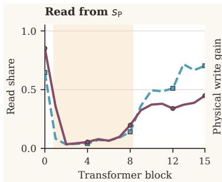

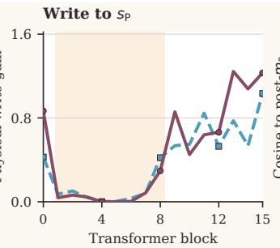

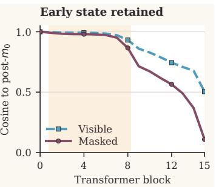  
Figure 7: A first-block state persists through the middle network. The preserved stream receives little read or write mass through middle depth, while its cosine similarity to its own post-�0 state remains high at masked and visible positions. Later read and write activity coincides with transformation of this sample-specific state.

Own-state replacements and within-role state shufles use 128 sequences (blocks 256–383). State shufling uses a deterministic cyclic shift among the selected same-role positions within each sequence. At � , � has cosine similarity 0.949 to its own post- $- m _ { 0 }$ masked state and 0.965 at visible positions. Replacing $s _ { \mathrm { P } } ^ { a _ { 8 } }$ with the same position’s $s _ { \mathrm { P } } ^ { m _ { 0 } }$ raises CE by only +.0037 [+.0029, +.0045] for masked positions and $+ . 0 0 5 9 \ [ + . 0 0 4 8 , + . 0 0 7 0 ]$ for visible positions. Replacing it with the post- $\mathbf { \nabla } \cdot a _ { 0 }$ state is much more disruptive, particularly at visible positions (+.5870 CE), identifying the post-� state as the preserved object.

Position identity remains essential. Shufling �P among same-role tokens within each sequence after $a _ { 8 }$ raises CE by +.0820 [+.0777, +.0864] for masked positions and +.3721 [+.3495, +.3962] for visible positions. Restoring the matched post-�0 state removes 95% and 98% of this shufle damage, respectively. Thus, the state remains position-specific within the sequence.

Read and write mass on �P increase again after roughly $m _ { 8 } { - } m _ { 1 0 }$ . Its masked-position cosine similarity to the post-�0 state falls from 0.949 at $a _ { 8 }$ to $0 . 6 7 2$ at $m _ { 1 0 }$ and 0.109 at $m _ { 1 5 } ,$ , consistent with transformation during reuse. Late role-specific interventions in the main text show that visible positions can rely primarily on the transformed $s _ { \mathrm { P } }$ for late continuation under stream duplication, while the two stream states are not interchangeable at masked positions.

Table 12: Late stream-content intervention after $m _ { 1 2 } .$ . Both streams at positions of the selected role are set to either their current $s _ { \mathrm { E } }$ or their current $s _ { \mathrm { P } }$ before the remaining network is rerun. Values are paired CE increases over intact $n = 2 .$ , with 95% intervals on the same 128 sequences (blocks 256–383) and corruption masks as the preservation tests.
<table><tr><td>Role</td><td>Both set to  $s _ { \mathrm { E } }$ </td><td>Both set to sp</td></tr><tr><td>Visible</td><td>+.1475 [+.1356, +.1604]</td><td>+.0104 [+.0087, +.0121]</td></tr><tr><td>Masked</td><td>+.0772 [+.0741, +.0804]</td><td>+.2304 [+.2184, +.2432]</td></tr></table>

At visible positions, the transformed �P is the stronger late carrier. At masked positions, either stream duplication degrades predictions, demonstrating functional non-interchangeability. Removing �P immediately before the output head adds +.3549 CE [+.3402, +.3704] on masked targets, confirming its contribution at readout.

## H Preservation across stream counts and the AR comparison

We repeat the routing survey on 64 common sequences for difusion $n = 2 , 3 , 4$ and their AR counterparts. For each model and role, Table 13 identifies the stream with the smallest mean read share in the $a _ { 2 } { - } a _ { 8 }$ window, then measures its later read share over $a _ { 1 1 } { - } m _ { 1 5 }$ . The stream is selected by the middle-window rule before comparing the late values.

Table 13: Read share of the candidate stream selected by minimum middle-depth reading. Difusion candidates have particularly low middle-depth read share and are read more heavily near output.
<table><tr><td>Objective</td><td>Streams and role</td><td>Middle read share</td><td>Late read share</td></tr><tr><td>MDLM</td><td>n = 2, masked / visible</td><td>.062 / .059</td><td>.386 / .617</td></tr><tr><td>MDLM</td><td>n = 3, masked / visible</td><td>.062 / .086</td><td>.598 / .639</td></tr><tr><td>MDLM</td><td>n = 4, masked / visible</td><td>.051 / .075</td><td>.301 / .368</td></tr><tr><td>AR</td><td>n = 2</td><td>.473</td><td>.793</td></tr><tr><td>AR</td><td>n = 3</td><td>.167</td><td>.632</td></tr><tr><td>AR</td><td>n = 4</td><td>.117</td><td>.560</td></tr></table>

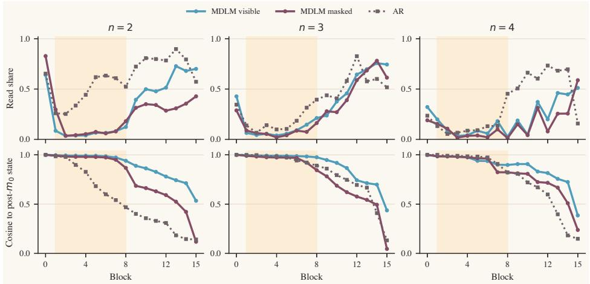  
Figure 8: Difusion shows stronger early-state preservation and lower middle-depth reading. For each residual stream count, the top row gives the candidate stream’s read share and the bottom row its cosine similarity to the post-� state. Difusion is separated by visible and masked roles; AR positions are not partitioned by a corruption mask. Shading marks the middle-depth preservation interval.

The difusion pattern recurs with two, three, and four residual streams at both masked and visible positions: the selected stream’s middle-depth read share stays below 0.10, then increases in late layers. The AR $n = 2$ candidate is read throughout the middle network and departs rapidly from its first-block state. A related pattern of preservation followed by renewed late reading also appears in AR models with three and four streams, but their candidates are read more during the middle interval and depart sooner from the post-� state (Figure 8). The difusion models studied therefore show lower middle-depth reading and more persistent early-state similarity than the matched AR controls, followed by renewed late reading. The evidence-transfer component is established separately by the source-to-target interventions on the two-stream difusion model (Appendix F).

## I The 337M functional organization recurs at 1B

The 1B model repeats the 337M functional sequence: prepare position-specific information early, retain it through middle depth while source influence reaches masked targets, and reuse retained visible states late. We align streams by their preservation and late-reuse functions: $s _ { P }$ is $s _ { 1 }$ at 337M and $s _ { 0 }$ at 1B.

Setup. The 1B model (1.028B parameters, 32 blocks) was trained for 124,000 steps on 8.127B input tokens. Its hidden and MLP dimensions are 1,536 and 4,096, with 24 query heads, six key–value heads, and head dimension 64. It uses the same AdamW $\beta , \epsilon ,$ peak and floor learning rates, and gradient clipping as 337M, with a 2,000-update warmup and a planned 152,588-update cosine schedule. The analyzed checkpoint at 124,000 steps precedes the scheduled learning-rate floor. Both the 1B standard-residual and two-stream runs apply weight decay 0.1 to parameters with at least two dimensions and zero to the remaining parameters. We use 64 calibration and 128 disjoint test sequences at $t = 0 . 5$ . Paired ΔCE measures masked-target loss on identical inputs and masks; masked/visible result pairs denote the positions modified. 1B 95% intervals use 5,000 paired bootstrap resamples of sequences. Evidence-transfer intervals resample the 58 sequences contributing the 58 selected pairs, using the same resamples across depths and patch conditions. The 58 selected transfer pairs come from 58 distinct sequences, so sequence-cluster resampling is equivalent to pair resampling for this sample. Matched-step standard-residual / mHC validation CE is 3.27752 / 3.24224, averaged over five mask ratios on a separate split: a $3 . 4 7 \%$ reduction in exponentiated CE (5.71% at 337M).

## I.1 Early preparation and position-specific preservation

Early blocks prepare the state that will later be retained. The first masked attention update sends 99.67% of its write gain to $s _ { P }$ at 1B, versus 97.95% at 337M. Restoring reference-run post-�0 $s _ { P }$ removes over 99.9% of the damage from deleting that update in both models. This restores a stream state after the ML $\mathrm { { . P ; } }$ the 98.24% rescue in Appendix F restores only the attention contribution to the MLP input. This rescue identifies $s _ { P }$ as a carrier of early contextual information needed by subsequent computation.

The state becomes reusable after further early processing at 1B. Replacing $s _ { P }$ at $a _ { 1 6 }$ with its earlier state costs $+ 0 . 0 4 4 2 / + 0 . 0 1 6 4$ CE from $m _ { 1 }$ , but only +0.00456/+0.00761 when taken from $a _ { 8 }$ . At 337M, the state at $m _ { 0 }$ already serves at $a _ { 8 }$ for +0.0037/+0.0059 CE. The declining cost supports a transition from preparation to preservation, with a later boundary at 1B.

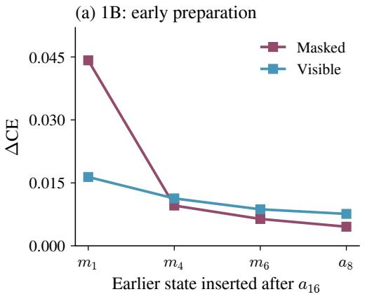

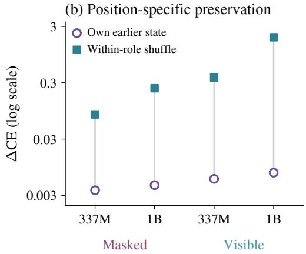  
Figure 9: Preparation leads to position-specific preservation. (a) Later early-state anchors are less costly to reuse at 1B. (b) Own-state reuse versus same-role shufling, measured across $m _ { 0 } \to a _ { 8 }$ (337M) and $a _ { 8 }  a _ { 1 6 }$ (1B). The right axis is logarithmic.

The preserved information belongs to a particular position. Reusing a position’s earlier state tests whether its information remains useful; shufling within a role tests whether positions’ states are interchangeable. At 1B, the cheap reuse above contrasts with +0.2399/+1.9266 CE for shufling, using SeedSequence([130923, block\_id, depth, stream]). Reusing the other stream’s earlier state is 35–37 times more costly than reusing $s _ { P } .$ . These results support useful position-specific preservation alongside ongoing computation, as at 337M. Low middle-depth reading and high same-position cosine agree with this pattern (Figure 8).

## I.2 Source influence transfers to targets before late reuse

Context reaches the target while position-specific states are preserved. The 337M interventions show that source influence accumulates at masked targets while position-specific information remains available in the preserved stream. The 1B evidence supports the same combination: the target state increasingly carries recoverable influence from a visible source. To measure this, we mask an influential source, then restore reference-run states at either position. A target patch tests whether its state already contains useful source influence; a source patch tests whether the remaining layers can still use restored source information. Recovery is the fraction of lost correct-token log-probability restored by patching both streams.

Early in 1B (about 6% depth), restoring the source recovers 92.2% of its contribution, while restoring the target recovers only 16.6%. At 75% depth, target recovery reaches 99.8% and source recovery falls to 31.2%; the paired gap is 68.6 percentage points (95% interval [62.0, 75.4]). At the same relative depth, 337M gives 99.6%/26.3% (target/source). The shared trajectory supports accumulation of source influence at the target alongside preservation of position-specific states (Figure 10a).

As in Appendix F, selected pairs require a source-removal penalty of at least 0.5 log-probability units at a correctly predicted target. The 1B search yields 58 pairs across 128 sequences.

Late computation can rely on the retained visible state. At both scales, $s _ { P }$ is read little in the middle and strongly late; its 1B read share reaches about 87% after block 24 for both roles. We test the usefulness of this state by duplicating one stream into both residual cells at visible positions, leaving masked positions unchanged. At $m _ { 2 4 }$ in 1B, duplicating $s _ { P }$ costs +0.0225 CE, versus +0.2106 for duplicating the other stream; 337M gives $+ 0 . 0 1 0 4 / + 0 . 1 4 7 5$ at $m _ { 1 2 }$ . The 1B ordering holds at all six tested boundaries from $m _ { 8 }$ to $m _ { 2 8 } .$ . The retained visible state therefore supplies information that is suficient for much of the remaining computation under this duplication intervention, consistent with its renewed late reading (Figure 10b).

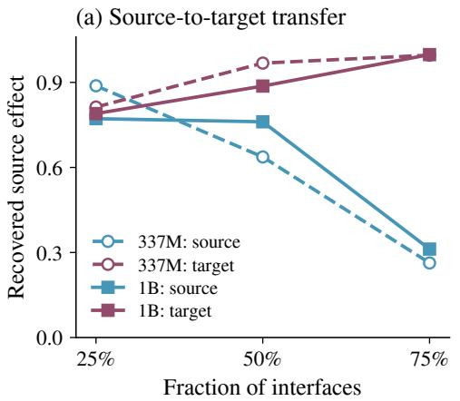

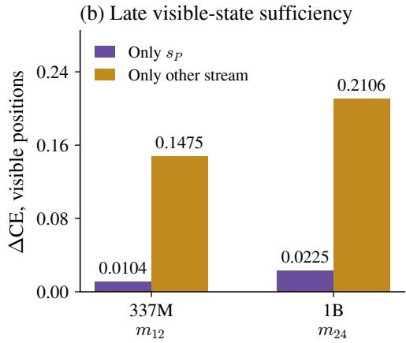  
Figure 10: Source-to-target transfer and late visible-state reuse recur at 1B. (a) Reference target-state patches recover nearly all source influence at 75% depth in both models, while source-state patches recover much less. Circles/dashes denote 337M; squares/solid lines denote 1B. (b) $\mathbf { A t } m _ { 1 2 }$ (337M) and �24 (1B), duplicating $s _ { P }$ at visible positions is much less damaging than duplicating the other stream. The figures show reported point estimates. The legend’s “Only” labels denote copying the selected state into both streams.

At 1B, patching only $s _ { P }$ or only the other stream at the target recovers 93.9% or 71.0% at 75% depth.   
Thus, target-side source influence is available in both streams.

## I.3 Routing reflects the same division between context and prediction

The interface distinguishes context sources from prediction targets. Visible positions provide observed context, while masked positions must form predictions. As at 337M, this distinction helps explain both which stream a branch reads and where it writes. Replacing token-specific read weights with one mean per interface costs +0.471 CE at 1B; retaining separate visible and masked means reduces this to +0.082. For normalized write destination, the corresponding costs are +0.130 and +0.036. Preserving only the role distinction therefore recovers 82.6% of read damage and 72.3% of destination damage, versus 95.7% and 98.6% at 337M (Figure 11a). Role structure remains a substantial organizing factor.

Write volume assignment also adapts to individual tokens and depth. Within each role, predictions also depend on how write volumes are assigned to individual tokens. At 1B visible positions, shufling volumes within the role costs +3.1392 CE, versus +0.1031 for role averaging; 337M gives $+ 0 . 2 9 4 / + 0 . 1 2 4$ . Shufling preserves the current within-role volume multiset at each interface while changing its assignment to tokens. The CE increase under this distribution-preserving shufle establishes the importance of matching write volume to token state within the visible role at both scales.

The endpoint efects also fit the staged account. At 1B, first-block role-mean volume replacement mainly afects visible positions (+0.0598 CE, versus +0.00013 for masked positions); in the last block it afects masked positions (+0.00973, versus zero for visible positions). The same early-visible / late-masked contrast occurs at 337M (Figure 11b). At both scales, the first-block intervention is much more damaging at visible than masked positions, while masked-token volume remains consequential near the readout. This pattern is consistent with the depth-dependent volume assignment observed across the full 337M network.

Table 14 reports acceptance coverage for these 1B endpoint interventions. Coverage is averaged over the two interfaces of the selected block, separately for the masked-only and visible-only runs.

Table 14: Mean acceptance coverage (%) for first- and last-block role-mean volume replacement in the 1B model at � = 0.5. Blocks are indexed from zero.
<table><tr><td>Block</td><td>Masked-only</td><td>Visible-only</td></tr><tr><td>0</td><td>100.00</td><td>100.00</td></tr><tr><td>31</td><td>86.88</td><td>99.12</td></tr></table>

(a) Role-conditioned routing  
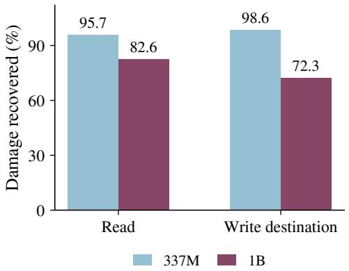

(b) Early-visible / late-masked  
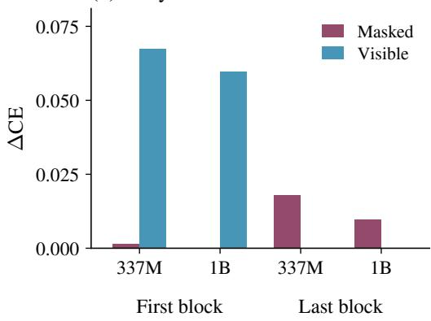  
Figure 11: Role organization and depth-dependent volume assignment recur. (a) Fraction of global-mean damage recovered by role means, $1 0 0 ( 1 - \Delta \mathrm { C E } _ { \mathrm { r o l e } } / \Delta \mathrm { C E } _ { \mathrm { g l o b a l } } )$ , computed from reported loss increases. (b) First/last-block role-mean volume replacements reproduce the early-visible / late-masked contrast. First- and last-block interventions are shown.

Volume coordinate. Both scales use the proportional reconstruction and acceptance rules in Appendix A. Role-mean replacements are applied at feasible positions, while within-role shufling uses mutually feasible pair exchanges. These interventions preserve each afected token’s normalized write destination and keep gains in [0, 2]; pair exchanges also preserve the complete volume multiset within each sequence, role, and interface. Full-network acceptance coverage for both scales is reported in Table 2; coverage for the 1B single-block endpoint interventions appears in Table 14.