# Not All Drift Is a Mechanism: Tracing Prompt Adaptation in LLMs

Mikhail Aleksandrov\* Nail Bashirov Maksim Ivanov

Andrew Tsukanov Timofey Karyagin Alexander Miasnikov

Gleb Molodtsov Valentin Samokhin Aleksandr Beznosikov

BRAIn Lab Equal contribution

Code: https://github.com/brain-lab-research/prompt-adaptation

Prompt-based adaptation ofers several ways to specialize a frozen language model, ranging from natural-language prompt optimization to learned continuous prompts. These methods are usually compared through downstream performance, although similar outputs need not arise from similar internal computations. We study how discrete prompt optimization, prompt tuning, and prefix tuning alter the processing of dense and mixture-of-experts language models. Our analysis shows that the location of the adaptation predicts how task information is carried to the output: optimized text primarily changes response construction, input-level prompts write their influence into content representations, and layer-wise prefixes maintain direct control through attention. In MoE models, these diferences further induce distinct expert-routing patterns. At the same time, common representation-level measurements respond strongly to generic context changes and do not reliably distinguish useful adaptations from matched placebos. We argue that understanding prompt adaptation requires separating representation drift from the part of that drift that is aligned with, and causally used by, the model’s task computation. This perspective provides practical guidance for selecting, evaluating, and interpreting prompt adaptation methods.

## 1 Introduction

Large language models (LLMs) are increasingly adapted as frozen backbones, allowing one model to support many tasks without storing or serving a separate set of weights for each application. Context becomes the adaptation interface: a task can be specified through a natural-language instruction, learned continuous vectors at the input, or learned states inserted into the attention computation [Agrawal et al., 2026, Lester et al., 2021, Li and Liang, 2021].

The most direct approach searches for a better textual prompt. Early methods optimized individual tokens, while recent systems use language models to propose, critique, and refine complete instructions [Shin et al., 2020, Pryzant et al., 2023]. A complementary line replaces text with trainable continuous states. Prompt tuning learns input embeddings, whereas prefix tuning exposes learned keys and values to every Transformer layer [Lester et al., 2021, Li and Liang, 2021]. These methods optimize the context seen by the same frozen model, but provide diferent access to its computation.

In practice, these methods are usually compared by downstream score. This is insuficient for understanding what the adaptation changed. A gain may arise from a better task decision, more reliable adherence to an output protocol, or a diferent route through which an existing decision reaches the language-model head. In a mixture-of-experts (MoE) model, the same contextual change can additionally alter which expert parameters process each token [Olson et al., 2025]. Similar outputs therefore need not imply similar internal computations.

Research on prompt optimization has made substantial progress in improving task performance, while mechanistic studies of contextual learning have identified task vectors and prompt-induced geometric changes [Agrawal et al., 2026, Todd et al., 2024, Kirsanov et al., 2025]. These directions have largely developed separately. Performance-oriented studies rarely locate the computation that mediates the gain, while representation analyses often show that a prompt changes hidden states without testing whether the measured change is suficient to alter the output [Hewitt and Liang, 2019, Zhang and Nanda, 2024].

We study prompt adaptation from this functional perspective. We compare discrete prompt optimization, prompt tuning, and prefix tuning under a common frozen-model protocol, follow task information through a dense model, and test observational signatures against matched placebos and causal interventions. We then examine sparse models, where a hidden-state change can become a discrete routing decision. Our results support a common account: the insertion site constrains how an adaptation can influence the network, while common metrics often capture broad representation drift rather than the smaller state change suficient to mediate the adapted output.

## 2 Related Work

Continuous prompts. Continuous prompting adapts a frozen model by optimizing trainable states rather than model parameters. Prefix tuning introduced task-specific keys and values that remain available throughout the attention stack [Li and Liang, 2021], while prompt tuning showed that embeddings inserted only at the input become increasingly competitive as model scale grows [Lester et al., 2021]. Deep variants such as P-Tuning v2 extend these states across layers and tasks [Liu et al., 2022]. These methods therefore difer not only in parameter count, but also in the depth at which they can influence computation. Theoretical analyses characterize both the expressive power of prompt-mediated attention and the restrictions imposed by a frozen backbone [Oymak et al., 2023, Petrov et al., 2024]. Their learned states remain dificult to interpret, since nearest-token projections can be unfaithful and human-readable constraints may reduce task performance [Patel et al., 2025].

Discrete prompt evolution. A parallel line retains the natural-language interface and searches for better instructions. Prompt sensitivity first motivated gradient-guided trigger selection in AutoPrompt [Shin et al., 2020] and reward-based token generation in RLPrompt [Deng et al., 2022]. With stronger instruction-following models, optimization moved from isolated tokens to complete prompts: APE samples and selects candidate instructions [Zhou et al., 2023], ProTeGi combines textual gradients with beam search [Pryzant et al., 2023], and OPRO conditions an optimizer on previous solutions and scores [Yang et al., 2024]. Later methods jointly optimize instructions, demonstrations, or multistage programs [Opsahl-Ong et al., 2024]. GEPA adds natural-language reflection and evolutionary selection [Agrawal et al., 2026], while SPRIG studies iterative system-prompt optimization and transfer [Zhang et al., 2026]. This progression makes discrete adaptation accessible without gradients through the task model, but most evaluations still describe the resulting behavior rather than the computation that produced it.

Mechanistic analysis. Mechanistic studies of contextual learning first asked which computations prompts elicit. Induction heads identify circuits that copy contextual patterns [Olsson et al., 2022], simplified Transformers can implement optimization-like updates during the forward pass [von Oswald et al., 2023], and task or function vectors can transfer behavior under intervention [Hendel et al., 2023, Todd et al., 2024]. This work motivated observational diagnostics of prompt-induced computation, including representation geometry [Kirsanov et al., 2025], task descriptions recovered through Patchscopes [Ghandeharioun et al., 2024, Ramati et al., 2025], and hidden-state shifts after system-prompt optimization [Zhang et al., 2026]. Such measurements establish that context changes the network, but not that the measured change produces the output. Linear probes and the tuned lens localize decodable information [Hewitt and Liang, 2019, Belrose et al., 2023]; activation steering and patching test causal suficiency [Turner et al., 2023, Zhang and Nanda, 2024]; and sparse autoencoders provide a feature basis in which these interventions can be expressed [Huben et al., 2024, Gao et al., 2025]. Our comparison brings these stages together for three adaptation mechanisms under the same task and backbone, using matched placebos to test observational measurements and causal transfer to identify state-level mediators.

MoE routing. This distinction becomes more explicit in mixture-of-experts models, where a contextual change can alter which parameters process a token. MoE Transformers route each token through a small expert subset, increasing total capacity at approximately fixed active computation [Fedus et al., 2022]. Load-balancing objectives limit concentrated trafic and unused experts [Wang et al., 2024, Tang et al., 2025, Molodtsov et al., 2026], while recent analyses show that routing reflects both token identity and contextual semantics [Olson et al., 2025]. Existing adaptation work mainly modifies weights, routers, or routed adapter modules [Liu et al., 2025]. The response of a frozen router to discrete, input-level, and layerwise prompt adaptation remains underexplored.

Contributions. Our contributions can be summarized as follows:

• A mechanistic explanation of prompt adaptation. We go beyond performance comparisons to explain how GEPA, prompt tuning, and prefix tuning change a frozen model’s computation. We trace their influence through attention, hidden states, and expert routing, using controls and interventions to separate useful adaptation from generic context efects.

• How adaptation acts through attention in dense models. We study dense models to examine how each method changes attention and carries its influence into content representations. Attention masking and state interventions reveal how these changes afect output, while matched placebos show why representation drift alone is insuficient evidence of a useful mechanism.

• How adaptation changes computational paths in MoE models. We examine the additional lever provided by routing: the same token can pass through diferent expert networks after adaptation. We separate changes in expert selection from changes in serving load, then test expert necessity through pruning. These interventions expose adapter-specific dependencies on rarely used experts that trafic statistics alone miss.

## 3 Dense Models: From Adaptation Interface to Functional State Change

GEPA, prompt tuning, and prefix tuning all optimize context while keeping the language model frozen, but they expose diferent parts of its computation to that optimization. GEPA rewrites natural-language tokens, prompt tuning learns embeddings inserted only at the input, and prefix tuning supplies learned keys and values to every attention block [Agrawal et al., 2026, Lester et al., 2021, Li and Liang, 2021]. These insertion sites define distinct routes by which an adaptation can remain available during generation: through textual instructions, through content states that inherit an input-level intervention, or through a layerwise attention channel.

For input �, let $h _ { \ell , t } ^ { M } ( x ) \in \mathbb { R } ^ { d }$ denote the residual state after block ℓ at token position � under condition �, with � = 0 denoting the seed instruction. We write � for the final non-padding prompt position, use block and layer interchangeably, and define the seed-relative displacement

$$
\delta _ { \ell , t } ^ { M } ( x ) = h _ { \ell , t } ^ { M } ( x ) - h _ { \ell , t } ^ { 0 } ( x ) .\tag{1}
$$

Experiments use Gemma 2 2B-IT [Gemma Team et al., 2024] on five-label Civil Comments classification [Borkan et al., 2019]. The primary metric is empty-aware samples- $\boldsymbol { \cdot } \boldsymbol { F } _ { 1 }$ . A strict parser enforces the prescribed label order, whereas a set parser evaluates only the predicted label set. Data partitions, adapter objectives, and complete protocols are given in Appendix B.2.

The insertion site specifies where an adaptation can enter the network, but it does not identify which downstream consequence produces the gain. Likewise, the displacement in (1) establishes that a state moved, but not that the movement is task-relevant. The analysis therefore separates changes in the generated answer from changes in task information, then tests which residual changes survive matched controls and causal transfer.

## Research question 1

Which consequences of an adaptation’s insertion site remain active in the output computation, and which measured state changes are generic efects of changing the context?

## 3.1 Adaptation changes both the decision and its realization

The strict evaluator combines label selection with answer construction. Under set parsing, most of GEPA’s advantage over the seed is removed, whereas prompt and prefix tuning retain their gains (Figure 1a). GEPA’s observed gain is therefore concentrated in the realization of the output contract in this task, while the gains of the continuous methods remain visible in the selected label set. The full score sweep is reported in Appendix A.

The seed computation already contains substantial label information. A linear probe trained on seed states reaches most of its final accuracy by the middle of the stack (Figure 1b). Adaptation is therefore not applied to a representation devoid of the task; it changes how available information is transformed and exposed to the output computation.

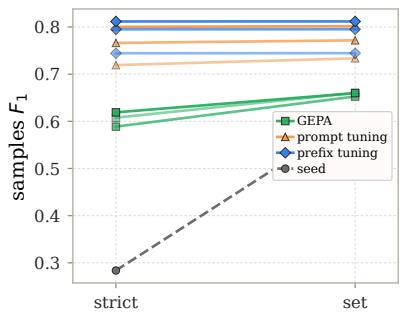  
(a) Label selection versus answer construction.

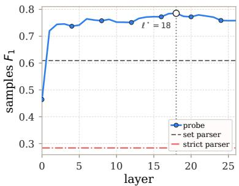  
(b) Seed-state label information.  
Figure 1: Behavioral gains and pre-existing task information. Ignoring label order removes most of GEPA’s strict-score improvement, while a seed-state probe decodes the label set well before the final block.

A calibrated tuned lens tracks the layerwise gold-label margin under each adapted context relative to the seed [Belrose et al., 2023]. Prefix tuning produces the earliest observed onsets in several configurations, consistent with keys and values that are available at every block. Prompt tuning and GEPA concentrate thei onsets later in the stack (Figure 2a). These readouts describe availability and masking establishes that the adapted contexts remain functionally involved. Removing attention to the optimized instruction, prompt embeddings, or prefix states returns performance to the seed level (Figure 2b).

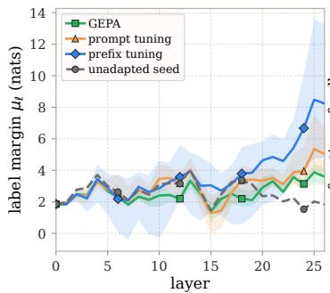

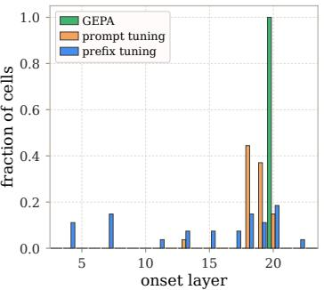  
(a) Depth at which adapted label margins become readable.

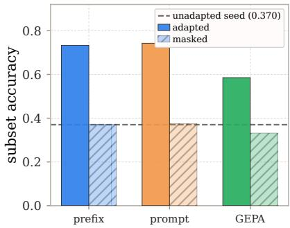  
(b) Adapted-context dependence.

Figure 2: Availability and use of the adapted context. The tuned lens tracks the emergence of adapted label margins, while masking removes the gain when access to the corresponding context is blocked.

Together, the behavioral and readout results give an interface-level account. GEPA’s gain is concentrated in answer construction, prompt tuning introduces an input-level influence whose label margin becomes readable later in the stack, and prefix tuning maintains a layerwise route to the attention computation. Representative token-level attention profiles provide a complementary view in Appendix B.4. Residual movement also follows from changing the context without optimizing it, so access alone does not make the resulting geometry task-specific.

## 3.2 Generic context produces substantial representation drift

A length-matched padding prompt isolates the efect of adding context positions without task optimization. It changes residual geometry, degrades probe transfer, and lowers task performance. Padding therefore breaks any monotonic link between distance from the seed and adaptation quality (Figure 7a in Appendix B.5).

The structure of the displacement leads to the same conclusion. Early in the stack, the dataset mean accounts for most of the shift energy under every condition, including padding. At later blocks, the centered remainder becomes high-rank for both adapted and padded contexts (Figure 7b). A large shared component and a structured per-example remainder therefore also arise when context is added without task optimization; neither signature identifies a useful adaptation by itself.

This placebo changes the interpretation of the observational measurements. Distance, probe transfer, mean energy, and efective rank establish that the contexts induce diferent representations, but none identifies the part of the change suficient to reproduce adapted behavior. This is resolved by intervening on the seed computation.

## 3.3 Per-example state diferences transfer adapted outputs

The simplest intervention treats adaptation as a shared direction. At block ℓ and generation anchor �, we average the displacement over � examples and add it once to the seed state:

$$
\nu _ { \ell } ^ { M } = \frac { 1 } { N } \sum _ { i = 1 } ^ { N } \delta _ { \ell , \tau } ^ { M } ( x _ { i } ) , \qquad \widetilde { h } _ { \ell , \tau } ^ { 0 } ( x ; \lambda ) = h _ { \ell , \tau } ^ { 0 } ( x ) + \lambda \nu _ { \ell } ^ { M } .\tag{2}
$$

Here � controls the magnitude of the injected direction.

Across the evaluated layers and scales, the prefix mean performs like a norm-matched random direction; the GEPA mean produces the same qualitative comparison (Figure 3). The dom inant average movement in the tested intervention therefore does not reproduce the adapted behavior. Adding the prefix mean at every decoded position recovers about 9% of the prefix gain (Appendix C.6).

Per-example state transfer gives a diferent result. For source condition � and target condition $T ,$ we add the matched-example diference $h _ { \ell , \tau } ^ { T } ( x ) \bar { { \mathbf { \Psi } } } - h _ { \ell , \tau } ^ { S } ( x )$ to the source state and run the remaining source blocks unchanged [Zhang and Nanda, 2024].

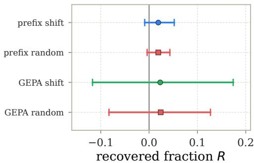

Figure 3: Dataset-mean steering and its random control.

For source, target, and patched next-token distributions $p _ { S } ( x ) , p _ { T } ( x )$ , and $p _ { S \curvearrowright T } ( x )$ , transfer is measured by

$$
R _ { \mathrm { K L } } ( S \to T ) = 1 - \frac { \sum _ { x } \mathrm { K L } ( p _ { T } ( x ) \| p _ { S \to T } ( x ) ) } { \sum _ { x } \mathrm { K L } ( p _ { T } ( x ) \| p _ { S } ( x ) ) } .\tag{3}
$$

We run this patch for GEPA paired with each continuous method, in both directions. At a late residual state, the exact per-example diference closes most of the source–target KL gap when aggregated across the two directions (Table 1). Sparse-autoencoder reconstruction and feature-restricted transfer provide a complementary decomposition in Appendix B.6 [Lieberum et al., 2024].

Table 1: Exact transfer at block 20.
<table><tr><td>Conditions</td><td> $R _ { \mathrm { K I } }$ </td></tr><tr><td>GEPA-prompt</td><td> $0 . 9 1 7 \pm 0 . 0 4 9$ </td></tr><tr><td>GEPA-prefix</td><td> $0 . 8 3 2 \pm 0 . 0 5 6$ </td></tr></table>

The two interventions separate broad drift from a transferable state diference. The tested dataset mean does not reproduce the gain, whereas one late matched-example diference is suficient to transfer most of the next-token distributional diference. The exact patch uses the target state directly; the remaining step is to produce a comparable correction from the seed computation alone.

## 3.4 Learned corrections recover adapted generation

For target method �, we learn an afine correction from the seed residual state at the final block �:

$$
\widehat { \delta } _ { L , t } ^ { M } = f _ { \phi } ^ { M } ( h _ { L , t } ^ { 0 } ) = W _ { M } h _ { L , t } ^ { 0 } + b _ { M } , \qquad \widetilde { h } _ { L , t } ^ { M } = h _ { L , t } ^ { 0 } + \widehat { \delta } _ { L , t } ^ { M } .\tag{4}
$$

The map has about 5.3M parameters. Training pairs come from the adapted model’s own greedy answers: we run the seed and adapted models on each answer and regress the seed state onto the displacement $\delta _ { L , t } ^ { M } ,$ with state MSE alone or together with KL divergence from the adapted output distribution ((18) and (20)). During free generation, the map reads the current seed-context state and the answer prefix produced with preceding corrections, then predicts a new correction at every token. The adapted context and target states are absent at inference. Heyman and Vandeputte [2026] learn activation-dependent corrections that imitate textual prompting with a single learned direction, and Cheng and Kriegeskorte [2026] study which state maps reproduce prompt-induced task structure. Our maps are full afine corrections, fitted to all three adaptation interfaces and evaluated by the score of complete generated answers.

The learned corrections recover the small GEPA gap and most of the continuous gains (Table 2), 81% and 68% of the prompt and prefix gains with MSE and 89% and 79% with MSE+KL. With MSE+KL, one correction computed at the start of the answer comes within 0.010 of the per-token predictor (Table 10), whereas a constant bias does not beat the seed for prompt and prefix tuning, so the gain depends on the input.

The true shifts of GEPA and either continuous method have median cosines near 0.2, against 0.46 between prompt and prefix tuning (Appendix C.4), matching the split in Figure 1a. A map from the seed block-20 state to the adapted block-25 state can even replace blocks 21 to 25, reaching 0.688, 0.766 and 0.770 (Appendix C.3). Training details and the rank sweep are in Appendices C.1 and C.2.

Table 2: Complete-answer set samples- $F _ { 1 }$
<table><tr><td>Target</td><td>Native</td><td>MSE MSE+KL</td></tr><tr><td>GEPA</td><td> $0 . 6 7 8 \pm . 0 0 7 \ 0 . 6 8 3 \pm . 0 1 5 \ 0 . 6 8 1 \pm . 0 1 2$ </td></tr><tr><td>Prompt  $0 . 7 7 7 \pm . 0 1 3 0 . 7 4 6 \pm . 0 0 1 0 . 7 5 9 \pm . 0 0 6$ </td></tr><tr><td> $0 . 8 0 5 \pm . 0 0 7 0 . 7 4 4 \pm . 0 0 4 0 . 7 6 5 \pm . 0 0 6$ </td></tr></table>

Dense-model conclusion. The dense experiments form a single progression. Behavioral evaluation first separates label selection from answer construction; layerwise readouts then show how adapted information becomes available; and the padding placebo shows that the resulting representation drift is not specific to task improvement. Causal transfer isolates the finer distinction: the tested dataset mean is inefective, while a matched-example late-state diference transfers most of the adapted output diference. Learned afine corrections recover much of the same behavior throughout free generation, even with one correction per example when trained with output supervision. This establishes behavioral transfer, but not that the maps reproduce the native adaptation mechanism.

Every dense residual state still passes through the same feed-forward parameters. In an MoE backbone, the same state change can also alter which experts process the token. Routing therefore exposes a discrete intermediate decision that reveals whether adaptation changes not only the state, but also the parameters that act on it.

## 4 MoE Models: When Drift Becomes a Discrete Decision

A mixture-of-experts (MoE) block sends each token to � of $n _ { E }$ experts $f _ { \ell , e }$ through a linear router $W _ { \ell } ^ { r }$ . An adapted context can therefore change both the states processed and the parameters that process them. For expert-block input $h _ { \ell , t }$

$$
g _ { \ell , t } = W _ { \ell } ^ { r } h _ { \ell , t } , \qquad \mathcal { E } _ { \ell , t } = \mathrm { t o p } { \cdot } k \big ( g _ { \ell , t } \big ) , \qquad y _ { \ell , t } = \sum _ { e \in \mathcal { E } _ { \ell , t } } \pi _ { \ell , e } ( h _ { \ell , t } ) f _ { \ell , e } ( h _ { \ell , t } ) ,\tag{5}
$$

where $\pi _ { \ell , e }$ are softmax weights over the selected experts. Through $h _ { \ell , t }$ , adaptation can change the expert inputs, mixing weights and selected set. We ask:

## Research question 2

How does each adaptation method change which experts process a token and how evenly the load is spread, and does an expert’s load tell whether the adapted model needs it?

Load balancing shapes MoE training [Fedus et al., 2022, Wang et al., 2024], and frequency pruning removes rarely used experts [Lu et al., 2024]. We test how adaptation changes this load and whether low trafic implies that an expert is dispensable.

For expert-assignment shares $u _ { \ell , e }$ and $\tilde { u } _ { \ell , e }$ in the base and adapted models, measured on identical comment tokens unless stated otherwise, routing displacement is

$$
\begin{array} { r } { \mathbf { T } \mathbf { V } _ { \ell } = \frac { 1 } { 2 } \sum _ { e = 1 } ^ { n _ { E } } \Bigl | \tilde { u } _ { \ell , e } - u _ { \ell , e } \Bigr | \in [ 0 , 1 ] . } \end{array}\tag{6}
$$

This is the fraction of routing mass that must move to restore the base profile. Load concentration is measured by the Gini coeficient and busiest-expert share (Appendix E.1).

The task and methods follow Section 3, scored by empty-aware samples-�1. Qwen3-30B-A3B-Instruct-2507 uses 48 layers, 128 experts and top-8; gpt-oss-20b uses 24 layers, 32 experts and top-4. Both have linear gates and no shared expert; gpt-oss adds a router bias. We use 100/200/500 virtual tokens and 500 held-out calibration rows (Appendix E.1).

## 4.1 Only continuous adaptation substantially reroutes the shared tokens

GEPA moves only a few percent of the comment tokens’ routing mass; prompt and prefix tuning move two to four times more on average over layers (Figure 4). Routing depends mostly on token identity and less on context [Xue et al., 2024, Olson et al., 2025]. GEPA changes only the surrounding instruction, whereas learned continuous states change the context more strongly. GEPA thus preserves most shared-token assignments, but leaves the router’s task mismatch, which router retraining removes (Appendix E.4). Replaying adapted routes into the base recovers little of the task gain (Appendix E.7).

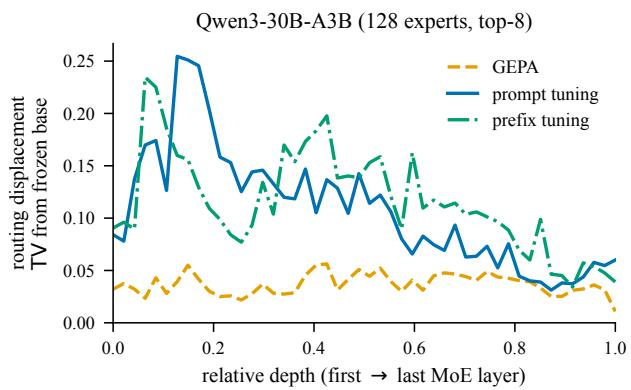

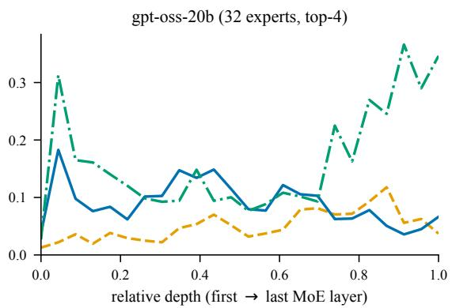  
Figure 4: Routing displacement $\mathrm { T V } _ { \ell }$ from the frozen base, layer by layer, for the comment tokens that all arms share; continuous arms at 500 virtual tokens.

Continuous displacement generally falls in the late layers. The exception is gpt-oss prefix tuning: it rises toward the experts the base uses for generated text. GEPA’s displacement also grows with depth on gpt-oss, slightly exceeding prompt tuning in the last quarter (Appendix E.1).

## 4.2 The load changes with the routed sequence, not with rerouting

Adaptation moves the comment tokens between experts without concentrating their load: every arm’s Gini stays close to the base’s (Table 3).

The full-sequence load changes mainly through the tokens adaptation adds or removes. GEPA’s long instruction multiplies routed positions; Qwen’s virtual tokens spread trafic to nearly idle experts. On gpt-oss the tuned arms instead concentrate the load by omitting the base’s reasoning.

The adapted gpt-oss answers directly. The adapters learn to answer directly. Including the base’s analysis in training, masked from the loss, preserves reasoning but lowers task $F _ { 1 }$ across the tested arms (Table 4). Forcing direct answers also lowers the frozen base’s $F _ { 1 } { \mathrm { : } }$ 0.629 to 0.495 with the seed instruction and 0.755 to 0.723 with GEPA. Answer-only training benefits the adapters; forcing that mode on the frozen base does not.

Table 4: gpt-oss test $F _ { 1 }$ , 2000 rows. Reasoning LR: answer-only for prompts, $3 \cdot 1 0 ^ { - 4 }$ for prefixes.
<table><tr><td>arm</td><td>answer only</td><td>with reasoning</td></tr><tr><td>prompt, 100</td><td>0.784</td><td>0.482</td></tr><tr><td>prompt, 500</td><td>0.799</td><td>0.775</td></tr><tr><td>prefix, 100</td><td>0.819</td><td>0.789</td></tr><tr><td>prefix, 500</td><td>0.820</td><td>0.764</td></tr></table>

Table 3: Expert load on 500 calibration rows, every budget. Gini coeficients and busiest-expert shares are medians over layers; dead-expert counts are means over layers.
<table><tr><td></td><td></td><td>positions per row</td><td>Gini</td><td>Gini, comment tokens</td><td>busiest expert (%)</td><td>dead experts</td></tr><tr><td rowspan="8">Qwen3-30B-A3B</td><td>base</td><td>153</td><td>0.635</td><td>0.757</td><td>5.2</td><td>7.8</td></tr><tr><td>GEPA</td><td>2154</td><td>0.729</td><td>0.759</td><td>8.2</td><td>7.6</td></tr><tr><td>prompt, 100</td><td>253</td><td>0.583</td><td>0.753</td><td>5.0</td><td>3.0</td></tr><tr><td>prompt, 200</td><td>353</td><td>0.610</td><td>0.747</td><td>6.1</td><td>4.5</td></tr><tr><td>prompt, 500</td><td>653</td><td>0.620</td><td>0.753</td><td>6.6</td><td>3.0</td></tr><tr><td>prefix, 100</td><td>153</td><td>0.640</td><td>0.760</td><td>5.8</td><td>8.4</td></tr><tr><td>prefix, 200</td><td>153</td><td>0.647</td><td>0.761</td><td>5.6</td><td>8.3</td></tr><tr><td>prefix, 500</td><td>153</td><td>0.648</td><td>0.763</td><td>5.5</td><td>9.4</td></tr><tr><td rowspan="8">gpt-oss-20b</td><td>base</td><td>626</td><td>0.513</td><td>0.687</td><td>11.2</td><td>0.5</td></tr><tr><td>GEPA</td><td>1571</td><td>0.583</td><td>0.707</td><td>14.8</td><td>0.5</td></tr><tr><td>prompt, 100</td><td>313</td><td>0.563</td><td>0.693</td><td>15.8</td><td>1.0</td></tr><tr><td>prompt, 200</td><td>413</td><td>0.607</td><td>0.689</td><td>17.9</td><td>0.8</td></tr><tr><td>prompt, 500</td><td>713</td><td>0.661</td><td>0.711</td><td>19.3</td><td>1.2</td></tr><tr><td>prefix, 100</td><td>213</td><td>0.584</td><td>0.682</td><td>15.6</td><td>2.2</td></tr><tr><td>prefix, 200</td><td>213</td><td>0.572</td><td>0.685</td><td>14.8</td><td>2.0</td></tr><tr><td>prefix, 500</td><td>213</td><td>0.591</td><td>0.661</td><td>17.0</td><td>1.6</td></tr></table>

Table 5: Set-level $F _ { 1 }$ on 2000 test rows after pruning each layer’s least-used 50% or 75% of experts, with unreadable-answer rates; $F _ { 1 }$ after pruning only super experts, alongside those used by each arm. Token budgets (Qwen/gpt-oss): 512/1024 for unpruned and frequency-pruned models, 64/1024 for super-expert pruning; unreadable answers in the latter count as empty label sets. Empty-label floors: 0.330 for frequency pruning and 0.328 for super-expert pruning, using diferent test samples.
<table><tr><td colspan="2"></td><td colspan="3"> $F _ { 1 }$ </td><td colspan="2">unreadable (%)</td><td colspan="2">super experts</td></tr><tr><td colspan="2"></td><td>original</td><td>-50%</td><td>-75%</td><td>-50%</td><td>-75%</td><td>kept</td><td>pruned</td></tr><tr><td rowspan="7">Qwen3-30B-A3B</td><td>base</td><td>0.466</td><td>0.575</td><td>0.330</td><td>0.0</td><td>100.0</td><td>all three</td><td>0.328</td></tr><tr><td>GEPA</td><td>0.728</td><td>0.728</td><td>0.330</td><td>0.0</td><td>100.0</td><td>all three</td><td>0.328</td></tr><tr><td>prompt, 100</td><td>0.833</td><td>0.814</td><td>0.440</td><td>0.0</td><td>0.2</td><td>L2 E92, L3 E82</td><td>0.409</td></tr><tr><td>prompt, 200</td><td>0.816</td><td>0.330</td><td>0.330</td><td>100.0</td><td>100.0</td><td>all three</td><td>0.328</td></tr><tr><td>prompt, 500</td><td>0.828</td><td>0.812</td><td>0.450</td><td>0.0</td><td>0.0</td><td>all three</td><td>0.328</td></tr><tr><td>prefix, 100</td><td>0.836</td><td>0.815</td><td>0.383</td><td>0.0</td><td>0.3</td><td>all three</td><td>0.328</td></tr><tr><td>prefix, 200</td><td>0.802 0.805</td><td>0.611 0.330</td><td>0.330 0.330</td><td>0.0 100.0</td><td>100.0 100.0</td><td>L2 E92, L3 E82</td><td>0.328</td></tr><tr><td rowspan="8">gpt-oss-20b</td><td>prefix, 500</td><td></td><td></td><td></td><td></td><td></td><td>L3 E82</td><td>0.328</td></tr><tr><td>base</td><td>0.631</td><td>0.565</td><td>0.388</td><td>19.6</td><td>34.5</td><td>both</td><td>0.660</td></tr><tr><td>GEPA</td><td>0.755</td><td>0.746</td><td>0.422</td><td>0.3</td><td>64.4</td><td>both</td><td>0.754</td></tr><tr><td>prompt, 100</td><td>0.788 0.788</td><td>0.502</td><td>0.330</td><td>42.4</td><td>98.2</td><td>both</td><td>0.726</td></tr><tr><td>prompt, 200</td><td>0.800</td><td>0.584</td><td>0.343</td><td>26.2</td><td>84.3</td><td>both</td><td>0.784</td></tr><tr><td>prompt, 500</td><td>0.821</td><td>0.607 0.736</td><td>0.334 0.528</td><td>14.3 0.0</td><td>96.8</td><td>both</td><td>0.768</td></tr><tr><td>prefix, 100</td><td>0.826</td><td>0.793</td><td>0.486</td><td>0.0</td><td>0.9 3.0</td><td>none both</td><td>0.818</td></tr><tr><td>prefix, 200 prefix, 500</td><td>0.818</td><td>0.797</td><td>0.405</td><td>0.0</td><td>1.1</td><td>none</td><td>0.814 0.823</td></tr></table>

## 4.3 Frequency pruning removes experts the adapted model needs

A concentrated load leaves many experts nearly idle: on this task the least-used half of a layer’s experts carries, on average over layers, only 2 to 13 percent of the routing mass, and the least-used three quarters 18 to 40 percent. Such experts are the natural candidates for removal. We prune them by masking, in every layer, the router logits of the least-used half or three quarters of the experts, ranked on the arm’s own calibration map. Removing little routing mass can still destroy readable answers (Table 5; full sweep in Appendix E.2).

## 4.4 Rarely used super experts decide whether an adapted model survives

Load is not the only way in which experts difer. Language models send much of their attention to a few initial tokens with little content, the attention sinks [Xiao et al., 2024], which are created by massive activations, a few hidden-state entries orders of magnitude larger than the rest [Sun et al., 2024, Gu et al., 2025]. In MoE models these are written by a handful of super experts with rare, extreme outputs, whose removal collapses the Qwen model studied by Su et al. [2026]. We recover experts 68, 92 and 82 of layers 1 to 3 on Qwen and identify expert 5 of layers 6 and 17 on gpt-oss (Appendix E.3). Unlike a Qwen head, every head of gpt-oss has a learned sink logit that lets it attend to no token [OpenAI, 2025].

Qwen’s router sends its super experts at most about the uniform share of tokens (0.1 to 1.3 times) and gpt-oss’s about three times that share (2.9 and 3.0 times); in every adapted gpt-oss map expert 5 of layer 17 keeps 3.5 to 7.3 times it, so frequency masks remove all of Qwen’s but never both of gpt-oss’s. Every Qwen cell whose mask removes all three loses every readable answer. In the two −50% rescue controls, masks of the same size that spare them restore readable answers, with $F _ { 1 }$ of 0.803 for prompt-200 and 0.768 for prefix-500, against 0.816

and 0.805 intact (Appendix E.2).

Adaptation changes dependence on these experts (Table 6). GEPA leaves their magnitudes unchanged; prompt tuning moves their peak onto a virtual token (Figure 5); prefix tuning can suppress them by three orders of magnitude, depending on budget, learning rate and seed (Appendix E.3).

Removing the super experts destroys readable answers on all selected Qwen arms except prompt-100 (Table 5). On gpt-oss, score changes are smaller and depend on the arm. Prompt-100 falls from 0.784 to 0.726 in the

Table 6: Largest output of each super expert over 200 rows.
<table><tr><td colspan="3">Qwen3-30B-A3B</td><td colspan="2">gpt-oss-20b</td></tr><tr><td></td><td>L1 E68 L2E92</td><td>L3 E82</td><td>L6E5</td><td>L17E5</td></tr><tr><td>base</td><td>422 800</td><td>458</td><td>43 000</td><td>52700</td></tr><tr><td>GEPA</td><td>422 800</td><td>458</td><td>43 000</td><td>52 700</td></tr><tr><td>prompt, 100</td><td>11.1 250</td><td>572</td><td>43 000</td><td>50 700</td></tr><tr><td>prompt, 200</td><td>470</td><td>764 472</td><td>43 000</td><td>51 500</td></tr><tr><td>prompt, 500</td><td>1000</td><td>952 572</td><td>43 000</td><td>46900</td></tr><tr><td>prefix, 100</td><td>592</td><td>776 464</td><td>290</td><td>1520</td></tr><tr><td>prefix, 200</td><td>0.65</td><td>188 486</td><td>43 000</td><td>47900</td></tr><tr><td>prefix, 500</td><td>0.55</td><td>16.1 520</td><td>189</td><td>1990</td></tr></table>

super-expert harness. The prefix arms that suppress both experts stay close to their intact scores. Attention shifts to the learned sink and the sequence (Figure 13), consistent with reduced dependence on token-based sinks.

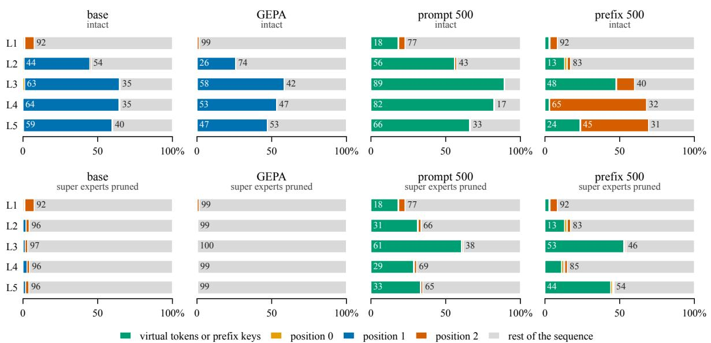  
Figure 5: Share of attention by layer on Qwen, intact and with the super experts pruned.

MoE conclusion. Adaptation reroutes an MoE model where it acts: GEPA keeps most expert assignments of the shared tokens, prompt and prefix tuning reassign more of them. Load statistics and pruning masks built from them are specific to each adapter, and load does not show which experts the model needs: a few rarely used super experts decide whether an arm survives pruning.

## 5 Conclusion

Prompt-based adaptation methods difer less in how much they change a frozen model than in where they act, with practical consequences for evaluation, interpretation and deployment. Under set parsing most of GEPA’s gain disappears while the continuous methods keep theirs, so an optimized prompt should be scored both ways before its gain is credited to task knowledge. A length-matched padding prompt reproduces the distance, probe, mean-energy and rank signatures of adaptation without improving the task, so representation metrics need such a placebo as a reference. An afine map from the seed state recovers most of the continuous gains without the adapted context and can even replace the last blocks, which makes such maps a practical probe of what an adaptation computes, although they need not reproduce the native mechanism.

In MoE models, retraining the router alone recovers most of the adaptation gain, and the choice of adaptation is also a serving decision. Text-level optimization keeps most of the routing of shared tokens but lengthens every request, whereas continuous prompts reroute many of them, so expert placement, caches and pruning masks tuned on the base should be recomputed per adapter. Pruning by trafic alone is unsafe, since a few rarely used super experts decide whether a pruned model still answers and the adaptation decides whether it needs them.

## References

Lakshya A. Agrawal, Shangyin Tan, Dilara Soylu, Noah Ziems, Rishi Khare, Krista Opsahl-Ong, Arnav Singhvi, Herumb Shandilya, Michael J. Ryan, Meng Jiang, Christopher Potts, Koushik Sen, Alexandros G. Dimakis, Ion Stoica, Dan Klein, Matei Zaharia, and Omar Khattab. GEPA: Reflective prompt evolution can outperform reinforcement learning. In International Conference on Learning Representations, 2026.

Nora Belrose, Igor Ostrovsky, Lev McKinney, Zach Furman, Logan Smith, Danny Halawi, Stella Biderman, and Jacob Steinhardt. Eliciting latent predictions from transformers with the tuned lens. arXiv preprint arXiv:2303.08112, 2023.

Daniel Borkan, Lucas Dixon, Jefrey Sorensen, Nithum Thain, and Lucy Vasserman. Nuanced metrics for measuring unintended bias with real data for text classification. In Companion Proceedings ofthe 2019 World Wide Web Conference, pages 491–500, 2019. doi: 10.1145/3308560.3317593.

Fan L. Cheng and Nikolaus Kriegeskorte. Decomposing how prompting steers behavior, 2026. URL https: //arxiv.org/abs/2606.03093.

Mingkai Deng, Jianyu Wang, Cheng-Ping Hsieh, Yihan Wang, Han Guo, Tianmin Shu, Meng Song, Eric Xing, and Zhiting Hu. RLPrompt: Optimizing discrete text prompts with reinforcement learning. In Proceedings of the 2022 Conference on Empirical Methods in Natural Language Processing, pages 3369–3391, 2022. doi: 10.18653/v1/2022.emnlp-main.222.

William Fedus, Barret Zoph, and Noam Shazeer. Switch transformers: Scaling to trillion parameter models with simple and eficient sparsity. Journal ofMachine Learning Research, 23(120):1–39, 2022.

Leo Gao, Tom Dupre la Tour, Henk Tillman, Gabriel Goh, Rajan Troll, Alec Radford, Ilya Sutskever, Jan Leike, and Jefrey Wu. Scaling and evaluating sparse autoencoders. In Y. Yue, A. Garg, N. Peng, F. Sha, and R. Yu, editors, International Conference on Learning Representations, volume 2025, pages 26721–26754, 2025. URL https://proceedings.iclr.cc/paper\_files/paper/2025/file/42ef3308c230942d223c411a df182c88-Paper-Conference.pdf.

Gemma Team, Morgane Riviere, Shreya Pathak, Pier Giuseppe Sessa, Cassidy Hardin, Surya Bhupatiraju, Léonard Hussenot, Thomas Mesnard, Bobak Shahriari, Alexandre Ramé, et al. Gemma 2: Improving open language models at a practical size. arXiv preprint arXiv:2408.00118, 2024.

Asma Ghandeharioun, Avi Caciularu, Adam Pearce, Lucas Dixon, and Mor Geva. Patchscopes: A unifying framework for inspecting hidden representations of language models. In Proceedings of the 41st International Conference on Machine Learning, volume 235 of Proceedings of Machine Learning Research, pages 15466–15490, 2024.

Xiangming Gu, Tianyu Pang, Chao Du, Qian Liu, Fengzhuo Zhang, Cunxiao Du, Ye Wang, and Min Lin. When attention sink emerges in language models: An empirical view. In International Conference on Learning Representations, 2025.

Roee Hendel, Mor Geva, and Amir Globerson. In-context learning creates task vectors. In Findings of the Associationfor Computational Linguistics: EMNLP 2023, pages 9318–9333. Association for Computational Linguistics, 2023. doi: 10.18653/v1/2023.findings-emnlp.624. URL https://aclanthology.org/2023. findings-emnlp.624/.

John Hewitt and Percy Liang. Designing and interpreting probes with control tasks. In Proceedings of EMNLP-IJCNLP, pages 2733–2743, 2019. doi: 10.18653/v1/D19-1275.

Geert Heyman and Frederik Vandeputte. Steer like the LLM: Activation steering that mimics prompting. In Proceedings of the 43rd International Conference on Machine Learning, volume 306 of Proceedings of Machine Learning Research, pages 42968–42997. PMLR, 2026. URL https://proceedings.mlr.press/ v306/heyman26a.html.

Robert Huben, Hoagy Cunningham, Logan Smith, Aidan Ewart, and Lee Sharkey. Sparse autoencoders find highly interpretable features in language models. In B. Kim, Y. Yue, S. Chaudhuri, K. Fragkiadaki, M. Khan, and Y. Sun, editors, International Conference on Learning Representations, volume 2024, pages 7827–7845, 2024. URL https://proceedings.iclr.cc/paper\_files/paper/2024/file/1fa1ab11f4bd5f94b2ec 20e794dbfa3b-Paper-Conference.pdf.

Artem Kirsanov, Chi-Ning Chou, Kyunghyun Cho, and SueYeon Chung. The geometry of prompting: Unveiling distinct mechanisms of task adaptation in language models. In Findings of the Association for Computational Linguistics: NAACL 2025, pages 1855–1888, 2025. doi: 10.18653/v1/2025.findings-naacl.100.

Brian Lester, Rami Al-Rfou, and Noah Constant. The power of scale for parameter-eficient prompt tuning. In Proceedings ofthe 2021 Conference on Empirical Methods in Natural Language Processing, pages 3045–3059, 2021. doi: 10.18653/v1/2021.emnlp-main.243.

Xiang Lisa Li and Percy Liang. Prefix-tuning: Optimizing continuous prompts for generation. In Proceedings ofthe 59th Annual Meeting ofthe Associationfor Computational Linguistics, pages 4582–4597, 2021. doi: 10.18653/v1/2021.acl-long.353.

Tom Lieberum, Senthooran Rajamanoharan, Arthur Conmy, Lewis Smith, Nicolas Sonnerat, Vikrant Varma, Janos Kramar, Anca Dragan, Rohin Shah, and Neel Nanda. Gemma scope: Open sparse autoencoders everywhere all at once on gemma 2. In Yonatan Belinkov, Najoung Kim, Jaap Jumelet, Hosein Mohebbi, Aaron Mueller, and Hanjie Chen, editors, Proceedings ofthe 7th BlackboxNLP Workshop: Analyzing and Interpreting Neural Networksfor NLP, pages 278–300, Miami, Florida, US, November 2024. Association for Computational Linguistics. doi: 10.18653/v1/2024.blackboxnlp-1.19. URL https://aclanthology.org/2 024.blackboxnlp-1.19/.

Xiao Liu, Kaixuan Ji, Yicheng Fu, Weng Tam, Zhengxiao Du, Zhilin Yang, and Jie Tang. P-Tuning: Prompt tuning can be comparable to fine-tuning across scales and tasks. In Proceedings ofthe 60th Annual Meeting of the Association for Computational Linguistics (Volume 2: Short Papers), pages 61–68, 2022. doi: 10.18653/v1/2022.acl-short.8.

Yilun Liu, Yunpu Ma, Yuetian Lu, Shuo Chen, Zifeng Ding, and Volker Tresp. Parameter-eficient routed fine-tuning: Mixture-of-experts demands mixture of adaptation modules. arXiv preprint arXiv:2508.02587, 2025.

Xudong Lu, Qi Liu, Yuhui Xu, Aojun Zhou, Siyuan Huang, Bo Zhang, Junchi Yan, and Hongsheng Li. Not all experts are equal: Eficient expert pruning and skipping for mixture-of-experts large language models. In Proceedings ofthe 62nd Annual Meeting ofthe Associationfor Computational Linguistics, 2024.

Gleb Molodtsov, Alexander Miasnikov, and Aleksandr Beznosikov. Hierarchical mixture of experts with two-stage optimization. In Proceedings of the 32nd ACM SIGKDD Conference on Knowledge Discovery and Data Mining V. 2, pages 3763–3774, 2026.

Matthew Lyle Olson, Neale Ratzlaf, Musashi Hinck, Man Luo, Sungduk Yu, Chendi Xue, and Vasudev Lal. Probing semantic routing in large mixture-of-expert models. In Findings ofthe Associationfor Computational Linguistics: EMNLP 2025, pages 18263–18278, 2025.

Catherine Olsson, Nelson Elhage, Neel Nanda, Nicholas Joseph, Nova DasSarma, Tom Henighan, Ben Mann, Amanda Askell, Yuntao Bai, Anna Chen, et al. In-context learning and induction heads. arXiv preprint arXiv:2209.11895, 2022.

OpenAI. gpt-oss-120b & gpt-oss-20b model card, 2025.

Krista Opsahl-Ong, Michael J Ryan, Josh Purtell, David Broman, Christopher Potts, Matei Zaharia, and Omar Khattab. Optimizing instructions and demonstrations for multi-stage language model programs. In Yaser Al-Onaizan, Mohit Bansal, and Yun-Nung Chen, editors, Proceedings of the 2024 Conference on Empirical Methods in Natural Language Processing, pages 9340–9366, Miami, Florida, USA, November 2024. Association for Computational Linguistics. doi: 10.18653/v1/2024.emnlp-main.525. URL https://aclanthology.org/2024.emnlp-main.525/.

Samet Oymak, Ankit Singh Rawat, Mahdi Soltanolkotabi, and Christos Thrampoulidis. On the role of attention in prompt-tuning. In Proceedings of the 40th International Conference on Machine Learning, volume 202 of Proceedings ofMachine Learning Research, pages 26724–26768, 2023.

Oam Patel, Jason Wang, Nikhil Shivakumar Nayak, Suraj Srinivas, and Himabindu Lakkaraju. Towards interpretable soft prompts. arXiv preprint arXiv:2504.02144, 2025.

Aleksandar Petrov, Philip H. S. Torr, and Adel Bibi. When do prompting and prefix-tuning work? a theory of capabilities and limitations. In International Conference on Learning Representations, pages 6031–6054, 2024. URL https://proceedings.iclr.cc/paper\_files/paper/2024/hash/18a367688479c1b08b00 1584218a4443-Abstract-Conference.html.

Reid Pryzant, Dan Iter, Jerry Li, Yin Tat Lee, Chenguang Zhu, and Michael Zeng. Automatic prompt optimization with “gradient descent” and beam search. In Proceedings of the 2023 Conference on Empirical Methods in Natural Language Processing, pages 7957–7968, 2023. doi: 10.18653/v1/2023.emnlp-main.494.

Enrique Queipo-de Llano, Álvaro Arroyo, Federico Barbero, Xiaowen Dong, Michael Bronstein, Yann LeCun, and Ravid Shwartz-Ziv. Attention sinks and compression valleys in LLMs are two sides of the same coin. arXiv preprint arXiv:2510.06477, 2025.

Dana Ramati, Daniela Gottesman, and Mor Geva. Eliciting textual descriptions from representations of continuous prompts. In Findings of the Association for Computational Linguistics: ACL 2025, pages 16545–16562, 2025. doi: 10.18653/v1/2025.findings-acl.849.

Taylor Shin, Yasaman Razeghi, Robert L. Logan IV, Eric Wallace, and Sameer Singh. AutoPrompt: Eliciting knowledge from language models with automatically generated prompts. In Proceedings of the 2020 Conference on Empirical Methods in Natural Language Processing, pages 4222–4235, 2020. doi: 10.18653/v 1/2020.emnlp-main.346.

Zunhai Su, Qingyuan Li, HaoZhang, Weihao Ye, Qibo Xue, Yulei Qian, Ngai Wong, and Kehong Yuan. Unveiling super experts in mixture-of-experts large language models. In C. Vondrick, B. Hariharan, C. Rafel, L. Pinto, D. Yang, and A. Faust, editors, International Conference on Learning Representations, volume 2026, pages 118323–118354, 2026. URL https://proceedings.iclr.cc/paper\_files/paper/2026/file/c01b90 b643d0e877cff0f34cbe27410f-Paper-Conference.pdf.

Mingjie Sun, Xinlei Chen, J. Zico Kolter, and Zhuang Liu. Massive activations in large language models. In Conference on Language Modeling, 2024.

Yehui Tang, Xiaosong Li, Fangcheng Liu, Wei Guo, Hang Zhou, Yaoyuan Wang, Kai Han, Xianzhi Yu, Jinpeng Li, Hui Zang, et al. Pangu pro moe: Mixture of grouped experts for eficient sparsity. arXiv preprint arXiv:2505.21411, 2025.

Eric Todd, Millicent L. Li, Arnab Sen Sharma, Aaron Mueller, Byron C. Wallace, and David Bau. Function vectors in large language models. In International Conference on Learning Representations, 2024.

Alexander Matt Turner, Lisa Thiergart, Gavin Leech, David Udell, Juan J. Vazquez, Ulisse Mini, and Monte MacDiarmid. Steering language models with activation engineering. arXiv preprint arXiv:2308.10248, 2023.

Johannes von Oswald, Eyvind Niklasson, Ettore Randazzo, Joao Sacramento, Alexander Mordvintsev, Andrey Zhmoginov, and Max Vladymyrov. Transformers learn in-context by gradient descent. In Proceedings of the 40th International Conference on Machine Learning, volume 202 of Proceedings ofMachine Learning Research, pages 35151–35174, 2023.

Lean Wang, Huazuo Gao, Chenggang Zhao, Xu Sun, and Damai Dai. Auxiliary-loss-free load balancing strategy for mixture-of-experts. arXiv preprint arXiv:2408.15664, 2024.

Guangxuan Xiao, Yuandong Tian, Beidi Chen, Song Han, and Mike Lewis. Eficient streaming language models with attention sinks. In International Conference on Learning Representations, 2024.

Fuzhao Xue, Zian Zheng, Yao Fu, Jinjie Ni, Zangwei Zheng, Wangchunshu Zhou, and Yang You. OpenMoE: An early efort on open mixture-of-experts language models. In Proceedings ofthe 41st International Conference on Machine Learning, 2024.

Chengrun Yang, Xuezhi Wang, Yifeng Lu, Hanxiao Liu, Quoc V. Le, Denny Zhou, and Xinyun Chen. Large language models as optimizers. In International Conference on Learning Representations, 2024.

Fred Zhang and Neel Nanda. Towards best practices of activation patching in language models: Metrics and methods. In International Conference on Learning Representations, volume 2024, pages 1651–1678, 2024.

Lechen Zhang, Tolga Ergen, Lajanugen Logeswaran, Moontae Lee, and David Jurgens. SPRIG: Improving large language model performance by system prompt optimization. In International Conference on Learning Representations, 2026.

Yongchao Zhou, Andrei Ioan Muresanu, Ziwen Han, Keiran Paster, Silviu Pitis, Harris Chan, and Jimmy Ba. Large language models are human-level prompt engineers. In International Conference on Learning Representations, 2023.

## A Numerical Results

Let $\Delta _ { \mathrm { s t r } }$ and $\Delta _ { \mathrm { s e t } }$ denote the gain over the seed under order-sensitive and order-invariant parsing. We report the fraction of the former gain that disappears under the latter evaluator:

$$
\rho = \frac { \Delta _ { \mathrm { s t r } } - \Delta _ { \mathrm { s e t } } } { \Delta _ { \mathrm { s t r } } } .\tag{7}
$$

Both the seed and adapted scores change with the parser. Thus $\rho$ is an operational comparison of evaluation rules, not a causal decomposition of learning into formatting and label prediction. For example, at $n = 1 0 0 0$ prompt tuning scores 0.8003 and 0.8017, but its gains over the seed are 0.5166 and 0.1925 under the two rules. For a residual intervention $\lambda \nu _ { \ell } ^ { M }$ , the recovered fraction of the target task-score gap is

$$
R _ { \mathrm { t a s k } } ^ { M } ( \ell , \lambda ) = \frac { F _ { \ell , \lambda \nu _ { \ell } ^ { M } } ( C _ { 0 } ) - F ( C _ { 0 } ) } { F ( C _ { M } ) - F ( C _ { 0 } ) } ,\tag{8}
$$

where $F$ is the task metric and $C _ { 0 }$ and $C _ { M }$ are the seed and adapted conditions.

Table 7: Held-out test performance, 3000 rows, empty-aware samples $F _ { 1 }$ under both parsers, used in Figure 1a. The unadapted seed scores 0.2837 strict and 0.6092 set. The parser-dependent gain reduction $\rho$ of (7) is 0.85 for the discrete branch. GEPA entries average over three optimizer seeds. Continuous entries average over � ∈ {100, 200, 500} and three seeds.
<table><tr><td rowspan="2">n</td><td colspan="2">discrete (GEPA)</td><td colspan="2">prompt tuning</td><td colspan="2">prefix tuning</td></tr><tr><td>strict</td><td>set</td><td>strict</td><td>set</td><td>strict</td><td>set</td></tr><tr><td>200</td><td>0.6077</td><td>0.6604</td><td>0.7192</td><td>0.7336</td><td>0.7443</td><td>0.7445</td></tr><tr><td>500</td><td>0.5888</td><td>0.6526</td><td>0.7662</td><td>0.7717</td><td>0.7951</td><td>0.7952</td></tr><tr><td>1000</td><td>0.6190</td><td>0.6598</td><td>0.8003</td><td>0.8017</td><td>0.8117</td><td>0.8118</td></tr></table>

Table 8: Recovered fraction $R _ { \mathrm { t a s k } }$ of (8), aggregated over 12 cells per branch, against a norm-matched random direction injected at the same site, used in Figure 3.
<table><tr><td>branch</td><td>R [95% CI]</td><td>norm-matched random</td></tr><tr><td>prefix tuning  $( m = 5 0 0 )$ </td><td>+0.019 [-0.009, +0.052]</td><td>+0.019  $[ - 0 . 0 0 4 , + 0 . 0 4 3 ]$ </td></tr><tr><td>discrete (GEPA)</td><td>+0.023[-0.117, +0.174]</td><td>+0.024 [-0.083, +0.127]</td></tr></table>

## B Additional Dense Diagnostics

This section reports the diagnostics of Sections 3.1 and 3.2 and the adapters, partitions and interventions they use.

## B.1 Adaptation Objectives and Insertion Sites

Each method optimizes an auxiliary object � with the backbone � frozen. For dataset D and method-specific feasible set $z _ { M }$

$$
z _ { M } ^ { \star } \in \arg \operatorname* { m i n } _ { z \in \mathcal { Z } _ { M } } \mathcal { T } _ { M } ( z ; \mathcal { D } ) ,\tag{9}
$$

where $\mathcal { T } _ { M }$ is the autoregressive sequence loss for continuous methods and the negative black-box evaluation score for GEPA. GEPA searches textual instructions through reflection and evolutionary selection [Agrawal et al., 2026]. Prompt tuning learns input embeddings $\boldsymbol { P } \in \mathbb { R } ^ { m \times d }$ [Lester et al., 2021], and prefix tuning learns keys and values $\{ K _ { \ell } ^ { P } , \bar { V } _ { \ell } ^ { P } \} _ { \ell = 1 } ^ { L }$ for every attention block [Li and Liang, 2021]. In the formal recurrence, blocks are indexed $1 , \ldots , L ,$ , with $H _ { 0 }$ the input state and $H _ { L }$ the final block output. Dense experiments use zero-based block labels

$0 , \ldots , L - 1 \colon h _ { \ell , } $ � is token � in $H _ { \ell + 1 }$ , so Gemma block 25 outputs $H _ { 2 6 }$ . The insertion sites are

$$
H _ { 0 } ^ { M } ( x ) = \left\{ \begin{array} { l l } { E ( [ z _ { \mathrm { G E P A } } ; C ( x ) ] ) , } & { M = \mathrm { G E P A } , } \\ { [ P ; E ( C ( x ) ) ] , } & { M = \mathrm { p r o m p t } , } \\ { E ( C ( x ) ) , } & { M = \mathrm { p r e f i x } , } \end{array} \right.\tag{10}
$$

$$
\mathrm { A t t } \mathrm { n } _ { \ell } ^ { \mathrm { p r e f i x } } = \mathrm { s o f t m a x } \left( \frac { Q _ { \ell } [ K _ { \ell } ^ { P } ; K _ { \ell } ] ^ { \top } } { \sqrt { d _ { k } } } + { \cal M } _ { \ell } \right) [ V _ { \ell } ^ { P } ; V _ { \ell } ] .
$$

Here $C ( x )$ is the common scafold, $Q _ { \ell } , K _ { \ell }$ and $V _ { \ell }$ are the content projections, and $\mathbf { \delta } \mathbf { \mathcal { M } } _ { \ell }$ extends the causal mask with unmasked prefix columns. Text and prompt embeddings enter at the input, while prefixes supply learned keys and values at every layer. These parameterizations provide diferent ways to condition the frozen model, as studied in theoretical analyses of continuous prompting [Oymak et al., 2023, Petrov et al., 2024].

For the gradient-trained arms and target sequence $y = ( y _ { 1 } , \dots , y _ { T } )$ , the loss in (9) is the autoregressive negative log-likelihood

$$
\mathcal { L } _ { \mathrm { N L L } } ( x , y ; z ) = - \sum _ { t = 1 } ^ { T } \log p _ { \theta } ( y _ { t } \mid y _ { < t } , x ; z ) .\tag{11}
$$

Prompt tuning optimizes $\boldsymbol { P } \in \mathbb { R } ^ { m \times d }$ and concatenates it with the embedded textual scafold only once. Prefix tuning optimizes a separate block of � keys and values for every attention layer. These are concatenated with the content keys and values as in (10), but do not enter the residual stream as token positions. GEPA instead treats the task score as a black-box objective and may rewrite only the natural-language instruction. The label list, input wrapper, and output contract remain fixed in every arm.

## B.2 Diagnostic Setup

The backbone is google/gemma-2-2b-it, with 26 transformer blocks and hidden size 2304. Civil Comments scores are thresholded at 0.5 for five non-exclusive labels: toxicity, obscene, threat, insult, and identity\_attack. Empty-aware samples-�1 assigns one when the prediction and target sets are both empty. About one third of each split has an empty target set.

The adaptation, probe, intervention and 3000-example test partitions are disjoint. The performance sweep uses optimizer pools � ∈ {200, 500, 1000} and three seeds. GEPA has a budget of at most $1 0 ^ { 4 }$ metric calls and uses gpt-5.6-luna-pro as its reflector. Prompt and prefix tuning use the same optimizer pools and $m \in \{ 2 0 , 1 0 0 , 2 0 0 , 5 0 0 \}$ virtual tokens. Table 7 averages over � ∈ {100, 200, 500}. The final test set is not used to train probes or select adapted prompts.

The length-matched padded prompt $C _ { \mathrm { p a d } }$ adds context without adaptation. We compare an internal measurement under the adapted and padded contexts before attributing it to adaptation. A change shared with padding can arise from adding context positions alone.

In Table 7, the continuous methods improve monotonically with optimizer pool size, while GEPA does not. Averaged over the three pool sizes, the prefix lead over GEPA is 0.179 under order-sensitive parsing and 0.126 under set parsing. Ignoring output order reduces this measured gap by about 30%, an evaluator-dependent comparison rather than a causal decomposition of the gain. Appendix D gives an example of the optimized GEPA instruction from this sweep.

Mean displacement and the padding control. For each method, the one-shot intervention uses the mean displacement $\nu _ { \ell } ^ { M }$ at the generation anchor � defined in (2). Subsequent positions receive no direct intervention in this setting. We measure the fraction of displacement energy captured by the mean,

$$
\eta _ { \ell } ^ { M } = \frac { \| \nu _ { \ell } ^ { M } \| _ { 2 } ^ { 2 } } { N ^ { - 1 } \sum _ { i } \| \delta _ { \ell , \tau } ^ { M } ( x _ { i } ) \| _ { 2 } ^ { 2 } } .\tag{12}
$$

At layer 6, this fraction is 0.961 for GEPA, 0.981 for prefix tuning, 0.967 for prompt tuning, and 0.948 for padding. At layer 18 the respective values are 0.636, 0.676, 0.569, and 0.484. A large shared displacement therefore also occurs under a context change that does not improve the task. The one-shot steering sweep covers four layers and three seeds per branch. The reported relative-norm scale settings are {0.05, 0.1, 0.2}, measured against the state norm at the injection site. These settings specify the perturbation size, while � in (2) denotes the multiplier of the mean displacement. Norm-matched random directions are injected at the same sites. Table 8 reports the aggregated recovery. The prefix interval is narrow around a small efect, while the GEPA interval is wide because its target gap is small. The reported recoveries for both branches are similar to those of their random controls.

## B.3 Tuned Lens and Linear Probes

We measure label decodability with a linear probe [Hewitt and Liang, 2019] and the output distribution accessible through a calibrated tuned lens [Belrose et al., 2023]. Their readouts are

$$
p _ { \ell } ^ { \mathrm { T L } } ( x ) = \mathrm { s o f t m a x } \left( W _ { U } \amalg \mathbf { N } ( A _ { \ell } h _ { \ell , \tau } ( x ) + b _ { \ell } ) \right) , \qquad \widehat { y } _ { c , \ell } ( x ) = \sigma \left( w _ { c , \ell } ^ { \top } h _ { \ell , \tau } ( x ) + \beta _ { c , \ell } \right) .\tag{13}
$$

At each layer, the afine lens translator minimizes the expected KL from the model’s final output distribution to $p _ { \ell } ^ { \mathrm { T L } }$ . The regularized logistic probes use 8000 training and 2000 validation examples, extracting the residual state at the last prompt position. These auxiliary readouts measure available information, without identifying the computation used by the model’s own output head.

For the tuned lens, we measure the margin between present and absent labels,

$$
\mu _ { \ell } ( x ) = \frac { 1 } { | G | } \sum _ { c \in G } \log p _ { \ell } ^ { \mathrm { T L } } ( c ) - \frac { 1 } { | \bar { G } | } \sum _ { c \in \bar { G } } \log p _ { \ell } ^ { \mathrm { T L } } ( c ) ,\tag{14}
$$

where � is the gold label set. We average only over examples with $0 < | G | < 5$ , for which both terms are defined. GEPA remains above the seed from layer 20 in every evaluated configuration. Prompt tuning crosses at about layer 18, while prefix tuning crosses between layers 4 and 20 (Figure 2a).

Under the seed prompt, probe validation samples- ${ \bf \nabla } \cdot F _ { 1 }$ rises from 0.464 at the first layer to about 0.75 by layer 10 and peaks at 0.7855 in layer 18 (Figure 1b). A seed-trained probe scores between 0.77 and 0.83 on seed states but between 0.16 and 0.73 on adapted states. Retraining within each adapted stream restores scores between 0.74 and 0.80. Length-matched padding similarly degrades probe transfer. Failed transfer therefore does not, by itself, identify an adaptation-specific mechanism.

## B.4 Attention to the Adapted Context

For head-averaged attention $\alpha _ { \ell } ( t , j )$ from the read position �, we sum over virtual-token positions to measure attention to continuous contexts. For a textual instruction, we plot cumulative mass $\begin{array} { r } { M _ { \ell } ( k ) = \sum _ { j \leq k } \alpha _ { \ell } ( t , j ) } \end{array}$ along its positions. The prompt diagnostic uses $m = 2 0 , n = 2 0 0 0 0$ , and seed 43. Its virtual-token mass peaks at 0.252 in layer 7 and falls to 0.021 at the final layer. The prefix diagnostic uses $m = 5 0 0 , n = 2 0 0 0 0$ , and seed 44. Its virtual-token mass rises from 0.523 to 0.940 and remains between 0.90 and 0.95 during generation. Its attention mass on the text instruction falls to 0.033. The models difer in seed and capacity, so these values do not isolate an efect of adaptation method.

The optimized GEPA instruction contains about 1850 tokens. At layers 12, 19 and 25, cumulative attention grows mainly over the opening task statement and closing format rule, with little growth over the intervening label criteria (Figure 6). These profiles are descriptive. Masking access to either continuous context returns subset accuracy to the zero-shot level, providing the intervention test reported in the main text. For GEPA, masking the instruction lowers subset accuracy slightly below the seed level (Figure 2b).

## B.5 Mean Shifts and Cosine Geometry

We analyze the diagnostic states at the final prompt position on $N = 1 0 0 0$ fixed examples. These measurements concern the observed seed-relative displacements, rather than the learned predictor matrices in Appendix C.4. After subtracting the dataset mean in (12), we measure the efective rank of the remaining variation. With $d = 2 3 0 4$ and $N = 1 0 0 0$ , the centered matrix has rank at most 999.

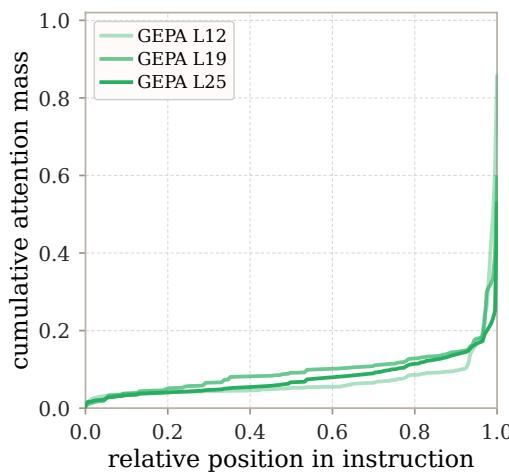

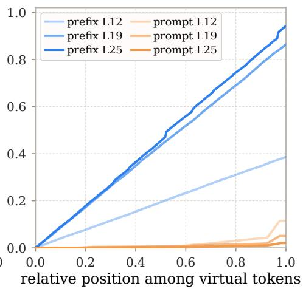  
Figure 6: Representative access profiles for the adapted contexts. Curves show cumulative attention within the GEPA instruction (left) and learned continuous contexts (right) at selected blocks

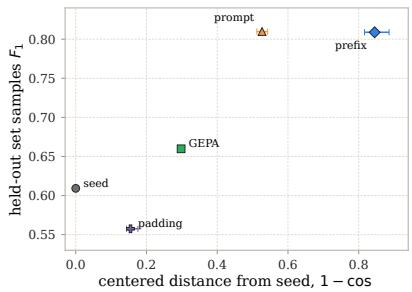  
(a) Movement does not order task quality.

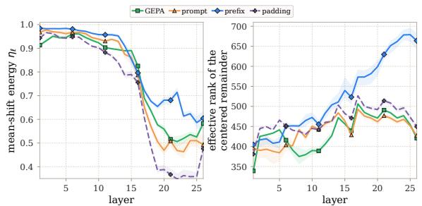  
(b) Mean energy and rank under adaptation and padding.  
Figure 7: A matched context placebo separates representation drift from task utility. Padding reproduces prominent geometric signatures without improving the task.

At layer 18, the centered remainder has efective rank between 476 and 573 across adaptation methods, compared with 500 for padding (Figure 7b). Both the large mean component and the broad remaining variation therefore occur under a context change that does not improve the task.

The pairwise mean can hide how shift directions vary across inputs. We retain this variation with

$$
\kappa _ { \ell } ^ { A , B } ( x ) = \frac { \langle \delta _ { \ell , \tau } ^ { A } ( x ) , \delta _ { \ell , \tau } ^ { B } ( x ) \rangle } { \| \delta _ { \ell , \tau } ^ { A } ( x ) \| _ { 2 } \| \delta _ { \ell , \tau } ^ { B } ( x ) \| _ { 2 } } .\tag{15}
$$

At block 25, mean per-example cosine is 0.011 for GEPA and prefix, 0.238 for prefix and prompt, and 0.327 for GEPA and prompt. The last pair has the broadest distribution (Figure 8). These means use the diagnostic adapters of Appendix B.2. Appendix C.4 reports the corresponding medians for the adapters of the predictor experiment.

Subtracting each condition’s dataset mean reduces its cosine similarity with the seed (Table 9). GEPA remains more aligned with the seed than either continuous method. Prefix tuning has the lowest centered cosine, 0.155, while padding remains much closer at 0.845.

Figure 7a compares this distance with task quality. Padding stays close to the seed but performs worse. GEPA improves while moving less than either continuous method. The geometric distance alone therefore does not identify a useful intervention.

$$
\mathrm { \_ p r e f i x - p r o m p t } \mathrm { - - G E P A - p r o m p t } \mathrm { - \cdot \cdot \cdot \ G E P A - p r e f i x }
$$

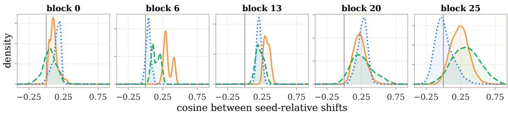  
Figure 8: Per-example cosine between seed-relative shifts from two adaptation methods. Each panel pools 1000 fixed examples. Early-layer shifts have small norms, so their directions are less stable.

Table 9: Mean per-example cosine similarity with the seed-prompt residual at layer 18 over three seeds. Centered states have their dataset mean removed.
<table><tr><td>condition</td><td>raw</td><td>centered</td></tr><tr><td>GEPA</td><td>0.902</td><td>0.702</td></tr><tr><td>prompt tuning (m = 500)</td><td>0.830</td><td>0.473</td></tr><tr><td>prefix tuning  $( m = 5 0 0 )$ </td><td>0.497</td><td>0.155</td></tr><tr><td> $C _ { \mathrm { p a d } }$ </td><td>0.961</td><td>0.845</td></tr></table>

## B.6 SAE Fidelity and Cross-Method State Patching

We apply Gemma Scope SAEs [Lieberum et al., 2024] to residual states at real token positions. Learned input embeddings and prefix keys and values do not share these residual coordinates. On 500 test examples, replacing one selected state by its SAE reconstruction changes samples- ${ \bf \nabla } \cdot F _ { 1 }$ by at most 0.014. Output agreement, averaged over ten evaluated layers, ranges from 0.873 to 0.975 across the evaluated conditions. This checks the reconstruction’s behavioral fidelity before using it to represent a displacement.

We also measure how well the SAE reconstructs the displacement itself. For method � relative to the seed, the dense displacement, decoded displacement and recovered energy are

$$
\begin{array} { r l } & { \delta _ { \ell , \tau } ^ { M } ( x ) = h _ { \ell , \tau } ^ { M } ( x ) - h _ { \ell , \tau } ^ { 0 } ( x ) , } \\ & { \widehat { \delta } _ { \ell , \tau } ^ { M } ( x ) = \mathrm { D e c } _ { \ell } \left( \mathrm { E n c } _ { \ell } ( h _ { \ell , \tau } ^ { M } ( x ) ) \right) - \mathrm { D e c } _ { \ell } \left( \mathrm { E n c } _ { \ell } ( h _ { \ell , \tau } ^ { 0 } ( x ) ) \right) , } \\ & { \quad \quad \quad q _ { \ell } ^ { M } = 1 - \displaystyle \frac { \sum _ { x } \| \delta _ { \ell , \tau } ^ { M } ( x ) - \widehat { \delta } _ { \ell , \tau } ^ { M } ( x ) \| _ { 2 } ^ { 2 } } { \sum _ { x } \| \delta _ { \ell , \tau } ^ { M } ( x ) \| _ { 2 } ^ { 2 } } . } \end{array}\tag{16}
$$

In the matched $n = 1 0 0 0 , m = 2 0$ comparison, $q _ { 2 5 }$ is 0.421 for prompt tuning, 0.582 for prefix tuning and 0.616 for GEPA. Recovered energy can be negative in early layers, where reconstruction error exceeds the energy of the displacement. We therefore restrict this analysis in SAE coordinates to late layers. Recovered energy measures state reconstruction, while the following intervention measures transfer of the output distribution.

The following state-transfer experiment uses a separate adapter set: continuous adapters trained with $n =$ 20000, $m = 2 0$ and GEPA prompts trained with $n = 1 0 0 0$ , rather than the matched set used for recovered energy above. For a source condition � and a target condition �, the exact patch adds $h _ { \ell , \tau } ^ { T } ( x ) - h _ { \ell , \tau } ^ { S } ( x )$ to the source state, as defined in the main text. Its SAE counterpart is

$$
\widehat { \delta } _ { \ell , \tau } ^ { \mathrm { S } \to T } ( x ) = \mathrm { D e c } _ { \ell } \Big ( \mathrm { E n c } _ { \ell } \big ( h _ { \ell , \tau } ^ { T } ( x ) \big ) \Big ) - \mathrm { D e c } _ { \ell } \Big ( \mathrm { E n c } _ { \ell } \big ( h _ { \ell , \tau } ^ { S } ( x ) \big ) \Big ) .\tag{17}
$$

The patch is applied at the final non-padding prompt position, and the remaining source blocks run unchanged [Zhang and Nanda, 2024]. It therefore concerns the first output distribution, before either model has generated an answer. We report the fraction of the next-token KL gap closed by each patch using $R _ { \mathrm { K I } }$ from (3). The bidirectional GEPA/prompt comparison recovers $0 . 9 1 7 \pm 0 . 0 4 9$ with exact states and $0 . 8 6 8 \pm 0 . 0 1 2$ through the SAE. The corresponding GEPA/prefix values are $0 . 8 3 2 \pm 0 . 0 5 6$ and $0 . 7 0 8 \pm 0 . 0 8 4$ . They describe state transfer between the selected models, rather than a controlled estimate of adaptation-method efects.

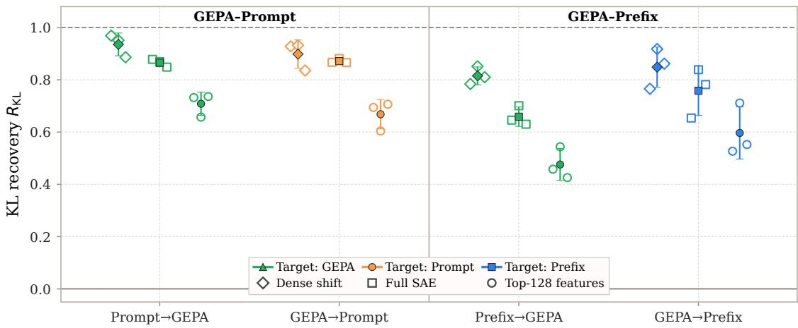  
Figure 9: Exact-state, SAE-reconstructed, and Top-128 feature transfer. The Top-128 subset is selected by displacement magnitude on disjoint calibration examples.

Selecting the 128 most changed SAE features on 32 disjoint calibration examples recovers 0.688 of the GEPA/prompt gap and 0.536 of the GEPA/prefix gap. This feature subset is selected by change magnitude. Its transfer score does not identify the semantics of the selected features (Figure 9).

## C Shift Predictor Details

## C.1 MSE and MSE+KL on 3000 Test Examples

The new evaluation compares state MSE with MSE plus an output KL term at the final block, in two regimes. Repredict computes a new shift at each generated position. Fixed computes one shift at the generation anchor and reuses it. Fixed-regime details and a low-rank ablation are in Appendix C.2. Appendix C.5 reports an earlier experiment with additional SAE losses. The manual seed-model samples-� on these 3000 examples is 0.617. Block 25 is the final transformer block.

Design and objective. We evaluate 36 runs spanning two regimes, three adaptation targets, two objectives, and seeds 42, 43, 44. Each predictor is an afine map with 5,310,720 parameters. Training pairs come from the adapted model’s own greedy answers, on which both the seed and the adapted model are run. All runs use the same 3000 test examples. Reported dispersion is sample standard deviation across the three seeds.

The configured predictor splits contain 4096 training and 256 validation examples. These selections and the test share no IDs or exact texts with one another or with the adaptation optimizer pools. The state-only objective is

$$
\mathcal { L } _ { \mathrm { s t a t e } } ^ { M } = \mathbb { E } _ { ( x , t ) } \left[ \frac { 1 } { d } \left\| f _ { \phi } ^ { M } ( h _ { L , t } ^ { 0 } ) - \delta _ { L , t } ^ { M } ( x ) \right\| _ { 2 } ^ { 2 } \right] .\tag{18}
$$

Each active objective term is normalized by its value for the training mean-shift baseline. With

$$
\mathcal { L } _ { \mathrm { K L } } ^ { M } = \mathbb { E } _ { ( x , t ) } \mathrm { K L } \Big ( p ( h _ { L , t } ^ { M } ) \Big | \Big | p \big ( h _ { L , t } ^ { 0 } + f _ { \phi } ^ { M } ( h _ { L , t } ^ { 0 } ) \big ) \Big ) ,\tag{19}
$$

where $p ( h )$ applies the frozen final normalization and output head, including the model’s logit soft-capping, followed by a softmax, the combined objective is

$$
\mathcal { L } _ { \mathrm { M S E + K L } } = \frac { \mathcal { L } _ { \mathrm { s t a t e } } ^ { M } } { s _ { \mathrm { s t a t e } } } + \frac { \mathcal { L } _ { \mathrm { K L } } ^ { M } } { s _ { \mathrm { K L } } } .\tag{20}
$$

Table 10: Predicted final-state corrections at block 25 during free generation on 3000 test examples. Entries are mean and sample SD over adaptation seeds 42, 43, 44. Native denotes the adapted model. This predictor suite reports a separately evaluated seed baseline of 0.617; the performance sweep in Table 7 reports 0.6092, so we report raw scores rather than combine the two baselines. Target adapters use $n = 1 0 0 0 .$ , with $m = 2 0$ virtual tokens for the continuous methods. The score is empty-aware set samples-� , with invalid outputs assigned zero.
<table><tr><td></td><td></td><td colspan="2">Repredict</td><td colspan="2">Fixed</td></tr><tr><td>Target</td><td>Native</td><td>MSE</td><td>MSE+KL</td><td>MSE</td><td>MSE+KL</td></tr><tr><td>GEPA</td><td> $0 . 6 7 8 \pm . 0 0 7$ </td><td> $0 . 6 8 3 \pm . 0 1 5$ </td><td> $0 . 6 8 1 \pm . 0 1 2$ </td><td> $0 . 6 3 8 \pm . 0 0 8$ </td><td> $0 . 6 8 3 \pm . 0 1 1$ </td></tr><tr><td>Prompt</td><td> $0 . 7 7 7 \pm . 0 1 3$ </td><td> $0 . 7 4 6 \pm . 0 0 1$ </td><td> $0 . 7 5 9 \pm . 0 0 6$ </td><td> $0 . 6 3 7 \pm . 0 1 5$ </td><td> $0 . 7 5 6 \pm . 0 0 3$ </td></tr><tr><td>Prefix</td><td> $0 . 8 0 5 \pm . 0 0 7$ </td><td> $0 . 7 4 4 \pm . 0 0 4$ </td><td> $0 . 7 6 5 \pm . 0 0 6$ </td><td> $0 . 5 0 6 \pm . 1 2 1$ </td><td> $0 . 7 5 5 \pm . 0 0 7$ </td></tr></table>

Neither objective uses SAE features.

The MSE-only runs select the last checkpoint at step 800. The reported values therefore characterize the training budget used here, without establishing convergence.

Metric. We report empty-aware set samples-�1, assigning zero to invalid outputs. The parser accepts commaseparated allowed labels, ignores their order and removes duplicates. It accepts NONE for an empty prediction. A valid empty prediction against an empty gold set receives one. Like the set parser of Table 7, this metric ignores label order. Unlike that parser, it scores an unparseable answer zero instead of treating it as an empty prediction. The continuous adapters here use $m = 2 0$ virtual tokens, whereas the continuous entries of Table 7 average over � ∈ {100, 200, 500}.

Constant-shift control. For an afine predictor $W h + b$ , initialization at $W = 0$ and the train mean shift does not establish that the learned gain comes from �ℎ, since � can also change. We therefore train a bias-only predictor at block 25 with the MSE+KL objective and evaluate it in the repredict regime on the same 3000 test examples. It reaches $0 . 6 3 3 \pm . 0 0 5 , 0 . 6 0 4 \pm . 0 0 6$ and $0 . 5 4 3 \pm . 0 5 7$ for GEPA, prompt and prefix, against $0 . 6 8 1 \pm . 0 1 2 , 0 . 7 5 9 \pm . 0 0 6$ and $0 . 7 6 5 \pm . 0 0 6$ for the afine map. Its invalid-answer rates are 1.6%, 6.0% and 18.4%. For prompt and prefix tuning the constant shift stays below the seed score of 0.617, so their recovered gains come from the input-dependent term. The low-rank sweep in Appendix C.2 tests the dimension of the input-dependent part.

## C.2 Fixed Regime and Predictor Rank

Fixed and repredict predictors are trained separately and have diferent learned matrices. At inference, a fixed predictor computes the shift once from the seed state at the generation anchor and adds it at every generated position. Scores therefore compare the resulting trained systems, rather than two inference modes of one fitted predictor. With MSE, the fixed regime leaves 1.9%, 6.8% and 30.9% of GEPA, prompt and prefix answers invalid, and the prefix score varies strongly across seeds. With MSE+KL these rates are 0.6%, 0.1% and 0.1% (Table 10).

The low-rank predictor is $f _ { \phi } ^ { M } ( h ) = U _ { M } V _ { M } ^ { \top } h + b _ { M }$ with $U _ { M } , V _ { M } \in \mathbb { R } ^ { d \times r }$ , initialized like the full predictor with the train mean shift as bias. Table 11 reports one training seed per cell at the final block, trained with MSE and evaluated in both regimes. The full-rank column repeats the seed-42 run of the same configuration. These values describe a single seed and carry no uncertainty estimate. Rank one restricts the input-dependent term to a single direction, giving 0.634, 0.596 and 0.677 for GEPA, prompt and prefix. This resembles the single-direction design of prompt steering replacement models [Heyman and Vandeputte, 2026], but our afine correction includes a vector bias and does not use their ReLU gate. It is a rank ablation of our predictor, not a reproduction of PSR.

Under repredict, the score increases with rank for every target, while rank 8 remains between 0.023 and 0.047 below the full map. Under the fixed regime the spread across ranks is at most 0.045, and the fixed prefix predictor stays far below the seed baseline at every rank.

Table 11: Task score by predictor rank, seed 42, MSE objective, 3000 test examples. The metric matches Table 10, and the manual baseline is 0.617. All predictors operate at block 25.
<table><tr><td>Regime</td><td>Target</td><td> $r = 1$ </td><td> $r = 2$ </td><td> $r = 4$ </td><td> $r = 8$ </td><td>full</td></tr><tr><td>Repredict</td><td>GEPA</td><td>0.634</td><td>0.640</td><td>0.645</td><td>0.660</td><td>0.683</td></tr><tr><td></td><td>Prompt</td><td>0.596</td><td>0.655</td><td>0.664</td><td>0.699</td><td>0.746</td></tr><tr><td></td><td>Prefix</td><td>0.677</td><td>0.683</td><td>0.688</td><td>0.700</td><td>0.741</td></tr><tr><td>Fixed</td><td>GEPA</td><td>0.635</td><td>0.635</td><td>0.636</td><td>0.640</td><td>0.641</td></tr><tr><td></td><td>Prompt</td><td>0.580</td><td>0.577</td><td>0.595</td><td>0.608</td><td>0.619</td></tr><tr><td></td><td>Prefix</td><td>0.353</td><td>0.346</td><td>0.371</td><td>0.391</td><td>0.389</td></tr></table>

## C.3 Early Exit

The early-exit model runs only blocks 0 to 20 of the seed-context model. After block 20 it forms

$$
\widehat { h } _ { 2 5 , t } ^ { M } = h _ { 2 0 , t } ^ { 0 } + f _ { \phi } ^ { M } ( h _ { 2 0 , t } ^ { 0 } )\tag{21}
$$

and applies the frozen final normalization and output head. Blocks 21 to 25 are not executed. The map $f _ { \phi } ^ { M }$ is a full-rank afine map with 5,310,720 parameters, trained with the MSE+KL objective of (20) with the adapted block-25 state as target. It is applied at the prompt and at every generated position, as in the repredict regime. Table 12 compares it with the block-25 corrections of Table 10 on the same 3000 test examples. Fitting the same map to the seed model’s own block-25 state gives 0.618, against 0.619 for the full seed model in the same evaluation (seed 42). For this task the last five blocks can thus be replaced by an afine map even without adaptation.

Table 12: Early exit from block 20 against the block-25 correction, 3000 test examples, mean and sample SD over seeds 42 43 44. The metric matches Table 10
<table><tr><td>Target</td><td>Native</td><td>Block-25 correction</td><td>Early exit</td></tr><tr><td>GEPA</td><td> $0 . 6 7 8 \pm . 0 0 7$ </td><td> $0 . 6 8 1 \pm . 0 1 2$ </td><td> $0 . 6 8 8 \pm . 0 1 1$ </td></tr><tr><td>Prompt</td><td> $0 . 7 7 7 \pm . 0 1 3$ </td><td> $0 . 7 5 9 \pm . 0 0 6$ </td><td> $0 . 7 6 6 \pm . 0 1 2$ </td></tr><tr><td>Prefix</td><td> $0 . 8 0 5 \pm . 0 0 7$ </td><td> $0 . 7 6 5 \pm . 0 0 6$ </td><td> $0 . 7 7 0 \pm . 0 1 2$ </td></tr></table>

Latency. We time generation on the first 100 test examples, batch size 16, one warm-up batch and two timed repeats, excluding model loading. Every condition decodes exactly 16 tokens, so the comparison does not depend on answer length. Table 13 reports the mean time per example. Early exit takes about 43 ms for all three targets, against 52.6 ms for the full seed model, a 1.22× speedup close to the share of skipped blocks. The speedup over native prompt and prefix tuning is 1.28× and 1.26×. Native GEPA is 7.1× slower than early exit, mostly because its instruction has 1684 prompt tokens per example against 158 for the seed. This timing run is separate from the quality evaluation and uses a single seed.

Table 13: Time per example with 16 generated tokens, 100 test examples, batch size 16, mean over two repeats.
<table><tr><td>Condition</td><td>Native (ms)</td><td>Early exit (ms)</td></tr><tr><td>Seed</td><td>52.6</td><td></td></tr><tr><td>GEPA</td><td>303.7</td><td>43.0</td></tr><tr><td>Prompt</td><td>55.3</td><td>43.0</td></tr><tr><td>Prefix</td><td>54.3</td><td>43.1</td></tr></table>

## C.4 Geometry of the Learned Corrections

We compare the full-rank repredict predictors across methods. For two predictors we compute the cosine between their flattened matrices $W _ { M }$ . Cross-method entries pair predictors with the same seed and average over seeds 42, 43, 44. Within-method entries average over the three seed pairs of one method.

Table 14: Cosine between flattened block-25 predictor matrices $W _ { M }$ (repredict, full rank).
<table><tr><td>Pair</td><td>MSE MSE+KL</td></tr><tr><td>GEPA, prompt 0.32</td><td>0.29</td></tr><tr><td>GEPA, prefix 0.27</td><td>0.24</td></tr><tr><td>Prompt, prefix 0.49</td><td>0.57</td></tr><tr><td>GEPA seeds</td><td>0.72 0.67</td></tr><tr><td>Prompt seeds 0.67</td><td>0.76</td></tr><tr><td>Prefix seeds 0.61</td><td>0.68</td></tr></table>

The sample-level analysis uses block 25, MSE and seed 42, the configuration for which trajectory caches are available. The repredict predictions have mean cosines of 0.935, 0.942 and 0.909 with the true shifts for GEPA, prompt and prefix tuning. On the first generated token, the median cosine between true shifts of two methods is 0.18, 0.20 and 0.46 for the pairs in Table 14, and the predicted shifts reproduce these values within 0.05. Later tokens are generated from diferent histories under diferent methods, and the continuous methods produce only three to four tokens, so the comparison is restricted to the first steps.

The mean direction carries 58.6%, 58.9% and 51.5% of the shift energy for GEPA, prompt and prefix tuning, the fraction $\eta _ { \ell }$ defined in (12). The mean directions of diferent methods have cosines of 0.09, 0.13 and 0.38. In the repredict predictors, the input-dependent term $W _ { M } h$ has mean norms of 180, 264 and 315, against bias norms of 157, 212 and 365. These norm comparisons do not establish that the bias or input-dependent term is suficient on its own.

## C.5 Earlier Composite-Loss Experiment

Before the MSE ablation, we trained predictors with a composite loss that includes SAE terms and evaluated them on 512 held-out examples.

Data and predictors. For each adapted model and seed, teacher-forced trajectories of the native answer pair the seed-model state $h _ { 2 5 , t } ^ { 0 }$ with the adapted state $h _ { 2 5 , i } ^ { M }$ at the same position. Training uses 4096 trajectories and validation 256. Evaluation uses 512 held-out examples and three adaptation seeds. Generation is greedy with at most 64 new tokens. The seed-model samples- $F _ { 1 }$ is 0.624.

The afine predictor is $f _ { \phi } ( h ) = W h + b$ , initialized with � = 0 and � equal to the training mean shift. The second predictor is a GELU MLP with hidden width 4608. Their parameter counts are approximately 5.3M and 21M, respectively. Neither is a small linear probe.

Application modes. Let � be the generation anchor. One-shot predicts the shift from $h _ { 2 5 , \cdot } ^ { 0 }$ and applies it only at the anchor. Fixed predicts from the same state and reuses that vector at each decoded position. Repredict computes a new shift from the current state at each step. Both fixed and repredict are input-dependent. Their scores compare corrections reused across positions with corrections recomputed at each position. They do not test whether conditioning on the example is necessary.

Objective. The earlier loss is

$$
\mathcal { L } = \frac { \mathcal { L } _ { \mathrm { D E N S E } } } { s _ { \mathrm { D E N S E } } } + \frac { \mathcal { L } _ { \mathrm { E N C } } } { s _ { \mathrm { E N C } } } + \frac { \mathcal { L } _ { \mathrm { D E C } } } { s _ { \mathrm { D E C } } } + \frac { \mathcal { L } _ { \mathrm { K L } } } { s _ { \mathrm { K L } } } ,\tag{22}
$$

where $\mathcal { L } _ { \mathrm { D E N S E } }$ is state MSE, and $\mathcal { L } _ { \mathrm { E N C } }$ and $\mathcal { L } _ { \mathrm { D E C } }$ are the corresponding errors in the encoder and decoder space of a Gemma Scope layer-25 SAE with 16k latents. The KL term compares adapted and patched output distributions through the frozen final norm, unembedding and logit soft-capping, with the adapted distribution as its first argument. Each $s _ { k }$ is the value of that term for the mean-shift baseline on the training split. All trajectory positions enter the loss. In one-shot training only the anchor receives a gradient, so objective values are not comparable with the recurrent regimes. Checkpoints are selected by validation objective.

In this earlier experiment, recurrent scores are higher than one-shot scores (Table 15). The largest diference between afine and MLP predictors in a recurrent cell is 0.018. The largest fixed-versus-repredict diference is

Table 15: Strict samples- $\cdot F _ { 1 }$ of the seed model patched at block 25 with a predicted shift, mean ± SD over three adaptation seeds on the same 512 test examples. Native is the adapted model itself. The seed model scores 0.624.
<table><tr><td>Method</td><td>Predictor</td><td>Native</td><td>One-shot</td><td>Fixed</td><td>Repredict</td></tr><tr><td rowspan="2">GEPA</td><td>Linear</td><td rowspan="2"> $0 . 6 8 4 \pm . 0 0 4$ </td><td> $0 . 6 4 1 \pm . 0 0 9$ </td><td> $0 . 6 9 4 \pm . 0 0 7$ </td><td> $0 . 6 9 0 \pm . 0 0 8$ </td></tr><tr><td>MLP</td><td> $0 . 6 3 0 \pm . 0 0 9$ </td><td> $0 . 6 9 5 \pm . 0 1 8$ </td><td> $0 . 6 9 2 \pm . 0 0 9$ </td></tr><tr><td rowspan="2">Prompt</td><td>Linear</td><td rowspan="2"> $0 . 8 3 8 \pm . 0 0 4$ </td><td> $0 . 6 6 3 \pm . 0 0 4$ </td><td> $0 . 7 2 9 \pm . 0 1 2$ </td><td> $0 . 7 6 1 \pm . 0 1 0$ </td></tr><tr><td>MLP</td><td> $0 . 6 4 8 \pm . 0 0 5$ </td><td> $0 . 7 4 7 \pm . 0 0 5$ </td><td> $0 . 7 4 4 \pm . 0 0 9$ </td></tr><tr><td rowspan="2">Prefix</td><td>Linear</td><td rowspan="2"> $0 . 8 5 1 \pm . 0 0 6$ </td><td> $0 . 6 5 7 \pm . 0 0 7$ </td><td> $0 . 7 5 5 \pm . 0 0 5$ </td><td> $0 . 7 6 5 \pm . 0 0 7$ </td></tr><tr><td>MLP</td><td> $0 . 6 3 7 \pm . 0 0 9$ </td><td> $0 . 7 5 7 \pm . 0 0 4$ </td><td> $0 . 7 5 4 \pm . 0 1 1$ </td></tr></table>

0.032. These observed diferences do not establish equivalence. The MSE results in Table 10 show that transfer is possible without SAE supervision.

## C.6 Recurrent Mean Shift

For prefix tuning, we add the dataset-mean shift at every decoded position on 500 intervention-validation examples, choosing its layer and scale on the same examples. With the selected configuration, samples- $F _ { 1 }$ rises from 0.606 to 0.620, 0.625 and 0.627 for seeds 42, 43 and 44, while the adapted prefix models score 0.818, 0.800 and 0.811. This recovers 6.7%, 10.0% and 10.0% of the prefix gain.

At block 25, adding the raw train mean with scale one lowers task score below the seed for all six tested adapted models.

## D GEPA Prompt Examples

Inspection of the frozen instructions in the GEPA sweep found that examples from GEPA’s validation data were sometimes copied directly into the prompt. This observation concerns the optimizer’s validation examples, not evidence of overlap with the held-out test set. Below is the full � = 200 instruction reproduced in the workshop draft, with identity terms in the quoted comments masked by asterisks. The quoted instruction is preserved verbatim.

## GEPA with $n = 2 0 0 .$

Classify the supplied text for abusive or harmful language. Determine every label supported by the text itself, using context and the actual target. Do not infer intent or add labels merely because a statement is political, controversial, negative, or mentions a protected group.

Apply labels independently:

• toxicity: Use for hostile, contemptuous, demeaning, strongly antagonistic, or abusive rhetoric. This is the broad label for toxic language and often co-occurs with insult. Sarcasm, ridicule, dismissive mockery, and hostile political rhetoric can be toxic even without profanity, a threat, or a protected-identity target.

• obscene: Use only for profanity, vulgarity, sexually explicit language, or clearly obscene wording. Rudeness, political aggression, or a non-obscene mention of sex or identity is not enough.

• threat: Use only when the text expresses, warns of, or explicitly advocates violence, harm, or other serious retaliation against a person or group. Do not infer a threat from anger, condemnation, predictions of punishment, saying someone deserves to sufer, proposing legal consequences, or hostile language without an actual intention or warning of harm.

• insult: Use for a direct or clearly implied derogatory characterization of a person, group, audience, institution, or their conduct, including name-calling, belittling comparisons, ridicule, or commands to leave. Words such as “stupid,” “ridiculous,” “childish,” “incompetent,” “over his head,” “do nothing,” or similar contemptuous descriptions can qualify when directed at a person, group, argument, or institution. A hostile political characterization can therefore receive both toxicity and insult. Mere disagreement, factual criticism, or a negative policy assessment without belittling language is not automatically an insult.

• identity\_attack: Use only when hostility, degradation, exclusion, dehumanization, or denial of equal acceptance/treatment is directed at a protected identity or explicitly because of that identity (for example race, ethnicity, nationality, religion, sex, gender identity, or sexual orientation). Mentioning an identity, discussing discrimination, or criticizing beliefs, conduct, institutions, or policies is not by itself an identity attack. Calling someone “\*\*\*\*\*\*,” “\*\*\*\*-\*\*\*\*\*\*\*,” or similar is generally an accusation about conduct or beliefs, not an attack on the person’s protected identity. Political afiliation and ideological disagreement are not protected-identity attacks.

## Decision guidance:

1. Judge the wording and target, not whether the underlying political or factual claim is correct.

2. Broad or indirect hostile rhetoric can still be toxic. Political mockery aimed at a politician, party, legislature, or audience is not exempt.

3. Use insult when the wording belittles or ridicules a discernible target. An insult may target an argument or institution as well as an individual.

4. Toxicity and insult commonly apply together when contemptuous language is used. Toxicity may apply without insult when the hostility is general or lacks a clear derogatory characterization.

5. Do not label threat unless there is an actual threat, explicit call for harm, or expressed intention/warning of serious retaliation.

6. Do not label identity\_attack merely because protected-category terms appear, or because the text accuses someone of prejudice.

7. Do not overread mild sarcasm, institutional criticism, or a hypothetical policy proposal as abuse when it contains no clearly degrading or hostile characterization of a target.

## Calibration:

• “Stupid publicity stunt by another do nothing legislature.” → toxicity and insult: “stupid” and “do nothing” are contemptuous characterizations of the legislature.

• “The idea ... is ridiculous. Anyone who uses this fallacious argument makes themselves look stupid.” → toxicity and insult: the argument and its users are belittled.

• “I would have thought that a new Brian Mulroney wing at a federal penitentiary (for wayward politicians) ... would be more appropriate. I’m certain that it would fill up fast.” → no labels: sarcastic political commentary/hypothetical institutional criticism, without suficiently direct abusive language under this task’s calibration.

• “There is no scientific evidence ... That is to be expected since there is none.” → no labels: criticism or assertion without abusive language.

• “Trump is in way over his head ... his childish bluster.” → toxicity and insult: direct political mockery and belittling characterization.

• “As long as you’re a \*\*\*\*\*\* ... He deserves to sufer and no jury would deny him that.” → toxicity only unless other wording independently supplies a label: “\*\*\*\*\*\*” is an accusation, and wishing or predicting sufering/legal punishment is not by itself a threat.

• “BDS ... \*\*\*\*-\*\*\*\*\*\*\* and \*\*\*\*\*\* ... crawl back in your cave.” → toxicity and insult; the accusations alone are not identity\_attack, while “crawl back in your cave” is an insulting command.

Return only the labels selected by the fixed output contract; if none apply, return NONE. Never provide an explanation.

## E Mixture of experts

## E.1 Setup in full

Data and metric. Civil Comments [Borkan et al., 2019], formulated as a multi-label choice among toxicity, obscene, threat, insult and identity attack, scored by set-level $F _ { 1 }$ averaged over rows. Two samples of 2000 test rows are used, which share 1993 rows: the frequency-pruning tables use one, in which 660 rows carry no label, and the super-expert, router and route-replay evaluations the other, with 656. A model that answers nothing scores 0.330 on the first and 0.328 on the second. These floors are quoted throughout, and any cell sitting on one is a cell whose answers must be read before its score is used.

Routing maps. Logged on 500 validation rows, disjoint from the test set, so that the mask built from a map is never selected on the data it is evaluated on. Counts are kept per layer, per expert and per stage of the sequence: chat template and instruction, comment, virtual tokens, reasoning and answer. Figure 4 and the displacement numbers of Section 4.1 use the comment stage, the only one every arm shares.

Load statistics. For layer $\ell , u _ { \ell , e } ( \tilde { u } _ { \ell , e }$ for an adapted arm) is the share of the layer’s top-� assignments that expert � receives, summed over the 500 calibration rows and over prefill and decoding. The Gini coeficient is taken over all $n _ { E }$ shares of the layer, experts with no assignment included. The busiest expert’s share is $\operatorname* { m a x } _ { e } u _ { \ell , e } ,$ and the routing displacement of an adapted arm in layer ℓ is given in (6). A dead expert is one that receives no assignment in the layer over all 500 rows. Table 3 reports the median over layers for the Gini and the busiest share and the mean over layers for the number of dead experts.

Depth profile of the displacement. Averaged over the first and the last quarter of the layers, TVℓ falls from 0.11–0.17 to 0.05–0.08 for both continuous methods on Qwen and from 0.09–0.11 to 0.06 for prompt tuning on gpt-oss, at all three budgets. GEPA stays between 0.03 and 0.04 at every depth on Qwen, but on gpt-oss it grows from 0.03 in the first quarter to 0.07 in the last, slightly above prompt tuning there. The gpt-oss prefix rises from 0.10–0.15 to 0.23–0.28. The odd layers of gpt-oss use dense attention and the even ones a 128-token band; the prefix displaces the dense layers by 0.18–0.19 on average against 0.12–0.13 for the banded ones, whereas prompt tuning (0.09–0.10 against 0.08–0.10) and GEPA (0.05 for both) do not separate them. In the last quarter, the prefix displacement $\tilde { u } _ { \ell } - u _ { \ell }$ has cosine 0.45–0.61 with the base’s shift from comment to reasoning tokens, $u _ { \ell } ^ { \mathrm { r e a s o n i n g } } - u _ { \ell }$ , and 0.35–0.44 with its shift to answer tokens, both taken from the stage-resolved maps. For prompt tuning and GEPA these cosines lie between −0.16 and 0.16, so only the prefix moves the late layers toward the experts the base uses for generated text.

Decoding. Greedy on both backbones, no temperature and no nucleus sampling, so a diference between two arms cannot be sampling noise. The frequency-pruning runs in Tables 5 and 16, their unpruned level included, use at most 512 generated tokens on Qwen and 1024 on gpt-oss. The super-expert-only column uses 64 tokens on Qwen and 1024 on gpt-oss (Section E.3). Every gpt-oss arm runs at reasoning efort low; the base and GEPA reason, and the continuous arms answer directly (Section 4.2).

Arms. GEPA optimises the instruction text. Prompt tuning learns virtual tokens at the embedding. Prefix tuning learns per-layer key and value prefixes. The virtual token budgets are 100, 200 and 500 for both continuous methods, and all checkpoints share seed 42. Every pruning run checks that its adapter’s hash equals the one recorded in the arm’s routing map; for Qwen prefix-500 this is the checkpoint at step 1125.

## E.2 Complete pruning results

Table 16 lists every level of the sweep. The rows marked “SE kept” repeat the −50% mask of the two Qwen arms that collapse there, with the super experts exempted and the same number of other experts removed instead; the removed routing mass is approximately unchanged. The masks are cut from maps rendered at the map harness’s default reasoning efort, medium, while every score uses efort low. The gpt-oss GEPA −75% cell sits on this choice: under the medium-efort map, expert 5 of layer 6 is the 26th least used of its layer and is kept, and $F _ { 1 }$ is 0.422 with 36 percent of the answers readable. A mask cut from a low-efort map of the same arm difers in 14 of 576 experts and removes this expert as the 24th least used.

## E.3 Super experts

Identification. We use the criterion of Su et al. [2026]: over the first three quarters of the layers, an expert qualifies when the largest absolute output of its down-projection exceeds the 99.5th percentile over all experts and a tenth of the overall maximum, on 32 WikiText-2 segments of 2048 tokens. The statistic has to be taken inside the fused expert computation of the runtime used here, where a hook on per-expert modules records nothing. On Qwen3-30B-A3B the criterion returns the published set, expert 92 of layer 2, 68 of layer 1 and 82 of layer 3 (732, 456 and 428), and on the Instruct-2507 checkpoint the same three (840, 468 and 466). On gpt-oss-20b it returns expert 5 of layer 17 and expert 5 of layer 6 (54,272 and 43,008). All reach their maximum on the first position of a raw-text segment; under the chat template the Qwen experts reach it on position 1, the role token, in all 232 inputs checked, whatever the content.

Table 16: Frequency pruning, all levels. Mass is the routing mass removed, averaged over layers. Empty (answers with no label, unreadable ones included), unreadable and no end marker are shares of the 2000 test answers, looping (a phrase repeated until the budget runs out) of the first 300. Pruned runs use 512 generated tokens on Qwen and 1024 on gpt-oss (reasoning efort low on every arm).
<table><tr><td>model</td><td>arm</td><td>level (%)</td><td>mass (%)</td><td> $F _ { 1 }$ </td><td>exact</td><td>empty</td><td>unreadable</td><td>no end</td><td>looping</td></tr><tr><td rowspan="12">Qwen</td><td>base</td><td>0</td><td>0.0</td><td>0.466</td><td>0.211</td><td>26.5</td><td>0.0</td><td>0.0</td><td>0.0</td></tr><tr><td>base</td><td>-50</td><td>5.8</td><td>0.575</td><td>0.167</td><td>21.1</td><td>0.0</td><td>0.1</td><td>0.0</td></tr><tr><td>base</td><td>-75</td><td>28.3</td><td>0.330</td><td>0.330</td><td>100.0</td><td>100.0</td><td>61.9</td><td>21.7</td></tr><tr><td>GEPA</td><td>-50</td><td>2.0</td><td>0.728</td><td>0.583</td><td>24.1</td><td>0.0</td><td>0.0</td><td>0.0</td></tr><tr><td>GEPA</td><td>-75</td><td>17.8</td><td>0.330</td><td>0.330</td><td>100.0</td><td>100.0</td><td>100.0</td><td>94.7</td></tr><tr><td>prompt, 100 -50 -75</td><td></td><td>11.4</td><td>0.814</td><td>0.696</td><td>31.8</td><td>0.0</td><td>0.0</td><td>0.0</td></tr><tr><td>prompt, 100 prompt, 200 -50</td><td></td><td>35.7</td><td>0.440</td><td>0.026</td><td>3.0</td><td>0.2</td><td>29.1</td><td>28.7</td></tr><tr><td>prompt, 200</td><td>–50, SE kept</td><td>10.9</td><td>0.330</td><td>0.330</td><td>100.0</td><td>100.0</td><td>90.5</td><td>59.3</td></tr><tr><td>prompt, 200</td><td></td><td>11.0</td><td>0.803</td><td>0.683</td><td>27.2</td><td>0.0</td><td>0.0</td><td>0.0</td></tr><tr><td></td><td>-75</td><td>32.8</td><td>0.330</td><td>0.330</td><td>100.0</td><td>100.0</td><td>93.8</td><td>6.3</td></tr><tr><td>prompt, 500</td><td>-50</td><td>12.3</td><td>0.812</td><td>0.692</td><td>31.1</td><td>0.0</td><td>0.0</td><td>0.0</td></tr><tr><td>prompt, 500</td><td>-75</td><td>32.3</td><td>0.450</td><td>0.389</td><td>83.9</td><td>0.0</td><td>0.0</td><td>0.0</td></tr><tr><td>prefix, 100</td><td>-50</td><td>5.9</td><td>0.815</td><td>0.714</td><td>36.7</td><td>0.0</td><td>0.0</td><td>0.0</td></tr><tr><td>prefix, 100</td><td>-75</td><td>27.7</td><td>0.383</td><td>0.368</td><td>93.1</td><td>0.3</td><td>0.0</td><td>0.0</td></tr><tr><td>prefix, 200</td><td>-50</td><td>6.0</td><td>0.611</td><td>0.557</td><td>67.2</td><td>0.0</td><td>0.0</td><td>0.0</td></tr><tr><td>prefix, 200</td><td>-75</td><td>28.0</td><td>0.330</td><td>0.330</td><td>100.0</td><td>100.0</td><td>100.0</td><td>18.0</td></tr><tr><td>prefix, 500</td><td>-50</td><td>5.5</td><td>0.330</td><td>0.330</td><td>100.0</td><td>100.0</td><td>96.8</td><td>85.3</td></tr><tr><td>prefix, 500 prefix, 500</td><td>–50, SE kept -75</td><td>5.5 27.7</td><td>0.768 0.330</td><td>0.654 0.330</td><td>43.0</td><td>0.0 100.0</td><td>0.0 99.8</td><td>0.0</td></tr><tr><td rowspan="14">gpt-oss</td><td>base</td><td></td><td></td><td></td><td></td><td>100.0</td><td></td><td></td><td>15.0</td></tr><tr><td></td><td>-50</td><td>13.3</td><td>0.565</td><td>0.422</td><td>59.4</td><td>19.6</td><td>1.3</td><td>4.7</td></tr><tr><td>base GEPA</td><td>-75</td><td>39.8</td><td>0.388</td><td>0.309</td><td>76.3</td><td>34.5</td><td>24.1</td><td>31.3</td></tr><tr><td>GEPA</td><td>-50 -75</td><td>10.3</td><td>0.746</td><td>0.616</td><td>36.5</td><td>0.3</td><td>0.2 44.2</td><td>3.7</td></tr><tr><td>prompt, 100</td><td>-50</td><td>33.7</td><td>0.422</td><td>0.374 0.338</td><td>87.4</td><td>64.4 42.4</td><td>41.5</td><td>65.0</td></tr><tr><td>prompt, 100</td><td>-75</td><td>12.2 33.6</td><td>0.502 0.330</td><td>0.325</td><td>62.9 98.3</td><td>98.2</td><td>49.6</td><td>63.7</td></tr><tr><td>prompt, 200</td><td>-50</td><td>10.4</td><td>0.584</td><td>0.449</td><td>58.5</td><td>26.2</td><td>26.2</td><td>55.3</td></tr><tr><td>prompt, 200</td><td>-75</td><td>29.7</td><td>0.343</td><td>0.326</td><td>95.7</td><td>84.3</td><td>84.1</td><td>35.3 96.7</td></tr><tr><td>prompt, 500</td><td>-50</td><td>9.1</td><td>0.607</td><td>0.401</td><td>49.0</td><td>14.3</td><td>14.2</td><td>32.0</td></tr><tr><td>prompt, 500</td><td>-75</td><td>25.5</td><td>0.334</td><td>0.323</td><td>97.2</td><td>96.8</td><td>96.7</td><td>96.0</td></tr><tr><td>prefix, 100</td><td>-50</td><td>9.5</td><td>0.736</td><td>0.655</td><td>50.9</td><td>0.0</td><td>0.0</td><td>0.0</td></tr><tr><td>prefix, 100</td><td>-75</td><td>32.6</td><td>0.528</td><td>0.450</td><td>75.7</td><td>0.9</td><td>0.0</td><td>0.0</td></tr><tr><td>prefix, 200</td><td>-50</td><td></td><td>0.793</td><td>0.677</td><td>36.6</td><td>0.0</td><td>0.0</td><td>0.0</td></tr><tr><td>prefix, 200</td><td></td><td>10.3</td><td></td><td></td><td></td><td></td><td></td><td></td></tr><tr><td>prefix, 500</td><td>-75 -50</td><td>34.6 9.8</td><td>0.486 0.797</td><td>0.332 0.673</td><td>69.0 39.0</td><td>3.0 0.0</td><td>0.0 0.0</td><td>1.0 0.0</td></tr><tr><td>prefix, 500</td><td>-75</td><td>31.7</td><td>0.405</td><td>0.381</td><td>91.0</td><td>1.1</td><td></td><td></td></tr><tr><td></td><td></td><td></td><td></td><td></td><td></td><td></td><td>0.0</td><td>0.0</td></tr></table>

Trafic and the frequency masks. Table 17 lists the super experts each mask removes, read from the applied masks for eight cells and recomputed from the calibration maps with the sweep’s rule for the other twenty-four; the recomputation reproduces all eight applied masks exactly. Qwen’s sit in the middle and the tail of their layers and are removed in every arm, expert 68 of layer 1 already at −50%. On gpt-oss, expert 5 of layer 17 is among the three busiest experts of its layer in every arm and is never removed, and expert 5 of layer 6 is removed in four of the sixteen cells, and also in GEPA’s −75% mask when its map is calibrated at reasoning efort low (Section E.2).

Magnitudes and pruning. The magnitude of a super expert is the largest absolute output of its down-projection over 200 Civil test rows. It counts as kept when that value stays within a factor of ten of the frozen base’s. The super experts are pruned alone by zeroing their down-projection, and the task is scored with at most 64 generated tokens on Qwen and 1024 on gpt-oss. As in the frequency sweep, an unreadable answer counts as an empty label set. The Qwen prefix trained at learning rate $1 0 ^ { - 4 }$ is an additional evaluated control, not the selected prefix-500 checkpoint in the frequency sweep; all three of its super-expert magnitudes are below 1. Seeds 43 and 44 of the same recipe, each at its own validation-selected checkpoint, keep all three: 440, 756 and 456, and 185, 680 and 452. Seeds 43 and 44 of prompt tuning at 500 tokens give 1248, 780, 528 and 584, 828, 520, against 1000, 952, 572 for seed 42, with their peaks on virtual tokens.

Table 17: Super experts removed by the frequency masks of Table 5.
<table><tr><td rowspan="2"></td><td colspan="2">Qwen3-30B-A3B</td><td rowspan="2">gpt-oss-20b</td></tr><tr><td>-50%</td><td>-75% -50%</td></tr><tr><td>base</td><td>L1 E68, L2 E92</td><td>all three</td><td></td></tr><tr><td>GEPA</td><td>L1 E68</td><td>all three</td><td></td></tr><tr><td>prompt, 100</td><td>L1 E68</td><td>L1 E68, L3 E82</td><td>L6E5</td></tr><tr><td>prompt, 200</td><td>L1 E68, L2 E92</td><td>L1 E68, L2 E92</td><td></td></tr><tr><td>prompt, 500</td><td>L1 E68</td><td>L1 E68, L2 E92</td><td></td></tr><tr><td>prefix, 100</td><td>L1 E68</td><td>L1 E68</td><td></td></tr><tr><td>prefix, 200</td><td>L1 E68, L2 E92</td><td>all three</td><td>L6E5 L6E5</td></tr><tr><td>prefix, 500</td><td>all three</td><td>all three</td><td>L6E5</td></tr></table>

Where the attention goes. Attention shares are taken from the eager attention weights, per head and query, and averaged over heads and over queries from position 3 on, since the first positions can attend only to themselves, over whole sequences of 200 test rows. Pruning zeroes the down-projections of the super experts, as in Table 5. gpt-oss returns its weights without the learned sink column, so the sink’s share is the weights’ deficit from one; its panels show the full-attention layers 7 to 17. On Qwen the super experts build the sink from the second layer on, once expert 68 has written the peak: pruning them leaves the first layer unchanged and sends nearly all of the sink’s attention to the rest of the sequence (Figure 5). Prompt tuning puts the peak on a virtual token and concentrates the attention on about twenty of its 500 virtual tokens. An untrained prefix already moves peak and sink to position 2, and the prefix trained at $1 0 ^ { - 4 }$ has neither, intact or pruned (Figure 10).

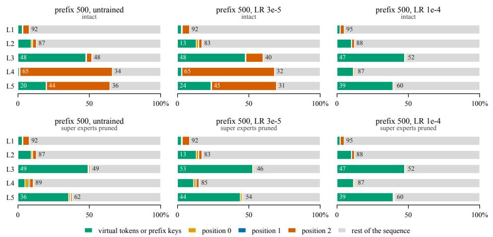  
Figure 10: As Figure 5, for a Qwen prefix of 500 tokens, untrained and trained at two learning rates.

Removing only the channel of expert 68’s output that carries the peak, on the first three positions, already takes two thirds of the sink’s share from layer 3 on, whereas a random perturbation of the same norm moves much less of the attention, on the test rows and on WikiText-2 (Figures 11 and 12).

On gpt-oss the peak at position 0 is written in layer 6, persists to layer 16 and collapses at layer 17, the layers of its two super experts. Essentially only its full-attention layers look at position 0, 12.5% of their attention on average between layers 7 and 17, while the learned sink takes 13 to 70 percent in every layer. Pruning the super experts removes the peak, and the attention on position 0 falls to 1.1%; of the 11.4 points it loses, 5.0 go to the learned sink and the rest to the sequence (Figure 13). This is consistent with the learned sink supplying the attention that has nowhere else to go [Sun et al., 2024, Gu et al., 2025], which on Qwen can only be placed on the peak’s token. gpt-oss nonetheless still builds the peak, which its sink logit, having no value vector, cannot replace [Queipo-de Llano et al., 2025]; the pruning results say only that this task and this text do not need it.

Across the gpt-oss arms, prefix keys take over part of the learned sink’s share in the first layers, whether the super experts survive or not (Figure 14).

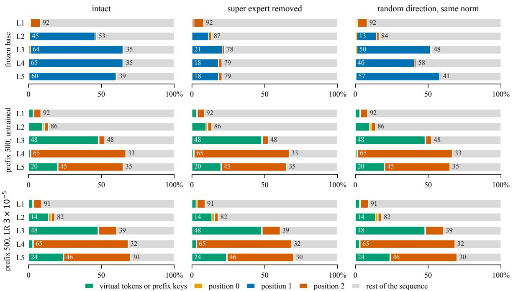  
Figure 11: Attention shares on Qwen, layers 1 to 5, 200 Civil test rows: intact, with the super expert removed, and with a random perturbation of the same norm.

Two prefixes, one score. The two Qwen prefixes of 500 tokens that difer only in the learning rate reach the same $F _ { 1 }$ , but one keeps a super expert and the other none. The one trained at $1 0 ^ { - 4 }$ has neither the peak nor the sink (Figure 10) and loses almost nothing when its super experts are pruned (0.807 intact, 0.803 pruned), but it damages the model most outside the task, through the prefix of its first six layers (Table 18). One method at one score can thus come with opposite dependence on the super experts. The learning rate does not decide it alone: two further seeds trained at $1 0 ^ { - 4 }$ keep all three super experts within a factor of three of the base’s magnitude (Section E.3).

Prefix damage outside the task. Removing the prefix from the first six layers alone, while it stays in the other 42, brings the WikiText-2 perplexity of every Qwen prefix of Figure 10 back close to the base’s, and the prefix trained at $1 0 ^ { - 4 }$ keeps most of its task gain (Table 18). The damage outside the task is carried by the early layers of the prefix, the task gain mostly by the later ones. The prefix trained at $3 \cdot 1 0 ^ { - 5 }$ loses its strict score mostly through unreadable answers, 43 and 32 percent of the 2000 with values zeroed and keys masked.

Table 18: Qwen prefixes of 500 tokens with the prefix of layers 0 to 5 removed, by zeroing its values or masking its keys, at every position. Perplexity on the 16 WikiText-2 segments of 2048 tokens, strict $F _ { 1 }$ on the 2000 test rows (the untrained prefix was not scored on them). The base scores 6.97 and 0.453.
<table><tr><td></td><td colspan="3">WikiText-2 perplexity</td><td colspan="3"> $F _ { 1 }$ </td></tr><tr><td>prefix</td><td>intact</td><td></td><td>values zeroed keys masked</td><td></td><td></td><td>intact values zeroed keys masked</td></tr><tr><td>untrained</td><td>48.0</td><td>7.22</td><td>6.87</td><td></td><td></td><td></td></tr><tr><td> $\mathrm { L R } 3 \cdot 1 0 ^ { - 5 }$ </td><td>34.0</td><td>7.48</td><td>7.16</td><td>0.807</td><td>0.412</td><td>0.509</td></tr><tr><td> $\mathrm { L R } 1 0 ^ { - 4 }$ </td><td>275</td><td>8.95</td><td>8.63</td><td>0.807</td><td>0.759</td><td>0.766</td></tr></table>

## E.4 Retraining the router

Only the router of Qwen3-30B-A3B is trained: the 48 gate matrices, $1 2 8 \times 2 0 4 8$ each and 12.6M parameters in total, with every expert, every adapter and all other weights frozen. Each arm is trained on its own 1000 training rows and targets, with cross-entropy on the answer tokens, AdamW at learning rates $1 0 ^ { - 5 } , 3 \cdot 1 0 ^ { - 5 }$ and $1 0 ^ { - \overline { { 4 } } }$ (linear warm-up over a tenth of the steps, then linear decay), batches of eight and four epochs; the optimiser keeps an fp32 copy of the gates. Epoch 0 is the frozen router. The learning rate and one of the four trained epochs are chosen on the 200 validation rows on which the arms’ own checkpoints were selected, and the chosen router is scored on the 2000 test rows (Table 19).

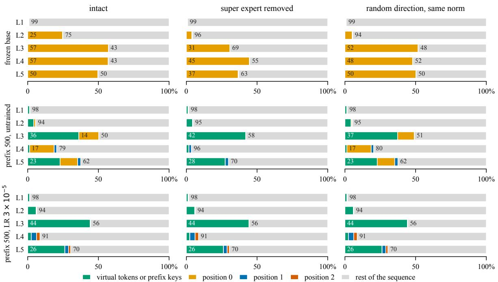  
Figure 12: As Figure 11, on WikiText-2.

Table 19: Retraining only the router on top of each Qwen arm: set-level $F _ { 1 }$ on 2000 test rows with the frozen and the retrained router, the paired diference, and the routing displacement of (6) that the retraining itself causes on the comment tokens of the validation rows, with a 64-token generation budget.
<table><tr><td>arm</td><td>frozen</td><td>retrained</td><td>difference (t)</td><td>TV, retrained vs frozen</td></tr><tr><td>base</td><td>0.461</td><td>0.800</td><td>+0.339 (39.4)</td><td>0.080</td></tr><tr><td>GEPA</td><td>0.730</td><td>0.803</td><td>+0.073 (8.8)</td><td>0.076</td></tr><tr><td>prompt, 100</td><td>0.829</td><td>0.824</td><td>-0.005 (-1.5)</td><td>0.030</td></tr><tr><td>prompt, 200</td><td>0.813</td><td>0.820</td><td>+0.007 (1.6)</td><td>0.014</td></tr><tr><td>prompt, 500</td><td>0.832</td><td>0.822</td><td>-0.009 (-3.2)</td><td>0.011</td></tr><tr><td>prefix, 100</td><td>0.830</td><td>0.832</td><td>+0.002 (0.3)</td><td>0.057</td></tr><tr><td>prefix, 200</td><td>0.807</td><td>0.813</td><td>+0.006 (1.4)</td><td>0.038</td></tr><tr><td>prefix, 500</td><td>0.807</td><td>0.809</td><td>+0.002 (0.2)</td><td>0.134</td></tr></table>

On the frozen base, the retrained router recovers most of what adaptation reaches, while moving less of the comment tokens’ routing mass than prompt or prefix tuning does (Figure 4). On the continuous arms it adds little: at the chosen learning rate the test diference lies between −0.009 and +0.007, at every learning rate within ±0.013, and a validation gain, such as +0.021 for prefix tuning at 500 tokens, does not carry to the test rows. GEPA, which routes the comment tokens almost as the base does, gains 0.022 to 0.073 depending on the learning rate, and at the chosen one reaches the 0.80 of the retrained base: the router recovers what GEPA gains and GEPA adds nothing on top of it. Retraining the router and adapting the context are thus substitutes, and combining them never beats the better of the two by more than 0.007. This repeats, on the present checkpoints, what the workshop draft found on another backbone pair with a diferent recipe.

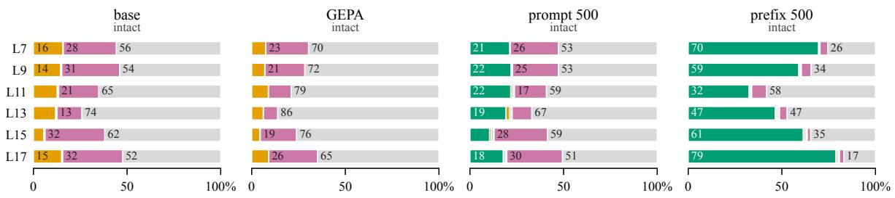

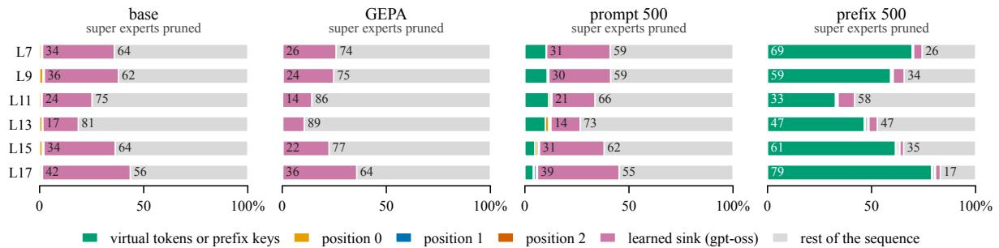

Figure 13: As Figure 5, on gpt-oss, full-attention layers 7 to 17.  
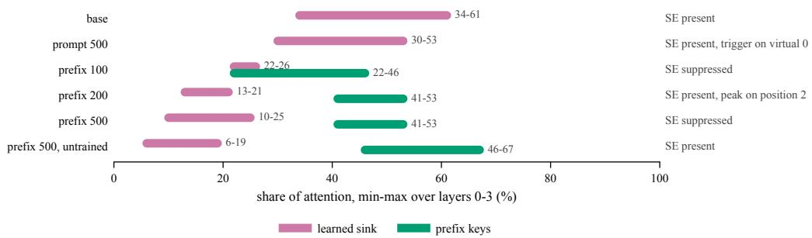  
Figure 14: gpt-oss: range over layers 0 to 3 of the attention share taken by the learned sink and by prefix keys, per arm, with the state of the super experts.

## E.5 Expert-parallel timing

Each of � GPUs holds $E / N$ consecutive experts of every MoE layer and a batch of tokens. A layer is one real expert-parallel forward: an all-to-all that sends every token to the devices of its selected experts, a grouped matrix product over the local experts (SwiGLU, the real expert shapes, random weights), and an all-to-all back. Its time is the slowest device’s, and a step is the sum over layers. Each token draws its � distinct experts per layer from the arm’s measured expert shares over every routed position from the measured routing maps, so the per-device load follows the arm’s own load. The timing covers the MoE layers only, without attention or a serving framework, and is not an end-to-end latency. At 4096 tokens per device, where compute dominates, the base’s own imbalance costs more the fewer experts each device holds, and the adapted arms stay within 6 percent of the base on two and four devices and within 14 percent on eight (Table 20); at 512 tokens per device fixed costs dominate and every adapted arm lies within 6 percent of the base at every device count.

## E.6 Complete load statistics

The complete load statistics comprise the expert-by-layer distribution for all sixteen checkpoints, the same distribution resolved by prompt stage, per-layer Gini with the busiest-expert and busiest-tenth shares, and, for the pruned runs whose routing was recorded under the mask, the before-and-after Gini of the surviving experts. Experts with no trafic are omitted from the distribution tables and counted separately, since a row of zeros is a fact about the router and not a fact about the tokens.

Table 20: Time of the MoE layers per step under expert parallelism relative to the base, 4096 tokens per H100 GPU, 20 repetitions; the last row is the base’s absolute time.
<table><tr><td rowspan="2">GPUs</td><td colspan="3">gpt-oss-20b</td><td colspan="3">Qwen3-30B-A3B</td></tr><tr><td>2</td><td>4</td><td>8</td><td>2</td><td>4</td><td>8</td></tr><tr><td>uniform load</td><td>0.956</td><td>0.853</td><td>0.707</td><td>0.975</td><td>0.938</td><td>0.821</td></tr><tr><td>GEPA</td><td>1.010</td><td>1.040</td><td>1.109</td><td>1.008</td><td>1.046</td><td>1.062</td></tr><tr><td>prompt, 100</td><td>1.020</td><td>1.038</td><td>1.071</td><td>1.004</td><td>1.000</td><td>0.979</td></tr><tr><td>prompt, 200</td><td>1.038</td><td>1.039</td><td>1.096</td><td>1.014</td><td>1.014</td><td>0.993</td></tr><tr><td>prompt, 500</td><td>1.042</td><td>1.061</td><td>1.135</td><td>1.019</td><td>1.026</td><td>1.007</td></tr><tr><td>prefix, 100</td><td>1.006</td><td>1.020</td><td>1.052</td><td>1.006</td><td>1.012</td><td>1.013</td></tr><tr><td>prefix, 200</td><td>1.004</td><td>1.004</td><td>1.044</td><td>1.000</td><td>0.997</td><td>1.009</td></tr><tr><td>prefix, 500</td><td>1.006</td><td>1.029</td><td>1.062</td><td>1.003</td><td>1.004</td><td>1.011</td></tr><tr><td>base (ms)</td><td>82.2</td><td>95.8</td><td>117.9</td><td>143.8</td><td>162.0</td><td>188.4</td></tr></table>

## E.7 Replaying routing decisions

We replay cached routes between the frozen Qwen base and the prompt- and prefix-tuned arms at 500 virtua tokens, in both directions, on the 2000 test rows. Each model first generates natively (greedy, at most 64 tokens), and its routes after top-� selection are cached in every layer. The recipient then generates again with the donor’s routes substituted at the prefill positions of the user turn, whose token IDs are identical in both models and checked; every other position, every hidden state and every decoding step remain the recipient’s own. GEPA changes the user turn itself and is not replayed. Three replays separate the terms of (5): support takes the donor’s expert set with the recipient’s own router weights renormalised over it, coeficients keeps the recipient’s set with weights from the donor’s router logits, and joint takes both. A matched random control replaces, per token and layer, exactly as many of the recipient’s experts as the donor’s set difers by, with experts drawn at random, and a shufled control replays the joint routes of another test row of the same token geometry (1764 rows have one). Replaying a model’s own routes reproduces its native answers on every row.

On these tokens the adapted arm replaces 21 (prompt) and 22 (prefix) percent of the base’s top-8 experts, changes at least one of them for 87 and 90 percent of tokens and layers, and the first-ranked one for 37 and 40 percent. The base trails the arms by 0.373 and 0.348 $F _ { 1 }$ (0.459 against 0.832 and 0.807 in this evaluation). Replaying the arm’s routes into the base closes none of this gap for prompt tuning and 0.034 of it for prefix tuning, where the coeficients alone give 0.031 (Table 21). The expert set alone moves $F _ { 1 }$ no more than the matched random control; paired against that control, the joint replay is higher by 0.011 [0.001, 0.021] and 0.020 [0.009, 0.030]. Given the base’s routes, the adapted arms lose 0.014 and 0.023, against 0.015 and 0.010 for the matched random control. The shufled routes, which difer from the recipient’s in more of their experts (38 and 39 percent), cost the adapted arms 0.24 and 0.39 and the base 0.06. Within this scope the rerouting of the user tokens carries little of the adaptation gain on its own, and undoing it costs about what any change of its size costs. The replay acts on the prefill of the user turn only and leaves states and decoding to the recipient, so it does not show that routing is unnecessary for the adaptation, nor that the remaining state change sufices.

Table 21: Route replay on Qwen at the prefill of the user turn, 2000 test rows: change in the recipient’s $F _ { 1 }$ against its own native answers, with paired bootstrap 95% intervals below. Gap is the donor’s native $F _ { 1 }$ minus the recipient’s. Shufled uses the 1764 rows with a donor row of the same geometry.
<table><tr><td>recipient ← donor</td><td>gap</td><td>support</td><td>coefficients</td><td>joint</td><td>matched random</td><td>shuffled</td></tr><tr><td>base ← prompt, 500</td><td>+0.373</td><td>-0.014 [-0.025, -0.003]</td><td>+0.005 [-0.006, +0.015]</td><td>-0.002 [-0.013,+0.010]</td><td>-0.012 [−0.022, -0.002]</td><td>-0.057 [-0.079, -0.035]</td></tr><tr><td>prompt, 500 ← base</td><td>-0.373</td><td>-0.011 [-0.018,-0.004]</td><td>-0.013 [-0.020, -0.005]</td><td>-0.014 [-0.023,-0.005]</td><td>-0.015 [-0.023,-0.007]</td><td>-0.237 [-0.260, -0.215]</td></tr><tr><td>base ← prefix, 500</td><td>+0.348</td><td>+0.007 [-0.002, +0.017]</td><td>+0.031 [+0.022, +0.041]</td><td>+0.034 [+0.022, +0.045]</td><td>+0.014</td><td>-0.063 [+0.005, +0.024][-0.085,-0.042]</td></tr><tr><td>prefix, 500 ← base</td><td>-0.348</td><td>-0.009 [-0.019, +0.001]</td><td>-0.011 [-0.021,-0.002]</td><td>-0.023</td><td>-0.010</td><td>-0.392 [-0.034,-0.011] [-0.020,-0.001] [-0.419,-0.365]</td></tr></table>