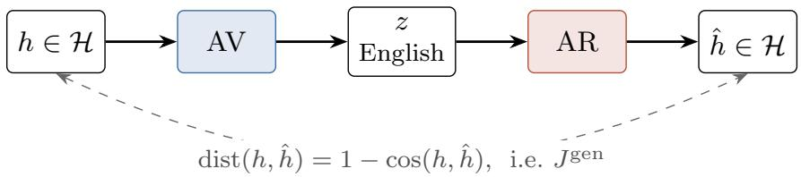
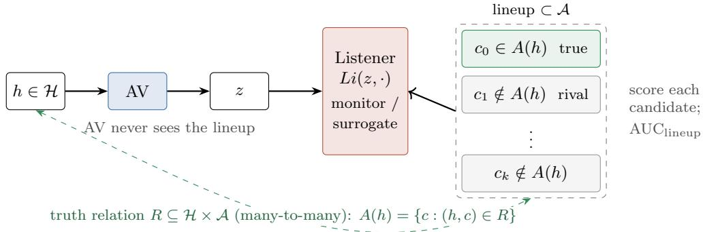
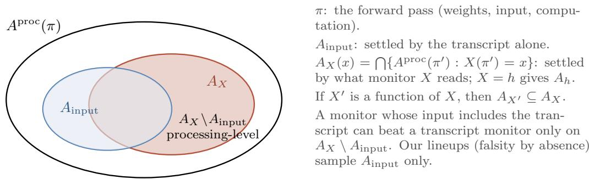
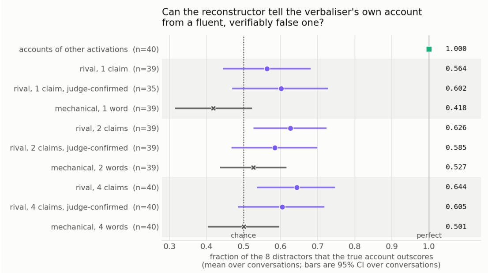
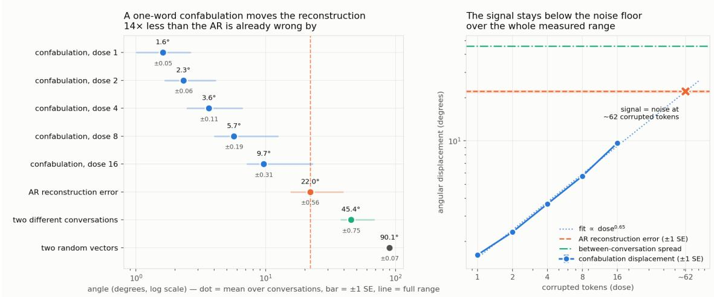
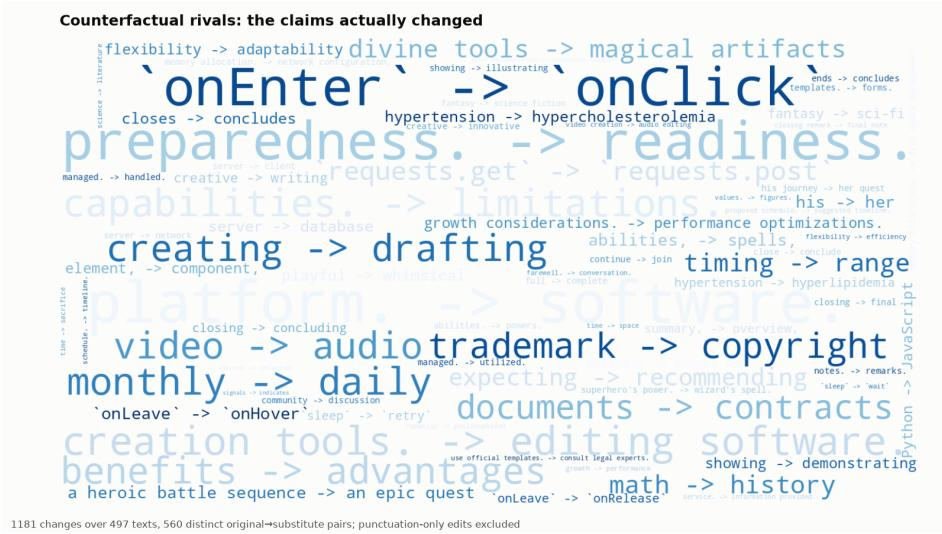
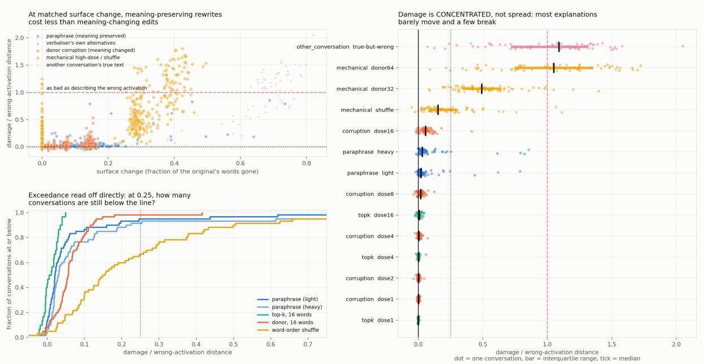

# On the Monitorability of Natural Language Autoencoders: Identification vs Discrimination

Kevin Yandoka Denamganaï

Draft, October 14, 2026

## Abstract

Natural Language Autoencoders (NLAs) are proposed as oversight tools for language models: an Activation Verbaliser (AV) writes an English explanation of an activation vector, and an Activation Reconstructor (AR) maps the explanation back to a vector. Their value for oversight depends on a human monitor being able to tell a true account of an activation from a false one, given the Av’s explanation. We formalise NLA training and NLA oversight deployment as two diferent referential games from Emergent Communication: training is a generative referen tial game, while oversight is a discriminative, multi-modal, partially-observable referential game played over a many-to-many relation between the monitored language model’s activations and the accounts that are true of them. The gap between the two games predicts that AV’s explana tions will identify which activation they describe without discriminating its true account from closely matched false ones, since training never asks explanations to rule anything out. Using the NLA’s own AR as a maximally-sympathetic surrogate monitor model, we experimentally confirm this theoretical insight on one released checkpoint: true accounts beat accounts of other activations in all 320 comparisons, but beat fluent rivals difering in a single claim only 60.2% of the time (std.err. 6.7%, chance at 50%, n = 35). A meaning-preserving rewrite by an uninvolved model costs only 2.1% of the distance to another activation’s account, so the failure is not due to the NLA pair having developed private conventions in the AV’s explanations. Our rival accounts test only transcript-level truths, which the monitored langauge model’s conversation settles, so these results bound the easiest case and leave claims about the monitored model’s own processing untested. We state conjectures that would make both results consequences of the framework.

## 1 Introduction

Language Models (LMs) permeate into our lives under the form of AI agents, automating more and more tasks. This delegation of responsibilities creates a need for guarantees that the tasks will be performed in alignment with our human values. Yet, LMs have been found to act in misaligned fashions, by scheming, sandbagging, reward hacking, etc. Monitoring methods, such as linear probes [13] and Natural Language Autoencoders (NLAs; 2), have been devised to monitor and catch them when pursuing misaligned goals and actions. An NLA trains an Activation Verbaliser (AV), which writes an English explanation to a monitored LM’s activation vector, jointly with an Activation Reconstructor (AR), which maps the explanation back to a vector. Unlike a probe, which outputs a score, an NLA outputs text that a human can read, and this readability is why it is proposed as an interpretability and monitoring tool. The value of an NLA for oversight therefore depends on a human monitor being able to tell a true account of a given monitored LM’s activation vector from a false one, based on the NLA’s explanation. However, nothing in the training objective rewards that ability. The loss is computed against one target activation, never discriminatively against distractor accounts.

Theoretical Framework. In this paper, we theoretically and experimentally highlight this gap. We formalise the training context of NLAs and the oversight context of their deployment as two diferent referential games (Lewis [19] ; see Denamganaï and Walker [11] for a nomenclature), which is a common paradigm in Emergent Communication [1, 6, 17, 18, 29]. While training can be formalised as a generative referential game, as an autoencoder pipeline suggests, the oversight context is formalised as a discriminative, multi-modal, partially-observable referential game, which is played over a many-to-many relation between the monitored LM’s activations and the set of accounts that are true of those activations. These formalisations expose the gap between the training and deployment contexts of NLAs. Moreover, this framework predicts confabulations, explanations that are fluent and on-theme but contain details untrue of the activation, as failure cases of the ‘cheap talk’ communication channel within those referential games. It also allows another possible failure case, where the NLA’s AV/AR pair would drift from plain English in their communication channel, and instead develop private conventions that a human monitor would not only fail to understand but also fail to be aware of, thus hindering the oversight deployment goal; our experiments test for it, and do not find it in the checkpoint we study. Finally, the framework says in advance where any white-box monitor, NLA or otherwise, can help: a monitor reading an input X settles only a set of accounts $A _ { X }$ , so it can outperform a monitor reading the transcript only on accounts the transcript does not settle. Using this framework, we conjecture that, because the generative training objective never asks an explanation to rule out any distractor account, an NLA’s explanations will identify which activation they describe without discriminating the true accounts of that activation from closely matched false ones. Indeed, identification and discrimination are diferent games, and the NLA is only ever optimized for the first during its training. Then, we provide experimental evidence for this conjecture.

The surrogate monitor. We build a surrogate for the human monitor out of the NLA’s own AR. It measures an upper bound on the monitoring interaction, for two reasons. The self-play regime of the pair may have produced conventions a human never had access to, and the surrogate compares against the ground-truth activation, which a human never sees.

Experimental Evidence. Using this surrogate monitor as the listener in the oversight referential game, we find that the NLA’s explanations identify activations perfectly: the surrogate ranks each true account above every distractor account built from explanations of the monitored LM’s activations on diferent conversations (320 of 320 comparisons, over 40 conversations with 8 distractors per lineup). However, the NLA’s explanations barely discriminate between true and false accounts of a given activation vector: against fluent rivals that falsify a single claim, the surrogate ranks the true account higher only 60.2% of the time (standard error 6.7%, chance 50%, n = 35). Furthermore, a meaning-preserving rewrite by an uninvolved model costs only 2.1% of the distance to another activation’s account, so the failure is not due to private conventions between the AV/AR pair. Our distractors address only transcript-level truths, claims whose truth the conversation itself settles, so these results bound the easiest case and leave claims about the model’s own processing untested. Unlike lie detectors and most monitoring benchmarks, which score a single response as deceptive or not, our lineups ask which of several contrary accounts is true, and Section 8 shows why that distinction matters for the field.

What should change. The results suggest two changes to how NLAs are built and evaluated. NLAs should be evaluated against rival accounts matched in specificity, rather than by reconstruction quality or retrieval alone, since both of the latter can be perfect while discrimination is near chance. And their training objective could include a discriminative term over true and rival accounts, which the released checkpoints already support as a starting point (Section 9).

As a whole, this paper makes five contributions:

1. A formalisation of NLA training and NLA oversight as two diferent referential games, in which the correspondence between activations and accounts is a many-to-many truth relation, and the point where the eliciting-latent-knowledge problem enters is isolated in one assumption (Section 3);

2. A listener-agnostic account of which claims a monitor can settle from its input, which predicts that a white-box monitor can outperform a transcript monitor only on accounts the transcript does not settle, and which accounts for several published negative results (Sections 3 and 8);

3. Two conjectures that would make our experimental results consequences of our theoretical framework (Section 5);

4. A dissociation between identification, which the NLA’s communication channel performs perfectly, and discrimination between true and fluent-but-false accounts, which it performs barely above chance (Section 6.2);

5. A control experiment showing that the failure to discriminate is not due to private conventions between the AV/AR pair (Section 6.3).

Section 2 introduces NLAs, referential games and the two problems any NLA monitoring result must confront, and Section 3 builds our proposed theoretical framework on them. Section 4 constructs the surrogate monitor and the distractor accounts, Section 5 states the conjectures, and Section 6 tests them. Section 8 positions the results against prior AI safety and monitoring work, and Sections 7 and 9 close with the limitations and the next steps.

## 2 Background

## 2.1 Natural Language Autoencoders & Activation Oracles

Two properties of the scoring step govern everything below. First, both vectors are normalised before comparison, so the scored quantity is a cosine and the reconstruction’s length is discarded by construction. Second, the score is computed against one target activation, never against a set of candidates, so nothing can be excluded or contrasted from the current explanation.

## 2.2 Emergent Communication & Referential Games

A referential game as used in Emergent Communication [17] stems from Lewis’s signalling game [19]. It is defined as a two-player game in which a speaker sees a state or target stimulus and sends a message, which a listener uses to act in a way that is accordance with the state. Both agents are rewarded when the listener’s action fits the state, which can be for instance picking the target stimulus from a set of candidate stimuli. Lewis’s point was that the meaning of a signal is nothing more than the convention the pair settles into. This point returns in Section 3 as the private convention failure case of NLA. The referential game variants are best described as combinations of a small number of features [11]. We define the generative and discriminative variants, then the five features the NLA setting needs: observability, modality, the distractor distribution, descriptiveness, and stimulus versus object focus.

Definition 2.1. Speaker Agent Given a stimulus space S with a distribution $\mathcal { D } _ { i }$ , a vocabulary Σ and the space of finite messages $\Sigma ^ { \star }$ , a speaker agent is a map $S p : S \to \Delta ( \Sigma ^ { \star } )$

Definition 2.2 (Generative Listener & Generative Referential Game). Given a speaker agent as defined in $D e f . \ 2 . 1 , \ a$ generative listeneragent is a map $L i _ { \mathrm { g e n } } : \Sigma ^ { \star }  S$ . Given a distance metric dist : ${ \mathcal { S } } \times { \mathcal { S } } \to \mathbb { R } _ { > 0 }$ , a generative referential game involves scoring a pair of agents against the following reconstruction objective:

$$
J ^ { \mathrm { g e n } } ( S p , L i _ { \mathrm { g e n } } ) = \mathbb { E } _ { s \sim \mathcal { D } } \mathbb { E } _ { z \sim S p ( \cdot | s ) } [ \mathrm { d i s t } ( s , L i _ { \mathrm { g e n } } ( z ) ) ] ,
$$

which the pair of agents attempt to minimise.

Note that no other stimulus appears anywhere in $J ^ { \mathrm { g e n } }$ . A message is good if it lets the listener reconstruct its own target, but nothing asks whether the same message could also have let the listener reconstruct a diferent target stimulus.

Definition 2.3 (Discriminative Listener & Discriminative Referential Game). A discriminative listener is a scoring function $L i _ { \mathrm { d i s c } } : S \times \Sigma ^ { \star } \to \mathbb { R }$ Given a target stimulus $s _ { 0 } \sim \mathcal { D }$ and K distractors $s _ { 1 } , \ldots , s _ { K } \sim \mathcal { D } ^ { K }$ , a discriminative referential games involes (i) the speaker agent sending $z \sim S p ( \cdot \mid s _ { 0 } )$ to the listener agent, and $( i i )$ the listener agent scoring each stimulus $( s _ { i } ) _ { i \in [ 0 , K ] }$ against message z. The pair of agents is successful when the listener scores the target stimulus above all other distractors. A typical objective is the hinge loss:

$$
J ^ { \mathrm { d i s c } } = \mathbb { E } \Big [ \operatorname* { m a x } \Big ( 0 , ~ \gamma - L i _ { \mathrm { d i s c } } ( s _ { 0 } , z ) + \operatorname* { m a x } _ { k } L i _ { \mathrm { d i s c } } ( s _ { k } , z ) \Big ) \Big ]
$$

with margin $\gamma > 0$

Feature 1: full versus partial observability. Under full observability the speaker sees every stimulus the listener will see, target and distractors alike, and can be pragmatic, by tailoring its message to exclude the distractors. Under partial observability the speaker sees the target only. A partially observing speaker cannot reason pragmatically about the particular distractors, so its message is good against them only if it is good against the distractor distribution as a whole.

Feature 2: multi-modality. In the basic referential game both players experience stimuli through the same modality. In a multi-modal referential game, as introduced by Evtimova et al. [12], one player sees images as stimuli while the other sees text descriptions, therefore both players experience stimuli through diferent modalities. The message on the communication channel remains a sequence of discrete symbols. We denote by candidate space the space corresponding to the second modality, to diferentiate it from the stimuli space.

Definition 2.4 (Multi-modal discriminative Listener & Referential Game). Let C be a candidate space, a second modality possibly distinct from S, and let a correspondence link each stimulus to the candidates that describe it. A multi-modal listener agent is defined as $L i _ { \mathrm { m m } } : \mathcal { C } \times \Sigma ^ { \star }  \mathbb { R }$ . In a multi-modal discriminative referential game, a round draws a target stimulus $s _ { 0 } { } _ { ; }$ , the speaker sends $z \sim S p ( \cdot \mid s _ { 0 } )$ , and the listener must score a candidate $c _ { 0 }$ that corresponds to $s _ { 0 }$ above distractor candidates $c _ { 1 } , \ldots , c _ { K }$ that do not.

Feature 3: the distractor distribution. Which distractors a discriminative listener faces decides which distinctions the message is forced to carry. Uniform distractors force coarse messages. Distractors that co-occur with the target, or difer from it in one detail, force that detail to be encoded into the message and changes the structure of the language that emerges.

Feature 4: descriptive-only. In discriminative referential games, the listener sees at least two candidates and can compare them. In a descriptive-only variant, it sees a single candidate, which may or may not be the target candidate, and it must decides whether it is indeed the target one. No comparison is available, so the listener must commit to an absolute decision, which in practice means a threshold on its score must be decided.

Feature 5: stimulus versus object focus. In the basic stimulus-focused variant, the listener must recognise the exact stimulus the speaker saw. In an object-focused referential game however, the speaker and listener experience the same object or meaning but from diferent viewpoints, and the listener must recognise the object independently of the viewpoint it was presented in. The dificulty moves from agreeing on a code to bridging two diferent perspectives on one thing. Talking about viewpoint and perspective makes it easy to comprehend, but it does not need to be on a vision-related modality, and in that case the diferences in perspective are conceptual. For instance, considering a stimulus space containing text, then an object-focused referential game would have the speaker and listener agents experience diferent pieces of text which may or may not have the same symbolic meaning.

## 2.3 Zero-shot Coordination & Eliciting Latent Knowledge

Zero-shot coordination. Agents trained together in self-play like the AV/AR pair of NLAs can settle on private conventions that work between them but nowhere else, which is Lewis’s point in learned form. Of-Belief Learning [14] trains agents whose signals carry only grounded meaning, in order to enable these agents to coordinate with partners they never met. A speaker like the AV, trained with one listener such as the AR in the case of NLA, and deployed to another, such as the human monitor, is in exactly this position. Yet, the NLA training does not account for this.

Eliciting latent knowledge. In Emergent Communication’s application of referential games, the target stimulus is given by construction. However, in the context of NLA deployed as a monitoring tool over a monitore LM, whether an account is actually true of an activation is not observable. This stems from the Eliciting Latent Knowledge (ELK) problem [8]. Thus, any experiment that labels a given account as true or false of a given monitored LM’s activation vector either solves the ELK problem or assumes it away. In the current work, we reduce the impact of the ELK problem on our results by restricting which accounts we test. Three kinds of truth can be distinguished: truths about the input conversation, truths that the hidden state itself settles, and truths about the whole process of the forward pass of the monitored model, such as what the model plans or intends, which is where most monitoring interests lie. Only the first is checkable without access to the model’s latent knowledge, since the transcript is observable. We therefore take the AV’s own explanation as the true account (Assumption 3.4), and build each distractor by editing it so that it asserts content absent from the input conversation (Assumption 3.5). This sidesteps rather than solves the ELK problem: it labels transcript-level accounts reliably, and says nothing about the hidden-state and process-level truths that oversight most needs, a limitation that Section 3 makes precise with Definition 3.6. We argue in Section 7 that the restriction still leaves the dissociation between identification and discrimination of value, and that it bounds rather than settles how an NLA fares on hidden-state and process-level accounts.

## 3 Theoretical framework

We instantiate the background for the NLA: training is a generative referential game (Setting 1), oversight is a discriminative, multi-modal referential game over a truth relation between activations and accounts (Setting 2), and the gap between the two is our thesis. We then state the assumptions every subsequent experiment relies on. Figures 1, 2 and 3 summarise Setting 1, Setting 2, and the accounts each kind of monitor can settle.

## 3.1 Setting 1: the game the pair was trained in

The instance. Setting 1 is the generative game of Definition 2.2 with stimuli $\mathcal { H } \subset \mathbb { R } ^ { d }$ , speaker AV, listener ${ \mathrm { A R } } ,$ and distortion dist $( h , h ^ { \prime } ) = 1 - \cos ( h , h ^ { \prime } )$ after L2 normalisation. The NLA objective is exactly $J ^ { \mathrm { g e n } }$

  
No candidate set: nothing ever asks z to exclude anything.  
Figure 1: Setting 1, the referential game a NLA trains on: the AR rebuilds h from the AV’s explanation z, scored by cosine distortion, but no candidate account is ever ruled out.

There is no candidate set anywhere in it. Nothing in training ever required an explanation to exclude an activation, and nothing ever compared one account of h with another. This is a property of the objective rather than a defect of this checkpoint, and most of what follows is a consequence of it.

## 3.2 The multi-target extension

We extend the single-target referential games above to account for several correct candidates, and read the set games of Mu and Goodman [26] as combinations of features already named.

Definition 3.1 (Multi-target discriminative game). In a multi-target round, the listener faces a set of candidates partitioned into targets T and distractors $D ,$ with $| T | \geq 1 ,$ , and scores each candidate independently. It succeeds to the extent that it scores every target above every distractor. The single-target game is the case $| T | = 1$

The set games as feature combinations. Mu and Goodman [26] define a game by a latent concept $c : \mathcal { X }  \{ 0 , 1 \}$ together with teacher and student views of labelled inputs, and propose two variants. Their set-reference game is a stimulus-focused, multi-target game with shared views. Their concept game draws the teacher’s and student’s inputs independently given the concept, so the student is scored on members of the concept the teacher never saw; in the terms above it is a multi-target, object-focused game. Their contribution for this report is empirical rather than definitional. Games that force the message to cover a set, and not one object, produce more systematic and more compositional languages. The paper contains no proofs, and formalising the finding is left to future work.

What a set target allows. Because the targets form a genuine set, the concept can be a disjunction or a negation, such as red or blue, which no single object could exemplify. A singletarget game can never test whether a message means blue rather than blue circle. A multi-target game can.

## 3.3 Truth as a relation, not a function

Between activations and accounts, the correspondence of Definition 2.4 is a many-to-many relation rather than a function, which we define below along with its two projections, and a measure of how informative an account is.

Definition 3.2 (Truth relation). Let H be a space of stimuli and $A \subset \Sigma ^ { \star }$ a space $o f$ accounts. A truth relation is a subset $R \subseteq { \mathcal { H } } \times A$ , where $( h , c ) \in R$ means that c is true of h. Its two projections are

$$
A ( h ) = \{ c \in A : ( h , c ) \in R \} , \qquad E ( c ) = \{ h \in { \mathcal { H } } : ( h , c ) \in R \} ,
$$

the set of accounts true of h and the extension of c.

Why a distribution is the wrong type. One could model the correspondence as a distribution $\rho ( \cdot \mid h )$ over accounts. A distribution can place mass on several accounts, but it confuses two situations: several accounts are all true and one account is true and we do not know which. The first is the situation here. A distribution is still useful, as a separate object: a presentation distribution supported on $A ( h )$ , which chooses which true account a game shows.

The structure of $A ( h )$ . Accounts are ordered by entailment. If c is true of h and c entails $c ^ { \prime } ,$ then $c ^ { \prime }$ is true of $h .$ So $A ( h )$ is closed upward under entailment, and it always contains vacuous accounts such as “the model is processing text”. Paraphrases of a true account form an equivalence class inside $A ( h )$ . A game that rewards any member of $A ( h )$ without qualification can therefore be won by saying nothing.

Definition 3.3 (Informativeness). Let $\mu ( c ) = \mathbb { P } _ { h \sim \mathcal { D } } [ h \in E ( c ) ]$ be the mass of activations an account is true $o f .$ The informativeness $o f c$ is either

$$
I ( c ) = { \frac { 1 } { 1 + | E ( c ) | } } \quad ( f i n i t e \ o r \ s a m p l e d \ \mathscr { H } ) , \qquad o r \qquad I ( c ) = - \log \mu ( c ) \quad ( g e n e r a l \ \mathscr { H } ) .
$$

What informativeness buys. Both forms are maximised by accounts true of few activations, and the surprisal form gives vacuous accounts $I = 0$ and adds up across independent claims. This separates two objects the report has so far run together. Most accounts have low informativeness. An explanation is an account the AV is trying to make as informative as possible while keeping it true, so the AV’s design goal reads: choose $z \in A ( h )$ maximising I(z).

Two displacements of an account. Fix a reference account $c _ { 0 } \in A ( h )$ . Any other account c sits at a surface displacement, how much of the string changed, measured as token-level edit fraction $\delta _ { s } ( c , c _ { 0 } ) \in [ 0 , 1 ]$ , and a truth displacement, how much of what $c _ { 0 }$ asserted about h stopped being true. Every construction in this project is a choice of these two coordinates. A paraphrase has large surface displacement and zero truth displacement. A rival has near-zero surface displacement and a set number of falsified claims. Another conversation’s account maximises both. Mechanical word substitutions fix the surface displacement and leave truth displacement undefined, because a substituted word is guaranteed to be ungrounded in the source, not guaranteed to make a claim false.

## 3.4 Setting 2: the game oversight requires

Each feature of Setting 2 is forced by the oversight task, and we take them in turn before showing that a deployed monitor’s descriptive-only decision is recoverable within the discriminative multimodal referential game.

The players. The speaker is the same AV. What changes is the listener: a monitor who never sees the activation and must decide what is true of it.

Discriminative ˆ multi-modal ( vs. ) ˆ partially observable ˆ object-focused (a paraphrase class is one object) ˆ multi-target optional. Deployed question “is c true?”  the round c, c : compare $L i ( c ) > L i ( \lnot c )$ , no threshold. Experiments use contraries c0, c .  
  
Figure 2: Setting 2, the referential game formalising the oversight context: a listener scores a lineup of candidate accounts, one true of h and the rest are distractors, which the AV never sees. The deployed question “is c true?” reduces to the threshold-free round $\{ c , \lnot c \}$ , which our experiments approximate with rival accounts comparison $\{ c _ { 0 } , c _ { k } \}$

Discriminative. The listener does not rebuild the activation. It scores candidate accounts against each other.

Multi-modal. The stimulus is an activation in H, and the candidates are accounts in A, a diferent modality. The correspondence is the truth relation R of Definition 3.2. The multi-modality is necessary rather than decorative. Make the listener’s candidates activations instead and the result is a coherent game, but it is the retrieval experiment, which answers which activation and not what is true of it.

Partially observable. The AV sees h and never the accounts it will be compared with. It cannot tailor z to exclude a particular rival, so z discriminates against rivals only to the extent that the AV’s habits happen to. Setting 1 has no distractors at all, so in neither game does the AV have any incentive or opportunity to exclude anything.

Object-focused. The object the listener must recognise is a meaning, and each candidate presents it through one wording, which plays the role of a viewpoint. The viewpoints of one object are its paraphrase class: the accounts that entail each other. A paraphrase class is an equivalence class inside A(h), not $A ( h )$ itself, which is only closed upward under entailment and contains many nonequivalent accounts. An object-focused listener scores a meaning the same whichever paraphrase presents it, and Result 2 is a test of exactly that.

Multi-target, optionally. Because R is many-to-many, every member of $A ( h )$ is a legitimate target, and a lineup may contain several. Read this way, Setting 2 is also a multi-modal instance of Mu and Goodman [26]’s concept game. The experiments do not need the extension, for the reason given next, but the theory does: it is what makes “the account” into the set $A ( h )$ , and it lets paraphrases count as targets.

The deployed decision is descriptive-only. A deployed monitor reads z and one account $c ,$ and must decide whether c is true. That is the descriptive-only variant of Feature 4, and it seems to require a threshold.

The descriptive decision is recoverable discriminatively. Under bivalence, exactly one of c and its negation ¬c is true of h. So “is c true?” has the same answer as “which of $\{ c , \lnot c \}$ is the target?”, a single-target discriminative round with the negation as its only distractor. The comparison $L i ( c ) > L i ( \lnot c )$ needs no threshold, since each account serves as the other’s reference. The monitoring question therefore decomposes into single-target rounds, one claim at a time, and running the single-target game loses nothing essential.

Our rivals are contraries, not negations. Changing trademark to copyright does not produce “not trademark”, and two contraries can both be false. The experiments approximate the $\{ c , \lnot c \}$ round with $\{ c _ { 0 } , c _ { k } \}$ , where $c _ { k }$ contradicts one claim of $c _ { 0 }$ by asserting a specific alternative. Assumption 3.4 is what guarantees that one member of each pair is true.

Two diferences from Evtimova’s game. First, the correspondence is not supplied by a dataset; it is exactly what is unknown, the ELK problem. Second, the message space and the candidate space coincide, since both are English. So the message can itself be a candidate, which never happens when messages are discrete codes.

Same speaker, diferent listener, diferent game. The AV was optimised to be understood by the AR in a generative game, and it is deployed to be understood by a human in a discriminative, partially observable one. That is the zero-shot coordination problem of Section 2.3, which is why Of-Belief Learning is on point rather than analogous, and why the paraphrase experiment reads as a partner-generalisation measurement.

## 3.5 Assumptions

To label accounts as true or false without solving the ELK problem, we rely on two assumptions: a strong one, where ELK enters, and a weak one, which can be checked.

Assumption 3.4 (Grounded explanation). The AV’s explanation is true of the activation: $z \in$ $A ( h )$

Assumption 3.5 (Falsity by absence). A rival $c _ { k }$ obtained by editing z is false of h whenever the content that distinguishes it from z does not occur in the conversation that produced h: then $c _ { k } \notin A ( h )$

What each part costs. Assumption 3.5 is a suficient condition stated in terms of observable text, and a validated judge confirms that each rival’s meaning changed. Assumption 3.4 is the ELK problem sidestepped rather than solved. Absence from the conversation also only licenses falsity of claims about the input. A claim about what h encodes, rather than what the conversation contained, can fail even when the conversation supports it.

A degeneracy this creates. Under Assumption 3.4 the presented true account $c _ { 0 }$ is z itself. The student’s target is then identical to the message, and the multi-target, object-focused game collapses back to a stimulus-focused one. True candidates not obtained by editing z, such as paraphrases written by an uninvolved party, avoid the collapse.

Which part of the truth relation the experiments sample. Let $\pi$ denote the forward pass that produced h: the weights, the input conversation and the computation. Three sets of accounts need to be kept apart.

$A ^ { \mathrm { p r o c } } ( \pi )$ , the accounts true of the forward pass as a whole.

$A _ { \mathrm { i n p u t } } ( \pi ) \subseteq A ^ { \mathrm { p r o c } } ( \pi )$ , the transcript-level accounts, whose truth is settled by the input conversation alone, such as “the user asks about trademark compliance”.

$A _ { h } ( h ) = \bigcap \{ A ^ { \mathrm { p r o c } } ( \pi ^ { \prime } ) : \pi ^ { \prime }$ produces h}, the accounts that the activation itself settles.

Because h is a deterministic function of π, $A _ { h } ( h ) \subseteq A ^ { \mathrm { p r o c } } ( \pi )$ . A transcript-level account need not belong to $A _ { h } ( h )$ , since h may not encode every detail of its input. The accounts oversight most needs lie in $A _ { h } ( h ) \setminus A _ { \mathrm { i n p u t } } ( \pi )$ : processing-level truths about what the model computes, plans or intends, which the activation settles and the transcript does not.

Definition 3.6 (Accounts settled by a monitor’s input). Let a monitor read $X ( \pi )$ , any deterministic function of the forward pass of the monitored model, such as the transcript, one activation, several activations, a chain of thought, or a probe’s output. The accounts its input settles are

$$
A _ { X } ( x ) = \bigcap \{ A ^ { \mathrm { p r o c } } ( \pi ^ { \prime } ) : X ( \pi ^ { \prime } ) = x \} .
$$

Taking $X = h$ recovers $A _ { h }$ , and taking X to be the transcript gives the accounts a transcript monitor can settle. The sets are ordered by inclusion: if $X ^ { \prime }$ is a function of X, then every forward pass consistent with an observation $x$ of X is also consistent with the corresponding observation of $X ^ { \prime }$ , so $A _ { X ^ { \prime } } \subseteq A _ { X }$ . If a monitor reads X, then it can outperform a transcript monitor only on accounts in $A _ { X } \backslash A _ { \mathrm { i n p u t } }$ , and lineups whose rivals all lie in $A _ { \mathrm { i n p u t } }$ , like ours, cannot show a white-box advantage even if one exists. This holds strictly when the monitor’s input includes the transcript, so that the transcript is a function of X and $A _ { \mathrm { i n p u t } } \subseteq A _ { X }$ . A monitor that reads only activations need not satisfy this, since an activation need not encode every detail of its input: such a monitor can even do worse than a transcript monitor on $A _ { \mathrm { { i n p u t } } } .$ , and $A _ { X } \ \backslash \ A _ { \mathrm { i n p u t } }$ then marks where an advantage can come from rather than a strict ordering of the two monitors.

Our lineups compare transcript-level accounts only. Under Assumption 3.5, a rival is false because its content is absent from the conversation, so every distinction our lineups test can be checked against the transcript. Our experiments therefore measure discrimination within $A _ { \mathrm { i n p u t } } ,$ together with its complement among edits of z, and say nothing about $A _ { h } ( h ) \setminus A _ { \mathrm { i n p u t } } ( \pi )$ . Two consequences follow. First, a monitor that reads the conversation rather than the activation could in principle solve our lineups, and we have not run that control. Second, the surrogate listener may discriminate processing-level accounts better or worse than transcript-level ones. Our data are silent on both directions.

  
Figure 3: Which accounts each monitor can settle: A monitor reading X settles the accounts in $A _ { X }$ (Definition 3.6); one whose input includes the transcript can beat a transcript-only monitor only on the processing-level region $A _ { X } \setminus A _ { \mathrm { i n p u t } }$ . Our lineups sample $A _ { \mathrm { i n p u t } }$ only.

## 3.6 Provenance and truth

Two attributes. For a candidate c ofered for h, the provenance attribute $P ( c , h ) \in \{ 0 , 1 \}$ is one if c was produced as an account of h rather than of another activation, and the truth attribute $T ( c , h ) = \mathbf { 1 } [ c \in A ( h ) ]$ . Rivals have $P = 1$ and, under Assumption 3.5, $T = 0$

Provenance does not imply truth, in either direction. Because R is many-to-many, an account of another activation $h ^ { \prime }$ can still be true of h, so $P = 0$ does not imply $T = 0 .$ . This is why the identification experiment measures provenance and should never be reported as measuring truth.

What the data measures is underdetermination, not ambiguity. A confabulation is not ambiguous. “The user is called James” has one reading and is simply false. What the data measures is that one explanation is compatible with many accounts. The explanation determines the conversation at 0.949 and underdetermines the account at 0.602.

## 4 Method

The NLA has no listener for Setting 2, and a human monitor cannot be run at the scale our measurements need, so we first build a surrogate monitor model (Section 4.1). A deployed monitor’s yes-or-no decision depends on a threshold that we have no principled way to set, so we then define a threshold-free score for that listener. Finally, whether an account is true of an activation is not observable, so we construct distractor accounts whose falsity we control (Section 4.2).

## 4.1 Building a surrogate monitor model

The surrogate listener. Setting 2 needs a listener that scores candidate accounts of an activation, but nothing in the NLA scores accounts, and the AR is the only component that reads them.

The AR learned to turn the $\mathrm { A V } { \mathrm { : } } $ explanations back into activations, so if it reconstructs a candidate account close to $h ,$ it treats that account as being about h. We therefore build the listener from the $\operatorname { A R } { \mathrm { : } }$ it re-encodes a candidate account c and compares the result with the activation:

$$
L i _ { \mathrm { A R } } ( c ; h ) = \cos { \left( \mathrm { A R } ( c ) , h \right) } .
$$

This listener is oracle-augmented, because it reads $h ,$ which a human monitor never sees, in place of $z .$ It is also maximally sympathetic, because the AR is the AV’s training partner and shares every convention the AV has. Both properties bias the measurement in the tool’s favour, so a negative result from this listener is an upper bound on what the channel yields to a human monitor. The bound concerns the information present in the explanation, not what a particular reader can extract from it: a reader with less computation than the AR could in principle get more from the explanation than from h directly, and we leave that qualification to future work.

Scoring the listener without a threshold. Consider one conversation, for instance conversation 4 of Section 6.2: its lineup holds the true account and eight distractor accounts, and we score the listener by the fraction of the eight that the true account outscores. Averaging this fraction over conversations gives the lineup AUC.

Definition 4.1 (Lineup AUC). For a lineup $( c _ { 0 } ; c _ { 1 } , \dots , c _ { K } )$ ofered for $h ,$

$$
\operatorname { A U C } _ { \mathrm { l i n e u p } } ( L i ) = \mathbb { E } _ { h } { \Big [ } { \frac { 1 } { K } } \sum _ { k = 1 } ^ { K } \mathbf { 1 } { \big [ } L i ( c _ { 0 } ; h ) > L i ( c _ { k } ; h ) { \big ] } { \Big ] } ,
$$

averaged over conversations.

This metric solves two problems that the obvious alternatives have. Top-1 accuracy has a chance level of $1 / ( K { + } 1 )$ , which changes with the lineup size $K + 1$ , whereas the chance level of the lineup AUC is $1 / 2$ for every K. A deployed monitor’s yes-or-no decision needs a threshold, whereas the lineup AUC needs none, because each term in the sum is one single-target round $\{ c _ { 0 } , c _ { k } \}$ of the kind described in Section 3.4, and the lineup AUC is the listener’s success rate on those rounds. With several true candidates, it becomes the bipartite ranking score, the fraction of (true, false) pairs ordered correctly. To see why the name AUC is accurate, take any scorer and use it as a descriptive classifier, accepting a candidate when its score exceeds a threshold. Sweeping the threshold traces a ROC curve, and the area under that curve equals the probability that a random true candidate outscores a random false one, which is exactly the pairwise success rate above. The lineup AUC measure is therefore at once the discriminative success rate on pairs and the descriptive classifier’s performance integrated over every threshold.

This equivalence is what lets every result in this paper be stated without choosing a threshold: reporting the AUC measures how well the listener ranks, and leaves open where a monitor would cut. The sidestep has a limit, however, set by the unit of analysis. Our AUC is computed within each conversation and then averaged, which corresponds to a monitor allowed a diferent threshold for every conversation, and we never pool across conversations because pooling would let an easy conversation’s true account beat a hard conversation’s distractors, a comparison the oversight referential game never asks for. A deployed descriptive monitor, by contrast, gets one threshold for all conversations, and the quantity that measures it is the AUC pooled across conversations. The within-conversation number therefore answers whether the information is present, while the pooled number answers whether a fixed threshold can use it, and calibration, listed under future work (Section 9), is the experiment that closes the gap. Since scores are real-valued cosines, ties do not occur, and confidence intervals come from resampling conversations.

## 4.2 Constructing corrupted accounts

Each distractor family sets independently how much of the wording and how much of the meaning of an account to corrupt, its surface and truth displacements (Section 3.3), and we describe each family below, along with the gates that yields control settings. For each family we say what it is, how it is built, and what it controls for.

Cosmetic corruption, meaning held fixed. To test whether the listener tolerates rewording, an uninvolved model rewrites the true account at two strengths, a light one that changes vocabulary only and a heavy one that changes structure as well, while preserving every claim. Because the meaning is unchanged, any damage these rewrites cause measures the listener’s sensitivity to form, which is the quantity Experiment #2 needs.

Semantic corruption, wording held nearly fixed. To test whether the listener prices truth, the same uninvolved model rewrites the true account into rivals that each alter a stated number of claims, while preserving grammar, register, length and structure. The measured wording change is 0.018 to 0.036, so between 96 and 98% of every rival consists of the AV’s own tokens. A rival is false because the content that distinguishes it from the true account is absent from the conversation, which is Assumption 3.5, so these rivals isolate a change of meaning at almost no change of wording, which is the comparison Experiment #1 needs.

Mechanical corruption, meaning undefined. To provide a baseline that changes words without deliberately changing claims, we replace content words of the true account in three ways: with the tokens the AV itself ranked highest at that position (top-k), with tokens it considered plausible (nucleus sampling), or with content words donated from other conversations’ accounts. A donor substitution guarantees that the new word is ungrounded in the source conversation, but not that the resulting claim is false, so the truth displacement of a mechanical corruption is undefined. These constructions therefore serve as matched-wording baselines for the rivals: at the same number of changed words, they show what the listener does when wording changes but no checkable claim is falsified.

Control #1: order corruption, wording untouched. To separate conventions in word identity from conventions in word order, we keep every token of the true account and shufle their order. Because the vocabulary is unchanged, any damage this causes can only come from word order, which is how Experiment #2 locates the residual convention.

Control #2: another conversation’s account. To set the scale of every other measurement, we use the true, unedited account of a diferent conversation. It is fluent because the AV wrote it, and it is false of h because it describes a diferent conversation, although, since the truth relation is many-to-many, some of its claims may still be accidentally true of h. It defines a damage of 1 in Experiment #2 and the identification baseline in Experiment #1.

Added mechanical filters. Each filter below exists because the previous construction left a confound open, and we present them in the order they were forced, since that order is the argument. The first construction, top-k, inserted tokens the AV considered impossible, so we moved to nucleus sampling. Nucleus sampling draws from the AV’s own alternatives, which may be true of the conversation, so we moved to donor words from other conversations. A donor word can be ungrammatical in its new position, so we added part-of-speech matching. A donor word may also happen to appear in the current conversation, so we required its absence from the input. Finally, a donor word may be a synonym of the word it replaces, so we added a floor on its embedding distance from the original.

Further quality controls. Quotations from the original account are masked to placeholders before the distractor accounts are generated and restored afterwards, so their verbatim preservation is structural rather than hoped for. To check that each rival actually changed meaning, we use an LLM judge, which we validated before use: it calls identical pairs same 97.5% of the time and heavily corrupted pairs diferent 100% of the time, so a rival it confirms has changed meaning with high reliability. The judge confirms 48% of one-claim rivals, 71% of two-claim rivals and 75% of four-claim rivals, which is why the main results use judge-confirmed rivals only. Wording change is measured on the output rather than taken from the prompt, which is what makes the matched mechanical baselines honest.

The uninvolved model that performs all rewrites is Qwen2.5-7B-Instruct, while the AV’s backbone is a truncated Qwen2.5-7B. The rewriter took no part in the NLA pair’s training, so it is uninvolved in their self-play, but it is not an entirely independent model, and we discuss this limitation in Section 7.

## 5 Conjectures

Our experiments measure a single checkpoint, so we state two conjectures that would make their results consequences of our proposed theoretical framework rather than properties of that checkpoint. Each is first stated informally, with its intuition, and then made precise at several strengths, ordered from easiest to prove to most informative. Neither is proved here: we state them so that the experiments of Section 6 can be read as their predicted instances.

## 5.1 Reconstruction does not reward truth discrimination

Conjecture 5.1 (Identification without discrimination). An objective that only asks an explanation to let its activation be rebuilt rewards what distinguishes one activation from another, not what distinguishes a true account of an activation from a false account of the same activation. A generatively optimal NLA can therefore identify activations perfectly while being uninformative about which account of an activation is true.

Intuition. Two accounts that difer in a single claim are nearly the same string. An AR that reads strings smoothly gives them nearly the same reconstruction, whether or not the changed claim is true, while accounts of diferent activations difer in many places at once and are reconstructed far apart. Identification exploits the large diferences, and discrimination needs the AR to respond to the small one.

Precise forms. The four statements below say, in turn, that this can happen, how close to chance it must be given the AR’s smoothness, why it happens in information-theoretic terms, and whether it must happen.

(a) Existence. For any $\varepsilon > 0$ there is a distribution over (h, R) and a pair (AV, AR) minimising $J ^ { \mathrm { g e n } }$ such that $\mathrm { A U C _ { l i n e u p } = 1 }$ on provenance lineups $( P = 0$ distractors) and $\mathrm { A U C _ { l i n e u p } \leq }$ $1 / 2 + \varepsilon$ on truth lineups $( P = 1 , T = 0$ distractors).

(b) Surface-Lipschitz bound. Suppose AR is L-Lipschitz from surface displacement to angle, so $\angle ( \mathrm { A R } ( c ) , \mathrm { A R } ( c ^ { \prime } ) ) \leq L \delta _ { s } ( c , c ^ { \prime } )$ . Suppose also that the score diference $\Delta _ { k } = L i _ { \mathrm { A R } } ( c _ { 0 } ; h ) -$ $L i _ { \mathrm { A R } } ( c _ { k } ; h )$ equals a mean term plus independent Gaussian noise of scale σ across conversations. Then for rivals at surface displacement at most w,

$$
\mathrm { A U C _ { l i n e u p } } \leq { \frac { 1 } { 2 } } + { \frac { C L w } { \sigma { \sqrt { 2 \pi } } } }
$$

for a constant C from the cosine geometry. Rivals at $w \approx 0 . 0 2$ are therefore near chance unless the AR’s response to truth is large relative to its response to surface.

(c) Information form. At any minimiser of $J ^ { \mathrm { g e n } } , \operatorname { I } ( P ; Z \mid h )$ is maximal while $\operatorname { I } ( T ; Z \mid h , P { = } 1 )$ is bounded by the distortion that the truth-relevant content contributes to $J ^ { \mathrm { g e n } }$ ; in particular it is zero when that content carries no reconstruction weight.

(d) Genericity (strongest; possibly false). For natural families of $( \mathcal { D } , R )$ , the set of $J ^ { \mathrm { g e n } }$ -minimisers achieving truth $\mathrm { A U C _ { \mathrm { l i n e u p } } } > 1 / 2 + \varepsilon$ has measure zero in a suitable parameter space.

Commentary. Statement (a) is a construction and should be easy. Statement (b) is a short calculation, using $\Phi ( x ) \leq { \frac { 1 } { 2 } } + x / { \sqrt { 2 \pi } }$ for $x \ge 0$ , once its two assumptions are granted, and both assumptions are measurable here: L from the substitution experiments, σ from the spread of the rival scores. Statement (c) is the one that explains the data, and it should follow from Anwar et al.’s decomposition of information into a monitorable and a non-monitorable part [4]. Statement (d) is likely false as stated, since a distribution in which truth and reconstruction are aligned gives a counterexample, and it is included to mark the ceiling.

## 5.2 Invariance to rewording rules out private conventions

Conjecture 5.2 (Invariance licenses the truth reading). If a listener scores an account nearly the same whatever words express it, then its failure on rivals comes from what the rivals say, not from how they say it, and cannot be explained by the rivals being foreign text.

Intuition. A listener’s score mixes a response to meaning with a response to form. A paraphrase changes the form and keeps the meaning, so the damage a paraphrase does measures the form response. If that damage is small, the form response is small, and whatever the listener does on rivals, which change meaning, must be a response to meaning.

Precise forms. The three statements below make “nearly the same” quantitative, attribute the remaining form response to who authored the words, and translate the result into an existing framework.

(a) Additive decomposition. Write $L i ( c ; h ) = g ( m ( c ) ; h ) + e ( c ; h )$ , where $m ( c )$ is the meaning of c (its paraphrase class) and $| e | \le \varepsilon$ is a form term. Then $\mathrm { A U C _ { l i n e u p } }$ on rivals is at most the fraction of rivals with $g ( m ( c _ { 0 } ) ) - g ( m ( c _ { k } ) ) > - 2 \varepsilon$ , and at least the fraction with $g ( m ( c _ { 0 } ) ) -$ $g ( m ( c _ { k } ) ) > 2 \varepsilon$ . A paraphrase measurement bounding ε therefore bounds how much of the rival result form can explain.

(b) Authorship. If the externally authored paraphrase costs at most ε more than the $\mathrm { A V } { \mathrm { : } } $ own substitutions at matched surface displacement, then the convention-dependent component of Li on any candidate is at most ε per unit of surface displacement. Rivals are 96 to 98% AV-authored, so their foreignness contribution is at most 0.04 ε.

(c) Steganographic gap. The paraphrase damage upper-bounds the steganographic gap of Anwar et al. [5] for the word-identity channel, with Receiver the AR and Sentinel an uninvolved rewriter; the shufle damage lower-bounds it for the word-order channel.

Commentary. Statement (a) is almost immediate and is the version the report needs. Its difficulty lies entirely in the modelling choice that Li decomposes additively into meaning and form. Statement (b) adds a linear dependence on surface displacement, which the data only partly supports. Statement (c) is a translation into an existing framework, and is valuable mainly for connecting the report to that literature.

## 6 Experiments

We test the two conjectures of Section 5 on one released NLA checkpoint, with two experiments that share the same conversations, the same surrogate monitor model and the same lineup machinery. Experiment #1 (Section 6.2) asks whether explanations that identify their activation also discriminate its true account from a fluent false one, and so tests Conjecture 5.1. Experiment #2 (Section 6.3) asks whether the failure found in Experiment #1 could instead be caused by the rivals being written by a model outside the NLA pair, and so tests Conjecture 5.2. The first experi ment carries the paper’s main claim, and the second exists to rule out its most serious alternative explanation.

## 6.1 Experimental setup

We use one released AV/AR checkpoint, in which the AV is a truncated Qwen2.5-7B backbone [30] with a linear read-out and the AR has 21 layers with d = 3584. The activations it explains come from Qwen2.5-7B-Instruct [30] at layer 21, at a single token position two tokens from the end of the conversation, and the conversations are drawn from WildChat [40]. We do not retrain the pair, so every number below measures the released models, in some cases with small adapters fine-tuned on top of the AR. All experiments ran on one AMD Radeon 8060S under ROCm.

## 6.2 Experiment #1: identification without discrimination

Question and hypotheses. Can explanations that identify which activation they describe also tell the true account of that activation from a fluent rival that falsifies a single claim? Conjecture 5.1 predicts that they cannot, because reconstruction rewards what separates activations rather than what separates true from false accounts of one activation. We therefore test two hypotheses, each scored by the lineup AUC of the surrogate monitor model with eight distractors per conversation. H1a Identification. Against accounts of other activations, the lineup AUC is close to 1.

H1b No discrimination. Against judge-confirmed one-claim rivals, the lineup AUC is close to 0.5, and its 95% interval includes chance.

Before running the experiment, we also registered a third prediction, which compares rivals with mechanical edits.

H1c Fluency hides falsity. At matched wording change, fluent and verifiably false rivals are harder to reject than mechanical word swaps, so their lineup AUC is lower.

Figure 4 reports all three tests on the same 40 conversations, and is the main result of the paper.

  
Figure 4: Identification without discrimination. Each row is one kind of distractor, and its value is the fraction of the 8 distractors that the true account outscores under the surrogate monitor model, averaged over conversations (n per row in the labels, at most 40), with bars giving 95% intervals from resampling conversations; 0.5 is chance and 1 is perfect. Against accounts of other activations (top row) the true account wins every comparison, but against fluent rivals that falsify 1, 2 or 4 claims (purple) it wins only 0.56 to 0.64 of them, while mechanical word swaps with the same number of changed words (grey) sit at chance.

H1a holds: explanations identify their activation perfectly. Against accounts of other activations, the true account wins all 320 of its comparisons, across all 40 conversations, as the top row of Figure 4 shows. A separate 40-way retrieval, which asks the surrogate to pick the true account’s activation among all 40, succeeds 0.950 of the time against a chance level of 0.025. The explanations therefore carry ample conversation-specific information, so any failure in H1b cannot be blamed on an uninformative channel.

H1b holds: discrimination is barely above chance. Against judge-confirmed rivals that falsify a single claim, the true account wins 0.602 of its comparisons, with a standard error of 0.067 over n = 35 conversations, where chance is 0.500. Across the three claim counts the value ranges from 0.564 to 0.644, and top-1 accuracy ranges from 0.256 to 0.371 against a chance level of 0.111. The 95% interval of the one-claim result, [0.471, 0.728], includes chance, which is what H1b predicts, although its point estimate sits above chance, so the channel carries a weak truth signal rather than none.

The rivals are not read as noise. One alternative explanation of H1b is that editing an explanation breaks it, so that the surrogate scores every edited account as noise and cannot rank it meaningfully. To exclude this, we ran the 40-way retrieval with each rival in place of the original explanation. A rival retrieves its own activation 0.949 of the time, against 0.950 for the original, so corrupting a claim leaves the account fully able to identify what it describes, and the failure in H1b is a failure to price the changed claim, not a failure to read the account.

H1c fails, with the sign reversed. We predicted that fluent rivals would be harder to reject than mechanical word swaps at matched wording change, but Figure 4 shows the opposite: every rival row lies to the right of its matched mechanical row. Paired within conversation, rivals minus their matched mechanical control give +0.145, +0.099 and +0.143 across the three claim counts, at p = 0.048, 0.096 and 0.075. The weak truth signal of H1b is therefore real in direction, because it is absent from edits that change words without changing a checkable claim.

The reversal holds across six mechanical baselines. The paired contrast above is fragile, because it rests on a single control whose one-word value of 0.418 lies below chance with the widest standard error in the figure. Table 1 supports the reversal more robustly, by breadth rather than by one pairing: six mechanical constructions from two experiments all lie between 0.480 and 0.509 at one changed word, which is chance, while the judge-confirmed rival lies above them at 0.602. The intervals overlap, so the efect is modest, but its direction is the same against every baseline.

The reconstruction tracks wording, not truth. H1b and H1c together raise the question of how much a rival actually changes what the surrogate computes. Two measured angles answer it. The first is how far an edit moves the reconstruction in the NLA pipeline, the angle between the reconstructions of the original and the edited account: Figure 5 shows that a one-token edit moves it by 1.6 degrees, about fourteen times less than the 22 degrees by which the AR already misses the true activation. The second is how much the edit increases the reconstruction’s error with respect to the true activation, which is what the surrogate’s score depends on. Because the movement is nearly perpendicular to the existing error (87.8 degrees at one token), it increases that error only to second order: a fluent, verifiably false rival increases it by 0.06 degrees, whereas substituting the account of a diferent activation increases it by 23.86 degrees. On this second measure the riva is indistinguishable from a single mechanical word swap (0.05 degrees) and smaller than the AV’s own top-k substitutions (0.24 degrees), yet the rival is weakly informative at 0.602 while the larger mechanical changes carry no information at all. In the terms of Section 3.3, the reconstruction therefore responds to surface displacement and is nearly blind to truth displacement, which is the mechanism Conjecture 5.1(b) formalises.

<table><tr><td>construction fraction beaten at 1 changed word</td></tr><tr><td>SE 0.492</td></tr><tr><td>top-p 0.9 0.017</td></tr><tr><td>donor 0.490 0.023</td></tr><tr><td> $\mathrm { d o n o r } + \mathrm { P O S } + \mathrm { a b s e n t }$  0.480 0.025  $\mathrm { d o n o r + P O S + a b s e n t + d i s t a n c e }$  0.498 0.023</td></tr><tr><td> $\mathrm { d o n o r + P O S }$  0.506 0.024</td></tr><tr><td>top-k 0.509 0.016</td></tr><tr><td>rival, judge-confirmed 0.602 0.067</td></tr></table>

Table 1: Every mechanical construction sits at chance, and only the meaning-changing rival does not. Each row gives the fraction of distractors that the true account outscores when the distractor difers from it by one word, with its standard error over conversations. The six mechanical constructions (Section 4.2) replace one content word without guaranteeing a false claim; the last row is the judgeconfirmed one-claim rival of Figure 4.

  
Figure 5: A small edit moves the reconstruction far less than the AR’s own error. Left: the angle, in degrees on a log scale, between the reconstruction of an original explanation and that of an edited one, for edits replacing 1 to 16 tokens (“dose”), compared with the AR’s standing reconstruction error, the angle between two diferent conversations, and the angle between two random vectors; dots are means over conversations, bars ±1 standard error and lines the full range. Right: the same displacement against the number of corrupted tokens, with a power-law fit, which reaches the AR’s reconstruction error only at about 62 corrupted tokens.

A worked example: conversation 4. The original explanation of conversation 4 asserts nine things, among them that the user’s domain is trademark compliance. Its rival changes exactly one token, trademark to copyright, and leaves everything else byte-identical, so the rival makes one false claim and eight true ones. One-claim rivals like this one increase the reconstruction’s error by 0.06 degrees on average across conversations, whereas light paraphrases, which here changes four words, preserves both quotations and keeps all nine claims true, increase it by 1.78 degrees on average. The surrogate is thus more disturbed by a true account in other words than by a false account in the same words, which is H1b in a single case. Figure 6 shows that this is typical of what the rivals change.

  
Figure 6: What the rivals change, as a word cloud of the substitutions made by the rewriter across all conversations, sized by frequency. Two populations appear: genuine claim changes, such as trademark to copyright, hypertension to hypercholesterolemia, or requests.get to requests.post, and near-synonyms that leave the claim true, such as benefits to advantages. Because the second population does not falsify anything, the main results use only rivals that a validated judge confirms changed the meaning.

Verdict on Experiment #1. H1a and H1b both hold, and H1c fails in a direction that strengthens rather than weakens the main result. Asked to rank a true account above a fluent false one, the surrogate monitor model succeeds about three times in five, with an interval that touches chance, while identification is untouched. The NLA therefore answers which activation an explanation describes, but is close to uninformative about which account of it is true, and a monitor needs the second.

## 6.3 Experiment #2: the failure is not a private dialect

Question and hypothesis. The rivals of Experiment #1 were written by Qwen2.5-7B-Instruct, a model that never trained with the AR. If the AV and AR had developed private conventions during training, the AR might score a rival poorly because its wording is foreign to the pair rather than because its claim is false, and 0.602 would then measure foreignness instead of falsity. Experiment #2 asks whether the AR reads plain English from an author outside the pair as well as it reads its partner’s. Conjecture 5.2 says that if it does, foreignness cannot explain Experiment #1. Before running the experiment, we registered the opposite expectation, following Of-Belief Learning [14], which holds that jointly trained agents adopt arbitrary conventions.

H2 Private dialect. A meaning-preserving rewrite by an uninvolved model damages the reconstruction substantially, measured as a fraction of the distance to another activation’s account.

  
Paraphrase invariance (n = 60 conversations): how much of the channel rides on wording, not meaning?  
Figure 7: Rewording by an outside model barely damages the reconstruction, but reordering the same words does. Damage is the angle the reconstruction moves, as a fraction of the angle to the account of a diferent activation, so 0 is undamaged and 1 is as bad as describing something else; $n = 6 0$ conversations. Top left: damage against the fraction of the original’s words removed, for each construction, showing that meaning-preserving paraphrases (blue) cost less than meaning-changing edits at matched surface change. Bottom left: the fraction of conversations whose damage stays at or below each value, read at 0.25. Right: per-condition damage, one dot per conversation, with interquartile bars and median ticks, showing that most paraphrases barely move the reconstruction and a few break it.

## Figure 7 reports the test, over 60 conversations.

H2 fails: an outside author’s English is read almost as well. The median meaningpreserving rewrite costs only 0.021 of the distance to another activation’s account, as the percondition medians in the right panel of Figure 7 show, and 40-way retrieval is unchanged at 0.917 before and after rewriting. Shufling the same words, by contrast, costs 0.152, seven times more at zero change in vocabulary. Whatever convention the pair shares therefore concerns word order rather than word identity, and the rivals of Experiment #1, which preserve word order, are not exposed to it.

A small authorship efect remains, and we measure it. A null result alone would leave open whether the AR is insensitive to authorship or the test is insensitive to it. To separate the two, we compare the outside paraphrase with the AV’s own top-k substitutions at matched wording change, which holds the amount of rewriting fixed and varies only who chose the replacement words. The outside paraphrase is measurably worse, by $+ 0 . 0 7 3 \pm 0 . 0 3 4$ at $p = 0 . 0 4 1$ , so some conventional component remains. This diference is the measured ε of Conjecture 5.2(b), and because rivals are 96 to 98% AV-authored, it bounds the foreignness contribution to Experiment #1 at a small fraction of ε.

The damage is concentrated in a few rewrites. The median hides a tail, which the bottom left of Figure 7 reads of directly: 5% of rewrites lose more than 0.25 of the distance to another activation’s account, even though the validated judge calls them meaning-preserving. Reading the text does not reveal which rewrites these are, so a human monitor could not anticipate them, and this tail is the part of the convention question that remains open.

How to read the damage measure. Damage is a ratio of angles, not a proportion of anything countable, so it cannot be read as the percentage of an explanation that is grounded in English. The map from angle to information is nonlinear, and the denominator is not a true zero, because another conversation’s explanation still shares register and format with the original. The measure therefore supports comparisons between conditions, as above, rather than absolute statements about how much of the channel is conventional.

Verdict on Experiment #2. H2 fails: the AR reads plain English written by a model it never trained with nearly as well as its partner’s, and the residual authorship efect is small and measured. Since rivals are, in addition, 96 to 98% AV-authored, little foreign text is present in them to begin with. The failure of Experiment #1 is therefore a failure to price truth, not a failure to parse the distractors.

## 7 Limitations

Design. A single seed throughout, with n = 40 for the rival experiment and n = 60 for most others. Lineups came in short, with 119 of 320 slots unfilled at one claim, 58 at two and 40 at four. The claim knob does not move the word count, so rivals occupy only one to two changed words. Only 48% of one-claim rivals changed meaning by the judge’s reckoning, rising to 71% and 75%.

Assumptions. Assumption 3.4 is the ELK problem sidestepped rather than solved. All listeners are oracle-augmented, and the main one is the AV’s training partner, which biases in the tool’s favour. Every number is rank-based, so nothing here sets a threshold. The rewriter that produces paraphrases and rival accounts, Qwen2.5-7B-Instruct, shares its pretraining with the AV’s Qwen2.5- 7B backbone, so although it is uninvolved in the pair’s self-play, conventions inherited from that shared pretraining are not excluded.

Transcript-level truths only. This is the limitation that most constrains how far the results reach. Every rival account is false because its content is absent from the conversation, so all our lineups test claims in $A _ { \mathrm { { i n p u t } } } .$ , whose truth the transcript settles. A monitor that reads the transcript instead of the activation is the natural control, and we have yet to run it. If it scores near 1.0, the lineups need no interpretability tool to solve, which makes the NLA’s failure on them more damning. The finding we can defend is therefore narrower and still informative: the channel discriminates poorly even among claims for which ground truth exists outside the model. Two observations support this, and neither depends on the restriction. First, the dissociation between identification and discrimination itself does not depend on which kind of truth is tested, since the same explanations, on the same lineups, identify their activation perfectly and discriminate its true account barely above chance. Second, transcript-level claims are the easy case, checkable against a conversation the monitored model’s activation demonstrably carries detail from, so an NLA that fails on them has given no evidence that it will succeed where nothing outside the model can check it.

What remains untested. The case that matters for oversight, to wit processing-level claims in $A _ { h } ( h ) \setminus A _ { \mathrm { i n p u t } }$ about what the model plans or intends, is untested in the current work though. The surrogate monitor model may do better there, if intention is encoded more distinctly than input detail at the extraction position described in Section 6.1, or it may do worse. Testing it requires ground truth about internal state, which is the ELK problem again.

The biggest gap. Every corruption is an edit of a text the AV produced, so nothing speaks to a confabulation the AV generates freely at temperature. Sampling the AV directly is the right instrument, and we ran out of time.

## 8 Related work

Having separated identification from discrimination (Section 6.2), and transcript-level from processinglevel accounts (Section 3.4), we highlight below precisely where four lines of work on monitoring a model’s internal state stand with respect to the current work. Each has found that white-box access helps less than hoped wherever the transcript already settles the answer, which is the limitation our own lineups share, and each has built controls for it. None of them scores a monitor against contrary accounts matched in specificity, which is the measurement that separated identification from discrimination in Section 6.2. We take each line of work in turn, and say what our results add to it and what we inherit from it.

Deception and lie detectors. Linear probes trained on simple contrastive data separate deceptive from honest responses of Llama-3.3-70B with AUROC between 0.96 and 0.999 [13], but they partly fire on scenarios that are about deception rather than on deception itself, and their authors note that the deception in their datasets is visible in the transcript or chain-of-though of the monitored models. Parrack et al. [28] therefore value a probe by its black-to-white boost, the gain of a monitor that sees probe scores over the same monitor without them. The boost they find is weak, and it is negative on the one dataset whose veracity the public tokens settle. Kretschmar et al. [16] reach the same conclusion at scale: across seven kinds of lie, every detector fails most where the transcript alone cannot show the lie. Natarajan et al. [27] find that deception detection is heterogeneous though, and that probes matched to a deception type do better. Cooney et al. [9] show that many trained model organisms used as ground truth do not verifiably believe the opposite of what they say. All of these score a single response as deceptive or not. Our lineups ask which of several contrary accounts is true, and our experiments in Section 6.2 show the kind of failure a binary score cannot show, since a monitor can be certain that something is wrong while being unable to say which account is right.

Chain-of-thought and agent monitors. MonitorBench injects decision-critical factors into prompts and checks whether the chain of thought reveals them [36]. Models asked to hide such factors mostly omit them rather than encode them. Sabotage in machine-learning engineering is caught more reliably than sandbagging [37]. Monitors that may inspect an artifact still explain anomalies away [22], models covertly sandbag past chain-of-thought monitors in 16 to 36% of successful attempts [20], and small trained monitors can reach the cost–performance frontier [32]. These monitors read text, so their ground truth is a factor the experimenter put into the input. Our framework names the region they cannot reach, the processing-level accounts in $A _ { h } \setminus A _ { \mathrm { i n p u t } }$ and the injection paradigm supplies contexts for testing it.

Auditing model organisms. Marks et al. [25] trained a model with a hidden objective and ran a blind auditing game, in which interpretability helped but a semantic search over training data was a strong baseline. AuditBench scales this to 56 organisms with 14 hidden behaviours and finds that scafolded black-box tools beat white-box tools, including activation oracles, and that tools which work in isolation can fail inside an investigator agent [31]. Pando names the elicitation confounder, the possibility that a white-box gain is really better elicitation, and controls it by training models to explain themselves faithfully, not at all, or with a distractor rule [41]. Secret-keeping organisms show prefill attacks beating white-box methods, with no gain on the untuned base model [10], and how interpretable an organism is depends strongly on how it was trained [33]. These benchmarks have ground truth about internal state, which ours lacks. In exchange, ours scores the tool itself, before any agent, on lineups whose rivals are matched in specificity to the true account. Pando’s distractor rule is the closest analogue of a rival, placed in the model’s self-explanation where we place it in the candidate set.

Activation verbalisers. Activation oracles answer arbitrary questions about activations and recover fine-tuned information absent from the input text [15]. StateWitness reads hidden states and scores deception queries by the margin between two forced choices, which is the $\{ c , \lnot c \}$ round of Section 3 in practice [7]. A shared decoder with per-model adapters extends verbalisation across model families [39]. Against all of these, Li et al. [21] show that existing verbaliser benchmarks can be solved from the input text alone, and that verbalisers often report their own parametric knowledge rather than the target’s. This is the closest precedent for our transcript-level limitation, and it bears on us directly, because our AV starts from the same base model as the target and therefore shares its priors.

Our contributions. First, the measurement of Section 6.2: the channel identifies activations perfectly while barely discriminating between contrary accounts of them, a dissociation that neither binary detection scores nor agent success rates can show. Second, our Setting 2 (Section 3.4) is listener-agnostic, and therefore it provides a single framework to compare diferent monitors/lis teners that would condition on diferent inputs: any of the monitors above is a listener that scores candidate accounts, so all of them can be compared on identical lineups under Setting 2. Third, our framework provides the account sets of Section 3, which say in advance where white-box access can help. Specifically, a monitor reading X settles the accounts in $A _ { X }$ , so it can beat a transcript monitor only on $A _ { X } \setminus A _ { \mathrm { i n p u t } }$ . Our framework is consistent with those previous work as it supports theoretical predictions of the negative results reviewed above: on Backdoors, on lies undecidable from the transcript, on verbaliser benchmarks solvable from text, and on models that explain themselves faithfully. In return, we inherit the controls these works built, namely the black-towhite comparison, the base-model control, and independent verification of any induced state, and Section 9 leverages them to extend our lineups beyond transcript-level accounts in future works.

## 9 Discussion & Future Work

A better read-out. A low-rank bilinear probe on the frozen AR’s output separates true from cosmetically corrupted explanations at 0.903 within conversation, where the AR’s cosine read-out gives 0.533. Whether this transfers to the rival lineups is a scoring pass on lineups that already exist. If it does, the truth signal is in the channel and the read-out discards it. If it does not, discrimination has to be trained.

A discriminative objective. Add a multi-modal discriminative term over true and rival accounts to the NLA objective. It can be applied before, during or after the original training. Finetuning from the released checkpoints is a viable first attempt, since they already rank true accounts above rivals at 0.602, and comparing training orders and budgets is a study in its own right.

Where content hides from an NLA. Content can reach later behaviour through attention without passing through the one activation an NLA reads, and content that does pass through it can be usable to the model’s later layers without being verbalised. Both routes can be formalised with usable information [38], and the second can be measured with probes of increasing capacity.

Ground truth about internal state. The way around the eliciting-latent-knowledge problem is to cause the internal state, so that it is known. Three constructions trade internal against external validity. Activation steering along persona directions applied to an unchanged transcript gives two internal states with one transcript, so a transcript-only monitor sits at chance by construction, and any listener above chance must be reading the activation. Persona instructions removed from the transcript the monitor sees are more natural, although the intention still enters as input. Finetuned model organisms, whose misalignment is learned rather than injected, come closest to the organic case. In every case, the induced state must be validated independently of the method that induced it, for instance by judging sampled continuations, and steered activations must be checked for being of the distribution the verbaliser was trained on.

A multi-activation listener. Content can reach later behaviour through attention without passing through the one activation an NLA reads. A listener that takes conversation tokens and activation vectors interleaved closes that route, and removing its activation stream yields the transcriptonly control inside the same architecture.

A benchmark for every monitor. Since any monitor that scores candidate accounts is a listener in the referential game from setting 2, the lineups can compare transcript judges, chain-ofthought monitors, probes, NLAs, activation oracles and forced-choice decoders on identical items, with each white-box score reported as a gain over the transcript monitor. Generating contexts for each monitoring interest, such as sandbagging or secret knowledge, and drawing ground truth from the constructions above would extend the reach of the benchmarks discussed in Section 2 to discrimination.

Claim deletion and calibration. Every construction here adds or alters content, and none removes it. Deleting a claim verified absent from the source should raise the score if the channel prices truth, and deleting a true claim should not help equally. Separately, every number here is rank-based, and a deployed monitor needs a calibrated threshold.

## References

[1] Lazaridou Angeliki, Peysakhovich Alexander, and Baroni Marco. Multi-agent cooperation and the emergence of (natural) language. In 5th International Conference on Learning Representations, 2017.

[2] Anthropic. Natural language autoencoders produce unsupervised explanations of LLM activations. Transformer Circuits Thread, https://transformer-circuits.pub/2026/nla/, 2026. Author list not extracted; cite as the Transformer Circuits team unless the page gives one.

[3] Anurin. Natural language autoencoders are summarizers, but do they have to be? LessWrong, https://www.lesswrong.com/posts/4nZwNPyfoadAxPH98, 2026.

[4] Usman Anwar, Tim Bakker, Dana Kianfar, Cristina Pinneri, and Christos Louizos. Analyzing and improving chain-of-thought monitorability through information theory. arXiv preprint arXiv:2602.18297, 2026.

[5] Usman Anwar, Julianna Piskorz, David D. Baek, David Africa, Jim Weatherall, Max Tegmark, Christian Schroeder de Witt, Mihaela van der Schaar, and David Krueger. A decisiontheoretic formalisation of steganography with applications to LLM monitoring. arXiv preprint arXiv:2602.23163, 2026.

[6] Nicolo’ Brandizzi. Toward more human-like ai communication: A review of emergent communication research. IEEE Access, 11:142317–142340, 2023.

[7] Kexin Chen, Yi Liu, Haonan Zhang, Yanhui Li, Xinyu Deng, and Dongxia Wang. Decoding hidden deception in reasoning LLMs: Activation explainers for deception auditing. arXiv preprint arXiv:2606.17478, 2026.

[8] Paul Christiano, Ajeya Cotra, and Mark Xu. Eliciting latent knowledge: How to tell if your eyes deceive you. Alignment Research Center technical report, 2021. Not fetched; author list as commonly cited — verify.

[9] Alan Cooney, David Africa, and Geofrey Irving. “did you lie?” evaluating lie detectors across model scale and belief-verified model organisms. arXiv preprint arXiv:2606.12618, 2026.

[10] Bartosz Cywiński, Emil Ryd, Rowan Wang, Senthooran Rajamanoharan, Neel Nanda, Arthur Conmy, and Samuel Marks. Eliciting secret knowledge from language models. arXiv preprint arXiv:2510.01070, 2025.

[11] Kevin Denamganaï and James Alfred Walker. Referentialgym: A nomenclature and framework for language emergence & grounding in (visual) referential games. arXiv preprint arXiv:2012.09486, 2020.

[12] Katrina Evtimova, Andrew Drozdov, Douwe Kiela, and Kyunghyun Cho. Emergent communication in a multi-modal, multi-step referential game. In International Conference on Learning Representations (ICLR), 2018. Not fetched; included as cited by the NLA draft — verify.

[13] Nicholas Goldowsky-Dill, Bilal Chughtai, Stefan Heimersheim, and Marius Hobbhahn. Detecting strategic deception with linear probes. In Forty-second International Conference on Machine Learning, 2025. URL https://openreview.net/forum?id=C5Jj3QKQav.

[14] Hengyuan Hu, Adam Lerer, Brandon Cui, Luis Pineda, Noam Brown, and Jakob Foerster. Of-belief learning. In Proceedings of the 38th International Conference on Machine Learning (ICML), 2021. arXiv:2103.04000. Not fetched; author list from memory — verify.

[15] Adam Karvonen, James Chua, Clément Dumas, Kit Fraser-Taliente, Subhash Kantamneni, Julian Minder, Euan Ong, Arnab Sen Sharma, Daniel Wen, Owain Evans, and Samuel Marks.

Activation oracles: Training and evaluating LLMs as general-purpose activation explainers. In International Conference on Machine Learning (ICML), 2026. arXiv:2512.15674.

[16] Kieron Kretschmar, Walter Laurito, Sharan Maiya, and Samuel Marks. Liars’ bench: Evaluating lie detectors for language models. arXiv preprint arXiv:2511.16035, 2025.

[17] Angeliki Lazaridou and Marco Baroni. Emergent multi-agent communication in the deep learning era. arXiv preprint arXiv:2006.02419, 2020.

[18] Angeliki Lazaridou, Anna Potapenko, and Olivier Tieleman. Multi-agent communication meets natural language: Synergies between functional and structural language learning. In Dan Jurafsky, Joyce Chai, Natalie Schluter, and Joel Tetreault, editors, Proceedings of the 58th Annual Meeting of the Association for Computational Linguistics, pages 7663–7674, Online, July 2020. Association for Computational Linguistics. doi: 10.18653/v1/2020.acl-main.685. URL https://aclanthology.org/2020.acl-main.685/.

[19] David Lewis. Convention: A Philosophical Study. Harvard University Press, 1969.

[20] Chloe Li, Mary Phuong, and Noah Y. Siegel. LLMs can covertly sandbag on capability evaluations against chain-of-thought monitoring. arXiv preprint arXiv:2508.00943, 2025.

[21] Millicent Li, Alberto Mario Ceballos Arroyo, Giordano Rogers, Naomi Saphra, and Byron C. Wallace. Do activation verbalization methods convey privileged information? In International Conference on Machine Learning (ICML), 2026. arXiv:2509.13316.

[22] Lena Libon, Ben Rank, Jehyeok Yeon, David Schmotz, et al. ResearchArena: Evaluating sabotage and monitoring in automated AI R&D. arXiv preprint arXiv:2607.19321, 2026.

[23] Ryan Lowe, Jakob Foerster, Y-Lan Boureau, Joelle Pineau, and Yann Dauphin. On the pitfalls of measuring emergent communication. In Proceedings of the 18th International Conference on Autonomous Agents and Multiagent Systems (AAMAS), 2019. arXiv:1903.05168.

[24] Alex Mallen, Madeline Brumley, Julia Kharchenko, and Nora Belrose. Eliciting latent knowledge from quirky language models. arXiv:2312.01037, 2023.

[25] Samuel Marks, Johannes Treutlein, Trenton Bricken, Jack Lindsey, et al. Auditing language models for hidden objectives. arXiv preprint arXiv:2503.10965, 2025.

[26] Jesse Mu and Noah Goodman. Emergent communication of generalizations. In Advances in Neural Information Processing Systems (NeurIPS), 2021. arXiv:2106.02668.

[27] Vikram Natarajan, Devina Jain, Shivam Arora, Satvik Golechha, and Joseph Bloom. One probe won’t catch them all: Towards targeted deception detection. In International Conference on Machine Learning (ICML), 2026. arXiv:2602.01425.

[28] Aviel Parrack, Carlo Leonardo Attubato, and Stefan Heimersheim. Benchmarking deception probes via black-to-white performance boosts. arXiv preprint arXiv:2507.12691, 2025.

[29] Jannik Peters, Constantin Waubert de Puiseau, Hasan Tercan, Arya Gopikrishnan, Gustavo Adolpho Lucas de Carvalho, Christian Bitter, and Tobias Meisen. Emergent language: a survey and taxonomy. Autonomous Agents and Multi-Agent Systems, 39(1):18, 2025.

[30] Qwen, :, An Yang, Baosong Yang, Beichen Zhang, Binyuan Hui, Bo Zheng, Bowen Yu, Chengyuan Li, Dayiheng Liu, Fei Huang, Haoran Wei, Huan Lin, Jian Yang, Jianhong Tu, Jianwei Zhang, Jianxin Yang, Jiaxi Yang, Jingren Zhou, Junyang Lin, Kai Dang, Keming Lu, Keqin Bao, Kexin Yang, Le Yu, Mei Li, Mingfeng Xue, Pei Zhang, Qin Zhu, Rui Men, Runji Lin, Tianhao Li, Tianyi Tang, Tingyu Xia, Xingzhang Ren, Xuancheng Ren, Yang Fan, Yang Su, Yichang Zhang, Yu Wan, Yuqiong Liu, Zeyu Cui, Zhenru Zhang, and Zihan Qiu. Qwen2.5 technical report, 2025. URL https://arxiv.org/abs/2412.15115.

[31] Abhay Sheshadri, Aidan Ewart, Elias Kempf, Kai Fronsdal, et al. AuditBench: Evaluating alignment auditing techniques on models with hidden behaviors. arXiv preprint arXiv:2602.22755, 2026.

[32] Aditya Sinha, Akshat Naik, Victor Gillioz, Simon Storf, et al. Training deliberative monitors for black-box scheming detection. arXiv preprint arXiv:2605.29601, 2026.

[33] Andrzej Szablewski, Gabriel Konar-Steenberg, Rafaello Fornasiere, Nikita Menon, and Stefan Heimersheim. The model organism lottery: Model organism interpretability strongly depends on training methodology. arXiv preprint arXiv:2607.01033, 2026.

[34] TurnTrout. How robust are NLAs to initialization? https://turntrout.com/ natural-language-autoencoder-robustness, 2026.

[35] Stephan Wäldchen, Kartikey Sharma, Berkant Turan, Max Zimmer, and Sebastian Pokutta. Interpretability guarantees with Merlin–Arthur classifiers. In Proceedings of the 27th International Conference on Artificial Intelligence and Statistics (AISTATS), 2024. arXiv:2206.00759.

[36] Han Wang, Yifan Sun, Brian Ko, Mann Talati, et al. Monitorbench: A comprehensive benchmark for chain-of-thought monitorability in large language models. In Conference on Language Modeling (COLM), 2026. arXiv:2603.28590.

[37] Francis Rhys Ward, Teun van der Weij, Hanna Gábor, Sam Martin, et al. CTRL-ALT-DECEIT: Sabotage evaluations for automated AI R&D. In Advances in Neural Information Processing Systems (NeurIPS), 2025. arXiv:2511.09904.

[38] Yilun Xu, Shengjia Zhao, Jiaming Song, Russell Stewart, and Stefano Ermon. A theory of usable information under computational constraints. In International Conference on Learning Representations (ICLR), 2020. arXiv:2002.10689. Definitions restated from memory; verify against the paper.

[39] Haiyan Zhao, Zirui He, Guanchu Wang, Ali Payani, Yingcong Li, and Mengnan Du. Universal activation verbalizer: A unified framework for cross-model activation explanation. arXiv preprint arXiv:2605.25903, 2026.

[40] Wenting Zhao, Xiang Ren, Jack Hessel, Claire Cardie, Yejin Choi, and Yuntian Deng. Wildchat: 1m chatgpt interaction logs in the wild. In International Conference on Learning Representations, volume 2024, pages 34590–34605, 2024.

[41] Ziqian Zhong, Aashiq Muhamed, Mona T. Diab, Virginia Smith, and Aditi Raghunathan. Pando: Do interpretability methods work when models won’t explain themselves? arXiv preprint arXiv:2604.11061, 2026.