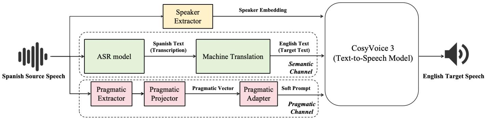
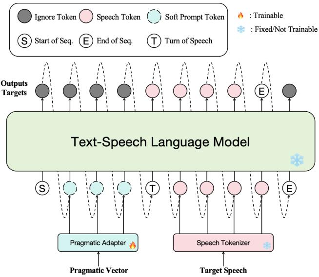

# PACT: A Pragmatic Prompting Framework for Expressive and Voice-Preserving Speech-to-Speech Translation

Yuchen Song∗† Satoshi Nakamura∗

∗The Chinese University of Hong Kong, Shenzhen, China

†Shenzhen Loop Area Institute, China

yuchensong1@link.cuhk.edu.cn, snakamura@cuhk.edu.cn

Abstract—Speech-to-speech translation should preserve not only what is said, but also who says it and how it is said. Existing end-to-end S2ST, speech MLLM, and cascade systems can preserve content or timbre, but often struggle to realize emotion, tone, rhythm, pauses, and pragmatic attitude in the target language. We propose PACT, a target-space pragmatic prompting framework for expressive and voice-preserving S2ST. PACT extracts source pragmatic cues, projects them into the target-language expression space, calibrates the projected representation to a realizable target subspace, and converts it into continuous prompts for a frozen speech generator. On bidirectional Spanish–English TOPI evaluation, PACT achieves the best overall performance among evaluated systems across content fidelity, voice preservation, and expression preservation metrics.

Index Terms—speech-to-speech translation, expressive speech translation, pragmatic prompting, paralinguistic transfer, voice preservation, soft prompting

## I. INTRODUCTION

Speech-to-speech translation (S2ST) is a key technology for cross-lingual communication, real-time interpretation, and expressive media dubbing. For these applications, an S2ST system should preserve not only what is said, but also who says it and how it is said. Beyond semantic fidelity, recent work has increasingly studied expressive and voice-preserving S2ST, where the target speech should retain speaker identity and natural expressive delivery [1]–[6].

However, cross-lingual expression preservation is not simply a matter of preserving source-side acoustic or style cues. In this work, we use pragmatic cues to refer to paralinguistic cues in speech that help listeners perceive communicative intent, such as affective stance, emphasis, rhythm, pausing, and conversational attitude. The same intent may be realized differently across languages: urgency, sarcasm, or frustration in Spanish may require different pitch movement, pause placement, and emphasis patterns when naturally expressed in English [7]–[9]. This target-language realization gap has also been observed in expressive dubbing, cross-lingual prosody transfer, and phrase-level speech translation [10]–[12].

Existing end-to-end S2ST, speech MLLM, and cascaded voice/style-cloning systems can preserve content, timbre, or naturalness, but they often lack an explicit mechanism for mapping how source expression should be realized in the target language. This motivates a target-language expression signal for expressive and voice-preserving S2ST.

We propose PACT, short for Pragmatic Alignment with Calibrated Target-space Prompting, a framework for expressive and voice-preserving S2ST. PACT separates generation into three complementary channels: a semantic channel for target-language text, a speaker channel for voice identity, and a pragmatic prompting channel for utterance-level expression. The pragmatic channel maps source pragmatic cues into a target-language expression space, calibrates the projected representation to a realizable target subspace, and converts it into continuous prompts for a frozen speech generator.

We evaluate PACT on the bidirectional Spanish–English TOPI benchmark, which provides paired source speech and human target-language reenactments for measuring expressive S2ST. We compare PACT with end-to-end S2ST systems, speech MLLMs, and cascaded expressive TTS systems under a unified speech-output evaluation protocol.

The primary contributions of this paper are threefold:

• We formulate expressive and voice-preserving S2ST as target-language expression realization, and propose PACT, a target-space pragmatic prompting framework that separates semantic translation, speaker preservation, and utterance-level expression control.

• We introduce realization-calibrated pragmatic prompting, which maps source pragmatic cues into a target-language expression space, constrains them to a realizable target subspace, and injects them as continuous prompts into a frozen speech generator.

• We demonstrate state-of-the-art overall performance on the bidirectional Spanish–English TOPI benchmark, with consistent gains across content fidelity, voice preservation, and expression preservation metrics.

## II. RELATED WORK

Expressive and voice-preserving S2ST. Recent S2ST systems increasingly aim to preserve not only linguistic content, but also speaker identity and expressive delivery. Translatotron-style and direct S2ST models study voicepreserving speech translation without relying entirely on textonly generation [1], [13]. SeamlessExpressive extends multilingual S2ST toward vocal style and prosody preservation through prosody-aware unit generation and cross-lingual expressivity modeling [2]. Recent systems such as UniSS further explore unified modeling for preserving timbre, emotion, and duration consistency [5]. Discrete-unit and style-transfer S2ST methods improve cross-lingual speech generation by modeling target speech units or additional acoustic/style representations [13]–[15]. These approaches demonstrate the importance of expressive S2ST, but expression transfer is typically handled implicitly through end-to-end generation, unit prediction, style embeddings, or source-speech prompting. In contrast, PACT explicitly formulates expression transfer as target-space pragmatic prompting.

  
Fig. 1. The overall architecture of PACT.

Prompt-conditioned generation and speech MLLMs. Cascaded ASR/MT plus prompt-conditioned TTS systems provide a practical route to expressive S2ST by combining strong text translation with voice or style cloning. Fish-Speech uses reference-audio tokens for token-prompted in-context TTS [16]; OpenVoice supports tone-color cloning and flexible style control [17]; and XTTS-v2 enables cross-lingual voice cloning from a short reference clip [18]. Recent speech MLLM and live-translation systems, such as Qwen3.5-LiveTranslate, further expose speech-to-speech generation and voice-cloning capabilities [19]. These systems provide strong generation backbones and voice/style prompts, but their public interfaces do not explicitly map source-language pragmatic cues into a target-language expression space. PACT fills this gap by keeping the speech generator frozen while projecting, calibrating, and prompting with target-space pragmatic representations.

## III. PROPOSED METHOD

We propose PACT (Pragmatic Alignment with Calibrated Target-space Prompting), a modular framework for expressive and voice-preserving speech-to-speech translation. Given a source utterance in language $\ell _ { s }$ and a target language $\ell _ { t }$ , PACT separates generation into three complementary channels: a semantic channel for translated linguistic content, a speaker channel for voice identity preservation, and a pragmatic prompting channel for utterance-level expression control. The three channels are fused only at synthesis time through a frozen speech generator, as illustrated in Figure 1.

Unlike approaches that rely primarily on source-side audio, speaker, or style conditioning, PACT maps source pragmatic cues into the target-language expression space before using them to guide speech generation. This design allows the generated target speech to preserve the source speaker’s voice while faithfully realizing the source utterance’s paralinguistic intent in the target language.

## A. Semantic Channel

The semantic channel produces the target-language text that conditions speech generation. We first transcribe the source-language speech using Whisper Large V3 [20], and then translate the transcript into the target language using Qwen2.5-72B-Instruct [21]. This cascade is used solely to provide the linguistic content for synthesis; speaker identity and expressive control are handled by the speaker-conditioning and pragmatic prompting channels described below. For samebackbone ablations, we use the same cached translations across all variants, ensuring that differences in the generated speech can be attributed to the prompting and synthesis components rather than to changes in the translated text.

## B. Speaker Channel

To preserve the source speaker’s voice identity, PACT uses the native source-audio speaker-conditioning interface of CosyVoice 3 [22]. Given the source utterance $x _ { s } ,$ the speaker channel extracts a speaker condition $v _ { s } ,$ , which is provided to the speech generator as a separate conditioning signal from the pragmatic prompt. This separation is important: the speaker channel captures relatively stable speaker identity and timbre, whereas the pragmatic prompting channel controls utterancelevel paralinguistic realization in the target language.

## C. Pragmatic Prompting Channel

The pragmatic prompting channel is the core of PACT. It converts source-side pragmatic cues into a target-language prompt representation that can guide a frozen speech generator.

a) Language-specific pragmatic features: We use a pretrained HuBERT Large model [23] as the acoustic representation backbone. Following Ward et al. [7], we use languagespecific selected HuBERT dimensions associated with pragmatic similarity judgments. The resulting vector should be understood as an acoustic-pragmatic representation: it captures speech cues that listeners use to judge pragmatic similarity, rather than a discrete symbolic label of the speaker’s intent. Let

$$
p _ { s } = \mathrm { P o o l } \big ( M _ { \ell _ { s } } \big ( \mathrm { H u B E R T } ( x _ { s } ) \big ) \big ) \in \mathbb { R } ^ { d _ { s } }\tag{1}
$$

denote the source pragmatic vector, where $M _ { \ell _ { s } }$ selects the language-specific pragmatic dimensions and Pool(·) denotes temporal average pooling. In our Spanish–English setting, $d _ { \mathrm { e s } } ~ = ~ 1 0 1$ and $d _ { \mathrm { e n } } ~ = ~ 1 0 3$ . Thus, Spanish-to-English uses a 101 → 103 mapping, while English-to-Spanish uses a 103 → 101 mapping.

b) Target-space pragmatic projection: Because the selected HuBERT dimensions are language-specific, directly injecting a source-language pragmatic vector into targetlanguage synthesis is not appropriate. PACT first maps the source pragmatic vector into the target-language expression space:

$$
z _ { \mathrm { b a s e } } = f _ { \ell _ { s }  \ell _ { t } } ( p _ { s } ) \in \mathbb { R } ^ { d _ { t } } ,\tag{2}
$$

where $f _ { \ell _ { s } \to \ell _ { t } }$ is a cross-lingual pragmatic projector fitted on paired DRAL training utterances [8]. In the final PACT system, we use a data-efficient partial least squares (PLS) projector, which is well suited to the low-resource paired setting and explicitly models source–target covariance.

c) Target-space realization calibration: The projected vector $z _ { \mathrm { b a s e } }$ may still contain directions that are difficult for a frozen speech generator to realize reliably. To constrain the projected cue to the target-language expression manifold, PACT applies a conservative realization calibration:

$$
z _ { \mathrm { c a l } } = \mu _ { t } + \alpha U _ { t , k } U _ { t , k } ^ { \top } ( z _ { \mathrm { b a s e } } - \mu _ { t } ) ,\tag{3}
$$

where $\mu _ { t }$ is the mean target-language pragmatic vector computed from the training split, $U _ { t , k }$ is an orthonormalized target-side PLS subspace, and α controls the strength of the calibrated residual. The subspace dimension k and shrinkage coefficient α are selected on the development set and fixed before evaluation. This calibration preserves source-conditioned pragmatic variation while suppressing out-of-distribution directions that the frozen generator may not faithfully realize.

d) Soft prompt adapter: The calibrated target-language pragmatic vector is converted into continuous prompt tokens by a lightweight adapter:

$$
P _ { \mathrm { s o f t } } = A _ { \phi , t } ( z _ { \mathrm { c a l } } ) \in \mathbb { R } ^ { m \times d _ { \mathrm { m o d e l } } } ,\tag{4}
$$

where m is the number of soft prompt tokens and $d _ { \mathrm { m o d e l } }$ is the hidden dimension of the CosyVoice 3 language model. In our final system, $A _ { \phi , t }$ is implemented as a lightweight MLP that maps $z _ { \mathrm { c a l } }$ to an $m d _ { \mathrm { m o d e l } }$ -dimensional vector, which is then reshaped into m continuous prompt embeddings. We use a target-language adapter so that the prompt is expressed in the conditioning space appropriate for the target-language speech generator. Compared with discrete style labels or textbased emotion tags, continuous prompts provide a fine-grained control interface for acoustic and pragmatic variation without modifying the frozen generator.

  
Fig. 2. The training pipeline of the Pragmatic Adapter.

## D. Training and Inference

PACT uses CosyVoice 3 [22] as the target speech generator and keeps it fully frozen throughout training and inference. We do not fine-tune its language model, speech tokenizer, speaker-conditioning pathway, or waveform decoder. Instead, PACT estimates or trains only the components required to produce pragmatic soft prompts: the cross-lingual projector, the realization calibration statistics, and the pragmatic adapter. This makes the method parameter-efficient and preserves the generator’s pre-trained speech synthesis capability, ensuring that performance gains come from target-space pragmatic prompting rather than from training a larger or domain-specific speech generator.

a) Projector and calibration fitting: For each translation direction $\ell _ { s } \ \to \ \ell _ { t }$ , we extract paired source- and targetlanguage pragmatic vectors from the DRAL training split:

$$
\left\{ ( p _ { s } ^ { ( i ) } , p _ { t } ^ { ( i ) } ) \right\} _ { i = 1 } ^ { N } .\tag{5}
$$

The PLS projector $f _ { \ell _ { s } \to \ell _ { t } }$ is fitted on these paired vectors. The target-language mean $\mu _ { t }$ and the target-side realization subspace $U _ { t , k }$ are also estimated only from the training split. No statistics from the evaluation split are used for projector fitting or calibration.

b) Adapter training: The pragmatic adapter is trained to map target-language pragmatic vectors to soft prompt tokens for the frozen generator. Given a target-language training utterance with text $T _ { t }$ , target pragmatic vector $p _ { t }$ , and speechtoken sequence $s _ { 1 : N }$ , the adapter produces

$$
P _ { \mathrm { s o f t } } = A _ { \phi , t } ( p _ { t } ) .\tag{6}
$$

Only the adapter parameters $\phi$ are optimized, using the standard speech-token cross-entropy objective:

$$
\mathcal { L } _ { \mathrm { C E } } = - \sum _ { n = 1 } ^ { N } \log P _ { \psi } \left( s _ { n } \mid s _ { < n } , T _ { t } , A _ { \phi , t } ( p _ { t } ) \right) .\tag{7}
$$

where $\psi$ denotes the frozen parameters of the CosyVoice 3 language model. Figure 2 illustrates this adapter-training pipeline. During training, the adapter learns from targetlanguage pragmatic vectors extracted from real target speech; at inference time, this vector is replaced by the calibrated prediction $z _ { \mathrm { c a l } }$ obtained from the source utterance. Thus, target reference speech is never used during inference.

c) Inference: At inference time, PACT first computes the pragmatic soft prompt from the calibrated target-space vector:

$$
P _ { \mathrm { s o f t } } = A _ { \phi , t } ( z _ { \mathrm { c a l } } ) .\tag{8}
$$

The soft prompts are prepended to the target text-token embedding sequence as continuous conditioning prefixes:

$$
\begin{array} { r } { \tilde { E } ( T _ { t } ) = [ P _ { \mathrm { s o f t } } ; E ( T _ { t } ) ] , } \end{array}\tag{9}
$$

where $E ( T _ { t } )$ denotes the text-token embeddings. The CosyVoice 3 language model predicts speech tokens conditioned on the prompted text representation $\tilde { E } ( T _ { t } )$ . The source speaker condition $v _ { s }$ is then provided to the flow-matching decoder, which reconstructs the final waveform from the generated speech tokens while preserving the source speaker identity.

## IV. EXPERIMENTS

## A. Implementation and Training Details

We split the DRAL training portion into 2,577 training pairs and 286 development pairs. Since the Emilia subset used here does not contain Spanish speech, the two directions use different adapter-training protocols. For Spanish-to-English, the English-target adapter is pre-trained on a 400-hour Emilia subset for 8 epochs and fine-tuned on DRAL for 30 epochs. For English-to-Spanish, the Spanish-target adapter is trained only on DRAL for 30 epochs. In both directions, only the pragmatic adapter is updated and the CosyVoice 3 generator remains frozen.

The pragmatic adapter is a lightweight MLP that maps a target-space pragmatic vector into seven 896-dimensional continuous prompt tokens. It uses a 512-dimensional hidden size with GELU activations and LayerNorm, and contains approximately 3.5M trainable parameters. For each direction, we fit a 64-component scaled PLS projector on paired pragmatic vectors from the DRAL training split, mapping 101→103 dimensions for Spanish-to-English and 103→101 for Englishto-Spanish.

Target-space realization calibration is applied only in Spanish-to-English, where the English-target adapter benefits from Emilia pre-training. It uses the target-language training mean and the PLS target subspace, with k = 64 and $\alpha =$ 0.25. For English-to-Spanish, we disable calibration based on development-set performance and use the PLS-projected

Spanish vector directly, avoiding over-constraining the DRAL only Spanish target-space prompt representation.

The adapter is optimized with Adam using a learning rate of $1 \times 1 0 ^ { - 5 }$ , 1,000 warm-up steps, gradient clipping of 5, and gradient accumulation of 2. The prompt length is selected from $m \in \{ 1 , 3 , 5 , 7 , 9 , 1 1 , 1 3 , 1 5 \}$ on the development set, with $m = 7$ used in the final system. All waveforms are generated at 24 kHz. Architecture choices, projector variants, calibration settings, and checkpoints are selected on the development set; the evaluation split is used only for final reporting. All training and inference are conducted on a single NVIDIA RTX 5090.

## B. Benchmark and Evaluation Protocol

We evaluate PACT on the released TOPI Spanish–English benchmark [8], [24]. The benchmark consists of paired Spanish–English utterances that are closely matched for communicative intent: bilingual speakers first participate in spontaneous conversations and then re-create selected utterances in the other language. Because spontaneous conversational speech naturally contains rich affective and pragmatic cues, this design makes the benchmark particularly suitable for expressive S2ST. The paired target-language reenactments provide human references for evaluating lexical content, speaker consistency, and target-language realization of paralinguistic and pragmatic intent. In our experiments, we use the 30 bilingual evaluation pairs for which target-language transcriptions are available, and evaluate both Spanish-to-English and English-to-Spanish directions.

## C. Compared Systems

We compare PACT against three complementary baseline families. End-to-end S2ST systems include SeamlessExpressive and SeamlessM4T-v2 [2], Fairseq S2UT [13], [14], and Qwen3.5-LiveTranslate [19], covering expressive, unitbased, and voice-preserving S2ST paradigms. Speech MLLM systems include Qwen3.5-Omni-Plus [25] and GPT-Audio-1.5 [26]. Cascaded systems combine ASR/MT with Open-Voice V2 [17], Fish-Speech / OpenAudio S1-mini [16], or XTTS-v2 [18]. For PACT and all cascaded baselines, we use the same cached ASR/MT target text so that differences mainly reflect target-speech generation, speaker preservation, and expressive realization rather than upstream transcription or translation.

## D. Metrics

We use a multi-dimensional target-referenced evaluation suite covering content fidelity, voice preservation, and expression preservation. Except for ASR-BLEU, all objective metrics are computed between the generated speech and the corresponding human target-language reference. For content fidelity, we transcribe generated speech with Whisper Large V3 [20] and compute BLEU [27] against the human targetlanguage reference transcription, denoted as ASR-BLEU. For voice preservation, we compute target-referenced speaker similarity (Spk Sim.) as the cosine similarity between WavLM-Large embeddings [28] of generated and reference speech.

TABLE I  
BIDIRECTIONAL SPANISH–ENGLISH EXPRESSIVE S2ST EVALUATION ON THE TOPI BENCHMARK. EACH METRIC CELL REPORTS ES→EN | EN→ES. ALL BOUNDED METRICS EXCEPT ASR-BLEU AND EG-Z ARE SCALED BY 100. THE BEST AND SECOND-BEST RESULTS IN EACH DIRECTION ARE IN BOLD AND UNDERLINED, RESPECTIVELY. † DENOTES CLOSED-SOURCE SYSTEMS.
<table><tr><td>Category System</td><td></td><td>|ASR-BLEU</td><td></td><td>Prag Sim. ↑</td><td>Spk Sim. ↑</td><td></td><td>SER-JSD</td><td></td><td></td><td>Emo Sim. ↑</td><td></td><td>eG-Z↓</td><td></td><td>Dur. Ratio ↑</td></tr><tr><td rowspan="4">S2ST</td><td>SeamlessExpressive</td><td>21.6|23.9</td><td>72.0|</td><td>|81.4</td><td>66.3</td><td>70.6</td><td></td><td>26.0| 13.9</td><td>72.6| 48.0</td><td></td><td>3.28|2.81</td><td></td><td>69.3|</td><td>|81.4</td></tr><tr><td>SeamlessM4T-v2</td><td>17.7 10.7</td><td>58.5</td><td>67.9</td><td>55.2</td><td>61.6</td><td>44.8</td><td>45.7</td><td>56.7</td><td>24.9</td><td>3.24</td><td>1.99</td><td>67.3</td><td>73.7</td></tr><tr><td>Fairseq S2UT</td><td>12.3|1.7</td><td>50.7</td><td>74.2</td><td>49.3</td><td>55.2</td><td>56.9</td><td>37.2</td><td>61.4</td><td>45.6</td><td>3.25</td><td>1.89</td><td>70.8</td><td>74.9</td></tr><tr><td>Qwen3.5-LiveTranslate†</td><td>22.6|21.1</td><td></td><td>67.7|62.1</td><td>65.5</td><td>|57.0</td><td>21.5</td><td>|43.0</td><td>62.3</td><td>48.1</td><td>2.83 | 2.27</td><td></td><td>83.0| 76.2</td><td></td></tr><tr><td rowspan="2">MLLM</td><td>Qwen3.5-Omni-Plus†</td><td>21.9| |27.3</td><td></td><td>54.2|64.3</td><td>59.5| 60.7</td><td></td><td></td><td>35.5|44.9</td><td>33.2|44.4</td><td></td><td>4.55|2.37</td><td></td><td>74.8|74.9</td><td></td></tr><tr><td>GPT-Audio-1.5†</td><td>21.0 |23.3</td><td></td><td>40.0 | 55.7</td><td>48.5</td><td>49.2</td><td></td><td>33.7 |24.7</td><td>63.2</td><td>31.3</td><td></td><td>6.18|7.00</td><td>66.8</td><td>68.1</td></tr><tr><td rowspan="3"></td><td>OpenVoice V2</td><td>27.7 |24.7</td><td>60.2|</td><td>|53.5</td><td>63.1</td><td>|46.4</td><td>32.5|</td><td>|41.4</td><td></td><td>73.4 | 40.5</td><td>2.37</td><td>|2.65</td><td></td><td>77.5|73.6</td></tr><tr><td>Cascaded Fish-Speech</td><td>26.6 23.3</td><td>73.8</td><td>79.5</td><td>61.4</td><td>69.6</td><td>17.7</td><td>10.1</td><td>60.5</td><td>51.5</td><td>2.46</td><td>1.54</td><td>67.6</td><td>82.5</td></tr><tr><td>XTTS-v2</td><td>26.4 21.7</td><td>54.0</td><td>61.5</td><td>58.3</td><td>50.4</td><td>27.3</td><td>36.6</td><td>70.2</td><td>36.5</td><td>5.02</td><td>2.79</td><td>74.4</td><td>58.2</td></tr><tr><td>Ours</td><td>PACT</td><td>30.7| 29.3</td><td></td><td>79.3| 82.9</td><td></td><td>72.9|72.5</td><td></td><td>8.9|12.4</td><td></td><td>75.3|54.2</td><td></td><td>1.20 | 1.49</td><td>84.2| 77.7</td><td></td></tr></table>

This target-referenced protocol is appropriate for evaluation because the reference recordings are target-language reenactments of the same communicative intent, allowing us to evaluate target-language realization without relying on crosslingual acoustic matching.

For expression preservation, we report the TOPI pragmatic similarity metric (Prag Sim.) [7], [24], computed between generated and reference speech. We also report complementary expressive-speech diagnostics: SER-JSD, the Jensen– Shannon divergence between SUPERB emotion-recognition probability distributions [29]; Emo Sim., the cosine similarity between Emotion2Vec embeddings [30]; eG-Z, the Znormalized RMSE between eGeMAPS functionals [31] extracted with openSMILE [32]; and Dur. Ratio, defined as min $( d _ { \mathrm { g e n } } / d _ { \mathrm { r e f } } , d _ { \mathrm { r e f } } / d _ { \mathrm { g e n } } )$

## E. Main Results

Table I presents the main bidirectional results on the TOPI Spanish–English benchmark. PACT establishes state-ofthe-art performance among all evaluated systems, achieving the strongest overall performance across translation fidelity, target-language pragmatic realization, voice preservation, and expressive-speech diagnostics. In particular, PACT consistently leads on the three primary axes of expressive S2ST: ASR-BLEU, Pragmatic Similarity, and target-referenced Speaker Similarity in both translation directions.

Balanced expressive S2ST performance. The main advantage of PACT is not limited to a single metric. Compared with all evaluated baselines, PACT substantially improves ASR-BLEU while also preserving stronger pragmatic and speaker similarity. This indicates that target-space pragmatic prompting does not trade off semantic fidelity for expressiveness; instead, it improves the final speech output while maintaining accurate target-language content.

Target-language pragmatic realization. PACT’s advantage is most evident when content fidelity, voice preservation, and expression preservation are considered jointly. Several baselines are competitive on individual expression-related metrics: SeamlessExpressive obtains a strong Pragmatic Similarity score in the English-to-Spanish direction, and Fish-Speech performs well on SER-JSD and duration matching. However, these systems do not achieve the same balance across ASR-BLEU, Pragmatic Similarity, Speaker Similarity, and complementary emotion/prosody diagnostics. This supports our central hypothesis that expressive S2ST benefits from an explicit target-language pragmatic control signal, rather than relying only on generic speech prompting or voice/style cloning.

Comparison with cascaded and MLLM baselines. Cascaded systems such as Fish-Speech, OpenVoice V2, and XTTS-v2 benefit from strong ASR/MT and voice- or styleprompted synthesis, and they are competitive on individual metrics. Nevertheless, they remain less reliable in jointly preserving content, voice identity, and pragmatic intent. Speech MLLM systems produce fluent speech in many cases, but show weaker control over target-referenced speaker and expression similarity. These results demonstrate that PACT’s explicit target-space pragmatic prompting provides a more effective control mechanism for expressive and voice-preserving S2ST.

## F. Subjective Evaluation

We further conduct a subjective evaluation on the Spanishto-English direction to complement the objective metrics. From the 30 evaluation pairs, we randomly select 10 utterances. For each utterance, the evaluation set contains the human English target reference recording and the English speech generated by five systems.

Five proficient English speakers rate each generated utterance on a 1-to-5 MOS scale along three dimensions: pragmatic similarity, speaker similarity, and naturalness. Pragmatic similarity measures whether the generated speech matches the reference in expression-related cues such as emotion, urgency, emphasis, rhythm, and conversational attitude. Speaker similarity measures whether the generated speech sounds like the same speaker as the English reference. Naturalness evaluates the generated speech itself, focusing on fluency, intelligibility, and the absence of audible artifacts.

TABLE II  
SUBJECTIVE MOS EVALUATION. SCORES RANGE FROM 1 TO 5. THE BEST AND SECOND-BEST SCORES ARE IN BOLD AND UNDERLINED, RESPECTIVELY.
<table><tr><td>System</td><td>|Prag Sim. ↑</td><td>Spk Sim. ↑</td><td>Naturalness ↑</td></tr><tr><td>Qwen3.5-LiveTranslate</td><td>2.10</td><td>2.72</td><td>3.96</td></tr><tr><td>Qwen3.5-Omni-Plus</td><td>1.64</td><td>1.80</td><td>4.78</td></tr><tr><td>Fish-Speech</td><td>1.44</td><td>2.06</td><td>2.60</td></tr><tr><td>SeamlessExpressive</td><td>1.58</td><td>2.14</td><td>1.80</td></tr><tr><td>PACT</td><td>3.42</td><td>4.08</td><td>3.64</td></tr></table>

As shown in Table II, PACT receives the highest subjective scores for both pragmatic similarity and speaker similarity. Across the subjective-evaluation samples, the objective Prag Sim. reported in Table I correlates significantly with human rated pragmatic similarity, with Pearson $r ~ = ~ 0 . 4 1 3 ~ ( p ~ = ~$ 0.0029) and Spearman $\rho = 0 . 4 1 4 \ ( p = 0 . 0 0 2 8 )$ , supporting its use as the primary automatic pragmatic metric while motivating our complementary subjective and expressive-speech evaluations. Qwen3.5-Omni-Plus receives the highest naturalness score, consistent with its strong speech generation quality, but it is substantially weaker in target-referenced speaker similarity and pragmatic delivery. This result suggests that PACT’s gains in objective pragmatic and speaker metrics correspond to perceptible improvements, while also showing that naturalness and expression preservation are not identical objectives.

## G. Ablation Study

We conduct bidirectional same-backbone ablations to isolate the contribution of pragmatic prompting, target-space projection, realization calibration, and expressive pretraining. All variants use the same semantic channel, the same frozen CosyVoice 3 generator, the same speaker-conditioning interface, and the same decoding settings.

Ablation configurations. Base uses the default CosyVoice TTS generation prompt without any source-conditioned pragmatic prompt. Constant prompt replaces PACT with a learned global soft prompt, independent of the input utterance; this tests whether improvements come merely from adding seven trainable prompt tokens. Source prompt feeds the source-side pragmatic vector directly into the MLP adapter to generate soft prompts, without first projecting it into the target-language pragmatic space. Calibration variant changes the calibration setting relative to the final PACT configuration: it removes realization calibration for Es→En, where the final system uses calibration, and adds realization calibration for En→Es, where the final system disables it based on development-set performance. w/o pretraining removes Emilia pretraining for Es→En; this ablation is not applicable to En→Es because the Spanish-target adapter is already trained only on DRAL.

Ablation results. Table III shows that source-conditioned pragmatic prompting is essential in both directions. The Base and Constant prompt variants perform worse than PACT, indicating that neither the default TTS prompt nor a generic learned prompt provides sufficient utterance-specific pragmatic control. Source prompting improves over these controls, but remains below PACT in both ASR-BLEU and Pragmatic Similarity, supporting the need to map source pragmatic cues into the target-language expression space rather than injecting the source-side vector directly.

TABLE III  
BIDIRECTIONAL SAME-BACKBONE ABLATION. EACH METRIC CELL REPORTS ES→EN | EN→ES. PRAG SIM. AND SPK SIM. ARE SCALED BY 100. THE CALIBRATION VARIANT REPORTS W/O CALIBRATION FOR ES→EN AND W/ CALIBRATION FOR EN→ES; — DENOTES NOT APPLICABLE. BEST SCORES IN EACH DIRECTION ARE IN BOLD.
<table><tr><td>Variant</td><td>ASR-BLEU ↑</td><td>Prag Sim. ↑</td><td>Spk Sim. ↑</td><td></td></tr><tr><td>Base</td><td>27.0|22.6</td><td>72.1 80.3</td><td>69.5|69.4</td><td></td></tr><tr><td>Constant prompt</td><td>27.6|26.1</td><td>71.8 80.8</td><td>64.0|69.1</td><td></td></tr><tr><td>Source prompt</td><td>29.6|27.4</td><td>77.4 81.7</td><td></td><td>70.0|71.1</td></tr><tr><td>Calibration variant</td><td>29.8 |25.3</td><td>78.9 81.2</td><td></td><td>71.7|70.9</td></tr><tr><td>w/o pretraining</td><td>29.6</td><td>77.8 一</td><td>70.9</td><td></td></tr><tr><td>PACT</td><td>30.7|29.3</td><td>79.3|82.9</td><td></td><td>72.9|72.5</td></tr></table>

The calibration results further show that realization calibration should be applied direction-specifically. For Es→En, removing calibration degrades ASR-BLEU, Pragmatic Similarity, and Speaker Similarity, suggesting that the projected English pragmatic vector benefits from being constrained to a realizable target subspace. In contrast, adding the same calibration to En→Es reduces performance relative to the final ReversePLS configuration. This is likely because the Spanish target adapter is trained only on DRAL without large-scale Spanish expressive pretraining; in this low-resource setting, calibration may over-constrain the target-space prompt representation. Finally, removing Emilia pretraining in Es→En reduces all three metrics, confirming that large-scale expressive speech exposure helps the adapter learn a more stable interface to the frozen generator.

## V. CONCLUSION

We presented PACT, a target-space pragmatic prompting framework for expressive and voice-preserving S2ST. PACT maps source pragmatic cues into a calibrated target-language expression space and injects them as continuous prompts into a frozen speech generator. Bidirectional TOPI results and ablations validate target-space projection, direction-specific calibration, and expressive adapter pretraining, with consistent gains in content, speaker, and pragmatic preservation.

## ACKNOWLEDGMENT

This paper is supported by Project W2531054 of the National Natural Science Foundation of China, and the Program for Guangdong Introducing Innovative and Entrepreneurial Teams. AI-assisted writing disclosure: OpenAI ChatGPT was used for language polishing and formatting assistance in the manuscript.

[1] Y. Jia, M. T. Ramanovich, T. Remez, and R. Pomerantz, “Translatotron 2: High-quality direct speech-to-speech translation with voice preservation,” in International conference on machine learning. PMLR, 2022, pp. 10 120–10 134.

[2] L. Barrault, Y.-A. Chung, M. C. Meglioli, D. Dale, N. Dong, M. Duppenthaler, P.-A. Duquenne, B. Ellis, H. Elsahar, J. Haaheim et al., “Seamless: Multilingual expressive and streaming speech translation,” arXiv preprint arXiv:2312.05187, 2023.

[3] W.-C. Huang, B. Peloquin, J. Kao, C. Wang, H. Gong, E. Salesky, Y. Adi, A. Lee, and P.-J. Chen, “A holistic cascade system, benchmark, and human evaluation protocol for expressive speech-to-speech translation,” in ICASSP 2023-2023 IEEE International Conference on Acoustics, Speech and Signal Processing (ICASSP). IEEE, 2023, pp. 1–5.

[4] M. Gupta, M. Dutta, and C. K. Maurya, “Direct speech-to-speech neural machine translation: A survey,” Speech Communication, p. 103317, 2025.

[5] S. Cheng, W. Bian, X. Wang, R. Yuan, J. Chen, S. Yin, Y. Guo, and W. Xue, “Uniss: Unified expressive speech-to-speech translation with your voice,” arXiv preprint arXiv:2509.21144, 2025.

[6] A. Min, C. Hu, Y. Ren, and H. Zhao, “A unit-based system and dataset for expressive direct speech-to-speech translation,” arXiv preprint arXiv:2502.00374, 2025.

[7] N. G. Ward, A. Segura, A. Ceballos, and D. Marco, “Towards a generalpurpose model of perceived pragmatic similarity.” in Interspeech, 2024.

[8] N. G. Ward, J. E. Avila, E. Rivas, and D. Marco, “Dialogs re-enacted across languages,” arXiv preprint arXiv:2211.11584, 2022.

[9] N. Suzuki and S. Nakamura, “Representing’how you say’with’what you say’: English corpus of focused speech and text reflecting corresponding implications,” arXiv preprint arXiv:2203.15483, 2022.

[10] M. Hira, A. Goel, and A. Gupta, “Crossvoice: Crosslingual prosody preserving cascade-s2st using transfer learning,” arXiv preprint arXiv:2406.00021, 2024.

[11] J. Choi, J. Kim, and J. S. Chung, “Dub-s2st: Textless speech-to-speech translation for seamless dubbing,” arXiv preprint arXiv:2505.20899, 2025.

[12] J. Swiatkowski, D. Wang, M. Babianski, G. Coccia, P. L. Tobing, R. Vipperla, V. Klimkov, and V. Pollet, “Expressive machine dubbing through phrase-level cross-lingual prosody transfer,” arXiv preprint arXiv:2306.11662, 2023.

[13] A. Lee, P.-J. Chen, C. Wang, J. Gu, S. Popuri, X. Ma, A. Polyak, Y. Adi, Q. He, Y. Tang et al., “Direct speech-to-speech translation with discrete units,” in Proceedings of the 60th Annual Meeting of the Association for Computational Linguistics (Volume 1: Long Papers), 2022, pp. 3327– 3339.

[14] S. Popuri, P.-J. Chen, C. Wang, J. Pino, Y. Adi, J. Gu, W.-N. Hsu, and A. Lee, “Enhanced direct speech-to-speech translation using self-supervised pre-training and data augmentation,” arXiv preprint arXiv:2204.02967, 2022.

[15] Y. Wang, B. Jionghao, R. Huang, R. Li, Z. Hong, and Z. Zhao, “Speech-to-speech translation with discrete-unit-based style transfer,” in Proceedings of the 62nd Annual Meeting of the Association for Computational Linguistics (Volume 4: Student Research Workshop), 2024, pp. 34–41.

[16] S. Liao, Y. Wang, T. Li, Y. Cheng, R. Zhang, R. Zhou, and Y. Xing, “Fish-speech: Leveraging large language models for advanced multilingual text-to-speech synthesis,” 2024. [Online]. Available: https://arxiv.org/abs/2411.01156

[17] Z. Qin, W. Zhao, X. Yu, and X. Sun, “Openvoice: Versatile instant voice cloning,” arXiv preprint arXiv:2312.01479, 2023.

[18] E. Casanova, K. Davis, E. Golge, G. G ¨ oknar, I. Gulea, L. Hart, A. Alja-¨ fari, J. Meyer, R. Morais, S. Olayemi et al., “Xtts: a massively multilingual zero-shot text-to-speech model,” arXiv preprint arXiv:2406.04904, 2024.

[19] Qwen Team, “Qwen3.5-livetranslate: From sound to sight, from word to world,” https://qwen.ai/blog?id=qwen3.5-livetranslate, 2026, accessed: 2026-06-30.

[20] A. Radford, J. W. Kim, T. Xu, G. Brockman, C. McLeavey, and I. Sutskever, “Robust speech recognition via large-scale weak supervision,” in International conference on machine learning. PMLR, 2023, pp. 28 492–28 518.

[21] A. Yang et al., “Qwen2.5 technical report,” 2024.

[22] Z. Du, Q. Chen, S. Zhang, K. Hu, H. Lu, Y. Yang, H. Hu, S. Zheng, Y. Gu, Z. Ma et al., “Cosyvoice: A scalable multilingual zero-shot text-to-speech synthesizer based on supervised semantic tokens,” arXiv preprint arXiv:2407.05407, 2024.

[23] W.-N. Hsu, B. Bolte, Y.-H. H. Tsai, K. Lakhotia, R. Salakhutdinov, and A. Mohamed, “Hubert: Self-supervised speech representation learning by masked prediction of hidden units,” IEEE/ACM transactions on audio, speech, and language processing, vol. 29, pp. 3451–3460, 2021.

[24] TOPI Challenge Organizers, “Transfer of pragmatic intent in speech-tospeech translation,” https://www.cs.utep.edu/topi/, 2026.

[25] Qwen Team, “Qwen3.5-omni technical report,” arXiv preprint arXiv:2604.15804, 2026.

[26] OpenAI, “gpt-audio-1.5 model,” https://developers.openai.com/api/docs/ models/gpt-audio-1.5, 2026, accessed: 2026-06-30.

[27] K. Papineni, S. Roukos, T. Ward, and W.-J. Zhu, “Bleu: a method for automatic evaluation of machine translation,” in Proceedings of the 40th annual meeting of the Association for Computational Linguistics, 2002, pp. 311–318.

[28] S. Chen, C. Wang, Z. Chen, Y. Wu, S. Liu, Z. Chen, J. Li, N. Kanda, T. Yoshioka, X. Xiao et al., “Wavlm: Large-scale self-supervised pretraining for full stack speech processing,” IEEE Journal of Selected Topics in Signal Processing, vol. 16, no. 6, pp. 1505–1518, 2022.

[29] S.-w. Yang, P.-H. Chi, Y.-S. Chuang, C.-I. J. Lai, K. Lakhotia, Y. Y. Lin, A. T. Liu, J. Shi, X. Chang, G.-T. Lin et al., “Superb: Speech processing universal performance benchmark,” arXiv preprint arXiv:2105.01051, 2021.

[30] Z. Ma, Z. Zheng, J. Ye, J. Li, Z. Gao, S. Zhang, and X. Chen, “emotion2vec: Self-supervised pre-training for speech emotion representation,” in Findings of the Association for Computational Linguistics: ACL 2024, 2024, pp. 15 747–15 760.

[31] F. Eyben, K. R. Scherer, B. W. Schuller, J. Sundberg, E. Andre, C. Busso,´ L. Y. Devillers, J. Epps, P. Laukka, S. S. Narayanan et al., “The geneva minimalistic acoustic parameter set (gemaps) for voice research and affective computing,” IEEE transactions on affective computing, vol. 7, no. 2, pp. 190–202, 2015.

[32] F. Eyben, M. Wollmer, and B. Schuller, “Opensmile: the munich¨ versatile and fast open-source audio feature extractor,” in Proceedings of the 18th ACM international conference on Multimedia, 2010, pp. 1459–1462.