# PAINT: A Framework for Multilingual Pain Representation from Medical Licensing Exams to Real-World Clinical Texts

Boya Zhang1,2,∗, Yuanchao Ma3,∗, Jiageng Wu4,5,∗, Krittaphas Chaisutyakorn2,6,7, Rodrigo Gameiro2,4, Ahram Han2,8, Chien-Yu Huang3,9, Nikhil Jaiswal2,3, Marianna Leite10,11, Miriam Mora-Mau12, Jaime Pineda-Moreno13, Siena Placino14, Ryohei Yamamoto2,15, Yugang Jia2, Jie Yang4,5, Leo Anthony Celi2,4,6,16, Douglas Teodoro1

1University of Geneva, 2Massachusetts Institute of Technology, 3McGill University, 4Harvard Medical School, 5Brigham and Women’s Hospital, 6Harvard T.H. Chan School of Public Health, 7Mahidol University, 8Seoul National University Hospital, 9National Taiwan University, 10Universidade de São Paulo, 11Santa Marcelina College of Medicine, 12Universidad Peruana Cayetano Heredia, 13HM Hospitales,   
14St. Luke’s Medical Center College of Medicine, 15Fukushima Medical University, 16Beth Israel Deaconess Medical Center ∗Equal contribution https://github.com/tinaboya/PAINT

## Abstract

Pain is one of the most common and clinically important symptoms, reflecting disease onset, progression, and treatment response. However, pain is dificult to accurately capture and interpret from medical text, as its expression varies across languages, documentation types, and patient demographics, and is often embed ded in terminology, negation, temporality, and contextual descriptions. Existing pain-related studies remain largely monolingual or limited to narrow clinical settings. In this study, we introduce PAINT, a multilingual framework for studying pain representation across medical exams and real-world clinical texts. PAINT includes nine pain-focused dataset partitions spanning English, Spanish, Portuguese, and Japanese, with clinician annotations in all four languages. We curated a structured schema covering pain relevance, pain presence, anatomical location, pain descriptors, and demographic information. To capture multilingual pain representations, we leverage large language models (LLMs) and adopt an ensemble strategy to improve performance. Ten clinicians across four languages validate the labels: the ensemble reaches macro-F1 of 0.91–1.00 on pain relevance and pain presence and 92– 100% accuracy on demographics, with interannotator κ of 0.82–1.00. We release the WorldMedQA-Pain ensemble labels, the extraction pipeline, validation scripts, and clinician annotation sheets for publicly licensed corpora, providing a foundation for pain-centered clinical NLP and for studying pain documenta tion across languages and healthcare contexts.

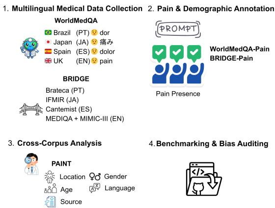  
Figure 1: Overview of PAINT: medical licensing examinations and clinical text in four languages, annotated with an ensemble of open-weight language models and validated by clinicians.

## 1 Introduction

Pain is a common and consequential symptom in clinical care, and prior work has shown that its assessment, treatment, and documentation vary with patient race, gender, age, and language (Singhal et al., 2016; Hofmann and Tarzian, 2001; Eccleston et al., 2021; Rambachan et al., 2023; Lor and Koleck, 2022). Such variation may afect clinical decision making. Studying these diferences across languages, document types, and patient demographics is therefore relevant both to clinical practice and to the evaluation of robustness and fairness in large language model (LLM)-based clinical NLP systems.

Multilingual clinical NLP primarily relies on two types of resources. Medical licensing examination benchmarks, such as MedQA and WorldMedQA, evaluate structured clinical knowledge in standardized exam settings (Jin et al., 2021; Alonso et al., 2024; Matos et al., 2025). Real-world clinical corpora, including MIMIC and BRIDGE, capture how clinicians document patient encounters in routine practice (Johnson et al., 2016; Wu et al., 2026). The two ofer diferent views of medical language: one reflects what medicine teaches, the other how medicine is practiced.

Despite growing interest in pain-related NLP, available resources remain limited in both linguistic and clinical diversity. A recent systematic review identified small sample sizes, monolingual datasets, and the underrepresentation of non-English populations as persistent challenges in the field (Rajwal, 2024). Existing annotated pain corpora have similarly focused on English clinical text, including UK mental health records annotated for pain relevance, anatomical location, and pain character (Chaturvedi et al., 2023), and US clinical notes annotated for chronic pain episodes, causes, locations, severities, and medications (Carlson et al., 2020). To date, no resource provides a unified multilingual representation of pain across both medical education and clinical practice.

In this work, we present PAINT, to our knowledge the first multilingual framework for analyzing pain representation across Portuguese, Japanese, Spanish, and English. PAINT is a data resource, and the LLM ensemble serves as its labeling methodology, with open-weight models benchmarked against clinician-annotated labels. We began from a clinical question, how pain is documented and how that documentation changes with language and patient demographics, and selected corpora accordingly. Cross-language corpora with matched documentation purpose for pain are scarce, so we work with the real-world clinical text that is available, in which pain appears incidentally rather than by design. PAINT comprises two resources: WorldMedQA-Pain, containing 2,963 medical licensing examination questions, and BRIDGE-Pain, containing 17,795 realworld clinical records. Pairing exam and clinical text within each language under a common schema, with clinician validation across all four languages, enables within-language comparisons between exam and clinical text. Figure 1 provides an overview of the PAINT framework.

Our contributions are threefold:

(1) Resource. A multilingual pain dataset that pairs medical-licensing-exam text with real clinical notes under one structured schema across four languages, with clinician-validated labels and a released extraction pipeline. The validated labels also serve as an evaluation set for pain extraction, useful for testing clinical NLP systems and LLMs, especially in non-English settings where such data are scarce.

(2) Methodology. A reproducible, clinicianvalidated labeling pipeline with three methodological strengths: generalizability, a cross-lingual, cross-corpus pain extraction and labeling framework; transferability, the pipeline validated on WorldMedQA-Pain transfers to BRIDGE-Pain, where clinician review confirms macro-F1 of at least 0.91 for pain relevance and pain presence and at least 92% accuracy for demographics across all five clinical corpora; and eficiency, the openweight ensemble matches GPT-5 on the consensus subset and runs locally on a single GPU, making it usable on controlled-access clinical corpora and in resource-constrained settings.

(3) Documentation. We document the released labels per partition: sample sizes, consensus coverage, pain relevance and presence rates, and demographic field coverage, together with the annotation protocol, clinician instructions, and every inter-annotator disagreement, so that users can judge the reliability of each field and partition before reusing them.

## 2 Related Work

Pain disparities and clinical bias. Recent studies suggest that AI systems may reproduce the disparities in pain assessment and treatment documented across race, gender, age, and language (Singhal et al., 2016; Hofman et al., 2016; Hofmann and Tarzian, 2001; Eccleston et al., 2021; Rambachan et al., 2023). In knee radiography, radiologist-based severity grading explains only a small share of racial disparities in reported pain, whereas a model trained on patients’ own pain reports explains substantially more of them (Pierson et al., 2021); demographic bias has also been observed in LLM-assisted opioid prescribing and pain management (Omar et al., 2026, 2025). Beyond clinical prediction, Berke et al. (2026) propose a computational theory of intuitive pain reasoning, modeling how humans infer and describe pain through mechanisms analogous to intuitive physics and theory of mind.

Multilingual clinical resources. Examination datasets such as MedQA (Jin et al., 2021), MedM-CQA (Pal et al., 2022), MedExpQA (Alonso et al., 2024), and WorldMedQA-V (Matos et al., 2025) evaluate clinical knowledge across one or multiple languages. In parallel, clinical corpora such as MIMIC-III and MIMIC-IV (Johnson et al., 2016, 2023) and the ICU databases unified by ricu (Pollard et al., 2018; Faltys et al., 2021; Thoral et al., 2021; Bennett et al., 2023) provide large-scale records of routine clinical documentation. More recently, BRIDGE (Wu et al., 2026) has expanded clinical benchmarking across institutions and languages, and DRAGON (Bosma et al., 2025) across Dutch clinical NLP tasks. However, none of these resources represents pain as a standardized, structured variable suitable for cross-lingual analysis.

LLM-based clinical information extraction. Few-shot prompting makes large language models efective clinical information extractors without task-specific fine-tuning (Agrawal et al., 2022), and chain-of-thought prompting (Wei et al., 2022) and self-consistency decoding (Wang et al., 2023) further improve their reasoning. Ensemble reasoning enhances the stability and consistency of structured clinical extraction (Chang et al., 2024). PAINT builds on this work by using two multilingual chain-of-thought prompting pipelines and requiring agreement among three models to generate high-precision silver annotations at scale.

## 3 Multilingual Medical Data Collection

WorldMedQA-Pain. WorldMedQA-Pain is constructed from the text-only national licensing examination partitions assembled by the WorldMedQA team as an extension of WorldMedQA-V (Matos et al., 2025), retaining four partitions in their original languages. The resulting corpus contains 2,963 instances spanning Brazilian Portuguese, Japanese, Spanish, and English. The four partitions correspond to REVALIDA (Brazil), the National Medical Licensing Examination (Japan), MIR (Spain), and PLAB (United Kingdom). Each instance carries clinician-annotated labels for pain relevance and pain presence, produced under the multilingual annotation protocol described in Appendix I.

BRIDGE-Pain. BRIDGE-Pain is derived from the multilingual BRIDGE benchmark (Wu et al., 2026) and consists of five clinical-text partitions: MEDIQA 2023 Chat-A (English doctor–patient dialogues) (Abacha et al., 2023), MIMIC-III Outcome (English ICU discharge summaries) (van Aken et al., 2021), Cantemist (Spanish oncology reports) (Miranda-Escalada et al., 2020), Brateca (Brazilian Portuguese electronic health records) (Consoli et al., 2022), and IFMIR (Japanese medication-safety incident reports) (Wong et al., 2024). We retain the complete MEDIQA and Cantemist partitions and randomly down-sample MIMIC-III, Brateca, and IFMIR to 5,000 records each. The final BRIDGE-Pain corpus contains 17,795 clinical documents, all annotated with the same multilingual ensemble pipeline and validated by clinicians on sampled records.

## 4 Pain and Demographic Annotation

We extract pain and demographic information using two chain-of-thought prompting pipelines (Wei et al., 2022; Kojima et al., 2022), one for pain attributes and one for demographic attributes. All source texts are processed in their original languages. Hierarchical constraints on the pain labels are enforced in the prompt. The complete prompts are provided in Appendix D.

Annotation schema. Each record is described by five fields organized under a hierarchical schema. Pain relevance indicates that the text mentions pain in any way, including a pain term, synonym, or derivative (e.g., painful, painless, or painkiller), as well as an explicit denial of pain. Pain presence, conditioned on relevance, indicates that pain is asserted to be present in the patient at least once. A record in which the only pain mention is a denial or refers to an attribute of an intervention is therefore relevant but not painpresent. Anatomical location, conditioned on pain presence, records the anatomical site or sites of pain as stated in the text, in concise medical terminology, or unspecified when pain is present but no site is named. Pain descriptors capture freetext descriptions of pain quality. Demographics include age, gender, ethnicity, and occupation when stated in the text. The distinction between relevance and presence is the central design choice of the schema: it separates records that mention pain from those in which pain is actually present, ensuring that denials and intervention-related mentions are not counted as pain. Table 1 gives examples of such mentions in each language.

<table><tr><td>Lang</td><td>Pain mention in source</td><td>Reason</td></tr><tr><td>en</td><td>“She has no pain”</td><td>denial</td></tr><tr><td>es</td><td>&quot;sin fiebre ni dolor&quot; (no fever or pain)</td><td>denial</td></tr><tr><td>pt</td><td>&quot;nódulo indolor&quot; (pain- painless less nodule)</td><td></td></tr><tr><td>ja</td><td>右陰囊の無痛性腫大 (painless swelling)</td><td>無痛性 (painless)</td></tr></table>

Table 1: Examples where pain is mentioned but not asserted in the patient, the mention-without-presence case, agreed by all three models. The trace is an explicit denial or a painless-type derivative. Quotes are excerpts from the source text.

Model selection. We evaluate five open-weight LLMs on WorldMedQA-Pain using nativelanguage inputs, with GPT-5 (gpt-5-2025-08-07) included as a proprietary reference. As shown in Table 2, Gemma-4-E4B (4B), Qwen3-8B (8B), and DeepSeek-R1-Distill-Qwen-32B (32B) perform best overall, with macro-F1 scores ranging from 0.87 to 0.97 for pain relevance and pain presence across the four partitions. LLaMA-3.1- 8B and MedGemma-4B score lower across the partitions and are not included in the ensemble.

Ensemble strategy. PAINT combines the three highest-performing open-weight models into a consensus ensemble; performance on non-consensus rows is reported in Table 3.

Let $y _ { i } ^ { ( m ) }$ denote the prediction of model m ∈ $\{ 1 , 2 , 3 \}$ for instance $i ,$ and let ⊥ denote abstention. For the binary tasks of pain relevance and pain presence, we use a strict three-way agreement rule:

$$
\hat { y } _ { i } = \left\{ \begin{array} { l l } { y _ { i } ^ { ( 1 ) } , } & { \mathrm { i f ~ } y _ { i } ^ { ( 1 ) } = y _ { i } ^ { ( 2 ) } = y _ { i } ^ { ( 3 ) } , } \\ { \bot , } & { \mathrm { o t h e r w i s e } . } \end{array} \right.\tag{1}
$$

The consensus subset is $S ~ = ~ \{ i ~ : ~ { \hat { y } } _ { i } ~ \neq ~ \bot \}$ and ensemble coverage is defined as $| S | / N$ , where membership in $S$ requires agreement on both pain fields. This rule prioritizes precision over recall by restricting downstream analyses to instances on which all three models agree.

For demographic attributes, we use majority voting over non-null predictions, retaining a value when at least two models agree and leaving the field missing when the predictions conflict without a majority. Thus, a value produced by only one model is retained only when no other model provides a conflicting prediction. Anatomical location and pain descriptors are represented as lists and aggregated item by item under the same twoof-three agreement rule. If only one model provides a list, its predictions are retained; otherwise, an item is retained only if at least two models include it. This strategy provides higher coverage for sparse attributes, such as ethnicity and occupation, for which requiring unanimous agreement across all three models would result in substantial data loss.

The abstain subset. The strict agreement rule sets aside 7–11% of WorldMedQA-Pain rows and up to 31.8% of Brateca. Because WorldMedQA-Pain provides clinician-annotated labels for every row, including abstained rows, we can assess whether the abstain subset is systematically harder than the consensus subset. Table 3 reports macro-F1 for both pain fields on the abstain subset for each individual model, the 2-of-3 majority vote, and GPT-5, with the 0.92–0.99 performance on the consensus subset serving as a reference. Difficulty is concentrated in pain presence: no system exceeds 0.75, and GPT-5 reaches only 0.63– 0.73, whereas pain relevance is more recoverable (GPT-5: 0.80–0.98). These results indicate that the disagreements leading to abstention are associated primarily with uncertainty about pain presence rather than pain relevance. Thus, the consensus subset is enriched for cases in which pain presence can be determined more reliably, rather than representing a random sample of the corpus.

Normalisation. We apply a deterministic postprocessing pipeline to normalize demographic values across languages. Age is represented in years by the first numeric value in the extracted age field; ages under one year are recorded as 0. Gender is mapped to the binary labels male and female using a cross-lingual dictionary. Ethnicity and occupation are preserved as free text. Values that cannot be normalized are recorded as null.

## 5 Clinician Validation

The extracted annotations were validated by ten clinicians, two per dataset. For each BRIDGE-Pain dataset, each of its two annotators independently reviewed a random sample of 100 records, and for each WorldMedQA-Pain partition, 30 records.

For WorldMedQA-Pain, clinician validation covered the demographic attributes of age, gender, and occupation, while pain relevance and pain presence were evaluated against the clinicianannotated labels. For BRIDGE-Pain, clinicians validated pain relevance, pain presence, age, gender, and occupation; anatomical location, pain descriptors, and ethnicity were not validated. To assess inter-annotator reliability, the two annotators assigned to each partition independently annotated an overlapping subset of 50 BRIDGE-Pain records and 10 WorldMedQA-Pain records, without communication or access to each other’s labels. Annotation dates for all annotators are reported in Appendix G.

<table><tr><td></td><td colspan="2">Brazil</td><td colspan="2">Japan</td><td colspan="2">Spain</td><td colspan="2">UK</td></tr><tr><td>Model</td><td>Rel.</td><td> $P r e s .$ </td><td>Rel.</td><td>Pres.</td><td>Rel.</td><td> $P r e s .$ </td><td>Rel.</td><td>Pres.</td></tr><tr><td></td><td colspan="8">Independent evaluation</td></tr><tr><td>Gemma-4-E4B</td><td>0.894</td><td>0.872</td><td>0.972</td><td>0.951</td><td>0.905</td><td>0.921</td><td>0.946</td><td>0.936</td></tr><tr><td>Qwen3-8B</td><td>0.879</td><td>0.873</td><td>0.948</td><td>0.956</td><td>0.913</td><td>0.917</td><td>0.931</td><td>0.932</td></tr><tr><td>DeepSeek-R1-Distill-Qwen-32B</td><td>0.870</td><td>0.872</td><td>0.936</td><td>0.965</td><td>0.889</td><td>0.892</td><td>0.935</td><td>0.949</td></tr><tr><td>LLaMA-3.1-8B</td><td>0.668</td><td>0.744</td><td>0.657</td><td>0.751</td><td>0.674</td><td>0.738</td><td>0.718</td><td>0.810</td></tr><tr><td>MedGemma-4B</td><td>0.685</td><td>0.730</td><td>0.786</td><td>0.782</td><td>0.791</td><td>0.808</td><td>0.810</td><td>0.824</td></tr><tr><td>GPT-5†</td><td>0.910</td><td>0.892</td><td>0.993</td><td>0.970</td><td>0.927</td><td>0.929</td><td>0.954</td><td>0.951</td></tr><tr><td></td><td colspan="8">Ensemble on the consensus subset</td></tr><tr><td>Coverage</td><td colspan="2">88.9%</td><td colspan="2">92.9%</td><td colspan="2">92.4%</td><td colspan="2">91.0%</td></tr><tr><td>3-model ensemble</td><td>0.922</td><td>0.916</td><td>0.992</td><td>0.992</td><td>0.935</td><td>0.960</td><td>0.961</td><td>0.969</td></tr><tr><td>GPT-5†</td><td>0.925</td><td>0.915</td><td>0.995</td><td>0.989</td><td>0.937</td><td>0.955</td><td>0.966</td><td>0.978</td></tr></table>

Table 2: Macro F1 for pain relevance and pain presence on WorldMedQA-Pain. “Rel.” and “Pres.” denote pain relevance and pain presence, respectively. Independent reports each model evaluated on the full corpus. Ensemble reports the ensemble, and GPT-5 for comparison, evaluated on the consensus subset, consisting of records on which all three selected models agree on both pain fields. Coverage is the fraction of the full corpus retained in the consensus subset. GPT-5† is included as a proprietary reference.
<table><tr><td rowspan="2">Model</td><td colspan="2">Brazil</td><td colspan="2">Japan</td><td colspan="2">Spain</td><td colspan="2">UK</td></tr><tr><td>Rel.</td><td>Pres.</td><td>Rel.</td><td>Pres.</td><td>Rel.</td><td>Pres.</td><td>Rel.</td><td>Pres.</td></tr><tr><td>Gemma-4-E4B</td><td>0.68</td><td>0.46</td><td>0.81</td><td>0.50</td><td>0.69</td><td>0.62</td><td>0.79</td><td>0.56</td></tr><tr><td>Qwen3-8B</td><td>0.56</td><td>0.50</td><td>0.60</td><td>0.61</td><td>0.76</td><td>0.61</td><td>0.62</td><td>0.53</td></tr><tr><td>DeepSeek-R1-Distill-Qwen-32B</td><td>0.46</td><td>0.56</td><td>0.49</td><td>0.75</td><td>0.53</td><td>0.47</td><td>0.62</td><td>0.75</td></tr><tr><td>2-of-3 majority vote</td><td>0.60</td><td>0.53</td><td>0.70</td><td>0.71</td><td>0.81</td><td>0.68</td><td>0.75</td><td>0.73</td></tr><tr><td>GPT-5†</td><td>0.80</td><td>0.64</td><td>0.98</td><td>0.73</td><td>0.85</td><td>0.68</td><td>0.83</td><td>0.63</td></tr></table>

Table 3: Pain macro-F1 on the non-consensus, or abstain, rows of WorldMedQA-Pain, for each model, the 2-of-3 majority vote, and GPT-5†. All systems score below the consensus macro-F1 of 0.92 to 0.99 in Table 2, most on pain-presence. Best per column in bold; †proprietary reference.

Metrics are defined under Tasks and metrics below. A blank value confirmed as correctly absent counts as correct, and agreement between clinicians requires an exact match of normalised values, with two blanks counted as a match. Percentage agreement is used for demographic fields because high-cardinality or single-category samples can make κ unstable or undefined; demographic κ values and the matching rules are given in Appendix E.

As shown in Table 5, the ensemble achieves macro-F1 scores of 0.91–1.00 on BRIDGE-Pain, comparable to its 0.92–0.99 performance on WorldMedQA-Pain. Demographic extraction reaches 92–100% accuracy across all five clinical datasets. Inter-annotator agreement is similarly high, with $\kappa = 0 . 8 8 – 1 . 0 0$ for pain relevance, κ = 0.87–1.00 for pain presence, and 90–100% agreement for demographic attributes across the BRIDGE-Pain and WorldMedQA-Pain overlaps. Wherever defined, demographic κ values range from 0.82 to 1.00, corresponding to almost-perfect agreement under the Landis and Koch (1977) scale. Detailed per-field results, confusion matrices, and all observed disagreements are provided in Appendix E.

<table><tr><td>Field</td><td>Task</td><td>Definition</td><td>Input</td><td>Output</td><td>Metric</td></tr><tr><td>Pain relevance</td><td>IE</td><td>Pain-related concepts</td><td>Text</td><td>True / False</td><td>Macro-F1</td></tr><tr><td>Pain presence</td><td>IE</td><td>Pain assertion in the patient</td><td>Text</td><td>True / False</td><td>Macro-F1</td></tr><tr><td>Age</td><td>IE</td><td>Patient&#x27;s age</td><td>Text</td><td>Number</td><td>Accuracy</td></tr><tr><td>Gender</td><td>IE</td><td>Patient&#x27;s gender</td><td>Text</td><td>Male / Female</td><td>Accuracy</td></tr><tr><td>Occupation</td><td>IE</td><td>Patient&#x27;s occupation</td><td>Text</td><td>Text</td><td>Accuracy</td></tr></table>

Table 4: The PAINT extraction pipeline, with each field’s task, definition, input, output, and metric. IE: information extraction.

<table><tr><td colspan="2">Pain</td><td colspan="2">Demographics</td></tr><tr><td>Dataset</td><td>Rel.  $P r e s .$ </td><td>Age Gen.</td><td>Occ.</td></tr><tr><td>(a) Ensemble vs. clinician (F1 / acc)</td><td></td><td></td><td>99</td></tr><tr><td>MEDIQA MIMIC-III Cantemist IFMIR</td><td>0.91 0.96 0.95 0.96 0.98 1.00 1.00 1.00</td><td>99 99 99 100 100 97 92 95</td><td>96 97 97</td></tr><tr><td colspan="4">Brateca 1.00 0.97 97 100 100 (b) Clinician vs. clinician (κ / %)</td></tr><tr><td>MEDIQA MIMIC-III Cantemist IFMIR</td><td colspan="3">0.88 1.00 100 0.88 0.92 100 1.00 1.00 100 0.92 1.00 100 1.00 0.87 98</td></tr></table>

Table 5: Clinician validation on BRIDGE-Pain, with 100 records per clinician and a 50-record overlap per dataset. Panel (a): ensemble versus clinician annotations; macro-F1 is reported for pain relevance and pain presence, and accuracy for demographic extraction. Panel (b): agreement between the two clinicians on the overlapping subset; Cohen’s κ is reported for the binary pain fields and percentage agreement for demographic fields.

Tasks and metrics. PAINT is formulated as a multilingual information extraction benchmark. Table 4 lists each clinician-validated field with its task, definition, input, output, and evaluation metric. We report macro-F1 for the binary pain tasks, the unweighted mean over the True and False classes of $\begin{array} { l } { F _ { 1 } } \end{array} = \begin{array} { l } { \frac { 2 P R } { P + R } } \end{array}$ , and accuracy for demographic extraction, the fraction of records whose extracted value matches the clinician-confirmed value. Inter-annotator agreement is measured using Cohen’s $\begin{array} { r } { \kappa = \frac { p _ { o } - p _ { e } } { 1 - p _ { e } } } \end{array}$ for pain relevance and pain presence, where $p _ { o }$ is observed agreement and $p _ { e }$ the agreement expected from the two annotators’ marginals, and percentage agreement $( p _ { o } )$ for demographic attributes.

## 6 Availability and Dataset Statistics

Reproducibility. We release the extraction pipeline, prompts, schema, validation and agreement scripts, WorldMedQA-Pain labels, and clinician annotation sheets (source text removed) for the publicly licensed corpora; sheets for credentialed corpora are provided on request. The released consensus labels cover pain relevance and pain presence; anatomical location, pain descriptors, and demographic fields are provided as per-model raw outputs and can be aggregated with the released scripts. The clinician gold labels for WorldMedQA-Pain will be made available in a subsequent version. BRIDGE-Pain cannot be redistributed under the underlying corpus licenses, but users with access can regenerate the labels using the released pipeline. Every number in Tables 5, 10, 11 and 13 reproduces from the sheets with the released scripts, as documented in Appendix E.

Dataset statistics. Tables 6 and 7 summarise the released labels per partition. The label distributions difer substantially between partitions and are not comparable prevalence estimates.

## 7 Conclusion

We introduced PAINT, to our knowledge the first multilingual resource for pain representation across medical licensing examinations and realworld clinical text in English, Spanish, Portuguese, and Japanese. It contributes clinician-validated pain and demographic annotations and the openweight labeling pipeline.

PAINT is intended as a benchmark for multilingual clinical information extraction and as infrastructure for studying how pain documentation, and the demographic detail attached to it, varies across languages and care settings, including whether large language models reproduce known disparities in pain assessment. The pipeline extends to further languages and document types with minimal adaptation.

<table><tr><td>Split</td><td>Lang</td><td>n</td><td>PP-res.</td><td>Pain-pres.</td><td>Age</td><td>Gender</td><td>Ethnicity</td><td>Occupation</td></tr><tr><td colspan="9">WorldMedQA-Pain (exam corpus, n=2,963)</td></tr><tr><td>Brazil REVALIDA</td><td>pt</td><td>904</td><td>804 (88.9%)</td><td>271 (33.7%)</td><td>83.1%</td><td>84.6%</td><td>1.9%</td><td>9.0%</td></tr><tr><td>Japan NLE</td><td>ja</td><td>742</td><td>689 (92.9%)</td><td>112 (16.3%)</td><td>49.8%</td><td>49.9%</td><td>0.6%</td><td>5.2%</td></tr><tr><td>Spain MIR</td><td>es</td><td>1,049</td><td>969 (92.4%)</td><td>136 (14.0%)</td><td>44.3%</td><td>42.6%</td><td>0.4%</td><td>2.0%</td></tr><tr><td>UK PLAB</td><td>en</td><td>268</td><td>244 (91.0%)</td><td>90 (36.9%)</td><td>95.5%</td><td>98.4%</td><td>0.8%</td><td>2.1%</td></tr><tr><td colspan="9">BRIDGE-Pain (clinical text, n=17,795)</td></tr><tr><td>MEDIQA chat-A</td><td>en</td><td>1,501</td><td>1,402 (93.4%)</td><td>286 (20.4%)</td><td>14.1%</td><td>40.2%</td><td>3.0%</td><td>7.1%</td></tr><tr><td>MIMIC-III Mort.</td><td>en</td><td>5,000</td><td>3,993 (79.9%)</td><td>2,542 (63.7%)</td><td>87.0%</td><td>100.0%</td><td>89.6%</td><td>41.5%</td></tr><tr><td>Cantemist-NER</td><td>es</td><td>1,294</td><td>1,091 (84.3%)</td><td>740 (67.8%)</td><td>95.6%</td><td>98.6%</td><td>1.9%</td><td>14.9%</td></tr><tr><td>IFMIR-Incident</td><td>ja</td><td>5,000</td><td>4,744 (94.9%)</td><td>389 (8.2%)</td><td>7.5%</td><td>4.2%</td><td>0.0%</td><td>3.2%</td></tr><tr><td>Brateca-Mort.</td><td>pt</td><td>5,000</td><td>3,411 (68.2%)</td><td>2,392 (70.1%)</td><td>99.8%</td><td>99.9%</td><td>73.8%</td><td>7.9%</td></tr><tr><td>Total</td><td></td><td>20,758</td><td>17,347 (83.6%)</td><td>6,958</td><td></td><td></td><td></td><td></td></tr></table>

Table 6: Sample budget per split. n: extracted records. PP-res.: rows where all three models agree on both pain fields. Pain-pres.: pain-presence-positive rows within PP-resolved. Demographic columns give ensemble coverage within the PP-resolved rows. The three largest partitions are down-sampled to 5,000; Cantemist and MEDIQA are in full.

<table><tr><td></td><td>Brazil</td><td>Japan</td><td>Spain</td><td>UK</td></tr><tr><td>Language</td><td>pt</td><td>ja</td><td>es</td><td>en</td></tr><tr><td>Exam</td><td>REVALIDA</td><td>NLE</td><td>MIR</td><td>PLAB</td></tr><tr><td>Years</td><td>2011-23</td><td></td><td>2022–24 2018–23</td><td>2025</td></tr><tr><td>n items</td><td>904</td><td>742</td><td>1,049</td><td>268</td></tr><tr><td>Pain-rel. %</td><td>36.5</td><td>17.5</td><td>15.9</td><td>38.8</td></tr><tr><td>Pain-pres. %</td><td>30.0</td><td>15.1</td><td>13.0</td><td>33.6</td></tr><tr><td>Location %</td><td>27.8</td><td>14.7</td><td>11.8</td><td>32.8</td></tr></table>

Table 7: WorldMedQA-Pain per-partition statistics. Pain rates are from the three-model ensemble; clinicianannotated labels only validate it, see Appendix I and Table 2. The Location column is the share of items with a non-empty pain-location.

## Limitations

Cross-partition comparability. Corpus purpose, language, country, and healthcare system co-vary across the nine partitions, so the label distributions in Table 6 characterise each corpus rather than estimate prevalence. Diferences between partitions should be read as corpus-purpose efects rather than as cultural claims about pain experience.

Scope. PAINT captures pain as documented by clinicians and examination writers, not as reported by patients; none of the source corpora carry numeric pain scores. The schema is designed to accommodate structured pain-intensity scores and patient-reported pain once corpora with such data become available.

Restricted data availability. The five BRIDGE-Pain partitions cannot be redistributed, so the clinical half of the resource must be regenerated by users with access to the source data, using the released pipeline.

Language-variety mismatch. Unlike the Spanish and Japanese partitions, the English partitions are not country-matched: WorldMedQA-Pain uses the UK PLAB examination, whereas BRIDGE-Pain contains US clinical corpora (MEDIQA and MIMIC-III), so exam-versus-clinical diferences in English are confounded with British versus American clinical language. Also, both Portuguese partitions are Brazilian, so European Portuguese pain vocabulary is not represented.

## Ethics Statement

Data governance and human annotation. PAINT combines public medical licensing examinations with multilingual clinical corpora. WorldMedQA contains no patient-identifiable information, and the pain annotation study was granted IRB exemption by MIT. The annotation efort was conducted by ten clinicians (nine physicians and one pharmacist), all fluent in the source languages and listed as co-authors. Annotation procedures and timelines are documented in Appendix G.

Clinical data and redistribution. The five BRIDGE-Pain corpora are used in accordance with their original licensing and ethical frameworks, including the PhysioNet Credentialed Health Data License for MIMIC-III. PAINT does not redistribute source clinical text. Clinician annotation sheets are released with all source text removed for corpora whose licenses permit it (WorldMedQA, Cantemist, IFMIR); for the remaining corpora (MIMIC-III, MEDIQA, Brateca) they are provided on request to users with access to the underlying corpus.

Intended use. PAINT is designed to support multilingual clinical NLP research, information extraction, and fairness auditing. It is not intended for clinical diagnosis, treatment recommendation, or automated triage. Because demographic attributes may be sensitive, demographic results for restricted clinical datasets are reported as aggregate statistics; the only record-level values shown are the seventeen annotation disagreements in Appendix E, which carry no identifiers.

## Acknowledgements

LAC is funded by the National Institutes of Health through DS-I Africa U54 TW012043-01 and Bridge2AI OT2OD032701, the National Science Foundation through ITEST #2148451, a grant of the Boston-Korea Innovative Research Project (RS-2024-00403047), and a grant of the Korea Health Technology R&D Project (RS-2024- 00439677) through the Korea Health Industry Development Institute (KHIDI), funded by the Ministry of Health & Welfare, Republic of Korea. YM was supported by the IVADO Postdoctoral Research Funding Program, funded through the Canada First Research Excellence Fund (CFREF).

## References

Asma Ben Abacha, Wen-wai Yim, Yadan Fan, and Thomas Lin. 2023. An empirical study of clinical note generation from doctor-patient encounters. In Proceedings of the 17th Conference of the European Chapter of the Association for Computational Linguistics, pages 2291–2302.

Monica Agrawal, Stefan Hegselmann, Hunter Lang, Yoon Kim, and David Sontag. 2022. Large language models are few-shot clinical information extractors. In Proceedings of the 2022 Conference on Empirical Methods in Natural Language Processing, pages 1998–2022.

Iñigo Alonso, Maite Oronoz, and Rodrigo Agerri. 2024. MedExpQA: Multilingual benchmarking of large language models for medical question answering. Artificial Intelligence in Medicine, 155:102938.

Nicolas Bennett, Drago Plečko, Ida-Fong Ukor, Nicolai Meinshausen, and Peter Bühlmann. 2023. ricu: R’s interface to intensive care data. GigaScience, 12:giad041.

Marlene Berke, Katherine Collins, Joshua Tenenbaum, and Rebecca Saxe. 2026. Toward a formalization of human intuitive theories of bodily pain. In Proceedings of the 48th Annual Conference of the Cognitive Science Society (CogSci 2026).

Joeran S. Bosma and 1 others. 2025. The DRAGON benchmark for clinical NLP. npj Digital Medicine, 8:289.

Luke A Carlson, Molly M Jefery, Sunyang Fu, Huan He, Rozalina G McCoy, Yanshan Wang, William Michael Hooten, Jennifer St Sauver, Hongfang Liu, and Jungwei Fan. 2020. Characterizing chronic pain episodes in clinical text at two health care systems: Comprehensive annotation and corpus analysis. JMIR Medical Informatics, 8(11):e18659.

Chia-Hsuan Chang, Mary M. Lucas, Yeawon Lee, Christopher C. Yang, and Grace Lu-Yao. 2024. Beyond self-consistency: Ensemble reasoning boosts consistency and accuracy of LLMs in cancer staging. In Proceedings of the 22nd International Conference on Artificial Intelligence in Medicine (AIME 2024).

Jaya Chaturvedi, Natalia Chance, Luwaiza Mirza, Veshalee Vernugopan, Sumithra Velupillai, Robert Stewart, and Angus Roberts. 2023. Development of a corpus annotated with mentions of pain in mental health records: Natural language processing approach. JMIR Formative Research, 7:e45849.

Bernardo Scapini Consoli, Henrique Dias P dos Santos, Ana Helena DPS Ulbrich, Renata Vieira, and Rafael Heitor Bordini. 2022. Brateca (brazilian tertiary care dataset): a clinical information dataset for the portuguese language. In Proceedings ofthe 13th Conference on Language Resources and Evaluation (LREC 2022), Marseille, 20-25 June, 2022, França.

Christopher Eccleston, Emma Fisher, Richard F. Howard, Rebeccah Slater, Paula Forgeron, Tonya M. Palermo, Kathryn A. Birnie, Brian J. Anderson, Christine T. Chambers, Geert Crombez, Gustaf Ljungman, Isabel Jordan, Zachary Jordan, Caitriona Roberts, Neil Schechter, Christine B. Sieberg, Dick Tibboel, Suellen M. Walker, Dominic Wilkinson, and Christine Wood. 2021. Delivering transformative action in paediatric pain: a lancet child & adolescent health commission. Lancet Child & Adolescent Health, 5(1):47–87.

Martin Faltys, Marc Zimmermann, Xinrui Lyu, Matthias Hüser, Stephanie L. Hyland, Gunnar Rätsch, and Tobias M. Merz. 2021. HiRID, a high time-resolution ICU dataset. PhysioNet. Version 1.1.1.

Kelly M. Hofman, Sophie Trawalter, Jordan R. Axt, and M. Norman Oliver. 2016. Racial bias in pain assessment and treatment recommendations, and false beliefs about biological diferences between blacks and whites. Proceedings of the National Academy of Sciences, 113(16):4296–4301.

Diane E. Hofmann and Anita J. Tarzian. 2001. The girl who cried pain: a bias against women in the treatment of pain. Journal of Law, Medicine & Ethics, 29(1):13–27.

Di Jin, Eileen Pan, Nassim Oufattole, Wei-Hung Weng, Hanyi Fang, and Peter Szolovits. 2021. What disease does this patient have? a large-scale open-domain question answering dataset from medical exams. Applied Sciences, 11(14):6421.

Alistair E. W. Johnson, Lucas Bulgarelli, Lu Shen, Alvin Gayles, Ayad Shammout, Steven Horng, Tom J. Pollard, Sicheng Hao, Benjamin Moody, Brian Gow, Li-wei H. Lehman, Leo A. Celi, and Roger G. Mark. 2023. MIMIC-IV, a freely accessible electronic health record dataset. Scientific Data, 10(1):1.

Alistair E. W. Johnson, Tom J. Pollard, Lu Shen, Liwei H. Lehman, Mengling Feng, Mohammad Ghassemi, Benjamin Moody, Peter Szolovits, Leo Anthony Celi, and Roger G. Mark. 2016. MIMIC-III, a freely accessible critical care database. Scientific Data, 3:160035.

Takeshi Kojima, Shixiang Shane Gu, Machel Reid, Yutaka Matsuo, and Yusuke Iwasawa. 2022. Large language models are zero-shot reasoners. In Advances in Neural Information Processing Systems (NeurIPS).

J. Richard Landis and Gary G. Koch. 1977. The measurement of observer agreement for categorical data. Biometrics, 33(1):159–174.

Maichou Lor and Theresa A. Koleck. 2022. Patient race, ethnicity, language, and pain severity in primary care: A retrospective electronic health record study. Pain Management Nursing, 23(4):385–390.

João Matos, Shan Chen, Siena Placino, Yingya Li, Juan Carlos Climent Pardo, Daphna Idan, Takeshi Tohyama, David Restrepo, Luis F. Nakayama, Jose M. M. Pascual-Leone, Guergana Savova, Hugo Aerts, Leo A. Celi, A. Ian Wong, Danielle S. Bitterman, and Jack Gallifant. 2025. WorldMedQA-V: a multilingual, multimodal medical examination dataset for multimodal language models evaluation. In Findings of the Association for Computational Linguistics: NAACL 2025. WorldMedQA-V is the published multimodal release (Brazil, Israel, Japan, Spain); the text-only partitions used here (REVAL-IDA, NLE, MIR, PLAB) come from the project’s forthcoming text-only extension, provided by the WorldMedQA team.

Antonio Miranda-Escalada, Eulàlia Farré, and Martin Krallinger. 2020. Named entity recognition, concept normalization and clinical coding: Overview of the cantemist track for cancer text mining in spanish, corpus, guidelines, methods and results. IberLEF@ SE-PLN, pages 303–323.

Mahmud Omar, Shelly Sofer, Reem Agbareia, Nicola Luigi Bragazzi, Benjamin S. Glicksberg, Yasmin L. Hurd, Donald U. Apakama, Alexander W.

Charney, David L. Reich, Girish N. Nadkarni, and Eyal Klang. 2026. Socio-demographic gaps in pain management guided by large language models. Nature Health, 1:216–225.

Mahmud Omar, Vera Sorin, Reem Agbareia, Donald U. Apakama, Ali Soroush, Ankit Sakhuja, Robert Freeman, Carol R. Horowitz, Lynne D. Richardson, Girish N. Nadkarni, and Eyal Klang. 2025. Evaluating and addressing demographic disparities in medical large language models: a systematic review. International Journalfor Equity in Health, 24:57.

Ankit Pal, Logesh Kumar Umapathi, and Malaikannan Sankarasubbu. 2022. MedMCQA: A large-scale multi-subject multi-choice dataset for medical domain question answering. In Proceedings of the Conference on Health, Inference, and Learning (CHIL), volume 174 of Proceedings of Machine Learning Research.

Emma Pierson, David M. Cutler, Jure Leskovec, Sendhil Mullainathan, and Ziad Obermeyer. 2021. An algorithmic approach to reducing unexplained pain disparities in underserved populations. Nature Medicine, 27(1):136–140.

Tom J. Pollard, Alistair E. W. Johnson, Jesse D. Rafa, Leo A. Celi, Roger G. Mark, and Omar Badawi. 2018. The eICU collaborative research database, a freely available multi-center database for critical care research. Scientific Data, 5:180178.

Swati Rajwal. 2024. Decade of natural language processing in chronic pain: A systematic review. Preprint, arXiv:2412.15360.

Aksharananda Rambachan, Hamedullah Noorulhuda, Margaret C. Fang, Marilyn Bazinski, Solmaz Manuel, Colin Hubbard, and Priya Prasad. 2023. Pain assessment disparities by race, ethnicity, and language in adult hospitalized patients. Pain Management Nursing, 24(4):393–399.

Astha Singhal, Yu-Yu Tien, and Renee Y. Hsia. 2016. Racial-ethnic disparities in opioid prescriptions at emergency department visits for conditions commonly associated with prescription drug abuse. PLOS ONE, 11(8):e0159224.

Patrick J. Thoral, Jan M. Peppink, Ronald H. Driessen, and 1 others. 2021. Sharing ICU patient data responsibly under the SCCM and ESICM joint data science collaboration: The AmsterdamUMCdb example. Critical Care Medicine, 49(6):e563–e577.

Betty van Aken, Jens-Michalis Papaioannou, Manuel Mayrdorfer, Klemens Budde, Felix Gers, and Alexander Loeser. 2021. Clinical outcome prediction from admission notes using self-supervised knowledge integration. In Proceedings of the 16th Conference of the European Chapter of the Association for Computational Linguistics: Main Volume, pages 881–893, Online. Association for Computational Linguistics.

Xuezhi Wang, Jason Wei, Dale Schuurmans, Quoc Le, Ed Chi, Sharan Narang, Aakanksha Chowdhery, and Denny Zhou. 2023. Self-consistency improves chain of thought reasoning in language models. In International Conference on Learning Representations.

Jason Wei, Xuezhi Wang, Dale Schuurmans, Maarten Bosma, Brian Ichter, Fei Xia, Ed H. Chi, Quoc V. Le, and Denny Zhou. 2022. Chain-of-thought prompting elicits reasoning in large language models. In Advances in Neural Information Processing Systems (NeurIPS).

Zoie SY Wong, Neil Waters, Jiaxing Liu, and Shin Ushiro. 2024. A large dataset of annotated incident reports on medication errors. Scientific Data, 11(1):260.

Jiageng Wu, Bowen Gu, Ren Zhou, Kevin Xie, Doug Snyder, Yixing Jiang, Valentina Carducci, Richard Wyss, Rishi J. Desai, Emily Alsentzer, Leo Anthony Celi, Adam Rodman, Sebastian Schneeweiss, Jonathan H. Chen, Santiago Romero-Brufau, Kueiyu Joshua Lin, and Jie Yang. 2026. BRIDGE: Benchmarking large language models for understanding real-world clinical practice texts. Nature Biomedical Engineering.

## A Compute and infrastructure

PAINT uses inference only, no model is trained or fine-tuned. The ensemble runs three open-weight models — Gemma-4-E4B (4B), Qwen3-8B (8B), and DeepSeek-R1-Distill-Qwen-32B (32B) — under 4-bit quantization, with GPT-5 (gpt-5-2025-08- 07) included as a proprietary reference accessed through the OpenAI API. Open-weight inference was run on a single NVIDIA A100 (40 GB) or L4 (24 GB) GPU, with 4-bit NF4 quantization via bitsandbytes. GPT-5 was queried via API and used no local compute.

## B Pain descriptor vocabulary by language

Table 8 lists frequent tokens in the pain descriptors field (pain\_type) per language across both corpora. Japanese descriptors are compounds ending in 痛 that fuse location and quality in one word, whereas English, Spanish, and Portuguese use location-independent adjectives (sharp, punzante, aguda) that translate almost directly among themselves.

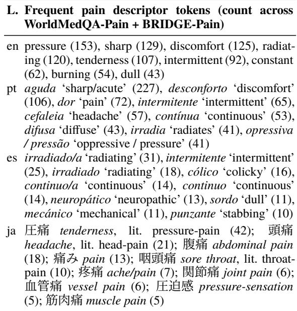

size of each bin and the age skew of each source are visible. The number in each cell is the bin’s sample size, and its colour encodes the bin’s share of the partition. The extreme bins are thin on several partitions, which users should keep in mind when stratifying by age.

## D Prompts

We list the prompt templates used in PAINT. Figures 3 and 4 give the English pain and demographic extraction prompts. Figures 5, 6, and 7 list the Japanese, Spanish, and Brazilian Portuguese substitutions for the pain template, and Figures 8, 9, and 10 do the same for the demographic template. The token {text} is the placeholder for the input clinical text.

Prompt authorship. The English prompts were drafted by the authors against the annotation schema and the protocol in Appendix I. The Japanese, Spanish, and Brazilian Portuguese variants reuse the four-step English template verbatim; only the lexicon entries, presence/non-presence worked examples, location labels, severity labels where applicable, and pain\_type descriptors are substituted with native surface forms. Each language’s substitutions were authored by an author or collaborator fluent in that language and crosschecked against the per-language pain lexicon documented in Table 16.

## E Clinician validation

This appendix gives the per-field detail behind the clinician validation summarised in Table 5; all numbers reproduce from the annotation sheets, released for the publicly licensed corpora and available on request for the credentialed ones, via src/paint/clinician\_validation.py and src/paint/kappa\_transparency.py. Table 9 pools the BRIDGE-Pain validation across the five datasets per field, on the records where the two clinicians agree; disagreements are excluded and are reflected by κ in Table 5. It reports macro-F1 against clinician annotation for the binary pain fields, and clinician-confirmed accuracy with a Wilson 95% CI for the extraction-style demographic fields. Pain macro-F1 is 0.98 on both fields and every demographic field clears 97%, so the released silver labels track clinician judgement on the consensus subset at high precision.

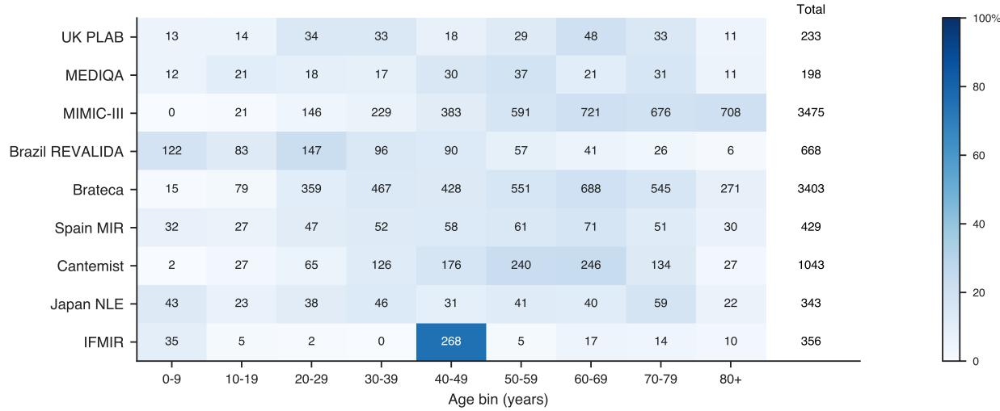  
Figure 2: Age composition per dataset. Each cell shows the bin’s sample size; colour encodes its share of the dataset, and rows sum to 100%. Total is the age-labelled count within the pain-consensus subset.

Matching rules. Accuracy in panel (a) of Table 5 is the fraction of records on which the clinician marked the ensemble value correct. The judgement is the clinician’s, not a string comparison: following the instructions in Appendix F, a blank ensemble value is marked correct when the text states no such information, and an occupation is marked correct when it names the occupation stated in the text, so wording variants such as “nurse” and “registered nurse” are not penalised. Percentage agreement in panel (b) compares the two clinicians’ final labels, each reconstructed as the ensemble value when marked correct and as the supplied correction otherwise. Labels are normalised before comparison: blank and null-equivalent cells map to a single missing value, age to its first integer, and gender to male or fe male; occupation is compared as an exact string after lower-casing and whitespace trimming, so “nurse” and “registered nurse” count as a disagreement here. Two missing values count as agreement. Records on which either clinician left the field unjudged are excluded from the agreement denominator.

Table 11 gives, for every demographic field, percent agreement alongside Cohen’s κ and the chance-agreement term $p _ { e }$ that κ corrects for, so that readers can see where κ is informative and where it is undefined. Table 12 lists every disagreement observed across all double-annotated overlaps, and Table 13 gives the Cantemist confusion matrices in full. Cantemist consists of structured oncology case reports in which pain and demographics are stated explicitly, which may account for the near-perfect agreement. Each Cantemist annotator labelled 100 records with a 50-record overlap (150 unique records in total), and the two agree on every overlapping record (κ = 1.00 on all five fields); the same clinician also annotated the WorldMedQA Spain-MIR partition, where agreement is 100%. Table 10 reports the WorldMedQA-Pain demographic validation, which we keep out of the main results: the exam pain fields already carry clinician-annotated labels, reported in Table 2, and exam demographics, stated explicitly in the vignette, are near-ceiling, so this is a confirmatory check, not a finding.

<table><tr><td>Field</td><td>Metric</td><td>Value</td><td>95% CI</td></tr><tr><td>Pain-relevance</td><td>macro-F1</td><td>0.98</td><td></td></tr><tr><td>Pain-presence</td><td>macro-F1</td><td>0.98</td><td></td></tr><tr><td>Age</td><td>accuracy</td><td>97.3%</td><td>[95.9, 98.3]</td></tr><tr><td>Gender</td><td>accuracy</td><td>98.1%</td><td>[96.9, 98.9]</td></tr><tr><td>Occupation</td><td>accuracy</td><td>97.9%</td><td>[96.6, 98.7]</td></tr></table>

Table 9: BRIDGE-Pain validation pooled across the five datasets, on records where the two clinicians agree, about 750 each. Pain fields give the ensemble macro-F1 against clinician annotation; demographic fields give clinician-confirmed accuracy with a Wilson 95% confidence interval. Per-dataset values are in Table 5.

## F Verification protocol and annotator instructions

WorldMedQA-Pain pain labels are produced by open annotation under the three-step procedure in Appendix I. All other clinician labels, the five

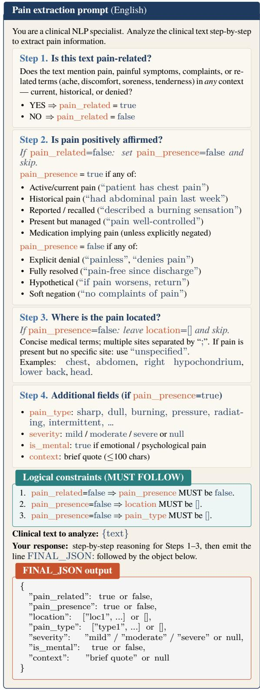  
Figure 3: Pain extraction prompt, English. The same four-step template, hierarchical constraints, and FI-NAL\_JSON schema are reused across all four languages; only the in-language lexicon and worked examples difer, see Figs. 5–7.

BRIDGE-Pain fields and the WorldMedQA-Pain demographic fields, are produced by verification: the annotator sees the ensemble’s value for each field and judges whether it is correct, supplying the correct value when it is not. The instructions below were sent to every annotator with their sheet and are abridged here to the parts that define the task; the WorldMedQA-Pain version listed only the three demographic fields.

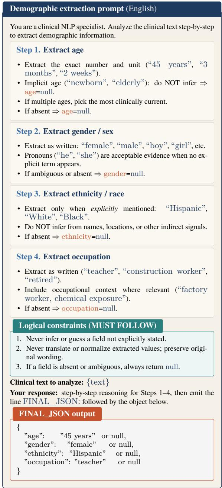  
Figure 4: Demographic extraction prompt, English. The same template and never-infer policy are reused in the native-language variants with locally-attested surface forms substituted in.

We have used language models to extract pain and demographic information from clinical text, and we need clinician judgment to verify how accurate those extractions are. Your task is to mark whether each extracted value is correct. Each row of the spreadsheet shows a value our system extracted (the …\_\_consensus column). For each field, please fill in two columns: …\_\_correct(TRUE/FALSE), TRUE if the value is correct, FALSE if not; …\_\_true\_value\_if\_false, only when you marked FALSE: write the correct value. Please read the clinical text in the input\_text column to decide, and do not edit the consensus or input\_text columns.

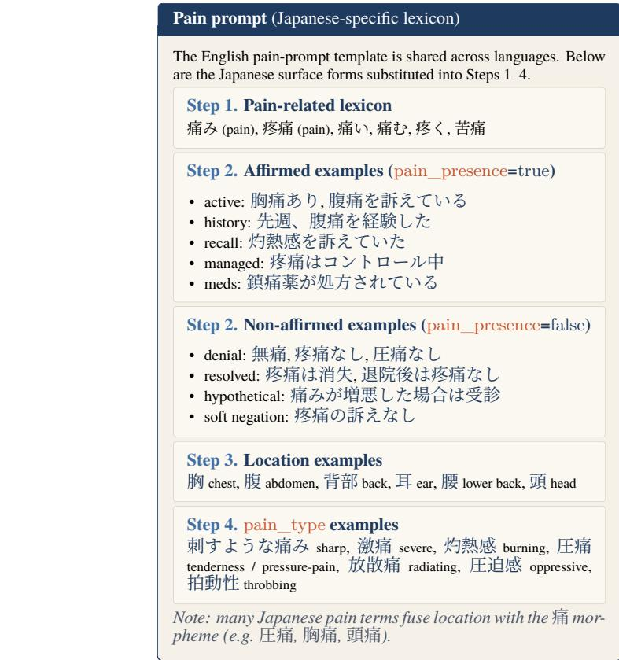  
Figure 5: Japanese pain-prompt substitutions: Step 1 lexicon and Step 2–4 worked examples. The rest of the template, Fig. 3, is unchanged.

Fields you’ll see: pain\_related, the text mentions pain in any way (including pain that is denied/ruled out); pain\_presence, pain is afirmed as actually present (now or in the past); age, gender, occupation, patient demographics as stated in the text.

One important point: a blank consensus value means our system found no such information in the text. If the text contains no age/gender/etc., mark TRUE; if the information is there and we missed it, mark FALSE and supply the correct value.

Each sheet holds one row per record. Every row begins with identifier columns and the source text, then carries three columns per field, listed in Table 14. BRIDGE-Pain sheets carry row\_index, orig\_id, dataset, language, input\_text and the three columns for each of five fields, twenty columns in total; WorldMedQA-Pain sheets carry row\_index, question\_id, dataset, language, input\_text and the three columns for age, gender and occupation only, fourteen in total.

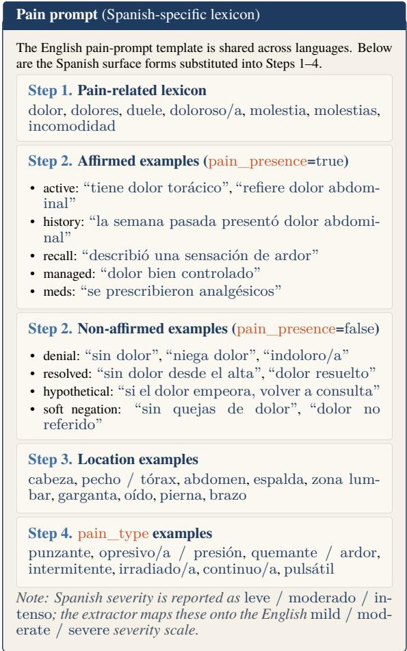  
Figure 6: Spanish pain-prompt substitutions.

A FALSE judgement with the correction left blank encodes “the text does not state this value”; it is a judgement, not a skipped cell. A blank \_\_correct cell would be a skipped cell, treated as missing data; none occur in the released sheets.

## G Annotation provenance

Table 15 gives the recruitment and return date of every clinician for every partition, taken from the assignment tracker maintained throughout the project. Clinicians are coded P1–P10; the same code denotes the same person across rows. P5, a pharmacist (all others are physicians), annotated the two Spanish partitions in July; all other partitions were annotated in May. All annotations were carried out individually. Every annotator worked from a separate sheet with no communication and no visibility into any other annotator’s labels or into whether their own judgements matched the pipeline’s.

The four English annotators are physicians who trained in English-medium medical programmes outside the United Kingdom and the United States and for whom English is the working clinical language; at the time of annotation, three were in clinical training programmes in the United States and one in Canada. Annotators for Spanish, Portuguese, and Japanese are native speakers of the corpus language.

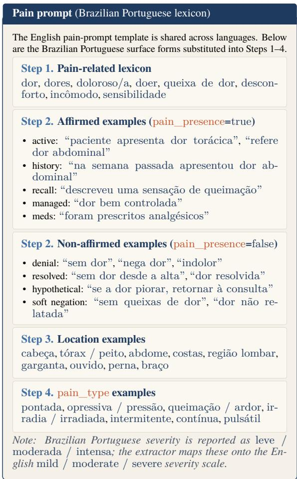  
Figure 7: Brazilian Portuguese pain-prompt substitutions.

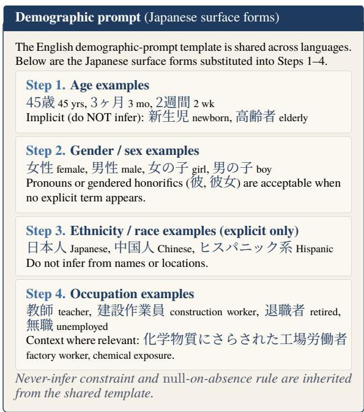  
Figure 8: Japanese demographic-prompt substitutions.

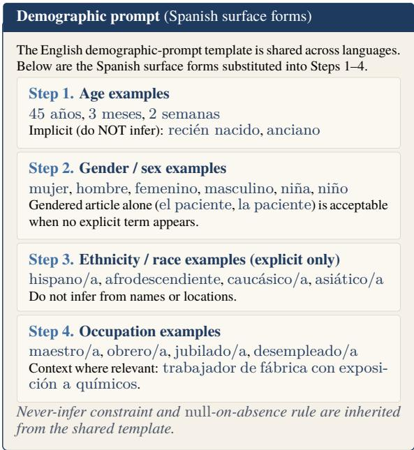  
Figure 9: Spanish demographic-prompt substitutions.

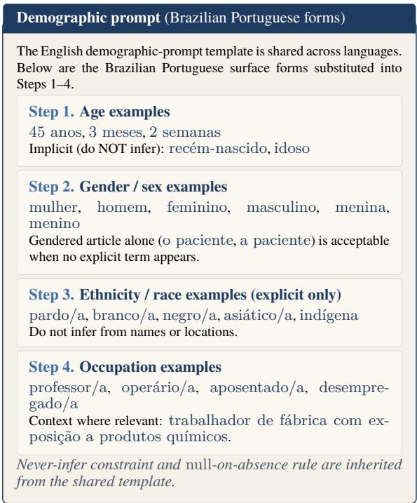  
Figure 10: Brazilian Portuguese demographic-prompt substitutions.

Annotators verified a displayed ensemble label against the source text rather than labelling from scratch. This protocol has a consequence for the agreement ceiling: where the displayed label is correct and the text is explicit, two competent readers should agree, and high agreement is the expected outcome rather than a surprising one. Table 12 shows that the same protocol does register disagreement where the text is genuinely ambiguous.

<table><tr><td>Split</td><td>Age Gen.</td><td>Occ.</td></tr><tr><td>Clinician-confirmed accuracy (%)</td><td></td><td></td></tr><tr><td>UK PLAB Spain MIR Japan NLE</td><td>100 100 96 100</td><td>100 100 100 100 100</td></tr><tr><td>Brazil REVALIDA</td><td>92</td><td>98 96</td></tr><tr><td>Inter-annotator agreement (%)</td><td></td><td></td></tr><tr><td>UK PLAB Spain MIR</td><td>90 100</td><td>100 100</td></tr><tr><td>Japan NLE Brazil REVALIDA</td><td>100 100 100 100 100 90</td><td>100 100</td></tr></table>

Table 10: WorldMedQA-Pain demographic validation, 30 records per partition with an overlap of 10 for agreement. Pain fields carry clinician-annotated labels, Table 2, and are not re-annotated here. Accuracy is over the 50 unique records per partition. Cohen’s κ on the 10-record overlaps, where defined, is 0.82–1.00, lowest for Brazil REVALIDA gender (0.82) and UK PLAB age (0.89).

## H Released spot-check protocol

The two binary pain fields (pain-relevance and pain-presence) carry clinician validation across every WorldMedQA-Pain row; the macro-F1 numbers in Table 2 summarise that agreement. The remaining fields (anatomical location, pain descriptors, severity, the extracted context span, ethnicity, and, beyond the samples in Appendix E, age, gender, and occupation) come from the ensemble alone. The clinician validation in Appendix E follows the same verify-the-displayed-label design; the protocol below extends it to the ensemble-only fields, and we specify it here so that downstream users can audit those fields on their own samples without re-implementing the sampling, rating, and reporting scheme.

Sampling frame. For each of the four languages (en, pt, es, ja), the protocol draws a stratified random sample of 30–50 records per field whose ensemble-resolved coverage is above 5%:

• pain-type, context (conditional on pain-

<table><tr><td>Dataset</td><td>Field</td><td>#cat</td><td> $\%$ </td><td> $\pmb { p _ { e } }$ </td><td>κ</td></tr><tr><td>MEDIQA</td><td>age</td><td>6</td><td>100</td><td>0.81</td><td>1.00</td></tr><tr><td rowspan="4">MIMIC-III</td><td>gender</td><td>3</td><td>100</td><td>0.52</td><td>1.00</td></tr><tr><td>occupation</td><td>6</td><td>98</td><td>0.83</td><td>0.88</td></tr><tr><td>age</td><td>30</td><td>100</td><td>0.07</td><td>1.00</td></tr><tr><td>gender</td><td>2</td><td>100</td><td>0.501.00</td><td></td></tr><tr><td rowspan="3">Cantemist</td><td>occupation</td><td>21</td><td>98</td><td>0.300.97</td><td></td></tr><tr><td>age</td><td></td><td>35 100</td><td> 0.04 1.00</td><td></td></tr><tr><td>gender</td><td></td><td></td><td>2 100 0.51 1.00</td><td></td></tr><tr><td rowspan="3">IFMIR</td><td>occupation</td><td></td><td></td><td>6 100 0.81</td><td>1.00</td></tr><tr><td>age</td><td></td><td>2 100 0.96</td><td></td><td>1.00</td></tr><tr><td>gender</td><td>1</td><td>100</td><td>1.00</td><td></td></tr><tr><td rowspan="3">Brateca</td><td>occupation</td><td>1</td><td>100</td><td>1.00</td><td></td></tr><tr><td>age</td><td>37</td><td>98</td><td>0.03</td><td>0.98</td></tr><tr><td>gender</td><td>3</td><td>98</td><td>0.53</td><td>0.96</td></tr><tr><td></td><td>occupation</td><td>4</td><td>100</td><td>0.88</td><td>1.00</td></tr></table>

Table 11: Demographic inter-annotator agreement on the 50-record BRIDGE-Pain overlaps: number of distinct categories, percent agreement, expected chance agreement $p _ { e } ,$ and Cohen’s κ. κ is undefined (—) where the overlap contains a single category, so ${ p _ { e } } \mathrm { = } 1 ;$ it is near-uninformative where $p _ { e }$ is close to 1 (IFMIR age). For IFMIR gender and occupation, both clinicians record every record in the 50-record overlap as null and κ is undefined on a single-category field. Where $p _ { e }$ is small, as for age on MIMIC-III, Cantemist, and Brateca with 30–37 distinct values, perfect agreement is the condition under which κ is least inflated.

presence true);

• age, gender, ethnicity, occupation (conditional on the field being ensemble-resolved).

Within each (language, field) cell the sample is balanced across both corpora where both carry ensemble-resolved subsets.

Annotator task. A clinician annotator fluent in the source language reviews each sampled record and rates the ensemble’s output on a three-point scale: matches (the ensemble value agrees with the source text), diverges (the source text supports a diferent value), or ambiguous (the source text leaves both readings open). A free-text note accompanies each diverges or ambiguous case.

Reported metrics. For each (language, field) cell the protocol reports matches-rate with a Wilson 95% confidence interval, the ambiguous rate, and the top three failure modes from the free-text notes.

Scope. The protocol measures ensemble accuracy conditional on the ensemble resolving the row. Recall on the abstain subset (records where the three models disagree) sits outside the protocol, and findings in the paper are reported as conditional on the ensemble-resolved population for the same reason.

<table><tr><td>Dataset</td><td>Field</td><td>Clin. A</td><td>Clin. B</td></tr><tr><td>MEDIQA</td><td>pain-relevance</td><td>false</td><td>true</td></tr><tr><td>MEDIQA</td><td>pain-relevance</td><td>false</td><td>true</td></tr><tr><td>MEDIQA</td><td>occupation</td><td>null</td><td>registered</td></tr><tr><td></td><td></td><td></td><td>nurse</td></tr><tr><td>MIMIC-III</td><td>pain-relevance</td><td>false</td><td>true</td></tr><tr><td>MIMIC-III</td><td>pain-relevance</td><td>false</td><td>true</td></tr><tr><td>MIMIC-III</td><td>pain-relevance</td><td>false</td><td>true</td></tr><tr><td>MIMIC-III MIMIC-III</td><td>pain-presence</td><td>false</td><td>true</td></tr><tr><td>MIMIC-III</td><td>pain-presence occupation</td><td>false</td><td>true former</td></tr><tr><td></td><td></td><td>nurse</td><td>nurse</td></tr><tr><td>Brateca</td><td>pain-presence</td><td>true</td><td>false</td></tr><tr><td>Brateca</td><td>pain-presence</td><td>true</td><td>false</td></tr><tr><td>Brateca</td><td>pain-presence</td><td>true</td><td>false</td></tr><tr><td>Brateca</td><td>age</td><td>38</td><td>null</td></tr><tr><td>Brateca</td><td>gender</td><td>male</td><td>null</td></tr><tr><td>IFMIR</td><td>pain-relevance</td><td>false</td><td>true</td></tr><tr><td>UK PLAB</td><td>age</td><td>0</td><td>null</td></tr><tr><td>Brazil</td><td>gender</td><td>null</td><td>male</td></tr><tr><td>REVALIDA</td><td></td><td></td><td></td></tr></table>

Table 12: Every disagreement across all doubleannotated overlaps (n=17 of 1,370 judgements). MEDIQA pain-relevance disagreements arise on doctor–patient dialogue turns where intent must be judged; the MIMIC-III pain disagreements concern whether pain elicited during a neurological examination counts as a pain mention; the IFMIR case turns on whether $\frac { \mu } { \times } \langle \mathcal { D } \mathcal { F } \ll \| \mathcal { R }$ (malaise) is a pain term; Brateca pain-presence disagreements concern assertion strength. The Brateca age/gender pair is one 9,400- character record whose header states Age: 38 … Sex: explicitly; clinician B marked both fields as not stated, a reading slip on a long record rather than schema ambiguity. In the UK PLAB age case, clinician B confirmed the empty extraction and clinician A entered 0. No judgement was altered after the fact.

## I WorldMedQA-Pain annotation protocol

This appendix documents the protocol used to produce the clinician gold pain labels for WorldMedQA-Pain. The protocol was developed once and instantiated per language; the perlanguage lexicons are listed in Table 16.

Decision procedure. Each exam item is annotated on its native-language question text in two ordered steps, mirroring the hierarchical pain schema:

1. pain-relevance. Mark Yes if any pain-related concept appears anywhere in the item (a pain term, a synonym, or a morphological derivative such as “painful”, “painless”, or “painkiller”), including explicit denial; otherwise No.

<table><tr><td>Field</td><td>Agree</td><td>Disagree</td><td>Marginals (A)</td></tr><tr><td>pain-relevance</td><td>50</td><td>0</td><td>38 true / 12 false</td></tr><tr><td>pain-presence</td><td>50</td><td>0</td><td>35 true / 15 false</td></tr><tr><td>gender</td><td>50</td><td>0</td><td>29 female / 21 male</td></tr><tr><td>age</td><td>50</td><td>0</td><td>35 distinct values</td></tr><tr><td>occupation</td><td>50</td><td>0</td><td>5 stated / 45 null</td></tr></table>

Table 13: Cantemist confusion matrices on the 50- record overlap, all diagonal. Marginals are close to balanced for the binary fields $( p _ { e } = 0 . 5 1$ for gender, essentially the minimum for a binary field) and negligible for age, so the agreement is not an artefact of a degenerate label distribution. Cantemist consists of Spanish oncology case reports written to a rigid template in which age and sex are stated verbatim in the opening clause (“Mujer de 45 años sin alergias…”), leaving nothing to infer. Agreement between annotators does not mean agreement with the ensemble: both clinicians independently rejected three ensemble values (record 1147 painrelevance false→true; 1217 gender female→male; 949 occupation “exfumadora”→none), which is why panel (a) of Table 5 is below 1.00 where panel (b) is not.
<table><tr><td>Column</td><td>Filled by</td><td>Content</td></tr><tr><td>&lt;field&gt; consensus</td><td>ensemble</td><td>silver label from the three-model consen- sus, pre-filled</td></tr><tr><td>&lt;field&gt; correct(TRUE/ FALSE)</td><td>annotator</td><td>whether the ensemble value is correct</td></tr><tr><td>&lt;field&gt; true_value_ if_false</td><td></td><td>annotator the correct value, sup- plied when FALSE</td></tr></table>

Table 14: Per-field columns of every annotation sheet.

2. pain-presence. For pain-relevance=Yes items, mark Yes if pain is asserted in the patient at least once in the description; mark No if pain appears only as a denial or only as an attribute of an intervention (“painless”, “painkiller”).

Items that did not resolve cleanly under this procedure were highlighted and adjudicated by the team rather than decided unilaterally.

Per-language pain lexicons. Each language uses a lexicon derived from an authoritative reference for that language and reviewed by the percountry annotators. Representative entries are listed in Table 16. The lexicons are intentionally broad: they cover base terms, morphological derivatives, the Greek -algia sufix family,

<table><tr><td>Partition</td><td>Lang</td><td>Clin. Sent</td><td>Returned</td></tr><tr><td>MEDIQA</td><td>en</td><td>P1 21 May</td><td>21 May</td></tr><tr><td>MEDIQA</td><td>en</td><td>P2 21 May</td><td>22 May</td></tr><tr><td>MIMIC-III</td><td>en</td><td>P3 21May</td><td>22 May</td></tr><tr><td>MIMIC-III</td><td>en</td><td>P4 21May</td><td>22 May</td></tr><tr><td>Cantemist</td><td>es</td><td>P5 9 Jul</td><td>10 Jul</td></tr><tr><td>Cantemist</td><td>es</td><td>P6 21 May</td><td>22 May</td></tr><tr><td>IFMIR</td><td>ja</td><td>P7 21 May</td><td>22 May</td></tr><tr><td>IFMIR</td><td>ja</td><td>P8 21 May</td><td>22 May</td></tr><tr><td>Brateca</td><td>pt</td><td>P9 21May</td><td>25 May</td></tr><tr><td>Brateca</td><td>pt</td><td>P10 21May</td><td>24May</td></tr><tr><td>UK PLAB</td><td>en</td><td>P1 21 May</td><td>21 May</td></tr><tr><td>UK PLAB</td><td>en</td><td>P2 21May</td><td>22 May</td></tr><tr><td>Spain MIR</td><td></td><td>9 Jul</td><td>11 Jul</td></tr><tr><td>Spain MIR</td><td>es</td><td>P5</td><td></td></tr><tr><td></td><td>es</td><td>P6 21May</td><td>22 May</td></tr><tr><td>Japan NLE</td><td>ja</td><td>P7 21May</td><td>21 May</td></tr><tr><td>Japan NLE</td><td>ja</td><td>P8 21May</td><td>22 May</td></tr><tr><td>Brazil REVALIDA</td><td>pt</td><td>P9 21May</td><td>24May</td></tr><tr><td>Brazil REVALIDA</td><td>pt</td><td>P10 21 May</td><td>24May</td></tr></table>

Table 15: Date each annotation sheet was sent to and returned by each clinician, 2026. Upper block: BRIDGE-Pain; lower block: WorldMedQA-Pain.  
and high-frequency medical compounds (e.g. cefalea/cefaleia for headache).

<table><tr><td>Language</td><td>Representative lexicon entries</td></tr><tr><td>English (Oxford)</td><td>pain, ache, discomfort, soreness, hurt, agony, throb, sting, twinge, pang, spasm, cramp; derivatives: painful, painless, painkiller</td></tr><tr><td>Spanish (RAE)</td><td>dolor (+ doloroso, adolorido, indoloro, ...); molestia, mal, aflicción, daño, tor- mento; mental sense: sufrimiento, angus- tia, congoja; -algia family: neuralgia, mi-</td></tr><tr><td>(BR)</td><td>algia, lumbalgia, ...; cefalea Portuguese dor (+ doloroso, dolorido, indolor, ...); machucado, desconforto, lesão, cólica, cãimbra; mental sense: angústia, sofri- mento; -algia family: mialgia, neuralgia,</td></tr><tr><td>Japanese</td><td>lombalgia, ...; cefaleia general: 激痛(severe),痛み/疼痛(pain), 鈍痛 (dull); localised: site + the bound morpheme 痛 (e.g. 胸痛 chest, 腹痛 ab- domen, 頭痛 head); mental: 社会的苦痛， 苦痛，気分不快; physical-exam / denial: 圧痛，叩打痛，無痛性</td></tr></table>

Table 16: Representative per-language pain-lexicon entries from the annotation protocol, in source orthography. The full lexicons ship with the code.