# PRECISECODER: FAITHFUL AND GENERALIZABLE DEBUGGING BEYOND UNIT-TEST REWARDS

Yunkai Zhan1† Miaosen Chai2 Shangshang Wang1 Jike Zhong1

Yuqing Yang1 Deqing Fu3,1 Serina Chang4 Wang Bill Zhu4†

1University of Southern California 2University of Chicago 3Google

4University of California, Berkeley

†Corresponding authors: zhanjame@usc.edu, wangzhu@berkeley.edu

Webpage Code Model

## ABSTRACT

Reinforcement learning (RL) from unit tests is the common recipe for posttraining code models, but a unit test only asks whether the final program passes. We analyze what this unit-test-only reward teaches a model during debugging and find that, while it raises pass rates, it also teaches the model to edit more and to hallucinate bugs in code that is already correct. We introduce PreciseCoder, a training algorithm that augments the unit-test reward with a signal for semantically verified, localized edits, which correlates with smaller edits and higher pass rates. On 4B, 9B, and 27B models, PreciseCoder reduces the average number of edit lines from 7–15 to 3 at a pass rate on par with unit-test-only training. Trained only on single-line bugs, PreciseCoder can generalize to repository-level program repair, where it resolves more issues with smaller patches. Its precision also transfers from weaker to stronger models: given the reasoning trace of a 9B PreciseCoder model, frontier models such as GPT-5.6 Sol and Qwen3.8-Max gain 4.6–12.4 points in edit precision with no additional training. Linguistic analysis of the thinking traces shows that our reward encourages the model to reason about individual lines, name the buggy ones, and form consistent bug hypotheses.

## 1 INTRODUCTION

LLMs are increasingly integrated into programs and workflows because they are trained on vast amounts of code. When a developer hands a model a broken function, they want it to identify and repair the fault without modifying code that is already correct. Yet even frontier LLMs rewrite code that was not broken: on PDB (Zhu et al., 2026b), GPT-5.1-Codex passes 76% of tasks, yet only 40% of the lines it edits are necessary. This over-editing is costly (Figure 1a). Reviewers must inspect every changed line, so the cost of reviewing a repair grows with the size of the edit rather than the size of the bug; even merged pull requests produced by coding agents need human revision 45% of the time (Watanabe et al., 2025). Rewrites can also introduce behaviors the tests do not cover, so a patch that passes every test can still regress (Qi et al., 2015; Smith et al., 2015; Ahmed et al., 2025).

Reinforcement learning from unit tests has become the dominant approach to post-training code models (Guo et al., 2025; Lambert et al., 2024; Luo et al., 2025; Yang et al., 2025b), so we ask whether it is a root cause of over-editing. We first audit what the unit-test reward teaches by tracking the edit statistics of GRPO (Shao et al., 2024) training rollouts and measuring how each candidate reward term correlates with correctness on the same rollouts. We find the unit-test reward raises pass rates without restraining unnecessary edits, and as training proceeds it increasingly makes the model hallucinate bugs in code that is already correct (Figure 1b). Prior work counters over-editing by penalizing edit distance to the reference (Ke et al., 2026; Zhu et al., 2026a) or by imitating minimal patches (Yang et al., 2026; Dai et al., 2025; Luo et al., 2026), but edit size is only weakly correlated with passing the tests, so optimizing it trades pass rate for smaller edits.

We propose PreciseCoder, which augments the unit-test reward with the semantically verified precision and recall on edits, combined into an $F _ { 1 }$ score. Unlike edit size, this score correlates with both the unit-test outcome and the edit size. Hence, the two terms can be optimized together, and we normalize them separately inside the group-relative optimizer. Across Qwen3.5-4B, Qwen3.5-9B and Qwen3.6-27B, PreciseCoder raises edit precision by 24–29% over the base models and by 26– 35% over unit-test-only GRPO, cuts the average edit size from 7–15 to 3 lines per task, and keeps pass rate on par with unit-test-only GRPO. The same reward suppresses bug hallucination although training never shows a correct program: on correct code input, the no-edit (i.e., no operation) rate rises to 47–52%, against 31–37% for the base models and 19–31% after unit-test-only GRPO.

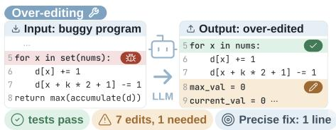

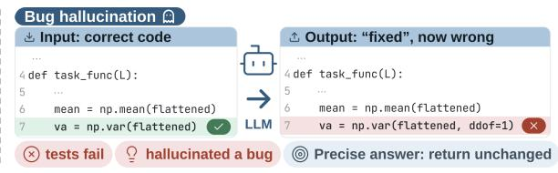

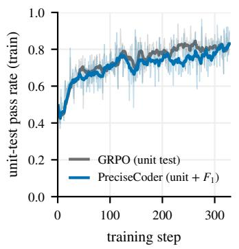

(a)  
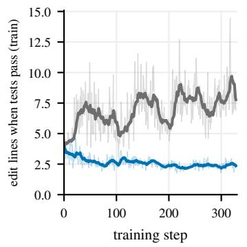  
(b)

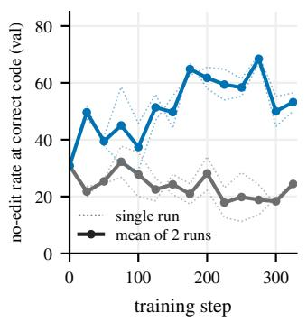  
Figure 1: (a) Illustration of over-editing and bug hallucination phenomenon; (b) Training dynamics of GRPO vs. PreciseCoder on Qwen3.5-4B, reach the same pass rate (left), but GRPO edits more lines (middle) and leaves fewer bug-free programs untouched (right).

Trained only on single-file single-line bugs, the learned behavior generalizes to complex program repairs. On PDB-Wild multi-line and repository-level bugs, precision rises by 20, 17 and 20 points at 4B, 9B and 27B while the edit size shrinks by 63–71%. On SWE-Bench Verified, PreciseCoder resolves more issues without inflating its patches, and it breaks fewer repositories whose issue is already fixed. Trained with agentic RL in a five-turn editing agent, a 9B model reaches 67.4% edit precision at a 56.3% pass rate, the best of every 9B model in agentic debugging on both.

Precise debugging also transfers upward, to models we cannot train. Handing the reasoning trace of PreciseCoder-9B to five stronger receivers, among them GPT-5.6 Sol and Qwen3.8-Max, raises their edit precision by 4.6–12.4 points at their own pass rates, with no weight access, shared tokenizer or training. A linguistic analysis of the traces points to what travels: either reward makes the model think longer and quote the buggy lines, but only PreciseCoder encourages the model to reason about individual lines, form bug hypotheses, and weigh whether each edit is worth keeping.

## Our contributions are threefold:

1 Diagnosis. We show that unit-test-based reinforcement learning raises pass rates while increasing edit size, rewriting correct code, and hallucinating bugs in bug-free programs. We establish this by auditing edit statistics throughout training and measuring each reward term’s correlation with correctness and with the number of edited lines when the unit tests pass.

2 Fix. We augment the unit-test reward with semantically verified precision and recall. Across 4B, 9B, and 27B models, this reward trains stably, raises edit precision by 24–29 points, reduces the average number of edited lines to approximately three per task without sacrificing pass rate, and curbs bug hallucination, raising the no-edit rate on correct code from 31–37% to 47–52%.

Table 1: PreciseCoder vs. representative related work. “–” marks evaluation-only studies.
<table><tr><td rowspan="2"></td><td colspan="2">Diagnosis</td><td colspan="4">Reward signals</td><td>Generalizability</td></tr><tr><td>Over- editing</td><td>Bug hallucination</td><td>Unit tests</td><td>Edit extent</td><td>Location verified</td><td>Partial fixes</td><td>Weak-to- strong</td></tr><tr><td>FixedBench (Gloaguen et al., 2026)</td><td>x</td><td>√</td><td></td><td>一</td><td>一</td><td>一</td><td>x</td></tr><tr><td>PDB (Zhu et al., 2026b)</td><td>√</td><td>x</td><td></td><td></td><td></td><td></td><td>x</td></tr><tr><td>SWE-RL (Wei et al., 2025)</td><td>x</td><td>x</td><td>x</td><td>X</td><td>x</td><td>x</td><td>x</td></tr><tr><td>EA-GRPO (Ke et al., 2026)</td><td>√</td><td>x</td><td>√</td><td>√</td><td>x</td><td>X</td><td>x</td></tr><tr><td>OverEdit (Zhu et al., 2026a)</td><td>√</td><td>x</td><td>√</td><td>√</td><td>x</td><td>X</td><td>x</td></tr><tr><td>PAFT (Yang et al., 2026)</td><td>√</td><td>x</td><td>x</td><td>√</td><td>x</td><td>x</td><td>x</td></tr><tr><td>AdaPatcher (Dai et al., 2025)</td><td>√</td><td>x</td><td>√</td><td>√</td><td>x</td><td>x</td><td>x</td></tr><tr><td>RECAP (Luo et al., 2026)</td><td>√</td><td>x</td><td>x</td><td>√</td><td>x</td><td>x</td><td>x</td></tr><tr><td>PreciseCoder</td><td>√</td><td>√</td><td>√</td><td>√</td><td>√</td><td>√</td><td>√</td></tr></table>

3 Generalization. The precision carries to multi-line, repository-level and agentic debugging and to SWE-bench Verified, and it travels through the reasoning trace alone: a 9B donor raises the edit precision of frontier models by 4.6–12.4 points. What travels, per a linguistic analysis of the traces, is naming the buggy line and weighing each edit.

## 2 RELATED WORK

We review prior work and establish PreciseCoder as the first approach to incorporate semantically verified, localized edits into RL training for generalizable debugging fidelity (see Table 1).

Coding models are trained to pass tests. Large language models have become widely used coding tools (Chen et al., 2021; Li et al., 2022), while agents built on them can resolve real-world repository issues (Jimenez et al., 2024; Yang et al., 2024a). A common post-training recipe reported by leading AI labs is reinforcement learning with verifiable rewards, using unit-test outcomes as the sole reward signal (Guo et al., 2025; Lambert et al., 2024; Pan et al., 2025; Yang et al., 2025a; Luo et al., 2025; Yang et al., 2025b). However, the program-repair literature has long established that test-passing patches can overfit (Smith et al., 2015; Tan et al., 2016). Such test overfitting persists in frontier LLMs (Zhu et al., 2026b; Ahmed et al., 2025), and functional correctness alone fails to capture many qualities developers value (Singhal et al., 2024; Zhong et al., 2026). Moreover, LLM code reviewers often hallucinate bugs (McAleese et al., 2024), prompting unnecessary changes to already-correct programs (Huang et al., 2024; Qu et al., 2026). By analyzing training dynamics, we identify unit-test-only rewards as the root cause of both behaviors throughout RL training.

Existing remedies focus on edit size. Existing approaches to reducing over-editing share a common design: rewarding smaller edits. One line of work optimizes edit size alongside functional correctness. For example, EA-GRPO subtracts a standardized edited-line penalty from the correctness reward (Ke et al., 2026), and Zhu et al. (2026a) subtract excess Levenshtein distance to the reference from an execution reward. Another line of work separates localization from correction. RECAP trains a post-hoc refiner using supervised fine-tuning and DPO to shrink generated patches (Luo et al., 2026), whereas localization-first pipelines constrain where the model can edit (Xia et al., 2024; Chen et al., 2025; Yang et al., 2025b). However, edit-size-based rewards can be difficult to optimize and may trade test-passing performance for debugging fidelity. We instead use semantically verified edit size, enabling smoother convergence and better generalization.

## 3 METHOD

We describe a debugging task as $\tau = ( C , x , T , \Delta ^ { \star } )$ , where C is a buggy program, x is a specification, $T ( \cdot ) \in \{ 0 , 1 \}$ is a test suite with $T ( C ) = 0 , { \mathrm { a n d } } \ \Delta ^ { \star }$ is the reference repair that yields the fault-free program. A policy $\pi _ { \theta } ( \hat { C } \mid C , x )$ emits a revised program ${ \hat { C } } ;$ we denote the predicted edit by $\hat { \Delta } = \mathrm { d i f f } ( C , \hat { C } )$ and the number of edited lines by $\ell = | \hat { \Delta } | . \mathrm { ~ A ~ }$ standard RL pipeline takes a set of N tasks $\tau _ { 1 . . N }$ and optimizes πθ with the unit-test-only reward $r = T ( { \hat { C } } )$ . Existing localized debugging approaches use $r = f ( T ( { \hat { C } } ) , \ell )$ , combining test success and edit size linearly or through gating.

## 3.1 FIDELITY CONCERNS WITH UNIT-TEST-ONLY GRPO

We first train Qwen3.5-4B with group-relative policy optimization (GRPO, Shao et al., 2024) using the reward $r = T ( { \hat { C } } )$ on PDB (Zhu et al., 2026b) tasks, and analyze the training dynamics.

Unit-test-only GRPO learns to pass by editing more. As shown by the gray line in Figure 1b (left and middle), the model initially learns to repair programs by editing more: the mean number of edited lines tracks the pass rate, with both rising over steps 0–50 and 100–150 and falling over steps 50–100. Once the pass rate begins to plateau, however, the reward continues to periodically encourage over-editing, and the mean edit size grows from 3.94 to 8.28 lines on the training set.

The same reward teaches the model to hallucinate bugs. Training never shows the model a correct program, yet the effect of the reward on correct programs is measurable. On a validation set of 200 bug-free programs, the unit-test-only reward teaches the model to hallucinate bugs and modify correct code: the no-op rate on ground-truth programs drops from 30.8% at the start of training to 20.5% averaged over the last three evaluations (Figure 1b, right).

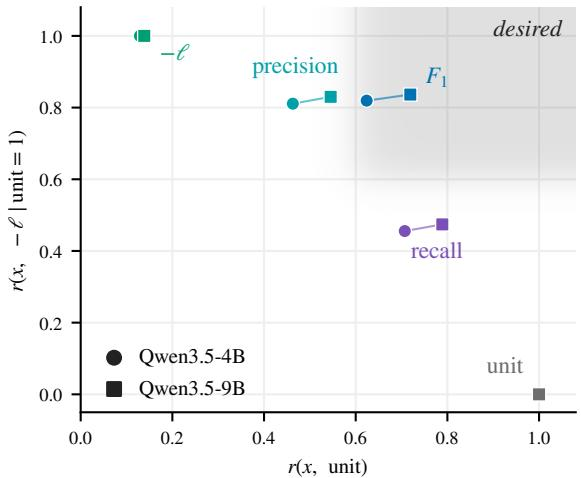  
Figure 2: Pearson r averaged over all training tasks (circle 4B, square $9 \mathrm { B } ; n { = } 1 6$ samples per task). unit is constant when passing and is plotted at y=0.

## 3.2 HOW DIFFERENT REWARD TERMS CORRELATE

Next, we analyze how candidate reward components correlate with one another on the Qwen3.5-4B and 9B base models (Figure 2). Existing methods such as EA-GRPO use linear or gated combi nations of the pass indicator unit $= T ( \hat { C } )$ and the edit size ℓ. However, the Pearson correlation between −ℓ and unit is low, at 0.13 on 4B and 0.14 on 9B: edit size carries little information about correctness, so optimizing it directly can destabilize training and degrade the pass rate.

To address this, we introduce semantically verified, localized edit rewards. Inspired by Zhu et al. (2026b), we score the edit fault by fault: each predicted block $\hat { \delta } _ { i } \subseteq \hat { \Delta }$ is aligned to a reference block $\delta _ { i } ^ { \star } \subseteq \Delta ^ { \star }$ , and the model is credited with fault i $( \operatorname { f i x } _ { i } = 1 )$ iff the program under the counterfactual edit $\Delta = \Delta ^ { \star } - \{ \delta _ { i } ^ { \star } \} \cup \{ \hat { \delta } _ { i } \}$ passes the tests. Precision and recall are then

$$
\begin{array} { r } { \mathrm { r e c } = \frac { 1 } { m } \sum _ { i } \mathrm { f i x } _ { i } \in [ 0 , 1 ] , \qquad \mathrm { p r e c } = \frac { 1 } { \ell } \sum _ { i } \mathrm { f i x } _ { i } \mathrm { m i n } \big ( \vert \mathrm { e s s } _ { i } \vert , \vert \delta _ { i } ^ { \star } \vert + \epsilon \big ) \in [ 0 , 1 ] , } \end{array}\tag{1}
$$

where m is the number of reference faults, $\mathrm { e s s } _ { i } \subseteq \hat { \delta } _ { i }$ is the smallest subset of the predicted block that still repairs fault $i ,$ and ϵ tolerates a few extra lines per fault. Recall asks which faults were repaired; precision asks what fraction of the edited lines were needed to repair them.

We evaluate each candidate reward term by two metrics: its correlation with unit, for stability, and its correlation with −ℓ among passing samples, for fidelity (Figure 2). −ℓ fails the first, and unit, constant among passing samples, fails the second. prec correlates well with $- \ell \left( > 0 . 8 1 \right)$ , while rec correlates well with unit (>0.71). We therefore design a reward of the form $r = f ( \mathrm { u n i t } , \mathrm { p r e c } , \mathrm { r e c } )$

First, to avoid spurious block misalignment, we gate rec on unit: we define $\widetilde { \mathrm { r e c } } = 1 \ : \mathrm { i f \ u n i t } = 1$ and ${ \widetilde { \mathrm { r e c } } } = { \mathrm { r e c } }$ otherwise, since a passing program has by definition resolved every injected fault. We then take $F _ { 1 }$ as the harmonic mean of recf and prec, which reduces to $2 \mathrm { p r e c } / ( 1 + \mathrm { p r e c } )$ on passing samples. $F _ { 1 }$ correlates well with both unit (>0.62) and −ℓ (>0.82), the only term in the desired region.

## 3.3 ALGORITHM

We propose PreciseCoder, which trains with the reward $r _ { \lambda } = ( 1 - \lambda )$ unit $+ \lambda F _ { 1 }$ . Note that GRPO standardizes rewards within each group. Applied to the sum $r _ { \lambda } .$ , this standardization collapses to the standardized $F _ { 1 }$ in any group where unit is constant, so the weight λ acts unevenly across groups (Liu et al., 2026; Ichihara et al., 2025). To mitigate this, we use GDPO (Liu et al., 2026), which standardizes each term within the group before mixing, followed by batch-level rescaling. Under this normalization, a passing correction retains a larger advantage than a failing one whenever $\lambda < 2 / ( 2 + \sqrt { 2 G } )$ , i.e., $\lambda < 0 . 3 7$ at $G = 6$ (Appendix A.1); we use $\lambda = 1 / 3$ . Within this range, the exact value of λ matters little: where unit is constant the advantage equals the standardized $F _ { 1 }$ regardless of $\lambda ,$ and elsewhere $F _ { 1 }$ only breaks ties.

## 4 EXPERIMENTS

## 4.1 SETUP

We train on 5,274 tasks from PDB-Single-Full (Zhu et al., 2026b), the unfiltered pool of 7,589 synthesized single-line-bug programs built on BigCodeBench (Zhuo et al., 2025) and Live-CodeBench (Jain et al., 2025) problems. We test on 1,205 held-out tasks from PDB-Single, the verified subset of this pool. The test problems share no base problem with any training task. We evaluate on unit test passing rate, precision, recall, and edited lines.

In addition, we also test bug hallucination by asking LLMs to fix 1,512 ground truth programs, drawn from BigCodeBench and LiveCodeBench problems that do not appear in the above splits. We evaluate on no operation rate (No-op%) and damage rate (i.e., test failure rate) from the output.

We use Qwen3.5-4B, Qwen3.5-9B (Qwen Team, 2026a) and Qwen3.6-27B (Qwen Team, 2026b) as the backbone models, and compare with five baselines: (1) SFT: supervised fine-tuning with rejection-sampling (Zhu et al., 2026a), (2) DPO (Rafailov et al., 2023), (3): GRPO: unit-test-only GRPO, (4) RECAP: training a post-hoc edit size refiner after correction (Luo et al., 2026), and (5) EA-GRPO: penalizing edit size in mostly-passing groups (Ke et al., 2026). We further compare with four frontier models: GPT-5.6 Sol (OpenAI, 2026), DeepSeek-V4-Pro (DeepSeek-AI et al., 2026a), DeepSeek-V4.1-Flash (DeepSeek-AI et al., 2026b) and Qwen3.8-Flash-Next (Qiu et al., 2026). Details in Appendix C and prompts in Appendix D.

## 4.2 MAIN RESULTS

Optimizing edit size trades off pass rate. Compared with GRPO in Table 2, RECAP and EA-GRPO substantially improve fidelity on Qwen3.5-4B: mean edited lines drop from 13.8 to at most 3.7, and precision rises from 30% to over 58%. However, this comes at the cost of pass rate, which falls from 55.1% to 38.1% for RECAP and 53.3% for EA-GRPO. The same pattern holds on Qwen3.5-9B. This is consistent with our earlier analysis: because edit size is only weakly correlated with pass rate, optimizing it directly incurs a performance trade-off.

PreciseCoder improves fidelity while keeping pass rate on par. Table 2 reports the mean and standard deviation of PreciseCoder over 3 runs. Unlike prior methods, PreciseCoder reduces mean edited lines from 13.8 to 3.0 on Qwen3.5-4B while keeping pass rate on par with GRPO; the same holds on Qwen3.5-9B. PreciseCoder ranks in the top two on every metric, demonstrating its robustness and validating a reward design that balances stability and effectiveness.

Table 2: Prior methods trade pass rate for smaller edits; PreciseCoder keeps pass rate on par with GRPO, while editing 4× fewer lines on PDB Test and, without seeing correct code, hallucinates fewer bugs on GT Debug. Bold: best; underline: second.
<table><tr><td rowspan="2">Methods</td><td colspan="4">PDB Test</td><td colspan="2">GT Debug</td></tr><tr><td>Pass (%) ↑</td><td>Precision (%) ↑</td><td>Recall (%) ↑</td><td>Lines↓</td><td>No-op (%) ↑</td><td>Damage (%)↓</td></tr><tr><td colspan="7">Model: Qwen3.5-4B</td></tr><tr><td>Base</td><td>36.5</td><td>35.8</td><td>48.5</td><td>15.3</td><td>30.6</td><td>19.3</td></tr><tr><td>SFT</td><td>41.2</td><td>39.7</td><td>54.7</td><td>10.2</td><td>34.9</td><td>19.4</td></tr><tr><td>DPO</td><td>51.5</td><td>40.5</td><td>61.2</td><td>8.7</td><td>30.6</td><td>17.7</td></tr><tr><td>GRPO</td><td>55.1</td><td>30.0</td><td>60.1</td><td>13.8</td><td>19.3</td><td>17.8</td></tr><tr><td>RECAP</td><td>38.1</td><td>59.8</td><td>59.8</td><td>2.9</td><td>39.6</td><td>18.2</td></tr><tr><td>EA-GRPO</td><td>53.3</td><td>58.6</td><td>70.1</td><td>3.7</td><td>43.3</td><td>18.8</td></tr><tr><td>PreciseCoder</td><td>55.3±0.9</td><td>64.9±1.3</td><td>72.9±1.1</td><td>3.0±0.1</td><td>48.0±5.8</td><td>13.5±1.5</td></tr><tr><td colspan="7">Model: Qwen3.5-9B</td></tr><tr><td>Base</td><td>41.2</td><td>43.9</td><td>53.1</td><td>13.7</td><td>36.6</td><td>18.7</td></tr><tr><td>SFT</td><td>47.9</td><td>50.6</td><td>63.3</td><td>7.2</td><td>41.0</td><td>15.1</td></tr><tr><td>DPO</td><td>56.6</td><td>52.1</td><td>68.6</td><td>7.3</td><td>41.3</td><td>13.4</td></tr><tr><td>GRPO</td><td>63.9</td><td>41.7</td><td>68.4</td><td>11.9</td><td>30.7</td><td>11.4</td></tr><tr><td>RECAP</td><td>47.6</td><td>66.1</td><td>67.0</td><td>2.7</td><td>44.1</td><td>15.7</td></tr><tr><td>EA-GRPO</td><td>59.3</td><td>67.0</td><td>76.0</td><td>3.5</td><td>47.0</td><td>13.5</td></tr><tr><td>PreciseCoder</td><td>62.5±1.9</td><td>67.7±1.5</td><td>76.8±1.1</td><td>3.0±0.1</td><td>51.6±2.7</td><td>11.8±0.9</td></tr><tr><td colspan="7">Model: Qwen3.6-27B</td></tr><tr><td>Base</td><td>72.9</td><td>49.8</td><td>74.1</td><td>7.4</td><td>31.1</td><td>15.5</td></tr><tr><td>GRPO</td><td>76.3</td><td>43.2</td><td>71.0</td><td>7.9</td><td>26.9</td><td>12.6</td></tr><tr><td>EA-GRPO</td><td>77.3</td><td>77.0</td><td>85.2</td><td>2.7</td><td>44.4</td><td>16.6</td></tr><tr><td>PreciseCoder Frontier Models</td><td>79.3</td><td>79.2</td><td>86.7</td><td>2.6</td><td>45.8</td><td>11.1</td></tr><tr><td colspan="7"></td></tr><tr><td>GPT-5.6 Sol (high)</td><td>86.1</td><td>61.5</td><td>87.9</td><td>4.1</td><td>48.0</td><td>9.3</td></tr><tr><td>DeepSeek-V4-Pro</td><td>82.0</td><td>53.5</td><td>82.5</td><td>5.2</td><td>31.0</td><td>13.4</td></tr><tr><td>DeepSeek-V4.1-Flash</td><td>76.1</td><td>57.8</td><td>80.6</td><td>4.8</td><td>39.7</td><td>21.5</td></tr><tr><td>Qwen3.8-Flash-Next</td><td>75.3</td><td>55.3</td><td>78.2</td><td>5.2</td><td>22.1</td><td>17.9</td></tr></table>

PreciseCoder on Qwen3.6-27B is competitive with frontier models. PreciseCoder on Qwen3.6- 27B outperforms its GRPO counterpart, DeepSeek-V4.1-Flash and Qwen3.8-Flash-Next on all measures. GPT-5.6 Sol attains the highest pass rate (86.1%) but still over-edits: its precision is 17.7% below PreciseCoder (79.2%), and it edits 1.5 more lines on average than PreciseCoder (2.6). This suggests PreciseCoder could surpass frontier models when scaled to comparable size.

## 4.3 BUG HALLUCINATION ON CORRECT CODE

Our reward raises the no-op rate and lowers damage without ever seeing correct code. No training row contains correct code and no reward term rewards a no-op, yet restraint against bug hallucination comes for free. In Table 2, unit-test-only GRPO lowers the no-op rate from 30.6% to 19.3% at 4B, from 36.6% to 30.7% at 9B and from 31.1% to 26.9% at 27B, whereas PreciseCoder raises it to 48.0%, 51.6% and 45.8% and breaks fewer correct programs than the base model (damage 13.5%, 11.8% and 11.1% vs. 19.3%, 18.7% and 15.5%). RECAP’s refiner and EA-GRPO’s size penalty show similar but smaller gains. Moreover, we show in Appendix B.4 that PreciseCoder keeps its advantage on the GT debugging tasks when prompting for restraint (Gloaguen et al., 2026).

Precision on buggy code and restraint on correct code rise together. Plotting the no-op rates in Table 2 against edit precision, we find a near-linear relationship (Figure 3). The two skills are highly correlated, with r = 0.87 across all 4B–27B models (r = 0.94 within the 4B rows and 0.92 within the 9B rows). Conversely, training on a mixture that includes ground-truth debugging tasks also improves debugging fidelity (Appendix B.1). Either skill thus brings the other along for free.

## 4.4 REWARD ABLATIONS

We ablate alternative choices of f(·) in r = f(unit, prec, rec) and find that no single term recovers both fidelity and pass rate: precision alone over-restrains, recall alone under-restrains, and only their gated combination keeps pass rate on par.

Table 3 trains Qwen3.5-4B on each reward term alone and in combination. With the unit test alone, the policy passes 55.1% of tasks but edits 13.8 lines per task at 30.0% precision. Rewarding precision, either as the added term or as the whole reward, yields the most precise repairs in the table (69.0–70.1% precision, 2.5–2.6 lines) but passes 3–5% fewer tasks than ours. Rewarding recall alone does the opposite, reaching the highest pass rate (57.2%) and recall (74.1%) with the least precise repairs (52.2%, 3.8 lines), since recall does not charge for lines that repair nothing. Gating precision on the unit test (r = unit · prec) does not recover pass rate either: like pure $F _ { 1 }$ , it passes fewer tasks than ours.

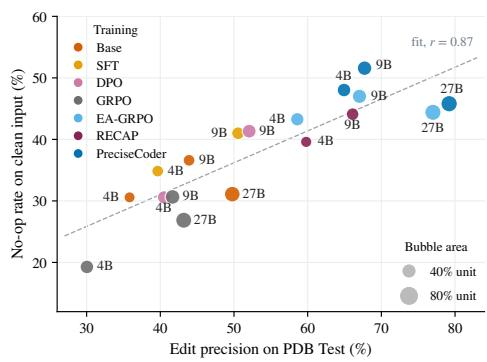

Table 3: Reward ablation on Qwen3.5-4B, PDB-Single. ±: std over three runs; †: ours; ∗: worse than ours by more than the std.
<table><tr><td>Reward r</td><td>Pass (%)↑</td><td>Prec. (%)↑</td><td>Lines ↓</td></tr><tr><td>unit</td><td>55.1</td><td>30.0*</td><td>13.8*</td></tr><tr><td>unit·prec</td><td>52.6*</td><td>63.1*</td><td>3.3*</td></tr><tr><td> $F _ { 1 } ( \mathrm { p r e c } , \mathrm { r e c } )$ </td><td>50.0*</td><td>70.1</td><td>2.5</td></tr><tr><td> ${ \begin{array} { l } { { \frac { 2 } { 3 } } \operatorname { u n i t } + { \frac { 1 } { 3 } } } \end{array} }$  prec</td><td>52.3*</td><td>69.0</td><td>2.6</td></tr><tr><td> ${ \begin{array} { l } { { \frac { 2 } { 3 } } \operatorname { u n i t } + { \frac { 1 } { 3 } } } \end{array} }$  rec</td><td>57.2</td><td>52.2*</td><td>3.8*</td></tr><tr><td>23 unit + 13  $F _ { 1 } ( \mathrm { p r e c } , \mathrm { r e c } )$ </td><td> $5 2 . 2 { \pm } 1 . 8 ^ { * }$ </td><td> $6 6 . 1 \pm 3 . 3$ </td><td> $2 . 8 { \pm } 0 . 2$ </td></tr><tr><td>23 unit + 1-3  $F _ { 1 } ( \mathrm { p r e c } , \widetilde { \mathrm { r e c } } ) ^ { \dag }$ </td><td> $5 5 . 3 { \pm } 0 . 9 $ </td><td> $6 4 . 9 { \pm } 1 . 3 $ </td><td>3.0±0.1</td></tr></table>

Figure 3: No-op rate on GT Debug scales linearly with precision.

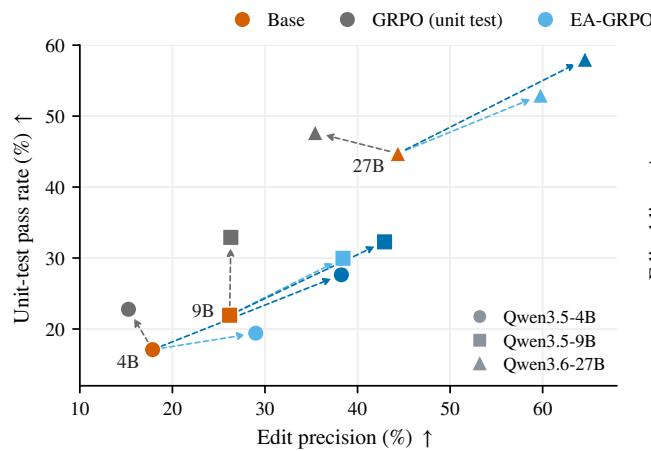

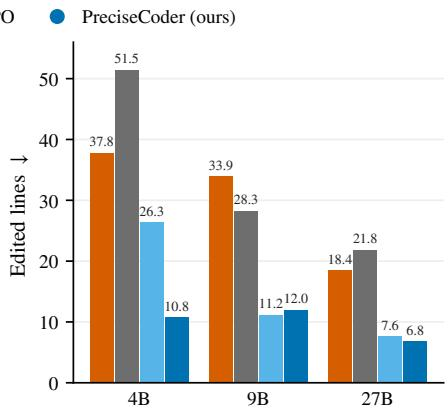  
Figure 4: On PDB-Wild multi-line and repository-level repairs, PreciseCoder matches or outperforms unit-test-only GRPO and EA-GRPO across all metrics.

## 5 GENERALIZATION

Training shows PreciseCoder only single-line faults in single-file programs, repaired in one shot. We test whether the learned precision survives settings that training never shows, whether it reaches stronger models through the reasoning trace alone, and what the reward changed in that trace.

## 5.1 GENERALIZATION TO COMPLEX PROGRAM REPAIRS

PreciseCoder generalizes to multi-line and repository-level faults. On PDB-Wild (Zhu et al., 2026b), 484 multi-line and repository-level tasks drawn from BigCodeBench, LiveCodeBench and SWE-smith (Yang et al., 2025a), PreciseCoder raises edit precision over the base model by 20.3, 16.7 and 20.2 points at 4B, 9B and 27B, and pass rate by 10–13 points at every size (Figure 4). The mean edit shrinks from 37.8 to 10.8 lines at 4B, from 33.9 to 12.0 at 9B and from 18.4 to 6.8 at 27B. PreciseCoder outperforms EA-GRPO across all sizes in both unit test pass rate and precision. On PDB-Wild, unit-test-only GRPO shows no improvement in precision either, changing it by −2.7, +0.1 and −9.0 points against the base model at 4B, 9B and 27B.

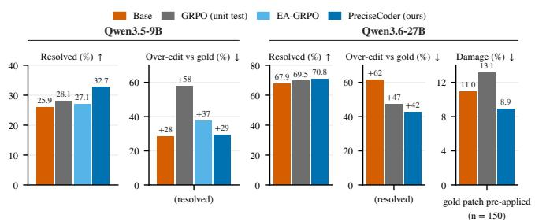

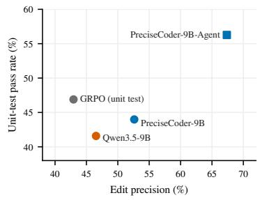  
Figure 5: PreciseCoder resolves more issues with smaller Figure 6: Agentic PreciseCoder patches on SWE-Bench Verified. closes the multi-turn pass-rate gap.  
Table 4: Thinking trace carries correctness and precision for weak-to-strong transfer on PDB Test. ∆: change vs. the receiver’s own reasoning.

<table><tr><td rowspan="2">Receiver</td><td colspan="3">With 9B trace</td><td colspan="2">∆</td></tr><tr><td>Pass (%)</td><td>Prec. (%)</td><td>Lines</td><td>Pass (%)</td><td>Prec. (%)</td></tr><tr><td>Donor, own trace</td><td></td><td></td><td></td><td></td><td></td></tr><tr><td>PreciseCoder-9B</td><td>64.6</td><td>67.9</td><td>3.0</td><td></td><td></td></tr><tr><td>Own base, prefilled Qwen3.5-9B</td><td>58.3</td><td>58.4</td><td>6.5</td><td>+17.1</td><td>+14.5</td></tr><tr><td></td><td></td><td></td><td></td><td></td><td></td></tr><tr><td>Control: untrained Qwen3.5-9B trace Qwen3.6-27B</td><td>66.4</td><td>53.6</td><td>7.6</td><td>-7.4</td><td></td></tr><tr><td></td><td></td><td></td><td></td><td></td><td>+2.6</td></tr><tr><td>Prefilled, continues thinking</td><td></td><td></td><td></td><td></td><td></td></tr><tr><td>Qwen3.6-27B</td><td>78.1 75.9</td><td>62.1</td><td>5.7</td><td>+4.3</td><td>+11.1</td></tr><tr><td>Qwen3.8-Flash-Next</td><td>74.6</td><td>60.9 63.3</td><td>6.0 4.3</td><td>+0.6</td><td>+5.6</td></tr><tr><td>DeepSeek-V4.1-Flash</td><td></td><td></td><td></td><td>-1.5</td><td>+5.5</td></tr><tr><td>Trace in the user turn</td><td></td><td></td><td></td><td></td><td></td></tr><tr><td>Qwen3.8-Max</td><td>82.3</td><td>68.6</td><td>3.7</td><td>-0.7</td><td>+12.4</td></tr><tr><td>GPT-5.6 Sol (high)</td><td>87.3</td><td>66.1</td><td>3.6</td><td>+1.2</td><td>+4.6</td></tr></table>

PreciseCoder resolves more issues with smaller patches on SWE-Bench Verified. With SWEagent (Yang et al., 2024a) as the harness (Figure 5), PreciseCoder-9B resolves 32.7% of issues (OpenAI, 2024), against 25.9% for the base model, 28.1% for unit-test-only GRPO and 27.1% for EA-GRPO; at 27B, PreciseCoder resolves 70.8% against 67.9% for the base model and 69.5% for unittest-only GRPO. Measured as the mean excess of changed lines over the gold patch on resolved instances, unit-test-only GRPO over-edits by 58% and EA-GRPO by 37%, while PreciseCoder-9B holds the excess at only 29% (27B: 42% vs. 47% for GRPO and 62% for base). When the gold patch is applied before the agent starts, PreciseCoder-27B breaks only 8.9% of repositories against the base model’s 11.0%, while GRPO raises it to 13.1%. Taken together, PreciseCoder is the only method that improves resolution rate without inflating patch size or damaging correct code.

Precision transfers to multi-turn agentic editing, and agentic training closes the pass-rate gap. In a five-turn agent with view, str\_replace\_editor and submit tools on PDB Test (Fig ure 6), the single-turn-trained PreciseCoder-9B retains 52.6% edit precision, against 42.9% for unittest-only GRPO, but trails it by 2.9 points in pass rate. Trained instead with multi-turn agentic RL on the same tasks, PreciseCoder-9B-Agent reaches 67.4% precision at a 56.3% pass rate, the best of every 9B model in agentic debugging on both.

## 5.2 WEAK-TO-STRONG TRANSFER

Reasoning can move between models without their weights: weak-to-strong generalization elicits a strong model’s capability from a weaker supervisor (Burns et al., 2024; Yang et al., 2024b), advisor models steer a black-box model with natural-language advice (Asawa et al., 2026), and Cheng et al.

(2026) prefill one model’s chain of thought into another. We ask whether an editing discipline, rather than a capability, travels this way from a small trained model to frontier models that already exceed it on correctness. A trained PreciseCoder model, the donor, thinks about a task; we prefill its think block, token for token, into the assistant turn of an untrained receiver over a raw completions endpoint, and the receiver writes the repair, either closing the think block at once or continuing to think from its end. No weights, tokenizer or training are shared.

The trace carries both correctness and precision. Prefilled into its own untrained base model, which answers without further thinking (Table 4, own base), the PreciseCoder-9B think block recovers 73% of the pass-rate gain that training produced and 60% of the precision gain, and it cuts the base model’s edit from 13.7 to 6.5 lines. With no weights changed, the think block alone moves the base model most of the way toward the trained model on both axes.

A 9B donor teaches larger and stronger models to edit precisely. Handed the same block (Table 4, last two blocks), five receivers that the donor cannot match on correctness each gain 4.6–12.4 points of edit precision while their pass rate moves by −1.5 to +4.3 points. As a control, the untrained 9B’s block costs the 27B receiver 7.4 points of pass rate for 2.6 of precision. Three receivers continue thinking from the end of the prefilled block; Qwen3.8-Max (Qwen Team, 2026c) and GPT-5.6 Sol, whose APIs cannot prefill, receive it as text in the user turn. The largest gains go to Qwen3.8-Max (precision +12.4%) and Qwen3.6-27B (precision +11.1%, pass rate +4.3). Even GPT-5.6 Sol (high) improves on both pass rate and precision with the donor thinking, which ends above the donor on correctness and only 1.8% behind it on precision.

## 5.3 WHAT CHANGED IN THE THINKING

To see what the block carries, we analyze the complete chains of thought on PDB Test of the 4B and 9B base, unit-test-only GRPO and PreciseCoder models, and of two frontier models whose traces are readable, GLM-5.2 and DeepSeek-V4-Pro, on the lexical categories, distinctive bigrams by weighted log-odds, and verbatim matches of the buggy lines (details in Appendix B.6).

RL makes the model think longer, only PreciseCoder changes what it says about a line. Under either reward the 9B thinks to the 4,096-token budget, quotes code inline half again as often (170 and 168 spans per 1,000 words against 111) and backtracks more (“wait” 12.3 and 15.2 per 1,000 words against 6.1; see Appendix Figure 10). What only the precision reward adds is judgement: PreciseCoder-9B hedges more than unit-test-only GRPO (10.8 against 6.5 per 1,000 words: “might be”, “I think”, “I’ll assume”), echoes the instructions half as often (3.4 against 6.5) and almost never argues from the prompt that a bug must exist (0.04 against 0.59). PreciseCoder’s distinctive bigrams are “might be”, “is valid” and “keep the”, weighing whether a line is worth keeping, while GRPO’s are “let’s check”, “only fix” and “make minimal”, restating the instruction to fix.

Quoting the buggy line is the strongest linguistic correlate of a correct fix. The share of tasks on which the thinking names every buggy line verbatim rises from 36% to 67% at 4B and from 43% to 71% at 9B under PreciseCoder. Within each of the eight models in Figure 7, recall is 4–19% higher on the tasks whose thinking quotes every buggy line. Holding the model fixed, one standard deviation more of quoting is worth +4.3 F1 and +3.2 precision points.

The trained model does not come to think like a frontier model. Frontier models have different own thinking patterns, which hinder the effectiveness of SFT training before RL. GLM-5.2 talks to itself in the first person and DeepSeek-V4-Pro thinks in questions, whereas the trained models think in identifier-anchored conditionals (“x is”, “if x”, “x returns” for a quoted identifier x; see Appendix Table 9). The receivers of Table 4 thus gain precision from a block written in a style unlike their own; what they take from it, we hypothesize, is the line it names and the verdict it reaches on each edit.

On correct code, restraint comes from proposing bugs and rejecting them. On the 1,512 correct programs of GT Debug, every model asserts that the code “looks correct” at the same rate (8–11 times per 1,000 words); what differs is what it does next. PreciseCoder-9B proposes 27.6 bug hypotheses per 1,000 words against 4.7 for its base and 10.8 for unit-test-only GRPO, and its no-op rate rises from 21% to 68% between the quarter of tasks with the fewest hypotheses and the quarter with the most, whereas the 9B unit-test-only model stays near 30%, as shown in Figure 8. Every trained model edits 85–99% of the clean programs on which its thinking confidently stops before the 16k-token budget. The precision reward does not teach the model to declare a program correct early; it teaches it to keep testing candidate bugs and, finding none it trusts, to return the code unchanged.

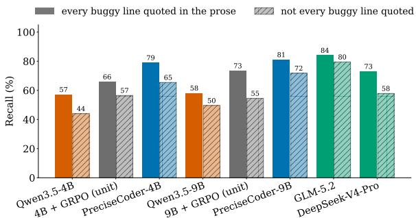  
Figure 7: Recall on PDB Test when the thinking quotes every buggy line verbatim is consistently higher than when it does not.

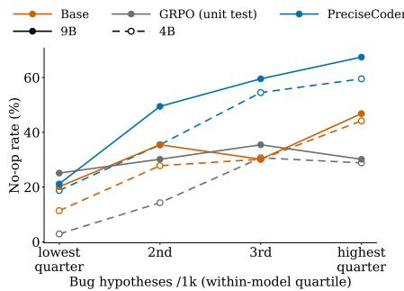  
Figure 8: GT Debug no-op rate by within-model quartile of bug hypotheses. More hypotheses, more restraint.

## 6 DISCUSSION

A unit-test reward scores the program a model returns, not the edit that produced it, so RL from unit tests raises pass rates while letting edits grow and teaching the model to invent bugs in correct code. PreciseCoder makes the reward see the edit through semantically verified precision and recall: it improves debugging fidelity and keeps unit-test pass rate on-par with standard training. The learned precision is not tied to the training distribution: it carries to multi-line and repository-level faults, to SWE-bench Verified, where PreciseCoder resolves more issues with smaller patches and breaks fewer already-fixed repositories. Most importantly, it travels without weights: the think block of a 9B PreciseCoder model raises the edit precision of frontier models such as GPT-5.6 Sol. Since the trained model thinks nothing like its receivers, we attribute the transfer to what the block does rather than how it sounds: it names the buggy line and weighs whether each edit is worth keeping.

The idea is not specific to debugging: the reward credits an action only when it is checked against a reference and verified to do the work the reference requires, so a correct but unnecessary action earns nothing. In long-horizon agentic tasks, where each unneeded action is a chance to break something, such a reward could serve both performance and safety by penalizing side effects that an outcomeonly reward cannot see; the lower damage of PreciseCoder-27B on already-fixed repositories is a first sign, and defining the reference there is left to future work.

## ETHICS STATEMENT

This work trains language models to repair bugs in code with minimal edits. It involves no human subjects, and uses only publicly released datasets and benchmarks and open-weight models under their respective licenses. All model-generated code is executed in a sandbox during training and evaluation. Better automated debugging could lower the cost of maintaining software. Like any code model, it could also be misused or produce subtly wrong fixes, and precise minimal edits may make such errors harder to spot in review; we therefore recommend human review of model-proposed patches. We are not aware of any conflicts of interest.

## REPRODUCIBILITY STATEMENT

We describe the reward design and optimizer in §3 and the training and evaluation setup in §4.1. Appendix C lists hyperparameters and baseline configurations, Appendix D gives every prompt template, and Appendix A.1 proves the pass/fail ordering property in full. Data splits are made by base task, so variants of the same problem never cross splits. We will release code, data splits and checkpoints.

## REFERENCES

Toufique Ahmed, Jatin Ganhotra, Avraham Shinnar, and Martin Hirzel. Investigating Test Overfitting on SWE-bench. arXiv preprint arXiv:2511.16858, 2025. URL https://arxiv.org/ abs/2511.16858.

Parth Asawa, Alan Zhu, Abigail O’Neill, Matei Zaharia, Alexandros G. Dimakis, and Joseph E. Gonzalez. How to Train Your Advisor: Steering Black-Box LLMs with Advisor Models. In Proceedings of the 43rd International Conference on Machine Learning (ICML), 2026. URL https://arxiv.org/abs/2510.02453.

Collin Burns, Pavel Izmailov, Jan Hendrik Kirchner, Bowen Baker, Leo Gao, Leopold Aschenbrenner, Yining Chen, Adrien Ecoffet, Manas Joglekar, Jan Leike, Ilya Sutskever, and Jeff Wu. Weak-to-Strong Generalization: Eliciting Strong Capabilities With Weak Supervision. In Proceedings of the 41st International Conference on Machine Learning (ICML), 2024. URL https://arxiv.org/abs/2312.09390.

Mark Chen, Jerry Tworek, Heewoo Jun, Qiming Yuan, Henrique Ponde Oliveira Pinto, Jared Kaplan, Harri Edwards, Yuri Burda, Nicholas Joseph, Greg Brockman, et al. Evaluating Large Language Models Trained on Code. arXiv preprint arXiv:2107.03374, 2021. URL https://arxiv. org/abs/2107.03374.

Zhaoling Chen, Xiangru Tang, Gangda Deng, Fang Wu, Jialong Wu, Zhiwei Jiang, Viktor Prasanna, Arman Cohan, and Xingyao Wang. LocAgent: Graph-Guided LLM Agents for Code Localization. arXiv preprint arXiv:2503.09089, 2025. URL https://arxiv.org/abs/2503. 09089.

Xinyuan Cheng, Beiduo Chen, Philipp Mondorf, and Barbara Plank. Reasoning that Travels: Dissecting How Chain-of-Thought Transfers Across Models. arXiv preprint arXiv:2605.28913, 2026. URL https://arxiv.org/abs/2605.28913.

Michael A. Covington and Joe D. McFall. Cutting the Gordian Knot: The Moving-Average Type– Token Ratio (MATTR). Journal ofQuantitative Linguistics, 17(2):94–100, 2010.

Zhenlong Dai, Bingrui Chen, Zhuoluo Zhao, Xiu Tang, Sai Wu, Chang Yao, Zhipeng Gao, and Jingyuan Chen. Less is More: Adaptive Program Repair with Bug Localization and Preference Learning. In Proceedings of the AAAI Conference on Artificial Intelligence (AAAI), 2025. URL https://arxiv.org/abs/2503.06510.

DeepSeek-AI et al. DeepSeek-V4: Towards highly efficient million-token context intelligence. arXiv preprint arXiv:2606.19348, 2026a. URL https://arxiv.org/abs/2606.19348.

DeepSeek-AI et al. DeepSeek-V4.1-Flash: Pushing the limits of KV cache compression. arXiv preprint arXiv:2609.19969, 2026b. URL https://arxiv.org/abs/2609.19969.

Thibaud Gloaguen, Niels Mündler, Mark Müller, Veselin Raychev, and Martin Vechev. Coding Agents Don’t Know When to Act. arXiv preprint arXiv:2605.07769, 2026. URL https:// arxiv.org/abs/2605.07769.

Alex Gu, Baptiste Roziere, Hugh James Leather, Armando Solar-Lezama, Gabriel Synnaeve, and Sida Wang. CRUXEval: A Benchmark for Code Reasoning, Understanding and Execution. In Proceedings of the 41st International Conference on Machine Learning (ICML), volume 235 of PMLR, pp. 16568–16621, 2024. URL https://proceedings.mlr.press/v235/ gu24c.html.

Daya Guo, Dejian Yang, Haowei Zhang, Junxiao Song, Peiyi Wang, Qihao Zhu, et al. DeepSeek-R1 incentivizes reasoning in LLMs through reinforcement learning. Nature, 645: 633–638, 2025. doi: 10.1038/s41586-025-09422-z. URL https://doi.org/10.1038/ s41586-025-09422-z.

Jie Huang, Xinyun Chen, Swaroop Mishra, Huaixiu Steven Zheng, Adams Wei Yu, Xinying Song, and Denny Zhou. Large Language Models Cannot Self-Correct Reasoning Yet. In International Conference on Learning Representations (ICLR), 2024. URL https://arxiv.org/abs/ 2310.01798.

Yuki Ichihara, Yuu Jinnai, Tetsuro Morimura, Mitsuki Sakamoto, Ryota Mitsuhashi, and Eiji Uchibe. MO-GRPO: Mitigating Reward Hacking of Group Relative Policy Optimization on Multi-Objective Problems. arXiv preprint arXiv:2509.22047, 2025. URL https://arxiv. org/abs/2509.22047. Accepted to the Transactions of the Association for Computational Linguistics.

Naman Jain, King Han, Alex Gu, Wen-Ding Li, Fanjia Yan, Tianjun Zhang, Sida Wang, Armando Solar-Lezama, Koushik Sen, and Ion Stoica. LiveCodeBench: Holistic and Contamination Free Evaluation of Large Language Models for Code. In International Conference on Learning Representations (ICLR), 2025. URL https://arxiv.org/abs/2403.07974.

Carlos E. Jimenez, John Yang, Alexander Wettig, Shunyu Yao, Kexin Pei, Ofir Press, and Karthik Narasimhan. SWE-bench: Can Language Models Resolve Real-World GitHub Issues? In International Conference on Learning Representations (ICLR), 2024. URL https://arxiv. org/abs/2310.06770.

Changxin Ke, Rui Zhang, Jiaming Guo, Yuanbo Wen, Li Ding, Shuo Wang, Xuyuan Zhu, Xiong Peng, Di Huang, Zidong Du, Xing Hu, Qi Guo, and Yunji Chen. QiMeng-PRepair: Precise Code Repair via Edit-Aware Reward Optimization. In Proceedings of the 64th Annual Meeting of the Association for Computational Linguistics (Volume 1: Long Papers), pp. 29114–29129, San Diego, California, United States, 2026. Association for Computational Linguistics. doi: 10. 18653/v1/2026.acl-long.1343. URL https://aclanthology.org/2026.acl-long. 1343/.

Woosuk Kwon, Zhuohan Li, Siyuan Zhuang, Ying Sheng, Lianmin Zheng, Cody Hao Yu, Joseph E. Gonzalez, Hao Zhang, and Ion Stoica. Efficient memory management for large language model serving with PagedAttention. In Proceedings of the 29th Symposium on Operating Systems Principles (SOSP), pp. 611–626, 2023. doi: 10.1145/3600006.3613165. URL https: //doi.org/10.1145/3600006.3613165.

Nathan Lambert, Jacob Morrison, Valentina Pyatkin, Shengyi Huang, Hamish Ivison, Faeze Brahman, Lester James V. Miranda, Alisa Liu, et al. Tulu 3: Pushing Frontiers in Open Language Model Post-Training. arXiv preprint arXiv:2411.15124, 2024. URL https://arxiv.org/ abs/2411.15124.

Yujia Li, David Choi, Junyoung Chung, Nate Kushman, Julian Schrittwieser, Rémi Leblond, Tom Eccles, James Keeling, et al. Competition-Level Code Generation with AlphaCode. Science, 378: 1092–1097, 2022. doi: 10.1126/science.abq1158. URL https://arxiv.org/abs/2203. 07814.

Jiawei Liu, Chunqiu Steven Xia, Yuyao Wang, and Lingming Zhang. Is Your Code Generated by ChatGPT Really Correct? Rigorous Evaluation of Large Language Models for Code Generation. In Advances in Neural Information Processing Systems (NeurIPS), volume 36, pp. 21558–21572, 2023. URL https://proceedings.neurips.cc/paper\_files/paper/2023/ hash/43e9d647ccd3e4b7b5baab53f0368686-Abstract-Conference.html.

Shih-Yang Liu, Xin Dong, Ximing Lu, Shizhe Diao, Peter Belcak, Mingjie Liu, Min-Hung Chen, Hongxu Yin, Yu-Chiang Frank Wang, Kwang-Ting Cheng, Yejin Choi, Jan Kautz, and Pavlo Molchanov. GDPO: Group reward-Decoupled Normalization Policy Optimization for Multireward RL Optimization. arXiv preprint arXiv:2601.05242, 2026. URL https://arxiv. org/abs/2601.05242. NVIDIA technical report.

Michael Luo, Naman Jain, Jaskirat Singh, Sijun Tan, Ameen Patel, Qingyang Wu, Alpay Ariyak, Colin Cai, et al. DeepSWE: Training a Fully Open-sourced, State-of-the-Art Coding Agent by Scaling RL. https://www.together.ai/blog/deepswe, 2025. Blog post, Agentica and Together AI.

Wenqiang Luo, Jacky Keung, Xiaoyu Shi, Yicheng Sun, Boyang Yang, Zhou Yang, and Haoye Tian. Refine After Generation: Toward Correct and Concise Patches in LLM-based Program Repair. arXiv preprint arXiv:2608.13292, 2026. URL https://arxiv.org/abs/2608.13292.

Nat McAleese, Rai Michael Pokorny, Juan Felipe Ceron Uribe, Evgenia Nitishinskaya, Maja Trebacz, and Jan Leike. LLM Critics Help Catch LLM Bugs. arXiv preprint arXiv:2407.00215, 2024. URL https://arxiv.org/abs/2407.00215.

Burt L. Monroe, Michael P. Colaresi, and Kevin M. Quinn. Fightin’ Words: Lexical Feature Selection and Evaluation for Identifying the Content of Political Conflict. Political Analysis, 16(4): 372–403, 2008.

OpenAI. Introducing SWE-bench Verified. https://openai.com/index/ introducing-swe-bench-verified/, August 2024. Blog post.

OpenAI. GPT-5.6 system card. System card, July 2026. URL https://deploymentsafety. openai.com/gpt-5-6.

Jiayi Pan, Xingyao Wang, Graham Neubig, Navdeep Jaitly, Heng Ji, Alane Suhr, and Yizhe Zhang. Training Software Engineering Agents and Verifiers with SWE-Gym. In Proceedings ofthe 42nd International Conference on Machine Learning (ICML), 2025. URL https://arxiv.org/ abs/2412.21139.

Zichao Qi, Fan Long, Sara Achour, and Martin Rinard. An Analysis of Patch Plausibility and Correctness for Generate-and-Validate Patch Generation Systems. In Proceedings of the 2015 International Symposium on Software Testing and Analysis (ISSTA), pp. 24–36, 2015. doi: 10. 1145/2771783.2771791.

Zihan Qiu, Zekun Wang, Xiao Li, Yanpeng Li, Yang Xu, Yixuan Wang, Huaqing Zhang, Rui Men, Bochao Mao, Chengruidong Zhang, et al. On the design of Qwen3.8-Next architecture: Evaluation, efficiency, and training stability. arXiv preprint arXiv:2608.30320, 2026. URL https://arxiv.org/abs/2608.30320.

Yubin Qu, Ying Zhang, Yanjun Zhang, Gelei Deng, Yuekang Li, Leo Yu Zhang, and Yi Liu. Overeager Coding Agents: Measuring Out-of-Scope Actions on Benign Tasks. arXiv preprint arXiv:2605.18583, 2026. URL https://arxiv.org/abs/2605.18583.

Qwen Team. Qwen3.5: Towards native multimodal agents. Blog post, February 2026a. URL https://qwen.ai/blog?id=qwen3.5.

Qwen Team. Qwen3.6-27B: Flagship-level coding in a 27B dense model. Blog post, April 2026b. URL https://qwen.ai/blog?id=qwen3.6-27b.

Qwen Team. Qwen3.8-Max: A new bar for coding and cowork. Blog post, August 2026c. URL https://qwen.ai/blog?id=qwen3.8.

Rafael Rafailov, Archit Sharma, Eric Mitchell, Christopher D. Manning, Stefano Ermon, and Chelsea Finn. Direct preference optimization: Your language model is secretly a reward model. In Advances in Neural Information Processing Systems (NeurIPS), volume 36, pp. 53728–53741, 2023. URL https://proceedings.neurips.cc/paper\_files/paper/2023/ hash/a85b405ed65c6477a4fe8302b5e06ce7-Abstract-Conference.html.

Zhihong Shao, Peiyi Wang, Qihao Zhu, Runxin Xu, Junxiao Song, Xiao Bi, Haowei Zhang, Mingchuan Zhang, Y. K. Li, Y. Wu, and Daya Guo. DeepSeekMath: Pushing the Limits of Mathematical Reasoning in Open Language Models. arXiv preprint arXiv:2402.03300, 2024. URL https://arxiv.org/abs/2402.03300.

Guangming Sheng, Chi Zhang, Zilingfeng Ye, Xibin Wu, Wang Zhang, Ru Zhang, Yanghua Peng, Haibin Lin, and Chuan Wu. HybridFlow: A Flexible and Efficient RLHF Framework. In Proceedings of the Twentieth European Conference on Computer Systems (EuroSys), 2025. doi: 10.1145/3689031.3696075. URL https://arxiv.org/abs/2409.19256.

Manav Singhal, Tushar Aggarwal, Abhijeet Awasthi, Nagarajan Natarajan, and Aditya Kanade. NoFunEval: Funny How Code LMs Falter on Requirements Beyond Functional Correctness. In Conference on Language Modeling (COLM), 2024. URL https://arxiv.org/abs/ 2401.15963.

Edward K. Smith, Earl T. Barr, Claire Le Goues, and Yuriy Brun. Is the Cure Worse Than the Disease? Overfitting in Automated Program Repair. In Proceedings of the 2015 10th Joint Meeting on Foundations of Software Engineering (ESEC/FSE), pp. 532–543, 2015. doi: 10.1145/2786805.2786825.

Shin Hwei Tan, Hiroaki Yoshida, Mukul R. Prasad, and Abhik Roychoudhury. Anti-patterns in Search-Based Program Repair. In Proceedings of the 2016 24th ACM SIGSOFT International Symposium on Foundations of Software Engineering (FSE), 2016. doi: 10.1145/2950290. 2950295. URL https://doi.org/10.1145/2950290.2950295.

Runchu Tian, Yining Ye, Yujia Qin, Xin Cong, Yankai Lin, Yinxu Pan, Yesai Wu, Hui Haotian, Liu Weichuan, Zhiyuan Liu, and Maosong Sun. DebugBench: Evaluating Debugging Capability of Large Language Models. In Findings of the Association for Computational Linguistics: ACL 2024, pp. 4173–4198, Bangkok, Thailand, 2024. Association for Computational Linguistics. doi: 10.18653/v1/2024.findings-acl.247. URL https://aclanthology.org/2024. findings-acl.247/.

Miku Watanabe, Hao Li, Yutaro Kashiwa, Brittany Reid, Hajimu Iida, and Ahmed E. Hassan. On the Use of Agentic Coding: An Empirical Study of Pull Requests on GitHub. arXiv preprint arXiv:2509.14745, 2025. URL https://arxiv.org/abs/2509.14745.

Yuxiang Wei, Olivier Duchenne, Jade Copet, Quentin Carbonneaux, Lingming Zhang, Daniel Fried, Gabriel Synnaeve, Rishabh Singh, and Sida I. Wang. SWE-RL: Advancing LLM Reasoning via Reinforcement Learning on Open Software Evolution. In Advances in Neural Information Processing Systems (NeurIPS), 2025. doi: 10.52202/085713-2629. URL https://arxiv. org/abs/2502.18449.

Chunqiu Steven Xia, Yinlin Deng, Soren Dunn, and Lingming Zhang. Agentless: Demystifying LLM-based Software Engineering Agents. arXiv preprint arXiv:2407.01489, 2024. URL https://arxiv.org/abs/2407.01489.

Boyang Yang, Zijian Cai, Shunfu Jin, and Haoye Tian. PAFT: Preservation Aware Fine-Tuning for Minimal-Edit Program Repair. arXiv preprint arXiv:2604.03113, 2026. URL https:// arxiv.org/abs/2604.03113.

John Yang, Carlos E. Jimenez, Alexander Wettig, Kilian Lieret, Shunyu Yao, Karthik Narasimhan, and Ofir Press. SWE-agent: Agent-Computer Interfaces Enable Automated Software Engi neering. In Advances in Neural Information Processing Systems (NeurIPS), 2024a. URL https://arxiv.org/abs/2405.15793.

John Yang, Kilian Lieret, Carlos E. Jimenez, Alexander Wettig, Kabir Khandpur, Yanzhe Zhang, Binyuan Hui, Ofir Press, Ludwig Schmidt, and Diyi Yang. SWE-smith: Scaling Data for Software Engineering Agents. In Advances in Neural Information Processing Systems (NeurIPS) Datasets and Benchmarks Track, 2025a. URL https://arxiv.org/abs/2504.21798.

Yuqing Yang, Yan Ma, and Pengfei Liu. Weak-to-Strong Reasoning. In Findings of the Association for Computational Linguistics: EMNLP 2024, 2024b. URL https://arxiv.org/abs/ 2407.13647.

Zonghan Yang, Shengjie Wang, Kelin Fu, Wenyang He, Weimin Xiong, Yibo Liu, Yibo Miao, Bofei Gao, et al. Kimi-Dev: Agentless Training as Skill Prior for SWE-Agents. arXiv preprint arXiv:2509.23045, 2025b. URL https://arxiv.org/abs/2509.23045.

Yanli Zhao, Andrew Gu, Rohan Varma, Liang Luo, Chien-Chin Huang, Min Xu, Less Wright, Hamid Shojanazeri, Myle Ott, Sam Shleifer, et al. PyTorch FSDP: Experiences on scaling fully sharded data parallel. Proceedings of the VLDB Endowment, 16(12):3848–3860, 2023. doi: 10.14778/3611540.3611569. URL https://doi.org/10.14778/3611540.3611569.

Ming Zhong, Xiang Zhou, Ting-Yun Chang, Qingze Wang, Nan Xu, Xiance Si, Dan Garrette, Shyam Upadhyay, et al. SWE-IF: Aligning Code Evaluation with Human Preference. In Proceedings of the 43rd International Conference on Machine Learning (ICML), 2026. URL https:// arxiv.org/abs/2510.07315.

Tongyao Zhu, Wei Hern Lim, and Min-Yen Kan. When Models Edit Too Much: On the Fidelity of Minimal Code Edits. In Proceedings of the 2026 Conference on Empirical Methods in Natural Language Processing (EMNLP), 2026a. URL https://arxiv.org/abs/2609.04061.

Wang Bill Zhu, Miaosen Chai, Shangshang Wang, Yejia Liu, Song Bian, Honghua Dong, Willie Neiswanger, and Robin Jia. Precise Debugging Benchmark: Is Your Model Debugging or Regenerating? In Advances in Neural Information Processing Systems (NeurIPS), 2026b. URL https://arxiv.org/abs/2604.17338.

Terry Yue Zhuo, Minh Chien Vu, Jenny Chim, Han Hu, Wenhao Yu, Ratnadira Widyasari, et al. BigCodeBench: Benchmarking Code Generation with Diverse Function Calls and Complex Instructions. In International Conference on Learning Representations (ICLR), 2025. URL https://arxiv.org/abs/2406.15877.

## APPENDIX

A More Reward Analysis 16   
A.1 Pass/fail ordering under decoupled normalization 16   
A.2 Collapsed terms in groups 16   
B Additional Results 17   
B.1 GRPO + clean rows . 17   
B.2 Out-of-Distribution Generalization . 17   
B.3 Reward-Weight Search 18   
B.4 Prompting analysis on GT Debug Task . 18   
B.5 Chain-of-Thought Transfer from Every 9B Donor 19   
B.6 Detailed Linguistic Analysis on the Thinking 19   
B.7 Result Visualizations 21   
C Implementation Details 24   
C.1 Hyperparameters 24   
C.2 Baselines 24   
D Prompts 25   
D.1 Minimal-edit prompt 25   
D.2 Refine prompt (RECAP) 26   
D.3 Abstain-or-fix prompt . 26   
D.4 Chain-of-thought transfer 27   
D.5 Agent tool prompt . 27   
E Limitations 29

## A MORE REWARD ANALYSIS

## A.1 PASS/FAIL ORDERING UNDER DECOUPLED NORMALIZATION

Let $p \in ( 0 , 1 )$ be the fraction of passing completions in a group of size G. With population standardization, a passing completion has $z ^ { u } = \sqrt { ( 1 - p ) / p }$ and a failing one $z ^ { u } = - \sqrt { p / ( 1 - p ) }$ , a gap of $1 / \sqrt { p ( 1 - p ) } \geq 2$ . For any G standardized values, the gap between two of them is at most $\sqrt { 2 G }$ , attained with the two at ±d and the rest at the mean. A passing completion therefore has the larger advantage whenever $( 1 - \lambda ) \cdot 2 > \lambda { \sqrt { 2 G } } , { \mathrm { i . e . ~ } } \lambda < b = 2 / ( 2 + { \sqrt { 2 G } } )$ . Batch-level rescaling is a positive affine map and preserves the order. This is a worst-case bound; since $F _ { 1 }$ and unit are positively correlated (Figure 2), the configuration that attains it is rare.

## A.2 COLLAPSED TERMS IN GROUPS

$F _ { 1 }$ supplies an ordering where the unit test is silent. unit is constant on 43–46% of groups of six base-model samples, $F _ { 1 }$ on only 17–24%. What $F _ { 1 }$ adds depends on the group. In uniformly passing groups (51% of training groups in the PreciseCoder run of figure 1b), unit and recall are identically one and $F _ { 1 }$ reduces to an increasing function of precision, so completions are ranked by the minimality of their edit. In uniformly failing groups (14%), recall gives partial credit for the faults that were repaired, so a repair of one fault out of two outranks a repair of none and the group keeps a gradient. In mixed groups (35%), a weight λ < b keeps every passing completion above every failing one and $F _ { 1 }$ breaks ties within each side. EA-GRPO’s edit-line penalty also restores a gradient in 34% of uniformly passing groups, as ours does (33%), but it multiplies the unit test, so every uniformly failing group still collapses, as under the unit test alone. Replaying these rollouts through each reward, the advantage collapses on 65% of all groups under the unit-test reward alone and 48% under EA-GRPO, compared to 39% under ours; 33 of those 39 points are groups in which all six rollouts return the exact same passing fix.

## B ADDITIONAL RESULTS

## B.1 GRPO + CLEAN ROWS

Every PDB training row contains an injected bug, so “there is something to $\mathrm { f i x } '$ is a constant of the training distribution. GRPO + clean rows adds the missing case and tests whether restraint can be taught directly. To the 5,274 buggy training rows we add 20% extra rows per dataset (577 BigCodeBench and 478 LiveCodeBench, 1,055 in all) whose input is the reference solution itself, spread evenly over the base problems of the training split; the prompt is the same minimal-edit prompt, so the model is not told that the code may be correct. Buggy rows are rewarded with the unit-test reward alone, as in the unit-test-only GRPO control. Clean rows are rewarded with the sum of two group-standardized terms, the unit-test outcome and the negative number of changed lines, so the only answer that scores well is to return the code unchanged. Training otherwise follows the recipe of Section 4.1. Because these runs see bug-free inputs during training, their GT Debug rates are marked with an asterisk.

Table 5: GRPO + clean rows against the base model, unit-test-only GRPO and PreciseCoder (the latter three as in Table 2). ∗Trained on bug-free inputs. Bold: best within each size.
<table><tr><td></td><td colspan="4">PDB Test</td><td colspan="2">GT Debug</td></tr><tr><td>Model</td><td>Pass (%) ↑</td><td>Prec. (%) ↑</td><td>Recall (%) ↑</td><td>Lines ↓</td><td>No-op (%)↑</td><td>Damage (%)↓</td></tr><tr><td>Qwen3.5-4B</td><td>36.5</td><td>35.8</td><td>48.5</td><td>15.3</td><td>30.6</td><td>19.3</td></tr><tr><td>+ GRPO</td><td>55.1</td><td>30.0</td><td>60.1</td><td>13.8</td><td>19.3</td><td>17.8</td></tr><tr><td>+ GRPO + clean rows</td><td>50.6</td><td>53.9</td><td>66.0</td><td>3.8</td><td>73.7*</td><td>7.9*</td></tr><tr><td>PreciseCoder-4B</td><td>55.3 ± 0.9</td><td>64.9 ± 1.3</td><td>72.9 ± 1.1</td><td>3.0 ± 0.1</td><td>48.0 ±5.8</td><td>13.5 ± 1.5</td></tr><tr><td>Qwen3.5-9B</td><td>41.2</td><td>43.9</td><td>53.1</td><td>13.7</td><td>36.6</td><td>18.7</td></tr><tr><td>+ GRPO</td><td>63.9</td><td>41.7</td><td>68.4</td><td>11.9</td><td>30.7</td><td>11.4</td></tr><tr><td>+ GRPO + clean rows</td><td>61.3</td><td>55.1</td><td>71.1</td><td>5.9</td><td>71.8*</td><td>7.9*</td></tr><tr><td>PreciseCoder-9B</td><td>62.5 ± 1.9</td><td>67.7 ± 1.5</td><td>76.8 ± 1.1</td><td>3.0 ± 0.1</td><td>51.6±2.7</td><td>11.8± 0.9</td></tr></table>

Table 5 compares the two runs with the base model, unit-test-only GRPO and PreciseCoder. Training on bug-free code gives the highest no-op rate and the lowest damage of any model of its size (73.7% and 71.8% no-op, 7.9% damage at both sizes, against 48.0% and 51.6% no-op for PreciseCoder), but it gives up pass rate when the input is genuinely buggy: 50.6% against 55.1% for unit-test-only GRPO at 4B and 61.3% against 63.9% at 9B. The buggy rows of these runs carry no edit penalty, only the unit-test reward of the GRPO control; the clean rows alone still raise precision over unit-test-only GRPO by 23.9 points at 4B and 13.4 at 9B and cut the edit by 10.0 and 6.0 lines. Learning to leave correct code alone thus also teaches the model to localize its fixes, which further indicates that precise debugging and bug hallucination are one problem that can be solved jointly.

## B.2 OUT-OF-DISTRIBUTION GENERALIZATION

Training on precise repairs could narrow what the model can do outside the repair task. Table 6 checks this on five benchmarks the model never trains on: from-scratch code generation on Big-CodeBench (Zhuo et al., 2025) and LiveCodeBench (Jain et al., 2025) problems that appear in no PDB split, HumanEval+ (Liu et al., 2023), CruxEval (Gu et al., 2024) and DebugBench (Tian et al., 2024). At both sizes PreciseCoder scores above its base model on all five. At 4B it is also above unit-test-only GRPO on every benchmark except DebugBench, while GRPO loses 21.3 points on CruxEval. At 9B, GRPO is ahead on four of the five by at most 1.5 points, and PreciseCoder-9B is ahead on LiveCodeBench by 5.3 points.

Table 6: Out-of-distribution generalization: unit-test pass rate (%), one sample per task. PreciseCoder-9B is the mean of the three Table 2 seeds.
<table><tr><td rowspan="2">Model</td><td colspan="2">From scratch</td><td rowspan="2"></td><td rowspan="2">CruxEval</td><td rowspan="2">DebugBench</td></tr><tr><td>BCB (901)</td><td>LCB (806)</td></tr><tr><td>4B</td><td></td><td></td><td></td><td></td><td></td></tr><tr><td>Qwen3.5-4B (base)</td><td>43.2</td><td>42.4</td><td>86.6</td><td>85.9</td><td>67.0</td></tr><tr><td>+ GRPO</td><td>44.2</td><td>49.8</td><td>86.6</td><td>64.6</td><td>75.5</td></tr><tr><td>PreciseCoder-4B (ours)</td><td>46.5</td><td>53.3</td><td>92.1</td><td>90.5</td><td>72.9</td></tr><tr><td>9B</td><td></td><td></td><td></td><td></td><td></td></tr><tr><td>Qwen3.5-9B (base)</td><td>45.7</td><td>45.2</td><td>90.2</td><td>89.2</td><td>75.3</td></tr><tr><td>+ GRPO</td><td>48.4</td><td>52.6</td><td>92.7</td><td>91.6</td><td>78.6</td></tr><tr><td>PreciseCoder-9B (ours)</td><td>47.6</td><td>57.9</td><td>91.7</td><td>90.7</td><td>77.1</td></tr></table>

## B.3 REWARD-WEIGHT SEARCH

Figure 9 sweeps the $F _ { 1 }$ weight λ in $r _ { \lambda } = ( 1 - \lambda )$ unit + λ F for Qwen3.5-4B under GRPO. Any $\lambda > 0$ changes the model’s behavior: from $\lambda = 0 \mathrm { ~ t o ~ } \lambda = 1 / 6$ edit precision rises from 33.4% to 63.6% and $\bar { F } _ { 1 }$ from 39.9% to 64.4%, at a cost of 2.9 pass-rate points. Across $\lambda \in [ 1 / 6 , 5 / 6 ]$ each of the three metrics varies by at most 2.5 points, no more than the spread between seeds at a single λ. We use $\lambda = 1 / 3$

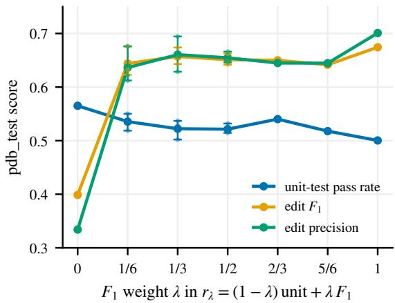  
Figure 9: Reward-weight sweep on Qwen3.5-4B GRPO, PDB Test. Lines are seed means; whiskers span three seeds at $\lambda \in \{ 1 / 6 , \dot { 1 / 3 } , 1 / \dot { 2 } \}$

## B.4 PROMPTING ANALYSIS ON GT DEBUG TASK

Gloaguen et al. (2026) show that an abstain-or-fix prompt reduces edits when a coding agent is given already-correct code. We test such a prompt on GT Debug (Table 7, Appendix D.3): it asks the model to check whether the code has a bug and to return it unchanged if not. The prompt helps every model: each raises its no-op rate by 14 to 44 points and lowers its damage rate. Base models gain the most (34–44 points of no-op), with frontier models close behind (27–34). Unit-test-only GRPO remains the least restrained model at 4B and 9B (51.4% and 51.5% no-op), and at 27B it falls below its own base model (67.9% vs. 75.5%). PreciseCoder beats the base model and EA-GRPO on both rates at 4B and 9B, beats frontier models at 27B, and narrows the gap to runs trained on clean rows: from 25.7 to 11.3 no-op points at 4B and from 20.2 to 4.3 at 9B, where its damage (7.4%) falls below theirs (8.0%).

Table 7: GT Debug under the abstain-or-fix prompt; ∆ = change from the minimal prompt.
<table><tr><td></td><td>Abstain-or-fix</td></tr><tr><td>Model No-op</td><td>Dmg. No-op Dmg.</td></tr><tr><td>Qwen3.5-4B GRPO-4B</td><td>68.3 11.5 +37.7 -7.8 10.9 +32.2 -6.9</td></tr><tr><td>EA-GRPO-4B</td><td>51.4 57.0 14.9 +13.7 -3.9</td></tr><tr><td>PreciseCoder-4B</td><td>71.9 7.6 +23.8 -5.9</td></tr><tr><td>Qwen3.5-9B</td><td>71.0 9.6 +34.4 -9.2</td></tr><tr><td>GRPO-9B</td><td>51.5 10.1 +20.8 -1.3 67.7</td></tr><tr><td>EA-GRPO-9B PreciseCoder-9B</td><td>8.9+20.7 -4.6 7.4 +22.1 -4.4</td></tr><tr><td></td><td>73.7 75.5</td></tr><tr><td>Qwen3.6-27B GRPO-27B 67.9</td><td>7.1 +44.4 -8.4 7.3 +41.0 -5.3 -4.5</td></tr><tr><td>PreciseCoder-27B DeepSeek-V4.1-Flash</td><td>80.4 5.8 +33.1 74.0 10.0+34.4 -11.5</td></tr></table>

## B.5 CHAIN-OF-THOUGHT TRANSFER FROM EVERY 9B DONOR

Section 5.2 hands only the PreciseCoder-9B think block to Qwen3.6-27B. Table 8 repeats that transfer with every 9B model of Table 2 as the donor, under the same protocol. The precision the 27B receiver gains grows with how precisely the donor was trained to edit: +2.6 points from the untrained 9B base, +7.4 from unit-test-only GRPO, +10.1 on average from the three PreciseCoder-9B seeds and +11.1 from EA-GRPO. Only the trained donors keep or raise the receiver’s pass rate; the base model’s trace costs 7.4 points. The PreciseCoder-9B traces give the largest pass-rate gain, +2.8 points on average and +4.3 for seed 42, at EA-GRPO’s level of precision. The seed-42 row is the Qwen3.6-27B entry of Table 4.

Table 8: Chain-of-thought transfer to Qwen3.6-27B from every 9B donor, PDB Test. ∆ = change from the receiver’s own reasoning; bold = positive ∆.
<table><tr><td rowspan="2">Receiver input</td><td colspan="5">PDB Test</td><td rowspan="2">∆</td></tr><tr><td>Pass</td><td>Prec.</td><td>Rec.</td><td>F1</td><td>Lines Pass</td></tr><tr><td>Own reasoning (20k)</td><td>73.8</td><td>51.0</td><td>72.6</td><td>56.4</td><td>6.7</td><td>Prec.</td></tr><tr><td>+ think block of the 9B donor</td><td></td><td></td><td></td><td></td><td></td><td></td></tr><tr><td>Qwen3.5-9B (base)</td><td>66.4</td><td>53.6</td><td>70.0</td><td>56.6</td><td>7.6</td><td>-7.4 +2.6</td></tr><tr><td>+ GRPO</td><td>74.2</td><td>58.4</td><td>76.6</td><td>62.7</td><td>5.5 +0.4</td><td>+7.4</td></tr><tr><td>+ EA-GRPO</td><td>76.1</td><td>62.1</td><td>77.7</td><td>65.9</td><td>5.9 +2.3</td><td>+11.1</td></tr><tr><td>PreciseCoder-9B, seed 42</td><td>78.1</td><td>62.1</td><td>78.3</td><td>66.3</td><td>5.7</td><td>+4.3 +11.1</td></tr><tr><td>PreciseCoder-9B, seed 43</td><td>76.4</td><td>61.0</td><td>78.2</td><td>65.1</td><td>5.4 +2.6</td><td>+10.0</td></tr><tr><td>PreciseCoder-9B, seed 44</td><td>75.3</td><td>60.3</td><td>77.5</td><td>64.5</td><td>5.8 +1.5</td><td>+9.3</td></tr><tr><td>PreciseCoder-9B, mean</td><td>76.6±1.4</td><td>61.1±0.9</td><td>78.0±0.4</td><td>65.3±0.9</td><td>5.7±0.2</td><td>+2.8 +10.1</td></tr></table>

## B.6 DETAILED LINGUISTIC ANALYSIS ON THE THINKING

Setup. We analyze the complete think blocks of the six local models of Table 2 on the 1,205 PDB Test tasks and the 1,512 GT Debug programs, and of GLM-5.2 and DeepSeek-V4-Pro on PDB Test, one sample per task at temperature 0.6 under the minimal-edit prompt. The local models think for at most 4,096 tokens on PDB Test and 16,384 on GT Debug and the frontier APIs for 16k–32k, so every lexical measure is a rate per 1,000 prose words, the block with fenced code removed and inline code spans replaced by a placeholder, and length is reported on its own.

We count 15 hand-built, case-insensitive lexical categories, among them backtracking (“wait”, “actually”), hedging (“might be”, “I think”, “I’ll assume”), verification, minimal-edit talk, instruction echo, “looks correct” assertions, “the prompt says there is a bug” and bug hypotheses (“maybe the bug is”, “I found it”), plus lexical diversity (moving-average type–token ratio, Covington & McFall,

2010) and repetition. Distinctive bigrams are ranked by the weighted log-odds ratio with an informative Dirichlet prior (Monroe et al., 2008), and vocabularies are compared by the Jensen–Shannon divergence of their unigram distributions.

Grounding asks whether every ground-truth buggy line appears verbatim, after whitespace normalization, in the prose, and how early. Links to performance are Spearman correlations within each model, paired differences on the same task within a size, and ordinary least squares of the metric on the standardized features with model fixed effects and task-clustered standard errors; they are associations, not causal effects. The lexicons were fixed before any correlation was computed.

Table 9: Thinking on PDB Test: length, lexical rates per 1,000 prose words, and grounding in the buggy line, for the base, unit-test-only GRPO and PreciseCoder models of Table 2 (PreciseCoder seed 42, one sample per task) and two frontier models. Pass and precision are those of this single sample. DeepSeek-V4-Pro here is DeepSeek-V4-Pro Preview, against DeepSeek-V4-Pro (0813) in Table 2

<table><tr><td rowspan="2"></td><td colspan="3">Qwen3.5-4B</td><td colspan="3">Qwen3.5-9B</td><td colspan="2">Frontier</td></tr><tr><td>Base</td><td>+ GRPO</td><td>PreciseCoder</td><td>Base</td><td>+ GRPO</td><td>PreciseCoder</td><td>GLM-5.2</td><td>DeepSeek-V4-Pro</td></tr><tr><td>Pass (%)</td><td>36.5</td><td>55.1</td><td>56.2</td><td>41.2</td><td>63.9</td><td>64.6</td><td>70.8</td><td>67.6</td></tr><tr><td>Precision (%)</td><td>35.8</td><td>30.0</td><td>64.6</td><td>43.9</td><td>41.7</td><td>67.9</td><td>65.0</td><td>40.8</td></tr><tr><td>Think tokens (mean)</td><td>2535</td><td>3617</td><td>4096</td><td>2469</td><td>4096</td><td>4087</td><td>7375</td><td>12043</td></tr><tr><td>At the thinking budget (%)</td><td>50</td><td>79</td><td>100</td><td>50</td><td>100</td><td>100</td><td>7</td><td>16</td></tr><tr><td>Prose words</td><td>932</td><td>1179</td><td>1432</td><td>908</td><td>1494</td><td>1581</td><td>2919</td><td>4975</td></tr><tr><td>Code share of the block (%)</td><td>14</td><td>21</td><td>8</td><td>16</td><td>8</td><td>4</td><td>19</td><td>12</td></tr><tr><td>Inline code spans /1k</td><td>114</td><td>143</td><td>155</td><td>111</td><td>170</td><td>168</td><td>63</td><td>84</td></tr><tr><td>Backtracking /1k</td><td>11.1</td><td>19.0</td><td>15.1</td><td>10.1</td><td>14.3</td><td>20.0</td><td>18.0</td><td>11.1</td></tr><tr><td>Hedging /1k</td><td>4.8</td><td>4.8</td><td>5.9</td><td>5.4</td><td>6.5</td><td>10.8</td><td>7.0</td><td>9.3</td></tr><tr><td>Verification /1k</td><td>8.1</td><td>11.4</td><td>7.4</td><td>8.5</td><td>9.0</td><td>7.0</td><td>10.2</td><td>6.0</td></tr><tr><td>Minimal-edit talk /1k</td><td>3.1</td><td>2.2</td><td>2.9</td><td>5.3</td><td>4.8</td><td>3.0</td><td>7.5</td><td>3.5</td></tr><tr><td>Instruction echo /1k</td><td>3.7</td><td>1.6</td><td>5.2</td><td>5.5</td><td>6.5</td><td>3.4</td><td>6.1</td><td>2.8</td></tr><tr><td>“Prompt says there is a bug&quot;”/1k</td><td>0.20</td><td>0.15</td><td>0.03</td><td>0.25</td><td>0.59</td><td>0.04</td><td>0.45</td><td>0.44</td></tr><tr><td>“Looks correct” /1k</td><td>4.1</td><td>4.1</td><td>5.0</td><td>4.3</td><td>4.6</td><td>4.7</td><td>5.1</td><td>3.3</td></tr><tr><td>Questions /1k</td><td>7.8</td><td>4.0</td><td>20.0</td><td>4.7</td><td>11.5</td><td>11.4</td><td>6.5</td><td>50.8</td></tr><tr><td>First person /1k</td><td>16.9</td><td>17.7</td><td>9.6</td><td>19.5</td><td>13.1</td><td>16.4</td><td>36.2</td><td>26.1</td></tr><tr><td>Every buggy line quoted (%)</td><td>36</td><td>40</td><td>67</td><td>43</td><td>78</td><td>71</td><td>61</td><td>72</td></tr><tr><td>Fixed line quoted (%)</td><td>22</td><td>26</td><td>45</td><td>27</td><td>54</td><td>46</td><td>55</td><td>58</td></tr><tr><td>First mention (relative position)</td><td>0.26</td><td>0.27</td><td>0.23</td><td>0.28</td><td>0.19</td><td>0.20</td><td>0.14</td><td>0.16</td></tr></table>

Buggy input. Table 9 lists the rates behind Section 5.3, and Figure 11 the change each training made on the same task at 9B. Both rewards produce the same length (every RL model thinks to the budget on 79–100% of tasks), the same rise in inline code and the same drop in pasted code; on top of that the precision reward adds hedging (+0.9 vs. +0.2 standard deviations), removes minimal-edit talk and instruction echo (−0.5 and −0.4 vs. about 0 and +0.2) and removes “the prompt says there is a bug” (−0.3 vs. +0.5). Figure 7 shows that recall is higher in every model on the tasks whose thinking quotes every buggy line, by 4 (GLM-5.2) to 19 (9B + GRPO) points. Surface alignment with the problem statement does not separate the models: the TF-IDF cosine between prose and description is 0.39–0.41 for all six local models, and 2–3% of prose 5-grams restate the prompt everywhere.

The frontier models write in idiolects no trained model acquires: GLM-5.2 says “let me” 17 times per 1,000 words and speaks in the first person 36 times, DeepSeek-V4-Pro asks 51 questions per 1,000 words and repeats its most frequent sentence 14 times per chain, and the Jensen–Shannon divergence to GLM-5.2 grows under either reward (9B: 0.096 for the base, 0.129 for GRPO, 0.127 for PreciseCoder).

Correct input. Table 10 reports the same local models on GT Debug, where there is nothing to find. With 16k tokens available the trained models fill the budget (9B + GRPO on 91% of tasks, PreciseCoder-9B on 99%), and their chains become a bug hunt: PreciseCoder-9B backtracks 86 times per 1,000 words, proposes 28 bug hypotheses, writes “I found it” 35 times per chain and repeats its most frequent sentence 195 times. The unit-test-only 9B shows the same pattern at half the intensity, and “looks correct” assertions are equally common in every model. Restraint arrives at the budget: every local model leaves clean code alone far more often when its thinking hits the cap than when it stops early (PreciseCoder-9B 52% vs. 14%, 9B + GRPO 34% vs. 1%), because a chain that stops early has “found” a bug.

Table 10: Thinking on GT Debug (1,512 correct programs, one sample per task, all rows): outcome, length, and the marks of a bug hunt with nothing to find. Rates per 1,000 prose words unless noted.
<table><tr><td rowspan="2"></td><td colspan="3">Qwen3.5-4B</td><td colspan="3">Qwen3.5-9B</td></tr><tr><td>Base</td><td>+ GRPO</td><td>PreciseCoder</td><td>Base</td><td>+ GRPO</td><td>PreciseCoder</td></tr><tr><td>No-op (%)</td><td>30.6</td><td>19.3</td><td>48.0</td><td>36.6</td><td>30.7</td><td>51.6</td></tr><tr><td>Damage (%)</td><td>19.3</td><td>17.8</td><td>13.5</td><td>18.7</td><td>11.4</td><td>11.8</td></tr><tr><td>Edited lines when edited</td><td>3.8</td><td>5.2</td><td>1.6</td><td>3.8</td><td>2.6</td><td>1.1</td></tr><tr><td>Think tokens (mean)</td><td>9773</td><td>14102</td><td>14813</td><td>9234</td><td>15868</td><td>16336</td></tr><tr><td>At the thinking budget (%)</td><td>54</td><td>77</td><td>68</td><td>51</td><td>91</td><td>99</td></tr><tr><td>No-op at the budget / below it (%)</td><td>46/12</td><td>22 /2</td><td>63 / 15</td><td>55 / 18</td><td>34 /1</td><td>52 /14</td></tr><tr><td>Backtracking /1k</td><td>23.9</td><td>38.7</td><td>30.5</td><td>21.1</td><td>43.5</td><td>85.8</td></tr><tr><td>Hedging /1k</td><td>14.7</td><td>15.4</td><td>13.1</td><td>14.9</td><td>10.0</td><td>51.1</td></tr><tr><td>“Looks correct&quot; /1k</td><td>8.2</td><td>8.0</td><td>10.1</td><td>8.1</td><td>10.9</td><td>10.2</td></tr><tr><td>Bug hypotheses /1k</td><td>6.0</td><td>3.7</td><td>10.3</td><td>4.7</td><td>10.8</td><td>27.6</td></tr><tr><td>&quot;I found it&quot; (per chain)</td><td>18.8</td><td>5.2</td><td>0.3</td><td>9.7</td><td>10.6</td><td>35.4</td></tr><tr><td>&quot;Prompt says there is a  $. \mathrm { \ b u g { } ^ { * } / 1 k }$ </td><td>1.03</td><td>0.61</td><td>0.36</td><td>1.10</td><td>0.49</td><td>0.17</td></tr><tr><td>Repeated sentences (%)</td><td>28.7</td><td>41.1</td><td>20.5</td><td>20.4</td><td>31.5</td><td>51.3</td></tr><tr><td>Most repeated sentence (count)</td><td>53</td><td>64</td><td>72</td><td>37</td><td>84</td><td>195</td></tr></table>

For the precision-trained models the no-op rate rises with the number of hypotheses the chain raises and rejects (figure 8), from 21% to 68% between the quarter of tasks with the fewest and the quarter with the most for PreciseCoder-9B, whereas the 9B unit-test-only model stays near 30%. PreciseCoder-4B is the exception among the trained models: it loops least (20% repeated sentences) and instead returns an empty answer on 6.7% of programs when its thinking exhausts the answer budget.

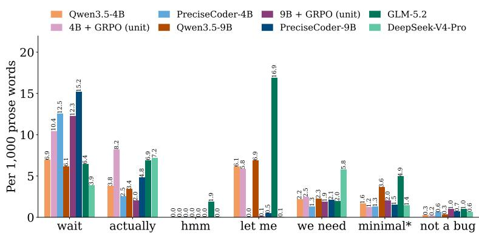  
Figure 10: Common word markers in the thinking traces.

## B.7 RESULT VISUALIZATIONS

Figure 12 plots the PDB Test columns of Table 2 for the base, PreciseCoder and frontier models, figure 13 the chain-of-thought transfer of Table 4, and figure 14 the prompt ablation of Table 7.

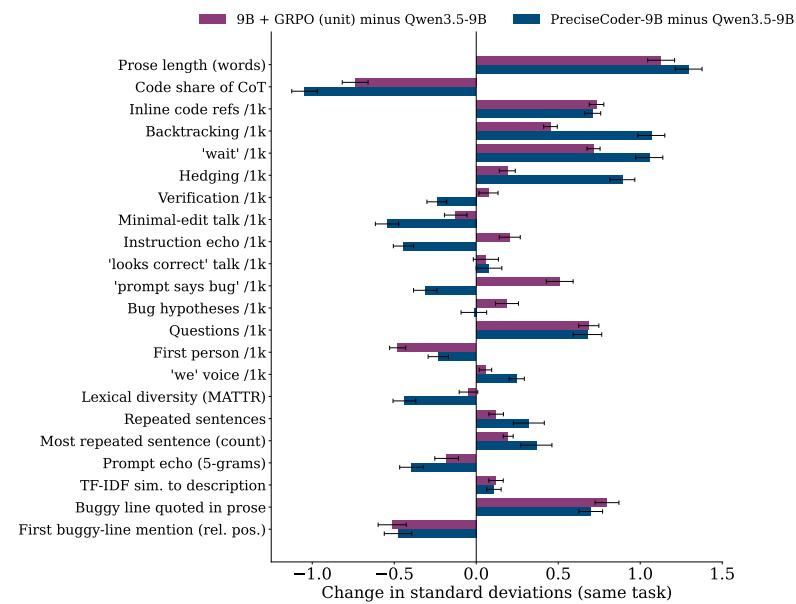  
Figure 11: What each training changed in the 9B’s thinking on the same PDB Test task: unit-testonly GRPO minus base (purple) and PreciseCoder minus base (blue), in standard deviations of the feature within the 9B triple; bars are 95% confidence intervals.

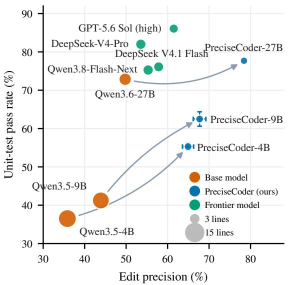  
Figure 12: PDB Test edit precision against pass rate (bubble area = edited lines). Arrows join each base model to its PreciseCoder model; error bars are ±1 sd over three runs.

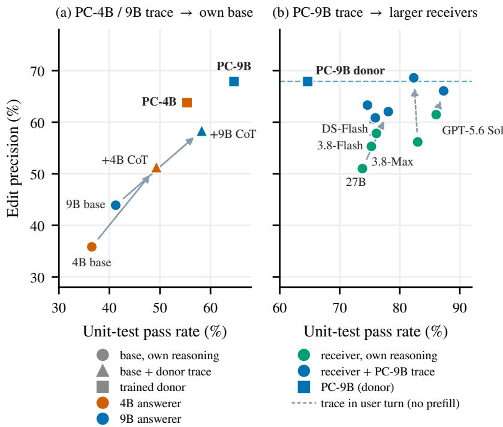  
Figure 13: Chain-of-thought transfer on PDB Test. (a) A PreciseCoder think block prefilled into its own base model. (b) The PreciseCoder-9B think block handed to larger receivers; dashed arrows mark the trace given in the user turn.

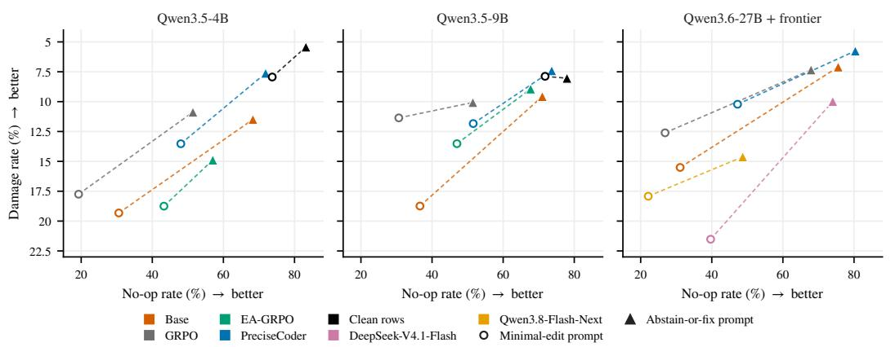  
Figure 14: GT Debug under the minimal-edit (circles) and abstain-or-fix (triangles) prompts. Up and right is better.

## C IMPLEMENTATION DETAILS

## C.1 HYPERPARAMETERS

Table 11 lists the main training and evaluation settings. Training uses verl (Sheng et al., 2025) with FSDP2 (Zhao et al., 2023) and vLLM (Kwon et al., 2023) rollouts. Every reinforcement-learning run, ours and the GRPO and EA-GRPO controls, shares the upper block and differs only in how the reward is turned into advantages. The model samples with thinking enabled, and the thinking budget is enforced during both training and evaluation. Checkpoints are saved and scored on the validation split every 25 steps. Evaluation decodes one sample per task with the same minimal-edit prompt used in training (Appendix D). GT Debug is given a larger budget so that the model has room to decide that no edit is needed.

## C.2 BASELINES

Rejection-sampling SFT and DPO. Both baselines are self-distilled from the base model they train, with no stronger teacher. The base model samples 16 repairs per training task (temperature 1.0, top-p 1.0, a 4,096-token thinking budget and 6,144 tokens in total), and samples that fail the unit tests are dropped. For SFT the passing samples are ranked, by edit precision at 4B and by edit $F _ { 1 }$ at 9B, and the top two per task are kept, giving 7,116 targets at 4B and 6,821 at 9B; the model is fine-tuned for two epochs at learning rate $5 \times 1 0 ^ { - 6 }$ . For DPO the same 16 samples are ranked by unit $+ \textstyle { \frac { 1 } { 2 } } F _ { 1 }$ and paired as first against fifteenth and second against sixteenth, giving 7,501 pairs at 4B and 7,062 at 9B; the sigmoid DPO loss is trained for one epoch at $\beta = 0 . 1$ 1 and learning rate $5 \times 1 0 ^ { - 7 }$ , starting from the base model, which also serves as the reference policy.

EA-GRPO. EA-GRPO (Ke et al., 2026) keeps the unit-test reward and subtracts an edit-size penalty from it inside rollout groups that already pass often enough. For a group of $G$ rollouts of one buggy program, let $u _ { i } ~ \in ~ \{ 0 , 1 \}$ be the unit-test outcome and $D _ { i }$ the number of lines changed between the input and rollout i. The penalty is switched on by a group-accuracy gate $\begin{array} { r } { T = \mathbf { \bar { 1 } } [ \frac { 1 } { G } \sum _ { i } u _ { i } \geq \alpha ] } \end{array}$ and, among the passing rollouts, is the sigmoid of the standardized edit size, $P _ { i } = \sigma \big ( ( D _ { i } - \mu _ { c } ) / \sigma _ { c } \big )$ with $\mu _ { c } , \sigma _ { c }$ c the mean and standard deviation of D over the passing subset. The reward is $R _ { i } = \dot { u } _ { i } ( 1 - T \beta P _ { i } ) \mathrm { : }$ : a failing rollout scores 0, a passing rollout scores between $1 - \beta$ and 1 according to how much it edits relative to the other passing rollouts, and the group is then normalized as in standard GRPO. We use $\alpha = 0 . 8$ and $\beta = 0 . 0 5$ , the setting their ablation on Qwen2.5-Coder-7B selects: they report that a low α penalizes every group and costs correctness, a high α never activates the penalty, and a larger β lowers pass@1. Their edit distance normalizes by the program length; since the length is shared within a group, it cancels under the standardization and we use the changed-line count directly. Data, prompt, group size and optimizer settings are those of Section 4.1.

RECAP. RECAP (Luo et al., 2026) repairs in two stages: a generator proposes a fix, and a separately trained refiner rewrites it into a correct, minimal patch. We use each base model as its own generator and fine-tune the 4B and 9B models as refiners. Refiner inputs are the problem, the buggy code and a candidate fix sampled from the 4B or 9B base model on a PDB training task; targets are a correct minimal fix, either the ground-truth solution or the most precise passing sample. The training set mixes three cases in a 3:1:1 ratio: a correct but over-edited candidate that must be trimmed (correct → correct), an incorrect candidate that must be repaired (incorrect → correct), and a candidate that is already a correct minimal fix and must be returned as is. Each target is paired with a reasoning trace generated by DeepSeek V4.1 Flash (DeepSeek-AI et al., 2026b), and the 3,761 examples that pass every filter (3,381 train, 380 validation) are used to fine-tune for six epochs. We also trained the refiner with DPO, on on-policy pairs and on pairs built from DeepSeek outputs, but neither improved on SFT, so we report the SFT refiner. At evaluation the refiner takes the same-size base model’s one-shot output on each task as its candidate and answers under the refine prompt of Appendix D.2.

Table 11: Training and evaluation hyperparameters. The upper block is shared by every reinforcement-learning run, including the GRPO and EA-GRPO controls; the middle block lists what changes with model size. In the CoT-transfer block, “trace + n” means the donor’s trace is prefilled into the receiver’s thinking, which may continue for n more tokens before it is closed. Settings not listed are verl defaults.
<table><tr><td></td><td>Value</td></tr><tr><td colspan="2">Reinforcement learning (all sizes)</td></tr><tr><td>Advantage estimator</td><td> ${ \mathrm { G D P O } } , \lambda = { \textstyle { \frac { 1 } { 3 } } } \left( { \ S 3 . 3 } \right)$ </td></tr><tr><td>Group size G</td><td></td></tr><tr><td>Prompts per step / PPO mini-batch</td><td>32 / 16</td></tr><tr><td>PPO epochs per step</td><td>1</td></tr><tr><td>Optimizer</td><td>AdamW  $( \beta _ { 1 } { = } 0 . 9 , \beta _ { 2 } { = } 0 . 9 9 9 ,$  weight decay 0.01)</td></tr><tr><td>Learning rate</td><td> $1 \times 1 0 ^ { - 6 }$  , constant, no warmup</td></tr><tr><td>Gradient-norm clip</td><td>1.0</td></tr><tr><td>Clip ratio (low / high)</td><td>0.2 / 0.28</td></tr><tr><td>KL loss (low-variance estimator)</td><td>0.005</td></tr><tr><td>Entropy bonus</td><td>0</td></tr><tr><td>Rollout temperature / top-p</td><td>1.0 / 1.0</td></tr><tr><td>Max prompt / response tokens</td><td>4,096 / 6,144</td></tr><tr><td>Thinking budget</td><td>4,096 tokens</td></tr><tr><td>Training epochs</td><td>2</td></tr><tr><td>Validation and checkpoint interval</td><td>25 steps</td></tr><tr><td>4B</td><td>9B</td><td>27B</td></tr><tr><td>Base model</td><td>Qwen3.5-4B Qwen3.5-9B</td><td>Qwen3.6-27B</td></tr><tr><td>GPUs</td><td>4×GH200 4×H200</td><td>8×GH200</td></tr><tr><td>Rollout tensor parallelism</td><td>328</td><td>2</td></tr><tr><td>Reported checkpoint (step)</td><td></td><td>328</td></tr><tr><td>Seeds</td><td>325 3</td><td>1</td></tr><tr><td colspan="3">Evaluation (all models)</td></tr><tr><td>Temperature / top-p / top-k</td><td colspan="2">0.6 / 0.95 / 10</td></tr><tr><td>Samples per task</td><td colspan="2"></td></tr><tr><td></td><td colspan="2">1</td></tr><tr><td>Thinking budget / max tokens, PDB Thinking budget / max tokens, GT Debug</td><td colspan="2">4,096 / 6,144 16,384 / 20,480</td></tr><tr><td colspan="3">CoT transfer (§5.2): thinking / answer tokens, own reasoning vs. + PreciseCoder-9B trace</td></tr><tr><td colspan="3">Donor trace (PreciseCoder-9B)</td></tr><tr><td></td><td colspan="2">4,096 (its PDB thinking budget)</td></tr><tr><td>Qwen3.5-9B</td><td colspan="2">4,096 / 2,048 vs. trace + 0 / 2,048</td></tr><tr><td>Qwen3.6-27B</td><td colspan="2">20,480 / 2,048 vs. trace + 16,000 / 2,048</td></tr><tr><td>Qwen3.8-Flash-Next, DeepSeek V4.1 Flash</td><td colspan="2">20,480 / 2,048 3 vs. trace + 16,384 / 2,048</td></tr><tr><td>Qwen3.8-Max GPT-5.6 Sol</td><td colspan="2">32,768 / 2,048 vs. 32,768 / 2,048, trace in prompt reasoning effort high vs. same, trace in prompt</td></tr></table>

## D PROMPTS

Every prompt is a chat exchange with a fixed system message and a per-task user message; braces mark the fields filled in for each task. The unit tests are never shown to the model.

## D.1 MINIMAL-EDIT PROMPT

Used for RL training, for the SFT and DPO sampling, and for every single-turn evaluation unless stated otherwise (PDB Test, GT Debug in Table 2, PDB-Wild and the frontier runs). The GT Debug probe uses the same prompt with the bug-free program in place of the buggy code, so the prompt still asserts that the code contains errors.

## System message:

Debug the given Python code. ONLY fix the bugs. Make minimal edits.   
Do NOT generate a new solution based on the problem description.   
Do NOT reformat lines that are already correct.   
Do NOT edit or add any comments.

Your response should include:   
- A self-contained, corrected Python implementation, with minimal edits.

## User message:

Problem description:   
{task\_prompt}   
Buggy code:   
\`\`\`python   
{buggy\_code}

## D.2 REFINE PROMPT (RECAP)

Used to train and evaluate the RECAP refiner (Appendix C.2); the candidate fix is the base model’s output under the minimal-edit prompt.

## System message:

You are given buggy Python code and a candidate fix for it. Produce the   
correct fix with minimal edits to the buggy code.   
Keep the candidate's changes that are needed to fix the bugs, drop every   
change that is not needed, and correct the candidate if it is wrong   
or incomplete. If the candidate is already a correct minimal fix,   
return it unchanged.   
Do NOT generate a new solution based on the problem description.   
Do NOT reformat lines that are already correct.   
Do NOT edit or add any comments.   
Your response should include:   
- A self-contained, corrected Python implementation, with minimal edits   
to the buggy code.

## User message:

Problem description:   
{task\_prompt}   
Buggy code:   
\`\`\`python   
{buggy\_code}   
Candidate fix:   
\`\`\`python   
{candidate\_solution}

## D.3 ABSTAIN-OR-FIX PROMPT

Used for the GT Debug restraint experiment (Table 7). It keeps the three “Do NOT” constraints of the minimal-edit prompt but makes the bug investigation an explicit first step and licenses an unchanged answer; the user message labels the program “Code:” rather than “Buggy code:”.

## System message:

First, investigate whether the given Python code contains bugs. If it   
contains no bugs, do NOT make any changes and return the code   
exactly as given. Otherwise, ONLY fix the bugs. Make minimal edits.   
Do NOT generate a new solution based on the problem description.

Do NOT reformat lines that are already correct.   
Do NOT edit or add any comments.   
Your response should include:   
- A self-contained Python implementation: the original code unchanged if   
it contains no bugs, otherwise the corrected code with minimal   
edits.

User message:

Problem description:   
{task\_prompt}   
Code:   
\`\`python   
{code}

## D.4 CHAIN-OF-THOUGHT TRANSFER

The receiver is given exactly the chat prompt the donor answered, that is the minimal-edit system and user messages above, and the donor’s think block is spliced into the receiver’s assistant turn over a raw completions endpoint. In the “answers at once” setting the block is closed immediately and the receiver writes the repair:

<think>   
{donor think block}   
</think>

In the “continues thinking” setting the block stays open after the donor trace; the receiver adds its own reasoning up to a thinking budget, after which the block is closed and the receiver answers:

<think>   
{donor think block}   
{receiver continues thinking, up to its budget}   
</think>

Where the API cannot prefill an assistant turn (Qwen3.8-Max, GPT-5.6 Sol), the donor trace is appended to the user message instead and the receiver reasons on its own:

Problem description:   
{task\_prompt}   
Buggy code:   
\`\`\`python   
{buggy\_code}   
The thinking starts with:   
{donor think block}

## D.5 AGENT TOOL PROMPT

The agentic evaluation (figure 6) runs each task as a five-turn tool loop over an in-memory copy of the buggy file, with the tools view, str\_replace\_editor and submit serialized in the SWEagent plain-text format; the run\_tests tool exists in the harness but is disabled in the reported runs. Exactly one tool call is applied per turn. view returns the requested lines with line numbers; a successful str\_replace\_editor call returns “Edit applied.” with the surrounding lines, and a non-unique or non-matching old\_str returns “Edit failed:” with the reason and leaves the file unchanged. The session ends at submit or when the turn budget runs out, and the current file is scored.

System message:   
You are debugging a single Python file. ONLY fix the bugs. Make minimal   
edits.   
Do NOT rewrite the file from scratch. Do NOT reformat lines that are   
already correct. Do NOT add or edit comments.   
You work by emitting tool calls. Emit EXACTLY ONE tool call per reply,   
using this plain-text format. Anything outside the function block is   
ignored. If a reply contains no tool call, nothing is applied and   
you will be asked to try again. The session ends only when you call   
submit (or the turn budget runs out).   
Do NOT answer with the corrected file as a \`\`\`python code block or any   
other prose -- that is NOT a tool call and is ignored. Every change   
must go through a str\_replace\_editor tool call.   
Available tools:   
view -- show the current file with line numbers. view\_range [start, end]   
(1-based, inclusive) is optional; include it to show only that   
region, or omit it to show the whole file:   
<function=view>   
<parameter=view\_range>[10, 30]</parameter>   
</function>   
str\_replace\_editor -- replace a unique snippet. old\_str must match the   
CURRENT file EXACTLY, including whitespace and indentation, and must   
occur EXACTLY ONCE; otherwise the file is left unchanged and you   
get an error. Do NOT include the line-number prefixes shown by view   
in old\_str. Edits accumulate across turns.   
<function=str\_replace\_editor>   
<parameter=old\_str> for i in range(n):   
total += i</parameter>   
<parameter=new\_str> for i in range(1, n):   
total += i</parameter>   
</function>   
To INSERT new lines (nothing is being removed), pick a unique anchor   
line next to the insertion point, then repeat the anchor in new\_str:   
submit -- finish; your current file is scored.   
<function=submit>   
</function>   
(The blocks above are format examples, not the actual edit to make.)

First user message (the file is shown with line numbers):

Problem description:   
{task\_prompt}   
Current contents of the file (line numbers shown for reference only --   
do not include them in old\_str):   
\`\`\`python   
1 {buggy\_code line 1}   
2 {buggy\_code line 2}   
3   
Fix the bug(s) with the fewest possible str\_replace edits, then call   
submit.

A reply with no tool call is answered with this user message and the turn is retried:

Your last reply contained no tool call, so nothing was applied. A \`\`\`   
python code block or prose answer is ignored -- you can only change   
the file through a tool call in the exact format, e.g.   
<function=str\_replace\_editor>   
<parameter=old\_str>...exact current line(s)...</parameter>   
<parameter=new\_str>...replacement...</parameter>   
</function>   
Translate your intended fix into one such tool call now, or call <   
function=submit></function> if the file is already correct.

## E LIMITATIONS

All training and evaluation are in Python. The benchmarks we build on are Python: we train on PDB tasks derived from BigCodeBench and LiveCodeBench and evaluate on these, on SWE-smith repositories (PDB-Wild), SWE-bench Verified, HumanEval+, CruxEval and the Python subset of DebugBench. Nothing in the reward is specific to Python: precision and recall are computed on line-level diffs against a reference fix, and semantic verification only executes the tests. Extending PreciseCoder to another language therefore requires buggy programs with reference fixes and a test harness in that language, such as the C++ and Java splits of DebugBench (Tian et al., 2024), rather than a change to the method; we have not run this experiment.

The reward needs a reference repair. Precision and recall are measured against a ground-truth fix (Section 3.2), so every training task needs one. The reference can come from the benchmark itself, as in PDB; from a human-written fix, such as the developer patches of SWE-bench Verified (OpenAI, 2024); or, where neither exists, from a model-generated fix that passes the unit tests.

Scoring the edit costs training time. Computing precision and recall, including the semantic verification of each edit block, adds about 5–7% to the wall-clock time of unit-test-only training. Caching semantic verification results reduces this cost, and it is amortized further as training scales to larger groups, longer rollouts or larger models, where generation and the policy update dominate.