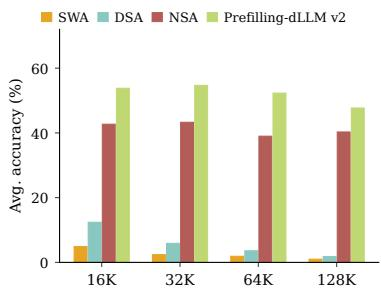
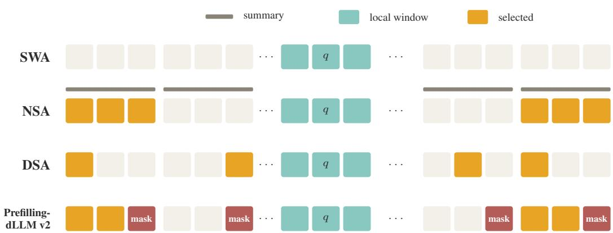
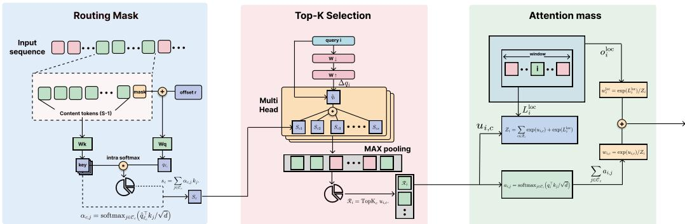
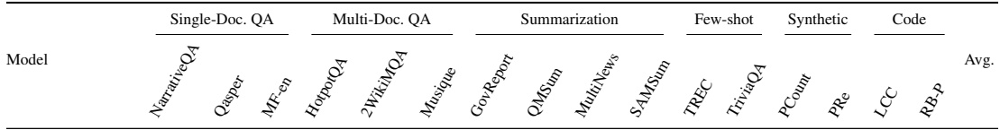
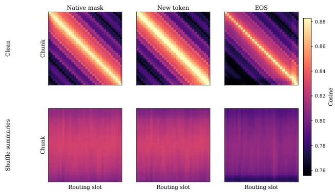
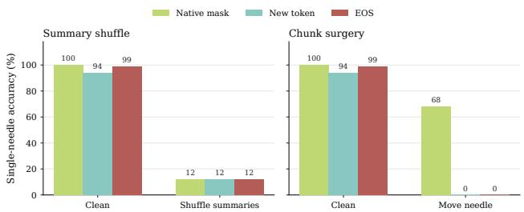
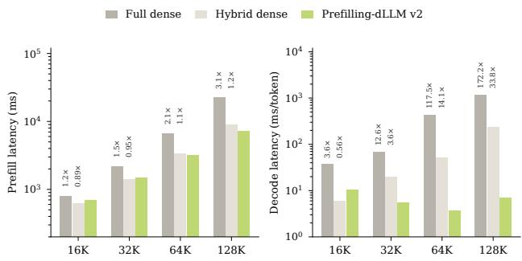
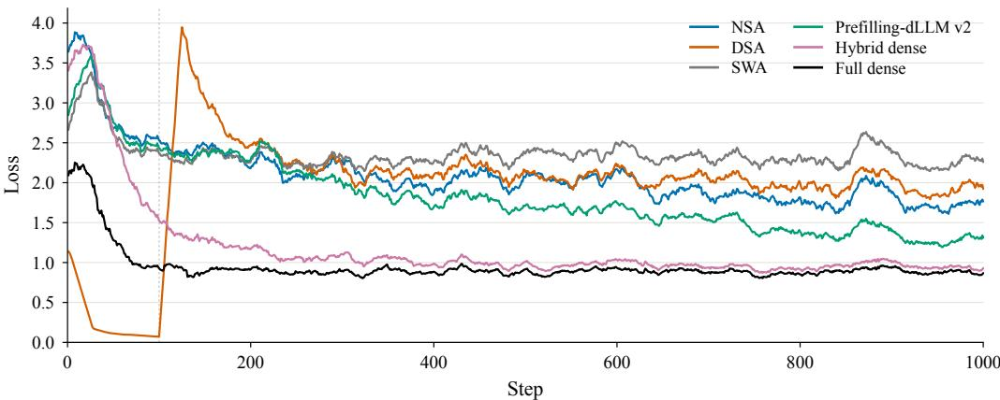

# PREFILLING-DLLM V2: LEARNED CHUNK ROUTINGFOR LONG-CONTEXT DIFFUSION LANGUAGE MODELS

Qi Han1, Jing Xiong1,†, Ziyuan Zhang2, Ngai Wong1

1University of Hong Kong 2Zhejiang University

†Corresponding author

## ABSTRACT

Diffusion language models apply bidirectional attention over the whole context at every denoising step, so a longer context makes each step substantially more expensive. Sparsifying only at inference leaves the pretrained weights unchanged, so the model is never trained under the sparse pattern it runs with. We propose Prefilling-dLLM v2, which continues training a diffusion language model so that it routes with its native mask token. One mask is appended at the end of each chunk, and a learned role offset marks it as a routing slot. On every fourth layer, a query keeps a bidirectional local window and the top-K chunks scored from that mask; the other layers use a bidirectional sliding window. Starting from Dreamv0-Base-7B extended to 16K with YaRN, we compare Prefilling-dLLM v2 with bidirectional NSA, DSA, and SWA under the same layout, key budget, and dense initialization, using the same Fast-dLLM decoder. With the YaRN factor scaled to the evaluation length, Prefilling-dLLM v2 leads the other sparse methods on all three RULER tasks from 16K to 128K. Its mean accuracy at 128K is 7.4 points above NSA, the next sparse model, while DSA and SWA remain near zero. At the same length, decoding is 172× faster than with full dense attention.

## 1 INTRODUCTION

Diffusion language models (dLLMs) generate text by iteratively unmasking tokens under bidirectional attention, rather than by left-to-right next-token prediction (Austin et al., 2021; Sahoo et al., 2024; Nie et al., 2025; Ye et al., 2025). At every denoising step, each query can attend to the whole context, so a longer context makes that step substantially more expensive.

Sparse attention in autoregressive models allocates a limited budget with a local window, a learned token-level route, or a mixture of compressed and selected blocks (Jiang et al., 2023; Yuan et al., 2025; DeepSeek-AI, 2025). These designs focus on causal attention, whereas efficient dLLM inference is studied mainly in a training-free regime. Fast-dLLM reuses keys and values across denoising steps and decodes blocks in parallel; it accelerates serving but does not sparsify attention (Wu et al., 2025b). Sparse-dLLM evicts cache entries (Song et al., 2025), SparseD builds a head-specific block-sparse mask at

  
Figure 1: Mean accuracy of the four sparse methods on the three RULER tasks. The YaRN factor scales with the evaluation length.

inference time (Wang et al., 2025), and Prefilling-dLLM scores prefix chunks and reuses a static top-K cache (Xiong et al., 2026). Sparsifying only at inference restricts which tokens are visible and leaves the pretrained dense attention weights unchanged, so the model runs under a sparse pattern it was never trained with. Training a dLLM under a sparse attention budget has received comparatively less study.

Our key insight is that a mask token is trained to absorb the context needed to predict an unknown token. Fixed at the end of a chunk, it can summarize that chunk and indicate which remote chunks a query should read. We therefore propose Prefilling-dLLM v2, a sparse attention method learned by continued training, which selects remote chunks with these summaries. Figure 2 contrasts the resulting visibility with bidirectional adaptations of Native Sparse Attention (NSA), DeepSeek Sparse Attention (DSA), and sliding-window attention (SWA).

  
Figure 2: What query q can see. Each chunk is three cells, and q sits in the middle so the local window extends both ways. Teal cells are the local window and orange cells are selected. The bar above each NSA chunk is its summary. DSA reads scattered tokens, and Prefilling-dLLM v2 mark the last cell of every chunk as a mask.

Specifically, Prefilling-dLLM v2 appends the model’s native mask token at the end of each chunk. A binary indicator marks that position as a routing position rather than one to be generated, and a learned role offset is added only there. Through the shared query and key projections, the offset changes how the routing mask attends, while a mask marked for generation remains a token to be predicted. The routing mask’s query attends over the tokens in its chunk and pools their keys into a summary. The pooling weights are a softmax over the content keys, and a chunk score adds the entropy of those weights to the similarity between the query and the summary. Each query keeps the highest-scoring chunks. The same scores are then normalized together with the local branch, and the resulting weights assign attention mass to each selected chunk and to the bidirectional local window. Each of the other layers applies a bidirectional sliding window around the query. Routing positions are omitted from the language-model targets and from the value stream, so the summary is used to choose tokens rather than being predicted or copied into the answer.

Starting from a Dream-v0-Base-7B checkpoint extended to 16K with YaRN (Peng et al., 2023), we compare Prefilling-dLLM v2 with NSA, DSA, and SWA under the same layer layout, key budget, and dense initialization, using the same Fast-dLLM decoder at evaluation (Wu et al., 2025b). The benchmarks are LongBench-v1 (Bai et al., 2023) and three RULER tasks: single-needle retrieval, multi-key multi-query, and variable tracking (Hsieh et al., 2024). Figure 1 plots the mean accuracy on the three tasks with the YaRN factor scaled to the evaluation length: Prefilling-dLLM v2 reaches 53.8 at 16K and 47.7 at 128K. NSA, the next sparse model, scores 42.7 and 40.3, so the margins are 11.1 and 7.4 points. DSA and SWA stay below 13 points at both lengths. Single-needle accuracy is 100.0 at 16K and 95.0 at 128K, against 81.0 and 83.0 for NSA. With the YaRN factor fixed at its training value, single-needle accuracy is 100.0 at 16K and 64K, and 99.0 at 32K and 128K. Component and routing-token ablations are reported in Appendix B and are not part of this comparison. Our contributions are as follows:

• Our core contribution is Prefilling-dLLM v2, a sparse attention method for dLLMs, learned by continued training, that summarizes each chunk with a native mask token and trains the model to select remote chunks from those summaries.

• We introduce mask-summary scoring, which marks that mask as a routing position with a binary indicator and a learned role offset, pools the chunk keys into a summary, and normalizes the scores with the local branch to assign attention mass.

• On three RULER tasks, with the YaRN factor scaled to the evaluation length, Prefilling-dLLM v2 leads the other sparse methods on every task from 16K to 128K. The three-task mean is 11.1 points above NSA at 16K and 7.4 points above NSA at 128K.

## 2 RELATED WORK

Diffusion language models. Diffusion was first applied to text by corrupting continuous word embeddings and learning to reverse that process (Li et al., 2022; Gong et al., 2023). A second line corrupts discrete tokens. Absorbing-state and masked diffusion replace selected tokens with a mask and train a model to reconstruct them under bidirectional context (Austin et al., 2021; He et al., 2023; Sahoo et al., 2024). This masked formulation has been scaled to LLM size along two routes. One converts a pretrained autoregressive model into a diffusion model by continued training (Gong et al., 2025; Ye et al., 2025). The other trains from scratch: LLaDA is competitive with autoregressive models at the 8B scale (Nie et al., 2025). Later work aligns these models with preferences (Zhu et al., 2025), adds visual instruction tuning (You et al., 2025), and extends the context window (Liu et al., 2025; Peng et al., 2023). Across these extensions, every denoising step still uses dense bidirectional attention over the whole sequence.

Efficient diffusion language models. One line reduces attention cost by training under a restricted mask. Block diffusion denoises one block at a time: tokens inside a block attend bidirectionally, while each block attends only to earlier blocks (Arriola et al., 2025). Fast-dLLM v2 continues training from a pretrained autoregressive model under this mask, and caches completed blocks at inference (Wu et al., 2025a). A second line leaves the dense bidirectional backbone unchanged and accelerates serving. Fast-dLLM reuses key and value states across denoising steps and decodes a block in parallel (Wu et al., 2025b). SparseD builds a head-specific block-sparse mask at inference (Wang et al., 2025), Sparse-dLLM evicts cache entries (Song et al., 2025), and PrefillingdLLM prefills prefix chunks once, retrieves a top-K subset, and reuses that cache for the remaining steps (Xiong et al., 2026). The trained masks above are fixed in advance, and the serving methods decide visibility only after dense training. Training a bidirectional dLLM to select remote context under a limited attention budget has received less study.

Sparse attention in autoregressive LMs. Sparse attention for autoregressive models falls into three groups: fixed patterns, patterns learned in training, and patterns applied only at inference. Fixed patterns keep each query inside a local window, a stride, or a few global tokens (Child et al., 2019; Beltagy et al., 2020; Zaheer et al., 2020; Jiang et al., 2023). A distant token is read only when it falls inside that pattern. Learned patterns train the model under a limited budget: NSA mixes compressed, selected, and sliding branches (Yuan et al., 2025), DSA selects individual tokens with a lightweight indexer (DeepSeek-AI, 2025), and MoBA and HiLS route each query to a few chunks (Lu et al., 2025; Hu et al., 2026). Serving-time patterns leave the causal weights unchanged and drop tokens through streaming caches, eviction, or dynamic block masks (Xiao et al., 2024; Zhang et al., 2023; Xiong et al., 2025a; Jiang et al., 2024). Eviction can also be applied to chunks that are encoded in parallel, which extends the context length without training (Xiong et al., 2025b). These designs assume causal attention and a cache that grows from left to right. Whether the same designs remain useful once attention is bidirectional, with the budget imposed while training a dLLM, is still open.

## 3 METHOD

Prefilling-dLLM v2 is a sparse attention method for a masked diffusion language model, learned by continued training. At one denoising step the model sees the input sequence $x _ { 0 : L - 1 }$ , which includes the appended routing positions. A query at position i may attend to valid keys on either side of i. Figure 3 follows the computation on a route layer in three parts: the routing mask that represents a chunk (Section 3.1), the top-K selection of remote chunks (Section 3.2), and the attention mass those scores assign (Section 3.3). The other layers are non-route layers and use sliding-window attention. A local window in this paper is centered on a query and extends to both sides of it. We give its size as a radius: $\rho$ on a non-route layer, and w for the local branch of a route layer.

The repeated 3SWA + 1route layout follows from the bidirectional information flow of a dLLM. A query at an early position can attend to tokens that occur later in the sequence. If the layers between route layers were dense, that remote evidence could be mixed into the hidden states before the next route decision, and the learned route would no longer be the only long-range path. Sliding-window layers keep bidirectional mixing inside the local radius and block direct attention beyond that radius, so long-range evidence enters at the route layers. It can then be carried by the hidden states through the following local layers. The window limits distance rather than imposing a causal direction. The layout therefore serves two purposes: it bounds the cost, and it makes the learned route the only long-range path. The layer schedule, the radii, the chunk size, and the number of selected chunks are fixed for the comparison and listed in Appendix A.1.

  
Figure 3: Computation on a route layer. A chunk is $S - 1$ content tokens followed by one routing mask. The role offset r is added to that mask at the input. Its query pools the content keys with an intra-chunk softmax, and the weighted sum is the summary key $s _ { c } . \mathrm { ~ A ~ }$ content query adds a lowrank residual and scores these summaries. Inside a GQA group (Ainslie et al., 2023) the scores are reduced by a maximum, and the top K chunks are shared by every head in the group. Attention mass puts the selected chunk scores and the local-window log-sum-exp in one partition, then a second softmax distributes each chunk’s mass over its content tokens.

## 3.1 ROUTING MASK

Chunk splitting. The sequence is partitioned into contiguous chunks of S positions. Chunk c holds S − 1 content tokens, followed by one routing position $\ell _ { c }$ at the end of the chunk. The routing position is filled with the model’s native mask id, so the vocabulary is unchanged and the embedding E of the mask is the one the model was already trained with. The same id is also written over content positions that the loss will predict. A binary indicator $m _ { i } \in \{ 0 , 1 \}$ separates the two uses. It is stored with the validity mask, and $m _ { i } = 1$ only at the appended routing positions. A mask that occupies a position to be denoised has $m _ { i } = 0$

Role offset. The role offset r is one learned vector of the model’s hidden size, shared by every chunk and every denoising step. It is added once, before the first layer, and only on a routing position: that position still stores the native mask id, and the input to the first layer is the mask embedding plus $r ,$

$$
e _ { i } = E ( x _ { i } ) + m _ { i } r .\tag{1}
$$

A content position has $m _ { i } = 0$ and keeps $E ( x _ { i } )$ , and no later layer adds r again. The first three layers are sliding-window layers. The first route layer is the fourth layer, and the remaining route layers follow every four layers. A route layer does not read $e _ { i }$ directly. Let $h _ { i }$ be the hidden state that reaches the layer, and let $R _ { i }$ be the rotary map at position i. The backbone query is the hidden state under the shared projection,

$$
q _ { i } = R _ { i } ( W _ { Q } h _ { i } ) .\tag{2}
$$

At a routing position $\ell _ { c } ,$ the query $q _ { \ell _ { c } }$ is therefore computed from $h _ { \ell _ { c } }$ , the state produced by the preceding layers, not from the input $E ( x _ { \ell _ { c } } ) + r$ . The key at position j is $k _ { j } = R _ { j } ( W _ { K } h _ { j } )$ under the shared key projection, and the content keys are the $k _ { j }$ at content positions. The value path and the token attention inside a selected chunk use these backbone queries and keys. The query that pools the chunk is $q _ { \ell _ { c } }$ with the residual of Section 3.2 added.

Chunk summary. Let $\mathcal { C } _ { c }$ be the content positions of chunk c. Write $\hat { q } _ { \ell _ { c } }$ for the query at the routing position after the residual is added. It attends over the content keys and pools them into one key for

the chunk,

$$
\alpha _ { c , j } = \mathrm { s o f t m a x } _ { j \in \mathcal { C } _ { c } } \left( \hat { q } _ { \ell _ { c } } ^ { \top } k _ { j } / \sqrt { d } \right) , \qquad s _ { c } = \sum _ { j \in \mathcal { C } _ { c } } \alpha _ { c , j } k _ { j } .\tag{3}
$$

Here d is the per-head dimension of the queries and keys. The routing position’s own key is excluded from this softmax. The summary $s _ { c }$ serves as the key of the routing mask: it is a weighted sum of the content keys, not the projection $k _ { \ell _ { c } } = R _ { \ell _ { c } } ( W _ { K } \mathbf  \bar { \} } h _ { \ell _ { c } } )$ . Tokens whose keys have a larger inner product with $\hat { q } _ { \ell _ { c } }$ contribute more to $s _ { c } ,$ so the summary can concentrate on a few positions inside the chunk. The role offset changes $\hat { q } _ { \ell _ { c } }$ through the hidden state at $\ell _ { c } ;$ it is not itself the summary. A generation mask keeps $m _ { i } = 0 .$ , and therefore keeps the mask embedding the model was trained on. Routing positions are omitted from the language-model targets. The denoising loss is computed on content positions whose tokens were masked for prediction. The appended mask is present so that $\hat { q } _ { \ell _ { c } }$ can pool the chunk, not as a token the model is asked to emit.

## 3.2 TOP-K SELECTION

Residual query. A low-rank residual is added to the backbone query at every position, routing and content alike,

$$
\Delta q _ { i } = W _ { \uparrow } W _ { \downarrow } h _ { i } , \qquad { \hat { q } } _ { i } = R _ { i } ( { \mathrm { R M S N o r m } } ( W _ { Q } h _ { i } + \Delta q _ { i } ) ) .\tag{4}
$$

Here $W _ { Q } h _ { i }$ is the backbone query before the rotary map, $W _ { \downarrow }$ maps the model dimension down to a small rank, and $W _ { \uparrow }$ maps that rank back to the query dimension. The sum is normalized per head with RMSNorm (Zhang & Sennrich, 2019) before the rotary map is applied. At the routing position the result is $\hat { q } _ { \ell _ { c } }$ , the query that forms $s _ { c }$ in Section 3.1. At a content position it is $\hat { q } _ { i }$ , the query used in the score below.

Chunk score. Scoring reuses the summaries, so no chunk is pooled a second time. A content position scores the summary $s _ { c }$ of each chunk outside its window of radius w by the inner product of $\hat { q } _ { i }$ with $s _ { c } .$ . The score adds an entropy term, the entropy of the pooling weights inside the chunk,

$$
u _ { i , c } = \hat { q } _ { i } ^ { \top } s _ { c } / \sqrt { d } + H ( \alpha _ { c } ) , \qquad H ( \alpha _ { c } ) = - \sum _ { j \in \mathcal { C } _ { c } } \alpha _ { c , j } \log \alpha _ { c , j } .\tag{5}
$$

The route layer keeps the K highest-scoring chunks,

$$
\mathcal { R } _ { i } = \mathrm { T o p K } _ { c } u _ { i , c } .\tag{6}
$$

Chunks inside the local window, chunks without a valid routing mask, and chunks the query is not allowed to read receive no score. The selected set $\mathcal { R } _ { i }$ is the remote half of what a route layer can see. Together with the local window of radius w in Section 3.3, it is the budget under which the route layer is trained. Each query scores $( L - 2 w ) / S$ summaries and then reads the content tokens of K chunks, so the remote cost scales with the number of chunks outside the window rather than with every token pair.

Grouped max pooling. Dream uses grouped-query attention (GQA) (Ainslie et al., 2023): several query heads share one key and one value. Those heads can prefer different chunks, but the selected tokens have to be gathered once because the key is shared. Each query head pools its own weights $\alpha _ { c , j }$ and its own summary $s _ { c }$ from the keys of the shared KV head, so the summary is formed once per query head. Inside a GQA group, Prefilling-dLLM v2 takes the maximum of $u _ { i , c }$ over those query heads, chooses $\mathcal { R } _ { i }$ from that maximum, and broadcasts the chosen chunks to every head in the group. The gathered values are then read once for the shared key. Each head still receives its own weights on that shared set in Section 3.3.

## 3.3 ATTENTION MASS

Remote and local mass. Selecting $\mathcal { R } _ { i }$ decides which chunks are visible, but not how much attention each visible token receives. The local branch is a bidirectional window of radius w around the query, restricted to content positions. Its attention output is $o _ { i } ^ { \mathrm { l o c } }$ , and the log-sum-exp of its attention logits is $L _ { i } ^ { \mathrm { l o c } }$ . The selected chunk scores and this local log-sum-exp are normalized together,

$$
Z _ { i } = \sum _ { c \in \mathcal { R } _ { i } } \exp ( u _ { i , c } ) + \exp ( L _ { i } ^ { \mathrm { l o c } } ) ,\tag{7}
$$

$$
w _ { i , c } = \exp ( u _ { i , c } ) / Z _ { i } , \qquad w _ { i } ^ { \mathrm { l o c } } = \exp ( L _ { i } ^ { \mathrm { l o c } } ) / Z _ { i } .\tag{8}
$$

Thus $w _ { i , c }$ is the attention mass of chunk $c ,$ and $w _ { i } ^ { \mathrm { l o c } }$ is the attention mass of the local window. A high summary score increases the share of the attention mass that the chunk receives, and the local window takes the remaining share. The chunk score $u _ { i , c }$ is computed with the residual query $\hat { q } _ { i }$ The local log-sum-exp $L _ { i } ^ { \mathrm { l o c } }$ is computed with the backbone query $q _ { i } .$ , as is the within-chunk softmax below. Putting $u _ { i , c }$ and $\dot { L } _ { i } ^ { \mathrm { l o c } }$ in one partition assigns each selected chunk and the local window a share of the attention mass. This is the allocation used by the route layer, not the softmax of one query over every visible token.

Within-chunk attention. Inside a selected chunk, token attention is a separate softmax over the content positions,

$$
\begin{array} { r } { a _ { i , j } = \mathrm { s o f t m a x } _ { j \in \mathcal C _ { c } } \left( q _ { i } ^ { \top } k _ { j } / \sqrt { d } \right) , \qquad j \in \mathcal C _ { c } . } \end{array}\tag{9}
$$

The routing position is excluded from this softmax and from the value stream. The summary $s _ { c }$ is used to choose the chunk; it is not a value that can be copied into the output. The route-layer output combines the two stages,

$$
o _ { i } = \sum _ { c \in \mathcal { R } _ { i } } w _ { i , c } \sum _ { j \in \mathcal { C } _ { c } } a _ { i , j } v _ { j } + w _ { i } ^ { \mathrm { l o c } } o _ { i } ^ { \mathrm { l o c } } .\tag{10}
$$

Here $v _ { j }$ is the value at position $j$ under the shared value projection. For a token $j$ in selected chunk $c ,$ the product $w _ { i , c } a _ { i , j }$ is its attention weight. The first factor is the mass of the chunk, computed from the routing-mask summary. The second factor renormalizes the query–key logits inside the chunk. Equation equation 10 makes the scores of Section 3.2 part of the forward computation. The set $\mathcal { R } _ { i }$ is a hard top-K selection, so membership in it is discrete and no gradient flows through the selection. The denoising loss trains the role offset, the summary, and the low-rank query residual through the masses $w _ { i , c }$ of the chunks that were selected.

Non-route layers. On a non-route layer the same query uses only its sliding window of radius $\rho ,$ with no chunk summary and no top-K selection. The route layers are where Prefilling-dLLM v2 spends its remote budget. The non-route layers carry local context on both sides of each query.

## 4 EXPERIMENTS

## 4.1 SETUP

Continued training starts from Dream-v0-Base-7B (Ye et al., 2025). Its original context is 2K, and we extend the checkpoint to 16K with YaRN (Peng et al., 2023) at a factor of 8. We compare Prefilling-dLLM v2 with bidirectional NSA, DSA, and SWA. Prefilling-dLLM v2, NSA, and DSA use the same layout (three bidirectional sliding-window layers followed by one sparse layer), the same key budget, and the same dense initialization. SWA applies a bidirectional sliding window in every layer. The hyperparameters of this comparison are fixed across variants. Appendix A.1 lists the layer schedule, the window radii, and the key budget. Appendix A.2 describes the dense context extension, and Appendix A.3 gives the continued-training objective, the GPUs, and the settings that differ across variants. Appendix A.4 describes the Fast-dLLM decoder and the prompts. At evaluation, every variant uses the same Fast-dLLM decoder (Wu et al., 2025b).

Benchmarks. We report LongBench-v1 and three RULER tasks (Bai et al., 2023; Hsieh et al., 2024). For LongBench we use each task’s official metric, and we report those scores and their mean at the 16K training length. RULER inserts the required evidence into filler text and varies the length. Of its 13 tasks we use single-needle retrieval, multi-key multi-query, and variable tracking, the three families supervised by the RULER term in equation 12. We do not run the official RULER release. Training and evaluation examples both come from our own generator for these three families, with the needle counts used in training rather than those of the official configuration. The filler is a document in training and the repeated RULER noise sentences at evaluation. At evaluation the span that the decoder fills has the same length as the gold answer, so every model is given the answer length. The prompts are in Appendix A.4. Lengths above 16K are beyond the training length. The other ten tasks are not reported. An example is correct only when every gold string appears in the prediction. We report each task and their mean at 16K, 32K, 64K, and 128K, with the training

Table 1: Three RULER tasks at 16K, 32K, 64K, and 128K. The upper block is dense attention. Full dense keeps dense attention in every layer through the same number of continued-training steps as the other variants. Hybrid dense uses three sliding-window layers and one dense layer. The lower block is sparse attention. Fixed uses YaRN factor 8. Scaled sets the factor to the evaluation length divided by 2048. MK is multi-key multi-query. Avg. is the mean of S-N, MK, and VT. In the dense block, ∗ marks the best score in each column. In the sparse block, the best score is bold and the second best is underlined.
<table><tr><td rowspan="2">Model</td><td rowspan="2">YaRN</td><td colspan="4">16K</td><td colspan="4"></td><td colspan="4">64K</td><td colspan="4">128K</td></tr><tr><td></td><td>MK</td><td>VT</td><td>Avg.</td><td>S-N</td><td>MK</td><td>VT</td><td>Avg. S-N</td><td></td><td>MK</td><td>VT</td><td>Avg.</td><td>S-N</td><td>MK</td><td>VT</td><td>Avg.</td></tr><tr><td colspan="10"></td><td></td><td></td><td></td><td></td><td></td><td></td><td></td><td></td></tr><tr><td rowspan="2">Full dense</td><td>Fixed</td><td>100.0*</td><td>100.0*</td><td>91.7*</td><td>97.2*</td><td>100.0*</td><td>96.5* 75.7*</td><td>90.7*</td><td>94.0*</td><td></td><td>68.5</td><td>40.7</td><td>67.7*</td><td>85.0*</td><td>90.0*</td><td>34.1*</td><td>69.7*</td></tr><tr><td>Scaled 100.0*</td><td></td><td>100.0*</td><td>91.7*</td><td>97.2*</td><td>100.0*</td><td>99.5*</td><td>80.0*</td><td>93.2*</td><td>100.0*</td><td>97.5*</td><td>69.3*</td><td>88.9*</td><td>100.0*</td><td>100.0*</td><td>62.3*</td><td>87.4*</td></tr><tr><td rowspan="2">Hybrid dense</td><td>Fixed</td><td>99.0</td><td>87.5</td><td>67.3</td><td>84.6</td><td>100.0*</td><td>81.5</td><td>67.7</td><td>83.1</td><td>70.0</td><td>73.5*</td><td>59.3*</td><td>67.6</td><td>25.0</td><td>25.0</td><td>27.0</td><td>25.7</td></tr><tr><td>Scaled</td><td>99.0</td><td>87.5</td><td>67.3</td><td>84.6</td><td>99.0</td><td>80.0</td><td>69.0</td><td>82.7</td><td>98.0</td><td>81.5</td><td>62.7</td><td>80.7</td><td>85.0</td><td>83.5</td><td>53.7</td><td>74.1</td></tr><tr><td colspan="10">Sparse</td><td colspan="3"></td><td colspan="3"></td><td colspan="3"></td></tr><tr><td rowspan="2">SWA</td><td>Fixed</td><td>5.0</td><td>5.0</td><td>4.7</td><td>4.9</td><td>2.0</td><td>1.0</td><td>4.3</td><td>2.4</td><td>3.0</td><td>2.5</td><td>1.0</td><td>2.2</td><td>1.0</td><td>0.0</td><td>0.0</td><td>0.3</td></tr><tr><td>Scaled</td><td>5.0</td><td>5.0</td><td>4.7</td><td>4.9</td><td>2.0</td><td>1.0</td><td>4.3</td><td>2.4</td><td>3.0</td><td>2.0</td><td>0.7</td><td>1.9</td><td>2.0</td><td>0.0</td><td>1.0</td><td>1.0</td></tr><tr><td rowspan="2">NSA</td><td>Fixed</td><td>81.0</td><td>32.0</td><td>15.0</td><td>42.7</td><td>84.0</td><td>32.0</td><td>10.0</td><td>42.0</td><td>79.0</td><td>16.0</td><td>9.3</td><td>34.8</td><td>79.0</td><td>12.0</td><td>5.0</td><td>32.0</td></tr><tr><td>Scaled</td><td>81.0</td><td>32.0</td><td>15.0</td><td>42.7</td><td>87.0</td><td>30.5</td><td>12.3</td><td>43.3</td><td>86.0</td><td>22.0</td><td>9.0</td><td>39.0</td><td>83.0</td><td>29.0</td><td>9.0</td><td>40.3</td></tr><tr><td rowspan="2">DSA</td><td>Fixed</td><td>9.0</td><td>15.5</td><td>12.7</td><td>12.4</td><td>6.0</td><td>7.0</td><td>4.0</td><td>5.7</td><td>5.0</td><td>4.0</td><td>2.0</td><td>3.7</td><td>3.0</td><td>0.5</td><td>1.3</td><td>1.6</td></tr><tr><td>Scaled</td><td>9.0</td><td>15.5</td><td>12.7</td><td>12.4</td><td>7.0</td><td>6.0</td><td>4.7</td><td>5.9</td><td>3.0</td><td>5.0</td><td>2.7</td><td>3.6</td><td>2.0</td><td>1.5</td><td>2.0</td><td>1.8</td></tr><tr><td rowspan="2">Prefilling-dLLM v2</td><td>Fixed</td><td>100.0</td><td>42.0</td><td>19.3</td><td>53.8</td><td>99.0</td><td>35.0</td><td>18.0</td><td>50.7</td><td>100.0</td><td>27.0</td><td>17.0</td><td>48.0</td><td>99.0</td><td>32.5</td><td>8.0</td><td>46.5</td></tr><tr><td>Scaled</td><td>100.0</td><td>42.0</td><td>19.3</td><td>53.8</td><td>99.0</td><td>47.5</td><td>17.7</td><td>54.7</td><td>98.0</td><td>45.0</td><td>14.0</td><td>52.3</td><td>95.0</td><td>37.5</td><td>10.7</td><td>47.7</td></tr></table>

YaRN factor held fixed and with the factor scaled to the evaluation length. Each number comes from a single continued-training run. Component and routing-token ablations are in Appendix B.

## 4.2 MAIN RESULTS

RULER. Table 1 reports the results across lengths. Among the sparse models, Prefilling-dLLM v2 has the highest three-task mean at every length and under both YaRN settings. With the factor scaled to the evaluation length, the means are 53.8, 54.7, 52.3, and 47.7 at 16K, 32K, 64K, and 128K, against 42.7, 43.3, 39.0, and 40.3 for NSA, a margin of 11.1, 11.4, 13.3, and 7.4 points. DSA and SWA remain far lower and reach 1.8 and 1.0 at 128K. Prefilling-dLLM v2 leads NSA on singleneedle retrieval, with 100.0, 99.0, 98.0, and 95.0 against 81.0, 87.0, 86.0, and 83.0, and on multikey multi-query, with 42.0, 47.5, 45.0, and 37.5 against 32.0, 30.5, 22.0, and 29.0. Single-needle retrieval contributes most of the margin at 16K and 128K, and multi-key multi-query contributes most of it at 32K and 64K. Multi-key multi-query and variable tracking remain far below full dense, 42.0 and 19.3 against 100.0 and 91.7 at 16K, because those tasks scatter the evidence and a top-K selection can miss one piece. With the factor held at 8, the single-needle accuracy of PrefillingdLLM v2 stays at 100.0 at 16K and 64K and at 99.0 at 32K and 128K, while full dense falls to 94.0 at 64K. The fixed factor lowers multi-key accuracy, from 47.5 to 35.0 at 32K and from 45.0 to 27.0 at 64K, but the 64K mean still favors Prefilling-dLLM v2, 48.0 against 34.8 for NSA. Hybrid dense replaces the route with a dense layer and scores 84.6 at 16K, against 97.2 for full dense. At 128K its scaled single-needle score is 85.0, below Prefilling-dLLM v2 at 95.0, and the fixed factor lowers it to 25.0.

LongBench. On LongBench the order reverses (Table 2). The task means are 30.9 for SWA, 26.6 for NSA, 25.8 for DSA, and 25.4 for Prefilling-dLLM v2, against 44.3 for full dense. Most of these tasks need coverage of a long document. A route that keeps a few remote chunks drops most of tha document, while SWA applies a wide window in every layer. The same window cannot retrieve a needle, which is why the RULER ranking runs the other way.

Table 2: LongBench-v1 at the 16K training length. The upper block is dense attention. Full dense keeps dense attention in every layer through the same number of continued-training steps as the other variants. Hybrid dense uses three sliding-window layers and one dense layer. The lower block is sparse attention. In the dense block, ∗ marks the best score in each column. In the sparse block, the best score is bold and the second best is underlined.
<table><tr><td rowspan="2"></td><td colspan="3"></td><td colspan="3"></td><td colspan="3"></td><td colspan="2"></td><td colspan="2"></td><td colspan="3"></td></tr><tr><td></td><td></td><td></td><td></td><td></td><td></td><td></td><td></td><td></td><td></td><td></td><td></td><td></td><td></td><td></td><td></td></tr><tr><td></td><td></td><td></td><td></td><td></td><td></td><td></td><td>Dense</td><td></td><td></td><td></td><td></td><td></td><td></td><td></td><td></td><td></td></tr><tr><td>Full dense Hybrid dense</td><td>29.1*</td><td>36.0</td><td>53.7*</td><td>60.1*</td><td>47.1*</td><td>38.8</td><td>5.1</td><td>22.8</td><td>4.7*</td><td>42.9*</td><td>73.5*</td><td>91.2*</td><td>2.0* 99.5*</td><td>47.9*</td><td>53.8</td><td>44.3*</td></tr><tr><td>25.4</td><td>37.1*</td><td></td><td>48.5</td><td>59.3</td><td>40.6 39.2*</td><td>8.7*</td><td>24.9* Sparse</td><td></td><td>1.5</td><td>35.7</td><td>72.0</td><td>88.7 2.0*</td><td>96.3</td><td>46.2</td><td>55.7*</td><td>42.6</td></tr><tr><td colspan="10"></td><td colspan="7"></td></tr><tr><td>SWA</td><td>18.0</td><td>20.8</td><td>26.4</td><td>28.3</td><td>28.1</td><td>12.8</td><td>19.8</td><td>20.7</td><td>13.7</td><td>41.9</td><td>64.0 86.2</td><td>1.7</td><td>14.5</td><td>45.8</td><td>50.8</td><td>30.9</td></tr><tr><td>NSA</td><td>13.1</td><td>16.2</td><td>28.3</td><td>22.6</td><td>20.6</td><td>10.8</td><td>16.2</td><td>20.6</td><td>17.0</td><td>38.9 60.0</td><td>79.5</td><td>0.3</td><td>0.5</td><td>38.6</td><td>41.9</td><td>26.6</td></tr><tr><td>DSA</td><td>18.1</td><td>17.3</td><td>28.3</td><td>20.4</td><td>22.7</td><td>13.3</td><td>15.2</td><td>16.5</td><td>14.0</td><td>34.2 61.0</td><td>74.8</td><td>2.1</td><td>4.4</td><td>33.4</td><td>36.9</td><td>25.8</td></tr><tr><td>Prefilling-dLLM v2</td><td>10.4</td><td>14.8</td><td>17.7</td><td>24.3</td><td>26.3</td><td>10.1</td><td>13.4</td><td>18.4</td><td>17.2</td><td>35.0 62.0</td><td>70.6</td><td>0.8</td><td>5.6</td><td>37.6</td><td>42.6</td><td>25.4</td></tr></table>

  
Figure 4: Cosine between the mean content key of each chunk and the summary key of each routing slot on the 16K single-needle probe, averaged over route layers and 100 examples. Each panel is binned to 32×32. On the clean probe the diagonal pairs a slot with its own chunk. Shuffle summaries permutes the summaries across chunks.

## 4.3 ROUTING-MASK PROBES

Figure 5 tests the routing mask on 16K single-needle retrieval (100 examples) with the same FastdLLM decoder. In addition to the native mask, we evaluate two routing slots trained the same way: the end-of-sequence (EOS) token and a new learned token. In the first probe we permute the summaries across chunks and leave the text in place. Accuracy falls from 100.0, 94.0, and 99.0 to 12.0 for the mask, the new token, and EOS. Figure 4 shows why. On the clean probe the cosine between the mean content key of a chunk and the summary key of a routing slot concentrates on the diagonal, so each summary matches its own chunk. The new token and EOS show the same diagonal. Permuting the summaries removes it. The needle is still in the text, and breaking the binding between each summary and its chunk is enough to lose it.

## Finding. The routing mask stores a chunk summary that the model reads.

In the second probe we move the intact needle into another chunk. The routing slots stay where they are, and only the needle span is exchanged with the tokens at the destination. Accuracy falls to 68.0 for the native mask and to 0.0 for the new token and for EOS. The mask summary is formed again from the chunk that now holds the needle, and the route layer still selects that chunk. A new token and EOS match the mask when the needle is not moved, and lose the needle once it moves.

  
Figure 5: 16K single-needle accuracy for the routing mask, a new learned token, and EOS. Shuffle summaries permutes the summaries across chunks and leaves the text in place. Move needle places the intact needle in another chunk. Each bar is 100 examples.

  
Figure 6: Prefill time and decode time per generated token under the same Fast-dLLM decoder. Both vertical axes are logarithmic. The number above each full-dense and hybrid-dense bar is the ratio of that latency to the latency of Prefilling-dLLM v2. The YaRN factor is the evaluation length divided by 2048.

Finding. After the needle moves to another chunk, the routing mask still finds it in 68 of 100 examples; a new token and EOS find it in none.

## 4.4 LATENCY

Figure 6 reports Fast-dLLM prefill and decode latency for full dense, hybrid dense, and PrefillingdLLM v2. Each bar is the median of ten trials on one synthetic sequence with 128 masked answer tokens, and the YaRN factor is the evaluation length divided by 2048. NSA, DSA, and SWA are not timed. At 128K, prefill is 22338 ms for full dense, 9034 ms for hybrid dense, and 7280 ms for Prefilling-dLLM v2, so Prefilling-dLLM v2 is 3.1× faster than full dense; the gain is modest because the prefill pass still reads every token. The gap opens in per-token decoding. Full dense rises from 37.66 ms at 16K to 1190 ms at 128K. Hybrid dense is faster than Prefilling-dLLM v2 at 16K, 5.90 ms against 10.55 ms, then reaches 233.4 ms at 128K, 5.1× lower than full dense. Prefilling-dLLM v2 stays between 3.69 ms and 10.55 ms per token and is 6.91 ms at 128K, 172× lower than full dense, because the remote budget is a fixed number of chunks.

Finding. At long context the prefill gain is much smaller than the decode gain: 3.1× against 172× at 128K.

## 5 CONCLUSION

Prefilling-dLLM v2 continues training a diffusion language model so that it routes with its native mask. A mask at the end of each chunk summarizes that chunk, and every fourth layer keeps a local window plus the top-K chunks scored from that summary. Under a matched budget and the same Fast-dLLM decoder, Prefilling-dLLM v2 leads NSA, DSA, and SWA on all three RULER tasks from 16K to 128K when the YaRN factor scales with length. At 128K, decoding is 172× faster than with full dense attention, because the remote budget is a fixed number of chunks.

Those three tasks are the task families in the continued-training loss, and lengths beyond 16K were not seen in training. Multi-key retrieval and variable tracking still trail full dense, because missing one chunk is enough to get an example wrong when its evidence is scattered. On LongBench, where most of a document is useful, a wide window outperforms a few selected chunks. A fixed routing budget is enough to retrieve a localized needle, and it keeps decoding cheap as the context grows.

## REFERENCES

Joshua Ainslie, James Lee-Thorp, Michiel de Jong, Yury Zemlyanskiy, Federico Lebron, and Sumit´ Sanghai. GQA: Training generalized multi-query transformer models from multi-head checkpoints. In Proceedings of the 2023 Conference on Empirical Methods in Natural Language Processing, 2023.

Marianne Arriola, Aaron Gokaslan, Justin T. Chiu, Zhihan Yang, Zhixuan Qi, Jiaqi Han, Subham Sekhar Sahoo, and Volodymyr Kuleshov. Block diffusion: Interpolating between autoregressive and diffusion language models. arXiv preprint arXiv:2503.09573, 2025.

Jacob Austin, Daniel D. Johnson, Jonathan Ho, Daniel Tarlow, and Rianne van den Berg. Structured denoising diffusion models in discrete state-spaces. In Advances in Neural Information Processing Systems, 2021.

Yushi Bai, Xin Lv, Jiajie Zhang, Hongchang Lyu, Jiankai Tang, Zhidian Huang, Zhengxiao Du, Xiao Liu, Aohan Zeng, Lei Hou, Yuxiao Dong, Jie Tang, and Juanzi Li. LongBench: A bilingual, multitask benchmark for long context understanding. arXiv preprint arXiv:2308.14508, 2023.

Iz Beltagy, Matthew E. Peters, and Arman Cohan. Longformer: The long-document transformer. arXiv preprint arXiv:2004.05150, 2020.

Rewon Child, Scott Gray, Alec Radford, and Ilya Sutskever. Generating long sequences with sparse transformers. arXiv preprint arXiv:1904.10509, 2019.

DeepSeek-AI. DeepSeek-V3.2: Pushing the frontier of open large language models. arXiv preprint arXiv:2512.02556, 2025.

Shansan Gong, Mukai Li, Jiangtao Feng, Zhiyong Wu, and Lingpeng Kong. DiffuSeq: Sequence to sequence text generation with diffusion models. In International Conference on Learning Representations, 2023.

Shansan Gong, Shivam Agarwal, Yizhe Zhang, Jiacheng Ye, Lin Zheng, Mukai Li, Chenxin An, Peilin Zhao, Wei Bi, Jiawei Han, Hao Peng, and Lingpeng Kong. Scaling diffusion language models via adaptation from autoregressive models. In International Conference on Learning Representations, 2025.

Zhengfu He, Tianxiang Sun, Kuanning Wang, Xuanjing Huang, and Xipeng Qiu. DiffusionBERT: Improving generative masked language models with diffusion models. In Proceedings of the 61st Annual Meeting of the Association for Computational Linguistics, 2023.

Cheng-Ping Hsieh, Simeng Sun, Samuel Kriman, Shantanu Acharya, Dima Rekesh, Fei Jia, Yang Zhang, and Boris Ginsburg. RULER: What’s the real context size of your long-context language models? In Conference on Language Modeling, 2024.

Edward J. Hu, Yelong Shen, Phillip Wallis, Zeyuan Allen-Zhu, Yuanzhi Li, Shean Wang, Lu Wang, and Weizhu Chen. LoRA: Low-rank adaptation of large language models. In International Conference on Learning Representations, 2022.

Xiang Hu, Xinyu Wei, Hao Gu, Minshen Zhang, Tian Liang, Huayang Li, Lei Zhu, Yan Wang, Sirui Han, Yushi Bai, Kewei Tu, Haitao Mi, and Leo Liang. Hierarchical sparse attention done right: Toward infinite context modeling. arXiv preprint arXiv:2607.02980, 2026.

Albert Q. Jiang, Alexandre Sablayrolles, Arthur Mensch, Chris Bamford, Devendra Singh Chaplot, Diego de las Casas, Florian Bressand, Gianna Lengyel, Guillaume Lample, Lucile Saulnier, Lelio Renard Lavaud, Marie-Anne Lachaux, Pierre Stock, Teven Le Scao, Thibaut Lavril, Thomas´ Wang, Timothee Lacroix, and William El Sayed. Mistral 7B.´ arXiv preprint arXiv:2310.06825, 2023.

Huiqiang Jiang, Yucheng Li, Chengruidong Zhang, Qianhui Wu, Xufang Luo, Surin Ahn, Zhenhua Han, Amir H. Abdi, Dongsheng Li, Chin-Yew Lin, Yuqing Yang, and Lili Qiu. MInference 1.0: Accelerating pre-filling for long-context LLMs via dynamic sparse attention. In Advances in Neural Information Processing Systems, 2024.

Xiang Lisa Li, John Thickstun, Ishaan Gulrajani, Percy Liang, and Tatsunori B. Hashimoto. Diffusion-LM improves controllable text generation. In Advances in Neural Information Processing Systems, 2022.

Xiaoran Liu, Yuerong Song, Zhigeng Liu, Zengfeng Huang, Qipeng Guo, Ziwei He, and Xipeng Qiu. LongLLaDA: Unlocking long context capabilities in diffusion LLMs. arXiv preprint arXiv:2506.14429, 2025.

Enzhe Lu, Zhejun Jiang, Jingyuan Liu, Yulun Du, Tao Jiang, Chao Hong, Shaowei Liu, Weiran He, Enming Yuan, Yuzhi Wang, Zhiqi Huang, Huan Yuan, Suting Xu, Xinran Xu, Guokun Lai, Yanru Chen, Huabin Zheng, Junjie Yan, Jianlin Su, Yuxin Wu, Yutao Zhang, Zhilin Yang, Xinyu Zhou, Mingxing Zhang, and Jiezhong Qiu. MoBA: Mixture of block attention for long-context LLMs. arXiv preprint arXiv:2502.13189, 2025.

Shen Nie, Fengqi Zhu, Zebin You, Xiaolu Zhang, Jingyang Ou, Jun Hu, Jun Zhou, Yankai Lin, Ji-Rong Wen, and Chongxuan Li. LLaDA: Large language diffusion models. arXiv preprint arXiv:2502.09992, 2025.

Bowen Peng, Jeffrey Quesnelle, Honglu Fan, and Enrico Shippole. YaRN: Efficient context window extension of large language models. arXiv preprint arXiv:2309.00071, 2023.

Subham Sekhar Sahoo, Marianne Arriola, Yair Schiff, Aaron Gokaslan, Edgar Marroquin, Justin T. Chiu, Alexander Rush, and Volodymyr Kuleshov. Simple and effective masked diffusion language models. In Advances in Neural Information Processing Systems, 2024.

Yuerong Song, Xiaoran Liu, Ruixiao Li, Zhigeng Liu, Zengfeng Huang, Qipeng Guo, Ziwei He, and Xipeng Qiu. Sparse-dLLM: Accelerating diffusion LLMs with dynamic cache eviction. arXiv preprint arXiv:2508.02558, 2025.

Team Olmo, Allyson Ettinger, Amanda Bertsch, Bailey Kuehl, David Graham, David Heineman, Dirk Groeneveld, et al. Olmo 3. arXiv preprint arXiv:2512.13961, 2025.

Zeqing Wang, Gongfan Fang, Xinyin Ma, Xingyi Yang, and Xinchao Wang. SparseD: Sparse attention for diffusion language models. arXiv preprint arXiv:2509.24014, 2025.

Chengyue Wu, Hao Zhang, Shuchen Xue, Shizhe Diao, Yonggan Fu, Zhijian Liu, Pavlo Molchanov, Ping Luo, Song Han, and Enze Xie. Fast-dLLM v2: Efficient block-diffusion LLM. arXivpreprint arXiv:2509.26328, 2025a.

Chengyue Wu, Hao Zhang, Shuchen Xue, Zhijian Liu, Shizhe Diao, Ligeng Zhu, Ping Luo, Song Han, and Enze Xie. Fast-dLLM: Training-free acceleration of diffusion LLM by enabling KV cache and parallel decoding. arXiv preprint arXiv:2505.22618, 2025b.

Guangxuan Xiao, Yuandong Tian, Beidi Chen, Song Han, and Mike Lewis. Efficient streaming language models with attention sinks. In International Conference on Learning Representations, 2024.

Jing Xiong, Jianghan Shen, Fanghua Ye, Chaofan Tao, Zhongwei Wan, Jianqiao Lu, Xun Wu, Chuanyang Zheng, Zhijiang Guo, Min Yang, Lingpeng Kong, and Ngai Wong. UNComp: Can matrix entropy uncover sparsity? — A compressor design from an uncertainty-aware perspective. In Proceedings of the 2025 Conference on Empirical Methods in Natural Language Processing, 2025a.

Jing Xiong, Jianghan Shen, Chuanyang Zheng, Zhongwei Wan, Chenyang Zhao, Chiwun Yang, Fanghua Ye, Hongxia Yang, Lingpeng Kong, and Ngai Wong. ParallelComp: Parallel longcontext compressor for length extrapolation. In Proceedings ofthe 42nd International Conference on Machine Learning, 2025b.

Jing Xiong, Qi Han, Shansan Gong, Yunta Hsieh, Chengyue Wu, Chaofan Tao, Chenyang Zhao, and Ngai Wong. Prefilling-dLLM: Predictive prefilling for long-context inference in diffusion language models. arXiv preprint arXiv:2606.10537, 2026.

Jiacheng Ye, Zhihui Xie, Lin Zheng, Jiahui Gao, Zirui Wu, Xin Jiang, Zhenguo Li, and Lingpeng Kong. Dream 7B: Diffusion large language models. arXiv preprint arXiv:2508.15487, 2025.

Zebin You, Shen Nie, Xiaolu Zhang, Jun Hu, Jun Zhou, Zhiwu Lu, Ji-Rong Wen, and Chongxuan Li. LLaDA-V: Large language diffusion models with visual instruction tuning. arXiv preprint arXiv:2505.16933, 2025.

Jingyang Yuan, Huazuo Gao, Damai Dai, Junyu Luo, Liang Zhao, Zhengyan Zhang, Zhenda Xie, Y. X. Wei, Lean Wang, Zhiping Xiao, Yuqing Wang, Chong Ruan, Ming Zhang, Wenfeng Liang, and Wangding Zeng. Native sparse attention: Hardware-aligned and natively trainable sparse attention. In Proceedings of the 63rd Annual Meeting of the Association for Computational Linguistics (Volume 1: Long Papers), 2025.

Manzil Zaheer, Guru Guruganesh, Kumar Avinava Dubey, Joshua Ainslie, Chris Alberti, Santiago Ontanon, Philip Pham, Anirudh Ravula, Qifan Wang, Li Yang, and Amr Ahmed. BigBird: Transformers for longer sequences. In Advances in Neural Information Processing Systems, 2020.

Biao Zhang and Rico Sennrich. Root mean square layer normalization. In Advances in Neural Information Processing Systems, 2019.

Zhenyu Zhang, Ying Sheng, Tianyi Zhou, Tianlong Chen, Lianmin Zheng, Ruisi Cai, Zhao Song, Yuandong Tian, Christopher Re, Clark Barrett, Zhangyang Wang, and Beidi Chen. H2O: Heavy-´ hitter oracle for efficient generative inference of large language models. In Proceedings of the 40th International Conference on Machine Learning, 2023.

Fengqi Zhu, Rongzhen Wang, Shen Nie, Xiaolu Zhang, Chunwei Wu, Jun Hu, Jun Zhou, Jianfei Chen, Yankai Lin, Ji-Rong Wen, and Chongxuan Li. LLaDA 1.5: Variance-reduced preference optimization for large language diffusion models. arXiv preprint arXiv:2505.19223, 2025.

Table 3: Layer configurations. Each variant occupies two rows. The first row is every fourth layer, and the second row is the other 21 layers. Local window is a bidirectional radius. Remote budget is the set of keys gathered beyond that window. Total budget is the number of key positions on that row. The sparse rows share a budget of about 2560. A dense layer reads every key.
<table><tr><td>Variant</td><td>Layers</td><td>Local window Remote budget</td><td></td><td>Total budget</td></tr><tr><td rowspan="2">Prefilling-dLLM v2</td><td>every 4th radius 256</td><td></td><td>32 chunks of 64</td><td>≈ 2560</td></tr><tr><td>other 21</td><td>radius 1280</td><td></td><td>≈ 2560</td></tr><tr><td rowspan="2">NSA</td><td></td><td>every 4th radius 128</td><td>32 × 64 selected, one token per 64</td><td>≈ 2560</td></tr><tr><td>other 21</td><td>radius 1280</td><td></td><td>≈ 2560</td></tr><tr><td rowspan="2">DSA</td><td>every 4th</td><td></td><td>token top-k 2560</td><td>2560</td></tr><tr><td>other 21</td><td>radius 1280</td><td></td><td>≈ 2560</td></tr><tr><td rowspan="2">SWA</td><td></td><td>every 4th radius 1280</td><td>一</td><td>≈ 2560</td></tr><tr><td>other 21</td><td>radius 1280</td><td></td><td>≈ 2560</td></tr><tr><td rowspan="2">Hybrid dense</td><td>every 4th all keys</td><td></td><td>1</td><td>all keys</td></tr><tr><td>other 21</td><td>radius 1280</td><td></td><td>≈ 2560</td></tr><tr><td rowspan="2">Full dense</td><td>every 4th all keys</td><td></td><td></td><td>all keys</td></tr><tr><td>other 21</td><td>all keys</td><td></td><td>all keys</td></tr></table>

## A EXPERIMENTAL SETUP

This appendix lists the settings used in Section 4.

## A.1 BASIC SETUP

These experiments use NVIDIA H20 GPUs. Training and evaluation run in PyTorch 2.9.1 built with CUDA 12.8. The model is Dream-v0-Base-7B, with 28 transformer layers. Its original context is 2048 tokens, and YaRN with factor 8 extends the checkpoint to 16K.

Table 3 lists the attention configuration of each variant. Layers {3, 7, 11, 15, 19, 23, 27}, every fourth layer, are route layers for Prefilling-dLLM v2, NSA, and DSA, and dense layers for hybrid dense. Each of the other 21 layers applies its own bidirectional sliding window of radius ρ = 1280 around every query, about 2561 positions. Full dense keeps dense attention in every layer, and SWA uses radius 1280 in every layer. On a Prefilling-dLLM v2 route layer the nominal budget is about 2560 keys: a bidirectional window of radius w = 256 together with K = 32 selected chunks of S−1 = 63 content tokens, before overlap between the window and the selected chunks. Overlap at chunk boundaries can make the number of distinct keys slightly smaller.

## A.2 DENSE CONTEXT EXTENSION

This stage continues training Dream-v0-Base-7B with dense attention in every layer. YaRN with factor 8 extends the original context of 2048 to 16384 positions. The run uses two GPUs.

The language-model data are document windows from Dolma 3 Longmino (Team Olmo et al., 2025).1 Each window is one contiguous span of a single document, 16128 tokens long. This is the amount of text that fills a 16384-position window when one position in every block of 64 is reserved. The corpus has 3200 windows. We hold out 128 windows for validation, and the remaining windows form the training set. Documents shorter than one window are dropped.

A training example is a language-model window with probability 0.95 and a RULER window with probability 0.05. On a language-model window, the mask rate t is drawn uniformly from [0.2, 0.8]. One view masks eligible tokens at that rate, and the second view masks the remaining eligible tokens, so the two views supervise each of those tokens once. An eligible token is a token whose preceding position is also inside the document and is not an end-of-sequence token. On a RULER window, the same document is the filler. The task is drawn uniformly from single-needle retrieval, multi-key multi-query, and variable tracking, and the loss supervises the answer tokens. The objective is the mean cross-entropy over supervised tokens,

Table 4: Dense context extension. The run continues Dream-v0-Base-7B under dense attention. The base weights stay frozen, and the listed low-rank adapters are the trainable parameters.
<table><tr><td>Hyperparameter</td><td>Value</td></tr><tr><td>GPUs</td><td>2</td></tr><tr><td>Steps</td><td>500</td></tr><tr><td>Text tokens per sequence</td><td>16128</td></tr><tr><td>YaRN factor</td><td>8</td></tr><tr><td>Optimizer</td><td> $\mathrm { A d a m W }$ </td></tr><tr><td>Learning rate</td><td> $2 \times 1 0 ^ { - 4 }$ </td></tr><tr><td>Schedule</td><td>cosine</td></tr><tr><td>Warmup steps</td><td>25</td></tr><tr><td>Weight decay</td><td>0</td></tr><tr><td>Gradient clipping</td><td>1.0</td></tr><tr><td>Micro-batch size</td><td>1</td></tr><tr><td>Gradient accumulation</td><td>1</td></tr><tr><td>LoRA rank</td><td>16</td></tr><tr><td>LoRA scale</td><td>32</td></tr><tr><td>LoRA dropout</td><td>0.05</td></tr><tr><td>LoRA modules</td><td>query, key, value, output</td></tr><tr><td>Mask rate</td><td>[0.2, 0.8]</td></tr><tr><td>RULER probability</td><td>0.05</td></tr><tr><td>Seed</td><td>7</td></tr></table>

$$
\begin{array} { r } { \mathcal { L } = \mathrm { m e a n } [ \mathrm { C E } ] . } \end{array}\tag{11}
$$

The base weights stay frozen. Low-rank adapters (Hu et al., 2022) of rank 16, scale 32, and dropout 0.05 train the query, key, value, and output projections. Optimization runs for 500 steps with a cosine schedule at learning rate $2 \times 1 0 ^ { - 4 }$ , with 25 warmup steps, zero weight decay, and gradient clipping at 1.0. Each GPU holds one sequence per step. Table 4 collects these settings.

## A.3 CONTINUED TRAINING

The six variants in the main comparison continue from the step-500 checkpoint of Section A.2. They use the same Dolma 3 Longmino windows. Every step contains both a language-model view and a RULER view. The language-model view keeps the two complementary masks of that section, with the mask rate drawn uniformly from [0.2, 0.8]. The RULER view draws one task uniformly from single-needle retrieval, multi-key multi-query, and variable tracking, and supervises the answer tokens. The two views are averaged as token means,

$$
\begin{array} { r } { \mathcal { L } = \frac { 1 } { 2 } \mathrm { \ m e a n } [ \mathrm { C E _ { D o l m a } } ] + \frac { 1 } { 2 } \mathrm { \ m e a n } [ \mathrm { C E _ { R U L E R } } ] . } \end{array}\tag{12}
$$

Each run uses four GPUs, one sequence per GPU, for 1000 steps with a cosine schedule at learning rate $1 0 ^ { - 4 }$ and 50 warmup steps. The base weights stay frozen, and low-rank adapters of rank 16, scale 32, and dropout 0.05 train the query, key, value, and output projections. Table 5 records the parameters that differ.

NSA. Every fourth layer mixes three branches. The compressed branch maps each nonoverlapping block of 64 tokens to one key and one value. The selected branch gathers 32 of those blocks, 64 tokens each, using the attention weights of the compressed branch. The local branch is a bidirectional window of radius 128. A learned gate gives each head three independent sigmoids and mixes the three outputs with those weights. The gate and the compression parameters train together with the low-rank adapters. The other 21 layers use a bidirectional window of radius 1280.

DSA. Every fourth layer retrieves individual tokens, and training has two phases. During the first 100 steps those layers stay dense and only the indexer is updated, at learning rate $1 0 ^ { - 3 }$ . The objective in this phase is a KL divergence that matches the indexer to the dense attention over the indexer’s top 2560 tokens, computed for every query. The indexer has 8 heads of dimension 128, and all of its weights are trained. During the remaining 900 steps those layers attend only to the top 2560 tokens chosen by the indexer. The language-model loss is restored, and the KL term is kept at weight 1; it is now computed on 64 queries per sequence, still over the selected tokens. In this phase the indexer and the low-rank adapters share a cosine schedule at learning rate $1 0 ^ { - 4 }$ with 50 warmup steps. The other 21 layers use a bidirectional window of radius 1280.

Table 5: Continued training. Each variant is initialized from the dense step-500 checkpoint and trains for 1000 steps with a cosine schedule on four GPUs, at learning rate $\mathrm { i 0 ^ { - 4 } }$ with 50 warmup steps. The base weights stay frozen. Low-rank adapters of rank 16, scale 32, and dropout 0.05 train the query, key, value, and output projections. The rows below are the parameters that differ across variants.
<table><tr><td>Variant</td><td>Hyperparameter</td><td>Value</td></tr><tr><td rowspan="5">NSA</td><td>Route layers</td><td>every 4th block 64, stride 64</td></tr><tr><td>Compressed branch</td><td></td></tr><tr><td>Selected branch</td><td>32 blocks of 64</td></tr><tr><td>Local branch</td><td></td></tr><tr><td>Gate</td><td>radius 128 three sigmoids per head</td></tr><tr><td rowspan="6"></td><td>Other layers Route layers</td><td>SWA radius 1280 every 4th</td></tr><tr><td>Warmup</td><td>100 steps, dense attention</td></tr><tr><td></td><td></td></tr><tr><td>Warmup objective</td><td>indexer KL on every query  $1 0 ^ { - 3 }$ </td></tr><tr><td>Indexer learning rate Indexer</td><td>8 heads, dimension 128</td></tr><tr><td>Sparse phase Sparse KL</td><td>900 steps, token top-k 2560</td></tr><tr><td rowspan="2">SWA</td><td>Other layers</td><td>weight 1, 64 queries, selected tokens SWA radius 1280</td></tr><tr><td>Layers</td><td>all 28</td></tr><tr><td rowspan="6">Prefilling-dLLM v2</td><td>Window Route layers</td><td>radius 1280</td></tr><tr><td>Local window</td><td>every 4th</td></tr><tr><td></td><td>radius 256</td></tr><tr><td>Remote budget</td><td>32 chunks of 64</td></tr><tr><td>Selection</td><td>hard top-K</td></tr><tr><td>Role offset Query residual</td><td>one learned vector, added at the input rank 64</td></tr><tr><td rowspan="5">Hybrid dense</td><td>Other layers</td><td>SWA radius 1280</td></tr><tr><td>Every 4th layer</td><td>dense, all keys</td></tr><tr><td></td><td></td></tr><tr><td>Other layers</td><td>SWA radius 1280</td></tr><tr><td>Layers</td><td>all 28</td></tr></table>

SWA. Every layer uses a bidirectional window of radius 1280. The trainable parameters are the low-rank adapters.

Prefilling-dLLM v2. Every fourth layer is a route layer, and the other 21 layers use a bidirectional window of radius 1280. Each chunk appends the native mask, and a learned role offset is added to that mask once, at the model input. A rank-64 residual is added to the backbone query before the rotary map. Chunk selection is hard top-K: a local window of radius 256 together with 32 chunks of 64 positions. The denoising loss trains the role offset and the residual together with the low-rank adapters. Routing positions are left out of the language-model targets.

Hybrid dense. Every fourth layer reads every key. The other 21 layers use a bidirectional window of radius 1280. The trainable parameters are the low-rank adapters.

Full dense. Every layer reads every key. The trainable parameters are the low-rank adapters.

## A.4 EVALUATION

Every variant uses the same Fast-dLLM decoder (Wu et al., 2025b). Key and value states are cached and reused across denoising steps. A route layer also keeps its chunk summaries and refreshes a summary when its chunk changes. Generation fills blocks of 32 positions. Inside a block, every token whose confidence is at least 0.9 is committed, and each step commits at least the most confiden token. On RULER the masked span has the same length as the gold answer. On LongBench each task keeps its official generation length.

The two benchmarks use different prompts. A RULER prompt repeats the filler sentence to the target length, inserts the task’s needles into that filler, and ends with the question. The single-needle prompt is shown below. Multi-key multi-query asks for the codes of two named items, and variable tracking asks for every variable assigned a given value.

## RULER.

The grass is green. The sky is blue. The sun is yellow. Here we go.   
There and back again.   
|One of the special magic numbers for long-context is: <code>|   
What is the special magic number for long-context mentioned in the   
provided text? Answer:

LongBench fills the official template of each task. The multi-field English question-answering template is shown below.

## LongBench.

Read the following text and answer briefly.   
<context>   
Now, answer the following question based on the above text, only give me   
the answer and do not output any other words.   
Question: <question>   
Answer:

## A.5 TRAINING CURVES

Figure 7 plots the continued-training objective in equation 12 for the six variants on one set of axes. Each line is a trailing average of 25 steps. DSA trains only the indexer for the first 100 steps, so its language-model loss stays near zero until step 101, where the vertical line is drawn.

## B ABLATION STUDY

Every run in this section is evaluated with the YaRN factor held at 8 at every length. The reference row in both tables is therefore the Fixed row of Prefilling-dLLM v2 in Table 1.

The component ablations keep the native mask and remove one piece of the full model. No residual drops the rank-64 query residual. No role offset keeps the mask embedding and does not add the learned role offset. Mean summary replaces the attention pool in equation 3 with the mean of the content keys. No entropy removes H(αc) from the chunk score. These runs use the same continuedtraining recipe as Prefilling-dLLM v2. Table 6 reports the four variants at 16K, 32K, 64K, and 128K.

Removing the residual is the largest drop. The means of No residual are 26.0, 19.1, 12.9, and 9.1, and its single-needle accuracy falls from 63.0 at 16K to 16.0 at 128K. The rank-64 residual is part of the query that scores the chunks. The means of No role offset are 40.5, 39.7, 41.3, and 37.3. Its single-needle accuracy is 95.0, 94.0, 93.0, and 85.0, while its multi-key accuracy is 13.5, 9.5, 13.0, and 13.5, compared with 42.0, 35.0, 27.0, and 32.5 for Prefilling-dLLM v2. Without the offset the model still finds a single needle and loses most multi-key retrieval. The means of No entropy are 40.7, 38.8, 37.3, and 27.3. Its single-needle accuracy is 98.0, 97.0, and 90.0 through 64K and falls to 58.0 at 128K, while its multi-key accuracy stays between 7.0 and 13.0. Mean summary is the one variant that is not below Prefilling-dLLM v2 at the shorter lengths. Its means are 56.5, 56.6, and 52.1 at 16K, 32K, and 64K, compared with 53.8, 50.7, and 48.0, and its multi-key accuracy is 50.5, 51.0, and 39.0, compared with 42.0, 35.0, and 27.0. At 128K its single-needle accuracy falls to 62.0, compared with 99.0, and its mean falls to 35.9, compared with 46.5.

  
Figure 7: Training loss of the continued-training runs. Each line averages the previous 25 steps. The dashed vertical line marks the end of the DSA indexer warmup.

Table 6: Component ablations on the three RULER tasks. The YaRN factor is held at 8 at every length. MK is multi-key multi-query. Avg. is the mean of S-N, MK, and VT. Prefilling-dLLM v2 is the full model, copied from its Fixed row in Table 1. Each other row removes one component.
<table><tr><td></td><td colspan="4">16K</td><td colspan="4">32K</td><td colspan="4">64K</td><td colspan="4">128K</td></tr><tr><td>Variant</td><td>S-N</td><td>MK</td><td>VT</td><td>Avg.</td><td>S-N</td><td>MK</td><td>VT</td><td>Avg.</td><td>S-N</td><td>MK</td><td>VT</td><td>Avg.</td><td>S-N</td><td>MK</td><td>VT</td><td>Avg.</td></tr><tr><td>Prefilling-dLLM v2</td><td>100.0</td><td>42.0</td><td>19.3</td><td>53.8</td><td>99.0</td><td>35.0</td><td>18.0</td><td>50.7</td><td>100.0</td><td>27.0</td><td>17.0</td><td>48.0</td><td>99.0</td><td>32.5</td><td>8.0</td><td>46.5</td></tr><tr><td>No residual</td><td>63.0</td><td>12.0</td><td>3.0</td><td>26.0</td><td>47.0</td><td>5.5</td><td>4.7</td><td>19.1</td><td>27.0</td><td>5.5</td><td>6.3</td><td>12.9</td><td>16.0</td><td>7.5</td><td>3.7</td><td>9.1</td></tr><tr><td>No role offset</td><td>95.0</td><td>13.5</td><td>13.0</td><td>40.5</td><td>94.0</td><td>9.5</td><td>15.7</td><td>39.7</td><td>93.0</td><td>13.0</td><td>18.0</td><td>41.3</td><td>85.0</td><td>13.5</td><td>13.3</td><td>37.3</td></tr><tr><td>Mean summary</td><td>99.0</td><td>50.5</td><td>20.0</td><td>56.5</td><td>100.0</td><td>51.0</td><td>18.7</td><td>56.6</td><td>96.0</td><td>39.0</td><td>21.3</td><td>52.1</td><td>62.0</td><td>29.5</td><td>16.3</td><td>35.9</td></tr><tr><td>No entropy</td><td>98.0</td><td>13.0</td><td>11.0</td><td>40.7</td><td>97.0</td><td>7.0</td><td>12.3</td><td>38.8</td><td>90.0</td><td>10.0</td><td>12.0</td><td>37.3</td><td>58.0</td><td>12.5</td><td>11.3</td><td>27.3</td></tr></table>

The token ablations replace the routing mask and keep the rest of Prefilling-dLLM v2. EOS writes the end-of-sequence token into the routing slot. New token uses a learned embedding in place of the native mask. At evaluation the routing slot holds the token each model was trained with. Table 7 reports both at every length. The means of EOS are 37.5, 36.2, 31.8, and 22.8, and the means of New token are 38.9, 37.9, 39.9, and 30.7, compared with 53.8, 50.7, 48.0, and 46.5 for the native mask. Multi-key retrieval is lower at every length: EOS scores 10.5, 4.5, 7.0, and 5.0, and New token scores 7.5, 4.0, 7.0, and 5.0, compared with 42.0, 35.0, 27.0, and 32.5. Single-needle accuracy is within 7 points of the native mask at 16K and 32K, where EOS scores 98.0 and 97.0 and New token scores 93.0 and 94.0, compared with 100.0 and 99.0. At 64K and 128K EOS scores 81.0 and 57.0 and New token scores 93.0 and 72.0, while the native mask scores 100.0 and 99.0. On variable tracking EOS stays between 4.0 and 7.3, while New token scores 16.3, 15.7, 19.7, and 15.0, compared with 19.3, 18.0, 17.0, and 8.0. Both replacement tokens can retrieve a single needle at the training length and lose most multi-key retrieval at every length. The native mask is the only slot that keeps both. The 16K single-needle scores of EOS and New token differ by one example from the clean bars of Figure 5, which come from a separate run of the probe.

Table 7: Routing-token ablations on the three RULER tasks. The YaRN factor is held at 8 at every length. MK is multi-key multi-query. Avg. is the mean of S-N, MK, and VT. Mask is the native mask used by Prefilling-dLLM v2, copied from its Fixed row in Table 1. EOS and New token replace the mask in the routing slot, both in training and at evaluation.
<table><tr><td></td><td colspan="4">16K</td><td colspan="4">32K</td><td colspan="4">64K</td><td colspan="4">128K</td></tr><tr><td>Variant</td><td>S-N</td><td>MK</td><td>VT</td><td>Avg.</td><td>S-N</td><td>MK</td><td>VT</td><td>Avg.</td><td>S-N</td><td>MK</td><td>VT</td><td>Avg.</td><td>S-N</td><td>MK</td><td>VT</td><td>Avg.</td></tr><tr><td>Mask</td><td>100.0</td><td>42.0</td><td>19.3</td><td>53.8</td><td>99.0</td><td>35.0</td><td>18.0</td><td>50.7</td><td>100.0</td><td>27.0</td><td>17.0</td><td>48.0</td><td>99.0</td><td>32.5</td><td>8.0</td><td>46.5</td></tr><tr><td>EOS</td><td>98.0</td><td>10.5</td><td>4.0</td><td>37.5</td><td>97.0</td><td>4.5</td><td>7.0</td><td>36.2</td><td>81.0</td><td>7.0</td><td>7.3</td><td>31.8</td><td>57.0</td><td>5.0</td><td>6.3</td><td>22.8</td></tr><tr><td>New token</td><td>93.0</td><td>7.5</td><td>16.3</td><td>38.9</td><td>94.0</td><td>4.0</td><td>15.7</td><td>37.9</td><td>93.0</td><td>7.0</td><td>19.7</td><td>39.9</td><td>72.0</td><td>5.0</td><td>15.0</td><td>30.7</td></tr></table>