# PRISM: Calibrating Black-Box Judges with Counterfactual Probes

Kakei Yamamoto† kakei@mit.edu

So Kuroki⋆ sokuroki@sakana.ai

Lab for Information and Decision Systems† Sakana AI⋆ Statistics and Data Science Center EECS Massachusetts Institute of Technology

October 13, 2026

## Abstract

Large language models are increasingly used as judges to reduce reliance on costly human evaluation, yet their scores can systematically disagree with human judgments. We ask whether responses to an explicitly imposed evaluative bias can help correct a judge’s implicit scoring biases. We introduce PRISM (Probe-based Residual Inference of Scoring Misalignment), which holds the evaluated content fixed and measures score changes when attributes are emphasized or de-emphasized. A local sensitivity model motivates representing these responses as a surrogate Jacobian. Ridge regression on human labels learns a correction to the baseline score. The resulting scoring protocol is rubric-free: it uses overall scores without requesting criterion-level ratings. In the main Jev and Sol comparisons on SummEval summarization and HANNA story evaluation, PRISM and its learned-baseline variant significantly improve agreement with human rankings over uncalibrated scores while remaining competitive with rubric-based methods. A controlled SummEval comparison yields similar agreement for rubric-derived quality probes and style probes, supporting calibration without reproducing rubric criteria. The learned coeficients reveal shared and opposing correction directions across judges.

## 1 Introduction

Human evaluation provides a reference for assessing generated text [FKM+21]. Large language models (LLMs) ofer scalable evaluation [ZCS+23] and a source of training feedback that reduces reliance on costly human labels [LPM+24]. Recent releases such as Jev extend this activity to decision models with typed probabilistic outputs for scoring and verification [Alm26, DSS26]. Yet LLM judgments can favor verbosity, particular answer positions, or their own generations [ZCS+23, WLC+24, SML+25, PBF24]. On subjective evaluation tasks, judges can also agree with one another while diverging from human judgments [MHBS26]. Improving agreement with human judgments is therefore important both for evaluation and for the feedback supplied to learning systems.

A common approach makes evaluation criteria explicit through rubrics [HER+24, RCB26, GSZ+25, LXY+26]. G-Eval elicits ratings using criterion definitions and generated evaluation steps [LIX+23]. Recent work also examines the reliability of LLM-generated rubrics [SAA26, ZZW+26]. SAJA collects a vector of rubric assessments in one call and fits a supervised prediction head to human labels [KSD+26]. Its features describe criterion-level judgments. We study a complementary observable: how the overall score changes when evaluative emphasis shifts.

A judge may implicitly overemphasize or underemphasize attributes relative to human evaluators. Our intuition is to probe these tendencies by imposing an explicit evaluative bias: favor or discount an attribute while holding the content fixed, and measure the score change. The response measures sensitivity to the intervention. These probes draw on perturbation analysis, which studies model behavior through controlled input changes [RSG16, CWSGM24]. We ask:

## Can perturbation responses guide the debiasing of LLM judges?

We introduce PRISM (Probe-based Residual Inference of Scoring Misalignment), which uses these responses to learn a correction toward human judgments. Figure 1 illustrates the method. A local sensitivity model motivates arranging the measured score changes as a surrogate Jacobian (section 2). Ridge regression on human labels fits the judge’s discrepancy from human judgments as a combination of these responses; subtracting it corrects the baseline score. This yields a rubric-free scoring protocol: inference requires only baseline and probed overall scores, without criterion-leve ratings.

Our main comparisons cover SummEval summarization [FKM+21] and HANNA story evaluation [CCSC22]. For Jev and Sol, PRISM and its learned-baseline variant α-PRISM significantly improve ranking agreement over the uncalibrated judge (Vanilla), while remaining competitive with rubricbased SAJA and G-Eval. We also examine how the fitted correction uses probe responses and how calibration depends on the choice of probes and regression design.

Organization: Section 2 establishes the method. Section 2.1 defines the probe-response representation and supervised residual correction; section 2.2 tests whether the responses provide a reproducible signal beyond repeated-score variation and how they depend on presentation order and evaluative emphasis. Section 3 evaluates the resulting calibration. Section 3.1 compares humanranking agreement with Vanilla and rubric-based baselines on summarization and story evaluation. Section 3.2 decomposes the fitted correction into attribute-level contributions to identify shared and difering correction directions across judges. Section 3.3 examines the roles of quality versus style attributes, probe selection, regularization, and learning the baseline coeficient. The appendices provide protocols, additional diagnostics, and full four-judge results.

## 1.1 Related work

Evaluator design and calibration: Specialized evaluators such as Prometheus 2 are trained for direct assessment and pairwise ranking under user-defined criteria [KSL+24]. SAJA instead calibrates a fixed judge and also analyzes the importance of its rubric features [KSD+26]. Recent work fits increasing afine maps to human-rated anchors, aligning score scales while preserving rankings [ZSZ+26]. Our features measure how overall scores change under shifted emphasis, rather than the level of each criterion rating. The fitted coeficients describe corrections in response coordinates, without identifying the judge’s internal weights.

Bias diagnosis and correction: Position bias varies across judges and tasks [SML+25]. CALM diagnoses biases by modifying answers or instructions and measuring changes in scores or preferences

## Query the LLM as a judge and get the surrogate Jacobian

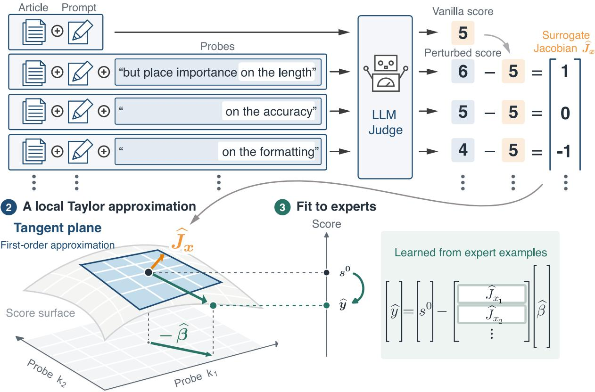  
Figure 1: PRISM overview. (1) Holding the evaluated content fixed, we ask the judge to change its emphasis on individual attributes. Diferences from the Vanilla score form the surrogate Jacobian ${ \widehat { J } } _ { x } ,$ : the illustrated scores 6, 5, 4 give responses $+ 1 , 0 , - 1$ relative to the baseline 5. Only increased-emphasis probes are pictured; the method retains both increased- and decreased-emphasis responses. (2) The tangent plane illustrates the local sensitivity interpretation: a small change in evaluative weights produces an approximately linear score change. (3) Ridge regression on human-labeled examples learns shared correction coeficients ${ \widehat { \beta } } ;$ new inputs are scored as $\widehat { y } = s ^ { 0 } - \widehat { J } _ { x } \widehat { \beta }$ using only baseline and probed judge outputs. The scores, surface, and displacement $- \widehat { \beta }$ are schematic, rather than recovered internal model quantities.

[YWH+25]. CalibraEval learns order-preserving maps of selection probabilities from consistency under option-position and identifier swaps, without human labels [LCA+25]. PRISM learns a correction from human labels and allows the probes to change the judgment; their predictive value is tested against held-out human evaluations.

Input perturbations and attribution: Input leave-one-out attribution measures response changes after removing individual input parts. LIME fits local surrogates to perturbed inputs [RSG16]; ContextCite fits a sparse linear surrogate to transformed response probabilities under context ablations [CWSGM24]. Here, the evaluated content stays fixed and the measured responses are used for score correction. Influence functions instead approximate the efects of training-example reweighting or removal [KL17].

## 2 Problem and method formulation

Let X contain the evaluated output and context, and let $Y \in \mathbb { R }$ be a human reference score for a fixed evaluation target. In a joint judgment, X also identifies the candidate within the presented set. The target is $\mathbb { E } [ Y \mid X = x ]$ for the specified rater population.

For a fixed judge, $s ( x ; p )$ is the numerical score under prompt $p ,$ or its mean over experimentspecified repetitions and wordings. The prompt fixes the task, instructions, scale, and response format. Write $s ^ { 0 } ( x ) : = s ( x ; p _ { 0 } )$ for the baseline prompt $p _ { 0 } { \mathrm { : } }$ ; Vanilla uses this score without a learned correction. Human and judge scores must be placed on comparable scales before fitting.

## 2.1 Probe responses and residual calibration

Probe responses: For attribute $k ,$ the prompt $p _ { k } ^ { + }$ adds an instruction to give that attribute greater weight, and $p _ { k } ^ { - }$ adds an instruction to give it less weight. The evaluated content, scoring task, output format, and score scale stay fixed. The signs refer to emphasis, so a positive probe can lower a candidate’s score. Define the two oriented responses by

$$
\begin{array} { r } { \Delta _ { k } ^ { + } ( x ) : = s ( x ; p _ { k } ^ { + } ) - s ^ { 0 } ( x ) , } \\ { \Delta _ { k } ^ { - } ( x ) : = s ^ { 0 } ( x ) - s ( x ; p _ { k } ^ { - } ) . } \end{array}\tag{1}
$$

We retain these as separate columns of the observed response row, which we call the surrogate Jacobian:

$$
\widehat { J } ( x ) = ( \Delta _ { 1 } ^ { + } , \Delta _ { 1 } ^ { - } , \ldots , \Delta _ { K } ^ { + } , \Delta _ { K } ^ { - } ) .
$$

The row $\widehat { J } ( x ) \in \mathbb { R } ^ { 1 \times 2 K }$ represents instruction sensitivity for the linear correction below. The paired half-diference is a lower-dimensional alternative: $[ \widehat { J } ^ { \mathrm { h a l f } } ( x ) ] _ { k } = ( \Delta _ { k } ^ { + } ( x ) + \Delta _ { k } ^ { - } ( x ) ) / 2$ . It combines the two responses into one column per attribute. Keeping both columns also retains the second diference

$$
\begin{array} { c } { { \Delta _ { k } ^ { + } ( x ) - \Delta _ { k } ^ { - } ( x ) = s ( x ; p _ { k } ^ { + } ) + s ( x ; p _ { k } ^ { - } ) } } \\ { { - 2 s ^ { 0 } ( x ) , } } \end{array}
$$

which the half-diference alone discards. Thus, surrogate Jacobian denotes an empirical sensitivity representation that also retains second-diference information, rather than a pure first-order derivative estimate. No numerical intervention strength is assigned to the probe wording.

Example: Table 1 shows a recorded coverage probe: emphasizing coverage lowers the score, whereas de-emphasizing it raises the score, with the article and summary held fixed. Additional attribute probes for the same input appear in section B.1.

The probe bank fixes the attributes, exact instructions, and score contrasts. Multiple wordings can be averaged within each sign before forming the contrasts. A context probe, such as asking the judge to score for a particular audience, need not have a positive–negative pair; its column is simply $s ( x ; p ) - s ^ { 0 } ( x )$ . We write $q$ for the number of columns in the chosen bank. Diferent columns may be correlated. Probe construction uses the calibration portion of the data; evaluation documents are excluded from fitting the correction.

Residual calibration: Given calibration data $\mathcal { D } _ { n } = \{ ( x _ { i } , y _ { i } ) \} _ { i = 1 } ^ { n }$ , we fit one coeficient vector

Example: a coverage probe. The following are recorded GPT-5.6-sol responses for one SummEval candidate. All three calls received the same article and summary; only the added system instruction changed. The article is excerpted here for space.

System. You are evaluating machine-generated summaries of news articles.

Source article. Barcelona club president Josep Maria Bartomeu has insisted that the La Liga leaders have no plans to replace Luis Enrique and they’re ‘very happy’ with him. . . . Summary. Barca have no plans to replace Luis Enrique

Task. Rate the overall quality of the summary as a summary of the article—how well it selects what matters, holds together as a text, and would serve a reader in place of the article. Use the whole 1–10 scale: 1–2 = very poor, 3–4 = poor, 5–6 = acceptable, $7 – 8 = \mathrm { g o o d } , 9 – 1 0 = \mathrm { e x c e l l e n t }$ . Respond with only a JSON object: {"score": <int 1–10>}.

<table><tr><td>Prompt</td><td>Added system instruction</td><td>Returned output</td></tr><tr><td> $p _ { 0 }$  </td><td>None</td><td>{&quot;score&quot;: 6}</td></tr><tr><td> $p _ { k } ^ { + }$ </td><td>When you assign the score, weight how much of the article&#x27;s important content the summary includes more heavily than you</td><td> $\ell ^ { \mathfrak { n } } { \mathsf { s c o r e } } ^ { \mathfrak { n } } \colon$  5}</td></tr><tr><td> $\boldsymbol { p } _ { k } ^ { - }$  </td><td>normally would. When you assign the score, weight how much of the article&#x27;s {&quot;score&quot;: 7} important content the summary includes less heavily than you normally would.</td><td></td></tr><tr><td colspan="2">These calls give  $\Delta _ { k } ^ { + } = 5 - 6 = - 1$  and  $\Delta _ { k } ^ { - } = 6 - 7 = - 1$  hence a paired half-difference of -1.</td><td></td></tr></table>

Table 1: Recorded coverage-probe example. The article is excerpted, but all three calls received the same full article and candidate summary.

$\beta \in \mathbb { R } ^ { q }$ for the judge by ridge regression with regularization parameter $\lambda > 0 \mathrm { { ; } }$

$$
\widehat { \beta } : = \underset { \beta \in \mathbb { R } ^ { q } } { \arg \operatorname* { m i n } } \left\{ \lambda \| \beta \| _ { 2 } ^ { 2 } + \frac { 1 } { n } \sum _ { i = 1 } ^ { n } \left( s ^ { 0 } ( x _ { i } ) - y _ { i } - \widehat { J } ( x _ { i } ) \beta \right) ^ { 2 } \right\} .\tag{2}
$$

$$
\widehat { y } ( x ) : = s ^ { 0 } ( x ) - \widehat { J } ( x ) \widehat { \beta } .\tag{3}
$$

We select λ by validation on calibration data, keeping candidates from the same context in the same split and choosing the largest penalty among exactly tied scores.

The coeficient on the baseline score in (3) is fixed at one. An input with zero measured response to every probe therefore retains its baseline score. The coeficients are shared across inputs, while each input’s responses determine its correction. Human annotations are needed to estimate ${ \widehat { \beta } } ;$ evaluation of a new input uses only the baseline and probed scores. We also evaluate α-PRISM, with prediction $\boldsymbol { \widehat { y } } ( \boldsymbol { x } ) = \boldsymbol { \widehat { \alpha } } \boldsymbol { s ^ { 0 } } ( \boldsymbol { x } ) - \boldsymbol { \widehat { J } } ( \boldsymbol { x } ) \boldsymbol { \widehat { \beta } } .$ . It fits α and $\beta$ jointly, penalizing only $\beta$ (section D.2).

Score encoding: Single-candidate pointwise scoring rates one candidate per call; batched pointwise scoring rates a context’s candidates together and can depend on their order, as fig. 2(b) illustrates. For within-context evaluation, we center scores and probe responses and rescale training targets to the baseline score norm (section A.3). Ranking-based encodings are described in section A.2.

## 2.2 Assessing the probe assumptions

We examine the probe measurements using SummEval, which provides expert annotations for 16 summaries of each of 100 source articles $\mathrm { [ F K M ^ { + } 2 1 ] }$ . The diagnostics below specify their subsets and evaluation formats. Unless stated otherwise, they use Jev-1.13, a model whose output is restricted to a probability distribution over five ordered score levels; we take the expected level, so scores are continuous rather than integers. Prediction results use the mean within-document Spearman correlation with the average of the four expert criteria, following the use of rank correlation in LLM-judge evaluation $\mathrm { \small { [ L I X ^ { + } 2 3 , K S D ^ { + } 2 6 ] } }$ . The order diagnostic uses batched pointwise scoring of all 16 summaries.

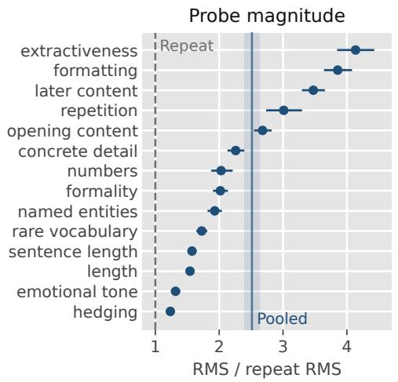  
(a)

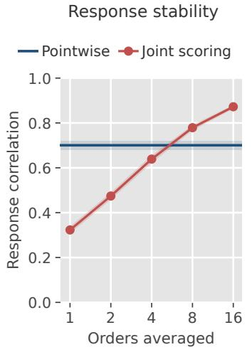  
(b)

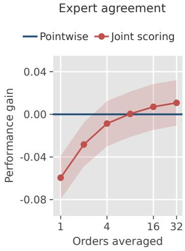  
(c)  
Figure 2: Probe signal and presentation-order sensitivity for Jev on 100 SummEval documents. (a) Probe RMS relative to Vanilla repeat variation; the vertical band pools properties. (b) Probe-response correlation between disjoint sets of averaged candidate orders, using length and formality probes of both signs. The blue reference uses repeated pointwise calls. (c) Uncalibrated Spearman gain over pointwise scoring. Joint scoring here is batched pointwise: one rating per candidate, in one call per order, versus 16 single-candidate calls per document; budgets difer. Bars and bands are 95% document-bootstrap intervals. These diagnostics use separate runs from Table 2; protocols appear in sections B.2 and B.6.

Signal above repeat variation: Figure 2(a) compares probe displacements with diferences between repeated Vanilla scores, centering both within each document. For Jev’s 14-property bank, measured with single-candidate scoring over three runs, $\mathrm { R M S ^ { 1 } }$ ratios range from 1.24 for hedging to 4.14 for extractiveness. Every attribute’s 95% lower bound exceeds one: all 14 show movement above observed Vanilla repeat variation. The pooled ratio is 2.51 ([2.40, 2.63]), and mean across-run response correlation is 0.76 (fig. 6). Response magnitudes also difer across recorded judge settings, as the quality-probe comparison with Sol shows (section B.2).

Sensitivity to presentation order: In batched pointwise scoring, candidate order afects both scores and probe responses. In Jev’s diagnostic, probe-response correlation falls from 0.68 between repeats of one order to 0.32 across orders. Figure 2(b) shows that averaging eight orders raises stability to 0.78. Figure 2(c) shows the corresponding rise in uncalibrated expert Spearman, from 0.587 for one order to 0.647 for eight, matching the pointwise estimate. Averaging common candidate orders for baseline and probes therefore reduces presentation sensitivity; it does not establish permutation invariance. Details appear in section B.6.

Response to weight instructions: We compare slightly more/less, more/less, and much more/less weight instructions for six properties. For each attribute k, the control $p _ { k } ^ { 0 }$ requests its usual weight: “exactly as heavily as you normally would”. At each wording level, define the directional half-diference and the shared displacement from this control:

$$
\begin{array} { l } { { \displaystyle { \cal O } _ { k } ( x ) : = \frac { s ( x ; p _ { k } ^ { + } ) - s ( x ; p _ { k } ^ { - } ) } { 2 } , } } \\ { { \displaystyle { \cal E } _ { k } ^ { \mathrm { c } } ( x ) : = \frac { s ( x ; p _ { k } ^ { + } ) + s ( x ; p _ { k } ^ { - } ) } { 2 } - s ( x ; p _ { k } ^ { 0 } ) . } } \end{array}
$$

Here $O _ { k } = [ \widehat { J } ^ { \mathrm { h a l f } } ] _ { k } ;$ symmetric score changes about the control give $E _ { k } ^ { \mathrm { c } } = 0$

Figure 3(a) shows projected responses across ten replicate Jev runs: responses for length, concrete detail, and formality increase with emphasis. Repetition changes projection sign between slightly more and more, while hedging varies little across the three less-weight instructions. Extractiveness is non-monotone across wording levels. Figure 3(b) shows that, pooled over all six properties, the directional component grows with wording strength. The shared component remains substantial: its reproducible RMS is 0.91, 0.89, and 0.61 times the directional RMS at slight, standard, and strong wording, respectively; estimation details appear in section B.4.

These patterns motivate using probe responses as empirical sensitivity features. Under a smooth local weight model, O approximates the score Jacobian applied to the induced perturbation when the two prompts produce small, symmetric weight changes, connecting the probes to local sensitivity analysis and surrogate explanations [Coo86, RSG16]. Wording levels specify no numerical step size, so we use the measured contrasts directly. Section B.3 gives the local model and relates the controls to the Vanilla calibration baseline; section 3.3 tests the predictive value of retaining both responses.

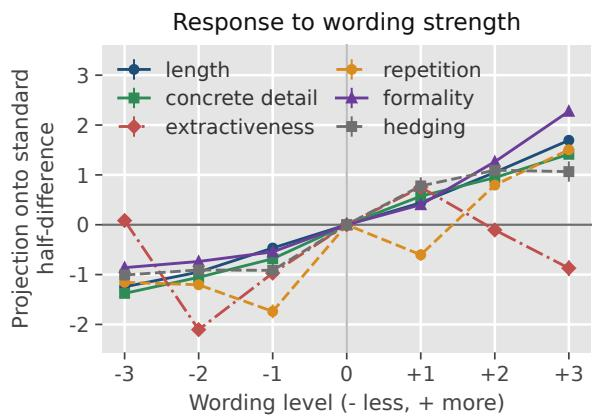  
(a)

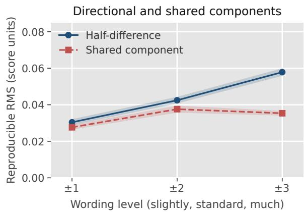  
(b)  
Figure 3: Weight instructions for Jev on SummEval. (a) Responses projected onto each attribute’s standard half-diference. Zero requests the usual weight; ±1, ±2, and ±3 denote slightly, unmodified, and much more/less weight. These are wording categories, not numerical steps. (b) Reproducible RMS of O and $E ^ { \mathrm { c } }$ , pooled over the same six properties. Both panels use attribute-specific controls and cross-products between ten repeated runs on the same 100 documents; bars and bands are 95% document-bootstrap intervals (section B.4).

## 3 Calibration performance and interpretation

Evaluation protocol: SummEval provides 100 documents with 16 summaries each. Our target averages expert coherence, consistency, fluency, and relevance ratings. HANNA provides 96 prompts with 11 stories each, rated by three people on six criteria. Our main metric is Spearman correlation, also used for LLM-judge evaluation by Liu et al. [LIX+23] and Kola et al. [KSD+26]. We compute correlations within documents (SummEval) or prompts (HANNA) and average across contexts to assess agreement with human rankings. We evaluate fitted methods on the same five held-out groups of documents or prompts, training on the remaining groups. We choose PRISM’s regularization by validation within the training data using the same metric; exactly tied scores favor stronger regularization. Individual and paired 95% intervals use 2,000 document/prompt-bootstrap samples. In the main SummEval comparison, PRISM uses single-candidate expected ratings for Jev and batched pointwise ratings for Sol; both use single-candidate scoring on HANNA. Full acquisition and calibration protocols, including the additional Sonnet and Gemma settings, appear in sections A.2 and A.3. Model versions and inference settings are collected in section A.1.

## 3.1 Agreement with reference judgments

Table 2 compares Jev and Sol on summary evaluation (SummEval) and story evaluation (HANNA). We compare Vanilla and the two PRISM variants with rubric-based methods: SAJA combines broad or granular criterion ratings using a random forest $\mathrm { [ K S D ^ { + } 2 6 ] }$ , while we average normalized G-Eval criterion scores $\mathrm { [ L I X ^ { + } 2 3 ] }$ . Full results for all four judges and baseline protocols appear in tables 13 and 14 and section A.4.
<table><tr><td rowspan="2">Method</td><td colspan="2">SummEval</td><td colspan="2">HANNA</td></tr><tr><td>Jev</td><td>Sol</td><td>Jev</td><td>Sol</td></tr><tr><td colspan="5">Rubric-based scoring</td></tr><tr><td>SAJA broad</td><td>0.703 [0.672,0.732]</td><td>0.659 [0.627,0.688]</td><td>0.524 [0.484, 0.565]</td><td>0.443 [0.390, 0.492]</td></tr><tr><td>SAJA granular</td><td>0.745 [0.719,0.770]</td><td>0.707 [0.679,0.732]</td><td>0.549 [0.508, 0.590]</td><td>0.528 [0.482,0.574]</td></tr><tr><td>G-Eval</td><td>0.701 [0.670,0.729]</td><td>0.721 [0.696, 0.745]</td><td>0.528 [0.483,0.575]</td><td>0.587 [0.543, 0.632]</td></tr><tr><td colspan="5">Rubric-free scoring</td></tr><tr><td>Vanilla</td><td>0.654 [0.615,0.691]</td><td>0.693 [0.661,0.722]</td><td>0.459 [0.409, 0.505]</td><td>0.462 [0.428,0.497]</td></tr><tr><td>PRISM (ours)</td><td>0.705 [0.673,0.735]</td><td>0.706 [0.674,0.734]</td><td>0.599 [0.558, 0.639]</td><td>0.546 [0.502, 0.588]</td></tr><tr><td>α-PRISM (ours)</td><td>0.712 [0.683, 0.741]</td><td>0.712 [0.682, 0.740]</td><td>0.603 [0.562, 0.642]</td><td>0.557 [0.514, 0.598]</td></tr></table>

Table 2: Agreement with human judgments on SummEval and HANNA. Cells show mean within-document (SummEval) or within-prompt (HANNA) Spearman correlation (higher is better), with 95% document/promptbootstrap intervals. Bold and underline mark the best and second-best displayed means, including ties. Groups distinguish scoring protocols, not probe provenance; PRISM fixes α = 1 and α-PRISM learns it. Full four-judge results appear in tables 13 and 14.

The strongest method depends on the judge and task. Across all four settings in table 2, PRISM and α-PRISM significantly improve on Vanilla, based on paired 95% bootstrap intervals, while achieving competitive agreement with the rubric-based methods. They do so using only overall scores and probe responses, without criterion-level scoring. Table 4b further supports this distinction: replacing rubric-derived quality probes with style probes yields similar performance in the matched Jev–SummEval comparison (section 3.3).

Additional benchmarks: We further evaluate Jev on dialogue quality (Topical-Chat) [ME20], helpfulness (HelpSteer2) [WDD+24], conversational preferences (MT-Bench) [ZCS+23], and correctness (JudgeBench) [TZM+25]. For each task, probe screening, calibration, and regularization selection use a development set; evaluation uses separate held-out contexts. We report pairwise accuracy (hereafter accuracy): the fraction of pairs ordered as in the reference judgments, averaged within and then across contexts. Reference ties are excluded; predicted ties receive half credit. Full protocols appear in section A.5.
<table><tr><td rowspan="2">Benchmark</td><td rowspan="2">n</td><td colspan="2">Rubric-based</td><td colspan="2">Rubric-free</td></tr><tr><td>SAJA broad</td><td>SAJA granular</td><td>Vanilla</td><td>PRISM</td></tr><tr><td>Topical-Chat</td><td>34</td><td>0.799</td><td>0.831</td><td>0.835</td><td>0.837</td></tr><tr><td>HelpSteer2</td><td>188</td><td>0.665</td><td>0.710</td><td>0.739</td><td>0.755</td></tr><tr><td>MT-Bench</td><td>81</td><td>0.808</td><td>0.805</td><td>0.818</td><td>0.828</td></tr><tr><td>JudgeBench</td><td>287</td><td>0.676</td><td>0.707</td><td>0.789</td><td>0.791</td></tr></table>

Table 3: Accuracy ↑ on additional benchmarks, using Jev. Groups follow table 2. PRISM uses every signalscreened unit from the expanded pool. n counts confirmation contexts with non-tied reference pairs; predicted ties receive half credit. Bold and underline mark the best and second-best displayed values, including rounding ties. All variants and paired comparisons appear in section A.5.

Table 3 shows that Vanilla already exceeds both SAJA variants on all four tasks, including the granular rubric. With regularization chosen on development data, PRISM yields small further improvements in all four point estimates. The paired 95% gain intervals include zero (table 15).

## 3.2 Correction profiles across judges

Interpreting the learned coeficients: The fitted coeficients $\widehat { \beta }$ give an interpretable approximation to scoring bias in the chosen probe-response coordinates: subtracting $\hat { \boldsymbol J } \hat { \boldsymbol \beta }$ corrects the score toward human judgments. Figure 4(a) plots their directional components, ${ \widehat { \beta } } _ { k } ^ { + } + { \widehat { \beta } } _ { k } ^ { - }$ , scaled by the probe response magnitude relative to Vanilla (section D.4). Positive values subtract the corresponding response; negative values add it.

Shared and opposing corrections: Figure 4(a) shows that the inferred bias difers in both magnitude and direction across judges. Jev and Sol both add the fluency response, but their corrections for accuracy and grounding point in opposite directions. Profiles for Sonnet and Gemma appear in section D.4.

## 3.3 Ablations of the correction

Retaining both probe responses: Table 4a compares the half-diference, paired responses, and a diagonal Taylor correction. Paired PRISM retains the shared score changes discarded by the half-diference, including second-diference information. Its point estimate improves for Jev and is nearly unchanged for Sol; both paired 95% gain intervals include zero. The explicit Taylor constraint adds little in either case (section D.1).

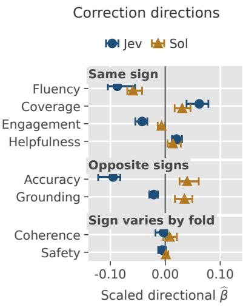  
(a)

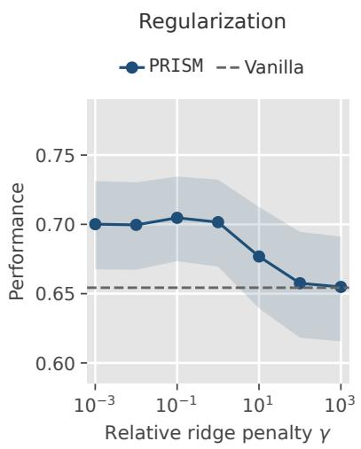  
(b)

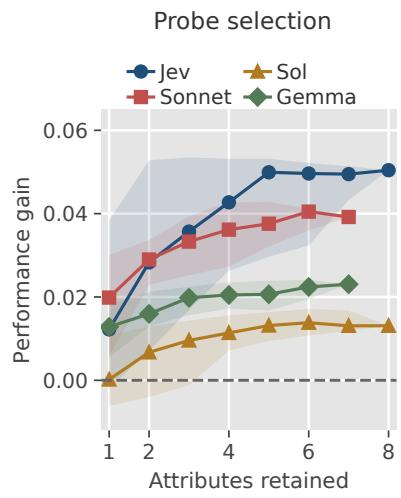  
(c)  
Figure 4: Correction profiles and robustness on SummEval. (a) Normalized directional components of $\widehat { \beta }$ for Jev/Sol; bars span the five overlapping training folds, not confidence intervals. Positive coeficients subtract the response. (b) Jev’s agreement at fixed relative penalties γ (λ multiplied by a training-fold constant); bands are 95% document-bootstrap intervals. Main results select penalties inside training folds. (c) Median gains over Vanilla across all probe subsets of each size; bands are 10th–90th percentiles across subsets, not confidence intervals. Dashed lines mark Vanilla.

Robustness to probe attributes: Calibration remains efective when probes omit explicit rubric criteria. For Jev on SummEval, we compare two non-overlapping banks of eight attributes: rubricderived quality criteria, such as accuracy and coherence, and style properties, such as length and extractiveness. Table 4b shows similar agreement for the two banks and little benefit from combining them. This supports rubric-free probe construction: useful correction signals need not come from reproducing the rubric’s criteria in the probe bank. The matched protocol and full attribute lists appear in section D.3.
<table><tr><td>Representation</td><td>Jev</td><td>Sol</td></tr><tr><td></td><td>0.696</td><td>0.707</td></tr><tr><td>Half-difference</td><td>[0.664, 0.727]</td><td>[0.677,0.734]</td></tr><tr><td>Paired PRISM</td><td>0.705 [0.673, 0.735]</td><td>0.706 [0.674,0.734]</td></tr><tr><td></td><td>0.705</td><td>0.707</td></tr><tr><td>Diagonal Taylor</td><td>[0.674,0.736]</td><td>[0.677,0.735]</td></tr></table>

(a) Response representations

<table><tr><td>Probe attributes</td><td>PRISM</td><td>95% CI</td></tr><tr><td>Quality (8)</td><td>0.705</td><td>[0.673, 0.735]</td></tr><tr><td>Style (8)</td><td>0.710</td><td>[0.679, 0.738]</td></tr><tr><td>Combined (16)</td><td>0.711</td><td>[0.681, 0.740]</td></tr></table>

(b) Probe attributes  
Table 4: Ablations on SummEval: mean within-document Spearman and 95% document-bootstrap intervals. (a) All representations use the same calls and folds, with the Vanilla coeficient fixed at one. Diagonal Taylor fits a second-order correction; paired PRISM already contains its second-diference inputs (section D.1). (b) Jev with pointwise scoring. Parentheses give attribute counts; Combined is the union. Predictor Vanilla scores, folds, and calibration are held fixed.

Probe selection: Figure 4(c) shows typical gains rising and then leveling of as attributes are added. Each point is the median over every subset of that size, with regularization selected separately on training data, rather than a few hand-picked subsets. The leveling suggests overlapping coverage of useful correction directions: once several attributes are included, additional ones contribute less.

Mean gains also survive every single-attribute omission (section D.3), consistent with the probe-bank robustness in table 4b.

Ridge regularization sensitivity: Figure 4(b) shows that Jev’s agreement is stable across a range of moderate penalties. We plot the relative penalty $\gamma ( \lambda$ multiplied by a training-fold constant)2 on the horizontal axis. When $\gamma \gg 1$ , the correction shrinks toward zero and agreement approaches the Vanilla level. Reported predictors select regularization on training data; full sweeps and the validation tie rule appear in section D.2 and table 17.

## 4 Conclusion

PRISM connects perturbation analysis to rubric-free LLM evaluation. It represents changes in overal scores under attribute-emphasis instructions as a surrogate Jacobian and learns a ridge correction from human labels. Inference uses only baseline and probed scores, without requesting criterion-level judge ratings. On SummEval and HANNA, PRISM and α-PRISM significantly improve on Vanilla in the main Jev and Sol comparisons while achieving ranking agreement competitive with rubric-based SAJA and G-Eval. The matched Jev–SummEval ablation yields similar agreement from rubricderived quality probes and style probes, supporting calibration without reproducing rubric criteria. Learned coeficients further expose shared and opposing correction directions across judges, making the use of probe responses in the correction interpretable.

## Limitations

We study rubric-free calibration of text-based judgments, using human labels to fit a correction for each judge. Additional probe calls incur inference cost, motivating comparisons under matched budgets and adaptive probe selection. Transfer across tasks, model versions, and rater populations remains to be tested. Benchmark contamination cannot be ruled out; evaluation on newly collected data would strengthen the evidence for generalization.

Our experiments calibrate overall scores for fixed inputs. A next step is to target biases arising from joint candidate presentation in batched pointwise scoring or listwise ranking, using instruction probes that preserve candidate content.

## Acknowledgments

KY was supported by the Takenaka Scholarship Foundation. We used ChatGPT/Codex and Claude Code for writing and coding assistance. The authors take responsibility for the content and results.

## References

[Alm26] Diogo Almeida. Introducing System One Models & Jev. TypeSafe AI blog, 2026.

[CCSC22] Cyril Chhun, Pierre Colombo, Fabian M. Suchanek, and Chloé Clavel. Of human criteria and automatic metrics: A benchmark of the evaluation of story generation. In Nicoletta Calzolari, Chu-Ren Huang, Hansaem Kim, James Pustejovsky, Leo Wanner, Key-Sun Choi, Pum-Mo Ryu, Hsin-Hsi Chen, Lucia Donatelli, Heng Ji, Sadao Kurohashi, Patrizia Paggio, Nianwen Xue, Seokhwan Kim, Younggyun Hahm, Zhong He, Tony Kyungil Lee, Enrico Santus,

Francis Bond, and Seung-Hoon Na, editors, Proceedings of the 29th International Conference on Computational Linguistics, pages 5794–5836, Gyeongju, Republic of Korea, October 2022. International Committee on Computational Linguistics.

[Coo86] R. Dennis Cook. Assessment of local influence. Journal of the Royal Statistical Society: Series B (Methodological), 48(2):133–155, January 1986.

[CWSGM24] Benjamin Cohen-Wang, Harshay Shah, Kristian Georgiev, and Aleksander Mądry. ContextCite: Attributing model generation to context. In A. Globerson, L. Mackey, D. Belgrave, A. Fan, U. Paquet, J. Tomczak, and C. Zhang, editors, Advances in Neural Information Processing Systems, volume 37, pages 95764–95807. Curran Associates, Inc., 2024.

[DSS26] Tobias Deußer, Lorenz Sparrenberg, and Rafet Sifa. Evaluating and benchmarking the System One Model Jev, 2026. arXiv:2609.37647.

[FKM+21] Alexander R. Fabbri, Wojciech Kryściński, Bryan McCann, Caiming Xiong, Richard Socher, and Dragomir Radev. SummEval: Re-evaluating summarization evaluation. Transactions of the Association for Computational Linguistics, 9:391–409, 2021.

[GSZ+25] Taneesh Gupta, Shivam Shandilya, Xuchao Zhang, Rahul Madhavan, Supriyo Ghosh, Chetan Bansal, Huaxiu Yao, and Saravan Rajmohan. CARMO: Dynamic criteria generation for context aware reward modelling. In Wanxiang Che, Joyce Nabende, Ekaterina Shutova, and Mohammad Taher Pilehvar, editors, Findings of the Association for Computational Linguistics: ACL 2025, pages 2202–2261, Vienna, Austria, July 2025. Association for Computational Linguistics.

[HER+24] Helia Hashemi, Jason Eisner, Corby Rosset, Benjamin Van Durme, and Chris Kedzie. LLMrubric: A multidimensional, calibrated approach to automated evaluation of natural language texts. In Lun-Wei Ku, Andre Martins, and Vivek Srikumar, editors, Proceedings of the 62nd Annual Meeting of the Association for Computational Linguistics (Volume 1: Long Papers), pages 13806–13834, Bangkok, Thailand, August 2024. Association for Computational Linguistics.

[KL17] Pang Wei Koh and Percy Liang. Understanding black-box predictions via influence functions. In Doina Precup and Yee Whye Teh, editors, Proceedings of the 34th International Conference on Machine Learning, volume 70 of Proceedings of Machine Learning Research, pages 1885–1894. PMLR, 06–11 Aug 2017.

[KSD+26] Sneha Kola, Pankaj Kumar Sharma, Soumyadeep Dey, Bamdev Mishra, and Mayur Datar. SAJA: A simple approach to judge alignment for LLM-as-a-judge. In Yunyao Li, Georg Rehm, and Mei Tu, editors, Proceedings of the 64th Annual Meeting of the Association for Computational Linguistics (Volume 6: Industry Track), pages 646–664, San Diego, California, USA, July 2026. Association for Computational Linguistics.

[KSL+24] Seungone Kim, Juyoung Suk, Shayne Longpre, Bill Yuchen Lin, Jamin Shin, Sean Welleck, Graham Neubig, Moontae Lee, Kyungjae Lee, and Minjoon Seo. Prometheus 2: An open source language model specialized in evaluating other language models. In Yaser Al-Onaizan, Mohit Bansal, and Yun-Nung Chen, editors, Proceedings of the 2024 Conference on Empirical Methods in Natural Language Processing, pages 4334–4353, Miami, Florida, USA, November 2024. Association for Computational Linguistics.

[LCA+25] Haitao Li, Junjie Chen, Qingyao Ai, Zhumin Chu, Yujia Zhou, Qian Dong, and Yiqun Liu. CalibraEval: Calibrating prediction distribution to mitigate selection bias in LLMs-as-judges. In Wanxiang Che, Joyce Nabende, Ekaterina Shutova, and Mohammad Taher Pilehvar, editors, Proceedings of the 63rd Annual Meeting of the Association for Computational Linguistics (Volume 1: Long Papers), pages 16537–16552, Vienna, Austria, July 2025. Association for Computational Linguistics.

[LIX+23] Yang Liu, Dan Iter, Yichong Xu, Shuohang Wang, Ruochen Xu, and Chenguang Zhu. G-

eval: NLG evaluation using GPT-4 with better human alignment. In Houda Bouamor, Juan Pino, and Kalika Bali, editors, Proceedings of the 2023 Conference on Empirical Methods in Natural Language Processing, pages 2511–2522, Singapore, December 2023. Association for Computational Linguistics.

[LPM+24] Harrison Lee, Samrat Phatale, Hassan Mansoor, Thomas Mesnard, Johan Ferret, Kellie Ren Lu, Colton Bishop, Ethan Hall, Victor Carbune, Abhinav Rastogi, and Sushant Prakash. RLAIF vs. RLHF: Scaling reinforcement learning from human feedback with AI feedback. In Ruslan Salakhutdinov, Zico Kolter, Katherine Heller, Adrian Weller, Nuria Oliver, Jonathan Scarlett, and Felix Berkenkamp, editors, Proceedings of the 41st International Conference on Machine Learning, volume 235 of Proceedings of Machine Learning Research, pages 26874–26901. PMLR, 21–27 Jul 2024.

[LXY+26] Tianci Liu, Ran Xu, Tony Yu, Ilgee Hong, Carl Yang, Tuo Zhao, and Haoyu Wang. OpenRubrics: Towards scalable synthetic rubric generation for reward modeling and LLM alignment. In Maria Liakata, Viviane P. Moreira, Jiajun Zhang, and David Jurgens, editors, Proceedings of the 64th Annual Meeting of the Association for Computational Linguistics (Volume 1: Long Papers), pages 17417–17437, San Diego, California, United States, July 2026. Association for Computational Linguistics.

[ME20] Shikib Mehri and Maxine Eskenazi. USR: An unsupervised and reference free evaluation metric for dialog generation. In Dan Jurafsky, Joyce Chai, Natalie Schluter, and Joel Tetreault, editors, Proceedings of the 58th Annual Meeting of the Association for Computational Linguistics, pages 681–707, Online, July 2020. Association for Computational Linguistics.

[MHBS26] Sourabrata Mukherjee, Hamna Hamna, Kalika Bali, and Sunayana Sitaram. The geometry of LLM-as-judge: Why inter-LLM consensus is not human alignment, 2026. Accepted to the 2026 Conference on Empirical Methods in Natural Language Processing (EMNLP). arXiv:2606.03043.

[PBF24] Arjun Panickssery, Samuel R. Bowman, and Shi Feng. LLM evaluators recognize and favor their own generations. In A. Globerson, L. Mackey, D. Belgrave, A. Fan, U. Paquet, J. Tomczak, and C. Zhang, editors, Advances in Neural Information Processing Systems, volume 37, pages 68772–68802. Curran Associates, Inc., 2024.

[RCB26] Delip Rao and Chris Callison-Burch. Autorubric: A unifying framework for rubric-based LLM evaluation on non-verifiable tasks. In The Third Annual Conference on Language Modeling (COLM), 2026. Camera-ready version: arXiv:2603.00077.

[RSG16] Marco Tulio Ribeiro, Sameer Singh, and Carlos Guestrin. “Why Should I Trust You?”: Explaining the predictions of any classifier. In Proceedings of the 22nd ACM SIGKDD International Conference on Knowledge Discovery and Data Mining, KDD ’16, pages 1135–1144. ACM, August 2016.

[SAA26] Clemencia Siro, Pourya Aliannejadi, and Mohammad Aliannejadi. Learning to judge: LLMs designing and applying evaluation rubrics. In Vera Demberg, Kentaro Inui, and Lluís Marquez, editors, Findings of the Association for Computational Linguistics: EACL 2026, pages 6371– 6389, Rabat, Morocco, March 2026. Association for Computational Linguistics.

[SML+25] Lin Shi, Chiyu Ma, Wenhua Liang, Xingjian Diao, Weicheng Ma, and Soroush Vosoughi. Judging the judges: A systematic study of position bias in LLM-as-a-judge. In Kentaro Inui, Sakriani Sakti, Haofen Wang, Derek F. Wong, Pushpak Bhattacharyya, Biplab Banerjee, Asif Ekbal, Tanmoy Chakraborty, and Dhirendra Pratap Singh, editors, Proceedings of the 14th International Joint Conference on Natural Language Processing and the 4th Conference of the Asia-Pacific Chapter of the Association for Computational Linguistics, pages 292–314, Mumbai, India, December 2025. The Asian Federation of Natural Language Processing and The Association for Computational Linguistics.

[TZM+25] Sijun Tan, Siyuan Zhuang, Kyle Montgomery, William Y. Tang, Alejandro Cuadron, Chenguang

Wang, Raluca Ada Popa, and Ion Stoica. JudgeBench: A benchmark for evaluating LLM-based judges. In Y. Yue, A. Garg, N. Peng, F. Sha, and R. Yu, editors, International Conference on Learning Representations, volume 2025, pages 63277–63303, 2025.

[WDD+24] Zhilin Wang, Yi Dong, Olivier Delalleau, Jiaqi Zeng, Gerald Shen, Daniel Egert, Jimmy J. Zhang, Makesh Narsimhan Sreedhar, and Oleksii Kuchaiev. HelpSteer 2: Open-source dataset for training top-performing reward models. In A. Globerson, L. Mackey, D. Belgrave, A. Fan, U. Paquet, J. Tomczak, and C. Zhang, editors, Advances in Neural Information Processing Systems, volume 37, pages 1474–1501. Curran Associates, Inc., 2024.

[WLC+24] Peiyi Wang, Lei Li, Liang Chen, Zefan Cai, Dawei Zhu, Binghuai Lin, Yunbo Cao, Lingpeng Kong, Qi Liu, Tianyu Liu, and Zhifang Sui. Large language models are not fair evaluators. In Lun-Wei Ku, Andre Martins, and Vivek Srikumar, editors, Proceedings of the 62nd Annual Meeting of the Association for Computational Linguistics (Volume 1: Long Papers), pages 9440–9450, Bangkok, Thailand, August 2024. Association for Computational Linguistics.

[YWH+25] Jiayi Ye, Yanbo Wang, Yue Huang, Dongping Chen, Qihui Zhang, Nuno Moniz, Tian Gao, Werner Geyer, Chao Huang, Pin-Yu Chen, Nitesh V. Chawla, and Xiangliang Zhang. Justice or prejudice? quantifying biases in LLM-as-a-judge. In Y. Yue, A. Garg, N. Peng, F. Sha, and R. Yu, editors, International Conference on Learning Representations, volume 2025, pages 102351–102390, 2025.

[ZCS+23] Lianmin Zheng, Wei-Lin Chiang, Ying Sheng, Siyuan Zhuang, Zhanghao Wu, Yonghao Zhuang, Zi Lin, Zhuohan Li, Dacheng Li, Eric P. Xing, Hao Zhang, Joseph E. Gonzalez, and Ion Stoica. Judging LLM-as-a-judge with MT-bench and Chatbot Arena. In A. Oh, T. Naumann, A. Globerson, K. Saenko, M. Hardt, and S. Levine, editors, Advances in Neural Information Processing Systems, volume 36, pages 46595–46623. Curran Associates, Inc., 2023.

[ZSZ+26] Maike Züfle, Patrícia Schmidtová, Vilém Zouhar, Shree Harsha Bokkahalli Satish, Erica Cooper, Shobhit Banga, Vaibhav Nalawade, Manmeet Kaur, Jan Niehues, Markus Müller, and Ondřej Klejch. Calibrating LLM judges for human and AI conversations, 2026. arXiv:2609.29431.

[ZZW+26] Junyi Zhou, Qiyuan Zhang, Yufei Wang, Fuyuan Lyu, Yidong Ming, Can Xu, Qingfeng Sun, Kai Zheng, Peng Kang, Xue Liu, and Chen Ma. RubricBench: Aligning model-generated rubrics with human standards. In Maria Liakata, Viviane P. Moreira, Jiajun Zhang, and David Jurgens, editors, Proceedings of the 64th Annual Meeting of the Association for Computational Linguistics (Volume 1: Long Papers), pages 31179–31200, San Diego, California, United States, July 2026. Association for Computational Linguistics.

# Appendix for “PRISM: Calibrating Black-Box Judges with Counterfactual Probes”

## A Experimental setup and implementation details

This section collects the acquisition, calibration, and evaluation settings used in sections 2.2 and 3.

## A.1 Model versions and inference settings

Table 5 consolidates the recorded model identifiers and inference settings for the main comparisons and supplementary experiments. Jev requests use the alias typesafe/jev-1.13; the returned version is jev-1.13-20260917. The other logs provide the identifiers shown, without a finer dated snapshot. An omitted efort field is distinguished from explicitly disabling reasoning.
<table><tr><td colspan="3">Recorded model identifier</td><td>Temperature Reasoning effort Vanilla/PRISM/SAJA</td><td>Temperature G-Eval</td></tr><tr><td>Judge</td><td></td><td></td><td></td><td></td></tr><tr><td>Jev Sonnet</td><td>typesafe/jev-1.13-20260917</td><td>Not set Not set</td><td>0</td><td>1</td></tr><tr><td>Sol</td><td>anthropic/claude-sonnet-4.5 gpt-5.6-sol</td><td>none</td><td>0</td><td>1</td></tr><tr><td></td><td></td><td>Not set</td><td>0</td><td>1</td></tr><tr><td>Gemma</td><td>google/gemma-4-31b-it</td><td></td><td></td><td></td></tr></table>

Table 5: Model versions and requested inference settings across experiments. “Not set” and – denote omitted API fields, not confirmed provider defaults. Sol’s OpenRouter identifier adds the prefix openai/. Jev returns typed-rating probabilities; the other judges use chat completions with top\_p=1. Probe diagnostics use the corresponding Vanilla/PRISM settings.

Interfaces and serving providers: Jev uses the TypeSafe Decisions API. Sonnet uses Anthropic through OpenRouter. Sol uses OpenRouter for SummEval PRISM and SAJA, and the direct OpenAI API for HANNA and G-Eval; reasoning efort is explicitly none in both interfaces. Gemma uses OpenRouter with bf16 requested: Venice serves SummEval PRISM, SAJA, and their wording diagnostics; Novita serves HANNA PRISM and SAJA and SummEval G-Eval. HANNA G-Eval responses come from Novita and Crusoe. These serving diferences are part of the recorded experimental settings.

Output budgets: SummEval Sonnet/Gemma probe calls allow 900 output tokens. Sol’s singlecandidate and batched pointwise calls allow 40 and 400, respectively, with 120 for the four-criterion diagnostic. SummEval chat-based SAJA allows 700 tokens for broad and 1,400 for granular ratings. HANNA chat-based probe and SAJA calls allow 400. G-Eval generally allows 20 tokens per completion; HANNA Sonnet also includes calls capped at eight. Jev requests set no output-token budget. Repetition counts and score formats are given with each protocol below.

Recorded computation: Total recorded API usage for SummEval and the additional benchmarks is approximately 1.4 million responses, 1.9 billion input tokens, and 260 million output tokens, including development and diagnostic experiments. These are aggregate research costs, not matched per-method budgets, and exclude unlogged requests, local analysis time, and AI-assistant use. Inference is API-hosted; provider GPU hours and parameter counts are not recorded. Calibration and analysis use CPU-based numerical routines on a local Mac without updating judge weights; cumulative local runtime is unavailable.

Software environment: The analysis environment inspected on 13 October 2026 uses Python 3.14.6 on macOS/ARM64, with a 10-core Apple M5 CPU and 24 GB of memory. The principal libraries are NumPy 2.5.3, SciPy 1.18.1, scikit-learn 1.9.1, pandas 3.0.5, and Matplotlib 3.11.2. Data loading and requests use datasets 5.0.1, huggingface-hub 1.30.0, pyarrow 25.0.1, and httpx 0.28.1. These versions describe the analysis environment; acquisition environments were not all version-locked.

## A.2 Scoring protocols and probe banks

The four primary settings use the same 1,600 document–summary pairs and the overall expert target. Jev-1.13 returns an expected score over five categories, coded 0–4, through the Decisions API. Its individual-summary call contains all 38 scoring questions: one baseline, two wordings for each sign of eight attributes, and five neutral clauses. Sol returns integer ratings on a 1–10 scale, jointly scoring the 16 summaries for each instruction. Sonnet and Gemma return rankings with ties; scores are negative midranks, aligned by summary identity and averaged across successful repetitions. Sonnet uses the overall-quality run, rather than an average of criterion-specific coherence and relevance runs.

<table><tr><td>Judge</td><td>Probe-score format</td><td>Attributes</td><td>Conditions</td><td>Calls/document</td></tr><tr><td>Jev</td><td>Individual expected ratings</td><td>8</td><td>38</td><td>16</td></tr><tr><td>Sonnet</td><td>Joint rankings; two orders</td><td>7</td><td>34</td><td>68</td></tr><tr><td>Sol</td><td>Joint integer ratings</td><td>8</td><td>38</td><td>38</td></tr><tr><td>Gemma</td><td>Joint rankings; two orders, two blocks</td><td>7</td><td>34</td><td>136</td></tr></table>

Table 6: Nominal acquisition designs for the score conditions used in the calibration analysis. Conditions include five neutral clauses, which are not columns of the paired-response predictor. Additional surface perturbations and Section 2 diagnostics are excluded. Each SAJA variant uses one rubric call per summary, or 16 calls per document. Query and token budgets are not matched.

The quality bank is adapted from SAJA’s broad rubric, replacing its overall-score item with coverage; it comprises accuracy, grounding, coverage, coherence, fluency, engagement, helpfulness, and safety. These attributes change the overall evaluation rather than elicit separate criterion ratings. Exact attribute clauses for the matched quality/style comparison are listed in table 18. The seven-attribute style bank comprises length, detail, repetition, specificity, lead, polish, and confidence. The separate Jev style-bank comparison uses length, specificity, lead, polish, repetition, confidence, extractiveness, and structure. These are distinct recorded banks; matching an attribute name alone does not match an elicitation protocol.

Recorded bank coverage: The primary settings do not exhaust the available runs. Table 7 distinguishes those used in the main comparison from additional recorded banks. Jev’s eightattribute style bank shares six attributes with the seven-attribute bank: it lacks detail and instead includes extractiveness and structure. A shared subset of names permits an exploratory comparison, but does not remove diferences in wording or score elicitation.

HANNA: The full-data comparison uses 96 prompts with 11 stories each. Human targets average three raters across six criteria. A common bank has 16 paired property probes and eight readingcontext probes, giving 40 response columns without screening. Jev returns expected ratings for all conditions in one story-level call; Sol and Gemma return a 1–10 integer in each story–condition call. Sonnet uses 0–100 ratings with corresponding anchors. A matched 1–10 comparison holds the model, bank, and folds fixed (section D.6). Sol’s supplementary probability-weighted probe scores do not replace its integer run. The separate 53-prompt HANNA confirmation study is described in section A.5.

<table><tr><td>Judge</td><td>Quality bank (8 attributes)</td><td>Style bank (7 attributes)</td></tr><tr><td>Jev</td><td>Primary: expected ratings</td><td>Different bank: 8 attributes, 6 shared</td></tr><tr><td>Sonnet</td><td>Additional: joint ratings</td><td>Primary: joint rankings</td></tr><tr><td>Sol</td><td>Primary: joint ratings</td><td>Additional: joint rankings</td></tr><tr><td>Gemma</td><td>Not found in inspected records</td><td>Primary: joint rankings</td></tr></table>

Table 7: Probe-bank coverage in the inspected SummEval records. Primary denotes the source of the main result and correction profile; additional denotes an existing run outside that comparison. All listed runs cover 100 documents. These records do not constitute a matched bank-by-judge experiment; presentation and repetition counts also difer.

## Missing probe scores:

The recorded matrices have no missing cells for Jev, and 64, 16, and 144 missing cells for Sonnet, Sol, and Gemma, respectively, after averaging available responses. Each of these missing blocks comprises all 16 candidates of a document under one instruction. Missing values are replaced by a column mean. For the centered probe predictors, any common value within such a block cancels, so these predictors do not depend on the value of that mean. This does not reconstruct the missing responses.

For HANNA, the evaluator uses score-column means to impute failed replies before fitting: 694 of 48,576 scores for Sonnet’s 1–10 condition, 1,076 of 48,576 for its 0–100 condition, and 179 of 48,576 for Gemma’s 1–10 run. These are recorded missing-data treatments, not additional judge measurements.

## A.3 Calibration and uncertainty

For experiments that predict candidate order within a context, we center the baseline scores and response columns within each group. For a group g of $n _ { g }$ candidates, let $C _ { g } : = I _ { n _ { g } } - \mathbf { 1 1 } ^ { \top } / n _ { g }$ . The regression uses $C _ { g } \mathbf { s } _ { g } ^ { 0 }$ and $C _ { g } \widehat { \mathbf { J } } _ { g }$ , with the human target rescaled to match the baseline’s within-group norm:

$$
\mathbf { y } _ { g } ^ { * } : = \frac { \Vert C _ { g } \mathbf { s } _ { g } ^ { 0 } \Vert _ { 2 } } { \Vert C _ { g } \mathbf { y } _ { g } \Vert _ { 2 } } C _ { g } \mathbf { y } _ { g } .\tag{4}
$$

The target is zero when the denominator is zero. At deployment, a group’s baseline and responses can be centered without human labels. The resulting scores recover an ordering and need not lie on the original human rating scale. For listwise ranking encodings, we align outputs by candidate identity and average scores over the prescribed candidate orders before forming the probe responses.

For SummEval, each outer fold holds out 20 documents and fits on the other 80. The folds are obtained by shufling sorted document identifiers with seed 42 and splitting into five equal parts. Inner validation uses five grouped folds on the 80 training documents and selects the penalty by mean within-document Spearman correlation. Both baseline and response columns are centered within documents; the training expert target is transformed by (4). Expert labels from the outer test fold are used only for evaluating its predictions.

HANNA uses the same five-fold outer/inner procedure, grouping by its 96 prompts (seed 42); a constant prediction within a prompt receives Spearman correlation zero. Exact validation-score ties favor the larger penalty in both benchmarks.

The bootstrap uses 2,000 paired resamples of the out-of-fold contexts: 100 documents for SummEval and 96 prompts for HANNA. It takes percentile intervals without refitting the regressions.

Correlations are averaged across resampled contexts. Diferences use the same resampled contexts for both methods. Intervals are unadjusted for multiple comparisons and are conditional on the recorded outputs and fold assignment. Although each fitted predictor is evaluated on excluded documents, SummEval was also used during method and probe development. These comparisons consequently assess the recorded designs; an independent benchmark is needed to assess generalization after that development process.

## A.4 Acquisition of comparison scores

All SAJA rows use a 300-tree random forest (seed 42), fitted on the same training contexts as PRISM. SummEval broad/granular inputs use expected 0–4 ratings for Jev, 1–10 integers for Sol, and 1–5 integers for Sonnet/Gemma. HANNA uses 1–10 ratings for all judges, with Jev supplying expectations over ten categories. Refits use one worker for reproducible tree summation. HANNA mean-imputes 280/8,448 broad and 476/29,568 granular scores for Sonnet, and 8/8,448 broad scores for Gemma; its granular run and both Jev/Sol runs require no SAJA imputation.

G-Eval [LIX+23] scores candidates per criterion. We normalize and average these scores for our overall target, without a fitted prediction head. SummEval uses the oficial detailed prompts at revision 6f84404: fluency is mapped from [1, 3] and coherence, consistency, and relevance from [1, 5] to [0, 1]. HANNA uses its six criteria—relevance, coherence, empathy, surprise, engagement, and complexity—with the original definitions and 1–5 anchors [CCSC22]. Its evaluation steps were generated once by Sol at temperature zero with efort none, then frozen across judges before scoring. Human ratings are not included in either benchmark’s prompts.

Table 8 summarizes API-specific scoring. Chat completions use temperature one and top\_p = 1; valid ratings are averaged in draw order. Sol’s SummEval calls use a user message and a 20-token limit; the parser accepts a leading rating or a rating following the criterion label. Probability-based expectations renormalize over valid rating tokens. For HANNA, Sonnet uses a score-label assistant prefill; Sol and Gemma receive a system instruction identifying the supplied story as the item to score and requesting only a rating. The criteria and anchors remain unchanged.

Gemma’s SummEval failures frequently request a summary instead of rating the supplied one; 33.3% of its criterion scores are imputed. For HANNA, all reported Sol and Gemma G-Eval scores use the response-format instructions described above, with no missing items.

## A.5 Additional benchmark protocols

This study covers the four additional benchmarks in table 3 and a separate HANNA confirmation experiment. The latter uses a development/confirmation split and an expanded probe pool, distinct from the full-dataset comparison in table 2.

Targets and units: All five benchmarks use Jev-1.13 through the Decisions API, with expected scores over five ordered levels on the 0–4 scale. HANNA contains 96 prompts with 11 stories each, including the human story; the target averages three raters over six criteria. USR’s Topical-Chat annotations contain 60 contexts with six responses each, using the mean Overall rating. HelpSteer2 uses the validation split, with 519 requests and two responses per request, targeting helpfulness. For these graded datasets, every within-context pair with unequal target scores contributes an evaluation label. MT-Bench contains 160 question–turn contexts and responses from six models. Its training target is a response’s human win rate; evaluation uses individual non-tie human comparisons. For

<table><tr><td>Judge</td><td>SummEval: 6,400 criterion scores</td><td>HANNA: 6,336 criterion scores</td></tr><tr><td>Jev</td><td>Expected rating from typed probabilities; no Expected rating from typed probabilities; imputation.</td><td>no imputation.</td></tr><tr><td>Sonnet</td><td>First 10 valid draws, at most 20 attempts per First 10 valid draws per item; all items com- item. All scores available; 97 items average 5–9 plete. valid draws.</td><td></td></tr><tr><td>Sol</td><td>pling fallback for 168 (up to 20 valid draws sampling fallback or imputation. in 40 attempts); 3 midpoint imputations. Of sampled items, 53 reach the cap below 20 valid</td><td>Top-5 token probabilities for 6,229 items; sam- Score-token probabilities for all items; no</td></tr><tr><td></td><td>draws. fallback to 10 valid draws in 20 attempts. 2,128 plete. midpoint imputations, including 1,525 fluency items.</td><td>Gemma Top-20 token probabilities, with up to 5 retries; First 10 valid draws per item; all items com-</td></tr></table>

Table 8: Recorded G-Eval acquisition protocols. Midpoint imputation fills items with no valid score; it does not recover the missing judgment. These are model-specific adaptations of the published procedure, with unmatched sampling budgets across methods.

JudgeBench, we combine 350 GPT-4o and 270 Claude-3.5-Sonnet pairs (620 total), with binary correctness targets. Thus, agreement with human ratings and agreement with verified correctness are distinct targets in this comparison.

Splits and uncertainty: A fixed hash of the benchmark and context identifier assigns each context to exploration or confirmation. Probe screening, predictor fitting, and hyperparameter selection use exploration data. Reference ties are omitted from evaluation, predicted ties receive 1/2 credit, and accuracy is averaged within each context before averaging eligible contexts. All exploration candidates, including those with tied labels, remain in the regression fit. The intervals resample eligible confirmation contexts with replacement 2,000 times, using the same draws for paired contrasts. They condition on the fitted predictors and do not include uncertainty from selecting the probe bank or development protocol.
<table><tr><td>Benchmark</td><td>Explore</td><td>Confirm</td><td>Eval. pairs</td><td>Units</td><td>Columns</td></tr><tr><td>HANNA</td><td>43</td><td>53</td><td>2860</td><td>74</td><td>126</td></tr><tr><td>Topical-Chat</td><td>26</td><td>34</td><td>468</td><td>82</td><td>134</td></tr><tr><td>HelpSteer2</td><td>251 (185)</td><td>268 (188)</td><td>188</td><td>85</td><td>137</td></tr><tr><td>MT-Bench</td><td>79</td><td>81</td><td>1280</td><td>79</td><td>131</td></tr><tr><td>JudgeBench</td><td>333</td><td>287</td><td>287</td><td>84</td><td>136</td></tr></table>

Table 9: Recorded splits and primary response dimensions. Parentheses give the eligible contexts after excluding reference ties from pairwise evaluation; all other contexts contribute evaluation pairs. MT-Bench counts individual human judgments, so a response pair may contribute multiple labels. All candidates have parsed scores in every primary measurement bank.

The 24-unit and expanded 89-unit probe pools use the same exploration/confirmation split. These benchmarks also inform method development, so the comparisons assess the resulting designs rather than validation on a new sample. MT-Bench splits by question–turn rather than by question: 43 questions have turns in both portions. Its results and intervals consequently do not establish generalization to unseen questions or account for dependence between their turns.

For every fitted probe bank, including HelpSteer2, we select the regularization penalty by grouped cross-validation on exploration data, choosing the strongest penalty among exact ties. The rule and selected penalties appear in section D.2.

Probe and rubric measurements: Each expanded bank has 52 observable properties, 20 reading contexts or situations, eight evaluator roles, five focus instructions, and four instructions about the stakes of evaluation. The wording avoids explicitly naming the benchmarks’ rated criteria or SAJA’s criterion dimensions. A property contributes two oriented response columns; a one-sided instruction contributes one. Each column is diferenced against the baseline in its own call, centered within context, and screened against that call’s five neutral clauses. The primary fit retains all units whose exploration bootstrap lower bound for the probe/control RMS ratio exceeds one. The fixed reference score is from the original bank. The centered expert target is norm-matched to that reference as in (4). Relative ridge penalties range from 10−3 to $1 0 ^ { 3 }$ and are selected by five-fold, context-grouped exploration validation on accuracy.

SAJA’s eight broad and 28 granular ratings are elicited together in one typed-rating call per candidate. Both reported SAJA variants use RF with 300 trees and seed 42, fitted on exploration data. The primary probe representation uses three calls per candidate, one for each question bank; query and question budgets are not matched to SAJA.

## A.6 Data provenance and use

We use English-language benchmarks spanning news summarization, story evaluation, dialogue, instruction following, and reasoning; mathematical notation and code also occur in JudgeBench. We reuse released annotations rather than collect new human ratings. The use considered here is research on automatic evaluation, without a claim of multilingual or demographic representativeness. SummEval is loaded from the mteb/summeval mirror at revision bfc1211. Downloaded benchmark files are retained unchanged and verified with SHA-256 checksums.

Table 10 reports the notices at the distribution sources. These do not establish separate rights to all underlying news articles, writing prompts, or other third-party material. The USR annotation download does not state a separate data license; the Apache-2.0 notice for its code is not treated as an annotation license.

<table><tr><td>Data source</td><td>Reported license</td></tr><tr><td>SummEval mirror</td><td>MIT (dataset card)</td></tr><tr><td>HANNA release</td><td>MIT (repository)</td></tr><tr><td>HelpSteer2</td><td>CC-BY-4.0</td></tr><tr><td>MT-Bench judgments</td><td>CC-BY-4.0</td></tr><tr><td>JudgeBench</td><td>MIT</td></tr><tr><td>Topical-Chat base data</td><td>CDLA-Sharing 1.0</td></tr><tr><td>USR annotations</td><td>Not specified</td></tr></table>

Table 10: Release-level data notices, checked on 13 October 2026. Linked sources distinguish the underlying Topical-Chat data from the additional USR judgments.

## B Additional probe-response diagnostics

The examples and diagnostics below support the sensitivity measurements and local interpretation in section 2.2.

## B.1 Recorded prompt examples

Table 11 changes the attribute while keeping the same article, summary, Vanilla score, and instruction template as table 1. The added instruction is “When you assign the score, weight [attribute clause] more/less heavily than you normally would.” Each displayed value is one recorded response using this wording, not an average over the two wordings used for calibration.
<table><tr><td></td><td>Attribute Attribute clause</td><td> $s ^ { + }$ </td><td> $s ^ { - }$ </td><td> $\Delta ^ { + }$ </td><td> $\Delta ^ { - }$ </td></tr><tr><td></td><td>Grounding whether the summary&#x27;s claims are supported by 7 6 +1 0 the source article</td><td></td><td></td><td></td><td></td></tr><tr><td>Fluency</td><td>the grammar, spelling and word choice of the 7 7 +1 -1 summary</td><td></td><td></td><td></td><td></td></tr><tr><td>Accuracy</td><td>whether the summary&#x27;s claims are factually cor- 6 6 00 rect</td><td></td><td></td><td></td><td></td></tr></table>

Table 11: Additional recorded Sol examples for the same candidate as table 1, with $s ^ { 0 } = 6$ throughout. Here $s ^ { \pm } = s ( x ; p _ { k } ^ { \pm } )$ $\Delta ^ { + } = s ^ { + } - s ^ { 0 }$ , and $\Delta ^ { - } = s ^ { 0 } - s ^ { - }$ . Grounding changes one side, fluency moves both scores upward, and accuracy leaves both unchanged. These illustrate response patterns for one input, not average efects of the attributes.

## B.2 Repeated scores and neutral instructions

The repeat reference in fig. 2(a) uses the unmodified Vanilla question for each summary in three replicate runs. Each call bundles this question with other questions; these are not standalone Vanilla-only calls. We center scores within document and pool the squared diferences over all three run pairs before taking the square root, without dividing by ${ \sqrt { 2 } } .$ The resulting RMS is 0.0434 on the 0–4 scale. Probe-minus-Vanilla displacements are formed within a call, whereas repeat diferences compare calls, so this ratio is a repeat-variation benchmark, not a decomposition of signal and noise.

Five neutral clauses, such as “Take your time and weigh each candidate fairly,” provide a second reference. Their RMS displacement from the same-call Vanilla score is 0.0429, or 0.988 times the repeat reference (95% interval [0.955, 1.022]). Against these neutral clauses, the pooled probe ratio is 2.54 ([2.44, 2.65]). Figure 5 includes all 14 properties, including extractiveness (reuse of source wording); ratios range from 1.25 for hedging to 4.19 for extractiveness.

The least reproducible probe has correlation 0.53, above the most reproducible neutral clause (0.47). The neutral mean of 0.38 indicates that adding a neutral instruction itself has a reproducible component; the probe mean is 0.76 (fig. 6).

Variation across judge settings: For eight quality attributes under single-candidate scoring, the probe-to-neutral RMS ratio is 1.96 ([1.89, 2.03]) for Jev and 1.15 ([1.12, 1.18]) for Sol on the same 100 documents. The attribute-wise lower bounds exceed one for all eight Jev attributes and seven of eight Sol attributes. These recorded settings difer in score elicitation: Jev returns expected ratings, while Sol returns 1–10 integers. They compare probes with neutral instructions; they do not provide Sol’s counterpart to the Vanilla-repeat reference in fig. 2(a).

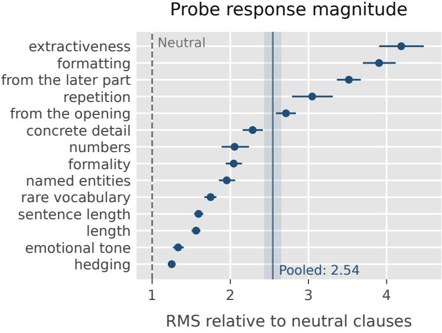  
Figure 5: Probe displacements relative to neutral instructions for Jev-1.13 on the same 100 SummEval documents as fig. 2. Each point divides a property’s RMS displacement, pooled over both signs and three runs, by the RMS displacement of five neutral clauses. All displacements are centered within document. The dashed line marks the neutral reference; the vertical band pools all 14 properties. Bars and the band are 95% document-bootstrap intervals.

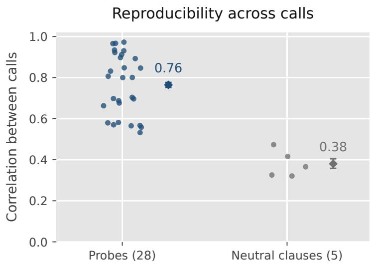  
One point per question  
Figure 6: Repeatability of centered displacements on the same three Jev runs as fig. 2. Points are question-level correlations; diamonds and bars summarize the mean and its 95% document-bootstrap interval. Vanilla scores have repeat correlation 0.997, which measures score stability, not displacement repeatability.

## B.3 Baselines and a local weight interpretation

The wording and joint-instruction experiments use Jev-1.13 on all 100 SummEval documents, with 16 summaries per document. Figure 3 uses ten repeated wording runs; the supplementary Vanillabaseline and joint-instruction analyses below use two runs per design. We report all six recorded properties: length, concrete detail, extractiveness, repetition, formality, and hedging. The main plots use an unchanged-weight control for each attribute and retain the full shared component. We also report contrasts about the Vanilla baseline used in (1).

The control $p _ { k } ^ { 0 }$ keeps the named attribute explicit while the requested weight changes. Its within-document-centered displacement from the Vanilla baseline has 1.21–3.07 times the RMS of the five neutral clauses, depending on the property, so it cannot be treated as an unchanged Vanilla baseline. Let $Z _ { k } ( x ) = s ( x ; p _ { k } ^ { 0 } ) - s ^ { 0 } ( x )$ . The shared component about the Vanilla baseline and the method’s oriented response columns satisfy

$$
\begin{array} { r l } & { E _ { k } ^ { \mathrm { b a s e } } = E _ { k } ^ { \mathrm { c } } + Z _ { k } , } \\ & { ~ \Delta _ { k } ^ { + } = O _ { k } + E _ { k } ^ { \mathrm { b a s e } } , \qquad \Delta _ { k } ^ { - } = O _ { k } - E _ { k } ^ { \mathrm { b a s e } } . } \end{array}\tag{5}
$$

Thus, Vanilla-baseline contrasts include the response to adding the control as well as changes relative to it. Pooled over all six properties, $E ^ { \mathrm { b a s e } }$ has 2.25, 2.26, and 1.64 times the reproducible RMS of O at slight, standard, and strong wording. The calibration comparison in section 3.3 retains or discards this combined component; it does not isolate the predictive value of $Z$ from that of $E ^ { \mathrm { c } }$ . The paired representation also fits two coeficients per attribute rather than one, so this ablation changes both the retained information and model capacity.

For repetition, the worded control has projection 3.11 onto the standard half-diference. Consequently, slightly more has projection −0.54 relative to that control but 2.57 relative to the Vanilla baseline. The sign of a projected displacement therefore depends on the reference. Diferences between two nonzero wording responses are unafected by this change of reference.

For the local interpretation, suppose a smooth function $g ( x , w )$ describes the mean score and the two prompts implement small changes $\pm a _ { k }$ about the weights $w _ { k } ^ { \mathrm { c } }$ associated with $p _ { k } ^ { 0 }$ . Averaging over judge-call variation, a first-order expansion gives

$$
\mathbb { E } \Big [ ( \widehat { J } ^ { \mathrm { h a l f } } ( X ) ) _ { k } \mid X = x \Big ] \approx \nabla _ { w } g ( x , w _ { k } ^ { \mathrm { c } } ) ^ { \top } a _ { k } .
$$

This is a conditional interpretation motivated by local sensitivity analysis [Coo86] and perturbationbased surrogate explanations [RSG16]. The attribute-specific controls need not share a common latent weight vector or reproduce the Vanilla baseline. A comparison of wordings does not identify $a _ { k }$ or show that two instructions compose the same weight changes as they do separately. We consequently report the measured contrasts without a numerical prediction from smoothness alone.

## B.4 Estimating reproducible response profiles

Let $U _ { i } ^ { ( r ) }$ and $V _ { i } ^ { ( r ) }$ be two within-document-centered contrasts for summary i in replicate $r \in$ $\{ 1 , \ldots , R \}$ , and let n be the number of summaries. We average products between distinct runs:

$$
Q ( U , V ) : = \frac { 1 } { n R ( R - 1 ) } \sum _ { i = 1 } ^ { n } \sum _ { r \neq r ^ { \prime } } U _ { i } ^ { ( r ) } V _ { i } ^ { ( r ^ { \prime } ) } .
$$

With independent, zero-mean noise across runs, the noise contribution vanishes in expectation. We estimate reproducible RMS by $\{ Q ( U , U ) \} _ { + } ^ { 1 / 2 }$ and correlation by $Q ( U , V ) / \{ Q ( U , U ) Q ( V , V ) \} ^ { 1 / 2 }$

Pooling over properties averages their second moments before taking a square root. We resample the 100 documents jointly for all contrasts in 2,000 bootstrap draws. For fig. 3, R = 10 gives 45 unordered run pairs, which are averaged rather than treated as independent observations. All ten runs repeat the same requests on the same documents. The supplementary analyses use R = 2. The main-text shared component is $E ^ { \mathrm { c } }$ itself, including any component along O.

Each ordinate in fig. 3(a) is the projection coeficient

$$
\frac { Q ( D _ { k , t } , O _ { k , \mathrm { s t a n d a r d } } ) } { Q ( O _ { k , \mathrm { s t a n d a r d } } , O _ { k , \mathrm { s t a n d a r d } } ) } ,
$$

where $D _ { k , t }$ is the score under wording t minus the score under that attribute’s control $p _ { k } ^ { 0 } .$ . This measures alignment with the standard half-diference, rather than an absolute score change. Its value at the control is zero by construction. The categories do not assign numerical steps to wording.

## B.5 Joint instructions

For each of the 15 pairs of the six recorded properties, we request more or less weight on both attributes in all four combinations. Writing $s _ { u v }$ for the score with signs u, v, the main efect of the first attribute and the interaction are

$$
\begin{array} { c } { { M _ { a } = \displaystyle \frac { s _ { + + } + s _ { + - } - s _ { - + } - s _ { -- } } { 4 } , } } \\ { { I _ { a b } = \displaystyle \frac { s _ { + + } - s _ { + - } - s _ { - + } + s _ { -- } } { 4 } . } } \end{array}
$$

The second main efect $M _ { b }$ exchanges the two attributes. We compare each main efect with the corresponding single-attribute half-diference using the projection coeficient defined by $Q .$

The pooled projection coeficients are 0.81 for slight wording and 0.63 for standard wording (fig. 7(a)). These coeficients summarize alignment with the single-probe responses; they do not imply that every response is uniformly rescaled. The interaction RMS is 0.30 and 0.34 of the main-efect RMS, respectively (fig. 7(b)). Thus, the observed joint instructions are not additive. These measurements concern how instructions combine; they do not distinguish changes in the prompt-to-weight map from curvature of a weight-to-score function.

## B.6 Presentation order and evaluation format

For the joint-scoring diagnostic in fig. 2(b,c), Jev scores all 16 summaries of each document in one call. We use 32 orders: 16 cyclic shifts of a random order, so that every summary occupies each position once, and 16 shifts of its reversal, with two additional repeats of one order. Reversing the order gives a within-document Kendall correlation of 0.57 for baseline scores, compared with 0.93 between repeats. For three chat judges ranking the summaries, reversal gives 0.68–0.72. The estimated first-position shift is −0.16 on the 0–4 scale. Additive position efects account for 2.7% of the order-induced variance, while 93% is an interaction between order and summary.

Subtracting the baseline within the same call does not remove this sensitivity: probe-response correlation is 0.68 between repeats of one order and 0.32 between diferent orders. Correlation between two disjoint sets of averaged orders reaches 0.64 at four orders and 0.78 at eight, against the pointwise reference of 0.70. Before calibration, pointwise scoring reaches 0.647 in mean Spearman correlation with experts, versus 0.587 for a single candidate order. Averaging eight orders reaches 0.647 and averaging 32 reaches 0.658. From four orders onward, the paired interval for the diference from pointwise includes zero; this does not establish equivalence or a uniform advantage for either format. Averaging a common set of orders for baseline and probe scores standardizes their treatment without establishing permutation invariance. Pointwise scoring evaluates one summary per call and avoids candidate-order efects.

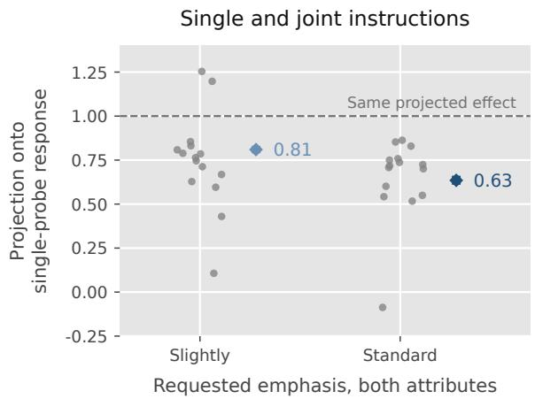  
(a)

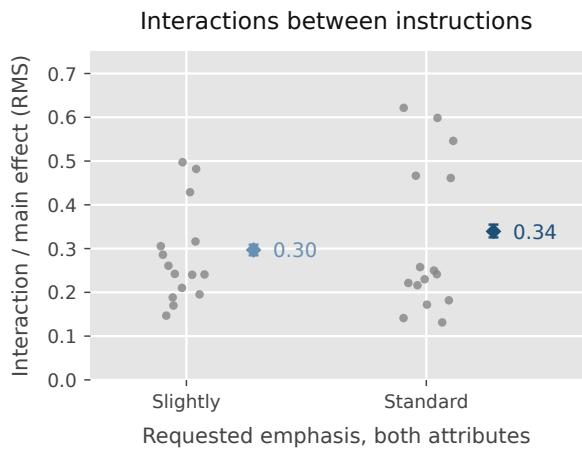  
(b)  
Figure 7: Joint-instruction diagnostics. Gray points correspond to all 15 attribute pairs; diamonds pool their second moments. (a) Projection of joint-instruction main efects onto the corresponding single-probe half-diferences. The reference at one indicates the same projected efect. (b) RMS of the interaction divided by the root mean square of the two main efects. Bars on the pooled estimates are 95% document-bootstrap intervals. Neither panel assumes a numerical step size for the instructions.

## Pairwise comparisons:

We also compare pairwise judgments with the pointwise reference on the same 100 SummEval documents. Each summary’s score is its mean probability of winning against the other summaries. Using one presentation order per pair gives a mean within-document Spearman diference of −0.077 from pointwise scoring (95% interval [−0.107, −0.050]). Averaging both orders reduces the gap to −0.052 ([−0.078, −0.026]). Both diferences are measured before residual calibration; reversing each pair reduces the deficit but does not close it in this experiment.

## B.7 Probe diagnostics across tasks

The original-pool measurements extend the checks in section 2.2 beyond summarization. All five benchmarks show probe/control RMS ratios above two and higher repeat correlation for probes than for neutral clauses. Reversing joint presentation order changes scores more than repeating the same order. At the mildest wording level, the reproducible sign-independent component remains 0.50–0.99 times the directional component, exceeding the corresponding smooth-response reference in each benchmark. These observations support measuring and retaining both response components; they do not by themselves predict the calibration gains in table 21.

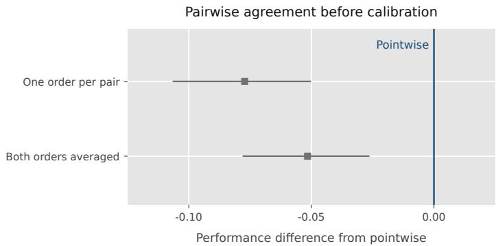

Figure 8: Pairwise judgments relative to pointwise scoring for Jev-1.13 on SummEval, before calibration. Each point is the mean within-document Spearman diference from the pointwise reference; bars are paired 95% document-bootstrap intervals. The two conditions use one presentation order per pair or average both orders.
<table><tr><td>Benchmark</td><td>RMS ratio</td><td>Reproducibility probe / neutral</td><td>Kendall reverse repeat</td><td>Even/odd at ±1 (smooth reference)</td></tr><tr><td>HANNA</td><td>3.12</td><td>0.90/0.56</td><td>0.57/0.92</td><td>0.50 (0.19)</td></tr><tr><td>Topical-Chat</td><td>2.24</td><td>0.85/0.44</td><td>0.79/0.95</td><td>0.89 (0.62)</td></tr><tr><td>HelpSteer2</td><td>2.53</td><td>0.88/0.55</td><td>0.62/0.97</td><td>0.74 (0.36)</td></tr><tr><td>MT-Bench</td><td>2.48</td><td>0.87/0.47</td><td>0.72/0.96</td><td>0.71 (0.25)</td></tr><tr><td>JudgeBench</td><td>2.46</td><td>0.86/0.53</td><td>0.70/0.97</td><td>0.99 (0.24)</td></tr></table>

Table 12: Probe diagnostics on the confirmation split from the 24-unit study. The signal ratio pools its 16 properties; reproducibility compares independent calls. Kendall compares reversed candidate order with an unchanged-order repeat in joint scoring. The final column uses four diagnostic properties chosen on exploration data and the unchanged-weight instruction as the zero of the wording ladder; reproducible components are estimated by between-run cross-products. These are separate diagnostic calls, not the 89-unit calibration pool.

## C Complete evaluation results

## C.1 Full judge comparisons

Tables 13 and 14 extend the main comparison to all four judges. The main text focuses on Jev as a lightweight decision model and Sol as a frontier judge, keeping the presentation compact amid uneven score-collection reliability. In particular, Gemma’s SummEval G-Eval requires substantial imputation; Sol also needs fallbacks in SummEval, while its reported HANNA scores are complete under the response-format instructions in section A.4. The acquisition details and missing-score treatment are collected in section A.4.

## C.2 Additional benchmark results

Table 15 reports paired accuracy diferences for the primary fits in table 3, plus the separate HANNA confirmation study. Splits and acquisition are specified in section A.5; probe-pool ablations appear in section D.5. These intervals condition on the fitted predictor and selected bank.

<table><tr><td>Method</td><td>Jev</td><td>Sonnet</td><td>Sol</td><td>Gemma</td></tr><tr><td colspan="5">Rubric-based scoring</td></tr><tr><td>SAJA broad</td><td>0.703 [0.672,0.732]</td><td>0.657 [0.624, 0.689]</td><td>0.659 [0.627, 0.688]</td><td>0.687 [0.657,0.716]</td></tr><tr><td>SAJA granular</td><td>0.745 [0.719, 0.770]</td><td>0.671 [0.637, 0.705]</td><td>0.707 [0.679,0.732]</td><td>0.675 [0.643, 0.705]</td></tr><tr><td>G-Eval</td><td>0.701 [0.670,0.729]</td><td>0.712 [0.683, 0.739]</td><td>0.721 [0.696, 0.745]</td><td>0.682† [0.647,0.716]</td></tr><tr><td colspan="5">Rubric-free scoring</td></tr><tr><td>Vanilla</td><td>0.654 [0.615, 0.691]</td><td>0.645 [0.607, 0.681]</td><td>0.693 [0.661, 0.722]</td><td>0.672 [0.639, 0.708]</td></tr><tr><td>PRISM (ours)</td><td>0.705 [0.673,0.735]</td><td>0.684 [0.647,0.718]</td><td>0.706 [0.674, 0.734]</td><td>0.695 [0.662, 0.726]</td></tr><tr><td>α-PRISM (ours)</td><td>0.712 [0.683, 0.741]</td><td>0.689 [0.653, 0.723]</td><td>0.712 [0.682, 0.740]</td><td>0.701 [0.670, 0.730]</td></tr></table>

Table 13: Full four-judge results on SummEval, measured by mean within-document Spearman correlation (higher is better). Brackets give 95% document-bootstrap confidence intervals. Bold and underline mark the best and second-best displayed means, including ties. Groups distinguish scoring protocols, not probe provenance; PRISM fixes α = 1 and α-PRISM learns it. † Gemma’s G-Eval includes midpoint imputation for 33.3% of criterion scores (section A.4).

<table><tr><td>Method</td><td>Jev</td><td>Sonnet†</td><td>Sol</td><td>Gemma†</td></tr><tr><td colspan="5">Rubric-based scoring</td></tr><tr><td>SAJA broad</td><td>0.524 [0.484, 0.565]</td><td>0.389 [0.333, 0.445]</td><td>0.443 [0.390, 0.492]</td><td>0.364 [0.309, 0.414]</td></tr><tr><td>SAJA granular</td><td>0.549 [0.508, 0.590]</td><td>0.500 [0.450,0.548]</td><td>0.528 [0.482,0.574]</td><td>0.466 [0.410,0.517]</td></tr><tr><td>G-Eval</td><td>0.528 [0.483, 0.575]</td><td>0.497 [0.452,0.543]</td><td>0.587 [0.543, 0.632]</td><td>0.497 [0.449, 0.544]</td></tr><tr><td colspan="5">Rubric-free scoring</td></tr><tr><td>Vanilla</td><td>0.459 [0.409, 0.505]</td><td>0.432 [0.384, 0.478]</td><td>0.462 [0.428,0.497]</td><td>0.437 [0.398, 0.474]</td></tr><tr><td>PRISM (ours)</td><td>0.599 [0.558, 0.639]</td><td>0.483 [0.434, 0.531]</td><td>0.546 [0.502, 0.588]</td><td>0.475 [0.427,0.521]</td></tr><tr><td>α-PRISM (ours)</td><td>0.603 [0.562, 0.642]</td><td>0.484 [0.432, 0.531]</td><td>0.557 [0.514, 0.598]</td><td>0.473 [0.424, 0.519]</td></tr></table>

Table 14: Full four-judge results on HANNA: mean within-prompt Spearman correlation (higher is better), with 95% prompt-bootstrap intervals. All methods use the same 96 prompts; fitted methods share five outer folds. SAJA uses 1–10 scores. Vanilla/probe scores use 0–100 for Sonnet, 1–10 for Sol and Gemma, and expected ratings for Jev. G-Eval uses six HANNA criteria with model-specific response-format adjustments (section A.4). Bold and underline mark the best and second-best displayed means. † Sonnet and Gemma include mean-imputed failed scores.

<table><tr><td>Benchmark</td><td>∆ Vanilla</td><td></td><td>∆ SAJA broad</td></tr><tr><td>HANNA</td><td></td><td>+0.063 [+0.041, +0.085]</td><td>+0.041  $\left[ + 0 . 0 1 9 , + 0 . 0 6 2 \right]$ </td></tr><tr><td>Topical-Chat</td><td></td><td>+0.002 [+0.000, +0.005]</td><td>+0.038  $[ - 0 . 0 0 3 , + 0 . 0 7 9 ]$ </td></tr><tr><td>HelpSteer2</td><td></td><td>+0.016 [−0.003, +0.040]</td><td>+0.090 [+0.027, +0.154]</td></tr><tr><td>MT-Bench</td><td></td><td>+0.010 [−0.011, +0.033]</td><td>+0.021  $[ - 0 . 0 1 3 , + 0 . 0 5 9 ]$ </td></tr><tr><td>JudgeBench</td><td></td><td>+0.002 [−0.003, +0.009]</td><td>+0.115  $[ + 0 . 0 5 7 , + 0 . 1 7 1 ]$ </td></tr></table>

Table 15: Primary PRISM minus Vanilla and SAJA broad, with paired 95% context-bootstrap intervals. The 2,000 resamples hold fitted models and selected banks fixed; intervals are unadjusted for the family of reported comparisons. Topical-Chat’s interval against the Vanilla has an exact lower endpoint of zero.

## D Additional ablations and correction profiles

This section specifies the representation, regularization, and probe-bank comparisons supporting section 3.3, followed by the complete correction profiles and supplementary diagnostics.

## D.1 Response representations and diagonal Taylor calibration

The three predictors in table 4a use the same recorded SummEval scores, targets, and document folds, fixing the Vanilla coeficient at one. For each attribute, define

$$
\begin{array} { l } { { \displaystyle O _ { k } ( x ) = \frac { s ( x ; p _ { k } ^ { + } ) - s ( x ; p _ { k } ^ { - } ) } { 2 } = \frac { \Delta _ { k } ^ { + } ( x ) + \Delta _ { k } ^ { - } ( x ) } { 2 } , } } \\ { { \displaystyle H _ { k } ( x ) = s ( x ; p _ { k } ^ { + } ) + s ( x ; p _ { k } ^ { - } ) - 2 s ^ { 0 } ( x ) } } \\ { { \displaystyle ~ = \Delta _ { k } ^ { + } ( x ) - \Delta _ { k } ^ { - } ( x ) . } } \end{array}
$$

The half-diference predictor uses only O and fits one coeficient per attribute. Paired PRISM uses both oriented responses and fits two coeficients per attribute.

Diagonal Taylor predictor: To make the second-order comparison explicit, consider the quadratic surrogate in instruction coordinates $u \in \mathbb { R } ^ { K }$

$$
\widetilde { g } _ { x } ( u ) = s ^ { 0 } ( x ) + \sum _ { k } O _ { k } ( x ) u _ { k } + \frac { 1 } { 2 } \sum _ { k } H _ { k } ( x ) u _ { k } ^ { 2 } .
$$

It matches the recorded scores at $u = 0$ and $u = \pm e _ { k }$ , where $e _ { k }$ is the kth coordinate unit vector. If these coordinates were symmetric unit steps of a smooth score function, $O _ { k }$ and $H _ { k }$ would be finite-diference surrogates for its gradient and Hessian diagonal. The actual prompt wordings do not identify such numerical steps: this is an explicit quadratic model of the observed contrasts, without cross-attribute Hessian terms or a claim to recover the judge’s internal derivatives. Evaluating it at a learned shared displacement $u = - \delta$ gives

$$
{ \widehat { y } } _ { \mathrm { T a y l o r } } ( x ) = s ^ { 0 } ( x ) - \sum _ { k } O _ { k } ( x ) { \widehat { \delta } } _ { k } + { \frac { 1 } { 2 } } \sum _ { k } H _ { k } ( x ) { \widehat { \delta } } _ { k } ^ { 2 } .
$$

Fitting: Let $\mathbf { v } _ { T }$ be the centered Vanilla scores on training contexts, ${ \bf O } _ { T } , { \bf H } _ { T }$ their centered contrast

matrices, and ${ \bf y } _ { T } ^ { * }$ the targets in (4). Writing $\delta \odot \delta$ for the coordinatewise square, we fit

$$
\begin{array} { r l r } & { } & { \mathbf { f } _ { T } ( \delta ) = \mathbf { v } _ { T } - \mathbf { O } _ { T } \delta + \frac { 1 } { 2 } \mathbf { H } _ { T } ( \delta \odot \delta ) , } \\ & { } & { \widehat { \delta } \in \underset { \delta \in \mathbb { R } ^ { K } } { \arg \operatorname* { m i n } } \Big \{ \| \mathbf { f } _ { T } ( \delta ) - \mathbf { y } _ { T } ^ { * } \| _ { 2 } ^ { 2 } } \\ & { } & { + \gamma \frac { \| \mathbf { O } _ { T } \| _ { F } ^ { 2 } } { K } \| \delta \| _ { 2 } ^ { 2 } \Big \} . } \end{array}
$$

The penalty grid and nested validation rule are the same as in section D.2. Nonlinear least squares starts from the corresponding linear ridge fit, zero, and the negated linear fit; we retain the solution with lowest penalized training loss. The recorded solver uses an analytic Jacobian, at most 1,000 evaluations, and 10−10 convergence tolerances. For held-out predictions, the centered correction is applied to the original Vanilla score, preserving its context mean.

Relation to paired PRISM: Since $( O , H )$ is an invertible transformation of $( \Delta ^ { + } , \Delta ^ { - } )$ , the Taylor predictor adds no measurements. Its coeficient relation can be seen by writing the paired score as

$$
\begin{array} { r } { \widehat { y } = s ^ { 0 } - \displaystyle \sum _ { k } O _ { k } ( \beta _ { k } ^ { + } + \beta _ { k } ^ { - } ) } \\ { - \frac { 1 } { 2 } \displaystyle \sum _ { k } H _ { k } ( \beta _ { k } ^ { + } - \beta _ { k } ^ { - } ) . } \end{array}
$$

The Taylor form requires $\beta _ { k } ^ { + } + \beta _ { k } ^ { - } = \delta _ { k }$ and $\beta _ { k } ^ { + } - \beta _ { k } ^ { - } = - \delta _ { k } ^ { 2 }$ paired PRISM learns both combinations freely. Thus, the ablation tests a constrained quadratic correction rather than adding Hessian information to the surrogate Jacobian. The paired 95% intervals for paired PRISM minus the halfdiference are [−0.002, 0.020] for Jev and [−0.012, 0.009] for Sol. The intervals for Taylor minus paired PRISM are [−0.005, 0.006] for Jev, [−0.006, 0.008] for Sonnet, [−0.008, 0.009] for Sol, and [−0.001, 0.012] for Gemma. All three predictors reuse the same saved responses.

## D.2 Regularization and the baseline coeficient

We parameterize the ridge penalty in (2) as $\lambda = \gamma \Vert \mathbf { J } _ { T } \Vert _ { F } ^ { 2 } / ( n _ { T } q )$ , where the centered training matrix ${ \bf J } _ { T }$ has $n _ { T }$ rows and $q$ columns. Thus, γ measures penalty strength relative to the mean squared training response. With baseline–human residual vector ${ \bf d } _ { T }$ , the equivalent normal equations and search grid are

$$
\begin{array} { r l } & { \left( \mathbf { J } _ { T } ^ { \top } \mathbf { J } _ { T } + \frac { \gamma \vert \vert \mathbf { J } _ { T } \vert \vert _ { F } ^ { 2 } } { q } I _ { q } \right) \widehat { \beta } = \mathbf { J } _ { T } ^ { \top } \mathbf { d } _ { T } , } \\ & { \gamma \in \{ 1 0 ^ { - 3 } , 1 0 ^ { - 2 } , 1 0 ^ { - 1 } , 1 , 1 0 , 1 0 0 , 1 0 0 0 \} . } \end{array}\tag{6}
$$

Columns are not individually standardized. Table 16 fixes $\gamma$ across folds; the selected row instead chooses it separately using inner validation, with the largest penalty chosen among exact CV-score ties. The fixed-grid results are a sensitivity analysis and are not used to choose the main result.

Jev selects $\gamma = 0 . 1$ in all five folds. Sonnet selects 0.1 in four and 1 in one; Sol selects 0.1 in three and 1 in two. Gemma selects $1 0 ^ { - 3 }$ in three, $1 0 ^ { - 2 }$ in one, and $1 0 ^ { - 1 }$ in one. For α-PRISM, we minimize the same centered squared loss with prediction $\begin{array} { r } { \iota C s ^ { 0 } - C \widehat { J } \beta . } \end{array}$ leaving α unpenalized and penalizing $\beta$ by (6). The fitted α ranges across folds are 0.655–0.699 for Jev, 0.714–0.743 for Sonnet, 0.787–0.814 for Sol, and 0.734–0.752 for Gemma. Each outer fold reselects $\gamma$ for α-PRISM on the same inner folds and grid. Learning α increases mean Spearman by 0.005–0.008 across the four SummEval settings. Sol’s paired gain is 0.0065 with 95% interval [0.0010, 0.0127]; the other three intervals include zero.

<table><tr><td>Relative penalty γ</td><td>Jev</td><td>Sonnet</td><td>Sol</td><td>Gemma</td></tr><tr><td> $1 0 ^ { - 3 }$ </td><td>0.7001</td><td>0.6842</td><td>0.7084</td><td>0.6952</td></tr><tr><td> $1 0 ^ { - 2 }$ </td><td>0.6996</td><td>0.6849</td><td>0.7079</td><td>0.6943</td></tr><tr><td> $1 0 ^ { - 1 }$ </td><td>0.7047</td><td>0.6846</td><td>0.7081</td><td>0.6949</td></tr><tr><td>1</td><td>0.7016</td><td>0.6822</td><td>0.7062</td><td>0.6922</td></tr><tr><td>10</td><td>0.6768</td><td>0.6561</td><td>0.6984</td><td>0.6810</td></tr><tr><td>100</td><td>0.6575</td><td>0.6479</td><td>0.6952</td><td>0.6752</td></tr><tr><td>1000</td><td>0.6548</td><td>0.6479</td><td>0.6948</td><td>0.6753</td></tr><tr><td>Inner-validation selection</td><td>0.7047</td><td>0.6840</td><td>0.7057</td><td>0.6952</td></tr><tr><td>Vanilla</td><td>0.6543</td><td>0.6448</td><td>0.6926</td><td>0.6722</td></tr></table>

Table 16: Regularization sensitivity of paired-response calibration: mean within-document Spearman correlation on the same outer folds. A finite, strongly shrunk correction can still break baseline ties, so its rank correlation need not equal the baseline’s.

Exact validation ties: For each additional benchmark, cross-validation selects the largest penalty among exact maximizers of exploration-set accuracy, without rounding, tolerance, or an evaluationscore tie breaker. Table 17 lists the maximizing penalties and the selected value for each primary expanded-bank fit. SummEval’s four primary fits have unique maximizers.

<table><tr><td>Benchmark</td><td>CV maximizers γ</td><td>Selected γ</td></tr><tr><td>HANNA</td><td>{1}</td><td>1</td></tr><tr><td>Topical-Chat</td><td>{1000}</td><td>1000</td></tr><tr><td>HelpSteer2</td><td>{0.01, 0.1, 10, 100}</td><td>100</td></tr><tr><td>MT-Bench</td><td>{1}</td><td>1</td></tr><tr><td>JudgeBench</td><td>{100,1000}</td><td>1000</td></tr></table>

Table 17: Regularization selected on exploration data for each primary expanded-bank fit. The strongest penalty among exact CV-score maximizers is selected; confirmation scores do not enter this selection.

## D.3 Robustness to probe attributes

## Quality versus style attributes:

Table 18 lists the complete two banks. For each attribute clause, the positive templates are “When you assign the score, weight [clause] more heavily than you normally would” and “Let [clause] count for more than usual in the score you give”; the negative templates replace more with less. The combined bank is their 16-attribute union. Each bank contributes 16 response columns after averaging its two wordings per sign; the union contributes 32.

The comparison tests whether calibration needs probes that reproduce the rubric’s criteria. The similarly performing style bank supplies correction signals without explicitly asking about those criteria; its union with the quality bank provides little additional gain.

The quality run’s Vanilla scores are fixed in all three predictors. The response diferences use each bank’s own recorded baseline and are centered within documents. We refit PRISM for each bank and their union using the same five outer and five inner document folds, penalty grid, and tie rule. The paired style-minus-quality gain is 0.005 with 95% interval [−0.008, 0.018]; the union gains 0.002 over style [−0.005, 0.009] and 0.007 over quality [−0.004, 0.018]. Intervals use 2,000 bootstrap samples of the same 100 documents. These small observed diferences support robustness in this matched setting; they are not a formal equivalence test.

<table><tr><td>Attribute</td><td>Exact attribute clause inserted in the templates</td></tr><tr><td colspan="2">Quality bank (eight attributes)</td></tr><tr><td>Accuracy</td><td>whether the summary&#x27;s claims are factually correct</td></tr><tr><td>Grounding</td><td>whether the summary&#x27;s claims are supported by the source article</td></tr><tr><td>Coverage</td><td>how much of the article&#x27;s important content the summary includes</td></tr><tr><td>Coherence</td><td>how well-organised the summary is and how it flows</td></tr><tr><td>Fluency</td><td>the grammar, spelling and word choice of the summary</td></tr><tr><td>Engagement</td><td>how engaging the summary is to read</td></tr><tr><td>Helpfulness</td><td>how well the summary would serve a reader in place of the article</td></tr><tr><td>Safety</td><td>whether the summary is free of harmful or inappropriate content</td></tr><tr><td colspan="2">Style bank (eight attributes)</td></tr><tr><td>Length</td><td>how long the summary is</td></tr><tr><td>Specificity</td><td>how many concrete names, numbers and figures the summary cites</td></tr><tr><td>Lead</td><td>how closely the summary follows the article&#x27;s opening</td></tr><tr><td>Polish</td><td>how polished and eloquent the writing is</td></tr><tr><td>Repetition</td><td>how much the summary restates its own points</td></tr><tr><td>Confidence</td><td>how assertive and unhedged the summary&#x27;s wording is</td></tr><tr><td>Extractiveness</td><td>how much the summary reuses the article&#x27;s own wording</td></tr><tr><td>Structure</td><td>how much visible structure the summary uses, such as lists or headings</td></tr></table>

Table 18: Complete probe banks in the matched Jev–SummEval robustness comparison of table 4b. Quality includes rubric-derived criteria; Style uses eight distinct named properties without those explicit criteria. Distinct names do not imply that style is statistically independent of quality. This eight-attribute style bank difers from the seven-attribute Sonnet/Gemma bank in section A.2.

Attribute subsets: For probe selection, we enumerate every nonempty subset of the recorded attributes: 255 subsets each for Jev and Sol, and 127 each for Sonnet and Gemma. Each retained attribute keeps both oriented response columns. Each subset repeats the nested ridge selection on the original document folds. No subset is chosen using its outer-fold score. These are feature-removal comparisons on already collected responses, not new judge calls using shortened prompt banks. Each point in fig. 4(c) is the median over all $\textstyle { \binom { \dot { K } } { k } }$ subsets of size k from a bank of K attributes; bands show the 10th–90th percentiles across these subsets, not confidence intervals over documents.
<table><tr><td>Judge</td><td>Full bank</td><td>After one omission</td><td>Four-probe gain</td><td>Above baseline</td></tr><tr><td>Jev</td><td>0.705</td><td>[0.687,0.706]</td><td>+0.043</td><td>70/70</td></tr><tr><td>Sonnet</td><td>0.684</td><td>[0.678, 0.686]</td><td>+0.036</td><td>35/35</td></tr><tr><td>Sol</td><td>0.706</td><td>[0.704,0.710]</td><td>+0.011</td><td>68/70</td></tr><tr><td>Gemma</td><td>0.695</td><td>[0.691,0.697]</td><td>+0.020</td><td>35/35</td></tr></table>

Table 19: Probe-selection robustness. Full-bank and omission values are mean within-document Spearman correlations; the omission brackets give the full range across removed attributes. The four-probe gain is the median across all four-attribute subsets. The last column counts subsets whose mean exceeds the Vanilla judge, without asserting significance for every subset.

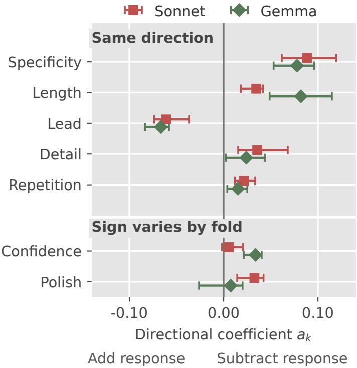  
Figure 9: Directional corrections for Sonnet and Gemma. Points are mean normalized coeficients $a _ { k } ;$ bars span five overlapping folds. Positive coeficients subtract the response, negative ones add it. This bank and elicitation format difer from Jev/Sol in fig. 4(a); see table 7. A variable sign does not imply no efect.

## D.4 Full correction profiles

For each attribute, the paired correction has the exact decomposition

$$
\begin{array} { c } { { \Delta _ { k } ^ { + } \widehat { \beta } _ { k } ^ { + } + \Delta _ { k } ^ { - } \widehat { \beta } _ { k } ^ { - } = O _ { k } ( \widehat { \beta } _ { k } ^ { + } + \widehat { \beta } _ { k } ^ { - } ) } } \\ { { + E _ { k } ^ { \mathrm { b a s e } } ( \widehat { \beta } _ { k } ^ { + } - \widehat { \beta } _ { k } ^ { - } ) . } } \end{array}
$$

The shared response is defined about the Vanilla baseline, as in (5). For training fold T, define

$$
\begin{array} { r l } & { a _ { k } ^ { ( T ) } : = ( \widehat { \beta } _ { k } ^ { + } + \widehat { \beta } _ { k } ^ { - } ) \frac { \mathrm { R M S } _ { T } ( C O _ { k } ) } { \mathrm { R M S } _ { T } ( C s ^ { 0 } ) } , } \\ & { e _ { k } ^ { ( T ) } : = ( \widehat { \beta } _ { k } ^ { + } - \widehat { \beta } _ { k } ^ { - } ) \frac { \mathrm { R M S } _ { T } ( C E _ { k } ^ { \mathrm { b a s e } } ) } { \mathrm { R M S } _ { T } ( C s ^ { 0 } ) } , } \end{array}
$$

where C centers each document and RMS pools its training summaries. Table 20 reports fold means and ranges. This normalization describes the size of each fitted component; it does not remove dependence on correlated columns, the probe bank, or the ridge penalty. In particular, the entries are not additive fractions of explained variance. Stability under rewording or independent repeated calls is distinct from the calibration-fold variation reported here.

Across the four judges, 24 of 30 directional coeficients retain their sign in all five folds. These approximate bias coordinates depend on the recorded bank and elicitation protocol; model-only comparisons require matching both (table 7).

<table><tr><td>Judge</td><td>Attribute</td><td>Directional ak</td><td></td><td>Shared ek</td></tr><tr><td rowspan="7">Jev</td><td>Accuracy</td><td>-0.095 [−0.122, −0.082]</td><td></td><td>0.004 [-0.007, 0.016]</td></tr><tr><td>Coherence</td><td>-0.003 [−0.018, 0.004]</td><td></td><td>0.003 [-0.015, 0.021]</td></tr><tr><td>Coverage</td><td>0.062 [0.039, 0.078]</td><td></td><td>-0.018 [−0.024, -0.008]</td></tr><tr><td>Engagement</td><td>-0.042 [−0.054, −0.033]</td><td></td><td>-0.096 [-0.119, −0.073]</td></tr><tr><td>Fluency</td><td>-0.087 [-0.105, -0.055]</td><td></td><td>-0.144 [−0.151, −0.134]</td></tr><tr><td>Grounding</td><td>-0.021 [−0.029, -0.013]</td><td></td><td>0.046 [0.039, 0.054]</td></tr><tr><td>Helpfulness</td><td>0.021 [0.012, 0.030]</td><td></td><td>-0.077 [−0.117, -0.050]</td></tr><tr><td rowspan="7">Sonnet</td><td>Safety</td><td>-0.006 [-0.013, 0.001]</td><td></td><td>0.035 [0.032, 0.040]</td></tr><tr><td>Confidence Detail</td><td>0.005 [−0.002, 0.021]</td><td></td><td>-0.011 [-0.018, 0.001]</td></tr><tr><td>Lead</td><td>0.036 [0.015, 0.068]</td><td></td><td>-0.019 [−0.033, -0.011]</td></tr><tr><td></td><td>-0.061 [−0.074, -0.037]</td><td></td><td>-0.025 [-0.047, -0.009]</td></tr><tr><td>Length Polish</td><td>0.035 [0.018, 0.042]</td><td></td><td>-0.071 [−0.088, -0.058]</td></tr><tr><td>Repetition</td><td>0.033 [0.014, 0.042]</td><td></td><td>0.003 [-0.012, 0.020]</td></tr><tr><td>Specificity</td><td>0.021 [0.012, 0.033]</td><td></td><td>-0.022 [−0.025, −0.018]</td></tr><tr><td rowspan="8">Sol</td><td></td><td>0.088 [0.062, 0.119]</td><td></td><td>-0.097 [−0.116, -0.061]</td></tr><tr><td>Accuracy</td><td>0.040 [0.026, 0.061]</td><td></td><td>-0.003 [−0.012, 0.004]</td></tr><tr><td>Coherence</td><td>0.008 [-0.003, 0.021]</td><td></td><td>-0.028 [-0.047, -0.006]</td></tr><tr><td>Coverage</td><td>0.031 [0.017, 0.046]</td><td></td><td>-0.049 [−0.084, -0.026]</td></tr><tr><td>Engagement</td><td>-0.007 [–0.014, 0.000]</td><td></td><td>-0.003 [-0.018, 0.021]</td></tr><tr><td>Fluency</td><td>-0.059 [−0.069, -0.042]</td><td></td><td>-0.074 [−0.095, -0.058]</td></tr><tr><td>Grounding</td><td>0.035 [0.017, 0.049]</td><td></td><td>-0.058 [−0.082, -0.033]</td></tr><tr><td>Helpfulness Safety</td><td>0.014 [0.004, 0.028]</td><td></td><td>0.051 [0.020, 0.076]</td></tr><tr><td rowspan="7">Gemma</td><td></td><td>0.001 [-0.003, 0.005]</td><td></td><td>-0.010 [−0.015, -0.003]</td></tr><tr><td>Confidence</td><td>0.034 [0.021, 0.040]</td><td></td><td>0.029 [0.008, 0.059]</td></tr><tr><td>Detail Lead</td><td>0.024 [0.002, 0.044]</td><td></td><td>0.078 [0.042, 0.093]</td></tr><tr><td></td><td>-0.066 [−0.083, -0.058]</td><td></td><td>-0.047 [−0.077, -0.032]</td></tr><tr><td>Length</td><td>0.082 [0.049, 0.115]</td><td></td><td>-0.042 [−0.068, -0.005]</td></tr><tr><td>Polish</td><td>0.007 [-0.026, 0.020]</td><td></td><td>-0.059 [-0.082, -0.040]</td></tr><tr><td>Repetition Specificity</td><td>0.015 [0.004, 0.025] 0.078 [0.053, 0.096]</td><td></td><td>-0.101 [−0.114, -0.091] −0.116 [−0.125, −0.104]</td></tr></table>

Table 20: Full profiles of the paired-response correction. Each entry is the mean over five training folds followed by the minimum and maximum in brackets; these ranges are not confidence intervals. Positive contributions are subtracted in the deployed score.

## D.5 Expanding and selecting the probe pool

Table 21 compares the recorded probe pools under the common protocol in section A.5. More probes do not consistently improve calibration, even after screening for reliable score movement. Detectable responses therefore need not supply additional predictive information.

The signal screen retains 74, 82, 85, 79, and 84 units for HANNA, Topical-Chat, HelpSteer2, MT-Bench, and JudgeBench. Secondary forward selection adds the largest exploration nested-CV gain, stopping below 0.001 or at 20 units; it selects 3, 1, 3, 3, and 3 units. The original-pool rows apply the same screen and regularization selection to 24 units. For the expanded primary HANNA fit, within-context Spearman changes from 0.414 to 0.568.

All 260 property units tested across the five expanded banks pass the neutral-control screen, but only 100 individually improve exploration nested-CV accuracy by more than 0.002. This exploratory

<table><tr><td>Method</td><td></td><td>HANNA Topical-Chat HelpSteer2 MT-Bench JudgeBench</td><td></td><td></td><td></td></tr><tr><td>Rubric-based</td><td></td><td></td><td></td><td></td><td></td></tr><tr><td>SAJA broad</td><td>0.682</td><td>0.799</td><td>0.665</td><td>0.808</td><td>0.676</td></tr><tr><td>SAJA granular</td><td>0.695</td><td>0.831</td><td>0.710</td><td>0.805</td><td>0.707</td></tr><tr><td>Rubric-free</td><td></td><td></td><td></td><td></td><td></td></tr><tr><td>Vanilla</td><td>0.659</td><td>0.835</td><td>0.739</td><td>0.818</td><td>0.789</td></tr><tr><td>PRISM: all passing (primary)</td><td>0.723</td><td>0.837</td><td>0.755</td><td>0.828</td><td>0.791</td></tr><tr><td>Original pool: passing units</td><td>0.726</td><td>0.835</td><td>0.766</td><td>0.820</td><td>0.791</td></tr><tr><td>Added pool: passing units</td><td>0.703</td><td>0.827</td><td>0.750</td><td>0.831</td><td>0.791</td></tr><tr><td>Expanded pool: forward selection</td><td>0.726</td><td>0.812</td><td>0.729</td><td>0.831</td><td>0.780</td></tr><tr><td>Expanded pool: all units</td><td>0.718</td><td>0.837</td><td>0.755</td><td>0.831</td><td>0.791</td></tr><tr><td>Properties only</td><td>0.720</td><td>0.837</td><td>0.761</td><td>0.834</td><td>0.791</td></tr><tr><td>One-sided instructions only</td><td>0.700</td><td>0.834</td><td>0.761</td><td>0.811</td><td>0.791</td></tr></table>

Table 21: Probe-pool strategy comparisons (accuracy ↑). Every fitted predictor uses exploration labels only, with the penalty selected separately by grouped cross-validation and exact ties favoring stronger regularization. The primary bank retains all signal-screened units.  
count distinguishes measurable response from predictive usefulness; it is not a held-out test of each unit.

## D.6 Score resolution

For Sonnet on HANNA, changing the scale from 1–10 to 0–100 reduces the tied-pair share from 55.7% to 19.4%, and zero probe responses from 80.6% to 55.7%. Spearman changes from 0.445 to 0.432 for Vanilla, 0.430 to 0.483 for PRISM, and 0.439 to 0.484 for α-PRISM. The paired PRISM gain across scales is 0.054 [0.019, 0.090]; its 0–100 gain over Vanilla is 0.052 [0.021, 0.082]. Finer scores preserve more usable variation, although the changed anchors and missing-response rates also belong to this comparison. The model, bank, and folds are fixed as described in section A.2.