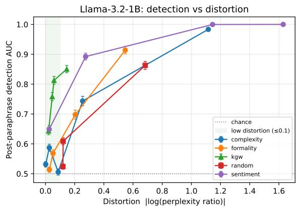
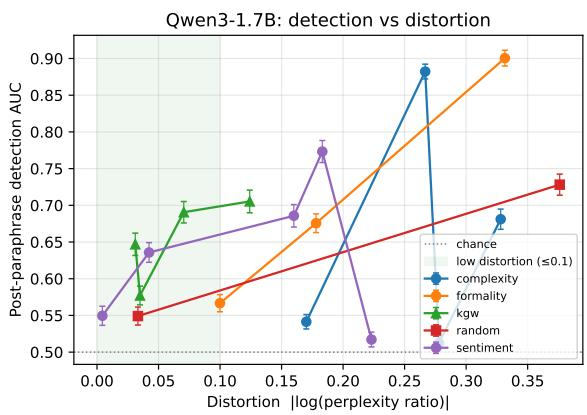
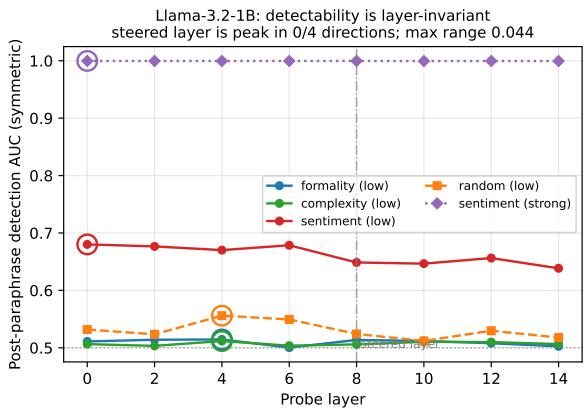
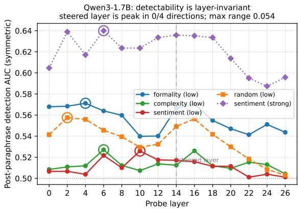

# Perturbation, Not Provenance: Why Activation Steering Does Not Make a Robust Text Watermark

Sergey Pletenev1,2 1AIRI, 2Skoltech alex010rey@gmail.com

## Abstract

Linear directions in the activation space of large language models causally and universally influ ence model behavior. This suggests that they might serve as a basis for a robust text watermark. The idea is to steer the generation along a specific semantic direction and then recover the mark by probing the activations of the re-encoded text. We test this hypothe sis by conducting a series of experiments. We vary the strength of the steering and use four different directions (formality, sentiment, complexity, and a random control) across two different model families. We also test two paraphrasing attacks: a sentence-level one and a stronger paragraph-level one. The results show that activation-steering watermarks are outperformed by a standard logit-based watermark (KGW) in terms of detection accuracy. At a matched level of fluency (within 1.15 times the original text’s perplexity), KGW achieved an AUC of 0.81 against a sentence-level para phraser, while the best steering direction only reached 0.65. A stronger paragraph-level paraphraser lowered both (0.65 for KGW and 0.59 for steering), narrowing the gap but not reversing it. On Qwen, it left the two indistinguishable but at near-chance levels for both. We further showed that the detectability provided by steering was not semantic: a random direction was just as detectable as a meaningful one. The signal was independent of which layer was probed and whether a surface feature control was used. We conclude that, in this case, semantic activation does not encode a localized, recoverable semantic mark, but rather a global, content-independent shift that can only be strongly detected when the text is degraded.

## 1 Introduction

Text watermarking is a process of embedding a detectable signal into machine-generated text, allowing a third party with a specific key to later verify the text’s authenticity. A key aspect of watermarking is its resistance to paraphrasing, meaning that an adversary attempting to rewrite the text should not be able to easily remove the watermark. Watermarks based on logit functions, such as KGW (Kirchenbauer et al., 2023), bias token sampling towards a pseudo-random “green list”. On the other hand, there are semantic watermarks, like Sem-Stamp (Hou et al., 2024a), which target paraphrasing resistance by operating in the space of sentence embeddings.

A natural and previously unexplored alternative is to embed a watermark inside the forward pass of the model. Recent work has shown that linear directions in the residual stream can causally steer the behavior of the model and generalize across different contexts. (Turner et al., 2023; Rimsky et al., 2024; Zou et al., 2023; Park et al., 2024). If a semantic direction leaves a trace that survives paraphrasing because new sentences preserve meaning even when they rewrite tokens, then we could: (i) steer generation along a secret semantic direction and (ii) detect the watermark by re-encoding the candidate text through the base model and probing its activations. Such a watermark would be architecturally different from logit- and embedding-space methods and might inherit the robustness of the underlying semantic representation to paraphrasing.

We tested this hypothesis and reported a negative result. Our main contributions are:

1. We formalize and implement an activationsteering watermark and evaluate it against KGW on a detection-versus-fluency frontier, under both a sentence-level and a paragraph-level paraphrase attack, across steering strengths spanning fluent to degraded generation.

2. We show that the steering watermark is Paretodominated: at matched deployable fluency, it is never more detectable than KGW, and only reaches comparable detectability by inflating the perplexity by several-fold.

3. We demonstrate that its detectability is not semantic via three controls: a random steering direction matches meaningful ones, the signal is layer-invariant, and it cannot be explained by surface text statistics.

We release data and code for further usage1.

## 2 Related Work

Logit-based watermarks. KGW (Kirchenbauer et al., 2023) and successors (Zhao et al., 2024) partition the vocabulary and bias sampling; detection is a statistical test over token counts. These methods are known to degrade under paraphrase, motivating semantic approaches.

Semantic / paraphrase-robust watermarks. SemStamp (Hou et al., 2024a) and its variants (Hou et al., 2024b) operate in sentence-embedding space via rejection sampling to survive paraphrase. Our method differs by intervening in the residual stream; we find this confers no robustness advantage over the logit baseline at matched fluency.

Activation steering. Linear directions in activation space causally and generalizably affect model behavior (Turner et al., 2023; Rimsky et al., 2024; Zou et al., 2023; Park et al., 2024), which motivated the watermarking hypothesis we test. Our negative result delimits that promise: such directions do not yield a localized, recoverable semantic channel that survives paraphrase.

Concurrent work, SLAM (Harel-Canada and Sahai, 2026), instantiates an activation-injection watermark using sparse-autoencoder structural directions (voice, tense, clause order) on Gemma-2. Our results delimit this specific case – the directions that transmit are behavioral and therefore collide with natural text. Steered structure that is not lexically anchored is what a paraphrasing tool removes. We test a sentence-level paraphrasing tool only, so we do not claim to overcome structural marks in SLAM; rather, we describe the secrecy-robustness tension that any such system must navigate.

## 3 Method

Watermark by activation steering. Let $h _ { t } ^ { ( \ell ) } \in$ $\mathbb { R } ^ { d }$ be the residual-stream activation at layer ℓ and token position t. Given a unit-norm steering direction $\boldsymbol { v } \in \mathbb { R } ^ { d }$ , we add, at every position during

generation,

$$
\tilde { h } _ { t } ^ { ( \ell ) } = h _ { t } ^ { ( \ell ) } + \alpha \| h _ { t } ^ { ( \ell ) } \| v ,\tag{1}
$$

where α is a norm-relative steering fraction. Scaling by $\| h _ { t } ^ { ( \ell ) } \|$ makes α comparable across models and layers whose residual norms differ by orders of magnitude $( \mathrm { e . g . \approx 1 0 ^ { 2 } }$ for Llama-3.2-1B at ℓ=8 versus ≈ $2 . 2 \times 1 0 ^ { 3 }$ for Qwen3-1.7B at ℓ=14); an absolute offset that steers one model is negligible or destructive for another.

Detection. The verifier re-encodes candidate text through the unmodified base model, mean-pools the layer-ℓ activations over non-padding positions, and trains a regularized logistic probe to separate steered from unsteered text. We report detection as the cross-validated ROC-AUC of this probe (pooled across generation seeds).

Directions. We extract steering directions by mean-difference of pooled activations over contrastive text pairs (Rimsky et al., 2024) generated by a larger model of the same family: formality (formal vs. informal), sentiment (positive vs. negative), and complexity (complex vs. simple). As a control we use a random unit direction orthogonalized against formality. If steering encodes a semantic mark, the meaningful directions should be detectable and the random one should not.

Baselines. We compare against KGW (Kirchenbauer et al., 2023) as implemented in, sweeping its logit bias δ. KGW is detected with with its native z-score test, not the activation probe. For paraphrasing we use two attackers. The first rewrites every generation sentence-by-sentence with a Pegasus (Zhang et al., 2020). Because a sentence-level paraphraser is not able to reorder or merge material across sentence boundaries, we also use DIPPER (Krishna et al., 2023), a 11B paragraph-level paraphraser that rewrites in few sentence windows.

## 4 Experimental Setup

Models. We use Llama-3.2-1B-Instruct (Grattafiori et al., 2024) and Qwen3-1.7B (Qwen Team, 2025) as generators, with the 8B model of each family used only to synthesize contrastive pairs.

Prompts and generation. We sample 200 Alpaca instruction prompts and generate with temperature 1.0, top-p 0.9 and 150 max new tokens. Every operating point is generated under 3 seeds (600 generations per class).

<table><tr><td>Methods</td><td>Ppl. d</td><td> $\mathbf { A U C } _ { \mathrm { P e g } }$ </td><td> $\mathbf { A U C } _ { \mathbf { D I P } }$ </td></tr><tr><td>Deployable regime (≤ 1.15× ppl) KGW (δ=3) sentiment (α=0.1) random (α=0.2)</td><td>1.06 0.06 1.03 0.03 1.13 0.12</td><td>0.81 0.65 0.61</td><td>0.65 0.59 0.57</td></tr><tr><td colspan="4">complexity (α=0.4) 1.03 0.03 0.59 0.55 formality (α=0.2) 1.05</td></tr><tr><td colspan="2">Steering&#x27;s high-detectability points</td><td>0.05 0.57</td><td>0.52</td></tr><tr><td colspan="2">formality (α=0.6) 1.73</td><td>0.55 0.91</td><td>0.83</td></tr><tr><td colspan="2">sentiment (α=0.2) 1.32</td><td>0.28</td><td>0.89 0.83</td></tr></table>

Table 1: Llama-3.2-1B, best point per method within each case, under the Pegasus (Peg) and DIPPER (DIP) attacks. Ppl. is the ratio to unsteered and $d \_ =$ |log(ppl ratio)|

  
Figure 1: Detection-versus-distortion frontier (Llama-3.2-1B)

Steering grid. The norm-relative fraction α is swept per model over a grid chosen by calibration to span fluent-but-changed to degraded generation $( \alpha \in \{ 0 . 1 , 0 . 2 , 0 . 4 , 0 . 6 , 0 . 8 \} )$ ). Because all figures plot detection against measured perplexity rather than against α, per-model grids remain directly comparable in fluency space.

Metrics. In both frontier figures (Figures 1 and 2) and in Table 1, the y-axis is postparaphrase detection AUC; we report symmetric AUC (max(AUC, 1−AUC)) so a key-aware verifier’s separability is never under-counted. For the x-axis we use a two-sided distortion d = $\left| \log ( \mathrm { p p l } _ { \mathrm { s t e e r e d } } / \mathrm { p p l } _ { \mathrm { u n s t e e r e d } } ) \right|$ , the absolute log of the perplexity ratio under the base model. A one-sided "fluency cost" (perplexity ratio) is not adequate here because, on Qwen, several steering directions lower perplexity relative to the unsteered baseline, we analyze this in Results section.

  
Figure 2: Detection-versus-distortion frontier (Qwen3- 1.7B)

## 5 Results

Table 1 and Figures 1 and 2 show the main results. In the deployable case, KGW achieves 0.81 post-paraphrase AUC with a perplexity of 1.06. No other approach comes close to this level of performance at comparable fluency. Sentiment achieves the best result with 0.65 AUC, and the remaining three approaches fall between 0.57 and 0.61. Steering matches KGW’s best operating point (0.85) only from a perplexity of 1.16 upward. Non-sentiment approaches only perform well at 1.7-2×, which corresponds to a noticeable degradation in text quality. The logit watermark dominates the activation-steering watermark across the frontier, except for one case: on Qwen, sentiment with $\alpha = 0 . 8$ reaches 0.77, which is higher than KGW’s best (0.71), but at a greater distortion $( d = 0 . 1 8$ compared to 0.12).

Because both detectors score the same unsteered negative set, their AUCs are correlated, so we bootstrap the difference directly, resampling whole prompts (each prompt contributes one generation per seed to each class) and recomputing both AUCs on every replicate. In the deployable band KGW exceeds the best steering direction by 0.16 AUC under Pegasus, and no replicate put the difference at or below zero. The curves do not overlap within their error bars anywhere in the low-distortion regime (Figure 1).

A stronger attacker narrows the gap. DIPPER is much more damaging to KGW than Pegasus. When the attack is turned on, KGW loses an average of 0.15 AUC on Llama and 0.11 AUC on Qwen over its four different bias settings, while the four $\alpha = 0 . 1$ points lose only 0.01 AUC, an order of magnitude less on both. This is expected, as KGW is more susceptible to the attack than the other models.

A paragraph-level rewriter disrupts the tokenlevel green list, whereas a probe on mean-pooled activations reads a global perturbation that partly survives rewording. On Llama, the gap therefore falls from 0.16 AUC under Pegasus to 0.06 under DIPPER, so Pegasus alone is an artifact of a weak attacker. On Qwen, the ordering does not survive: the best in-band steering point (sentiment, α=0.4)) reaches 0.587 against KGW’s 0.557, a difference of −0.03 with interval [−0.07, +0.01]. Under the stronger attack, the two are statistically indistinguishable on Qwen, and we do not claim KGW wins there. However, Qwen is the model on which KGW performs the worst, so the convergence reflects a decreasing baseline as well as an increasing steering curve. 0.587 is close enough to the chance level to be interpreted as neither method being effective here, rather than the steering curve succeeding.

At the top of the steering grid, generation degenerates into empty or repetitive text whose perplexity ratio exceeds 10× the unsteered baseline. We exclude these points from all figures and tables: they are not deployable watermarks but destroyed text.

Steering can reduce perplexity On Qwen3-1.7B several steering directions produce a perplexity ratio below 1: steered generations are more probable under the base model than unsteered ones (formality and complexity at α ≤ 0.4 give 0.72–0.90). Steering towards "formal" or "complex" registers did not degrade fluency so much as homogenized output towards higher-probability, more generic phrasing.

This gives us a methodological implication: detectability rises even as perplexity falls, so it cannot be a function of "fluency cost" alone. What the detector tracked was displacement from the base distribution in either direction, which was why our figures used the two-sided axis d. Under it, the apparent "free detection" of these points resolved – they sat at moderate distortion (d = 0.1–0.33, not at zero cost.

A second implication was that perplexity alone could not decide which points were deployable. Strong steering failed predominantly by repetition, and repeated tokens are highly predictable, so a collapsed completion has a low perplexity. On Qwen, this puts formality α=0.6 at a 1.15× ratio with 0.98 AUC – apparently a deployable watermark beating KGW – when one completion in ten has actually collapsed into a repetition loop. We therefore exclude operating points where more than 5% of completions are empty or have fewer than half their word 4-grams unique. On Qwen, this removes formality α=0.6 and complexity α=0.8; on Llama, it removes nothing that the perplexity rule hadn’t already removed, so Table 1. Appendix A.2 gives the criterion, an independent cross-model check confirming the effect is not an artifact of selfscoring, and per-point collapse rates. Detectability is achieved through degeneration, rather than a semantic marker.

## 6 Ablation study

If the steering encoded a semantic watermark, three predictions would hold: a meaningful direction would be more detectable than a random one, the signal would be strongest at the steered layer, and detection would not reduce to surface text statistics. However, the first two predictions fail outright, and the third is not refuted, but it is ineffective in the context that is relevant. At deployable fluency, there is no signal to explain surface statistics, because there is barely any signal at all. Where detection appears, it appears together with distortion, and it is available to a random direction as readily as it is to a meaningful one.

Random matches semantic. At matched steering strength the random control is among the most detectable directions, not the least. At α=0.4 it reaches 0.86 AUC on Llama and 0.97 on Qwen, above formality (0.70 and 0.90), above complexity (0.59 and 0.68), and on Qwen above sentiment (0.64) as well; only Llama sentiment exceeds it. A direction carrying no semantic content is therefore no harder to recover than one carrying a concept.

Direction identity does not even transfer between models. Sentiment is the most detectable direction on Llama at every steering strength and the least detectable on Qwen, though both were extracted by the same mean-difference procedure from the same contrastive template.

Layer invariance. The signal is flat across layers. We probe every other layer across the full depth of each model and compare detectability. Postparaphrase AUC varies by at most 0.044 (Llama, 8 layers) and 0.054 (Qwen, 14 layers) across all probed layers, and the layer we actually steered is the probe-AUC maximum in none of the four directions on either model (0/4 each); the peaks land at scattered, unrelated layers. A watermark localized to the steered representation would peak there. Instead the signal is a global property of the generated text, detectable at any depth (Figures 3 and 4). Because we cover the whole stack rather than a few layers, this is not an undersampling artifact, and because the pattern is the same in both model families it is not a configuration or anomaly of one architecture.

  
Figure 3: Post-paraphrase detectability against probe layer on Llama-3.2-1B. Rings mark each direction’s peak layer; the dash-dotted line is the layer that was steered. "low" is α=0.1 and "strong" is α=0.4.

  
Figure 4: Post-paraphrase detectability against probe layer on Qwen3-1.7B

Surface statistics. At low, fluent steering (α=0.1) neither probe separates the two sets. A probe trained only on shallow features (length, type–token ratio, punctuation rates) reaches 0.51– 0.56 AUC, and the activation probe reaches 0.51– 0.65; the two agree to within 0.02 for every direction on both models except sentiment on Llama, the single point where steering is detectable at deployable fluency. Matching the two sets on completion length leaves the activation AUC essentially unchanged, so length is not the confound either. The correct reading is not that a deep signal survives a surface control, but that at fluent steering there is almost no signal to begin with.

At strong steering (α=0.4) both probes rise together, and the surface probe becomes accurate exactly where the text is most distorted (0.90 for the random direction on Qwen, 0.81 for sentiment on Llama). Surface detectability therefore rises in lockstep with distortion for the random control just as for the meaningful directions, which is the same conclusion the other two controls reach: detection tracks displacement from the base distribution, not content.

The sentiment exception. Sentiment is the one direction that becomes strongly detectable at modest perplexity on Llama (AUC 0.89 at 1.32×). It is, however, also layer-invariant: heavy sentiment steering makes the entire text conspicuously more positive, a global shift detectable at any layer rather than a localized mark. Nor does it replicate—on Qwen the same direction is the weakest of the four at every steering strength, reaching only 0.77 even at α=0.8. The exception is a property of one direction in one model, and it illustrates the mechanism rather than contradicting it.

## 7 Conclusion

Semantic activation-steering watermarks are an interesting idea, but they do not work as expected. In the testing regime we used, which included two model families with approximately 1-2 billion parameters, a single steered layer at mid-depth, and both sentence-level and paragraph-level paraphrasing attacks, a logit watermark always dominated the model, regardless of the fluency cost. What we found was that what steering provided was nonsemantic: a random direction matched meaningful ones, the signal was layer-invariant, and what survived a surface-statistics control was contentindependent.

Steering encoded a global perturbation that was only strongly detectable when it degraded text. We don’t claim that this rules out all activation-space watermarks – structural directions or larger models may behave differently – but it limits the semantic version of the idea, and we hope this saves others from taking a detour.

## Limitations

We compare against a logit-based watermark (KGW) but not against a sentence-embedding watermark such as SemStamp (Hou et al., 2024a). That is arguably the more natural comparison: like ours, and unlike KGW, it is designed for paraphrase robustness by operating on meaning rather than on tokens.

We studied models with up to ≈2B parameters and steered a single mid-depth layer in each model. Larger models, where steering directions may be cleaner and more linear, could potentially change the picture. However, this is beyond the scope of this study, and it is possible that our setup tests a less favorable case for the steering hypothesis than a large-scale study would, so the negative result is unlikely to change with scale.

The concern about steering a single layer is also addressed by our design: the detector probes every layer and the signal is global rather than limited to the steered layer. Therefore, the claim does not depend on the specific layer being steered. Our detector is a deliberately strong key-aware probe; a more realistic key-blind detector would only lower steering detectability, reinforcing the negative result.

## References

Aaron Grattafiori, Abhimanyu Dubey, Abhinav Jauhri, Abhinav Pandey, Abhishek Kadian, Ahmad Al-Dahle, Aiesha Letman, Akhil Mathur, Alan Schelten, Alex Vaughan, Amy Yang, Angela Fan, Anirudh Goyal, Anthony Hartshorn, Aobo Yang, Archi Mitra, Archie Sravankumar, Artem Korenev, Arthur Hinsvark, and 542 others. 2024. The Llama 3 herd of models. Preprint, arXiv:2407.21783.

Fabrice Harel-Canada and Amit Sahai. 2026. SLAM: Structural linguistic activation marking for language models. Preprint, arXiv:2605.05443.

Abe Bohan Hou, Jingyu Zhang, Tianxing He, Yichen Wang, Yung-Sung Chuang, Hongwei Wang, Lingfeng Shen, Benjamin Van Durme, Daniel Khashabi, and Yulia Tsvetkov. 2024a. SemStamp: A semantic watermark with paraphrastic robustness for text generation. In Proceedings ofthe 2024 Conference of the North American Chapter of the Association for Computational Linguistics: Human Language Technologies (Volume 1: Long Papers), NAACL 2024, Mexico City, Mexico, June 16-21, 2024, pages 4067–4082. Association for Computational Linguistics.

Abe Bohan Hou, Jingyu Zhang, Yichen Wang, Daniel Khashabi, and Tianxing He. 2024b. k-SemStamp: A

clustering-based semantic watermark for detection of machine-generated text. In Findings of the Associationfor Computational Linguistics, ACL 2024, Bangkok, Thailand and virtual meeting, August 11- 16, 2024, volume ACL 2024 of Findings of ACL, pages 1706–1715. Association for Computational Linguistics.

John Kirchenbauer, Jonas Geiping, Yuxin Wen, Jonathan Katz, Ian Miers, and Tom Goldstein. 2023. A watermark for large language models. In International Conference on Machine Learning, ICML 2023, 23-29 July 2023, Honolulu, Hawaii, USA, volume 202 of Proceedings of Machine Learning Research, pages 17061–17084. PMLR.

Kalpesh Krishna, Yixiao Song, Marzena Karpinska, John Wieting, and Mohit Iyyer. 2023. Paraphrasing evades detectors of AI-generated text, but retrieval is an effective defense. In Advances in Neural Information Processing Systems 36: Annual Conference on Neural Information Processing Systems 2023, NeurIPS 2023, New Orleans, LA, USA, December 10 - 16, 2023.

Kiho Park, Yo Joong Choe, and Victor Veitch. 2024. The linear representation hypothesis and the geometry of large language models. In Proceedings of the 41st International Conference on Machine Learning, ICML 2024, Vienna, Austria, July 21-27, 2024, volume 235 of Proceedings of Machine Learning Research, pages 39643–39666. PMLR.

Qwen Team. 2025. Qwen3 technical report. Preprint, arXiv:2505.09388.

Nina Rimsky, Nick Gabrieli, Julian Schulz, Meg Tong, Evan Hubinger, and Alexander Matt Turner. 2024. Steering Llama 2 via contrastive activation addition. In Proceedings of the 62nd Annual Meeting of the Associationfor Computational Linguistics (Volume 1: Long Papers), ACL 2024, Bangkok, Thailand, August 11-16, 2024, pages 15504–15522. Association for Computational Linguistics.

Alexander Matt Turner, Lisa Thiergart, Gavin Leech, David Udell, Juan J. Vazquez, Ulisse Mini, and Monte MacDiarmid. 2023. Steering language models with activation engineering. Preprint, arXiv:2308.10248.

Jingqing Zhang, Yao Zhao, Mohammad Saleh, and Peter J. Liu. 2020. PEGASUS: pre-training with extracted gap-sentences for abstractive summarization. In Proceedings ofthe 37th International Conference on Machine Learning, ICML 2020, 13-18 July 2020, Virtual Event, volume 119 of Proceedings ofMachine Learning Research, pages 11328–11339. PMLR.

Xuandong Zhao, Prabhanjan Vijendra Ananth, Lei Li, and Yu-Xiang Wang. 2024. Provable robust watermarking for AI-generated text. In The Twelfth International Conference on Learning Representations, ICLR 2024, Vienna, Austria, May 7-11, 2024. Open-Review.net.

Andy Zou, Long Phan, Sarah Chen, James Campbell, Phillip Guo, Richard Ren, Alexander Pan, Xuwang Yin, Mantas Mazeika, Ann-Kathrin Dombrowski, Shashwat Goel, Nathaniel Li, Michael J. Byun, Zifan Wang, Alex Mallen, Steven Basart, Sanmi Koyejo, Dawn Song, Matt Fredrikson, and 2 others. 2023. Representation engineering: A top-down approach to AI transparency. Preprint, arXiv:2310.01405.

## A Appendix

## A.1 Full results

Tables 2 and 3 list every cases behind Figures 1 and 2, so the figures can be read numerically. They also make explicit something the figures cannot show: on Qwen the perplexity ratio is not monotone in the steering fraction, so the horizontal position of a point does not follow α. For complexity, $\alpha { = } 0 . 1$ sits at $d { = } 0 . 2 8$ while $\alpha { = } 0 . 6$ sits at $d { = } 0 . 2 7 { \mathrm { : } }$ a line joining points in distortion order therefore visits the steering grid out of sequence. On Llama the ordering is preserved.

<table><tr><td>Method</td><td> $\alpha / \delta$ </td><td> $\mathrm { { P p l . } }$ </td><td>d</td><td> $\mathrm { \Delta A U C _ { P e g } }$ </td><td> $\mathbf { A U C } _ { \mathbf { D I P } }$ </td></tr><tr><td>unsteered</td><td></td><td>1.00</td><td>一</td><td>0.50</td><td>0.50</td></tr><tr><td>formality</td><td>0.1</td><td>1.03</td><td>0.03</td><td>0.514</td><td>0.536</td></tr><tr><td></td><td>0.2</td><td>1.05</td><td>0.05</td><td>0.568</td><td>0.519</td></tr><tr><td></td><td>0.4</td><td>1.23</td><td>0.20</td><td>0.698</td><td>0.589</td></tr><tr><td></td><td>0.6</td><td>1.73</td><td>0.55</td><td>0.914</td><td>0.831</td></tr><tr><td></td><td>0.8</td><td>11.9</td><td>2.47</td><td>0.999†</td><td>0.999†</td></tr><tr><td>complexity</td><td>0.1</td><td>1.09</td><td>0.09</td><td>0.506</td><td>0.505</td></tr><tr><td></td><td>0.2</td><td>1.00</td><td>0.00</td><td>0.532</td><td>0.513</td></tr><tr><td></td><td>0.4</td><td>1.03</td><td>0.03</td><td>0.587</td><td>0.550</td></tr><tr><td></td><td>0.6</td><td>1.29</td><td>0.25</td><td>0.744</td><td>0.644</td></tr><tr><td></td><td>0.8</td><td>3.05</td><td>1.12</td><td>0.983</td><td>0.969</td></tr><tr><td>sentiment</td><td>0.1</td><td>1.03</td><td>0.03</td><td>0.649</td><td>0.593</td></tr><tr><td></td><td>0.2</td><td>1.32</td><td>0.28</td><td>0.892</td><td>0.825</td></tr><tr><td></td><td>0.4</td><td>3.14</td><td>1.15</td><td>1.000</td><td>0.998</td></tr><tr><td></td><td>0.6</td><td>5.10</td><td>1.63</td><td>1.000</td><td>1.000</td></tr><tr><td></td><td>0.8</td><td>12.0</td><td>2.48</td><td>1.000†</td><td>1.000†</td></tr><tr><td>random</td><td>0.1</td><td>1.13</td><td>0.12</td><td>0.524</td><td>0.508</td></tr><tr><td></td><td>0.2</td><td>1.13</td><td>0.12</td><td>0.609</td><td>0.568</td></tr><tr><td></td><td>0.4</td><td>1.98</td><td>0.68</td><td>0.863</td><td>0.780</td></tr><tr><td></td><td>0.6</td><td>13.8</td><td>2.63</td><td>0.979†</td><td>0.964†</td></tr><tr><td></td><td>0.8</td><td>86.9</td><td>4.46</td><td>0.996†</td><td>0.990†</td></tr><tr><td>KGW</td><td>1</td><td>1.02</td><td>0.02</td><td>0.643</td><td>0.558</td></tr><tr><td></td><td>2</td><td>1.05</td><td>0.05</td><td>0.758</td><td>0.592</td></tr><tr><td></td><td>3</td><td>1.06</td><td>0.06</td><td>0.813</td><td>0.652</td></tr><tr><td></td><td>4</td><td>1.16</td><td>0.15</td><td>0.850</td><td>0.659</td></tr></table>

Table 2: Llama-3.2-1B, all operating points, under the Pegasus (Peg) and DIPPER (DIP) attacks. Bold marks the best KGW point inside the deployable band. † excluded from the frontier by the perplexity rule.

## A.2 The degeneracy criterion

Why perplexity is insufficient. The frontier already discards points whose perplexity ratio exceeds 10× as destroyed text. That rule cannot catch repetition, because a looping completion is highly predictable and therefore scores low perplexity. A point can be visibly destroyed and still sit in the deployable band. Qwen formality $\alpha { = } 0 . 6$ is such a point: 1.15× perplexity, 0.98 AUC, and completions such as "The singular and singularly singular singular singular and singularly singular and singularly singular and. . . "

<table><tr><td>Method</td><td> $\alpha / \delta$ </td><td> $\mathrm { { P p l . } }$ </td><td>d</td><td> $\mathbf { A U C } _ { \mathrm { P e g } }$ </td><td> $\mathbf { A U C } _ { \mathrm { D I P } }$ </td></tr><tr><td>unsteered</td><td>一</td><td>1.00</td><td>一</td><td>0.50</td><td>0.50</td></tr><tr><td>formality</td><td>0.1</td><td>0.90</td><td>0.10</td><td>0.567</td><td>0.534</td></tr><tr><td></td><td>0.2</td><td>0.84</td><td>0.18</td><td>0.676</td><td>0.592</td></tr><tr><td></td><td>0.4</td><td>0.72</td><td>0.33</td><td>0.900</td><td>0.772</td></tr><tr><td></td><td>0.6</td><td>1.15</td><td>0.14</td><td>0.985†</td><td>0.956†</td></tr><tr><td></td><td>0.8</td><td>一</td><td>一</td><td>0.987†</td><td>0.977†</td></tr><tr><td>complexity</td><td>0.1</td><td>0.76</td><td>0.28</td><td>0.512</td><td>0.521</td></tr><tr><td></td><td>0.2</td><td>0.84</td><td>0.17</td><td>0.541</td><td>0.545</td></tr><tr><td></td><td>0.4</td><td>0.72</td><td>0.33</td><td>0.681</td><td>0.588</td></tr><tr><td></td><td>0.6</td><td>0.77</td><td>0.27</td><td>0.882</td><td>0.768</td></tr><tr><td></td><td>0.8</td><td>2.37</td><td>0.86</td><td>0.980†</td><td>0.956†</td></tr><tr><td>sentiment</td><td>0.1</td><td>1.25</td><td>0.22</td><td>0.517</td><td>0.536</td></tr><tr><td></td><td>0.2</td><td>1.00</td><td>0.00</td><td>0.550</td><td>0.550</td></tr><tr><td></td><td>0.4</td><td>1.04</td><td>0.04</td><td>0.636</td><td>0.587</td></tr><tr><td></td><td>0.6</td><td>1.17</td><td>0.16</td><td>0.686</td><td>0.677</td></tr><tr><td></td><td>0.8</td><td>1.20</td><td>0.18</td><td>0.773</td><td>0.732</td></tr><tr><td>random</td><td>0.1</td><td>0.97</td><td>0.03</td><td>0.549</td><td>0.507</td></tr><tr><td></td><td>0.2</td><td>1.46</td><td>0.38</td><td>0.728</td><td>0.670</td></tr><tr><td></td><td>0.4</td><td>5834</td><td>8.67</td><td>0.967†</td><td>0.930†</td></tr><tr><td></td><td>0.6</td><td></td><td></td><td>0.995†</td><td>0.982†</td></tr><tr><td></td><td>0.8</td><td>3549</td><td>8.17</td><td>0.999†</td><td>0.990†</td></tr><tr><td>KGW</td><td>1</td><td>1.04</td><td>0.03</td><td>0.577</td><td>0.518</td></tr><tr><td></td><td>2</td><td>1.03</td><td>0.03</td><td>0.647</td><td>0.532</td></tr><tr><td></td><td>3</td><td>1.07</td><td>0.07</td><td>0.691</td><td>0.554</td></tr><tr><td></td><td>4</td><td>1.13</td><td>0.12</td><td>0.705</td><td>0.557</td></tr></table>

Table 3: Qwen3-1.7B, all operating points, under the Pegasus (Peg) and DIPPER (DIP) attacks. Ratios below 1 are homogenization, not error. “–” marks generations too degenerate to score. Bold marks the best KGW point inside the deployable band. † excluded from the frontier by the perplexity rule.

This is not an artifact of self-scoring. Steering toward "formal" homogenizes text toward the steered model’s own high-probability phrasing, so one might suspect the ratio is depressed because the scorer is the model that was steered. It is not. Re-scoring every operating point under an independent Llama-3.1-8B judge places the same point at 1.13×, against 1.15× self-scored. Both scorers agree, because the effect is a property of the text: no perplexity based axis can rank output whose dominant failure mode is one that perplexity rewards.