# Pin It on Anyone: Certified Targeted Displacement of Multi-Bit LLM Watermarks Without the Key

Paweł Batorski<sup>1</sup> Przemysław Spurek<sup>2,3</sup> Paul Swoboda<sup>1</sup>

<sup>1</sup>Heinrich Heine University Düsseldorf <sup>2</sup>Jagiellonian University <sup>3</sup>IDEAS Research Institute

## Abstract

Multi-bit watermarking embeds a message, typically an account identifier, into LLM output so that harmful text can be traced to its origin. We show an attack technique that allows to alter the watermarking message. This allows to, for example, exchange the embedded account ID to an arbitrary different one. The attacker mainly needs access to a few accounts for generating LLM output and model logits, but crucially not the secret key used to watermark. The attacker then rewrites the text, keeping its meaning, so that the watermarking message decoder recovers the watermarking message embedded by the attacker. We are, to our knowledge, the first to propose such an attack, which we call a targeted displacement. Theoretically, we present upper and lower bounds on the probability of our attack succeeding. This bound depends on the number of accounts the attacker has access to, the length of the message and some characteristics of the given text. Our attack can succeed whenever we can bound the ambiguity of the generated text well enough. Empirically, we test our attack technique against five watermarking methods and four LLMs. Attack success tracks our predicted bounds, allowing us to alter watermarking messages in almost all cases with high accuracy, given enough accounts. Our code can be found at https://github.com/Batorskq/PinIt.

## 1 Introduction

Watermarks let a provider recognize text that its language model generated (Kirchenbauer et al., 2023). Multi-bit watermarks also hide a message in the text, typically the identifier of the account that requested it, so that a decoder holding the secret key can attribute a harmful text to its account (Fernandez et al., 2023; Yoo et al., 2024; Qu et al., 2025; Li et al., 2024; Jiang et al., 2025; Xu et al., 2026). We show that an attacker can effectively alter the watermark message (Figure 1). With a few accounts of its own and without the secret key, it rewrites a text that carries a source message m, keeping its semantics, so that the decoder reads a chosen target message m<sup>′</sup>, such as the identifier of a third user. We call this targeted displacement. Obviously, such a watermarking attack can have serious security and privacy implications, when pinning harmful or sensitive text on an innocent party.

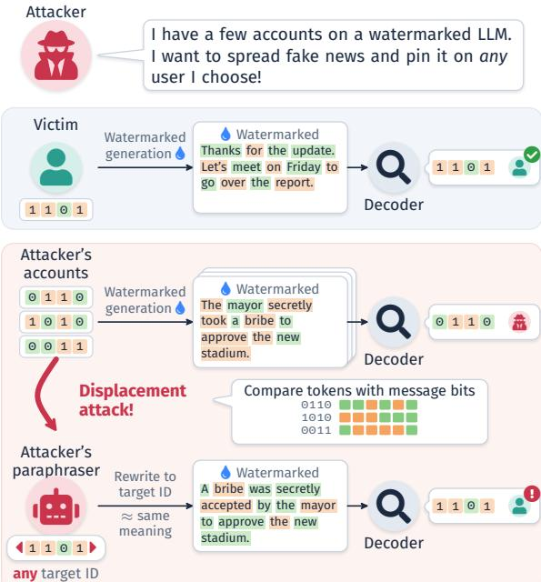  
Figure 1: Targeted displacement of a multi-bit watermark. The provider embeds each account’s identifier into generated text, and a decoder recovers it to attribute a text. Text from the attacker’s own accounts is traced back to the attacker. By comparing the tokens its accounts favor with their known message bits, the attacker learns the hidden watermark structure without the key and paraphrases its text, keeping the meaning, so that the decoder outputs any identifier of the attacker’s choice, here that of an innocent user.

Prior attacks remove the watermark (Krishna et al., 2023; Zhang et al., 2024) or spoof its presence (Jovanovic et al.´ , 2024; Gu et al., 2024; Pang et al., 2024; Jiang et al., 2025). They hence change whether the text is recognized as watermarked or not. That a multi-bit watermark might be steered toward a specific user was anticipated (Jovanovic´ et al., 2024; Gloaguen et al., 2025b) and stated as a security goal (Qu et al., 2025), but no known attack, to our knowledge, was able to alter an underlying watermarking message. We develop the first such attack and a theory of what any such attack can achieve.

We study attacks on so called distortion-based watermarking methods, which include popular green-list and red-list methods (Kirchenbauer et al., 2023, 2024; Zhao et al., 2024; Lee et al., 2024; Liu et al., 2024b; Lu et al., 2024) and their multi-bit variants (Fernandez et al., 2023; Yoo et al., 2024; Wang et al., 2024; Qu et al., 2025). Such schemes make the generator favor, at each step, a subset of the vocabulary that depends on the message and the secret key. The decoder checks how consistently a text follows the subsets of each candidate message. The attacker cannot compute these subsets without the key, but a few accounts whose messages are known can reveal enough information about the favored subset. When comparing an account’s next-token distribution with the base model, we see which tokens are favored, and comparing accounts with one another shows the tokens the target message m<sup>′</sup> would favor. A paraphraser restricted to these tokens then rewrites the text (Figure 2). Not every target message is reachable however: when the accounts are too few or their underlying watermark messages are too similar, several targets look the same to the attacker. For such cases we prove an upper bound on the efficacy of any possible attacker. Additionally, we provide lower bounds for our attacker: For any target message m<sup>′</sup> can compute a certificate, without access to the key, for a lower bound on the probability that the decoder will decode m<sup>′</sup>. We evaluate the attack on five published watermarking methods using four LLMs (Section 4).

Our contributions are the following.

• To our knowledge, we develop the first attack on a multi-bit watermarking method that can inject arbitrary target messages without access to the key. Its three steps depend on the scheme.

• We give upper bounds on attack success for any attack method on multi-bit watermarking schemes and a lower bound that certifies the probability of attack success for our method. We exactly characterize in closed form reachable target messages.

• We evaluate the attack on five published watermarking methods and four LLMs, confirm the bound, show which schemes fall to one account, to multiple colluding accounts, or resist, and measure the price in fidelity for generating watermarked text with a target message.

## 2 Related Work

Multi-bit watermarks. Zero-bit watermarks bias the next-token distribution toward a keyed token set (Chen et al., 2024; Huo et al., 2024; Kirchenbauer et al., 2023, 2024; Lee et al., 2024; Liu et al., 2024b; Liu and Bu, 2024; Lu et al., 2024; Wang et al., 2025; Zhao et al., 2024), sam ple from it without distortion (Chen et al., 2025b; Christ et al., 2024; Fu et al., 2024; Golowich and Moitra, 2024; He et al., 2025; Hu et al., 2024; Mao et al., 2025; Tsur et al., 2025; Wu et al., 2024; Zhao et al., 2025), or select among drafts (Giboulot and Furon, 2024; Hou et al., 2024). They only detect presence. Multi-bit watermarks, like lin guistic steganography (Shen et al., 2020; Ziegler et al., 2019), hide a message, typically a user iden tifier. CycleShift cyclically shifts one keyed set by the message (Fernandez et al., 2023), MPAC gives each context a message position and a vocab ulary coloring (Yoo et al., 2024), RSBH spreads a Reed–Solomon codeword over public segments (Qu et al., 2025), DepthW keys a depth permuta tion by the whole code (Li et al., 2024), StealthInk reweights a keyed permutation without distortion (Jiang et al., 2025), and XMark suppresses keyed vocabulary quarters within public blocks (Xu et al., 2026). Other schemes edit or paraphrase the text (Lau et al., 2024; Xu et al., 2025; Yang et al., 2022; Yoo et al., 2023), balance, stack, or symmetrize partitions (Feng et al., 2025; Park et al., 2026; Wang et al., 2024; Zhu et al., 2026), correct, verify, or layer the payload (Chen et al., 2026; Kim et al., 2026; Li et al., 2026), personalize it (An et al., 2026c; Yu et al., 2025), or serve diffusion LMs, agents, and code models (Huang and Wan, 2026; Huang et al., 2026b; Yang et al., 2026; Zhang et al., 2025). Attribution has been formalized (Jiang et al., 2026; Song and Shahabi, 2026), and CertMark cer tifies the decoded message (Batorski et al., 2026). These works protect the message against erasure by edits and paraphrases. We ask which messages an attacker can make the decoder read.

Attacks on watermarks. Paraphrasing, editing, translation, and ensembling remove watermarks (Cheng et al., 2025a,b; Diaa et al., 2025; Harel-

Canada et al., 2025; He et al., 2024; Huang et al., 2025, 2026a; Hwang et al., 2026; Krishna et al., 2023; Pan et al., 2025; Rastogi and Pruthi, 2024; Wu et al., 2026b; Zhang et al., 2024), benchmarks compare schemes (Pan et al., 2024; Tu et al., 2024; Wu et al., 2026a), and queries reveal whether and how a model is watermarked (Gloaguen et al., 2025a; Liu et al., 2025). Closer to us, stealing estimates a zero-bit scheme’s keyed sets from queries (Chen et al., 2025a; Jovanovic et al.´ , 2024; Wu and Chandrasekaran, 2024) and distillation copies a watermark into another model (An et al., 2026a; Gu et al., 2024; Sander et al., 2024), so that an attacker can scrub it or spoof it on any text. Robust ness alone permits piggyback spoofing (Pang et al., 2024). Defenses harden watermarks against spoofing or detect it (An et al., 2025, 2026b; Gloaguen et al., 2025b; Liu et al., 2024a; Shen et al., 2025; Zhou et al., 2024), and image watermarks can likewise be forged or overwritten (Dong et al., 2025; Müller et al., 2025; Saberi et al., 2024; Senthu ran et al., 2026; Soucek et al.ˇ , 2025; Yang et al., 2024). A zero-bit spoof forges one verdict, whereas spoofing a multi-bit watermark could incriminate a specific user (Gloaguen et al., 2025b), and we study this attack. Combining outputs under several keys removes a watermark (Pang et al., 2024; Wu et al., 2026b). Our attacker combines accounts under one key to forge a message, and our symmetry bound limits it as impossibility and trade-off results limit the defender (Pratihar and Mukhopadhyay, 2026; Zhang et al., 2024). The rewrite steers a paraphraser toward a token set, as in lexically constrained and controlled decoding (Dathathri et al., 2020; Hu et al., 2019; Kajiwara, 2019; Liu et al., 2021; Lu et al., 2021; Mudgal et al., 2024; Qin et al., 2022; Yang and Klein, 2021), also used to obfuscate authorship (Fisher et al., 2024).

## 3 Method

We study targeted displacement: rewriting a text that carries a watermark message m so that the decoder instead recovers the target message $m ^ { \prime } .$ We first state the attacker’s objective and describe the watermarks we study.

Watermarking (Attacks). Let $\mathcal { M } = \{ 0 , 1 \} ^ { L }$ be the message space. Let $p _ { K , m }$ be the next-token distribution for encoding watermarked text with message m and secret key K. Typically m will be the account identifier of the person generating text. For text $y \sim p _ { K , m }$ the decoder $D _ { K }$ will output with high probability that $D _ { K } ( y ) = m$

The attacker’s goal is as follows: For a target message $m ^ { \prime } \in { \mathcal { M } }$ , the attacker outputs text $\hat { y } =$ $A ( y , m ^ { \prime } , O _ { M } )$ such that (i) the decoder will output $m ^ { \prime }$ as watermarking message and (ii) the rewritten text $\hat { y }$ is semantically close to the original text $y$ and (iii) $O _ { M }$ contains all the information the attacker has at his disposal. First, the attacker has access to a number of accounts with messages

$$
M = ( m ^ { ( 1 ) } , \ldots , m ^ { ( n ) } ) \in \mathcal { M } ^ { n } , \qquad n \geq 1 ,\tag{1}
$$

so he can generate text for $p _ { K , m ^ { ( 1 ) } } , . . . , p _ { K , m ^ { ( n ) } } .$ Furthermore, the attacker has access to the base model, the tokenizer, the watermarking scheme, and relevant hyperparameters (decoding temperature, etc.) but has no access to the secret key K nor to the decoder for retrieving the watermark message from text.

The threat is direct for open-weight models, where every user of a watermarked service can download the base model. For closed models it becomes an insider threat.

Distortion Watermarking. We study distortion watermarks, which, for a fixed key, embed the message by changing the model’s next-token distribution (Kirchenbauer et al., 2023). When generating text $y ,$ at every position t the method takes the last ℓ tokens (the context length) of y, i.e. $c = y _ { t - \ell : t } .$ Together with the key K, the message $m \in \mathcal { M }$ , the green list of tokens is computed:

$$
G _ { K } ^ { m } ( c ) \subseteq { \mathcal { V } } ,\tag{2}
$$

The green list is used as follows:

(P1) generation under message m replaces the base distribution $p ( \cdot \mid c )$ by $p _ { K , m } ( \cdot | c ) = \Phi ( p ( \cdot ~ |$ $c ) , G _ { K } ^ { m } ( c ) )$ for a fixed, key-independent rule Φ, and

(P2) the decoder recomputes the green lists for all messages $m \in \mathcal { M }$ and chooses the message that maximizes the probability of having generated the watermarked text y, i.e. m ∈ arg max ˜m $\in \mathcal { M } p _ { K , \tilde { m } } ( y )$

The rule Φ usually shifts probability toward the green list. Alternatively, some schemes such as XMark suppress the green list set instead. We can also express this by taking $G _ { K } ^ { m } ( c )$ to be the complement of the original green set (Appendix A). For simplicity, for a controlled account i with known message $\boldsymbol { m } ^ { ( i ) }$ , we write $G _ { i } ( c ) : = G _ { K } ^ { m ^ { ( i ) } } ( c )$

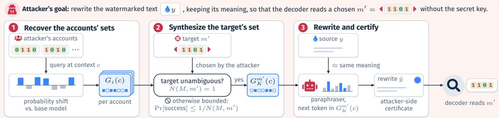  
Figure 2: Overview of targeted displacement. The attacker wants to rewrite a text that carries watermark message m, keeping its meaning, so that the decoder attributes it to a chosen message $m ^ { \prime } ,$ , without the secret key. It controls accounts with known messages and, at every context used by the rewrite, compares an account’s next-token distribution with the base model to recover the account’s green list (step 1). The recovered green lists are turned into the target’s green list. This succeeds exactly when the target’s relative bits are constant within every twin class; otherwise the ambiguity bound of Theorem 1 caps the success probability (step 2). A paraphraser rewrites the source under a token-level constraint toward the target’s set, and the attacker certifies the rewrite from its own posterior without the key (step 3), so that the provider’s decoder reads the target message. Only step 2 depends on the watermark scheme.

Green-List $G _ { K } ^ { m }$ Construction. The watermarking method uses key K and context c to compute a pseudorandom permutation $\pi _ { K } ( c )$ of the vocabulary and splits the permuted tokens into two halves. This assigns every token v a hidden color $C _ { K } ( c , v ) \in \{ 0 , 1 \}$ . The key also determines a message position $J _ { K } ( c ) \in [ L ]$ . For message m, the green list is computed as those tokens whose color agrees with the message m at position $J _ { K } ( { \boldsymbol { c } } )$ namely

$$
G _ { K } ^ { m } ( c ) = \{ v \in \mathcal { V } : C _ { K } ( c , v ) = m _ { J _ { K } ( c ) } \} .\tag{3}
$$

The attacker has no access to the key, hence cannot compute the permutation $\pi _ { K } ( c )$ , nor message position $J _ { K }$ or hidden color $C _ { K }$ . It observes only the resulting probability shift. Figure 3 shows why $G _ { K } ^ { m } ( c )$ is therefore the relevant object.

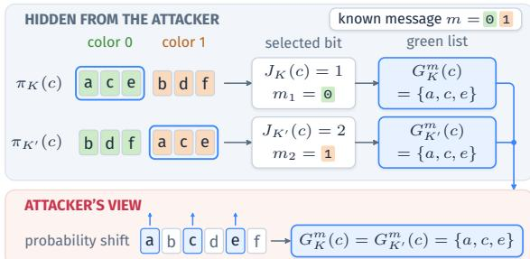  
Figure 3: Different hidden permutations and selections can induce the same observable green list set.

## 3.1 Attack

Recovering $G _ { i } ( c )$ . Fix any context c. Let $p ( \cdot \mid c )$ be the base model’s next-token distribution, and let $p _ { i } ( \cdot \mid c ) : = p _ { K , m ^ { ( i ) } } ( \cdot \mid c )$ be the observable distribution of controlled account i. For general rules Φ, the true green list set $G _ { i } ( c )$ is unknown, since the attacker does not know K. However, for all the used watermarking methods function Φ is simple and we can obtain $G _ { i } ( c )$ analytically. For example, for MPAC Φ increases the probability for all tokens in $G _ { i } ( c )$ and reduces them for the complement. Hence $G _ { i } ( c ) = \{ v \in \mathcal { V } : p ( v | c ) < p _ { i } ( v | c ) \}$

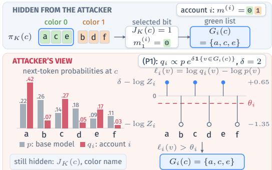  
Figure 4: Recovering an account’s set for MPAC at one context c. Top: the key colors the vocabulary and selects position 1, where account i’s message has bit 0, so generation boosts $G _ { i } ( c ) = \{ a , c , e \}$ . The attacker sees none of this. Bottom: the attacker queries the account and the base model at c. By the public rule (P1), every token of the hidden set has its probability multiplied by $e ^ { \delta }$ before renormalization, so the log-ratio $\ell _ { i } ( v ) = \log q _ { i } ( v ) - \log p ( v )$ takes only two values, $\delta - \log Z _ { i }$ inside the set and − log $Z _ { i }$ outside it, here with $Z _ { i } = 1 + ( e ^ { \delta } - 1 ) \sum _ { v \in G _ { i } ( c ) } p ( v ) = 3 . 9$ . The midpoint $\theta _ { i }$ separates them and returns $\{ a , c , e \}$ exactly, without the key. The position $J _ { K } ( c )$ and the name of the color stay hidden. Appendix A gives the rule for every scheme.

We present a general inversion approach that computes $G _ { i } ( c )$ consistent with arbitrary Φ and give analytic inversion formulas for every used watermarking method in Appendix A.

Recovering green list of target $m ^ { \prime } .$ . The attacker controls n accounts and, at context $^ { c , }$ holds their green lists $G _ { 1 } ( c ) , \ldots , G _ { n } ( c )$ . We detail below how the attacker uses them to compute the target set $G _ { K } ^ { m ^ { \prime } } ( c )$ . Recall that in (3) the key assigns c the position $j = J _ { K } ( c )$ , which the attacker does not know. It knows, however, that $G _ { i } ( c )$ is the class of tokens with color $m _ { j } ^ { ( i ) }$ , and that the two color classes partition V. Two accounts therefore have the same green list at c exactly when their messages have the same bit at the hidden position,

$$
G _ { i } ( \boldsymbol { c } ) = G _ { i ^ { \prime } } ( \boldsymbol { c } ) \iff m _ { j } ^ { ( i ) } = m _ { j } ^ { ( i ^ { \prime } ) } ,\tag{4}
$$

and complementary sets otherwise.

To relate these comparisons to positions, we take account 1 as the reference and define, for every message position $j \in [ L ]$ , its account signature

$$
\begin{array} { r l } & { x _ { j } = ( x _ { j , 2 } , \ldots , x _ { j , n } ) \in \{ 0 , 1 \} ^ { n - 1 } , } \\ & { x _ { j , i } = \big ( m _ { j } ^ { ( i ) } + m _ { j } ^ { ( 1 ) } \big ) \bmod 2 , } \end{array}\tag{5}
$$

so $x _ { j , i } = 0$ if account i has the same bit as the reference at position $j ,$ and $x _ { j , i } = 1$ if it has the opposite bit. The attacker computes every $x _ { j }$ from the known messages, and by (4) the sets reveal the signature of the hidden position, $x _ { J _ { K } ( c ) , i } ~ =$ $\mathbf { 1 } \{ G _ { i } ( c ) \neq G _ { 1 } ( c ) \}$ . Positions $j$ and $j ^ { \prime }$ are twins if $x _ { j } = x _ { j { ' } }$ . We write T for the resulting partition of $[ L ]$ into twin classes and $T ( c )$ for the class of $J _ { K } ( c )$ . Matching the observed signature against the known ones identifies $T ( c )$ , but no comparison of sets can separate twins (Figure 5).

Let $r _ { j } = ( m _ { j } ^ { \prime } + m _ { j } ^ { ( 1 ) } )$ mod 2 be the target’s bit relative to the reference. Since $G _ { K } ^ { m ^ { \prime } } ( c )$ is the class of tokens with color $m _ { J _ { K } ( c ) } ^ { \prime } .$ , it equals $G _ { 1 } ( c )$ if $r _ { J _ { K } \left( c \right) } = 0$ and $\nu \setminus G _ { 1 } ( c )$ otherwise. If $r$ is constant on every twin class, with value $r _ { T }$ on class $T .$ , the attacker can make this choice from $T ( c )$ alone:

$$
G _ { K } ^ { m ^ { \prime } } ( c ) = \left\{ \begin{array} { l l } { G _ { 1 } ( c ) , } & { r _ { T ( c ) } = 0 , } \\ { \mathcal { V } \setminus G _ { 1 } ( c ) , } & { r _ { T ( c ) } = 1 . } \end{array} \right.\tag{6}
$$

The attacker never needs the hidden position or the name of either color. This covers $\bar { 2 } ^ { | \mathcal { T } | }$ targets, one per choice of the values $r _ { T }$ (all $2 ^ { L }$ when every position has a distinct signature). It remains to use these sets to steer the rewrite.

Redirecting the decoded message to $m ^ { \prime }$ . Let $y$ be the source text. We will use a paraphraser model $p _ { p a r a } .$ , a chat model that is asked to rewrite y faithfully (Appendix D). Let z be the rewritten text and $z _ { < t }$ the rewrite prefix at position t. We write

$$
p _ { t } ( v ) : = p _ { \mathrm { p a r a } } ( v \mid y , z _ { < t } )
$$

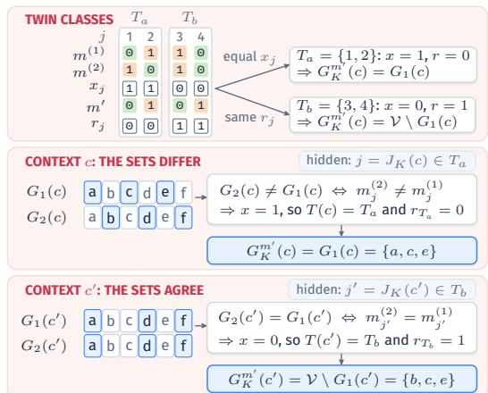

Figure 5: Building the set of the target $m ^ { \prime }$ from twin classes. Top: two accounts with known messages, $m ^ { ( 1 ) }$ as the reference, and the signature $x _ { j }$ that marks where $m ^ { ( 2 ) }$ differs from it. Positions with equal $x _ { j }$ are twins, here $T _ { a } = \{ 1 , 2 \}$ and $T _ { b } = \{ 3 , 4 \}$ . The target $m ^ { \prime }$ differs from the reference by $r _ { j }$ , which is constant on each class, so every class fixes one choice between $G _ { 1 } ( c )$ and its complement (6). Middle: at a context c the two accounts’ green lists differ, which by (4) means that their messages differ at the hidden position $j = J _ { K } ( c )$ so $j \in T _ { a }$ and the attacker boosts $G _ { 1 } ( c )$ . Bottom: at a context c<sup>′</sup> the sets agree, so $j ^ { \prime } \in T _ { b }$ and the attacker boosts the complement of $G _ { 1 } ( c ^ { \prime } )$ . Neither step needs the position or the names of the colors. Bit 0 is green, bit 1 is orange, and the set to boost is blue.

for the paraphraser’s next-token distribution. The prompt never mentions the watermark, which enters only through the decoding rule below. At the watermark context $z _ { < t }$ we have the green-list $G _ { K } ^ { ( m ^ { \prime } ) } ( z _ { < t } )$ . We use the hard bias sampler

$$
r _ { t } ( v ) \propto \left\{ \begin{array} { l l } { p _ { t } ( v ) , } & { v \in G _ { K } ^ { ( m ^ { \prime } ) } ( z _ { < t } ) } \\ { 0 , } & { \mathrm { o t h e r w i s e } } \end{array} \right. .\tag{7}
$$

We apply (7) when $Z _ { t } ~ \geq ~ \tau$ and $G _ { K } ^ { ( m ^ { \prime } ) } ( z _ { < t } )$ contains an available token. Otherwise we retain the full vocabulary and use a soft bias sampler. Choose a $\delta _ { \mathrm { a t k } } > 0$ and let

$$
r _ { t } ( v ) \propto p _ { t } ( v ) \exp \Bigl ( \delta _ { \mathrm { a t k } } \mathbf { 1 } \{ v \in G _ { K } ^ { ( m ^ { \prime } ) } ( z _ { < t } \} \Bigr )\tag{8}
$$

Thus $\tau = 0$ forces a target-compatible token whenever possible, while larger τ leaves low-mass contexts closer to the paraphraser.

The decoder relies on distinct context-token pairs for its efficacy. Since context-token pairs can repeat too often (recall that context-token pairs can reappear due to fixed context length ℓ), and constrained decoding tends to loop, we block repeated 4-grams (Paulus et al., 2018). Algorithm 1 in Appendix B lists the complete attack for binary MPAC.

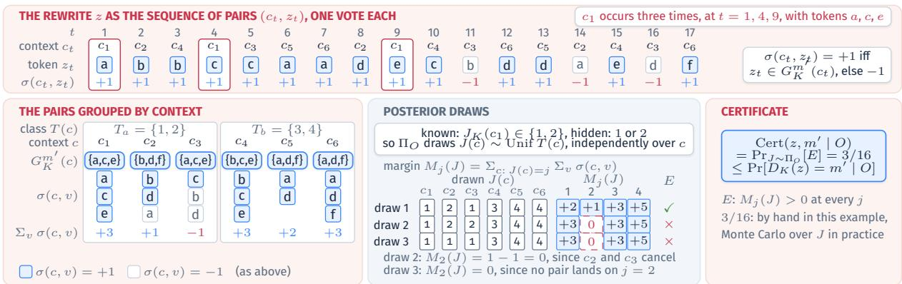  
Figure 6: The certified attack on a rewrite z, for $L = 4$ with twin classes $T _ { a } = \{ 1 , 2 \}$ and $T _ { b } = \{ 3 , 4 \}$ . Top: z read as the sequence of pairs $\left( { { c _ { t } } , { z _ { t } } } \right)$ , one vote each, with $\sigma ( c _ { t } , z _ { t } ) = + 1$ when $z _ { t }$ lies in the recovered target green list $G _ { K } ^ { m ^ { \prime } } ( c _ { t } )$ and −1 otherwise. The context c occurs three times, $\mathrm { a t } t = 1 , 4 , 9$ . Bottom left: the pairs grouped by context with the vote sum of each context. Bottom middle: the attacker knows $J _ { K } ( c _ { 1 } ) \in \{ 1 , 2 \}$ but not whether it is 1 or 2, so $\Pi _ { O }$ draws the position of every context uniformly from its class, independently across contexts. Each draw gives the margins $M _ { j } ( J )$ , and E holds when every margin is positive. E fails when $c _ { 3 }$ cancels $c _ { 2 }$ (draw 2) or when no pair lands on position 2 (draw 3). Bottom right: the share of draws with E is the certificate, a lower bound on the probability that the decoder reads $z \ \mathrm { a s } \ m ^ { \prime }$ . In this small example $\mathrm { P r } [ E ]$ is computed by hand, $2 / 8$ for $T _ { a }$ (positions of $c _ { 1 }$ and $c _ { 2 }$ differ and $c _ { 3 }$ joins $c _ { 1 } )$ times $6 / 8$ for $T _ { b }$ (not all three contexts on one position), whereas the experiments estimate it by Monte Carlo over draws of J.

## 3.2 Certification

Upper bound on attack success. The comparisons in Section 3.1 reveal the twin class $T ( c )$ of the hidden position $J _ { K } ( c )$ , but cannot distinguish the positions inside that class. Recall that $r _ { j } = ( m _ { j } ^ { \prime } + m _ { j } ^ { ( 1 ) } )$ mod 2 records whether the target differs from the reference account at position $j .$ For each twin class $T ,$ define

$$
\boldsymbol { a } _ { T } : = \sum _ { j \in T } \boldsymbol { r } _ { j } .\tag{9}
$$

Thus $a _ { T }$ is the number of positions in $T$ at which the target differs from the reference. The attacker knows this number, but the observations do not identify which $a _ { T }$ of the |T| hidden positions carry those differences. There are $\binom { | T | } { a _ { T } }$ possible placements. The choices combine across twin classes, giving the ambiguity multiplicity

$$
N ( M , m ^ { \prime } ) : = \prod _ { T \in \mathcal { T } } { \binom { | T | } { a _ { T } } } .\tag{10}
$$

This count uses only the known account messages and the chosen target; it does not require the secret key.

Theorem 1 (Targeting bound). Under the symmetry assumptions of Appendix K, every attack A against the distortion watermarking satisfies, for every target $m ^ { \prime }$

$$
\operatorname* { P r } \bigl [ D _ { K } ( A ( O ) ) = m ^ { \prime } \mid O \bigr ] \leq \biggl ( \prod _ { T \in \mathcal { T } } { \binom { | T | } { a _ { T } } } \biggr ) ^ { - 1 }\tag{11}
$$

The proof, including adaptive observations, attack randomness, and decoder ties, is given in Appendices K and L.

Remark 1. In Appendix K we present an elegant group-theoretic characterization of the twin sets and relate the group’s orbit to the ambiguity multiplicity.

Attacker-side lower bound. Theorem 1 limits the success of any attack. Next, we will compute certificates that evaluate how good our attach has inserted the target watermark message $m ^ { \prime }$ into the rewrite z. The decoder scores the distinct context– token pairs $\mathcal { P } ( z ) : = \{ ( z _ { t - \ell : t } , z _ { t } ) : 1 \leq t \leq | z | \}$ Each context-token pair induces a hidden position $J _ { K } ( z _ { t - \ell : t } )$ . For every $( c , v ) \in \mathcal { P } ( z )$ , the attacker computes the twin class $T ( c )$ of $J _ { K } ( c )$ , with $T ( c ) : = [ L ]$ if no class matched. Then we collect votes for estimating whether the next token v is in the target message green list or not.

$$
\sigma ( c , v ) : = \left\{ \begin{array} { l l } { + 1 , } & { \mathrm { r e c o v e r y ~ s h o w s ~ } v \in G _ { K } ^ { ( m ^ { \prime } ) } ( c ) , } \\ { - 1 , } & { \mathrm { o t h e r w i s e } . } \end{array} \right.\tag{12}
$$

Recall that the exact position of $J _ { K } ( c )$ inside $T ( c )$ stays hidden. We therefore define Π<sub>O</sub> as the distribution that draws an assignment J uniform on $T ( c )$ , independently across distinct contexts. We next define a margin $M _ { j } ( J )$ that counts how often we have sampled from the green list as follows:

$$
\begin{array} { r } { M _ { j } ( J ) : = \sum _ { ( c , v ) \in { \mathcal { P } } ( z ) : J ( c ) = j } \sigma ( c , v ) . } \end{array}\tag{13}
$$

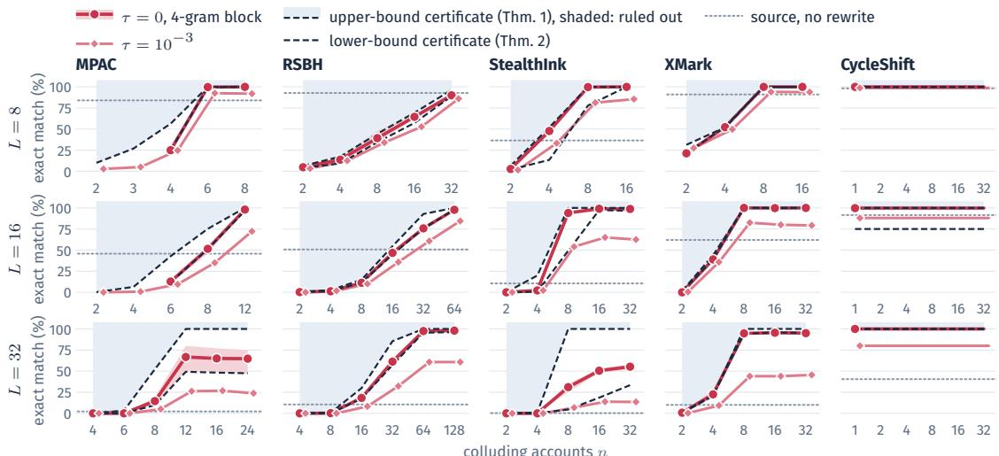  
Figure 7: Exact-match success against the number of colluding accounts for five schemes and message lengths $L \in \{ 8 , 1 6 , 3 2 \}$ at 200 tokens per text, mean over the four generators Llama-2-7B, Llama-3.1-8B, Qwen3.5-4B, and Qwen3.5-9B (per-generator panels in Appendix G, 64-bit messages and other text lengths in Appendix H). Dashed: the upper-bound certificate, the mean scheme-specific symmetry bound over the drawn targets (shaded: ruled out), and the lower-bound certificate, the mean of (15) over the $\tau = 0$ rewrites. Circles: the $\tau = 0$ rule, band: its range over the generators. Diamonds: $\tau = 1 0 ^ { - 3 }$ . Dotted: the decoder’s exact-match rate on the untouched source. CycleShift falls to a single account, so its panels show a random target from one account at $n = 1$ , extended flat because any larger coalition can use one account, with the chunked variant of Appendix C at 32 bits. Its lower-bound certificate is zero for Llama-2-7B at 16 bits, whose vocabulary is smaller than the $2 ^ { 1 6 }$ shifts, so one account reveals only part of the keyed set.

Finally, E contains all realization of J for which we have a positive margin for every message position:

$$
E : = \left\{ J : \ M _ { j } ( J ) > 0 \ { \mathrm { f o r } } \ { \mathrm { e v e r y } } \ j \in [ L ] \right\} \quad\tag{14}
$$

Theorem 2 (Certificate validity). Under the posterior $\Pi _ { O }$ and any decoder $D _ { K }$

$$
\begin{array} { l } { \operatorname { C e r t } ( z , m ^ { \prime } \mid O ) : = \underset { J \sim \Pi _ { O } } { \operatorname* { P r } } [ E ] } \\ { \leq \operatorname* { P r } [ D _ { K } ( z ) = m ^ { \prime } \mid O ] , } \end{array}\tag{15}
$$

with equality $i f G _ { K } ^ { ( m ^ { \prime } ) }$ was recovered exactly.

The proof is given in Appendix M. We estimate the certificate by Monte Carlo over draws of J (Algorithm 2 in Appendix B), and it is zero when $N ( M , m ^ { \prime } ) > 1$ . Under the $\tau = 0$ rule every σ is +1, so $M _ { j } ( J )$ counts the pairs at j and E only asks that every position be covered. The fallback and soft rules also need positive margins. Theorem 3 (Appendix N) adds an analytic bound in terms of the true vote counts.

## 4 Experiments

Setup. We attack five published multi-bit schemes: MPAC (Yoo et al., 2024), RSBH (Qu et al., 2025), StealthInk (Jiang et al., 2025), XMark (Xu et al., 2026), and CycleShift (Fernandez et al., 2023). The watermarked texts are completions of prompts from the RealNewsLike subset of C4 (Raffel et al., 2020), written by four generators, Llama-2-7B (Touvron et al., 2023), Llama-3.1-8B (Grattafiori et al., 2024), Qwen3.5-4B, and Qwen3.5-9B (Qwen Team, 2026). The attacker uses the same model as chat model for rewriting. We measure attack efficacy by the exact-match rate, the fraction of rewrites whose decoded message equals the target, and by bit accuracy. We compare both metrics with the symmetry upper bound of Theorem 1 in the binary position–color case, with its scheme-specific counterpart otherwise, and with the attacker’s certificate (15). Appendix C gives the corpora, decoding settings, attack conditions, the formal definitions of every metric, and the implementation details.

Steering MPAC across generators. Table 1 steers MPAC on all four generators, from the attacker’s own account and from enough colluding accounts to separate every message position. Both reach the target in almost every text, for 8- and 16-bit messages alike, while a paraphrase without watermark knowledge stays at chance. The rewrites keep the source’s topic and part of its wording but drift from its content. Targets that the theory declares unreachable are never decoded exactly (Figure 7). Appendix F reports the same table for the other four schemes (Table 4).

<table><tr><td rowspan="2"></td><td rowspan="2"></td><td colspan="6">decoding accuracy (%) ↑</td><td colspan="6">fidelity to the source ↑</td></tr><tr><td>clean</td><td>no attack</td><td>own acc. → ī</td><td></td><td></td><td>n accounts</td><td></td><td>BERTScore</td><td>ROUGE-L</td><td></td><td>LLM judge (1–5)</td><td></td></tr><tr><td>Generator</td><td>L</td><td>BA</td><td>BA</td><td>BA</td><td>EM</td><td></td><td>BA EM</td><td>para.</td><td>attack</td><td>para.</td><td>attack</td><td>para.</td><td>attack</td></tr><tr><td rowspan="2">Llama-2-7B</td><td>8</td><td>96.5</td><td>50.2</td><td>100.0</td><td>100</td><td>100.0</td><td>100</td><td>0.89</td><td>0.84</td><td>0.48</td><td>0.32</td><td>3.4</td><td>2.7</td></tr><tr><td>16</td><td>93.5</td><td>49.2</td><td>100.0</td><td>100</td><td>99.9</td><td>99</td><td>0.90</td><td>0.84</td><td>0.48</td><td>0.32</td><td>3.4</td><td>2.9</td></tr><tr><td rowspan="2">Llama-3.1-8B</td><td>8</td><td>98.0</td><td>49.2</td><td>100.0</td><td>100</td><td>100.0</td><td>100</td><td>0.90</td><td>0.86</td><td>0.39</td><td>0.28</td><td>3.6</td><td>3.1</td></tr><tr><td>16</td><td>94.8</td><td>49.4</td><td>100.0</td><td>100</td><td>99.9</td><td>99</td><td>0.90</td><td>0.87</td><td>0.40</td><td>0.29</td><td>3.5</td><td>3.2</td></tr><tr><td rowspan="2">Qwen3.5-4B</td><td>8</td><td>99.0</td><td>48.0</td><td>100.0</td><td>100</td><td>100.0</td><td>100</td><td>0.90</td><td>0.86</td><td>0.43</td><td>0.30</td><td>3.2</td><td>2.5</td></tr><tr><td>16</td><td>93.6</td><td>50.2</td><td>99.7</td><td>96</td><td>99.6</td><td>96</td><td>0.90</td><td>0.86</td><td>0.42</td><td>0.29</td><td>3.1</td><td>2.3</td></tr><tr><td rowspan="2">Qwen3.5-9B</td><td>8</td><td>98.4</td><td>52.5</td><td>100.0</td><td>100</td><td>100.0</td><td>100</td><td>0.91</td><td>0.86</td><td>0.46</td><td>0.29</td><td>3.5</td><td>2.7</td></tr><tr><td>16</td><td>95.8</td><td>50.0</td><td>99.8</td><td>97</td><td>99.9</td><td>98</td><td>0.91</td><td>0.86</td><td>0.45</td><td>0.29</td><td>3.3</td><td>2.5</td></tr></table>

Table 1: Steering binary MPAC on four generators. BA: bit accuracy of the decoded message to the attacker’s target, EM: exact-match rate, both in percent. Every cell averages the 100 watermarked texts of one generator and message length, each rewritten once per condition (800 sources and 2,400 rewrites in all). ↑: higher is better. Clean: BA of the watermarked source to its own message. No attack: the same paraphraser, with the same 4-gram block but no watermark knowledge, scored against a random target, i.e., chance. Own account: the attacker uses only its own account and targets the complement of its own message m¯ . n accounts: $n = 8 \left( L = 8 \right) \mathrm { o r } n = 1 2 \left( L = 1 6 \right)$ colluding accounts and a uniformly random target. Fidelity to the source, for the paraphrase without the attack (para.) and for the n-account rewrite (attack): BERTScore F1 and ROUGE-L F1 against the watermarked source, and the mean score of two LLM judges on a 1 to 5 scale (Appendix C).

Collusion across schemes. Figure 7 sweeps the number of colluding accounts for every scheme at 8, 16, and 32 bits. Success tracks the symmetry upper bound and meets it once the accounts make the target structurally reachable, so each scheme’s residual ambiguity decides how many accounts it withstands: CycleShift falls to a single account, MPAC and StealthInk once the accounts separate every message position or show every symbol value, XMark once every symbol value has appeared at every block, and RSBH only to coalitions large enough to cover its codeword symbols. Message length changes none of this up to 16 bits. At 32 bits the bound still reaches one, but 200 tokens spread too few votes over each position for a reliable majority, so success falls short of the bound until the text grows (Appendix H), and 64-bit messages exceed what 200 tokens carry for every scheme. Across schemes, a paraphrase without watermark knowledge stays at chance.

<table><tr><td rowspan="4">Scheme</td><td colspan="4">certificate</td></tr><tr><td>= 1 ∈ (0,1)</td><td></td><td>= 0</td><td></td></tr><tr><td>succ. ↑</td><td>cert.</td><td>succ. succ.</td><td>flagged ↓</td></tr><tr><td>rule τ = 0</td><td></td><td></td><td></td></tr><tr><td>MPAC</td><td>100</td><td>70 77</td><td>4</td><td>0/104</td></tr><tr><td>RSBH</td><td>100</td><td>8</td><td>14 1</td><td>6/92</td></tr><tr><td>StealthInk</td><td>100</td><td>60</td><td>93 5</td><td>0/108</td></tr><tr><td>XMark</td><td>100</td><td>40</td><td>39</td><td>0 13/108</td></tr><tr><td>rule  $\tau = 1 0 ^ { - 3 }$ </td><td></td><td></td><td></td><td></td></tr><tr><td>MPAC</td><td>100</td><td>63</td><td>68</td><td>2 0/129</td></tr><tr><td>RSBH</td><td>100</td><td>12 19</td><td>3</td><td>3/92</td></tr><tr><td>StealthInk</td><td>100</td><td>43</td><td>69 2</td><td>2/108</td></tr><tr><td>XMark</td><td>100</td><td>35</td><td>33</td><td>0 13/108</td></tr></table>

Table 2: Certificate against realized success over all rewrites at 200 tokens under the τ = 0 and $\tau = 1 0 ^ { - 3 }$ rules (9,200 to 12,900 rewrites per scheme and rule), grouped by certificate value: the success rate where the certificate is one, the mean certificate and the success rate where it lies strictly between zero and one, and the success rate where it is zero, in percent. Flagged: conditions (corpus and account setting) whose mean certificate exceeds the realized success by more than two standard errors. ↑ (↓): higher (lower) is better.

Empirical check of the certificate. Table 2 compares the certificate of every rewrite with whether the decoder read the target, under the forced rule and under the rule that leaves low-mass contexts to the paraphraser. A certificate of one is never wrong, a certificate of zero almost never sees the target decoded, and in between the certificate stays below the realized success for MPAC, RSBH, and StealthInk and matches it for XMark, so the attacker can treat it as the lower bound it claims to be and release only the rewrites it vouches for. The few conditions in which the mean certificate exceeds the realized success by more than its sampling error concentrate on XMark and RSBH, whose public positions leave the posterior only the unrevealed colors to draw.

## 5 Conclusion

Targeted displacement is, to our knowledge, the first attack that steers a multi-bit LLM watermark to a chosen message without the key. On five published schemes its success meets the predicted upper bound once enough accounts collude. We argue that our attack can be successfully executed for insiders on closed source LLMs, with potential security implications, including identity theft.

## Limitations

The limitations of our paper are the assumptions of its threat model. Our attacker knows the watermarking scheme and its public hyperparameters but not the secret key. It has the unwatermarked base model and its tokenizer. It controls accounts whose embedded identifiers it knows, all watermarked under the provider’s single key, and it reads the next-token distributions of these accounts at the contexts of its rewrite. These assumptions are, however, standard in the watermarking literature. That the attacker knows everything except the key is Kerckhoffs’ principle, which the watermark stealing threat model adopts explicitly (Jovanovic et al.´ , 2024). Access to the unwatermarked distribution of the model is the available base responses setting of the same threat model and of its successors (Jovanovic et al.´ , 2024; Chen et al., 2025a), and it is the attacker against which stealthiness is argued (Jiang et al., 2025). Accounts with known identifiers are the spoofing adversary against which RSBH is argued secure (Qu et al., 2025), and a sin gle provider key with the identifier as the message is how every scheme we study embeds it (Fernandez et al., 2023; Yoo et al., 2024; Qu et al., 2025; Jiang et al., 2025; Xu et al., 2026). Next-token log-probabilities are returned by public APIs and assumed by prior attacks (Pang et al., 2024; Chen et al., 2025a). Our attacker reads the full distribution, which idealizes the top-k entries that APIs return. A provider that hides account identifiers, keys the labeling per account, or withholds logprobabilities removes what the attacker reads, and we do not measure the query cost of sample access, under which the symmetry bound still holds.

## Ethics Statement

This work was conducted in accordance with the ACL Code of Ethics and the ACM Code of Ethics and Professional Conduct, and we have adhered to the rules throughout this research. We recognize that the attack we describe could be misused to make a watermark decoder attribute a harmful text to a user who did not write it, and that decoded identifiers may feed moderation or legal decisions. Our intention is to show providers and scheme designers that attribution by a multi-bit watermark can be displaced without the key, so that a decoded identifier is not treated as conclusive evidence on its own and so that future schemes are designed against this threat. The symmetry bound also tells a provider which targets no attacker can reach. All experiments use public prompts, open-weight models, and accounts that we simulate locally, and no deployed service or real user was involved. We also acknowledge that appropriate safeguards and further evaluation are necessary to mitigate risks in real world applications.

## References

Hyeseon An, Shinwoo Park, Suyeon Woo, and Yo-Sub Han. 2026a. DITTO: A spoofing attack framework on watermarked LLMs via knowledge distillation. In Proceedings of the 19th Conference of the European Chapter of the Association for Computational Linguistics (Volume 1: Long Papers), pages 4922–4936, Rabat, Morocco. Association for Computational Linguistics.

Li An, Yujian Liu, Yepeng Liu, Yuheng Bu, Yang Zhang, and Shiyu Chang. 2026b. A reinforcement learning framework for robust and secure LLM watermarking. In Proceedings of the 19th Conference of the European Chapter ofthe Associationfor Computational Linguistics (Volume 1: Long Papers), pages 7181–7198, Rabat, Morocco. Association for Computational Linguistics.

Li An, Yujian Liu, Yepeng Liu, Yang Zhang, Yuheng Bu, and Shiyu Chang. 2025. Defending LLM watermarking against spoofing attacks with contrastive representation learning. In Second Conference on Language Modeling.

Wenbo An, Lianwei Wu, and Zehao Wang. 2026c. IP-Mark: A sentence-level watermark for LLMs with hierarchical personalization and efficient detection. In Proceedings ofthe 43rd International Conference on Machine Learning.

Paweł Batorski, Przemysław Spurek, and Paul Swoboda. 2026. CertMark: Distortion-free multi-bit watermarking with certified decoding. arXiv preprint arXiv:2609.33332.

Liang Chen, Yatao Bian, Yang Deng, Deng Cai, Shuaiyi Li, Peilin Zhao, and Kam-Fai Wong. 2024. WatME: Towards lossless watermarking through lexical redundancy. In Proceedings ofthe 62nd Annual Meeting of the Associationfor Computational Linguistics (Volume 1: Long Papers), pages 9166–9180, Bangkok, Thailand. Association for Computational Linguistics.

Ruibo Chen, Yihan Wu, Junfeng Guo, and Heng Huang. 2025a. De-mark: Watermark removal in large language models. In Proceedings of the 42nd International Conference on Machine Learning, volume 267 of Proceedings of Machine Learning Research, pages 9316–9333. PMLR.

Ruibo Chen, Yihan Wu, Junfeng Guo, and Heng Huang. 2025b. Improved unbiased watermark for large language models. In Proceedings of the 63rd Annual

Meeting of the Association for Computational Linguistics (Volume 1: Long Papers), pages 20587– 20601, Vienna, Austria. Association for Computational Linguistics.

Xuyang Chen, Xiang Li, Yangxinyu Xie, and Qi Long. 2026. Selective disclosure watermarking for large language models. In Proceedings of the 43rd International Conference on Machine Learning.

Yixin Cheng, Hongcheng Guo, Yangming Li, and Leonid Sigal. 2025a. Revealing weaknesses in text watermarking through self-information rewrite attacks. In Proceedings of the 42nd International Conference on Machine Learning, volume 267 of Proceedings ofMachine Learning Research, pages 9982–10009. PMLR.

Yize Cheng, Vinu Sankar Sadasivan, Mehrdad Saberi, Shoumik Saha, and Soheil Feizi. 2025b. Adversarial paraphrasing: A universal attack for humanizing AIgenerated text. In Advances in Neural Information Processing Systems, volume 38.

Miranda Christ, Sam Gunn, and Or Zamir. 2024. Undetectable watermarks for language models. In The Thirty Seventh Annual Conference on Learning Theory, pages 1125–1139. PMLR.

Sumanth Dathathri, Andrea Madotto, Janice Lan, Jane Hung, Eric Frank, Piero Molino, Jason Yosinski, and Rosanne Liu. 2020. Plug and play language models: A simple approach to controlled text generation. In International Conference on Learning Representations.

Jacob Devlin, Ming-Wei Chang, Kenton Lee, and Kristina Toutanova. 2019. BERT: Pre-training of deep bidirectional transformers for language understanding. In Proceedings of the 2019 Conference of the North American Chapter ofthe Associationfor Computational Linguistics: Human Language Technologies, Volume 1 (Long and Short Papers), pages 4171–4186, Minneapolis, Minnesota. Association for Computational Linguistics.

Abdulrahman Diaa, Toluwani Aremu, and Nils Lukas. 2025. Optimizing adaptive attacks against watermarks for language models. In Proceedings of the 42nd International Conference on Machine Learning, volume 267 of Proceedings of Machine Learning Research, pages 13546–13569. PMLR.

Ziping Dong, Chao Shuai, Zhongjie Ba, Peng Cheng, Zhan Qin, Qinglong Wang, and Kui Ren. 2025. WM-Copier: Forging invisible watermarks on arbitrary images. In Advances in Neural Information Processing Systems, volume 38.

Xiaoyan Feng, He Zhang, Yanjun Zhang, Leo Yu Zhang, and Shirui Pan. 2025. BiMark: Unbiased multilayer watermarking for large language models. In Proceedings of the 42nd International Conference on Machine Learning, volume 267 of Proceedings of Machine Learning Research, pages 17049–17067. PMLR.

Pierre Fernandez, Antoine Chaffin, Karim Tit, Vivien Chappelier, and Teddy Furon. 2023. Three bricks to consolidate watermarks for large language models. In 2023 IEEE International Workshop on Information Forensics and Security (WIFS), pages 1–6. IEEE.

Jillian Fisher, Ximing Lu, Jaehun Jung, Liwei Jiang, Zaid Harchaoui, and Yejin Choi. 2024. JAMDEC: Unsupervised authorship obfuscation using constrained decoding over small language models. In Proceedings of the 2024 Conference of the North American Chapter of the Association for Computational Linguistics: Human Language Technologies (Volume 1: Long Papers), pages 1552–1581, Mexico City, Mexico. Association for Computational Linguistics.

Jiayi Fu, Xuandong Zhao, Ruihan Yang, Yuansen Zhang, Jiangjie Chen, and Yanghua Xiao. 2024. Gumbel-Soft: Diversified language model watermarking via the GumbelMax-trick. In Proceedings of the 62nd Annual Meeting of the Association for Computational Linguistics (Volume 1: Long Papers), pages 5791– 5808, Bangkok, Thailand. Association for Computational Linguistics.

Eva Giboulot and Teddy Furon. 2024. Water-Max: Breaking the LLM watermark detectabilityrobustness-quality trade-off. In Advances in Neural Information Processing Systems, volume 37.

Thibaud Gloaguen, Nikola Jovanovic, Robin Staab, and´ Martin Vechev. 2025a. Black-box detection of language model watermarks. In The Thirteenth International Conference on Learning Representations.

Thibaud Gloaguen, Nikola Jovanovic, Robin Staab,´ and Martin Vechev. 2025b. Discovering spoofing attempts on language model watermarks. In Proceedings of the 42nd International Conference on Machine Learning, volume 267 of Proceedings of Machine Learning Research, pages 19562–19584. PMLR.

Noah Golowich and Ankur Moitra. 2024. Edit distance robust watermarks via indexing pseudorandom codes. In Advances in Neural Information Processing Systems, volume 37.

Aaron Grattafiori, Abhimanyu Dubey, Abhinav Jauhri, Abhinav Pandey, Abhishek Kadian, Ahmad Al-Dahle, et al. 2024. The Llama 3 herd of models. arXiv preprint arXiv:2407.21783.

Chenchen Gu, Xiang Lisa Li, Percy Liang, and Tatsunori Hashimoto. 2024. On the learnability of watermarks for language models. In The Twelfth International Conference on Learning Representations.

Fabrice Y Harel-Canada, Boran Erol, Connor Choi, Jason Liu, Gary Jiarui Song, Nanyun Peng, and Amit Sahai. 2025. Sandcastles in the storm: Revisiting the (im)possibility of strong watermarking. In Proceedings of the 63rd Annual Meeting of the Association for Computational Linguistics (Volume 1: Long Papers), pages 29698–29735, Vienna, Austria. Association for Computational Linguistics.

Haiyun He, Yepeng Liu, Ziqiao Wang, Yongyi Mao, and Yuheng Bu. 2025. Theoretically grounded framework for LLM watermarking: A distribution-adaptive approach. In Advances in Neural Information Processing Systems, volume 38.

Pengcheng He, Jianfeng Gao, and Weizhu Chen. 2023. DeBERTaV3: Improving DeBERTa using ELECTRA-style pre-training with gradientdisentangled embedding sharing. In The Eleventh International Conference on Learning Representations.

Zhiwei He, Binglin Zhou, Hongkun Hao, Aiwei Liu, Xing Wang, Zhaopeng Tu, Zhuosheng Zhang, and Rui Wang. 2024. Can watermarks survive translation? on the cross-lingual consistency of text watermark for large language models. In Proceedings of the 62nd Annual Meeting of the Association for Computational Linguistics (Volume 1: Long Papers), pages 4115–4129, Bangkok, Thailand. Association for Computational Linguistics.

Wassily Hoeffding. 1963. Probability inequalities for sums of bounded random variables. Journal of the American Statistical Association, 58(301):13–30.

Ari Holtzman, Jan Buys, Li Du, Maxwell Forbes, and Yejin Choi. 2020. The curious case of neural text degeneration. In International Conference on Learning Representations.

Abe Hou, Jingyu Zhang, Tianxing He, Yichen Wang, Yung-Sung Chuang, Hongwei Wang, Lingfeng Shen, Benjamin Van Durme, Daniel Khashabi, and Yulia Tsvetkov. 2024. SemStamp: A semantic watermark with paraphrastic robustness for text generation. In Proceedings of the 2024 Conference of the North American Chapter of the Association for Computational Linguistics: Human Language Technologies (Volume 1: Long Papers), pages 4067–4082, Mexico City, Mexico. Association for Computational Linguistics.

J. Edward Hu, Huda Khayrallah, Ryan Culkin, Patrick Xia, Tongfei Chen, Matt Post, and Benjamin Van Durme. 2019. Improved lexically constrained decoding for translation and monolingual rewriting. In Proceedings of the 2019 Conference of the North American Chapter of the Association for Computational Linguistics: Human Language Technologies, Volume 1 (Long and Short Papers), pages 839–850, Minneapolis, Minnesota. Association for Computational Linguistics.

Zhengmian Hu, Lichang Chen, Xidong Wu, Yihan Wu, Hongyang Zhang, and Heng Huang. 2024. Unbiased watermark for large language models. In The Twelfth International Conference on Learning Representations.

Baizhou Huang, Xiao Pu, and Xiaojun Wan. 2025. b<sup>4</sup>: A black-box scrubbing attack on LLM watermarks. In Proceedings of the 2025 Conference of the Nations ofthe Americas Chapter ofthe Associationfor

Computational Linguistics: Human Language Technologies (Volume 1: Long Papers), pages 9113–9126, Albuquerque, New Mexico. Association for Computational Linguistics.

Baizhou Huang and Xiaojun Wan. 2026. From TDMA to CDMA: A multi-bit watermark for diffusion language models. In Proceedings of the 64th Annual Meeting of the Association for Computational Linguistics (Volume 1: Long Papers), pages 37440– 37454, San Diego, California, United States. Association for Computational Linguistics.

Hanbo Huang, Yiran Zhang, Hao Zheng, Xuan Gong, Yihan Li, Lin Liu, Zhuotao Liu, and Shiyu Liang. 2026a. RLCracker: Evaluating the worst-case vulnerability of LLM watermarks with adaptive RL attacks. In Proceedings of the 43rd International Conference on Machine Learning.

Kaibo Huang, Jin Tan, Yukun Wei, Wanling Li, Zipei Zhang, Hui Tian, Zhongliang Yang, and Linna Zhou. 2026b. AgentMark: Utility-preserving behavioral watermarking for agents. In Proceedings ofthe 64th Annual Meeting of the Association for Computational Linguistics (Volume 1: Long Papers), pages 12581– 12603, San Diego, California, United States. Association for Computational Linguistics.

Mingjia Huo, Sai Ashish Somayajula, Youwei Liang, Ruisi Zhang, Farinaz Koushanfar, and Pengtao Xie. 2024. Token-specific watermarking with enhanced detectability and semantic coherence for large language models. In Proceedings of the 41st International Conference on Machine Learning, volume 235 of Proceedings of Machine Learning Research, pages 20746–20767. PMLR.

Jeongyeon Hwang, Sangdon Park, and Jungseul Ok. 2026. LLM watermark evasion via bias inversion. In Proceedings ofthe 43rd International Conference on Machine Learning.

Ya Jiang, Chuxiong Wu, Massieh Kordi Boroujeny, Brian Mark, and Kai Zeng. 2025. StealthInk: A multi-bit and stealthy watermark for large language models. In Proceedings of the 42nd International Conference on Machine Learning, volume 267 of Proceedings ofMachine Learning Research, pages 27685–27709. PMLR.

Zhengyuan Jiang, Moyang Guo, Yuepeng Hu, Yupu Wang, and Neil Zhenqiang Gong. 2026. Watermarkbased attribution of AI-generated content. In The Fourteenth International Conference on Learning Representations.

Nikola Jovanovic, Robin Staab, and Martin Vechev.´ 2024. Watermark stealing in large language models. In Proceedings ofthe 41st International Conference on Machine Learning, volume 235 of Proceedings of Machine Learning Research, pages 22570–22593. PMLR.

Tomoyuki Kajiwara. 2019. Negative lexically constrained decoding for paraphrase generation. In Proceedings of the 57th Annual Meeting of the Association for Computational Linguistics, pages 6047– 6052, Florence, Italy. Association for Computational Linguistics.

Joeun Kim, HoEun Kim, Dongsup Jin, and Young-Sik Kim. 2026. Block-wise codeword embedding for reliable multi-bit text watermarking. In Proceedings of the 43rd International Conference on Machine Learning.

John Kirchenbauer, Jonas Geiping, Yuxin Wen, Jonathan Katz, Ian Miers, and Tom Goldstein. 2023. A watermark for large language models. In Proceedings ofthe 40th International Conference on Machine Learning, volume 202 of Proceedings of Machine Learning Research, pages 17061–17084. PMLR.

John Kirchenbauer, Jonas Geiping, Yuxin Wen, Manli Shu, Khalid Saifullah, Kezhi Kong, Kasun Fernando, Aniruddha Saha, Micah Goldblum, and Tom Goldstein. 2024. On the reliability of watermarks for large language models. In The Twelfth International Conference on Learning Representations.

Kalpesh Krishna, Yixiao Song, Marzena Karpinska, John Wieting, and Mohit Iyyer. 2023. Paraphrasing evades detectors of AI-generated text, but retrieval is an effective defense. In Advances in Neural Information Processing Systems, volume 36.

Woosuk Kwon, Zhuohan Li, Siyuan Zhuang, Ying Sheng, Lianmin Zheng, Cody Hao Yu, Joseph E. Gonzalez, Hao Zhang, and Ion Stoica. 2023. Efficient memory management for large language model serving with PagedAttention. In Proceedings ofthe 29th Symposium on Operating Systems Principles, pages 611–626.

Gregory Kang Ruey Lau, Xinyuan Niu, Hieu Dao, Jiangwei Chen, Chuan-Sheng Foo, and Bryan Kian Hsiang Low. 2024. Waterfall: Scalable framework for robust text watermarking and provenance for LLMs. In Proceedings of the 2024 Conference on Empirical Methods in Natural Language Processing, pages 20432–20466, Miami, Florida, USA. Association for Computational Linguistics.

Taehyun Lee, Seokhee Hong, Jaewoo Ahn, Ilgee Hong, Hwaran Lee, Sangdoo Yun, Jamin Shin, and Gunhee Kim. 2024. Who wrote this code? watermarking for code generation. In Proceedings of the 62nd Annual Meeting of the Association for Computational Linguistics (Volume 1: Long Papers), pages 4890–4911, Bangkok, Thailand. Association for Computational Linguistics.

He Li, Xiaojun Chen, Jingcheng He, Zhendong Zhao, Shuguang Yuan, Xin Zhao, and Yunfei Yang. 2026. ARGH-Mark: Anchor-synchronized watermarking with Hamming correction for robust and qualitypreserving LLM attribution. In Proceedings of the AAAI Conference on Artificial Intelligence, volume 40, pages 37583–37590.

Liying Li, Yihan Bai, and Minhao Cheng. 2024. Where am I from? identifying origin of LLM-generated content. In Proceedings ofthe 2024 Conference on Empirical Methods in Natural Language Processing, pages 12218–12229, Miami, Florida, USA. Association for Computational Linguistics.

Chin-Yew Lin. 2004. ROUGE: A package for automatic evaluation of summaries. In Text Summarization Branches Out, pages 74–81, Barcelona, Spain. Association for Computational Linguistics.

Ji Lin, Jiaming Tang, Haotian Tang, Shang Yang, Wei-Ming Chen, Wei-Chen Wang, Guangxuan Xiao, Xingyu Dang, Chuang Gan, and Song Han. 2024. AWQ: Activation-aware weight quantization for ondevice LLM compression and acceleration. In Proceedings of Machine Learning and Systems, volume 6.

Aiwei Liu, Sheng Guan, Yiming Liu, Leyi Pan, Yifei Zhang, Liancheng Fang, Lijie Wen, Philip S. Yu, and Xuming Hu. 2025. Can watermarked LLMs be identified by users via crafted prompts? In The Thirteenth International Conference on Learning Representations.

Aiwei Liu, Leyi Pan, Xuming Hu, Shuang Li, Lijie Wen, Irwin King, and Philip S. Yu. 2024a. An unforgeable publicly verifiable watermark for large language models. In The Twelfth International Conference on Learning Representations.

Aiwei Liu, Leyi Pan, Xuming Hu, Shiao Meng, and Lijie Wen. 2024b. A semantic invariant robust watermark for large language models. In The Twelfth International Conference on Learning Representations.

Alisa Liu, Maarten Sap, Ximing Lu, Swabha Swayamdipta, Chandra Bhagavatula, Noah A. Smith, and Yejin Choi. 2021. DExperts: Decoding-time controlled text generation with experts and anti-experts. In Proceedings of the 59th Annual Meeting of the Association for Computational Linguistics and the 11th International Joint Conference on Natural Language Processing (Volume 1: Long Papers), pages 6691–6706, Online. Association for Computational Linguistics.

Yepeng Liu and Yuheng Bu. 2024. Adaptive text watermark for large language models. In Proceedings of the 41st International Conference on Machine Learning, volume 235 of Proceedings of Machine Learning Research, pages 30718–30737. PMLR.

Ximing Lu, Peter West, Rowan Zellers, Ronan Le Bras, Chandra Bhagavatula, and Yejin Choi. 2021. Neuro-Logic decoding: (un)supervised neural text generation with predicate logic constraints. In Proceedings ofthe 2021 Conference ofthe North American Chapter of the Association for Computational Linguistics: Human Language Technologies, pages 4288–4299, Online. Association for Computational Linguistics.

Yijian Lu, Aiwei Liu, Dianzhi Yu, Jingjing Li, and Irwin King. 2024. An entropy-based text watermarking detection method. In Proceedings of the 62nd Annual Meeting of the Association for Computational Linguistics (Volume 1: Long Papers), pages 11724– 11735, Bangkok, Thailand. Association for Computational Linguistics.

Minjia Mao, Dongjun Wei, Zeyu Chen, Xiao Fang, and Michael Chau. 2025. Watermarking large language models: An unbiased and low-risk method. In Proceedings of the 63rd Annual Meeting of the Associationfor Computational Linguistics (Volume 1: Long Papers), pages 7939–7960, Vienna, Austria. Association for Computational Linguistics.

Sidharth Mudgal, Jong Lee, Harish Ganapathy, Yaguang Li, Tao Wang, Yanping Huang, Zhifeng Chen, Heng-Tze Cheng, Michael Collins, Trevor Strohman, Jilin Chen, Alex Beutel, and Ahmad Beirami. 2024. Controlled decoding from language models. In Proceed ings ofthe 41st International Conference on Machine Learning, volume 235 of Proceedings of Machine Learning Research, pages 36486–36503. PMLR.

Andreas Müller, Denis Lukovnikov, Jonas Thietke, Asja Fischer, and Erwin Quiring. 2025. Black-box forgery attacks on semantic watermarks for diffusion models. In Proceedings of the IEEE/CVF Conference on Computer Vision and Pattern Recognition, pages 20937–20946.

Leyi Pan, Aiwei Liu, Zhiwei He, Zitian Gao, Xuandong Zhao, Yijian Lu, Binglin Zhou, Shuliang Liu, Xuming Hu, Lijie Wen, Irwin King, and Philip S. Yu. 2024. MarkLLM: An open-source toolkit for LLM watermarking. In Proceedings of the 2024 Conference on Empirical Methods in Natural Language Processing: System Demonstrations, pages 61–71, Miami, Florida, USA. Association for Computational Linguistics.

Leyi Pan, Aiwei Liu, Shiyu Huang, Yijian Lu, Xuming Hu, Lijie Wen, Irwin King, and Philip S. Yu. 2025. Can LLM watermarks robustly prevent unauthorized knowledge distillation? In Proceedings of the 63rd Annual Meeting of the Association for Computational Linguistics (Volume 1: Long Papers), pages 13228–13251, Vienna, Austria. Association for Computational Linguistics.

Qi Pang, Shengyuan Hu, Wenting Zheng, and Virginia Smith. 2024. No free lunch in LLM watermarking: Trade-offs in watermarking design choices. In Advances in Neural Information Processing Systems, volume 37.

Shinwoo Park, Hyejin Park, Hyeseon Ahn, and Yo-Sub Han. 2026. WaterMod: Modular token-rank partitioning for probability-balanced LLM watermarking. In Proceedings ofthe AAAI Conference on Artificial Intelligence, volume 40, pages 32683–32691.

Adam Paszke, Sam Gross, Francisco Massa, Adam Lerer, James Bradbury, Gregory Chanan, Trevor

Killeen, Zeming Lin, Natalia Gimelshein, Luca Antiga, Alban Desmaison, Andreas Köpf, Edward Yang, Zachary DeVito, Martin Raison, Alykhan Tejani, Sasank Chilamkurthy, Benoit Steiner, Lu Fang, and 2 others. 2019. PyTorch: An imperative style, high-performance deep learning library. In Advances in Neural Information Processing Systems, volume 32.

Romain Paulus, Caiming Xiong, and Richard Socher. 2018. A deep reinforced model for abstractive summarization. In International Conference on Learning Representations.

Kuheli Pratihar and Debdeep Mukhopadhyay. 2026. Catch-22: On the fundamental tradeoff between detectability and robustness in LLM watermarking. In Proceedings of the 43rd International Conference on Machine Learning.

Lianhui Qin, Sean Welleck, Daniel Khashabi, and Yejin Choi. 2022. COLD decoding: Energy-based constrained text generation with Langevin dynamics. In Advances in Neural Information Processing Systems, volume 35, pages 9538–9551.

Wenjie Qu, Wengrui Zheng, Tianyang Tao, Dong Yin, Yanze Jiang, Zhihua Tian, Wei Zou, Jinyuan Jia, and Jiaheng Zhang. 2025. Provably robust multi-bit watermarking for AI-generated text. In 34th USENIX Security Symposium, pages 201–220. USENIX Association.

Qwen Team. 2024. Qwen2.5 technical report. arXiv preprint arXiv:2412.15115.

Qwen Team. 2026. Qwen3.5: Towards native multimodal agents. https://qwen.ai/blog?id=qwen3. 5.

Colin Raffel, Noam Shazeer, Adam Roberts, Katherine Lee, Sharan Narang, Michael Matena, Yanqi Zhou, Wei Li, and Peter J. Liu. 2020. Exploring the limits of transfer learning with a unified text-to-text transformer. Journal ofMachine Learning Research, 21(140):1–67.

Saksham Rastogi and Danish Pruthi. 2024. Revisiting the robustness of watermarking to paraphrasing attacks. In Proceedings of the 2024 Conference on Empirical Methods in Natural Language Processing, pages 18100–18110, Miami, Florida, USA. Association for Computational Linguistics.

Mehrdad Saberi, Vinu Sankar Sadasivan, Keivan Rezaei, Aounon Kumar, Atoosa Chegini, Wenxiao Wang, and Soheil Feizi. 2024. Robustness of AI-image detectors: Fundamental limits and practical attacks. In The Twelfth International Conference on Learning Representations.

Tom Sander, Pierre Fernandez, Alain Durmus, Matthijs Douze, and Teddy Furon. 2024. Watermarking makes language models radioactive. In Advances in Neural Information Processing Systems, volume 37.

Vithurabiman Senthuran, Yong Xiang, Iynkaran Natgunanathan, and Uthayasanker Thayasivam. 2026. The self-re-watermarking trap: From exploit to resilience. In The Fourteenth International Conference on Learning Representations.

Huanming Shen, Baizhou Huang, and Xiaojun Wan. 2025. Enhancing LLM watermark resilience against both scrubbing and spoofing attacks. In Advances in Neural Information Processing Systems, volume 38.

Jiaming Shen, Heng Ji, and Jiawei Han. 2020. Nearimperceptible neural linguistic steganography via self-adjusting arithmetic coding. In Proceedings of the 2020 Conference on Empirical Methods in Natural Language Processing (EMNLP), pages 303–313, Online. Association for Computational Linguistics.

Min Jae Song and Kameron Shahabi. 2026. Ideal attribution and faithful watermarks for language models. In Proceedings ofthe 43rd International Conference on Machine Learning.

Tomáš Soucek, Sylvestre-Alvise Rebuffi, Pierre Fernan-ˇ dez, Nikola Jovanovic, Hady Elsahar, Valeriu Laca-´ tusu, Tuan Tran, and Alexandre Mourachko. 2025. Transferable black-box one-shot forging of watermarks via image preference models. In Advances in Neural Information Processing Systems, volume 38.

Erik F. Tjong Kim Sang and Fien De Meulder. 2003. Introduction to the CoNLL-2003 shared task: Language-independent named entity recognition. In Proceedings of the Seventh Conference on Natural Language Learning at HLT-NAACL 2003, pages 142– 147.

Hugo Touvron, Louis Martin, Kevin Stone, Peter Albert, Amjad Almahairi, Yasmine Babaei, Nikolay Bashlykov, Soumya Batra, Prajjwal Bhargava, Shruti Bhosale, et al. 2023. Llama 2: Open foundation and fine-tuned chat models. arXiv preprint arXiv:2307.09288.

Dor Tsur, Carol Long, Claudio Mayrink Verdun, Sajani Vithana, Hsiang Hsu, Richard Chen, Haim Permuter, and Flavio Calmon. 2025. HeavyWater and SimplexWater: Distortion-free LLM watermarks for low-entropy distributions. In Advances in Neural Information Processing Systems, volume 38.

Shangqing Tu, Yuliang Sun, Yushi Bai, Jifan Yu, Lei Hou, and Juanzi Li. 2024. WaterBench: Towards holistic evaluation of watermarks for large language models. In Proceedings of the 62nd Annual Meeting ofthe Associationfor Computational Linguistics (Volume 1: Long Papers), pages 1517–1542, Bangkok, Thailand. Association for Computational Linguistics.

Lean Wang, Wenkai Yang, Deli Chen, Hao Zhou, Yankai Lin, Fandong Meng, Jie Zhou, and Xu Sun. 2024. Towards codable watermarking for injecting multi-bits information to LLMs. In The Twelfth International Conference on Learning Representations.

Zongqi Wang, Tianle Gu, Baoyuan Wu, and Yujiu Yang. 2025. MorphMark: Flexible adaptive watermarking for large language models. In Proceedings of the 63rd Annual Meeting of the Association for Computational Linguistics (Volume 1: Long Papers), pages 4842–4860, Vienna, Austria. Association for Computational Linguistics.

Thomas Wolf, Lysandre Debut, Victor Sanh, Julien Chaumond, Clement Delangue, Anthony Moi, Pierric Cistac, Tim Rault, Remi Louf, Morgan Funtowicz, Joe Davison, Sam Shleifer, Patrick von Platen, Clara Ma, Yacine Jernite, Julien Plu, Canwen Xu, Teven Le Scao, Sylvain Gugger, and 3 others. 2020. Transformers: State-of-the-art natural language processing. In Proceedings ofthe 2020 Conference on Empirical Methods in Natural Language Processing: System Demonstrations, pages 38–45. Association for Computational Linguistics.

Qilong Wu and Varun Chandrasekaran. 2024. Bypassing LLM watermarks with color-aware substitutions. In Proceedings of the 62nd Annual Meeting of the Associationfor Computational Linguistics (Volume 1: Long Papers), pages 8549–8581, Bangkok, Thailand. Association for Computational Linguistics.

Yihan Wu, Xuehao Cui, Ruibo Chen, and Heng Huang. 2026a. Analyzing and evaluating unbiased language model watermark. In The Fourteenth International Conference on Learning Representations.

Yihan Wu, Zhengmian Hu, Junfeng Guo, Hongyang Zhang, and Heng Huang. 2024. A resilient and accessible distribution-preserving watermark for large language models. In Proceedings of the 41st International Conference on Machine Learning, volume 235 of Proceedings ofMachine Learning Research, pages 53443–53470. PMLR.

Zhihao Wu, Gracia Gong, Qinglin Zhu, Yudong Chen, and Runcong Zhao. 2026b. Linear ensembles wash away watermarks: On the fragility of distributional perturbations in LLMs. In Proceedings of the 43rd International Conference on Machine Learning.

Jiahao Xu, Rui Hu, Olivera Kotevska, and Zikai Zhang. 2026. XMark: Reliable multi-bit watermarking for LLM-generated texts. In Proceedings of the 64th Annual Meeting of the Association for Computational Linguistics (Volume 1: Long Papers), pages 14747– 14763, San Diego, California, United States. Association for Computational Linguistics.

Xiaojun Xu, Jinghan Jia, Yuanshun Yao, Yang Liu, and Hang Li. 2025. Robust multi-bit text watermark with LLM-based paraphrasers. In Proceedings ofthe 42nd International Conference on Machine Learning, volume 267 of Proceedings of Machine Learning Research, pages 69279–69292. PMLR.

Ke Yang, Dongyang Liang, Jing Yu, Shuguang Yuan, and Chi Chen. 2026. You can have a second chance: Unbiased and multi-bit watermarking for diffusion language models with regret-based remasking. In

Proceedings of the 64th Annual Meeting of the Associationfor Computational Linguistics (Volume 1: Long Papers), pages 28141–28160, San Diego, California, United States. Association for Computational Linguistics.

Kevin Yang and Dan Klein. 2021. FUDGE: Controlled text generation with future discriminators. In Proceedings ofthe 2021 Conference ofthe North American Chapter ofthe Associationfor Computational Linguistics: Human Language Technologies, pages 3511–3535, Online. Association for Computational Linguistics.

Pei Yang, Hai Ci, Yiren Song, and Mike Zheng Shou. 2024. Can simple averaging defeat modern watermarks? In Advances in Neural Information Processing Systems, volume 37.

Xi Yang, Jie Zhang, Kejiang Chen, Weiming Zhang, Zehua Ma, Feng Wang, and Nenghai Yu. 2022. Tracing text provenance via context-aware lexical substitution. In Proceedings ofthe AAAI Conference on Artificial Intelligence, volume 36, pages 11613–11621.

KiYoon Yoo, Wonhyuk Ahn, Jiho Jang, and Nojun Kwak. 2023. Robust multi-bit natural language watermarking through invariant features. In Proceedings ofthe 61st Annual Meeting ofthe Associationfor Computational Linguistics (Volume 1: Long Papers), pages 2092–2115, Toronto, Canada. Association for Computational Linguistics.

KiYoon Yoo, Wonhyuk Ahn, and Nojun Kwak. 2024. Advancing beyond identification: Multi-bit watermark for large language models. In Proceedings of the 2024 Conference of the North American Chapter ofthe Associationfor Computational Linguistics: Human Language Technologies (Volume 1: Long Papers), pages 4031–4055, Mexico City, Mexico. Association for Computational Linguistics.

Zhuohao Yu, Xingru Jiang, Weizheng Gu, Yidong Wang, Qingsong Wen, Shikun Zhang, and Wei Ye. 2025. SAEMark: Steering personalized multilingual LLM watermarks with sparse autoencoders. In Advances in Neural Information Processing Systems, volume 38.

Boyu Zhang, Ping He, Tianyu Du, Xuhong Zhang, Lei Yun, Kingsum Chow, and Jianwei Yin. 2025. CLMTracing: Black-box user-level watermarking for code language model tracing. In Proceedings ofthe 2025 Conference on Empirical Methods in Natural Language Processing, pages 28974–28990, Suzhou, China. Association for Computational Linguistics.

Hanlin Zhang, Benjamin L. Edelman, Danilo Francati, Daniele Venturi, Giuseppe Ateniese, and Boaz Barak. 2024. Watermarks in the sand: Impossibility of strong watermarking for language models. In Proceedings of the 41st International Conference on Machine Learning, volume 235 of Proceedings of Machine Learning Research, pages 58851–58880. PMLR.

Tianyi Zhang, Varsha Kishore, Felix Wu, Kilian Q. Weinberger, and Yoav Artzi. 2020. BERTScore: Evaluating text generation with BERT. In International Conference on Learning Representations.

Xuandong Zhao, Prabhanjan Ananth, Lei Li, and Yu-Xiang Wang. 2024. Provable robust watermarking for AI-generated text. In The Twelfth International Conference on Learning Representations.

Xuandong Zhao, Lei Li, and Yu-Xiang Wang. 2025. Permute-and-flip: An optimally stable and watermarkable decoder for LLMs. In The Thirteenth International Conference on Learning Representations.

Lianmin Zheng, Wei-Lin Chiang, Ying Sheng, Siyuan Zhuang, Zhanghao Wu, Yonghao Zhuang, Zi Lin, Zhuohan Li, Dacheng Li, Eric P. Xing, Hao Zhang, Joseph E. Gonzalez, and Ion Stoica. 2023. Judging LLM-as-a-judge with MT-bench and chatbot arena. In Advances in Neural Information Processing Systems, Datasets and Benchmarks Track, volume 36.

Tong Zhou, Xuandong Zhao, Xiaolin Xu, and Shaolei Ren. 2024. Bileve: Securing text provenance in large language models against spoofing with bi-level signature. In Advances in Neural Information Processing Systems, volume 37.

Junlin Zhu, Baizhou Huang, and Xiaojun Wan. 2026. QuantileMark: A message-symmetric multi-bit watermark for LLMs. In Proceedings ofthe 64th Annual Meeting of the Association for Computational Linguistics (Volume 1: Long Papers), pages 6790–6806, San Diego, California, United States. Association for Computational Linguistics.

Zachary Ziegler, Yuntian Deng, and Alexander Rush. 2019. Neural linguistic steganography. In Proceedings ofthe 2019 Conference on Empirical Methods in Natural Language Processing and the 9th International Joint Conference on Natural Language Processing (EMNLP-IJCNLP), pages 1210–1215, Hong Kong, China. Association for Computational Linguistics.

## A Explicit transformations and recovery rules

This appendix instantiates the transformation Φ for every watermark studied in this paper. Fix a context c and abbreviate $p _ { v } = p ( v \mid c ) , q _ { i , v } = q _ { i } ( v \mid c )$ and $\ell _ { i } ( v ) = \log q _ { i , v } - \log p _ { v }$ . The equations below describe population distributions. Under sample access, $q _ { i }$ is replaced by its empirical estimate.

General inversion. Given an arbitrary function Φ, recall that (P1) states

$$
p _ { i } ( \cdot \mid c ) = \Phi \big ( p ( \cdot \mid c ) , G _ { i } ( c ) \big ) .\tag{16}
$$

For some Φ inverting through it to compute $G _ { i } ( c )$ given $p$ and $p _ { i }$ might not be possible. However, Φ

defines which candidate sets are consistent with the observed distribution. Under exact distribution access, these candidates are

$$
\begin{array} { r l } & { S _ { i } ( c ) : = \bigl \{ S \subseteq \mathscr { V } : \Phi \bigl ( p ( \cdot  { \mid } c ) , S \bigr ) = q _ { i } ( \cdot  { \mid } c ) \bigr \} } \\ & { \qquad = \underset { S \subseteq \mathscr { V } } { \arg \operatorname* { m i n } } d _ { \mathrm { T V } } \bigl ( q _ { i } ( \cdot  { \mid } c ) , \Phi \bigl ( p ( \cdot  { \mid } c ) , S \bigr ) \bigr ) , } \end{array}\tag{17}
$$

where $\begin{array} { r } { d _ { \mathrm { T V } } ( r , s ) : = \frac { 1 } { 2 } \sum _ { v \in \mathcal { V } } | r ( v ) - s ( v ) | } \end{array}$ is totalvariation distance. This inverts (P1): each scheme uses its own public Φ (Appendix A). If $S _ { i } ( c )$ is a singleton, it identifies $G _ { i } ( c )$ , and otherwise we constrain only memberships on which all candidates agree, replacing $q _ { i }$ by its empirical estimate under sample access. Figure 4 works through the MPAC case: the log-ratio of the two distributions takes only two values, and the midpoint threshold between them returns the set exactly. By (P2), these memberships are the only way the key enters decoding, so controlling them suffices to control the decoder without recovering K.

A shared additive transformation. MPAC, $\mathrm { C y - }$ cleShift, RSBH, and XMark use the same operation once their message-conditioned set has been constructed. For $S \subseteq \mathcal { V }$ and bias $\delta > 0$ , define

$$
\begin{array} { r } { \mathsf { A } _ { \delta } ( p , S ) _ { v } : = \frac { p _ { v } \exp ( \delta \mathbf { 1 } \{ v \in S \} ) } { Z _ { \delta } ( p , S ) } , } \\ { Z _ { \delta } ( p , S ) : = 1 + \big ( e ^ { \delta } - 1 \big ) \displaystyle \sum _ { u \in S } p _ { u } . } \end{array}\tag{18}
$$

If $q _ { i } = \mathsf { A } _ { \delta } ( p , G _ { i } )$ , write $Z _ { i } : = Z _ { \delta } ( p , G _ { i } )$ . Then

$$
\ell _ { i } ( v ) = \left\{ \begin{array} { l l } { \delta - \log Z _ { i } , } & { v \in G _ { i } , } \\ { - \log Z _ { i } , } & { v \notin G _ { i } . } \end{array} \right.\tag{19}
$$

Thus the exact inversion rule is

$$
\begin{array} { c } { \theta _ { i } : = \frac { 1 } { 2 } \left( \underset { v } { \operatorname* { m a x } } \ell _ { i } ( v ) + \underset { v } { \operatorname* { m i n } } \ell _ { i } ( v ) \right) , } \\ { G _ { i } ( c ) = \{ v \in \mathcal { V } : \ell _ { i } ( v ) > \theta _ { i } \} . } \end{array}\tag{20}
$$

This rule uses only the two observable distributions. The normalizer is common to every token and therefore need not be known.

MPAC. At context c, the key selects a position $J _ { K } ( c )$ and a vocabulary coloring $C _ { K } ( \boldsymbol { c } , \cdot )$ . Writing $V _ { K , c , s } : = \{ v : C _ { K } ( c , v ) = s \}$ , the messageconditioned set is

$$
G _ { K } ^ { m } ( c ) = V _ { K , c , m _ { J _ { K } ( c ) } } .\tag{21}
$$

Generation uses

$$
\Phi _ { \mathrm { M P A C } } \big ( p , G _ { K } ^ { m } ( c ) \big ) = \mathsf { A } _ { \delta } \big ( p , G _ { K } ^ { m } ( c ) \big ) .\tag{22}
$$

Consequently, a controlled account’s set $G _ { i } ( c )$ is recovered directly by (20). The key, selected position, and absolute color name are not recovered by this operation.

CycleShift. Let $R = \operatorname* { m a x } ( 2 ^ { L } , | \mathcal { V } | )$ , let $\langle m \rangle \in$ $[ 2 ^ { L } ]$ be the integer represented by the message, and let $H _ { K } ( c ) \subseteq [ R ]$ be the keyed base set. The set associated with message m is the cyclic shift

$$
\begin{array} { c } { { G _ { K } ^ { m } ( c ) = \{ v \in \mathcal { V } : ( v + \langle m \rangle ) \mathrm { m o d } R } } \\  { \in H _ { K } ( c ) \} . } \end{array}\tag{23}
$$

Its transformation is again additive,

$$
\Phi _ { \mathrm { C S } } \left( p , G _ { K } ^ { m } ( c ) \right) = \mathsf { A } _ { \delta } \left( p , G _ { K } ^ { m } ( c ) \right) ,\tag{24}
$$

so (20) recovers $G _ { i } ( c )$ . When $R = | \nu |$ , the controlled message also recovers the base set and every target set:

$$
\begin{array} { r l } & { H _ { K } ( c ) = \{ ( v + \langle m ^ { ( i ) } \rangle ) \mathrm { ~ m o d ~ } R : v \in G _ { i } ( c ) \} , } \\ & { G _ { K } ^ { m ^ { \prime } } ( c ) = \{ v : ( v + \langle m ^ { \prime } \rangle ) \mathrm { ~ m o d ~ } R \in H _ { K } ( c ) \} . } \end{array}\tag{25}
$$

If $R > | \nu |$ , the account reveals only the coordinates of the extended set that are represented in the model vocabulary.

RSBH. Let $\operatorname { E n c } ( m ) = ( a _ { 0 } ( m ) , \dots , a _ { r - 1 } ( m ) )$ be the public Reed–Solomon codeword and let $\sigma ( c ) \in [ r ]$ be the public segment selected by the context. For each context and symbol value $^ { a , }$ the key determines a set $H _ { K , c , a } \subseteq \mathcal { V }$ . Hence

$$
\begin{array} { r } { G _ { K } ^ { m } ( c ) = H _ { K , c , a _ { \sigma ( c ) } ( m ) } , } \\ { \Phi _ { \mathrm { R S B H } } \bigl ( p , G _ { K } ^ { m } ( c ) \bigr ) = \mathsf { A } _ { \delta } \bigl ( p , G _ { K } ^ { m } ( c ) \bigr ) . } \end{array}\tag{26}
$$

Equation (20) therefore recovers, from account i, the set indexed by its codeword symbol $a _ { \sigma ( c ) } ( \boldsymbol { m } ^ { ( i ) } )$ It does not reveal sets belonging to other symbol values. In the released construction, the set for symbol value 0 is generated without the secret multiplier and is therefore public as well.

XMark. A message consists of $B = L / 2$ symbols $m _ { 1 } , \ldots , m _ { B } \in \{ 0 , 1 , 2 , 3 \}$ of two bits each. The block of a token is public: if $c = ( u , w )$ are the two preceding tokens, the block is $\sigma ( c ) \ =$ $( u + w )$ mod B. The key seeds two permutations of the vocabulary at $^ { c , }$ each cut into four quarters, which give every token two quarter labels $Q _ { K } ^ { 1 } ( c , v ) , Q _ { K } ^ { 2 } ( c , v ) \in \{ 0 , 1 , 2 , 3 \}$ . Symbol s boosts the tokens that lie outside quarter s under both permutations, the dark set

$$
D _ { K , c , s } : = \{ v : Q _ { K } ^ { 1 } ( c , v ) \neq s \mathrm { a n d } Q _ { K } ^ { 2 } ( c , v ) \neq s \} ,\tag{27}
$$

which holds $9 / 1 6$ of the vocabulary. Hence

$$
\begin{array} { c } { { G _ { K } ^ { m } ( c ) = D _ { K , c , m _ { \sigma ( c ) } } , } } \\ { { \Phi _ { \mathrm { X M } } \left( p , G _ { K } ^ { m } ( c ) \right) = \mathsf { A } _ { \delta } \left( p , G _ { K } ^ { m } ( c ) \right) . } } \end{array}\tag{28}
$$

The decoder gives every scored token one vote for its quarter under the first permutation and, if that quarter differs, one for its quarter under the second, collects the votes per block, and outputs the symbol with the fewest votes. A token votes for s exactly when it lies outside $D _ { K , c , s } ,$ so the vote count of s at a block is the number of its tokens outside the dark set of s, and the decoder reads the key only through membership in the sets $G _ { K } ^ { m } ( c )$ as (P2) requires. The released code seeds the two permutations with fixed public constants, which we replace by a secret key and a second key derived from it. Equation (20) recovers from account i the dark set $D _ { K , c , a }$ of its symbol $a = m _ { \sigma ( c ) } ^ { ( i ) }$ and hence its complement $U _ { K , c , a } : = \mathcal { V } \setminus D _ { K , c , a } ,$ the tokens that lie in quarter a under at least one permutation. It reveals neither the two quarters separately nor the dark sets of the other symbol values. Because the block is public, the sets of different accounts at the same context combine by symbol value. The target’s dark set at a context is available exactly when some account carries the target’s symbol $s ^ { \prime }$ at that block, or when at most one symbol value is unseen there: if a and b are two known values other than $s ^ { \prime } ,$ , a token in $U _ { K , c , a } \cap U _ { K , c , b }$ has one quarter equal to a and the other equal to b, so both differ from $s ^ { \prime }$ and the token lies in $D _ { K , c , s ^ { \prime } }$ . The implementation forces the tokens that lie in at least two known non-target unions, a subset of $D _ { K , c , s ^ { \prime } }$ that is certain under every labeling consistent with the observations. When the target’s symbol is unseen and two or more symbol values are unseen at a block, these values are interchangeable in the attacker’s view, and the orbit of the target gains a factor equal to their number.

StealthInk. Here the exact transformation uses an ordered vocabulary partition, not only the selected chunk as an unordered set. Let $\pi _ { K } ( c ) =$ $( \pi _ { 1 } , \ldots , \pi _ { | \mathcal { V } | } )$ be the keyed permutation, split into contiguous chunks. If $s = m _ { J _ { K } \left( c \right) }$ and the index interval of chunk s is $\{ a + 1 , \ldots , b \}$ , then

$$
G _ { K } ^ { m } ( c ) = \{ \pi _ { a + 1 } , . . . , \pi _ { b } \} .\tag{29}
$$

Put $F _ { 0 } ~ = ~ 0$ and $\begin{array} { r } { F _ { r } = \sum _ { i = 1 } ^ { r } p _ { \pi _ { j } } } \end{array}$ , and let $I \ =$ $[ F _ { a } , F _ { b } ]$ and $I ^ { \star } = [ 1 - F _ { b } , 1 ^ { \circ } - F _ { a } ]$ . Define

$$
w _ { I } ( x ) : = 1 + { \bf 1 } \{ x \in I ^ { \star } \} - { \bf 1 } \{ x \in I \} .\tag{30}
$$

The released cumulative reweighting is exactly

$$
\Phi _ { \mathrm { S I } } ( p , \pi _ { K } ( c ) , s ) _ { \pi _ { r } } = \int _ { F _ { r - 1 } } ^ { F _ { r } } w _ { I } ( x ) d x .\tag{31}
$$

The selected part of the probability interval receives weight 0, its reflection about $1 / 2$ receives weight 2, and their overlap and the remainder receive weight 1. Since a token in the selected chunk has its whole cumulative interval inside I, whereas every other token lies outside I, the exact membership implications are

$$
\begin{array} { r l } & { q _ { i , v } < p _ { v } \implies v \in G _ { i } ( c ) , } \\ & { q _ { i , v } > p _ { v } \implies v \notin G _ { i } ( c ) , } \\ & { q _ { i , v } = p _ { v } \implies v \mathrm { ~ i s ~ u n r e s o l v e d . } } \end{array}\tag{32}
$$

Thus this transformation generally reveals only part of $G _ { i } ( c )$ and part of its complement. The implementation uses the numerically conservative log-ratio rules log $_ { ; ( q _ { i , v } / p _ { v } ) } < - 5$ for inside and $\log ( q _ { i , v } / p _ { v } ) > 0 . 2$ for outside, leaving the remainder unresolved. When applying (17) to this scheme, a candidate consists of a chunk together with a compatible ordering π, because the ordering affects the output probabilities.

## B Pseudocode of the attack on MPAC

Algorithm 1 lists the attack of Section 3 for binary MPAC, with the green-list recovery rule of Appendix A, and Algorithm 2 the certificate of Section 3.2. Both are written for one source text. The attacker queries its accounts and the base model at a context once and caches the recovered lists. With exact next-token distributions the log-ratio $\ell _ { i }$ takes exactly two values at a context, so the midpoint threshold recovers $G _ { i } ( c )$ exactly, and under sample access the empirical estimates of Appendix A take its place. The experiments use $S = 1 { , } 0 0 0$ draws for the certificate.

## C Experimental details

Corpora. Every corpus consists of 100 completions of C4 prompts (Raffel et al., 2020) with 200 tokens each, sampled at temperature 0.7 and top-p 0.9 (Holtzman et al., 2020) from the generator under one secret key and one attacker message, with binary MPAC $( \gamma = 1 / 2 , \delta = 2 )$ . Message lengths are $L \in \{ 8 , 1 6 \}$ in the tables and up to $L = 6 4$ in Figure 7. The released CycleShift code enumerates $2 ^ { L }$ shifts, so at 32 bits we run a chunked variant: four 8-bit blocks, the block chosen by the previous token, each a released CycleShift over the same secret set.

Algorithm 1 Targeted displacement attack on binary MPAC   
Require: source $_ { y , }$ target $m ^ { \prime } \in \{ 0 , 1 \} ^ { L } .$ , messages m $\boldsymbol { \mathfrak { \chi } } ^ { ( 1 ) } , \dots , m ^ { ( n ) }$ of the controlled accounts, next-token access to the accounts   
$q _ { i } ( \cdot \mid c )$ and to the base model $p ( \cdot \mid c )$ , paraphraser $p _ { \mathrm { p a r a } } .$ , threshold $\tau ,$ bias $\delta _ { \mathrm { a t k } }$   
Ensure: rewrite z   
1: {twin classes and relative bits, from the messages alone (Section 3.1)}   
2: for $j = 1 , \dots , L$ do   
3: $x _ { j } \gets ( ( m _ { j } ^ { ( i ) } + m _ { j } ^ { ( 1 ) } )$ mod $2 ) _ { i = 2 } ^ { n }$ and $r _ { j }  ( m _ { j } ^ { \prime } + m _ { j } ^ { ( 1 ) } )$ mod 2   
4: end for   
5: $\tau $ partition of $[ L ]$ into classes of equal $x _ { j }$   
6: for every class $T \in { \dot { \mathcal { T } } }$ do   
7: if $r _ { j }$ is constant on $T$ then   
8: $r _ { T } \gets$ that value   
9: else   
10: $r _ { T } \gets r _ { j }$ for a uniformly random $j \in T$ {ambiguous class, $N ( M , m ^ { \prime } ) > 1$ , success bounded by Theorem 1}   
11: end if   
12: end for   
13: {constrained rewriting (Section 3.1)}   
14: $z \gets ( )$   
15: for $t \stackrel { \triangledown } { = } 1 , 2 , \ldots$ until the paraphraser stops do   
16: p<sub>t</sub> $( \cdot )  p _ { \mathrm { p a r a } } ( \cdot \mid y , z _ { < t } )$ , then $p _ { t } ( v ) \dot { {  } } 0$ for every v that would complete a 4-gram already in $z _ { < t }$   
17: c ← the watermark context of $z _ { < t }$ (the previous token for MPAC), $\mathsf { \bar { B } } _ { t } \gets \mathrm { T A R G E T L I S T } \big ( c _ { t } \big )$   
18: if $\boldsymbol { B } _ { t } \neq \boldsymbol \emptyset$ and $\begin{array} { r } { Z _ { t } : = \sum _ { u \in B _ { t } } p _ { t } ( u ) \geq \tau } \end{array}$ then   
19: sample $z _ { t } \sim r _ { t }$ with $\tilde { r _ { t } ( v ) } = p _ { t } ( v ) \mathbf { 1 } \{ v \in B _ { t } \} / Z _ { t }$ (7)   
20: else   
21: sample $z _ { t } \sim r _ { t }$ with $r _ { t } ( v ) \propto p _ { t } ( v ) \exp \bigl ( \delta _ { \mathrm { a t k } } { \bf 1 } \{ v \in B _ { t } \} \bigr )$ (8)   
22: end if   
23: end for   
24: return z   
25:   
26: procedure TARGETLIST(c) {the green list of m<sup>′</sup> at $c , ( 6 ) \}$   
27: for $i = 1 , \ldots , r$ do   
28: $\begin{array} { r } { \ell _ { i } ( v ) \gets \log q _ { i } ( v \mid c ) - \log p ( v \mid c ) \mathrm { ~ f o r ~ a l l ~ } v \in \mathcal { V } , \quad \theta _ { i } \gets \frac { 1 } { 2 } \big ( \operatorname* { m a x } _ { v } \ell _ { i } ( v ) + \operatorname* { m i n } _ { v } \ell _ { i } ( v ) \big ) , \quad G _ { i } ( c ) \gets \{ v : \ell _ { i } ( v ) > \theta _ { i } \} } \end{array}$   
29: end for   
30: $x ( c ) \gets \bigl ( \mathbf { 1 } \{ G _ { i } ( c ) \neq G _ { 1 } ( c ) \} \bigr ) _ { i = 2 } ^ { n }$   
31: $\mathbf { i f } \ x ( c ) = x _ { j }$ for some $j \in [ L ]$ then   
32: $\begin{array} { r } { \dot { T } ( c )  \dot { } } \end{array}$ the class with signature $x ( c )$   
33: return $G _ { 1 } ( c )$ if $r _ { T ( c ) } = 0 ,$ else $\mathcal { V } \backslash G _ { 1 } ( c )$   
34: else   
35: return ∅ {no class matches, the paraphraser alone decides this step}   
36: end if

and the certificate counts it as a rival vote.

Attacker. The attacker rewrites each text with a chat model that shares the generator’s tokenizer (Llama-2-7B-chat, Llama-3.1-8B-Instruct, and the Qwen model itself with its reasoning mode disabled) and has distribution access to its accounts. The paraphraser samples at temperature 0.7 and top-p 0.9. We report the constrained rewriting rule of Section 3.1 with $\tau = 0 .$ , and the paraphraser additionally blocks repeated 4-grams, which keeps constrained decoding from collapsing into loops. Conditions: the own account with the target set to the complement $\bar { m }$ or to a message one bit away, and n colluding accounts with a uniformly random target. Fact protection (used in the fidelity experiments of Appendix J) leaves a step unconstrained when the paraphraser’s top token has probability at least κ and ends the text, is whitespace, or continues a numeral, name, or negation copied from the source. Such a token may vote against the target,

Metrics. Let zˆ be the rewrite of a source y against target $m ^ { \prime } .$ . Success, or exact match, is the fraction of texts with $D _ { K } ( \hat { z } ) = m ^ { \prime } ,$ and bit accuracy is the fraction of the target’s bits (symbols, for the 2-bit schemes) that the decoded message matches, both over the 100 texts of a corpus. The bound is the mean of the appropriate symmetry upper bound over the drawn targets; in the binary position–color case this is $1 / N ( M , m ^ { \prime } )$ from Theorem 1. The certificate is the Monte Carlo estimate of the posterior quantity (15) (Table 2). Fidelity to the source uses BERTScore F1 (Zhang et al., 2020) and ROUGE-L F1 (Lin, 2004) between zˆ and y. Two LLM judges (Zheng et al., 2023) from different families, Llama-3.3-70B-Instruct (Grattafiori et al., 2024) and Qwen2.5-72B-Instruct (Qwen Team, 2024), both in 4-bit AWQ (Lin et al., 2024) with greedy decoding, rate on a five-point scale how faithfully zˆ keeps the facts, numbers, names, negations, and claims of y (5 for the same content, 3 when at least one fact is changed, invented, or lost, and 1 for different content). A DeBERTa-v3-large NLI model (He et al., 2023) gives support, the mean over the sentences of zˆ of the probability that y entails the sentence, and coverage, the mean over the sentences of y of the probability that zˆ entails the sentence. Facts kept is the fraction of the numeric expressions of y, with sign, currency, and magnitude word, and of its named entities, found by a BERT NER tagger trained on CoNLL-2003 (Devlin et al., 2019; Tjong Kim Sang and De Meulder, 2003), that zˆ reproduces verbatim (numbers up to spacing and equivalent percent and dollar notation). Neither extractor shares code with fact protection. The judges agree with each other (Spearman 0.78 over the rewrites and paraphrases, within one point on 97 percent of the pairs) and with NLI (0.64). For the other schemes, Table 4 reports BERTScore and perplexity under Llama-2-13B instead, since ROUGE-L and the judges were computed for the MPAC rewrites.

```latex
Algorithm 2 Attacker-side certificate
Require: rewrite z, the classes T, relative bits $r _ { T } ,$ , and pro
cedure TARGETLIST of Algorithm 1, number of draws
S
Ensure: $\operatorname { C e r t } ( z , m ^ { \prime } \mid O )$
1: if $N ( M , m ^ { \prime } ) > 1$ then
2: return 0
3: end if
4: $\mathcal { P } ( z )  \{ ( c _ { t } , z _ { t } ) : 1 \leq t \leq | z | \}$ {distinct pairs}
5: for every distinct context c in $\begin{array} { r } { \mathcal { \dot { P } } ( z ) } \end{array}$ do
6: $T ( c ) \dot {  }$ the class matched in TARGETLIST(c), or [L]
if none
7: $\sigma ( c , v ) \gets + 1$ if v ∈ TARGETLIST(c), else −1, for
every $( c , v ) \in \mathcal { P } ( z )$
8: end for
9: ok ← 0
10: for $s = 1 , \ldots , S$ do
11: draw $J ( c ) \sim$ Unif T(c) independently for every dis
tinct context c
12: $\begin{array} { r l r } { M _ { j } ( J ) _ { _ { }  }  } & {  } & { \sum _ { ( c , v ) \in { \mathcal P } ( z ) : J ( c ) = j } \sigma ( c , v ) \mathrm { f o r } j \quad = } \end{array}$
$1 , \ldots , L$
13: if $M _ { j } ( J ) > 0$ for every $j \in [ L ]$ then
14: ok ← ok + 1
15: end if
16: end for
17: return $\mathrm { o k } / S$
```

Implementation details. Every generation, attack, and scoring job runs on one NVIDIA H100 (94 GB) or A40 (48 GB) of a Slurm cluster with 8 CPU cores and 64 GB of host memory (96 GB for the judges); the LLM judges run on two A40s with tensor parallelism and the

NLI and NER scorers on one A40 (wall-clock costs in Appendix I). The code is Python 3.12 with PyTorch 2.11 (Paszke et al., 2019) and Transformers 5.10 (Wolf et al., 2020), except that the earliest Llama-2-7B MPAC runs at 8 and 16 bits with $\tau = 1 0 ^ { - 3 }$ used PyTorch 2.4.1 and Transformers 4.45.2; the judges are served by vLLM 0.23 (Kwon et al., 2023). The generators are the Hugging Face checkpoints Llama-2-7b-hf, Llama-3.1-8B, Qwen3.5-4B, and Qwen3.5-9B, and the paraphrasers Llama-2-7b-chat-hf, Llama-3.1-8B-Instruct, and the two Qwen models themselves, so one copy of a Qwen model serves as generator, attacker’s base model, and paraphraser. Llama-2-7B generates in float16 and the other generators in bfloat16; during the attack every model runs in bfloat16, the Llama paraphrasers use eager attention, a guard replaces non-finite logits during rewriting (Llama-2-7B-chat produced NaNs in batched float16 generation), and the learner compares log-probabilities in float32.

Corpora are sampled in batches of 10 prompts, truncated to 1,200 tokens and left-padded, with exactly T new tokens, top-k disabled, and a 5-gram repetition block (Paulus et al., 2018); the unwatermarked completion of a prompt reuses the sampling seed of its watermarked twin. Rewrites are sampled in batches of 8 with top-k disabled. The 4-gram block of Tables 1 and 4 and of Figure 7 is the no\_repeat\_ngram\_size option of Transformers, which indexes the prompt as well, so a rewrite repeats no 4-gram of its source; the rewrite-only block of Appendix J is our own logits processor over the generated tokens. The watermarked API is simulated in-process: an oracle takes the generator’s logits at the attacker’s prefix, applies the watermark of the queried account (the δ bias of its set, or StealthInk’s reweighting), and returns the full log-softmax; the base-model forward pass is shared with the attacker’s own call and cached per prefix. For the additive schemes the learner classifies every token of the vocabulary by thresholding the log-ratio log $p _ { i } ( v \mid c ) - \log p ( v \mid c )$ , which equals δ 1 $\{ v \in G _ { i } ( c ) \} - \log Z$ up to float32 rounding, at the midpoint of its range; StealthInk uses the closed-form rule of Appendix A. Learned sets are cached per context and account, and for MPAC accounts whose learned sets agree on at least 90 percent of the jointly resolved tokens form one twin class. Each corpus carries a pool of extra accounts with random messages (16 for MPAC at 8 and 16 bits, up to 128 for the longer messages and for the schemes with more positions); the n colluding accounts are the attacker’s own account and the first n − 1 accounts of one fixed random ordering of the pool, so the coalitions are nested in n, and the target of a text is drawn by a generator seeded with the condition, the global seed, and the text index, so a text faces the same target under every rewrite rule. The certificate (15) uses 1,000 Monte Carlo draws of the position assignment for MPAC, 300 for RSBH and StealthInk, and 200 for XMark, and is exact for CycleShift. Scheme parameters follow the released code: δ = 2 wherever a logit bias is added (StealthInk reweights without a bias), onetoken contexts except for XMark (two tokens) and StealthInk (three), and set fractions γ = 1/2 for MPAC and RSBH, 1/4 for CycleShift, and 9/16 for XMark. Our MPAC re-implementation draws the position and the color partition of a context from a PRNG seeded by a hash of key and context rather than from torch.randperm, so that generation and detection agree across devices; an 8-bit corpus generated with the released MPAC code and judged by its detector gives the same success rates as our re-implementation. The other schemes keep the seeding and decoding of their released code (Appendix A), with a secret key where the released code uses a fixed constant.

BERTScore F1 uses bert-score 0.3.13 with RoBERTa-large and no baseline rescaling, ROUGE-L F1 uses rouge-score 0.1.2 with Porter stemming, and perplexity is that of Llama-2-13B in float16 given the last 3,000 characters of the prompt. The judges, Llama-3.3-70B-Instruct-AWQ and Qwen2.5-72B-Instruct-AWQ, generate at most 400 tokens in a 4,096-token context and answer with a JSON object holding a score and up to three changed facts; the score is read from the reply with a regular expression, and a reply without a score is dropped. The NLI model is DeBERTa-v3-largemnli-fever-anli-ling-wanli in float16 on pairs truncated to 512 tokens, with sentences split at terminal punctuation and kept when they have at least four words, and the NER tagger is bert-large-NER with simple entity aggregation. All randomness is seeded (seed 0 for the secret key, the messages, sampling, the attack, and the choice of accounts), and every reported cell is a single run over the 100 texts of its corpus.

## D Paraphraser prompt

Every rewrite in the paper, the plain paraphrase included, is generated from the same two chat messages, and the rules of Section 3.1 change only the decoding. The source y is the watermarked completion alone, without the C4 prompt that produced it.

System   
You are a careful editor.   
User   
Rewrite the following passage in your own   
words. Preserve every fact and the order of   
ideas, keep roughly the same length, and output   
only the rewritten passage with no preamble.   
Passage:   
⟨watermarked text y⟩

Each paraphraser receives the two messages in its own chat template and writes the assistant turn. The template of Llama-3.1-8B-Instruct adds its default lines Cutting Knowledge Date: December 2023 and Today Date: 26 Jul 2024 to the system message, and for Qwen3.5 the reasoning mode is disabled, so the prompt ends with an empty reasoning block. The answer is sampled at temperature 0.7 and top-p 0.9 with 150 to 248 new tokens (the sources have 200), and the decoder scores it as generated, without post-processing.

## E Example rewrites

Table 3 shows two watermarked sources with their plain paraphrase and their attack rewrite under the τ = 0 rule of Table 1, both decoded to the target. Selection: among the 792 n-account rewrites that reached their target, we keep the 75 that both LLM judges score at least 4 (facts kept), leave out the Llama-2-7B-chat paraphraser, whose τ = 0 rewrites carry spelling and case corruption that the judges tolerate but perplexity (Table 4) does not, and show the two closest to the source by ROUGE-L among the rest, at most one per generator. Over all 792 the ROUGE-L median is 0.29, and the examples score 0.40 and 0.51. The texts are shown as the judges and the metrics saw them, after the paraphraser’s chat preamble is removed.

## F Results for the other schemes

Table 4 gives, for every scheme at 8 bits and for each generator with the mean over the four, the clean decode rate, the bit accuracy and exact match of the plain paraphrase, of the own-account rewrite, and of the $n _ { \mathrm { m a x } }$ -account rewrite, and the

Example 1. Qwen3.5-4B, L = 16, 12 colluding accounts. Target 1001000100100101, decoded 1001000100100101.   
Paraphrase / attack rewrite: judge 5.0 / 4.0, ROUGE-L 0.53 / 0.51, BERTScore 0.93 / 0.93.

Google Music will continue to be free to download in the U.S., but the service is shutting down for free users in all of Europe, except for Italy. Apple Music, now in beta testing, seems to be getting the best of all worlds. It offers a monthly subscription service like Spotify and Google Music, but the company is also offering an option to buy your music from the App Store. Apple Music is available for testing in the U.S. only for now and it will be available as an in-app purchase on both iOS and Mac for users in beta. So there are a lot of choices for mobile music consumers, and Google Music is a strong contender for those looking for a cloud music experience. Does the “cloud music” label mean that it’s only available on mobile devices? No. You can use the Google Music app on your iPhone and Android. You can also access the service through a web browser. How much of your music is stored on your computer

Google Music remains free to download within the U.S.; however, the service is ending for free users across all European countries except Italy. Apple Music, currently in beta, appears to combine the best features of both worlds: it offers a monthly streaming subscription similar to Spotify and Google, while also allowing users to purchase individual tracks from the App store. For now, Apple Music is available exclusively for testing in America, where beta users can access it as an in-purchase on both iOS devices and Mac computers. Consequently, mobile music consumers have numerous options, with Google Music serving as a strong choice for those seeking a cloud-based music experience. The term "cloud music" does not imply the service is limited to mobile devices; users can stream via the app on iPhones and Android phones, as well as through any web browser.

Users will still be able to download   
Google Music for free from America. However, in every part Europe other except for Italy, free access to music is shutting down.   
Apple Music, which is now in beta,   
appears to combine the best of both   
options: a subscription service that   
works the type of Spotify and Google plus an option to purchase songs from Apple Store.   
Apple is available only for testing right now in America. It is available as an on-the-floor, in-app store purchase to iOS and MAC users who participate in beta testing the service.   
So there are many options for mobile consumers and Google Music remains a very strong contender if people are   
searching out the best cloud-based   
music experience.   
The label "cloud music" does not mean it is only for mobile phones or tablets. You can utilize Google Music on an iOS and Android phone, plus on the web. So much of your personal library stored on the personal computer. Example 2. Llama-3.1-8B, L = 16, 12 colluding accounts. Target 1100000001010101, decoded 1100000001010101.   
Paraphrase / attack rewrite: judge 4.0 / 4.0, ROUGE-L 0.41 / 0.40, BERTScore 0.91 / 0.89.

They also collected money for those in struggle and leafleted with information. The event went on for two hours. The speakers at the rally included a young man from Afghanistan, who said, “The U.S. has been bombing my country for 16 years. We don’t want this war. We don’t support this war. We support peace, not war.” The speaker from the Philippines, who is also a veteran of the U.S.’ wars there, said, “The people of the Philippines have been resisting the U.S. for more than 120 years. The American imperialists have never been able to subjugate the Filipino people, and they never will.” The IAC also set up an anti-imperialist book table on Wilshire Boulevard at the corner of Western. The table was staffed by IAC members who spoke to passers-by about the U.S. war in Afghanistan, the U.S. wars in Korea and the Philippines, and the U.S. attack on

The event featured fundraising efforts for those affected by conflict, as well as the distribution of informational leaflets. The rally itself lasted for two hours. Speakers at the event included a young Afghan man, who emphasized that the U.S.’s 16-year bombing campaign in his country has been met with opposition. He stated that the Afghan people do not support the ongoing war and instead advocate for peace. A speaker from the Phillipines, who has also experienced U.S. military involvement firsthand, noted that the Phillipine people have been resisting U.S. influence for over 120 years, with the U.S.-led imperialist efforts ultimately proving unsuccessful. The IAC set up an information table on Wilhire Boulevard at Western Avenue, where members engaged with passersby about U.S. involvement in various conflicts, including Afghanistan, Korea, and the Phillipines.

The demonstration featured fundraising efforts for communities impacted by war. In conjunction, participants distributed leaflets with relevant informational materials during the two-hours-long protest. A speaker at the rally from Afghanistan expressed his country’s prolonged experience of conflict, having been bombed by the U. S for nearly sixteen years. He emphasized that the Afghan people’s opposition to war remains unwavering, with their desire for peaceful resolution being the primary stance. A veteran from the U. s-affected Philippines also shared his views at the rally. He highlighted the long history between the U. and s the Philippine people, with their resistance dating back over more a century. He confidently stated that the U. could never subsume their people under its control. The IAC set-up a book display on Wilhire Boulevard, at the intersection of Western. This display was staffed and monitored by IAC volunteers who spoke with on-looking passers-by, addressing the U. ’S involvement in conflicts in countries including Afghanistan, s Korea, s the U. the U. as and s the U, s the attack.

Table 3: Two example rewrites of binary MPAC under the τ = 0 rule of Table 1: the watermarked source, the same paraphraser without the attack, and the n-account attack rewrite that decoded to the target. Each example’s line gives the generator, the message length, the number of colluding accounts, the target and decoded messages, and the judge score, ROUGE-L and BERTScore of the paraphrase and of the attack rewrite. Selection as described in Appendix E.

BERTScore and perplexity of the rewrites. The paragraph on other schemes in Section 4 discusses the means.

## G Per-generator collusion curves

Figures 8 to 12 repeat the panels of Figure 7 for every generator separately, with the same rules and bound, and the MPAC figure adds the soft bias of (8).

## H Text length

Figure 13 repeats the sweep of Figure 7 for sources of 100, 200, and 400 tokens under the $\tau = 0$ rule. The symmetry bound does not depend on the text length. What changes is how many tokens each message position receives. Up to 16 bits the three lengths give the same curves within a few points, except StealthInk at 16 bits and 100 tokens, where eight to 32 accounts reach 74 to 79 percent instead of 94 to 100. At 32 bits doubling the text to 400 tokens lifts the plateau of MPAC from 65 to 87 percent, StealthInk from 55 to 94, and XMark and RSBH to 100. At 64 bits no scheme carries its message through 200 tokens, untouched or rewritten (at most 23 percent, for XMark), and 400 tokens are still too few for MPAC (about 20 percent from 12 accounts on) and StealthInk (28 percent), while XMark reaches 82 to 85 percent, and the untouched watermarks decode none of these sources exactly.

## I Runtime

Every attack job rewrites the 100 texts of one corpus under every condition of its row in Figure 7 on a single NVIDIA H100 (94 GB), with the generator, the paraphraser, and the attacker’s copy of the base model loaded together and batches of 8 texts. The API is simulated locally with the generator itself, so the time includes the oracle’s own forward passes. Table 5 reports, for the settings run on the H100, the wall-clock time per rewritten text under the $\tau = 0$ rule, including decoding, the certificate, and the learner’s queries. The $\tau = 1 0 ^ { - 3 }$ rule costs the same. The dominant cost is one base-model forward pass per new context, so schemes whose context is longer than one token (XMark, StealthInk) query at almost every step, while MPAC, CycleShift, and RSBH reuse contexts. Queries is the number of oracle calls per rewritten text with a plan, one per context and account whose set the learner resolved, and corpus is the time to sample the 100 watermarked and 100 unwatermarked continuations of a corpus.

## J Fidelity per generator

<table><tr><td></td><td></td><td></td><td>clean no attack</td><td></td><td colspan="2">own acc. → m</td><td colspan="2"> $n _ { \mathrm { m a x } }$  accounts</td><td colspan="2">BERTScore ↑</td><td colspan="2">perplexity ↓</td></tr><tr><td>Scheme</td><td>nmax</td><td>Generator</td><td>BA↑</td><td>BA↑</td><td>BA↑</td><td>EM↑</td><td>BA↑</td><td>EM↑</td><td>paraphrase</td><td>attack</td><td>source</td><td>attack</td></tr><tr><td>MPAC (binary)</td><td>8</td><td>Llama-2-7B</td><td>96.5</td><td>50.2</td><td>100.0</td><td>100</td><td>100.0</td><td>100</td><td>0.89</td><td>0.84</td><td>4.9</td><td>41.7</td></tr><tr><td></td><td></td><td>Llama-3.1-8B</td><td>98.0</td><td>49.2</td><td>100.0</td><td>100</td><td>100.0</td><td>100</td><td>0.90</td><td>0.86</td><td>4.4</td><td>19.8</td></tr><tr><td></td><td></td><td>Qwen3.5-4B</td><td>99.0</td><td>48.0</td><td>100.0</td><td>100</td><td>100.0</td><td>100</td><td>0.90</td><td>0.86</td><td>5.8</td><td>23.5</td></tr><tr><td></td><td></td><td>Qwen3.5-9B</td><td>98.4</td><td>52.5</td><td>100.0</td><td>100</td><td>100.0</td><td>100</td><td>0.91</td><td>0.86</td><td>5.4</td><td>24.3</td></tr><tr><td></td><td></td><td>mean</td><td>98.0</td><td>50.0</td><td>100.0</td><td>100</td><td>100.0</td><td>100</td><td>0.90</td><td>0.86</td><td>5.1</td><td>27.3</td></tr><tr><td>StealthInk (binary)</td><td></td><td>8 Llama-2-7B</td><td>94.1</td><td>47.8</td><td>100.0</td><td>100</td><td>100.0</td><td>100</td><td>0.89</td><td>0.82</td><td>4.2</td><td>79.4</td></tr><tr><td></td><td></td><td>Llama-3.1-8B</td><td>97.2</td><td>50.1</td><td>100.0</td><td>100</td><td>100.0</td><td>100</td><td>0.90</td><td>0.86</td><td>3.9</td><td>29.8</td></tr><tr><td></td><td></td><td>Qwen3.5-4B</td><td>94.9</td><td>49.6</td><td>100.0</td><td>100</td><td>100.0</td><td>100</td><td>0.91</td><td>0.85</td><td>5.1</td><td>33.3</td></tr><tr><td></td><td></td><td>Qwen3.5-9B</td><td>95.5</td><td>45.5</td><td>100.0</td><td>100</td><td>100.0</td><td>100</td><td>0.91</td><td>0.85</td><td>4.7</td><td>37.5</td></tr><tr><td></td><td></td><td>mean</td><td>95.4</td><td>48.2</td><td>100.0</td><td>100</td><td>100.0</td><td>100</td><td>0.90</td><td>0.84</td><td>4.5</td><td>45.0</td></tr><tr><td>StealthInk (2-bit chunks)</td><td></td><td>16 Llama-2-7B</td><td>76.5</td><td>25.5</td><td>35.8</td><td>1</td><td>100.0</td><td>100</td><td>0.90</td><td>0.85</td><td>4.0</td><td>42.0</td></tr><tr><td></td><td></td><td>Llama-3.1-8B</td><td>82.5</td><td>24.0</td><td>36.0</td><td>1</td><td>100.0</td><td>100</td><td>0.90</td><td>0.88</td><td>3.6</td><td>19.3</td></tr><tr><td></td><td></td><td>Qwen3.5-4B</td><td>75.5</td><td>23.0</td><td>36.0</td><td>1</td><td>100.0</td><td>100</td><td>0.91</td><td>0.87</td><td>4.9</td><td>24.3</td></tr><tr><td></td><td></td><td>Qwen3.5-9B</td><td>72.5</td><td>25.0</td><td>36.0</td><td>1</td><td>100.0</td><td>100</td><td>0.91</td><td>0.87</td><td>4.5</td><td>26.8</td></tr><tr><td>XMark (2-bit chunks)</td><td></td><td>mean</td><td>76.8</td><td>24.4</td><td>35.9</td><td>1</td><td>100.0</td><td>100</td><td>0.90</td><td>0.87</td><td>4.3</td><td>28.1</td></tr><tr><td></td><td></td><td>16 Llama-2-7B</td><td>97.5</td><td>28.2</td><td>22.5</td><td>0</td><td>100.0</td><td>100</td><td>0.90</td><td>0.85</td><td>4.7</td><td>39.0</td></tr><tr><td></td><td></td><td>Llama-3.1-8B</td><td>98.2</td><td>26.2</td><td>22.0</td><td>0</td><td>100.0</td><td>100</td><td>0.90</td><td>0.88</td><td>4.3 5.8</td><td>17.2</td></tr><tr><td></td><td></td><td>Qwen3.5-4B</td><td>96.8</td><td>25.2</td><td>27.0</td><td>0</td><td>100.0</td><td>100</td><td>0.90</td><td>0.88</td><td></td><td>22.2</td></tr><tr><td></td><td></td><td>Qwen3.5-9B</td><td>96.2</td><td>25.0</td><td>23.0</td><td>0</td><td>100.0 100.0</td><td>100 100</td><td>0.91</td><td>0.87</td><td>5.2</td><td>23.7</td></tr><tr><td>CycleShift</td><td></td><td>mean</td><td>97.2</td><td>26.2</td><td>23.6</td><td>0</td><td></td><td></td><td>0.90</td><td>0.87</td><td>5.0</td><td>25.5</td></tr><tr><td></td><td></td><td>1 Llama-2-7B</td><td>99.5</td><td>52.6</td><td>100.0</td><td>100</td><td>100.0</td><td>100</td><td>0.90</td><td>0.79</td><td>5.0</td><td>117.9</td></tr><tr><td></td><td></td><td>Llama-3.1-8B</td><td>99.5</td><td>51.0</td><td>100.0</td><td>100</td><td>100.0</td><td>100</td><td>0.90</td><td>0.83</td><td>4.7</td><td>41.6</td></tr><tr><td></td><td></td><td>Qwen3.5-4B</td><td>97.2</td><td>50.0</td><td>100.0</td><td>100</td><td>100.0</td><td>100</td><td>0.90</td><td>0.82</td><td>6.1</td><td>29.1</td></tr><tr><td></td><td></td><td>Qwen3.5-9B</td><td>100.0</td><td>51.9</td><td>100.0</td><td>100</td><td>100.0</td><td>100</td><td>0.91</td><td>0.82</td><td>5.7 5.4</td><td>38.3</td></tr><tr><td></td><td></td><td>mean</td><td>99.1</td><td>51.4</td><td>100.0</td><td>100</td><td>100.0</td><td>100</td><td>0.90</td><td>0.82</td><td></td><td>56.7</td></tr><tr><td>RSBH</td><td></td><td>32 Llama-2-7B</td><td>97.0</td><td>47.9</td><td>38.6</td><td>0</td><td>97.6</td><td>93</td><td>0.89</td><td>0.85</td><td>4.7</td><td>38.3</td></tr><tr><td></td><td></td><td>Llama-3.1-8B</td><td>97.8</td><td>49.8</td><td>45.6</td><td>0</td><td>96.6</td><td>90</td><td>0.90</td><td>0.87</td><td>4.3</td><td>17.2</td></tr><tr><td></td><td></td><td>Qwen3.5-4B</td><td>97.2</td><td>52.2</td><td>44.8</td><td>0</td><td>96.8</td><td>91</td><td>0.91</td><td>0.87</td><td>5.7</td><td>20.5</td></tr><tr><td></td><td></td><td>Qwen3.5-9B</td><td>98.9</td><td>52.1</td><td>45.8</td><td>0</td><td>95.1</td><td>86</td><td>0.91</td><td>0.87</td><td>5.3</td><td>22.2</td></tr><tr><td></td><td>mean</td><td></td><td>97.7</td><td>50.5</td><td>43.7</td><td>0</td><td>96.5</td><td>90</td><td>0.90</td><td>0.86</td><td>5.0</td><td>24.5</td></tr></table>

Table 4: Steering other multi-bit schemes with 8-bit messages, per generator with the mean over the four generators. Same accuracy metrics as Table 1, with BERTScore and perplexity under Llama-2-13B (source and attack rewrite) as text metrics. ↑ (↓): higher (lower) is better. The colluding column uses the largest number of accounts run for each scheme, $n _ { \mathrm { m a x } }$ , and for CycleShift a random target from the own account alone. CycleShift: the payload cyclically shifts one secret set, so one account reveals every payload’s set. RSBH: public segments and an RS(4,2) code over GF(16) whose released decoder falls back to the raw payload when decoding fails. XMark: public blocks from the two previous tokens and two keyed quarterings of the vocabulary, with the 2-bit symbol suppressing one quarter under both. StealthInk: the released 2-bit chunks, for which the accuracy columns report symbol accuracy over the four 2-bit positions, and a binary variant.

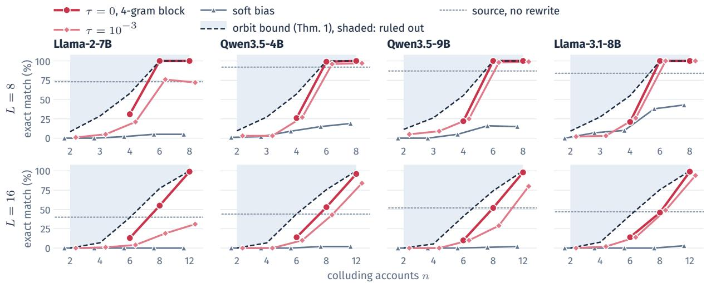  
Figure 8: Binary MPAC: per-generator version of Figure 7. Triangles: the soft bias of (8).

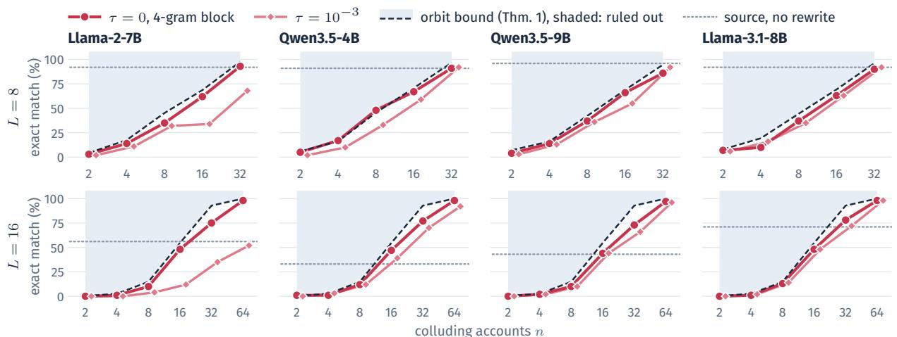  
Figure 9: RSBH: per-generator version of Figure 7. A target is reachable once at most one of its codeword symbols is uncovered by the accounts, which takes 32 accounts for 8-bit messages and 64 for 16-bit ones.

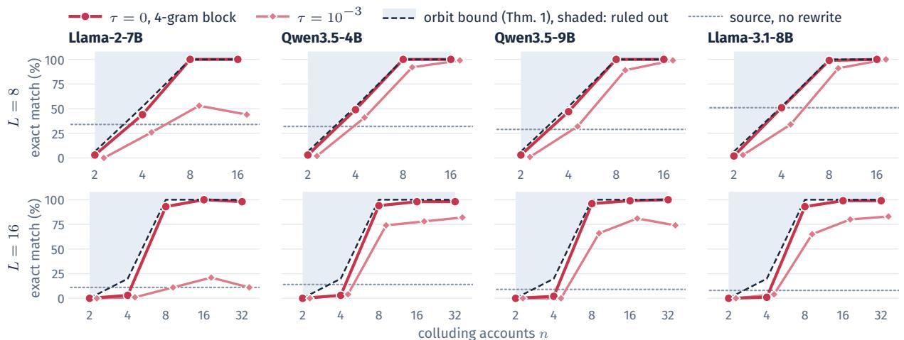  
Figure 10: StealthInk with its released 2-bit symbols: per-generator version of Figure 7. A target becomes reachable once every one of its symbols has been seen at its position by some account.

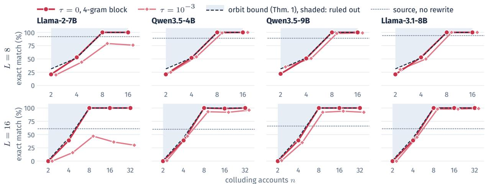

Figure 11: XMark with its released 2-bit symbols: per-generator version of Figure 7. Blocks are public, so a target’s symbol at a block is reachable once some account carries it or only one symbol value is unseen there.  
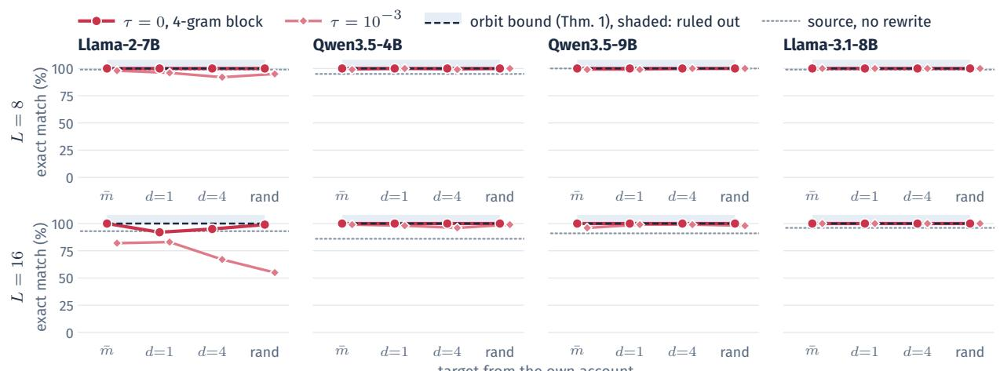

Figure 12: CycleShift: per-generator version of Figure 7. Every target is reachable from the own account, so the panels show the complement m¯ , targets one and four bits away from m, and a uniformly random one.  
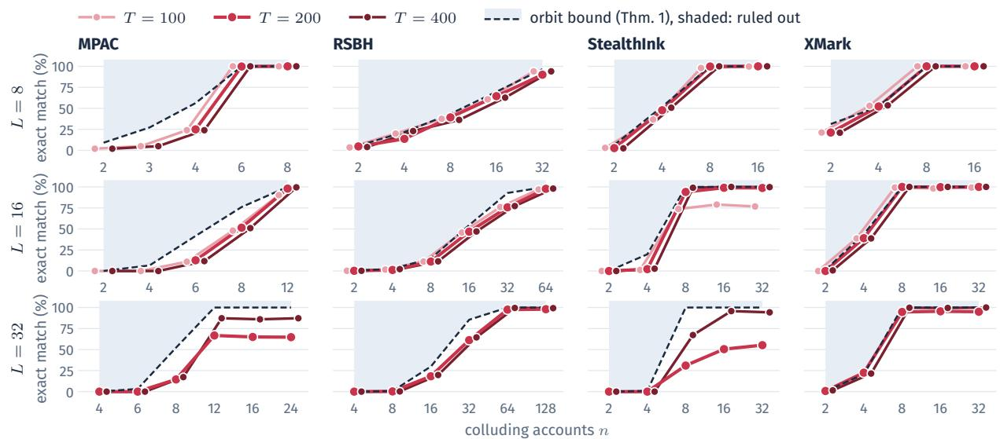  
Figure 13: Exact-match success of the constrained rewrite (τ = 0, 4-gram block) against the number of colluding accounts for sources of $T \in \{ 1 0 0 , 2 0 0 , 4 0 0 \}$ tokens, rewrites of 0.75T to 1.24T tokens, mean over the four generators. Dashed: the mean symmetry bound, the same for every T. Shaded: ruled out. Figures 14 and 15 show the same runs in the layout of Figure 7.

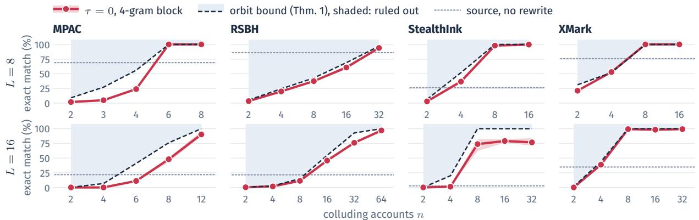  
Figure 14: Figure 7 at 100 tokens per text $( \tau = 0$ rule, since the $\tau = 1 0 ^ { - 3 }$ rule and CycleShift were run at 200 tokens only). Dotted: the decoder’s exact-match rate on the untouched 100-token source.

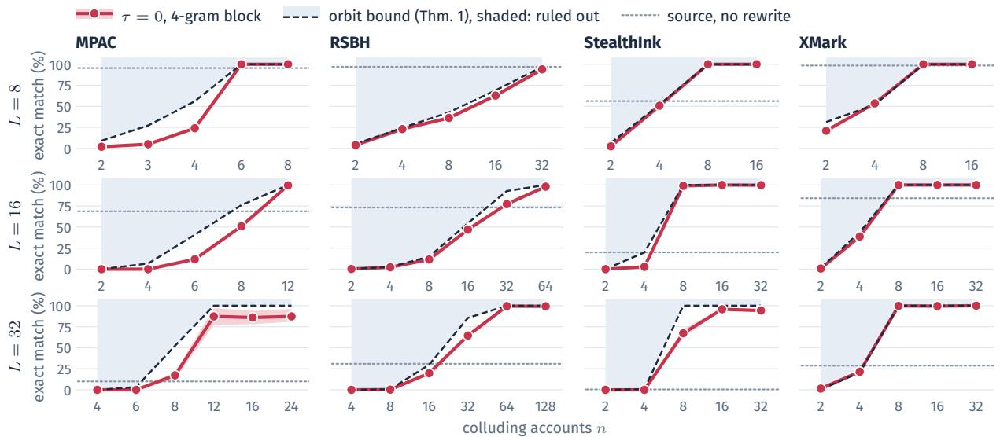  
Figure 15: Figure 7 at 400 tokens per text $( \tau = 0$ rule, since the $\tau = 1 0 ^ { - 3 }$ rule and CycleShift were run at 200 tokens only). Dotted: the decoder’s exact-match rate on the untouched 400-token source.

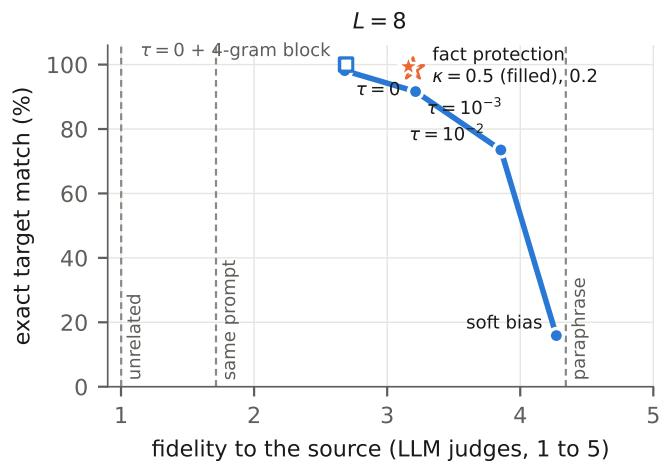

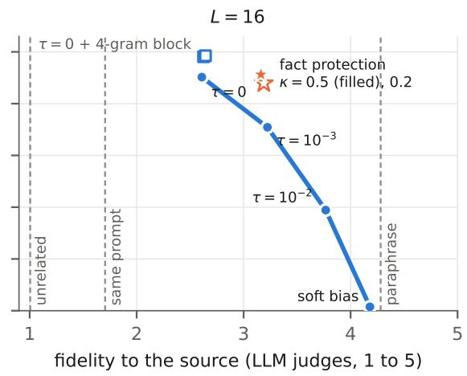  
Figure 16: Exact-match success against fidelity (mean of the two LLM judges) for the rewrite rules evaluated in this section, one panel per message length, mean over the four generators and over the own-account and n-account rewrites. Blue: the constrained rule from the soft bias to $\tau = 0 .$ . Squares: $\tau = 0$ with either 4-gram block. Stars: $\tau = 0$ with fact protection. Dashed lines: fidelity of the plain paraphrase, of an unwatermarked completion of the same prompt, and of an unrelated source.

<table><tr><td rowspan="2">Scheme</td><td rowspan="2">L</td><td rowspan="2">T</td><td colspan="4">seconds per rewritten text ↓</td><td rowspan="2">queries ↓</td><td rowspan="2">corpus (min)</td></tr><tr><td>Llama-2-7B</td><td>Llama-3.1-8B</td><td>Qwen3.5-4B</td><td>Qwen3.5-9B per rewrite</td></tr><tr><td>MPAC</td><td>8</td><td>200</td><td>1</td><td>2</td><td>3</td><td>3</td><td>120</td><td>3</td></tr><tr><td rowspan="10"></td><td>16</td><td>200</td><td>1</td><td>2</td><td>3</td><td>3</td><td>174</td><td>3</td></tr><tr><td>32</td><td>200</td><td>2</td><td>2</td><td>4</td><td>5</td><td>845</td><td>2</td></tr><tr><td>64</td><td>200</td><td>2</td><td>3</td><td>5</td><td>5</td><td>1555</td><td>2</td></tr><tr><td>8</td><td>400</td><td>3</td><td>3</td><td>6</td><td>7</td><td>276</td><td>5</td></tr><tr><td>16</td><td>100</td><td>1</td><td>1</td><td>2</td><td>3</td><td>177</td><td>1</td></tr><tr><td>16</td><td>400</td><td>3</td><td>3</td><td>6</td><td>7</td><td>513</td><td>5</td></tr><tr><td>32</td><td>400</td><td>4</td><td>4</td><td>7</td><td>9</td><td>1585</td><td>5</td></tr><tr><td>64</td><td>400</td><td>5</td><td>5</td><td>8</td><td>9</td><td>2751</td><td>4</td></tr><tr><td>8</td><td>200</td><td>2</td><td>3</td><td>5</td><td>7</td><td>998</td><td>5</td></tr><tr><td>32</td><td>200</td><td>5</td><td>6</td><td>8</td><td>9</td><td>6520</td><td>4</td></tr><tr><td></td><td>8</td><td>400</td><td>3</td><td>4</td><td>8</td><td>9</td><td>1809</td><td>7</td></tr><tr><td></td><td>16</td><td>100</td><td>1</td><td>2</td><td>3</td><td>4</td><td>1444</td><td>2</td></tr><tr><td></td><td>16</td><td>400</td><td>5</td><td>5</td><td>10</td><td>14</td><td>4512</td><td>7</td></tr><tr><td></td><td>32</td><td>400</td><td>8</td><td>9</td><td>12</td><td>15</td><td>11364</td><td>7</td></tr><tr><td>StealthInk</td><td>16</td><td>200</td><td>4</td><td>4</td><td>14</td><td>15</td><td>3038</td><td>3</td></tr><tr><td rowspan="10"></td><td>32</td><td>200</td><td>4</td><td>4</td><td>14</td><td>14</td><td>3008</td><td>3</td></tr><tr><td>64</td><td>200</td><td>5</td><td>6</td><td>16</td><td>16</td><td>6450</td><td>3</td></tr><tr><td>8</td><td>100</td><td>2</td><td>2</td><td>6</td><td>7</td><td>642</td><td>3</td></tr><tr><td>8</td><td>400</td><td>8</td><td>8</td><td>32</td><td>46</td><td>3326</td><td>6</td></tr><tr><td>16</td><td>100</td><td>2</td><td>2</td><td>7</td><td>7</td><td>1443</td><td>2</td></tr><tr><td>16</td><td>400</td><td>9</td><td>9</td><td>33</td><td>38</td><td>6172</td><td>6</td></tr><tr><td>32</td><td>400</td><td>9</td><td>9</td><td>32</td><td>37</td><td>6125</td><td>6</td></tr><tr><td>64</td><td>400</td><td>11</td><td>11</td><td>37</td><td>39</td><td>12529</td><td>5</td></tr><tr><td>16</td><td>200</td><td>2</td><td>2</td><td>9</td><td>9</td><td>146</td><td>3</td></tr><tr><td>XMark 32</td><td>200</td><td>2</td><td>2</td><td></td><td>9</td><td>9 156</td><td>3</td></tr><tr><td></td><td>64 200</td><td></td><td>2</td><td>2</td><td>9</td><td>9</td><td>154</td><td>3</td></tr><tr><td></td><td>8 400</td><td></td><td>4</td><td>4</td><td>15</td><td>18</td><td>302</td><td>6</td></tr><tr><td>16</td><td>100</td><td></td><td>1</td><td>1</td><td>5</td><td>5</td><td>80</td><td>2</td></tr><tr><td>16</td><td>400</td><td></td><td>4</td><td>4</td><td>16</td><td>17</td><td>263</td><td>6</td></tr><tr><td>32</td><td>400</td><td></td><td>4</td><td>4</td><td>16</td><td>18</td><td>280</td><td>6</td></tr><tr><td></td><td>64</td><td>400</td><td>4</td><td>4</td><td>17</td><td>18</td><td>275</td><td>6</td></tr><tr><td rowspan="3">CycleShift</td><td>8</td><td>200</td><td>1</td><td>1</td><td>3</td><td>3</td><td>25</td><td>3</td></tr><tr><td></td><td>200</td><td></td><td></td><td></td><td></td><td></td><td></td></tr><tr><td>32</td><td></td><td>1</td><td>1</td><td>2</td><td>2</td><td>29</td><td>3</td></tr></table>

Table 5: Wall-clock cost of the attack per rewritten text, in seconds on one H100, for the $\tau = 0$ rule, the number of oracle queries per rewrite, and the corpus-generation time in minutes (mean over generators). ↓: lower is better.
<table><tr><td rowspan="2">Generator</td><td rowspan="2">Text</td><td colspan="4">exact target match (%) ↑</td><td rowspan="2"></td><td rowspan="2"></td><td colspan="2">facts kept ↑</td></tr><tr><td>own, 8 own, 16 n,8 n,16</td><td></td><td></td><td>judges ↑</td><td>NLI↑ numbers</td><td>entities</td></tr><tr><td>Llama-2-7B</td><td>paraphrase</td><td></td><td></td><td></td><td></td><td>4.21</td><td>0.74</td><td>0.85</td><td>0.83</td></tr><tr><td></td><td>τ = 0, block incl. source</td><td>100</td><td>100</td><td>100</td><td>99</td><td>2.76</td><td>0.51</td><td>0.07</td><td>0.21</td></tr><tr><td></td><td>τ = 0, rewrite-only block</td><td>100</td><td>100</td><td>100</td><td>99</td><td>2.76</td><td>0.50</td><td>0.08</td><td>0.24</td></tr><tr><td></td><td>+ fact protection</td><td>100</td><td>90</td><td>100</td><td>93</td><td>3.10</td><td>0.59</td><td>0.66</td><td>0.56</td></tr><tr><td>Llama-3.1-8B</td><td>paraphrase</td><td></td><td></td><td></td><td></td><td>4.17</td><td>0.75</td><td>0.80</td><td>0.77</td></tr><tr><td></td><td>τ = 0, block incl. source</td><td>100</td><td>100</td><td>100</td><td>99</td><td>3.10</td><td>0.60</td><td>0.13</td><td>0.34</td></tr><tr><td></td><td>τ = 0, rewrite-only block</td><td>100</td><td>100</td><td>100</td><td>100</td><td>3.08</td><td>0.60</td><td>0.15</td><td>0.37</td></tr><tr><td></td><td>+ fact protection</td><td>100</td><td>95</td><td>100</td><td>95</td><td>3.53</td><td>0.67</td><td>0.71</td><td>0.69</td></tr><tr><td>Qwen3.5-4B</td><td>paraphrase</td><td></td><td></td><td></td><td></td><td>4.32</td><td>0.79</td><td>0.72</td><td>0.85</td></tr><tr><td></td><td>τ = 0, block incl. source</td><td>100</td><td>96</td><td>100</td><td>96</td><td>2.26</td><td>0.48</td><td>0.05</td><td>0.32</td></tr><tr><td></td><td>τ = 0, rewrite-only block</td><td>100</td><td>94</td><td>100</td><td>97</td><td>2.29</td><td>0.48</td><td>0.06</td><td>0.34</td></tr><tr><td></td><td>+ fact protection</td><td>98</td><td>88</td><td>98</td><td>89</td><td>2.90</td><td>0.61</td><td>0.60</td><td>0.66</td></tr><tr><td>Qwen3.5-9B</td><td>paraphrase</td><td></td><td></td><td></td><td></td><td>4.54</td><td>0.81</td><td>0.80</td><td>0.89</td></tr><tr><td></td><td>τ = 0, block incl. source</td><td>100</td><td>97</td><td>100</td><td>98</td><td>2.51</td><td>0.55</td><td>0.08</td><td>0.35</td></tr><tr><td></td><td>τ = 0, rewrite-only block</td><td>100</td><td>98</td><td>100</td><td>100</td><td>2.54</td><td>0.54</td><td>0.06</td><td>0.38</td></tr><tr><td></td><td>+ fact protection</td><td>99</td><td>86</td><td>100</td><td>94</td><td>3.12</td><td>0.67</td><td>0.66</td><td>0.71</td></tr></table>

Table 6: Per-generator fidelity results for the plain paraphrase, the rule of Table 1 (τ = 0, 4-gram block over the whole input), the same rule with the block over the rewrite only, and the latter with fact protection (κ = 0.5). Judges: mean of the two LLM judges. NLI: mean of support and coverage. ↑: higher is better.

## K Relabelings and the general ambiguity bound

The main text avoids group notation and states the binary count directly in Theorem 1. This appendix gives the general symmetry argument behind that result. It also makes explicit the assumptions on the hidden-key distribution and on the decoder’s treatment of labels, including ties.

Let K be the key space and M the message space. A relabeling group $( { \mathcal { G } } , \circ )$ acts on both spaces: every $g \in { \mathcal { G } }$ induces maps $\rho _ { g } ^ { \mathcal { K } } \colon \mathcal { K } \to \mathcal { K }$ and $\rho _ { g } ^ { \mathcal { M } } \colon \mathcal { M }  \mathcal { M }$ . We write both as $\rho _ { g } ( x )$ because the argument identifies the space. With identity e and inverse $g ^ { - 1 }$ , the action satisfies

$$
\begin{array} { c } { { \rho _ { e } ( x ) = x , } } \\ { { \rho _ { g \circ h } ( x ) = \rho _ { g } \bigl ( \rho _ { h } ( x ) \bigr ) , } } \\ { { G _ { \rho _ { g } ( K ) } ^ { \rho _ { g } ( m ) } ( c ) = G _ { K } ^ { m } ( c ) . } } \end{array}\tag{33}
$$

The first two identities hold for $x \in \mathcal { K } \cup \mathcal { M }$ and the last for every key, message, relabeling, and context. Thus renaming the hidden key structure and the message together leaves every green list unchanged.

For the controlled messages $\begin{array} { r l } { M } & { { } = } \end{array}$ $( m ^ { ( 1 ) } , \ldots , m ^ { ( n ) } )$ , define the relabelings that preserve all their public names by

$$
\mathcal { H } _ { M } : = \{ g \in \mathcal { G } : \rho _ { g } ( m ^ { ( i ) } ) = m ^ { ( i ) } \mathrm  { f o r } \ e v e r y \ { } \it { i } \} .\tag{34}
$$

The messages indistinguishable from a target $m ^ { \prime }$ under these remaining symmetries form

$$
\mathrm { O r b } \varkappa _ { \mathcal { H } _ { M } } ( m ^ { \prime } ) : = \{ \rho _ { g } ( m ^ { \prime } ) : g \in \mathcal { H } _ { M } \} .\tag{35}
$$

Appendix O gives concrete examples of a relabeling that remains in $\mathcal { H } _ { M }$ and one that the controlled messages exclude.

Full symmetry statement for Theorem 1. Fix the controlled messages $M = ( m ^ { ( 1 ) } , \dots , m ^ { ( n ) } )$ , a target $m ^ { \prime } { . }$ , and a finite relabeling group satisfying (33). Write $H : = \mathcal { H } _ { M }$ and assume the following.

(A1) Invariant key prior. The key K has a probability distribution $\mu$ satisfying

$$
\mu ( \rho _ { g } ( B ) ) = \mu ( B ) \qquad ( g \in H )\tag{36}
$$

for every measurable set of keys $B \subseteq \kappa$ where $\rho _ { g } ( B ) : = \{ \rho _ { g } ( k ) : k \in B \}$ . Thus a set of keys and its relabeling have the same prior probability.

(A2) Observations through the controlled accounts. The transcript O records all queries and responses available to the attack. The accounts generate responses according to (P1), and the attack may choose accounts, contexts, prompts, and when to stop from its earlier observations. Exact next-token distributions are also allowed as responses. Sample responses use fresh sampling randomness independent of the key and of the attack’s private randomness, with the conditional token laws specified by (P1). All queries finish and the attack outputs a finite text almost surely. There is no additional key-dependent information outside O. The attack’s private random seed R, containing all of its random choices, is independent of K before observations are collected. Its output is $A ( O , R )$ , and the notation $A ( O )$ in the theorem leaves R implicit.

(A3) Equivariant decoder. The decoder returns a message or an abstention symbol ⊥, and for every key $k ,$ text z, message $b ,$ and $g \in H$

$$
\begin{array} { r l } & { \mathrm { P r } [ D _ { \rho _ { g } ( k ) } ( z ) = \rho _ { g } ( b ) ] } \\ & { \quad \quad = \mathrm { P r } [ D _ { k } ( z ) = b ] . } \end{array}\tag{37}
$$

These probabilities are only over the decoder’s own fresh randomness, independent of the attack and of generation. For a deterministic decoder, this is the identity $D _ { \rho _ { q } ( k ) } ( z ) = \rho _ { g } ( D _ { k } ( z ) )$ . We extend the action by $\rho _ { g } ( \perp ) = \perp$

Public model and sampling settings are fixed throughout, and independent public randomness can be included in R. Let

$$
\ B : = \mathrm { O r b } _ { H } ( m ^ { \prime } ) , \qquad N : = | \ B | < \infty .\tag{38}
$$

Then

$$
\operatorname* { P r } [ D _ { K } ( A ( O , R ) ) = m ^ { \prime } \mid O ] \leq { \frac { 1 } { N } } .\tag{39}
$$

The inequality holds almost surely in O. The probability includes the key, account sampling, attack randomness, and any decoder randomness. $\mathrm { ^ { 6 6 } A l - }$ most surely” means that the inequality may exclude observations in a set of total probability zero. In particular, it holds at every discrete observation o with $\mathrm { P r } [ O = o ] > 0$

Proof. We first show that even the attack’s complete view, including its seed, leaves the key distribution invariant under H. We then show that the decoder assigns equal conditional probabilities to every message in $B ,$ and sum those probabilities.

Step 1: check the group operations used below. The action identities in (33) give, for any key or message x,

$$
\begin{array} { r } { \rho _ { g ^ { - 1 } } \big ( \rho _ { g } ( x ) \big ) = \rho _ { g ^ { - 1 } \circ g } ( x ) = x , } \\ { \rho _ { g } \big ( \rho _ { g ^ { - 1 } } ( x ) \big ) = \rho _ { g \circ g ^ { - 1 } } ( x ) = x . } \end{array}\tag{40}
$$

Thus $\rho _ { g }$ is a bijection with inverse $\rho _ { g ^ { - 1 } }$ . The identity fixes every controlled message, so $e \in H$ . If $g , h \in H$ , then for each i,

$$
\rho _ { g \circ h } ( m ^ { ( i ) } ) = \rho _ { g } ( \rho _ { h } ( m ^ { ( i ) } ) ) = \rho _ { g } ( m ^ { ( i ) } ) = m ^ { ( i ) } .\tag{41}
$$

Hence $g \circ h \in H$ . If $g \in H$ , applying $\rho _ { g ^ { - 1 } }$ to $\rho _ { g } ( m ^ { ( i ) } ) ~ = ~ m ^ { ( i ) }$ gives $\rho _ { g ^ { - 1 } } ( m ^ { ( i ) } ) ~ = ~ m ^ { ( i ) }$ , so $g ^ { - 1 } \in H$ as well. This verifies that H is a subgroup. It also gives $m ^ { \prime } = \rho _ { e } ( m ^ { \prime } ) \in \mathcal { B } _ { \mathrm { : } }$ , so $N \geq 1$ and division by N is valid.

Step 2: show that each account response is unchanged. Fix $g \in H$ , a key k, an account i, and a context c. The stabilizer condition and (33) give

$$
\begin{array} { c } { { G _ { \rho _ { g } ( k ) } ^ { m ^ { ( i ) } } ( c ) = G _ { \rho _ { g } ( k ) } ^ { \rho _ { g } ( m ^ { ( i ) } ) } ( c ) } } \\ { { = G _ { k } ^ { m ^ { ( i ) } } ( c ) . } } \end{array}\tag{42}
$$

The first equality uses $\rho _ { g } ( m ^ { ( i ) } ) = m ^ { ( i ) }$ , and the second relabels the key and message together. By (P1), for every token v,

$$
\begin{array} { r l } & { p _ { \rho _ { g } ( k ) , m ^ { ( i ) } } ( v \mid c ) = \Phi \big ( p ( \cdot \mid c ) , G _ { \rho _ { g } ( k ) } ^ { m ^ { ( i ) } } ( c ) \big ) ( v ) } \\ & { \qquad = \Phi \big ( p ( \cdot \mid c ) , G _ { k } ^ { m ^ { ( i ) } } ( c ) \big ) ( v ) } \\ & { \qquad = p _ { k , m ^ { ( i ) } } ( v \mid c ) . } \end{array}\tag{43}
$$

Here $\Phi ( p , S ) ( v )$ denotes the probability of v in the distribution returned by Φ. The base distribution and the rule Φ are the same in both experiments because they are key-independent.

Consequently, a query returning the entire nexttoken distribution has exactly the same answer. A query sampling a token has the same answer distribution. For a completion $w = ( w _ { 1 } , \dots , w _ { T } )$ , fix the query prompt and let $c _ { t } ( w _ { < t } )$ be the context determined by that prompt and prefix. The probability

of this completion is

$$
\begin{array} { l } { { \displaystyle p _ { \rho _ { g } ( k ) , m ^ { ( i ) } } ( w ) } } \\ { { \displaystyle = \prod _ { t = 1 } ^ { T } p _ { \rho _ { g } ( k ) , m ^ { ( i ) } } \big ( w _ { t } \big \vert \ c _ { t } ( w _ { < t } ) \big ) } } \\ { { \displaystyle = \prod _ { t = 1 } ^ { T } p _ { k , m ^ { ( i ) } } \big ( w _ { t } \big \vert \ c _ { t } ( w _ { < t } ) \big ) } } \\ { { \displaystyle = p _ { k , m ^ { ( i ) } } ( w ) . } } \end{array}\tag{44}
$$

The first and last equalities are the autoregressive sampling rule, and the middle equality applies (43) to each factor. The identity includes zeroprobability sequences. If the response stops at an end token or a public length limit, the same stopping rule is applied to the same sequence, so the resulting response laws still agree.

Step 3: preserve this equality under adaptive queries. Fix the private seed at $R = r$ . Once this seed is fixed, each next query and the decision to stop are deterministic functions of the preceding transcript. Write $T _ { j }$ for the transcript after j queries, with $T _ { 0 }$ empty. For a possible preceding transcript t, denote the next query by $q _ { j } ( r , t )$ Denote its response distribution under key k by $Q _ { k } ( { \boldsymbol { \cdot } } \mid q _ { j } ( { \boldsymbol { r } } , t ) , t )$ . Step 2 gives, for every response event $F$ ,

$$
{ \begin{array} { r l } & { Q _ { \rho _ { g } ( k ) } ( F \mid q _ { j } ( r , t ) , t ) } \\ & { \qquad = Q _ { k } ( F \mid q _ { j } ( r , t ) , t ) . } \end{array} }\tag{45}
$$

For ordinary fresh sampling this kernel is the distribution from Step 2. Writing the history explicitly also accommodates repeated contexts and queries chosen using earlier responses. We do not require different queries to concern different contexts.

We prove equality of transcript laws by induction on j. It holds at $j = 0$ because both transcripts are empty. Suppose it holds after $j - 1$ queries, and call the common law $\eta _ { j - 1 }$ . For an event E of extended transcripts, the probability after the next query under key k is

$$
\int \int \mathbf { 1 } \{ ( t , q _ { j } ( r , t ) , a ) \in E \}\tag{46}
$$

The expression under key $\rho _ { g } ( k )$ has the same outer measure by the induction hypothesis, the same query because r, t are fixed, and the same inner measure by (45). The two probabilities are therefore equal, completing the induction.

Stopping causes no exception: at a fixed $r , t ,$ both experiments make the same stopping decision. Equivalently, append a fixed stop symbol at every subsequent round once the attack stops. The preceding induction then applies to these padded transcripts. Since termination occurs after finitely many queries almost surely, every event of final transcripts is the disjoint union of its parts with stopping times $0 , 1 , 2 , \ldots$ . Equality for each part gives equality for their sum. Thus, for every transcript event $E _ { \mathrm { { : } } }$

$$
\begin{array} { r l } & { \operatorname* { P r } [ O \in E \mid K = \rho _ { g } ( k ) , R = r ] } \\ & { \qquad = \operatorname* { P r } [ O \in E \mid K = k , R = r ] . } \end{array}\tag{47}
$$

This proves likelihood invariance for the whole adaptive experiment, including exact distribution responses, whose laws are point masses.

Step 4: derive invariance of the conditional key distribution. Let $V : = ( O , R )$ be the attack’s complete view, including the private seed. Although R and K are independent initially, they need not remain independent after conditioning on $O .$ We therefore retain R in V.

For an event C of complete views, put $L _ { C } ( k ) : =$ $\operatorname* { P r } [ V \in C \mid K = k ]$ . Let ν be the initial law of $R$ and write $C _ { r } : = \{ o : ( o , r ) \in C \}$ . Independence before querying gives

$$
L _ { C } ( k ) = \int \operatorname* { P r } [ O \in C _ { r } \mid K = k , R = r ] , \nu ( \mathrm { d } r ) .\tag{48}
$$

Equation (47) holds for each fixed seed, so integrating it against this same ν yields

$$
L _ { C } ( \rho _ { g } ( k ) ) = L _ { C } ( k ) .\tag{49}
$$

For a set of keys B, the definition of conditional probability gives

$$
\begin{array} { l } { { \displaystyle \operatorname* { P r } [ K \in \rho _ { g } ( B ) , V \in C ] = \int _ { \rho _ { g } ( B ) } L _ { C } ( k ) \mu ( \mathrm { d } k ) } } \\ { ~ } \\ { ~ = { \displaystyle \int _ { B } L _ { C } ( \rho _ { g } ( k ) ) \mu ( \mathrm { d } k ) } } \\ { ~ = { \displaystyle \int _ { B } L _ { C } ( k ) \mu ( \mathrm { d } k ) } } \\ { ~ = { \displaystyle \operatorname* { P r } [ K \in B , V \in C ] } . } \end{array}\tag{50}
$$

The second line changes variables through the bijection $\rho _ { g }$ , and (A1) says that this change preserves $\mu .$ The third line uses (49).

For a discrete view v with positive probability, set $C = \{ v \}$ in (50) and divide by $\mathrm { P r } [ V = v ]$ . This

gives

$$
\operatorname* { P r } [ K \in \rho _ { g } ( B ) \mid V = v ] = \operatorname* { P r } [ K \in B \mid V = v ] .\tag{51}
$$

For general observations, including real-valued distribution responses, we use a regular conditional distribution $\mu _ { v } ( B ) : = \operatorname* { P r } [ K \in B \mid V = v ]$ . To see why the same conclusion holds, let $P _ { V }$ be the law of $V$ and rewrite (50) as

$$
\begin{array} { r l r } {  { \int _ { C } \mu _ { v } ( \rho _ { g } ( B ) ) P _ { V } ( \mathrm { d } v ) } } \\ & { } & { = \displaystyle \int _ { C } \mu _ { v } ( B ) P _ { V } ( \mathrm { d } v ) . } \end{array}\tag{52}
$$

This holds for every view event $C .$ Two measurable functions with equal integrals over every event $C$ are equal almost everywhere: otherwise, on an event where one exceeds the other by at least $1 / j$ for some integer $j \geq 1$ , their integrals would differ. Applying this fact gives (51) almost surely in v. The key and observation spaces here are finite or countable products of discrete and real-valued spaces, on which these conditional distributions exist. Equality can first be imposed on a countable generating algebra of key events, then extended to all measurable events by uniqueness of probability measures. Since H is finite, one common set of views of probability one works for every $g \in H$

In particular, at each such view and for every bounded measurable function f of the key,

$$
\int f ( \rho _ { g } ( k ) ) \mu _ { v } ( \mathrm { d } k ) = \int f ( k ) \mu _ { v } ( \mathrm { d } k ) .\tag{53}
$$

Indeed, (51), applied to $g ^ { - 1 } \in H$ , says that $\rho _ { g } ( K )$ and K have the same conditional distribution. Expectations of the same function under equal distributions coincide.

Step 5: make the decoder’s symmetry explicit, including ties. For a fixed key and text, define the decoder probabilities

$$
d _ { k } ( z , b ) : = \operatorname* { P r } [ D _ { k } ( z ) = b ] .\tag{54}
$$

If the decoder is deterministic, $d _ { k } ( z , b )$ is the indicator of $D _ { k } ( z ) = b$ . Assumption (A3) states that

$$
d _ { \rho _ { g } ( k ) } ( z , \rho _ { g } ( b ) ) = d _ { k } ( z , b ) .\tag{55}
$$

We explain how this condition follows for a common membership-based scoring rule, and why its tie rule matters.

For a fixed text $z = ( z _ { 1 } , \dots , z _ { T } )$ , let $c _ { t }$ be its scoring contexts and put

$$
\beta _ { k } ( z , b ) : = \big ( \mathbf { 1 } \{ z _ { t } \in G _ { k } ^ { b } ( c _ { t } ) \} \big ) _ { t = 1 } ^ { T } .\tag{56}
$$

For each t, (33) gives

$$
\mathbf { 1 } \{ z _ { t } \in G _ { \rho _ { g } ( k ) } ^ { \rho _ { g } ( b ) } ( c _ { t } ) \} = \mathbf { 1 } \{ z _ { t } \in G _ { k } ^ { b } ( c _ { t } ) \} .\tag{57}
$$

Equality at every coordinate gives

$$
\beta _ { \rho _ { g } ( k ) } ( z , \rho _ { g } ( b ) ) = \beta _ { k } ( z , b ) .\tag{58}
$$

Suppose each candidate is evaluated by the same public function,

$$
s _ { k } ( z , b ) : = s ( z , \beta _ { k } ( z , b ) ) .\tag{59}
$$

Substitution then yields

$$
s _ { \rho _ { g } ( k ) } ( z , \rho _ { g } ( b ) ) = s _ { k } ( z , b ) .\tag{60}
$$

The use of the same function for every candidate is part of this sufficient condition. A candidatedependent public preference is not justified by key access through memberships alone.

For a maximizing decoder, write

$$
\mathcal { E } _ { k } ( z ) : = \arg \operatorname* { m a x } _ { b \in \mathcal { M } } s _ { k } ( z , b ) .\tag{61}
$$

If $b \in \mathcal { E } _ { k } ( z )$ , then $s _ { k } ( z , b ) \geq s _ { k } ( z , a )$ for every $a \in \mathcal { M }$ . Equation (60) implies

$$
s _ { \rho _ { g } ( k ) } ( z , \rho _ { g } ( b ) ) \geq s _ { \rho _ { g } ( k ) } ( z , \rho _ { g } ( a ) ) \quad \mathrm { f o r ~ e v e r y ~ } a .\tag{62}
$$

Because $\rho _ { g }$ is a bijection on messages, $\rho _ { g } ( a )$ ranges over all candidates. Thus $\rho _ { g } ( b ) \in \mathcal { E } _ { \rho _ { g } ( k ) } ( z )$ This proves one inclusion in

$$
\mathcal { E } _ { \rho _ { g } ( k ) } ( z ) = \rho _ { g } ( \mathcal { E } _ { k } ( z ) ) .\tag{63}
$$

For the reverse inclusion, take $b ^ { \prime } \in \mathcal { E } _ { \rho _ { q } ( k ) } ( z )$ and apply the same argument to the key $\rho _ { g } ( k )$ and the element $g ^ { - 1 }$ . It gives $\rho _ { g ^ { - 1 } } ( b ^ { \prime } ) \in \mathcal { E } _ { k } ( z )$ , hence $b ^ { \prime } \in$ $\rho _ { g } ( \mathcal { E } _ { k } ( z ) )$ as required. For a minimizing decoder, replace each score inequality above by $\leq$ , and both inclusions follow in exactly the same way.

If the extremum is unique, (63) relabels that unique output, proving (55). For a finite nonempty tied set, uniform tie breaking gives

$$
d _ { k } ( z , b ) = \frac { \mathbf { 1 } \{ b \in \mathcal { E } _ { k } ( z ) \} } { | \mathcal { E } _ { k } ( z ) | } .\tag{64}
$$

Equation (63) preserves membership in the tied set and its cardinality, so it again gives (55). If instead the decoder abstains whenever there is a tie, both relabeled experiments abstain, since their tied sets have the same size. With $\rho _ { g } ( \perp ) = \perp$ , this also satisfies (A3). A deterministic preference for the largest or smallest label need not do so. For other decoder architectures, (A3) is the condition required, since (P2) alone does not establish their tie behavior.

Step 6: show equality of conditional decoding probabilities. Fix a complete view $v = \left( o , r \right)$ in the probability-one set from Step 4. The attack’s rewritten text

$$
z : = A ( o , r )\tag{65}
$$

is now fixed. Relabeling a key in its conditional distribution does not change $o , r ,$ or this text. For every message b, put

$$
\begin{array} { l } { { p _ { v } ( b ) : = \mathrm { P r } [ D _ { K } ( A ( O , R ) ) = b \ | \ V = v ] } } \\ { { \displaystyle \qquad = \int d _ { k } ( z , b ) \mu _ { v } ( \mathrm { d } k ) . } } \end{array}\tag{66}
$$

The second line averages the decoder’s probabilities over the conditional key distribution. It uses the fact that the decoder’s fresh randomness is independent of the view once its key and input are fixed.

For any $g \in H$ , compute

$$
\begin{array} { l } { { p _ { v } ( \rho _ { g } ( b ) ) = \displaystyle \int d _ { k } ( z , \rho _ { g } ( b ) ) \mu _ { v } ( \mathrm { d } k ) } } \\ { { \displaystyle \qquad = \int d _ { \rho _ { g } ( k ) } ( z , \rho _ { g } ( b ) ) \mu _ { v } ( \mathrm { d } k ) } } \\ { { \displaystyle \qquad = \int d _ { k } ( z , b ) \mu _ { v } ( \mathrm { d } k ) } } \\ { { \displaystyle \qquad = p _ { v } ( b ) . } } \end{array}\tag{67}
$$

The first and last lines use (66). The second line applies (53) to the bounded function $f ( k ) =$ $d _ { k } ( z , \rho _ { g } ( b ) )$ . The third line applies (55) at each key. Notice that the target is not relabeled in the actual attack. The calculation compares the probabilities of different decoder outputs for the same fixed text z.

Step 7: sum over the distinct messages in the orbit. By definition of B, each $b \in B$ has the form $b = \rho _ { g } ( m ^ { \prime } )$ for some $g \in H$ . Substituting $m ^ { \prime }$ for b in (67) therefore gives $p _ { v } ( b ) = p _ { v } ( m ^ { \prime } )$ for every $b \in B$ . There are $N$ distinct messages in this set. The events that the decoder outputs each of these messages are pairwise disjoint: one decoder run returns at most one message. Consequently,

$$
\begin{array} { r l } {  { N p _ { v } ( m ^ { \prime } ) = \sum _ { b \in \mathcal { B } } p _ { v } ( b ) } } \\ & { = \operatorname* { P r } [ D _ { K } ( z ) \in \mathcal { B } \mid V = v ] } \\ & { \leq 1 . } \end{array}\tag{68}
$$

We sum over distinct messages, not group elements: several relabelings can send $m ^ { \prime }$ to the same message and must not be counted repeatedly. Dividing by $N \geq 1$ proves

$$
\operatorname* { P r } [ D _ { K } ( A ( O , R ) ) = m ^ { \prime } \mid O , R ] \leq { \frac { 1 } { N } } .\tag{69}
$$

This inequality holds almost surely in $( O , R )$ . The inequality in (68) allows the decoder to output messages outside $\boldsymbol { B }$ or to abstain. Thus we have not assumed that its total probability on this orbit is one.

Step 8: average over the attack’s private randomness. Let $E : = \{ D _ { K } ( A ( O , R ) ) = m ^ { \prime } \}$ be the success event. Because conditioning on (O, R) includes conditioning on $O _ { ; }$ , the law of iterated conditional expectation gives

$$
{ \begin{array} { r l } & { \operatorname* { P r } [ E \mid O ] = \mathbb { E } [ \mathbf { 1 } _ { E } \mid O ] } \\ & { \qquad = \mathbb { E } [ \mathbb { E } [ \mathbf { 1 } _ { E } \mid O , R ] \mid O ] } \\ & { \qquad = \mathbb { E } [ \operatorname* { P r } [ E \mid O , R ] \mid O ] } \\ & { \qquad \leq \mathbb { E } { \biggl [ } { \frac { 1 } { N } } { \bigg | } O { \biggr ] } } \\ & { \qquad = { \frac { 1 } { N } } . } \end{array} }\tag{70}
$$

The inequality substitutes (69) and uses monotonicity of conditional expectation. The last equality holds because M and $m ^ { \prime }$ are fixed, so their orbit size N is fixed. This averaging uses the actual conditional law of R given O, and it does not assume that the seed remains independent of the key after observation. Replacing N by its definition in (38) gives the claimed general bound. □

When the ideal-key assumption applies. Assumption (A1) is a distributional requirement, not a consequence of the algebraic identity (33) alone. In the binary position–color idealization, at each context the position is uniform on $[ L ]$ and the balanced two-color partition is uniform, independently of that position and of the assignments at other contexts. A position permutation and per-position color flips define a bijection of the possible (position, partition) pairs. Each pair originally has the same probability, so the relabeled pair is again uniform. The transformation acts separately at each context, preserving independence across contexts, and repeated contexts still read the same assignment. This proves invariance of the entire ideal key table. For a concrete finite-seed pseudorandom implementation, a uniform seed by itself does not prove that the induced table distribution has this exact symmetry. The information-theoretic conclusion above uses (A1).

Why the condition on ties cannot be dropped. Consider two-bit messages, a single controlled message (0, 1), and the relabeling

$$
\rho _ { g } ( b _ { 1 } , b _ { 2 } ) = ( 1 - b _ { 2 } , 1 - b _ { 1 } ) .\tag{71}
$$

This is a position swap together with a flip at each position in the binary group described in the main text. It fixes $( 0 , 1 )$ , so $g \in H$ , but it interchanges $( 0 , 0 )$ and (1, 1). With one controlled message, a stabilizing relabeling has its color flips determined by its position permutation. There are just two position permutations here: the identity gives the identity relabeling, and the swap gives g. Therefore

$$
\mathrm { O r b } _ { H } ( ( 1 , 1 ) ) = \{ ( 1 , 1 ) , ( 0 , 0 ) \} .\tag{72}
$$

On an empty text all vote counts are zero. A decoder that resolves every tied bit toward 1 returns (1, 1) for every key. Its success probability for that target is 1, exceeding the purported bound $1 / 2 .$ The equivariance assumption excludes precisely this failure. The example concerns exact decoding, and it does not claim that an empty text passes watermark acceptance or preserves a source’s content.

Source texts and unlabelled observations. The attacker of Section 3 also observes the source y. To apply the theorem, include it in the observation:

$$
{ \cal O } = ( y , { \cal O } _ { M } ) , \qquad A ( { \cal O } , R ) = A ( y , m ^ { \prime } , { \cal O } _ { M } , R ) .\tag{73}
$$

Here the fixed target is left implicit on the left-hand side. $\operatorname { I f } y$ is generated under a controlled message, Step 2 applies directly. If $y$ is generated independently of the key and the account experiment, it also preserves the likelihood invariance. A source under a different unknown message requires an additional assumption, because simply not revealing its message does not imply symmetry.

For example, let $U = ( U _ { 1 } , \dots , U _ { s } )$ be the unknown messages of all additional watermarked texts. Define the joint relabeling

$$
( K , U ) \longmapsto ( \rho _ { g } ( K ) , \rho _ { g } ( U _ { 1 } ) , \dots , \rho _ { g } ( U _ { s } ) ) .\tag{74}
$$

Suppose their joint prior is invariant under this map for every $g \in H$ . An invariant key prior with independent uniform $U _ { j }$ on a finite message space is one sufficient choice: the map permutes that message space, so it preserves each uniform distribution and their product. For each additional text, (33) gives

$$
G _ { \rho _ { g } ( k ) } ^ { \rho _ { g } ( u _ { j } ) } ( c ) = G _ { k } ^ { u _ { j } } ( c ) .\tag{75}
$$

Thus the response likelihood is invariant when key and hidden messages are relabeled together. Step 3 applies to this enlarged hidden state, and Step 4 gives invariance of its posterior. Taking a posterior event of the form $\{ K \in B , \ U \in \mathcal { M } ^ { s } \}$ then gives invariance of the marginal posterior of $K ,$ since the full message space maps to itself. Steps 5–8 therefore prove the same bound conditional on all these observations. If an extra source message is known, it should instead be added to M, and the orbit recomputed under the resulting smaller stabilizer. An arbitrary fixed or nonuniform unknown source message is not covered without the stated joint symmetry.

Content constraints, acceptance, and the meaning of the bound. The proof applies to every output text $A ( O , R )$ , so restricting the attacker to content-preserving rewrites of $y ,$ as condition (ii) of its goal in Section 3 demands, cannot invalidate the upper bound when $y$ is included in O as above. A deployment may also apply a keyed acceptance test $\mathrm { A c c } _ { K } ( z ) \in \{ 0 , 1 \}$ , which decides whether a text is watermarked at all, before it attributes the text to the decoded message, and the attacker’s goal in Section 3 omits this test. The bound covers it nonetheless: for $Z : = A ( O , R )$ ,

$$
\begin{array} { r l r } & { } & { \mathrm { P r } [ D _ { K } ( Z ) = m ^ { \prime } , \mathrm { A c c } _ { K } ( Z ) = 1 \mid O ] } \\ & { } & { \qquad \leq \mathrm { P r } [ D _ { K } ( Z ) = m ^ { \prime } \mid O ] \leq \cfrac { 1 } { N } . } \end{array}\tag{76}
$$

The first inequality follows because the event on the first line is a subset of the exact-decoding event. It requires no symmetry of the acceptance rule when $D _ { K }$ itself satisfies (A3). This is a bound on joint success and acceptance, not on the success probability conditional on acceptance.

For a released decoder with a label-dependent tie rule, apply the theorem instead to the decoder that abstains whenever the relevant extremum is not unique. On texts without such ties the two decoders agree, so the joint event of exact success and no ties is bounded by $1 / N$ . To transfer that bound to accepted outputs of the released decoder, one must establish that acceptance excludes all the relevant ties, and the presence of an acceptance threshold alone does not establish this.

Finally, when $N = 1$ the bound is 1 and places no restriction on success. When $N > 1$ , Step 7 identifies the obstruction: all N orbit messages have equal conditional decoding probability. The theorem supplies an upper bound, not an attack attaining it. In particular, a singleton orbit alone does not prove that a content-preserving successful rewrite exists.

## L Binary ambiguity count

We make the binary position–color setting of Section 3 explicit, verify that its relabelings form a group acting as (33) requires, determine the stabilizer $\mathcal { H } _ { M }$ of the controlled messages exactly, and count the orbit of the target. Throughout, $( u +$ w) mod 2 denotes the sum of the bits u and w reduced modulo 2, so that $( u + u )$ mod $2 = 0$ . Since $\left( ( u + w ) \right.$ mod 2+z mod $2 = ( u + w + z ) $ mod 2, a reduction inside a longer sum may be postponed to the end, and we do so without comment. On bit vectors the reduction acts coordinatewise.

## Closed-form count. Fix the following.

(S1) Messages, keys, and sets. The message space is $\mathcal { M } = \{ 0 , 1 \} ^ { L }$ . A key K assigns to every context c a position $J _ { K } ( c ) \in [ L ]$ and a coloring $C _ { K } ( c , \cdot ) \colon \mathcal { V }  \{ 0 , 1 \}$ , and the green list of message m at c is $G _ { K } ^ { m } ( c ) ~ = ~ \{ v ~ :$ $C _ { K } ( c , v ) = m _ { J _ { K } ( c ) } \}$ , as in (3).

(S2) Relabelings. An element of G is a pair $g = ( \sigma , f )$ of a permutation $\sigma \in \mathfrak { S } _ { L }$ of the positions and a flip vector $f \in \{ 0 , 1 \} ^ { L }$ . It acts on messages and keys as follows, where the first line holds for every $j \in [ L ]$

$$
\begin{array} { l } { { \left[ \rho _ { g } ( m ) \right] _ { \sigma ( j ) } = ( m _ { j } + f _ { j } ) \mathrm { m o d } 2 , } } \\ { { J _ { \rho _ { g } ( K ) } ( c ) = \sigma \big ( J _ { K } ( c ) \big ) , } } \\ { { C _ { \rho _ { g } ( K ) } ( c , v ) = \big ( C _ { K } ( c , v ) + f _ { J _ { K } ( c ) } \big ) \mathrm { m o d } 2 } } \end{array}\tag{77}
$$

Thus the bit at position j moves to position $\sigma ( j )$ and is flipped exactly when $f _ { j } = 1$ , and the key renames its positions by σ and exchanges the two color names at every context whose position j has $f _ { j } = 1$ . The identity is $e = ( \mathrm { i d } , 0 )$ , and the product of $\boldsymbol { g } = \left( \sigma _ { g } , f ^ { g } \right)$

and $h = ( \sigma _ { h } , f ^ { h } )$ is

$$
\begin{array} { r l } & { g \circ h = \left( \sigma _ { g } \circ \sigma _ { h } , \ : f ^ { g \circ h } \right) , } \\ & { f _ { j } ^ { g \circ h } = \left( f _ { j } ^ { h } + f _ { \sigma _ { h } ( j ) } ^ { g } \right) \bmod 2 . } \end{array}\tag{78}
$$

(S3) Signatures and twin classes. For the controlled messages $M = ( m ^ { ( 1 ) } , \dots , m ^ { ( n ) } )$ and every position j, the account signature is $x _ { j } ~ = ~ ( x _ { j , 2 } , \ldots , x _ { j , n } )$ with $x _ { j , i } ~ = ~ ( m _ { j } ^ { ( i ) } +$ $m _ { j } ^ { ( 1 ) } )$ mod 2, as in (5). Positions with equal signatures are twins, T is the partition of $[ L ]$ into twin classes, and for the target m<sup>′</sup> the relative bits are $r _ { j } = ( m _ { j } ^ { \prime } + m _ { j } ^ { ( 1 ) } )$ mod 2, with $\textstyle a _ { T } = \sum _ { j \in T } r _ { j }$ for $T \in { \mathcal { T } }$

Then $( { \mathcal { G } } , \circ )$ is a finite group, the action (77) satisfies $( 3 3 )$ , and the orbit of $m ^ { \prime }$ under the stabilizer $\mathcal { H } _ { M }$ of (34) has size

$$
| \mathrm { O r b } _ { \mathcal { H } _ { M } } ( m ^ { \prime } ) | = \prod _ { T \in T } { \binom { | T | } { a _ { T } } } .\tag{79}
$$

Proof. We first check that (77) is a group action with the equivariance property, so that the general bound of Appendix K applies. We then determine $\mathcal { H } _ { M }$ exactly, pass to coordinates relative to the reference message, and count.

Step 1: verify the group action and the equivariance identity. The identity acts trivially: with $e = ( { \mathrm { i d } } , 0 ) , ( 7 7 )$ gives $[ \rho _ { e } ( m ) ] _ { j } = m _ { j } , J _ { \rho _ { e } ( K ) } =$ $J _ { K }$ , and $C _ { \rho _ { e } ( K ) } = C _ { K } , \operatorname { s o } \rho _ { e } ( x ) = x$ for every message and key x. For the composition, fix $g , h$ and a message m. Applying (77) twice,

$$
\begin{array} { r l } & { \left[ \rho _ { g } { \big ( } \rho _ { h } ( m ) { \big ) } \right] _ { \sigma _ { g } ( \sigma _ { h } ( j ) ) } } \\ & { \quad = { \left( } \left[ \rho _ { h } ( m ) \right] _ { \sigma _ { h } ( j ) } + f _ { \sigma _ { h } ( j ) } ^ { g } { \right) } \bmod 2 } \\ & { \quad = { \left( } m _ { j } + f _ { j } ^ { h } + f _ { \sigma _ { h } ( j ) } ^ { g } { \right) } \bmod 2 } \\ & { \quad = { \left( } m _ { j } + f _ { j } ^ { g \circ h } { \right) } \bmod 2 , } \end{array}\tag{80}
$$

which is $[ \rho _ { g \circ h } ( m ) ] _ { ( \sigma _ { g } \circ \sigma _ { h } ) ( j ) }$ by (77) and (78). For a key,

$$
\begin{array} { r l } & { J _ { \rho _ { g } ( \rho _ { h } ( K ) ) } ( c ) = \sigma _ { g } \bigl ( J _ { \rho _ { h } ( K ) } ( c ) \bigr ) } \\ & { \qquad = \sigma _ { g } \bigl ( \sigma _ { h } \bigl ( J _ { K } ( c ) \bigr ) \bigr ) , } \\ & { C _ { \rho _ { g } ( \rho _ { h } ( K ) ) } ( c , v ) } \\ & { \qquad = \bigl ( C _ { \rho _ { h } ( K ) } ( c , v ) + f _ { J _ { \rho _ { h } ( K ) } ( c ) } ^ { g } \bigr ) \bmod 2 } \\ & { \qquad = \bigl ( C _ { K } ( c , v ) + f _ { J _ { K } ( c ) } ^ { h } + f _ { \sigma _ { h } ( J _ { K } ( c ) ) } ^ { g } \bigr ) \bmod 2 } \\ & { \qquad = \bigl ( C _ { K } ( c , v ) + f _ { J _ { K } ( c ) } ^ { g _ { P h } } \bigr ) \bmod 2 , } \end{array}\tag{81}
$$

which is the action of $g \circ h$ on $K$ . Hence $\rho _ { g \circ h } =$ $\rho _ { g } \circ \rho _ { h }$ on messages and keys, and together with $\rho _ { e } =$ id these are the first two identities of (33). Every $g = ( \sigma , f )$ has the inverse $g ^ { - 1 } = ( \sigma ^ { - 1 } , f ^ { \prime } )$ with $f _ { \sigma ( j ) } ^ { \prime } = f _ { j }$ , that is, $f _ { k } ^ { \prime } ~ = ~ f _ { \sigma ^ { - 1 } ( k ) }$ Indeed, by (78) the product $g \circ g ^ { - 1 }$ has permutation $\sigma \circ \sigma ^ { - 1 } = \mathrm { i }$ d and flips $\left( f _ { k } ^ { \prime } + f _ { \sigma ^ { - 1 } ( k ) } \right)$ mod $2 = 0$ at every k, and $g ^ { - 1 } \circ g$ has permutation id and flips $( f _ { j } + f _ { \sigma ( j ) } ^ { \prime } )$ mod $2 = 0$ at every $j ,$ so both products equal e. The action on messages is faithful: if $\rho _ { g } ( m ) ~ =$ m for every m, then $m \ = \ 0$ gives $f _ { j } = [ \rho _ { g } ( 0 ) ] _ { \sigma ( j ) } = 0$ for every j, and then $[ \rho _ { g } ( m ) ] _ { \sigma ( j ) } = m _ { j }$ for every m forces $\sigma ( j ) = j ,$ as the unit vector m with a single one at position j shows. Therefore $g \mapsto \rho _ { g }$ is an injective map from $\mathcal { G }$ to the bijections of $\{ \stackrel { \smile } { 0 } , 1 \} ^ { L }$ that sends ◦ to composition, e to the identity, and $g ^ { - 1 }$ to the inverse, so ◦ inherits associativity from composition and $( { \mathcal { G } } , \circ )$ is a group. It has $2 ^ { L } L !$ elements and is therefore finite. Finally, for the last identity of (33) put $j = J _ { K } ( c )$ . Then $J _ { \rho _ { q } ( K ) } ( c ) = \sigma ( j )$ , and by (77) the membership condition $C _ { \rho _ { g } ( K ) } ( c , v ) =$ $[ \rho _ { g } ( m ) ] _ { \sigma ( j ) }$ reads

$$
\begin{array} { r } { \big ( C _ { K } ( c , v ) + f _ { j } \big ) \bmod 2 = ( m _ { j } + f _ { j } ) \bmod 2 . } \end{array}\tag{82}
$$

Adding the same bit $f _ { j }$ to both sides of an equation modulo 2 does not change its solutions, so (82) holds exactly when $C _ { K } ( c , v ) = m _ { j }$ . Hence

$$
\begin{array} { r } { G _ { \rho _ { g } ( K ) } ^ { \rho _ { g } ( m ) } ( c ) = \left\{ v : C _ { \rho _ { g } ( K ) } ( c , v ) = [ \rho _ { g } ( m ) ] _ { \sigma ( j ) } \right\} } \\ { = \left\{ v : C _ { K } ( c , v ) = m _ { j } \right\} = G _ { K } ^ { m } ( c ) . } \end{array}\tag{83}
$$

By Step 1 of Appendix K, which used only the identities (33), every $\rho _ { g }$ is therefore a bijection with inverse $\rho _ { g ^ { - 1 } }$ , and $\mathcal { H } _ { M }$ is a subgroup of $\mathcal { G }$

Step 2: determine the stabilizer. Let $g =$ $( \sigma , f ) \in { \mathcal { G } }$ . By (77), $\rho _ { g } ( m ^ { ( i ) } ) = m ^ { ( i ) }$ holds exactly when $[ \rho _ { g } ( m ^ { ( i ) } ) ] _ { \sigma ( j ) } = m _ { \sigma ( j ) } ^ { ( i ) }$ for every $j ,$ , that is, when

$$
( m _ { j } ^ { ( i ) } + f _ { j } ) \mathrm { m o d } 2 = m _ { \sigma ( j ) } ^ { ( i ) } \qquad ( j \in [ L ] ) .\tag{84}
$$

We use (84) first for the reference account and then for the others. For $i = 1$ , adding $m _ { j } ^ { ( 1 ) }$ to both sides of (84) modulo 2 and using $( u + u )$ mod $2 = 0$ gives $f _ { j } = ( m _ { j } ^ { ( 1 ) } + m _ { \sigma ( j ) } ^ { ( 1 ) } )$ mod 2 for every $j .$ Hence the flips of an element of $\mathcal { H } _ { M }$ are determined by its permutation, and we write

$$
f _ { j } ^ { \sigma } : = \bigl ( m _ { j } ^ { ( 1 ) } + m _ { \sigma ( j ) } ^ { ( 1 ) } \bigr ) \bmod 2 \qquad ( j \in [ L ] ) .\tag{85}
$$

For $i \geq 2$ , substitute $f = f ^ { \sigma }$ into (84) and add $m _ { \sigma ( j ) } ^ { ( 1 ) }$ to both sides modulo 2. By (85) and $( u +$ u) mod $2 = 0$ , the left side becomes

$$
\begin{array} { c } { { ( m _ { j } ^ { ( i ) } + f _ { j } ^ { \sigma } + m _ { \sigma ( j ) } ^ { ( 1 ) } ) \mathrm { ~ m o d ~ 2 ~ } } } \\ { { = \left( m _ { j } ^ { ( i ) } + m _ { j } ^ { ( 1 ) } \right) \mathrm { ~ m o d ~ 2 = } x _ { j , i } , } } \end{array}\tag{86}
$$

and the right side becomes

$$
( m _ { \sigma ( j ) } ^ { ( i ) } + m _ { \sigma ( j ) } ^ { ( 1 ) } ) \mathrm { ~ m o d ~ 2 } = x _ { \sigma ( j ) , i } ,\tag{87}
$$

where both final equalities are the definition of the signatures in (S3). Adding the same bit to both sides of an equation modulo 2 is reversible, so for $i \geq 2$ condition (84) is equivalent to $x _ { j , i } =$ $x _ { \sigma ( j ) , i }$ . Requiring this for every $i \in \{ 2 , \ldots , n \}$ says $x _ { \sigma ( j ) } = x _ { j }$ , that is, $\sigma ( j )$ is a twin of j. Every step above is an equivalence, so we have shown

$$
\begin{array} { r } { ( \sigma , f ) \in \mathcal { H } _ { M } \iff f = f ^ { \sigma } \mathrm { ~ a n d ~ } } \\ { x _ { \sigma ( j ) } = x _ { j } \mathrm { ~ f o r ~ e v e r y ~ } j \in [ L ] . } \end{array}\tag{88}
$$

Let $\Sigma _ { T }$ be the set of permutations $\sigma \in \mathfrak { S } _ { L }$ with $x _ { \sigma ( j ) } = x _ { j }$ for every j. Such a σ maps every twin class $T$ into itself, and since $\sigma$ is injective and $T$ is finite, $\sigma ( T ) = T$ . Thus $\sigma$ restricts to a permutation $\sigma _ { T }$ of each class. Conversely, every family $( \sigma _ { T } ) _ { T \in \mathcal { T } }$ of permutations $\sigma _ { T } \in \mathfrak { S } ( T )$ defines an element of $\Sigma _ { T }$ by $\sigma ( j ) = \sigma _ { T } ( j )$ for $j \in T$ , because the classes partition $[ L ]$ and $\sigma ( j )$ then has the signature of ${ \mathrm { ~ . ~ } } j .$ Identifying a permutation with its tuple of restrictions, we obtain

$$
\begin{array} { l } { { \Sigma _ { \mathcal { T } } = \displaystyle \prod _ { T \in \mathcal { T } } \mathfrak { S } ( T ) , } } \\ { { \quad \mathcal { H } _ { M } = \{ ( \sigma , f ^ { \sigma } ) : \sigma \in \Sigma _ { \mathcal { T } } \} , } } \end{array}\tag{89}
$$

where the second line restates (88), and the map $\sigma \mapsto \left( \sigma , f ^ { \sigma } \right)$ is a bijection from $\Sigma \tau$ onto $\mathcal { H } _ { M }$

Step 3: pass to coordinates relative to the reference message. For a message m define $r ( m ) : =$ $( m + m ^ { ( 1 ) } )$ mod 2 coordinatewise, so that $R : =$ $r ( m ^ { \prime } ) = ( r _ { 1 } , . . . , r _ { L } )$ is the vector of relative target bits of (S3). The map r is a bijection of $\{ 0 , 1 \} ^ { L }$ since $r ( r ( m ) ) = ( m + \stackrel { \textstyle \cdot } { m } ^ { ( 1 ) } + \stackrel { \textstyle \cdot } { m } ^ { ( 1 ) } )$ mod $2 = m$ For $\sigma \in \mathfrak { S } _ { L }$ and a bit vector $u ,$ let $\pi _ { \sigma } ( u )$ be the vector whose coordinates are those of u moved by $\sigma _ { \mathrm { { : } } }$

$$
\left[ \pi _ { \sigma } ( u ) \right] _ { \sigma ( j ) } : = u _ { j } \qquad ( j \in [ L ] ) .\tag{90}
$$

Now let $g = ( \sigma , f ^ { \sigma } ) \in \mathcal { H } _ { M }$ . By (77), (85), and

(u + u) mod $2 = 0 ,$

$$
\begin{array} { r l } & { \left[ r ( \rho _ { g } ( m ^ { \prime } ) ) \right] _ { \sigma ( j ) } } \\ & { \quad = \left( \left[ \rho _ { g } ( m ^ { \prime } ) \right] _ { \sigma ( j ) } + m _ { \sigma ( j ) } ^ { ( 1 ) } \right) \mathrm { m o d } 2 } \\ & { \quad = \left( m _ { j } ^ { \prime } + f _ { j } ^ { \sigma } + m _ { \sigma ( j ) } ^ { ( 1 ) } \right) \mathrm { m o d } 2 } \\ & { \quad = \left( m _ { j } ^ { \prime } + m _ { j } ^ { ( 1 ) } \right) \mathrm { m o d } 2 = r _ { j } , } \end{array}\tag{91}
$$

that is, $r ( \rho _ { g } ( m ^ { \prime } ) ) = \pi _ { \sigma } ( R )$ : an element of the stabilizer moves the relative bits of the target along its permutation and flips none of them. Let $\mathcal { O } : =$ $\{ \pi _ { \sigma } ( R ) : \sigma \in \Sigma _ { T } \}$ . Since r is a bijection and, by (89), σ ranges over $\Sigma _ { T }$ as $g$ ranges over $\mathcal { H } _ { M }$

$$
\mathrm { O r b } _ { \mathcal { H } _ { M } } ( m ^ { \prime } ) = r ^ { - 1 } ( \mathcal { O } ) , \quad | \mathrm { O r b } _ { \mathcal { H } _ { M } } ( m ^ { \prime } ) | = | \mathcal { O } | .\tag{92}
$$

Step 4: decompose along the twin classes. Write $u | _ { T } \in \{ 0 , 1 \} ^ { T }$ for the restriction of a bit vector u to the coordinates in $T .$ . Because the classes partition [L], the map $u \mapsto ( u | _ { T } ) _ { T \in \mathcal { T } }$ is a bijection from $\{ 0 , 1 \} ^ { L }$ onto $\Pi _ { T } \{ 0 , 1 \} ^ { T }$ . For $\sigma \in \Sigma \tau$ and $k \in T$ we have $\sigma ^ { - 1 } ( k ) \in T$ by Step 2, so (90) gives $[ \pi _ { \sigma } ( u ) ] _ { k } = u _ { \sigma ^ { - 1 } ( k ) } = [ \pi _ { \sigma _ { T } } ( u | _ { T } ) ] _ { k } ,$ , that is,

$$
\pi _ { \sigma } ( u ) \vert _ { T } = \pi _ { \sigma _ { T } } ( u \vert _ { T } ) \qquad ( T \in \mathcal { T } ) .\tag{93}
$$

Put $\mathcal { O } _ { T } : = \{ \pi _ { \tau } ( R | _ { T } ) : \tau \in \mathfrak { S } ( T ) \}$ . We claim that O consists exactly of the vectors u with $u | _ { T } \in { \mathcal { O } } _ { T }$ for every T. If $u = \pi _ { \sigma } ( R )$ with $\sigma \in \Sigma _ { T }$ , then (93) gives $u | _ { T } = \pi _ { \sigma _ { T } } ( R | _ { T } ) \in \mathcal { O } _ { T }$ for every $T$ Conversely, if $u | _ { T } \in { \mathcal { O } } _ { T }$ for every T, choose $\tau _ { T } \in$ ${ \mathfrak { S } } ( T )$ with $\pi _ { \tau _ { T } } ( R | _ { T } ) = u | _ { T }$ , and let $\sigma \in \Sigma \tau$ be the permutation with restrictions $\sigma _ { T } = \tau _ { T }$ , which exists by (89). Then (93) gives $\pi _ { \sigma } ( R ) | _ { T } = u | _ { T }$ for every $T ,$ so $\pi _ { \sigma } ( R ) = u$ and $u \in \mathcal { O }$ . Hence $u \mapsto ( u | _ { T } ) _ { T \in \mathcal { T } }$ maps O bijectively onto $\Pi _ { T } { \mathcal { O } } _ { T }$ and

$$
| \mathcal { O } | = \prod _ { T \in \mathcal { T } } | \mathcal { O } _ { T } | .\tag{94}
$$

Step 5: count within one twin class. Fix $T \in { \mathcal { T } }$ put $k = | T |$ , and let $w ^ { \star } = R | _ { T }$ , which has exactly $a _ { T }$ coordinates equal to one by the definition of $a _ { T }$ in (S3). We claim

$$
\mathcal { O } _ { T } = \left\{ w \in \{ 0 , 1 \} ^ { T } : \ w \mathrm { h a s } \mathrm { e x a c t l y } a _ { T } \mathrm { o n e s } \right\} .\tag{95}
$$

Moving coordinates does not change how many of them equal one, so $\mathcal { O } _ { T }$ is contained in the right side. Conversely, let w have exactly a<sub>T</sub> ones, and let $P = \{ j \in T : w _ { i } ^ { \star } = 1 \}$ and $Q = \{ j \in T : w _ { j }$ = 1}, two subsets of T with $| P | = | Q | = a _ { T }$ and hence $| T \setminus P | = | T \setminus Q | = k - a _ { T }$ . Choose a bijection from $P$ onto $Q$ and a bijection from $T \backslash P$ onto $T \setminus Q$ , and let τ be their union, a permutation of $T$ For $j \in P ,$ , (90) gives $[ \pi _ { \tau } ( w ^ { \star } ) ] _ { \tau ( j ) } = w _ { j } ^ { \star } = 1$ with $\tau ( j ) \in Q$ , and for $j ~ \in ~ \vec { T } ~ \backslash ~ P ~ \mathrm { i t }$ gives $[ \pi _ { \tau } ( w ^ { \star } ) ] _ { \tau ( j ) } = 0$ with $\tau ( j ) \notin Q$ . Since τ is a bijection of ${ \dot { T } } .$ , the vector $\pi _ { \tau } ( w ^ { \star } )$ equals one exactly on $Q , \operatorname { s o } \pi _ { \tau } ( w ^ { \star } ) = w$ and $w \in \mathcal { O } _ { T }$ . The right side of (95) is in bijection with the a<sub>T</sub>-element subsets of the k-element set $T ,$ so

$$
| \mathcal { O } _ { T } | = { \binom { | T | } { a _ { T } } } .\tag{96}
$$

Step $\mathbf { 6 } \colon$ conclude. Substituting (96) into (94) and the result into (92) gives

$$
| \mathrm { O r b } \varkappa _ { M } ( m ^ { \prime } ) | = | \mathcal { O } | = \prod _ { T \in \mathcal { T } } \binom { | T | } { a _ { T } } ,\tag{97}
$$

which is (79). Together with (10), this identifies the main text’s $N ( M , m ^ { \prime } )$ with the number of indistinguishable messages. As in Step 7 of Appendix K, the count is over distinct messages: several elements of $\mathcal { H } _ { M }$ may send $m ^ { \prime }$ to the same message, which is why we counted the vectors in O rather than the permutations in $\Sigma _ { T }$ . Substituting this identity into the general bound of Appendix K gives (11) and completes the proof of Theorem 1.

Consequences used in the main text. For $k \geq 1$ the binomial coefficient $\textstyle { \binom { k } { a } }$ equals 1 exactly when $a ~ \in ~ \{ 0 , k \}$ , and a product of positive integers equals 1 exactly when every factor does. Hence the orbit is trivial if and only if $a _ { T } \in \{ 0 , | T | \}$ for every class, that is, if and only if the relative bits $r _ { j }$ are constant on every twin class. Choosing this constant independently for each of the $| \tau |$ classes gives $2 ^ { | \mathcal { T } | }$ vectors $^ { r , }$ and $m ^ { \prime } = ( r + m ^ { ( 1 ) } )$ mod 2 is a bijection between these vectors and the targets with a trivial orbit, so exactly $2 ^ { | \mathcal { T } | }$ targets are reachable. When every position has a distinct signature, every class is a singleton and all $2 ^ { L }$ targets are reachable. Finally, (91) is the reason behind the construction (6): for a target with a trivial orbit, r takes a single value $r _ { T }$ on each class, so the attacker needs only the class $T ( c )$ of a context to decide whether the target’s set at c is $G _ { 1 } ( c )$ or its complement.

## M Proof of certificate validity

We prove Theorem 2 for a fixed observation O and rewrite z. In the ideal-key model, the hidden positions $J _ { K } ( c )$ are initially independent and uniform on $[ L ]$ across distinct contexts. The controlledaccount sets observed at c reveal the account signature $x _ { J _ { K } ( c ) }$ , and therefore the twin class $T ( c )$ , but not the position inside that class. The within-class symmetries proved in Appendix K assign equal posterior probability to every position in $T ( c )$ . Independence across distinct contexts is preserved because the ideal key assigns them independently and the observations expose only their classes, and repeated occurrences of the same context share the same assignment. If no class was identified, the observation gives no position information and the posterior remains uniform on $[ L ]$ . Consequently, the conditional law of the position map $J _ { K }$ on the contexts of z is exactly $\Pi _ { O }$

For a key $K$ , define the true target vote of a scored pair by

$$
\sigma _ { K } ( c , v ) : = \left\{ \begin{array} { l l } { + 1 , } & { v \in G _ { K } ^ { m ^ { \prime } } ( c ) , } \\ { - 1 , } & { v \notin G _ { K } ^ { m ^ { \prime } } ( c ) . } \end{array} \right.\tag{98}
$$

When the target set at c was recovered, the attacker’s vote $\sigma ( c , v )$ equals $\sigma _ { K } ( c , v )$ . When it was not recovered, the attacker sets $\sigma ( c , v ) = - 1$ , so in every case

$$
\sigma ( c , v ) \leq \sigma _ { K } ( c , v ) .\tag{99}
$$

For the true assignment $J _ { K }$ , let

$$
M _ { j } ^ { K } : = \sum _ { ( c , v ) \in \mathcal { P } ( z ) : J _ { K } ( c ) = j } \sigma _ { K } ( c , v )\tag{100}
$$

be the decoder’s target margin at position $j .$ Equations (99) and (100) give

$$
M _ { j } ( J _ { K } ) \leq M _ { j } ^ { K } \qquad ( j \in [ L ] ) .\tag{101}
$$

Therefore, if E holds for the conservative tally, every position is covered and has $M _ { j } ^ { K } > 0$ . The strict-majority decoder must then output $m ^ { \prime }$ at every position. Pointwise in the hidden key,

$$
\mathbf { 1 } \{ E ( J _ { K } ) \} \le \mathbf { 1 } \{ D _ { K } ( z ) = m ^ { \prime } \} .\tag{102}
$$

Taking conditional expectations and using that $J _ { K } \ |$ $O \sim \Pi _ { O }$ yields

$$
\begin{array} { r l } { \operatorname { C e r t } ( z , m ^ { \prime } \mid O ) = \underset { J \sim \Pi _ { O } } { \operatorname* { P r } } [ E ] } & { } \\ { = \operatorname* { P r } [ E ( J _ { K } ) \mid O ] } & { } \\ { \ } & { \leq \operatorname* { P r } [ D _ { K } ( z ) = m ^ { \prime } \mid O ] , } \end{array}\tag{103}
$$

which proves the lower bound. If every target set used by z was recovered, then (99) is an equality for every pair. The strict-majority decoder outputs $m ^ { \prime }$ exactly when every position is covered and has positive target margin, so (102) is also an equality. This proves the equality claim.

## N The vote bound

The certificate of Section 3.2 evaluates the decoder’s vote tally exactly under the attacker’s posterior. The following bound complements it from the other side: it lower-bounds the success probability in terms of the true vote counts and vote biases, which the attacker cannot see, and explains why the constrained rule succeeds once enough contexts carry a target vote. We fix the setting with numbered assumptions, state the bound, and prove it in four steps: the vote probabilities of the two rewriting rules, the decoder’s success as an intersection of per-position majority events, Hoeffding’s inequality for each failure event, and a union bound over the positions.

Setting. Fix a source y, a target $m ^ { \prime } \in \{ 0 , 1 \} ^ { L }$ and a rewrite $z = ( z _ { 1 } , \dots , z _ { T } )$ of y produced by the rule of Section 3.1 for any threshold $\tau \geq 0$ with or without the 4-gram block, and assume the following.

(V1) Decoder. The decoder is the binary position– color decoder of (3). Let $\mathcal { P } ( z )$ be the set of distinct context–token pairs $( c _ { t } , z _ { t } )$ of $z ,$ each pair counted once however often it occurs. Position $j \in [ L ]$ receives the pairs with $J _ { K } ( c ) = j$ , and for a color $b \in \{ 0 , 1 \}$ its vote count is

$$
\begin{array} { r } { V _ { j } ( b ) : = \# \big \{ ( c , v ) \in \mathcal { P } ( z ) : J _ { K } ( c ) = j , \qquad } \\ { C _ { K } ( c , v ) = b \big \} , } \end{array}\tag{104}
$$

so that $N _ { j } : = V _ { j } ( 0 ) + V _ { j } ( 1 )$ is the number of pairs at position $j .$ . The decoder outputs at position $j$ the color b with $V _ { j } ( b ) > V _ { j } ( 1 - b )$ whenever such a color exists, and $D _ { K } ( z )$ $m ^ { \prime }$ requires this output to be $m _ { j } ^ { \prime }$ at every position.

(V2) Rewrite rule and recovered sets. The orbit of $m ^ { \prime }$ is trivial and the attacker has recovered every target set $G _ { K } ^ { m ^ { \prime } } ( c )$ exactly, so that at every step t the target-compatible set is $B _ { t } = G _ { K } ^ { m ^ { \prime } } ( c _ { t } )$ , since the decoder of (V1) rewards membership in the target’s set. Token $z _ { t }$ is drawn from the constrained distribution (7) when $q _ { t } \geq \tau$ and $B _ { t }$ contains an available token, and otherwise from the soft bias (8), where $p _ { t }$ is the paraphraser’s distribution at step t, after the 4-gram block has removed its tokens if the block is in use, and $\begin{array} { r } { q _ { t } = \sum _ { u \in B _ { t } } p _ { t } ( u ) } \end{array}$

(V3) Vote variables. Enumerate the pairs of position $j$ as $( c _ { j , s } , v _ { j , s } )$ for $s = 1 , \ldots , N _ { j }$ , and put

$$
\begin{array} { c } { { X _ { j , s } : = \mathbf { 1 } \{ C _ { K } ( c _ { j , s } , v _ { j , s } ) = m _ { j } ^ { \prime } \} } } \\ { { = \mathbf { 1 } \{ v _ { j , s } \in G _ { K } ^ { m ^ { \prime } } ( c _ { j , s } ) \} , } } \end{array}\tag{105}
$$

the two forms being equal by (3) because $J _ { K } ( c _ { j , s } ) = j$

(V4) Independence and bias. Conditionally on the vote counts $( N _ { j } ) _ { j \in [ L ] }$ , the variables $X _ { j , s }$ are independent, and there are numbers $\rho _ { j } >$ $1 / 2$ with $\operatorname* { P r } [ X _ { j , s } = 1 ] \geq \rho _ { j }$ for every $j$ and s. All probabilities below are conditional on $( N _ { j } ) _ { j \in [ L ] }$

Theorem 3 (Vote bound). Under (V1) to (V4), a pair drawn by (7) has $X _ { j , s } ~ = ~ 1$ with certainty, a pair drawn by (8) at step t has $X _ { j , s } = 1$ with probability $q _ { t } e ^ { \delta _ { \mathrm { a t k } } } / ( q _ { t } e ^ { \delta _ { \mathrm { a t k } } } + 1 - q _ { t } )$ , and

$$
\operatorname* { P r } [ D _ { K } ( z ) = m ^ { \prime } ] \geq 1 - \sum _ { j = 1 } ^ { L } e ^ { - 2 N _ { j } ( \rho _ { j } - 1 / 2 ) ^ { 2 } } .\tag{106}
$$

Proof. Step 1: compute the vote probabilities of the two rules. Let t be a step whose pair $( c _ { t } , z _ { t } )$ belongs to position $j ,$ so that $J _ { K } ( c _ { t } ) = j$ and $B _ { t } =$ $G _ { K } ^ { m ^ { \prime } } ( c _ { t } )$ by (V2). If $z _ { t }$ is drawn from (7), then $r _ { t } ( v ) = 0$ for every $v \notin B _ { t } .$ , so $z _ { t } \in B _ { t }$ with probability one and the pair’s vote variable equals $\mathbf { 1 } \{ z _ { t } \in G _ { K } ^ { m ^ { \prime } } ( c _ { t } ) \} = 1$ . If $z _ { t }$ is drawn from (8), then $r _ { t } ( v ) = p _ { t } ( v ) e ^ { \delta _ { \mathrm { a t k } } } / Z _ { t }$ for $v \in B _ { t }$ and $r _ { t } ( v ) =$ $p _ { t } ( v ) / Z _ { t }$ for $v \notin B _ { t } .$ , with the normalizer

$$
\begin{array} { c } { { Z _ { t } = \displaystyle \sum _ { v \in B _ { t } } p _ { t } ( v ) e ^ { \delta _ { \mathrm { a t k } } } + \sum _ { v \notin B _ { t } } p _ { t } ( v ) } } \\ { { = q _ { t } e ^ { \delta _ { \mathrm { a t k } } } + 1 - q _ { t } , } } \end{array}\tag{107}
$$

because $\begin{array} { r } { \sum _ { v \notin B _ { t } } p _ { t } ( v ) = 1 - q _ { t } } \end{array}$ . Summing $r _ { t }$ over $B _ { t }$

$$
\operatorname* { P r } [ z _ { t } \in B _ { t } ] = \frac { q _ { t } e ^ { \delta _ { \mathrm { a t k } } } } { q _ { t } e ^ { \delta _ { \mathrm { a t k } } } + 1 - q _ { t } } ,\tag{108}
$$

which is the stated probability. When the 4-gram block removes tokens, $p _ { t }$ denotes the blocked and renormalized distribution, and both computations apply unchanged with its $q _ { t } .$ Since $e ^ { \delta _ { \mathrm { a t k } } } > 1$ , the probability (108) exceeds $q _ { t }$ , and it exceeds $1 / 2$ exactly when $q _ { t } e ^ { \delta _ { \mathrm { a t k } } } > 1 - q _ { t }$

Step 2: express the decoder’s success through the vote sums. Fix a position j and put $S _ { j } : =$ $\textstyle \sum _ { s = 1 } ^ { N _ { j } } X _ { j , s }$ . Every pair at position $j$ has one of the two colors, so (104) and (105) give

$$
V _ { j } ( m _ { j } ^ { \prime } ) = S _ { j } , \qquad V _ { j } ( 1 - m _ { j } ^ { \prime } ) = N _ { j } - S _ { j } .\tag{109}
$$

By (V1), the decoder outputs $m _ { j } ^ { \prime }$ at position $j$ whenever $V _ { j } ( m _ { j } ^ { \prime } ) > V _ { j } ( 1 - m _ { j } ^ { \prime } )$ , that is, whenever $S _ { j } > N _ { j } - S _ { j }$ , which is equivalent to $S _ { j } > N _ { j } / 2$ Define the failure event

$$
F _ { j } : = \{ S _ { j } \leq N _ { j } / 2 \} .\tag{110}
$$

If $N _ { j } = 0$ , then $S _ { j } = 0$ and $F _ { j }$ is certain, which matches the fact that an empty position has no majority. If no $F _ { j }$ occurs, every position outputs $m _ { j } ^ { \prime }$ and $D _ { K } ( z ) = m ^ { \prime }$ . Hence

$$
\begin{array} { l } { { \displaystyle { \{ D _ { K } ( z ) = m ^ { \prime } \} \supseteq \bigcap _ { j = 1 } ^ { L } F _ { j } ^ { \mathrm { c } } } } , } \\ { { \mathrm { P r } [ D _ { K } ( z ) = m ^ { \prime } ] \geq 1 - \mathrm { P r } \Big [ \bigcup _ { j = 1 } ^ { L } F _ { j } \Big ] } . } \end{array}\tag{111}
$$

The inclusion is an equality when the decoder never outputs $m _ { j } ^ { \prime }$ from a tie, which the strict majority rule of $( \mathrm { V } \dot { 1 } )$ guarantees, but the inequality is all the proof needs.

Step 3: bound each failure event by Hoeffding’s inequality. Hoeffding’s inequality (Hoeffding, 1963) states that for independent random variables $Y _ { 1 } , \dots , Y _ { N }$ with $0 \leq Y _ { s } \leq 1$ and $\begin{array} { r } { S = \sum _ { s = 1 } ^ { N } Y _ { s } , } \end{array}$

$$
\operatorname* { P r } \big [ S - \mathbb { E } [ S ] \leq - u \big ] \leq e ^ { - 2 u ^ { 2 } / N } \qquad ( u > 0 ) .\tag{112}
$$

Fix $j$ with $N _ { j } \geq 1 . \mathrm { B y } \left( \mathrm { V } 4 \right)$ the $X _ { j , s }$ are independent, take values in {0, 1}, and satisfy

$$
\mathbb { E } [ S _ { j } ] = \sum _ { s = 1 } ^ { N _ { j } } \mathrm { P r } [ X _ { j , s } = 1 ] \geq N _ { j } \rho _ { j } .\tag{113}
$$

On $F _ { j }$ we have $S _ { j } \le N _ { j } / 2$ , so by (113)

$$
S _ { j } - \mathbb { E } [ S _ { j } ] \leq \frac { N _ { j } } { 2 } - N _ { j } \rho _ { j } = - N _ { j } \Big ( \rho _ { j } - \frac { 1 } { 2 } \Big ) ,\tag{114}
$$

and $u : = N _ { j } ( \rho _ { j } - 1 / 2 )$ is positive because $\rho _ { j } >$ 1/2. Applying (112) with $N = N _ { j }$ and this $u ,$

$$
\begin{array} { r l } & { \operatorname* { P r } [ F _ { j } ] \le \operatorname* { P r } \left[ S _ { j } - \mathbb { E } [ S _ { j } ] \le - u \right] } \\ & { \quad \quad \le e ^ { - 2 u ^ { 2 } / N _ { j } } = e ^ { - 2 N _ { j } ( \rho _ { j } - 1 / 2 ) ^ { 2 } } . } \end{array}\tag{115}
$$

If $N _ { j } = 0$ , then $\operatorname* { P r } [ F _ { j } ] = 1 = e ^ { 0 }$ , so (115) holds for every position.

Step 4: combine the positions. The union bound gives $\begin{array} { r } { \operatorname* { P r } [ \bigcup _ { j } F _ { j } ] \ \le \ \sum _ { j = 1 } ^ { L } \operatorname* { P r } [ F _ { j } ] } \end{array}$ , and inserting (115) into (111) yields

$$
\operatorname* { P r } [ D _ { K } ( z ) = m ^ { \prime } ] \geq 1 - \sum _ { j = 1 } ^ { L } e ^ { - 2 N _ { j } ( \rho _ { j } - 1 / 2 ) ^ { 2 } } ,\tag{116}
$$

which is (106). The bound is informative only when the sum is below one, and it needs no assumption on how the decoder resolves ties, because Step 2 counted a tie as a failure. □

Reading the bound. Under the rule with $\tau = 0$ and every set recovered, Step 1 gives $X _ { j , s } = 1$ for every pair, so $\rho _ { j } = 1$ is admissible and the bound reads $\textstyle 1 - \sum _ { i } ^ { \cdot } e ^ { - N _ { j } / 2 }$ , a smooth relaxation of the exact statement that the decoder then succeeds as soon as every position receives a pair. Under the fallback (8), $\rho _ { j }$ can be taken as the smallest probability (108) over the fallback steps of position j, provided it exceeds $1 / 2$ , and the bound then says how many votes a position needs before its majority is reliable. The attacker cannot evaluate (106) itself, because it does not know the positions $J _ { K } ( c )$ and hence the counts $N _ { j }$ , which is why Section 3.2 certifies a rewrite from the posterior over the twin classes instead.

## O Worked examples of relabelings and stabilizers

This appendix works through two relabelings of a binary position–color watermark. The first survives after the controlled-account messages are known and therefore lies in $\mathcal { H } _ { M }$ , while the second is a valid symmetry of the watermark, but is ruled out by those messages. Both are pure position relabelings: their per-position color-flip vector is zero.

## O.1 Common setup

Let the message space be $\mathcal { M } = \{ 0 , 1 \} ^ { 3 }$ and the vocabulary be $\mathcal { V } ~ = ~ \{ a , b , c , d \}$ . At every context c, the key selects a message position $J _ { K } ( c ) \in$ $\{ 1 , 2 , 3 \}$ and assigns each token a color $C _ { K } ( c , v ) \in$ {0, 1}. The green list is

$$
G _ { K } ^ { m } ( c ) = \{ v \in \mathcal { V } : C _ { K } ( c , v ) = m _ { J _ { K } ( c ) } \} .\tag{117}
$$

For a concrete context, suppose

$$
J _ { K } ( c ) = 2 , \qquad m = ( 0 , 1 , 1 ) ,\tag{118}
$$

and let the token colors be

<table><tr><td>token v</td><td>a</td><td>6b</td><td>C</td><td>d</td></tr><tr><td>CK(c, v)</td><td>0</td><td>0</td><td>1</td><td>1</td></tr></table>

The key reads $m _ { J _ { K } \left( c \right) } = m _ { 2 } = 1 ,$ , so

$$
G _ { K } ^ { m } ( c ) = \{ v : C _ { K } ( c , v ) = 1 \} = \{ c , d \} .\tag{119}
$$

Finally, suppose that the attacker controls two accounts with messages

$$
m ^ { ( 1 ) } = ( 0 , 1 , 1 ) , \qquad m ^ { ( 2 ) } = ( 1 , 0 , 0 ) ,\tag{120}
$$

and write $M = ( m ^ { ( 1 ) } , m ^ { ( 2 ) } )$

## O.2 A relabeling retained by the stabilizer

Let $g$ swap the names of positions 2 and 3. Write this permutation as

$$
\sigma _ { g } ( 1 ) = 1 , \qquad \sigma _ { g } ( 2 ) = 3 , \qquad \sigma _ { g } ( 3 ) = 2 .\tag{121}
$$

Step 1. Relabel the message. The bit formerly called position $j$ must appear at the new position $\sigma _ { g } ( j )$ . Hence

$$
\begin{array} { c } { { \left[ \rho _ { g } ( m ) \right] _ { \sigma _ { g } ( j ) } = m _ { j } , } } \\ { { \rho _ { g } ( m _ { 1 } , m _ { 2 } , m _ { 3 } ) = ( m _ { 1 } , m _ { 3 } , m _ { 2 } ) . } } \end{array}\tag{122}
$$

For example, (0, 1, 0) becomes (0, 0, 1).

Step 2. Relabel the key. The key must follow the same renaming of positions, while the token colors remain unchanged:

$$
\begin{array} { c } { { J _ { \rho _ { g } ( K ) } ( c ) = \sigma _ { g } ( J _ { K } ( c ) ) , } } \\ { { { } } } \\ { { C _ { \rho _ { g } ( K ) } ( c , v ) = C _ { K } ( c , v ) . } } \end{array}\tag{123}
$$

In the concrete context of (118), the new key therefore selects position 3.

Step 3. Check the concrete green list. Here $\rho _ { g } ( m ) = ( 0 , 1 , 1 )$ and

$$
\begin{array} { r } { \left[ \rho _ { g } ( m ) \right] _ { J _ { \rho _ { g } ( K ) } ( c ) } = \left[ \rho _ { g } ( m ) \right] _ { 3 } } \\ { = 1 = m _ { 2 } . } \end{array}\tag{124}
$$

The colors have not changed, so the relabeled system again selects $\{ c , d \}$

Step 4. Verify the relabeling for every key, message, and context. Fix arbitrary $K , m , c$ and put $j ~ = ~ J _ { K } ( c )$ . Equations (122)– (123) give

$$
\begin{array} { r } { \left[ \rho _ { g } ( m ) \right] _ { J _ { \rho _ { g } ( K ) } ( c ) } = \left[ \rho _ { g } ( m ) \right] _ { \sigma _ { g } ( j ) } } \\ { = m _ { j } = m _ { J _ { K } ( c ) } . } \end{array}\tag{125}
$$

Substituting this identity and the unchanged colors into (117) yields

$$
\begin{array} { l } { { G _ { \rho _ { g } ( K ) } ^ { \rho _ { g } ( m ) } ( c ) = \left\{ v : \phantom { \rho _ { g } ( m ) } \right. \qquad } } \\ { { \qquad = \{ v : C _ { K } ( c , v ) = m _ { J _ { K } ( c ) } \} \qquad } } \\ { { \qquad = G _ { K } ^ { m } ( c ) . \qquad } } \end{array}\tag{126}
$$

Moreover, $\sigma _ { g }$ is its own inverse. Thus $g$ is an invertible, set-preserving relabeling, so $g \in { \mathcal { G } }$

Step 5. Check the controlled messages. Both controlled messages are fixed because their second and third bits agree:

<table><tr><td>account</td><td> $\boldsymbol { m } ^ { ( i ) }$ </td><td> $\rho _ { g } ( m ^ { ( i ) } )$ </td></tr><tr><td>1</td><td>(0, 1, 1)</td><td> $( 0 , 1 , 1 )$ </td></tr><tr><td>2</td><td>(1,0,0)</td><td>(1,0,0)</td></tr></table>

Therefore $\rho _ { g } ( m ^ { ( i ) } ) = m ^ { ( i ) }$ for every controlled account, which is exactly the stabilizer condition in (34). Consequently,

$$
\boxed { g \in \mathcal { G } \quad \mathrm { a n d } \quad g \in \mathcal { H } _ { M } . }\tag{127}
$$

O.3 A relabeling excluded by the stabilizer Now let h swap the names of positions 1 and 2:

$$
\sigma _ { h } ( 1 ) = 2 , \qquad \sigma _ { h } ( 2 ) = 1 , \qquad \sigma _ { h } ( 3 ) = 3 .\tag{128}
$$

Step 1. Relabel the message. As before, the old bit $m _ { j }$ is moved to position $\sigma _ { h } ( j )$

$$
\begin{array} { c } { { \left[ \rho _ { h } ( m ) \right] _ { \sigma _ { h } ( j ) } = m _ { j } , } } \\ { { \rho _ { h } ( m _ { 1 } , m _ { 2 } , m _ { 3 } ) = ( m _ { 2 } , m _ { 1 } , m _ { 3 } ) . } } \end{array}\tag{129}
$$

Step 2. Relabel the key. Apply the same position renaming to the key and leave its colors unchanged:

$$
\begin{array} { r } { J _ { \rho _ { h } ( K ) } ( c ) = \sigma _ { h } ( J _ { K } ( c ) ) , } \\ { C _ { \rho _ { h } ( K ) } ( c , v ) = C _ { K } ( c , v ) . } \end{array}\tag{130}
$$

Thus, in the concrete context, the old choice $J _ { K } ( c ) = 2$ becomes $J _ { \rho _ { h } ( K ) } ( c ) =$ 1.

Step 3. Check the concrete green list. The message becomes $\rho _ { h } ( m ) = ( 1 , 0 , 1 )$ , but the new key reads

$$
\begin{array} { r } { \left[ \rho _ { h } ( m ) \right] _ { J _ { \rho _ { h } ( K ) } ( c ) } = \left[ \rho _ { h } ( m ) \right] _ { 1 } } \\ { = 1 = m _ { 2 } . } \end{array}\tag{131}
$$

The selected bit and token colors are therefore unchanged, so the green list is again $\{ c , d \}$

Step 4. Verify the relabeling for every key, message, and context. For arbitrary $K , m , c ,$ put $j = J _ { K } ( c )$ . Then

$$
\begin{array} { r } { \left[ \rho _ { h } ( m ) \right] _ { J _ { \rho _ { h } ( K ) } ( c ) } = \left[ \rho _ { h } ( m ) \right] _ { \sigma _ { h } ( j ) } } \\ { = m _ { j } = m _ { J _ { K } ( c ) } . } \end{array}\tag{132}
$$

Together with $C _ { \rho _ { h } ( K ) } ( c , v ) = C _ { K } ( c , v )$ this gives, for every $K , m , c ,$

$$
G _ { \rho _ { h } ( K ) } ^ { \rho _ { h } ( m ) } ( c ) = G _ { K } ^ { m } ( c )\tag{133}
$$

The permutation $\sigma _ { h }$ is also its own inverse, so h is a valid relabeling and $h \in { \mathcal { G } }$

## Step 5. Check the controlled messages. This time neither controlled message is fixed:

<table><tr><td>account</td><td> $\boldsymbol { m } ^ { ( i ) }$ </td><td> $\rho _ { h } ( { m ^ { ( i ) } } )$ </td></tr><tr><td>1</td><td> $( 0 , 1 , 1 )$ </td><td> $( 1 , 0 , 1 )$ </td></tr><tr><td>2</td><td>(1,0,0)</td><td>(0,1,0)</td></tr></table>

Already $\rho _ { h } ( m ^ { ( 1 ) } ) \neq m ^ { ( 1 ) }$ , so h fails the defining condition of $\mathcal { H } _ { M }$ . Hence

<table><tr><td> $\overline { { h \in { \mathcal { G } } } }$ </td><td>but</td><td> $h \notin \mathcal { H } _ { M } .$ </td></tr></table>

(134)

## O.4 What the two examples show

<table><tr><td>map</td><td>position renaming</td><td> $\mathrm { i n } \mathcal { G } 2$ </td><td>in  $\mathcal { H } _ { M } \mathrm { ? }$ </td></tr><tr><td> $g$ </td><td> $2  3$ </td><td>yes</td><td>yes</td></tr><tr><td> $h$ </td><td> $1  2$ </td><td>yes</td><td>no</td></tr></table>

Thus $\mathcal { G }$ contains all valid symmetries of the watermark, whereas $\mathcal { H } _ { M }$ contains only those symmetries that the known controlled-account messages do not rule out. These examples use pure position permutations. The full binary position–color group also permits a position permutation combined with per-position color flips, and such a combination is a different group element. Therefore h $\notin \mathcal { H } _ { M }$ excludes the particular pure swap defined above, not every relabeling whose position component swaps 1 and 2.

## P Use of AI assistants

We used large language models to help polish the presentation and writing of this manuscript and to assist in drafting portions of the implementation code. All substantive research decisions and core technical contributions, however, were made by the authors.