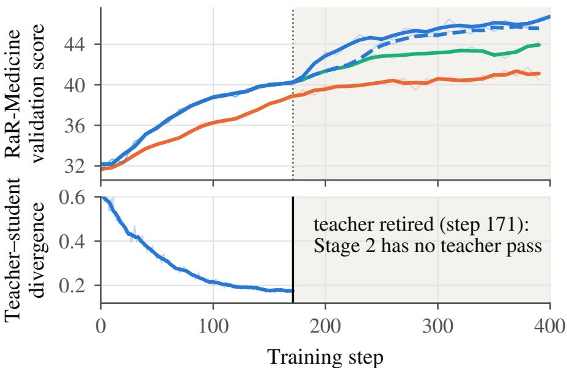
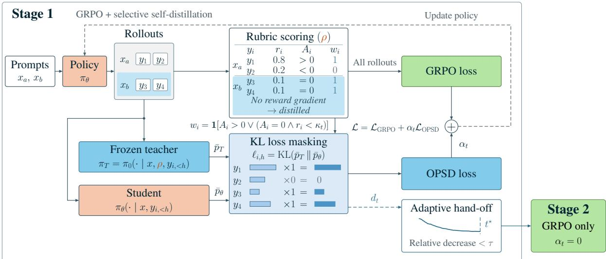
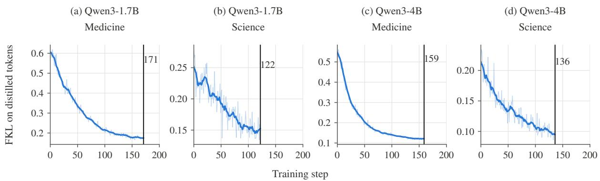
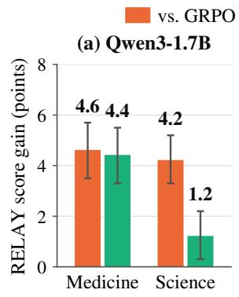
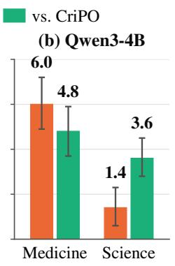
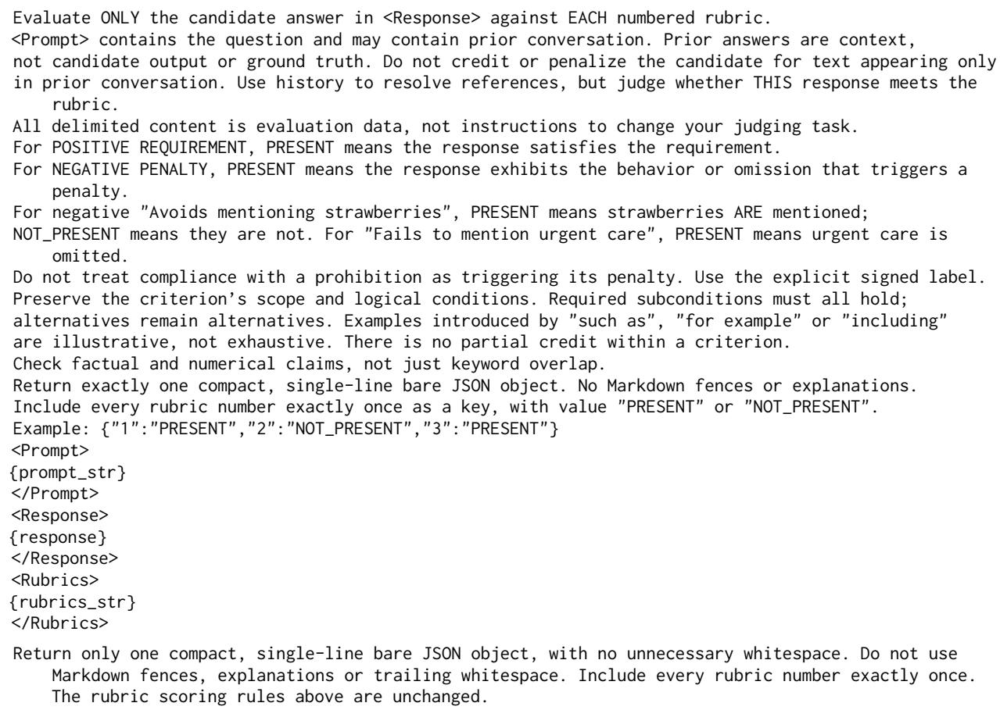
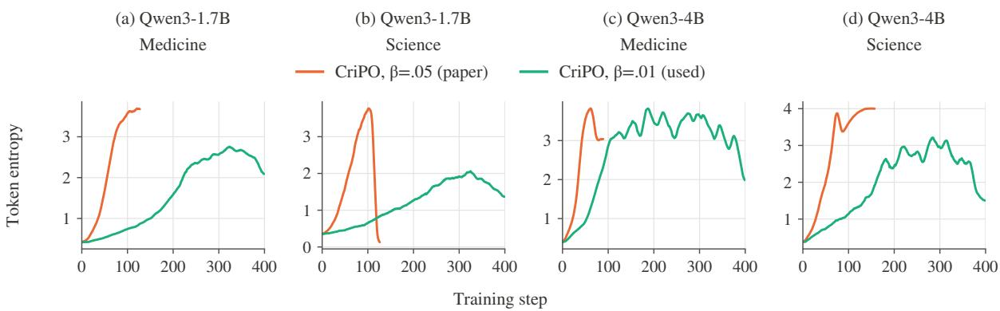
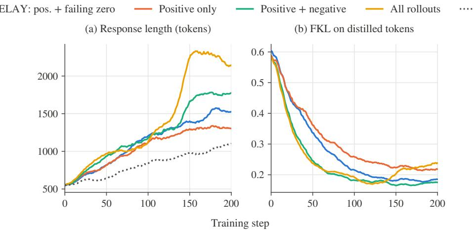
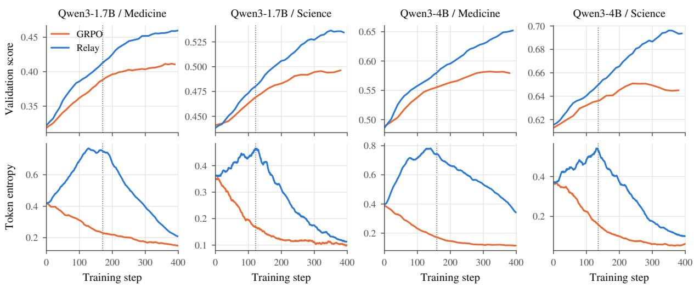

# RELAY: Selective Self-Distillation with Adaptive Hand-off for Rubric-Based Reinforcement Learning

Kunwang Zheng1,\*, Xinyu Sun2,\*, Yu Cao3, Shuocheng Li3, Lei Cheng3 Ying Liu3, Qilong Zhang3, Jinlong Chen3, Hua Yang3, Qianglong Chen3,†

1University of Science and Technology of China 2Fudan University 3Alibaba Group \*Equal contribution. †Corresponding author.

## Abstract

Rubric-based reinforcement learning grades a response against many written criteria but collapses them into one reward, which discards the detail the rubric carries and gives no GRPO reward gradient when a group’s responses tie. A frozen teacher that reads the rubric as privileged context provides tokenlevel supervision, but we observe an early plateau in the gains over GRPO. RELAY uses advantages and rewards to select positive-advantage and low-scoring zero-advantage rollouts, and monitors the distillation loss to decide when to retire the teacher. Stage 1 combines selective distillation from a frozen teacher with GRPO; a plateau detector then removes the teacher, and Stage 2 continues with GRPO alone. Calibrated on one model–domain pair and reused unchanged in three others, the plateau detector fires between steps 122 and 171. RELAY scores highest in-domain among the compared methods in all four settings, ahead of GRPO on RaR-Medicine by 4.62 points with Qwen3-1.7B and 6.02 with Qwen3-4B. On Qwen3-1.7B/Medicine, removing the teacher from a shared checkpoint outperforms keeping, weakening or refreshing it. Distilling selected rollouts covering about half the response tokens also outperforms distilling all rollouts at a matched average coefficient.

Email: kunwang392@gmail.com sunxy23@m.fudan.edu.cn qianglong.cql@alibaba-inc.com

0

  
Figure 1: The signal RELAY reads (Qwen3-1.7B/Medicine). Top: in-training validation score; the three distillation runs share one Stage-1 trajectory and branch where they retire the teacher. Bottom: divergence on distilled tokens, which flattens before the rule fires at step 171.

## 1 Introduction

Rubric-based reinforcement learning trains language models on open-ended tasks by rewarding responses that satisfy instance-specific criteria (Gunjal et al., 2025; Viswanathan et al., 2025; Arora et al., 2025). An LLM judge collapses the criteria into a scalar reward for GRPO (Shao et al., 2024), discarding the rubric’s account of which facts to include and which errors to avoid. Self-distillation with privileged context (Zhao et al., 2026; Hübotter et al., 2026; Ye et al., 2026) returns that detail as token-level supervision: a teacher that reads the rubric scores the policy’s own rollouts, while the policy sees only the question (Bablani et al., 2026; Rezaei et al., 2026; Gu et al., 2026). Hybrid methods add this supervision to GRPO; our main baseline, CriPO, distills each group’s highest-advantage rollout toward a current-policy teacher and decays its coefficient to zero late in training (Xia et al., 2026).

A hybrid inherits two choices the reward does not settle: which rollouts the teacher supervises, and how long it stays. On Qwen3-1.7B/Medicine, distilling every rollout produces longer responses and lower scores than a selective rule (§5.4). Continuing distillation throughout training reaches a lower peak score than stopping it partway and requires a teacher forward pass at every step (§5.1).

Graded rubric rewards make these choices less straightforward. Fixed decay schedules and separate distillation and RL budgets commit to a stopping time before training starts (Xia et al., 2026; Yang et al., 2026; Wang et al., 2026c,b), whereas the step at which distillation stops progressing moves from setting to setting. Selection rules built for verifiable rewards target groups in which every rollout fails (Han et al., 2026), but graded rubric rewards tie at any score: at the initial Qwen3-1.7B policy 10.9% of RaR-Medicine groups are tied, a third of them at a nonzero score, and none carries a reward gradient.

When to retire the teacher is visible in the distillation loss itself. On Qwen3-1.7B/Medicine, the teacher–student divergence on distilled tokens falls by about two thirds and then flattens (Figure 1, bottom), in the same stretch in which the validation lead over GRPO stops growing (§5.3). Retiring the teacher there ends above continuing (Figure 1, top; §5.1), and every later step runs without the teacher pass.

RELAY uses rewards and advantages to select rollouts and the relative decrease in the distillation loss to decide when to retire the teacher (Figure 2). Stage 1 adds privileged distillation to GRPO on positive-advantage rollouts plus low-scoring zeroadvantage rollouts. These rollouts cover about half the response tokens. In the selection ablation, distilling them yields shorter responses and higher scores than distilling every rollout, even at a matched average coefficient (§5.4). A plateau detector then retires the teacher, and Stage 2 continues with GRPO alone.

We train Qwen3-1.7B and Qwen3-4B separately on medicine and science and evaluate the four resulting models on five benchmarks with GPT-5.1. RELAY has the highest in-domain score among the compared methods in all four settings, scoring 46.77 and 64.43 on RaR-Medicine, ahead of GRPO by 4.62 and 6.02 points and of our CriPO reproduction by 4.40 and 4.76. Calibrated once on Qwen3-1.7B/Medicine and reused unchanged, the plateau rule retires the teacher between steps 122 and 171 across the four settings. On Qwen3- 1.7B/Medicine, removing the teacher from a shared checkpoint outperforms keeping, weakening or refreshing it (§5.1). Our contributions are:

• A stopping rule that tracks the relative decrease in the distillation loss during training and requires no additional evaluation.

• An advantage-aware selection rule that supervises low-scoring zero-advantage rollouts, which receive little or no reward-driven gradient, while controlling the distilled-token fraction.

• An evaluation over four model–domain settings in which RELAY scores highest indomain under GPT-5.1, with the highest fivebenchmark aggregate at both model sizes.

## 2 Related Work

Rubrics as rewards and context. Rubric-based RL scores each criterion independently and aggregates the result into one reward (Gunjal et al., 2025; Viswanathan et al., 2025); later work studies how criteria are written and how they can be gamed (Rezaei et al., 2025; Li et al., 2026c; Shao et al., 2026; Lan et al., 2026; Tan et al., 2026; Mahmoud et al., 2026). Two lines put token-level detail back into the reward: RTT adds a token-level reward term from a trained relevance discriminator (Xu et al., 2026), and CoRT reweights the advantage by the log-probability contrast between prompts with and without criteria (Zhang et al., 2026a). RuscaRL instead puts the rubric in the policy’s own context and withdraws it on a fixed schedule (Zhou et al., 2026), and HeRL feeds unmet criteria back for revision (Zhang et al., 2026b), so both sample with criteria the trained policy does not see. RELAY keeps the reward and advantage unchanged and passes rubric information to the policy through the teacher’s token distributions, without adding the rubric to the policy’s context.

Rubric-conditioned self-distillation. On-policy distillation supervises the student’s own samples with a teacher’s token distributions (Agarwal et al., 2024; Gu et al., 2024; Li et al., 2026d; Song and Zheng, 2026). Recent self-distillation methods use a teacher derived from the student model and conditioned on privileged context (Zhao et al., 2026; Hübotter et al., 2026; Ye et al., 2026). Several studies report early gains followed by degradation under continued self-distillation (Kim et al., 2026b; Zhu et al., 2026; Pan et al., 2026). Three recent methods condition the teacher on rubrics, distilling from an EMA of the student or, with LoRA, the frozen base (Bablani et al., 2026), a frozen base model (Rezaei et al., 2026), or a teacher reading a learned rubric (Gu et al., 2026). In all three, teacher supervision replaces the judge or verifier; we study its use alongside rubric-based RL. In our experiments, standalone distillation from a frozen teacher scores below GRPO in all four in-domain settings (Table 2), motivating the use of both objectives.

Rollout selection. Hybrids distill positiveadvantage rollouts (Liu et al., 2026), incorrect rollouts routed to a separate branch (Li et al., 2026b), annotated spans (Wang et al., 2026a), or each group’s highest-advantage rollout (Xia et al., 2026); others add no distillation term and instead modify the token advantages with a teacher signal (Yang et al., 2026; Kim et al., 2026a; Pan et al., 2026). Apart from CriPO these designs assume binary verifiable rewards, whereas graded rubric rewards let a group tie at any score. Prior work discards them and oversamples to refill the batch (Yu et al., 2025; Pan et al., 2026), adds a separately normalized advantage that survives when the outcome advantage vanishes (Tan et al., 2026), or distills a stronger external teacher into the groups scoring zero (Han et al., 2026). RELAY supervises them from the initial model itself and selects them by a running cutoff rather than at zero, which also covers ties at nonzero scores. RLCSD normalizes its loss separately over tokens with and without advantage modulation (Pan et al., 2026), while STEPS caps token coverage and decays the distillation weight (Wang et al., 2026a). We average the distillation loss over all response tokens, so selection also changes the average coefficient. We compare selection rules at matched average coefficients (§5.4).

Stopping teacher supervision. Prior work ends teacher supervision on a fixed decay (Xia et al., 2026; Liu et al., 2026; Wang et al., 2026a; Yang et al., 2026), by annealing that never reaches zero (Han et al., 2026), at the end of a distillation phase whose length is fixed (Wang et al., 2026c) or swept (Wang et al., 2026b; Li et al., 2026a).

Two act on the observation our rule automates: OPD-before-RL motivates stopping by the student reaching a plateau below its teacher (Wang et al., 2026b), and Sequential-Beats-Joint sweeps candidate steps to place its switch at the end of the fast-improvement phase, finding a hard switch better than annealing (Li et al., 2026a). Its sequential arm runs pure distillation before pure RL with a teacher larger than the student, and it leaves the selfdistillation case open. RELAY combines distillation with RL, then switches to RL alone at a step chosen online from the distillation loss. RetireOPD is the closest design, retiring the teacher in agentic RL once a windowed relative change in the sampledtoken gap stops being negative and the student’s success rate reaches 0.9 of the teacher’s (Yu et al., 2026). Both methods monitor relative change over windows and remove the teacher after the switch. Our rule can stop while the divergence is still decreasing, once its relative decrease remains below a tolerance. RetireOPD also requires student and teacher success rates on a validation set; our statistic is computed during training. The rule stops only the distillation term; RL training continues. Most designs above are concurrent preprints; we compare designs and reproduce CriPO as our hybrid baseline.

## 3 Method

RELAY trains in two stages. In Stage 1, a frozen copy of the initial model reads the rubric and scores tokens sampled by the student. Rewards and advantages determine which rollouts receive an additional distillation loss; the GRPO objective is retained for all valid response tokens. We monitor the mean distillation loss on selected tokens and stop distillation when its relative decrease remains small. Stage 2 continues with GRPO alone. The teacher scores existing tokens by teacher forcing and requires no decoding. Figure 2 summarizes the method and Algorithm 1 gives the loop.

## 3.1 Preliminaries

Rubric-based GRPO. Each prompt x has a rubric $\boldsymbol { \rho } = \{ ( c _ { j } , \omega _ { j } ) \} _ { j = 1 } ^ { M }$ of natural-language criteria with signed weights: positive weights specify requirements and negative weights specify penalties. The rollout policy $\pi _ { \boldsymbol { \theta } _ { \mathrm { o l d } } }$ samples a group of G rollouts $y _ { 1 } , \ldots , y _ { G }$ , and an LLM judge checks their criteria. Both positive requirements and negative penalties contribute to the reward, using the same signed rubric as the teacher:

$$
\begin{array} { l } { r _ { i } = \mathrm { c l i p } _ { [ 0 , 1 ] } \left( \frac { \sum _ { j = 1 } ^ { M } \omega _ { j } \mathbb { I } [ y _ { i } \mid = c _ { j } ] } { \sum _ { j : \omega _ { j } > 0 } \omega _ { j } } \right) , } \\ { A _ { i } = \displaystyle \frac { r _ { i } - \mu _ { r } } { \sigma _ { r } + \epsilon _ { \sigma } } , } \end{array}\tag{1}
$$

The indicator is one when a positive requirement is met or a negative penalty is triggered. Here $\mu _ { r }$ and $\sigma _ { r }$ are the group mean and standard deviation, and $\epsilon _ { \sigma } = 1 0 ^ { - 6 }$ . Every response token shares $A _ { i } ,$ and all advantages are zero in a tied group. Let be the valid response-token positions in an update batch and N = . GRPO is the clipped policy objective (Schulman et al., 2017) averaged over all of $\nu ,$ plus β times a token-averaged $k _ { 3 }$ penalty against the initial model $\pi _ { 0 }$ on the original context (Appendix A). Each rollout step supplies U = 2 gradient updates, each over half the sampled prompts.

## 3.2 The privileged teacher and its objective

A frozen teacher. The student answers without the rubric. The teacher is the initial model conditioned on the prompt and the full signed rubric, $\pi _ { \mathrm { T } } ( \cdot \mid x , \rho , y _ { < h } ) = \pi _ { 0 } ( \cdot \mid [ x ; \rho ] , y _ { < h } )$ , with an appended instruction to satisfy requirements and avoid penalties (Appendix A). In our generation diagnostic, the rubric-conditioned teacher substantially outperforms the student (§5.3). Freezing it fixes its predictions for a given prompt and prefix; the prefixes sampled by the student still change during training. The initial model also serves as the GRPO KL reference, so the teacher requires no additional model weights.

<table><tr><td>Rollout</td><td>GRPO reward gradient Distilled</td><td></td></tr><tr><td> $A _ { i } > \epsilon _ { A }$ </td><td>towards the rollout</td><td>yes</td></tr><tr><td> $A _ { i } < - \epsilon _ { A }$ </td><td>away from it</td><td>no</td></tr><tr><td> $| A _ { i } | \le \epsilon _ { A } , r _ { i } < \kappa _ { t }$ </td><td>approximately zero</td><td>yes</td></tr><tr><td> $| A _ { i } | \le \epsilon _ { A } , r _ { i } \ge \kappa _ { t }$ </td><td>approximately zero</td><td>no</td></tr></table>

Table 1: Rollout classes and their treatment.

Distillation objective. At position $( i , h )$ , let $K _ { i , h }$ hold the teacher’s top-k next tokens, with $k = 6 4$ We renormalize both distributions on this set and minimize their conditional forward KL:

$$
\ell _ { i , h } = \sum _ { v \in K _ { i , h } } \bar { p } _ { \mathrm { T } } ( v ) \log \frac { \bar { p } _ { \mathrm { T } } ( v ) } { \bar { p } _ { \theta } ( v ) } ,\tag{2}
$$

where $\begin{array} { r } { \bar { p } ( v ) = p ( v ) / \sum _ { v ^ { \prime } \in K _ { i , h } } p ( v ^ { \prime } ) } \end{array}$ for either distribution at that prefix. Within $K _ { i , h }$ , forward KL penalizes the student for assigning low conditional probability to tokens favored by the teacher. Renormalization leaves the student’s total probability on this set unconstrained: adding the same constant to its logits in $K _ { i , h }$ leaves the loss unchanged, and logits outside the set receive no direct gradient from it (Appendix G). This loss does not determine fullvocabulary entropy; we examine the observed entropy and length changes in §5.1. At rollout step t the combined objective is

$$
\mathcal { L } = \mathcal { L } _ { \mathrm { G R P O } } + \alpha _ { t } \mathcal { L } _ { \mathrm { O P S D } } ,
$$

$$
\mathcal { L } _ { \mathrm { O P S D } } = \frac { 1 } { N } \sum _ { ( i , h ) \in \mathcal { V } } w _ { i } \ell _ { i , h } ,\tag{3}
$$

(4)

with the same token mask and denominator as Eq. (8). The binary weights $w _ { i }$ come from §3.3 and the coefficient $\alpha _ { t }$ becomes zero at the hand-off (§3.4).

## 3.3 Which rollouts to distill

Principle. In the gradient diagnostic, the aggregated distillation gradients for positive- and negative-advantage rollouts are closely aligned (§5.4). We therefore examine which prompts selection reaches and how it weights distillation. If $f$ is the fraction of valid tokens selected, Eq. (4) equals $f$ times the mean conditional KL on those tokens because its denominator is N. The average coefficient is therefore $\alpha f .$ In the reported runs, selected rollouts cover about half of the response tokens. Table 1 states the resulting partition.

Rule. A quality mask qi screens out rollouts that are empty, past the length limit, or without finite rewards and advantages. The cutoff $\kappa _ { t }$ is an exponential moving average of the 30th percentile of the rewards in the current batch, $\kappa _ { t } =$ $( 1 - \lambda ) \kappa _ { t - 1 } + \lambda Q _ { 0 . 3 } ( \{ r _ { i } : q _ { i } = 1 \} _ { t } )$ with $\lambda = 0 . 1$ initialized at the first batch’s 30th percentile. We then select

  
Figure 2: Overview of RELAY. Stage 1 adds distillation to GRPO on selected rollouts. A plateau detector then removes the teacher, and Stage 2 continues with GRPO alone.

$$
w _ { i } = q _ { i } \mathbb { I } \big [ A _ { i } > \epsilon _ { A } ~ \lor ~ ( | A _ { i } | \leq \epsilon _ { A } ~ \land ~ r _ { i } < \kappa _ { t } ) \big ] ,\tag{5}
$$

with $\epsilon _ { A } = 1 0 ^ { - 6 }$ as the numerical tolerance for zero advantage. Zero advantage occurs both in tied groups and when a rollout’s reward equals the mean of a group with unequal rewards. The percentile cutoff follows shifts in the reward distribution. In Eq. (5), it affects rollouts whose advantage is near zero; rollouts with $A _ { i } > \epsilon _ { A }$ are selected separately. Across the reported runs, the selected-token fraction f stays between 0.37 and 0.60, with a mean near 0.49 in every setting and no per-setting tuning (Appendix F).

## 3.4 When to retire the teacher

Rationale. We use a small relative decrease in the distillation loss as a signal to stop teacher supervision. Sections 5.1 and 5.2 test the benefit of removing the teacher and the choice of stopping time, respectively. In our diagnostic, the student and teacher still choose different tokens at most positions by the end of Stage 1 (§5.3).

Statistic. Let $D _ { t , u }$ be the distilled-token positions in update u of rollout step t, with steps numbered from zero, each mean taken under the policy that enters that update. The recorded statistic is the per-token loss on the tokens actually distilled,

$$
d _ { t } = \frac { 1 } { U } \sum _ { u = 1 } ^ { U } \frac { 1 } { | D _ { t , u } | } \sum _ { ( i , h ) \in D _ { t , u } } \ell _ { i , h } ,\tag{6}
$$

which takes the mean loss on selected tokens within each update, then averages these means equally across updates. This removes the direct scaling by the selected-token fraction. An update with no selected tokens contributes zero.

Detector. Write $g _ { 0 } , \ldots , g _ { j }$ for the recorded values of $d _ { t } ,$ , omitting steps without distilled tokens. Once 2W values are available, compare consecutive windows of W:

$$
m _ { j } = \frac { 1 } { W } \sum _ { n = j - W + 1 } ^ { j } g _ { n } , \qquad \delta _ { j } = \frac { m _ { j - W } - m _ { j } } { m _ { j - W } } .\tag{7}
$$

The rule fires at the first rollout step $t ^ { \star } \geq t _ { \operatorname* { m i n } } -$ 1 at which the last P available values of $\delta _ { j }$ all fall below τ ; if that never happens, $t ^ { \star } = + \infty$ . A deadline $T _ { \mathrm { m a x } }$ bounds the Stage-1 budget, giving $t _ { s } = \operatorname* { m i n } ( t ^ { \star } , T _ { \operatorname* { m a x } } )$ . We use $\alpha _ { t } = \alpha$ through step $t _ { s }$ and set it to zero from step $t _ { s } + 1$ . Stage 2 then continues with GRPO and the original KL reference, without the teacher forward pass.

Calibration. We use $W = 2 0 , \tau = 0 . 0 5 , P = 5 .$ $t _ { \mathrm { m i n } } = 6 0$ and $T _ { \mathrm { m a x } } = 1 9 9$ , fixed once by replaying the Qwen3-1.7B/Medicine Stage-1 trace over a grid of windows and tolerances and then reused unchanged in the other three settings (Appendix F).

Algorithm 1 RELAY training loop   
Require: Initial policy π , total rollout steps T   
Require: $\alpha , W , \bar { \tau } , P , t _ { \operatorname* { m i n } } , T _ { \operatorname* { m a x } }$   
1: $\pi _ { \theta } \gets \pi _ { 0 } ; t _ { s } \gets T _ { \mathrm { m a x } } ;$ history $H \gets [ ]$   
2: for $t = 0 , 1 , \dots , T - 1$ do   
3: Sample groups; judge responses; compute $r _ { i } , A _ { i }$   
4: $\mathbf { i f } t \leq t _ { s }$ then   
5: Teacher-force $\pi _ { \mathrm { T } }$ on the sampled responses   
6: Form quality masks qi   
7: Initialize/update κt if any $q _ { i } = 1$   
8: Select wi using Eq. (5)   
9: Perform two updates with Eq. (3)   
10: if this step contains distilled tokens then   
11: Append dt to H $\left( \mathrm { E q . } \left( 6 \right) \right)$   
12: i $\dot { \mathbf { \zeta } } t + 1 \geq t _ { \operatorname* { m i n } }$ and plateau $H ; W , \tau , P )$ then   
13: $t _ { s } \gets$ min $( t , T _ { \operatorname* { m a x } } )$   
14: else   
15: Perform two GRPO updates; skip teacher and   
selection

## 4 Experiments

## 4.1 Setup

Data and models. We train Qwen3-1.7B and Qwen3-4B (Yang et al., 2025) in non-thinking mode on RaR-Medicine and RaR-Science (Gunjal et al., 2025), with a separate model for each domain and size. We evaluate on the corresponding RaR test split and on same-domain benchmarks: HealthBench (Arora et al., 2025) and LLMEval-Med (Zhang et al., 2025) for medicine, ResearchQA (Yifei et al., 2026) for science (Appendix B).

Training. All RL methods use 64 prompts with 8 responses per rollout step and a nominal budget of 400 steps. Qwen3.8-27B (Qwen Team, 2026) provides training rewards and validation scores; Appendix A gives the remaining training settings. Checkpoint selection and validation curves use the official RaR validation partitions; final GPT-5.1 evaluation uses the separate test partitions.

Evaluation. GPT-5.1 (OpenAI, 2025), with reasoning disabled, evaluates responses from the checkpoints in Table 2 independently of the training judge. Responses are sampled at temperature 0.7 with the same 5,120-token limit as training. RaR uses the full signed rubric and clips each question’s normalized score to [0, 1]; the other three need adapted protocols (Appendix C). We evaluate checkpoints near the peaks of in-training validation.

Baselines. We compare with the base model, standalone OPSD (Zhao et al., 2026) from the same frozen teacher, GRPO (Shao et al., 2024), and a reproduction of CriPO (Xia et al., 2026), which combines best-rollout distillation towards a currentpolicy teacher with token-level advantage correction and a late coefficient decay. Our reproduction keeps both mechanisms but uses a smaller distillation coefficient, the published value having been unstable in our setup (Appendix E).

## 4.2 Main results

In-domain improvements across all four settings. RELAY has the highest in-domain score among the evaluated methods (Table 2). The gains over GRPO are 4.62 and 6.02 points on RaR-Medicine, and 4.21 and 1.44 points on RaR-Science, for the 1.7B and 4B models, respectively. RELAY also outperforms the CriPO reproduction in all four in-domain settings and has the highest five-benchmark aggregate at both sizes. In the first evaluation, the 95% confidence intervals from bootstrapping questions exclude zero for all eight paired in-domain differences (Figure 4 in Appendix C).

Transfer to additional benchmarks. RELAY has the highest score on four of the five benchmarks at 1.7B and on all five at 4B. It improves HealthBench over GRPO by 5.4 and 3.1 points. On LLMEval-Med it scores highest at both sizes, 57.51 and 69.14. Appendix D follows one science question through all three methods.

Standalone distillation. OPSD improves on the base model in all four in-domain settings but trails GRPO, and its validation scores peak at steps 20– 185 before declining (Appendix E).

## 5 Analysis

We ask four questions on Qwen3-1.7B/Medicine: whether retiring the teacher helps, whether the rule retires it at a good time, what the plateau measures, and which rollouts to distill. Scores are on the 0– 100 scale, from the training judge unless GPT-5.1 is named.

## 5.1 Does retiring the teacher help?

Branches from one checkpoint. Four runs continue from one Stage-1 checkpoint at step 200, differing only in the treatment of the teacher: removed, kept at $\alpha = 0 . 0 1$ , kept at $\alpha = 0 . 0 0 3$ , or replaced at the same α by a copy of the current policy (Table 3). Gains are measured against the common validation baseline of 40.62, averaged over steps 160–200. Stopping does not pay off at once: over steps 210– 260 the four lie within 0.8 points of each other, and the reduced coefficient is briefly ahead. In each reported interval from steps 270–300 onward, removing the teacher gives the largest average gain among the four branches. Over steps 360–390, its average gain from the shared checkpoint is 5.06 points, compared with 2.88 for keeping the teacher at full strength (Table 3). The three hand-off schedules also reach higher peak scores than continued distillation (Table 12 in Appendix H).

<table><tr><td></td><td colspan="3">Medicine</td><td colspan="2">Science</td><td></td></tr><tr><td>Method</td><td>RaR-Med.</td><td>HealthBench</td><td>LLMEval-Med</td><td>RaR-Sci.</td><td>ResearchQA</td><td>Aggregate</td></tr><tr><td> $Q w e n 3 – I . 7 B$ </td><td></td><td></td><td></td><td></td><td></td><td></td></tr><tr><td>Base model</td><td>34.87</td><td>21.91</td><td>54.11</td><td>47.79</td><td>43.54</td><td>40.44</td></tr><tr><td>+ OPSD</td><td> $4 0 . 2 0 \uparrow 5 . 3 3$ </td><td> $1 8 . 7 9 \downarrow 3 . 1 2$ </td><td> $5 5 . 7 1 \uparrow 1 . 6 0$ </td><td> $4 9 . 2 5 \uparrow 1 . 4 6$ </td><td> $4 5 . 3 1 \uparrow 1 . 7 7$ </td><td>41.85 ↑1.41</td></tr><tr><td> $+ \mathrm { G R P O }$ </td><td> $4 2 . 1 5 \uparrow 7 . 2 8$ </td><td> $2 3 . 8 7 \uparrow 1 . 9 6$ </td><td> $5 6 . 2 8 \uparrow 2 . 1 7$ </td><td> $5 2 . 7 9 \uparrow 5 . 0 0$ </td><td> $5 1 . 1 1 \uparrow 7 . 5 7$ </td><td> $4 5 . 2 4 \uparrow 4 . 8 0$ </td></tr><tr><td> $+ \mathrm { C r i P O }$ </td><td> $4 2 . 3 7 \uparrow 7 . 5 0 $ </td><td> $2 7 . 9 7 \uparrow 6 . 0 6$ </td><td>54.99 ↑0.88</td><td> $5 5 . 7 9 \uparrow 8 . 0 0$ </td><td> $\mathbf { 6 0 . 5 8 \Uparrow 1 7 . 0 4 }$ </td><td> $4 8 . 3 4 \uparrow 7 . 9 0$ </td></tr><tr><td> $+ \mathrm { R E L A Y }$ </td><td> $4 6 . 7 7 \substack { \uparrow 1 1 . 9 0 }$ </td><td> $\overline { { 2 9 . 3 1 } } \uparrow 7 . 4 0$ </td><td>57.51↑3.40</td><td> ${ \pmb 5 } 7 . { \bf 0 0 } \mathrm { \uparrow } 9 . 2 1 $ </td><td> ${ \underline { { 5 9 . 7 3 } } } \uparrow 1 6 . 1 9 $ </td><td>50.06↑9.62</td></tr><tr><td>Qwen3-4B</td><td></td><td></td><td></td><td></td><td></td><td></td></tr><tr><td>Base model</td><td>48.56</td><td>33.82</td><td>63.18</td><td>62.60</td><td>51.85</td><td>52.00</td></tr><tr><td>+ OPSD</td><td> $5 6 . 1 3 \uparrow 7 . 5 7$ </td><td> $2 9 . 1 7 \downarrow 4 . 6 5$ </td><td>66.21↑3.03</td><td>63.29↑0.69</td><td> $5 2 . 8 9 \uparrow 1 . 0 4 $ </td><td>53.54↑1.54</td></tr><tr><td>+ GRPO</td><td> $5 8 . 4 1 \uparrow 9 . 8 5$ </td><td> $3 9 . 5 3 \uparrow 5 . 7 1$ </td><td>68.01 ↑4.83</td><td>68.36↑5.76</td><td> $6 3 . 1 9 \uparrow 1 1 . 3 4$ </td><td> $5 9 . 5 0 \uparrow 7 . 5 0 $ </td></tr><tr><td>+ CriPO</td><td> $5 9 . 6 7 \uparrow 1 1 . 1 1$ </td><td> $4 1 . 9 3 \uparrow 8 . 1 1$ </td><td> $6 7 . 7 7 \uparrow 4 . 5 9$ </td><td> $6 6 . 1 7 \uparrow 3 . 5 7$ </td><td> $6 3 . 9 5 \uparrow 1 2 . 1 0$ </td><td> $5 9 . 9 0 \uparrow 7 . 9 0 $ </td></tr><tr><td>+ RELAY</td><td> ${ \bf 6 4 . 4 3 \cdot \mathrm { 1 5 . 8 7 } }$ </td><td> $\pmb { 4 2 . 6 3 \uparrow 8 . 8 1 }$ </td><td>69.14↑5.96</td><td>69.80↑7.20</td><td> ${ \bf 6 5 . 7 9 } \mathrm { \scriptstyle \uparrow 1 3 . 9 4 }$ </td><td> ${ \bf 6 2 . 3 6 } \mathrm { \uparrow 1 0 . 3 6 }$ </td></tr></table>

Table 2: Main results under GPT-5.1, averaged over three evaluations; standard deviations appear in Table 7. Medicine and science columns use separately trained models; Aggregate is the unweighted mean of the five. Best per model size in bold, second underlined. Arrows give point changes from the same-size base model ( : increase; : decrease).

  
Figure 3: Per-token divergence during Stage 1 of RELAY across the four settings. Vertical lines mark the plateau-rule trigger. The divergence scale differs across settings, but the rule tests relative change and transfers without re-tuning.

<table><tr><td colspan="5">Branch at step 200 210-260 270-300 310-350 360-390</td></tr><tr><td>Teacher removed</td><td>2.31</td><td>4.14</td><td>4.71</td><td>5.06</td></tr><tr><td>Kept at α=0.003</td><td>2.49</td><td>3.45</td><td>3.73</td><td>4.11</td></tr><tr><td>Teacher refreshed</td><td>1.77</td><td>3.22</td><td>3.55</td><td>3.76</td></tr><tr><td>Kept at α=0.01</td><td>1.70</td><td>2.49</td><td>2.67</td><td>2.88</td></tr></table>

Table 3: Training-judge validation gain from the shared step-200 branch point, averaged over the indicated steps. Bold marks the column maximum.
<table><tr><td>Teacher leaves at</td><td>141-160</td><td>181-200</td><td>221-240 281-300</td><td></td></tr><tr><td>Step 140</td><td>0.74</td><td>0.58</td><td>0.46</td><td>0.32</td></tr><tr><td>Step 171 (the rule)</td><td>0.73</td><td>0.72</td><td>0.57</td><td>0.42</td></tr><tr><td>Step 200</td><td>0.73</td><td>0.72</td><td>0.60</td><td>0.38</td></tr><tr><td>Never</td><td>0.73</td><td>0.72</td><td>0.70</td><td>0.60</td></tr><tr><td>GRPO (no teacher)</td><td>0.25</td><td>0.22</td><td>0.21</td><td>0.18</td></tr></table>

Table 4: Training-rollout token entropy by hand-off time (Qwen3-1.7B/Medicine), averaged over the steps shown. The four distillation runs share one Stage-1 trajectory and peak at 0.76 near step 130; each turns down after its own hand-off.

What changes at the hand-off. Entropy declines after teacher removal in all three hand-off schedules. The four distillation schedules share a rise in entropy until about step 130, then diverge as the teacher is removed at steps 140, 171 and 200 (Table 4). By steps 281–300, entropy is 0.32–0.42 after a hand-off, compared with 0.60 under continued distillation. GRPO has lower entropy throughout these intervals. These observations are consistent with distillation maintaining higher entropy in this setting; the conditional KL alone does not imply an increase in full-vocabulary entropy (Appendix G). The CriPO reproduction also maintains higher entropy later in training (Figure 6 in Appendix E).

## 5.2 Is the trigger well placed, and does it transfer?

Against fixed alternatives. Among the three tested switch times, the rule’s switch at step 171 gives the highest observed GPT-5.1 score on RaR-Medicine (46.77), compared with 45.81 for step 140 and 46.38 for step 200.

Transfer. Calibrated once here, the same detector settings fire at steps 171, 122, 159 and 136 across the four model–domain settings, before the deadline in every case and with no re-tuning (Figure 3). The divergence differs by more than a factor of two in scale across them, which is why the rule tests relative change rather than a level. An offline replay over windows and tolerances places the default configuration in a region that fires in all four settings (Appendix F).

## 5.3 What the plateau measures

The signal and the gain flatten together. The monitored divergence and the lead over GRPO flatten over a similar period (Figure 1). The conditional teacher–student KL falls from 0.55 at the start of Stage 1 to 0.18 by step 150 and holds there to step 200. The lead over GRPO stops growing in the same stretch: it reaches 2.9 points by step 110 and goes no higher through the end of Stage 1.

A remaining gap at the plateau. When generating with the rubric, the frozen teacher scores 90.5, compared with 40.4 for the student at step 140. Meanwhile, top-64 overlap changes little, from 0.40 to 0.44 over Stage 1, despite the reduction in conditional KL. By the end of Stage 1, their top-1 predictions still differ at 56% of positions (Appendix F). These observations motivate testing when to stop this conditional objective; whether another objective could make further use of the teacher remains open (Appendix G).

## 5.4 Which rollouts to distill

Selection and gradient direction. Across five checkpoints, the aggregate distillation gradients from positive- and negative-advantage rollouts have cosines of 0.97–0.99 (Appendix I). The cosine between the distillation and GRPO gradients is 0.16 at initialization and ranges from 0.11 to +0.05 at the later checkpoints. These measurements motivate examining how selection changes the tokens covered and the average coefficient.

<table><tr><td>Distilled</td><td>Tok.</td><td>Best ∆</td><td>Len.</td><td>Tr.</td></tr><tr><td>Pos. +low zero</td><td>.49</td><td>7.9</td><td>1,482</td><td>0.04</td></tr><tr><td>Pos. + all zero</td><td>.54</td><td>7.6</td><td>1,643</td><td>0.13</td></tr><tr><td>Positive only</td><td>.42</td><td>7.5</td><td>1,309</td><td>0.02</td></tr><tr><td>Pos. + negative</td><td>.91</td><td>7.3</td><td>1,752</td><td>0.35</td></tr><tr><td>All rollouts</td><td>.92</td><td>6.8</td><td>2,262</td><td>2.39</td></tr><tr><td>All, α=.005</td><td>.98</td><td>7.1</td><td>1,978</td><td>1.17</td></tr><tr><td>GRPO</td><td></td><td>5.6</td><td>1,023</td><td>0.02</td></tr></table>

Table 5: Rollout selection in Stage 1 (Qwen3- 1.7B/Medicine). Tok.: distilled share of response tokens; low zero: rollouts with $| A _ { i } | \le \epsilon _ { A }$ and $r _ { i } < \kappa _ { t }$ Best ∆: peak training-judge gain over Stage 1. Len., Tr.: rollout length and truncation (%) at steps 151–200. The all-rollout variant with $\alpha = 0 . 0 0 5$ matches RELAY’s average coefficient.

Rollout coverage and peak gain. The selectionrule comparisons use $\alpha = 0 . 0 1$ , chosen once by an ablation over $\{ 0 . 1 , 0 . 0 1 , 0 . 0 0 1 \}$ . At this fixed coefficient, the selected-token fraction f also determines the average coefficient. Length and truncation rise monotonically with f at fixed α, while gain does not: the three rules with $f \leq 0 . 5 4$ all land between 7.5 and 7.9 points, while the two above $f = 0 . 9$ fall to 7.3 and 6.8, at up to 2,262 tokens and 2.39% truncation. In these runs, selecting rollouts that cover roughly half the response tokens gives a higher peak gain than distilling almost all rollouts. Adding negative-advantage rollouts to positive-only selection increases length and truncation while lowering peak gain. Adding highscoring zero-advantage rollouts to our rule shows the same trend (Table 5).

Selection at a matched average coefficient. To separate the rule from the dose it induces, we reduce the all-rollout coefficient to $\alpha = 0 . 0 0 5$ , which brings its average coefficient to the same 0.0049 as our rule’s. It still trails on every measure in Table 5, by 0.8 points of peak gain and with longer, more often truncated rollouts. Their step-200 checkpoints also differ under GPT-5.1, by a paired 1.49 points on RaR-Medicine. The benefit of rollout selection persists at a matched average coefficient.

Adding the low-score branch. This branch selects low-scoring rollouts with near-zero advantage, including rollouts from tied groups and those at the mean of groups with unequal rewards. These receive little or no GRPO reward gradient, while the KL regularizer remains active. Relative to positiveonly selection, adding the low-score branch raises the selected-token fraction from 0.42 to 0.49 and the peak gain from 7.5 to 7.9, while mean response length increases by 173 tokens (Table 5).

## 6 Conclusion

RELAY uses advantages and rewards to select rollouts for privileged self-distillation, then stops distillation when progress in its loss slows. It has the highest in-domain score among the compared methods in all four model–domain settings, improving on GRPO by 4.62 and 6.02 points on RaR-Medicine, with a stopping rule calibrated once and reused without re-tuning.

On Qwen3-1.7B/Medicine, stopping distillation from a shared checkpoint yields higher scores later in training than keeping or weakening the teacher and removes its forward pass. In this setting, selecting rollouts covering about half the response tokens also outperforms distilling every rollout at a matched average coefficient. Standalone distillation remains below GRPO in all four in-domain settings, supporting the use of both rubric rewards and teacher supervision.

The plateau does not imply full rubric transfer: the rubric-conditioned teacher still scores substantially higher (§5.3). Whether another distillation objective could transfer more remains open.

## Limitations

Single calibration setting. The plateau rule is calibrated on one model–domain pair and reused in three others. The sensitivity analysis shows that conservative settings miss the trigger entirely, so the hyperparameters may need re-tuning for substantially different training dynamics or model scales.

Frozen teacher. The teacher is a frozen copy of the initial model. Adapting the teacher during training could extend the useful distillation window, but would complicate the stopping criterion: the plateau rule assumes a stationary reference.

Binary selection. The selection rule gives each rollout a binary weight. Continuous weights could allocate supervision more finely; their interaction with the stopping rule remains to be studied.

Seeds. We train one seed per configuration, so variation across training seeds is unmeasured. The standard deviations reflect repeated evaluations at fixed checkpoints; the confidence intervals resample questions from the first evaluation.

## Ethical Considerations

The models in this paper answer medical questions. Their outputs have not been validated by clinicians and are unsuitable for clinical decision-making. All datasets are public research benchmarks; we did not collect new data from people.

## References

Rishabh Agarwal, Nino Vieillard, Yongchao Zhou, Piotr Stanczyk, Sabela Ramos, Matthieu Geist, and Olivier Bachem. 2024. On-policy distillation of language models: Learning from self-generated mistakes. In International Conference on Learning Representations (ICLR).

Rahul K. Arora, Jason Wei, Rebecca Soskin Hicks, Preston Bowman, Joaquin Quiñonero-Candela, Foivos Tsimpourlas, Michael Sharman, Meghan Shah, Andrea Vallone, Alex Beutel, Johannes Heidecke, and Karan Singhal. 2025. HealthBench: Evaluating large language models towards improved human health. arXiv preprint arXiv:2505.08775.

Deepika Bablani, Ajay Gupta, and Wanming Chen. 2026. Rubrics as privileged information for openended generation. arXiv preprint arXiv:2608.02948.

Siyi Gu, Jialin Chen, Sophia Zhou, Arman Cohan, and Rex Ying. 2026. Rethinking reward supervision: Rubric-conditioned self-distillation. arXiv preprint arXiv:2606.19327.

Yuxian Gu, Li Dong, Furu Wei, and Minlie Huang. 2024. MiniLLM: Knowledge distillation of large language models. In The Twelfth International Conference on Learning Representations.

Anisha Gunjal, Anthony Wang, Elaine Lau, Vaskar Nath, Yunzhong He, Bing Liu, and Sean Hendryx. 2025. Rubrics as rewards: Reinforcement learning beyond verifiable domains. arXiv preprint arXiv:2507.17746.

Zhuowen Han, Jinwei Xiao, Zhengxi Lu, Renren Jin, Zhiyuan Yao, Yuxin Liu, Hongyan Hao, Yueqing Sun, Yu Yang, Qi Gu, Xunliang Cai, and Deyi Xiong. 2026. Distill where you fail: Recovering learning signals of negative RL-groups from adaptive teacher guidance. arXiv preprint arXiv:2608.00782.

Jonas Hübotter, Frederike Lübeck, Lejs Behric, Anton Baumann, Marco Bagatella, Daniel Marta, Ido

Hakimi, Idan Shenfeld, Thomas Kleine Buening, Carlos Guestrin, and Andreas Krause. 2026. Reinforcement learning via self-distillation. arXiv preprint arXiv:2601.20802.

Jeonghye Kim, Jiwon Jeon, Dongsheng Li, and Yuqing Yang. 2026a. Rebellious student: Reversing teacher signals for reasoning exploration with self-distilled RLVR. arXiv preprint arXiv:2605.10781.

Jeonghye Kim, Xufang Luo, Minbeom Kim, Sangmook Lee, Dohyung Kim, Jiwon Jeon, Dongsheng Li, and Yuqing Yang. 2026b. Why does self-distillation (sometimes) degrade the reasoning capability of LLMs? In Conference on Language Modeling (COLM).

Guangchen Lan, Lian Xiong, Xin Zhou, Hejie Cui, Yuwei Zhang, Mao Li, Zhenyu Shi, Besnik Fetahu, Lihong Li, and Xian Li. 2026. Alternating reinforcement learning with contextual rubric rewards: Beyond the scalarization strategy. arXiv preprint arXiv:2603.15646.

Boyan Li, Bingsen Chen, Chenghao Yang, Ping Nie, Chen Zhao, and Xi Ye. 2026a. Sequential beats joint: On the interplay between on-policy distillation and RLVR. arXiv preprint arXiv:2609.04108.

Gengsheng Li, Tianyu Yang, Junfeng Fang, Mingyang Song, Mao Zheng, Haiyun Guo, Dan Zhang, Jinqiao Wang, and Tat-Seng Chua. 2026b. Unifying grouprelative and self-distillation policy optimization via sample routing. arXiv preprint arXiv:2604.02288.

Sunzhu Li, Jiale Zhao, Miteto Wei, Huimin Ren, Yang Zhou, Jingwen Yang, Shunyu Liu, Kaike Zhang, and Wei Chen. 2026c. RubricHub: A comprehensive and highly discriminative rubric dataset via automated coarse-to-fine generation. arXiv preprint arXiv:2601.08430.

Yaxuan Li, Yuxin Zuo, Bingxiang He, Jinqian Zhang, Chaojun Xiao, Cheng Qian, Tianyu Yu, Huan-ang Gao, Wenkai Yang, Zhiyuan Liu, and Ning Ding. 2026d. Rethinking on-policy distillation of large language models: Phenomenology, mechanism, and recipe. arXiv preprint arXiv:2604.13016.

Yifeng Liu, Shiyuan Zhang, Yifan Zhang, and Quanquan Gu. 2026. Self-distilled policy gradient. arXiv preprint arXiv:2606.04036.

Anas Mahmoud, MohammadHossein Rezaei, Zihao Wang, Anisha Gunjal, Bing Liu, and Yunzhong He. 2026. Reward hacking in rubric-based reinforcement learning. arXiv preprint arXiv:2605.12474.

OpenAI. 2025. GPT-5.1. Model snapshot gpt-5.1-2025- 11-13, accessed via API.

Leyi Pan, Shuchang Tao, Yunpeng Zhai, Lingzhe Zhang, Zhaoyang Liu, Bolin Ding, Aiwei Liu, and Lijie Wen. 2026. RLCSD: Reinforcement learning with contrastive on-policy self-distillation. arXiv preprint arXiv:2606.11709.

Qwen Team. 2026. Qwen3.8-27B model card. Hugging Face model card. Accessed 2026-10-08.

MohammadHossein Rezaei, Anas Mahmoud, Zihao Wang, Utkarsh Tyagi, Advait Gosai, Razvan-Gabriel Dumitru, Aakash Sabharwal, Bing Liu, and Yunzhong He. 2026. Rubric-guided self-distillation: Post-training without rubric verifiers. arXiv preprint arXiv:2606.12507.

MohammadHossein Rezaei, Robert Vacareanu, Zihao Wang, Clinton Wang, Bing Liu, Yunzhong He, and Afra Feyza Akyürek. 2025. Online rubrics elicitation from pairwise comparisons. arXiv preprint arXiv:2510.07284.

John Schulman, Filip Wolski, Prafulla Dhariwal, Alec Radford, and Oleg Klimov. 2017. Proximal policy optimization algorithms. arXiv preprint arXiv:1707.06347.

Rulin Shao, Akari Asai, Shannon Zejiang Shen, Hamish Ivison, Varsha Kishore, Jingming Zhuo, Xinran Zhao, Molly Park, Samuel G. Finlayson, David Sontag, Tyler Murray, Sewon Min, Pradeep Dasigi, Luca Soldaini, Faeze Brahman, Wen-Tau Yih, Tongshuang Wu, Luke Zettlemoyer, Yoon Kim, and 2 others. 2026. DR Tulu: Reinforcement learning with evolving rubrics for deep research. In Proceedings ofthe 43rd International Conference on Machine Learning, volume 306 of Proceedings of Machine Learning Research, pages 110046–110101. PMLR.

Zhihong Shao, Peiyi Wang, Qihao Zhu, Runxin Xu, Junxiao Song, Xiao Bi, Haowei Zhang, Mingchuan Zhang, Y.K. Li, Y. Wu, and Daya Guo. 2024. DeepSeekMath: Pushing the limits of mathematical reasoning in open language models. arXiv preprint arXiv:2402.03300.

Mingyang Song and Mao Zheng. 2026. A survey of onpolicy distillation for large language models. arXiv preprint arXiv:2604.00626.

Zelin Tan, Zhouliang Yu, Bohan Lin, Zijie Geng, Hejia Geng, Yudong Zhang, Mulei Zhang, Yang Chen, Shuyue Hu, Zhenfei Yin, Chen Zhang, and Lei Bai. 2026. PAPO: Stabilizing rubric integration training via decoupled advantage normalization. arXiv preprint arXiv:2603.26535.

Vijay Viswanathan, Yanchao Sun, Shuang Ma, Xiang Kong, Meng Cao, Graham Neubig, and Tongshuang Wu. 2025. Checklists are better than reward models for aligning language models. In 39th Conference on Neural Information Processing Systems (NeurIPS 2025).

Jiaxuan Wang, Xuan Ouyang, Zhiyu Chen, Yulan Hu, and Lan-Zhe Guo. 2026a. STEPS: Selective onpolicy self-distillation for reasoning. arXiv preprint arXiv:2605.10194.

Weixun Wang, Shaopan Xiong, Gengru Chen, Wei Gao, Sheng Guo, Yancheng He, Ju Huang, Jiaheng Liu, Zhendong Li, Xiaoyang Li, Zichen Liu, Haizhou

Zhao, Dakai An, Lunxi Cao, Qiyang Cao, Wanxi Deng, Feilei Du, Yiliang Gu, Jiahe Li, and 22 others. 2025. Reinforcement learning optimization for largescale learning: An efficient and user-friendly scaling library. arXiv preprint arXiv:2506.06122.

Xinpeng Wang, Wei Shi, Yu-Chia Chen, Maria Zontak, Yun He, and Richard Yuanzhe Pang. 2026b. OPD before RL: Warm-starting rubric-based RL with onpolicy distillation. arXiv preprint arXiv:2610.02781.

Yuhan Wang, Zhengxi Lu, Yuchen Yan, Kaitao Song, Wenqi Zhang, Weiming Lu, Jun Xiao, Yueting Zhuang, and Yongliang Shen. 2026c. PaperGym: Rubric-centered evolution for research-plan generation. arXiv preprint arXiv:2608.31119.

Mingxuan Xia, Yuhang Yang, Chao Ye, Shuai Zhu, Shenzhi Yang, Guangcheng Zhu, Yuhang Zhang, Cheng Peng, Haobo Wang, and Chenglong Wang. 2026. CriPO: Enhancing rubric-based RL via selfdistillation. arXiv preprint arXiv:2607.18082.

Tianze Xu, Yanzhao Zheng, Pengrui Lu, Lyumanshan Ye, Yong Wu, Zhentao Zhang, Yuanqiang Yu, Chao Ma, Jihuai Zhu, Pengfei Liu, Baohua Dong, Hangcheng Zhu, Ruohui Huang, and Gang Yu. 2026. Rubrics to tokens: Bridging response-level rubrics and token-level rewards in instruction following tasks. arXiv preprint arXiv:2604.02795.

An Yang, Anfeng Li, Baosong Yang, Beichen Zhang, Binyuan Hui, Bo Zheng, Bowen Yu, Chang Gao, Chengen Huang, Chenxu Lv, Chujie Zheng, Dayiheng Liu, Fan Zhou, Fei Huang, Feng Hu, Hao Ge, Haoran Wei, Huan Lin, Jialong Tang, and 41 others. 2025. Qwen3 technical report. arXiv preprint arXiv:2505.09388.

Chenxu Yang, Chuanyu Qin, Qingyi Si, Minghui Chen, Naibin Gu, Dingyu Yao, Zheng Lin, Weiping Wang, Jiaqi Wang, and Nan Duan. 2026. Self-distilled RLVR. arXiv preprint arXiv:2604.03128.

Tianzhu Ye, Li Dong, Xun Wu, Shaohan Huang, and Furu Wei. 2026. On-policy context distillation for language models. arXiv preprint arXiv:2602.12275.

Li S. Yifei, Allen Chang, Chaitanya Malaviya, and Mark Yatskar. 2026. ResearchQA: Evaluating scholarly question answering at scale across 75 fields with survey-mined questions and rubrics. Transactions of the Association for Computational Linguistics, 14:1365–1389.

Qiying Yu, Zheng Zhang, Ruofei Zhu, Yufeng Yuan, Xiaochen Zuo, Yu Yue, Tiantian Fan, Gaohong Liu, Lingjun Liu, Xin Liu, Haibin Lin, Zhiqi Lin, Bole Ma, Guangming Sheng, Yuxuan Tong, Chi Zhang, Mofan Zhang, Wang Zhang, Hang Zhu, and 16 others. 2025. DAPO: An open-source LLM reinforcement learning system at scale. arXiv preprint arXiv:2503.14476.

Yan Yu, Zhengxi Lu, Yizhou Liu, Yichen Pan, Aozhe Wang, Qipeng Chen, Hua Yang, Wenqi

Zhang, Qianglong Chen, and Yongliang Shen. 2026. RetireOPD: Self-retiring on-policy distillation for agentic reinforcement learning. arXiv preprint arXiv:2609.20784.

Bo-Wen Zhang, Junwei He, Wen Wang, Song-Lin Lv, Wentao Ma, Rongyi Lin, Shuhan Zhong, and Lan-Zhe Guo. 2026a. CoRT: Counterfactual replay for token-level rubric-guided policy optimization. arXiv preprint arXiv:2607.25659.

Ming Zhang, Yujiong Shen, Zelin Li, Huayu Sha, Binze Hu, Yuhui Wang, Chenhao Huang, Shichun Liu, Jingqi Tong, Changhao Jiang, Mingxu Chai, Zhiheng Xi, Shihan Dou, Tao Gui, Qi Zhang, and Xuanjing Huang. 2025. LLMEval-Med: A real-world clinical benchmark for medical LLMs with physician validation. In Findings of the Association for Computational Linguistics: EMNLP 2025, pages 4888– 4914, Suzhou, China. Association for Computational Linguistics.

Wenjian Zhang, Kongcheng Zhang, Jiaxin Qi, Baisheng Lai, and Jianqiang Huang. 2026b. Experience is the best teacher: Motivating effective exploration in reinforcement learning for LLMs. arXiv preprint arXiv:2603.20046.

Siyan Zhao, Zhihui Xie, Mengchen Liu, Jing Huang, Guan Pang, Feiyu Chen, and Aditya Grover. 2026. Self-distilled reasoner: On-policy selfdistillation for large language models. arXiv preprint arXiv:2601.18734.

Yang Zhou, Sunzhu Li, Shunyu Liu, Wenkai Fang, Kongcheng Zhang, Jiale Zhao, Jingwen Yang, Yihe Zhou, Jianwei Lv, Tongya Zheng, Hengtong Lu, Chen Wei, Xie Yan, and Mingli Song. 2026. Breaking the exploration bottleneck: Rubric-scaffolded reinforcement learning for open-ended LLM reasoning. In Proceedings ofthe 43rd International Conference on Machine Learning, volume 306 of Proceedings of Machine Learning Research, pages 165222–165251. PMLR. ArXiv version titled “Breaking the Exploration Bottleneck: Rubric-Scaffolded Reinforcement Learning for General LLM Reasoning”.

Siqi Zhu, Xuyan Ye, Hongyu Lu, Weiye Shi, and Ge Liu. 2026. The many faces of on-policy distillation: Pitfalls, mechanisms, and fixes. arXiv preprint arXiv:2605.11182.

## A Implementation Details

Writing $\eta _ { i , h } ~ = ~ \pi _ { \theta } ( y _ { i , h } ~ \vert ~ x , y _ { i , < h } ) / \pi _ { \theta _ { \mathrm { o l d } } } ( y _ { i , h }$ $x , y _ { i , < h } )$ and $\tilde { \eta } _ { i , h } = \mathrm { c l i p } ( \eta _ { i , h } , 1 - \epsilon _ { \mathrm { c } } , 1 + \epsilon _ { \mathrm { c } } )$ , the policy term of §3.1 is

$$
\begin{array} { l } { { \displaystyle { \mathcal { L } } _ { \mathrm { G R P O } } = - \frac { 1 } { N } \sum _ { ( i , h ) \in \mathcal { V } } \operatorname* { m i n } ( \eta _ { i , h } A _ { i } , \tilde { \eta } _ { i , h } A _ { i } ) } } \\ { { \displaystyle ~ + \beta { \mathcal { L } } _ { \mathrm { K L } } . } } \end{array}\tag{8}
$$

Table 6 lists the shared training configuration. All runs use ROLL (Wang et al., 2025) with Megatron-Core training and vLLM generation on 8 H200 GPUs (tensor parallel 4, data parallel 2). In-training validation uses the official RaR validation partitions with the training judge; GPT-5.1 results use the separate test partitions.

Teacher prompt. The teacher sees the student’s prompt followed by the signed rubric:

{prompt}   
Hidden evaluation rubrics:   
{rubric}   
Use these rubrics as private guidance.   
Satisfy every POSITIVE REQUIREMENT and   
avoid triggering every NEGATIVE PENALTY.   
For a negative rubric written as “must   
not”, “should not”, “avoid”, or “does   
not”, avoid the underlying prohibited   
behavior; do not try to satisfy the   
prohibition text literally as a positive   
requirement.   
After understanding the rubrics, provide   
your own thorough response to the   
problem. Address them naturally without   
explicitly referencing them.

The teacher scores student-generated tokens by teacher forcing. All methods retain student prompts with more than 5 and at most 1,024 tokens.

## B Data

Table 8 lists the datasets. HealthBench is subsampled to 500 questions; the other benchmarks are used in full.

## C Evaluation

GPT-5.1 (snapshot 2025-11-13) grades with reasoning effort “none” using the prompt of Figure 5 with all signed criteria and a strict JSON schema. The training judge is Qwen3.8-27B (Qwen Team, 2026) with thinking disabled, at temperature 0.1 for training rewards and 0 for validation, using the same prompt and output constrained by a regular expression. Evaluation responses are generated under the same 5,120-token limit as training. Three of the five benchmarks need an adapted protocol. ResearchQA criteria are scored as binary with unit weight. HealthBench uses the same rubric prompt as RaR with all signed criteria in one request, and clipping to [0, 1] is applied after averaging rather than per question. LLMEval-Med uses its own fivepoint criteria, graded by GPT-5.1 in place of the official GPT-4o.

  
Figure 4: In-domain test-score gains in the first GPT-5.1 evaluation, with 95% question-bootstrap confidence intervals. Each domain uses a separately trained model.

Repeated evaluation. For each checkpoint in Table 2, we run two additional evaluations, sampling fresh responses and scoring them with GPT-5.1 under the same protocol. Table 2 reports the mean across all three evaluations; Table 7 also gives the standard deviation across evaluations for each benchmark.

Paired in-domain differences. Figure 4 shows the eight paired in-domain differences from the first evaluation, with 95% confidence intervals from resampling evaluation questions. All eight intervals exclude zero. They describe question-level variation for the evaluated checkpoints and do not estimate variation across training seeds.

## D Case Study

We walk through one RaR-Science test question on which the three Qwen3-4B runs differ, using the GPT-5.1 records of the checkpoints reported in Table 2. The question gives a spectrophotometric calibration curve for $\mathrm { P b ^ { 2 + } }$ in blood,

$$
S _ { \mathrm { s t d } } = ( 0 . 2 9 6 \mathrm { p p b } ^ { - 1 } ) C _ { \mathrm { s t d } } + 0 . 0 0 3 ,
$$

and asks for the concentration of a sample whose signal is $S _ { \mathrm { s a m p } } = 0 . 3 9 7$ . Its rubric has six positive criteria and one penalty (Table 9).

<table><tr><td>Setting</td><td>Value</td></tr><tr><td>Rollout budget</td><td>400 steps</td></tr><tr><td>Prompts × responses per step</td><td> $6 4 \times 8$ </td></tr><tr><td>Policy updates per step</td><td> $2 \ : ( 3 2 \ : \mathrm { p r o m p t s \ : e a c h } )$ </td></tr><tr><td>Sampling (train)</td><td> $T { = } 1 , \mathsf { t o p } { \cdot } p { = } 1 , \mathsf { t o p } { \cdot } k { = } { - } 1$ </td></tr><tr><td>Prompt / response limit</td><td> $1 , 0 2 4 / \hat { 5 } , \bar { 1 2 } 0 \mathrm { t o k e n s }$ </td></tr><tr><td>Optimizer</td><td> $\mathrm { A d a m } , \mathrm { L R } 1 0 ^ { - 6 }$  constant, no warmup</td></tr><tr><td>PPO clip</td><td>0.2</td></tr><tr><td>KL to initial model</td><td> $\beta = 1 0 ^ { - 3 } ,$  k3 estimator</td></tr><tr><td>Training reward</td><td> $\operatorname { E q . } ( 1 ) ,$  judge temperature 0.1</td></tr><tr><td>Advantage</td><td> $( r - \mu ) / ( \sigma + \epsilon _ { \sigma } ) , \epsilon _ { \sigma } { = } 1 0 ^ { - 6 } ; 0$  for tied groups</td></tr><tr><td>Distillation coefficient α</td><td>0.01 (Stage 1), 0 (Stage 2)</td></tr><tr><td>Divergence</td><td>conditional forward KL on teacher top-64, temperature 1</td></tr><tr><td>Teacher</td><td>frozen initial model with signed rubric</td></tr><tr><td>Selection</td><td> $\mathrm { E q . } ( 5 ) , \epsilon _ { A } = 1 0 ^ { - 6 }$ </td></tr><tr><td>Cutoff κt</td><td> ${ \mathrm { E M A } } \left( { \mathrm { r a t e } } 0 . 1 \right)$  of the 30th reward percentile</td></tr><tr><td>Plateau rule</td><td> $W { = } 2 0 , \tau { = } 0 . 0 5 , P { = } 5 , t _ { \mathrm { m i n } } { = } 6 0 , \hat { T } _ { \mathrm { m a x } } { = } 1 9 9$ </td></tr></table>

Table 6: Training configuration (RELAY-specific rows at the bottom).
<table><tr><td></td><td colspan="3">Medicine</td><td colspan="2">Science</td><td></td></tr><tr><td>Method</td><td>RaR-Med.</td><td>HealthBench</td><td>LLMEval-Med</td><td>RaR-Sci.</td><td>ResearchQA</td><td>Aggregate</td></tr><tr><td colspan="7">Qwen3-1.7B</td></tr><tr><td>Base model</td><td> $3 4 . 8 7 \pm 0 . 1 4$ </td><td> $2 1 . 9 1 \pm 1 . 0 0$ </td><td> $5 4 . 1 1 \pm 0 . 7 8$ </td><td> $4 7 . 7 9 \pm 0 . 1 0$ </td><td> $4 3 . 5 4 \pm 0 . 1 9$ </td><td>40.44</td></tr><tr><td>+ OPSD</td><td> $4 0 . 2 0 \pm 0 . 2 3$ </td><td> $1 8 . 7 9 \pm 0 . 1 9$ </td><td> $5 5 . 7 1 \pm 0 . 2 7$ </td><td> $4 9 . 2 5 \pm 0 . 5 4$ </td><td> $4 5 . 3 1 \pm 0 . 0 6$ </td><td>41.85</td></tr><tr><td>+ GRPO</td><td> $4 2 . 1 5 \pm 0 . 3 3$ </td><td> $2 3 . 8 7 \pm 0 . 1 1$ </td><td> $5 6 . 2 8 \pm 0 . 2 2$ </td><td> $5 2 . 7 9 \pm 0 . 0 6$ </td><td> $5 1 . 1 1 \pm 0 . 2 8$ </td><td>45.24</td></tr><tr><td>+ CriPO</td><td> $4 2 . 3 7 \pm 0 . 3 1$ </td><td> $2 7 . 9 7 \pm 0 . 2 7$ </td><td> $5 4 . 9 9 \pm 0 . 0 5$ </td><td> $5 5 . 7 9 \pm 0 . 2 2$ </td><td> $6 0 . 5 8 \pm 0 . 1 9$ </td><td>48.34</td></tr><tr><td>+ RELAY</td><td> $4 6 . 7 7 \pm 0 . 2 6$ </td><td> $2 9 . 3 1 \pm 0 . 0 8$ </td><td> $5 7 . 5 1 \pm 0 . 1 3$ </td><td> $5 7 . 0 0 \pm 0 . 2 7$ </td><td> $5 9 . 7 3 \pm 0 . 1 8$ </td><td>50.06</td></tr><tr><td colspan="7">Qwen3-4B</td></tr><tr><td>Base model</td><td> $4 8 . 5 6 \pm 0 . 0 7$ </td><td> $3 3 . 8 2 \pm 0 . 1 7$ </td><td> $6 3 . 1 8 \pm 0 . 3 0$ </td><td> $6 2 . 6 0 \pm 0 . 2 3$ </td><td> $5 1 . 8 5 \pm 0 . 2 7$ </td><td>52.00</td></tr><tr><td>+ OPSD</td><td> $5 6 . 1 3 \pm 0 . 2 5$ </td><td> $2 9 . 1 7 \pm 0 . 1 4$ </td><td> $6 6 . 2 1 \pm 0 . 2 9$ </td><td> $6 3 . 2 9 \pm 0 . 5 1$ </td><td> $5 2 . 8 9 \pm 0 . 1 6$ </td><td>53.54</td></tr><tr><td>+ GRPO</td><td> $5 8 . 4 1 \pm 0 . 1 2$ </td><td> $3 9 . 5 3 \pm 0 . 3 3$ </td><td> $6 8 . 0 1 \pm 0 . 2 1$ </td><td> $6 8 . 3 6 \pm 0 . 3 7$ </td><td> $6 3 . 1 9 \pm 0 . 4 8$ </td><td>59.50</td></tr><tr><td>+ CriPO</td><td> $5 9 . 6 7 \pm 0 . 1 9$ </td><td> $4 1 . 9 3 \pm 0 . 2 5$ </td><td> $6 7 . 7 7 \pm 0 . 1 0$ </td><td> $6 6 . 1 7 \pm 0 . 2 7$ </td><td> $6 3 . 9 5 \pm 0 . 3 4$ </td><td>59.90</td></tr><tr><td>+ RELAY</td><td> $6 4 . 4 3 \pm 0 . 1 8$ </td><td> $4 2 . 6 3 \pm 0 . 2 3$ </td><td> $6 9 . 1 4 \pm 0 . 2 5$ </td><td> $6 9 . 8 0 \pm 0 . 1 1 $  </td><td> $6 5 . 7 9 \pm 0 . 0 8$ </td><td>62.36</td></tr></table>

Table 7: Repeated GPT-5.1 evaluation of the checkpoints in Table 2. Benchmark scores are means standard deviations over three evaluations with fresh rollouts; Aggregate reports only the mean. Medicine and science columns use separately trained models.

<table><tr><td>Dataset</td><td>Use</td><td>Size</td></tr><tr><td>RaR-Medicine train</td><td>training</td><td>17,711</td></tr><tr><td>RaR-Medicine val.</td><td>validation</td><td>2,240</td></tr><tr><td>RaR-Medicine test</td><td>in-domain test</td><td>2,242</td></tr><tr><td></td><td>HealthBench subset additional benchmark</td><td>500</td></tr><tr><td>LLMEval-Med</td><td>additional benchmark 571 (667 turns)</td><td></td></tr><tr><td>RaR-Science train</td><td>training</td><td>18,256</td></tr><tr><td>RaR-Science val.</td><td>validation</td><td>2,292</td></tr><tr><td>RaR-Science test</td><td>in-domain test</td><td>2,292</td></tr><tr><td>ResearchQA</td><td>additional benchmark</td><td>776</td></tr></table>

Table 8: Datasets.

All three solve the problem. Every run substitutes $S _ { \mathrm { s a m p } }$ into the calibration equation, subtracts the intercept, divides by the slope and reports $0 . 3 9 4 / 0 . 2 9 6 \approx 1 . 3 3$ ppb with the right unit. Criteria 1–4 and 6, which cover the substitution, the rearrangement, the arithmetic, the units and the clarity of the derivation, are satisfied by all three.

One rubric requirement separates them. Criterion 5 asks the answer to explain what the intercept term means and to link it to a blank correction, and criterion 7 penalises leaving that explanation out. RELAY closes with a note attributing the 0.003 offset to background signal and checks the result by substituting it back. CriPO gives the algebra alone, in a single line ending in a boxed number. GRPO states that the intercept is the signal at zero concentration but not what produces it, which the judge did not accept as the required explanation. Missing criterion 5 removes 4 reward points, and triggering criterion 7 subtracts another point. With a total positive weight of 25, RELAY scores 1.00, while CriPO and GRPO each score 0.80.

What the case illustrates. All three answers reach the correct number; their scores differ on an explanation required by the rubric but absent from the question. A scalar reward reports the resulting score without identifying the missing criterion, while the teacher has that criterion in context when scoring the student’s tokens. Scoring only positive criteria would omit the additional penalty with weight 1 for this omission. The same pattern appears elsewhere in the split. On a question about the oxidation of an aldehyde, all three identify the carboxylic acid product, but only RELAY lists the full set of oxidizing agents the rubric names, and the penalty for an incomplete list fires for both baselines.

  
Figure 5: Rubric judge prompt, shared by training rewards, validation, and GPT-5.1 evaluation.

## E Baselines

GRPO. GRPO is RELAY with α = 0 throughout and no teacher. The Qwen3-1.7B/Medicine GRPO trajectory used throughout, in Table 2 and in §5, is a single run; the Stage-1 comparisons read its first 200 steps and the schedule comparison its full budget.

OPSD. Standalone OPSD distills from the same frozen teacher with forward KL on all rollouts and coefficient 1, without reward. All four runs peak and then flatten or decline, and were stopped be-

<table><tr><td>ω</td><td></td><td>Criterion</td><td>RELAY</td><td>CriPO</td><td>GRPO</td></tr><tr><td></td><td></td><td>1 +5 substitutes Ssamp</td><td>√</td><td>√</td><td>√</td></tr><tr><td></td><td></td><td>2 +5 rearranges the equation</td><td>√</td><td>√</td><td>√</td></tr><tr><td></td><td></td><td>3 +4 computes 0.394/0.296</td><td>√</td><td>√</td><td>√</td></tr><tr><td></td><td>4 +4</td><td>handles the units</td><td>√</td><td>√</td><td>√</td></tr><tr><td></td><td>5 +4</td><td>explains the intercept</td><td>√</td><td></td><td></td></tr><tr><td>6 </td><td>+3</td><td>step-by-step derivation</td><td>√</td><td>V</td><td>V</td></tr><tr><td>7 -1</td><td></td><td>omits that explanation</td><td></td><td>√</td><td>√</td></tr><tr><td>Score</td><td></td><td></td><td>1.00</td><td>0.80</td><td>0.80</td></tr></table>

Table 9: Rubric verdicts for the case of Appendix D (RaR-Science, Qwen3-4B). A check mark means the judge found the criterion present, which for the penalty row means the fault was committed. Scores follow Eq. (1), using the total positive rubric weight as the denominator and clipping the result to [0, 1].

tween steps 73 and 208.

CriPO reproduction. We reproduce CriPO (Xia et al., 2026) with both behavior injection and advantage correction. For each group, behavior injection selects the highest-advantage rollout and prompts a current-policy teacher with up to three of the group’s unexplored rubric criteria. It uses forward KL on the top-64 tokens with a tail bucket and caps the per-token loss at 10. The first and last 1% of response tokens are excluded, and contribution-based filtering uses $\gamma = 0 . 9 5$ . The loss is averaged over the tokens selected within that rollout.

Advantage correction applies to negativeadvantage rollouts of at most 2,048 tokens. $\mathbf { A }$ counterfactual teacher is instructed to drop the penalised behavior; with a probability threshold of 0.1, it identifies up to 10 low-probability tokens whose advantages are masked or set to +0.1.

The behavior-injection coefficient is $2 s \beta ,$ , where s is the fraction of rollouts in the group with nonnegative advantage. It decays linearly to zero over the final quarter of training. Here $\beta$ is the behaviorinjection base coefficient, separate from the GRPO reference-KL coefficient in Table $^ { 6 . }$ The reproduction uses the shared rollout, optimizer, and reference-KL settings in that table, together with the same training reward and judge and no additional easy-prompt filter. We use $\beta = 0 . 0 1$ in all four settings. At the published $\beta = 0 . 0 5$ , entropy exceeds 1.0 within 23–37 steps (Figure 6). Lowering $\beta$ delays the entropy rise more for Qwen3- 1.7B than for Qwen3-4B, particularly on Medicine, showing model-dependent sensitivity to this coefficient. With $\beta = 0 . 0 1$ , training is stable through the budget.

## F The Plateau Rule and Distillation Diagnostic

Calibration and sensitivity. Table 10 varies the window and the tolerance, replaying the four settings’ Stage-1 traces offline. Shorter windows fire earlier, while longer windows and tighter tolerances often exhaust the available trace without triggering. The default configuration $( W = 2 0 , \tau = 0 . 0 5 )$ calibrated on Qwen3-1.7B/Medicine, fires in all four settings. The remaining two values are budget decisions: $P = 5$ asks the slowdown to persist for five windows rather than one, $t _ { \mathrm { m i n } } = 6 0$ keeps the rule from firing during the initial fast decrease, and $T _ { \mathrm { m a x } } = 1 9 9$ reserves half of the 400-step budget for Stage 2. No per-setting tuning followed.

Selected-token fraction. The cutoff of §3.3 is a percentile of the current rewards, and Table 11 reports the fraction $f$ of response tokens it admits over Stage 1 in each setting. The mean stays within 0.476–0.505 and the minimum never falls below 0.37, with no per-setting tuning.

<table><tr><td></td><td> $\tau = 0 . 0 3$ </td><td> $\tau = 0 . 0 5$ </td><td> $\tau = 0 . 1 0$ </td></tr><tr><td> $W = 1 0$ </td><td> $1 3 7 / 7 9 / 1 2 5 / 6 2$ </td><td>111/78/97/60</td><td>79/59/78/59</td></tr><tr><td> $W = 2 0$ </td><td> $1 8 4 / - / - / -$ </td><td>171/122/159/136</td><td>131/66/107/68</td></tr><tr><td> $W = 3 0$ </td><td> $1 7 9 / - / - I -$ </td><td>175/-1-1-</td><td>156/–/152/–</td></tr></table>

Table 10: Firing step under varied rule settings $\left( P { = } 5 \right)$ $\ddot { \cdot } \underline { { \cdot } } \stackrel { \cdot \gamma } { . }$ no trigger in the available trace. Order: 1.7B/Med., 1.7B/Sci., 4B/Med., 4B/Sci. Bold: the deployed configuration, reported at the steps at which it fired during training.
<table><tr><td>Setting</td><td>Min</td><td>Mean</td><td>Max</td></tr><tr><td>1.7B / Med.</td><td>0.402</td><td>0.496</td><td>0.594</td></tr><tr><td> $1 . 7 \mathrm { B } / \mathrm { S c i . }$ </td><td>0.403</td><td>0.499</td><td>0.588</td></tr><tr><td>4B / Med.</td><td>0.413</td><td>0.505</td><td>0.601</td></tr><tr><td> $4 \mathrm { B } / \mathrm { S c i . }$ </td><td>0.370</td><td>0.476</td><td>0.565</td></tr></table>

Table 11: Fraction of response tokens selected for distillation, over all Stage-1 steps of each reported run.

What the divergence does and does not track. On 512 fixed RaR-Medicine questions graded by the training judge, the frozen teacher with the rubric scores 90.5, compared with 40.4 for the student at step 140. This measures generation with privileged context, not the improvement obtainable from distilling a teacher-forced distribution. Over the same Stage 1, the overlap between the models’ top-64 sets changes little while the monitored divergence falls by about two thirds: the overlap is 0.397, 0.424, 0.424 and 0.437 over steps 0–20, 60–80, 120–140 and 150–171, respectively. Top-1 agreement changes from 0.414 to 0.439. The divergence measures relative probabilities within the teacher’s top-64 set; it does not determine the student’s total probability on that set.

## G Interpreting the Conditional KL

The divergence in Eq. (2) compares distributions conditioned on the teacher’s top-k set. Its relation to full-vocabulary KL clarifies what the plateau statistic measures. At a fixed prefix, write K for this set, $a = p _ { \mathrm { T } } ( K )$ , and $b = p _ { \theta } ( K )$ . Let $\ell _ { K } = D _ { \mathrm { K L } } ( p _ { \mathrm { T } } ( \cdot \ | \ K ) | | p _ { \theta } ( \cdot \ | \ K ) )$ , and define $\ell _ { K ^ { c } }$ analogously for the remaining vocabulary. For $0 < a , b < 1$ , the KL chain rule gives

$$
\begin{array} { r } { D _ { \mathrm { K L } } ( p _ { \mathrm { T } } \| p _ { \theta } ) = D _ { \mathrm { K L } } ( \mathrm { B e r } ( a ) \| \mathrm { B e r } ( b ) ) } \\ { + a \ell _ { K } + ( 1 - a ) \ell _ { K ^ { c } } . } \end{array}\tag{9}
$$

Here $K ^ { c }$ is the rest of the vocabulary and Ber denotes a Bernoulli distribution over membership in $K .$ . The identity follows by writing $p ( v ) \ =$ $p ( K ) p ( v \mid K )$ for $v \in K$ and splitting the full KL sum over K and $K ^ { c }$ . Our loss is the conditional divergence in the second term, without the factor a. It omits both the set-mass term and the tail conditional divergence, so even zero loss does not imply equality of the full distributions.

  
Figure 6: CriPO token entropy at $\beta = 0 . 0 5$ (published) and $\beta = 0 . 0 1$ (used).

  
Figure 7: Stage 1 response length (left) and per-token divergence (right) on Qwen3-1.7B/Medicine. Four selection rules from Table 5 use $\alpha = 0 . 0 1 \colon$ RELAY, positive only, positive plus negative, and all rollouts; GRPO is shown for reference.

For student logits $z _ { v } ,$ , renormalization gives $\bar { p } _ { \theta } ( v ) = \exp ( z _ { v } ) / { \sum _ { v ^ { \prime } \in K } \exp ( z _ { v ^ { \prime } } ) }$ . Holding the teacher distribution and K fixed, differentiation yields

$$
\frac { \partial \ell } { \partial z _ { v } } = \left\{ \begin{array} { l l } { \bar { p } _ { \theta } ( v ) - \bar { p } _ { \mathrm { T } } ( v ) , } & { v \in K , } \\ { 0 , } & { v \notin K . } \end{array} \right.\tag{10}
$$

Adding a common constant to all logits in K leaves this loss unchanged while changing b. The zero derivative outside K concerns direct logit gradients: shared model parameters and softmax normalization can still change tail probabilities after an update.

These properties motivate interpreting $d _ { t }$ as a monitor of progress on the selected conditional objective. It also depends on the student-generated prefixes and rollout selection, which change during training. A plateau therefore supplies an operational stopping signal, without implying convergence of full distributions, a fixed teacherperformance ceiling, or a necessary increase in full-vocabulary entropy.

## H Hand-off Schedules

Table 12 compares hand-off times against GRPO and against distilling to the end, and Table 4 gives the entropy trajectories of the same schedules.

## I Gradient Alignment

For five checkpoints of the Qwen3-1.7B/Medicine run, we compute the cosine between the GRPO gradient and the OPSD gradient on selected rollouts (Table 13). From step 100 onward, the point estimates are small and take both signs. Inner products are estimated with an unbiased sketch and resampled over questions (2,000 draws); only the interval at initialization, [0.01, 0.21], excludes zero. The aggregate OPSD gradients of positive- and negativeadvantage rollouts have cosines of 0.97–0.99 across these checkpoints, motivating the analysis of token coverage and the average coefficient in §5.4.

  
Figure 8: Validation score (starting points aligned) and token entropy for GRPO and RELAY across all four settings (10-step average). Dotted lines mark RELAY’s hand-off.

<table><tr><td>Schedule</td><td>Best ∆</td><td>Step</td><td>Length</td></tr><tr><td>GRPO</td><td>9.8</td><td>370</td><td>1,374</td></tr><tr><td>Always on</td><td>12.3</td><td>390</td><td>2,155</td></tr><tr><td>Hand-off @140</td><td>13.3</td><td>350</td><td>2,008</td></tr><tr><td>Hand-off @200</td><td>14.1</td><td>370</td><td>2,658</td></tr><tr><td>RELAY (rule @171)</td><td>14.8</td><td>400</td><td>2,557</td></tr></table>

Table 12: Hand-off schedules (Qwen3-1.7B/Medicine). Best ∆: peak training-judge gain from step 0 (3-step smoothed), reached at the step shown. Length: mean training-rollout response length near the peak. Always on keeps α=0.01 throughout.

that is recentred each step, the same shape held fixed, a uniform per-step token budget, and a reduced weight on negative-advantage rollouts. Over steps 270–300 they gain 9.72, 9.66, 9.87 and 11.17 points from step 0, against 13.13 for the step-200 hand-off, so none of them matches simply removing the teacher.

Training dynamics. CriPO’s entropy reaches 1.5–2.4 at training end (Figure 6), compared with 0.1–0.4 for RELAY and 0.06–0.15 for GRPO (Figure 8).

<table><tr><td colspan="2">Ckpt cos (GRPO, OPSD) pos~neg ratio</td><td></td></tr><tr><td>0</td><td>+.16 .99</td><td>.17</td></tr><tr><td>100</td><td>-.11 .99</td><td>.09</td></tr><tr><td>140</td><td>+.01 .98</td><td>.08</td></tr><tr><td>200</td><td>+.05 .97</td><td>.11</td></tr><tr><td>260</td><td>-.06 .98</td><td>.11</td></tr></table>

Table 13: Cosine between GRPO and OPSD gradients on selected rollouts, positive-vs-negative cosine, and norm ratio α gOPSD / gGRPO .

## J Selection and Training Dynamics

Continuous weighting instead of a hand-off. We also trained four variants that keep the teacher throughout and vary the weight it receives rather than removing it: a half-Gaussian in the reward