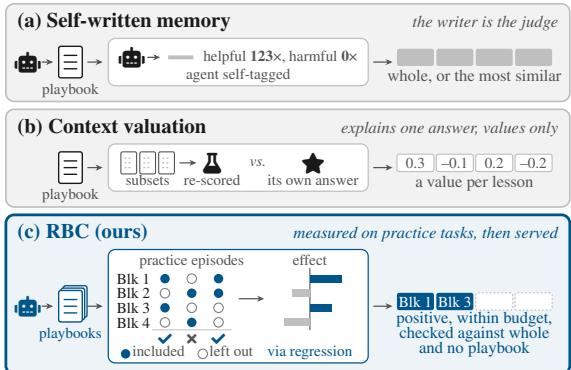
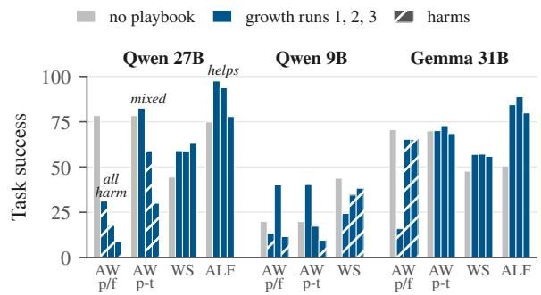
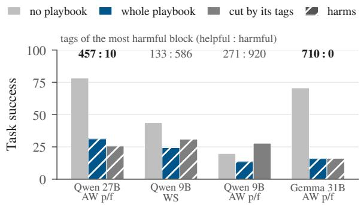
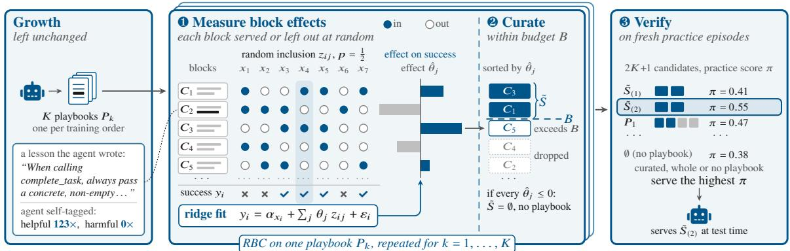
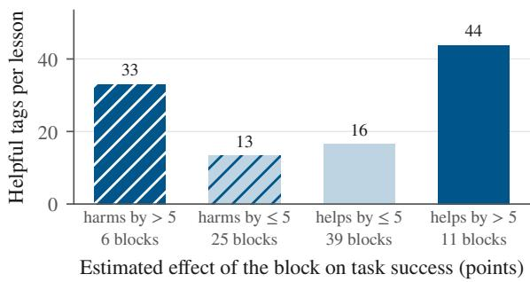
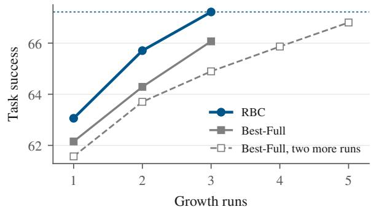
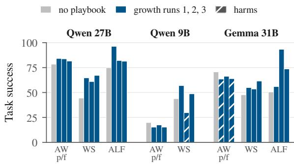
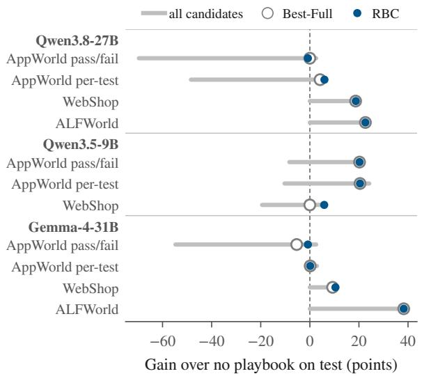

# Reliable Memory from Unstable Growth: Curating Self-Written Agent Playbooks with Randomized Experiments

Hoang Pham<sup>1</sup> Cong-Duy Nguyen<sup>2</sup> Dong Le<sup>1</sup>

Ponhvoan Srey<sup>1</sup> Anh Tuan Luu<sup>1,2</sup>\*

<sup>1</sup>Nanyang Technological University <sup>2</sup>VinUniversity

Email: pham0100@ntu.edu.sg

## Abstract

Persistent textual memory lets language-model agents reuse lessons from past tasks to improve on future multi-step tasks without retraining. Systems such as ACE and Dynamic Cheatsheet keep it as a playbook: lessons the agent writes after each task and reads in its prompt. A key challenge is to decide which lessons improve later tasks. Current systems leave the decision to the agent itself, which makes performance unstable: the same procedure can write a playbook that helps or one that falls up to 69.6 points below no playbook. These findings motivate valuing lessons by their measured effect on task success rather than by the agent’s judgement. We propose Randomized Block Curation (RBC)<sup>1</sup>, which measures this effect with a randomized experiment on practice tasks. It groups related lessons into blocks large enough to move success measurably and, on each practice task, includes or leaves out every block at random. Random inclusion makes tasks with and without a block comparable, so the gap in their success estimates the block’s effect. RBC keeps the blocks that help and, since the same procedure can write a helpful or a harmful playbook, grows several and serves whichever curated, whole or no playbook scores best on fresh practice episodes. Across two memory systems, three models and three benchmarks, RBC raises average success to 66.9, against 55.5 with the whole playbook, 54.1 with no playbook and 53.8 when the agent’s own judgement picks the lessons to keep.

## 1 Introduction

Language-model agents carry out multi-step tasks such as operating apps, shopping online and household chores (Trivedi et al., 2024; Yao et al., 2022; Shridhar et al., 2021). Without retraining, which is costly or impossible through a proprietary API, a growing line of work lets agents improve through persistent textual memory: lessons the agent writes after each task and reads in its prompt later (Shinn et al., 2023; Zhao et al., 2024), which we call a playbook. Systems maintain it differently, growing it lesson by lesson (ACE; Zhang et al., 2026), rewriting it as a whole (Dynamic Cheatsheet; Suzgun et al., 2026) or retrieving lessons by similarity (ReasoningBank; Ouyang et al., 2026), but they share one design (Figure 1a): the agent that writes the lessons also judges which to keep.

  
Figure 1: Judging versus measuring a playbook. (a) The agent judges its lessons and serves the playbook whole or by similarity. (b) Context valuation re-scores random subsets to explain one answer, not to serve. (c) RBC includes each block at random on practice tasks, keeps those that help within a budget, and serves them unless a whole or no playbook scores higher.

Few works test this judgement against task success, and those that do compare whole memories (Nguyen et al., 2026). This matters because added context can distract a model as easily as help it (Shi et al., 2023), and a lesson kept by mistake is served on every later task. This work targets that decision, which lessons of a self-written playbook to serve, in two established memory systems, ACE and Dynamic Cheatsheet. We find their playbooks unstable: served whole, a playbook can fall up to 69.6 points below no playbook, and growing it again on the same tasks in another order can turn a helpful playbook harmful. Whether a playbook helps depends on the growth run that wrote it and is known only by measuring its effect on success.

Letting the agent prune lessons it judges harmful does not remove the harm. Judging a lesson requires comparing episodes with and without it, but the agent sees only those that use it, and language models are poor and biased judges of their own outputs (Huang et al., 2024; Zheng et al., 2023). So it tags lessons as helpful when they sound right, not when they raise success, even a harmful rule (Section 4). Context-valuation methods run this comparison but not for curation: they explain why a model gave one answer (Cohen-Wang et al., 2024) or score memory entries one at a time (Li et al., 2026; Wang et al., 2026), though one entry rarely moves success measurably, and return scores, not a playbook to serve (Figure 1b).

We propose Randomized Block Curation (RBC), which supplies this comparison with a randomized experiment on practice tasks (Figure 1c). RBC groups related lessons into blocks large enough to move success measurably. Including each block at random on every practice task makes tasks with and without it comparable, so their success gap estimates its effect. RBC keeps the blocks that help within a token budget and, since a playbook’s value depends on its run, grows several and serves whichever curated, whole or no playbook scores best on fresh practice episodes. RBC leaves growth itself unchanged.

We test RBC on both systems with three models on three benchmarks. It lifts both on every model, averaging 66.9 task success against 55.5 with the whole playbook, 54.1 with no playbook and 53.8 when the agent picks lessons itself. It also avoids the harm: on ACE it never falls more than 0.8 points below no playbook, while every baseline falls at least 5.4 points below it in some setting. When ACE’s playbooks, which never drop a lesson, grow for twice as long, RBC still beats the whole playbook and no playbook in every setting. In summary, our contributions are as follows.

• Analysis. We show that self-written playbooks are unstable across growth runs and that the agent’s own judgement misses the harm.

• Method. We propose RBC, which measures each block of lessons in a randomized experiment and serves only what helps.

• Experiments. RBC is effective and robust across memory systems, models, benchmarks and rounds of memory updates.

## 2 Related Work

Self-written agent memory. Of the systems above, ACE tags each lesson as helpful or harmful, and Dynamic Cheatsheet counts each entry’s successful uses. Other agents reflect on failures or store workflows (Shinn et al., 2023; Wang et al., 2025), memory managers let the model decide what to store and recall (Packer et al., 2023; Xu et al., 2025), and ExpeL (Zhao et al., 2024) scores each insight by the model’s votes. In all of them a lesson stays because its writer believes it helps or because it resembles the task; Guo et al. (2026) find that self-improving agents also misjudge the checks they write, and we find the same for the lessons agents keep. The closest works measure success, but on whole units: Sarukkai et al. (2025) select among sets of trajectories and RSEA (Nguyen et al., 2026) among memory rewrites, accepting one only if held-out success does not drop. RBC instead measures every block at once and chooses among growth runs and no playbook.

Valuing parts of a context. ContextCite (Cohen-Wang et al., 2024) re-scores one answer on random subsets of sources with a linear fit, the design RBC applies to task success; Data Shapley (Ghorbani and Zou, 2019) and Data Banzhaf (Wang and Jia, 2023) value training data, and SkillSV (Li et al., 2026) and DG-Mem (Wang et al., 2026) value agent skills or memory entries. They stop at a value per entry, and a single entry rarely moves success beyond the noise of a few hundred episodes (Zhao et al., 2026); RBC measures blocks, scores them by task success and decides what to serve within a budget (Appendix F). A block’s effect, its average gain, is its Banzhaf value (Banzhaf, 1965), which random inclusion estimates for every block at once.

Choosing prompts and harmful context. Prompt optimizers such as DSPy (Khattab et al., 2024) and GEPA (Agrawal et al., 2026) keep what scores best on a development set, and demonstration selection scores each example over random prompts that contain it (Chang and Jia, 2023; Nguyen and Wong, 2023); RBC applies this scoring to an agent’s memory, selecting among the agent’s lessons instead of rewriting them, so curating calls no language model (Appendix G). Irrelevant text distracts language models (Shi et al., 2023; Liu et al., 2024), so a longer playbook can hurt, and prompt compression (Jiang et al., 2023) cuts a context by perplexity, not by effect on success; run-to-run variance is familiar from fine-tuning (Dodge et al., 2020).

## 3 Background and Setup

## 3.1 Memory systems

The memory loop. A self-written memory system lets an agent learn from its own experience. It wraps three steps around the agent:

1. Grow. After each batch of training tasks, the model reads its own trajectories and writes short lessons, which form a playbook P.

2. Judge. The model judges which lessons help.

3. Serve. A subset $S \subseteq P$ of the lessons goes into the prompt of later tasks.

On a task x, the agent acts over many turns, an episode, and earns a success score $y ( x , S ) \in [ 0 , 1 ]$ when S is served (reported ×100). The value of serving S is its mean success, $V ( S ) = \mathbb { E } [ y ( x , S ) ]$ and a playbook helps only when $V ( S ) > V ( \emptyset )$ Our two reference points are No playbook $( S =$ ∅) and the whole playbook (Whole, $S = P )$ . A growth run grows one playbook from scratch on the training tasks. Runs differ: with the tasks in another order and new sampling, the same procedure writes a different playbook, one that may help or harm.

Goal. In this work, we replace the judge and serve steps by measurement. For a playbook P and a token budget B, the best set of lessons to serve is

$$
\begin{array} { r } { S ^ { \star } \in \arg \operatorname* { m a x } _ { S \subseteq P , \mathrm { { t o k e n s } } ( S ) \leq B } V ( S ) , } \end{array}\tag{1}
$$

and with several growth runs, the best of their sets $S ^ { \star }$ , whole playbooks and no playbook. As V is seen only in noisy episodes, we estimate it on practice tasks (Section 3.2) before serving.

Two systems. We study two established systems that write a playbook in different ways, to test whether a finding depends on how memory is written; ReasoningBank’s retrieval by similarity serves as a baseline (Section 6).

ACE. Our main system, ACE (Zhang et al., 2026), grows its playbook lesson by lesson. As the agent solves training tasks, a Reflector reads each trajectory and its feedback and writes new lessons; no lesson is ever removed. The Reflector also judges: it tags the lessons used in each episode as helpful or harmful, a record we can check (Appendix A). ACE serves the whole playbook.

Dynamic Cheatsheet. Our second system (Suzgun et al., 2026) rewrites its whole playbook, a cheatsheet: after each batch of training tasks, one model call reads it and the batch’s trajectories and writes a new one. It judges by itself, without the reward, which attempts succeeded, counts each entry’s successful uses (Appendix A.2) and, like ACE, serves its whole playbook.

## 3.2 Benchmarks and models

Benchmarks. We conduct experiments on three benchmarks. In AppWorld (Trivedi et al., 2024), the agent writes code against the APIs of nine apps. In WebShop (Yao et al., 2022), it finds and buys a described product. In ALFWorld (Shridhar et al., 2021), it reaches a goal in a text household. They are scored by task goal completion, purchase reward and success rate.

Task splits. Each benchmark has three disjoint task sets: training tasks to grow playbooks, practice tasks to test playbooks before serving one, and evaluation tasks for the final score: AppWorld 168, WebShop 500 and ALFWorld 134 (Table 3).

Models and settings. We run three open models: Qwen3.8-27B (Qwen Team, 2026b), Qwen3.5-9B (Qwen Team, 2026a) and Gemma-4-31B (Gemma Team, 2026). A setting is one system, model and benchmark. Per model, ACE has four, two of them on AppWorld, where its Reflector sees whether a task passed (pass/fail) or each unit test’s result (pertest); Dynamic Cheatsheet, which never sees the reward, has three. Without 9B on ALFWorld (it solves almost no game), that makes eleven ACE and eight Dynamic Cheatsheet settings. Each setting has three growth runs.

## 4 Self-Written Memory Is Unreliable

Before repairing self-written playbooks, we ask whether they need repair. We ran three growth runs in each of the eleven ACE settings and checked each step of the loop (serve, grow, judge) against task success. We call a playbook harmful when it scores more than 5 points below no playbook; reevaluating a playbook moved its score by at most 5.0 points, so such a gap is not noise.

Finding 1: serving the whole playbook can harm. Served whole, a playbook is unstable, even on one model and in one setting. It can lift success a long way: on 27B ALFWorld (Figure 2, helps) the first playbook raises it to 97.5 from 74.9 with no playbook. It can also erase most of it: on 27B AppWorld with pass/fail feedback (all harm) every playbook harms, one by 69.6 points. Of the first growth runs in the eleven settings, 5 help, 2 are level and 4 harm. A playbook is extra context, and context that does not help can distract a model (Shi et al., 2023; Liu et al., 2024), so serving one is a decision, not a default.

  
Figure 2: The same procedure grows helpful and harmful playbooks: three ACE growth runs per setting. Hatched: more than 5 points below no playbook. AW: AppWorld with pass/fail (p/f) or per-test (p-t) feedback; WS: WebShop; ALF: ALFWorld.

Finding 2: the growth run decides whether the playbook harms. If this harm came from the model or benchmark, regrowing the playbook would reproduce it. It does not always: the same procedure on the same tasks, in another order, can write a helpful or a harmful playbook. On 27B AppWorld with per-test feedback, the three runs score 82.5, 58.9 and 30.0 against 78.4 with no playbook (Figure 2, mixed): one helps, two harm. Such swings occur in 3 of the 6 settings with a harmful run, all on Qwen, whose runs differ only in task order and sampling. Dynamic Cheatsheet shows them too (Appendix B.2): on 9B WebShop one run gains 13.2 points over no playbook, another loses 14.0. An agent with one playbook cannot tell which kind it holds; only measuring can.

Finding 3: the agent’s own judgement misses the harm. The obvious defence is to let the agent’s tags prune the playbook: keep the lessons tagged most helpful and drop the rest. Yet in 3 of the 4 settings where the first playbook harms, the cut playbook still harms (Figure 3). The tags are selfjudgement, and language models are poor and biased judges of their own outputs (Huang et al., 2024; Zheng et al., 2023): the Reflector sees a lesson followed, not what it costs. On AppWorld, the most harmful block holds rules like this one from the 27B playbook grown with pass/fail feedback:

  
Figure 3: Cutting by the agent’s own tags (to 40% of the tokens) leaves the harm in three of the four settings where the first ACE playbook harms. Above the bars: tags of the block that lowers success most, bold where they call it helpful. Hatched: more than 5 points below no playbook. AW p/f: AppWorld, pass/fail feedback; WS: WebShop.

“When calling complete\_task, always pass a concrete, non-empty string literal as the answer argument.”

The rule sounds careful, but many tasks expect no answer: with such rules in the prompt, 27B gives one on 69.0% of these tasks, against 37.5% without them. Every task ends with this call, so the rule bears on every episode and collects tags in all of them: the Reflector tagged it helpful 123 times and never harmful. Shown the failed tests under per-test feedback, it writes no such rule. On the two larger models, the most harmful block carries almost only helpful tags (above the bars in Figure 3): the agent’s judgement points the wrong way. Such harm shows only in task success, so we measure it as RBC does, comparing success with and without each block, served at random on practice tasks.

What a repair needs. Each finding sets one requirement: serve only the parts of a playbook that help, or no playbook (Finding 1); grow several playbooks and let fresh practice episodes choose among them (Finding 2); and measure each part’s effect on task success (Finding 3).

## 5 Method: Randomized Block Curation

In this section, we introduce RBC, which replaces the judge and serve steps of the memory loop with measurement (Figure 4; pseudocode in Appendix C). It runs after growth, on practice tasks ${ \mathcal { D } } _ { \mathrm { p r } }$ kept apart from the evaluation tasks. It needs only a list of lessons, so it works on either system’s playbook: ACE’s lessons or the entries of Dynamic Cheatsheet’s cheatsheet. It meets the three requirements above in three steps: it measures the effect of each block of lessons, curates each grown playbook by these effects, and verifies the curated playbooks against the whole playbooks and no playbook on fresh practice episodes. Each curated set $\tilde { S }$ estimates the best set $S ^ { \star }$ of Eq. (1) from the noisy outcomes of practice episodes alone.

  
Figure 4: Overview of RBC. Growth is unchanged: the agent writes K playbooks and tags its own lessons (the quoted lesson is real; its block lowers success although tagged helpful). 1) Each block is included or left out at random in every practice episode, and a regression of success on these choices estimates its effect ${ \hat { \theta } } _ { j } . \ 2 )$ Each playbook is curated to the blocks with a positive effect, best first, within the budget B. 3) Every candidate is scored on fresh practice episodes and the best is served. Other values are illustrative.

## 5.1 Measuring the effect of each block

Blocks. We measure groups of related lessons, as a single lesson rarely moves success beyond the noise of a few hundred episodes. We embed each lesson with all-mpnet-base-v2 (Reimers and Gurevych, 2019), as ACE does to find duplicates, and cluster the embeddings with Ward’s method (Ward, 1963) into $m = 8$ blocks $C _ { 1 } , \ldots , C _ { m }$ (the number matters little; Appendix E.7). A block holds lessons on one topic, which tend to help or harm together. For a set of blocks $T \subseteq [ m ]$ , we write V (T) for the value of serving their lessons.

Randomized inclusion. Each practice episode i draws a task $x _ { i }$ and includes each block $j$ independently with probability $\begin{array} { r } { p = \frac { 1 } { 2 } , z _ { i j } \sim } \end{array}$ Bernoulli(p); the agent is served the included blocks, $T _ { i } = \{ j :$ $z _ { i j } = 1 \big \}$ , and scores $y _ { i }$ . Each episode is thus both an ordinary run of the agent and one trial of a twolevel factorial design over all $m$ blocks, each block on or off (Box et al., 2005; Figure 4, step 1).

What is estimated. A block’s gain can depend on the other blocks served with it, so we define its effect as its average gain over them, which at $\begin{array} { r } { p = \frac { 1 } { 2 } } \end{array}$ form a uniformly random subset $T \subseteq [ m ] \setminus \{ j \}$

$$
\theta _ { j } \ = \ \mathbb { E } _ { T } \big [ V ( T \cup \{ j \} ) - V ( T ) \big ] ,\tag{2}
$$

the Banzhaf value of block $j$ (Banzhaf, 1965): how much the block raises success, averaged over what else is served with it. Random inclusion makes it measurable by a plain comparison of the episodes with and without the block:

Proposition 1. Ifevery block is included independently with probability ${ \frac { 1 } { 2 } } ;$ , then for every block $j$ and any $V , \mathbb { E } [ y \mid z _ { j } = { \bar { 1 } } ] - \mathbb { E } [ y \mid z _ { j } = 0 ] = \theta _ { j }$ Over n episodes, this difference of means, taken within tasks, is unbiased for $\theta _ { j } ,$ for all m blocks at once, with variance about 4σ $^ { . 2 } / n ,$ , where $\sigma ^ { 2 }$ bounds the within-task variance of y.

The measurement thus needs no assumption on V and few episodes: interactions between blocks are averaged into $\theta _ { j } .$ , not assumed away (a block that adds $g$ only alongside another gets $\theta _ { j } = g / 2 )$ and one round of episodes measures every block, where leaving out one block at a time would need $( m + 1 ) / 2 = 4 . 5$ times as many episodes for the same precision. We compute $\hat { \theta }$ by a ridge regression of success on the inclusions, with one intercept per task to absorb task difficulty, minimizing

$$
\begin{array} { r } { \sum _ { i } \left( y _ { i } - \alpha _ { x _ { i } } - z _ { i } ^ { \top } \theta \right) ^ { 2 } + \lambda \| \theta \| ^ { 2 } , } \end{array}\tag{3}
$$

with the task intercepts α unpenalized and λ chosen by leaving one task out. Unpenalized, this fit is consistent for $\theta _ { j }$ ; under this balanced design, the penalty scales all estimates by about the same factor, keeping signs and order (Appendix D.1).

## 5.2 Curating under a budget

The curated set uses only the signs and order of $\hat { \theta }$ (Figure 4, step 2):

1. keep the blocks with $\hat { \theta } _ { j } > 0 , \mathrm { h i g h e s t } \hat { \theta } _ { j }$ first;

2. add their lessons in that order, skipping any lesson that would exceed $B ;$ the result is ${ \tilde { S } } ;$

3. if no estimate is positive, $\tilde { S } = \emptyset$ (no playbook). In Figure 4, the complete\_task rules sit in block $C _ { 2 }$ , which gets the most negative estimate and is dropped, although its lessons are tagged helpful. The budget is a cap, not a target: a playbook with one helpful block is curated to that block alone. The rule is optimal when block effects add, $\begin{array} { r } { V ( T ) = V ( \emptyset ) + \sum _ { i \in T } \beta _ { j } \colon } \end{array}$ then $\theta _ { j } = \beta _ { j }$ , and without a budget the positive blocks maximize V over sets of blocks. Within a budget, largest first is the greedy knapsack solution, exact for blocks of equal size; greedy would rank unequal blocks by effect per token, but dividing a noisy estimate by a small size inflates its noise, so we rank by effect. Blocks that interact can be worth more or less together than their estimates say, and one growth run may hold nothing of value; the last step checks both, scoring whole playbooks and no playbook.

## 5.3 Verifying across growth runs

RBC grows K playbooks $P _ { 1 } , \ldots , P _ { K }$ , with the training tasks in K orders, and curates each into $\tilde { S } _ { ( k ) }$ . It then scores 2K + 1 candidates on fresh practice episodes (Figure 4, step 3), each with its own reason: the curated sets, best when block effects add; the whole playbooks, in case blocks help only together; and no playbook, in case every run harms. It serves the candidate with the highest practice score $\pi ( S )$ , its mean success on them:

$$
\hat { S } \ = \ \arg \operatorname* { m a x } _ { S \in \{ \tilde { S } _ { ( 1 ) } , \ldots , \tilde { S } _ { ( K ) } , P _ { 1 } , \ldots , P _ { K } , \varnothing \} } \pi ( S ) .\tag{4}
$$

The choice thus reuses no episode of the estimates and touches no evaluation task. Since no playbook (∅) is itself a candidate, the choice is safe:

Proposition 2. Let each of the C candidates be scored on n practice episodes with independent outcomes in [0, 1]. With probability at least $1 - \delta ,$ the expected practice success of $\hat { S }$ is at most $2 \sqrt { \log ( 2 C / \delta ) / ( 2 n ) }$ below the best candidate’s, and hence below no playbook’s.

The bound is on true success, which the winning noisy score overstates, and carries over to evaluation tasks as far as they resemble the practice tasks (Section 6.5). The margin shrinks as $1 / \sqrt { n }$ but is loose at our sample sizes, about a quarter of the scale (Appendix D.2); in practice the drop is far smaller: on evaluation tasks, RBC never falls more than 0.8 points below no playbook on ACE (Table 1). RSEA’s acceptance rule (Nguyen et al., 2026), which we call Best-Full, grows the same playbooks and serves the best whole one or no playbook by the same π: it does everything RBC does except curate, so their gap is what curating adds beyond choosing among runs.

## 6 Experiments

We fixed every constant of RBC on four ACE settings, using none of their evaluation tasks, and kept it unchanged on the other fifteen. RBC grows $K = 3$ playbooks per setting, the runs of Figure 2, and curates each to a budget B of 40% of its tokens; 20% and 60% scored lower (Appendix E.7). Every score averages three evaluation seeds over tasks, and over the three growth runs where a method serves one run, so each score rests on hundreds to thousands of episodes.

Baselines. Every method serves from the same playbooks, on the same tasks and seeds, and differs only in how it decides what to serve. Besides the reference points No playbook and Whole, three baselines judge and cut the playbook to the same budget: by the system’s own judgement (Own: ACE’s tags or Dynamic Cheatsheet’s usage count), by similarity to the task as in ReasoningBank (Top-$k ;$ Ouyang et al., 2026), or at random (Random). The strongest baseline chooses: Best-Full, the acceptance rule of RSEA (Nguyen et al., 2026), serves the best whole playbook or no playbook on practice tasks. Ours measure: RBC-cut curates one growth run, and RBC adds the choice. Baselines run at their defaults (Appendix A.4).

## 6.1 Measuring before serving lifts both memory systems on every model

Over all 19 settings, RBC averages 66.9 task success against 55.5 with the whole playbook and 54.1 with no playbook, the best of all methods (Table 1). The gain is broad, not carried by a few settings: RBC is above the whole playbook in 15 of the 19 and above both reference points for every model on both systems. Untuned on Dynamic Cheatsheet, RBC lifts success there to 66.5 from 61.3 (whole playbook) and 53.8 (no playbook).

Little harm remains on ACE. The whole playbook falls up to 69.6 points below no playbook, and every baseline, even Best-Full, at least 5.4 below it somewhere; RBC at most 0.8, within evaluation noise. On Dynamic Cheatsheet, it shares Best-Full’s two AppWorld drops (Table 1).

<table><tr><td rowspan="2">Model</td><td rowspan="2">Benchmark</td><td colspan="2">Reference</td><td colspan="3">Judging</td><td>Choosing</td><td colspan="2">Measuring (ours)</td></tr><tr><td>No playbook</td><td>Whole</td><td>Own</td><td>Top-k</td><td>Random</td><td>Best-Full</td><td>RBC-cut</td><td>RBC</td></tr><tr><td colspan="10">ACE</td></tr><tr><td rowspan="3">Qwen 27B</td><td>AppWorld, pass/fail</td><td>78.4</td><td>19.2</td><td>16.0</td><td>35.2</td><td>37.8</td><td>78.4</td><td>76.3</td><td>77.6</td></tr><tr><td>AppWorld, per-test</td><td>78.4</td><td>57.1</td><td>58.9</td><td>60.3</td><td>67.9</td><td>82.5</td><td>81.8</td><td>84.3</td></tr><tr><td>WebShop</td><td>44.4</td><td>60.3</td><td>58.4</td><td>45.3</td><td>48.3</td><td>63.0</td><td>60.3</td><td>63.1</td></tr><tr><td rowspan="3">Qwen 9B</td><td>ALFWorld</td><td>74.9</td><td>89.7</td><td>89.9</td><td>85.3</td><td>80.5</td><td>97.5</td><td>85.9</td><td>97.5</td></tr><tr><td>AppWorld, pass/fail</td><td>19.8</td><td>21.7</td><td>20.7</td><td>24.5</td><td>21.5</td><td>40.1</td><td>25.7</td><td>40.1</td></tr><tr><td>AppWorld, per-test</td><td>19.8</td><td>22.4</td><td>20.8</td><td>19.8</td><td>21.9</td><td>40.3</td><td>27.4</td><td>40.3</td></tr><tr><td rowspan="5">Gemma 31B</td><td>WebShop</td><td>43.8</td><td>32.4</td><td>29.5</td><td>28.1</td><td>32.3</td><td>43.8</td><td>42.4</td><td>49.6</td></tr><tr><td>AppWorld, pass/fail</td><td>70.6</td><td>48.8</td><td>52.9</td><td>49.1</td><td>51.4</td><td>65.3</td><td>70.8</td><td>69.8</td></tr><tr><td>AppWorld, per-test</td><td>69.9</td><td>70.5</td><td>71.9</td><td>70.6</td><td>70.0</td><td>70.1</td><td>71.2</td><td>70.1</td></tr><tr><td>WebShop</td><td>47.7</td><td>56.7</td><td>55.8</td><td>48.1</td><td>47.4</td><td>57.0</td><td>57.9</td><td>58.1</td></tr><tr><td>ALFWorld</td><td>50.6</td><td>84.3</td><td>85.1</td><td>83.9</td><td>81.2</td><td>88.8</td><td>81.2</td><td>88.8</td></tr><tr><td colspan="2">Average</td><td>54.4</td><td>51.2</td><td>50.9</td><td>50.0</td><td>50.9</td><td>66.1</td><td>61.9</td><td>67.2</td></tr><tr><td colspan="2">Tokens served (% of whole) Largest drop below No playbook</td><td>0</td><td>100</td><td>≤40</td><td>≤40</td><td>≤40</td><td>78</td><td>36</td><td>60</td></tr><tr><td colspan="2"></td><td>一</td><td>69.6</td><td>72.6</td><td>60.3</td><td>60.6</td><td>5.4</td><td>12.2</td><td>0.8</td></tr><tr><td colspan="10">DYNAMIC CHEATSHEET</td></tr><tr><td rowspan="3">Qwen 27B</td><td>AppWorld, pass/fail</td><td>78.4</td><td>83.1</td><td>80.3</td><td>82.6</td><td>82.2</td><td>83.7</td><td>81.0</td><td>80.4</td></tr><tr><td>WebShop</td><td>44.4</td><td>64.3</td><td>54.2</td><td>54.3</td><td>54.1</td><td>64.7</td><td>56.6</td><td>64.7</td></tr><tr><td>ALFWorld</td><td>74.9</td><td>86.6</td><td>86.1</td><td>83.7</td><td>76.5</td><td>96.3</td><td>83.3</td><td>96.3</td></tr><tr><td rowspan="5">Qwen 9B Gemma 31B</td><td>AppWorld, pass/fail</td><td>19.8</td><td>16.0</td><td>17.1</td><td>17.9</td><td>18.6</td><td>15.3</td><td>20.1</td><td>15.3</td></tr><tr><td>WebShop</td><td>43.8</td><td>45.1</td><td>46.6</td><td>41.1</td><td>44.5</td><td>57.0</td><td>51.6</td><td>57.0</td></tr><tr><td>AppWorld, pass/fail</td><td>70.6</td><td>64.6</td><td>65.7</td><td>65.7</td><td>66.5</td><td>63.5</td><td>64.7</td><td>63.5</td></tr><tr><td>WebShop</td><td>47.7</td><td>56.7</td><td>53.6</td><td>52.4</td><td>49.9</td><td>61.5</td><td>57.5</td><td>61.5</td></tr><tr><td>ALFWorld</td><td>50.6</td><td>74.3</td><td>57.9</td><td>73.7</td><td>71.4</td><td>93.3</td><td>74.1</td><td>93.3</td></tr><tr><td colspan="2">Average</td><td></td><td>61.3</td><td></td><td>58.9</td><td></td><td></td><td></td><td></td></tr><tr><td colspan="2">Tokens served (% of whole)</td><td>53.8</td><td>100</td><td>57.7 ≤40</td><td>≤40</td><td>58.0 ≤40</td><td>66.9 100</td><td>61.1 35</td><td>66.5 93</td></tr><tr><td colspan="2">Largest drop below No playbook</td><td>0 一</td><td>14.0</td><td>8.2</td><td>17.0</td><td>9.5</td><td>7.1</td><td>8.7</td><td>7.1</td></tr><tr><td colspan="2">Both systems</td><td>54.1</td><td>55.5</td><td>53.8</td><td>53.8</td><td>53.9</td><td>66.4</td><td>61.6</td><td>66.9</td></tr></table>

Table 1: Task success (0–100) per setting, averaged over three evaluation seeds and the three growth runs; Best-Full and RBC instead choose one playbook among the runs on practice tasks. Judging rules cut a playbook to 40% of its tokens (Own: by ACE’s tags or Dynamic Cheatsheet’s usage count). Tokens served: in percent of the whole playbook, averaged over the runs. Largest drop: the most a method falls below No playbook in any setting and run. Best per row in bold.

## 6.2 Measuring beats judging

  
Figure 5: The agent’s tags against the measured effect of a block: median helpful tags per lesson for the 81 blocks of the ten ACE settings with tagged lessons.

Cutting a playbook by judgement keeps its harm. At the same budget, the system’s own judgement, similarity to the task and random choice score no better than the whole playbook (at most 50.9 on ACE against 51.2, 58.9 on Dynamic Cheatsheet against 61.3), while measuring one growth run reaches 61.9 on ACE (RBC-cut; Table 1); each judge falls at least 60.3 points below no playbook in some ACE setting, the agent’s own tags furthest (72.6). Judgement fails because it does not track what a block does (Figure 5): over 81 blocks, ACE’s tags and the measured effects have a rank correlation of only 0.21, and the blocks that harm most carry more helpful tags than all but the most helpful ones. Judges given an advantage (similarity tuned on evaluation tasks, an LLM curator told each outcome) still stay below RBC-cut, and, from the same episodes, DG-Mem’s subset-Shapley estimates curate worse than RBC’s (Appendix E.2).

## 6.3 Curating adds to choosing the best whole playbook, with fewer tokens

Choosing among growth runs, as Best-Full does, already avoids most of the harm; curating adds by keeping the helpful blocks of a harmful playbook.

On ACE, RBC scores 67.2 against 66.1 while serving 60% of the whole playbook’s tokens against 78%, leads in 5 of the 6 settings where their choices differ, and by +1.9 on the seven settings not used to fix it. It gains most where all whole playbooks harm: 49.6 against 43.8 on 9B WebShop and 69.8 against 65.3 on Gemma AppWorld (pass/fail).

  
Figure 6: Mean task success over the eleven ACE settings, averaged over every choice of growth runs from the three of Table 1 (solid) or from five (dashed; the two added runs are weaker). Dotted: RBC with three.

More runs do not replace curating. RBC is ahead of Best-Full at every number of runs (Figure 6). Choosing needs two more, weaker runs to catch up (66.8 against 67.2) and serves 27% more tokens; at matched growth and practice cost, RBC on two runs and Best-Full on three are level (65.7 against 66.1), and Best-Full serves 23% more.

Each part adds. Curating one run alone scores 61.9 on ACE and choosing alone 62.2; both on one run score 63.1, and over three runs 67.2 (Table 10), with the same order on Dynamic Cheatsheet.

It curates only where curating pays. Dynamic Cheatsheet rewrites its playbook as a whole, so its lessons are less separable, and a curated cheatsheet scores level with the whole one (61.1 against 61.3). RBC detects this on practice tasks and serves a whole playbook in 7 of 8 settings, the same one as Best-Full, so the two are level (66.5 against 66.9): it falls back on choosing.

## 6.4 Curating pays most when playbooks grow long

ACE never removes a lesson, so playbooks keep growing. We grew three runs for up to ten passes on nine settings, leaving out WebShop for 9B and Gemma, since the 27B WebShop playbook barely grew (Table 2). On AppWorld with per-test feedback, whole playbooks then stop helping (46.6 against 78.4 with no playbook for 27B, 17.7 against

<table><tr><td rowspan="2">Setting</td><td colspan="3">Task success</td><td rowspan="2">Tokens</td></tr><tr><td>No playbook</td><td>Whole Best-Full</td><td>RBC</td></tr><tr><td>27BAW p/f</td><td>78.4</td><td>64.0</td><td>86.3</td><td>86.3 108</td></tr><tr><td>27B AW p-t</td><td>78.4</td><td>46.6</td><td>78.4 84.9</td><td>31</td></tr><tr><td>27B WS</td><td>44.4</td><td>61.1</td><td>65.0 65.1</td><td>44</td></tr><tr><td>27B ALF</td><td>74.9</td><td>83.6</td><td>98.5 98.5</td><td>98</td></tr><tr><td>9BAWp/f</td><td>19.8</td><td>28.2</td><td>31.0 34.7</td><td>36</td></tr><tr><td>9B AW p-t</td><td>19.8</td><td>17.7</td><td>21.2 32.3</td><td>34</td></tr><tr><td>Gemma AW p/f</td><td>70.6</td><td>67.4</td><td>67.7 73.6</td><td>43</td></tr><tr><td>Gemma AW p-t</td><td>69.9</td><td>70.3</td><td>70.8 71.6</td><td>41</td></tr><tr><td>Gemma ALF</td><td>50.6</td><td>87.8</td><td>90.5 90.5</td><td>89</td></tr></table>

Table 2: Long growth on ACE: up to ten passes, three new growth runs per setting; whole playbooks end 1.0– 2.3 times their standard size. Tokens: what RBC serves, in % of the average whole playbook. AW: AppWorld (p/f, p-t feedback), WS: WebShop, ALF: ALFWorld.

19.8 for 9B). Choosing can then only fall back on no playbook or a weak run, while RBC still finds the helpful blocks: 84.9 against 78.4 for Best-Full on 27B and 32.3 against 21.2 on 9B. Where a whole playbook is best, RBC serves the same one as Best-Full; in the other 6 settings it serves a curated set, at most 44% of the tokens, and scores 4.7 higher on average. Its lead of 3.1 over Best-Full thus comes entirely from curating, not from choosing.

## 6.5 Practice tasks should come from the tasks the agent will face

Lessons are general rules, such as how to end a task, so choosing on practice tasks carries over to evaluation tasks when the two are alike: practice success ranks the seven candidates of a setting much as evaluation success does (median Spearman correlation 0.89), and RBC picks the best candidate on evaluation in 6 of the 11 ACE settings and one within half a point of it in 7. Where it misses, the tasks differ: AppWorld’s practice tasks come from another split. This largely explains the two Dynamic Cheatsheet AppWorld settings that stay below no playbook (9B and Gemma, pass/fail). Choosing on held-out tasks of the evaluation split instead raises RBC by a further 2.2 points on Dynamic Cheatsheet and 0.4 points on ACE (Appendix E.6).

## 7 Conclusion

In this work, we showed that self-written playbooks are unstable: one procedure can grow a helpful or a harmful playbook, and the agent’s own judgement cannot tell which. We proposed RBC, which measures instead: it serves blocks of lessons at random on practice tasks to see what each does, and checks the curated set against whole playbooks and no playbook before serving. Task success rises on average from 55.5 with the whole playbook to 66.9, and curating adds to choosing with fewer tokens, above all under long growth. An agent’s memory should be measured, not judged.

## Limitations

Our evidence covers two memory systems, three benchmarks and three open-weight models, with playbooks we grew; other memory systems, domains and larger or proprietary models remain to be tested. Within this scope, RBC values a block by its average gain over the other blocks served with it, which makes curation exact when block effects add; when lessons are hard to separate, as in a memory rewritten as a whole, it falls back on the best whole playbook, which still lifts success but saves no context. RBC also trades extra episodes for reliability: it grows several playbooks, runs practice rounds and needs practice tasks with an observable outcome. Since its guarantee holds on these practice tasks, it works best when they resemble the tasks the agent will face. We fixed its constants on four ACE settings and kept them unchanged elsewhere. Finally, we study playbooks fixed once grown; extending RBC to memory that grows while it is served is a natural next step.

## References

Lakshya A Agrawal, Shangyin Tan, Dilara Soylu, Noah Ziems, Rishi Khare, Krista Opsahl-Ong, Arnav Singhvi, Herumb Shandilya, Michael J Ryan, Meng Jiang, Christopher Potts, Koushik Sen, Alex Dimakis, Ion Stoica, Dan Klein, Matei Zaharia, and Omar Khattab. 2026. GEPA: Reflective prompt evolution can outperform reinforcement learning. In The Fourteenth International Conference on Learning Representations.

John F. Banzhaf, III. 1965. Weighted voting doesn’t work: A mathematical analysis. Rutgers Law Review, 19:317–343.

George E. P. Box, J. Stuart Hunter, and William G. Hunter. 2005. Statistics for Experimenters: Design, Innovation, and Discovery, second edition. Wiley.

Ting-Yun Chang and Robin Jia. 2023. Data curation alone can stabilize in-context learning. In Proceedings ofthe 61st Annual Meeting ofthe Associationfor Computational Linguistics (Volume 1: Long Papers), pages 8123–8144, Toronto, Canada. Association for Computational Linguistics.

Benjamin Cohen-Wang, Harshay Shah, Kristian Georgiev, and Aleksander Madry. 2024. ContextCite: Attributing model generation to context. In The Thirty-eighth Annual Conference on Neural Information Processing Systems.

Jesse Dodge, Gabriel Ilharco, Roy Schwartz, Ali Farhadi, Hannaneh Hajishirzi, and Noah Smith. 2020. Fine-tuning pretrained language models: Weight initializations, data orders, and early stopping. Preprint, arXiv:2002.06305.

Gemma Team. 2026. Gemma 4 technical report. Preprint, arXiv:2607.02770.

Amirata Ghorbani and James Zou. 2019. Data Shapley: Equitable valuation of data for machine learning. In Proceedings ofthe 36th International Conference on Machine Learning (ICML), volume 97 of Proceedings ofMachine Learning Research, pages 2242– 2251. PMLR.

Diandian Guo, Cong Cao, Fangfang Yuan, Yingqi Wang, Yueshan Wang, and Dakui Wang. 2026. Selfauthored verification is unreliable in heuristic selfimproving agents. Preprint, arXiv:2607.24300.

Jie Huang, Xinyun Chen, Swaroop Mishra, Huaixiu Steven Zheng, Adams Wei Yu, Xinying Song, and Denny Zhou. 2024. Large language models cannot self-correct reasoning yet. In The Twelfth International Conference on Learning Representations.

Huiqiang Jiang, Qianhui Wu, Chin-Yew Lin, Yuqing Yang, and Lili Qiu. 2023. LLMLingua: Compressing prompts for accelerated inference of large language models. In Proceedings of the 2023 Conference on Empirical Methods in Natural Language Processing, pages 13358–13376, Singapore. Association for Computational Linguistics.

Omar Khattab, Arnav Singhvi, Paridhi Maheshwari, Zhiyuan Zhang, Keshav Santhanam, Sri Vardhamanan A, Saiful Haq, Ashutosh Sharma, Thomas T. Joshi, Hanna Moazam, Heather Miller, Matei Zaharia, and Christopher Potts. 2024. DSPy: Compiling declarative language model calls into stateof-the-art pipelines. In The Twelfth International Conference on Learning Representations.

Tao Li, Junfeng Liu, Qinghua Zhao, Yifan Li, Lei Wang, Bo Shao, Xuejun Liu, and Linjun Shou. 2026. What is a skill worth? Structure-Aware Shapley valuation of agent skills. Preprint, arXiv:2608.04562.

Chang Liu, Yuqi Zhang, Yiman Zhong, Boyi Liu, Hengjun Wang, and Shuyue Wei. 2026. Skill-Shapley: Boundary-adaptive Shapley valuation for skill step attribution in LLM agents. Preprint, arXiv:2608.13173.

Nelson F. Liu, Kevin Lin, John Hewitt, Ashwin Paranjape, Michele Bevilacqua, Fabio Petroni, and Percy Liang. 2024. Lost in the middle: How language models use long contexts. Transactions ofthe Association for Computational Linguistics, 12:157–173.

Paulius Micikevicius, Dusan Stosic, Neil Burgess, Marius Cornea, Pradeep Dubey, Richard Grisenthwaite, Sangwon Ha, Alexander Heinecke, Patrick Judd, John Kamalu, Naveen Mellempudi, Stuart Oberman, Mohammad Shoeybi, Michael Siu, and Hao Wu. 2022. FP8 formats for deep learning. arXiv preprint arXiv:2209.05433.

Michael Nguyen, Quoc Nguyen, and Paul Vuong. 2026. Recursive self-evolving agents via held-out selection. Preprint, arXiv:2606.28374.

Tai Nguyen and Eric Wong. 2023. In-context example selection with influences. Preprint, arXiv:2302.11042.

Siru Ouyang, Jun Yan, I-Hung Hsu, Yanfei Chen, Ke Jiang, Zifeng Wang, Rujun Han, Long Le, Samira Daruki, Xiangru Tang, Vishy Tirumalashetty, George Lee, Mahsan Rofouei, Hangfei Lin, Jiawei Han, Chen-Yu Lee, and Tomas Pfister. 2026. Reasoning-Bank: Scaling agent self-evolving with reasoning memory. In The Fourteenth International Conference on Learning Representations.

Charles Packer, Sarah Wooders, Kevin Lin, Vivian Fang, Shishir G. Patil, Ion Stoica, and Joseph E. Gonzalez. 2023. MemGPT: Towards LLMs as operating systems. Preprint, arXiv:2310.08560.

Qwen Team. 2026a. Qwen3.5: Towards native multimodal agents.

Qwen Team. 2026b. Qwen3.8-Max: A new bar for coding and cowork.

Nils Reimers and Iryna Gurevych. 2019. Sentence-BERT: Sentence embeddings using Siamese BERTnetworks. In Proceedings ofthe 2019 Conference on Empirical Methods in Natural Language Processing and the 9th International Joint Conference on Natural Language Processing (EMNLP-IJCNLP), pages 3982–3992, Hong Kong, China. Association for Computational Linguistics.

Vishnu Sarukkai, Zhiqiang Xie, and Kayvon Fatahalian. 2025. Self-generated in-context examples improve LLM agents for sequential decision-making tasks. In Advances in Neural Information Processing Systems, volume 38, pages 64392–64425. Curran Associates, Inc.

Freda Shi, Xinyun Chen, Kanishka Misra, Nathan Scales, David Dohan, Ed Chi, Nathanael Schärli, and Denny Zhou. 2023. Large language models can be easily distracted by irrelevant context. Preprint, arXiv:2302.00093.

Noah Shinn, Federico Cassano, Ashwin Gopinath, Karthik R Narasimhan, and Shunyu Yao. 2023. Reflexion: language agents with verbal reinforcement learning. In Thirty-seventh Conference on Neural Information Processing Systems.

Mohit Shridhar, Xingdi Yuan, Marc-Alexandre Cote, Yonatan Bisk, Adam Trischler, and Matthew Hausknecht. 2021. ALFWorld: Aligning text and embodied environments for interactive learning. In International Conference on Learning Representations.

Mirac Suzgun, Mert Yuksekgonul, Federico Bianchi, Dan Jurafsky, and James Zou. 2026. Dynamic Cheatsheet: Test-time learning with adaptive memory. In Proceedings of the 19th Conference of the European Chapter of the Association for Computational Linguistics (Volume 1: Long Papers), pages 7080–7106, Rabat, Morocco. Association for Computational Linguistics.

Harsh Trivedi, Tushar Khot, Mareike Hartmann, Ruskin Manku, Vinty Dong, Edward Li, Shashank Gupta, Ashish Sabharwal, and Niranjan Balasubramanian. 2024. AppWorld: A controllable world of apps and people for benchmarking interactive coding agents. In Proceedings of the 62nd Annual Meeting of the Associationfor Computational Linguistics (Volume 1: Long Papers), pages 16022–16076, Bangkok, Thailand. Association for Computational Linguistics.

Jiachen T. Wang and Ruoxi Jia. 2023. Data Banzhaf: A robust data valuation framework for machine learning. In Proceedings of the 26th International Conference on Artificial Intelligence and Statistics (AIS-TATS), volume 206 of Proceedings of Machine Learning Research, pages 6388–6421. PMLR.

Jieke Wang, Tiancheng Shen, Yibo Yang, and Ming-Hsuan Yang. 2026. Dual-grained agent memory and Shapley context attribution for multimodal agentic learner. Preprint, arXiv:2608.23268.

Peiyi Wang, Lei Li, Liang Chen, Zefan Cai, Dawei Zhu, Binghuai Lin, Yunbo Cao, Lingpeng Kong, Qi Liu, Tianyu Liu, and Zhifang Sui. 2024. Large language models are not fair evaluators. In Proceedings of the 62nd Annual Meeting of the Association for Computational Linguistics (Volume 1: Long Papers), pages 9440–9450, Bangkok, Thailand. Association for Computational Linguistics.

Zora Zhiruo Wang, Jiayuan Mao, Daniel Fried, and Graham Neubig. 2025. Agent workflow memory. In Proceedings ofthe 42nd International Conference on Machine Learning (ICML), volume 267 of Proceedings of Machine Learning Research, pages 63897– 63911. PMLR.

Joe H. Ward, Jr. 1963. Hierarchical grouping to optimize an objective function. Journal ofthe American Statistical Association, 58(301):236–244.

Wujiang Xu, Zujie Liang, Kai Mei, Hang Gao, Juntao Tan, and Yongfeng Zhang. 2025. A-Mem: Agentic memory for LLM agents. In Advances in Neural Information Processing Systems, volume 38, pages 20004–20031.

Shunyu Yao, Howard Chen, John Yang, and Karthik R Narasimhan. 2022. WebShop: Towards scalable realworld web interaction with grounded language agents. In Advances in Neural Information Processing Systems.

Qizheng Zhang, Changran Hu, Shubhangi Upasani, Boyuan Ma, Fenglu Hong, Vamsidhar Kamanuru, Jay Rainton, Chen Wu, Mengmeng Ji, Hanchen Li, Urmish Thakker, James Zou, and Kunle Olukotun. 2026. Agentic context engineering: Evolving contexts for self-improving language models. In The Fourteenth International Conference on Learning Representations.

Andrew Zhao, Daniel Huang, Quentin Xu, Matthieu Lin, Yong-Jin Liu, and Gao Huang. 2024. ExpeL: LLM agents are experiential learners. In Proceedings of the AAAI Conference on Artificial Intelligence, volume 38, pages 19632–19642.

Qiyan Zhao, Xiaofeng Zhang, Bo Liu, Minda Chen, Wei Xiong, Jingyang Chen, Guanting Ye, Wenhao Yu, Xiaosong Yuan, Shijie Han, Da-Han Wang, Jianmin Ji, Fei Huang, and Xu-Yao Zhang. 2026. Coalition-aware skill reliability for self-evolving agents. Preprint, arXiv:2608.22610.

Lianmin Zheng, Wei-Lin Chiang, Ying Sheng, Siyuan Zhuang, Zhanghao Wu, Yonghao Zhuang, Zi Lin, Zhuohan Li, Dacheng Li, Eric Xing, Hao Zhang, Joseph E. Gonzalez, and Ion Stoica. 2023. Judging LLM-as-a-judge with MT-Bench and Chatbot Arena. In Thirty-seventh Conference on Neural Information Processing Systems Datasets and Benchmarks Track.

## A Experimental setup

## A.1 ACE as we run it

A playbook. Each line of an ACE playbook is one lesson with an id and the agent’s tags, for example:

[sai-00001] helpful=166 harmful=0 :: Always extract dynamic identifiers (e.g., artist\_id, track\_id) from the output of previous API calls and use them in subsequent requests. Never assume or hardcode IDs unless they are explicitly static and known in advance.

The actor sees the lesson without the tags.

Growth. We run ACE’s batched mode (Zhang et al., 2026). On each batch of training tasks, the actor plays every task with the current playbook; the Reflector reads each trajectory with its feedback and tags the lessons that bore on it as helpful, harmful or neutral; the Curator writes new lessons, which are appended; and near-duplicate lessons are merged. No step removes a lesson, and the whole playbook is served on every call (Whole). Growth runs differ in the order of the training tasks and the actor’s sampling; a run stops once a pass over the training tasks grows the playbook by less than 10%, after at most five passes.

Feedback. On AppWorld, the Reflector sees either whether the task passed (pass/fail) or the result of each unit test (per-test); the two grow different playbooks and count as different settings. On WebShop it sees the reward, on ALFWorld success.

## A.2 Dynamic Cheatsheet as we run it

We run Dynamic Cheatsheet’s cumulative mode (Suzgun et al., 2026) with the actors and training tasks of our ACE runs. After each batch of training tasks, one model call reads the current cheatsheet and the batch’s trajectories, judges by itself, without the reward, which attempts succeeded, and writes a new cheatsheet that replaces the old one, with a count of each entry’s successful uses. The cheatsheet is served whole; RBC treats its entries as lessons and is otherwise unchanged.

## A.3 Settings, tasks and models

Table 3 lists the settings and their tasks. Every method chooses on practice tasks only, and practice tasks are never scored. Scores are on 0–100, averaged over seeds per task and then over tasks. RBC was developed on four ACE settings, scored on tasks apart from their evaluation tasks: 27B on AppWorld with pass/fail feedback and on Web-Shop, and 9B on AppWorld with both feedback types.

Models. Qwen3.8-27B (27B), Qwen3.5-9B (9B) and Gemma-4-31B (Gemma) play every role in their own settings, with thinking off. Gemma is evaluated on an FP8 checkpoint (Micikevicius et al., 2022), and its growth runs also differ in precision.

## A.4 Baselines

Every budgeted method draws from the same lessons, fills the same budget B, and is scored on the same tasks and seeds. Baselines run at their defaults and are never tuned, except the two marked <sup>∗</sup>, which are tuned on the evaluation tasks on purpose.

Random. Random lessons until B is full; mean of two orders.

Own. On ACE (Tags), lessons ranked by their share of helpful tags; on Dynamic Cheatsheet, by usage count. This is the cut the system’s own judgement implies.

Top-k. The lessons most similar to the task text, as in ReasoningBank (Ouyang et al., 2026).

Rule in b03, tagged 78 times helpful and 0 times harmful: “Treat the final completion API call (e.g., complete\_task) as the primary submission mechanism; ensure the ‘answer’ or ‘summary’ parameter is populated with the actual result of the request to avoid it being interpreted as a failure to provide output.”

<table><tr><td></td><td>AppWorld</td><td>WebShop</td><td>ALFWorld</td></tr><tr><td>Models</td><td>27B, 9B, Gemma</td><td>27B, 9B, Gemma</td><td>27B, Gemma</td></tr><tr><td>Memory systems</td><td>ACE (both feedback types), DC</td><td>ACE, DC</td><td>ACE, DC</td></tr><tr><td>Score (0–100)</td><td>task goal completion</td><td>purchase reward</td><td>success</td></tr><tr><td>Actor</td><td>ReAct, 40 steps</td><td>ReAct, 15 actions</td><td>ReAct, 50 steps</td></tr><tr><td>Feedback during growth</td><td>pass/fail, or per-test</td><td>reward and its components</td><td>success</td></tr><tr><td>Growth tasks</td><td>90 train tasks, batch 16</td><td>500 train instructions, batch 32</td><td>500 train games, batch 32</td></tr><tr><td>Practice tasks</td><td>dev split, 57 tasks</td><td>300 instructions</td><td>eval_seen, 140 games</td></tr><tr><td>Practice round</td><td>684 episodes</td><td>600 episodes</td><td>600 episodes</td></tr><tr><td>Evaluation tasks</td><td>test_normal, 168 × 3 seeds</td><td>test, 500 × 3 seeds</td><td>valid_unseen, 134 × 3 seeds</td></tr></table>

Table 3: Settings and protocol: eleven for ACE (AppWorld counts once per feedback type) and eight for Dynamic Cheatsheet (DC; AppWorld with pass/fail feedback only). Practice and evaluation tasks never overlap; WebShop’s practice instructions exclude its 500 test instructions. Actors sample at temperature 0.7, all other roles at 0.
<table><tr><td rowspan="2">Block</td><td rowspan="2">Effect</td><td rowspan="2">Lessons</td><td rowspan="2">Tokens</td><td colspan="2">Tags</td><td rowspan="2">Top half</td><td colspan="2">Success</td><td colspan="2">Answer / buy</td></tr><tr><td>Helpful</td><td>Harmful</td><td>In</td><td>Out</td><td>In</td><td>Out</td></tr><tr><td colspan="10">27B, AppWorld, pass/fail feedback</td><td></td></tr><tr><td>b00</td><td>-31.8</td><td>14</td><td>1,237</td><td>457</td><td>10</td><td>64.3</td><td>25.0</td><td>53.9</td><td>69.0</td><td>37.5</td></tr><tr><td>b04</td><td>-12.9</td><td>21</td><td>2,276</td><td>701</td><td>141</td><td>52.4</td><td>33.3</td><td>43.2</td><td>60.3</td><td>48.8</td></tr><tr><td colspan="9">Rule in b00, tagged 123 times helpful and 0 times harmful: &quot;When calling complete_task, always pass a concrete, non-empty string literal as the answer argument. Keep the string concise and factual (e.g., Removed 5 songs&#x27; or the specific ID/name) to</td><td></td></tr><tr><td colspan="9">avoid parsing failures, length limit issues, or validation errors caused by verbose explanations or variable references.&quot;</td></tr><tr><td>9B, WebShop</td><td></td><td></td><td>1,027</td><td>133</td><td>586</td><td>20.0</td><td>18.3</td><td>25.6</td><td>27.0</td><td>38.5</td></tr><tr><td colspan="9">b02 -12.8 10 6</td></tr><tr><td>b06 -6.9</td><td></td><td></td><td>769</td><td>116</td><td>25</td><td>33.3</td><td>20.1</td><td>23.5</td><td>27.0</td><td>37.7</td></tr><tr><td colspan="9">Rule in b02, tagged 57 times helpful and 256 times harmful: “Do not assume qualitative attributes (e.g., zipper pockets&#x27;, ‘organic&#x27;, ‘sugar free&#x27;) or specific design options are present just because keywords appear in the title. . ..</td></tr><tr><td colspan="9">9B, AppWorld, pass/fail feedback</td></tr><tr><td>b0i -4.3</td><td></td><td>17</td><td></td><td></td><td></td><td>41.2</td><td>13.6</td><td>20.4</td><td>78.7</td><td>66.8 69.5</td></tr><tr><td colspan="9">1,924 102 50 b04 -5.2 15 1,668 271 920</td></tr><tr><td>Rule in b04, tagged 14 times helpful and 139 times harmful: “For the complete_task API, strictly pass only primitive types:</td><td></td><td></td><td></td><td></td><td></td><td></td><td></td><td></td><td></td><td></td></tr><tr><td colspan="9">a raw integer count, a boolean, or a minimal status string (e.g., ‘Done&#x27;, ‘Task completed&#x27;). .. . Gemma, AppWorld, pass/fail feedback</td></tr><tr><td>b00 -6.5 21</td><td></td><td></td><td>967</td><td></td><td></td><td>28.6 25.0</td><td></td><td>33.3</td><td>62.2</td><td>58.3</td></tr><tr><td>b02 -16.6</td><td></td><td>1,350 1,435</td><td>686</td><td>0 0</td><td>66.7</td><td>22.7</td><td>33.9</td><td>69.3</td><td></td><td>53.2</td></tr><tr><td>b03 -24.0</td><td></td><td>1,245</td><td>710</td><td></td><td>63.2</td><td>16.1</td><td>41.7</td><td>76.2</td><td></td><td>44.6</td></tr></table>

Table 4: The harmful blocks of the four harmful settings: estimated effect negative at a 5% false-discovery rate over the eight blocks (first practice round). Effect: points of success with the block included minus left out. Tags: summed over the block’s lessons. Top half: % of its lessons in the playbook’s top half by helpful tags (chance 50). In / Out: unadjusted rates (%) on the episodes that included or left out the block; Answer / buy: answering a task that expects no answer (AppWorld) or buying (WebShop). Long rules are quoted up to their first sentence.

Tags<sup>∗</sup> and $\mathbf { T o p } { \boldsymbol { - } } k ^ { * }$ . Per setting, the best of eight tag rules or of five values of k, chosen on the evaluation tasks, which can only favour them.

$\bf { D C _ { s e l f } }$ and $\mathbf { D C _ { o u t c o m e } } .$ Dynamic Cheatsheet’s curator, run over the fixed lessons on practice episodes to choose the lessons to keep within B. $\mathrm { D C } _ { \mathrm { s e l f } }$ judges success by itself; $\mathrm { D C _ { o u t c o m e } }$ is told the task outcome, the signal RBC uses.

Best-Full. RSEA’s acceptance rule (Nguyen et al., 2026) across K runs: of no playbook and the K whole playbooks, the one with the highest practice success, on the same runs and practice episodes as RBC (Algorithm 2).

DG-Mem’s estimates. DG-Mem’s subset-Shapley estimate (Wang et al., 2026), computed per block from the same practice episodes as RBC’s regression on the four 27B settings and served by RBC’s rule; only the estimator differs.

## B Analysis details

## B.1 The harmful blocks

Table 4 lists every harmful block of the four harmful settings with one of its rules. The harm is not scattered: in each setting it comes from one family of rules that sound useful.

AppWorld: one family of rules. On all three AppWorld pass/fail settings the harmful blocks tell the agent to pass an answer to complete\_task, the call that ends the task, even when the task expects none. With such a block, the agent answers more of these tasks and fails the check “answers match” more often. Under pass/fail feedback the Reflector never sees the checker and writes rules for an imagined validator; under per-test feedback it sees the failed tests and writes none.

WebShop: a different family. On 9B WebShop the harmful blocks make the agent verify a product again or abandon it, and with block b02 included it buys less often.

The tags. On 27B and Gemma the harmful lessons carry mostly helpful tags and sit near chance in the tag ranking (top-half share). On 9B, by contrast, the Reflector tags its harmful rules mostly as harmful. The rates are unadjusted means over practice episodes.

## B.2 Dynamic Cheatsheet playbooks across growth runs

  
Figure 7: Task success of the three growth runs of Dynamic Cheatsheet per setting, drawn as Figure 2. Hatched: more than 5 points below no playbook. AW p/f: AppWorld with pass/fail feedback; WS: WebShop; ALF: ALFWorld.

A playbook that is rewritten as a whole depends on its growth run just as one grown lesson by lesson (Figure 7, which repeats Figure 2 for Dynamic Cheatsheet). Its playbooks help on average (61.3 against 53.8 with no playbook), but the runs of one setting lie up to 37.3 points apart (Gemma ALFWorld), and on 9B WebShop one run helps while another harms. The instability of Section 4 is thus a property of self-written memory, not of one system.

## C Pseudocode

Algorithms 1 and 2 give curation of one growth run and the full method of Section 5 as our code runs them. A lesson b has a token cost c(b) and a usage rate u(b), how often the Reflector tagged it during growth, which only orders lessons within a block; $\begin{array} { r } { c ( S ) = \sum _ { b \in S } c ( b ) } \end{array}$ . The constants are the same in every setting: $\begin{array} { r } { m = 8 , p = \frac { 1 } { 2 } } \end{array}$ , a budget share $\rho = 0 . 4 , K = 3$ , and a grid Λ of ridge penalties that includes 0.

```latex
Algorithm 1 Curating one growth run (RBC-cut)
Require: playbook P, budget B, practice tasks $x _ { 1 } , \ldots , x _ { n }$
Ensure: curated set $\tilde { S } \subseteq \bar { P }$
${ \mathrm { ~ l ~ } } C _ { 1 } , \ldots , C _ { m } \gets$ Ward clusters of lesson embeddings
2 for $i = 1 , \ldots , n$ do ▷ practice round
3 draw z<sub>ij</sub> ∼ Bernoulli(p) independently, j ∈ [m]
4 y<sub>i</sub> ← success on x<sub>i</sub> when served $\textstyle \bigcup _ { j : z _ { i j } = 1 } C _ { j }$
5 for $\lambda \in \Lambda$ do ▷ effects
6 <sup>ˆ</sup>θ(λ) ← minimizer of Eq. (3) with penalty λ
7 $\widehat { \theta } \gets \widehat { \theta } ( \lambda ^ { \star } ) , \lambda ^ { \star }$ best in leave-one-task-out error
8 $\begin{array} { r } { L \gets \bigcup _ { j : \hat { \theta } _ { j } > 0 } C _ { j } } \end{array}$ , by $\widehat { \theta } _ { j }$ then u(b), descending
9 $\tilde { S }  \emptyset$ ▷ $L = \varnothing \colon$ no playbook
10 for all $b \in L$ in order do
11 $\mathbf { i f } c ( \tilde { S } ) + c ( b ) \leq B$ then $\tilde { S }  \tilde { S } \cup \{ b \}$
12 return S<sup>˜</sup>, in playbook order
```

Algorithm 2 RBC and the reference Best-Full   
Require: training tasks, practice tasks ${ \mathcal { D } } _ { \mathrm { p r } }$   
Ensure: served sets of RBC and Best-Full   
1 for $k = 1 , \ldots , K$ do   
2 $P _ { k } \gets$ growth, training tasks in order k   
3 $\tilde { S } _ { ( k ) } \gets \mathrm { C u r a t e } ( P _ { k } , \rho c ( P _ { k } ) )$ ▷ Algorithm 1   
4 π(S) := mean success on new episodes of $\mathcal { D } _ { \mathrm { p r } }$ served S   
$\mathrm { ~ \bar { \boldsymbol { { c } } } ~ } \mathcal { C } \gets ( \tilde { S } _ { ( 1 ) } , \dots , \tilde { S } _ { ( K ) } , P _ { 1 } , \dots , P _ { K } , \emptyset )$ ▷ 2K + 1   
candidates   
6 $\hat { S } \gets \arg \operatorname* { m a x } _ { S \in \mathcal { C } } \pi ( S )$ ▷ ties: first in C   
7 S<sub>BF</sub> ← arg max $S { \in } \{ \stackrel { \cdot } { \varnothing } , P _ { 1 } , { \ldots } , P _ { K } \}  \pi ( S )$ ▷ Best-Full   
8 return $\hat { S } , S _ { \mathrm { B F } }$

Evaluation tasks enter neither algorithm.

## D Proofs

## D.1 Proposition 1: what the estimates measure

One lemma does most of the work, and the three parts of the proposition follow from it: identification, precision and the effect of the ridge penalty.

Notation. Practice tasks are drawn from $\mathcal { D } _ { \mathbf { \lambda } }$ , and $\mu ( x , T )$ is the expected success on task x when the blocks in $T \subseteq [ m ]$ are served, so $V ( T ) =$ $\mathbb { E } _ { x \sim \mathcal { D } } \mu ( x , T )$ . Episodes are i.i.d.: on episode i the task is $x _ { i } \sim D$ , the inclusions $z _ { i 1 } , \ldots , z _ { i m }$ are independent Bernoulli $( p )$ variables, independent of $x _ { i }$ , and $\mathbb { E } [ y _ { i } \mid x _ { i } , z _ { i } ] = \mu ( x _ { i } , T _ { i } )$ with $T _ { i } = \{ j :$ $z _ { i j } = 1 \}$ . We write $\tilde { y } = y - \alpha ( x )$ for success with the task mean $\alpha ( x ) = \mathbb { E } [ y \mid x ]$ removed, and $\sigma ^ { 2 }$ for the largest $\mathrm { V a r } ( \tilde { y } \mid z _ { j } = b )$ over blocks $j$ and $b \in \{ 0 , 1 \}$ . For a block $j ,$ , the other blocks included form a set $T \subseteq [ m ] \setminus \{ j \}$ with probability

$$
w _ { p } ( T ) = p ^ { | T | } ( 1 - p ) ^ { m - 1 - | T | } .
$$

Lemma 1. For every block $j$ and every $V ,$

$$
\begin{array} { r l } & { \Delta _ { j } : = \mathbb { E } [ \textit { y } | z _ { j } = 1 ] - \mathbb { E } [ \textit { y } | z _ { j } = 0 ] } \\ & { \quad \quad = \displaystyle \sum _ { T } w _ { p } ( T ) \big [ V ( T \cup \{ j \} ) - V ( T ) \big ] , } \end{array}\tag{5}
$$

where $T$ runs over the subsets of $[ m ] \backslash \{ j \}$

Proof. Tasks and inclusions are independent, so given $z _ { j } = b$ the other blocks served form $T$ with probability $w _ { p } ( T )$ and the task is still drawn from D. Averaging over $T _ { \cdot }$

$$
\begin{array} { l } { { \mathbb { E } [ y \mid z _ { j } = 1 ] = \displaystyle \sum _ { T } w _ { p } ( T ) V ( T \cup \{ j \} ) , } } \\ { { \mathbb { E } [ y \mid z _ { j } = 0 ] = \displaystyle \sum _ { T } w _ { p } ( T ) V ( T ) , } } \end{array}
$$

and subtracting the two lines gives Eq. (5).

Identification. $\begin{array} { r } { \mathrm { A t } p = \frac { 1 } { 2 } } \end{array}$ every weight is $2 ^ { - ( m - 1 ) }$ the uniform distribution over the subsets of the other blocks, so by Eq. (2)

$$
\Delta _ { j } = \mathbb { E } _ { T } \big [ V ( T \cup \{ j \} ) - V ( T ) \big ] = \theta _ { j } ,
$$

whatever V is. The regression estimates the same quantity. By the Frisch–Waugh–Lovell theorem, and since the inclusions are independent of the task and of one another, the coefficient on $z _ { j }$ in the population fit with task intercepts is $\mathrm { C o v } ( z _ { j } , y ) / p ( 1 - p )$ With $\eta _ { b } = \mathbb { E } [ y \mid z _ { j } = b ]$

$$
\begin{array} { c } { \mathrm { C o v } ( z _ { j } , y ) = { p \eta _ { 1 } - p \big ( p \eta _ { 1 } + ( 1 - p ) \eta _ { 0 } \big ) } } \\ { = { p ( 1 - p ) \Delta _ { j } } , } \end{array}
$$

so the coefficient is $\Delta _ { j } = \theta _ { j }$ . With finitely many tasks the sample fit converges to this fit, so least squares $( \lambda = 0$ in Eq. (3)) is consistent for $\theta _ { j }$

Precision. Let $\hat { \Delta } _ { j }$ be the mean of $\tilde { y }$ over the $n _ { 1 }$ episodes that include block j minus its mean over the $n _ { 0 }$ that leave it out. Given which episodes include $j ,$ , the $\tilde { y } _ { i }$ are independent and the task term cancels, so $\hat { \Delta } _ { j }$ is unbiased for $\Delta _ { j } = \theta _ { j }$ , with

$$
\mathrm { V a r } ( \hat { \Delta } _ { j } ) \leq \sigma ^ { 2 } \Big ( \frac { 1 } { n _ { 1 } } + \frac { 1 } { n _ { 0 } } \Big ) \approx \frac { \sigma ^ { 2 } } { n p ( 1 - p ) } ,
$$

as $n _ { 1 } \approx p n$ . Since $\textstyle p ( 1 - p ) \leq { \frac { 1 } { 4 } }$ , this is smallest at $p = { \textstyle \frac { 1 } { 2 } } \colon 4 \sigma ^ { 2 } / n$ for every block, from the same n episodes. Leaving out one block at a time instead runs m + 1 arms (all blocks, and all but $j$ for each $j )$ of $n / ( m + 1 )$ episodes each, so each contrast has variance up to

$$
\frac { 2 ( m + 1 ) \sigma ^ { 2 } } { n } = \frac { m + 1 } { 2 } \cdot \frac { 4 \sigma ^ { 2 } } { n } ,
$$

the factor of the proposition (Box et al., 2005). The argument treats $\alpha$ as known; estimating it from the same episodes does not change the first-order variance when n grows with the tasks fixed.

Ridge keeps signs and order. With the task means removed from $y$ and $z ( \tilde { y }$ and $\tilde { Z } )$ , the unpenalized intercepts drop out of Eq. (3), and the ridge estimate solves

$$
\left( \tilde { Z } ^ { \top } \tilde { Z } + \lambda I \right) \hat { \theta } _ { \lambda } = \tilde { Z } ^ { \top } \tilde { y } .
$$

If $\tilde { Z } ^ { \top } \tilde { Z } = c I$ with $c > 0$ , then $\begin{array} { r } { \hat { \theta } _ { \lambda } = \frac { c } { c + \lambda } \hat { \theta } _ { 0 } \colon } \end{array}$ every estimate is scaled by the same factor in $( 0 , 1 ]$ so signs and order are kept. Fair inclusion gives $\begin{array} { r } { \mathbb { E } [ \tilde { Z } ^ { \top } \tilde { Z } ] \approx \frac { n } { 4 } I , } \end{array}$ so in a finite round only blocks with close estimates can swap order, and only estimates near zero can change sign.

Corollary 1. Suppose block effects add, that is, $\begin{array} { r } { V ( T ) = V ( \emptyset ) + \sum _ { j \in T } \beta _ { j } } \end{array}$ for every $T .$ . Then $\theta _ { j } =$ $\beta _ { j }$ for every $p ,$ and

(a) without a budget, $\{ j : \theta _ { j } > 0 \}$ maximizes $V ;$

(b) if every block costs c<sub>0</sub> tokens, the positive blocks with the largest $\theta _ { j }$ , at most $\lfloor B / c _ { 0 } \rfloor$ of them, maximize $V$ among the sets within the budget $B .$

Proof. Under additivity every bracket in Eq. (5) equals $\beta _ { j }$ , and the weights sum to one, so $\theta _ { j } = \beta _ { j }$ and

$$
V ( T ) - V ( \emptyset ) = \sum _ { j \in T } \theta _ { j } .
$$

This sum is largest when $T$ holds every positive term, which proves (a), and, among sets of at most $\lfloor B / c _ { 0 } \rfloor$ blocks, when T holds the largest positive terms, which proves (b).

When effects do not add, $\theta _ { j }$ still averages the interactions, but positive blocks can be worth less together than their effects suggest (Appendix E.7).

<table><tr><td rowspan="2">Setting</td><td rowspan="2">No playbook</td><td colspan="3">Whole, growth run</td><td colspan="3">RBC-cut, growth run</td><td colspan="3">Verified over three runs</td></tr><tr><td>1</td><td>2</td><td>3</td><td>1</td><td>2</td><td>3</td><td>Best-Full</td><td>Curated</td><td>RBC</td></tr><tr><td>27B AppWorld p/f</td><td>78.4</td><td>31.2</td><td>17.7</td><td>8.7</td><td>81.0</td><td>70.2</td><td>77.6</td><td>78.4</td><td>77.6</td><td>77.6</td></tr><tr><td>9B WebShop</td><td>43.8</td><td>24.3</td><td>34.5</td><td>38.3</td><td>45.9</td><td>31.6</td><td>49.6</td><td>43.8</td><td>49.6</td><td>49.6</td></tr><tr><td>9B AppWorld  $\mathrm { p / f }$ </td><td>19.8</td><td>13.5</td><td>40.1</td><td>11.5</td><td>22.2</td><td>40.3</td><td>14.7</td><td>40.1</td><td>40.3</td><td>40.1</td></tr><tr><td>Gemma AppWorld  $\mathrm { p / f }$ </td><td>70.6</td><td>15.9</td><td>65.3</td><td>65.3</td><td>69.2</td><td>73.2</td><td>69.8</td><td>65.3</td><td>69.8</td><td>69.8</td></tr><tr><td>27B WebShop</td><td>44.4</td><td>59.0</td><td>58.9</td><td>63.0</td><td>63.0</td><td>54.7</td><td>63.1</td><td>63.0</td><td>63.1</td><td>63.1</td></tr><tr><td>27B ALFWorld</td><td>74.9</td><td>97.5</td><td>93.8</td><td>77.9</td><td>95.3</td><td>84.6</td><td>77.9</td><td>97.5</td><td>95.3</td><td>97.5</td></tr><tr><td>27B AppWorld p-t</td><td>78.4</td><td>82.5</td><td>58.9</td><td>30.0</td><td>84.3</td><td>80.4</td><td>80.8</td><td>82.5</td><td>84.3</td><td>84.3</td></tr><tr><td>9B AppWorld p-t</td><td>19.8</td><td>40.3</td><td>17.3</td><td>9.5</td><td>44.0</td><td>21.4</td><td>16.7</td><td>40.3</td><td>44.0</td><td>40.3</td></tr><tr><td>Gemma WebShop</td><td>47.7</td><td>57.0</td><td>57.1</td><td>55.9</td><td>58.1</td><td>57.7</td><td>57.8</td><td>57.0</td><td>58.1</td><td>58.1</td></tr><tr><td>Gemma ALFWorld</td><td>50.6</td><td>84.3</td><td>88.8</td><td>79.9</td><td>83.1</td><td>82.1</td><td>78.4</td><td>88.8</td><td>78.4</td><td>88.8</td></tr><tr><td>Gemma  $\mathrm { \ A p p W o r l d \ p \cdot t }$ </td><td>69.9</td><td>70.1</td><td>72.8</td><td>68.5</td><td>71.2</td><td>70.2</td><td>72.0</td><td>70.1</td><td>72.0</td><td>70.1</td></tr><tr><td>Mean</td><td>54.4</td><td>52.3</td><td>55.0</td><td>46.2</td><td>65.2</td><td>60.6</td><td>59.8</td><td>66.1</td><td>66.6</td><td>67.2</td></tr></table>

Table 5: Every growth run (task success, 0–100); runs 2 and 3 regrow run 1 with the training tasks in other orders, and RBC-cut serves each run’s curated set. The last three columns choose on practice tasks among no playbook and the whole playbooks (Best-Full), the curated sets (Curated), or both (RBC); best of the three in bold.

## D.2 Proposition 2: verification is safe

Let $S _ { 1 } , \ldots , S _ { C }$ be the candidates, and let candidate c be scored on n practice episodes with outcomes $y _ { c 1 } , \ldots , y _ { c n } \in [ 0 , 1 ]$ , independent across episodes. Its practice score and expected practice success are

$$
\pi _ { c } = { \frac { 1 } { n } } \sum _ { i = 1 } ^ { n } y _ { c i } , \qquad V _ { \mathrm { p r } } ( S _ { c } ) = \mathbb { E } \pi _ { c } .
$$

By Hoeffding’s inequality, for each candidate

$$
\operatorname* { P r } \left( | \pi _ { c } - V _ { \mathrm { p r } } ( S _ { c } ) | > \varepsilon \right) \leq 2 \exp ( - 2 n \varepsilon ^ { 2 } ) ,
$$

and by the union bound over the C candidates, all C deviations are at most ε with probability at least $1 - 2 C \exp ( - 2 n \varepsilon ^ { 2 } )$ , which equals $1 - \delta$ for $\varepsilon = \sqrt { \log ( 2 C / \delta ) / ( 2 n ) }$ . On that event, let S<sup>ˆ</sup> be the candidate with the highest π and $S _ { c }$ any candidate. Then

$$
V _ { \mathrm { p r } } ( \hat { S } ) \geq \pi ( \hat { S } ) - \varepsilon \geq \pi ( S _ { c } ) - \varepsilon \geq V _ { \mathrm { p r } } ( S _ { c } ) - 2 \varepsilon ,
$$

which holds for the best candidate and, since no playbook is one of them, for $S _ { c } = \emptyset$

The bound needs nothing about how the candidates were built, so it holds for any curation rule and any $K ;$ the price of more candidates is the factor log C. It is loose at our sample sizes: with $C = 7$ and the 171 practice episodes per candidate on AppWorld, 2ε at $\delta = 0 . 0 5$ is about a quarter of the scale. In practice the choice lands much closer, within half a point of the best candidate on evaluation in 7 of the eleven settings (Section 6.5). The guarantee concerns the practice tasks; it says nothing about evaluation tasks that differ from them.

<table><tr><td>Model (settings) No playbook</td></tr><tr><td>Whole Best-Full ACE</td></tr><tr><td>Qwen 27B (4) 69.0 56.6 80.4 80.6</td></tr><tr><td>Qwen 9B (3) 27.8 25.5 41.4 43.3</td></tr><tr><td>Gemma 31B (4) 59.7 65.1 70.3 71.7</td></tr><tr><td>Dynamic Cheatsheet</td></tr><tr><td>Qwen 27B (3) 65.9 78.0 81.6 80.4</td></tr><tr><td>Qwen 9B (2) 31.8 30.6 36.1 36.1</td></tr><tr><td>Gemma 31B (3) 56.3 65.2 72.8 72.8</td></tr></table>

Table 6: Task success (0–100) per model, averaged over its settings and evaluation seeds; the whole playbook is averaged over the three growth runs. Best per row in bold.

## E Further results

## E.1 Per setting and per model

Table 6 averages Table 1 per model, the evidence for Section 6.1’s claim on every model.

## E.2 Judges given an advantage

<table><tr><td>Judge</td><td>Settings</td><td>Score</td><td>RBC-cut</td><td>Ahead</td></tr><tr><td> $\mathrm { T a g s ^ { * } }$ </td><td>9</td><td>46.1</td><td>59.7</td><td>6</td></tr><tr><td> ${ \mathrm { T o p } } { \cdot } k ^ { * }$ </td><td>9</td><td>51.8</td><td>59.7</td><td>7</td></tr><tr><td> $\mathrm { D C } _ { \mathrm { s e l f } }$ </td><td>4</td><td>33.9</td><td>48.3</td><td>3</td></tr><tr><td> $\mathrm { D C _ { o u t c o m e } }$ </td><td>3</td><td>26.6</td><td>37.4</td><td>3</td></tr></table>

Table 7: Judges given an advantage: average task success (0–100) over the settings where each ran, beside RBC-cut on the same growth run and settings; Ahead: settings where RBC-cut scores higher. Tags<sup>∗</sup>, Top- $\cdot k ^ { * } \colon$ tuned on the evaluation tasks; $\mathrm { D C _ { \mathrm { s e l f } } , \ D C _ { \mathrm { o u t c o m e } } ; }$ an LLM curator that judges alone or is told the task outcome (Appendix A.4).

An advantage does not make judging catch up with measuring (Table 7; per setting in Table 8, definitions in Appendix A.4). Tuned on the evaluation tasks, or told each task’s outcome, the judges still score below RBC-cut on the same runs and settings. The estimator matters as well: from the same practice episodes and with the same serving rule, DG-Mem’s subset-Shapley estimates give a worse curated playbook than RBC’s regression in three of the four 27B settings (Table 9). Judging can even undo a good choice: cutting the playbook that Best-Full chose to 40% of its tokens by similarity averages 62.6 on ACE and 62.3 on Dynamic Cheatsheet, against 66.1 and 66.9 for Best-Full alone.

<table><tr><td>Setting</td><td>Tags*</td><td>Top-k*</td><td> $\bf { D C _ { s e l f } }$ </td><td> $\mathbf { D C _ { o u t c o m e } }$ </td><td>RBC-cut</td></tr><tr><td>27B AW p/f</td><td>25.6</td><td>67.1</td><td>27.8</td><td></td><td>81.0</td></tr><tr><td>9B WS</td><td>31.0</td><td>31.5</td><td>51.9</td><td>30.2</td><td>45.9</td></tr><tr><td>9BAWp/f</td><td>41.3</td><td>24.0</td><td>21.4</td><td>17.5</td><td>22.2</td></tr><tr><td>Gemma AW p/f</td><td>16.9</td><td>67.1</td><td></td><td></td><td>69.2</td></tr><tr><td>27B WS</td><td>57.6</td><td>45.7</td><td>1</td><td></td><td>63.0</td></tr><tr><td>9B AW p-t</td><td>25.8</td><td>32.9</td><td>34.3</td><td>32.1</td><td>44.0</td></tr><tr><td>Gemma WS</td><td>56.8</td><td>46.2</td><td></td><td></td><td>58.1</td></tr><tr><td>Gemma ALF</td><td>86.4</td><td>79.9</td><td>一</td><td></td><td>83.1</td></tr><tr><td>Gemma  $\mathsf { A W } _ { \mathrm { P ^ { - } } } \mathrm { t }$ </td><td>73.8</td><td>72.2</td><td>一</td><td></td><td>71.2</td></tr></table>

Table 8: The judges of Table 7 per setting (task success, 0–100, at 40% of the tokens; –: not run; best in bold). AW: AppWorld (p/f pass/fail, p-t per-test), WS: Web-Shop, ALF: ALFWorld.
<table><tr><td>Qwen3.8-27B</td><td>No playbook</td><td>Whole</td><td>DG-Mem</td><td>RBC-cut</td></tr><tr><td>AppWorld p/f</td><td>78.4</td><td>31.2</td><td>72.8</td><td>81.0</td></tr><tr><td>AppWorld p-t</td><td>78.4</td><td>82.5</td><td>83.5</td><td>84.3</td></tr><tr><td>WebShop</td><td>44.4</td><td>59.0</td><td>64.8</td><td>63.0</td></tr><tr><td>ALFWorld</td><td>74.9</td><td>97.5</td><td>91.3</td><td>95.3</td></tr></table>

Table 9: DG-Mem’s subset-Shapley estimates in place of RBC’s regression (same practice episodes and serving rule), on the first growth run of the four 27B settings (task success, 0–100; better curated playbook in bold).

## E.3 Choosing among growth runs

<table><tr><td>Method</td><td>ACE</td><td>DC</td><td>All</td></tr><tr><td>Curate one run (RBC-cut)</td><td>61.9</td><td>61.1</td><td>61.6</td></tr><tr><td>Choose on one run (Best-Full, one run)</td><td>62.2</td><td>62.0</td><td>62.1</td></tr><tr><td>Both on one run (RBC, one run)</td><td>63.1</td><td>62.7</td><td>62.9</td></tr><tr><td>Choose among three runs (Best-Full)</td><td>66.1</td><td>66.9</td><td>66.4</td></tr><tr><td>Both among three runs (RBC)</td><td>67.2</td><td>66.5</td><td>66.9</td></tr></table>

Table 10: What each part of RBC adds: average task success (0–100) over the settings of each memory system and over the three growth runs (one-run methods) or with the choice among them (three-run methods).

Table 5 gives every growth run behind Figure 2 and Section 6. Within one setting, whole playbooks and even their curated sets can lie on both sides of no playbook, which is why RBC lets practice tasks choose among them instead of trusting any single run. Table 10 shows what each part of RBC adds on both systems.

<table><tr><td>Method</td><td>27B</td><td>9B AWp/f AWp/f</td><td>9B AW p-t</td><td>27B WS</td><td>Mean</td></tr><tr><td>No playbook</td><td>64.0</td><td>8.6</td><td></td><td>8.643.8</td><td>31.3</td></tr><tr><td>Best-Full</td><td>64.0</td><td>31.6</td><td></td><td>24.2 60.9</td><td>45.2</td></tr><tr><td>Curated, verified</td><td>64.8</td><td>32.1</td><td></td><td>28.8 64.0</td><td>47.4</td></tr><tr><td>Pooled, 40%</td><td>70.5</td><td>7.9</td><td></td><td>23.562.6</td><td>41.1</td></tr><tr><td>Pooled, uncapped</td><td>73.1</td><td>18.5</td><td></td><td>16.165.4</td><td>43.3</td></tr></table>

Table 11: Pooling the lessons of the three growth runs instead of choosing one (pilot, four development settings; task success, 0–100, on task pools never used to choose). Pooled, 40%: at 40% of the mean single-run tokens. AW: AppWorld, WS: WebShop.

Why choose rather than pool. A natural alternative pools the lessons of the K runs, merges near-duplicates, clusters them into 8K blocks and curates once, with each block included with probability 1/K (Table 11). It scores below Best-Full on average, and below no playbook on 9B App-World pass/fail although the good run was in the pool: a playbook’s value can lie in its lessons together, which choosing among runs keeps and pooling breaks.

## E.4 Cost

<table><tr><td>Episodes per run</td><td></td><td>AppWorld WebShop</td><td>ALFWorld</td></tr><tr><td>Growth (ACE)</td><td>450</td><td>1,288</td><td>2,500</td></tr><tr><td>Practice round</td><td>684</td><td>600</td><td>600</td></tr><tr><td>Practice score per candidate</td><td>171</td><td>150</td><td>140</td></tr><tr><td colspan="4">Total, relative to RBC-cut</td></tr><tr><td>RBC (K = 1)</td><td>1.5×</td><td>1.2×</td><td>1.1×</td></tr><tr><td>RBC (K = 3)</td><td>4.1×</td><td>3.6×</td><td>3.3×</td></tr><tr><td>Best-Full (K = 3)</td><td>1.8×</td><td>2.4×</td><td>2.6×</td></tr></table>

Table 12: Cost in agent episodes, per growth run and in total relative to RBC-cut (one growth run and one practice round). RBC repeats both for each of its K runs and scores 2K + 1 candidates; Best-Full grows K runs and scores K + 1. Evaluation episodes are not part of any method.

RBC spends its cost before serving, and saves at serving time. Curating one run adds one practice round to growth, in which every episode measures all blocks at once (Table 12); RBC repeats growth and the round for each of its K runs and scores its 2K + 1 candidates, 3.3–4.1 times the episodes of curating one run at K = 3, against 1.8–2.6 times for Best-Full. In tokens (Table 13), which also count the Reflector and Curator calls of growth, RBC with three runs serves fewer tokens per task than Best-Full with any number of runs, and Best-Full needs two more runs, and 17% more growth and practice tokens, to come level in success.

<table><tr><td>Method</td><td>Curation (M) Serving (k)</td><td>Success</td></tr><tr><td>No playbook</td><td>0</td><td>59 54.4</td></tr><tr><td>Whole</td><td>227</td><td>212 51.2</td></tr><tr><td>RBC-cut</td><td>321</td><td>115 61.9</td></tr><tr><td>Best-Full, 1 run</td><td>278</td><td>161 62.2</td></tr><tr><td>Best-Full, 2 runs</td><td>546</td><td>159 64.3</td></tr><tr><td>Best-Full, 3 runs</td><td>814</td><td>166 66.1</td></tr><tr><td>Best-Full, 4 runs</td><td>1,089</td><td>175 65.9</td></tr><tr><td>Best-Full, 5 runs</td><td>1,359</td><td>175 66.8</td></tr><tr><td>RBC, 1 run</td><td>394</td><td>141 63.1</td></tr><tr><td>RBC, 2 runs</td><td>778</td><td>135 65.7</td></tr><tr><td>RBC, 3 runs</td><td>1,162</td><td>138 67.2</td></tr></table>

Table 13: Cost in tokens on ACE, mean over the eleven settings: millions spent on growth and practice episodes, thousands per served task, and task success (0–100). Best-Full with four and five runs grows two more runs per setting.

## E.5 Long growth

Long growth changes two choices of the growth recipe, both fixed before any result: up to ten passes over the training tasks instead of five, and no early stop. Everything else, including RBC and Best-Full, is unchanged, and each setting gets three new growth runs.

## E.6 Checking on the evaluation distribution

<table><tr><td>Gain of RBC</td><td>ACE</td><td>DC</td><td>All</td></tr><tr><td colspan="4">Checked on practice tasks (the method)</td></tr><tr><td>minus No playbook</td><td>+12.8</td><td>+12.7</td><td>+12.8</td></tr><tr><td>minus Whole</td><td>+16.0</td><td>+5.2</td><td>+11.4</td></tr><tr><td>minus Best-Full</td><td>+1.1</td><td>-0.4</td><td>+0.5</td></tr><tr><td colspan="4">Checked on evaluation halves</td></tr><tr><td>minus No playbook</td><td>+13.2</td><td>+14.9</td><td>+13.9</td></tr><tr><td>minus Whole</td><td>+16.4</td><td>+7.4</td><td>+12.6</td></tr><tr><td>minus Best-Full</td><td>+1.0</td><td>+0.3</td><td>+0.7</td></tr></table>

Table 14: Gain of RBC (points, averaged over tasks) when the choice among candidates is checked on practice tasks, as in the method, or on one half of the evaluation tasks and scored on the other, averaged over 50 random halvings; Best-Full is checked the same way.

AppWorld’s practice tasks come from its development split and its evaluation tasks from test\_normal (Table 3). To test whether this difference causes the misses of Section 6.5, we checked the candidates on tasks of the evaluation split without choosing on the tasks that are scored: each setting’s evaluation tasks are split in half, the candidate is chosen on one half and scored on the other, and the halves are swapped. We average over 50 random halvings and check Best-Full in the same way. Table 14 compares the two checks. Every conclusion of Section 6 holds under both. Checked on the evaluation split, RBC gains more over every reference and moves ahead of Best-Full on Dynamic Cheatsheet as well, and the AppWorld settings that fell below no playbook reach it or come close: the practice split, not the method, explains most of the misses.

  
Figure 8: Gain over no playbook on the evaluation tasks for the seven candidates of each setting (grey: worst to best) and the candidates that RBC (blue) and Best-Full (open) pick on practice tasks.

## E.7 Robustness

<table><tr><td>Change</td><td>Score</td><td>Change</td><td>Score</td></tr><tr><td>Default</td><td>47.4</td><td>m = 4</td><td>45.9</td></tr><tr><td>K = 4</td><td>48.1</td><td>m = 16</td><td>48.0</td></tr><tr><td>K = 5</td><td>48.1</td><td> $B = 2 0 \%$ </td><td>46.1</td></tr><tr><td>Choice on 2× episodes</td><td>47.4</td><td> $B = 6 0 \%$ </td><td>46.1</td></tr></table>

Table 15: Tuning round on the four development settings: mean task success (0–100) on held-out task pools when one choice at a time moves from the default (K = 3 runs, B = 40%, m = 8 blocks). Best-Full scores 45.2 in every row of the table.

Development and tuning. We chose K = 3 in a pilot on the four development settings, scored on held-out task pools (AppWorld’s test\_challenge split and half of WebShop’s practice tasks), never on evaluation tasks. A tuning round on the same settings then moved one choice at a time from this default $( K = 3 , B = 4 0 \% , m = 8 ;$ Table 15), under a rule fixed in advance: a choice moves only if it gains at least one point on the four-setting mean. None did, so the default ran unchanged on every setting.

<table><tr><td rowspan="2">Setting</td><td rowspan="2">No playbook Whole</td><td rowspan="2"></td><td colspan="2">RBC-cut</td><td rowspan="2">Tokens (%)</td></tr><tr><td>40%</td><td>uncapped</td></tr><tr><td>27B AWp/f</td><td>78.4</td><td>31.2</td><td>81.0</td><td>81.0</td><td>8</td></tr><tr><td>9B WS</td><td>43.8</td><td>24.3</td><td>45.9</td><td>45.9</td><td>38</td></tr><tr><td>9BAWp/f</td><td>19.8</td><td>13.5</td><td>22.2</td><td>22.2</td><td>44</td></tr><tr><td>Gemma AW p/f</td><td>70.6</td><td>15.9</td><td>69.2</td><td>68.8</td><td>47</td></tr><tr><td>27B WS</td><td>44.4</td><td>59.0</td><td>63.0</td><td>61.1</td><td>56</td></tr><tr><td>27B ALF</td><td>74.9</td><td>97.5</td><td>95.3</td><td>95.3</td><td>66</td></tr><tr><td>27B AW p-t</td><td>78.4</td><td>82.5</td><td>84.3</td><td>83.5</td><td>75</td></tr><tr><td>9B AWp-t</td><td>19.8</td><td>40.3</td><td>44.0</td><td>38.9</td><td>82</td></tr><tr><td>Gemma WS</td><td>47.7</td><td>57.0</td><td>58.1</td><td>58.9</td><td>73</td></tr><tr><td>Gemma ALF</td><td>50.6</td><td>84.3</td><td>83.1</td><td>75.9</td><td>67</td></tr><tr><td>Gemma  $\mathsf { A W _ { P ^ { - } } t }$ </td><td>69.9</td><td>70.1</td><td>71.2</td><td>70.6</td><td>72</td></tr><tr><td>Mean</td><td>54.4</td><td>52.3</td><td>65.2</td><td>63.8</td><td>57</td></tr></table>

Table 16: RBC-cut with and without the 40% cap, from the same estimates (task success, 0–100; best per row in bold). Uncapped serves every block with a positive estimate; Tokens: its share of the whole playbook. AW: AppWorld (p/f pass/fail, p-t per-test feedback), WS: WebShop, ALF: ALFWorld.

The cap is part of the method. Serving every block with a positive estimate, instead of the best blocks within 40% of the tokens, scores lower from the same estimates (63.8 against 65.2; Table 16). The loss sits on Gemma ALFWorld and 9B App-World per-test. On Gemma ALFWorld, practice and evaluation estimates agree, so the loss comes from blocks with small positive effects that do not add up when served together, not from noise; the cap keeps only the blocks whose effect is clear.

<table><tr><td>Round size (× as run)</td><td>1-4</td><td>112</td><td>3-4</td><td>1</td><td>2</td><td>4</td><td>∞</td></tr><tr><td>Subsampled rounds</td><td>8.9</td><td>10.2</td><td>11.0</td><td>10.8</td><td></td><td></td><td></td></tr><tr><td>Variance model</td><td></td><td></td><td></td><td>9.8</td><td>10.6</td><td>11.3</td><td>12.6</td></tr></table>

Table 17: Gain of RBC’s 40% set over no playbook by practice-round size (points, out of sample, mean of 9 settings). Top: the round subsampled; bottom: a model of the estimates’ variance (∞: perfect measurement).

One practice round is enough. When the round is subsampled, the value of the curated set rises up to three quarters of the round and is flat from there (Table 17); a model of the estimates’ variance predicts that a round two or four times larger would add less than the evaluation noise of the comparisons.

## E.8 Controls

<table><tr><td>9B WebShop</td><td>Thinking off</td><td>Thinking on</td></tr><tr><td>No playbook</td><td>43.8</td><td>46.3</td></tr><tr><td>Whole</td><td>24.3</td><td>26.4</td></tr><tr><td>Random</td><td>23.8</td><td>30.3</td></tr><tr><td> $\mathrm { T a g s } ^ { * }$ </td><td>31.0</td><td>35.4</td></tr><tr><td> ${ \mathrm { T o p } } { \cdot } k ^ { * }$ </td><td>31.5</td><td>33.0</td></tr><tr><td>RBC (earlier rule)</td><td>43.7</td><td>39.6</td></tr></table>

Table 18: Thinking on in every role (task success, 0– 100). Below the rule: 40% of the tokens, best in bold. Run with the earlier serving rule; growth with thinking is capped at two passes, so each column is compared with its own No playbook and Whole.

The harm is not an artefact of thinking off. We regrew the 9B WebShop playbook with thinking on in every role. With thinking on as with it off, the whole playbook scores below no playbook and the curated set above every tag and retrieval rule (Table 18).

Task success cannot be replaced by an LLM judge. On AppWorld we also estimated block effects from a goal check by the model itself instead of task success. With every judge prompt we tried, including a judge from another model, the set curated on the judge’s estimates failed on 27B and 9B AppWorld pass/fail, in line with the known biases of LLM judges (Zheng et al., 2023; Wang et al., 2024): the measured outcome is what makes RBC work.

## F Comparison with related methods

Table 19 places RBC beside the closest methods on the axes of Section 2.
<table><tr><td>Method</td><td>Success</td><td>All units</td><td>Set</td><td>Runs</td></tr><tr><td>RBC (ours)</td><td></td><td></td><td>●</td><td>●</td></tr><tr><td>SkillSV</td><td>O</td><td>O</td><td>0</td><td>0</td></tr><tr><td>DG-Mem</td><td>O</td><td>●</td><td>O</td><td>0</td></tr><tr><td>SkillShapley</td><td>O</td><td>0</td><td>O</td><td>O</td></tr><tr><td>Coalition-aware</td><td>O</td><td>●</td><td>O</td><td>0</td></tr><tr><td>ContextCite</td><td>O</td><td>●</td><td>O</td><td>0</td></tr><tr><td>Tags</td><td>●</td><td>●</td><td>O</td><td>0</td></tr><tr><td>ExpeL</td><td>O</td><td>O</td><td>O</td><td>0</td></tr><tr><td>RSEA</td><td></td><td>0</td><td>●</td><td>●</td></tr></table>

Table 19: RBC beside the closest prior methods (• yes, ◦• in part, ◦ no). Success: the response is task success (◦•: a verifier, a gold answer or the agent’s own judgement). All units: one run informs every unit, not one marginal. Set: outputs a set to serve under a budget, not a value per unit. Runs: chooses among growth runs.

ContextCite (Cohen-Wang et al., 2024). Masks the sources of one context at random and fits a sparse linear model of the log-probability of the original answer on the masks. Its design, random inclusion and a linear fit, is the one we use; its response, the chance of reproducing an earlier output rather than task success, is not.

SkillSV (Li et al., 2026). A truncated permutation Shapley value over the units of an optimiser-written skill file, each addition scored by a verifier, so each rollout gives one marginal for one unit.

DG-Mem, SkillShapley and coalition-aware valuation. DG-Mem (Wang et al., 2026) values memory rules on random subsets of at most four rules against gold answers; SkillShapley (Liu et al., 2026) enumerates skill configurations; coalitionaware valuation (Zhao et al., 2026) masks groups of skills and scores them by retrieval similarity, and reports that single-skill knockouts resolve only small effects at a few hundred queries, the problem our blocks answer. All three output a value per unit, not a set to serve.

ACE’s tags and memory systems. ACE’s Reflector tags every lesson an episode used, but the response is its own judgement, and ACE never removes a lesson (Zhang et al., 2026); Tags is the rule its tags imply (Appendix A.4). ReasoningBank (Ouyang et al., 2026) serves the items most similar to the query (Top-k), and Dynamic Cheatsheet (Suzgun et al., 2026) lets the model rewrite its memory and count each entry’s successful uses; DC<sub>self</sub> and DC<sub>outcome</sub> run its curator as a judge. None ranks by a measured effect on success, and none chooses between growth runs.

ExpeL and RSEA. ExpeL (Zhao et al., 2024) keeps an importance count per insight, raised and lowered by the model’s own votes, and drops an insight at zero; its signal is the agent’s judgement, as with ACE’s tags. RSEA (Nguyen et al., 2026) accepts a rewritten memory only if held-out success does not drop: a measured outcome, but for the memory as a whole and for one run. Best-Full applies its rule to one and to three growth runs (Appendix A.4).

## G Prompts

RBC calls no language model: it serves blocks of lessons at random and fits a regression on task success. Every prompt in our runs therefore belongs to the actor or to the memory system (Table 20). We wrote the WebShop and ALFWorld actor prompts; all other prompts are published, and we added one line to one of them.

<table><tr><td>Prompt</td><td>Source</td></tr><tr><td>Actor, AppWorld</td><td>AppWorld&#x27;s ReAct prompt in ACE&#x27;s code, with the playbook block added</td></tr><tr><td>Actor, WebShop</td><td>ours</td></tr><tr><td>Actor, ALFWorld</td><td>ours</td></tr><tr><td>ACE Reflector</td><td>ACE, without ground truth, with one line added</td></tr><tr><td>ACE Curator</td><td>ACE, without ground truth</td></tr><tr><td>ACE aggregation, merge DC curator</td><td>ACE Dynamic Cheatsheet</td></tr></table>

Table 20: The prompts of our runs and where they come from. RBC adds none.

The playbook block. Every actor sees the playbook under one fixed heading, one lesson per line, without the tags. This block is the only part of the prompt that differs between methods.

WebShop and ALFWorld. Both actors are zeroshot ReAct loops whose system message holds the instructions below and the playbook block.

## WebShop actor, system message

You are shopping on a web store for the product described in the instruction. Each turn, reply with exactly one action on a single line and nothing else. Actions: search[<keywords>] (only on the search page), and click[<item>] where <item> is any text shown in square brackets on the current page (a product id, an option value, Back to Search, Next >, < Prev, Description, Features, Reviews, Buy Now). Clicking Buy Now purchases the product on the current page and ends the task. You may also reply “think[<your reasoning>]” to plan; thinking does not change the page. You have at most 15 actions, thinking included.

\## Playbook (strategies learned from past tasks) - [id] lesson, one line per lesson

## ALFWorld actor, system message

Interact with a household to solve a task. Each turn, reply with exactly one action on a single line and nothing else. Valid actions include: go to <recep>, open <recep>, close <recep>, take <obj> from <recep>, move <obj> to <recep>, heat <obj> with <recep>, cool <obj> with <recep>, clean <obj> with <recep>, use <obj>, examine <obj|recep>, look, inventory. You may also reply “think: <your reasoning>” to plan; thinking does not change the environment. The task ends automatically when it is completed; never reply “done” or similar.

\## Playbook (strategies learned from past tasks) - [id] lesson, one line per lesson

AppWorld. The actor uses the AppWorld prompt from ACE’s code (Zhang et al., 2026; Trivedi et al., 2024), with the playbook block added after the

ACE’s Reflector. Our actors do not cite lessons, so the Reflector sees the whole playbook and is told that lessons it does not tag count as neutral. All other memory prompts run unchanged.

## instructions.