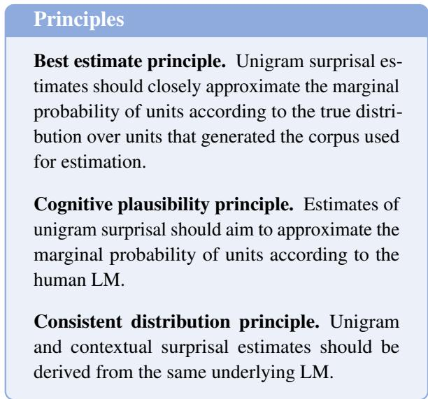
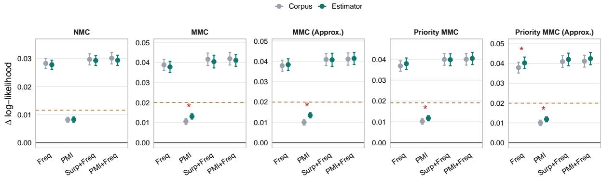
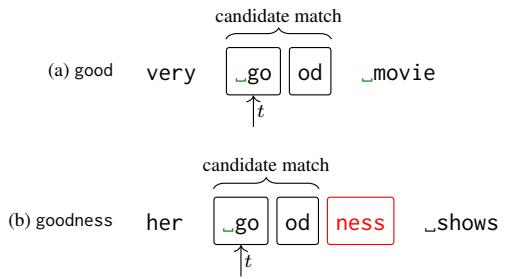
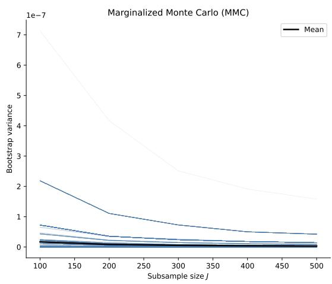
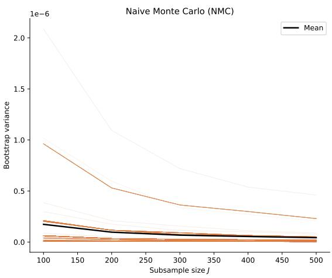
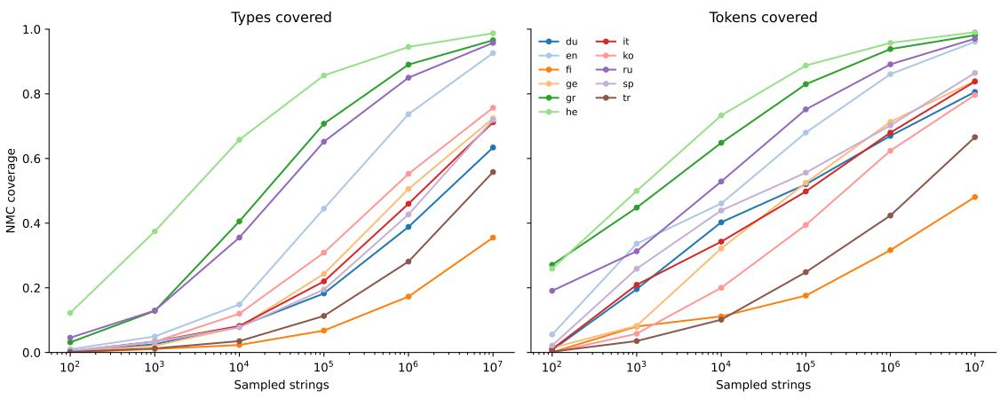

# Revisiting the Estimation of Unigram Surprisal in Computational Psycholinguistics

Zachary Hopton1 Francesco Ignazio Re2 Samuel Kiegeland2, 3 Andreas Opedal2, 4 Eleanor Chodroff1 Ryan Cotterell2

1University of Zurich 2ETH Zürich 3CHI-FRO 4MPI for Intelligent Systems, Tübingen zacharywilliam.hopton@uzh.ch ryan.cotterell@inf.ethz.ch

## Abstract

Contextual and unigram surprisal are standard predictors of reading time in computational psy cholinguistics. While contextual surprisal is typically derived from neural language models, unigram surprisal is usually obtained from independent corpus counts. Although both quantities are deterministic functionals of a single underlying distribution—capturing conditional and marginal structure respectively—this practice breaks their probabilistic link and may introduce estimation error from the mismatch. We propose three principles for estimating unigram surprisal in psycholinguistic research, including the requirement that both quantities be derived from the same language model. We operationalize this principle by introducing a Monte Carlo estimator of unigram surprisal from a language model, along with a marginalized variant that has lower variance empirically. When unigram surprisal is re-estimated under this unified framework, we find evidence that predictors change in their predictive contribution to reading time. We also confirm prior findings that frequency can be a stronger predictor of processing effort than contextual surprisal under this unified framework.

## 1 Introduction

Human sentence processing is incremental (Marslen-Wilson, 1975; Tanenhaus et al., 1995; Rayner and Clifton Jr, 2009) and predictive (Altmann and Kamide, 1999; DeLong et al., 2005): comprehenders do not wait until a sentence is complete before interpreting it, but instead build partial representations and continuously generate expectations about upcoming input. Contextual surprisal—the negative log probability of a linguistic unit given its preceding context as derived from language models (LMs)—quantifies the degree to which incoming content aligns with these predictions. Surprisal has been found to robustly predict observed processing effort in humans across paradigms and languages (Hale, 2001; Wilcox et al., 2020; Kuribayashi et al., 2022; Shain et al., 2024), lending broad empirical support to expectation-based theories of comprehension (Levy, 2008; Kuperberg and Jaeger, 2016; Ryskin and Nieuwland, 2023). Separately, the frequency of a unit in a language also shapes how quickly it is processed: more frequent units are recognized faster, independent of their contextual fit (Hare et al., 1995; Bybee, 1998; Shain, 2024). This effect is captured by unigram surprisal—the negative log probability of a unit after marginalizing over all contexts. While estimating contextual surprisal has benefited greatly from advances in neural LMs (Goodkind and Bicknell, 2018; Wilcox et al., 2020; Oh and Schuler, 2023a; de Varda and Marelli, 2023; Wilcox et al., 2023a), unigram surprisal has received comparatively little methodological attention. Typically, it is derived from small-data corpora or lexical databases (Speer, 2022).

<table><tr><td>The</td><td>soup</td><td>was</td><td>seasoned</td><td>with</td><td>salt</td><td>coriander</td></tr><tr><td>21.75</td><td>17.99</td><td>6.77</td><td>13.66</td><td>2.89</td><td>2.96</td><td>8.58</td></tr><tr><td>4.22</td><td>16.11</td><td>7.24</td><td>18.24</td><td>7.14</td><td>14.62</td><td>20.10</td></tr><tr><td>16.04</td><td>21.41</td><td>13.54</td><td>28.38</td><td>13.14</td><td>19.63</td><td>31.52</td></tr><tr><td>–17.53</td><td>-1.88</td><td>0.47</td><td>4.57</td><td>4.25</td><td>11.66</td><td>11.52</td></tr><tr><td>–5.72</td><td>3.42</td><td>6.77</td><td>14.71</td><td>10.25</td><td>16.67</td><td>22.94</td></tr></table>

Figure 1: Contextual surprisal, unigram surprisal (WF / MMC), and PMI (WF / MMC) for each word in the prefix The soup was seasoned with and two target words salt and coriander. Unigram surprisal is obtained from two sources: the wordfreq package (WF; Speer, 2022) and a marginalized Monte Carlo estimate (MMC; italicized) from mGPT (Shliazhko et al., 2024), which is also used for contextual surprisal.

In a sense made specific by Opedal et al. (2024), contextual surprisal and unigram surprisal are correlated in naturalistic text. That being the case, modern studies on surprisal have controlled for unigram surprisal (Fernandez Monsalve et al., 2012;

Smith and Levy, 2013; Shain, 2019; Wilcox et al., 2023b; Shain, 2024). However, controlling for unigram surprisal is only meaningful when both estimates come from the same distribution. In the example in Fig. 1, we calculate contextual surprisal from the language model mGPT (Shliazhko et al., 2024), while we calculate unigram surprisal with two methods: estimates from the wordfreq package (Speer, 2022) and estimates obtained with a marginalized Monte Carlo (MMC) estimator over the same language model as contextual surprisal. We observe that the pointwise mutual information (PMI) (the difference between unigram and contextual surprisal) is nearly identical for salt and coriander under wordfreq, but diverges substantially under the MMC estimator. This illustrates the estimation error that can arise from a mismatch in unigram and contextual surprisal distributions.

Motivated by this discrepancy, we put forward a set of three principles to guide approaches to estimating unigram surprisal for research on sentence processing and psycholinguistics more broadly: the best estimate principle, the cognitive plausibility principle, and the consistent distribution principle (see Fig. 2; §5). Though we argue that all three principles should guide unigram surprisal estimations, we note that no existing approach to estimating unigram surprisal satisfies the consistent distribution principle. Such an approach would eliminate the potential for error introduced by mismatched estimation procedures and allow practitioners to leverage the data scale of large LMs for unigram surprisal estimation. To that end, we introduce a Monte Carlo estimator that estimates unigram frequency from the same distribution as an LM by sampling strings from the model and calculating a unit’s empirical frequency across these samples. We go on to derive a marginalized variant of the estimator, which we empirically demonstrate to be a more efficient estimator; that is, given the same number of samples, the marginalized variant will obtain lower variance estimates than the naive Monte Carlo estimator.

In the empirical portion of the article, we study several predictors of reading times across eleven languages, as in Opedal et al. (2024), and directly compare models of reading time fit using unigram surprisal values derived from the wordfreq lexical database (Speer, 2022) and values from our MMC estimator. Like Opedal et al. (2024), we find that unigram surprisal is a stronger predictor of reading time than contextual surprisal; however, we find that the predictive power of some predictors significantly changes when unigram surprisal is calculated with our MMC estimator. Though our empirical findings focus specifically on sentence processing, they indicate that the estimation of unigram surprisal should be reconsidered more broadly in computational psycholinguistics.

  
Figure 2: Principles for estimating unigram surprisal.

## 2 Language Models

Preliminaries. An alphabet is a finite, non-empty set. Let Σ be an alphabet of tokens. We denote elements $\sigma \in \Sigma$ by lowercase Greek letters, and strings $\pmb { \sigma } = \sigma _ { 1 } \cdots \sigma _ { T }$ by bold lowercase Greek letters, where $\sigma _ { t }$ denotes the $t ^ { \mathrm { { t h } } }$ token of $\sigma .$ Furthermore, let W be an inventory of words, i.e., a non-empty set which may be finite or countably infinite (Snæbjarnarson et al., 2026; Kiegeland et al., 2026). We denote elements of W by w. $\Sigma ^ { * }$ denotes the set of all finite strings formed by concatenating tokens in Σ, including the empty string ε. We write $| \sigma | = T$ for the length of $\pmb { \sigma } = \sigma _ { 1 } \cdots \sigma _ { T }$ . A prefix of $\sigma$ is an initial substring; specifically, $\pmb { \sigma } _ { < t }$ consists of its first $t - 1$ tokens. We write $\pmb { \sigma } ^ { \prime } \preceq \pmb { \sigma }$ to indicate that $\pmb { \sigma } ^ { \prime }$ is a prefix of $\sigma$ , and $\pmb { \sigma } ^ { \prime } \prec \pmb { \sigma }$ for a strict prefix. Concatenation of $\sigma$ and $\pmb { \sigma } ^ { \prime }$ is written $\sigma \sigma ^ { \prime }$ . Finally, we introduce a distinguished end-ofstring symbol EOS $\notin \Sigma$ and define the augmented alphabet ${ \overline { { \Sigma } } } \ { \stackrel { \mathrm { d e f } } { = } } \ \Sigma \cup \left\{ \mathrm { E O S } \right\}$

Language models. Given an alphabet Σ, a language model (LM) is a probability distribution over $\Sigma ^ { * }$ . We denote a language model as $p _ { \Sigma }$ and use X to denote a random variable taking values in $\Sigma ^ { * }$ distributed according to $p _ { \Sigma }$ . Given a string $\pmb { \sigma } \in \Sigma ^ { * }$ , its prefix probability is:1

$$
{ p } _ { \Sigma } ^ { } \left( { \pmb { \sigma } } \right) \stackrel { \mathrm { d e f } } { = } \underset { X \sim p _ { \Sigma } } { \mathbb { P } } \left[ { \pmb { \sigma } } \preceq X \right]\tag{1a}
$$

$$
= \sum _ { \pmb { \sigma } ^ { \prime } \in \Sigma ^ { * } } \mathbb { 1 } \left\{ \pmb { \sigma } \preceq \pmb { \sigma } ^ { \prime } \right\} p _ { \Sigma } \left( \pmb { \sigma } ^ { \prime } \right) .\tag{1b}
$$

That is, the prefix probability of $\sigma$ is the sum over the probabilities of all possible continuations of $\sigma$

Contextual probability. The probability of a string can be factored autoregressively using prefixconditioned probabilities. We assume that $\forall \pmb { \sigma } \in$ $\Sigma ^ { * } \colon p _ { \Sigma } ( \pmb { \sigma } ) > 0 . \vphantom { 0 } ^ { 2 }$ First, we define the conditional prefix probability of a token $\sigma \in \Sigma ^ { . }$

$$
p _ { \Sigma } ^ {  } ( \sigma \mid \pmb { \sigma } ) \stackrel { \mathrm { d e f } } { = } \frac { p _ { \Sigma } ^ {  } ( \pmb { \sigma } \sigma ) } { p _ { \Sigma } ^ {  } ( \pmb { \sigma } ) } .\tag{2}
$$

The prefix probability of EOS is defined as

$$
p _ { \Sigma } ^ {  } ( \cos \mid \pmb { \sigma } ) = \frac { p _ { \Sigma } ( \pmb { \sigma } ) } { p _ { \Sigma } ^ {  } ( \pmb { \sigma } ) } .\tag{3}
$$

Thus, we will also use $\vec { p _ { \Sigma } } \left( \cdot \mid \sigma \right)$ to denote a probability distribution over $\overline { { \Sigma } } .$ Using the conditional prefix probabilities, there always exists a left-toright autoregressive factorization of the probability of a string under an LM:

$$
p _ { \Sigma } \left( \pmb { \sigma } \right) = \vec { p _ { \Sigma } } \left( \mathrm { E O S } \mid \pmb { \sigma } \right) \prod _ { t = 1 } ^ { T } \vec { p _ { \Sigma } } \left( \sigma _ { t } \mid \pmb { \sigma } _ { < t } \right) .\tag{4}
$$

Unigram probability. We define the unigram probability of a word $w \in \mathcal W$ in terms of the frequency with which it occurs in strings sampled from a language model $p _ { \Sigma }$ . Following Kiegeland et al. (2026), we assume a deterministic unit parser π : $\Sigma ^ { * }  \mathcal { W } ^ { * }$ mapping token strings to word strings.3 Its inverse, the realization, is a relation, since a word string is realized by many token strings. We further assume the positions of $\pi ( \sigma )$ are realized by pairwise disjoint, nonempty, contiguous token spans of $\pmb { \sigma } _ { \mathrm { : } }$ , in left-to-right order, so that $| \pi ( \pmb { \sigma } ) | \leq | \pmb { \sigma } |$ . The pushforward of $p _ { \Sigma }$ through $\pi$ is then defined as

$$
p _ { \mathcal { W } } ( \pmb { w } ) \stackrel { \mathrm { d e f } } { = } \sum _ { \pmb { \sigma } \in \pi ^ { - 1 } ( \pmb { w } ) } p _ { \Sigma } ( \pmb { \sigma } ) , \qquad \pmb { w } \in \mathcal { W } ^ { * } .\tag{5}
$$

1We remark that the prefix probability is not a probability distribution in general, since it is unnormalized.

We write $p _ { \mathcal { W } } ^ {  }$ for the prefix probability of $p _ { \mathcal { W } }$ , so that $p _ { \mathcal W } ^ {  } ( w \mid \mathbf { w } )$ is the conditional next-word probability. To account for the fact that a word may admit multiple tokenizations, we write

$$
\mathcal { R } ( w ) \stackrel { \mathrm { d e f } } { = } \left\{ \pmb { \sigma } \in \Sigma ^ { + } \colon \pi ( \pmb { \sigma } ) = w \right\}
$$

for the set of token strings realizing w alone (identifying w with the length-one word string), where $\Sigma ^ { + } = \Sigma ^ { * } \setminus \{ \varepsilon \}$ . For a token string $\sigma _ { : }$ , the number of occurrences of w is read off its parse:4

$$
\# ( { \pmb \sigma } , w ) \stackrel { \mathrm { d e f } } { = } \sum _ { t = 1 } ^ { | \pi ( { \pmb \sigma } ) | } \mathbb { 1 } \{ \pi ( { \pmb \sigma } ) _ { t } = w \} .\tag{6}
$$

$\ S C$ describes how we implement π, and hence $\#$ for the tokenizer used in our experiments. The expected count of a word $w \in \mathcal W$ under $p _ { \Sigma }$ is then

$$
\begin{array} { l } { \displaystyle \mu ( w ) \stackrel { \mathrm { d e f } } { = } \mathbb { E } _ { X \sim p _ { \Sigma } } [ \# ( X , w ) ] = } \\ { \displaystyle \sum _ { \sigma \in \Sigma ^ { * } } p _ { \Sigma } ( \pmb { \sigma } ) \# ( \pmb { \sigma } , w ) . } \end{array}\tag{7}
$$

We can then derive a notion of a word’s unigram probability by normalizing this expectation to a proper probability distribution over W:

$$
u ( w ) = { \frac { \mu ( w ) } { \sum _ { w ^ { \prime } \in { \mathcal { W } } } \mu ( w ^ { \prime } ) } } .\tag{8}
$$

Note that—like the contextual prefix probability $p \vec { \Sigma } ( \cdot | \sigma ) { - } u ( w )$ is a distribution over W, and is only defined for a single word w $\in \mathcal { W }$

Remark. Let $N _ { \mathcal { W } } ( \pmb { \sigma } )$ denote the number of occurrences in $\sigma$ of words in W. By linearity of expectation, $\scriptstyle \sum _ { w \in \mathcal { W } } \mu ( w )$ $\begin{array} { r } { \mathbb { E } _ { X \sim p _ { \Sigma } } \big [ \sum _ { w \in \mathcal { W } } \# ( X , w ) \big ] \ = \ \overline { { \mathbb { E } _ { X \sim p _ { \Sigma } } [ N _ { \mathcal { W } } ( X ) ] } } } \end{array}$ where the last equality is immediate, since each position of $\pi ( \sigma )$ is occupied by exactly one word of W. Thus Eq. (8) normalizes by the expected word count.

## 3 Which Language Model?

Formal theories of language, most notably the generative tradition (Chomsky, 1957, 1965), have historically separated a speaker’s idealized knowledge of grammatical rules (competence) from the actual, often imperfect, use of language in real-time processing (performance). Probability has found a central role in explaining the latter (Bod et al., 2003; Jurafsky, 2003; Chater and Manning, 2006; Levy, 2008): under a probabilistic, performance-oriented view a model of language is then evaluated not by whether it generates the correct set of grammatical strings, but by how well it mirrors the behavior of human speakers. The question is thus not whether probability is relevant for modeling linguistic performance, but what distribution it should approximate. We contrast two viewpoints on this question, which we refer to as the frequentist and the cognitive views.

The frequentist view. One approach to estimating an LM is to optimize it to place high probability on a large, heterogeneous corpus—comprising, e.g., collaborative text on Wikipedia, conversational text on Reddit, and the structured, iteratively revised prose of digitized books (Radford et al., 2019; Groeneveld et al., 2024).5 Under the frequentist view, this LM approximates the probability distribution that generated the corpus text, which we denote $p _ { \mathrm { C } }$ . The cognitive relevance of $p _ { \mathrm { C } }$ has been widely studied—corpus frequency has been shown to play a central role in language use and change (Bybee, 1998; Bybee and Hopper, 2001), accounting for phonological reduction (Bybee and Scheibman, 1999; Bybee, 2002) and grammaticalization (Haspelmath, 1999). On the other hand, the generative process underlying such heterogeneous corpora is complex: it involves millions of individuals writing diverse texts in an iterative fashion over extended periods of time, and the resulting corpora are several orders of magnitude larger than the linguistic input any single human observes over a lifetime (Warstadt and Bowman, 2022).

The cognitive view. In contrast, the cognitive view interprets the LM as a proxy for p —a theoretical construct representing the internalized probability distribution over linguistic strings that a human carries in their mind. Because we lack direct access to such a theoretical construct, a corpusestimated LM often serves as a practical approximation, an assumption underlying much of psycholinguistic modeling (Wilcox et al., 2020; Oh and Schuler, 2023b; Shain et al., 2024, inter alia). However, as LMs have grown larger—in terms of both training data and parameter count—they have become less predictive of human behavior. This phenomenon is known as the inverse-scaling law (Oh and Schuler, 2023b): predictive accuracy of human data improves with scale only up to a point, after which it degrades. This motivates an alternative approach in which the LM is directly aligned with human psychometric data to obtain more cognitively plausible probability estimates (Kiegeland et al., 2024). The construct $p _ { \mathrm { H } }$ need not be an unconstrained distribution over arbitrarily long contexts, either. The cognitive model may be lossy (Futrell et al., 2020), reflecting constraints such as limited working memory (Gibson, 1998, 2000) that restrict how much prior context is effectively encoded; in the limit, p reduces to unigram probabilities.

## 4 Surprisal Theory

Eye tracking and reading data. To study sentence processing during reading, several corpora have been developed in which many participants read the same texts and eye-tracking data are collected while reading (Kennedy et al., 2003; Siegelman et al., 2022). Eye-tracking studies record participants’ gaze continuously, allowing fixations of varying duration to be mapped directly onto the text (Rayner, 1998). Although some work has sought to model these fine-grained fixations (Re et al., 2025), the fixations are generally aggregated to yield a measure of reading time for some unit of interest. The choice of aggregation reflects assumptions about which stage of processing is being targeted (Rayner, 1998; Frank et al., 2013a; Berzak and Levy, 2023): firstfixation duration (the duration of the reader’s first fixation on a unit) is thought to reflect early lexical processing (Clifton et al., 2007), while gaze duration (cumulative fixation time before first leaving a unit) and totalfixation duration (cumulative fixation time including regressions back to the unit) capture progressively later integration processes (Liversedge et al., 1998).

Contextual surprisal. Surprisal theory states that processing difficulty is related to a unit’s negative log probability in a given context (Hale, 2001; Levy, 2008; Shain et al., 2024). Psycholinguistic studies test this theory by relating surprisal to behavioral or neural measures of processing effort such as fixation duration from eye-tracking data (Wilcox et al., 2023b) and event-related potentials (ERPs) from electroencephalography (Frank et al., 2013b). LMs play a central role in these studies because they provide estimates of contextual probabilities. Given $p _ { \mathcal { W } }$ , the contextual surprisal of a unit $w _ { t }$ in context $\mathbf { w } _ { < t }$ is defined as

$$
s _ { \mathrm { c o n t e x t } } ( w _ { t } , { \mathbf { w } } _ { < t } ) = - \log p _ { \mathcal { W } } ^ { } ( w _ { t } \mid { \mathbf { w } } _ { < t } ) .\tag{9}
$$

Unigram surprisal. Psycholinguistic studies indicate that units with high unigram frequency are more easily accessible in the mental lexicon (Hare et al., 1995; Bybee, 1998). This is typically measured in log scale, using unigram surprisal

$$
s _ { \mathrm { u n i g r a m } } ( w ) = - \log u ( w ) ,\tag{10}
$$

where $w \in \mathcal { W }$ is the unit of interest. Both surprisal quantities are thus functionals of the single distribution $p \Sigma$ (given the unit parser): contextual surprisal of the conditional structure it induces through $p _ { \mathcal { W } } ^ {  }$ and unigram surprisal of the marginal it induces through u. The consistent distribution principle (§5) demands that both be estimated from the same p , so that this relationship also holds for the estimates. Given that it has been shown to affect ease of processing, unigram surprisal is regularly included as a baseline predictor of reading times; however, some studies have focused specifically on its effect on reading (Shain, 2019, 2024; Opedal et al., 2024).

## 5 Principles of Frequency Estimation

Having discussed which distributions can be modeled to study language and having defined unigram and contextual surprisal, we can now formalize three guiding principles for estimating unigram surprisal and discuss relevant literature around them. The principles are summarized in Fig. 2.

Best estimate principle. The first principle adopts an empirical conception of unigram frequency. Under this conception, unigram frequency is treated as a real population quantity: the relative prevalence of a unit in the underlying distribution that generated the corpus. The observed strings are then viewed as samples from that distribution, and estimation amounts to recovering this empirical truth from data. This perspective has two advantages. First, it ties the target quantity to observable language use rather than to an unobserved latent construct. Second, it admits a simple and interpretable estimator: under independent and identically distributed (i.i.d.) samples, unigram probabilities are estimated by normalized token counts, which is equivalent to the maximum-likelihood estimator for a multinomial model; see $\ S \mathbf { B } .$ . As we show in Proposition 2, because − log is strictly convex, an unbiased estimator of unigram probability does not yield an unbiased estimator of unigram surprisal. Plug-in estimators of related information-theoretic quantities (i.e., entropy) are known to be biased for the same reason (Miller, 1955; Arora et al., 2022). Even for an unbiased unigram probability estimator, the estimated unigram surprisal is biased upward. The bias in surprisal disappears only for a zero-variance unigram probability estimator, motivating lower variance frequency estimators.

Cognitive plausibility principle. The second principle adopts a cognitive conception of unigram frequency. Under this conception, the target is not an empirical population quantity directly given by attested token counts, but a latent property of the expectations in the human mind, as discussed with respect to the cognitive view of the LM (§3). The goal is not to simply recover the unigram distribution of the corpus-generating process, but to approximate the distribution that best reflects human baseline expectations over units. In the past, this has been operationalized as the extent to which frequency values are predictive of human reaction times in lexical decision tasks. This criterion has been studied as an alternative way to validate frequency resources, rather than factors like corpus size (Keuleers et al., 2010; Brysbaert et al., 2011). This has led to findings that texts from the Internet (Balota et al., 2004) or movie and TV subtitles (New et al., 2007) seem to yield more cognitively plausible frequency values than those from edited publications. Importantly, this principle may be at odds with the best estimate principle. Larger LMs, despite achieving lower perplexity, have been found to yield contextual surprisal estimates that are less predictive of processing effort than those of smaller models (Oh et al., 2022; Oh and Schuler, 2023b). One explanation for this is that larger models assign probabilities to very low-frequency units more accurately, but in ways that are less cognitively plausible (Oh et al., 2024). Similarly, Opedal et al. (2024) argue that medium-sized models may yield contextual surprisal estimates closer to unigram frequency because they are less effective at predicting rare units in context, better matching the balance of contextual and frequency-based informa tion in human processing. The same issue arises for unigram frequency itself: the statistically best esti mate need not be the cognitively most plausible one.

Although this question has been studied extensively for contextual surprisal, comparatively little is known about how modeling choices affect the cognitive plausibility of unigram frequency estimates.

Consistent distribution principle. The third principle is that contextual and unigram surprisal should be derived from the same distribution. Although the literature often estimates them from different sources, the two quantities are not independent: both are functionals of a single distribution over linguistic sequences. Contextual surprisal reflects its conditional structure, while unigram surprisal reflects the marginal distribution it induces over units. Under a shared distribution, this relationship holds by construction. Under heterogeneous estimation, it does not: the two predictors then summarize different probabilistic models rather than a single generative system. Our unified estimation framework restores this coherence by deriving both quantities from the same LM. The consistent distribution principle has been observed before, though it has primarily been addressed by changing the corpora used to calculate unigram frequency. For example, Shain (2024) calculate contextual surprisal with GPT-2. To calculate unigram surprisal, Shain use a corpus that was specifically chosen to approximate the model’s training distribution in an effort to minimize effects from this mismatch. Likewise, in their assessment of surprisal as a measure of metaphor novelty, Momen and Zarrieß (2026) compare unigram surprisals from wordfreq (Speer, 2022) to those calculated over the training data of the LMs they use to obtain contextual surprisal.

## 6 From Autoregressive Language Models to Unigram Probabilities

We now consider how to operationalize the consistent distribution principle, taking an autoregressive language model as the shared distribution and studying the problem of estimating the unigram probabilities it induces. Since exact computation of Eq. (8) is infeasible, we instead consider two different estimators of this quantity. Specifically, we define estimators for words $w \in \mathcal W$ , which may have several valid tokenizations under a language model’s token alphabet Σ.6

## 6.1 A Naive Monte Carlo Estimator

A straightforward way to estimate Eq. (8) is by naive Monte Carlo (NMC) sampling. Here, we independently sample N strings from $p _ { \Sigma } ,$ i.e., $\begin{array} { r } { X ^ { ( 1 ) } , \ldots , X ^ { ( N ) } \overset { \mathrm { i . i . d . } } { \sim } p _ { \Sigma } } \end{array}$ , and estimate $u ( w )$ by the empirical frequency of w across all word occurrences in the samples:

$$
{ \widehat { u } } ( w ) = { \frac { \sum _ { n = 1 } ^ { N } \# { \Big ( } X ^ { ( n ) } , w { \Big ) } } { \sum _ { n = 1 } ^ { N } \sum _ { w ^ { \prime } \in { \mathcal { W } } } \# { \Big ( } X ^ { ( n ) } , w ^ { \prime } { \Big ) } } } .\tag{11}
$$

Proposition 1. Assume that $\mathbb { E } _ { X \sim p _ { \Sigma } } [ | X | ] < \infty$ and that $\textstyle \sum _ { w ^ { \prime } \in \mathcal { W } } \mu ( w ^ { \prime } ) > 0$ . Then, for every fixed $w \in \mathcal W$ , the Monte Carlo estimator $\widehat { u } _ { N } ( w )$ is strongly consistent and asymptotically unbiased for u(w). That is,

$$
\widehat { u } _ { N } ( w ) \xrightarrow { a . s . } u ( w ) \qquad a s N  \infty ,\tag{12}
$$

and

$$
\operatorname* { l i m } _ { N  \infty } \mathbb { E } [ \widehat { u } _ { N } ( w ) ] = u ( w ) .\tag{13}
$$

## 6.2 A Marginalized Monte Carlo Estimator

The naive MC estimator in Eq. (11) can have high variance, since X ranges over a very large (infinite) sample space.7 This has negative implications for the efficiency of the frequency estimator, as well as the unigram surprisal values which we derive from it. As we show in Proposition 2, unigram surprisal values are positively biased in expectation unless the estimator has zero variance, further motivating a lower-variance frequency estimator.

To reduce this variance, we propose a marginalized Monte Carlo (MMC) estimator. The key idea is to retain the sampled prefixes of the NMC estimator, while marginalizing over the next token at each prefix. Rather than treating a word as present or absent in the sampled next token, we compute the conditional expected contribution of that next token to the word count. Suppose a sampled sequence has reached a prefix σ. NMC observes a single sampled continuation and therefore records either an occurrence of w at that position or no occurrence. The LM, however, assigns a probability to every next token, as well as to the further tokens needed to complete an occurrence of w; MMC uses all of this information.

Canonical and residual occurrences. An occurrence of w may be realized by different token strings: its realizing span (§A), read as a standalone string, is an element of $\mathcal { R } ( w )$ under the parser of §C. We split the count into the part realized by the canonical tokenization of $w ,$ and the part realized in any other way:

$$
\# \left( \pmb { \sigma } , w \right) = \# ^ { \mathrm { c a n } } \left( \pmb { \sigma } , w \right) + \# ^ { \mathrm { r e s } } \left( \pmb { \sigma } , w \right) .\tag{14}
$$

The canonical part can be marginalized with the LM’s next-token distributions, whereas the residual part is only read off a sampled string once that string is complete.

Marginalizing at each prefix. We use $Z _ { w , t } ^ { \mathrm { c a n } }$ to refer to a canonical occurrence of w beginning at position t (formally, §A), and define

$$
h _ { w } \left( \sigma \mid \sigma \right) \stackrel { \mathrm { d e f } } { = } \mathbb { E } \left[ Z _ { w , t } ^ { \mathrm { c a n } } \mid X _ { < t } = \sigma , X _ { t } = \sigma \right] ,\tag{15}
$$

the probability that a canonical occurrence begun at position t is completed—including its right-boundary condition (§C)—given that the next token is σ. Averaging over the next-token distribution, ${ \textstyle \sum } _ { { \boldsymbol { \sigma } } \in { \Sigma } } { \vec { p _ { \Sigma } } } ( { \boldsymbol { \sigma } } \mid { \boldsymbol { \sigma } } ) h _ { w } \left( { \boldsymbol { \sigma } } \mid { \boldsymbol { \sigma } } \right)$ is the expected canonical contribution of the position following σ.

Marginalizing the canonical part alone would discard residual occurrences. Writing $H _ { w } \left( \pmb { \sigma } \right) \stackrel { \mathrm { d e f } } { = }$ $\begin{array} { r } { \sum _ { s = 1 } ^ { | \pmb { \sigma } | } h _ { w } ( \sigma _ { s } \mid \pmb { \sigma } _ { < s } ) } \end{array}$ for the marginalized canonical contribution accumulated along $\sigma ,$ we define a per-step contribution that charges whatever is left over to the terminal EOS position:

$$
\begin{array} { r } { d _ { w } \left( \sigma \left| \sigma \right. \right) \stackrel { \mathrm { d e f } } { = } \left\{ \begin{array} { l l } { h _ { w } \left( \sigma \left| \sigma \right. \right) , } & { \sigma \in \Sigma , } \\ { \# \left( \sigma , w \right) - H _ { w } \left( \sigma \right) , } & { \sigma = \mathrm { E O S } . } \end{array} \right. } \end{array}\tag{16}
$$

By construction, this decomposition is exact pathwise: for every completed string $\sigma .$

$$
\# ( \pmb { \sigma } , w ) = \sum _ { t = 1 } ^ { | \pmb { \sigma } | } d _ { w } \left( \sigma _ { t } | \pmb { \sigma } _ { < t } \right) + d _ { w } \left( \cos | \pmb { \sigma } \right) .\tag{17}
$$

The EOS term therefore absorbs both the residual, non-canonical occurrences and the gap between the marginalized and the realized canonical counts.

The MMC estimator. Taking the conditional expectation of $d _ { w }$ at every prefix visited by a sampled string X gives the per-string count estimate

$$
\begin{array} { r l } & { \widehat { \mathcal { \# } } ^ { \mathrm { M M C } } ( X , w ) \stackrel { \mathrm { d e f } } { = } } \\ & { \qquad \displaystyle \sum _ { t = 1 } ^ { | X | + 1 } \mathbb { E } _ { A \sim p \widehat { \Sigma } } ( \cdot | X _ { < t } ) \left[ d _ { w } \left( A \mid X _ { < t } \right) \right] , } \end{array}\tag{18}
$$

which we show to be unbiased for the expected count of Eq. (7) in $\ S \mathrm { A }$ . Normalizing exactly as in Eq. (11) yields our estimator of Eq. (8):

$$
\widehat { u ^ { * } } \left( w \right) = \frac { \sum _ { n = 1 } ^ { N } \widehat { \# } ^ { \mathrm { M M C } } \left( X ^ { ( n ) } , w \right) } { \sum _ { n = 1 } ^ { N } \sum _ { w ^ { \prime } \in \mathcal { W } } \# \left( X ^ { ( n ) } , w ^ { \prime } \right) } ,\tag{19}
$$

where $\boldsymbol { X } ^ { ( 1 ) } , \ldots , \boldsymbol { X } ^ { ( N ) } \stackrel { \mathrm { i . i . d . } } { \sim } p _ { \Sigma }$ . The denominator is the same expected-word-count estimate used by NMC in Eq. (11).

Approximate variant. Given the computational cost of the MMC estimator (§A) and the relatively small probability mass that LMs assign to non-canonical tokenizations (Vieira et al., 2025), we also experiment with an approximation that counts only canonical occurrences, $\mathrm { i . e . }$ , replaces # in Eq. (14) by $\# ^ { \mathrm { c a n } }$ , so that $\# ^ { \mathrm { r e s } } \left( \pmb { \sigma } , w \right) = 0$ . The EOS term of the expectationequivalent contribution $\widetilde { d } _ { w }$ of $\ S \mathrm { A }$ then vanishes, and the corresponding estimator reduces to the canonical-only count estimate ${ \widehat { \# } } _ { \mathrm { c a n } } ^ { \mathrm { M M C } } \left( X , w \right) \ { \stackrel { \mathrm { d e f } } { = } } \quad$ $\begin{array} { r } { \sum _ { t = 1 } ^ { | X | + 1 } \mathbb { E } _ { A \sim p _ { \Sigma } ^ {  } ( \cdot | X _ { < t } ) } [ h _ { w } ( A \mid X _ { < t } ) ] } \end{array}$ (with $h _ { w } \left( \operatorname { E O S } \mid \cdot \right) \ \stackrel { \mathrm { d e f } } { = } 0 )$ , which is unbiased for the canonical share $\mathbb { E } _ { X \sim p _ { \Sigma } } [ \# ^ { \mathrm { c a n } } \left( X , w \right) ]$ of Eq. (7), and so agrees with Eq. (18) in expectation exactly when the residual mass vanishes. Normalizing as before gives

$$
\widehat { u ^ { * } } _ { \mathrm { c a n } } \left( w \right) = \frac { \sum _ { n = 1 } ^ { N } \widehat { \# } _ { \mathrm { c a n } } ^ { \mathrm { M M C } } \Big ( X ^ { \left( n \right) } , w \Big ) } { \sum _ { n = 1 } ^ { N } \sum _ { w ^ { \prime } \in \mathcal { W } } \# \Big ( X ^ { \left( n \right) } , w ^ { \prime } \Big ) } .\tag{20}
$$

The approximation above does not require taking non-canonical tokenizations in the sampled strings into account, meaning that its numerator underestimates the expected count $\mu \left( w \right)$ whenever residual mass is nonzero. We study the downstream impact of this in $\ S 7$

## 7 Experiments

Opedal et al. (2024) model reading times of orthographic words in eleven languages using contextual surprisal from mGPT (Shliazhko et al., 2024) and unigram surprisal from the wordfreq package (Speer, 2022), with data from the Multilingual Eye-movement Corpus (MECO; Siegelman et al., 2022). We extend their analyses, retaining their contextual surprisal values but replacing unigram surprisal estimates obtained from wordfreq with those estimated from the same distribution as the contextual surprisal using our NMC and MMC estimators. Strings for estimation are obtained by sampling from mGPT with a maximum length of 50 for computational considerations, and estimates are converted to unigram surprisals by taking the negative log of the estimated unigram probabilities.

Opedal et al. (2024) compare the predictive power of unigram surprisal, contextual surprisal, and pointwise mutual information (PMI). PMI (Fano, 1961) measures the association between a word $w _ { t }$ and its context $\mathbf { w } _ { < t }$ , and is defined as:

$$
\mathrm { P M I } ( w _ { t } , \mathbf { w } _ { < t } ) = s _ { \mathrm { u n i g r a m } } ( w _ { t } ) - s _ { \mathrm { c o n t e x t } } ( w _ { t } , \mathbf { w } _ { < t } ) .
$$

Wherever PMI or unigram surprisal appear in our models, we report results using both the original wordfreq estimates (Speer, 2022) and each of our approaches to estimating unigram surprisal from mGPT. We model reading times using generalized additive mixed models (GAMMs), which differ from linear models by allowing predictors to enter through smooth, nonparametric functions rather than fixed linear coefficients. Our dependent vari able is gaze duration. We fit five GAMMs with smooth terms for (i) unigram surprisal, (ii) contextual surprisal, (iii) PMI, (iv) contextual surprisal and unigram surprisal, and (v) PMI and unigram surprisal, each with a single spillover term per predictor and random effect smooths for participant and trial. Model fit is assessed via delta loglikelihood $( \Delta _ { \mathrm { L L } } )$ , defined as the difference in perunit log-likelihood between a candidate model and a baseline with only random effects. Predictions are obtained via 10-fold cross-validation; positive values indicate that the candidate model assigns higher likelihood to the observed reading times than this baseline. To assess whether the MMC estimators yield a different quality of fit than corpusbased unigram surprisals, we compare $\Delta _ { \mathrm { { L I } } }$ L values between the two frequency conditions at the unit level using paired permutation tests, with p-values corrected for multiple comparisons using the Holm– Bonferroni procedure. We discuss MECO and the covered languages, preprocessing, model specification, and evaluation details in §F.

## 8 Results

## 8.1 Marginalizing Reduces Variance

To study empirically whether the variance of the MMC estimator is lower than that of the naive Monte Carlo estimator in Eq. (11), we use both to compute estimates of unigram frequency for each unigram appearing in the English portion of MECO (Siegelman et al., 2022). Given $ { N _ { \mathrm { ~ \scriptsize ~ = ~ } 5 0 0 } }$ samples, we assess the variance of an estimator $\widehat { \mu }$ via bootstrapping at subsample sizes $J ~ \in ~ \{ 1 0 0 , 2 0 0 , 3 0 0 , 4 0 0 , 5 0 0 \}$ , drawing $\begin{array} { r c l } { K } & { = } & { 1 0 0 0 } \end{array}$ resamples with replacement and computing the estimator on each resample. The variance is then estimated as follows:

<table><tr><td>J</td><td>MMC variance</td><td>NMC variance</td><td>Ratio</td></tr><tr><td>100</td><td>1.685e-08</td><td>1.736e-07</td><td>10.30</td></tr><tr><td>200</td><td>8.508e-09</td><td>9.689e-08</td><td>11.39</td></tr><tr><td>300</td><td>5.648e-09</td><td>6.769e-08</td><td>11.98</td></tr><tr><td>400</td><td>4.044e-09</td><td>5.448e-08</td><td>13.47</td></tr><tr><td>500</td><td>3.307e-09</td><td>4.281e-08</td><td>12.94</td></tr></table>

Table 1: Mean bootstrap variance of the Marginalized (MMC) and Naive (NMC) Monte Carlo unigram frequency estimators across subsample sizes $J .$ Ratio = NMC/MMC.

$$
\begin{array} { l } { \displaystyle \mathbb { V } ( \widehat { \mu } ) = \mathbb { E } \big [ ( \widehat { \mu } - \mathbb { E } [ \widehat { \mu } ] ) ^ { 2 } \big ] } \\ { \displaystyle = \frac { 1 } { K - 1 } \sum _ { k = 1 } ^ { K } \Big ( \widehat { \mu _ { k } } - \overline { { \widehat { \mu } } } \Big ) ^ { 2 } , } \end{array}\tag{22}
$$

where $\begin{array} { r } { \overline { { \widehat { \mu } } } \ \overset { \mathrm { d e f } } { = } \ \frac { 1 } { K } \sum _ { k = 1 } ^ { K } \widehat { \mu } _ { k } } \end{array}$ . Results are in Tab. 1 (see Fig. 4 for visualizations). The marginalized estimator (Eq. (19)) exhibits consistently lower variance than the naive estimator (Eq. (11)) across all subsample sizes and unigrams. Indeed, the ratio of the two variances generally grows with larger subsamples. This confirms that marginalization is an empirically efficient method to estimate unigram probabilities.

We also investigate the coverage of the naive Monte Carlo estimate, i.e., for how many unigrams in MECO it successfully obtains estimates. Obtaining an estimate with the Naive Monte Carlo estimator requires the unigram to occur in the sample pool, which is not guaranteed. Across a range of mGPT sample sizes from $N = 1 0 ^ { 2 }$ to $N = 1 0 ^ { 7 }$ , we find that NMC never successfully obtains estimates for 100% of the types in the MECO corpus for any of the 11 languages tested here, and even obtains less than 50% coverage for Finnish types in sample pools of $1 0 ^ { 7 }$ strings (see §E).

Importantly, our coverage experiment indicates that sampled text from mGPT is skewed toward Hebrew, Greek, and Russian. Thus, while the MMC estimator does not have the same coverage problems as the NMC estimator, the sampled contexts used for estimates may not be informative (i.e., because they are from different languages). To better adapt our estimator for use with multilingual language models, we introduce priority-MMC, which draws samples from a large pool with language-specific strata (see §I for details).

  
Figure 3: Comparison of $\Delta _ { \mathrm { L L } }$ for various GAMMs of orthographic word gaze duration fit with unigram surprisals obtained with the wordfreq package (Speer, 2022) or with one of our estimators using samples from mGPT. Values are averaged across languages. Dashed lines represent the $\Delta _ { \mathrm { L L } }$ of adding contextual surprisal relative to each facet’s baseline for reference. Significance tests compare estimated unigram surprisal against the corpus-estimated values via paired permutation test on item-level $\Delta _ { \mathrm { L L } }$ differences, with stars marking corrected significance at an α level of 0.05. Error bars represent 95% confidence intervals.

## 8.2 Downstream Impact of Marginalizing

We now focus on models of gaze duration fit with various unigram estimates: corpus-based estimates from wordfreq (Speer, 2022), NMC estimates, MMC estimates and their canonical-only approximations (MMC and MMC Approx.), and priority-MMC estimates and their canonical-only approximations (Priority MMC and Priority MMC Approx.). We present bootstrapped distributions of item-level $\Delta _ { \mathrm { { L L } } }$ for GAMMs modeling gaze duration in Fig. 3. Across all MMC variants, we consistently observe a significant increase in $\Delta _ { \mathrm { L L } }$ for GAMMs fit with PMI calculated with MMC unigram surprisals, relative to GAMMs fit with PMI calculated with wordfreq unigram surprisals. As in prior work (Opedal et al., 2024; Heilbron et al., 2023), we find that unigram surprisal is a stronger predictor of reading times than contextual surprisal; our results confirm this finding in an environment where both values come from the same underlying distribution. We note that because of relatively poor coverage (even at high sample sizes) for rarer words, more samples are excluded from the NMC models, meaning the results are likely less robust than those from the various MMC estimators. Though the MMC and priority MMC estimators properly account for non-canonical tokenizations, our findings indicate that approximations over only canonical samples yield similar results with higher coverage and less computational cost. The results highlight that principled approaches to estimating unigram surprisal have a downstream impact.

## 9 Conclusion

This paper highlights an understudied matter in surprisal theory literature—while much attention has been given to how we estimate contextual surprisal, little research has focused on how we estimate unigram surprisal. We propose three principles to guide this estimation and introduce a Monte Carlo estimator of unigram surprisal from a language model, along with several marginalized variants. By deriving both surprisal quantities from the same model, differences in predictive power can be attributed to modeling decisions rather than mismatched estimation procedures. Our experiments show that the choice of unigram surprisal estimator has empirical consequences, and we provide further support that contextual surprisal is a weaker predictor of reading times than unigram surprisal in modeling reading time. We hope this encourages future work on what modeling decisions result in cognitively plausible unigram surprisal estimations and a more careful consideration of the role of frequency in computational psycholinguistics.

## Limitations

Though we argue that our principles for estimating unigram surprisal are applicable to computational psycholinguistics as a whole, we limit our analyses to sentence processing. We find that the procedure for estimating unigram surprisal has an empirical impact when it comes to modeling reading times, but the claim warrants further investigation in other lines of computational psycholinguistics research, e.g., in modeling speech segmentation during language acquisition or acceptability judgment experiments.

In general, estimating unigram surprisal from a language model is computationally expensive compared to using lexical databases or corpus counts, particularly for the marginalized estimators we present. Because of their lower variance, the marginalized variants of our estimator also address this limitation of our method to some extent: relatively few samples are required to obtain stable estimates compared to the Naive Monte Carlo estimator. Still, computational resources limited our sample size and the maximum string length of the strings sampled from mGPT.

We also study a limited scope of units. Our implementation of the unit parser matches whitespaceinitial token spans (§C), which is adequate for the whitespace-delimited orthographies studied here but not in general. Whether the impact of the specific estimator used varies with units of interest (for example, characters or the contextually defined words studied in Kiegeland et al. (2026)) remains an open question.

## Ethical Concerns

This study uses eye-tracking data from human participants. Because the dataset has already been published (Siegelman et al., 2022), we foresee no new ethical concerns from the contributions made in this paper.

## Acknowledgments

ZH was supported by the Swiss National Science Foundation (Grant No. 10003607).

## References

Gerry T.M Altmann and Yuki Kamide. 1999. Incremental interpretation at verbs: restricting the domain of subsequent reference. Cognition, 73(3).

Aryaman Arora, Clara Meister, and Ryan Cotterell. 2022. Estimating the entropy of linguistic distributions. In Proceedings of the 60th Annual Meeting of the Associationfor Computational Linguistics (Volume 2: Short Papers).

David A Balota, Michael J Cortese, Susan D Sergent-Marshall, Daniel H Spieler, and Melvin J Yap.

2004. Visual word recognition of single-syllable words. Journal of Experimental Psychology: General, 133(2).

Yevgeni Berzak and Roger Levy. 2023. Eye movement traces of linguistic knowledge in native and non-native reading. Open Mind, 7.

Rens Bod, Jennifer Hay, and Stefanie Jannedy, editors. 2003. Probabilistic Linguistics. The MIT Press.

Marc Brysbaert, Matthias Buchmeier, Markus Conrad, Arthur M Jacobs, Jens Bölte, and Andrea Böhl. 2011. The word frequency effect: A review of recent developments and implications for the choice of frequency estimates in German. Experimental Psychology, 58(5).

Joan Bybee. 1998. The emergent lexicon. In Chicago Linguistic Society, volume 34.

Joan Bybee. 2002. Word frequency and context of use in the lexical diffusion of phonetically conditioned sound change. Language Variation and Change, 14(3).

Joan Bybee and Paul J. Hopper. 2001. Introduction to frequency and the emergence of linguistic structure. In Joan Bybee and Paul J. Hopper, editors, Typological Studies in Language, volume 45. John Benjamins Publishing Company.

Joan Bybee and Joanne Scheibman. 1999. The effect of usage on degrees of constituency: The reduction of don’t in English. Linguistics: An Interdisciplinary Journal ofthe Language Sciences, 37(4).

Nick Chater and Christopher D. Manning. 2006. Probabilistic models of language processing and acquisition. Trends in Cognitive Sciences, 10(7).

Noam Chomsky. 1957. Syntactic Structures. Mouton and Co.

Noam Chomsky. 1965. Aspects of the Theory of Syntax. The MIT Press.

Christian Clark, Byung-Doh Oh, and William Schuler. 2025. How well does first-token entropy approximate word entropy as a psycholinguistic predictor? In Proceedings ofthe 14th International Joint Conference on Natural Language Processing and the 4th Conference ofthe Asia-Pacific Chapter ofthe Association for Computational Linguistics.

Charles Clifton, Adrian Staub, and Keith Rayner. 2007. Eye movements in reading words and sentences. In Roger P.G. Van Gompel, Martin H. Fischer, Wayne S. Murray, and Robin L. Hill, editors, Eye Movements, chapter 15. Elsevier.

Andrea de Varda and Marco Marelli. 2023. Scaling in cognitive modelling: a multilingual approach to human reading times. In Proceedings of the 61st Annual Meeting of the Association for Computational Linguistics (Volume 2: Short Papers).

Katherine A. DeLong, Thomas P. Urbach, and Marta Kutas. 2005. Probabilistic word pre-activation during language comprehension inferred from electrical brain activity. Nature Neuroscience, 8(8).

Nick Duffield, Carsten Lund, and Mikkel Thorup. 2007. Priority sampling for estimation of arbitrary subset sums. J. ACM, 54(6).

Rick Durrett. 2019. Probability: Theory and Examples, 5 edition. Cambridge university press.

Robert M. Fano. 1961. Transmission of Information: A Statistical Theory ofCommunication. MIT Press Classics. MIT Press.

Irene Fernandez Monsalve, Stefan L. Frank, and Gabriella Vigliocco. 2012. Lexical surprisal as a general predictor of reading time. In Proceedings of the 13th Conference of the European Chapter of the Associationfor Computational Linguistics.

Stefan L. Frank, Irene Fernandez Monsalve, Robin L. Thompson, and Gabriella Vigliocco. 2013a. Reading time data for evaluating broad-coverage models of English sentence processing. Behavior Research Methods, 45(4).

Stefan L. Frank, Leun J. Otten, Giulia Galli, and Gabriella Vigliocco. 2013b. Word surprisal predicts N400 amplitude during reading. In Proceedings of the 51st Annual Meeting of the Association for Computational Linguistics (Volume 2: Short Papers).

Richard Futrell, Edward Gibson, and Roger P. Levy. 2020. Lossy-context surprisal: An informationtheoretic model of memory effects in sentence processing. Cognitive Science, 44(3).

Edward Gibson. 1998. Linguistic complexity: Locality of syntactic dependencies. Cognition, 68(1).

Edward Gibson. 2000. The dependency locality theory: A distance-based theory of linguistic complexity. Image, Language, Brain.

Mario Giulianelli, Andreas Opedal, and Ryan Cotterell. 2024. Generalized measures of anticipation and responsivity in online language processing. In Findings of the Association for Computational Linguistics: EMNLP 2024.

Adam Goodkind and Klinton Bicknell. 2018. Predictive power of word surprisal for reading times is a linear function of language model quality. In Proceedings of the 8th Workshop on Cognitive Modeling and Computational Linguistics (CMCL 2018).

Dirk Groeneveld, Iz Beltagy, Evan Walsh, Akshita Bhagia, Rodney Kinney, Oyvind Tafjord, Ananya Jha, Hamish Ivison, Ian Magnusson, Yizhong Wang, Shane Arora, David Atkinson, Russell Authur, Khyathi Chandu, Arman Cohan, Jennifer Dumas, Yanai Elazar, Yuling Gu, Jack Hessel, and 24 others. 2024. OLMo: Accelerating the science of language models. In Proceedings of the 62nd Annual Meeting of the

Associationfor Computational Linguistics (Volume 1: Long Papers).

Daya Guo, Dejian Yang, Haowei Zhang, Junxiao Song, Peiyi Wang, Qihao Zhu, Runxin Xu, Ruoyu Zhang, Shirong Ma, Xiao Bi, Xiaokang Zhang, Xingkai Yu, Yu Wu, Z. F. Wu, Zhibin Gou, Zhihong Shao, Zhuoshu Li, Ziyi Gao, Aixin Liu, and 175 others. 2025. DeepSeek-R1: Incentivizing reasoning capability in LLMs via reinforcement learning. arXiv preprint arXiv:2501.12948.

John Hale. 2001. A probabilistic Earley parser as a psycholinguistic model. In Second meeting of the north american chapter of the association for computational linguistics.

Mary Hare, Lianne Older, Michael Ford, and William Marslen-Wilson. 1995. Frequency, competition and lexical representation. In Proceedings ofthe Annual Meeting ofthe Cognitive Science Society, volume 17.

Martin Haspelmath. 1999. Why is grammaticalization irreversible? Linguistics, 37(6).

Micha Heilbron, Jorie van Haren, Peter Hagoort, and Floris P. de Lange. 2023. Lexical processing strongly affects reading times but not skipping during natural reading. Open Mind, 7.

Dan Jurafsky. 2003. Probabilistic modeling in psycholinguistics: Linguistic comprehension and production. In Probabilistic Linguistics. The MIT Press.

Alan Kennedy, Robin Hill, and Joël Pynte. 2003. The Dundee corpus. In Proceedings of the European Conference on Eye Movement.

Emmanuel Keuleers, Marc Brysbaert, and Boris New. 2010. SUBTLEX-NL: A new measure for Dutch word frequency based on film subtitles. Behavior Research Methods, 42(3).

Samuel Kiegeland, Vésteinn Snæbjarnarson, Tim Vieira, and Ryan Cotterell. 2026. On the proper treatment of units in surprisal theory. In Proceedings ofthe 64th Annual Meeting ofthe Associationfor Computational Linguistics (Volume 1: Long Papers).

Samuel Kiegeland, Ethan Wilcox, Afra Amini, David Robert Reich, and Ryan Cotterell. 2024. Reverse-engineering the reader. In Proceedings of the 2024 Conference on Empirical Methods in Natural Language Processing.

Gina R. Kuperberg and T. Florian Jaeger. 2016. What do we mean by prediction in language comprehension? Language, Cognition and Neuroscience, 31(1).

Tatsuki Kuribayashi, Yohei Oseki, Ana Brassard, and Kentaro Inui. 2022. Context limitations make neural language models more human-like. In Proceedings of the 2022 Conference on Empirical Methods in Natural Language Processing.

Roger Levy. 2008. Expectation-based syntactic comprehension. Cognition, 106(3).

Simon P. Liversedge, Kevin B. Paterson, and Martin J. Pickering. 1998. Eye movements and measures of reading time. Eye Guidance in Reading and Scene Perception. Elsevier Science Ltd.

William D. Marslen-Wilson. 1975. Sentence perception as an interactive parallel process. Science, 189(4198).

George Miller. 1955. Note on the bias of information estimates. Information Theory in Psychology: Problems and Methods.

Omar Momen and Sina Zarrieß. 2026. The frequency confound in language-model surprisal and metaphor novelty. In Proceedings ofthe 15th Joint Conference on Lexical and Computational Semantics (\*SEM 2026).

Boris New, Marc Brysbaert, Jean Veronis, and Christophe Pallier. 2007. The use of film subtitles to estimate word frequencies. Applied Psycholinguistics, 28(4).

Byung-Doh Oh, Christian Clark, and William Schuler. 2022. Comparison of Structural Parsers and Neural Language Models as Surprisal Estimators. Frontiers in Artificial Intelligence.

Byung-Doh Oh and William Schuler. 2023a. Transformer-based language model surprisal predicts human reading times best with about two billion training tokens. In Findings of the Associationfor Computational Linguistics: EMNLP 2023.

Byung-Doh Oh and William Schuler. 2023b. Why does surprisal from larger transformer-based language models provide a poorer fit to human reading times? Transactions of the Association for Computational Linguistics, 11.

Byung-Doh Oh, Shisen Yue, and William Schuler. 2024. Frequency explains the inverse correlation of large language models’ size, training data amount, and surprisal’s fit to reading times. In Proceedings of the 18th Conference ofthe European Chapter ofthe Associationfor Computational Linguistics (Volume 1: Long Papers).

Andreas Opedal, Eleanor Chodroff, Ryan Cotterell, and Ethan Wilcox. 2024. On the role of context in reading time prediction. In Proceedings ofthe 2024 Conference on Empirical Methods in Natural Language Processing.

Long Ouyang, Jeffrey Wu, Xu Jiang, Diogo Almeida, Carroll Wainwright, Pamela Mishkin, Chong Zhang, Sandhini Agarwal, Katarina Slama, Alex Ray, John Schulman, Jacob Hilton, Fraser Kelton, Luke Miller, Maddie Simens, Amanda Askell, Peter Welinder, Paul F. Christiano, Jan Leike, and Ryan Lowe. 2022. Training language models to follow instructions with human feedback. In Advances in Neural Information Processing Systems, volume 35.

Alec Radford, Jeff Wu, Rewon Child, David Luan, Dario Amodei, and Ilya Sutskever. 2019. Language models are unsupervised multitask learners. OpenAI blog, 1(8).

Keith Rayner. 1998. Eye movements in reading and information processing: 20 years of research. Psychological Bulletin, 124(3).

Keith Rayner and Charles Clifton Jr. 2009. Language processing in reading and speech perception is fast and incremental: Implications for event-related potential research. Biological Psychology, 80(1).

Francesco Ignazio Re, Andreas Opedal, Glib Manaiev, Mario Giulianelli, and Ryan Cotterell. 2025. A spatio-temporal point process for fine-grained modeling of reading behavior. In Proceedings ofthe 63rd Annual Meeting ofthe Associationfor Computational Linguistics (Volume 1: Long Papers).

Rachel Ryskin and Mante S. Nieuwland. 2023. Prediction during language comprehension: What is next? Trends in Cognitive Sciences, 27(11).

Cory Shain. 2019. A large-scale study of the effects of word frequency and predictability in naturalistic reading. In Proceedings of the 2019 Conference of the North American Chapter ofthe Associationfor Computational Linguistics: Human Language Technologies, Volume 1 (Long and Short Papers).

Cory Shain. 2024. Word frequency and predictability dissociate in naturalistic reading. Open Mind, 8.

Cory Shain, Clara Meister, Tiago Pimentel, Ryan Cotterell, and Roger Levy. 2024. Large-scale evidence for logarithmic effects of word predictability on reading time. Proceedings of the National Academy of Sciences, 121(10).

Oleh Shliazhko, Alena Fenogenova, Maria Tikhonova, Anastasia Kozlova, Vladislav Mikhailov, and Tatiana Shavrina. 2024. mGPT: Few-shot learners go multilingual. Transactions ofthe Associationfor Computational Linguistics, 12.

Noam Siegelman, Sascha Schroeder, Cengiz Acartürk, Hee-Don Ahn, Svetlana Alexeeva, Simona Amenta, Raymond Bertram, Rolando Bonandrini, Marc Brysbaert, Daria Chernova, Sara Maria Da Fonseca, Nicolas Dirix, Wouter Duyck, Argyro Fella, Ram Frost, Carolina A. Gattei, Areti Kalaitzi, Nayoung Kwon, Kaidi Lõo, and 12 others. 2022. Expanding horizons of cross-linguistic research on reading: The Multilingual Eye-movement Corpus (MECO). Behavior Research Methods, 54(6).

Nathaniel J. Smith and Roger Levy. 2013. The effect of word predictability on reading time is logarithmic. Cognition, 128(3).

Vésteinn Snæbjarnarson, Samuel Kiegeland, Tianyu Liu, Reda Boumasmoud, Tim Vieira, and Ryan Cotterell. 2026. Transducing language models. In The International Conference on Learning Representations.

Robyn Speer. 2022. rspeer/wordfreq: V3.0.

Michael K. Tanenhaus, Michael J. Spivey-Knowlton, Kathleen M. Eberhard, and Julie C. Sedivy. 1995. Integration of visual and linguistic information in spoken language comprehension. Science, 268(5217).

Aad W. Van der Vaart. 2000. Asymptotic Statistics, volume 3. Cambridge university press.

Tim Vieira, Benjamin LeBrun, Mario Giulianelli, Juan Luis Gastaldi, Brian DuSell, John Terilla, Timothy J. O’Donnell, and Ryan Cotterell. 2025. From language models over tokens to language models over characters. In Proceedings ofthe International Conference on Machine Learning.

Alex Warstadt and Samuel R. Bowman. 2022. What artificial neural networks can tell us about human language acquisition. In Shalom Lappin and Jean-Philippe Bernardy, editors, Algebraic Structures in Natural Language. CRC Press.

Ethan Wilcox, Jon Gauthier, Jennifer Hu, Peng Qian, and Roger Levy. 2020. On the predictive power of neural language models for human real-time comprehension behavior. In Proceedings ofthe the Cognitive Science Society.

Ethan Wilcox, Clara Meister, Ryan Cotterell, and Tiago Pimentel. 2023a. Language model quality correlates with psychometric predictive power in multiple languages. In Proceedings ofthe 2023 Conference on Empirical Methods in Natural Language Processing.

Ethan G. Wilcox, Tiago Pimentel, Clara Meister, Ryan Cotterell, and Roger P. Levy. 2023b. Testing the predictions of surprisal theory in 11 languages. Transactions ofthe Associationfor Computational Linguistics, 11.

S.N. Wood. 2006. Generalized Additive Models: An Introduction with R. Chapman & Hall/CRC.

Appendix Contents   
A Estimator description 15   
B MLE of Unigram Frequency 18   
C Implementing the Unit Parser 18   
Properties of the Naive Monte Carlo Estimator 19   
E Supplementary Estimator Results 21   
E.1 Variance Analysis . 21   
E.2 Naive Monte Carlo Coverage 21   
E.3 Runtime Analysis 21   
F Experiment Details 22   
F.1 Reading Time Data . . 22   
F.2 Model Specification and Evaluation 23   
F.3 Estimator Configurations 24   
G Variation across Languages 25   
H Estimator Pseudocode 26   
I Priority-Sampled Evaluation at Large Sample Sizes 27

## A Estimator description

• Word occurrences. Occurrences of a word w and the split of $\#$ into canonical and residual realizations are as in Eq. (14), writing $C _ { w } ( X ) \ { \stackrel { \mathrm { d e f } } { = } } \ \# ( X , w )$ and likewise for the canonical and residual parts: an occurrence at unit position s of $\pi ( X )$ is canonical when the token span realizing it equals the canonical tokenization of w, and residual otherwise. We write $Z _ { w , t } ^ { \mathrm { c a n } }$ for the indicator that a canonical occurrence begins at token position t.

• Marginalize the canonical realization. A canonical occurrence of w starting at position t requires the next k tokens to match its canonical tokenization, followed by a valid right boundary. We therefore define

$$
h _ { w } ( a \mid x ) \stackrel { \mathrm { d e f } } { = } \mathbb { E } \left[ Z _ { w , t } ^ { \mathrm { c a n } } \mid X _ { < t } = x , X _ { t } = a \right] .
$$

We can then define the probability that the canonical realization of w begins at prefix $x$ and is completed with a valid right boundary as

$$
\sum _ { a \in \Sigma } { \vec { p \Sigma } } ( a \mid x ) h _ { w } ( a \mid x ) .
$$

Specifically, computing this quantity at a prefix x requires $O ( ( k + 1 ) C )$ computation, where k is the number of tokens in the canonical realization of w and C is the cost of a single LM forward pass.

• Recover the exact count at EOS. Define the per-step contribution

$$
d _ { w } ( a \mid x ) = \left\{ \begin{array} { l l } { \displaystyle h _ { w } ( a \mid x ) , } & { a \in \Sigma , } \\ { \displaystyle } \\ { \displaystyle C _ { w } ^ { \mathrm { c a n } } ( x ) + C _ { w } ^ { \mathrm { r e s } } ( x ) - \sum _ { s = 1 } ^ { | x | } h _ { w } ( x _ { s } \mid x _ { < s } ) , } & { a = \mathrm { E O S } . } \end{array} \right.
$$

Then, for every completed string $X$

$$
\begin{array} { l } { { C _ { w } ( X ) = C _ { w } ^ { \mathrm { c a n } } ( X ) + C _ { w } ^ { \mathrm { r e s } } ( X ) } } \\ { { \ \displaystyle = \sum _ { t = 1 } ^ { | X | } h _ { w } ( X _ { t } \mid X _ { < t } ) + \Biggl [ C _ { w } ^ { \mathrm { c a n } } ( X ) + C _ { w } ^ { \mathrm { r e s } } ( X ) - \sum _ { t = 1 } ^ { | X | } h _ { w } ( X _ { t } \mid X _ { < t } ) \Biggr ] } } \\ { { \ \displaystyle = \sum _ { t = 1 } ^ { | X | } d _ { w } ( X _ { t } \mid X _ { < t } ) + d _ { w } ( \mathrm { E o s } \mid X ) . } } \end{array}
$$

• Marginalize the per-step contribution $d _ { w }$ . At each prefix $x ,$ take the conditional expectation of the next-step contribution:

$$
\begin{array} { l } { \mathbb { E } _ { A \sim p \Xi ( \cdot \vert x ) } \left[ d _ { w } ( A \mid x ) \right] = } \\ { \displaystyle \sum _ { a \in \Sigma } p \Xi ( a \mid x ) h _ { w } ( a \mid x ) + p \Xi ( \mathrm { E O S } \mid x ) \left[ C _ { w } ^ { \mathrm { c a n } } ( x ) + C _ { w } ^ { \mathrm { r e s } } ( x ) - \sum _ { s = 1 } ^ { | x | } h _ { w } ( x \mid x _ { < s } ) \right] . } \end{array}
$$

• Define the marginalized estimator. For a sampled string $X ,$ , sum the conditional expected contributions over all visited prefixes:

$$
\widehat { C } _ { w } ^ { \mathrm { M M C } } ( X ) = \sum _ { t = 1 } ^ { | X | + 1 } \mathbb { E } _ { A \sim p \vec { \Sigma } ( \cdot | X _ { < t } ) } \left[ d _ { w } ( A \mid X _ { < t } ) \right] .
$$

• Show unbiasedness. Let $\tau ( X ) \ { \stackrel { \mathrm { d e f } } { = } } \ | X | + 1$ . Then

$$
\operatorname { \mathbb { E } } _ { X \sim p } \left[ \widehat { C } _ { w } ^ { \mathrm { M M C } } ( X ) \right] = \operatorname { \mathbb { E } } _ { X \sim p } \left[ \sum _ { t = 1 } ^ { \tau ( X ) } \operatorname { \mathbb { E } } _ { A \sim p _ { \Sigma } ^ { + } ( \cdot | X < t ) } \left[ d _ { w } ( A \mid X _ { < t } ) \right] \right]
$$

$$
\begin{array} { r l } { ( e x t e n d s u m ~ v i a ~ i n d i c a t o r ) } & { { } = \mathbb { E } _ { X \sim p } \left[ \displaystyle \sum _ { t = 1 } ^ { \infty } \mathbf { 1 } \{ | X | \geq t - 1 \} \mathbb { E } _ { A \sim p \vec { \Sigma } ( \cdot | X < t ) } \left[ d _ { w } ( A \mid X _ { < t } ) \right] \right] } \end{array}
$$

$$
\begin{array} { r l } { \mathsf { \Gamma } _ { ( e x p e c t a t i o n ~ a s ~ s u m ) } } & { { } = \displaystyle \sum _ { x \in \Sigma ^ { * } } p ( x ) \sum _ { t = 1 } ^ { \infty } \mathbf { 1 } \{ | x | \ge t - 1 \} \mathbb { E } _ { A \sim p \vec { \Sigma } } ( \cdot | \mathbf { x } _ { < t } ) \left[ d _ { w } ( A \mid x _ { < t } ) \right] } \end{array}
$$

$$
\begin{array} { r l } { \mathit { ( s w a p s u m s ( F u b i n i ) ) } } & { { } = \displaystyle \sum _ { t = 1 } ^ { \infty } \displaystyle \sum _ { \boldsymbol { x } \in \Sigma ^ { * } } p ( \boldsymbol { x } ) \mathbf { 1 } \{ | \boldsymbol { x } | \ge t - 1 \} \mathbb { E } _ { A \sim p \vec { \Sigma } ( \cdot | \mathbf { x } _ { < t } ) } \left[ d _ { w } ( A \mid \boldsymbol { x } _ { < t } ) \right] } \end{array}
$$

$$
\begin{array} { r l } { ( r e w r i t e a s e x p e c t a t i o n ) } & { { } = \displaystyle \sum _ { t = 1 } ^ { \infty } \mathbb { E } _ { X \sim p } \left[ \mathbf { 1 } \{ | X | \geq t - 1 \} \mathbb { E } _ { A \sim p _ { \Sigma } ^ { + } ( \cdot | X _ { < t } ) } \left[ d _ { w } ( A \mid X _ { < t } ) \right] \right] } \end{array}
$$

$$
\begin{array} { r l } { \ L _ { ( e x p e c t a t i o n ~ a s s u m ) } } & { { } = \displaystyle \sum _ { t = 1 } ^ { \infty } \sum _ { x \in \Sigma ^ { * } } p ( x ) \mathbf { 1 } \{ | x | \geq t - 1 \} \mathbb { E } _ { A _ { t } \sim p \vec { \Sigma } ( \cdot | x < t ) } \left[ d _ { w } \big ( A _ { t } \mid \mathbf { x } _ { < t } \big ) \right] } \end{array}
$$

$$
\begin{array} { r l } { \underset { \{ s p l i t x = x < t \leq \} } { = } } & { = \underset { t = 1 } { \sum } \underset { x _ { < t } \in \Sigma ^ { t - 1 } } { \sum } \underset { z \in \Sigma ^ { s } } { \sum } \left[ \underset { s = 1 } { \overset { t - 1 } { \prod } } \underset { \left| x _ { < t } z \right| \geq t } { p \overset { . } { \geq } } ( x _ { s } \mid x _ { < s } ) \right] \left[ \underset { t = 1 } { \overset { | z | } { \prod } } \underset { p \geq } { \vec { p _ { \Sigma } } } ( z _ { r } \mid x _ { < t } z _ { < r } ) \right] } \\ & { \qquad \times \underset { p \geq } { \overset { . } { \geq } } ( \mathrm { E O S ~ } | x _ { < t } z ) \mathbf { 1 } \big \{ | x _ { < t } z | \geq t - 1 \big \} \mathbb { E } _ { A _ { t } \sim p \flat _ { \Sigma } ^ { - } ( \cdot | x _ { < t } ) } \left[ d _ { w } ( A _ { t } \mid x _ { < t } ) \right] } \end{array}
$$

$$
\begin{array} { r l } {  { \operatorname* { s u p } _ { x \in \mathcal { R } ^ { n + 1 , 1 } } - \sum _ { i = 1 } ^ { N } \sum _ { j = 1 } ^ { N } \Bigg [ \frac { \prod _ { j = 1 } ^ { n } \widehat { \gamma } _ { i } ( \hat { \gamma } _ { i } ) \cdot \sum _ { j = 1 } ^ { n } \bigg ] } { N ! } \Bigg ] } } \\ & { \qquad - \sum _ { i = 1 } ^ { N } \sum _ { j = 1 } ^ { N } \Bigg [ \frac { \prod _ { j = 1 } ^ { n } \widehat { \gamma } _ { i } ( \hat { \gamma } _ { i } ) \cdot \sum _ { j = 1 } ^ { n } \big ] } { N ! } \Bigg ] } \\ &  \qquad - \sum _ { i = 1 } ^ { N } \sum _ { j = 1 } ^ { N } \Bigg [ \frac  \prod _ { j = 1 } ^ { n } \widehat { \gamma } _ { i } ( \hat { \gamma } _ { i } ) \cdot \sum _ { j = 1 } ^ { n } \big | \frac { \gamma } { 2 } \big | \frac { \gamma } { 2 } \big | \frac { \gamma } { 2 } \big | \frac { \gamma } { 2 } \big | \frac { \gamma } { 2 } \big | \frac { \gamma } { 2 } \big | \frac { \gamma } { 2 } \big | \frac { \gamma } { 2 } \big | \frac { \gamma } { 2 } \big | \frac { \gamma } { 2 } \big | \frac { \gamma } { 2 } \big | \frac { \gamma } { 2 } \big | \frac { \gamma } { 2 } \big | \frac { \gamma } { 2 } \big | \frac { \gamma } { 2 } \big | \frac { \gamma } { 2 } \big | \frac { \gamma } { 2 } \big | \frac { \gamma } { 2 } \big | \frac { \gamma } { 2 } \big | \frac { \gamma } { 2 } \big | \frac { \gamma } { 2 } \big | \frac { \gamma } { 2 } \big | \frac { \gamma } { 2 } \big | \frac { \gamma } { 2 } \big | \frac { \gamma } { 2 } \big | \frac { \gamma } { 2 } \big | \frac { \gamma } { 2 } \big | \frac { \gamma } { 2 } \big | \frac { \gamma } { 2 } \big |  \end{array}
$$

$$
\begin{array} { r l } { ( c h a i n r u l e o f p \overrightarrow { \mathbf { z } } ) } & { { } = \displaystyle \sum _ { t = 1 } ^ { \infty } \displaystyle \sum _ { \substack { \boldsymbol { x } \leq t \in \Sigma ^ { t } } } \vec { p _ { \Sigma } } ( \pmb { x } _ { \leq t } ) d _ { w } ( x _ { t } \mid \pmb { x } _ { < t } ) } \end{array}
$$

$$
\begin{array} { r l } & { \quad + \displaystyle \sum _ { \xi = 1 } ^ { \infty } \displaystyle \sum _ { x \in \mathcal { X } ( \mathbb { Z } ^ { n } ) } \widehat { p _ { \xi } ^ { \prime } } ( \mathbf { x } _ { \xi } ) \widehat { p _ { \xi } ^ { \prime } } ( \mathbf { 0 } \mathbf { } \mathbf { \Delta x } ) [ \mathbf { x } _ { \xi \in \mathcal { X } } ] d _ { \alpha } ( \mathrm { I } \mathbf { 0 } \mathbf { \Delta x } ) [ \mathbf { x } _ { \xi \in \mathcal { X } } ] } \\ { \mathrm { n o s t ~ a n s e : } \delta ^ { \alpha } ( \mathbf { X } ) \displaystyle \operatorname* { m a x } _ { \xi = 1 } ^ { \infty } } & { = \displaystyle \sum _ { \xi = 1 } ^ { \infty } \sum _ { x \in \mathcal { X } ( \mathbb { Z } ^ { n } ) } \widehat { p _ { \xi } ^ { \prime } } ( \mathbf { x } _ { \xi } ) d _ { \alpha } ( x _ { \xi } ) + \displaystyle \sum _ { \alpha \in \mathbb { Z } ^ { \nu } } p ( \mathbf { x } ) d _ { \alpha }  \mathrm { I } \mathbf { 0 } \mathbf { \Delta }  ( \mathbf { x } ) } \\ & { \quad - \displaystyle \sum _ { \xi = 1 } ^ { \infty } \displaystyle \sum _ { x \in \mathcal { X } ( \mathbb { Z } ^ { n } ) } \sum _ { \alpha \in \mathbb { Z } ^ { \nu } } p ( \alpha _ { \xi } \xi ) d _ { \alpha } ( x _ { \xi } ) [ \mathbf { \Delta x } _ { \xi \in \mathcal { X } } ] \ \displaystyle \sum _ { \alpha \in \mathbb { Z } ^ { \nu } } p ( \mathbf { x } ) d _ { \alpha } [ \mathrm { I } \mathbf { 0 } \mathbf { \Delta x } ] \ x , } \\  \mathrm { n o s t a n y ~ t h e a r y ~ } \displaystyle \sum _ { \alpha = 1 } ^ { \infty } - \displaystyle \sum _ { \beta \in \mathbb { Z } ^ { n } } p ( \mathbf { x } ) \ \sum _ { \alpha = 1 } ^ { \infty } ( x _ { \xi } ) ( \displaystyle \sum _  \alpha \in \mathbb { Z } ^  n  \end{array}
$$

• Define an expectation-equivalent contribution. Because the canonical correction term has zero expectation,

$$
\mathbb { E } _ { X \sim p } \left[ C _ { w } ^ { \mathrm { c a n } } ( X ) - \sum _ { t = 1 } ^ { | X | } h _ { w } ( X _ { t } \mid X _ { < t } ) \right] = 0 ,
$$

we can remove it from the EOS contribution without changing the expected count. We therefore define

$$
\widetilde { d } _ { w } ( a \mid x ) \ { \stackrel { \mathrm { d e f } } { = } } \ \left\{ { h } _ { w } ( a \mid x ) , \quad a \in \Sigma , \right.
$$

The corresponding cumulative quantity is

$$
{ \widetilde C } _ { w } ( X ) \stackrel { \scriptscriptstyle \mathrm { d e f } } { = } \sum _ { t = 1 } ^ { | X | } { \widetilde d } _ { w } ( X _ { t } \mid X _ { < t } ) + { \widetilde d } _ { w } ( \mathrm { E O S } \mid X ) = \sum _ { t = 1 } ^ { | X | } h _ { w } ( X _ { t } \mid X _ { < t } ) + C _ { w } ^ { \mathrm { r e s } } ( X ) .
$$

Unlike $d _ { w }$ , the contribution $\widetilde { d } _ { w }$ does not recover the exact count pathwise. However,

$$
\begin{array} { r l } { \mathbb { E } _ { X \sim p } \left[ \widetilde { C } _ { w } ( X ) \right] = \mathbb { E } _ { X \sim p } \left[ \displaystyle \sum _ { t = 1 } ^ { | X | } h _ { w } ( X _ { t } \mid X _ { < t } ) + C _ { w } ^ { \mathrm { r e s } } ( X ) \right] } & { } \\ { = \mathbb { E } _ { X \sim p } \left[ C _ { w } ^ { \mathrm { c a n } } ( X ) + C _ { w } ^ { \mathrm { r e s } } ( X ) \right] } & { } \\ { = \mathbb { E } _ { X \sim p } \left[ C _ { w } ( X ) \right] . } \end{array}
$$

Thus, $\widetilde { d } _ { w }$ yields an expectation-equivalent decomposition of the count, whereas $d _ { w }$ yields a pathwiseexact decomposition.

## • Define the expectation-equivalent marginalized estimator.

Using $\widetilde { d } _ { w } .$ , we define the corresponding marginalized estimator as

$$
\widehat { C } _ { w } ^ { \mathrm { M M C \ - } \widetilde { d } } ( X ) \stackrel { \mathrm { d e f } } { = } \sum _ { t = 1 } ^ { | X | + 1 } \mathbb { E } _ { A \sim p \widehat { \Sigma } } ( \cdot | X _ { < t } ) \left[ \widetilde { d } _ { w } ( A \mid X _ { < t } ) \right] .
$$

## B MLE of Unigram Frequency

Suppose we observe strings $X ^ { ( 1 ) } , \dots , X ^ { ( N ) } \in \Sigma ^ { * }$ sampled from some distribution over strings. A direct estimator of unigram probability is obtained by replacing the expectations in Eqs. (7) and (8) with empirical averages.

First, define the empirical expected count

$$
{ \hat { \mu } } _ { N } ( w ) \ { \stackrel { \mathrm { d e f } } { = } } \ { \frac { 1 } { N } } \sum _ { n = 1 } ^ { N } \# { \Big ( } X ^ { ( n ) } , w { \Big ) } \ .\tag{23}
$$

Plugging this and its sum over W into Eq. (8) yields the estimator

$$
{ \hat { p } } _ { N } ( w ) \ { \stackrel { \mathrm { d e f } } { = } } \ { \frac { { \hat { \mu } } _ { N } ( w ) } { \sum _ { w ^ { \prime } \in \mathcal { W } } { \hat { \mu } } _ { N } ( w ^ { \prime } ) } } .\tag{24}
$$

Equivalently, ${ \hat { p } } _ { N } ( w )$ is just the relative frequency of w among all word occurrences in the sample. The corresponding plug-in estimator of unigram surprisal is

$$
{ \hat { s } } _ { \mathrm { u n i } , N } ( w ) { \stackrel { \mathrm { d e f } } { = } } - \log { \hat { p } } _ { N } ( w ) .\tag{25}
$$

This is the standard corpus-based approach to unigram estimation. It is a plug-in estimator because it estimates the population moments appearing in the definition of unigram probability and then substitutes those estimates into the target functional. Lexical resources such as frequency tables or unigram databases can be viewed as implementations of this same basic strategy, possibly with additional preprocessing or smoothing.

Proposition 2. For an unbiased estimator of unigram probability, the expected surprisal of the frequency estimator overestimates the true unigram surprisal:

$$
\begin{array} { r } { \mathbb { E } [ - \log \hat { p } ( w ) ] \ \geq \ - \log u ( w ) \ = \ s _ { u n i g r a m } ( w ) . } \end{array}\tag{26}
$$

Equality holds ifand only $i f \hat { p } ( w )$ has zero variance, $i . e . ,$ , is almost surely constant.

Proof. The expected surprisal of the frequency estimator is $\mathbb { E } \left[ - \log \hat { p } \left( w \right) \right]$ . Since − log is strictly convex,

$$
\begin{array} { r } { \mathbb { E } \left[ - \log \hat { p } \left( w \right) \right] \stackrel { \mathrm { J e n s e n } } { \geq } - \log \mathbb { E } \left[ \hat { p } \left( w \right) \right] \stackrel { \mathrm { u n b i a s e d } } { = } - \log u \left( w \right) = s _ { \mathrm { u n i g r a m } } \left( w \right) , } \end{array}\tag{27}
$$

where the last equality uses $\mathbb { E } \left[ \hat { p } \left( w \right) \right] = u \left( w \right)$ . Since − log is strictly convex, the Jensen step is strict unless $\hat { p } \left( w \right)$ equals E $[ \hat { p } \left( w \right) ]$ almost surely. That is, unless it has zero variance, in which case the bias disappears. □

## C Implementing the Unit Parser

In practice, we do not compute π exactly, but approximate $\mathbf { i t } ,$ and hence the count $\#$ , by matching whitespace-initial token spans. Kiegeland et al. (2026) argue that whitespace heuristics of this kind are not linguistically adequate in general. We adopt the heuristic as an implementation of $\pi$ for the whitespace-delimited words studied here and note this as a limitation.

In the following example, we illustrate our boundary-sensitive matching for the target word good. marks the leading whitespace carried by a token, and green symbols indicate the word boundaries relevant to the match.

In both cases the scan starts at token position t on ␣go, whose whitespace provides the left boundary. In (a), the span ␣go od forms good and the whitespace of the next token ␣movie provides a valid right boundary, so the occurrence is counted. In (b), the same span is followed by ness, which carries no whitespace, so the right boundary condition fails and the occurrence is not counted.

Below we enumerate the left and right boundaries the matching requires:

<table><tr><td>Boundary</td><td>Location</td><td>Condition (satisfied when)</td></tr><tr><td>Left</td><td>first token of w</td><td>it carries a leading(word-initial marker  $\dot { \mathsf { G } } )$  , or it be- gins the sequence</td></tr><tr><td>Right</td><td>token following the last token of w</td><td>it carries a leading  (marker Ġ), or it is EOs</td></tr></table>

## D Properties of the Naive Monte Carlo Estimator

Proposition 1. Assume that $\mathbb { E } _ { X \sim p _ { \Sigma } } [ | X | ] <$ ∞ and that $\begin{array} { r } { \sum _ { w ^ { \prime } \in \mathcal { W } } \mu ( w ^ { \prime } ) > 0 . } \end{array}$ . Then, for every fixed $w \in \mathcal { W } _ { : }$ the Monte Carlo estimator $\widehat { u } _ { N } ( w )$ is strongly consistent and asymptotically unbiasedfor u(w). That is,

$$
\widehat { u } _ { N } ( w ) \xrightarrow { a . s . } u ( w ) \qquad a s N  \infty ,\tag{28}
$$

and

$$
\operatorname* { l i m } _ { N  \infty } \mathbb { E } [ \widehat { u } _ { N } ( w ) ] = u ( w ) .\tag{29}
$$

Proof. Recall that $\begin{array} { r } { N _ { \mathcal { W } } ( \pmb { \sigma } ) = \sum _ { w ^ { \prime } \in \mathcal { W } } \# ( \pmb { \sigma } , w ^ { \prime } ) } \end{array}$ denotes the number of occurrences in $\sigma$ of words in $\mathcal { W } ,$ so that the estimator in Eq. (11) can be written as

$$
\widehat { u } _ { N } ( w ) = \frac { \sum _ { n = 1 } ^ { N } \# \Big ( X ^ { ( n ) } , w \Big ) } { \sum _ { n = 1 } ^ { N } N _ { \mathcal { W } } \Big ( X ^ { ( n ) } \Big ) } ,
$$

with the convention $\widehat { u } _ { N } ( w ) \overset { \mathrm { d e f } } { = } 0$ when the denominator is zero. For any $N > 0$ , define the random vector

$$
Z _ { N } = \left( \frac { 1 } { N } \sum _ { n = 1 } ^ { N } \# \Big ( X ^ { ( n ) } , w \Big ) \thinspace , \frac { 1 } { N } \sum _ { n = 1 } ^ { N } N  \gamma \Big ( X ^ { ( n ) } \Big ) \right) .
$$

Further define

$$
\ell = \mathbb { E } _ { X \sim p _ { \Sigma } } [ N _ { \mathcal { W } } ( X ) ] = \sum _ { w ^ { \prime } \in \mathcal { W } } \mu ( w ^ { \prime } ) .
$$

Since every occurrence of a word occupies at least one token position,

$$
0 \le \# ( X , w ) \le N _ { \mathcal { W } } ( X ) \le | X | ,
$$

the assumption $\mathbb { E } _ { X \sim p \Sigma } [ | X | ] < \infty$ implies that

$$
\mathbb { E } _ { X \sim p _ { \Sigma } } [ \# ( X , w ) ] < \infty \qquad \mathrm { a n d } \qquad \mathbb { E } _ { X \sim p _ { \Sigma } } [ N _ { \mathcal { W } } ( X ) ] < \infty .
$$

Hence the strong law of large numbers applies to both coordinates of $Z _ { N }$ , and

$$
Z _ { N } \xrightarrow { { a . s . } } \left( { \mu ( w ) , \ell } \right) .\tag{30}
$$

Now define $\begin{array} { r } { g \colon \mathbb { R } \times ( \mathbb { R } \setminus \{ 0 \} ) \to \mathbb { R } , \qquad g ( x , y ) = \frac { x } { u } } \end{array}$ . Since $g$ is continuous at every point $( x , y )$ with $y \ne 0$ , and since $\ell > 0$ by assumption (so that, almost surely, the denominator is nonzero for all sufficiently large N), we can apply the continuous mapping theorem (Van der Vaart, 2000, Theorem 2.3)

$$
{ \widehat { u } } _ { N } ( w ) = g \left( { \frac { 1 } { N } } \sum _ { n = 1 } ^ { N } \# { \Big ( } X ^ { ( n ) } , w { \Big ) } \ , { \frac { 1 } { N } } \sum _ { n = 1 } ^ { N } N _ { \mathcal { W } } { \Big ( } X ^ { ( n ) } { \Big ) } \right) \ { \xrightarrow { a . s . } } \ g ( \mu ( w ) \ , \ell ) = { \frac { \mu ( w ) } { \ell } } = u ( w ) \ .
$$

This proves strong consistency. It remains to show asymptotic unbiasedness. Since $\widehat { u } _ { N } ( w )  u ( w )$ almost surely and, because $\# ( X , w ) \leq N _ { \mathcal { W } } ( X )$ , we have $0 \leq \widehat { u } _ { N } ( w ) \leq 1$ for every $N > 0$ , by the bounded convergence theorem (Durrett, 2019, Theorem 1.6.7)

$$
\operatorname* { l i m } _ { N  \infty } \mathbb { E } [ \widehat { u } _ { N } ( w ) ] = \mathbb { E } [ \operatorname* { l i m } _ { N  \infty } \widehat { u } _ { N } ( w ) ] = u ( w ) .\tag{31}
$$

Thus

$$
\operatorname* { l i m } _ { N  \infty } ( \mathbb { E } [ \widehat { u } _ { N } ( w ) ] - u ( w ) ) = 0 ,\tag{32}
$$

and the estimator is asymptotically unbiased.

## E Supplementary Estimator Results

## E.1 Variance Analysis

  
Figure 4: Visualization of the bootstrapped variance estimates of our marginalized and naive Monte Carlo estimators of unigram frequency. Each line represents a single unigram from the English MECO data. The $\mathrm { \hbar ^ { 6 } } \mathrm { { a n } } ^ { * }$ lines refer to the average variance across all unigrams.

## E.2 Naive Monte Carlo Coverage

  
Figure 5: Proportion of types and tokens in the MECO corpus for which estimates can be obtained from our Naive Monte Carlo estimator at a range of sample sizes. Samples are obtained from mGPT with the maximum length hyperparameter set to 50 tokens. Estimates cannot be obtained when the target type/token never appears in the N sampled strings.

## E.3 Runtime Analysis

We choose five unigrams each of lengths 1–4 tokens from the English MECO dataset and estimate their unigram probability five times each with the naive MC algorithm in Eq. (11) and the marginalized variant in Eq. (19). Experiments are run on an NVIDIA H100 NVL GPU.

Our results demonstrate that for unigrams of token length $T = 1$ , both estimators incur similar costs, which are mainly from the generation of $N = 5 0 0 \mathrm { s t r i n g s }$ . For multi-token unigrams, however, the MMC estimator scales with token count while times for the NMC estimator are stable. This is a consequence of our estimation of the joint probability of all the tokens in multi-token unigrams, which requires $T - 1$ additional rounds of batched forward passes over all positions in the sampled contexts. Still, this cost is paid only once per unit in the dataset, and the faster NMC estimates for multi-token words come at the cost of higher variance estimates relative to the MMC estimator (see Tab. 1 and Fig. 4).

<table><tr><td>Tokens</td><td>NMC (s)</td><td>MMC (s)</td></tr><tr><td>1</td><td>3.788 (0.003)</td><td>86.269 (0.101)</td></tr><tr><td>2</td><td>3.788 (0.003)</td><td>166.344 (0.161)</td></tr><tr><td>3</td><td>3.787 (0.002)</td><td>247.479 (0.105)</td></tr><tr><td>4</td><td>3.783 (0.008)</td><td>329.654 (0.153)</td></tr></table>

Table 2: Mean (SD) wall-clock time per estimate for the Naive (NMC) and Marginalized (MMC) Monte Carlo estimators, broken down by the number of subword tokens in the target unigram (N = 500 samples, batch size 128).

## F Experiment Details

## F.1 Reading Time Data

<table><tr><td>Language</td><td>Participants</td><td>Word Types</td><td>Observations</td><td>Train Size</td><td>Test Size</td></tr><tr><td>Dutch</td><td>45</td><td>662</td><td>31680</td><td>28512</td><td>3168</td></tr><tr><td>English</td><td>46</td><td>930</td><td>55120</td><td>49608</td><td>5512</td></tr><tr><td>Finnish</td><td>49</td><td>306</td><td>14853</td><td>13368</td><td>1485</td></tr><tr><td>German</td><td>45</td><td>753</td><td>43942</td><td>39548</td><td>4394</td></tr><tr><td>Greek</td><td>45</td><td>945</td><td>39972</td><td>35975</td><td>3997</td></tr><tr><td>Hebrew</td><td>47</td><td>1303</td><td>49430</td><td>44487</td><td>4943</td></tr><tr><td>Italian</td><td>54</td><td>791</td><td>48097</td><td>43287</td><td>4810</td></tr><tr><td>Korean</td><td>32</td><td>916</td><td>15364</td><td>13828</td><td>1536</td></tr><tr><td>Spanish</td><td>48</td><td>831</td><td>48448</td><td>43603</td><td>4845</td></tr><tr><td>Turkish</td><td>29</td><td>528</td><td>12083</td><td>10875</td><td>1208</td></tr><tr><td>Russian</td><td>46</td><td>1158</td><td>46641</td><td>41977</td><td>4664</td></tr></table>

Table 3: Per-language counts for the NMC estimator: observations entering the gaze-duration model are per participant. Train/test split refer to the size of the folds used to fit and test each of the GAMMs.

<table><tr><td>Language</td><td>Participants</td><td>Word Types</td><td>Observations</td><td>Train Size</td><td>Test Size</td></tr><tr><td>Dutch</td><td>45</td><td>996</td><td>44816</td><td>40334</td><td>4482</td></tr><tr><td>English</td><td>46</td><td>945</td><td>55792</td><td>50213</td><td>5579</td></tr><tr><td>Finnish</td><td>49</td><td>1042</td><td>49783</td><td>44805</td><td>4978</td></tr><tr><td>German</td><td>45</td><td>1037</td><td>58171</td><td>52354</td><td>5817</td></tr><tr><td>Greek</td><td>45</td><td>845</td><td>35558</td><td>32002</td><td>3556</td></tr><tr><td>Hebrew</td><td>47</td><td>954</td><td>36248</td><td>32623</td><td>3625</td></tr><tr><td>Italian</td><td>54</td><td>1051</td><td>61687</td><td>55518</td><td>6169</td></tr><tr><td>Korean</td><td>32</td><td>1208</td><td>21057</td><td>18951</td><td>2106</td></tr><tr><td>Spanish</td><td>48</td><td>1036</td><td>58185</td><td>52367</td><td>5818</td></tr><tr><td>Turkish</td><td>29</td><td>1032</td><td>22935</td><td>20641</td><td>2294</td></tr><tr><td>Russian</td><td>46</td><td>1133</td><td>45621</td><td>41059</td><td>4562</td></tr></table>

Table 4: Per-language counts for the MMC estimator: observations entering the gaze-duration model are per participant. Train/test split refer to the size of the folds used to fit and test each of the GAMMs.

All reading time data used in our models is obtained from the L1 portion of the MECO corpus (Siegelman et al., 2022). Our selection of the eleven languages used here represents the overlap between languages in MECO and those supported by the LM used in our experiments, mGPT. In preprocessing, we remove words skipped by participants and obtain first fixation duration (i.e., the length of the participant’s first fixation on a word), gaze duration (the total time a participant fixates on a word before leaving it the first time) and the total fixation duration (the total time a participant fixates on a word regardless of whether they left the word and came back to it later). In their description of MECO, Siegelman et al. (2022) report on their procedure for aligning fixations to words and filtering data due to poor eye-tracker calibration. Tables throughout the section give the fold sizes in the 10-fold cross-validation used for GAMM evaluation (see §7), which differ between estimators due to differences in coverage.

<table><tr><td>Language</td><td>Participants</td><td>Word Types</td><td>Observations</td><td>Train Size</td><td>Test Size</td></tr><tr><td>Dutch</td><td>45</td><td>1009</td><td>45314</td><td>40783</td><td>4531</td></tr><tr><td>English</td><td>46</td><td>980</td><td>57883</td><td>52095</td><td>5788</td></tr><tr><td>Finnish</td><td>49</td><td>1076</td><td>51962</td><td>46766</td><td>5196</td></tr><tr><td>German</td><td>45</td><td>1047</td><td>58861</td><td>52975</td><td>5886</td></tr><tr><td>Greek</td><td>45</td><td>975</td><td>41229</td><td>37106</td><td>4123</td></tr><tr><td>Hebrew</td><td>47</td><td>1319</td><td>50126</td><td>45113</td><td>5013</td></tr><tr><td>Italian</td><td>54</td><td>1071</td><td>62485</td><td>56237</td><td>6248</td></tr><tr><td>Korean</td><td>32</td><td>1251</td><td>21739</td><td>19565</td><td>2174</td></tr><tr><td>Spanish</td><td>48</td><td>1045</td><td>58554</td><td>52699</td><td>5855</td></tr><tr><td>Turkish</td><td>29</td><td>1056</td><td>23440</td><td>21096</td><td>2344</td></tr><tr><td>Russian</td><td>46</td><td>1194</td><td>48066</td><td>43259</td><td>4807</td></tr></table>

Table 5: Per-language counts for the MMC (Approx.) estimator: observations entering the gaze-duration model are per participant. Train/test split refer to the size of the folds used to fit and test each of the GAMMs.
<table><tr><td>Language</td><td>Participants</td><td>Word Types</td><td>Observations</td><td>Train Size</td><td>Test Size</td></tr><tr><td>Dutch</td><td>45</td><td>907</td><td>41247</td><td>37122</td><td>4125</td></tr><tr><td>English</td><td>46</td><td>965</td><td>56924</td><td>51232</td><td>5692</td></tr><tr><td>Finnish</td><td>49</td><td>823</td><td>39298</td><td>35368</td><td>3930</td></tr><tr><td>German</td><td>45</td><td>950</td><td>53534</td><td>48181</td><td>5353</td></tr><tr><td>Greek</td><td>45</td><td>957</td><td>40455</td><td>36409</td><td>4046</td></tr><tr><td>Hebrew</td><td>47</td><td>1303</td><td>49454</td><td>44509</td><td>4945</td></tr><tr><td>Italian</td><td>54</td><td>995</td><td>58600</td><td>52740</td><td>5860</td></tr><tr><td>Korean</td><td>32</td><td>1118</td><td>19156</td><td>17240</td><td>1916</td></tr><tr><td>Spanish</td><td>48</td><td>994</td><td>56012</td><td>50411</td><td>5601</td></tr><tr><td>Turkish</td><td>29</td><td>894</td><td>20149</td><td>18134</td><td>2015</td></tr><tr><td>Russian</td><td>46</td><td>1176</td><td>47253</td><td>42528</td><td>4725</td></tr></table>

Table 6: Per-language counts for the Priority MMC estimator: observations entering the gaze-duration model are per participant. Train/test split refer to the size of the folds used to fit and test each of the GAMMs.

mGPT is a 1.3B parameter decoder-only language model pretrained on data from 61 languages. Shliazhko et al. (2024) report using Wikipedia documents and the C4 dataset to pretrain mGPT. wordfreq estimates are fit with data from Wikipedia, subtitle and news corpora, books, web crawls, and social media. While there it is feasible that there is some overlap in the domain and content of the two resources’ data sources, they are not fit on identical data.

## F.2 Model Specification and Evaluation

As an example of how our GAMMs of reading times are structured, the formula for our surprisal-only model is as follows:

$$
\begin{array} { r } { \mathrm { R T } _ { i } = \beta _ { 0 } + f _ { 1 } \big ( s _ { \mathrm { c o n t e x t } , i } \big ) + f _ { 2 } \big ( s _ { \mathrm { c o n t e x t } , i - 1 } \big ) } \\ { + b _ { \mathrm { p a r t i c i p a n t } ( i ) } + b _ { \mathrm { t r i a l } ( i ) } + \epsilon _ { i } . } \end{array}\tag{33}
$$

Above, $f _ { 1 }$ and $f _ { 2 }$ are main-effect smooths of the surprisal of the current and previous unit, respectively. $b _ { \mathrm { p a r t i c i p a n t } ( i ) }$ and $b _ { \mathrm { t r i a l } ( i ) }$ represent random effects that account for participant and trial variation. We specifically implement main-effect smooths as cubic regression splines limited to six basis functions to avoid overfitting, as in Opedal et al. (2024). $\epsilon _ { i }$ represents a Gaussian noise term. Predictors are standardized prior to model fitting, and we fit all GAMMs using the bam() function of the mgcv package (Wood, 2006).

Delta log-likelihood is calculated over held out data as follows:

$$
\begin{array} { c } { \displaystyle \Delta _ { \mathrm { L L } } = \frac { 1 } { N } \sum _ { n = 1 } ^ { N } \Big [ \log p _ { \mathrm { m o d e l } } \left( \mathrm { R T } _ { n } \right) } \\ { \displaystyle - \log p _ { \mathrm { b a s e l i n e } } \left( \mathrm { R T } _ { n } \right) \Big ] . } \end{array}\tag{34}
$$

<table><tr><td>Language</td><td>Participants</td><td>Word Types</td><td>Observations</td><td>Train Size</td><td>Test Size</td></tr><tr><td>Dutch</td><td>45</td><td>1009</td><td>45314</td><td>40783</td><td>4531</td></tr><tr><td>English</td><td>46</td><td>980</td><td>57883</td><td>52095</td><td>5788</td></tr><tr><td>Finnish</td><td>49</td><td>1076</td><td>51962</td><td>46766</td><td>5196</td></tr><tr><td>German</td><td>45</td><td>1044</td><td>58707</td><td>52836</td><td>5871</td></tr><tr><td>Greek</td><td>45</td><td>975</td><td>41229</td><td>37106</td><td>4123</td></tr><tr><td>Hebrew</td><td>47</td><td>1319</td><td>50126</td><td>45113</td><td>5013</td></tr><tr><td>Italian</td><td>54</td><td>1071</td><td>62485</td><td>56237</td><td>6248</td></tr><tr><td>Korean</td><td>32</td><td>1249</td><td>21702</td><td>19532</td><td>2170</td></tr><tr><td>Spanish</td><td>48</td><td>1045</td><td>58554</td><td>52699</td><td>5855</td></tr><tr><td>Turkish</td><td>29</td><td>1056</td><td>23440</td><td>21096</td><td>2344</td></tr><tr><td>Russian</td><td>46</td><td>1194</td><td>48066</td><td>43259</td><td>4807</td></tr></table>

Table 7: Per-language counts for the Priority MMC (Approx.) estimator: observations entering the gaze-duration model are per participant. Train/test split refer to the size of the folds used to fit and test each of the GAMMs.

## F.3 Estimator Configurations

Here we provide implementation details on the six sets of unigram surprisals compared in §8. The wordfreq values (Speer, 2022) are the corpus-based estimates used by Opedal et al. (2024). The NMC estimates (Eq. (11)) are computed from a large pool of $N = 4 \times 1 0 ^ { 7 }$ samples, in order to circumvent the issue of poor coverage documented in §E. The MMC estimates (Eq. (19)) and their canonical-only approximations (Eq. (20); MMC and MMC Approx.) are fit over $N = 5 0 0$ samples. The priority-MMC estimates and their canonical-only approximations (Priority MMC and Priority MMC Approx.) use language-specific strata drawn from a pool of $N = 4 \times 1 0 ^ { 7 }$ samples to balance language coverage; see §I.

## G Variation across Languages

Where we report $\Delta _ { \mathrm { { L L } } }$ averaged across languages (e.g., Fig. 3), we specifically report micro-averaged $\Delta _ { \mathrm { { L I } } }$ over all of the word-level observations, pooled across the 11 languages. This means that languages with more data (see §F) contribute more to the means. Throughout this section, we present the macro-averaged $\Delta _ { \mathrm { L L } }$ and their standard deviations for the models of gaze duration. Values are presented separately for each estimator, corresponding to each of the facets in Fig. 3.

<table><tr><td>Unigram Surprisal Metric</td><td>Model</td><td>Macro Averages</td><td>SD Across Languages</td></tr><tr><td rowspan="5">NMC Estimate</td><td>Uni. Surp.</td><td>0.0265</td><td>0.0114</td></tr><tr><td>PMI</td><td>0.0071</td><td>0.0062</td></tr><tr><td>PMI &amp; Uni. Surp.</td><td>0.0286</td><td>0.0121</td></tr><tr><td>Con. Surp.</td><td>0.0118</td><td>0.0049</td></tr><tr><td>Con. Surp. &amp; Uni. Surp.</td><td>0.0283</td><td>0.0119</td></tr><tr><td rowspan="5">Corpus Estimate</td><td>Uni. Surp.</td><td>0.0282</td><td>0.0126</td></tr><tr><td>PMI</td><td>0.0076</td><td>0.0057</td></tr><tr><td>PMI &amp; Uni. Surp.</td><td>0.0304</td><td>0.0132</td></tr><tr><td>Con. Surp.</td><td>0.0118</td><td>0.0049</td></tr><tr><td>Con. Surp. &amp; Uni. Surp.</td><td>0.0299</td><td>0.0128</td></tr></table>

Table 8: Word-level ∆LL for GAMMs of gaze duration, macro-averaged across languages. Values correspond to the NMC estimator versus the Corpus baseline (fit on NMC’s support).

<table><tr><td>Unigram Surprisal Metric</td><td>Model</td><td>Macro Averages</td><td>SD Across Languages</td></tr><tr><td rowspan="5">MMC Estimate</td><td>Uni. Surp.</td><td>0.0383</td><td>0.0195</td></tr><tr><td>PMI</td><td>0.0122</td><td>0.0085</td></tr><tr><td>PMI &amp; Uni. Surp.</td><td>0.0415</td><td>0.0205</td></tr><tr><td>Con. Surp.</td><td>0.0211</td><td>0.0100</td></tr><tr><td>Con. Surp. &amp; Uni. Surp.</td><td>0.0413</td><td>0.0204</td></tr><tr><td rowspan="5">Corpus Estimate</td><td>Uni. Surp.</td><td>0.0396</td><td>0.0211</td></tr><tr><td>PMI</td><td>0.0103</td><td>0.0070</td></tr><tr><td>PMI &amp; Uni. Surp.</td><td>0.0430</td><td>0.0216</td></tr><tr><td>Con. Surp.</td><td>0.0211</td><td>0.0100</td></tr><tr><td>Con. Surp. &amp; Uni. Surp.</td><td>0.0426</td><td>0.0214</td></tr></table>

Table 9: Word-level ∆LL for GAMMs of gaze duration, macro-averaged across languages. Values correspond to the MMC estimator versus the Corpus baseline (fit on MMC’s support).

<table><tr><td>Unigram Surprisal Metric</td><td>Model</td><td>Macro Averages</td><td>SD Across Languages</td></tr><tr><td rowspan="5">MMC (Approx.) Estimate</td><td>Uni. Surp.</td><td>0.0391</td><td>0.0178</td></tr><tr><td>PMI</td><td>0.0130</td><td>0.0085</td></tr><tr><td>PMI &amp; Uni. Surp.</td><td>0.0424</td><td>0.0191</td></tr><tr><td>Con. Surp.</td><td>0.0214</td><td>0.0105</td></tr><tr><td>Con. Surp. &amp; Uni. Surp.</td><td>0.0421</td><td>0.0191</td></tr><tr><td rowspan="5">Corpus Estimate</td><td>Uni. Surp.</td><td>0.0396</td><td>0.0211</td></tr><tr><td>PMI</td><td>0.0101</td><td>0.0069</td></tr><tr><td>PMI &amp; Uni. Surp.</td><td>0.0433</td><td>0.0217</td></tr><tr><td>Con. Surp.</td><td>0.0214</td><td>0.0105</td></tr><tr><td>Con. Surp. &amp; Uni. Surp.</td><td>0.0429</td><td>0.0215</td></tr><tr><td rowspan="5">Priority MMC Estimate</td><td>Uni. Surp.</td><td>0.0392</td><td>0.0175</td></tr><tr><td>PMI</td><td>0.0111</td><td>0.0078</td></tr><tr><td>PMI &amp; Uni. Surp.</td><td>0.0421</td><td>0.0184</td></tr><tr><td>Con. Surp.</td><td>0.0211</td><td>0.0104</td></tr><tr><td>Con. Surp. &amp; Uni. Surp.</td><td>0.0416</td><td>0.0184</td></tr><tr><td rowspan="5">Corpus Estimate</td><td>Uni. Surp.</td><td>0.0387</td><td>0.0198</td></tr><tr><td>PMI</td><td>0.0104</td><td>0.0069</td></tr><tr><td>PMI &amp; Uni. Surp.</td><td>0.0426</td><td>0.0204</td></tr><tr><td>Con. Surp.</td><td>0.0211</td><td>0.0104</td></tr><tr><td>Con. Surp. &amp; Uni. Surp.</td><td>0.0422</td><td>0.0202</td></tr></table>

Table 10: Word-level ∆LL for GAMMs of gaze duration, macro-averaged across languages. Values correspond to the MMC (Approx.) estimator versus the Corpus baseline (fit on MMC (Approx.)’s support).

Table 11: Word-level ∆LL for GAMMs of gaze duration, macro-averaged across languages. Values correspond to the Priority MMC estimator versus the Corpus baseline (fit on Priority MMC’s support).
<table><tr><td>Unigram Surprisal Metric</td><td>Model</td><td>Macro Averages</td><td>SD Across Languages</td></tr><tr><td rowspan="5">Priority MMC (Approx.) Estimate</td><td>Uni. Surp.</td><td>0.0412</td><td>0.0201</td></tr><tr><td>PMI</td><td>0.0110</td><td>0.0087</td></tr><tr><td>PMI &amp; Uni. Surp.</td><td>0.0436</td><td>0.0208</td></tr><tr><td>Con. Surp.</td><td>0.0214</td><td>0.0105</td></tr><tr><td>Con. Surp. &amp; Uni. Surp.</td><td>0.0433</td><td>0.0207</td></tr><tr><td rowspan="5">Corpus Estimate</td><td>Uni. Surp.</td><td>0.0397</td><td>0.0211</td></tr><tr><td>PMI</td><td>0.0101</td><td>0.0069</td></tr><tr><td>PMI &amp; Uni. Surp.</td><td>0.0433</td><td>0.0217</td></tr><tr><td>Con. Surp.</td><td>0.0214</td><td>0.0105</td></tr><tr><td>Con. Surp. &amp; Uni. Surp.</td><td>0.0429</td><td>0.0216</td></tr></table>

Table 12: Word-level ∆LL for GAMMs of gaze duration, macro-averaged across languages: Values correspond to the Priority MMC (Approx.) estimator versus the Corpus baseline (fit on Priority MMC (Approx.)’s support).

## H Estimator Pseudocode

Algorithm 1 Naive Monte Carlo Unigram Probability Estimator   
Require: Word w, samples $X _ { 1 } , \ldots , X _ { N }$ where each $X _ { n } = \left( x _ { 1 } , \dots , x _ { L _ { n } } \right)$ is a token string   
1: total Count ← 0   
2: total Words ← 0   
3: for each n in range N do   
4: total Count ← total Count $+ \# ( X _ { n } , w )$   
5: total Words ← total Words $+ \left| \pi ( X _ { n } ) \right|$   
6: end for   
total Count   
7: return   
total Words

Algorithm 2 Marginalized Monte Carlo Unigram Probability Estimator (Canonical-Only Variant)   
Require: Word w, samples $X _ { 1 } , \ldots , X _ { N }$ where each $X _ { n } = \left( x _ { 1 } , \dots , x _ { L _ { n } } \right)$ is a token string   
1: $[ t _ { 1 } , \dots , t _ { T } ] \gets$ tokenize(w)   
2: total Prob $ 0$   
3: total Words $ 0$   
4: for each n in range $N$ do   
5: $B _ { n } \gets \{ 0 \} \cup \{ b \colon x _ { b + 1 }$ is unit-initial} $\cup \{ L _ { n } \}$   
6: total Words ← total Words $+ \left| \pi ( \boldsymbol { X } _ { n } ) \right|$   
7: for each boundary position $b \in B _ { n }$ do   
8: prefix $ ( x _ { 1 } , \ldots , x _ { b } )$   
9: prob $\left. p _ { \Sigma } ^ { \right. } ( t _ { 1 } \ |$ prefix)   
10: for $i = 2 , \dots , T$ do   
11: prob ← prob $\cdot \vec { p _ { \Sigma } } ( t _ { i } |$ prefix $\circ [ t _ { 1 } , \ldots , t _ { i - 1 } ] )$   
12: end for   
13: total Prob ← total Prob + prob   
14: end for   
15: end for   
total Prob   
16: return   
total Words

## I Priority-Sampled Evaluation at Large Sample Sizes

Alg. 2 evaluates $\vec { p _ { \Sigma } }$ at every boundary of every sample. A unit whose probability mass lies in contexts that are rare under $p _ { \Sigma }$ requires a large sample size N before any such context is drawn. Sampling and the sweep that returns every unit’s first-token probability are paid once, no matter how many units are estimated. However, a unit of $T$ tokens requires $T - 1$ forward passes at each boundary, computed separately for each unit and linear in the pool size (Tab. 2). We therefore keep the sweep exhaustive and evaluate the continuation only at a bounded set of boundaries, chosen via priority sampling (Duffield et al., 2007). We present two variants: a canonical-only variant (Alg. 3; Priority MMC Approx. in §8), and a full estimator (Priority MMC), which restores the exact-count EOS correction of Eq. (16).

Let $\mathcal { F }$ collect every boundary position of every sample. For a word w with tokenization $[ t _ { 1 } , \dots , t _ { T } ]$ we write

$$
s _ { b } = \vec { p _ { \Sigma } } \left( t _ { 1 } \mid \mathrm { p r e f i x } _ { b } \right) , \qquad c _ { b } = \prod _ { i = 2 } ^ { T } p _ { \Sigma } ^ { - } \left( t _ { i } \mid \mathrm { p r e f i x } _ { b } \circ \left[ t _ { 1 } , \dots , t _ { i - 1 } \right] \right) ,\tag{35}
$$

with $c _ { b } = 1$ when $T = 1$ . Summing these terms and normalizing, $\sum _ { b \in \mathcal { F } } s _ { b } c _ { b } / \ell _ { \mathrm { p o o l } } .$ , gives the canonicalonly variant, writing $\ell _ { \mathrm { p o o l } }$ for the realized word count of the pool, which approximates Eq. (19): (i) the summands are evaluated only at positions whose sampled successor is unit-initial, (ii) $c _ { b }$ omits the right-boundary mass of $\ S C$ , and (iii) residual occurrences are dropped (Eq. (20)). The full estimator below removes these three approximations.

Proposition 3. Fix a stratum g and condition on the pool. Then

$$
\mathbb { E } \left[ \sum _ { b \in \mathcal { S } _ { g } } \operatorname* { m a x } ( s _ { b } , \tau _ { g } ) c _ { b } \right] = \sum _ { b \in \mathcal { F } _ { g } } s _ { b } c _ { b }\tag{36}
$$

Proof. If $| \mathcal { F } _ { g } | \le k _ { g }$ then $\mathcal { S } _ { g } = \mathcal { F } _ { g }$ and $\tau _ { g } = 0$ , so the two sides agree term by term. Otherwise fix b and let $\tau _ { - b }$ be the $k _ { g } \mathrm { - t h }$ largest priority among ${ \mathcal { F } } _ { g } \setminus \{ b \}$ , a function of $\{ u _ { b ^ { \prime } } \} _ { b ^ { \prime } \ne b }$ and so independent of $u _ { b }$ Boundary b is retained exactly when $q _ { b } > \tau _ { - b } .$ , and then the $( k _ { g } + 1 )$ -th largest priority overall is $\tau _ { - b } .$ , so

$$
\begin{array} { r } { \mathbb { E } [ \operatorname* { m a x } ( s _ { b } , \tau _ { g } ) c _ { b } \mathbb { 1 } \left\{ b \in \mathcal { S } _ { g } \right\} | \tau _ { - b } ] = \operatorname* { m a x } ( s _ { b } , \tau _ { - b } ) \operatorname* { m i n } \Bigl ( 1 , \frac { s _ { b } } { \tau _ { - b } } \Bigr ) c _ { b } = s _ { b } c _ { b } , } \end{array}\tag{37}
$$

Algorithm 3 Priority-Sampled Marginalized Monte Carlo Estimator (canonical-only variant)   
Require: Word $w ,$ frame $\mathcal { F }$ partitioned into strata $\{ \mathcal { F } _ { g } \}$ , budgets $\{ k _ { g } \}$ , pool word count $\ell _ { \mathrm { p o o l } } .$ , first-token   
probabilities $s _ { b }$ from the sweep   
1: $[ t _ { 1 } , \dots , t _ { T } ] \gets$ tokenize $( w )$   
2: if $T = 1$ then   
3: return $\sum _ { b \in \mathcal { F } } s _ { b } \big / \ell _ { \mathrm { p o o l } }$   
4: end if   
5: total $ 0$   
6: for each stratum $g$ do   
7: $q _ { b } \gets s _ { b } / u _ { b }$ for $b \in { \mathcal { F } } _ { g } ,$ with $u _ { b } \sim$ Uniform(0, 1]   
8: $\boldsymbol { S } _ { g } \gets$ the $k _ { g }$ boundaries of $\mathcal { F } _ { g }$ with largest $q _ { b }$   
9: $\tau _ { g } \gets$ the $( k _ { g } + 1 )$ -th largest $q _ { b } .$ , or 0 if $| \mathcal { F } _ { g } | \le k _ { g }$   
10: for each $b \in S _ { g }$ do   
11: $c _ { b } \gets 1$   
12: for $i = 2 , \dots , T$ do   
13: $c _ { b } \gets c _ { b } \cdot \vec { p _ { \Sigma } } ( t _ { i } \mid \mathrm { p r e f { x } } _ { b } \circ [ t _ { 1 } , \dots , t _ { i - 1 } ] )$   
14: end for   
15: total ← total + max $( s _ { b } , \tau _ { g } ) \cdot c _ { b }$   
16: end for   
17: end for   
18: return total $/ \ell _ { \mathrm { p o o l } }$

by P $[ u _ { b } < s _ { b } / \tau _ { - b } \mid \tau _ { - b } ] = \mathrm { m i n } ( 1 , s _ { b } / \tau _ { - b } )$ and max $( w , \tau ) \operatorname* { m i n } ( 1 , w / \tau ) = w$ . The right-hand side does not involve $\tau _ { - b } ,$ so averaging over it leaves E[max $( s _ { b } , \tau _ { g } ) c _ { b } \mathbb { 1 } \{ b \in S _ { g } \} ] = s _ { b } c _ { b }$ . Since

$$
\sum _ { b \in S _ { g } } \operatorname* { m a x } ( s _ { b } , \tau _ { g } ) c _ { b } = \sum _ { b \in \mathcal { F } _ { g } } \operatorname* { m a x } ( s _ { b } , \tau _ { g } ) c _ { b } \mathbb { 1 } \left\{ b \in \mathcal { S } _ { g } \right\} ,\tag{38}
$$

summing this expectation over $b \in \mathcal { F } _ { g }$ gives the claim by linearity of expectation.

Stratification. We form strata from each boundary’s own prefix and refine the Latin script class with language detection. Proposition 3 holds within each stratum, so the sum is unbiased for any allocation $\left( k _ { g } \right) _ { g }$ and the allocation may be chosen to reduce variance. Two conditions are needed: every stratum carrying mass must receive $k _ { g } \geq 1$ , since an unfunded stratum contributes nothing while its mass stays in the estimand, and the allocation must not depend on the draws, which holds because it comes from the column sums. Labels therefore enter the allocation and never a weight, so a mislabeled boundary costs precision but cannot bias the estimate.

Full estimator. The full estimator removes the three approximations in Alg. 3:

(i) An interior position enters $\mathcal { F }$ only when its sampled successor is unit-initial, an event of probability $W _ { b }$ , the unit-initial mass of $\vec { p _ { \Sigma } } \left( \cdot \mid \mathrm { p r e f i x } _ { b } \right)$ , so $s _ { b } = \vec { p \Sigma } \left( t _ { 1 } \mid \mathrm { p r e f i x } _ { b } \right) / W _ { b }$

(ii) The continuation $c _ { b }$ adds the right-boundary factor of $\ S { \bf C } , \mathrm { i . e . }$ , the mass on unit-initial tokens and EOS after $t _ { T }$

(iii) Residual occurrences are recovered through $C ,$ which is the exact count of the unit over the pool, taken on the decoded strings so that every tokenization contributes.

Writing ${ \mathcal { T } } { \stackrel { \mathrm { d e f } } { = } } \{ b \in { \mathcal { F } }$ : the sampled successor at $b$ is $t _ { 1 } \}$ , the full estimator is $\widehat { N } \left( w \right) \stackrel { \mathrm { d e f } } { = } \widehat { S } \left( w \right) + C - \widehat { H } \left( w \right)$ where $\widehat { S }$ priority-samples $\sum _ { b } { s _ { b } c _ { b } }$ over the interior boundaries and adds the exact empty-prefix term, common to all $N$ samples, and $\widehat { H }$ estimates $\sum { _ { b \in { \mathcal { T } } } c _ { b } }$ from at most $k _ { \mathrm { t a k \epsilon } }$ positions of $\tau$ drawn uniformly per first token, each weighted by the ratio of available to drawn positions. Since the two share the summand $c _ { b } ,$ the tower property gives $\mathbb { E } \left[ \widehat { S } \right] = \mathbb { E } \left[ \widehat { H } \right]$ , so $\widehat { N }$ is unbiased for N times the expected count of Eq. (7) under the length-truncated sampling process of $\ S 7 .$ , and the reported estimate is $\widehat { N } / \ell _ { \mathrm { p o o l } }$ . A negative realized numerator, which occurs for units far below the pool’s resolution, leaves the estimate undefined and the unit excluded. Unbiasedness refers to $\widehat { N }$ before this exclusion.

Settings. Tab. 13 shows the sampling parameters of both variants. We allocated the per-unit budget k in three steps: we divide a fixed share among the strata of the languages in which the unit occurs, half of it going to a generic Latin stratum for languages written in Latin script. Every stratum that carries mass receives a floor of 64 boundaries, the rest is divided in proportion to each stratum’s share of the unit’s first-token mass, capped at the stratum’s total from the first two steps. Any residue is divided by mass alone, such that the full budget is spent whenever the stored cells can serve it.
<table><tr><td></td><td>Approx. Full</td></tr><tr><td>Samples N</td><td> $4 \times 1 0 ^ { 7 }$ </td></tr><tr><td>Maximum length</td><td>50</td></tr><tr><td>Strata</td><td>21</td></tr><tr><td>Per-unit budget k</td><td>8192</td></tr><tr><td>Stratum floor</td><td>64</td></tr><tr><td>Home share</td><td>4096 2048</td></tr><tr><td>Draw seed</td><td>100000 900000</td></tr><tr><td>Frame size  $| \mathcal F |$ </td><td> $8 . 9 \times 1 0 ^ { 8 }$   $9 . 2 \times 1 0 ^ { 8 }$ </td></tr><tr><td>Pool word count  $\ell _ { \mathrm { p o o l } }$ </td><td> $8 . 8 \times 1 0 ^ { 8 }$   $8 . 8 \times 1 0 ^ { 8 }$ </td></tr><tr><td>Take draws  $k _ { \mathrm { t a k e } }$ </td><td> $\mathrm { n / a }$   $2 0 4 8$ </td></tr><tr><td>Single-token units</td><td>exact sampled</td></tr></table>

Table 13: Settings of the priority-sampled variants (Priority MMC Approx. and Priority MMC). Each variant draws its own pool of samples. The full variant’s pool additionally stores the model’s own sampled tokenizations for Hb . Approximate-variant single-token units need no sampling, since their numerator is the exact column sum plus the exact empty-prefix term. The full estimator’s closing mass depends on the unit, so its single-token units are sampled like any other.