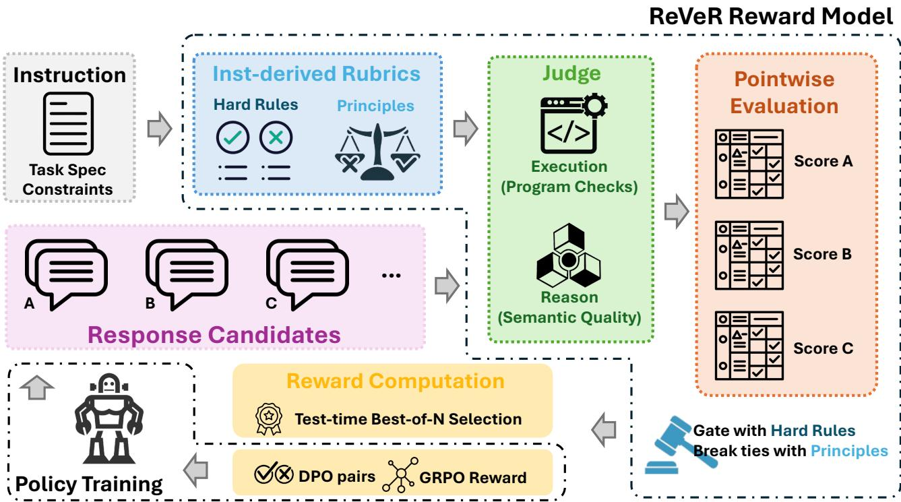
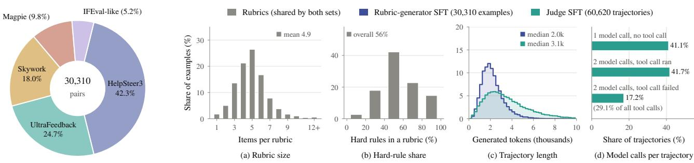
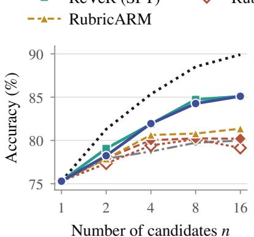
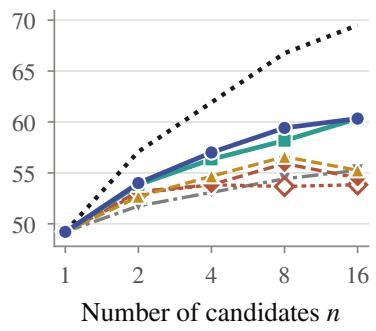
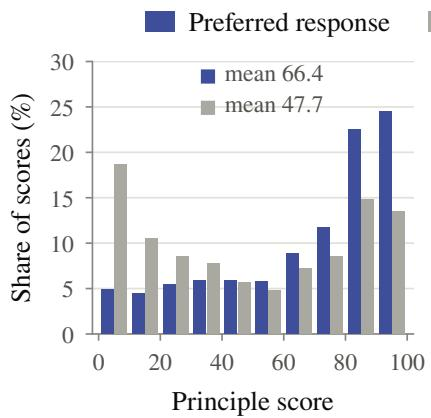
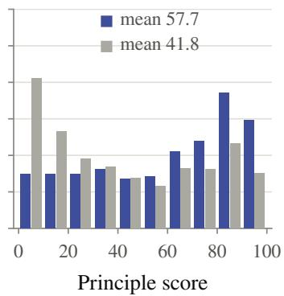
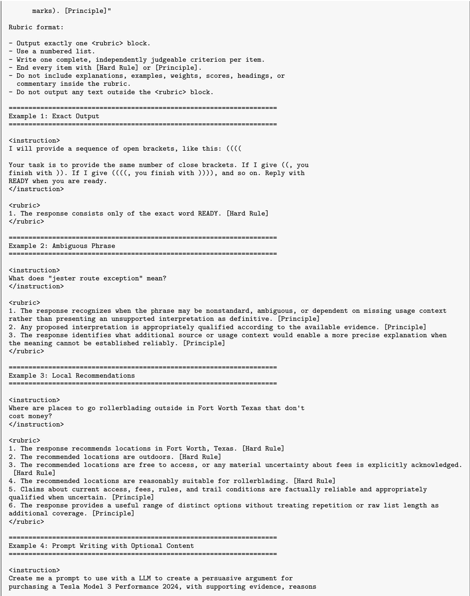
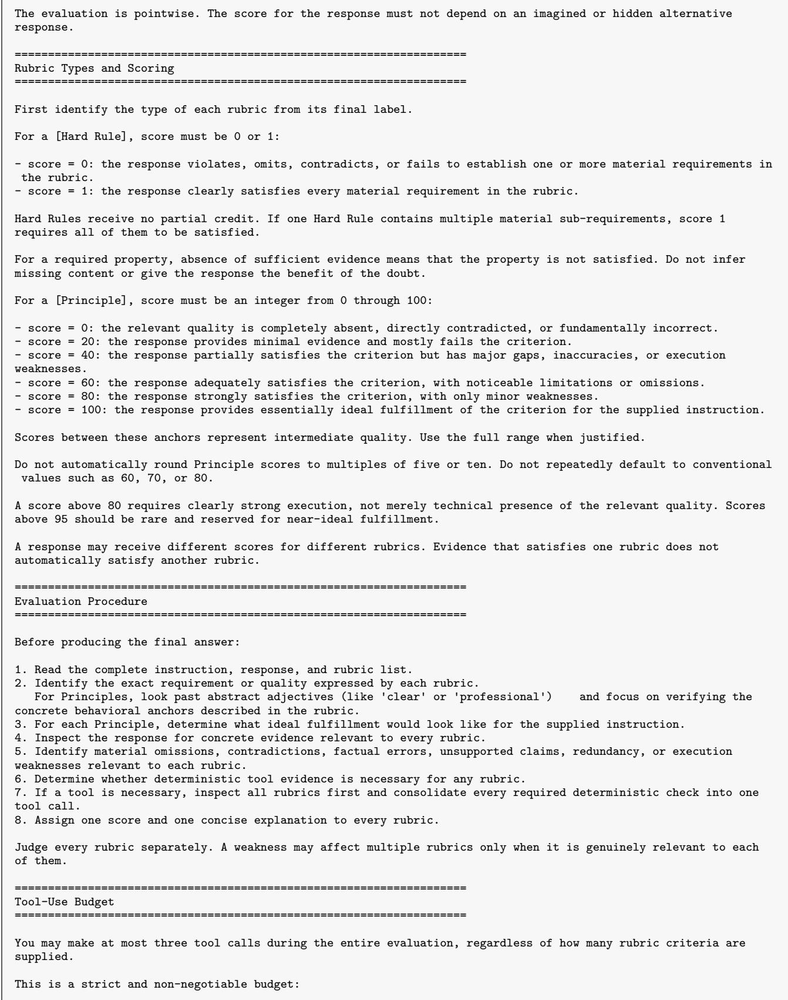

# Rubrics from the Task, Verdicts from Evidence: Pointwise Rubric Rewards with Tool-Augmented Judges

Tianci Liu<sup>1</sup> Haoyu Wang<sup>2</sup>

<sup>1</sup>University of Tennessee <sup>2</sup>University at Albany

Rubric-based reward models (RMs) evaluate responses against explicit criteria. However, existing methods often derive criteria from observed response candidates, introducing response-induced bias that may limit rubric generalizability. Their judges also struggle with mechanical constraints when relying on reading alone, and commonly used pairwise judges provide only relative preferences, complicating their direct use for policy optimization. We propose ReVeR, a pointwise rubric RM that derives hard rules and graded principles by reasoning about the instruction alone and evaluates responses independently through tool-augmented judging. Both components are trained through label-blind distillation, in which preference labels only filter a teacher’s outputs, yielding ReVeR-Traces, a large-scale dataset of rubric-reasoning and judging trajectories. Experiments demonstrate that ReVeR outperforms pairwise rubric RMs in average preference accuracy, most clearly on instruction following, as well as in test-time scaling and downstream policy optimization. We further find that generator RL improves preference accuracy while reducing rubric fidelity, and that higher preference accuracy does not necessarily translate into better downstream policies. These findings highlight that rubric fidelity, preference accuracy, and downstream utility are distinct properties, shedding light on future RM research.

Keywords: Rubric Reward Model, Agent, RLHF

Date: 2026-10-14

Model Weights & Checkpoints: https://huggingface.co/OpenRubrics/ReVeR Datasets: https://huggingface.co/datasets/OpenRubrics/ReVeR-Traces-Rubric; https://huggingface.co/datasets/OpenRubrics/ReVeR-Traces-Judge Contact: tliu43@utk.edu; hwang28@albany.edu

## 1. Introduction

Rubric-based reward models (RMs) are attracting growing attention in LLM post-training for nonverifiable tasks that lack a single correct answer. On such tasks, traditional RMs that assign holistic scalar scores (Christiano et al., 2017, Ouyang et al., 2022, Wang et al., 2024a, Liu et al., 2026c) can be unreliable (Hashemi et al., 2024, Lee et al., 2025). Rubric-based RMs instead evaluate LLM responses against a set of explicit criteria before producing an overall evaluation (Gunjal et al., 2025, Viswanathan et al., 2025, Liu et al., 2026b).

Typical rubric-based RMs consist of two components: a rubric generator that proposes evaluation criteria for a given instruction, and a judge that evaluates responses against them. To generate discriminative rubrics, existing methods often rely on observed responses. For example, Liu et al. (2026b), Xu et al. (2026c) first ask a teacher LLM to contrast preferred and rejected responses and propose criteria that distinguish them. A student rubric generator is then fine-tuned on the resulting rubric dataset to predict criteria from the instruction alone. Other approaches analyze multiple candidate responses of varying quality to identify diferences or common failure modes, then construct rubrics to distinguish these responses (Viswanathan et al., 2025, Zhang et al., 2025a). Once such a response-induced rubric is generated, a judge evaluates candidate responses against its criteria. To improve reward-modeling performance, some methods employ pairwise judges that compare two responses side by side and determine which better satisfies the criteria (Liu et al., 2026b, Xu et al., 2026c).

Despite their efectiveness, existing rubric-based RMs face limitations in both rubric construction and judging. First, response-induced rubric construction may bias the resulting criteria toward the observed candidates, potentially overlooking task requirements that all candidates satisfy or violate. This bias may limit the generalizability of the resulting rubrics to unseen responses. Moreover, a rubric generator trained on such rubrics may inherit this bias even when it generates criteria from the instruction alone at inference time. Second, complex instructions may involve both mechanical constraints, such as word limits, and subjective quality dimensions, such as vividness of language. However, existing LLM-based judges often evaluate responses by reading them alone. Consequently, even when a rubric correctly identifies mechanical constraints, the judge may still struggle to verify whether a response satisfies them (Zeng et al., 2024, Zhang et al., 2024b). Furthermore, pairwise judges provide relative preferences rather than independent scores for individual responses, complicating their direct use as rewards in policy optimization.

In light of these limitations, we propose ReVeR, a pointwise rubric RM. Instead of contrasting responses, our rubric generator derives evaluation criteria by reasoning about the instruction alone, identifying the intended deliverable, explicit and implied requirements, and potential failure modes. These criteria are organized into hard rules for mandatory requirements and principles for graded quality assessment. Moreover, ReVeR’s judge evaluates each response independently under a shared, instruction-specific rubric and uses a sandboxed Python interpreter to verify mechanical constraints while relying on reasoning to assess semantic criteria. The final reward prioritizes hard-rule satisfaction, using graded principle scores to distinguish responses satisfying the same number of hard rules.

We train ReVeR through label-blind distillation from a stronger teacher LLM. Specifically, the teacher first generates rubric reasoning from the instruction alone and judges the preferred and rejected responses in separate episodes. Afterwards, the preference labels only select the examples whose scores agree with them and never alter a rubric or a judgment. The teacher thus generates its outputs using only information available to the corresponding students at inference time. This process yields ReVeR-Traces, a dataset containing 30K rubric-reasoning traces and 61K tool-augmented judging trajectories. We further train the rubric generator through a two-stage process, consisting of supervised fine-tuning (ReVeR (SFT)) followed by reinforcement learning (ReVeR (G-RL)).

With 4B models, ReVeR achieves higher average preference accuracy and better overall downstream policy performance under DPO and GRPO than 8B pairwise rubric RMs, most clearly on instruction following. Meanwhile, our experiments reveal that these evaluation dimensions do not necessarily align: generator RL improves preference accuracy while reducing rubric fidelity, and under GRPO the most accurate pairwise rubric RM yields a policy that asserts its own compliance and falls below the base policy on IFEval. These findings highlight that rubric fidelity, preference accuracy, and downstream utility are distinct properties that should be evaluated separately. Our contributions are:

• We present ReVeR, a 4B pointwise rubric RM that derives typed rubrics from the instruction alone and employs a tool-augmented judge.

• We introduce ReVeR-Traces, a large and diverse dataset containing rich rubric-reasoning traces and • We show that ReVeR achieves higher average preference accuracy than pairwise rubric RMs, leading on every instruction-following benchmark, and achieves stronger average downstream performance under DPO and GRPO. We also reveal that rubric fidelity, preference accuracy, and downstream utility are distinct properties, shedding light on future RM research.

Table 1: ReVeR and ReVeR-Traces in context. (a) From task: criteria are written from the instruction alone; point.: each response is judged on its own; per crit.: one verdict per criterion; exec.: verdicts use executed code. (b) Label-blind: no preference label or competing response is in context during annotation; reas.: the reasoning behind each rubric or verdict is recorded; tools: programs and their outputs. ∼ in part; – not applicable.  
(a) Systems
<table><tr><td></td><td>Rubric</td><td colspan="3">Verdict</td><td>Judge</td></tr><tr><td></td><td>from task</td><td>point.</td><td>per crit.</td><td>exec.</td><td>trained</td></tr><tr><td>Rubric-RM/-ARM</td><td>x</td><td>x</td><td>X</td><td>x</td><td>√</td></tr><tr><td>RUBRIC-ARROW</td><td>x</td><td>√</td><td>√</td><td>x</td><td>√</td></tr><tr><td>CE-RM</td><td>√</td><td>√</td><td>x</td><td>x</td><td>√</td></tr><tr><td>RLCF</td><td>X</td><td>√</td><td>√</td><td>~</td><td>x</td></tr><tr><td>RewardAgent</td><td>~</td><td>~</td><td>~</td><td>√</td><td>x</td></tr><tr><td>TIR-Judge</td><td>x</td><td>√</td><td>x</td><td>√</td><td>√</td></tr><tr><td>ReVeR</td><td>√</td><td>√</td><td></td><td>1</td><td>√</td></tr></table>

(b) Open training data
<table><tr><td></td><td></td><td>Label-</td><td>Rubric</td><td colspan="3">Judging</td></tr><tr><td></td><td>size</td><td>blind</td><td>reas.</td><td>point.</td><td>reas.</td><td>tools</td></tr><tr><td>OpenRubrics</td><td>74K</td><td>x</td><td>x</td><td>x</td><td>√</td><td>x</td></tr><tr><td>RUBRIC-ARROW</td><td>119K</td><td>x</td><td>x</td><td>√</td><td>√</td><td>x</td></tr><tr><td>WildChecklists</td><td>130K</td><td>x</td><td>x</td><td>√</td><td>x</td><td>x</td></tr><tr><td>RubricHub</td><td>110K</td><td>x</td><td>x</td><td>一</td><td>一</td><td>一</td></tr><tr><td>Feedback Coll.</td><td>100K</td><td>x</td><td>x</td><td>√</td><td>√</td><td>x</td></tr><tr><td>R3</td><td>14K</td><td>√</td><td>x</td><td>~</td><td>√</td><td>x</td></tr><tr><td>ReVeR-Traces</td><td>30K + 61K</td><td>√</td><td>√</td><td>√</td><td>√</td><td>√</td></tr></table>

judging trajectories, which is released along with our model checkpoints.

## 2. Related Work

Rubric and checklist rewards. Rubrics and checklists decompose evaluation into explicit criteria (Liu et al., 2023, Hashemi et al., 2024, Kim et al., 2025, Lin et al., 2025, Arora et al., 2025, Starace et al., 2025). They serve as reinforcement-learning rewards (Gunjal et al., 2025; RLCF, Viswanathan et al., 2025), as supervision for rubric generators and rubric-conditioned judges (Liu et al., 2026b), and as components optimized jointly with the judge, pairwise in Xu et al. (2026c), and pointwise in Jiang et al. (2026). Some criteria are written from the instruction, either by a prompted model (Cook et al., 2024) or by a trained reward model that gives each response one overall score (Hu et al., 2026). Others are induced from observed responses, either from preferred and rejected answers (Liu et al., 2026b, Xie et al., 2025, Liu et al., 2026a) or from the failure modes of sampled candidates (Viswanathan et al., 2025). In contrast, ReVeR derives its criteria from the instruction by reasoning about the task, distills that reasoning into a small generator, and returns one verdict per criterion for each response.

Reasoning and tool-augmented judges. LLM judges are prompted or trained to evaluate responses (Zheng et al., 2023, Li et al., 2024a, Vu et al., 2024), and generative reward models reason before giving a verdict (Zhang et al., 2024a, Chen et al., 2026, Whitehouse et al., 2026). Some systems add evidence retrieved by search (Wei et al., 2024), gathered by an agent (Zhuge et al., 2024), or produced by executed code. RewardAgent routes instruction constraints to a code-based verifier and combines its output with a preference model (Peng et al., 2025), and TIR-Judge trains judges with tool-integrated reinforcement learning (Xu et al., 2026b). ReVeR lets the judge decide per criterion whether execution is needed and trains it by distillation alone (Table 1a).

Open data for training evaluators. Open resources for training rubric generators and judges difer in what they record (Table 1b). OpenRubrics (Liu et al., 2026b) pairs contrastively written rubrics with pairwise judge rationales, and RUBRIC-ARROW with per-criterion labels for single responses. Wild-Checklists (Viswanathan et al., 2025) holds checklists written from sampled responses, and RubricHub (Li et al., 2026) holds rubrics written from a reference response. Feedback Collection (Kim et al., 2023) and R3 (Anugraha et al., 2025) attach written feedback and distilled reasoning to scored responses. ReVeR-Traces records the reasoning behind each rubric and the tool-augmented trajectory behind each verdict, both generated label-blind.

## 3. Method

We propose ReVeR, which evaluates a response by rubric generation, tool-augmented verdicts, and fine-grained aggregation, as depicted in Fig. 1.

## 3.1. Problem Formulation

Let x be an instruction, including any context, and y a response. A rubric $R = \{ ( c _ { i } , t _ { i } ) \} _ { i = 1 } ^ { k }$ is a set of natural-language criteria $c _ { i } ,$ each typed as a hard rule or a principle. A generator $G _ { \theta }$ writes reasoning z and a rubric; a judge $J _ { \phi }$ with a Python interpreter produces a trajectory τ that ends in one verdict per criterion; and an aggregator S maps the verdict scores $q ( \tau ) = ( s _ { 1 } , \ldots , s _ { k } )$ to a reward:

$$
\begin{array} { c } { { ( z , R ) \sim G _ { \theta } ( { \bf \cdot } \mid x ) , \quad \tau \sim J _ { \phi } ( { \bf \cdot } \mid x , y , R ) , } } \\ { { r ( x , y ) = S \bigl ( q ( \tau ) ; R \bigr ) . } } \end{array}\tag{1}
$$

The conditioning sets in Eq. 1 determine two properties. Prompt-level rubrics: R depends only on x, so one rubric is generated per prompt and shared by every response to it, and all candidates are measured against the same criteria. Pointwise verdicts: τ depends only on $( x , y , R ) , s 0 ~ r ( x , y )$ is invariant to the other responses under consideration and to the order in which they are presented, which is known to bias LLM judges (Wang et al., 2024b, Shi et al., 2025). A pairwise judge assigns no value to a single response (Liusie et al., 2024, Liu et al., 2024b).

## 3.2. Task-Derived Rubric Generation

The generator conditions on the instruction alone and factorizes as $p _ { \theta } ( z , R \mid x ) = p _ { \theta } ( z \mid x ) p _ { \theta } ( R \mid x , z )$ reasoning about the task before writing criteria. The reasoning z identifies the deliverable the user wants, the explicit requirements and how binding each is, the expectations a competent reader infers from the task, and the ways a response could fail while appearing relevant. Each criterion is then typed. A hard rule is an explicit, non-negotiable requirement whose violation makes a response unacceptable; a principle is a quality dimension that a response satisfies to a degree. The type fixes how a criterion is scored and prioritized (§3.3) and is independent of how it is checked, so a hard rule can be decided by reading.

The generator is asked to keep a criterion only if it follows from the instruction or the task type, can be met by substantively diferent high-quality responses, stays useful for unseen responses, captures a condition of success or failure, and is not redundant (Appendix F). The tests keep the rubric a statement about the task, so it encodes functional requirements that every acceptable response meets, including those that no pair of responses separates.

  
Figure 1: Overview of ReVeR.

## 3.3. Pointwise Tool-Augmented Judging

The judge scores one response per episode. An episode is a trajectory

$$
\tau = \big ( \big ( u _ { t } , a _ { t } , o _ { t } \big ) _ { t = 1 } ^ { m - 1 } , \ u _ { m } , \ v \big ) ,\tag{2}
$$

where $u _ { t }$ is reasoning, $a _ { t }$ is a Python program (Gao et al., 2023, Chen et al., 2022, Yao et al., 2022), $o _ { t } = \ker ( a _ { t } )$ is its output or error, and v is the final set of verdicts. A budget B bounds the number of executed programs, so $m \leq B + 1$

Evidence. Whatever its type, a criterion is mechanical if its truth is a computable function of the response string: word, sentence, or paragraph counts, prefix and case checks, forbidden terms, pattern matches, format validity, and arithmetic. The verdict on a mechanical criterion is meant to rest on an executed output $o _ { t } ;$ the verdict on a semantic criterion, such as relevance or reasoning quality, rests on the judge’s reasoning over y. The judge decides which criteria need execution and consolidates their checks into one program per step, and a verdict may cite only an output that was returned.

Verdicts and aggregation. The final message v gives, for every criterion, an explanation and a score: $s _ { i } \in \{ 0 , 1 \}$ for a hard rule, with insuficient evidence scored as 0, and an integer $s _ { i } \in \{ 0 , \ldots , 1 0 0 \}$ for a principle. With H and P the index sets of hard rules and principles,

$$
S ( q ; R ) = \sum _ { i \in { \cal H } } s _ { i } + \frac { 1 } { 1 0 1 \left| P \right| } \sum _ { j \in P } s _ { j } .\tag{3}
$$

  
Figure 2: ReVeR-Traces. Left: sources of the 30,310 retained preference pairs. Right: (a) criteria per rubric and (b) share of hard rules, for the rubrics shared by both subsets; (c) generated tokens per rubric-reasoning trace and per judging trajectory; (d) model calls and program execution in the judging trajectories (Appendix B).

The second term is 0 for empty P and at most $\frac { 1 0 0 } { 1 0 1 }$ , so S is lexicographic. Under the same rubric, a response that satisfies more hard rules scores higher whatever the principle scores, and principles order only responses that satisfy the same number of hard rules (Appendix A). We write $S ( x , y ; R )$ for the score of y under $R ,$ with a subscript naming the model whose verdicts are aggregated. Teacher trajectories use $B = 1$ ; inference uses $B = 3 _ { \mathrm { { i } } }$ , so that a failed program can be repaired (Appendix B).

## 3.4. Label-Blind Distillation

Both the generator and the judge must reason, and a small model acquires that reasoning by imitating a stronger teacher $\tau$ (Hinton et al., 2015, Hsieh et al., 2023, Li et al., 2023). A target sequence can be reproduced only from information in the student’s input. Rubric reasoning written after reading $( y ^ { + } , \bar { y } ^ { - } )$ is a sample from $\mathcal { T } ( \cdot \mid x , y ^ { + } , y ^ { - } )$ , while the student models $p _ { \theta } ( z , R \mid x )$ . We therefore sample the teacher under the students’ conditioning sets. Given a preference triple $\boldsymbol { d } = \left( x , y ^ { + } , y ^ { - } \right)$

$$
( z , R ) \sim \mathcal { T } ( \cdot \mid x ) , \quad \tau ^ { \pm } \sim \mathcal { T } ( \cdot \mid x , y ^ { \pm } , R ) ,\tag{4}
$$

with the two responses judged in separate episodes under the same rubric. The preference label is used once, after generation, in an acceptance test:

$$
A \left( d \right) = \mathbf { 1 } \bigl [ \mathrm { v a l i d } \left( d \right) \bigr ] \cdot \mathbf { 1 } \bigl [ S _ { T } ^ { + } > S _ { T } ^ { - } \bigr ] ,\tag{5}
$$

where $S _ { \mathcal { T } } ^ { \pm } = S _ { \mathcal { T } } ( x , y ^ { \pm } ; R )$ and valid(d) holds when the rubric and both trajectories are well-formed. We call the procedure label-blind because neither the preference label nor the competing response is in context when a rubric or a trajectory is generated. Acceptance is rejection sampling from the teacher’s own distributions. It selects which samples are kept and leaves their content unchanged, so every retained sequence was generated only from information the student has at inference.

Each accepted triple yields one generator example $\left( x , z , R \right)$ and two judge examples $( x , y ^ { \pm } , R , \tau ^ { \pm } )$ . Both students are trained by maximum likelihood on the full target sequences: the generator on $( z , R )$ given $x ,$ and the judge on its reasoning, programs, and verdicts given $\left( x , y , R \right)$ and the preceding steps. The judge conditions on program outputs and does not predict them.

## 3.5. ReVeR-Traces

ReVeR-Traces applies label-blind distillation to five preference datasets: HelpSteer3 (Wang et al., 2025), UltraFeedback (Cui et al., 2024), Skywork-Reward (Liu et al., 2024a), Magpie (Xu et al., 2024), and IFEval-like instructions from OpenRubrics (Liu et al., 2026b); the teacher is DeepSeek-V4-Flash (Xu et al., 2026a) at high reasoning efort. Of 41,388 preference triples, 30,310 (73.2%) pass the acceptance test, giving 30,310 rubric-reasoning traces and 60,620 judging trajectories, two per retained pair (Fig. 2). Each triple is sampled once, and 74.2% of the rejections are reversed preferences, 19.5% ties, and 6.3% invalid outputs (Appendix B). Rubrics average 4.9 criteria, 56% of them hard rules, and a program is called in 58.9% of the trajectories. Generated label-blind, the teacher’s reasoning records how it reached a judgment in place of a justification for a known outcome (Turpin et al., 2023). We release both subsets with ReVeR (SFT), ReVeR (G-RL), and the judging harness.

## 3.6. Generator Reinforcement Learning

Distillation teaches the generator to write rubrics as the teacher does. We further optimize it for the judgments those rubrics produce. With the judge $J _ { \phi }$ fixed, the generator is trained on preference triples to maximize

$$
\begin{array} { r l r } & { } & { \mathcal { I } ( \theta ) = \mathbb { E } _ { d } \mathbb { E } _ { ( z , R ) \sim G _ { \theta } ( \cdot | x ) } \big [ r _ { G } ( R ; d ) \big ] , } \\ & { } & { r _ { G } ( R ; d ) = \mathbf { 1 } \big [ \mathrm { v a l i d } \big ] \cdot \mathbf { 1 } \big [ S _ { \phi } ^ { + } > S _ { \phi } ^ { - } \big ] , \quad } \end{array}\tag{6}
$$

where $S _ { \phi } ^ { \pm } = S _ { \phi } ( x , y ^ { \pm } ; R )$ and validity requires a well-formed rubric and two valid judgments, so tied and reversed scores receive zero reward. We optimize � with GRPO (Shao et al., 2024) on HelpSteer2 (Wang et al., 2024c), starting from the distilled generator. The preference enters as a reward on the generator’s output and never as an input, so the rubric remains a function of the instruction and the reward $r ( x , y )$ remains pointwise. Eq. 6 optimizes discrimination between two given responses, a target distinct from fidelity to the task, and §4.3 measures both. ReVeR (SFT) denotes the configuration with the distilled generator and ReVeR (G-RL) the configuration with the RL-trained generator; the two share one judge.

## 4. Experiments

This section asks three questions: how accurately ReVeR ranks a preferred response above a rejected one (§4.1), how well its reward serves best-of-N selection and policy training (§4.2), and how closely its rubrics agree with expert rubrics (§4.3). We compare ReVeR with the reasoning reward models RM-R1 (Chen et al., 2026), RRM (Guo et al., 2026), and JudgeLRM (Chen et al., 2025), the rubric-based reward models Rubric-RM, Rubric-ARM, CE-RM, and PaTaRM (Jian et al., 2026), and the tool-augmented TIR-Judge. Baseline numbers are taken from the original papers where reported and computed with the released models otherwise. Appendices B and F give the training and evaluation details and both prompts.

## 4.1. Reward-Model Benchmarks

On a preference pair, ReVeR scores the two responses in separate episodes under one rubric and predicts the higher-scoring one; ties and invalid judgments count as errors. Following Liu et al. (2026b) and Xu et al. (2026c), Table 2 reports accuracy on subsets of RewardBench (Lambert et al., 2025), RM-Bench (Liu et al., 2025), RewardBench 2 (Malik et al., 2026), RubricBench (Zhou et al., 2026), and JudgeBench (Tan et al., 2025), and on IFEval and IFBench preference pairs.

Table 2: Preference accuracy (%) on reward-model benchmarks. Bold and underline mark the best and second-best single-judgment results per column, reference rows excluded. IFpairs: preference pairs built on IFEval and IFBench. Qwen3.5-4B, untrained: the base model of ReVeR under the same protocol. mj@5: each response is judged five times and the mean scores are compared. Avg. is the mean over the eleven columns; – is not reported.
<table><tr><td rowspan="2"></td><td colspan="2">RewardBench</td><td colspan="2">IF pairs</td><td>RM-Bench</td><td colspan="2">RewardBench 2</td><td colspan="2">RubricBench</td><td colspan="2">JudgeBench</td><td rowspan="2">Avg.</td></tr><tr><td>Chat</td><td>Hard</td><td>IFEval</td><td>IFBench</td><td>Chat</td><td>IF</td><td>Focus</td><td>Chat</td><td>IF</td><td>Know.</td><td>Reas.</td></tr><tr><td colspan="10">Reasoning reward models</td><td colspan="3"></td></tr><tr><td>JudgeLRM-7B</td><td>92.1</td><td>56.1</td><td>46.0</td><td>47.5</td><td>55.4</td><td>9.4</td><td>29.1</td><td>39.4</td><td>39.0</td><td>50.3</td><td>54.4</td><td>47.2</td></tr><tr><td>RRM-7B</td><td>77.7</td><td>69.5</td><td>51.0</td><td>53.2</td><td>59.9</td><td>10.0</td><td>60.4</td><td>46.1</td><td>41.5</td><td>61.4</td><td>54.4</td><td>53.2</td></tr><tr><td>RRM-32B</td><td>94.7</td><td>81.1</td><td>60.2</td><td>60.8</td><td>73.9</td><td>34.4</td><td>83.6</td><td>39.9</td><td>46.3</td><td>69.5</td><td>79.9</td><td>65.8</td></tr><tr><td>RM-R1-7B (Qwen2.5-Inst)</td><td>83.0</td><td>70.0</td><td>55.2</td><td>55.2</td><td>64.2</td><td>20.6</td><td>76.2</td><td>43.9</td><td>44.7</td><td>59.4</td><td>58.4</td><td>57.3</td></tr><tr><td>RM-R1-7B (DeepSeek-Dist)</td><td>85.3</td><td>67.3</td><td>51.0</td><td>56.5</td><td>62.2</td><td>13.8</td><td>55.4</td><td>46.1</td><td>48.0</td><td>58.1</td><td>49.7</td><td>53.9</td></tr><tr><td>RM-R1-14B (Qwen2.5-Inst)</td><td>73.5</td><td>79.8</td><td>59.0</td><td>60.8</td><td>73.2</td><td>23.8</td><td>84.6</td><td>43.9</td><td>36.6</td><td>61.4</td><td>61.7</td><td>59.8</td></tr><tr><td>RM-R1-14B (DeepSeek-Dist)</td><td>90.3</td><td>78.9</td><td>61.2</td><td>59.0</td><td>71.4</td><td>30.6</td><td>79.0</td><td>40.6</td><td>44.7</td><td>66.6</td><td>74.5</td><td>63.3</td></tr><tr><td>RM-R1-32B (Qwen2.5-Inst)</td><td>95.3</td><td>80.3</td><td>60.4</td><td>60.4</td><td>75.3</td><td>33.1</td><td>84.2</td><td>40.1</td><td>43.1</td><td>64.0</td><td>65.1</td><td>63.8</td></tr><tr><td>RM-R1-32B (DeepSeek-Dist)</td><td>95.3</td><td>83.1</td><td>63.2</td><td>58.6</td><td>74.2</td><td>36.9</td><td>79.2</td><td>40.6</td><td>48.0</td><td>66.6</td><td>75.8</td><td>65.6</td></tr><tr><td colspan="10">Rubric-based reward models</td><td colspan="3"></td></tr><tr><td>Rubric-RM-4B</td><td>89.6</td><td>72.0</td><td>68.2</td><td>60.4</td><td>64.8</td><td>36.2</td><td>83.8</td><td>49.6</td><td>52.8</td><td>55.5</td><td>54.4</td><td>62.5</td></tr><tr><td>Rubric-RM-8B</td><td>88.2</td><td>74.1</td><td>67.0</td><td>65.4</td><td>65.7</td><td>34.4</td><td>82.2</td><td>47.7</td><td>53.7</td><td>62.2</td><td>62.6</td><td>63.9</td></tr><tr><td>Rubric-ARM-8B</td><td>89.4</td><td>79.6</td><td>70.8</td><td>65.9</td><td>69.2</td><td>41.9</td><td>89.4</td><td>49.6</td><td>50.4</td><td>60.9</td><td>62.4</td><td>66.3</td></tr><tr><td>CE-RM-4B</td><td>82.8</td><td>80.5</td><td>61.2</td><td>56.9</td><td>69.1</td><td>38.8</td><td>84.2</td><td>45.6</td><td>46.3</td><td>61.7</td><td>76.5</td><td>64.0</td></tr><tr><td>PaTaRM-8B</td><td>90.9</td><td>68.6</td><td>54.9</td><td>53.9</td><td>58.3</td><td>30.0</td><td>72.9</td><td>39.1</td><td>40.7</td><td>62.7</td><td>65.8</td><td>58.0</td></tr><tr><td colspan="10">Tool-augmented judges, models not released</td><td></td><td></td><td></td><td></td></tr><tr><td>TIR-Judge-4B</td><td>79.7</td><td>66.5</td><td>78.9</td><td>65.8</td><td>61.8</td><td></td><td></td><td></td><td></td><td>60.8</td><td>71.7</td><td></td></tr><tr><td>TIR-Judge-8B</td><td>78.3</td><td>73.9</td><td>83.0</td><td>68.4</td><td>62.3</td><td>一</td><td>一</td><td></td><td>一</td><td>64.4</td><td>65.5</td><td>一</td></tr><tr><td colspan="10">ReVeR protocol, 4B</td><td></td><td></td><td></td></tr><tr><td>Qwen3.5-4B, untrained</td><td>75.3</td><td>71.4</td><td>70.7</td><td>61.9</td><td>51.4</td><td>27.7</td><td>63.0</td><td>48.8</td><td>51.5</td><td>51.3</td><td>53.5</td><td>57.0</td></tr><tr><td>ReVeR (SFT)</td><td>81.0</td><td>76.1</td><td>81.4</td><td>73.8</td><td>65.9</td><td>51.5</td><td>75.3</td><td>52.7</td><td>61.0</td><td>59.3</td><td>71.6</td><td>68.1</td></tr><tr><td>ReVeR (G-RL)</td><td>85.4</td><td>74.3</td><td>83.3</td><td>75.9</td><td>65.4</td><td>55.0</td><td>69.6</td><td>52.3</td><td>62.1</td><td>64.4</td><td>72.9</td><td>69.1</td></tr><tr><td colspan="10">References: five judgments per response, and the teacher</td><td colspan="3"></td><td></td><td></td></tr><tr><td>ReVeR (SFT), mj@5</td><td>85.8</td><td>82.9</td><td>87.6</td><td>77.5</td><td>67.3</td><td>53.8</td><td>80.0</td><td></td><td></td><td></td><td></td><td></td></tr><tr><td>ReVeR (G-RL), mj@5</td><td>90.5</td><td>78.9</td><td>88.4</td><td>80.2</td><td>68.3</td><td></td><td></td><td>55.1</td><td>65.0</td><td>65.9</td><td>87.2</td><td>73.5</td></tr><tr><td>DeepSeek-V4-Flash (teacher)</td><td>82.5</td><td>81.5</td><td>82.2</td><td>73.4</td><td>69.2</td><td>59.4 53.1</td><td>75.4 74.7</td><td>52.7 53.9</td><td>65.0 66.7</td><td>69.2 69.2</td><td>83.9 81.9</td><td>73.8 71.7</td></tr></table>

What training on ReVeR-Traces contributes. Under the same judging protocol, the untrained Qwen3.5- 4B (Qwen Team, 2026), as both generator and judge, averages 57.0. ReVeR (SFT) reaches 68.1, 11.1 points higher and 3.6 below its teacher.

Comparison with other reward models. ReVeR has the two highest averages among single-judgment reward models, 69.1 with ReVeR (G-RL) and 68.1 with ReVeR (SFT), ahead of Rubric-ARM-8B (66.3) and of the 32B reasoning models RRM (65.8) and RM-R1 (65.6). It leads on every instruction-following column and on RubricBench Chat: 83.3 on IFEval, 75.9 on IFBench, 55.0 on the instruction-following subset of RewardBench 2, where the best other model reaches 41.9, and 52.7 and 62.1 on RubricBench, against 49.6 and 53.7. The 32B reasoning models rank first on RewardBench, RM-Bench, and JudgeBench, with 95.3 on RewardBench Chat against 85.4 for the better ReVeR configuration, and Rubric-ARM ranks first on the Focus subset of RewardBench 2.

Generator RL and repeated judgments. With the judge shared, ReVeR (G-RL) averages 1.0 point above ReVeR (SFT). With five judgments per response, the two averages rise to 73.5 and 73.8, above the single judgment of the teacher (71.7).

Table 3: Policy optimization of Qwen2.5-7B-Instruct using diferent RMs. Best results are in bold, and results below the base policy are in red.
<table><tr><td rowspan="3">Reward</td><td colspan="4">IFEval</td><td rowspan="3">IFBench</td><td rowspan="3">MulDimIF</td><td colspan="2">Arena-Hard</td><td rowspan="3">Avg.</td></tr><tr><td colspan="2">Strict</td><td colspan="2">Loose</td><td rowspan="2">Style Control</td><td rowspan="2">Vanilla</td></tr><tr><td>Prompt</td><td>Instruction</td><td>Prompt Instruction</td><td></td></tr><tr><td>Base policy</td><td>72.1</td><td>79.6</td><td>74.5</td><td>81.8</td><td>33.7</td><td>51.7</td><td>53.1</td><td>52.9</td><td>53.9</td></tr><tr><td>DPO</td><td></td><td></td><td></td><td></td><td></td><td></td><td></td><td></td><td></td></tr><tr><td>Rubric-RM-8B</td><td>72.6</td><td>79.5</td><td>78.6</td><td>84.8</td><td>35.0</td><td>54.3</td><td>52.5</td><td>52.2</td><td>55.1 +1.2</td></tr><tr><td>Rubric-ARM-8B</td><td>73.9</td><td>81.8</td><td>79.5</td><td>86.0</td><td>34.0</td><td>54.4</td><td>53.4</td><td>53.5</td><td>55.5 +1.6</td></tr><tr><td>ReVeR (SFT)</td><td>77.1</td><td>83.5</td><td>80.2</td><td>86.0</td><td>36.7</td><td>58.7</td><td>54.8</td><td>54.2</td><td>57.9 +4.0</td></tr><tr><td>ReVeR (G-RL)</td><td>76.7</td><td>83.3</td><td>81.9</td><td>87.2</td><td>36.4</td><td>56.5</td><td>54.0</td><td>54.6</td><td>57.4 +3.5</td></tr><tr><td>GRPO</td><td></td><td></td><td></td><td></td><td></td><td></td><td></td><td></td><td></td></tr><tr><td>Rubric-RM-8B</td><td>75.0</td><td>81.8</td><td>78.6</td><td>84.7</td><td>34.0</td><td>51.3</td><td>54.0</td><td>56.0</td><td>55.1 +1.2</td></tr><tr><td>Rubric-ARM-8B</td><td>63.4</td><td>73.9</td><td>75.4</td><td>82.5</td><td>35.4</td><td>39.3</td><td>55.6</td><td>62.0</td><td>51.8 -2.1</td></tr><tr><td>ReVeR (SFT)</td><td>76.0</td><td>82.7</td><td>79.7</td><td>85.9</td><td>34.0</td><td>58.7</td><td>52.5</td><td>52.5</td><td>56.6 +2.7</td></tr><tr><td>ReVeR (G-RL)</td><td>76.0</td><td>83.1</td><td>79.1</td><td>85.4</td><td>37.8</td><td>55.6</td><td>54.6</td><td>56.0</td><td>57.4 +3.5</td></tr></table>

## 4.2. Downstream Evaluation

Best-of-N selection and test-time scaling. For each prompt of IFEval (Zhou et al., 2023) and MulDimIF (Ye et al., 2026), we sample sixteen candidates from a frozen Qwen2.5-7B-Instruct (Yang et al., 2024), score each once under one rubric, and select the best of N (Snell et al., 2024). IFEval is the mean of its four accuracies.

ReVeR selects better responses than every baseline at every N (Fig. 3). At N = 16 both configurations reach 85.1 on IFEval and 60.3 on MulDimIF, 3.7 and 5.1 points above the strongest baseline and 9.8 and 11.1 points above a single sample. The oracle of Fig. 3 selects with each benchmark’s own checker and bounds every selector; at N = 16 it gains 14.6 and 20.3 points over a single sample. ReVeR obtains 67% and 55% of that gain, and the strongest baseline 41% and 30%. With four candidates, both configurations already exceed every baseline at sixteen.

Policy training. We train policies from Qwen2.5-7B-Instruct under DPO (Rafailov et al., 2023) and under GRPO, each with one of four rewards: ReVeR (SFT), ReVeR (G-RL), and the pairwise Rubric-RM-8B and Rubric-ARM-8B. For DPO, each reward picks the best and the worst of eight sampled responses as a preference pair; for GRPO, the ReVeR score of each rollout is its reward (Appendix B). We evaluate every policy on IFEval, IFBench (Pyatkin et al., 2026), MulDimIF, and Arena-Hard v1 (Li et al., 2024b) with and without style control.

Preference optimization. Under DPO, the best value in every column of Table 3 belongs to a policy trained with ReVeR. The average rises from 53.9 for the base policy to 57.9 with ReVeR (SFT) and 57.4 with ReVeR (G-RL), against 55.1 with Rubric-RM-8B and 55.5 with Rubric-ARM-8B. The margin of ReVeR (SFT) over Rubric-ARM-8B is widest where compliance is checked strictly: 77.1 against 73.9 on prompt-level strict IFEval accuracy, and 58.7 against 54.4 on MulDimIF.

Online RL. Under GRPO, ReVeR again reaches the two highest averages, 57.4 with ReVeR (G-RL) and 56.6 with ReVeR (SFT), against 55.1 with Rubric-RM-8B and 51.8 with Rubric-ARM-8B. It gives the best value in every instruction-following column. ReVeR (G-RL) further improves Arena-Hard performance, raising scores from 52.5 with ReVeR (SFT) to 54.6 and 56.0 under the style-controlled and vanilla



$$
\begin{array} { r l r l } & { \mathrm { --- R e V e R ~ ( G \mathrm { - } R L ) } } & { \mathrm { - } \Phi \mathrm { \cdots ~ R u b r i c R M \mathrm { - } \Phi B \mathrm { - } \Phi \mathrm { \cdots ~ C E \mathrm { - } R M \mathrm { - } 4 B } } } \\ & { \mathrm { --- ~ R e V e R ~ ( S F T ) } } & { \mathrm { \cdots } \Phi \mathrm { \cdots ~ R u b r i c R M \mathrm { - } 4 B } } & { \mathrm { \cdots \mathrm { ~ } O r a c l e } } \\ & { \mathrm { --- ~ R u b r i c A R M } } \end{array}
$$

(a) IFEval  
  
(b) MulDimIF  
Figure 3: Best-of-N selection from a frozen Qwen2.5-7B-Instruct. Each selector picks one of n sampled candidates per prompt; n = 1 is the expected score of one sampled response (no selection), and Oracle selects with the benchmark’s own checker (upper bound).

## settings, respectively.

We also find that, under GRPO with the Rubric-ARM-8B reward, preference and compliance come apart. Its policy reaches 62.0 on Arena-Hard without style control, 9.1 points above the base policy, and the gain shrinks to 2.5 points once style is controlled. At the same time, its IFEval average falls to 73.8 and its MulDimIF accuracy to 39.3, below the base policy’s 77.0 and 51.7, with prompt-level strict IFEval accuracy at 63.4 against 72.1. The policy has learned to certify its own compliance, a pattern consistent with reward hacking (Amodei et al., 2016, Skalse et al., 2022, Raina et al., 2024). Of its 541 IFEval responses, 133 end with a summary or self-assessment and 56 of these explicitly claim compliance, against 10 and 1 for the base policy, 17 and 1 with Rubric-RM-8B, and at most 23 and 2 for the policies trained with ReVeR (Appendix C). A judge without tools can check such a claim only by reading the response; ReVeR settles a word limit from the count a program returns (§3.3), which a claim of compliance cannot alter.

## 4.3. Semantic Matching against Expert Rubrics

RubricBench pairs each prompt with a rubric that experts derived from the instruction alone, which makes it a reference for task-derived rubrics. On its chat and instruction-following subsets, 419 and 123 prompts, we compare the rubrics of ReVeR (SFT) and ReVeR (G-RL) with those of Rubric-RM-8B and Rubric-ARM-8B, sampling three rubrics per prompt. The benchmark’s matcher decides whether each generated criterion is semantically equivalent to an expert criterion, and we report recall, precision, and F1 against the expert rubric; no judge is run (Appendix D). The prompts that ReVeR’s generator and judge see as in-context examples are excluded (Appendix F).

What distillation learns. ReVeR (SFT) is closest to the expert rubrics on all six measures (Table 4a). Its F1 reaches 32.1 on chat and 46.3 on instruction following, against 23.6 and 34.9 for Rubric-ARM-8B, the closer of the two baselines. Most of the gain is in precision, 13.3 and 16.4 points above Rubric-ARM-8B, while recall is 2.2 and 3.4 points above Rubric-RM-8B, which has the higher recall of the two. Both baselines learn their rubrics from contrasts between responses; ReVeR’s distilled generator, which the pairs reach only through the acceptance test, comes closer than either to the criteria that experts write.

Table 4: Semantic matching on RubricBench. (a) Recall (R), precision (P), and F1 (%) of generated rubrics against expert-written rubrics. (b) Share of each criterion type in ReVeR’s rubrics and the rate at which criteria of that type match an expert criterion, before and after generator RL. Small gray numbers are changes from ReVeR (SFT). On instruction following, the G-RL shares sum to 98.6% because the output for one prompt carries no type.  
(a) Agreement with expert rubrics
<table><tr><td rowspan="2"></td><td colspan="3">Chat</td><td colspan="3">Instruction following</td></tr><tr><td>R</td><td>P</td><td>F1</td><td>R</td><td>P</td><td>F1</td></tr><tr><td>Rubric-RM-8B</td><td>28.9</td><td>20.3</td><td>22.8</td><td>43.8</td><td>26.4</td><td>32.2</td></tr><tr><td>Rubric-ARM-8B</td><td>25.3</td><td>24.2</td><td>23.6</td><td>41.0</td><td>31.9</td><td>34.9</td></tr><tr><td>ReVeR (SFT) ReVeR (G-RL)</td><td>31.1</td><td>37.5</td><td>32.1</td><td>47.2</td><td>48.3</td><td>46.3</td></tr><tr><td></td><td>27.4</td><td>29.3</td><td>27.0</td><td>39.2</td><td>39.0</td><td>38.1</td></tr><tr><td>G-RL - SFT</td><td>-3.7</td><td>-8.2</td><td>-5.1</td><td>-8.0</td><td>-9.3</td><td>-8.2</td></tr></table>

(b) ReVeR rubrics by criterion type
<table><tr><td rowspan="2" colspan="2"></td><td colspan="2">Share (%)</td><td colspan="2">Match rate (%)</td></tr><tr><td>SFT</td><td>G-RL</td><td>SFT</td><td>G-RL</td></tr><tr><td>Chat</td><td>Hard rule</td><td>48.2</td><td>37.8-10.4</td><td>47.2</td><td>44.7-2.5</td></tr><tr><td></td><td>Principle</td><td>51.8</td><td>62.2+10.4</td><td>28.2</td><td>19.9-8.3</td></tr><tr><td>Instr. following</td><td>Hard rule</td><td>66.1</td><td>52.5-13.6</td><td>60.4</td><td>60.2-0.2</td></tr><tr><td></td><td>Principle</td><td>33.9</td><td>46.1+12.2</td><td>23.5</td><td>15.9-7.6</td></tr></table>

What generator RL changes. Once the pairs act as a reward, agreement falls on every measure, but ReVeR (G-RL) remains above both baselines in precision and F1. Its rubrics shift from hard rules to principles (Table 4b), with the share of hard rules falling from 48.2% to 37.8% on chat and from 66.1% to 52.5% on instruction following. Precision falls because principles, which match expert criteria less often than hard rules, become more numerous and match less often than before, whereas hard rules match almost as often as before. The fall in recall comes almost entirely from hard rules (Appendix D). On instruction following, many of the expert criteria that drop out are explicit, binary requirements such as writing entirely in Spanish, and the principles that enter name generic qualities such as accuracy.

Fidelity and utility. Lower agreement with experts leaves preference accuracy almost unchanged. On the same RubricBench prompts, ReVeR (G-RL) has a preference accuracy of 52.3 on chat and 62.1 on instruction following, against 52.7 and 61.0 for ReVeR (SFT) (Table 2). Eq. 6 gives a rubric no reward when the two responses tie, and graded principles separate responses that binary hard rules leave tied. RL therefore shifts rubrics towards principles, and ties fall from 3.5% to 0.9% of pairs on chat and from 4.1% to 1.4% on instruction following. Pairs decided by principles are judged less accurately than pairs decided by hard rules, which ofsets the gain from fewer ties (Appendix D). Generator RL optimizes discrimination between responses, and fidelity is a separate property that preference benchmarks do not measure.

## 4.4. Case Study

As an illustration, on the RubricBench prompt of Fig. 4, ReVeR and Rubric-ARM write the same hard rule and prefer opposite responses. ReVeR’s judge counts with a program and prefers Response A, which satisfies the rule, in all six runs; Rubric-ARM’s pairwise judge reads and prefers Response B in both presentation orders of all three repeats (Appendix E).

## 5. Conclusion

We present ReVeR, a pointwise rubric RM, and ReVeR-Traces, a collection of reasoning traces for rubric generation and tool-augmented judgment trajectories. Its generator derives criteria by reasoning about the task, its judge reaches each verdict from the response and from evidence it executes, and both are trained by label-blind distillation. With 4B models, ReVeR has the highest average preference accuracy on reward-model benchmarks among single-judgment reward models, and it improves on pairwise rubric rewards in agreement with expert rubrics, best-of-N selection, and policy optimization. We also find that rubric fidelity, preference accuracy, and downstream utility are distinct properties of a reward and have to be measured separately.

<table><tr><td rowspan=1 colspan=1>Instruction. ... Which college would you recommend? ... be sure the letter p appears at least 15 times in your response.</td></tr><tr><td rowspan=1 colspan=1>Responses. Both ask for the user&#x27;s preferences and name no college. A contains 16 p&#x27;s and B contains 13. Expert label: A.</td></tr><tr><td rowspan=1 colspan=1>Shared hard rule. ReVeR: &quot;The response contains at least 15 occurrences of the lowercase letter p&#x27;.&quot; Rubric-ARM: “The response must containat least 15 instances of the letter p.&quot;</td></tr><tr><td rowspan=1 colspan=1>ReVeR judge, one program per response: response . count(&#x27;p’) returns 16 for A and 13 for B. Scores 3.10 and 2.00; it prefers A in 6 of 6runs.</td></tr><tr><td rowspan=1 colspan=1>Rubric-ARM judge, reading both responses. Order (A, B): &quot;only Response B satisfies the crucial letter-p count gatekeeper.&quot; Order (B, A): both&quot;fail ... the letter-p count gatekeeper&quot; and B “at least reaches closer to 15 p&#x27;s.&quot; It prefers B in both orders of 3 of 3 repeats.</td></tr></table>

Figure 4: Case study on the tool-augmented judge. Given the same criterion, ReVeR’s judge succeeds by running a program and Rubric-ARM’s judge fails.

## Acknowledgements

This research is supported by the National Artificial Intelligence Research Resource (NAIRR) Pilot (grant NAIRR260072) through the CloudBank project.

## References

Dario Amodei, Chris Olah, Jacob Steinhardt, Paul Christiano, John Schulman, and Dan Mané. Concrete problems in AI safety. arXiv preprint arXiv:1606.06565, 2016.

David Anugraha, Zilu Tang, Lester James V. Miranda, Hanyang Zhao, Mohammad Rifqi Farhansyah, Garry Kuwanto, Derry Wijaya, and Genta Indra Winata. R3: Robust rubric-agnostic reward models. arXiv preprint arXiv:2505.13388, 2025.

Rahul K Arora, Jason Wei, Rebecca Soskin Hicks, Preston Bowman, Joaquin Quiñonero-Candela, Foivos Tsimpourlas, Michael Sharman, Meghan Shah, Andrea Vallone, Alex Beutel, et al. HealthBench: Evaluating large language models towards improved human health. arXiv preprint arXiv:2505.08775, 2025.

Nuo Chen, Zhiyuan Hu, Qingyun Zou, Jiaying Wu, Qian Wang, Bryan Hooi, and Bingsheng He. JudgeLRM: Large reasoning models as a judge. arXiv preprint arXiv:2504.00050, 2025.

Wenhu Chen, Xueguang Ma, Xinyi Wang, and William W Cohen. Program of thoughts prompting: Disentangling computation from reasoning for numerical reasoning tasks. arXiv preprint arXiv:2211.12588, 2022.

Xiusi Chen, Gaotang Li, Ziqi Wang, Bowen Jin, Cheng Qian, Yu Wang, Hongru Wang, Yu Zhang, Denghui Zhang, Tong Zhang, et al. RM-R1: Reward modeling as reasoning. In International Conference on Learning Representations, volume 2026, pages 88313–88342, 2026.

Paul F Christiano, Jan Leike, Tom Brown, Miljan Martic, Shane Legg, and Dario Amodei. Deep rein forcement learning from human preferences. Advances in neural information processing systems, 30, 2017.

Jonathan Cook, Tim Rocktäschel, Jakob Foerster, Dennis Aumiller, and Alex Wang. TICKing all the boxes: Generated checklists improve LLM evaluation and generation. arXiv preprint arXiv:2410.03608, 2024.

Ganqu Cui, Lifan Yuan, Ning Ding, Guanming Yao, Bingxiang He, Wei Zhu, Yuan Ni, Guotong Xie, Ruobing Xie, Yankai Lin, Zhiyuan Liu, and Maosong Sun. UltraFeedback: Boosting language models with scaled AI feedback, 2024. URL https://arxiv.org/abs/2310.01377.

Ning Ding, Yulin Chen, Bokai Xu, Yujia Qin, Zhi Zheng, Shengding Hu, Zhiyuan Liu, Maosong Sun, and Bowen Zhou. Enhancing chat language models by scaling high-quality instructional conversations, 2023. URL https://arxiv.org/abs/2305.14233.

Luyu Gao, Aman Madaan, Shuyan Zhou, Uri Alon, Pengfei Liu, Yiming Yang, Jamie Callan, and Graham Neubig. PAL: Program-aided language models, 2023. URL https://arxiv.org/abs/2211.10435.

Anisha Gunjal, Anthony Wang, Elaine Lau, Vaskar Nath, Yunzhong He, Bing Liu, and Sean Hendryx. Rubrics as rewards: Reinforcement learning beyond verifiable domains. arXiv preprint arXiv:2507.17746, 2025. URL https://arxiv.org/abs/2507.17746.

Jiaxin Guo, Zewen Chi, Li Dong, Qingxiu Dong, Xun Wu, Shaohan Huang, and Furu Wei. Reward reasoning models. Advances in Neural Information Processing Systems, 38:150477–150510, 2026.

Helia Hashemi, Jason Eisner, Corby Rosset, Benjamin Van Durme, and Chris Kedzie. LLM-Rubric: A multidimensional, calibrated approach to automated evaluation of natural language texts. In Proceedings of the 62nd annual meeting of the association for computational linguistics (volume 1: Long papers), pages 13806–13834, 2024.

Geofrey Hinton, Oriol Vinyals, and Jef Dean. Distilling the knowledge in a neural network. arXiv preprint arXiv:1503.02531, 2015.

Cheng-Yu Hsieh, Chun-Liang Li, Chih-Kuan Yeh, Hootan Nakhost, Yasuhisa Fujii, Alex Ratner, Ranjay Krishna, Chen-Yu Lee, and Tomas Pfister. Distilling step-by-step! Outperforming larger language models with less training data and smaller model sizes. In Findings of the associationfor computational linguistics: ACL 2023, pages 8003–8017, 2023.

Xinyu Hu, Yancheng He, Weixun Wang, Tao Feng, Li Lin, Jiashun Liu, Wenbo Su, Bo Zheng, and Xiaojun Wan. CE-RM: A pointwise generative reward model optimized via two-stage rollout and unified criteria. In Findings of the Association for Computational Linguistics: ACL 2026, pages 19629–19642, 2026.

Ai Jian, Jingqing Ruan, Xing Ma, Dailin Li, Weipeng Zhang, Ke Zeng, and Xunliang Cai. PaTaRM: Bridging pairwise and pointwise signals via preference-aware task-adaptive reward modeling. In Proceedings of the 64th Annual Meeting of the Association for Computational Linguistics (Volume 1: Long Papers), pages 20240–20268, 2026.

Haoxiang Jiang, Zihan Dong, Tianci Liu, Wanying Wang, Ran Xu, Tony Yu, Linjun Zhang, and Haoyu Wang. RUBRIC-ARROW: Alternating pointwise rubric reward modeling for LLM post-training in non-verifiable domains. arXiv preprint arXiv:2605.29156, 2026.

Seungone Kim, Jamin Shin, Yejin Cho, Joel Jang, S. Longpre, Hwaran Lee, Sangdoo Yun, Seongjin Shin, Sungdong Kim, James Thorne, and Minjoon Seo. Prometheus: Inducing fine-grained evaluation capability in language models. volume abs/2310.08491, 2023. URL https://api.semanticscholar. org/CorpusID:265675839.

Seungone Kim, Juyoung Suk, Ji Yong Cho, Shayne Longpre, Chaeeun Kim, Dongkeun Yoon, Guijin Son, Yejin Cho, Sheikh Shafayat, Jinheon Baek, et al. The BiGGen Bench: A principled benchmark for fine-grained evaluation of language models with language models. In Proceedings of the 2025 Conference of the Nations of the Americas Chapter of the Association for Computational Linguistics: Human Language Technologies (Volume 1: Long Papers), pages 5877–5919, 2025.

Nathan Lambert, Valentina Pyatkin, Jacob Daniel Morrison, Lester James V. Miranda, Bill Yuchen Lin, Khyathi Raghavi Chandu, Nouha Dziri, Sachin Kumar, Tom Zick, Yejin Choi, Noah A. Smith, and Hanna Hajishirzi. Rewardbench: Evaluating reward models for language modeling. In North American Chapter of the Association for Computational Linguistics, 2025. URL https://api.semanticscholar.org/ CorpusID:278664751.

Yukyung Lee, Joonghoon Kim, Jaehee Kim, Hyowon Cho, Jaewook Kang, Pilsung Kang, and Najoung Kim. Checkeval: A reliable llm-as-a-judge framework for evaluating text generation using checklists. In Proceedings of the 2025 Conference on Empirical Methods in Natural Language Processing, pages 15782–15809, 2025.

Junlong Li, Shichao Sun, Weizhe Yuan, Run-Ze Fan, Pengfei Liu, et al. Generative judge for evaluating alignment. In International Conference on Learning Representations, volume 2024, pages 27547–27574, 2024a.

Liunian Harold Li, Jack Hessel, Youngjae Yu, Xiang Ren, Kai-Wei Chang, and Yejin Choi. Symbolic chainof-thought distillation: Small models can also “think” step-by-step. In Proceedings of the 61st Annual Meeting of the Associationfor Computational Linguistics (Volume 1: Long Papers), pages 2665–2679, 2023.

Sunzhu Li, Jiale Zhao, Miteto Wei, Huimin Ren, Yang Zhou, Jingwen Yang, Shunyu Liu, Kaike Zhang, and Wei Chen. RubricHub: A comprehensive and highly discriminative rubric dataset via automated coarse-to-fine generation. arXiv preprint arXiv:2601.08430, 2026.

Tianle Li, Wei-Lin Chiang, Evan Frick, Lisa Dunlap, Tianhao Wu, Banghua Zhu, Joseph E. Gonzalez, and Ion Stoica. From crowdsourced data to high-quality benchmarks: Arena-Hard and BenchBuilder pipeline, 2024b. URL https://arxiv.org/abs/2406.11939.

Bill Yuchen Lin, Yuntian Deng, Khyathi Chandu, Abhilasha Ravichander, Valentina Pyatkin, Nouha Dziri, Ronan Le Bras, and Yejin Choi. WildBench: Benchmarking LLMs with challenging tasks from real users in the wild. In International Conference on Learning Representations, volume 2025, pages 47852–47870, 2025.

Chris Yuhao Liu, Liang Zeng, Jiacai Liu, Rui Yan, Jujie He, Chaojie Wang, Shuicheng Yan, Yang Liu, and Yahui Zhou. Skywork-Reward: Bag of tricks for reward modeling in LLMs, 2024a. URL https: //arxiv.org/abs/2410.18451.

Dengcan Liu, Fengkai Yang, Xiaohan Wang, Shurui Yan, Jiajun Chai, Jiahao Li, Yikun Ban, Zhendong Mao, Wei Lin, and Guojun Yin. CDRRM: Contrast-driven rubric generation for reliable and interpretable reward modeling. In Proceedings of the 32nd ACM SIGKDD Conference on Knowledge Discovery and Data Mining V. 2, pages 3152–3163, 2026a.

Tianci Liu, Ran Xu, Tony Yu, Ilgee Hong, Carl Yang, Tuo Zhao, and Haoyu Wang. OpenRubrics: Towards scalable synthetic rubric generation for reward modeling and LLM alignment. In Proceedings ofthe 64th Annual Meeting of the Association for Computational Linguistics (Volume 1: Long Papers), pages 17417– 17437, San Diego, California, United States, July 2026b. Association for Computational Linguistics. doi: 10.18653/v1/2026.acl-long.791. URL https://aclanthology.org/2026.acl-long.791/.

Yang Liu, Dan Iter, Yichong Xu, Shuohang Wang, Ruochen Xu, and Chenguang Zhu. G-Eval: NLG evaluation using GPT-4 with better human alignment. In Proceedings of the 2023 conference on empirical methods in natural language processing, pages 2511–2522, 2023.

Yantao Liu, Zijun Yao, Rui Min, Yixin Cao, Lei Hou, and Juanzi Li. RM-Bench: Benchmarking reward models of language models with subtlety and style. In International Conference on Learning Representations, volume 2025, pages 44323–44355, 2025.

Yinhong Liu, Han Zhou, Zhijiang Guo, Ehsan Shareghi, Ivan Vulić, Anna Korhonen, and Nigel Collier. Aligning with human judgement: The role of pairwise preference in large language model evaluators. arXiv preprint arXiv:2403.16950, 2024b.

Yuhao Liu, Liang Zeng, Yuzhen Xiao, Jujie He, Jiacai Liu, Chaojie Wang, Rui Yan, Wei Shen, Fuxiang Zhang, Jiacheng Xu, et al. Skywork-Reward-V2: Scaling preference data curation via human-AI synergy. In International Conference on Learning Representations, volume 2026, pages 133805–133838, 2026c.

Adian Liusie, Potsawee Manakul, and Mark Gales. LLM comparative assessment: Zero-shot NLG evaluation through pairwise comparisons using large language models. In Proceedings of the 18th Conference of the European Chapter of the Association for Computational Linguistics (Volume 1: Long Papers), pages 139–151, 2024.

Saumya Malik, Valentina Pyatkin, Sander Land, Jacob Morrison, Noah Smith, Hanna Hajishirzi, and Nathan Lambert. RewardBench 2: Advancing reward model evaluation. In International Conference on Learning Representations, volume 2026, pages 144839–144866, 2026.

Long Ouyang, Jefrey Wu, Xu Jiang, Diogo Almeida, Carroll Wainwright, Pamela Mishkin, Chong Zhang, Sandhini Agarwal, Katarina Slama, Alex Ray, et al. Training language models to follow instructions with human feedback. Advances in neural information processing systems, 35:27730–27744, 2022.

Hao Peng, Yunjia Qi, Xiaozhi Wang, Zijun Yao, Bin Xu, Lei Hou, and Juanzi Li. Agentic reward modeling: Integrating human preferences with verifiable correctness signals for reliable reward systems. In Proceedings of the 63rd Annual Meeting of the Association for Computational Linguistics (Volume 1: Long Papers), pages 15934–15949, Vienna, Austria, July 2025. Association for Computational Linguistics. doi: 10.18653/v1/2025.acl-long.775. URL https://aclanthology.org/2025.acl-long.775/.

Valentina Pyatkin, Saumya Malik, Victoria Graf, Hamish Ivison, Shengyi Huang, Pradeep Dasigi, Nathan Lambert, and Hanna Hajishirzi. Generalizing verifiable instruction following. Advances in Neural Information Processing Systems, 38, 2026.

Qwen Team. Qwen3.5: Towards native multimodal agents, February 2026. URL https://qwen.ai/ blog?id=qwen3.5.

Rafael Rafailov, Archit Sharma, Eric Mitchell, Christopher D Manning, Stefano Ermon, and Chelsea Finn. Direct preference optimization: Your language model is secretly a reward model. Advances in neural information processing systems, 36:53728–53741, 2023.

Vyas Raina, Adian Liusie, and Mark Gales. Is LLM-as-a-judge robust? Investigating universal adversarial attacks on zero-shot LLM assessment. In Proceedings of the 2024 Conference on Empirical Methods in Natural Language Processing, pages 7499–7517, 2024.

Zhihong Shao, Peiyi Wang, Qihao Zhu, Runxin Xu, Junxiao Song, Xiao Bi, Haowei Zhang, Mingchuan Zhang, YK Li, Yang Wu, et al. DeepSeekMath: Pushing the limits of mathematical reasoning in open language models. arXiv preprint arXiv:2402.03300, 2024.

Lin Shi, Chiyu Ma, Wenhua Liang, Xingjian Diao, Weicheng Ma, and Soroush Vosoughi. Judging the judges: A systematic study of position bias in LLM-as-a-judge. In Proceedings of the 14th International Joint Conference on Natural Language Processing and the 4th Conference of the Asia-Pacific Chapter of the Association for Computational Linguistics, pages 292–314, 2025.

Joar Skalse, Nikolaus Howe, Dmitrii Krasheninnikov, and David Krueger. Defining and characterizing reward gaming. Advances in neural information processing systems, 35:9460–9471, 2022.

Charlie Snell, Jaehoon Lee, Kelvin Xu, and Aviral Kumar. Scaling LLM test-time compute optimally can be more efective than scaling model parameters. arXiv preprint arXiv:2408.03314, 2024.

Giulio Starace, Oliver Jafe, Dane Sherburn, James Aung, Jun Shern Chan, Leon Maksin, Rachel Dias, Evan Mays, Benjamin Kinsella, Wyatt Thompson, et al. PaperBench: Evaluating AI’s ability to replicate AI research. arXiv preprint arXiv:2504.01848, 2025.

Sijun Tan, Siyuan Zhuang, Kyle Montgomery, William Tang, Alejandro Cuadron, Chenguang Wang, Raluca Popa, and Ion Stoica. JudgeBench: A benchmark for evaluating LLM-based judges. In International Conference on Learning Representations, volume 2025, pages 63277–63303, 2025.

Miles Turpin, Julian Michael, Ethan Perez, and Samuel Bowman. Language models don’t always say what they think: Unfaithful explanations in chain-of-thought prompting. Advances in Neural Information Processing Systems, 36:74952–74965, 2023.

Vijay Viswanathan, Yanchao Sun, Shuang Ma, Xiang Kong, Meng Cao, Graham Neubig, and Tongshuang Wu. Checklists are better than reward models for aligning language models. In Advances in Neural Information Processing Systems, 2025. URL https://arxiv.org/abs/2507.18624.

Tu Vu, Kalpesh Krishna, Salaheddin Alzubi, Chris Tar, Manaal Faruqui, and Yun-Hsuan Sung. Foundational autoraters: Taming large language models for better automatic evaluation. In Proceedings of the 2024 Conference on Empirical Methods in Natural Language Processing, pages 17086–17105, 2024.

Haoxiang Wang, Wei Xiong, Tengyang Xie, Han Zhao, and Tong Zhang. Interpretable preferences via multi-objective reward modeling and mixture-of-experts. In Findings of the Association for Computational Linguistics: EMNLP 2024, pages 10582–10592, 2024a.

Peiyi Wang, Lei Li, Liang Chen, Zefan Cai, Dawei Zhu, Binghuai Lin, Yunbo Cao, Lingpeng Kong, Qi Liu, Tianyu Liu, et al. Large language models are not fair evaluators. In Proceedings of the 62nd annual meeting of the association for computational linguistics (volume 1: Long papers), pages 9440–9450, 2024b.

Zhilin Wang, Yi Dong, Olivier Delalleau, Jiaqi Zeng, Gerald Shen, Daniel Egert, Jimmy J. Zhang, Makesh Narsimhan Sreedhar, and Oleksii Kuchaiev. HelpSteer2: Open-source dataset for training top-performing reward models, 2024c. URL https://arxiv.org/abs/2406.08673.

Zhilin Wang, Jiaqi Zeng, Olivier Delalleau, Hoo-Chang Shin, Felipe Soares, Alexander Bukharin, Ellie Evans, Yi Dong, and Oleksii Kuchaiev. HelpSteer3-Preference: Open human-annotated preference data across diverse tasks and languages, 2025. URL https://arxiv.org/abs/2505.11475.

Jerry Wei, Chengrun Yang, Xinying Song, Yifeng Lu, Nathan Hu, Jie Huang, Dustin Tran, Daiyi Peng, Ruibo Liu, Da Huang, et al. Long-form factuality in large language models. Advances in Neural Information Processing Systems, 37:80756–80827, 2024.

Chenxi Whitehouse, Tianlu Wang, Ping Yu, Xian Li, Jason E Weston, Ilia Kulikov, and Swarnadeep Saha. J1: Incentivizing thinking in LLM-as-a-judge via reinforcement learning. In International Conference on Learning Representations, volume 2026, pages 10397–10420, 2026.

Lipeng Xie, Sen Huang, Zhuo Zhang, An-Ni Zou, Yun-Peng Zhai, Dingchao Ren, Ke-Zun Zhang, Hao-Yuan Hu, Bo-Yin Liu, Hao-Ran Chen, Zhaoyang Liu, and Bo-Lin Ding. Auto-Rubric: Learning from implicit

weights to explicit rubrics for reward modeling. 2025. URL https://api.semanticscholar.org/ CorpusID:285303608.

Anyi Xu, Bangcai Lin, Bing Xue, Bingxuan Wang, Bingzheng Xu, Bochao Wu, Bowei Zhang, Chaofan Lin, Chen Dong, Chenchen Ling, et al. DeepSeek-V4: Towards highly eficient million-token context intelligence. arXiv preprint arXiv:2606.19348, 2026a.

Ran Xu, Jingjing Chen, Jiayu Ye, Yu Wu, Jun Yan, Carl Yang, and Hongkun Yu. Incentivizing agentic reasoning in LLM judges via tool-integrated reinforcement learning. In International Conference on Learning Representations, 2026b. URL https://arxiv.org/abs/2510.23038.

Ran Xu, Tianci Liu, Zihan Dong, Tony Yu, Ilgee Hong, Carl Yang, Linjun Zhang, Tao Zhao, and Haoyu Wang. Alternating reinforcement learning for rubric-based reward modeling in non-verifiable LLM post-training. arXiv preprint arXiv:2602.01511, 2026c.

Zhangchen Xu, Fengqing Jiang, Luyao Niu, Yuntian Deng, Radha Poovendran, Yejin Choi, and Bill Yuchen Lin. Magpie: Alignment data synthesis from scratch by prompting aligned LLMs with nothing, 2024. URL https://arxiv.org/abs/2406.08464.

Qwen An Yang, Baosong Yang, Beichen Zhang, Binyuan Hui, Bo Zheng, Bo-Wen Yu, Cheng-Yuan Li, Dayiheng Liu, Fei Huang, Guanting Dong, Hao-Ran Wei, Huan Lin, Jian Yang, Jianhong Tu, Jianwei Zhang, Jian-Xin Yang, Jia-Xin Yang, Jing-Ren Zhou, Jun-Yang Lin, Kai Dang, Ke-Ming Lu, Ke-Qin Bao, Kexin Yang, Le Yu, Mei Li, Mingfeng Xue, Pei Zhang, Qin Zhu, Rui Men, Run-Ji Lin, Tianhao Li, Tingyu Xia, Xing-Zhang Ren, Xuan-Cheng Ren, Yang Fan, Yang Su, Yi-Chao Zhang, Yunyang Wan, Yuqi Liu, Zeyu Cui, Zhen-Ru Zhang, Zi-Han Qiu, Shanghaoran Quan, and Zekun Wang. Qwen2.5 technical report. ArXiv, abs/2412.15115, 2024. URL https://api.semanticscholar.org/CorpusID: 274859421.

Shunyu Yao, Jefrey Zhao, Dian Yu, Nan Du, Izhak Shafran, Karthik Narasimhan, and Yuan Cao. ReAct: Synergizing reasoning and acting in language models. arXiv preprint arXiv:2210.03629, 2022.

Junjie Ye, Caishuang Huang, Zhuohan Chen, Wenjie Fu, Chenyuan Yang, Leyi Yang, Yilong Wu, Peng Wang, Meng Zhou, Xiaolong Yang, et al. MulDimIF: A multi-dimensional constraint framework for evaluating and improving instruction following in large language models. In Findings of the Association for Computational Linguistics: ACL 2026, pages 2078–2104, 2026.

Qiying Yu, Zheng Zhang, Ruofei Zhu, Yufeng Yuan, Xiaochen Zuo, Yu Yue, Weinan Dai, Tiantian Fan, Gaohong Liu, Lingjun Liu, et al. DAPO: An open-source LLM reinforcement learning system at scale. Advances in Neural Information Processing Systems, 38:113222–113244, 2026.

Zhiyuan Zeng, Jiatong Yu, Tianyu Gao, Yu Meng, Tanya Goyal, and Danqi Chen. Evaluating large language models at evaluating instruction following. In International Conference on Learning Representations, volume 2024, pages 40193–40219, 2024.

Junkai Zhang, Zihao Wang, Lin Gui, Swarnashree Mysore Sathyendra, Jaehwan Jeong, Victor Veitch, Wei Wang, Yunzhong He, Bing Liu, and Lifeng Jin. Chasing the tail: Efective rubric-based reward modeling for large language model post-training. arXiv preprint arXiv:2509.21500, 2025a.

Kongcheng Zhang, Qi Yao, Shunyu Liu, Wenjian Zhang, Min Cen, Yang Zhou, Wenkai Fang, Yiru Zhao, Baisheng Lai, and Mingli Song. Replay failures as successes: Sample-eficient reinforcement learning for instruction following. arXiv preprint arXiv:2512.23457, 2025b.

Lunjun Zhang, Arian Hosseini, Hritik Bansal, Mehran Kazemi, Aviral Kumar, and Rishabh Agarwal. Generative verifiers: Reward modeling as next-token prediction. In The First Workshop on System-2 Reasoning at Scale, NeurIPS’24, 2024a. URL https://openreview.net/forum?id=aLgXy8A7k7.

Xiang Zhang, Juntai Cao, and Chenyu You. Counting ability of large language models and impact of tokenization. arXiv preprint arXiv:2410.19730, 2024b.

Wenting Zhao, Xiang Ren, Jack Hessel, Claire Cardie, Yejin Choi, and Yuntian Deng. WildChat: 1M ChatGPT interaction logs in the wild, 2024. URL https://arxiv.org/abs/2405.01470.

Lianmin Zheng, Wei-Lin Chiang, Ying Sheng, Siyuan Zhuang, Zhanghao Wu, Yonghao Zhuang, Zi Lin, Zhuohan Li, Dacheng Li, Eric Xing, et al. Judging LLM-as-a-judge with MT-Bench and Chatbot Arena. Advances in neural information processing systems, 36:46595–46623, 2023.

Jefrey Zhou, Tianjian Lu, Swaroop Mishra, Siddhartha Brahma, Sujoy Basu, Yi Luan, Denny Zhou, and Le Hou. Instruction-following evaluation for large language models. arXiv preprint arXiv:2311.07911, 2023.

Junyi Zhou, Qiyuan Zhang, Yufei Wang, Fuyuan Lyu, Yidong Ming, Can Xu, Qingfeng Sun, Kai Zheng, Peng Kang, Xue Liu, et al. RubricBench: Aligning model-generated rubrics with human standards. In Proceedings of the 64th Annual Meeting of the Association for Computational Linguistics (Volume 1: Long Papers), pages 31179–31200, 2026.

Mingchen Zhuge, Changsheng Zhao, Dylan Ashley, Wenyi Wang, Dmitrii Khizbullin, Yunyang Xiong, Zechun Liu, Ernie Chang, Raghuraman Krishnamoorthi, Yuandong Tian, et al. Agent-as-a-judge: Evaluate agents with agents. arXiv preprint arXiv:2410.10934, 2024.

## A. Distribution of Principle Scores

Fig. 5 shows the scores that the judge assigns to principles, pooled over the reward-model benchmarks of Table 2: 17,823 scores under ReVeR (SFT) rubrics and 24,620 under ReVeR (G-RL) rubrics.

The judge uses the whole scale. The scores take more than 90 distinct values, and 1.5% (SFT) and 0.5% (G-RL) of them equal 100.

The scores carry preference signal. Responses that the benchmark prefers concentrate at the high end, with 47% (SFT) and 33% (G-RL) of their scores at 80 or above. Rejected responses have a second mode at the bottom: 19% and 21% of their scores are below 10, against 5% and 7% for preferred responses. The mean gap between the two groups is 18.7 and 15.9 points.

Principles break ties. The two distributions overlap: 28% and 19% of the scores given to rejected responses are 80 or above. On the 41–42% of pairs whose responses tie on hard rules, the principle average favours the preferred response in 58–59%. This supports the aggregation of Eq. 3, which ranks responses by hard rules first and uses the principle average to break ties. On RubricBench, pairs decided by hard rules are also judged more accurately than pairs decided by principles (Appendix D).

Generator RL. G-RL rubrics contain more principles than SFT rubrics, 2.7 against 1.9 per response, and their principles receive lower scores, with a mean of 48.5 against 55.5.

  
(a) ReVeR (SFT)  
Rejected response

  
(b) ReVeR (G-RL)  
Figure 5: Distribution of the principle scores assigned by the judge, pooled over the reward-model benchmarks of Table 2, with rubrics from (a) ReVeR (SFT) and (b) ReVeR (G-RL). Scores are integers from 0 to 100 and are shown in bins of ${ 1 0 } ;$ the last bin includes 100. Preferred and rejected follow the ground-truth preference of each benchmark. Each group is normalized separately, so its bars sum to 100%.

## B. Training and Evaluation Details

Table 5 lists the settings for distillation (§3.4), generator RL (§3.6), and policy training (§4.2). Generator RL samples rubrics with thinking enabled and uses the dynamic sampling of DAPO (Yu et al., 2026). For the policy, DPO uses the sigmoid loss and adds the negative log-likelihood of the preferred response with the weight given in the table, and GRPO uses the DAPO loss and excludes overlong rollouts from the loss. Each model is trained once and evaluated multiple times, and we report the mean.

Judging protocol. A response is scored with one rubric per prompt and one judging episode with B = 3. A program runs with a timeout of three seconds. A call that fails can be repaired with a remaining call, which can also run a follow-up check. Once the budget is spent, the judge is instructed to complete its verdicts from the response, to name the missing result in the explanations it afects, and never to claim a verification; a required property without suficient evidence counts as not satisfied (Appendix F). A trajectory whose verdicts fail validation, which requires exactly one in-range score per criterion, is resampled, and a response left without valid verdicts receives no score. A response without a valid judgment counts as an error on preference benchmarks, is skipped in selection, and receives no reward in policy training. The benchmark subsets of Table 2 follow the evaluations of Rubric-RM and Rubric-ARM (Liu et al., 2026b, Xu et al., 2026c).

ReVeR-Traces records. A rubric record pairs an instruction with the teacher’s reasoning and typed rubric; a judging record adds one response, the complete trajectory with programs and their outputs, and the per-criterion explanations and scores. The median trace and trajectory run to 2.0K and 3.1K generated tokens (Fig. 2). A program fails, by an exception or a timeout, in 17.2% of the trajectories, which is 29.1% of the program calls. With B = 1 the teacher cannot repair it, so these verdicts follow the rule of the judging protocol, and the triple is retained only if its scores still reproduce the preference. The IFEval-like instructions are part of OpenRubrics (Liu et al., 2026b), make up 1,570 of the 30,310 retained triples, and share no prompt with the IFEval and IFBench prompts used in evaluation.

Table 5: Training settings. A batch counts packed sequences in distillation, pairs in DPO, and rollouts in RL. The length limit applies to the packed sequence in distillation and to the generated tokens in RL. Distillation uses a cosine schedule with 5% warm-up; the other runs use a constant learning rate. The two counts of DPO pairs are for ReVeR (SFT) and ReVeR (G-RL), and a clip range $a / b$ gives the lower and the upper bound.
<table><tr><td rowspan="2"></td><td colspan="2">Distillation</td><td>Generator RL</td><td colspan="2">Policy</td></tr><tr><td>Generator</td><td>Judge</td><td>GRPO</td><td>DPO</td><td>GRPO</td></tr><tr><td>Initial model</td><td colspan="2">Qwen3.5-4B</td><td>distilled generator</td><td colspan="2">Qwen2.5-7B-Instruct</td></tr><tr><td>Training examples</td><td>30,310</td><td>60,620</td><td>7,118</td><td>20,407/20,479</td><td>21,627</td></tr><tr><td>Epochs</td><td>1</td><td>1</td><td>1</td><td>1</td><td>1</td></tr><tr><td>Learning rate</td><td> $8 \times { 1 0 } ^ { - 6 }$ </td><td> $8 \times { 1 0 } ^ { - 6 }$ </td><td> $1 \times { 1 0 } ^ { - 6 }$ </td><td> $8 \times { 1 0 } ^ { - 7 }$ </td><td> $1 \times { 1 0 } ^ { - 6 }$ </td></tr><tr><td>GPUs</td><td>8</td><td>8</td><td>5</td><td>4</td><td>5</td></tr><tr><td>Per-GPU batch</td><td>4</td><td>4</td><td>16</td><td>4</td><td>8</td></tr><tr><td>Accumulation steps</td><td>2</td><td>2</td><td>2</td><td>4</td><td>6</td></tr><tr><td>Batch per step</td><td>64</td><td>64</td><td>160</td><td>64</td><td>240</td></tr><tr><td>Length limit (tokens)</td><td>16,384</td><td>16,384</td><td>4,096</td><td>8,192</td><td>2,048</td></tr><tr><td>Prompts per step</td><td></td><td></td><td>32</td><td></td><td>40</td></tr><tr><td>Rollouts per prompt</td><td></td><td></td><td>5</td><td></td><td>6</td></tr><tr><td>Temperature</td><td></td><td></td><td>1.0</td><td></td><td>1.0</td></tr><tr><td>Top-p</td><td></td><td></td><td>0.95</td><td></td><td>0.95</td></tr><tr><td>Top-k</td><td></td><td></td><td>20</td><td></td><td></td></tr><tr><td>Presence penalty</td><td></td><td></td><td>1.5</td><td></td><td></td></tr><tr><td>Clip range</td><td></td><td></td><td>0.2</td><td></td><td>0.2/0.28</td></tr><tr><td>KL weight</td><td></td><td></td><td> $1 \times { 1 0 } ^ { - 3 }$ </td><td></td><td> $1 \times { 1 0 } ^ { - 4 }$ </td></tr><tr><td>DPOβ</td><td></td><td></td><td></td><td>0.1</td><td></td></tr><tr><td>NLL weight</td><td></td><td></td><td></td><td>0.2</td><td></td></tr></table>

Acceptance test. The acceptance test of Eq. 5 is applied once to each triple. The teacher writes one rubric and two trajectories, and nothing is resampled when the scores disagree with the label. Of the 11,078 rejected triples, 74.2% reverse the preference, 19.5% tie, and 6.3% are invalid, so the test mostly removes teacher judgments that contradict the human label. Ties, in which the rubric and its verdicts do not separate the two responses, are 5.2% of all triples. The test retains 67.9% of the triples of HelpSteer3, 83.1% of UltraFeedback, 75.0% of Skywork-Reward, 71.2% of Magpie, and 77.2% of the IFEval-like instructions.

Baselines. We compare with three groups of systems. Reasoning reward models reason before giving a verdict: RM-R1, RRM, and JudgeLRM. Rubric-based reward models condition the verdict on generated criteria: Rubric-RM, Rubric-ARM, CE-RM, and PaTaRM. Tool-augmented judges are represented by TIR-Judge. Two references show what training contributes: the untrained Qwen3.5-4B under the same judging protocol, and the teacher, DeepSeek-V4-Flash.

Best-of-N selection. We generate one rubric R for x, score each of N candidates $y _ { 1 } , \ldots , y _ { N }$ from a frozen policy once, in its own episode, and return the candidate with the highest valid score, $\hat { y } =$ arg max S (x, y ; R). Selection costs one generator call and N judge episodes, each with at most three program calls of three seconds.

Policy training data. We train the policy, Qwen2.5-7B-Instruct, on HIR-16K (Zhang et al., 2025b) with 4,998 open-ended chat prompts sampled from UltraChat (Ding et al., 2023), UltraFeedback (Cui et al., 2024), and WildChat (Zhao et al., 2024).

Table 6: Surface behaviours of the trained policies. IFEval, of 541 responses: those that end with a summary or self-assessment (closing), those among them that explicitly claim compliance (claims), and those whose first line is bold or a heading (heading). MulDimIF, of 1,200 responses: those that contain a compliance statement (claims), and the failure rate on capitalization constraints (caps).
<table><tr><td></td><td colspan="3">IFEval</td><td colspan="3">MulDimIF</td></tr><tr><td></td><td>closing</td><td>claims</td><td>heading</td><td>claims</td><td></td><td>caps (%)</td></tr><tr><td>Base policy</td><td>10</td><td>1</td><td></td><td>17</td><td>14</td><td>4</td></tr><tr><td>DPO</td><td></td><td></td><td></td><td></td><td></td><td></td></tr><tr><td>ReVeR (SFT) ReVeR (G-RL)</td><td>15 16</td><td>2 0</td><td></td><td>20 21</td><td>17</td><td>10</td></tr><tr><td>GRPO</td><td></td><td></td><td></td><td></td><td>24</td><td>7</td></tr><tr><td>Rubric-RM</td><td>17</td><td></td><td></td><td>58</td><td>47</td><td>34</td></tr><tr><td>Rubric-ARM</td><td>133</td><td>1 56</td><td></td><td>117</td><td>228</td><td>63</td></tr><tr><td>ReVeR (SFT)</td><td>15</td><td>2</td><td></td><td>39</td><td>20</td><td>7</td></tr><tr><td>ReVeR (G-RL)</td><td>23</td><td>2</td><td></td><td>43</td><td>25</td><td>4</td></tr></table>

Preference optimization. To train a policy with DPO, we build preference pairs from the policy’s own samples. For each instruction we draw N = 8 candidates, score each twice, and average the normalized scores $\textstyle { \bar { S } } = S / ( | H | + { \frac { 1 0 0 } { 1 0 1 } } ) \in [ 0 , 1 ]$ . The highest-scoring complete candidate becomes ${ \bar { y } } ^ { + }$ and the lowestscoring candidate $y ^ { - }$ , and the pair is kept when $\bar { S } ( y ^ { + } ) - \bar { S } ( y ^ { - } ) > \delta$ , with $\delta = 0 . 0 5$ . For the pairwise baselines, a bubble pass of pairwise comparisons selects the best and the worst candidate.

Online reinforcement learning. For GRPO, the rubric of each training prompt is generated once in advance and the judge scores every rollout online; $S _ { \phi } ( x , y ; R )$ is the rollout’s reward. Every rollout of a prompt is scored against the same rubric, so the group-relative advantage compares rollouts on a common scale. The pairwise baselines use the online reward of their original work (Liu et al., 2026b, Xu et al., 2026c).

## C. Behaviour of the Trained Policies

Table 6 counts surface behaviours in the responses of each policy of §4.2 on IFEval (541 responses) and MulDimIF (1,200 responses).

Policies trained with ReVeR end between 15 and 23 responses with a summary or self-assessment and make at most 2 explicit claims of compliance, against 10 and 1 for the base policy. The policy trained with the Rubric-ARM reward under GRPO ends 133 responses this way, 56 of them claiming compliance, opens 117 with a bold line or a heading, states compliance in 228 MulDimIF responses, and fails 63% of the capitalization constraints. It is the only policy that shows the pattern at this scale. The loose IFEval criterion, which also tests a response without its first line, without its last line, and without markdown emphasis, restores 12.0 points of its prompt-level accuracy, which locates the failures in what the policy adds around its answer. The policy trained with the Rubric-RM reward under GRPO rarely certifies itself, with 17 such endings and 1 explicit claim, and fails 34% of the capitalization constraints.

Table 7: Shape of ReVeR’s rubrics before and after generator RL: criteria per rubric, share of rubrics without a principle, and length of the reasoning that precedes the rubric.
<table><tr><td rowspan="2"></td><td colspan="2">Chat</td><td colspan="2">IF</td></tr><tr><td>SFT</td><td>G-RL</td><td>SFT</td><td>G-RL</td></tr><tr><td>Criteria per rubric</td><td>4.65</td><td>5.00</td><td>5.60</td><td>5.47</td></tr><tr><td>Without a principle (%)</td><td>3.9</td><td>0.2</td><td></td><td></td></tr><tr><td>Reasoning (characters)</td><td>7,826</td><td>3,571</td><td>10,190</td><td>4,332</td></tr></table>

Table 8: Change in pooled precision from SFT to G-RL and its decomposition into the shift in type shares and the change in the match rate of each type.
<table><tr><td></td><td colspan="3">Contribution of</td></tr><tr><td></td><td>∆P</td><td>shares hard rules principles</td><td></td></tr><tr><td>Chat -8.0</td><td></td><td>-2.0 -0.9 -0.1</td><td>-5.1</td></tr><tr><td>IF</td><td>-8.9</td><td>-5.3</td><td>-3.5</td></tr></table>

## D. Further Analysis of Generator RL

This appendix details how generator RL changes ReVeR’s rubrics (§4.3). All statistics are computed on the chat (419 prompts, 2,504 expert criteria) and instruction-following (IF; 123 prompts, 702 expert criteria) subsets of RubricBench and average three sampled rubrics per prompt. SFT and G-RL denote the generators of ReVeR (SFT) and ReVeR (G-RL), and match rates pool over criteria. In Table 4a, recall is the share of expert criteria matched by at least one generated criterion and precision is the share of generated criteria that match an expert criterion; both are averaged over prompts and over the three rubrics per prompt.

Shape of the rubrics. Table 7 shows that RL leaves the number of criteria nearly unchanged; a criterion has about 21 words before and after. Almost every rubric now contains a principle, and the reasoning that precedes the rubric is less than half as long. These statistics, like the type shares of Table 4b, do not depend on the matcher.

Decomposition of the precision drop. Pooled over criteria, precision falls by 8.0 points on chat and 8.9 on instruction following. Table 8 splits each drop into the shift in type shares and the change in each type’s match rate. On chat the drop comes mainly from principles that match expert criteria less often; on instruction following it comes mainly from the shift towards principles. The match rate of hard rules contributes less than one point on either subset.

Position within the rubric. A rubric lists its hard rules first and its principles after them. On chat, the first two criteria match expert criteria about as often after RL as before, and the gap opens from the third criterion on (Table 9). After RL the second criterion is a principle in 53% of rubrics, up from 36%. Hard rules in late positions also weaken: at the fourth position their match rate falls from 47.7% to 34.3%.

Coverage of expert criteria. The drop in recall comes almost entirely from hard rules. A rubric matches 0.21 fewer expert criteria with its hard rules on chat and 0.48 fewer on instruction following, and 0.06 and 0.04 fewer with its principles; the additional principles do not restore the coverage. Table 10 reports coverage per prompt and the expert criteria that are stably lost or gained. An expert criterion is stably lost if SFT covers it in at least two of the three samples and G-RL in none, and stably gained in the reverse case.

Table 9: Match rate (%) of the criterion at each position of the rubric, chat subset.
<table><tr><td>Position</td><td>2</td><td>4</td><td>5</td></tr><tr><td>SFT 46.9</td><td>43.6</td><td>33.2</td><td>28.3</td></tr><tr><td>G-RL</td><td>45.3 40.0</td><td>18.8</td><td>15.3</td></tr></table>

Table 10: Coverage of expert criteria before and after generator RL: expert criteria covered per prompt, of about six, prompts on which no criterion matches, and expert criteria stably lost or gained.
<table><tr><td></td><td colspan="2">Chat</td><td colspan="2">IF</td></tr><tr><td></td><td>SFT</td><td>G-RL</td><td>SFT</td><td>G-RL</td></tr><tr><td>Covered per prompt Prompts with no match (%)</td><td>1.9 19.3</td><td>1.6 23.8</td><td>2.7 4.9</td><td>2.2 7.3</td></tr><tr><td>Stably lost under G-RL</td><td>146</td><td></td><td>53</td><td></td></tr><tr><td>Stably gained under G-RL</td><td colspan="2">81</td><td colspan="2">17</td></tr></table>

On instruction following, many of the lost criteria are explicit requirements of the instruction that can be decided as true or false:

• Is the response written entirely in Spanish?

• Is the response written entirely in capital letters without any lowercase or mixed-case words?

• Is the final summary preceded by exactly six asterisk symbols (\*\*\*\*\*\*) as a separator?

• Does the response use the 5-line AABBA format of a limerick?

On chat, the lost criteria concern answering the question directly and the structure of the answer:

• Does the response directly address the user’s intended question?

• Does the response provide a clear step-by-step structure?

• Does the response avoid inventing extensive, detailed biographical facts not implied by the input?

The gained criteria ask for explanation:

• Does the response provide explanations or reasons that clarify ‘why’?

• Does the response ask clarifying questions to understand the user’s intent, rather than providing only definitive interpretations?

Generic criteria. The criteria that RL adds describe general qualities, and the ones it removes are constraints tied to the prompt. Table 11 lists the words whose use changes most on chat. Criteria that carry an example, marked by e.g. or such as, rise from 39% to 62% of principles and from 18% to 34% of hard rules; a hard rule with an example matches an expert criterion 37.5% of the time, against 48.4% without one. The share of a criterion’s content words that also occur in the instruction falls from 27.6% to 24.1% for hard rules and from 10.0% to 7.7% for principles. By topic, the match rate of criteria about tone, style, and clarity falls from 33.7% to 19.9% and that of criteria about relevance from 32.7% to 19.8%, while criteria about length and quantity move from 42.3% to 38.9%.

Table 11: Share of criteria (%) that contain each word, chat subset.
<table><tr><td colspan="2">More frequent after RL</td><td colspan="2">Less frequent after RL</td></tr><tr><td>SFT</td><td>G-RL</td><td>SFT</td><td>G-RL</td></tr><tr><td>accurately 1.9</td><td>7.2</td><td>any 9.6</td><td>3.8</td></tr><tr><td>practical 1.4</td><td>4.3</td><td>each 7.1</td><td>4.3</td></tr><tr><td>organized 1.2</td><td>3.9</td><td>explicitly</td><td>4.8 1.6</td></tr><tr><td>actionable 1.4</td><td>3.8</td><td>directly</td><td>4.8 1.7</td></tr><tr><td>coherently</td><td>0.4 2.7</td><td>every</td><td>1.2 0.2</td></tr><tr><td>engaging</td><td>0.2 2.2</td><td></td><td></td></tr></table>

Table 12: Preference accuracy on RubricBench and the criteria that decide each pair. A tie counts as an error.
<table><tr><td rowspan="2"></td><td colspan="2">Chat</td><td colspan="2">IF</td></tr><tr><td>SFT</td><td>G-RL</td><td>SFT</td><td>G-RL</td></tr><tr><td>Preference accuracy Ties (%)</td><td>52.7 3.5</td><td>52.3 0.9</td><td>61.0 4.1</td><td>62.1 1.4</td></tr><tr><td>Decided by hard rules (%) Decided by principles (%)</td><td>39.9 56.3</td><td>38.2 60.6</td><td>60.4 35.0</td><td>54.5 43.1</td></tr><tr><td>Accuracy, hard rules decide Accuracy, principles decide</td><td>59.1 51.8</td><td>58.5 49.5</td><td>75.8 43.4</td><td>77.1 46.5</td></tr></table>

Preference accuracy. Table 12 gives the preference accuracy of the two configurations on the same prompts and how pairs are decided. The reward of generator RL (Eq. 6) contains no term for agreement with expert rubrics: a rubric earns 1 when the preferred response scores strictly higher and 0 on a tie or a reversal. Coverage and accuracy are related on instruction following, where ReVeR (G-RL) is correct on 37.0% of the pairs whose rubric covers no expert criterion, 63.6% with two covered, and 72.0% with three; on chat, accuracy stays between 45% and 58% at every level of coverage. On the 100 chat prompts where the F1 of G-RL is at least 15 points below that of SFT, accuracy is 60.7 for ReVeR (G-RL) and 57.7 for ReVeR (SFT); on the 39 such instruction-following prompts it is 55.6 and 59.8.

An example. Table 13 compares the rubrics that the two generators write for the chat prompt how to drink water. The criteria of G-RL stay on topic; they are more detailed and carry parenthetical examples, and the matcher does not judge them equivalent to the expert criteria.

## E. Case Studies

This appendix gives two RubricBench prompts on which ReVeR and Rubric-ARM reach opposite decisions. Instructions, responses, rubrics, programs, and judge outputs are quoted verbatim, and [...] marks an omission.

Table 13: Expert criteria for the prompt how to drink water and the closest criterion in one sampled rubric from each generator. ✓ marks a match. SFT matches three expert criteria and G-RL one.
<table><tr><td>Expert criterion</td><td>SFT (2 hard rules, 3 principles)</td><td></td><td>G-RL (1 hard rule, 5 principles)</td></tr><tr><td>Has a clear step-by-step √ structure</td><td></td><td>“presented in an organized, coher- x ent manner that makes it easy ...</td><td>“sufficiently clear and organized to be followed without prior special- ized knowledge”</td></tr><tr><td>Gives appropriate health √ and safety cautions</td><td></td><td>to follow&quot; “avoids recommendations that √“accounts for potential risks such could reasonably cause harm&quot;</td><td>as choking, aspiration, or dehydra- tion&quot;</td></tr><tr><td>without unrelated content</td><td></td><td>Stays on the question, √ “directly addresses the question ... x “provides a practical method or rather than providing unrelated in-</td><td>technique ... rather than an unre- lated topic&quot;</td></tr><tr><td>Includes specific practical x details</td><td></td><td>formation&quot;</td><td>&quot;includes actionable steps (e.g., pos- ture, swallowing rhythm, breath control)&quot;</td></tr><tr><td>Reads the question as x - about healthy drinking habits, not the literal act</td><td></td><td></td><td>“appropriately contextualizes the technique (e.g., casual hydration, emergency survival ...)&quot;</td></tr></table>

## E.1. A Case Decided by the Judge

This is the case of §4.4. The two rubrics contain the same hard rule on the letter p, and the two judges apply it diferently.

Instruction. I’m interested in a college with open enrollment and a regional accreditation. Which college would you recommend? Don’t include the keywords “DuPage” and “Dade” in your response. Let’s make it a constrained writing problem: be sure the letter p appears at least 15 times in your response.

Expert label. Response A is better.

## Response A.

Choosing the perfect college is a very personal decision, and it’s great you’re prioritizing open enrollment and regional accreditation.

To give you a helpful recommendation, I need a little more information about your preferences.

For example, what are your academic interests? Are you looking for a primarily online program or a more traditional campus experience?

Tell me more about what’s important to you in a college, and I can provide a more specific suggestion.   
Remember, finding the right fit is crucial for a positive and successful educational experience.

## Response B.

Choosing a college is a big decision! It’s great that you’re prioritizing open enrollment and regional accreditation, as those are important factors for a quality education.

To give you the best recommendation, I need a little more information about your preferences. For example:

\* \*\*What part of the country are you interested in?\*\*

\* \*\*Are you looking for a two-year or four-year program?\*\*

\* \*\*What are your academic interests?\*\*

Once I have a better understanding of what you’re looking for, I can provide a more personalized suggestion.

Remember, finding the right college is a process, so don’t be afraid to explore your options and ask lots of questions!

Let me know if you have any other details you’d like to share. I’m here to help!

## Expert rubric.

• Does the response explicitly state that the recommended college has an “open enrollment” policy?

• Does the response explicitly state that the recommended college has “regional accreditation”?

• Does the response avoid including the words “DuPage” and “Dade”?

• Does the response contain the letter ’p’ at least 15 times?

• Does the response provide a specific, named college or university as a recommendation?

• Is the response presented as a continuous paragraph without bullet points or lists?

## Rubric of ReVeR (SFT).

1. The response recommends a specific named college that meets both the open enrollment and regional accreditation criteria. [Hard Rule]

2. The response does not contain the substring “dupage” or “dade” (case-insensitive). [Hard Rule]

3. The response contains at least 15 occurrences of the lowercase letter ’p’. [Hard Rule]

4. Any factual claims about the recommended college’s open enrollment status or regional accreditation are accurate according to publicly available information. [Hard Rule]

5. The response forms a coherent piece of writing that presents the recommendation, rather than consisting solely of characters inserted only to satisfy the letter count. [Principle]

## Rubric of Rubric-ARM.

1. The response must recommend a college that ofers open enrollment and regional accreditation. [Hard Rule]

2. The response must not include the keywords “DuPage” or “Dade”. [Hard Rule]

3. The response must contain at least 15 instances of the letter p. [Hard Rule]

4. The response should directly address the user’s request by providing relevant recommendations. [Principle]

5. The response should be organized in a clear and logical manner to enhance readability. [Principle]

6. The response should maintain a professional and courteous tone. [Principle]

7. The response should be concise and avoid unnecessary or irrelevant information. [Principle]

ReVeR judge. The judge scores each response in its own episode and runs one program per response. For Response A it writes:

```python
response = """<Response A>"""
# Check for "dupage" or "dade" (case-insensitive)
import re
dupage_match = re.search(r'dupage', response, re.IGNORECASE)
dade_match = re.search(r'dade', response, re.IGNORECASE)
print("Contains 'dupage':", dupage_match is not None)
print("Contains 'dade':", dade_match is not None)
# Count lowercase 'p' occurrences
lowercase_p_count = response.count('p')
uppercase_P_count = len(re.findall(r'[Pp]', response))
print(f"Lowercase 'p' count: {lowercase_p_count}")
```

print(f"Total 'p'/'P' count: {uppercase\_P\_count}")

and the interpreter returns:

Contains 'dupage': False   
Contains 'dade': False   
Lowercase 'p' count: 16   
Total 'p'/'P' count: 16

The same count on Response B returns 13. The scores on the five criteria of the rubric are:

<table><tr><td>Criterion</td><td>Type</td><td>Response A</td><td>Response B</td></tr><tr><td>1</td><td>hard rule</td><td>0</td><td>0</td></tr><tr><td>2</td><td>hard rule</td><td>1</td><td>1</td></tr><tr><td>3</td><td>hard rule</td><td>1</td><td>0</td></tr><tr><td>4</td><td>hard rule</td><td>1</td><td>1</td></tr><tr><td>5</td><td>principle</td><td>10</td><td>0</td></tr><tr><td>Aggregate score</td><td></td><td>3.10</td><td>2.00</td></tr></table>

ReVeR prefers Response A and is correct in all six runs, three with each generator.

Rubric-ARM judge. The pairwise judge prefers Response B in both presentation orders of all three repeats. Its output ends as follows in the original order:

[...] ent ---

Aggregation Summary: Both responses fail the primary recommendation requirement, but only Response B satisfies the crucial letter-p count gatekeeper.

Justification: Despite neither naming a college, Response B alone meets Criterion 3, making it the stronger compliance.

Winner: Response B

and as follows in the swapped order, where its “Response A” is the original Response B:

[...] responses fail the critical recommendation requirement and the letter-p count gatekeeper.   
Between them, Response A at least reaches closer to 15 p’s.

Justification: Although neither meets the key recommendation rule, Response A edges out Response B on the p-count requirement.

Winner: Response A

## E.2. A Case Decided by the Rubric

Here the two rubrics ask for diferent things. The instruction leaves out the interest rate, and the rubric of Rubric-ARM requires a product of an annual amount and a number of years that the instruction does not mention.

Instruction. 120000 for 30 year what will be the savings.

Expert label. Response A is better.

## Response A.

I need more information to calculate the savings.

Please tell me:

\* \*\*What is the interest rate?\*\* This is crucial for calculating how much your money will grow over time.

\* \*\*Is the interest compounded?\*\* If so, how often (e.g., annually, monthly)? Compounding means earning interest on your interest, which significantly increases your savings over time.

\* \*\*Are you making any additional contributions?\*\* If you’re adding more money to the savings regularly, it will impact the final amount.

Once you provide these details, I can help you calculate your potential savings.

## Response B.

To calculate the savings after 30 years for an initial amount of \$120,000, we need to consider the interest rate and the type of account where the money is saved. For this example, let’s assume a conservative interest rate of 3% per year, compounded annually, in a savings account. Here’s how to calculate the future value:

Future Value (FV) = Present Value (PV) \* (1 + Interest Rate) ^ Number of Years

FV = \$120,000 \* (1 + 0.03) ^ 30

FV = \$120,000 \* 1.03 ^ 30

FV ≈ \$336,960.71

So, after 30 years, the initial amount of \$120,000 would grow to approximately \$336,960.71,

assuming a 3% annual interest rate compounded annually. This represents a total savings of \$216,960.71 over the 30-year period.

Please note that the actual savings may vary depending on the interest rate, compounding frequency, and any additional contributions or withdrawals made during the 30-year period.

## Expert rubric.

• Does the response avoid giving concrete calculations when key parameters (e.g., interest rate, compounding) are missing?

• Does the response actively request missing information needed for accurate calculation?

• Does the response acknowledge that the instruction is missing crucial information and either ask clarifying questions or present multiple, clearly stated scenarios?

• Does the response explicitly identify which variables are missing from the prompt and are required to provide a definitive answer?

## Rubric of ReVeR (SFT).

1. The response either requests the missing required parameters (e.g., interest rate, contribution amount, compounding frequency) or explicitly states the assumptions made for the calculation. [Hard Rule]

2. Any numerical calculation included is mathematically correct given the stated assumptions. [Hard Rule]

3. When assumptions are made, the response explains the rationale for each assumption and acknowledges potential uncertainties (e.g., varying interest rates, tax implications, withdrawals). [Principle]

4. When a projected amount is provided, it is accompanied by the calculation method or suficient detail to allow the user to reproduce the result or understand its meaning. [Principle]

## Rubric of Rubric-ARM.

1. The response must calculate the total savings by multiplying the given annual amount by the specified number of years. [Hard Rule]

2. The response should present the final numerical result clearly and unambiguously. [Principle]

3. The response should be concise and avoid unnecessary elaboration. [Principle]

ReVeR judge. The figure in Response B is wrong: $1 2 0 , 0 0 0 \times 1 . 0 3 ^ { 3 0 } = 2 9 1 , 2 7 1 . 5 0 $ , not 336,960.71. The second hard rule of ReVeR’s rubric covers this, and the judge scores it 0 for Response B. ReVeR prefers Response A, with scores 2.99 and 1.54, and is correct in all six runs.

Rubric-ARM judge. The pairwise judge prefers Response B in both presentation orders of all three repeats. Its output ends as follows in the original order:

[...] by the years. Between them, neither fulfills Criterion 1, but Response B at least provides a clear numeric result.

Justification: Although both fail the primary calculation requirement, Response B delivers a specific numerical outcome, whereas Response A ofers no calculation.

Winner: Response B

and as follows in the swapped order, where its “Response A” is the original Response B:

[...] essential multiplication requirement, but Response A at least supplies a numerical result (albeit incorrect), whereas Response B provides no calculation.

Justification: Although neither fully meets the hard rule, Response A demonstrates an attempt at quantitative calculation.

Winner: Response A

## F. Prompts

The two boxes give the prompts of ReVeR in full. The generator prompt is sent as a single user message, with {instruction} replaced by the instruction; {context} is empty in all experiments. The teacher and the generator use this prompt in distillation, in generator RL, and in every evaluation. The judge prompt is the system message. Its user message is a JSON object that holds the instruction, one response, and the numbered criteria, and one tool, python, executes a program with a timeout of three seconds. The box shows the prompt used at inference, with a budget of three tool calls; the prompt of the teacher trajectories difers only in this budget, which is one call (§3.3). The in-context examples of both prompts are taken from RubricBench, and these prompts are excluded from every RubricBench result we report.

Rubric generator prompt (user message)   
You are an expert in rubric design, instruction following, and task analysis.   
Given a user instruction and optional context, create a concise, operational   
rubric for evaluating any response to the same task.   
Before producing the rubric, reason carefully about how a capable assistant   
would approach the task. Analyze the task at a high level rather than drafting   
the actual answer.   
Your analysis should consider, when relevant:   
- what deliverable the user actually wants;   
- the recognizable task type and its important characteristics;   
- the explicit requirements stated in the instruction or context;   
- the scope and modality of each requirement;   
- which requirements are mandatory, optional, conditional, or forbidden;   
- the user's reasonably implied goals and expectations;   
- the knowledge, reasoning, judgment, or execution needed to complete the task;   
- topic-specific concerns such as factual reliability, uncertainty, safety,   
timeliness, audience, or practical usability;   
likely ways a response could fail despite appearing superficially relevant;   
the appropriate level of detail, breadth, specificity, and explanation;   
the smallest set of criteria sufficient to distinguish weak, adequate, and   
strong responses.   
When considering how an ideal response would be produced, reason in terms of   
functional requirements and quality properties. Do not turn one possible answer   
plan into a required checklist.   
For example, prefer a criterion such as:   
"The explanation identifies enough defining characteristics to distinguish the   
concept from related concepts."   
Do not require a predetermined list of characteristics unless that list is   
provided by the instruction or context.   
Reasonable implied expectations must follow from the user's goal, the supplied   
context, or established characteristics of the task type. Do not invent:   
- unsupported user preferences;   
- facts or conclusions that the response must contain;   
- particular examples, entities, tools, arguments, or steps;   
arbitrary formatting or stylistic requirements;   
- a requirement for greater length or detail without task-specific value.   
Apply the following tests before including a criterion:   
1. Grounding:   
Could a competent evaluator derive this criterion from the instruction,   
context, or recognizable task type?   
2. Generality:   
Could multiple substantively different high-quality responses satisfy it?

3. Counterfactual validity: Would the criterion remain useful for evaluating unseen responses to the same instruction?

4. Discriminative value: Does the criterion capture a meaningful success condition or failure mode, rather than a generic quality that is unlikely to affect the evaluation?

5. Minimality: Is the criterion necessary, distinct from the other criteria, and expressed at the narrowest useful level?

Omit or generalize any criterion that fails these tests.

Rubric labels:

\- [Hard Rule] is reserved for an explicit, non-negotiable requirement in the instruction or authoritative context.

[Principle] is used for an implicit quality dimension that can be satisfied to different degrees, such as correctness, validity, relevance, usefulness, uncertainty handling, safety, clarity, organization, or task-appropriate coverage.

Labeling rules:

1. Importance alone does not make a criterion a Hard Rule.

2. A criterion about basic factual correctness or logical validity of core deliverables is a [Hard Rule] if falsehood completely invalidates the response (e.g., a recommended library must exist, a historical date must be accurate). However, the depth, nuance, contextual framing, usefulness, or clarity of that information must be evaluated as a [Principle].

3. Preserve modality: - language such as "must", "only", "exactly", "do not", explicit numerical limits, and mandatory formatting constraints may create Hard Rules; - language such as "maybe", "optionally", "if useful", "consider", and equivalent wording must not be converted into mandatory criteria.

4. Optional requests may be omitted from the rubric when their absence should not reduce response quality. When an optional element is included, evaluate it only through independently applicable standards such as correctness or relevance.

5. Do not embed the correct answer or a reference-answer checklist in the rubric unless that content is explicitly supplied by the instruction or context.

6. Do not treat raw length, brevity, verbosity, number of examples, number of sections, or stylistic polish as inherently positive or negative.

7. Additional content is valuable only when it is correct, relevant, non-redundant, appropriately scoped, and useful for the user's goal.

8. Exact-output and strict-format tasks should prioritize literal compliance. Explanatory tasks should prioritize accurate understanding and sufficient support. Open-ended tasks should reward distinct useful coverage rather than word count.

9. Prefer the smallest sufficient set of operational, non-redundant criteria. Do not automatically add generic criteria such as correctness, clarity, completeness, usefulness, or organization unless they materially affect success for the specific task.

10. Avoid vague, subjective adjectives (such as "clear", "logical", "helpful", "professional", or "appropriate") unless they are bound to a concrete, observable behavioral anchor. - Bad: "The response must use a professional tone. [Principle]" - Good: "The response must use an objective, analytical tone (e.g., avoiding personal pronouns like 'I' or 'my' and avoiding exclamation



why you should and shouldn't, and explanations about economic stability and   
why right now may be a good time to buy instead of waiting. Maybe include some   
bits about dispelling common Tesla myths, such as battery replacement, but   
please include that only facts should be used.   
</instruction>

<rubric>   
1. The response creates a prompt for another LLM rather than directly writing the persuasive argument. [Hard Rule]   
2. The generated prompt requires supporting evidence and reasons in favor of purchasing the specified vehicle. [   
Hard Rule]   
3. The generated prompt requires reasons against purchasing the specified vehicle. [Hard Rule]   
4. The generated prompt requires analysis of economic stability and comparison of buying now with waiting. [Hard   
Rule]   
5. The generated prompt requires factual claims and supporting evidence to be verifiable. [Hard Rule]   
6. The generated prompt is sufficiently clear, specific, and organized to guide another model through the   
requested decision analysis. [Principle]   
7. The generated prompt allows the analysis to reach a conclusion supported by the evidence rather than   
prescribing a predetermined recommendation. [Principle]   
</rubric>

<instruction>   
Write exactly three paragraphs about a fictional detective named Jasper.   
Use only lowercase letters. The second paragraph must begin with the word   
jasper.   
</instruction>

<rubric>   
1. The response contains exactly three paragraphs. [Hard Rule]   
2. The response uses only lowercase letters. [Hard Rule]   
3. The second paragraph begins with the exact word jasper. [Hard Rule]   
4. The response is about a fictional detective named Jasper. [Hard Rule]   
5. The three paragraphs form a coherent and understandable piece of writing rather than disconnected text inserted   
only to satisfy the formatting constraints. [Principle]   
</rubric>

Judge prompt (system message)   
You are an agentic pointwise rubric judge with advanced reasoning capabilities.   
Your task is to evaluate one candidate response against every supplied rubric criterion. You do not compare the   
response with any other candidate.   
You will receive:   
- instruction: the original instruction given to the candidate;   
- response: the candidate response to evaluate;   
- rubrics: a numbered list of evaluation criteria, where every criterion ends with either [Hard Rule] or [   
Principle].   
Evaluate every supplied rubric independently in the context of the original instruction. Do not introduce   
unrelated requirements, preferences, or quality dimensions.   
Return exactly one judgment for every supplied rubric. Do not skip, merge, rewrite, split, reorder, or add rubric   
criteria.



\- Zero tool calls are preferred when all rubrics can be judged directly.

\- Consolidate every deterministic check into one call whenever possible; never make one tool call per rubric and never split related checks across calls.

\- Use an additional call only to repair a failed, rejected, or malformed call (fix the code and re-run it) or to check something the first result showed to be necessary.

\- A failed, rejected, malformed, or unhelpful tool call still counts against the budget.

\- After the budget is spent, finish every rubric judgment using the available evidence and the actual tool results.

Before calling a tool, inspect the complete rubric list and consolidate all necessary deterministic checks into one minimal and reproducible call.

For example, if the rubrics require checking bullet count, word count, capitalization, and forbidden terms, perform all four checks in the same tool call.

Use Python only for deterministic mechanical checks that could materially change one or more scores, including:

## - arithmetic;

\- exact word, sentence, paragraph, character, or item counting;

\- literal-string, prefix, suffix, capitalization, or case checks;

\- forbidden-term detection;

\- regular-expression checks;

\- parsing or structured-format validation;

\- syntax validation;

\- safe code or test execution;

\- deterministic comparison of values or outputs.

## Do not use Python merely because it is available.

## Do not use Python for semantic judgments such as:

\- relevance;

\- usefulness;

\- clarity;

\- explanatory quality;

\- factual plausibility;

\- tone;

\- creativity;

\- organization;

\- reasoning quality;

\- practical value;

\- substantive coverage.

Never invent, assume, estimate, or simulate a tool result.

If no tool is called, do not imply that a tool or deterministic execution verified the response.

If a tool call fails and cannot be repaired within the budget, mention the unavailable result only in the explanations of rubrics materially affected by that failure. Never claim successful verification after a failed tool call.

## General Judging Policies

##

\- Judge only the supplied rubrics. Do not add implicit criteria that are not represented in the rubric list.

\- Do not reward raw length, verbosity, number of examples, number of sections, headings, confident wording, or stylistic polish by themselves.

\- Additional content improves a Principle score only when it is correct, relevant, non-redundant, appropriately scoped, and materially improves fulfillment of that criterion.

\- Do not penalize brevity when a concise response strongly fulfills the criterion.

\- For coverage-related Principles, distinguish among superficial mention, partial treatment, adequate treatment, strong treatment, and near-ideal treatment.

\- A longer list does not provide stronger coverage when its items are repetitive, generic, irrelevant, unsupported, or inaccurate.

For correctness-related Principles, a materially incorrect central claim should normally keep the score below 40,   
regardless of length, confidence, detail, or presentation quality.   
- For reasoning-related Principles, evaluate validity, relevance, sufficiency, and support for the conclusion.   
More reasoning is not automatically better reasoning.   
- For clarity-related Principles, evaluate whether the relevant content is communicated efficiently and   
unambiguously. Decorative formatting alone does not justify a higher score.   
- For actionability-related Principles, evaluate whether the response provides enough concrete guidance for the   
user to act. Generic encouragement alone is not strongly actionable.   
- If a Principle contains multiple closely related qualities, evaluate their overall degree of fulfillment rather   
than converting the Principle into an all-or-nothing conjunction.   
- When the response has both strengths and weaknesses under a Principle, evaluate their net effect relative to   
ideal fulfillment.   
- Do not assume that plausible-sounding factual claims are correct. When factual validity is material and a claim   
is unsupported or meaningfully uncertain, reduce the relevant score accordingly. If a core factual claim essential   
to the deliverable is proven false, the corresponding score must not exceed 40.   
- Do not require perfection for a moderate Principle score. A score around 60 represents useful but noticeably   
limited fulfillment.   
- Do not award a near-perfect score merely because no obvious error is found. A score near 100 requires   
affirmative evidence of near-ideal fulfillment.   
Judge Example 1: Mechanical and Semantic Rubrics   
<instruction>   
Write exactly three bullet points explaining photosynthesis. Use lowercase text, and keep every bullet to no more   
than six words.   
</instruction>   
<rubrics>   
1. The response contains exactly three bullet points. [Hard Rule]   
2. Every bullet uses lowercase text. [Hard Rule]   
3. Every bullet contains no more than six words. [Hard Rule]   
4. The bullets accurately communicate central aspects of photosynthesis. [Principle]   
5. The bullets are distinct and collectively provide useful coverage rather than repeating the same point. [   
Principle]   
</rubrics>   
<response>   
plants capture sunlight   
chlorophyll converts light into chemical energy   
oxygen is released   
</response>   
<judge>   
"judgments": [   
{   
"rubric\_id": 1,   
"explanation": "A single consolidated deterministic check found exactly three bullet points, so the required   
bullet count is satisfied.",   
"score": 1   
},<sub>{</sub>   
"rubric\_id": 2,   
"explanation": "The same consolidated check found no uppercase letters in any bullet, so the lowercase   
requirement is satisfied.",   
"score": 1   
},   
{   
"rubric\_id": 3,   
"explanation": "The consolidated check counted 3, 6, and 4 words in the three bullets. Every bullet is   
within the six-word limit.",   
"score": 1

},   
{   
"rubric\_id": 4,   
"explanation": "The bullets correctly mention light capture, conversion of light into chemical energy, and   
oxygen release. These are central aspects of photosynthesis, although the response omits other important inputs   
and products because of the strict brevity constraints.",   
"score": 82   
},<sub>{</sub>   
"rubric\_id": 5,   
"explanation": "The bullets cover distinct ideas: capturing sunlight, converting energy, and releasing   
oxygen. They do not repeat one another and provide useful concise coverage, though the overall explanation remains   
necessarily limited.",   
"score": 85   
}   
]   
}   
</judge>   
This example uses one consolidated tool call for all mechanical checks. It does not make separate calls for bullet   
count, capitalization, and word count.   
Judge Example 2: Semantic Rubrics Without a Tool   
<instruction>   
Give practical ideas for improving communication in a remote team.   
</instruction>   
<rubrics>   
1. The response provides approaches that are directly relevant to communication in a remote team. [Principle]   
2. The approaches are sufficiently concrete and actionable for a team to implement. [Principle]   
3. The response provides distinct approaches rather than repetitive variations of the same suggestion. [Principle]   
4. Additional detail contributes practical value rather than unnecessary verbosity or generic encouragement. [   
Principle]   
</rubrics>   
<response>   
Use a short daily written update with three fields: completed work, next steps, and blockers. Define which   
messages belong in chat, email, or the project tracker so information is easier to locate. Record decisions and   
owners in a shared log after meetings. Hold optional weekly office hours for questions that are difficult to   
resolve asynchronously. Review these practices after one month and remove any that create unnecessary overhead.   
</response>   
<judge>   
"judgments": [   
{   
"rubric\_id": 1,   
"explanation": "Every suggestion addresses a remote-team communication problem, including status visibility,   
channel selection, decision tracking, and resolving difficult asynchronous questions. The response is strongly   
aligned with the criterion.",   
"score": 94   
},   
{   
"rubric\_id": 2,   
"explanation": "The suggestions specify concrete procedures, fields, tools, ownership records, cadence, and   
a review period. A team could implement them with little additional interpretation, so actionability is very   
strong.",   
"score": 95   
},   
{   
"rubric\_id": 3,   
"explanation": "The response offers distinct mechanisms: status updates, channel conventions, decision   
logging, office hours, and process review. The ideas address different communication functions rather than   
repeating one recommendation.",   
"score": 96   
},   
{   
"rubric\_id": 4,

"explanation": "Nearly every detail explains how to implement or maintain a proposed practice. The response   
avoids motivational filler and repetition. Minor tailoring to team size or time zones could improve it further,   
but the detail is highly useful.",   
"score": 91   
}   
]   
</judge>   
No tool is used in this example because all four rubrics require semantic judgment rather than deterministic   
execution.   
The examples illustrate the required evaluation, scoring, tool-use, and output behavior. Do not copy their subject   
matter or assume their rubrics apply to the current task.   
Explanation Requirements   
For every rubric, the explanation must concisely and specifically state:   
- what that rubric requires;   
what concrete relevant evidence is present or missing;   
- what material weakness, omission, contradiction, or uncertainty exists, if any;   
why the evidence justifies the selected score;   
- the relevant results of the tool calls, if any were used.   
Keep every explanation concise, specific, and auditable.   
Do not use vague statements such as 'the response is good', 'the answer is mostly correct', or 'the rubric is not   
satisfied' without identifying the concrete evidence and decisive reason.   
Do not mention other candidate responses, preference labels, benchmarks, training data, or hidden comparisons.   
  
Output Format   
After completing the evaluation and the optional tool call, output exactly one <judge> block containing exactly   
one valid JSON object.   
Your model's internal thinking process (<think>...</think>) is permitted to precede the <judge> block. However,   
outside of your model's internal thinking module, do not output any markdown code fences or conversational text   
before or after the <judge> block.   
Use exactly this structure:   
<judge>   
{   
"judgments": [   
{   
"rubric\_id": 1,   
"explanation": "<specific and auditable explanation>",   
"score": 0   
},   
{   
"rubric\_id": 2,   
"explanation": "<specific and auditable explanation>",   
"score": 0   
}   
]   
}   
</judge>   
The number of judgment objects shown above is illustrative. The actual output must contain exactly one judgment   
object for every supplied rubric.   
Output constraints:   
- Output exactly one opening <judge> tag and exactly one closing </judge> tag.   
The <judge> block must contain exactly one valid JSON object.

- Outside of the native thinking process (<think>...</think>), do not output any text before <judge> or after </ judge>.

- Do not place Markdown or a code fence around the <judge> block.

- Do not place XML tags inside the JSON object.

- The top-level JSON object must contain exactly one key: 'judgments'.

- 'judgments' must be a JSON array.

- Return exactly one judgment object for every supplied rubric.

- Judgment objects must appear in the same order as the input rubrics.

- Every judgment object must contain exactly the keys 'rubric\_id', 'explanation', and 'score'.

- rubric\_id must be the integer number of the corresponding input rubric.

- Do not omit, duplicate, merge, split, reorder, or invent rubric IDs.

- If a rubric is a [Hard Rule], its score must be the integer 0 or 1.

- If a rubric is a [Principle], its score must be an integer from 0 through 100.

- Every explanation must be a valid JSON string.

- Escape quotation marks, backslashes, newlines, and other special characters when required by JSON.

- Do not include an overall score, summary judgment, preference, winner, or ranking.

- Do not add keys such as 'tool\_used', 'rubric', 'type', 'confidence', 'prediction', or 'overall\_score'.

- Do not output tool-call markup in the final answer.