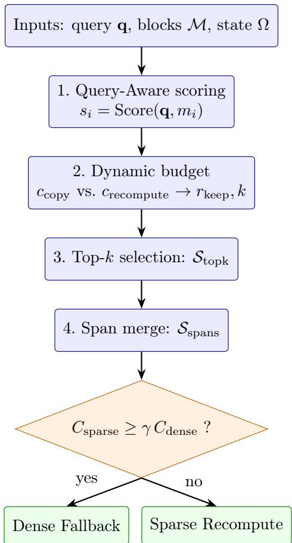

# SparPR: Runtime KV-Cache Recovery for Resource-Constrained LLM Inference on Consumer Hardware

Jieyun Deng1, Keming Hu2, Yanghe Liu3, and Li Feng∗1

1Southwest Jiaotong University, Chengdu, China 2Wuhan Institute of Technology, Wuhan, China 3Southwest Petroleum University, Chengdu, China

## Abstract

Running large language models (LLMs) on consumer hardware is bottlenecked by the keyvalue (KV) cache, which grows with every decoded token and quickly exhausts the memory and bandwidth of a single consumer GPU. We present SparPR (Sparse Partial Recomputation), a runtime KV-cache recovery mechanism that does not modify model weights and requires no ofline training. SparPR couples three online decisions: Query-Aware key-block selection scores historical blocks against the current query; dynamic budget control estimates per-block copy and recompute costs to decide how many blocks to retain; and on-demand local recomputation with cost-aware fallback merges retained blocks into continuous spans and switches between sparse recomputation and full recovery according to a runtime cost comparison. Implemented on FlexGen/FlexLLMGen, SparPR is evaluated on a single consumer laptop (RTX 3070 Ti 8 GB, Ryzen 9 6900HX, 16 GB RAM). It cuts end-to-end latency by 31%, 52%, and 63% at 1k, 2k, and 4k prompt tokens respectively, with 1.4×–2.7× higher throughput, and completes an 8k-token workload in 44 minutes where the FlexGen baseline times out. Under a fixed cache budget, SparPR retains a Needle Accuracy that stays well above StreamingLLM and H2O at every keep ratio, and ablation studies confirm that the three mechanisms act jointly.

## 1 Introduction

Deploying large language models (LLMs) on consumer hardware (laptops and single-GPU machines) is increasingly common for ofline, privacy-sensitive, and cost-sensitive workloads. The dominant cost is the key-value (KV) cache, which grows linearly with the number of tokens processed and quickly turns limited GPU memory and host–device bandwidth into first-order bottlenecks [1, 2, 3]. On datacenter GPUs these costs can be absorbed by large memory and high bandwidth; on a consumer laptop they translate into lower throughput, higher latency, and out-of-memory (OOM) failures long before the model’s nominal context window is reached [4].

Existing work addresses parts of this problem. Layered-execution and ofloading methods [2] place weights, activations, and caches across GPU, CPU, and disk to improve runnability. Cacheretention methods [4, 5, 7, 8, 9] select a subset of the historical cache to keep. Local-recovery methods [6] recompute or reload only part of the cache to avoid restoring everything. These lines of work answer whether the system can run, which information to keep, and how to recover it, respectively, but they do not form a unified runtime loop that couples query relevance, budget control, and recovery-path selection.

In this paper we ask three questions that arise once a model no longer fits its KV cache in GPU memory: (i) which historical blocks are most relevant to the current query and therefore worth keeping; (ii) how many blocks should be retained given the context length, bandwidth, and compute cost; and (iii) whether the retained blocks should be restored by local recomputation or by full recovery. To answer them, we propose SparPR (Sparse Partial Recomputation), a runtime optimization method for KV-cache recovery on consumer hardware.

Our contributions are as follows.

• A Query-Aware key-block selection mechanism that scores historical blocks by their relevance to the current query and performs Top-k selection, converting uniform cache access into relevance-driven access.

• A dynamic budget control mechanism that estimates per-block copy and recompute costs and adaptively derives the target keep ratio and block count, with a conservative lower bound (Minimum Keep Floor).

• An on-demand local recomputation with cost-aware fallback mechanism that merges discrete key blocks into continuous spans and selects between sparse and dense recovery paths by a runtime cost comparison (Dense Fallback Threshold).

• A full prototype on FlexGen/FlexLLMGen, evaluated on a single consumer laptop, that cuts latency by 31%–63% at 1k–4k tokens and completes an 8k-token workload where the FlexGen baseline times out.

## 2 Related Work

Ofloading and layered execution. FlexGen [2] ofloads weights and the KV cache across GPU, CPU, and disk to run large models on limited memory. LeoAM [11] extends this to a single commodity GPU with importance-aware hierarchical GPU–CPU–Disk KV management. These systems target runnability but do not jointly decide query relevance, budget, and recovery path.

KV-cache eviction and retention. StreamingLLM [4] keeps the initial “attention sink” and recent tokens, a position-based strategy. H2O [5] keeps heavy-hitter tokens selected by accumulated attention statistics. ArkVale [7] organizes tokens into pages and recalls important evicted pages from a CPU-side backup. ShadowKV [9] ofloads the value cache and reconstructs sparse KV on the fly. Most of these methods keep a budget that is fixed or decoupled from both the current query and the hardware cost.

Query-aware sparsity and local recomputation. Quest [6] scores and loads only the most relevant page per attention head, showing that query-aware selection can be made cheap enough for inference. ProphetKV [8] reuses KV cache in retrieval-augmented generation via query-driven selective recomputation. Najafizadeh et al. [10] study the restore-versus-recompute trade-of and switch between the two with an I/O-aware policy at the storage layer. SparPR shares the query-aware idea but works at block granularity on an ofloading base (FlexGen) where both data movement and recomputation are expensive, and couples an explicit copy-versus-recompute cost model with query-aware selection and a dense fallback threshold in a single runtime loop.

## 3 Method

## 3.1 Overview and Problem Setting

We target memory-constrained decoding on a single consumer device. At each decoding step, the system must recover (load or recompute) the historical KV cache needed to attend over the past. Let $\mathbf { q }$ be the current query representation, and let $\mathcal { M } = \{ m _ { 1 } , . . . , m _ { n } \}$ be the set of n candidate historical blocks, where each $m _ { i }$ is a block-level cache unit. Let Ω denote the runtime and hardware state (context length, block size, host bandwidth, recompute eficiency, and conservative parameters).

SparPR operates as an online runtime layer on top of an existing execution engine; it does not change model weights and requires no ofline training. Its decision output is a recovery plan consisting of (i) a set of retained key blocks and their target count, and (ii) the recovery path (sparse recomputation or full recovery). Figure 1 summarizes the decision loop.

  
Figure 1: The SparPR runtime decision loop: query-aware scoring, dynamic budget control, span merging, and cost-aware path selection.

## 3.2 Query-Aware Key-Block Selection

The first stage scores each historical block by its relevance to the current query. For each block $m _ { i }$ we precompute a compact summary, the per-head mean key vector

$$
\bar { \mathbf { k } } _ { i , h } = \frac { 1 } { \left| m _ { i } \right| } \sum _ { t \in m _ { i } } \mathbf { k } _ { t , h } \in \mathbb { R } ^ { d } ,\tag{1}
$$

where $\mathbf { k } _ { t , h }$ is the key vector of token t at head h. These summaries form an $n \times H \times d$ tensor that stays resident on the GPU, so scoring touches only the summary and never the full KV blocks ofloaded to CPU or disk; this is what keeps the estimate cheap. The relevance score of a block is the query–summary similarity aggregated over heads,

$$
s _ { i } = \sum _ { h } \langle { \bf q } _ { h } , \bar { \bf k } _ { i , h } \rangle ,\tag{2}
$$

a single scalar computed from H dot products of length $d ;$ aggregating with maxh behaves similarly. Throughout, blocks, summaries, and costs are defined per layer, and the layer count L is a common factor that cancels in the relative cost comparisons of Sections 3.3 and 3.4.

Given the scores, the system selects the top-k blocks:

$$
S _ { \mathrm { t o p k } } = \mathrm { T o p K } ( \{ s _ { i } \} , k ) .\tag{3}
$$

Unlike a fixed threshold, Top-k keeps the selection scale stable as the number of candidate blocks changes. The value of k is not a static hyperparameter; it is produced by the dynamic budget control described next.

## 3.3 Dynamic Budget Control

The number of blocks worth keeping depends on context length, host bandwidth, and compute cost. SparPR estimates two per-block quantities. Let each block contain b tokens, use h attention heads of dimension $d ,$ and store activations in $\beta$ bytes. The copy cost of one block is

$$
c _ { \mathrm { c o p y } } = { \frac { 2 b h d \beta } { B W _ { \mathrm { h o s t } } } } ,\tag{4}
$$

where $B W _ { \mathrm { h o s t } }$ is the efective host-to-device bandwidth and the factor 2 accounts for both key and value. The recompute cost of one block scales with the block length and the square of the hidden dimension $d _ { \mathrm { h i d d e n } } \colon$

$$
c _ { \mathrm { r e c o m p u t e } } \approx \frac { b d _ { \mathrm { h i d d e n } } ^ { 2 } } { F _ { \mathrm { g p u } } } ,\tag{5}
$$

where $F _ { \mathrm { g p u } }$ is an efective compute-throughput term corrected by a runtime eficiency discount. On the sparse path, a block’s K/V is rebuilt from a checkpointed hidden state via the attention projection only $( \mathbf { K } = \mathbf { h } \mathbf { W } _ { K } , \mathbf { V } = \mathbf { h } \mathbf { W } _ { V } )$ , without re-running the MLP or a full forward pass.

Let the copy-cost ratio be

$$
\rho _ { \mathrm { c o p y } } = { \frac { c _ { \mathrm { c o p y } } } { c _ { \mathrm { c o p y } } + c _ { \mathrm { r e c o m p u t e } } } } .\tag{6}
$$

Intuitively, when copying dominates, the system should keep more blocks to avoid repeated loads; when recomputing dominates, it should keep fewer. SparPR maps $\rho _ { \mathrm { c o p y } }$ to a target keep ratio $r _ { \mathrm { k e e p } }$ with a light linear mapping plus a context-length correction that adds a small retention gain in longer contexts. The target block count is then

$$
k = \operatorname* { m a x } { \left( k _ { \mathrm { m i n } } , \ : \left[ n \cdot r _ { \mathrm { k e e p } } \right] \right) } ,\tag{7}
$$

where $k _ { \mathrm { m i n } }$ implements the Minimum Keep Floor, a conservative lower bound that prevents the budget from shrinking too aggressively under pressure.

## 3.4 Span Merging and Cost-Aware Fallback

The Top-k blocks are often scattered across the context. Recovering them one by one introduces fragmentation, scheduling, and fixed per-block overhead. SparPR therefore merges adjacent key blocks into continuous spans $S _ { \mathrm { s p a n s } } = \{ { \mathrm { s p a n } } _ { 1 } , \dots , { \mathrm { s p a n } } _ { m } \}$

We model the cost of the two recovery paths. Let n be the number of candidate blocks and $c _ { \mathrm { c o p y } }$ the per-block copy cost. Full recovery costs

$$
C _ { \mathrm { d e n s e } } = n \cdot c _ { \mathrm { c o p y } } .\tag{8}
$$

Sparse recovery costs

$$
C _ { \mathrm { s p a r s e } } = \left| S _ { \mathrm { t o p k } } \right| \cdot c _ { \mathrm { r e c o m p u t e } } + \left| S _ { \mathrm { s p a n s } } \right| \cdot c _ { \mathrm { s p a n } } + c _ { \mathrm { f i x e d } } ,\tag{9}
$$

where $c _ { \mathrm { s p a n } }$ is the per-span organizational overhead and $c _ { \mathrm { f i x e d } }$ is the fixed sparse-recovery overhead. Note that $C _ { \mathrm { s p a r s e } }$ depends not only on how many blocks are kept, but also on how many spans they form: more fragmented blocks raise the cost.

The path decision is governed by a Dense Fallback Threshold $\gamma \colon$

$$
\mathrm { p a t h } = \left\{ \begin{array} { l l } { \mathrm { D e n s e ~ F a l l b a c k } , } & { \mathrm { i f ~ } C _ { \mathrm { s p a r s e } } \geq \gamma \cdot C _ { \mathrm { d e n s e } } , } \\ { \mathrm { S p a r s e ~ R e c o m p u t e } , } & { \mathrm { o t h e r w i s e } . } \end{array} \right.\tag{10}
$$

When sparse recovery is no longer cheaper than a fraction of full recovery, the system falls back to the dense path rather than persisting with an unprofitable sparse strategy. A smaller $\gamma$ makes the system fall back more readily (more conservative); a larger $\gamma$ favors sparse recovery.

## 3.5 Runtime Decision Procedure

The full decision procedure is summarized below.

Algorithm 1 SparPR runtime decision.   
Input: current query ${ \bf q } ,$ historical block set ${ \mathcal { M } } ,$ , runtime state $\Omega$   
Output: recovered cache (sparse or dense)   
1: Compute block scores $s _ { i } = \mathrm { S c o r e } ( \mathbf { q } , m _ { i } )$ for all $m _ { i }$   
2: Estimate keep ratio $r _ { \mathrm { k e e p } }$ from Ω   
3: Compute target count $\dot { k } = \operatorname* { m a x } ( k _ { \mathrm { m i n } } , \lceil n \cdot r _ { \mathrm { k e e p } } \rceil )$   
4: Select $S _ { \mathrm { t o p k } } = \mathrm { T o p K } ( \{ s _ { i } \} , k )$   
5: Merge adjacent blocks into spans Sspans   
6: Estimate $C _ { \mathrm { d e n s e } }$ and $C _ { \mathrm { s p a r s e } }$   
7: if $C _ { \mathrm { s p a r s e } } \geq \gamma \cdot C _ { \mathrm { d e n s e } }$ then Dense Fallback   
8: else Sparse Recompute

## 4 Experiments

## 4.1 Setup

Hardware and software. All results are real runs on a single consumer laptop with an NVIDIA RTX 3070 Ti (8 GB), an AMD Ryzen 9 6900HX mobile CPU, 16 GB host memory, and a local SSD, running Windows with WSL. The execution engine is FlexGen/FlexLLMGen. We evaluate facebook/opt-6.7b [1] with batch size 4 and a static ofloading policy, a setting in which the KV cache quickly stresses the 8 GB GPU budget.

Baselines. We compare against FlexGen [2] (system runnability baseline), StreamingLLM [4] (position-based retention) and H2O [5] (statistics-based retention) for needle-style retrieval fidelity, and Quest-style query-aware selection for the ablation.

Needle task. For needle-style retrieval fidelity we use a constructed needle task: a target fact (“The Wi-Fi password for the guest network at the SWJTU is 2022116822”) is inserted at one of two depth ratios, 0.15 or 0.85 of the context, into a long distractor text (an excerpt of Alice in Wonderland), and the model is asked “What is the Wi-Fi password for the guest network at the SWJTU?”. Needle Accuracy is the hit rate averaged over the two insertion depths.

## 4.2 System Performance and Runnability

Table 1 reports end-to-end latency and throughput as the prompt length grows from 1k to 8k tokens. DeepSpeed and HF Accelerate run out of memory before 1k, and a Quest-style query-aware selection OOMs at 1200 tokens; only the ofloading FlexGen baseline and SparPR keep a runnable range. FlexGen completes 1k–4k by spilling to CPU and disk but slows to the point of timing out at 8k. SparPR completes every length, cutting latency by 31%, 52%, and 63% at 1k, 2k, and 4k tokens and reaching 1.4×, 2.1×, and 2.7× higher throughput; the gap widens with context length because SparPR bounds the growth of the KV-cache recovery cost.

Table 1: End-to-end latency (s) and throughput (tok/s) of FlexGen and SparPR at increasing prompt length (OPT-6.7B, batch 4, RTX 3070 Ti 8 GB). “timeout” denotes failure to complete within the experiment’s time budget.
<table><tr><td>Prompt</td><td>FlexGen lat.</td><td>FlexGen thr.</td><td>SparPR lat.</td><td>SparPR thr.</td><td>Lat. reduction</td></tr><tr><td>1k</td><td>1064</td><td>.466</td><td>737</td><td>.673</td><td>31%</td></tr><tr><td>2k</td><td>2101</td><td>.236</td><td>1009</td><td>.491</td><td>52%</td></tr><tr><td>4k</td><td>4174</td><td>.119</td><td>1553</td><td>.319</td><td>63%</td></tr><tr><td>8k</td><td>timeout</td><td></td><td>2641</td><td>.187</td><td></td></tr></table>

## 4.3 Needle-Style Retrieval Fidelity Under Budget

Table 2 reports Needle Accuracy at fixed cache keep ratios across 2k, 4k, and 8k prompt tokens. At every keep ratio and length, SparPR stays well above H2O and StreamingLLM: at high budgets (30–50%) it retains .60–.94 accuracy versus .31–.51 for H2O and .15–.49 for StreamingLLM, and at 10% keep it retains .60/.48/.31 at 2k/4k/8k while H2O falls to around .12 and StreamingLLM collapses to .02. StreamingLLM is position-based, so its needle survives only if it falls in the recent window; H2O is query-agnostic, so its hit rate roughly tracks the keep ratio and is nearly lengthinvariant. SparPR’s query-aware selection keeps the needle-relevant block even at low budgets (at the cost of modestly higher latency), but its accuracy still degrades with context length, since longer distractors make the needle-relevant block harder to identify.

Table 2: Needle Accuracy at fixed cache keep ratios, at 2k/4k/8k prompt tokens (mean of three runs).
<table><tr><td>Method</td><td>Keep ratio</td><td>2k</td><td>4k</td><td>8k</td></tr><tr><td rowspan="6">StreamingLLM</td><td>50%</td><td>.445</td><td>.467</td><td>.485</td></tr><tr><td>40%</td><td>.291</td><td>.333</td><td>.345</td></tr><tr><td>30%</td><td>.153</td><td>.197</td><td>.208</td></tr><tr><td>20%</td><td>.020</td><td>.051</td><td>.070</td></tr><tr><td>10%</td><td>.020</td><td>.020</td><td>.020</td></tr><tr><td>5%</td><td>.020</td><td>.020</td><td>.020</td></tr><tr><td rowspan="6">H2O</td><td>50%</td><td>.492</td><td>.506</td><td>.511</td></tr><tr><td>40%</td><td>.408</td><td>.393</td><td>.408</td></tr><tr><td>30%</td><td>.321</td><td>.308</td><td>.313</td></tr><tr><td>20%</td><td>.212</td><td>.221</td><td>.215</td></tr><tr><td>10%</td><td>.120</td><td>.127</td><td>.114</td></tr><tr><td>5%</td><td>.065</td><td>.069</td><td>.073</td></tr><tr><td rowspan="5">SparPR</td><td>50%</td><td>.943</td><td>.879</td><td>.780</td></tr><tr><td>40%</td><td>.898</td><td>.831</td><td>.694</td></tr><tr><td>30%</td><td>.847</td><td>.772</td><td>.598</td></tr><tr><td>20%</td><td>.763</td><td>.654</td><td>.473</td></tr><tr><td>10%</td><td>.600</td><td>.482</td><td>.308</td></tr><tr><td></td><td>5%</td><td>.424</td><td>.330</td><td>.208</td></tr></table>

## 4.4 Parameter Analysis

Table 3 shows the efect of the Minimum Keep Floor. Lowering the floor reduces the average keep ratio and the sparse cost and raises throughput, while accuracy degrades only gradually—consistent with the query-aware selection retaining the more relevant blocks first.

Table 3: Efect of Minimum Keep Floor on keep ratio, throughput, accuracy, and sparse cost (needle task).
<table><tr><td>Floor</td><td>Avg. keep</td><td>Throughput</td><td>Needle acc.</td><td>Sparse cost (ms)</td></tr><tr><td>1.00</td><td>100.0%</td><td>0.482</td><td>0.993</td><td>952.33</td></tr><tr><td>0.90</td><td>90.0%</td><td>0.532</td><td>0.987</td><td>891.67</td></tr><tr><td>0.80</td><td>80.0%</td><td>0.588</td><td>0.983</td><td>821.33</td></tr><tr><td>0.75</td><td>75.5%</td><td>0.642</td><td>0.973</td><td>761.67</td></tr><tr><td>0.70</td><td>72.6%</td><td>0.681</td><td>0.963</td><td>712.33</td></tr><tr><td>0.65</td><td>69.7%</td><td>0.728</td><td>0.947</td><td>671.67</td></tr><tr><td>0.60</td><td>66.8%</td><td>0.784</td><td>0.927</td><td>632.33</td></tr></table>

Table 4 shows the efect of the Dense Fallback Threshold. A lower threshold makes the system fall back to full recovery more often (higher bypass count) and behave more conservatively; a higher threshold favors sparse recovery, raising throughput while accuracy declines slightly.

Table 4: Efect of Dense Fallback Threshold on throughput, accuracy, and bypass count (needle task).
<table><tr><td>Threshold γ</td><td>Throughput</td><td>Needle acc.</td><td>Bypass count</td></tr><tr><td>0.72</td><td>0.520</td><td>0.985</td><td>12.00</td></tr><tr><td>0.74</td><td>0.560</td><td>0.983</td><td>10.00</td></tr><tr><td>0.76</td><td>0.610</td><td>0.980</td><td>8.00</td></tr><tr><td>0.78</td><td>0.650</td><td>0.977</td><td>6.00</td></tr><tr><td>0.80</td><td>0.680</td><td>0.971</td><td>5.00</td></tr><tr><td>0.85</td><td>0.700</td><td>0.962</td><td>3.00</td></tr><tr><td>0.90</td><td>0.710</td><td>0.943</td><td>1.00</td></tr></table>

## 4.5 Ablation Study

Ablation studies use the same needle task at a fixed 1000-token prompt length, and every reported value is the mean of three runs. Note that the needle task is a diferent workload from the throughput sweep in Table 1, so the FlexGen baseline latency here difers slightly from Table 1. Tables 5 and 6 isolate the contribution of each component. Quest-only keeps query-aware selection but drops budget and fallback, improving latency but hurting accuracy. $w / o$ Budget keeps too much context and gains little eficiency. $w / o$ Span Merge incurs the highest sparse cost (1085.33 ms) because of fragmented recovery. $w / o$ Bypass cannot retreat from unprofitable sparse paths and loses accuracy. SparPR-full achieves the lowest latency and highest throughput while keeping high accuracy, confirming that the mechanisms act jointly.

Table 5: Ablation: external results (needle task, 1000 tokens, mean of three runs).
<table><tr><td>Method</td><td>Latency (s)</td><td>Throughput</td><td>Needle acc.</td></tr><tr><td>FlexGen</td><td>991.33</td><td>0.50</td><td>0.983</td></tr><tr><td>Quest-only</td><td>845.33</td><td>0.59</td><td>0.777</td></tr><tr><td> $\mathrm { w / o }$  Budget</td><td>838.67</td><td>0.60</td><td>0.963</td></tr><tr><td> $\mathrm { w / o }$  Span Merge</td><td>936.67</td><td>0.53</td><td>0.973</td></tr><tr><td> $\mathrm { w / o }$  Bypass</td><td>812.33</td><td>0.62</td><td>0.917</td></tr><tr><td>SparPR-full</td><td>756.67</td><td>0.66</td><td>0.957</td></tr></table>

Table 6: Ablation: runtime statistics (needle task, 1000 tokens, mean of three runs).
<table><tr><td>Method</td><td>Avg. keep</td><td>Bypass</td><td>Blocks skip</td><td>Recompute ok</td><td>Sparse cost (ms)</td></tr><tr><td>FlexGen</td><td>100.0%</td><td>0.00</td><td>0.00</td><td>0.00</td><td>952.33</td></tr><tr><td>Quest-only</td><td>58.7%</td><td>0.00</td><td>726.67</td><td>3.00</td><td>805.67</td></tr><tr><td> $\mathrm { w / o }$  Budget</td><td>85.0%</td><td>3.33</td><td>266.33</td><td>4.33</td><td>818.33</td></tr><tr><td> $\mathrm { w / o }$  Span Merge</td><td>73.5%</td><td>16.33</td><td>468.33</td><td>8.67</td><td>1085.33</td></tr><tr><td> $\mathrm { w / o }$  Bypass</td><td>73.8%</td><td>0.00</td><td>462.67</td><td>12.33</td><td>821.67</td></tr><tr><td>SparPR-full</td><td>73.2%</td><td>5.67</td><td>473.33</td><td>9.33</td><td>728.33</td></tr></table>

## 5 Conclusion and Limitations

We presented SparPR, a runtime KV-cache recovery mechanism for resource-constrained LLM inference on consumer hardware. SparPR couples query-aware key-block selection, dynamic budget control, and cost-aware fallback into one online decision loop. On a single consumer laptop, it cuts latency by 31%–63% and raises throughput by 1.4–2.7× over FlexGen at 1k–4k tokens, completes an 8k-token workload where FlexGen times out, and keeps consistently higher needle accuracy than StreamingLLM and H2O at every cache budget; ablation confirms the three mechanisms act jointly.

Our study has limitations. Experiments use a single OPT-6.7B model, one consumer GPU, and a constructed needle task; scaling to larger models, standard long-context benchmarks, and more hardware remains future work. Finer-grained page-level cache organization and online calibration of the cost models are promising directions.

## References

[1] S. Zhang, S. Roller, N. Goyal, et al. OPT: Open Pre-trained Transformer Language Models. arXiv:2205.01068, 2022.

[2] Y. Sheng, L. Zheng, B. Yuan, et al. FlexGen: High-Throughput Generative Inference of Large Language Models with a Single GPU. ICML, 2023.

[3] T. Dao, D. Fu, S. Ermon, et al. FlashAttention: Fast and Memory-Eficient Exact Attention with IO-Awareness. NeurIPS, 2022.

[4] G. Xiao, Y. Tian, B. Chen, et al. Eficient Streaming Language Models with Attention Sinks. ICLR, 2024.

[5] Z. Zhang, Y. Sheng, T. Zhou, et al. H2O: Heavy-Hitter Oracle for Eficient Generative Inference of Large Language Models. NeurIPS, 2023.

[6] J. Tang, Y. Zhao, K. Zhu, et al. Quest: Query-Aware Sparsity for Eficient Long-Context LLM Inference. ICML, 2024.

[7] R. Chen, Z. Wang, B. Cao, et al. ArkVale: Eficient Generative LLM Inference with Recallable Key-Value Eviction. NeurIPS, 2024.

[8] S. Wang, J. Chen, Y. Pan, et al. ProphetKV: User-Query-Driven Selective Recomputation for Eficient KV Cache Reuse in Retrieval-Augmented Generation. ICML, 2026.

[9] H. Sun, L.-W. Chang, W. Bao, et al. ShadowKV: KV Cache in Shadows for High-Throughput Long-Context LLM Inference. ICML, 2025.

[10] A. Najafizadeh, V. Tarasov, et al. LLM KV-cache: To Restore or To Recompute, That Is the Question. HotStorage, 2026.

[11] H. Sun, L. Li, M. Xiao, et al. Breaking the Boundaries of Long-Context LLM Inference: Adaptive KV Management on a Single Commodity GPU (LeoAM). arXiv:2506.20187, 2025.