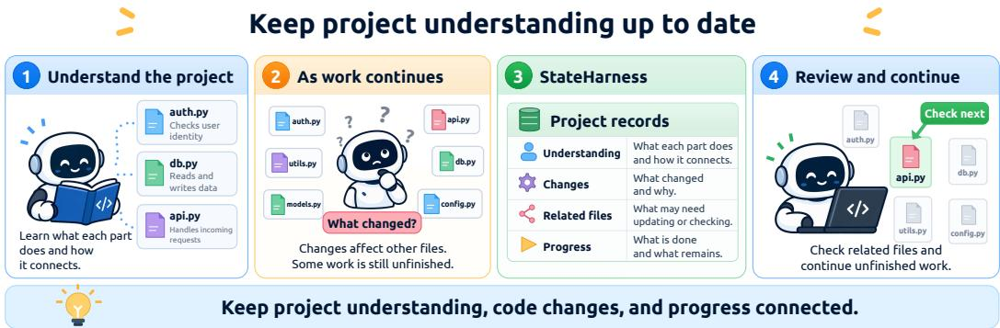
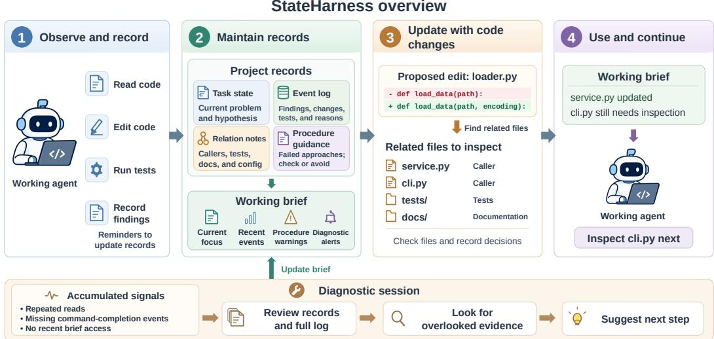
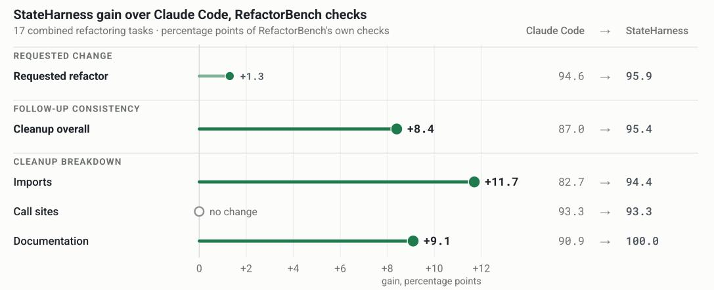
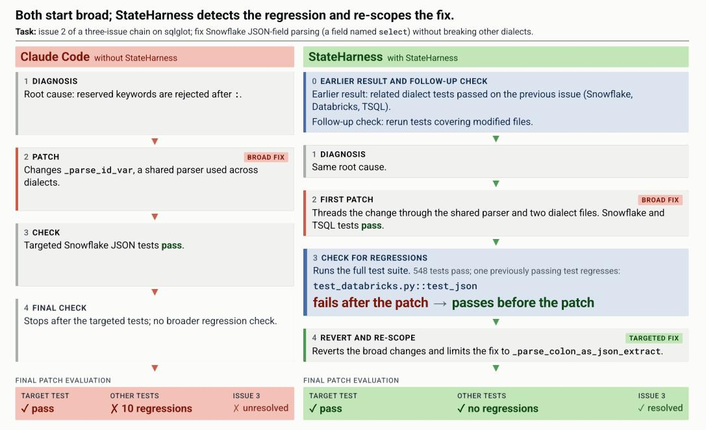

# StateHarness: Maintaining Evolving Project State for Long-Horizon Coding Agents

Chuan Zou1∗ Yujun Zhou2∗ Xiaonan Luo2 Xiangliang Zhang2†

1University of Pennsylvania 2University of Notre Dame

∗Co-first authors †Corresponding author

## ABSTRACT

Long-horizon coding requires agents to maintain an evolving view of the project they are changing: what problem is currently being solved, what has already been learned or modified, which other artifacts may be affected, and what work remains unresolved. When this information is scattered across a growing interaction history, local edits can become disconnected from their later consequences and progress can be difficult to carry forward. We introduce StateHarness, a runtime framework that maintains evolving project state without updating model parameters. The working agent records its current problem and hypothesis, important findings and decisions, discovered repository relationships, and unfinished work. Runtime support prompts record updates, searches for callers, tests, and documentation that may be affected by a change, and maintains a compact working brief for subsequent decisions. When behavioral signals accumulate, a separate diagnostic session revisits the recorded history and surfaces overlooked evidence. Across three repository-level evaluations, StateHarness improves task completion and several measures of change consistency. On RefactorBench, full-chain completion increases from 29.4% to 35.3% and cleanup-check accuracy from 87.0% to 95.4%. On five LHTB software-engineering tasks, mean reward improves from 0.427 to 0.576, exceeding LongHorizon-Harness at substantially lower recorded execution cost. On ChainSWE, bug-fix rate increases from 35.1% to 39.5% and residual debt decreases from 60 to 43 items, although pass-to-pass regressions increase. These results show that maintaining project state can improve long-horizon coding while introducing measurable execution and regression trade-offs. Code is available at https://anonymous.4open.science/r/StateHarness.

## 1 INTRODUCTION

Recent advances in large language models have moved automated programming from isolated code generation toward coding agents that interact with development environments, invoke tools, and carry out multi-step software engineering tasks (Yao et al., 2023; Yang et al., 2024; Wang et al., 2024). These agents now operate directly in real repositories, while the tasks themselves are expanding from issue resolution to complex multi-file changes, feature development, and sustained software evolution (Jimenez et al., 2024; Deng et al., 2025; Zhou et al., 2026a; Le et al., 2025; Lam et al., 2026).

This shift exposes a mismatch between how agents work and how software projects are organized. An agent experiences a task as a trajectory of file reads, edits, tests, and observations. A software project, however, is a structured and evolving system: modules serve different roles, implementations interact across files and layers, and a local change can affect callers, tests, documentation, or other dependent artifacts many steps later. Without a persistent project-level view, the agent may repeatedly reconstruct the same understanding from raw code, lose track of the wider consequences of a local edit, and scatter progress, decisions, and unfinished work across a growing trajectory. Recent evaluations expose related failures, including forgotten requirements in multiturn coding (Raghavendra et al., 2026), reduced implementation faithfulness when specifications emerge gradually (Yan et al., 2026), and structural degradation under repeated code extension (Orlanski et al., 2026). Simply retaining more history is not enough: prior information helps only when the relevant parts can be selected and reused appropriately (Zhu et al., 2026).

  
Figure 1: Maintaining evolving project state as coding progresses. StateHarness preserves what the agent has learned, records code changes and potentially related files, and tracks what has been completed and what still requires attention. These records support reviewing change consequences and continuing unfinished work.

Existing work supports long-horizon coding through context management, persistent execution state, and repository-aware retrieval (Liu et al., 2026; Gao et al., 2026; Wang et al., 2026b; Ma et al., 2026; Ouyang et al., 2025b). These approaches make different parts of prior execution easier to retain or recover. We focus on how an evolving, task-centered project state can keep these pieces connected during ongoing coding: what the agent currently understands about the project, what consequences recent changes may have elsewhere, and what work remains unresolved as the repository changes.

We introduce StateHarness, a runtime framework for maintaining an evolving, task-centered project state throughout execution (Figure 1). The agent persistently records its current problem and hypothesis, important findings and decisions, discovered relations across the repository, and unfinished work. Runtime support prompts these records to be updated, searches for callers, tests, and documentation that may be affected by a change, and maintains a compact working brief for subsequent decisions. When behavioral signals accumulate, a separate diagnostic session can revisit the longer recorded history and surface overlooked evidence. StateHarness operates without updating the un derlying model parameters.

Across three repository-level evaluations, StateHarness improves task completion and several measures of change consistency, while adding runtime overhead relative to the underlying coding agent. It improves full-chain completion and cleanup consistency on RefactorBench, achieves the highest mean reward among the compared systems on LHTB at substantially lower recorded execution cost than LongHorizon-Harness, and increases bug-fix rate on ChainSWE while reducing residual debt, although pass-to-pass regressions increase. These results motivate examining both where projectstate maintenance helps and the trade-offs it introduces.

Our work makes three contributions. (1) We introduce an explicit representation of evolving project state that connects project understanding, change consequences, and unresolved work throughout a long coding trajectory. (2) We develop StateHarness, a runtime framework that maintains, updates, and returns this state to subsequent coding decisions through lightweight recording, retrieval, and di agnostic mechanisms, without updating the underlying model. (3) We evaluate StateHarness across refactoring, long-horizon execution, and sequential bug-fixing settings, characterizing both its gains in task success and change consistency and its execution-cost and regression trade-offs.

## 2 RELATED WORK

Preserving and Reusing Project Understanding. Retaining interaction history and preserving reusable knowledge are related but distinct goals. Context-management methods decide when and what to compress (Liu et al., 2026; Gao et al., 2026), or filter redundant trajectory content and code observations (Xiao et al., 2025; Wang et al., 2026a; Lindenbauer et al., 2025). External memory and experience-based methods organize information or distilled strategies for later reuse (Packer et al., 2023; Zhang et al., 2025; Ouyang et al., 2025a). For coding, the retained information may also need to describe the particular project being developed. ProjectGuard addresses this through semantic and structural project state that tracks progressively revealed specifications (Yan et al., 2026). StateHarness focuses on the understanding acquired during implementation: current hypotheses, explanations already ruled out, decision reasons, and discovered code relationships. It preserves these as editable working records so that subsequent work can build on earlier analysis, while fixed-rule updates maintain a compact view without repeatedly summarizing the full history.

Repository Relationships and Change Impact. Understanding a repository requires identifying both relevant code and the consequences of changing it. Task-context tools preserve program elements relevant to ongoing work, while change-impact analysis connects source modifications to affected tests (Kersten & Murphy, 2006; Ren et al., 2004). Coding agents obtain related context through structure-aware search and retrieval-augmented repair (Zhang et al., 2024; Xiong et al., 2025), or expose relationships through repository-level code graphs (Ouyang et al., 2025b; Liu et al., 2025). Keeping that evidence current is another concern: CORVUS synchronizes file observations as the repository changes (Zheng et al., 2026). StateHarness addresses the connection between these code relationships and the agent’s ongoing work. After inspecting retrieved locations, the agent records why a caller, test, or document needs attention, how it has been handled, and which check remain. These handling decisions persist beyond the retrieval step and support review before completion. The focus is therefore on maintaining task-specific understanding of change consequences, rather than introducing a new dependency-analysis algorithm.

Progress Tracking and Execution Feedback. External state can guide what to do next, not just preserve what happened. Ledger uses tool-derived execution state to inform decisions and mediate redundant actions, while LongHorizon-Harness uses independently audited task state to coordinate successive execution sessions (Wang et al., 2026b; Ma et al., 2026). Reflective feedback provides another route from past outcomes to guidance for subsequent attempts (Shinn et al., 2023). Execution evidence is also used to evaluate unsafe skill behavior (Zhuang et al., 2026), check action safety and authorization (Huang et al., 2026; Qin et al., 2026), or enforce requirements learned from user corrections (Zhou et al., 2026b). Whereas these checks concern safety or compliance, StateHarness uses feedback to maintain task continuity. Editing and testing activity prompts updates to the agent’s findings and progress, a working brief returns the current focus and recent results to subsequent decisions, and occasional diagnosis revisits earlier recorded evidence. Its central concern is keeping track of where the work stands and what still needs attention as the project changes.

## 3 STATEHARNESS: MAINTAINING EVOLVING PROJECT STATE

StateHarness maintains an evolving, task-centered representation of the project as coding proceeds. As the working agent reads code, modifies implementations, and runs tests, it records what it currently understands, what has changed, which other artifacts may be affected, and what work remains unfinished. StateHarness then makes this information available to later decisions through a compact working brief, supplements it with repository search when changes may have non-local consequences, and revisits older evidence when execution shows signs that relevant information has been overlooked. The runtime supports these operations without updating the underlying model parameters. Figure 2 summarizes the interaction between persistent project records, runtime support, and the working agent.

## 3.1 PRESERVING PROJECT UNDERSTANDING ACQUIRED DURING EXECUTION

The agent develops project understanding incrementally as it works: what the current problem is, which code is relevant, how components interact, which explanations remain plausible, and what has already been ruled out. StateHarness preserves this information outside the conversation so that later work can build on earlier analysis rather than reconstructing it from the trajectory.

The current implementation uses four persistent records. Task state stores the initial observation, environment information, and the current subproblem and hypothesis. An event log preserves important findings, edits, test outcomes, decisions, and reasons for changing direction. Relation notes record discovered connections to callers, tests, documentation, configuration, or other artifacts that may need to remain consistent with a change. Procedure guidance records approaches that have repeatedly failed and indicates whether later use should proceed normally, require explicit verification, or be avoided.

  
Figure 2: StateHarness overview. The working agent maintains persistent project records, from which fixed rules refresh a compact working brief. Change-impact retrieval identifies candidate files for inspection when supported edits may have non-local consequences. Accumulated behavioral signals can trigger a separate diagnostic session that revisits older recorded evidence and returns concise suggestions through the brief.

The working agent updates these records as execution proceeds. When its hypothesis changes, for example, it replaces the current focus in task state while preserving the earlier reasoning and the reason for the change in the event log. Observed editing and testing activity can prompt the agent to record new findings, progress, or relationships. Together, the records preserve the current task context, accumulated project understanding, and unfinished work needed by subsequent decisions.

## 3.2 USING EXISTING UNDERSTANDING IN SUBSEQUENT WORK

Persistent state is useful only if relevant parts return to the agent when they matter. A later decision may depend on a cause that was already ruled out, a caller discovered several steps earlier, or work that was started but not completed. StateHarness therefore maintains a compact working brief that serves as the routine project-state view for the working agent.

The brief contains the initial environment information, current subproblem and hypothesis, procedure guidance that affects subsequent actions, recent events, and diagnostic alerts. The runtime refreshes these sections using fixed rules: a task-focus update replaces the displayed focus, while additions to the event log refresh the recent-event window. This synchronization reuses the agent’s recorded content directly rather than invoking another model to summarize the full history.

Older information remains in the persistent records after it leaves the brief’s recent-event window. The working agent can explicitly revisit these records when needed, while the diagnostic mechanism described below can also recover older evidence from them. If the brief has not been accessed for an extended interval, the runtime returns the current brief to the working agent. This design keeps routine state compact while retaining a longer history for later review.

## 3.3 UPDATING UNDERSTANDING AND PROGRESS AS CODE CHANGES

Project state must evolve with the repository. A local edit can affect callers, tests, documentation, configuration, or other artifacts outside the edited file, including relationships that the agent has not yet discovered. StateHarness therefore couples selected code changes with change-impact retrieval and persistent recording of their consequences.

Before supported operations such as interface changes or source-file deletions, the runtime searches the repository for locations that may be affected by the proposed change. The returned locations are candidates rather than assumed dependencies. The working agent inspects them, determines which require modification or verification, and records the relevant relationships and handling decisions.

For example, changing a data-loading function’s interface may reveal both a service caller and a command-line entry point. After updating the service, the agent can record that the command-line caller still requires inspection; after the relevant tests run, their outcomes are added to the event log. The working brief is then refreshed from these records, allowing later decisions to distinguish completed work from consequences that remain unresolved.

Before termination, the completion protocol asks the agent to revisit the original request, recorded relationships, relevant tests, and unresolved warnings. For each relevant artifact, it should either perform the necessary follow-up or record why no change is required. In this way, discovered consequences remain connected to their handling status rather than disappearing after the immediate edit.

## 3.4 RECOVERING OVERLOOKED INFORMATION WHEN EXECUTION FALTERS

Maintaining project state does not ensure that every relevant record will be used at the right moment. An agent may repeatedly inspect the same code, lose track of an earlier finding, or continue an approach that conflicts with previous evidence. StateHarness therefore monitors behavioral signals such as repeated reads of the same file, commands that repeatedly lack a normal completion event, and extended periods without consulting the working brief.

The runtime first responds with ordinary feedback, such as a reminder or the current brief. If eligible signals continue to accumulate, it starts a fresh diagnostic session over the task state, procedure guidance, working brief, and full event log. The diagnostic session looks for evidence of repeated approaches, stale assumptions, contradictions, or earlier findings that may have become relevant again, and returns a concise suggested next step when the recorded evidence supports one.

Diagnostic suggestions are inserted into the working brief and become available to the working agent on its next decision. For example, an unresolved caller recorded earlier may eventually leave the recent-event window; if later execution repeatedly returns to the same part of the code, diagnosis can recover that earlier evidence from the full log and return it to the current working view. The working brief therefore supports routine continuity, while diagnosis provides an occasional mechanism for recovering older project state when ordinary use of that state appears to break down.

## 4 EXPERIMENTS

We study StateHarness from three complementary perspectives. First, we ask whether maintaining project state helps a coding agent complete longer sequences of related work. Second, we examine whether improvements extend beyond the immediate edit to callers, tests, documentation, and other artifacts that must remain consistent as the repository changes. Third, we measure the execution cost of maintaining this state, both relative to the underlying coding agent and to a more heavily orchestrated long-horizon harness.

## 4.1 EXPERIMENTAL SETUP

Task settings. We evaluate StateHarness in three repository-level settings that emphasize different aspects of long-horizon coding.

RefactorBench (Gautam et al., 2025) evaluates cross-file consistency during repository refactoring. We organize the original tasks into repository-level chains and present the refactorings sequentially while retaining the benchmark’s original requirements and evaluation checks. This setting measures both completion of the requested transformations and consistency of related artifacts after a sequence of changes.

Table 1: Overall performance across the three evaluation settings. Higher is better for completion, reward, and bug-fix rate; lower is better for P2P regressions and residual debt. Best results are shown in bold.
<table><tr><td colspan="8">RefactorBench</td></tr><tr><td rowspan="2">Method</td><td colspan="2">Completion</td><td colspan="2">Checks</td><td colspan="3">Cleanup Breakdown</td></tr><tr><td>Subtasks ↑</td><td>Chains ↑</td><td>Refactor ↑</td><td>Cleanup ↑</td><td>Imports ↑</td><td>Calls ↑</td><td>Docs ↑</td></tr><tr><td>Claude Code</td><td>77.9</td><td>29.4</td><td>94.6</td><td>87.0</td><td>82.7</td><td>93.3</td><td>90.9</td></tr><tr><td>StateHarness</td><td>81.4</td><td>35.3</td><td>95.9</td><td>95.4</td><td>94.4</td><td>93.3</td><td>100.0</td></tr><tr><td colspan="8">Long-Horizon Terminal-Bench (LHTB)</td></tr><tr><td>Method</td><td>ALP</td><td>GE Audit</td><td>Foldseek</td><td>Unison</td><td>Commit0</td><td>Mean</td><td></td></tr><tr><td>Claude Code</td><td>0.500</td><td>0.273</td><td>0.556</td><td>0.167</td><td>0.639</td><td>0.427</td><td></td></tr><tr><td>LongHorizon-Harness</td><td>0.600</td><td>0.364</td><td>0.556</td><td>0.167</td><td>0.938</td><td></td><td>0.525</td></tr><tr><td>StateHarness</td><td>0.700</td><td>0.364</td><td>0.556</td><td>0.333</td><td>0.929</td><td>0.576</td><td></td></tr><tr><td colspan="8">ChainSWE</td></tr><tr><td>Method</td><td colspan="2">Bug Fix (%)↑</td><td colspan="2">P2P Regressions ↓</td><td colspan="3">Residual Debt ↓</td></tr><tr><td>Claude Code</td><td colspan="2">35.1</td><td colspan="2">16</td><td>60</td><td colspan="2"></td></tr><tr><td>LongHorizon-Harness</td><td colspan="2">32.5</td><td colspan="2">47</td><td colspan="3">69</td></tr><tr><td>StateHarness</td><td colspan="2">39.5</td><td colspan="2">23</td><td colspan="3">43</td></tr></table>

Long-Horizon Terminal-Bench (LHTB) (Li et al., 2026) evaluates sustained execution over dependent terminal actions. We use five of its six software-engineering tasks; the remaining task exceeds our execution budget. We report the benchmark reward for each task and the mean across the eval uated subset.

ChainSWE (Jin et al., 2026) evaluates related software issues on the same evolving repository. We evaluate 37 chains, presenting the issues in chronological order within a single request. Each agent starts from the chain’s initial repository state, works through the issues in one continuous execution, and produces one final patch that is scored issue-by-issue.

Models and comparison systems. All experiments use Claude Sonnet 5 as the underlying working model. Our primary baseline is unmodified Claude Code with the same task input and model. We compare it with StateHarness, which augments the coding agent with persistent project state, a compact working brief, change-impact retrieval, runtime reminders, and occasional diagnosis. On LHTB and ChainSWE, we also compare against LongHorizon-Harness (LH-H) (Ma et al., 2026), a training-free framework that coordinates long-horizon execution through manager, executor, and auditor roles. Holding the working model fixed lets us compare the effect of the surrounding runtime organization rather than differences in model capability.

Task outcomes and consistency. All task outcomes are determined by benchmark tests or external verifiers rather than agent self-reports. On RefactorBench, we report individual subtask completion and full-chain completion, together with checks for the requested refactoring and cleanup checks covering dependent imports, call sites, and documentation. On LHTB, we report the benchmark task reward. On ChainSWE, we report issue-level bug-fix rate, pass-to-pass (P2P) regressions, and residual debt, a supplementary count of consistency problems that remain after the chain. The detailed composition of this measure is described in Appendix B.

Execution cost. We report recorded token usage, tool calls, and wall-clock time. These measures characterize the runtime overhead of StateHarness relative to Claude Code and its execution cost relative to LongHorizon-Harness. Additional implementation, scoring, and measurement details are provided in Appendix B.

  
Figure 3: RefactorBench consistency breakdown. StateHarness produces a modest improvement on checks for the requested refactoring itself, while larger gains appear in cleanup checks for related artifacts. The largest improvements occur for import and documentation updates; call-site performance is unchanged.

## 4.2 OVERALL PERFORMANCE ACROSS SETTINGS

Table 1 summarizes the main results across all three settings. StateHarness improves the primary task outcome in each setting. On RefactorBench, full-chain completion increases from 29.4% to 35.3%, showing that the gain extends beyond individual refactoring steps to completion of the combined sequence. On LHTB, mean reward increases from 0.427 to 0.576; StateHarness improves over Claude Code on four of the five evaluated tasks and ties on Foldseek. On ChainSWE, issue-level bug-fix rate increases from 35.1% to 39.5%.

The consistency results are less uniform. On RefactorBench, the requested refactoring checks improve only modestly, whereas cleanup checks show a larger gain. On ChainSWE, reported residual debt decreases from 60 to 43, but pass-to-pass regressions increase from 16 to 23. The latter result is important: maintaining additional project state does not uniformly preserve previously passing behavior, even when more requested issues are resolved. We therefore treat task completion and change consistency as related but distinct outcomes.

StateHarness also compares favorably with LongHorizon-Harness in the two settings where both are evaluated. On LHTB, its mean reward is 0.576 compared with 0.525 for LongHorizon-Harness. The comparison varies by task: StateHarness performs better on ALP and Unison, ties on GE Audit and Foldseek, and is slightly lower on Commit0. On ChainSWE, StateHarness achieves a higher bug-fix rate (39.5% versus 32.5%), with fewer P2P regressions and lower reported residual debt. These results suggest that the benefit is not tied to a single task structure: it appears across sequential refactoring, long terminal workflows, and multi-issue repository maintenance.

## 4.3 CONSISTENCY BEYOND THE IMMEDIATE CHANGE

RefactorBench lets us separate the requested transformation from the follow-up work needed to keep related artifacts consistent. Figure 3 shows the corresponding gains over Claude Code.

The larger difference appears after the immediate edit: cleanup accuracy improves by 8.4 percentage points, compared with 1.3 points for the requested refactoring checks. The cleanup gain is driven by imports (+11.7 points) and documentation (+9.1 points), while call-site performance is unchanged. StateHarness therefore improves several forms of follow-up consistency rather than uniformly improving every related artifact.

The distinction matters because the requested edit and its downstream consequences place different demands on the agent. Completing the immediate refactoring primarily requires modifying the target implementation correctly; cleanup additionally requires remembering which surrounding artifacts were affected and returning to them after the local edit has been made. The larger gains on imports and documentation are therefore consistent with the intended role of StateHarness in keeping change consequences connected to later work. At the same time, the unchanged call-site result shows that this benefit is not universal across all related artifacts.

Table 2: Execution cost across evaluation settings. Values are averages under the corresponding setting. Lower is better for all cost measures.
<table><tr><td>Setting</td><td>Method</td><td>Recorded tokens (K)</td><td>Tool calls</td><td>Time (s)</td></tr><tr><td rowspan="2">RefactorBench</td><td>Claude Code</td><td>25.6</td><td>81</td><td>383</td></tr><tr><td>StateHarness</td><td>33.1</td><td>110</td><td>529</td></tr><tr><td rowspan="3">ChainSWE</td><td>Claude Code</td><td>24.9</td><td>75</td><td>300</td></tr><tr><td>StateHarness</td><td>35.3</td><td>96</td><td>383</td></tr><tr><td>LongHorizon-Harness</td><td>208.0</td><td>272</td><td>2214</td></tr></table>

## 4.4 EXECUTION COST AND PERFORMANCE TRADE-OFFS

StateHarness incurs additional runtime work relative to the underlying Claude Code agent. On RefactorBench, recorded token usage increases from 25.6K to 33.1K, tool calls from 81 to 110, and wall-clock time from 383 to 529 seconds. ChainSWE shows the same direction: StateHarness uses 35.3K recorded tokens, 96 tool calls, and 383 seconds, compared with 24.9K, 75, and 300 seconds for Claude Code. Project-state maintenance therefore introduces measurable runtime overhead rather than reducing the execution cost of the base agent.

The comparison with LongHorizon-Harness shows a different trade-off. On ChainSWE, LongHorizon-Harness uses 208.0K recorded tokens, 272 tool calls, and 2214 seconds, while State-Harness uses 35.3K tokens, 96 calls, and 383 seconds and achieves the higher bug-fix rate. The same qualitative pattern appears on LHTB: LongHorizon-Harness uses more wall-clock time and tool calls on every evaluated task, while StateHarness achieves the higher mean reward. Commit0 is the main task-level exception in performance, where LongHorizon-Harness obtains a slightly higher reward (0.938 versus 0.929) at substantially greater runtime cost.

Because auxiliary harness sessions are not fully represented in the unified token accounting, all token comparisons are reported as recorded token usage; Appendix B describes the accounting in detail. Taken together, these results place StateHarness between the two comparison points: it adds runtime work relative to the base coding agent, but is substantially lighter in the recorded measurements than the multi-role LongHorizon-Harness while achieving stronger overall task performance.

## 4.5 CASE STUDIES

Aggregate results do not show how information preserved earlier in a task affects later coding decisions. We therefore examine representative examples from ChainSWE and LHTB. They illustrate three outcomes: earlier information can motivate additional checking, an unmet requirement can lead to follow-up work, and a known problem can still remain unresolved when the agent stops.

Regression checking changes the repair trajectory. Figure 4 shows issue 2 of a three-issue Chain-SWE example in sqlglot. Claude Code and StateHarness identify the same root cause—reserved keywords are rejected after the JSON-field separator—and both initially modify shared parsing be havior. Claude Code runs the targeted Snowflake tests, observes that they pass, and stops. Later evaluation reveals ten regressions in other tests.

StateHarness also begins with a broad repair, but it retains the earlier result that related dialect tests had passed and is instructed to rerun tests covering modified files. The additional check reveals that test databricks.py::test json, which passed before the patch, now fails. The agent reverts the broad changes and restricts the repair to the JSON-path parser. The final patch passes the target test without introducing regressions, and the agent continues to resolve issue 3. This example shows how information from earlier work can remain useful after the immediate target test has already passed.

  
Figure 4: Regression checking changes the repair trajectory. Both agents identify the same root cause and initially make broad changes to shared parsing behavior. Claude Code stops after the targeted tests pass. StateHarness performs additional regression checking, detects a failure in a previously passing Databricks test, and narrows the repair to the JSON-path parser.

Turning an unmet requirement into follow-up work. In commit0-multilib-tdd, the task requires complete implementations, passing self-written tests, and at least 90% branch coverage. After the initial implementation, 435 tests pass, but coverage reaches only 85.9%. The agent records the remaining coverage gap and the largest uncovered regions, then works on those branches. Coverage subsequently reaches 98.6%, and the agent checks the requirement again before finishing. Here, a known shortfall is carried forward, acted on, and verified.

Remembering a problem does not guarantee fixing it. The opposite outcome appears in alp-paper-reproduction. The agent produces a working codec but observes compression values of 56.67 and 56.63 bits/value against targets of 57.50 and 56.75. It records the mismatch and notes that further calibration may be needed, but ends without another iteration. The problem is therefore remembered but not resolved.

Together, these examples separate three steps: remembering an unresolved problem, acting on it, and verifying the result. StateHarness can help carry information across all three steps, but recording a problem does not force the agent to resolve it before stopping. This distinction mirrors the role of StateHarness more generally: it keeps relevant information available to later decisions, but the working agent still determines how and when that information is acted upon.

## 5 CONCLUSION

We introduced StateHarness, a training-free runtime framework that maintains evolving project state during long-horizon coding: task understanding, decisions, discovered code relationships, and unresolved work, so later execution builds on earlier analysis as the repository changes. Across three repository-level settings it improves task completion and several measures of change consistency. On RefactorBench the largest gains are in chained completion and cleanup of related artifacts; on LHTB it attains higher mean reward than Claude Code and LongHorizon-Harness at substantially lower recorded cost than the latter; on ChainSWE it resolves more issues with lower residual debt but more pass-to-pass regressions. Explicit project-state maintenance thus supports more coherent long-horizon coding, at the cost of runtime overhead and trade-offs across consistency measures. The case studies also expose a limitation: remembering an unresolved problem enables later checking but does not guarantee the agent resolves it before stopping.

## AI USE STATEMENT

In this work, we used generative AI tools for language polishing and editing assistance. Generative AI models are also an explicit component of our experimental setting, where coding agents powered by large language models are evaluated under different runtime configurations; these uses are described in the methodology and experimental setup. We did not use generative AI to generate ground-truth labels or modify benchmark evaluation criteria. All AI-assisted text and reported experimental outputs were reviewed by the authors. We take full responsibility for the final content of this work, including its claims, analyses, and artifacts.

## ETHICS STATEMENT

This work studies runtime mechanisms for supporting long-horizon coding agents. Our experiments use public software-engineering benchmarks and their associated code repositories, and agent execution is restricted to benchmark or isolated development environments. The study does not involve human subjects, private user data, or personally identifiable information. StateHarness does not modify or retrain the underlying model. It maintains external project records, provides runtime feedback during coding, and can invoke a separate diagnostic session when behavioral signals accumulate. We provide the implementation and evaluation artifacts to support reproducibility and further research on long-horizon coding-agent systems.

## REPRODUCIBILITY STATEMENT

To facilitate reproducibility, Section 3 describes the StateHarness design and project-state representation, while Section 4 specifies the evaluation settings, comparison systems, and outcome measures. Appendices A, B, and C document the persistent records, runtime update and retrieval rules, diagnostic conditions, prompt delivery, implementation versions, benchmark-specific scoring, and execution-cost accounting. StateHarness is training-free and does not modify the parameters of the underlying coding model. The exact protocol and template snapshots, their hashes, example records, and evaluation artifacts are included in the accompanying reproducibility materials. Reported task outcomes are determined by benchmark tests or external evaluators rather than by agent self-reports.

## REFERENCES

Xiang Deng, Jeff Da, Edwin Pan, Yannis Yiming He, Charles Ide, Kanak Garg, Niklas Lauffer, Andrew Park, Nitin Pasari, Chetan Rane, Karmini Sampath, Maya Krishnan, Srivatsa Kundurthy, Sean Hendryx, Zifan Wang, Vijay Bharadwaj, Jeff Holm, Raja Aluri, Chen Bo Calvin Zhang, Noah Jacobson, Bing Liu, and Brad Kenstler. SWE-Bench Pro: Can AI Agents Solve Long-Horizon Software Engineering Tasks? arXiv preprint arXiv:2509.16941, 2025. URL https: //arxiv.org/abs/2509.16941v2.

Shuzheng Gao, Wenhao Zeng, Zhaojian Yu, Jianqiao Wangni, Chaozheng Wang, Kai Cai, Shilin He, and Michael R. Lyu. SWE-MeM: Learning Adaptive Memory Management for Long-Horizon Coding Agents. arXiv preprint arXiv:2606.28434, 2026. URL https://arxiv.org/abs/ 2606.28434v1.

Dhruv Gautam, Spandan Garg, Jinu Jang, Neel Sundaresan, and Roshanak Zilouchian Moghaddam. Refactorbench: Evaluating stateful reasoning in language agents through code. In The Thirteenth International Conference on Learning Representations, 2025. URL https://openreview. net/forum?id=NiNIthntx7.

Yue Huang, Hang Hua, Yujun Zhou, Pengcheng Jing, Manish Nagireddy, Inkit Padhi, Greta Dolcetti, Zhangchen Xu, Subhajit Chaudhury, Ambrish Rawat, et al. Building a foundational guardrail for

general agentic systems via synthetic data. In International Conference on Learning Representations, volume 2026, pp. 35963–35994, 2026.

Carlos E Jimenez, John Yang, Alexander Wettig, Shunyu Yao, Kexin Pei, Ofir Press, and Karthik Narasimhan. Swe-bench: Can language models resolve real-world github issues? In B. Kim, Y. Yue, S. Chaudhuri, K. Fragkiadaki, M. Khan, and Y. Sun (eds.), International Conference on Learning Representations, volume 2024, pp. 54107–54157, 2024. URL https://proceedings.iclr.cc/paper\_files/paper/2024/file/ edac78c3e300629acfe6cbe9ca88fb84-Paper-Conference.pdf.

Qirui Jin, Lingching Tung, Kenan Li, Qiyang Shi, Yushi She, Huanzhong Jia, Harrison Zhao, Kejing Xia, Zhenbang Du, Jiaxin Pei, Zhenyu Zhang, Zhen Qi, Yuyan Duan, Wenke Lee, and Zijian Jin. Chainswe: Benchmarking coding agents on multi-bug software maintenance, 2026. URL https://arxiv.org/abs/2607.02606.

Mik Kersten and Gail C. Murphy. Using task context to improve programmer productivity. In Proceedings of the 14th ACM SIGSOFT international symposium on Foundations of software engineering, pp. 1–11, 2006. doi: 10.1145/1181775.1181777. URL https://www.cs.ubc. ca/˜murphy/papers/mylar/2006-11-mylar-fse.pdf.

Man Ho Lam, Chaozheng Wang, Hange Liu, Jingyu Xiao, Haau-sing Li, Jen-tse Huang, Terry Yue Zhuo, and Michael R. Lyu. SWE-Chain: Benchmarking Coding Agents on Chained Release-Level Package Upgrades. arXiv preprint arXiv:2605.14415, 2026. URL https://arxiv. org/abs/2605.14415v1.

Tue Le, Minh V. T. Thai, Dung Nguyen Manh, Huy Phan Nhat, and Nghi D. Q. Bui. SWE-EVO: Benchmarking Coding Agents in Long-Horizon Software Evolution Scenarios. arXiv preprint arXiv:2512.18470, 2025. URL https://arxiv.org/abs/2512.18470v6.

Zongxia Li, Zhongzhi Li, Yucheng Shi, Ruhan Wang, Junyao Yang, Zhichao Liu, Xiyang Wu, Anhao Li, Yue Yu, Ninghao Liu, Lichao Sun, Haotao Mi, and Leowei Liang. Long-horizonterminal-bench: Testing the limits of agents on long-horizon terminal tasks with dense rewardbased grading, 2026. URL https://arxiv.org/abs/2607.08964.

Tobias Lindenbauer, Igor Slinko, Ludwig Felder, Egor Bogomolov, and Yaroslav Zharov. The Complexity Trap: Simple Observation Masking Is as Efficient as LLM Summarization for Agent Context Management. arXiv preprint arXiv:2508.21433, 2025. URL https://arxiv.org/ abs/2508.21433v3.

Shukai Liu, Bo Jiang, Jian Yang, Yizhi LI, Jinyang Guo, Xianglong Liu, and Bryan Dai. Context as a tool: Context management for long-horizon SWE-agents. In Maria Liakata, Viviane P. Moreira, Jiajun Zhang, and David Jurgens (eds.), Findings of the Association for Computational Linguistics: ACL 2026, pp. 20604–20617, San Diego, California, United States, July 2026. Association for Computational Linguistics. ISBN 979-8-89176-395-1. doi: 10.18653/v1/2026.findings-acl. 1032. URL https://aclanthology.org/2026.findings-acl.1032/.

Xiangyan Liu, Bo Lan, Zhiyuan Hu, Yang Liu, Zhicheng Zhang, Fei Wang, Michael Qizhe Shieh, and Wenmeng Zhou. CodexGraph: Bridging large language models and code repositories via code graph databases. In Luis Chiruzzo, Alan Ritter, and Lu Wang (eds.), Proceedings of the 2025 Conference of the Nations of the Americas Chapter of the Association for Computational Linguistics: Human Language Technologies (Volume 1: Long Papers), pp. 142–160, Albuquerque, New Mexico, April 2025. Association for Computational Linguistics. ISBN 979- 8-89176-189-6. doi: 10.18653/v1/2025.naacl-long.7. URL https://aclanthology.org/ 2025.naacl-long.7/.

Ziyu Ma, Hailang Huang, Shun Zou, Yong Wang, Shidong Yang, Yiming Hu, Fei Wei, and XiangXiang Chu. LongHorizon-Harness: Advancing Long-Horizon Agents for Real-World Tasks. arXiv preprint arXiv:2608.01964, 2026. URL https://arxiv.org/abs/2608.01964v1.

Gabriel Orlanski, Devjeet Roy, Alexander Yun, Changho Shin, Alex Gu, Albert Ge, Dyah Adila, Nicholas Roberts, Frederic Sala, and Aws Albarghouthi. SlopCodeBench: Benchmarking How Coding Agents Degrade Over Long-Horizon Iterative Tasks. arXiv preprint arXiv:2603.24755, 2026. URL https://arxiv.org/abs/2603.24755v2.

Siru Ouyang, Jun Yan, I-Hung Hsu, Yanfei Chen, Ke Jiang, Zifeng Wang, Rujun Han, Long T. Le, Samira Daruki, Xiangru Tang, Vishy Tirumalashetty, George Lee, Mahsan Rofouei, Hangfei Lin, Jiawei Han, Chen-Yu Lee, and Tomas Pfister. ReasoningBank: Scaling Agent Self-Evolving with Reasoning Memory. arXiv preprint arXiv:2509.25140, 2025a. URL https://arxiv.org/ abs/2509.25140v2.

Siru Ouyang, Wenhao Yu, Kaixin Ma, Zilin Xiao, Zhihan Zhang, Mengzhao Jia, Jiawei Han, Hongming Zhang, and Dong Yu. Repograph: Enhancing ai software engineering with repository-level code graph. In Y. Yue, A. Garg, N. Peng, F. Sha, and R. Yu (eds.), International Conference on Learning Representations, volume 2025, pp. 30098– 30121, 2025b. URL https://proceedings.iclr.cc/paper\_files/paper/2025/ file/4a4a3c197deac042461c677219efd36c-Paper-Conference.pdf.

Charles Packer, Sarah Wooders, Kevin Lin, Vivian Fang, Shishir G. Patil, Ion Stoica, and Joseph E. Gonzalez. MemGPT: Towards LLMs as Operating Systems. arXiv preprint arXiv:2310.08560, 2023. URL https://arxiv.org/abs/2310.08560v2.

Suliu Qin, Haomin Zhuang, Yujun Zhou, Yufei Han, and Xiangliang Zhang. Airguard: Guarding agent actions with runtime authority control. arXiv preprint arXiv:2605.28914, 2026.

Mohit Raghavendra, Anisha Gunjal, Aakash Sabharwal, and Yunzhong He. SWE-INTERACT: Reimagining SWE Benchmarks as User-Driven Long-Horizon Coding Sessions. arXiv preprint arXiv:2606.30573, 2026. URL https://arxiv.org/abs/2606.30573v1.

Xiaoxia Ren, Fenil Shah, Frank Tip, Barbara Ryder, and Ophelia Chesley. Chianti: A Tool for Change Impact Analysis of Java Programs. In OOPSLA 2004, 2004. URL https://plse. cs.washington.edu/daikon/pubs/RenSTRC2004-abstract.html.

Noah Shinn, Federico Cassano, Ashwin Gopinath, Karthik Narasimhan, and Shunyu Yao. Reflexion: language agents with verbal reinforcement learning. In A. Oh, T. Naumann, A. Globerson, K. Saenko, M. Hardt, and S. Levine (eds.), Advances in Neural Information Processing Systems, volume 36, pp. 8634–8652. Curran Associates, Inc., 2023. doi: 10.52202/ 075280-0377. URL https://proceedings.neurips.cc/paper\_files/paper/ 2023/file/1b44b878bb782e6954cd888628510e90-Paper-Conference.pdf.

Xingyao Wang, Boxuan Li, Yufan Song, Frank F. Xu, Xiangru Tang, Mingchen Zhuge, Jiayi Pan, Yueqi Song, Bowen Li, Jaskirat Singh, Hoang H. Tran, Fuqiang Li, Ren Ma, Mingzhang Zheng, Bill Qian, Yanjun Shao, Niklas Muennighoff, Yizhe Zhang, Binyuan Hui, Junyang Lin, Robert Brennan, Hao Peng, Heng Ji, and Graham Neubig. OpenHands: An Open Platform for AI Software Developers as Generalist Agents. arXiv preprint arXiv:2407.16741, 2024. URL https://arxiv.org/abs/2407.16741v3.

Yuhang Wang, Yuling Shi, Mo Yang, Rongrui Zhang, Shilin He, Heng Lian, Yuting Chen, Siyu Ye, Kai Cai, and Xiaodong Gu. SWE-Pruner: Self-Adaptive Context Pruning for Coding Agents. arXiv preprint arXiv:2601.16746, 2026a. URL https://arxiv.org/abs/2601. 16746v4.

Zehao Wang, Yisen Xu, Chenglin Li, Chao Peng, Bram Adams, Ahmed E. Hassan, Tse-Hsun, and Chen. Turning Interaction History into Execution State: A Runtime Layer for Long-Horizon Coding Agents. arXiv preprint arXiv:2608.00808, 2026b. URL https://arxiv.org/abs/ 2608.00808v1.

Yuan-An Xiao, Pengfei Gao, Chao Peng, and Yingfei Xiong. Reducing Cost of LLM Agents with Trajectory Reduction. arXiv preprint arXiv:2509.23586, 2025. URL https://arxiv.org/ abs/2509.23586v2.

Bojian Xiong, Yikun Lei, Xikai Liu, Shaowei Zhang, Pengyun Zhu, Yan Liu, Yongqi Leng, Ling Shi, Meizhi Zhong, Yurong Zhang, Yan Gao, Yiwu, Yao Hu, and Deyi Xiong. Think-searchpatch: A retrieval-augmented reasoning framework for repository-level code repair. In Saloni Potdar, Lina Rojas-Barahona, and Sebastien Montella (eds.), Proceedings of the 2025 Conference on Empirical Methods in Natural Language Processing: Industry Track, pp. 1555–1566, Suzhou (China), November 2025. Association for Computational Linguistics. ISBN 979-8-89176-333-3.

doi: 10.18653/v1/2025.emnlp-industry.109. URL https://aclanthology.org/2025. emnlp-industry.109/.

Lu Yan, Xuan Chen, and Xiangyu Zhang. When the Specification Emerges: Benchmarking Faithfulness Loss in Long-Horizon Coding Agents. arXiv preprint arXiv:2603.17104, 2026. URL https://arxiv.org/abs/2603.17104v1.

John Yang, Carlos Jimenez, Alexander Wettig, Kilian Lieret, Shunyu Yao, Karthik Narasimhan, and Ofir Press. Swe-agent: Agent-computer interfaces enable automated software engineering. In A. Globerson, L. Mackey, D. Belgrave, A. Fan, U. Paquet, J. Tomczak, and C. Zhang (eds.), Advances in Neural Information Processing Systems, volume 37, pp. 50528–50652. Curran Associates, Inc., 2024. doi: 10.52202/ 079017-1601. URL https://proceedings.neurips.cc/paper\_files/paper/ 2024/file/5a7c947568c1b1328ccc5230172e1e7c-Paper-Conference.pdf.

Shunyu Yao, Jeffrey Zhao, Dian Yu, Nan Du, Izhak Shafran, Karthik Narasimhan, and Yuan Cao. ReAct: Synergizing Reasoning and Acting in Language Models. In International Conference on Learning Representations, 2023. URL https://arxiv.org/abs/2210.03629v3.

Qizheng Zhang, Changran Hu, Shubhangi Upasani, Boyuan Ma, Fenglu Hong, Vamsidhar Kamanuru, Jay Rainton, Chen Wu, Mengmeng Ji, Hanchen Li, Urmish Thakker, James Zou, and Kunle Olukotun. Agentic Context Engineering: Evolving Contexts for Self-Improving Language Models. arXiv preprint arXiv:2510.04618, 2025. URL https://arxiv.org/abs/2510. 04618v3.

Yuntong Zhang, Haifeng Ruan, Zhiyu Fan, and Abhik Roychoudhury. AutoCodeRover: Autonomous Program Improvement. arXiv preprint arXiv:2404.05427, 2024. URL https: //arxiv.org/abs/2404.05427v3.

Mingwei Zheng, David OBrien, Siwei Cui, Pardis Pashakhanloo, Rajdeep Mukherjee, Myeongsoo Kim, and Sachit Kuhar. CORVUS: Context Optimization and Reduction Via Underlying Synchronization for LLM Coding Agents. arXiv preprint arXiv:2607.22711, 2026. URL https://arxiv.org/abs/2607.22711v1.

Qixing Zhou, Jiacheng Zhang, Haiyang Wang, Rui Hao, Jiahe Wang, Minghao Han, Yuxue Yang, Shuzhe Wu, Feiyang Pan, Lue Fan, Dandan Tu, and Zhaoxiang Zhang. FeatureBench: Benchmarking Agentic Coding for Complex Feature Development. In International Conference on Learning Representations, 2026a. URL https://arxiv.org/abs/2602.10975v1.

Yujun Zhou, Kehan Guo, Haomin Zhuang, Xiangqi Wang, Yue Huang, Zhenwen Liang, Pin-Yu Chen, Tian Gao, Nuno Moniz, Nitesh V Chawla, et al. Getting better at working with you: Compiling user corrections into runtime enforcement for coding agents. arXiv preprint arXiv:2606.13174, 2026b.

Jiayuan Zhu, Junde Wu, Minhao Hu, Shengda Zhu, Jiazhen Pan, Weixiang Shen, Yijun Yang, Fenglin Liu, Jianye Hao, Yueming Jin, Qirong Ho, and Min Xu. SWE Context Bench: A Benchmark for Context Learning in Coding. arXiv preprint arXiv:2602.08316, 2026. URL https://arxiv.org/abs/2602.08316v3.

Haomin Zhuang, Hanwen Xing, Yujun Zhou, Yuchen Ma, Yue Huang, Yili Shen, Yufei Han, and Xiangliang Zhang. Agenttrap: Measuring runtime trust failures in third-party agent skills. arXiv preprint arXiv:2605.13940, 2026.

## A STATEHARNESS DETAILS

This appendix provides implementation details for the four functions described in Section 3: how project understanding is recorded, how relevant state is returned to current work, how that state is updated as the repository changes, and how older evidence is reconsidered when ordinary state use breaks down. We conclude with a constructed example that follows one change through these functions.

## A.1 PERSISTENT PROJECT RECORDS

StateHarness represents task-relevant project understanding through a small set of persistent records. These records are authored and updated by the working agent as execution proceeds. Table 3 summarizes their roles.

The initial task state records the available task observation and environment information. For failuredriven tasks, this includes the reproduction command, its outcome, and the observed failure category. The Current Focus is a single line of at most 200 characters that combines the current subproblem with the agent’s working hypothesis. When the hypothesis changes, the previous reasoning remains available in the event log. The task goal originates from the user request; although the task-state template does not require a separate goal field, the agent may preserve goal-related information as a decision event.

Table 3: Persistent representations of task-relevant project state. The working agent authors the first four records; the working brief is a selective view returned to subsequent decisions.
<table><tr><td>Record</td><td>What changes during the task</td><td>Stored representation</td></tr><tr><td>Task state</td><td>Record the initial observation and environment; replace the current focus when the active subproblem or hypothesis changes.</td><td>task_state.md</td></tr><tr><td>Event log</td><td>Append important changes, tests, findings, decisions, and rejected assumptions together with their reasons.</td><td>breakthrough_log.md</td></tr><tr><td>Relation notes</td><td>Record discovered relationships to callers, tests, documentation, configuration, or schemas.</td><td>file_relation_graph. md</td></tr><tr><td>Procedure guidance</td><td>Maintain a named procedure&#x27;s invocation history, latest observed failure, usage policy, and rationale.</td><td>skill_states.json</td></tr><tr><td>Working brief</td><td>Refresh the current focus, relevant procedure guidance, recent events, and diagnostic alerts returned to the working agent.</td><td>context_brief.md</td></tr></table>

Procedure guidance is created for procedures named by the agent rather than from a fixed registry of every tool call. The current lifecycle assigns use after a first observed failure, verify after a second failure with the same cause, and avoid after a third failure or a confirmed repeated pattern. These policies respectively indicate normal use, explicit inspection of the output before proceeding, and selection of an alternative unless an exception is justified. A state-corrupting or unrecoverable failure can instead justify freeze, which prohibits further use of the named procedure within the current task. These policies guide procedure selection but do not modify tool permissions.

The working agent assigns the failure category used to update procedure guidance. Initialization and instruction delivery are described in Appendices B.2 and C.1. The exact templates and event vocabulary are included in the supplied Reproducibility/ materials.

## A.2 MAINTAINING THE WORKING BRIEF

The persistent records are useful only if relevant information returns to the agent’s current work. StateHarness therefore maintains a compact working brief that exposes the current focus, relevant procedure guidance, recent events, and diagnostic alerts without repeatedly summarizing the full interaction history.

As execution proceeds, the runtime uses observed editing and testing activity to remind the working agent to keep the records current. After three observed edits to non-state files, it requests updates to modification events, the current focus when needed, and newly discovered relations; at most two such edit reminders are issued for the stored count. Every three recognized test invocations similarly request an outcome record. These reminders prompt record maintenance rather than interpreting the result of an edit or test.

For recognized record writes, synchronization updates the corresponding section of the working brief. A focus change replaces the displayed focus, an update to procedure guidance refreshes the guidance shown in the brief, and an event-log write refreshes the recent-event window. The initialized environment remains available in task state, while later environmental changes can be recorded as events.

The implementation monitors supported edit operations and recognized shell writes. Unsupported filesystem mutations are not continuously tracked. Feedback generated from a recognized operation is returned with the next model request.

Several lightweight checks preserve the structure and continuity of the records. Before registered edit tools overwrite the event log, history protection can reject removal of previously recognized entries. After supported writes, validation checks the event tags, current-focus line, and procedurepolicy fields and counters. Formatting errors request a later correction without undoing the write. These checks preserve record structure and history; they do not assess whether the agent’s interpretation of the recorded evidence is correct.

## A.3 DISCOVERING AND REVISITING CHANGE IMPACT

StateHarness supplements the agent’s accumulated understanding with repository search when a supported operation may have consequences outside the edited location. Retrieval begins from the proposed operation and the current repository contents. Where available, syntax-tree information is used to identify affected functions or classes, with textual matching as a fallback.

The current implementation triggers this search for supported signature changes, whole-file replacements that expose changed or removed definitions, and source-file deletions. Body-only edits normally do not trigger this retrieval path. Search returns bounded groups of candidate source, test, and documentation locations, with current coverage for Python and Cython source and supported plain-text documentation.

Retrieved locations are candidates rather than automatically established dependencies. The working agent determines whether a returned source file, test, document, configuration entry, or schema is actually related to the change and whether follow-up work is necessary. Relation notes preserve these judgments for later use. Retrieval itself operates from the proposed change and repository contents; it does not use the existing relation notes as its search index.

Before completion, the agent is asked to revisit the recorded relationships, rerun the original reproduction when feasible, and execute relevant tests. For each relevant artifact, the agent should either make the corresponding change or record why no change is required. The completion protocol also advises reserving a full test-suite run for the final stage and running it at most once. This is guidance to the working agent rather than a runtime restriction; additional test runs are not blocked. The handling status of discovered consequences remains in the project records for review before completion.

## A.4 RECOVERING OVERLOOKED INFORMATION

The working brief normally provides the information needed for continued execution, but relevant evidence can still be overlooked. StateHarness therefore monitors behavioral signals that indicate when older project state may need to be revisited. These signals are behavioral proxies derived from tool use. The current implementation monitors repeated reads, missing command-completion events, and extended intervals without brief access, while excluding StateHarness files and recognized exploration operations from the corresponding counters.

Signals contribute to a shared diagnostic score. An eligible signal attempts diagnosis once the score reaches two, provided that no diagnostic cooldown is active and the required diagnostic inputs are available. Otherwise the runtime returns ordinary feedback such as a reminder or the current brief.

Cooldown decreases with monitored tool calls; reaching zero does not itself invoke diagnosis. Table 4 summarizes the default transition rules.

Table 4: Default feedback and diagnostic transitions. Unmentioned counters retain their current values. Test completions and recognized progress tags act as progress proxies.
<table><tr><td>Observed condition</td><td>Response and state change</td></tr><tr><td>Missing command-completion events</td><td>At the next shell call, count a missing normal completion callback. Three such events produce a signal and reset the streak; a normal shell completion</td></tr><tr><td>Repeated reads of one path</td><td>clears the streak. Three counted reads produce a signal and reset that path&#x27;s count. A proposed</td></tr><tr><td>Working brief neglected for 25 calls</td><td>edit to the path clears the count before the edit outcome is known. Deliver the brief and restart the window. Add diagnostic score only when no non-state edit or recognized test was proposed during that window.</td></tr><tr><td>Recognized test completion</td><td>Recognized brief access restarts the window. Clear diagnostic score and diagnostic alerts on the normal post-event,</td></tr><tr><td>Recognized progress tag</td><td>without parsing whether the test passed. A proposed test alone does not perform this reset. Synchronization clears the diagnostic score and alerts when the latest event indicates recognized progress, such as a passed test or an established root</td></tr><tr><td>Successful nonblank</td><td>cause. Replace diagnostic alerts, clear diagnostic score and the brief-neglect count,</td></tr><tr><td>diagnosis Diagnostic failure</td><td>start a 15-call cooldown, and return the updated brief. Retain diagnostic score and prior alerts, start a five-call cooldown, and return ordinary feedback.</td></tr></table>

A diagnostic session receives the triggering signal, task state, procedure guidance, full event log, and current working brief. Relation notes and the complete tool transcript are not supplied as separate inputs; task and goal information reaches diagnosis through the maintained task state.

The diagnostic session uses a separately configured model and is instructed to cite recorded evidence and suggest a next step without modifying the repository. It returns at most three alerts. Successful alerts replace the diagnostic-alert section of the working brief; if diagnosis fails, the runtime retains the previous alerts and returns ordinary feedback. Appendix C provides the exact prompt and delivery context.

## A.5 WORKED EXAMPLE

Table 5 illustrates how the four functions interact in a constructed example. The task changes load config(path) so that it requires an encoding argument. An initial loader test rejects the extra argument; both a service and a CLI call the function, and a README contains an example of its use. The example is intended to clarify information flow rather than serve as an experimental trajectory. A serialized intermediate snapshot is included in Reproducibility/examples/.

Table 5: One change through the four StateHarness functions. The example shows how project understanding is recorded, returned to current work, updated after code changes, and later recovered when relevant evidence falls out of the recent working view.
<table><tr><td>Function</td><td>Recorded project state</td><td>Subsequent use</td></tr><tr><td>Preserve understanding</td><td>Retrieval identifies the service, CLI, test, and README as potentially affected by the loader signature change. The event log records that the loader and service have been updated, while relation notes preserve the remaining caller and</td><td>The discovered scope remains available after the immediate edit, including the still-unchecked CLI caller.</td></tr><tr><td>Return current state</td><td>documentation relationships. The current focus becomes “Checking loader . py; I suspect encoding is still handled incorrectly.&quot;Recent modification and decision events are copied into the working brief together</td><td>Subsequent model requests receive the active hypothesis and recent progress without rereading the full project history.</td></tr><tr><td>Update after changes</td><td>with relevant procedure guidance. Further edits push the earlier CLI decision outside the recent-event window, but the decision remains in the full event log. Later state records show that the loader and service have been updated while the CLI still requires</td><td>The compact working view follows recent work, while older project evidence remains recoverable from persistent state.</td></tr><tr><td>Recover overlooked evidence</td><td>review. Repeated reads of loader . py raise diagnostic score to the diagnostic threshold. Diagnosis revisits the full event log and surfaces the deferred CLI inspection as overlooked evidence.</td><td>The alert returns the CLI to the current working view. After the CLI is updated and the relevant regression test passes, the new result is recorded and ordinary execution continues.</td></tr></table>

## B EXPERIMENTAL AND MEASUREMENT DETAILS

This appendix provides additional details on the comparison systems, task boundaries, implementation versions, outcome measurement, and execution-cost accounting used in the experiments.

## B.1 COMPARISON SYSTEMS

Our primary comparison is between the ordinary Claude Code agent and the full StateHarness con figuration. The two configurations use the same working model and receive the same task input within each evaluation. StateHarness augments the underlying agent with persistent project records, working-brief maintenance, repository retrieval, runtime reminders, lightweight record validation, and on-demand diagnosis. Table 6 summarizes the difference between the two configurations.

Table 6: Runtime components in the ordinary-agent and StateHarness configurations. The working model and task input are matched within each comparison.
<table><tr><td>Component</td><td>Claude Code</td><td>StateHarness</td></tr><tr><td>Persistent project records</td><td>No</td><td>Yes</td></tr><tr><td>Working-brief synchronization</td><td>No</td><td>Yes</td></tr><tr><td>Recording reminders and behavioral signals</td><td>No</td><td>Yes</td></tr><tr><td>Repository change-impact retrieval</td><td>No</td><td>Yes</td></tr><tr><td>On-demand diagnostic session</td><td>No</td><td>Yes</td></tr><tr><td>Record-structure and history checks</td><td>No</td><td>Yes</td></tr></table>

On LHTB and ChainSWE, we additionally compare against LongHorizon-Harness. LongHorizon-Harness decomposes execution across a manager, fresh executor sessions, and an auditor that evaluates progress before subsequent work proceeds. It is therefore a distinct multi-role long-horizon solver rather than an analogue of the occasional diagnostic session used by StateHarness.

## B.2 INITIALIZATION AND TASK BOUNDARIES

For each independent StateHarness run, the runtime begins from fresh project records and runtime counters. The initial request provides the task description together with the repository and execution information available for that benchmark. The working agent is asked to establish an initial observation and current focus before maintaining the records during subsequent work. For failure-driven tasks, this observation can include a reproduction command and its observed result. Initialization does not prevent the agent from beginning repository work if such a reproduction is unavailable.

Procedure guidance is stored separately from the other project records. The supplied template describes its schema and lifecycle, while the runtime starts from an empty task-local store when that initialization step is performed. Because procedure entries are created from failures observed during execution, the store need not contain a predefined registry of tools or procedures.

ChainSWE execution boundary. In ChainSWE, all issues belonging to one chain are presented in chronological order within a single request. The agent begins from the chain’s initial repository state, works in one continuous session, and produces one final patch that is evaluated issue-by-issue. StateHarness records therefore evolve within the same execution as successive issues are addressed. The experiment does not evaluate transfer of project state between separate requests or independent agent sessions.

Retries and partial attempts. A timed-out attempt can still export an available partial patch for benchmark scoring while retaining its timeout status. Setup or export failures are tracked separately from benchmark judgments on successfully exported patches. When an attempt is retried, failedattempt artifacts are archived and the preceding StateHarness record snapshot is restored when available rather than unconditionally continuing from the failed attempt’s partial state.

## B.3 MODELS AND IMPLEMENTATION VERSIONS

All reported experiments use Claude Sonnet 5 as the working model. The StateHarness implementation used for the protocol and project-state templates is pinned to commit 72611b1. The ChainSWE combined-task construction and local scorer are specified from commit ba0100f, and the integration uses Claude Code version 2.1.261.

The diagnostic-session configuration is recorded separately from the working agent configuration. The released run metadata also records the task baseline, StateHarness version, and scorer version associated with each result.

## B.4 TASK OUTCOMES

All reported task outcomes are determined from benchmark tests or external verifiers rather than from the agent’s final prose or its internal project records.

For RefactorBench, we retain the benchmark’s original checks while presenting related refactoring tasks sequentially at the repository level. We report subtask completion, full-chain completion, requested-refactoring checks, and cleanup checks covering dependent imports, call sites, and documentation.

For LHTB, task outcomes are produced by the benchmark verifier through Harbor. We report the reward assigned by the corresponding task verifier and the mean over the five software-engineering tasks included in our evaluation.

For ChainSWE, the agent produces one patch for the full issue chain. The local scorer applies that patch to the chain baseline in a fresh scoring environment and evaluates the issues in chronological order. Benchmark test patches are applied cumulatively, and each issue is evaluated with its associated test command. An issue is counted as resolved when the relevant observed fail-to-pass tests pass and no observed pass-to-pass test fails or errors. Tests expected by the benchmark but absent from the parsed log are tracked as missing rather than silently counted as passing. We report the fraction of issues resolved, pass-to-pass regressions, and residual debt remaining after the chain.

The residual-debt measure includes unresolved repository inconsistencies such as stale callers after interface changes, remaining regressions, outdated documentation, and, for systems that maintain explicit project records, stale recorded state. Because the last category applies only to methods tha maintain such records, residual debt should be interpreted as a supplementary consistency measure rather than as a method-independent task-success metric.

## B.5 EXECUTION-COST ACCOUNTING

We report recorded token usage, tool calls, and wall-clock time to characterize execution cost. Token counts use the model-usage information available from the corresponding runtime. Diagnostic sessions are not fully included in the unified token accounting, so throughout the paper we refer to these values as recorded token usage rather than total inference cost.

Where runtime-injected text is measured separately, its length is estimated using four characters per token and is not added as an exact charge to the model-usage totals. Tool-call and wall-clock measurements include the observed working-agent actions, including additional test runs beyond protocol guidance. In the sqlglot case study, both full-suite runs remain in the trajectory and are included in the reported execution accounting.

Because the compared harnesses organize model calls and auxiliary sessions differently, these measurements characterize observed execution cost rather than a compute-matched comparison.

## C PROMPTS AND INPUT DELIVERY

This appendix describes how StateHarness instructions are delivered to the working agent and diagnostic session. The paper summarizes the behaviorally relevant instructions here; the exact prompt and protocol snapshots used in the experiments are included in the accompanying reproducibility materials.

## C.1 INPUT DELIVERY

StateHarness uses three forms of instruction delivery: text included directly in a model request, explicit requests to read protocol files, and supporting files made available in the StateHarness directory. We distinguish these forms because they expose instructions to the working agent in different ways.

The exact protocol and template snapshots used for the reported experiments are preserved under Reproducibility/protocols/ and Reproducibility/templates/. Their source locations and SHA-256 hashes are recorded in Reproducibility/manifest.json. Filled examples under Reproducibility/examples/ instantiate the worked example in Appendix A.5.

## C.2 WORKING-AGENT INSTRUCTIONS

The startup instructions establish how the working agent interacts with the persistent project state. At launch, the runtime supplies the locations of the repository, project-state files, and protocols together with known environment information. The agent is asked to preserve these environment facts rather than rediscover them through unnecessary probing.

The working agent is then instructed to initialize the task state and maintain the following record during execution:

• append important findings, code changes, test outcomes, decisions, rejected assumptions, and dependency changes to the event log;

• replace the current focus when the active subproblem or hypothesis changes;

• record newly discovered cross-file relationships, such as callers, tests, and documentation that may need to remain consistent with a change;

• use the working brief as the compact project-state view returned to subsequent decisions; and

Table 7: Instruction delivery in the StateHarness integration. Availability indicates that a file can be accessed by the agent; explicit delivery indicates that its contents or a request to read it enter the execution directly.
<table><tr><td>Material</td><td>Delivery</td><td>Role</td></tr><tr><td>Working-agent startup instructions</td><td>Included in the initial request</td><td>Provide environment information, identify the project-state directory, request initialization and completion checks, and specify when the working agent should update project records.</td></tr><tr><td>Initialization and completion protocols</td><td>Explicitly requested reads</td><td>Establish the initial task observation and current focus, and later request review of recorded relationships, unresolved warnings, and relevant tests before termination.</td></tr><tr><td>Procedure-guidance lifecycle</td><td>Available as protocol files</td><td>Specifies how repeated procedure failures can produce use, verify, avoid, or freeze guidance. These files are not independently</td></tr><tr><td>Record templates and maintenance protocols</td><td>Available as supporting files</td><td>injected on every procedure failure. Define the persistent record formats and additional maintenance behavior. The working records are initialized from these templates rather than requiring the agent to reread the templates during</td></tr><tr><td>Diagnostic instructions</td><td>Supplied directly to a fresh diagnostic session</td><td>ordinary execution. Request evidence-backed identification of overlooked information or unproductive execution patterns using the triggering signal, task state, procedure guidance, full event log, and current working brief.</td></tr></table>

• run focused tests for modified behavior and record their summarized outcomes, reserving a full test-suite invocation for the final stage when appropriate.

Before termination, the completion protocol asks the working agent to revisit the original task, recorded relationships, unresolved warnings, and relevant verification results. The instructions also advise reserving a full test-suite run for the final stage and running it at most once. These are guidance to the working agent rather than runtime restrictions: additional test runs are not blocked, and an unresolved warning does not mechanically prevent completion.

## C.3 DIAGNOSTIC-SESSION INSTRUCTIONS

When the behavioral signals described in Appendix A.4 reach the diagnostic threshold, StateHarness starts a fresh diagnostic session. The session receives the triggering signal, task state, procedure guidance, full event log, and current working brief. Task and goal information reaches the session through the maintained task state.

The diagnostic session is asked to inspect older recorded evidence for repeated approaches, stale assumptions, contradictions, or findings that may have become relevant again. It may return at most three evidence-backed alerts, each with a concise suggested next step. If the available evidence does not support a diagnosis, it returns no alert. Successful alerts are inserted into the working brief and become available to the working agent on its next decision. The exact diagnostic prompt used in the experiments is included in the reproducibility materials.