# Swiss4Arg: A Parallel Dataset for Multilingual Argument Mining across Swiss National Languages

Sophia Conrad1\* Fatma-Zohra Rezkellah1\* Christina Niklaus2 Reto Gubelmann1

1Department of Computational Linguistics, University of Zurich 2University of St. Gallen These authors contributed equally to this work

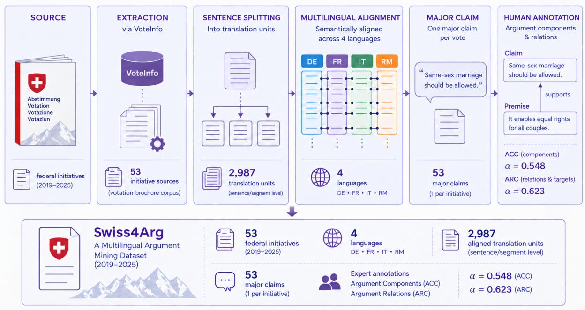  
Figure 1: Creation pipeline of Swiss4Arg. The resulting dataset contains semantically aligned segments in all four languages, together with one major claim per vote and human annotations of argumentative components (ACC) and relations (ARC).

## Abstract

We present Swiss4Arg, a multilingual dataset for argument mining based on official Swiss voting brochures, covering all four national languages: German, French, Italian, and Romansh (a Romance minority language exclusively spoken in Switzerland). The brochures contain explicitly formulated arguments systematically organized into pro and con sections, resulting in a cross-lingually aligned resource with balanced argumentative stance. We create a dataset that comprises 53 federal voting issues collected between 2019 and 2025, annotated for argument components (major claims, claims, premises, and non-argumentative units) and relations (support and attack) by three native speakers per language. Inter-annotator agreement (Krippendorff’s α) reaches 0.548 for component classification and 0.623 for relation and target classification, computed jointly across all annotators on the parallel data. We release both adjudicated labels and individual annota-

tor annotations, enabling analyses of disagreement and cross-linguistic variation, and provide baseline results using GPT-5.4 and SwissBERT. Swiss4Arg establishes a novel benchmark for multilingual argument mining, with a particular focus on cross-lingual comparability and lowresource settings such as Romansh. The dataset and code are publicly available at HuggingFace and GitHub.

## 1 Introduction

Switzerland provides a unique setting for multilingual argument mining (AM). It has four official languages: German, French, Italian, and Romansh, the last being a low-resource language with a small speaker base of ca. 38,000 as of 20241. Switzerland’s system of direct democracy requires that citizens regularly vote on federal issues, for which the government distributes official voting brochures presenting arguments both in favor of and against each proposal. Crucially, these materials are systematically produced in all four languages, resulting in parallel, high-quality texts with explicitly formulated and balanced argumentative content.

Multilingual AM resources remain limited, particularly for settings that combine multiple languages with aligned argumentative structure. Existing datasets are often restricted to a single highresource language (e.g. Stab and Gurevych, 2014b; Abkenar et al., 2025; Wambsganss et al., 2020), leaving multilingual and low-resource AM underexplored.

In this paper, we present Swiss4Arg and make the following contributions:

(i) A multilingual, cross-lingually aligned AM dataset based on Swiss voting brochures, covering all four national languages including Romansh.

(ii) Fine-grained annotations of argument components (major claims, claims, premises, and non-argumentative units) and relations (support and attack).

(iii) Release of both individual annotator labels and adjudicated (majority-vote) annotations, supporting studies of annotation variability and disagreement.

(iv) Baseline results for argument component and relation classification using GPT-5.4 and SwissBERT.

## 2 Related Work

Swiss-languages Datasets. To the best of our knowledge, no AM corpus currently covers all four Swiss national languages. Notable multilingual Swiss resources include SwiLTra-Bench (Niklaus et al., 2025), covering all four languages, while most others focus on the three high-resource languages and exclude Romansh, including X-Stance (Vamvas and Sennrich, 2020), SwissGov-RSD (Wastl et al., 2026), and large-scale MT benchmarks (Deutsch et al., 2025; Andrews et al., 2025). The most closely related resource is VotingBooklets-Diamond and its extension VotingBooklets, also derived from Swiss voting brochures, but focusing on document digitization and alignment rather than argumentative structure (Stüssi and Vamvas, 2026). While these resources provide a strong multilingual foundation, none include annotations for argumentative structure, highlighting a clear gap that Swiss4Arg addresses.

Argument Framework. Argumentation has been studied through a variety of theoretical frameworks, including Toulmin’s (2003) model, Walton and Reed’s (2005) theory of argumentation schemes, and Freeman’s (2011) work on argument structure. While these approaches provide rich representations, they are difficult to operationalize consistently for large-scale corpus annotation. Consequently, most AM datasets adopt a simplified component–relation representation that is more suitable for reliable manual annotation and machine learning.

Following this tradition, we adopt the framework proposed by Stab and Gurevych (2014a), one of the most widely used schemes in argument mining. It represents argumentative structure using three component types (major claim, claim, premise) and two relation types (support, attack). We choose this framework for its balance between expressive power, simplicity, and established use in prior work.

Monolingual Argument Datasets. Monolingual datasets are a core resource for training and evaluating AM systems, but appropriately annotated corpora remain limited, especially outside English (Wambsganss et al., 2020; Lawrence and Reed, 2019; Fishcheva and Kotelnikov, 2019). English remains the best-resourced language, with the persuasive essays corpus as a central benchmark, introduced with 90 and later extended to 402 essays (Stab and Gurevych, 2014b, 2017), alongside the Argumentative Microtexts corpus and its extensions (Abkenar et al., 2025; Savigny and Yun, 2026). Resources for other languages are considerably fewer: German (Wambsganss et al., 2020), Russian (Fishcheva et al., 2021), and recent work on Brazilian Portuguese, Chinese, and Spanish (Pereira et al., 2025; Jahan et al., 2025).

Multilingual Argument Mining. Multilingual AM is motivated by the scarcity of argumentannotated corpora outside English (Eger et al., 2018; Toledo-Ronen et al., 2020; Fishcheva and Kotelnikov, 2019; Nabhani and Khatib, 2025). Research has largely focused on transfer learning, either via data transfer (translating or projecting English annotations) or model transfer (fine-tuning multilingual models). Data transfer consistently outperforms model transfer for fine-grained component extraction, while zero-shot cross-lingual transfer remains less effective for complex span-level tasks (Eger et al., 2018; Yeginbergen and Agerri, 2024; Yeginbergen et al., 2024; Jahan et al., 2025).

## 3 Dataset Creation

Figure 1 illustrates the complete workflow underlying our dataset, from the extraction of official voting brochures to the final adjudicated annotations. We describe each step in detail below.

## 3.1 Data Collection & Preparation

Extracting the Data. Using an API call we extracted 53 federal voting texts spanning from February 2019 to November 2025. A representative excerpt of a voting brochure, illustrating the typical structure of the summary, pro, and con sections, is provided in Appendix A.

For our analysis, we focus on the Why yes (pro) and Why no (con) argument sections, which contain explicitly formulated argumentative content, and extract the short summaries to retain contextual information for each voting question.

Aligning the Data. After sentence splitting the pro and con sections automatically using a regex pattern for Romansh and the NLTK sentence tokenizer (Bird and Loper, 2004) for the other languages, we manually aligned the texts across all four languages using a custom tool based on the alignment tool used in Wastl et al. (2026). That meant combining sentences into segments by performing many-to-one alignment whenever the same content was distributed across a different number of sentences in one or more languages (see Fig. 2). We did not change or split any sentences, but only merged them into larger units. In the aligned data, each unit consistently captured the same semantic content across all languages. This alignment is essential for our cross-lingual experiments, as it guarantees that annotations are directly comparable across languages. On average, resolving these discrepancies required merging 7 sentences per voting text.

Generating Major Claims. In Stab and Gurevych’s (2014a) framework, the major claim is a central component that expresses the author’s overall stance toward the topic. In our dataset, however, the major claim is not explicitly stated but implicitly conveyed through the summary section. To provide an explicit anchor for the argumentative structure, we generate a synthetic major claim for each voting question by condensing the official summary into a single, concise statement that captures the core proposition under debate. The major claims were generated using GPT-5-nano (Singh et al., 2025), with the prompt provided in Appendix C. Major claims were generated only in German, manually reviewed and, if necessary, revised by one of the authors. Twenty generated major claims (37.7%) remained unchanged, while all others received minor revisions, primarily because the generated claims were either too vague or overemphasized less important details. The finalized major claims were subsequently translated into French, Italian, and Romansh using the commercial Swiss translation system Supertext2, which we preferred over general-purpose machine translation tools (e.g. Google Translate, DeepL) as it is specifically optimized for Swiss varieties of German, French, and Italian, and also supports Romansh (see Fig. 3). Generating and validating the claims in a single language ensured that all languages shared the same underlying major claim.

## 3.2 Annotations

Annotators. We recruited three annotators per language, resulting in twelve annotators across the four languages, to perform two annotation tasks:

1. Argument component classification (ACC) into claim, and premise, and non-argumentative

2. Argument relation classification (ARC) into the three classes neutral, support, and attack

Annotators were native speakers of the language they annotated and university students enrolled in, at least, their third semester. They received a flat monetary compensation for their work. No prior annotation or NLP experience was required.

Pre-Annotation Workshop. The full annotation guidelines are available in the project repository at GitHub. They were written in English, with examples in the respective languages. To familiarize annotators with the guidelines and establish a shared understanding of the task, we conducted a onehour online workshop attended by all annotators. The session was held in English to accommodate the multilingual group and covered the annotation scheme, data structure, and use of the annotation tool. The example discussed was an English translation of one voting sheet, allowing all participants to work with the same material regardless of their assigned language. After the workshop, annotators completed an initial batch of annotations, which we reviewed for possible misunderstandings or recurring errors. We provided individual written feedback before full-scale annotation began. The most common comment towards annotators was to carefully distinguish non-argumentative content and claims. This calibration step helped resolve ambiguities early and improved overall consistency.

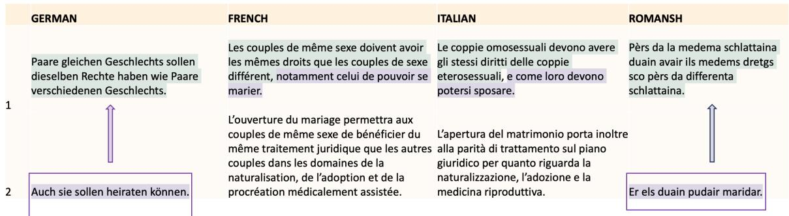  
Figure 2: Example of manual sentence alignment across languages: sentences are merged into segments so tha each unit captures the same semantic content in all four languages (here, the German and Romansh sentences in row 2 are moved up to align with the Italian and French counterparts).

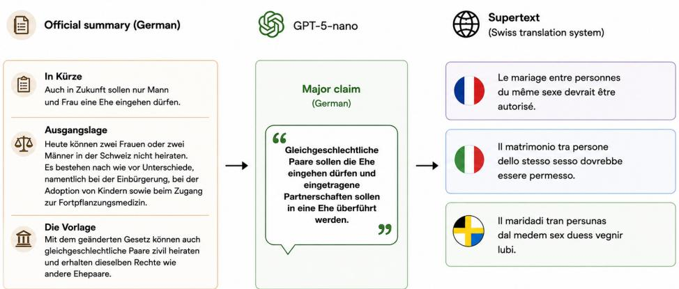  
Figure 3: Illustration of the major claim generation process. The official German summary is condensed into a single synthetic major claim using GPT-5-nano. In this example, the generated German major claim (Same-sex marriage should be allowed) is translated into French, Italian, and Romansh using Supertext.

## 3.3 Annotation & Adjudication

Annotations were collected using a custom HTMLbased annotation tool that we developed specifically for this project3 and that enforced the core structural constraints of the annotation scheme. Because the dataset is parallel, adjudication was conducted jointly across all twelve annotators via majority voting. As shown in Table 1, unanimous agreement was reached for 30.9% of component labels and 67.0% of relation labels, with majority vote resolving a further 66.5% and 31.8% respectively. The remaining 107 ties (2.5% of components, 1.2% of relations) were resolved by a designated adjudicator following the annotation guidelines. We release both the adjudicated labels and the full set of original annotations from all annotators to enable labeling disagreement analyses.

<table><tr><td></td><td colspan="5">Component</td><td colspan="4">Relation</td></tr><tr><td></td><td>Claim</td><td>Premise</td><td>Non-Arg.</td><td>Total</td><td>Percentage</td><td>Support</td><td>Attack</td><td>Total</td><td>Percentage</td></tr><tr><td>Unanimous</td><td>368</td><td>307</td><td>168</td><td>843</td><td>29.3%</td><td>1530</td><td>200</td><td>1730</td><td>67.0%</td></tr><tr><td>Majority</td><td>398</td><td>1435</td><td>129</td><td>1962</td><td>68.1%</td><td>645</td><td>177</td><td>822</td><td>31.8%</td></tr><tr><td>Tie</td><td>22</td><td>53</td><td>1</td><td>76</td><td>2.6%</td><td>21</td><td>10</td><td>31</td><td>1.2%</td></tr><tr><td>Adjudicated</td><td>793</td><td>1789</td><td>298</td><td>2881</td><td></td><td>2196</td><td>386</td><td>2583</td><td></td></tr></table>

Table 1: Annotator agreement per label. The Adjudicated row gives the final label counts after adjudication.

## 4 Dataset Analysis

## 4.1 Stance Distribution

The pro and con sections are of comparable length for each voting question, resulting in a balanced dataset with respect to argumentative stance. Across the 53 texts, there are a total of 1461 segments on the pro side and 1420 segments on the con side (see Fig. 6 in Appendix for the distribution of segments per text).

## 4.2 Annotation Analysis

Inter-Annotator Agreement. Annotation consistency was evaluated using Krippendorff’s (2008) α, which accounts for chance agreement and supports multiple annotators.

Across all 12 annotators, we report α = 0.548 for component classification (claim vs. premise vs non-argumentative, and 0.623 for relation+target (support vs. attack towards a target component) classification which is comparable to Hidey et al.’s (2017) IAA. See Appendix D for agreement within languages.

Pairwise Agreement and Cross-Lingual Consistency. To further investigate annotator agreement, we computed pairwise Krippendorff’s α between all annotator pairs. Because the corpus consists of parallel voting brochures, annotators working in different languages labeled equivalent argumentative content, allowing meaningful cross-language comparisons. Figure 4 presents the resulting agreement matrices.

Component agreement ranges from 0.23 to 0.86 $( M = 0 . 5 8 )$ , while relation agreement ranges from 0.30 to 0.83 (M = 0.62). A striking finding is that cross-lingual agreement between French and German annotators (ranging from 0.63 to 0.74 for components) is largely comparable to withinlanguage agreement, and in some pairs exceeds it. This suggests that the argumentative structure of the brochures is sufficiently explicit and consistent across languages that annotators working independently on different language versions converge on similar labelings.

Italian annotators show a more complex picture. IT-1 exhibits consistently low agreement with all other annotators, including members of the Italian team (as low as 0.23 with FR-3 and 0.27 with FR-2). Romansh presents a different profile: withinlanguage agreement is moderate (0.59–0.70), partly driven by RM-2, who shows weaker agreement with both within and outside of the Romansh team.

Disagreement Patterns. To characterize the nature of disagreements, 7–10 in Appendix E show pairwise confusion matrices for component labels within each language. Across all languages, the dominant source of disagreement is the distinction between claims and premises, a well-documented challenge in AM that often reflects ambiguity between intermediate conclusions and supporting evidence (Stab and Gurevych, 2017). Confusions between argumentative and non-argumentative spans are comparatively rare.

Inspection of the within-language confusion matrices reveals that IT-1 assigns more claim labels compared to the other annotators, with 804 instances labeled claim by IT-1 that IT-3 labeled differently, and 175 instances where IT-1 used claim while IT-3 used premise. This is further reflected in the per-language annotator distributions (see Fig. 11 in Appendix): Italian annotators as a group assign the claim label at a markedly higher rate (42.0%) compared to German (29.4%), French (25.8%), and Romansh (29.4%), while assigning premise at a substantially lower rate (35.8% vs. approximately 55–60% for the other languages). By contrast, IT-3 shows strong cross-lingual agreement with French and German annotators (up to 0.80 with FR-3 in relation+target), suggesting that this divergence is driven primarily by IT-1. For Romansh, RM-2 tends to assigns the claim label more frequently than the other two, with 601 instances labeled claim by RM-2 that RM-3 labeled as premise.

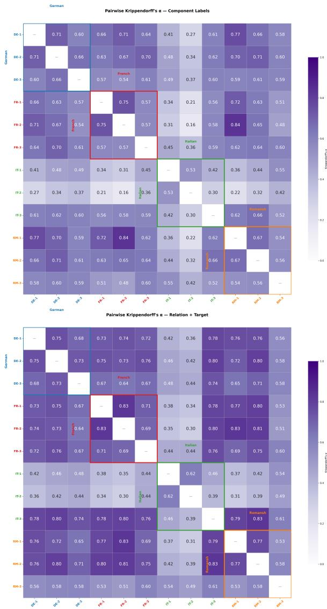  
Figure 4: Pairwise Krippendorff’s α for component (top) and relation+target classification (bottom) across all 12 annotators.

## 4.3 Adjudicated Dataset

Label Distribution. The bottom row of Table 1 presents the distribution of labels in the final adjudicated dataset. As expected from the data, support and attack relations are balanced for claims, but premises overwhelmingly support rather than attack their target claims, as each section argues only for its stance.

Premises constitute the largest category (60.1%), followed by claims (26.4%), consistent with the structure of the brochures in which each subposition is typically supported by multiple pieces of evidence. Non-argumentative units account for 10.0% of all units, corresponding to section headers, procedural sentences, and contextual background. This shows the argumentative density of these texts, which is considerably higher than in other argumentative texts such as essays. The distribution is notably stable across pro and con sections, claims appear at 26.2% (Pro) and 26.6% (Con), and premises at 59.7% (Pro) and 60.5% (Con).

## 5 Baseline Argument Classification

To establish performance benchmarks on our dataset, we evaluate two baseline systems on the argument classification task: a large multilingual language model, GPT-5.4 (Singh et al., 2025), and a domain-adapted Swiss multilingual encoder, Swiss-BERT (Vamvas et al., 2023). Both are evaluated against the majority-vote ground truth described above, on the exact two subtasks performed by annotators: (1) component classification, and (2) relation+target prediction.

## 5.1 GPT-5.4

We query GPT-5.4 in a zero-shot setting using a structured prompt grounded in the theoretical frameworks of Stab and Gurevych (2017) and Peldszus and Stede (2015). The system prompt specifies the component taxonomy and the strict argumentative hierarchy (premise → claim → major\_claim), while the user prompt supplies the document’s major claim and all pre-segmented text units, each identified by a segment\_id, and requests a structured JSON response4 (see Appendix F for the full prompts). Outputs are extracted from the JSON response and normalised to match the annotation schema; a retry mechanism is triggered when fewer than 80% of segments receive a valid annotation. The model is evaluated independently on each of the four languages.

## 5.2 SwissBERT

In addition to querying GPT, we fine-tune Swiss-BERT, a transformer model with language adapters for each of the four Swiss languages, on the two tasks separately. Both tasks are class-imbalanced, so we use inverse-frequency class weighting during training. Given the small number of proposals (53), we use 5-fold cross-validation at the proposal level rather than a single split: proposals are partitioned into 5 folds, and for each fold k, fold k serves as test, fold (k + 1) mod 5 as validation, and the rest as training, so every proposal is tested and validated exactly once. Learning rate and epoch count are tuned by grid search on a single held-out fold, selecting by validation macro-F1, before running the full cross-validation with the chosen hyperparameters5. We report the same scores as for GPT-5.4 in Table 2 and 3 for direct comparison with the GPT model.

Component classification results. Table 2 reports precision, recall, and F1 per class, as well as macro and weighted F1, for each language individually and averaged across languages. GPT-5.4 achieves an overall macro F1 of 0.556 and accuracy of 0.601%, with performance varying moderately across languages (macro F1 ranging from 0.528 for French to 0.582 for Romansh). Notably, Romansh, the lowest-resource language in our corpus, yields the best component classification performance.

SwissBERT fine-tuned on Swiss4Arg is consistently outperforming zero-shot GPT-5.4 with an average Macro F1 of 0.859 and accuracy of 0.866. This once again shows how powerful BERT-family models still are, as already shown by e.g. Bucher and Martini (2024); Zhang et al. (2025) for text classification or Djouvas et al. (2024) for argument strength classification. Furthermore, Swiss-BERT’s performance is comparable across all four languages, Macro F1 being in a small range from 0.853 to 0.866.

Across all languages, performance is highly uneven across classes for the GPT model: Premise is identified most reliably (F1 ≈ 0.71), as it is the dominant class (60.1% of items) and its supporting-evidence function is relatively unambiguous. Claim is substantially harder (F1 ≈ 0.43): the model achieves moderate recall but low precision. This is confirmed by the confusion matrices (see Fig. 12 in Appendix I), which show that roughly 468–515 ground-truth premises are predicted as claims in each language. Non-Argumentative exhibits the inverse pattern: high recall (0.779–0.802) but low precision (0.355–0.435), meaning the model correctly catches most nonargumentative segments but also mislabels a nontrivial number of argumentative ones as such.

In contrast, the per-class results are closer together in the SwissBERT predictions. F1 ranges from 0.774 for claims, to 0.901 and 0.902 for premises and non-argumentative units, respectively. While precision is consistently highest for nonargumentative units, premises are identified with the highest recall. Surprisingly, recall for claims is quite low at 0.70 for all languages.

Relation and target prediction results. We evaluate relation and target prediction jointly as a single label (e.g., Support\_Claim 4) on all segments with argumentative ground truth (i.e., claim or premise), and report results over correctly classified components (correct comp.). Since SwissBERT’s performance is stronger on the component classification, the model classified more instances in this second subtask. Results are reported in Table 3.

For both models, performance on this subtask is substantially lower than for component classification. SwissBERT’s performance remains stable across languages and consistently outperforms GPT, likely due to its language-specific adaptations and training on Swiss language varieties as well as fine-tuning on our dataset. In contrast, zero-shot GPT shows greater variation across languages: performance on French is lowest (macro F1: 0.233), while Italian and Romansh perform comparably and most strongly (macro F1: 0.249 and 0.359– 0.361, respectively).

When restricting evaluation to correctly classified components, macro F1 is at 0.315 and exact match at 0.427 for GPT, and 0.477 and 0.489 respectively for SwissBERT. This isolates the intrinsic difficulty of relation prediction from the compounding effect of component classification errors.

Discussion. The most consistent pattern across all languages and both models is the difficulty of distinguishing claims from premises. For GPT, 29–35% of true claims are predicted as premises, and 26–29% of true premises are predicted as claims. SwissBERT exhibits a similar asymmetry: while roughly 30% of Claims are misclassified as Premises, the reverse confusion is much less frequent (only 4.4% of Premises are predicted as Claims), reflecting the class imbalance in favor of Premises. This mirrors the dominant human disagreement pattern identified in Section 4.2, where Claim–Premise confusion was the most frequent subtype (accounting for 57–70% of all component disagreements across languages).

Both models show strong performance on the non-Argumentative class. For GPT, recall is consistently above 0.779, indicating that nonargumentative segments are reliably detected, although the relatively low precision (0.355–0.435) suggests that some argumentative segments, particularly short or implicit ones, are incorrectly labeled as non-argumentative. SwissBERT, in contrast, identifies non-argumentative segments more reliably overall, with 88.7% correct classifications. Misclassifications of non-argumentative segments are relatively infrequent and predominantly skewed toward the premise class (9.0%), while confusion with claim is rare (2.3%). Conversely, argumentative segments are almost never misclassified as nonargumentative (approximately 1% for both claims and premises).

<table><tr><td></td><td></td><td colspan="4">GPT-5.4</td><td colspan="4">SwissBERT</td></tr><tr><td>Lang.</td><td>Label</td><td>Prec.</td><td>Rec.</td><td>F1</td><td>Macro F1</td><td>Prec.</td><td>Rec.</td><td>F1</td><td>Macro F1</td></tr><tr><td rowspan="3">DE</td><td>Claim</td><td>0.395</td><td>0.447</td><td>0.419</td><td rowspan="3">0.543</td><td>0.871</td><td>0.704</td><td>0.778</td><td rowspan="3">0.866</td></tr><tr><td>Premise</td><td>0.807</td><td>0.614</td><td>0.698</td><td>0.873</td><td>0.942</td><td>0.906</td></tr><tr><td>Non-Arg.</td><td>0.379</td><td>0.792</td><td>0.512</td><td>0.936</td><td>0.889</td><td>0.912</td></tr><tr><td rowspan="3">FR</td><td>Claim</td><td>0.381</td><td>0.423</td><td>0.400</td><td rowspan="3">0.528</td><td>0.865</td><td>0.696</td><td>0.771</td><td rowspan="3">0.856</td></tr><tr><td>Premise</td><td>0.810</td><td>0.604</td><td>0.692</td><td>0.866</td><td>0.932</td><td>0.898</td></tr><tr><td>Non-Arg.</td><td>0.355</td><td>0.795</td><td>0.491</td><td>0.905</td><td>0.893</td><td>0.899</td></tr><tr><td rowspan="3">IT</td><td>Claim</td><td>0.432</td><td>0.478</td><td>0.454</td><td rowspan="3">0.572</td><td>0.870</td><td>0.695</td><td>0.773</td><td rowspan="3">0.853</td></tr><tr><td>Premise</td><td>0.816</td><td>0.647</td><td>0.722</td><td>0.867</td><td>0.936</td><td>0.901</td></tr><tr><td>Non-Arg.</td><td>0.897</td><td>0.876</td><td>0.886</td><td>0.897</td><td>0.876</td><td>0.886</td></tr><tr><td rowspan="3">RM</td><td>Claim</td><td>0.435</td><td>0.496</td><td>0.464</td><td rowspan="3">0.582</td><td>0.864</td><td>0.702</td><td>0.775</td><td rowspan="3">0.862</td></tr><tr><td>Premise</td><td>0.812</td><td>0.655</td><td>0.725</td><td>0.868</td><td>0.936</td><td>0.901</td></tr><tr><td>Non-Arg.</td><td>0.435</td><td>0.779</td><td>0.558</td><td>0.930</td><td>0.889</td><td>0.909</td></tr><tr><td rowspan="3">Overall</td><td>Claim</td><td>0.411</td><td>0.461</td><td>0.434</td><td rowspan="3">0.556</td><td>0.867</td><td>0.699</td><td>0.774</td><td rowspan="3">0.859</td></tr><tr><td>Premise</td><td>0.811</td><td>0.630</td><td>0.709</td><td>0.869</td><td>0.937</td><td>0.901</td></tr><tr><td>Non-Arg.</td><td>0.392</td><td>0.792</td><td>0.524</td><td>0.917</td><td>0.887</td><td>0.902</td></tr></table>

Table 2: Component classification results per language and overall for GPT-5.4 and SwissBERT. Precision, Recall, F1 = per-class F1, and Macro F1 reported per language.

<table><tr><td></td><td colspan="3">GPT-5.4</td><td colspan="3">SwissBERT</td></tr><tr><td>Lang.</td><td>N</td><td>EM</td><td>F1</td><td>N</td><td>EM</td><td>F1</td></tr><tr><td>DE</td><td>1455</td><td>0.40</td><td>0.30</td><td>2244</td><td>0.51</td><td>0.59</td></tr><tr><td>FR</td><td>1417</td><td>0.34</td><td>0.23</td><td>2220</td><td>0.48</td><td>0.47</td></tr><tr><td>IT</td><td>1538</td><td>0.47</td><td>0.36</td><td>2226</td><td>0.48</td><td>0.47</td></tr><tr><td>RM</td><td>1567</td><td>0.49</td><td>0.36</td><td>2232</td><td>0.49</td><td>0.48</td></tr><tr><td>Overall</td><td>5977</td><td>0.43</td><td>0.32</td><td>8922</td><td>0.489</td><td>0.477</td></tr></table>

Table 3: GPT 5.4 and SwissBERT relation and target prediction results evaluated only on units where the component label was correctly predicted. EM = exact match on the joint relation+target label. F1 = Macro F1 Score.

The relation+target task remains an open challenge even under oracle component labels, that is, only evaluating relation+target labels if the component prediction is correct, (exact match ≤ 0.485), highlighting that identifying the correct direction of argumentation and the precise target segment requires a deeper understanding of document structure than GPT-5.4 currently exhibits in a zero-shot setting. Despite SwissBERT’s stronger component classification performance, it faces similar difficulties in this subtask, suggesting that relation prediction constitutes a distinct challenge beyond component identification.

## 6 Conclusion

We presented Swiss4Arg, a multilingual, highquality argument mining dataset based on Swiss federal voting brochures, covering all four national languages including Romansh, a low-resource language underrepresented in NLP. Beyond introducing a new benchmark, the dataset provides a testbed for studying multilingual argument mining in parallel documents. Our analyses demonstrate both the potential and the remaining challenges of multilingual argument mining. While annotation agreement is largely consistent across languages, distinguishing claims from premises and predicting argument relations remain difficult for both human annotators and strong baseline models. We hope that Swiss4Arg will foster future work on multilingual and low-resource AM, as well as on more robust cross-lingual modeling approaches.

## Limitations

Although Swiss4Arg covers all four national Swiss languages, we were limited to three annotators per language. Recruiting qualified native annotators for Romansh is particularly challenging due to its small speaker community. Therefore, assembling larger annotation pools is difficult. A higher number of annotators would likely yield a more robust gold standard, especially for borderline cases requiring adjudication but would be time-consuming and costly.

The dataset comprises 53 federal voting issues, constrained by the availability of structured digital brochures through the VoteInfo API.

Finally, our experimental evaluation is limited to zero-shot prompting with GPT-5.4 and monolingual supervised baselines. We do not investigate few-shot prompting or cross-lingual transfer, despite the parallel structure of Swiss4Arg making such experiments an avenue for future work.

## References

Mohammad Yeghaneh Abkenar, Weixing Wang, Hendrik Graupner, and Manfred Stede. 2025. Assessing open-weight large language models on argumentation mining subtasks. In Proceedings of the 10th edition ofthe Swiss Text Analytics Conference, pages 11–24.

Pierre Andrews, Mikel Artetxe, Mariano Coria Meglioli, Marta R. Costa-jussà, Joe Chuang, David Dale, Mark Duppenthaler, Nathanial Paul Ekberg, Cynthia Gao, Daniel Edward Licht, Jean Maillard, Alexandre Mourachko, Christophe Ropers, Safiyyah Saleem, Eduardo Sánchez, Ioannis Tsiamas, Arina Turkatenko, Albert Ventayol-Boada, and Shireen Yates. 2025. BOUQuET : dataset, benchmark and open initiative for universal quality evaluation in translation. In Proceedings ofthe 2025 Conference on Empirical Methods in Natural Language Processing, pages 27515–27535, Suzhou, China. Association for Computational Linguistics.

Steven Bird and Edward Loper. 2004. NLTK: The natural language toolkit. In Proceedings of the ACL Interactive Poster and Demonstration Sessions, pages 214–217, Barcelona, Spain. Association for Computational Linguistics.

Martin Juan José Bucher and Marco Martini. 2024. Fine-tuned’small’llms (still) significantly outperform zero-shot generative ai models in text classification. arXiv preprint arXiv:2406.08660.

Daniel Deutsch, Eleftheria Briakou, Isaac Rayburn Caswell, Mara Finkelstein, Rebecca Galor, Juraj Juraska, Geza Kovacs, Alison Lui, Ricardo Rei, Jason Riesa, Shruti Rijhwani, Parker Riley, Elizabeth Salesky, Firas Trabelsi, Stephanie Winkler, Biao Zhang, and Markus Freitag. 2025. WMT24++: Expanding the language coverage of WMT24 to 55

languages & dialects. In Findings of the Associationfor Computational Linguistics: ACL 2025, pages 12257–12284, Vienna, Austria. Association for Computational Linguistics.

Constantinos Djouvas, Antonis Charalampous, Christos J Christodoulou, and Nicolas Tsapatsoulis. 2024. Llms are not for everything: A dataset and comparative study on argument strength classification. In Proceedings of the 28th Pan-Hellenic Conference on Progress in Computing and Informatics, pages 437–443.

Steffen Eger, Johannes Daxenberger, Christian Stab, and Iryna Gurevych. 2018. Cross-lingual argumentation mining: Machine translation (and a bit of projection) is all you need! In Proceedings of the 27th International Conference on Computational Linguistics, pages 831–844, Santa Fe, New Mexico, USA. Association for Computational Linguistics.

Irina Fishcheva, Valeriya Goloviznina, and Evgeny Kotelnikov. 2021. Traditional machine learning and deep learning models for argumentation mining in russian texts. arXiv preprint arXiv:2106.14438.

Irina Fishcheva and Evgeny Kotelnikov. 2019. Crosslingual argumentation mining for russian texts. In International Conference on Analysis ofImages, Social Networks and Texts, pages 134–144. Springer.

James B Freeman. 2011. Dialectics and the macrostructure of arguments: A theory of argument structure, volume 10. Walter de Gruyter.

Christopher Hidey, Elena Musi, Alyssa Hwang, Smaranda Muresan, and Kathy McKeown. 2017. Analyzing the semantic types of claims and premises in an online persuasive forum. In Proceedings of the 4th Workshop on Argument Mining, pages 11–21, Copenhagen, Denmark. Association for Computational Linguistics.

Ali Jahan, Masood Ghayoomi, and Annette Hautli-Janisz. 2025. Winning with less for low resource languages: Advantage of cross-lingual english\_persian argument mining model over llm augmentation. arXiv preprint arXiv:2511.20872.

Klaus Krippendorff. 2008. Systematic and random disagreement and the reliability of nominal data. Communication Methods and Measures, 2(4):323–338.

John Lawrence and Chris Reed. 2019. Argument mining: A survey. Computational Linguistics, 45(4):765– 818.

Sara Nabhani and Khalid Al Khatib. 2025. Transfer or translate? argument mining in Arabic with no native annotations. In Proceedings of The Third Arabic Natural Language Processing Conference, pages 407– 416, Suzhou, China. Association for Computational Linguistics.

Joel Niklaus, Jakob Merane, Luka Nenadic, Sina Ahmadi, Yingqiang Gao, Cyrill A. H. Chevalley, Claude Humbel, Christophe Gösken, Lorenzo Tanzi, Thomas Lüthi, Stefan Palombo, Spencer Poff, Boling Yang, Nan Wu, Matthew Guillod, Robin Mamié, Daniel Brunner, Julio Pereyra, and Niko Grupen. 2025. SwiLTra-bench: The Swiss legal translation benchmark. In Proceedings of the 63rd Annual Meeting of the Associationfor Computational Linguistics (Volume 1: Long Papers), pages 14894–14916, Vienna, Austria. Association for Computational Linguistics.

Andreas Peldszus and Manfred Stede. 2015. Joint prediction of claim and argument structures. In Proceedings of the 53rd Annual Meeting of the ACL, pages 978–987.

David Eduardo Pereira, Daniela Thuaslar Simão Gomes, and Claudio EC Campelo. 2025. Evaluating llms on argument mining tasks in brazilian portuguese debate data. Journal of the Brazilian Computer Society, 31(1):1279–1299.

Henri Savigny and Bruno Yun. 2026. Amelia: A family of multi-task end-to-end language models for argumentation. Argument & Computation, 17(1):79–103.

Aaditya Singh, Adam Fry, Adam Perelman, Adam Tart, Adi Ganesh, Ahmed El-Kishky, Aidan McLaughlin, Aiden Low, AJ Ostrow, Akhila Ananthram, and 1 others. 2025. Openai gpt-5 system card. arXiv preprint arXiv:2601.03267.

Christian Stab and Iryna Gurevych. 2014a. Annotating argument components and relations in persuasive essays. In Proceedings of COLING 2014, the 25th International Conference on Computational Linguistics: Technical Papers, pages 1501–1510, Dublin, Ireland. Dublin City University and Association for Computational Linguistics.

Christian Stab and Iryna Gurevych. 2014b. Identifying argumentative discourse structures in persuasive essays. In Proceedings of the 2014 Conference on Empirical Methods in Natural Language Processing (EMNLP), pages 46–56, Doha, Qatar. Association for Computational Linguistics.

Christian Stab and Iryna Gurevych. 2017. Parsing Argumentation Structures in Persuasive Essays. Computational Linguistics, 43(3):619–659.

Elina Stüssi and Jannis Vamvas. 2026. How good is AI on Swiss voting booklets? a multilingual OCR and alignment benchmark. In Proceedings of the 11th Edition ofthe Swiss Text Analytics Conference, pages 232–242, Zurich, Switzerland. Association for Computational Linguistics.

Orith Toledo-Ronen, Matan Orbach, Yonatan Bilu, Artem Spector, and Noam Slonim. 2020. Multilingual argument mining: Datasets and analysis. In Findings of the Association for Computational Linguistics: EMNLP 2020, pages 303–317, Online. Association for Computational Linguistics.

Stephen E Toulmin. 2003. The uses ofargument. Cambridge university press.

Jannis Vamvas, Johannes Graën, and Rico Sennrich. 2023. SwissBERT: The multilingual language model for Switzerland. In Proceedings of the 8th edition ofthe Swiss Text Analytics Conference, pages 54–69, Neuchatel, Switzerland. Association for Computational Linguistics.

Jannis Vamvas and Rico Sennrich. 2020. X-Stance: A multilingual multi-target dataset for stance detection. In Proceedings ofthe 5th Swiss Text Analytics Conference (SwissText) & 16th Conference on Natural Language Processing (KONVENS), Zurich, Switzerland.

Douglas Walton and Chris A Reed. 2005. Argumentation schemes and enthymemes. Synthese, 145(3):339–370.

Thiemo Wambsganss, Christina Niklaus, Matthias Söllner, Siegfried Handschuh, and Jan Marco Leimeister. 2020. A corpus for argumentative writing support in German. In Proceedings ofthe 28th International Conference on Computational Linguistics, pages 856– 869, Barcelona, Spain (Online). International Committee on Computational Linguistics.

Michelle Wastl, Jannis Vamvas, and Rico Sennrich. 2026. SwissGov-RSD: A human-annotated, crosslingual benchmark for token-level recognition of semantic differences between related documents. In Proceedings of the 64th Annual Meeting of the Associationfor Computational Linguistics (Volume 1: Long Papers), pages 31134–31163, San Diego, California, United States. Association for Computational Linguistics.

Anar Yeginbergen and Rodrigo Agerri. 2024. Crosslingual argument mining in the medical domain. Procesamiento del lenguaje natural, 73:296–312.

Anar Yeginbergen, Maite Oronoz, and Rodrigo Agerri. 2024. Argument Mining in Data Scarce Settings: Cross-lingual Transfer and Few-shot Techniques. In Proceedings of the 62nd Annual Meeting of the Association for Computational Linguistics (Volume 1: Long Papers), pages 11687–11699, Bangkok, Thailand. Association for Computational Linguistics.

Junyan Zhang, Yiming Huang, Shuliang Liu, Yubo Gao, and Xuming Hu. 2025. Do BERT-like bidirectional models still perform better on text classification in the era of LLMs? In Findings of the Association for Computational Linguistics: EMNLP 2025, pages 18980–18989, Suzhou, China. Association for Computational Linguistics.

## A Example Text (German)

## Ehe für alle Vorlage vom 26. September 2021

Ausgangslage Heute können zwei Frauen oder zwei Männer in der Schweiz nicht heiraten. Sie haben lediglich die Möglichkeit, eine eingetragene Partnerschaft einzugehen. Diese wurde zwar in den letzten Jahren in einzelnen Punkten der Ehe rechtlich angenähert. Es bestehen aber nach wie vor Unterschiede, namentlich bei der Einbürgerung, bei der Adoption von Kindern sowie beim Zugang zur Fortpflanzungsmedizin. Bundesrat und Parlament wollen diese Ungleichheiten beseitigen und die Ehe für alle Paare öffnen. Dagegen wurde das Referendum ergriffen: Auch in Zukunft sollen nur Mann und Frau eine Ehe eingehen dürfen.

Die Vorlage   
Mit dem geänderten Gesetz können   
auch gleichgeschlechtliche Paare zivil heiraten. Sie werden anderen Ehepaaren damit institutionell, aber auch rechtlich gleichgestellt. So können der ausländische Ehemann eines Schweizers sowie die ausländische Ehefrau einer Schweizerin sich erleichtert einbürgern lassen. Gleichgeschlechtliche Ehepaare können zudem gemeinsam ein Kind adoptieren Ausserdem erhalten verheiratete Frauenpaare Zugang zur gesetzlich geregelten Samenspende. Eingetragene Partnerschaften können in eine Ehe umge wandelt, jedoch nicht mehr neu eingegangen werden.

## Im Detail Warum Nein Warum Ja

## Argumente Referendumskomitees

Die «Ehe für alle» inklusive Samenspende für lesbische Paare führt zu gesetzlich vorgesehener Vaterlosigkeit und Identitätsproblemen für die betroffenen Kinder. Ehe und Familie sind eng miteinander verknüpft, da Kinder auf natürliche Weise nur aus einer Verbindung von Mann und Frau entstehen. Drei verschiedene Komitees mit Parlamentariern aus CVP/Die Mitte. EDU EVP und SVP haben deshalb das Referendum ergriffen.

Keine Diskriminierung   
Das «Privileg» der Ehe zwischen Mann und Frau gründet u. a. auf biologischen Fakten. Das ist keine Diskriminierung Das Gleichheitsgebot besagt, dass Glei ches gleich und Ungleiches ungleich zu behandeln ist. Die Ehe neu zu   
definieren, wäre zudem unverhältnismässig: Im Jahr 2020 wurde in der   
Schweiz 35 160-mal geheiratet, aber nur 651-mal eine eingetragene Partner  
schaft eingegangen.

## Verfassungswidrige Samenspende-Ausweitung

Das vorliegende Gesetz erlaubt darüber hinaus – entgegen der ursprünglichen Absicht des Bundesrates – die Samenspende für lesbische Paare. Damit verstösst die «Ehe für alle» gegen Artikel 119 der Bundesverfassung, Dieser erlaubt näm-lich die medizinisch unterstützte Fortpflanzung auch heterosexu ellen Paaren nur bei Unfruchtbarkeit oder der Gefahr einer schweren Krank heit. Lesbische Paare als unfruchtbar einzustufen, widerspricht dabei allen gültigen Definitionen.

Kindeswohl bleibt auf der Strecke Die Samenspende wird vom medizinischen Ausnahmefall zum gesetzlichen Regelfall– ohne Rücksicht auf die Konseguenzen für die Kinder. Das Recht, sei ne beiden biologischen Eltern zu kenner und von ihnen betreut zu werden, bleibt den Kindern bis zum 18. Lebensjahr grundsätzlich verwehrt. Dabei ist die Verwurzelung in der Ursprungsfamilie für die kindliche Identitätsbildung zen: tral. Die Samenspende soll darum die Ausnahme bleiben, Kinder brauchen Vorbilder von beiden Geschlechtern - die Samenspende für lesbische Paare verwehrt ihnen jedoch per Gesetz den Vater.

Leihmutterschaft als Nächstes? Indem «Unfruchtbarkeit» in der Gesetzesvorlage verfassungswidria in «unerfüllten Kinderwunsch» umgedeutet wird, können sich künftig auch weitere Gruppen (Alleinstehende, schwule Paare) auf ihren unerfüllten Kinderwunsch berufen. Bald dürften Forderungen nach der Eizellenspende und der ethisch fragwürdigen Leihmutterschaft folgen.

## Argumente Bundesrat und Parlament

Paare gleichen Geschlechts sollen dieselben Rechte haben wie Paare ver schiedenen Geschlechts. Auch sie sollen heiraten können. Die Öffnung der Ehe führt ausserdem zu einer rechtlichen Gleichbehandlung bei der Einbürgerung, der Adoption und der Fortpflanzungsmedizin. Für die Ehe zwischen Frau und Mann ändert sich nichts. Bundesrat und Parlament befürworten die Vorlage insbesondere aus den folgenden Gründen:

Individuelle Freiheiten   
Der Staat soll den Menschen nicht vorschreiben, wie sie ihr Privat- und Famili enleben zu gestalten haben. Ob und wie ein Paar seine Partnerschaft rechtlich regeln will, soll ihm freigestellt werden. Bereits heute bilden gleichgeschlechtli che Paare mit oder ohne Kinder Lebensgemeinschaften. Hingegen können sie heute nicht heiraten, sondern lediglich eine eingetragene Partnerschaft einge hen. Diese ist der Ehe nicht in allen Be reichen gleichgestellt. Die Öffnung der Ehe beseitigt diese Ungleichbehandlung. Niemandem entsteht dadurch ein Nachteil.

Recht auf Kenntnis der Abstammung Die Verfassung hält fest, dass jede Person Anrecht auf Kenntnis ihrer Abstammung hat. Weil das Gesetz die Samenspende in der Schweiz nur für verheira tete Paare zulässt, entscheiden sich heute manche Frauenpaare für eine Samenspende im Ausland. Dort ist nicht immer gewährleistet, dass das Kind erfahren kann, wer sein biologischer Vater ist. Mit der Öffnung der Ehe und dem Zugang zur streng regulierten Samenspende in der Schweiz bleibt das Recht auf Kenntnis der Abstammung gewahrt.

Verfassung erlaubt Ehe für alle Für Bundesrat und Parlament gibt es keinen Grund, warum gleichgeschlechtliche Paare nicht heiraten dürfen sollen. Für die Öffnung der Ehe braucht es keine Verfassungsänderung. Die Verfassung definiert die Ehe nicht als Verbindung zwischen Frau und Mann.

Figure 5: Example text from VoteInfo App. More examples and the texts in the other three languages can be found there or at https://www.bk.admin.ch/de/sammlung-der-abstimmungsbuechlein-seit-1978

## B Distribution of Pro & Con sections in the Brochures

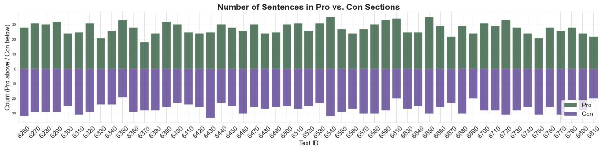  
Figure 6: Distribution of pro and con spans by text. Numbers on the x-axis correspond to text ids as assigned in the database behind VoteInfo.

## C Major Claim Generation Prompt

SYSTEM\_PROMPT = You are an assistant specialized in summarizing political and legal texts. USER\_PROMPT\_TEMPLATE = {text}

State the core claim of the initiative as a single, neutral, normative sentence in German.

The sentence must: - express a proposal that can be voted for or against - use prescriptive language with "soll" or similar wording - state what ought to be changed by the initiative - contain no introductory phrases or references to the initiative - contain no arguments, explanations, or additional details

Return ONLY valid JSON with exactly this structure: ”major\_claim": ”..."

## D Disagreement within languages

Table 4 breaks down the frequency of withinlanguage disagreements, reflecting annotation difficulty per language independently of the crosslingual adjudication process. Italian shows the highest rate of internal disagreement, while French and Romansh are the most internally consistent.

<table><tr><td>Language</td><td>2-vs-1</td><td>3-way</td><td>% Majority</td></tr><tr><td>French</td><td>811</td><td>31</td><td>96.3%</td></tr><tr><td>German</td><td>769</td><td>52</td><td>93.7%</td></tr><tr><td>Italian</td><td>1387</td><td>131</td><td>91.4%</td></tr><tr><td>Romansh</td><td>943</td><td>44</td><td>95.5%</td></tr><tr><td>Overall</td><td>3910</td><td>258</td><td>93.8%</td></tr></table>

Table 4: Within-language disagreement types per language team. 2-vs-1: two annotators agree, one disagrees. 3-way: all three annotators assign different labels. The % Majority column reflects the proportion of withinlanguage disagreements resolvable by majority vote and serves as a proxy for annotation difficulty per language.

Table 5 summarizes the resulting agreement scores. French and German achieve the highest reliability, approaching or exceeding the commonly accepted threshold of $\alpha = 0 . 6 7$ for both annotation tasks. Agreement is lower for Romansh, particularly for relation annotation, while Italian exhibits substantially lower agreement on both dimensions, driven by one annotator whose annotations diverge from those of both teammates.

<table><tr><td>Language</td><td>Component</td><td>Rel.+Target</td></tr><tr><td>French</td><td>0.662</td><td>0.693</td></tr><tr><td>German</td><td>0.685</td><td>0.678</td></tr><tr><td>Romansh</td><td>0.624</td><td>0.581</td></tr><tr><td>Italian</td><td>0.463</td><td>0.371</td></tr></table>

Table 5: Pooled Krippendorff’s α per language for component and relation+target annotation.

CIaim

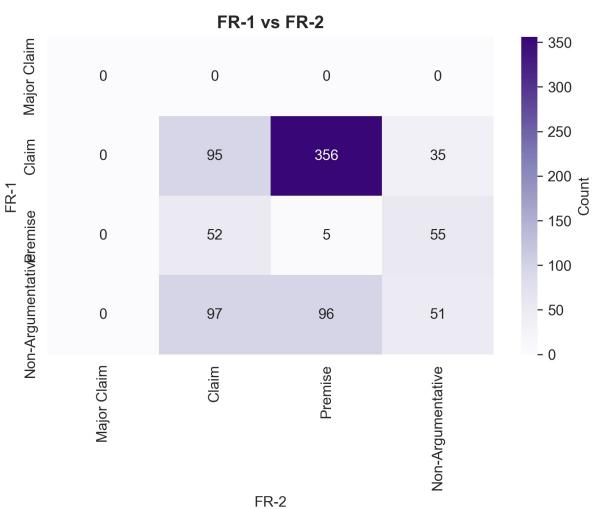

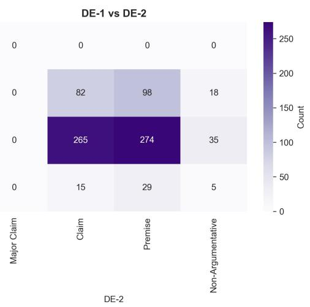

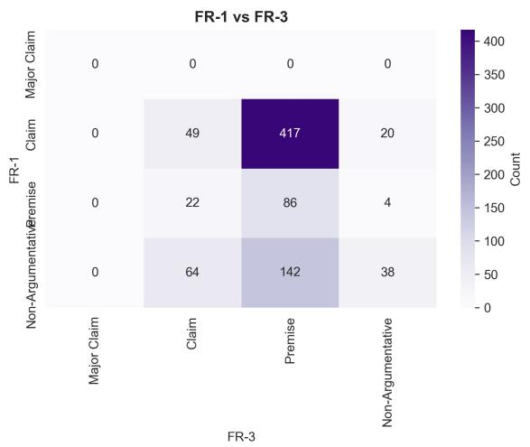

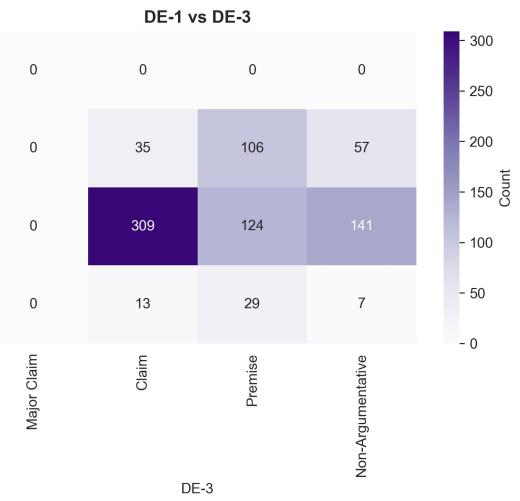

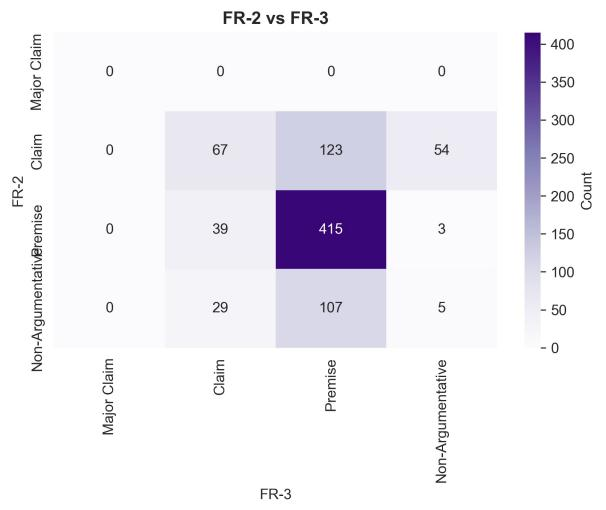  
Figure 7: Pairwise confusion matrices for component labels within the French annotation team.

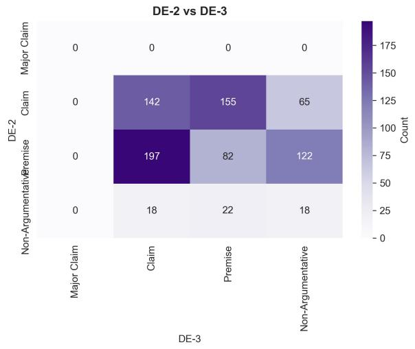  
Figure 8: Pairwise confusion matrices for component labels within the German annotation team.

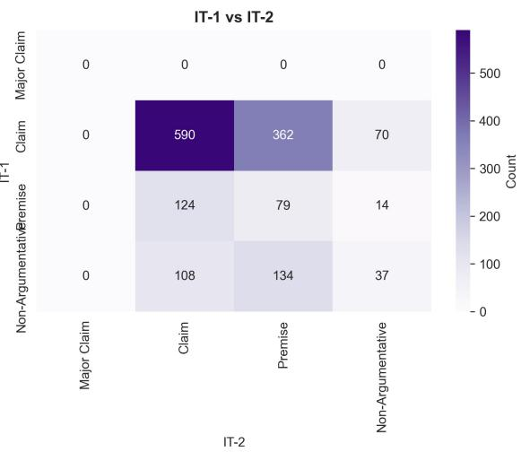

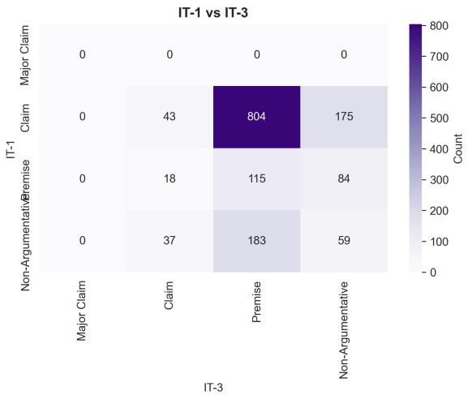

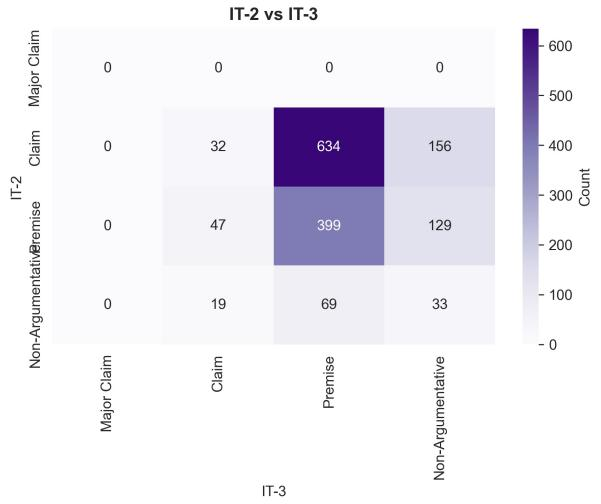  
Figure 9: Pairwise confusion matrices for component labels within the Italian annotation team.

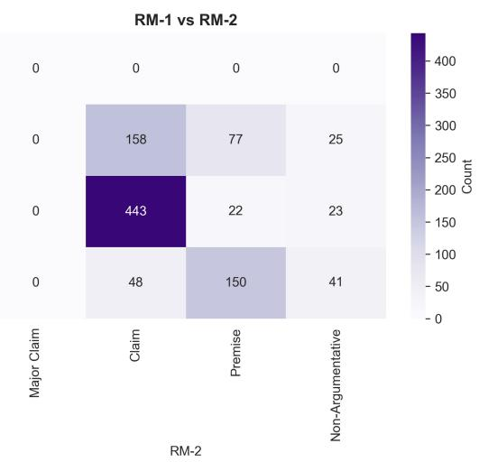

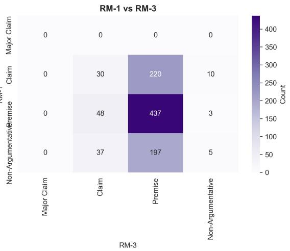

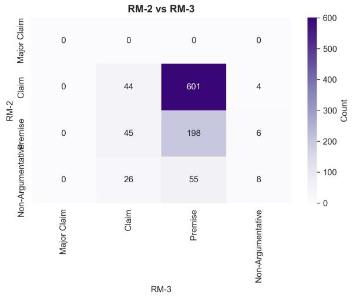  
Figure 10: Pairwise confusion matrices for component labels within the Romansh annotation team.

## F GPT-5.4 Annotation Prompts

## SYSTEM PROMPT

You are an expert in computational argumentation and argumentation mining, trained in the theoretical frameworks of Stab & Gurvych (2017) and Peldszus & Stede (2016). You are specialized in annotating Swiss federal vote brochures for argumentation structure in {language}. These brochures are official documents presenting PRO and CON arguments for political initiatives.

Your task is to label each text segment with a component type and, where applicable, a relation and target.

## Theoretical Framework

Following Stab & Gurevych (2017), argumentative discourse consists of:

## Component Types

• major\_claim – The central thesis of the entire brochure. One per document. This is already provided. Relate all “claims” to it. Do not annotate anything else as major\_claim.

• claim – A debatable sub-position that directly supports or attacks the major claim. States an opinion or evaluation, provides no evidence on its own.

• premise – A reason, fact, or evidence that supports or attacks a specific claim. Contains data, statistics, examples, consequences, or law references. Tip: if the segment contains a number, a named example, or a statistic, it is almost certainly a premise.

• non-argumentative – Background, procedural text, structural headers, or neutral descriptions. This includes colon-ending introductions, and sentences describing the legal situation without taking a position.

## Relations

Every claim and every premise must have exactly one relation and one target:

• claim → supports OR attacks → major\_claim

• premise → supports OR attacks → [specific claim by segment\_id]

Non-argumentative segments and the major claim have no relation and no target.

• supports: the unit reinforces, justifies, or provides evidence for its target.

• attacks: the unit contradicts, undermines, or opposes its target.

## Strict Structural Rules

• Claims NEVER point to other claims

• Premises NEVER point to the major claim directly

• Premises NEVER point to other premises

• The hierarchy is always: premise → claim → major\_claim

## USER PROMPT TEMPLATE

Annotate every segment below. This is the major claim you should relate all claims to.

MAJOR CLAIM (segment\_id: 1): {major\_claim\_text}

SEGMENTS: {segments}

For each segment return exactly:

• segment\_id : integer, from the input

• component : one of claim / premise / nonargumentative

• relation : one of supports / attacks / null

• target : segment\_id as integer, or “major\_claim”, or null

## Rules:

• relation and target must be null for nonargumentative and major\_claim

• claim target must always be “major\_claim” (the string, not a number)

• premise target must be the integer segment\_id of the claim it supports or attacks

• annotate every segment, no skipping

Return only valid JSON, no prose:

{ “annotations": [ {“segment\_id": 2, “component": “claim", “relation": “supports", “target": “major\_claim"}, {“segment\_id": 3, “component": “premise", “relation": “attacks", “target": 2}, {“segment\_id": 4, “component": “nonargumentative", “relation": null, “target": null} ] }

## G SwissBERT Hyperparameters

We tuned the hyperparameters learning rate (1e-05, 2e-05, 5e-05) and number of epochs (3, 5, and 8). We found that for component prediction learning rate = 2e-05 and 8 epochs, and for relation+target prediction learning rate = 5e-05 and 8 epochs yielded the best results. That is, a macro F1 score of 0.87 and 0.48, respectively for the tasks.

## H Component Distribution per Language

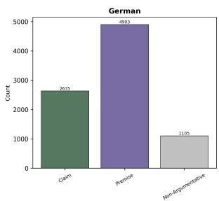

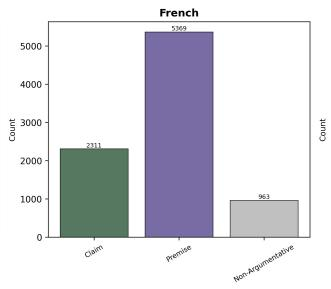

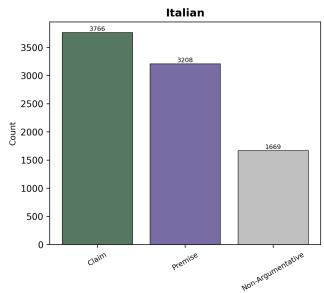

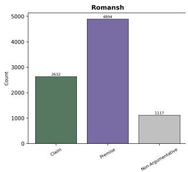  
Figure 11: Component label distribution per language across all individual annotators. Italian annotators assign Claim at a substantially higher rate (42.0%) and Premise at a lower rate (35.8%) compared to the other language teams (Claim: 25.8–29.4%, Premise: 54.6– 59.9%), driven primarily by IT-1.

## I GPT-5.4 Confusion Matrices

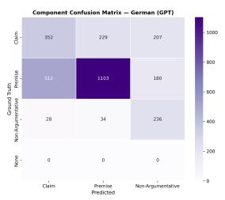

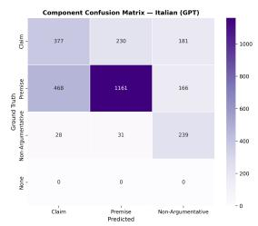

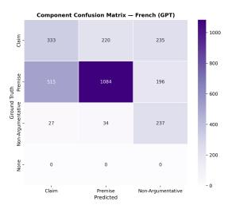

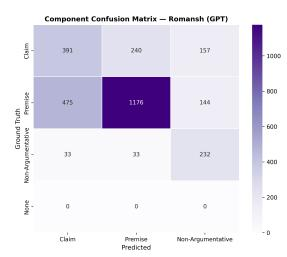  
Figure 12: Component confusion matrices for GPT-5.4 predictions vs. majority-vote ground truth, per language. Rows = ground truth, columns = predicted. Major Claims are excluded.