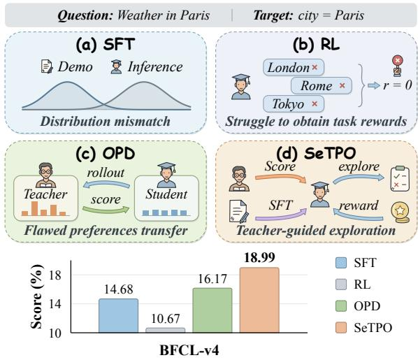
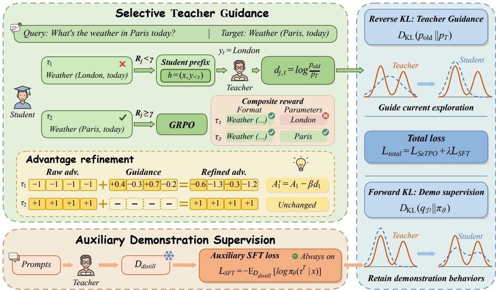
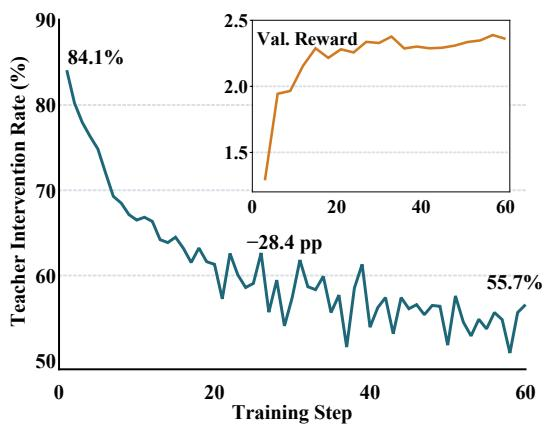
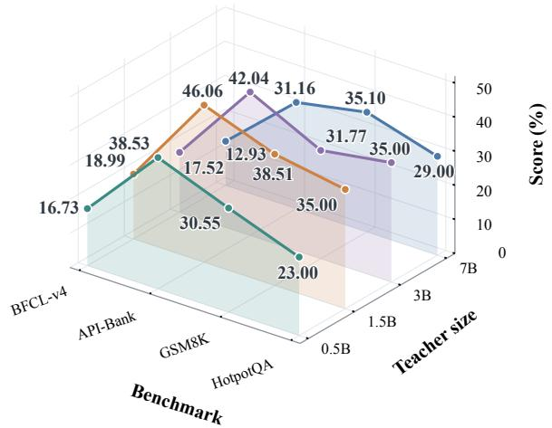
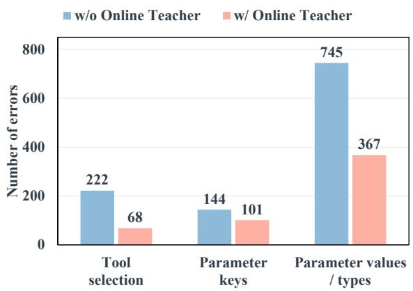
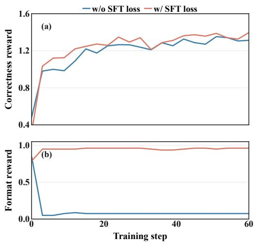

# Teacher-Guided Tool Learning for Small Language Models via Bidirectional KL Constraints

Haoxuan Gao1, Qin-Wen Luo1, Xiang Chen1\*, Yu Tian2 Zequn Sun3, Xiaofeng Cao4, Jiangchao Yao5, Sheng-Jun Huang1 1Nanjing University of Aeronautics and Astronautics 2360 Security Capability Center 3Nanjing University 4Tongji University 5Shanghai Jiao Tong University {haoxuangao0402,xiang\_chen}@nuaa.edu.cn

## Abstract

External tools can extend the capabilities of small language models (SLMs), enabling their deployment in resource-constrained environments. However, their limited capabilities make it difficult for SLMs to discover effective tool-use behaviors through reinforcement learning alone, while direct teacher supervision suffers from teacher–student behavioral distribution mismatch and may propagate erroneous preferences. To address these challenges, we propose Selective Teacher-guided Policy Optimization (SeTPO), which coordinates student exploration with selective teacher guidance and persistent demonstration supervision. Specifically, SeTPO incorporates reverse-KL-derived token-level teacher feedback into policy advantages on low-reward trajectories, while auxiliary forward-KL supervision preserves teacher-demonstrated behaviors throughout training. Under an idealized bidirectional-KL objective, we theoretically establish that the optimal policy achieves expected reward no lower than the teacher’s while retaining a guaranteed fraction of the teacher’s probability mass. Extensive experiments on BFCL-v4 and API-Bank demonstrate that SeTPO achieves superior overall performance over supervised fine-tuning, reinforcement learning, and distillation baselines across all three student scales.

## 1 Introduction

Small language models (SLMs) offer a practical foundation for resource-efficient systems whose capabilities can be extended through external tools (Erdogan et al., 2024; Lin et al., 2025). However, realizing this promise presents a fundamental learning challenge: models with limited underlying capabilities must learn to exploit external resources to accomplish tasks they cannot solve independently. These learning difficulties can prevent SLMs from fully benefiting from external tools. The central question is therefore: how can we unlock the full potential of SLMs in tool-use tasks?

  
Figure 1: Motivation for coordinating supervision in tool learning for small language models. Top: a schematic weather-tool example comparing SFT, GRPO-based RL, the pure OPD baseline used here, and SeTPO. Bottom: BFCL-v4 scores for Qwen2.5-0.5B.

Supervised fine-tuning (SFT) provides an initial foundation through tool-use demonstrations (Liu et al., 2025). However, a mismatch between demonstration-based training and the model’s own generation at inference can limit its effectiveness (Bengio et al., 2015; Agarwal et al., 2024). To reduce this mismatch, reinforcement learning (RL) optimizes the model’s own tool-use attempts using task rewards (Qian et al., 2025). Yet SLMs may struggle to discover successful behaviors, leaving few useful experiences for learning. Recent work on on-policy distillation (OPD) supplies additional learning signals through teacher feedback on student-generated trajectories (Agarwal et al., 2024; Gu et al., 2024). However, teacher-preferred outputs may also be incorrect, and imitation can pass these errors to the student (Agarwal et al., 2024). These limitations, illustrated in Figure 1, raise a more specific question: how can SLMs improve their tool-use capabilities through their own exploration with teacher guidance?

Teacher guidance may not translate into effective learning for SLMs due to teacher–student differences in capacity and behavioral preferences (Gu et al., 2024; Lyu et al., 2025). Simply reproducing teacher preferences therefore does not ensure effective knowledge transfer. This calls for RL to complement teacher guidance with students’ own exploration. On-policy RL supports students own exploration while favoring solutions close to their original behavior distributions (Shenfeld et al., 2026). KL constraints provide a way to incorporate teacher guidance into this exploration. This motivates selective teacher-guided RL that supports learning where autonomous exploration falls short, helping unlock SLMs’ tool-use potential.

Following this principle, we propose Selective Teacher-guided Policy Optimization (SeTPO). First, students explore through RL and receive guidance on low-reward trajectories from a frozen teacher, which scores generated tokens under the students’ own prefixes. This provides reverse-KL guidance for improving students’ own attempts. Second, auxiliary SFT remains active throughout RL, using complete teacher demonstrations to supply behaviors beyond current exploration and maintain the response structure required for tool interaction. This provides forward-KL supervision for retaining teacher-supported behaviors. Under an idealized bidirectional-KL objective, we prove that the optimal policy achieves expected reward no lower than the teacher’s while retaining a minimum fraction of the teacher’s probability mass on any response set.

Our contributions are:

• We identify three obstacles to tool learning in SLMs: distribution mismatch between SFT demonstrations and student-generated attempts, limited successful exploration under RL, and teacher–student differences that hinder knowledge transfer in OPD.

• We propose SeTPO with selective reverse-KL teacher guidance and persistent forward-

KL demonstration supervision. Our idealized bidirectional-KL analysis establishes, at optimality, a lower bound on teacher-behavior retention and expected reward non-degradation relative to the teacher.

• Experiments on BFCL-v4 and API-Bank show that SeTPO improves overall tool-use performance across three student scales. It also reduces tool-selection and argumentconstruction errors and helps maintain stable output formats during training.

## 2 Related Work

SLM Tool Learning. Small language models must learn tool selection, argument construction, and coordinated calls, motivating both supervised demonstrations and autonomous exploration. SFT methods use specialized or verified synthetic demonstrations to teach these behaviors, including multi-turn interactions (Erdogan et al., 2024; Liu et al., 2024; Zhang et al., 2025; Prabhakar et al., 2025). Capacity-aware data generation and name masking further adapt supervision to tool learning (Liu et al., 2025; Lin et al., 2025). RL methods optimize models’ attempts with task-, call-, or step-level rewards that assess calling format, functional correctness, and task contribution (Qian et al., 2025; Yu et al., 2025; Li et al., 2026b), or develop exploration through reasoning without annotated traces and self-play curricula (Zhang et al., 2026b; Acikgoz et al., 2026). Other approaches combine teacher-generated trial-and-correction imitation with interactive RL or refine training data from errors (Gao et al., 2026; Zhang et al., 2026a). These studies mainly improve tool use through demonstration data, reward design, and interactive exploration. We focus on cases where SLMs struggle to learn effectively through autonomous exploration, using teacher guidance to supplement learning signals from their own attempts.

Teacher-Guided Learning. Teacher-guided learning uses complete demonstrations or studentadapted targets and trajectories (Kang et al., 2025; Shing et al., 2025; Tang and Zhao, 2026). On-policy distillation supervises student-generated outputs to reduce the mismatch between teacher references and student histories (Gu et al., 2024; Agarwal et al., 2024). Student-history corrections and divergence-aware feedback (Lyu et al., 2025; Guo et al., 2026; Zhong et al., 2026), together with staged, mixed, or interleaved assistance (Ni et al., 2026; Yan et al., 2025; Ma et al., 2026), further adapt guidance to students’ learning processes. Beyond the content of guidance, when teachers intervene also matters for knowledge transfer. Reward- and failure-based methods selectively distill responses, supply teacher-derived rewards, or route trajectories between reward optimization and feedback-conditioned self-distillation (Xu et al., 2025; Kotoge et al., 2026; Li et al., 2026a). At the group level, DyME and RSTG trigger demonstration learning or adaptive guidance when all sampled responses fail (Liu et al., 2026; Han et al., 2026). These studies promote knowledge transfer by adapting supervision and guidance allocation to students’ learning. SeTPO selectively provides teacher guidance based on student task performance and combines online feedback with demonstration supervision to support knowledge transfer and autonomous exploration.

## 3 Preliminaries

## 3.1 Tool-Use Tasks and Feedback

Given a request and tool descriptions x, an SLM with policy $\pi _ { \theta }$ generates a trajectory $y =$ $( y _ { 1 } , \dots , y _ { T } )$ of reasoning, structured tool calls, and responses. A tool call must identify an appropriate function and specify arguments consistent with its interface and the user’s request. Each token depends on x and its prefix $y _ { < t } = \left( y _ { 1 } , \ldots , y _ { t - 1 } \right)$

A deterministic Composite Checker evaluates each completed trajectory $y _ { j }$ using

$$
R _ { j } = R _ { \mathrm { f o r m a t } } + R _ { \mathrm { c o r r e c t } } .\tag{1}
$$

The format component checks response structure, while correctness compares tool names, argument names, and argument values against reference calls. This scalar reward credits partially correct calls but provides no token-level correction targets.

## 3.2 Group Relative Policy Optimization

Group Relative Policy Optimization (GRPO) (Shao et al., 2024) samples G trajectories $\{ y _ { j } \} _ { j = 1 } ^ { G }$ from the behavior policy $\pi _ { \theta _ { \mathrm { o l d } } }$ for each input $x ,$ and computes group-relative advantages from rewards $R _ { j }$

$$
A _ { j } = \frac { R _ { j } - \mathrm { m e a n } ( \{ R _ { 1 } , . . . , R _ { G } \} ) } { \mathrm { s t d } ( \{ R _ { 1 } , . . . , R _ { G } \} ) + \epsilon _ { A } } ,\tag{2}
$$

where ϵA ensures numerical stability. Aboveaverage rewards yield positive advantages, while below-average rewards yield negative ones. When a group’s attempts receive the same low reward, their task advantages are zero, providing no taskdriven update direction for improving tool selection or argument construction in subsequent attempts.

For a generated token $y _ { j , t } ,$ the policy ratio is

$$
\rho _ { j , t } ( \theta ) = \frac { \pi _ { \theta } ( y _ { j , t } \mid x , y _ { j , < t } ) } { \pi _ { \theta _ { \mathrm { o l d } } } ( y _ { j , t } \mid x , y _ { j , < t } ) } .\tag{3}
$$

With $\bar { \rho } _ { j , t } = \mathrm { c l i p } ( \rho _ { j , t } , 1 - \epsilon , 1 + \epsilon )$ , the clipped GRPO loss is

$$
\begin{array} { r } { \mathcal { L } _ { \mathrm { G R P O } } ( \theta ) = - \mathbb { E } _ { j , t } \big [ \operatorname* { m i n } \big ( \quad } \\ { \rho _ { j , t } ( \theta ) A _ { j } , \bar { \rho } _ { j , t } ( \theta ) A _ { j } \big ) \big ] . } \end{array}\tag{4}
$$

Here, ϵ is the clipping parameter, and the expectation averages over valid student-generated token positions. Tokens share their trajectory’s task advantage. This provides a trajectory-level learning signal without explicit correction targets for individual tool-selection or argument-construction decisions within the sampled trajectory.

## 4 Method

## 4.1 Overview

Selective Teacher-guided Policy Optimization (SeTPO) helps SLMs acquire tool-use capabilities that are difficult to learn through autonomous exploration. As shown in Figure 2, it combines online teacher guidance on low-reward student attempts with complete teacher demonstrations throughout RL. Online guidance addresses decisions made during exploration, while demonstration supervision provides complete reference behaviors that may be absent from student rollouts.

## 4.2 Selective Teacher-guided Policy Optimization

Selective Teacher Guidance. RL allows students to improve through their own tool-use attempts, but unsuccessful exploration may provide limited information about how to revise individual decisions. We therefore focus online teacher guidance on lowreward attempts that require additional learning signals, while preserving task-driven online updates for higher-reward attempts whose behavior is already supported by task outcomes. For a student trajectory $y _ { j }$ with reward $R _ { j }$ , we define the intervention indicator as

$$
\mathbb { I } _ { j } = \mathbb { I } [ R _ { j } < \gamma ] ,\tag{5}
$$

  
Figure 2: Overview of SeTPO. Selective online teacher guidance and auxiliary supervision from complete teacher trajectories jointly support policy optimization. A composite checker selects low-reward student trajectories for teacher scoring; token-wise log-probability discrepancies refine their GRPO advantages. Both probabilities are evaluated for the same sampled token under the student’s prefix.

where $\gamma$ is the intervention threshold. The gate is evaluated separately for each trajectory, so attempts within the same rollout group can receive different guidance according to their individual outcomes. The same prompt can therefore receive different guidance as the student’s sampled attempts change. For selected trajectories, the frozen teacher evaluates generated tokens under the student’s own prefix $h _ { j , t } = \left( x , y _ { j , < t } \right)$ . Teacher feedback therefore addresses the student’s actual decision context while the student generates its own attempts.

Teacher-Guided Policy Updates. At the studentgenerated prefix $h _ { j , t }$ , let $p _ { \mathrm { o l d } } ( v ) = \pi _ { \theta _ { \mathrm { o l d } } } ( v \mid h _ { j , t } )$ and $p _ { T } ( v ) \ = \ \pi _ { T } ( v \ | \ h _ { j , t } )$ denote the behaviorpolicy and teacher distributions. We compute the token-wise log-probability discrepancy:

$$
d _ { j , t } = \log p _ { \mathrm { o l d } } ( y _ { j , t } ) - \log p _ { T } ( y _ { j , t } ) .\tag{6}
$$

At a fixed prefix, its expectation under the behavior policy equals the reverse KL $D _ { \mathrm { K L } } ( p _ { \mathrm { o l d } } \Vert p _ { T } )$ making $d _ { j , t }$ a single-sample estimate (Gu et al., 2024). We incorporate this feedback into the task advantage through the reward gate:

$$
A _ { j , t } ^ { \prime } = A _ { j } - \mathbb { I } _ { j } \beta d _ { j , t } ,\tag{7}
$$

where $\beta$ controls guidance strength. Tokens assigned higher probability by the teacher than by the behavior policy receive an increased advantage, and conversely for lower teacher probability. The refined advantage yields the clipped loss

$$
\boldsymbol { \mathcal { L } _ { \mathtt { S e T P O } } } ( \theta ) = - \mathbb { E } _ { j , t } \big [ \operatorname* { m i n } (\tag{8}
$$

The task advantage provides a shared trajectorylevel signal, whereas teacher guidance differentiates tokens within selected attempts. Both signals act on the same student-generated trajectories through a single clipped policy objective.

## 4.3 Auxiliary Demonstration Supervision

Online guidance evaluates decisions that the student has already generated, but does not itself supply complete reference trajectories. Within a limited exploration budget, student rollouts may still lack effective sequences of tool selection and argument construction, or fail to maintain the required response structure. We therefore retain supervision from complete teacher demonstrations throughout RL. Before policy optimization, the frozen teacher generates a reference trajectory for each training prompt, forming $\mathcal { D } _ { \mathrm { d i s t i l l } } = \{ ( \dot { x _ { i } } , \tau _ { i } ^ { T } ) \} _ { i = 1 } ^ { N _ { \mathrm { R L } } }$ . These references provide fixed supervision across policy updates, while student-generated trajectories evolve with the policy. We minimize the following demonstration loss:

<table><tr><td rowspan="2">Model / Method</td><td colspan="6">BFCL-v4 (Acc)</td><td colspan="4">API-Bank (Acc)</td></tr><tr><td>NL-P NL-PM Live-M MT-B</td><td></td><td></td><td></td><td>MT-MF</td><td>Over.</td><td>L1</td><td>L2</td><td>L3</td><td>Over.</td></tr><tr><td>Qwen2.5-1.5B-Instruct</td><td>82.50</td><td>79.00</td><td>64.39</td><td>6.50</td><td>4.50</td><td>24.13</td><td>69.67</td><td>61.19</td><td>39.69</td><td>62.14</td></tr><tr><td>Qwen2.5-0.5B-Instruct</td><td>0.00</td><td>0.00</td><td>0.57</td><td>0.00</td><td>0.00</td><td>10.38</td><td>22.81</td><td>8.96</td><td>22.14</td><td>21.11</td></tr><tr><td>+ SFT</td><td>50.00</td><td>26.50</td><td>33.24</td><td>1.50</td><td>1.00</td><td>14.68</td><td>36.84</td><td>17.91</td><td>27.48</td><td>32.66</td></tr><tr><td>+ GRPO</td><td>56.00</td><td>35.50</td><td>33.62</td><td>1.00</td><td>0.00</td><td>10.67</td><td>50.38</td><td>41.79</td><td>33.59</td><td>45.73</td></tr><tr><td>+ SFT+GRPO</td><td>61.00</td><td>41.00</td><td>42.74</td><td>1.00</td><td>0.00</td><td>11.29</td><td>38.10</td><td>17.91</td><td>32.06</td><td>34.51</td></tr><tr><td>+ KD</td><td>59.50</td><td>49.00</td><td>44.82</td><td>0.50</td><td>0.00</td><td>16.45</td><td>41.85</td><td>25.37</td><td>17.56</td><td>34.67</td></tr><tr><td>+ OPD</td><td>54.50</td><td>47.50</td><td>18.42</td><td>1.00</td><td>1.50</td><td>16.17</td><td>52.13</td><td>22.39</td><td>35.88</td><td>45.23</td></tr><tr><td>+ SeTPO</td><td>64.00</td><td>55.50</td><td>34.38</td><td>3.00</td><td>0.50</td><td>18.99</td><td>52.63</td><td>28.36</td><td>35.11</td><td>46.06</td></tr><tr><td>Qwen2.5-7B-Instruct</td><td>91.50</td><td>89.00</td><td>75.97</td><td>22.50</td><td>15.50</td><td>30.69</td><td>71.68</td><td>59.70</td><td>35.11</td><td>62.31</td></tr><tr><td>Qwen2.5-1.5B-Instruct</td><td>4.50</td><td>25.00</td><td>3.99</td><td>0.00</td><td>0.00</td><td>11.14</td><td>56.39</td><td>53.73</td><td>38.17</td><td>52.09</td></tr><tr><td>+ SFT</td><td>59.00</td><td>36.00</td><td>50.71</td><td>2.00</td><td>0.00</td><td>17.51</td><td>61.90</td><td>47.76</td><td>51.91</td><td>58.12</td></tr><tr><td>+ GRPO</td><td>81.00</td><td>78.50</td><td>65.05</td><td>6.00</td><td>1.00</td><td>19.43</td><td>59.65</td><td>52.24</td><td>38.93</td><td>54.27</td></tr><tr><td>+ SFT+GRPO</td><td>80.50</td><td>71.00</td><td>61.63</td><td>2.00</td><td>2.00</td><td>22.05</td><td>64.91</td><td>58.21</td><td>48.85</td><td>60.64</td></tr><tr><td>+ KD</td><td>74.50</td><td>65.50</td><td>53.75</td><td>5.00</td><td>2.00</td><td>21.60</td><td>61.90</td><td>55.22</td><td>35.11</td><td>55.28</td></tr><tr><td>+ OPD</td><td>78.50</td><td>61.50</td><td>52.14</td><td>5.50</td><td>3.00</td><td>22.17</td><td>65.16</td><td>58.21</td><td>37.40</td><td>58.29</td></tr><tr><td>+ SeTPO</td><td>82.50</td><td>79.00</td><td>64.39</td><td>6.50</td><td>4.50</td><td>24.13</td><td>69.67</td><td>61.19个 39.69个</td><td></td><td>62.14</td></tr><tr><td>Qwen2.5-14B-Instruct</td><td>94.50</td><td>87.50</td><td>73.79</td><td>33.00</td><td>27.00</td><td>32.90</td><td>70.68</td><td>52.24</td><td>42.75</td><td>62.48</td></tr><tr><td>Qwen2.5-3B-Instruct</td><td>14.50</td><td>24.50</td><td>61.54</td><td>5.50</td><td>1.50</td><td>20.35</td><td>42.86</td><td>22.39</td><td>18.32</td><td>35.18</td></tr><tr><td>+ SFT</td><td>62.00</td><td>55.50</td><td>45.30</td><td>6.00</td><td>1.00</td><td>14.26</td><td>59.90</td><td>41.79</td><td>57.25</td><td>57.29</td></tr><tr><td>+ GRPO</td><td>83.50</td><td>78.00</td><td>69.99</td><td>10.50</td><td>3.50</td><td>24.81</td><td>67.42</td><td>58.21</td><td>35.11</td><td>59.30</td></tr><tr><td>+ SFT+GRPO</td><td>87.50</td><td>85.50</td><td>69.99</td><td>9.00</td><td>4.50</td><td>25.37</td><td>69.92</td><td>58.21</td><td>37.40</td><td>61.47</td></tr><tr><td>+ KD</td><td>84.50</td><td>80.50</td><td>64.20</td><td>7.50</td><td>4.00</td><td>24.53</td><td>67.92</td><td>62.69</td><td>31.30</td><td>59.30</td></tr><tr><td>+ OPD</td><td>83.50</td><td>80.50</td><td>67.24</td><td>7.00</td><td>5.50</td><td>24.76</td><td>69.67</td><td>62.69</td><td>38.93</td><td>62.14</td></tr><tr><td>+ SeTPO</td><td>88.50</td><td>84.50</td><td>71.98</td><td>6.50</td><td>5.50</td><td>25.39</td><td>72.43↑ 67.16↑</td><td></td><td>35.88</td><td>63.82↑</td></tr></table>

Table 1: Main experimental results on BFCL-v4 and API-Bank across 0.5B, 1.5B, and 3B students. Each group starts with its corresponding teacher ( blue-gray row), followed by the initial student and its trained variants; pale orange rows highlight SeTPO. The best student result within each group is shown in bold. ↑ Green arrows mark SeTPO scores above the corresponding teacher.

$$
\begin{array} { r l } { \mathcal { L } _ { \mathrm { S F T } } ( \theta ) = } & { - \mathbb { E } _ { ( x , \tau ^ { T } ) \sim \mathcal { D } _ { \mathrm { d i s t i l l } } } } \\ & { \displaystyle \left[ \sum _ { t } \log \pi _ { \theta } ( \tau _ { t } ^ { T } \mid x , \tau _ { < t } ^ { T } ) \right] . } \end{array}\tag{9}
$$

This supervision uses teacher-generated prefixes and remains active independently of the intervention gate. Let $q _ { \mathcal { D } } ( \tau \mid x )$ denote the empirical demonstration distribution. Minimizing this crossentropy is equivalent to minimizing the forward KL $D _ { \mathrm { K L } } ( q _ { \mathcal { D } } ( \cdot \mid x ) \| \pi _ { \theta } ( \cdot \mid x ) )$ , averaged over training prompts. The demonstration distribution is fixed, so its entropy is independent of student parameters.

## 4.4 Theoretical Analysis

Combining the online policy objective and auxiliary demonstration supervision yields

$$
\begin{array} { r } { \mathcal { L } _ { \mathrm { t o t a l } } ( \theta ) = \mathcal { L } _ { \tt S e r p o } ( \theta ) + \lambda \mathcal { L } _ { \mathrm { S F T } } ( \theta ) , } \end{array}\tag{10}
$$

where λ controls the strength of demonstration supervision. The online objective combines taskreward optimization with reverse-KL-derived guidance on student-generated attempts, while auxiliary SFT minimizes forward KL from the empirical demonstration distribution $q _ { D }$ to the student policy. To examine how these complementary forms of supervision support policy improvement while preserving teacher-supported behaviors, we consider the following idealized objective.

Assumption 1 (Bidirectional KL-Regularized Objective). For a fixed prompt, let q be a teacher reference distribution with full support over a finite response space Y, and let $R ( y )$ denote the bounded task reward. We consider the population objective

$$
\begin{array} { r l } & { \mathcal { F } ( p ) = \mathbb { E } _ { y \sim p } [ R ( y ) ] } \\ & { \qquad - \ a D _ { \mathrm { K L } } ( p \| q ) - b D _ { \mathrm { K L } } ( q \| p ) , } \end{array}\tag{11}
$$

where $a , b > 0$ represent the effective strengths of reverse- and forward-KL regularization, respectively. This idealization represents the online teacher and demonstration distributions by a common reference q, and abstracts away selective intervention, group-relative advantage normalization, clipping, and finite-sample effects. The analysis optimizes over all response distributions rather than a restricted student parameterization.

Theorem 1 (Reward Improvement and Teacher Behavior Preservation). Under Assumption 1, F admits a unique maximizer p⋆ over the probability simplex $\Delta ( \mathcal { V } )$ . Let

$$
\Delta _ { R } = \operatorname* { m a x } _ { y \in \mathcal { V } } R ( y ) - \operatorname* { m i n } _ { y \in \mathcal { V } } R ( y ) .\tag{12}
$$

Then the optimal policy achieves an expected $r e \mathrm { - }$ ward no lower than that ofthe teacher:

$$
\mathbb { E } _ { p ^ { \star } } [ R ] \geq \mathbb { E } _ { q } [ R ] .\tag{13}
$$

Moreover, for every $y \in \mathcal { V } _ { : }$

$$
\frac { b } { b + \Delta _ { R } } \leq \frac { p ^ { \star } ( y ) } { q ( y ) } \leq \exp \left( \frac { \Delta _ { R } } { a } \right) .\tag{14}
$$

Consequently, for any response set $\mathcal { E } \subseteq \mathcal { V } _ { : }$

$$
p ^ { \star } ( \mathcal { E } ) \geq \frac { b } { b + \Delta _ { R } } q ( \mathcal { E } ) .\tag{15}
$$

Under this idealized objective, Theorem 1 establishes that bidirectional KL regularization permits expected reward improvement while bounding deviation from the teacher distribution. Specifically, forward KL provides a lower bound on the probability retained for teacher-supported behaviors, whereas reverse KL limits their relative amplification. These complementary constraints support task improvement while preserving coverage of teacher behaviors, providing a theoretical rationale for combining online teacher guidance with persistent demonstration supervision. The proof is provided in Appendix B.

## 5 Experiments

## 5.1 Experimental Setup

Datasets and Models. We use the ToolRL datasets (Qian et al., 2025), comprising 400 expert examples for cold-start SFT and 4,000 examples from ToolACE (Liu et al., 2025), Hammer (Lin et al., 2025), and xLAM (Zhang et al., 2025) for subsequent training. Qwen2.5-Instruct (Yang et al., 2024) students of 0.5B, 1.5B, and 3B are paired with frozen 1.5B, 7B, and 14B teachers, respectively. We evaluate tool use on BFCL-v4 (Patil et al., 2025) and API-Bank (Li et al., 2023), and general reasoning on GSM8K (Cobbe et al., 2021) and HotpotQA (Yang et al., 2018).

<table><tr><td>Method</td><td>BFCL-v4</td><td>API-Bank</td></tr><tr><td>Always-on guidance</td><td>16.51</td><td>39.53</td></tr><tr><td>Random intervention</td><td>13.29</td><td>42.21</td></tr><tr><td>SeTPO</td><td>18.99</td><td>46.06</td></tr></table>

Table 2: Comparison of online teacher-intervention strategies for Qwen2.5-0.5B on BFCL-v4 and API-Bank. The variants retain the same formulation of teacher feedback and other training components, while applying guidance to all trajectories, a random subset, or low-reward trajectories. The best result on each benchmark is shown in bold.

Baselines. We consider six representative baselines: (1) Vanilla: the original instruction-tuned model; (2) SFT: supervised learning from provided responses and tool-use trajectories; (3) GRPO: RL starting from Vanilla; (4) SFT+GRPO: GRPO following expert cold-start initialization; (5) offline KD: supervision from teacher-generated reference trajectories; and (6) OPD: online distillation from frozen-teacher feedback on student-generated trajectories. Neither GRPO nor SFT+GRPO uses online teacher guidance or auxiliary SFT during policy optimization, allowing comparison with rewardbased learning under different initializations. Appendix A provides data splits, training settings, and details of the baseline training objectives.

## 5.2 Main Results

Table 1 compares tool-use performance at three student scales on BFCL-v4 and API-Bank. SeTPO achieves the highest overall student scores at every scale on both benchmarks. For the 0.5B student, it improves BFCL-v4 accuracy by 8.32 percentage points over GRPO and 2.82 points over pure

  
Figure 3: Teacher-intervention rate during SeTPO training. The inset shows the validation reward.

  
Figure 4: Performance of a Qwen2.5-0.5B student guided by teachers of different sizes across four benchmarks.

OPD. These gains may reflect the complementary roles of student exploration and teacher supervision. Student-generated attempts extend learning beyond fixed SFT demonstrations, while teacher guidance supplies information that limited GRPO exploration can miss. The comparison with pure OPD further suggests the value of task-based optimization in turning teacher knowledge into effective tool-use behavior. The 3B student also exceeds its 14B teacher on API-Bank, achieving 63.82% versus 62.48%. Gains vary by scale and category; margins over the strongest baselines are small for 0.5B on API-Bank and 3B on BFCL-v4.

## 5.3 Further Analysis

Allocation of Teacher Guidance. How should teacher guidance be allocated during training? Table 2 compares always-on, budget-matched random, and low-reward teacher guidance for the 0.5B student. SeTPO performs best on BFCL-v4 and API-Bank with the feedback formulation and other training components held fixed. Always-on guidance may constrain high-reward attempts, while random allocation may overlook unsuccessful attempts that need additional learning signals. Selective guidance concentrates feedback on low-reward attempts while retaining task-based online updates elsewhere. Figure 3 shows the intervention rate and validation reward during training. Intervention decreases from 84.1% to 55.7% while validation reward generally rises. With a fixed threshold, this pattern suggests that guidance adapts to the student’s improving performance while continuing to target low-reward attempts.

  
Figure 5: Counts of tool-selection and argumentconstruction errors for Qwen2.5-0.5B on BFCL-v4. Blue and coral denote the comparison model without online teacher guidance and SeTPO, respectively.

<table><tr><td>Model / Method</td><td>GSM8K</td><td>HotpotQA</td></tr><tr><td>Qwen2.5-1.5B-Instruct</td><td>60.88</td><td>46.0</td></tr><tr><td>Qwen2.5-0.5B-Instruct</td><td>31.99</td><td>3.0</td></tr><tr><td>+ SFT</td><td>34.87</td><td>23.0</td></tr><tr><td>+ GRPO</td><td>35.03</td><td>10.0</td></tr><tr><td>+ SFT+GRPO</td><td>38.21</td><td>18.0</td></tr><tr><td>+ KD</td><td>24.49</td><td>18.0</td></tr><tr><td>+ OPD</td><td>34.27</td><td>14.0</td></tr><tr><td>+ SeTPO</td><td>38.51</td><td>35.0</td></tr><tr><td>Qwen2.5-7B-Instruct</td><td>71.42</td><td>63.0</td></tr><tr><td>Qwen2.5-1.5B-Instruct</td><td>56.71</td><td>4.0</td></tr><tr><td>+ SFT</td><td>53.53</td><td>34.0</td></tr><tr><td>+ GRPO</td><td>55.95</td><td>34.0</td></tr><tr><td>+ SFT+GRPO</td><td>57.01</td><td>26.0</td></tr><tr><td>+ KD</td><td>47.16</td><td>44.0</td></tr><tr><td>+ OPD</td><td>48.07</td><td>40.0</td></tr><tr><td>+ SeTPO</td><td>60.88</td><td>46.0</td></tr><tr><td>Qwen2.5-14B-Instruct</td><td>61.26</td><td>72.0</td></tr><tr><td>Qwen2.5-3B-Instruct</td><td>45.79</td><td>46.0</td></tr><tr><td>+ SFT</td><td>44.28</td><td>17.0</td></tr><tr><td>+ GRPO</td><td>47.08</td><td>44.0</td></tr><tr><td>+ SFT+GRPO</td><td>45.56</td><td>32.0</td></tr><tr><td>+ KD</td><td>54.74</td><td>39.0</td></tr><tr><td>+ OPD</td><td>52.77</td><td>49.0</td></tr><tr><td>+ SeTPO</td><td>58.91</td><td>39.0</td></tr></table>

Table 3: General reasoning results on GSM8K and HotpotQA. Blue-gray rows denote each group’s teacher; pale orange rows highlight SeTPO. Bold marks the best student score within each group.

Impact ofTeacher Size. How does teacher size affect student performance? Figure 4 compares a Qwen2.5-0.5B student guided by teachers of different sizes across four benchmarks, with detailed scores in Appendix D. The 1.5B teacher yields the best results on BFCL-v4, API-Bank, and GSM8K, and ties with the 3B teacher on HotpotQA. Student performance does not improve monotonically across these teacher sizes. The 1.5B teacher’s advantage may reflect a balance between sufficient capability and a manageable teacher–student capacity gap, facilitating knowledge transfer.

<table><tr><td>Method</td><td>BFCL-v4</td><td>API-Bank</td></tr><tr><td>SeTPO</td><td>18.99</td><td>46.06</td></tr><tr><td>Trajectory-level signal</td><td>7.79 (-11.20)</td><td>32.50 (-13.56)</td></tr><tr><td>w/o SFT loss</td><td>16.05 (-2.94)</td><td>37.35 (-8.71)</td></tr><tr><td>w/o Online Teacher</td><td>10.78 (-8.21)</td><td>39.36 (-6.70)</td></tr><tr><td>GRPO+OPD</td><td>15.85 (-3.14)</td><td>45.23 (-0.83)</td></tr></table>

Table 4: Ablation results on BFCL-v4 and API-Bank. Values in parentheses indicate the percentage-point change relative to SeTPO.

General Reasoning Performance. How does the trained model perform on general reasoning tasks? Table 3 compares GSM8K and HotpotQA performance after tool-use training. SeTPO achieves the highest GSM8K scores among the compared student methods at all three scales, and leads on HotpotQA at 0.5B and 1.5B. At these two smaller scales, SeTPO also exceeds pure OPD on both tasks. For the 1.5B student, GSM8K accuracy increases from 48.07% with OPD to 60.88% with SeTPO. The gains across arithmetic and multi-hop question answering suggest that the benefits of tooluse training can extend beyond adherence to the required response structure.

## 5.4 Ablation Study

Component Ablations Table 4 examines tokenwise refinement, online teacher scoring, and auxiliary SFT. Replacing token-dependent feedback with a shared trajectory-level signal produces the largest decline, suggesting that teacher guidance should distinguish decisions within a tool-use attempt. Removing online teacher guidance eliminates reverse-KL feedback, while removing auxiliary SFT eliminates forward-KL demonstration supervision. Both changes reduce performance. GRPO+OPD, which adds a separate online distillation loss to GRPO, also scores lower on both benchmarks. Under the idealized objective in Theorem 1, reverse KL limits relative probability amplification, while forward KL provides a lower bound on teacher-behavior retention. These results favor combining reverse-KL guidance for improving student attempts with forward-KL supervision for retaining demonstrated tool-use behaviors.

  
Figure 6: Training dynamics of SeTPO with and without the auxiliary SFT loss: (a) correctness reward and (b) format reward.

Online Teacher Guidance Figure 5 compares BFCL-v4 errors in tool selection, parameter keys, and parameter values/types for Qwen2.5-0.5B. SeTPO reduces all three error categories relative to the variant without online teacher guidance, with the largest reduction in parameter values/types. On the same test instances, SeTPO fully corrects 178 failures of the variant without online teacher guidance, including 157 involving argument construction. Reverse-KL feedback evaluates sampled tokens under student-generated prefixes, supplying token-level information beyond trajectory-level rewards. These reductions suggest that reverse-KL guidance helps students learn more reliable tooluse behaviors from unsuccessful attempts.

Auxiliary SFT Supervision Figure 6 compares training rewards with and without auxiliary SFT. With auxiliary SFT, correctness rewards are generally higher, while format rewards quickly rise and remain high. Without it, format rewards drop sharply and remain low despite improving correctness. In this setting, correctness gains alone do not ensure valid response structure. This pattern is consistent with the forward-KL preservation bound under the idealized objective. Persistent forward-KL supervision helps preserve structured tooluse behavior throughout RL training.

## 6 Conclusion

We proposed SeTPO to help SLMs learn tool-use behaviors that are difficult to discover through autonomous exploration. Selective reverse-KL teacher guidance improves students’ own exploration. Persistent forward-KL demonstration supervision preserves teacher-supported behaviors. Under an idealized bidirectional-KL objective, we establish, at optimality, expected reward nondegradation relative to the teacher and a lower bound on teacher-behavior retention. Experiments on BFCL-v4 and API-Bank show consistent tooluse gains across three student scales, with fewer tool-selection and argument-construction errors and more stable response formats.

## Limitations

Our study focuses on Qwen2.5 students with 0.5B– 3B parameters and two tool-use benchmarks. Applicability across other model families, tool domains, and long-horizon interactive tasks requires further evaluation. Teacher intervention depends on task rewards computed by a deterministic checker of response structure and reference-call correctness. Consequently, extending the framework to open-ended environments without reference calls requires reward designs that support both policy learning and guidance allocation. Online feedback requires access to a frozen teacher’s token probabilities, while teacher scoring and reference generation add computational costs.

## References

Emre Can Acikgoz, Cheng Qian, Jonas Hübotter, Heng Ji, Dilek Hakkani-Tür, and Gokhan Tur. 2026. Tool R0: Self-evolving LLM agents for tool-learning from zero data. CoRR, abs/2602.21320.

Rishabh Agarwal, Nino Vieillard, Yongchao Zhou, Piotr Stanczyk, Sabela Ramos Garea, Matthieu Geist, and Olivier Bachem. 2024. On-policy distillation of language models: Learning from self-generated mistakes. In The Twelfth International Conference on Learning Representations, ICLR 2024, Vienna, Austria, May 7-11, 2024. OpenReview.net.

Samy Bengio, Oriol Vinyals, Navdeep Jaitly, and Noam Shazeer. 2015. Scheduled sampling for sequence prediction with recurrent neural networks. In Advances in Neural Information Processing Systems 28: Annual Conference on Neural Information Processing Systems 2015, December 7-12, 2015, Montreal, Quebec, Canada, pages 1171–1179.

Karl Cobbe, Vineet Kosaraju, Mohammad Bavarian, Mark Chen, Heewoo Jun, Lukasz Kaiser, Matthias Plappert, Jerry Tworek, Jacob Hilton, Reiichiro Nakano, Christopher Hesse, and John Schulman. 2021. Training verifiers to solve math word problems. CoRR, abs/2110.14168.

Lutfi Eren Erdogan, Nicholas Lee, Siddharth Jha, Sehoon Kim, Ryan Tabrizi, Suhong Moon, Coleman Richard Charles Hooper, Gopala Anumanchipalli, Kurt Keutzer, and Amir Gholami. 2024. TinyAgent: Function calling at the edge. In Proceedings of the 2024 Conference on Empirical Methods in Natural Language Processing: EMNLP 2024 - System Demonstrations, Miami, Florida, USA, November 12-16, 2024, pages 80–88. Association for Computational Linguistics.

Xingjie Gao, Pengcheng Huang, Zhenghao Liu, Yukun Yan, Shuo Wang, Zulong Chen, Chen Qian, Ge Yu, and Yu Gu. 2026. Teaching LLMs to learn tool trialing and execution through environment interaction. CoRR, abs/2601.12762.

Yuxian Gu, Li Dong, Furu Wei, and Minlie Huang. 2024. MiniLLM: Knowledge distillation of large language models. In The Twelfth International Conference on Learning Representations, ICLR 2024, Vienna, Austria, May 7-11, 2024. OpenReview.net.

Jiaxin Guo, Hao Sun, Wenhao Zhang, Chunyu Yang, and Yan Zhang. 2026. Failures are treasures: Constructing a pedagogical bridge for agentic strategy distillation. In Findings ofthe Associationfor Computational Linguistics, ACL 2026, San Diego, California, United States, July 2-7, 2026, pages 18808– 18823. Association for Computational Linguistics.

Zhuowen Han, Jinwei Xiao, Zhengxi Lu, Renren Jin, Zhiyuan Yao, Yuxin Liu, Hongyan Hao, Yueqing Sun, Yu Yang, Qi Gu, Xunliang Cai, and Deyi Xiong. 2026. Distill where you fail: Recovering learning signals of negative RL-groups from adaptive teacher guidance. CoRR, abs/2608.00782.

Minki Kang, Jongwon Jeong, Seanie Lee, Jaewoong Cho, and Sung Ju Hwang. 2025. Distilling LLM agent into small models with retrieval and code tools. In Advances in Neural Information Processing Systems 38: Annual Conference on Neural Information Processing Systems 2025, NeurIPS 2025, San Diego, CA, USA, December 2-7, 2025 /Mexico City, Mexico, November 30 - December 5, 2025.

Rikuto Kotoge, Mai Nishimura, and Jiaxin Ma. 2026. Can compact language models search like agents? distillation-guided policy optimization for preserving agentic RAG capabilities. In Proceedings of the 64th Annual Meeting of the Association for Computational Linguistics (Volume 1: Long Papers), ACL 2026, San Diego, California, United States, July 2-7, 2026, pages 37733–37746. Association for Computational Linguistics.

Gengsheng Li, Tianyu Yang, Junfeng Fang, Mingyang Song, Mao Zheng, Haiyun Guo, Dan Zhang, Jinqiao Wang, and Tat-Seng Chua. 2026a. Unifying grouprelative and self-distillation policy optimization via sample routing. CoRR, abs/2604.02288.

Minghao Li, Yingxiu Zhao, Bowen Yu, Feifan Song, Hangyu Li, Haiyang Yu, Zhoujun Li, Fei Huang,

and Yongbin Li. 2023. API-Bank: A comprehensive benchmark for tool-augmented LLMs. In Proceedings ofthe 2023 Conference on Empirical Methods in Natural Language Processing, EMNLP 2023, Singapore, December 6-10, 2023, pages 3102–3116. Association for Computational Linguistics.

Xiaoxi Li, Wenxiang Jiao, Jiarui Jin, Guanting Dong, Jiajie Jin, Yinuo Wang, Hao Wang, Yutao Zhu, Ji-Rong Wen, Yuan Lu, and Zhicheng Dou. 2026b. DeepAgent: A general reasoning agent with scalable toolsets. In Proceedings of the ACM Web Conference 2026, WWW 2026, Dubai, United Arab Emirates, originally scheduledfor April 13-17, 2026, rescheduled for June 29 - July 3, 2026, pages 2219–2230. ACM.

Qiqiang Lin, Muning Wen, Qiuying Peng, Guanyu Nie, Junwei Liao, Jun Wang, Xiaoyun Mo, Jiamu Zhou, Cheng Cheng, Yin Zhao, Jun Wang, and Weinan Zhang. 2025. Robust function-calling for on-device language model via function masking. In The Thirteenth International Conference on Learning Representations, ICLR 2025, Singapore, April 24-28, 2025. OpenReview.net.

Jiazhen Liu, Yuchuan Deng, and Long Chen. 2026. Empowering small VLMs to think with dynamic memorization and exploration. In The Fourteenth International Conference on Learning Representations, ICLR 2026, Rio de Janeiro, Brazil, April 23-27, 2026. proceedings.iclr.cc.

Weiwen Liu, Xu Huang, Xingshan Zeng, Xinlong Hao, Shuai Yu, Dexun Li, Shuai Wang, Weinan Gan, Zhengying Liu, Yuanqing Yu, Zezhong Wang, Yuxian Wang, Wu Ning, Yutai Hou, Bin Wang, Chuhan Wu, Xinzhi Wang, Yong Liu, Yasheng Wang, and 8 others. 2025. ToolACE: Winning the points of LLM function calling. In The Thirteenth International Conference on Learning Representations, ICLR 2025, Singapore, April 24-28, 2025. OpenReview.net.

Zuxin Liu, Thai Hoang, Jianguo Zhang, Ming Zhu, Tian Lan, Shirley Kokane, Juntao Tan, Weiran Yao, Zhiwei Liu, Yihao Feng, Rithesh Murthy, Liangwei Yang, Silvio Savarese, Juan Carlos Niebles, Huan Wang, Shelby Heinecke, and Caiming Xiong. 2024. APIGen: Automated PIpeline for generating verifiable and diverse function-calling datasets. In Advances in Neural Information Processing Systems 37: Annual Conference on Neural Information Processing Systems 2024, NeurIPS 2024, Vancouver, BC, Canada, December 10 - 15, 2024.

Yuanjie Lyu, Chengyu Wang, Jun Huang, and Tong Xu. 2025. From correction to mastery: Reinforced distillation of large language model agents. CoRR, abs/2509.14257.

Lu Ma, Hao Liang, Meiyi Qiang, Lexiang Tang, Xiaochen Ma, Zhen Hao Wong, Junbo Niu, Chengyu Shen, Runming He, Yanhao Li, Bin Cui, and Wentao

Zhang. 2026. Learning what reinforcement learning can’t: Interleaved online fine-tuning for hardest questions. In The Fourteenth International Conference on Learning Representations, ICLR 2026, Rio de Janeiro, Brazil, April 23-27, 2026. proceedings.iclr.cc.

Jiliang Ni, Jiachen Pu, Zhongyi Yang, Jingfeng Luo, and Conggang Hu. 2026. STAR: similarity-guided teacher-assisted refinement for super-tiny function calling models. In The Fourteenth International Conference on Learning Representations, ICLR 2026, Rio de Janeiro, Brazil, April 23-27, 2026. proceedings.iclr.cc.

Shishir G. Patil, Huanzhi Mao, Fanjia Yan, Charlie Cheng-Jie Ji, Vishnu Suresh, Ion Stoica, and Joseph E. Gonzalez. 2025. The Berkeley function calling leaderboard (BFCL): from tool use to agentic evaluation of large language models. In Fortysecond International Conference on Machine Learning, ICML 2025, Vancouver, BC, Canada, July 13- 19, 2025, volume 267 of Proceedings of Machine Learning Research, pages 48371–48392. PMLR / OpenReview.net.

Akshara Prabhakar, Zuxin Liu, Ming Zhu, Jianguo Zhang, Tulika Manoj Awalgaonkar, Shiyu Wang, Zhiwei Liu, Haolin Chen, Thai Hoang, Juan Carlos Niebles, Shelby Heinecke, Weiran Yao, Huan Wang, Silvio Savarese, and Caiming Xiong. 2025. APIGen-MT: Agentic pipeline for multi-turn data generation via simulated agent-human interplay. In Advances in Neural Information Processing Systems 38: Annual Conference on Neural Information Processing Systems 2025, NeurIPS 2025, San Diego, CA, USA, December 2-7, 2025 / Mexico City, Mexico, November 30 - December 5, 2025.

Cheng Qian, Emre Can Acikgoz, Qi He, Hongru Wang, Xiusi Chen, Dilek Hakkani-Tur, Gokhan Tur, and Heng Ji. 2025. ToolRL: Reward is all tool learning needs. In Advances in Neural Information Processing Systems 38: Annual Conference on Neural Information Processing Systems 2025, NeurIPS 2025, San Diego, CA, USA, December 2-7, 2025 / Mexico City, Mexico, November 30 - December 5, 2025.

Zhihong Shao, Peiyi Wang, Qihao Zhu, Runxin Xu, Junxiao Song, Mingchuan Zhang, Y. K. Li, Y. Wu, and Daya Guo. 2024. DeepSeekMath: Pushing the limits of mathematical reasoning in open language models. CoRR, abs/2402.03300.

Idan Shenfeld, Jyothish Pari, and Pulkit Agrawal. 2026. RL’s Razor: Why online reinforcement learning forgets less. In The Fourteenth International Conference on Learning Representations, ICLR 2026, Rio de Janeiro, Brazil, April 23-27, 2026. proceedings.iclr.cc.

Makoto Shing, Kou Misaki, Han Bao, Sho Yokoi, and Takuya Akiba. 2025. TAID: temporally adaptive interpolated distillation for efficient knowledge transfer in language models. In The Thirteenth International

Conference on Learning Representations, ICLR 2025, Singapore, April 24-28, 2025. OpenReview.net.

Guokai Tang and Feng Zhao. 2026. SmartAD: Capacityaligned agent distillation for small language models. In Findings of the Association for Computational Linguistics, ACL 2026, San Diego, California, United States, July 2-7, 2026, pages 27045–27057. Association for Computational Linguistics.

Hongling Xu, Qi Zhu, Heyuan Deng, Jinpeng Li, Lu Hou, Yasheng Wang, Lifeng Shang, Ruifeng Xu, and Fei Mi. 2025. KDRL: post-training reasoning LLMs via unified knowledge distillation and reinforcement learning. CoRR, abs/2506.02208.

Jianhao Yan, Yafu Li, Zican Hu, Zhi Wang, Ganqu Cui, Xiaoye Qu, Yu Cheng, and Yue Zhang. 2025. Learning to reason under off-policy guidance. In Advances in Neural Information Processing Systems 38: Annual Conference on Neural Information Processing Systems 2025, NeurIPS 2025, San Diego, CA, USA, December 2-7, 2025 / Mexico City, Mexico, November 30 - December 5, 2025.

An Yang, Baosong Yang, Beichen Zhang, Binyuan Hui, Bo Zheng, Bowen Yu, Chengyuan Li, Dayiheng Liu, Fei Huang, Haoran Wei, Huan Lin, Jian Yang, Jianhong Tu, Jianwei Zhang, Jianxin Yang, Jiaxi Yang, Jingren Zhou, Junyang Lin, Kai Dang, and 22 others. 2024. Qwen2.5 technical report. CoRR, abs/2412.15115.

Zhilin Yang, Peng Qi, Saizheng Zhang, Yoshua Bengio, William W. Cohen, Ruslan Salakhutdinov, and Christopher D. Manning. 2018. HotpotQA: A dataset for diverse, explainable multi-hop question answering. In Proceedings of the 2018 Conference on Empirical Methods in Natural Language Processing, Brussels, Belgium, October 31 - November 4, 2018, pages 2369–2380. Association for Computational Linguistics.

Yuanqing Yu, Zhefan Wang, Weizhi Ma, Shuai Wang, Chuhan Wu, Zhiqiang Guo, and Min Zhang. 2025. StepTool: Enhancing multi-step tool usage in LLMs via step-grained reinforcement learning. In Proceedings of the 34th ACM International Conference on Information and Knowledge Management, CIKM 2025, Seoul, Republic of Korea, November 10-14, 2025, pages 3952–3962. ACM.

Jianguo Zhang, Tian Lan, Ming Zhu, Zuxin Liu, Thai Hoang, Shirley Kokane, Weiran Yao, Juntao Tan, Akshara Prabhakar, Haolin Chen, Zhiwei Liu, Yihao Feng, Tulika Manoj Awalgaonkar, Rithesh R. N., Zeyuan Chen, Ran Xu, Juan Carlos Niebles, Shelby Heinecke, Huan Wang, and 2 others. 2025. xLAM: A family of large action models to empower AI agent systems. In Proceedings of the 2025 Conference of the Nations of the Americas Chapter of the Association for Computational Linguistics: Human Language Technologies, NAACL 2025 - Volume 1: Long Papers, Albuquerque, New Mexico, USA, April 29 - May 4, 2025, pages 11583–11597. Association for Computational Linguistics.

Kangning Zhang, Weiwen Liu, Wenxiang Jiao, Kounianhua Du, Yuan Lu, Weinan Zhang, and Yong Yu. 2026a. LoopTool: Closing the data-training loop for robust LLM tool calls. In Proceedings of the 64th Annual Meeting ofthe Associationfor Computational Linguistics (Volume 1: Long Papers), ACL 2026, San Diego, California, United States, July 2-7, 2026, pages 21144–21164. Association for Computational Linguistics.

Shaokun Zhang, Yi Dong, Jieyu Zhang, Jan Kautz, Bryan Catanzaro, Andrew Tao, Qingyun Wu, Zhiding Yu, and Guilin Liu. 2026b. Nemotron-Research-Tool-N1: Exploring tool-using language models with reinforced reasoning. In The Fourteenth International Conference on Learning Representations, ICLR 2026, Rio de Janeiro, Brazil, April 23-27, 2026. proceedings.iclr.cc.

Qiyong Zhong, Mao Zheng, Mingyang Song, Xin Lin, Jie Sun, Houcheng Jiang, Xiang Wang, and Junfeng Fang. 2026. SOD: step-wise on-policy distillation for small language model agents. CoRR, abs/2605.07725.

## A Implementation and Reproducibility Details

## A.1 Models, Data, and Hardware

All students and teachers use the Qwen2.5-Instruct series (Yang et al., 2024). The 0.5B, 1.5B, and 3B students are paired with 1.5B, 7B, and 14B teachers trained with SeTPO, GRPO, and SFT+GRPO, respectively. In the teacher-scale comparison, the 0.5B teacher is trained with SeTPO, and the 3B teacher follows the same SFT+GRPO recipe as the 14B teacher. Teacher parameters remain frozen during student policy optimization.

The cold-start corpus contains 400 expert reasoning and tool-use demonstrations, split into 360 training and 40 validation instances. The subsequent training corpus contains 2,000 ToolACE (Liu et al., 2025), 1,000 Hammer (Lin et al., 2025), and 1,000 xLAM (Zhang et al., 2025) instances, split into 3,920 training and 80 validation instances.

The 0.5B and 1.5B experiments use one and two NVIDIA L40S GPUs, respectively. We use two NVIDIA RTX PRO 6000 Blackwell GPUs for the 3B student and its 14B teacher.

## A.2 Training Configuration

LoRA-based cold-start SFT initializes student policy optimization, using the settings in Table 5.

Before RL, the corresponding frozen teacher generates one reference trajectory for each training prompt using its tokenizer and chat template, greedy decoding, and a maximum output length of

<table><tr><td>Hyperparameter</td><td>Value</td></tr><tr><td>Learning Rate</td><td> $2 \times 1 0 ^ { - 5 }$ </td></tr><tr><td>LR Scheduler</td><td>Cosine</td></tr><tr><td>Total Epochs</td><td>3</td></tr><tr><td>Global Batch Size</td><td>32</td></tr><tr><td>Micro Batch Size / GPU</td><td>4</td></tr><tr><td>Max Sequence Length</td><td>4096</td></tr></table>

Table 5: Cold-start initialization settings.

1,024 tokens. These trajectories form the auxiliary SFT dataset. During RL, online teacher feedback uses student-generated prefixes, whereas auxiliary SFT uses complete teacher trajectories and their prefixes. Table 6 gives the policy-optimization settings. We enable gradient checkpointing and report results from the final trained student model.

<table><tr><td>Hyperparameter</td><td>Value</td></tr><tr><td>Precision LoRA Rank (r)</td><td>Bfloat16 32</td></tr><tr><td>LoRA Alpha (α) Actor Learning Rate</td><td>64  $2 \times 1 0 ^ { - 5 }$ </td></tr><tr><td>GRPO Group Size (G) RL Total Epochs</td><td>4 15</td></tr><tr><td>Optimization Steps</td><td>105</td></tr><tr><td>Total Train Batch Size</td><td>512</td></tr><tr><td>GRPO Mini Batch Size GRPO Micro Batch Size / GPU</td><td>64</td></tr><tr><td></td><td></td></tr><tr><td></td><td>8</td></tr><tr><td>Intervention Threshold (γ)</td><td>3.99</td></tr><tr><td>Teacher-Guidance Weight (β)</td><td>1.0</td></tr><tr><td>Auxiliary SFT Weight (λ)</td><td>0.1</td></tr><tr><td>Max Prompt Length</td><td></td></tr><tr><td></td><td>2048</td></tr><tr><td>Max Response Length</td><td>1024</td></tr><tr><td>Max Teacher Scoring Length</td><td>1024</td></tr></table>

Table 6: SeTPO policy-optimization settings.

## A.3 Baselines and Evaluation

Main Baselines. Vanilla is the original Qwen2.5- Instruct model. SFT learns the provided reference responses and tool-use trajectories from the subsequent training corpus. GRPO starts directly from Vanilla, whereas SFT+GRPO uses the cold-start initialization in Section A.2; neither uses online teacher guidance or auxiliary SFT during policy optimization. Both follow the main RL data, group size, reward function, and training schedule. Offline KD learns only pre-generated teacher trajectories, while OPD trains on frozen-teacher feedback for student-generated trajectories. The additional 0.5B GRPO+OPD baseline jointly optimizes taskreward GRPO and a separate on-policy distillation loss evaluated under student-generated prefixes: the distillation loss is added to the objective without changing the task-reward GRPO advantages. The distillation loss applies to all sampled trajectories without reward-based gating.

Intervention Controls. Always-on guidance applies the same teacher signal as SeTPO to every sampled trajectory. Random intervention selects, at each update, the same number of trajectories as the reward gate would select, matching the teacherquery budget. Both change only which trajectories receive guidance, keeping the other training components and settings unchanged.

Component Ablations. Trajectory-level distillation averages $d _ { j , t }$ over valid generated tokens in each selected trajectory and shares this correction across its tokens. Without SFT Loss sets $\lambda = 0 .$ retaining task-reward GRPO and selective online guidance. Without Online Teacher retains taskreward GRPO and persistent supervision from complete teacher demonstrations.

API-Bank (Li et al., 2023) uses 597 processed examples, with 399, 67, and 131 at Levels 1, 2, and 3, scored by the project’s soft-match evaluator. Overall accuracy is computed across all examples, rather than by averaging level accuracies. We report one training run per configuration. General reasoning is evaluated on 1,319 GSM8K test examples (Cobbe et al., 2021) and a 100-question HotpotQA subset (Yang et al., 2018).

## A.4 Reward Specification

The deterministic checker assigns a format reward of 1 when required structural tags, including <think> and <tool\_call>, are present in the correct order, and 0 otherwise. Correctness compares predicted calls $P = \{ P _ { 1 } , \dots , P _ { m } \}$ with reference calls $G = \{ G _ { 1 } , \dots , G _ { n } \} . \mathrm { L e t } N _ { P }$ and $N _ { G }$ be their tool-name sets, and let $P _ { i }$ denote the predicted call matched to $G _ { j }$ . Tool-name, parameter-name, and parameter-value scores are

$$
\begin{array} { r l } & { r _ { \mathrm { n a m e } } = \frac { \displaystyle \big | N _ { G } \cap N _ { P } \big | } { \displaystyle \big | N _ { G } \cup N _ { P } \big | } , } \\ & { r _ { \mathrm { p a r a m } } = \displaystyle \sum _ { G _ { j } \in G } \frac { \big | \operatorname { k e y s } ( G _ { j } ) \cap \ker ( P _ { i } ) \big | } { \big | \operatorname { k e y s } ( G _ { j } ) \cup \ker ( P _ { i } ) \big | } , } \\ & { r _ { \mathrm { v a l u e } } = \displaystyle \sum _ { G _ { j } \in G } \sum _ { k \in \ker \mathrm { s } ( G _ { j } ) } \mathbb { I } [ G _ { j } [ k ] = P _ { i } [ k ] ] . } \end{array}\tag{16}
$$

Tool names and parameter names use Jaccard matching, while parameter values use exact matching. The normalization and correctness reward are

$$
\begin{array} { r l r } & { } & { S _ { \mathrm { m a x } } = 1 + \vert G \vert + \displaystyle \sum _ { G _ { j } \in G } \vert \mathrm { k e y s } ( G _ { j } ) \vert , } \\ & { } & { \qquad \quad \displaystyle { K _ { \mathrm { c o r r e c t } } = 6 \frac { r _ { \mathrm { n a m e } } + r _ { \mathrm { p a r a m } } + r _ { \mathrm { v a l u e } } } { S _ { \mathrm { m a x } } } - 3 . } } \end{array}\tag{17}
$$

Correctness rewards range from −3 to $^ { 3 , }$ giving a maximum total reward of 4 when combined with the format reward. Equations 1 and 5 define total rewards and online intervention; Table 6 lists the default intervention threshold.

## B Proof of Theorem 1

Proof. Let $\Delta ( \mathcal { V } )$ denote the probability simplex over $\mathcal { V } .$ . For brevity, write $p _ { y } = p ( y ) , q _ { y } = q ( y )$ and $R _ { y } = R ( y )$ . All logarithms are natural.

Step 1: Existence and uniqueness. Under $\mathbf { A } \mathbf { s } \cdot$ sumption 1, Y is finite and $q _ { y } > 0$ for every $y \in \mathcal { V }$ The objective $\mathcal { F }$ is finite at $p \ : = \ : q$ and continuous in the interior of $\Delta ( \mathcal { V } )$ . As p approaches the boundary of the simplex, at least one coordinate $p _ { y }$ approaches zero. Since $q _ { y } > 0$ , this implies

$$
D _ { \mathrm { K L } } ( q \| p ) \longrightarrow + \infty .
$$

The reward is bounded, and both KL divergences are nonnegative. Therefore,

$$
\mathcal { F } ( p ) \longrightarrow - \infty
$$

as $p$ approaches the boundary. By compactness of the simplex, the maximum is attained at an interior distribution. For any interior $p ,$ the Hessian is

$$
\nabla ^ { 2 } { \mathcal { F } } ( p ) = - \mathrm { d i a g } _ { y \in { \mathcal { V } } } \left( { \frac { a } { p _ { y } } } + { \frac { b q _ { y } } { p _ { y } ^ { 2 } } } \right) \prec 0 .\tag{18}
$$

Hence, $\mathcal { F }$ is strictly concave on the interior of the simplex, and its maximizer $p ^ { \star }$ is unique.

Step 2: Expected reward improvement. The teacher distribution $q$ is feasible and both regularization terms vanish at $p = q$ . Consequently,

$$
{ \mathcal { F } } ( p ^ { \star } ) \geq { \mathcal { F } } ( q ) = \mathbb { E } _ { q } [ R ] .\tag{19}
$$

Expanding $\mathcal { F } ( \boldsymbol { p } ^ { \star } )$ and rearranging gives

$$
\begin{array} { r l } & { \mathbb { E } _ { p ^ { \star } } [ R ] - \mathbb { E } _ { q } [ R ] \geq a D _ { \mathrm { K L } } ( p ^ { \star } \| q ) } \\ & { \phantom { { \sum } } + b D _ { \mathrm { K L } } ( q \| p ^ { \star } ) } \\ & { \geq 0 . } \end{array}\tag{20}
$$

Thus, the optimal distribution achieves an expected reward no lower than that of the teacher.

Step 3: Characterization of the optimal ratios. Introduce a Lagrange multiplier η for the normalization constraint $\begin{array} { r } { \sum _ { y } p _ { y } = 1 } \end{array}$ . Since $p ^ { \star }$ is interior, the first-order optimality condition is

$$
R _ { y } - a \left( \log \frac { p _ { y } ^ { \star } } { q _ { y } } + 1 \right) + b \frac { q _ { y } } { p _ { y } ^ { \star } } - \eta = 0 .\tag{21}
$$

Define

$$
u _ { y } = \frac { p _ { y } ^ { \star } } { q _ { y } } , \qquad \nu = \eta + a - b ,
$$

and

$$
h ( u ) = a \log u + b \left( 1 - \frac { 1 } { u } \right) .
$$

Equation (21) becomes

$$
R _ { y } - \nu = h ( u _ { y } ) .\tag{22}
$$

For every $u > 0$

$$
h ^ { \prime } ( u ) = \frac { a } { u } + \frac { b } { u ^ { 2 } } > 0 , \qquad h ( 1 ) = 0 .
$$

Thus, h is strictly increasing. Normalization yields

$$
\sum _ { y \in \mathcal { y } } q _ { y } u _ { y } = 1 .\tag{23}
$$

Because every $q _ { y }$ is positive, at least one ratio $u _ { y }$ is at most one and at least one is at least one. Combining this fact with Eq. (22) and $h ( 1 ) = 0$ gives

$$
\operatorname* { m i n } _ { y \in \mathcal { V } } R _ { y } \leq \nu \leq \operatorname* { m a x } _ { y \in \mathcal { V } } R _ { y } .\tag{24}
$$

Let

$$
\Delta _ { R } = \operatorname* { m a x } _ { y \in \mathscr { V } } R _ { y } - \operatorname* { m i n } _ { y \in \mathscr { V } } R _ { y } .
$$

It follows that, for every response y,

$$
- \Delta _ { R } \leq R _ { y } - \nu = h ( u _ { y } ) \leq \Delta _ { R } .\tag{25}
$$

Step 4: Probability-ratio bounds. First consider a response with $u _ { y } \le 1$ . By Eq. (25),

$$
a \log \frac { 1 } { u _ { y } } + b \left( \frac { 1 } { u _ { y } } - 1 \right) = \nu - R _ { y }\tag{26}
$$

Both terms on the left-hand side are nonnegative. Discarding the first term gives

$$
b \left( \frac { 1 } { u _ { y } } - 1 \right) \leq \Delta _ { R } ,
$$

and therefore

$$
u _ { y } \geq \frac { b } { b + \Delta _ { R } } .\tag{27}
$$

For $u _ { y } > 1$ , the same lower bound holds automatically because $b / ( b + \Delta _ { R } ) \leq 1$ . Next consider a response with $u _ { y } \geq 1$ . Since $b ( 1 - u _ { y } ^ { - 1 } ) \geq 0 .$ , we obtain

$$
a \log u _ { y } \leq h ( u _ { y } ) \leq \Delta _ { R } .
$$

Hence,

$$
u _ { y } \le \exp \left( \frac { \Delta _ { R } } { a } \right) .\tag{28}
$$

For $u _ { y } < 1$ , this upper bound holds automatically because $\exp ( \Delta _ { R } / a ) \geq 1$ . Combining the two bounds proves that

$$
\frac { b } { b + \Delta _ { R } } \leq \frac { p ^ { \star } ( y ) } { q ( y ) } \leq \exp \left( \frac { \Delta _ { R } } { a } \right)\tag{29}
$$

for every $y \in \mathcal { V }$

Step 5: Preservation of teacher behavior sets. For any response set $\mathcal { E } \subseteq \mathcal { V }$ , summing the lower bound in Eq. (29) gives

$$
\begin{array} { l } { { \displaystyle p ^ { \star } ( { \pmb { \mathcal E } } ) = \sum _ { y \in { \pmb { \mathcal E } } } q _ { y } u _ { y } } } \\ { { \displaystyle \quad \geq \frac { b } { b + \Delta _ { R } } \sum _ { y \in { \pmb { \mathcal E } } } q _ { y } } } \\ { { \displaystyle \quad = \frac { b } { b + \Delta _ { R } } q ( { \pmb { \mathcal E } } ) } . } \end{array}\tag{30}
$$

This completes the proof.

## C Hyperparameter Analysis

The experiments in Table 7 use the Qwen2.5-0.5B student and vary the intervention threshold γ, online teacher-guidance weight $\beta ,$ or auxiliary SFT weight λ, holding all other settings fixed.

<table><tr><td>Parameter</td><td>Value</td><td>BFCL-v4</td><td>API-Bank</td></tr><tr><td rowspan="5">γ</td><td>3.0</td><td>6.19</td><td>35.18</td></tr><tr><td>3.5</td><td>17.34</td><td>43.55</td></tr><tr><td>3.9</td><td>17.66</td><td>43.07</td></tr><tr><td>3.99</td><td>18.99</td><td>46.06</td></tr><tr><td>0.5</td><td>17.69</td><td>45.39</td></tr><tr><td rowspan="3"> $\beta$ </td><td>1.0</td><td>18.99</td><td>46.06</td></tr><tr><td>2.0</td><td>15.58</td><td>45.06</td></tr><tr><td>0.0</td><td>16.05</td><td>37.35</td></tr><tr><td rowspan="3">λ</td><td>0.1</td><td>18.99</td><td>46.06</td></tr><tr><td>0.2</td><td>16.21</td><td></td></tr><tr><td></td><td></td><td>45.56</td></tr></table>

Table 7: Hyperparameter sensitivity for the Qwen2.5- 0.5B student. The best result in each column within each parameter group is bolded.

<table><tr><td>Teacher Model</td><td>BFCL-v4</td><td>API-Bank</td><td>GSM8K</td><td>HotpotQA</td></tr><tr><td>Qwen2.5-0.5B</td><td>16.73</td><td>38.53</td><td>30.55</td><td>23.0</td></tr><tr><td>Qwen2.5-1.5B</td><td>18.99</td><td>46.06</td><td>38.51</td><td>35.0</td></tr><tr><td>Qwen2.5-3B</td><td>17.52</td><td>42.04</td><td>31.77</td><td>35.0</td></tr><tr><td>Qwen2.5-7B</td><td>12.93</td><td>31.16</td><td>35.10</td><td>29.0</td></tr></table>

Table 8: Performance of the Qwen2.5-0.5B student under teachers of different model scales.

Within the tested range, an intervention threshold close to the maximum reward performs best, favoring guidance for a broader range of sub-optimal attempts; a substantially lower threshold reduces performance. Moderate online guidance is more effective, whereas stronger teacher signals may weaken task-driven updates. Auxiliary SFT also favors a moderate weight: removing it reduces both benchmark scores, particularly API-Bank, whereas increasing its weight gives no further gains.

## D Teacher Selection Results

Table 8 reports the Figure 4 scores for the Qwen2.5- 0.5B student across teacher sizes.