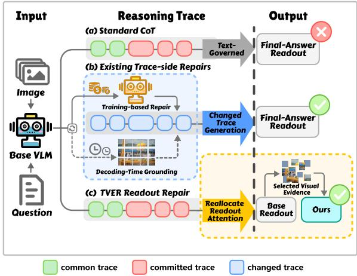
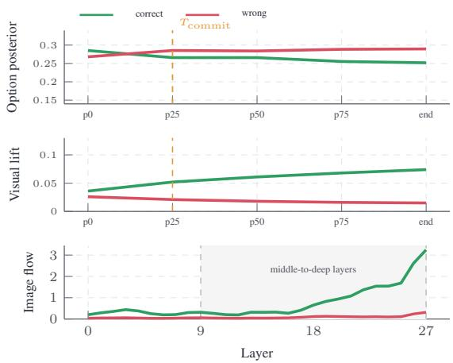
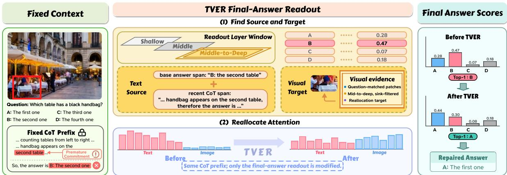
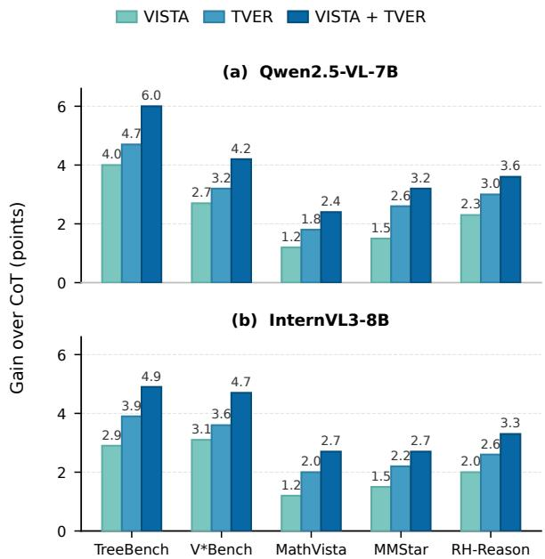
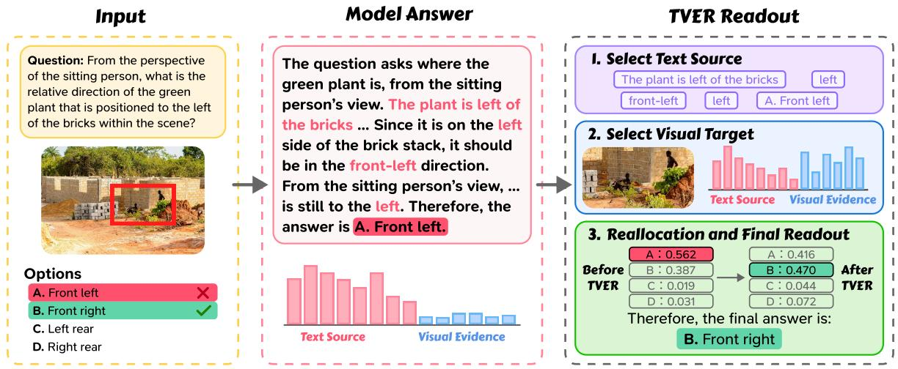

# The Image Still Has a Say: Final-Answer Repair for Multimodal Chain-of-Thought

Yulan Pan\* Xiaoyu Xu Zhihong Shen Fuzhou University isyolaa@outlook.com

## Abstract

Although chain-of-thought prompting has improved multimodal reasoning, it is still difficult to produce correct final answers, as the reasoning can drift away from the image. Besides, the trace is already fixed when the answer is generated, leaving no room for self-correction. Considering the image is still available at the finalanswer step, we think it is reasonable to fix the answer there without rewriting the reasoning. As such, the problem becomes to correct the final answer using the image under fixed reasoning. Unlike methods that improve trace generation through training, resampling, or decodingtime grounding, we repair the final-answer readout while keeping the reasoning trace fixed. The motivation is based on our finding that a wrong option can become prematurely committed in the reasoning while the correct option still has stronger image support in middle-todeep layers. Thus, we propose Text-to-Visual Evidence Reallocation (TVER), a training-free method for final-answer repair. Specifically, TVER selects answer-related text and questionmatched image patches, and moves bounded attention from text to patches. Furthermore, the patches are chosen in a middle-to-deep layer window based on question relevance. Our method improves answers across benchmarks and backbones, with gains in both multiplechoice and open-answer evaluations.

## 1 Introduction

Chain-of-thought prompting asks models to write intermediate reasoning before answering (Wei et al., 2022), and multimodal CoT extends this idea to visual reasoning (Lu et al., 2022; Zhang et al., 2024). Each generated step then conditions the next steps and the final answer. When long multimodal reasoning drifts away from image-grounded content (Xu et al., 2025), the written text can become stronger than the remaining visual signal. As a result, the final answer may follow misleading text in the trace, even though the image is still present and may still support another answer.

  
Figure 1: The problem and our main idea. Prior training or decoding-time methods change the reasoning trace before the final answer is read. TVER keeps the trace fixed and changes only the final-answer readout by reallocating attention from answer-related text in the fixed context to selected visual evidence.

Intuitively, one may try to avoid this failure by training the model to write better grounded traces. Post-training, grounded CoT supervision, and reinforcement-style optimization can improve multimodal reasoning behavior (Man et al., 2025; Zhang et al., 2025; Liu et al., 2025; Ni et al., 2025; Huang et al., 2026). However, these methods require additional optimization and often taskspecific supervision or rewards. Besides, because they change the model or the trace-generation policy, they do not directly explain what should be done when a particular trace has already been written.

Consequently, work has also moved to inference time without weight updates. One solution is to change generation itself, such as by resampling reasoning paths, adding visual search, or steering decoding with visual contrast and attention signals (Wang et al., 2023; Wu and Xie, 2024; Leng et al., 2024; Chen et al., 2024b; Liu et al., 2024; Kang et al., 2025a; Li et al., 2025; Tu et al., 2026). Another solution is to revise the completed response after decoding (Zhou et al., 2024; Yin et al., 2024). Nevertheless, these methods still act during generation or after the response is written. They do not isolate the final-answer readout itself, where the written trace may already favor one answer while the image still supports another.

Thinking beyond trace generation, we propose to explicitly investigate the final-answer readout under a fixed reasoning trace 1) to avoid treating the whole response as a generation problem; 2) without updating model weights, regenerating the trace, or editing the trace. We assume that an answer-line error can involve a text-side commitment from the written trace and remaining visual evidence from the image. That is, the trace may already favor one answer, while the image may still support another at readout. If these two factors can be separated at the answer line, then final-answer repair can be studied without rewriting the reasoning. To test this possibility, we examine the final-answer readout of open-source LVLMs, focusing on hidden states and attention patterns. We begin with the following diagnostics.

## 2 Analysis and Motivation

A fixed trace may settle on a wrong answer too early. We first investigate when the model commits to a wrong option during reasoning, i.e., we want to know how early the wrong option selected in the final answer becomes stable. To this end, we first let the model generate the complete CoT and final answer and retain the multiple-choice examples answered incorrectly. Specifically, keeping the image and question fixed, we score each candidate option at p0, p25, p50, p75, and p100. Here, $\mathsf { p X }$ means the first X% of the CoT; at each $\mathsf { p X }$ , we normalize the raw scores $s ( o )$ across candidate set $\mathcal { O }$ to obtain option scores $P ( o )$

$$
P ( o ) = \frac { \exp { s ( o ) } } { \sum _ { o ^ { \prime } \in \mathcal { O } } \exp { s ( o ^ { \prime } ) } } .\tag{1}
$$

For each error, we define $T _ { \mathrm { c o m m i t } }$ as the first checkpoint at which the wrong option selected in the final answer becomes top-1 and remains top-1 at every subsequent checkpoint. When $T _ { \mathrm { c o m m i t } }$ is at or before $\mathsf { p } 5 0$ , the model has settled on the wrong option by the midpoint of its reasoning, which we regard as premature commitment. Then, we find that premature commitment occurs in 33.8% of CoT errors on average across the five multiple-choice pools for Qwen2.5-VL-7B. At p0 in Figure 2, the correct option is slightly ahead of the wrong option (0.285 vs. 0.268); by p25, the ranking reverses, and the wrong option becomes top-1 (0.285 vs. 0.266). However, the remaining reasoning does not change this ranking: the wrong option stays top-1 until the end of the CoT. That is, the model settles on the wrong option after only the first quarter of its reasoning, and the subsequent reasoning does not correct this choice.

The image may still favor the correct option. Then, we investigate whether the image still supports the correct option when the CoT ranks the wrong option first. To this end, following visualcontrast work (Leng et al., 2024), we replace the original image with a blank image, a blurred image, or an unrelated image, while keeping the question, options, and the CoT at each pX unchanged. Specifically, at each $\mathrm { p X } ,$ we calculate the score $P ( o ; I ^ { \prime } )$ of every option o under each image I′ and define visual lift $V ( o )$ , with C denoting the three replacement images:

$$
V ( o ) = P ( o ; I ) - \frac { 1 } { | { \mathcal { C } } | } \sum _ { \tilde { I } \in { \mathcal { C } } } P ( o ; \tilde { I } ) .\tag{2}
$$

We use a positive visual lift to indicate that the original image supports an option more strongly than the replacement images. Compared with p0, the visual lift of the correct option increases from 0.036 to 0.074 at $\mathrm { \sf p l 0 0 } .$ , while that of the wrong option decreases from 0.026 to 0.015. However, the wrong option remains top-1 at p100, although the original image provides stronger support for the correct option. That is, the CoT favors the wrong option, while the image still supports the correct option more strongly.

Visual evidence can still reach the readout. Then, we ask whether this image-side signal can reach the final-answer tokens. Visual lift alone would not help if the answer computation no longer used image tokens. We estimate the path for each option o by scoring the option line and aggregating an attention-gradient attribution score from finalanswer tokens to image tokens (Chefer et al., 2021):

$$
F _ { t } ^ { \ell } ( o ) = \sum _ { q \in \mathcal { A } _ { o } } \sum _ { k \in \mathcal { K } _ { I } } \left| a _ { q k } ^ { \ell } \frac { \partial s ( o ) } { \partial a _ { q k } ^ { \ell } } \right| .\tag{3}
$$

  
Figure 2: Motivating diagnostic for final-answer repair. The wrong option becomes stable before the answer line, while the correct option keeps larger visual lift and stronger image-to-answer flow in middle-to-deep layers.

Here $\scriptstyle A _ { o }$ is the answer-token set for option o, and $\displaystyle \kappa _ { I }$ is the image-token set. The lift asks whether changing the image changes the score; the flow asks whether final-answer scoring uses image tokens. In Figure 2, the flow is also larger for the correct option in the middle-to-deep layers. Averaged over this window, the image-to-answer flow is 0.954 for the correct option and 0.099 for the wrong option. The three measurements agree: the prefix posterior can favor the wrong answer, while visual support and image-to-answer flow remain stronger for the correct one. Thus, the text-side commitment and image-side evidence can be divided at readout: one can dominate the posterior, while the other still reaches the answer computation. This is the situation a readout repair should target.

Based on this finding, we propose Text-to-Visual Evidence Reallocation (TVER), a training-free method for final-answer repair under a fixed multimodal CoT. As shown in Figure 1, TVER keeps the written trace unchanged and treats the final answer as a readout problem rather than a trace-generation problem. It identifies the text-side context that pulls the answer toward the current readout and the visual evidence that is still relevant to the question, then gives this evidence more influence at the answer line. In this way, the method targets the conflict exposed by the diagnostics without producing a new reasoning path.

We summarize our contributions as follows. 1) We define the fixed-trace final-answer repair setting for multimodal CoT, where the reasoning has already been written and only the final answer is repaired. 2) We provide diagnostics showing that a wrong text-side commitment can coexist with stronger visual support and image-to-answer flow for the correct option. 3) We introduce TVER, a plug-and-play readout intervention that improves answers across benchmarks and open-source backbones, including both multiple-choice and openanswer evaluation.

## 3 Method

Suppose that a multimodal CoT has already been written for a given image and question. Our goal is to repair the final answer without rewriting the CoT. Motivated by the diagnostics in Section 2, TVER uses the unmodified readout to identify the answerrelated text and question-specific visual evidence. Figure 3 depicts the framework of TVER. It includes three stages. We first record the unmodified fixed-trace readout, which provides the base answer, hidden states, and attention maps. Then, we select the answer-related text source and questionspecific visual target. After selecting the source and target, we rerun only the final-answer line with capped evidence reallocation.

## 3.1 Fixed-Trace Readout

Given the fixed CoT prefix, TVER first runs the ordinary final-answer readout and obtains the base answer, denoted as $a _ { \mathrm { b a s e } }$ . This pass is unmodified; it records the model’s current answer and provides the hidden states and attention maps used for source and target selection. For multiple-choice examples, we extract the option from $a _ { \mathrm { b a s e } }$ using the same answer extractor as evaluation. For open-answer examples, we keep $a _ { \mathrm { b a s e } }$ as the generated answer string and do not extract an option span.

## 3.2 Source and Target Selection

The base answer $a _ { \mathrm { b a s e } }$ records the model’s current readout. We then select a text-side source S and a visual target V before the reallocation step.

Text-side source. As shown in Section 2, the fixed prefix can already favor a wrong option, and the final readout tends to follow answer-related text in the fixed context. We therefore take the option selected by the unmodified readout and the recent reasoning that leads into the answer line as the text-side source. For multiple-choice examples, let $O _ { \mathrm { b a s e } }$ be the option extracted from $a _ { \mathrm { b a s e } }$ . We define $\mathcal { T } _ { \mathrm { a n s } }$ as the spans tied to $O _ { \mathrm { b a s e } }$ : its label and option text in the prompt, plus explicit mentions in the generated reasoning.

  
Figure 3: Overview of TVER. The image, question, options, and CoT prefix are fixed. TVER selects a text-side source and a visual evidence target from the unmodified readout, then reruns only the final-answer line with capped attention reallocation.

$$
S = T _ { \mathrm { a n s } } \cup \mathcal { R } _ { \mathrm { r e c e n t } } ,\tag{4}
$$

where $\mathcal { R } _ { \mathrm { r e c e n t } }$ is the last non-empty segment before the answer marker after splitting the generated reasoning at newlines and sentence-final punctuation. For open-answer examples, there is no option span, so we use $S = \mathcal { R } _ { \mathrm { r e c e n t } }$

Visual target. We next choose the image tokens that receive the reallocated attention. As shown in Figure 2, the image-to-answer flow separates the correct and wrong options mainly in the middleto-deep layers. We therefore use a middle-to-deep layer window, denoted by ${ \mathcal { L } } ,$ for both target selection and the reallocation step below. For each backbone, $\mathcal { L }$ contains the final two thirds of its transformer layers. The target should also be specific to the current question. If the moved attention is spread over all image patches, much of it can fall on background or regions unrelated to the question. For this reason, we score each patch by a layer-averaged visual-evidence score.

In the unmodified forward pass, let $\displaystyle \kappa _ { I }$ be the image patch tokens and $z _ { i } ^ { \ell }$ be the hidden state of token i at layer ℓ. Let ${ \mathcal { Q } } _ { \mathrm { q o } }$ contain the question tokens and, when options are available, the option tokens. Let $\mathcal { Q } _ { \mathrm { t e x t } }$ collect the text side of the fixed prefix, including the question, the options when present, and the generated reasoning tokens. For each layer $\ell \in { \mathcal { L } }$ , we compute two patch scores:

question–option relevance and broad text attention:

$$
\begin{array} { r l } & { u ^ { \ell } ( k ) = \cos \left( z _ { k } ^ { \ell } , ~ \mathrm { a v g } ~ z _ { q } ^ { \ell } \right) , } \\ & { b ^ { \ell } ( k ) = \underset { q \in \mathcal { G } _ { \mathrm { t e x t } } } { \mathrm { a v g } } ~ A _ { q , k } ^ { \ell , h } , } \end{array}\tag{5}
$$

where $A _ { q , k } ^ { \ell , h }$ is the attention weight from text token $q$ to image token $k ,$ and $\mathcal { H }$ is the set of attention heads. We subtract the broad-attention score because patches watched by much of the text are often common visual anchors, not the specific evidence needed here. We rank-normalize the two terms within each layer and then average across layers:

$$
\begin{array} { r l } & { r ^ { \ell } ( k ) = \operatorname* { r n } _ { \mathcal { K } _ { I } } ( u ^ { \ell } ( k ) ) - \operatorname* { r n } _ { \mathcal { K } _ { I } } ( b ^ { \ell } ( k ) ) , } \\ & { r ( k ) = \underset { \ell \in \mathcal { L } } { \arg { r ^ { \ell } ( k ) } } . } \end{array}\tag{6}
$$

Here $\mathrm { r n } _ { \mathit { K } _ { I } }$ maps the lowest raw score in a layer to 0 and the highest to 1, using average ranks for ties. We take the top 25% image tokens under $r ( k )$ as $\nu .$ This selected VE-25% set is the visual target used by the reallocation step.

## 3.3 Evidence Reallocation

TVER changes the final-answer readout with a source-to-target operation. The written trace stays fixed and remains available as context; only the attention rows for new answer tokens are modified. The operation moves part of the selected source attention to the selected visual target. We apply the operation in the same middle-to-deep layer window ${ \mathcal { L } } .$

For each layer $\ell \in { \mathcal { L } } .$ head $h ,$ and new answer token, let a be its post-softmax attention distribution. The attention mass on the selected text-side

source is

$$
M _ { S } = \sum _ { j \in \mathcal { S } } a _ { j } .\tag{7}
$$

Rather than removing all source attention, TVER moves only a capped amount:

$$
\begin{array} { r } { m = \operatorname* { m i n } ( \beta M _ { S } , \tau _ { \operatorname* { m a x } } , M _ { S } ) . } \end{array}\tag{8}
$$

Here $\beta$ controls the released fraction of source mass, and $\tau _ { \mathrm { m a x } }$ caps the absolute transferred mass. When $M _ { S } > 0$ , we set $\gamma = m / M _ { S }$ and scale the source-token weights as $a _ { j } ^ { \prime } = ( 1 - \gamma ) a _ { j }$ for $j \in \mathcal S$ The moved mass is added to visual target tokens according to their visual-evidence scores:

$$
\begin{array} { l } { { w _ { k } = \displaystyle \frac { \exp { r ( k ) } } { \sum _ { u \in \mathcal { V } } \exp { r ( u ) } } , } } \\ { { a _ { k } ^ { \prime } = a _ { k } + m w _ { k } , \quad k \in \mathcal { V } . } } \end{array}\tag{9}
$$

Tokens outside $\mathcal { S } \cup \mathcal { V }$ keep their original attention weights, and each attention row remains normalized. The modified row is then passed through the model’s standard value aggregation, and decoding continues only for the final answer line.

## 4 Experiments

## 4.1 Setups

We evaluate whether the final answer can be repaired after the CoT trace has already been written. For each example and backbone, the model first writes a CoT, and we keep the prefix before the answer marker fixed. The CoT baseline keeps the original final answer, the re-answer control decodes another answer line from the same prefix, and TVER decodes that line with reallocation applied. All rows use the same answer parser or judge. We tune TVER only on TreeBench tuning rows with Qwen2.5-VL-7B, then freeze the setting for all reported results. TVER requires no weight updates.

## 4.2 Benchmarks and Base Models

Benchmarks. We use three groups of benchmarks. TreeBench probes “thinking with images” with traceable visual evidence and relational reasoning (Wang et al., 2026). V\*Bench stresses visual search in high-resolution, crowded scenes (Wu and Xie, 2024). These two benchmarks are closest to our setting, since many errors depend on concrete visual evidence. We also test broader multimodal reasoning with MathVista (Lu et al., 2024) and MMStar (Chen et al., 2024a), following the move from perception-heavy LVLM evaluation (Fu et al., 2025) to expert multimodal reasoning (Yue et al., 2024). All four benchmarks are evaluated by answer accuracy. We also use RH-Reason in the open-answer RH-Bench setting, so the evaluation is not limited to multiple-choice answers (Xu et al., 2025).

Base models. We test whether the same frozen setting transfers across model families and sizes. The evaluation covers six backbones from three model families, spanning 7B to 72B parameters: Qwen2.5-VL (7B and 32B) (Bai et al., 2025), InternVL3 (8B and 38B) (Zhu et al., 2025), and LLaVA-OneVision (7B and 72B) (Li et al., 2024), without finetuning any backbone.

## 4.3 Main Results and Analysis

Main results. TVER improves over CoT in all 30 model–task cells, with an average gain of +2.6 points (95% paired-bootstrap CI: [+2.17, +2.98]). On Qwen2.5-VL-7B, wrong-to-correct changes outnumber correct-to-wrong changes on all five benchmarks, with repair rates of 7.2–17.8% and damage rates of 1.4–3.4%. Appendix Table 5 reports the full results.

TVER yields consistent gains on TreeBench and V\*Bench, where many answers rely on localized visual evidence. MathVista and MMStar also improve, showing that the effect extends beyond visual-grounding benchmarks. On RH-Reason, the average gain across backbones is +2.8 points. Since RH-Reason is judged by answer equivalence rather than option matching, this result shows that TVER also improves open-answer responses.

Table 1 also compares TVER with four trainingfree inference baselines: VCD (Leng et al., 2024), PAI (Liu et al., 2024), VAR (Kang et al., 2025a), and VISTA (Li et al., 2025), each run with the authors’ recommended settings. For each model and benchmark, we compare against the strongest of these four controls. TVER matches or exceeds this best training-free control in every case and is +0.7 points higher on average. This suggests that sourceto-visual readout reallocation adds value beyond generic visual contrast, image-attention reweighting, or generation-time steering. Beyond these generation-time controls, we also compare with ViGaL (Xie et al., 2026), a post-trained model, and Woodpecker (Yin et al., 2024), a post-decoding revision method. TVER achieves comparable results across both comparisons without additional

<table><tr><td rowspan="2">Method</td><td colspan="2">Visual Grounding</td><td colspan="2">General VQA</td><td>Reasoning</td></tr><tr><td>TreeBench↑</td><td>V*Bench↑</td><td>MathVista↑</td><td>MMStar↑</td><td>RH-Reason↑</td></tr><tr><td>Qwen2.5-VL-7B</td><td>37.0</td><td>76.4</td><td>68.2</td><td>63.9</td><td>39.7</td></tr><tr><td>+ VCD</td><td>40.5</td><td>78.0</td><td>69.0</td><td>65.0</td><td>41.3</td></tr><tr><td>+ PAI</td><td>38.3</td><td>77.0</td><td>68.5</td><td>64.4</td><td>42.3</td></tr><tr><td>+ VAR</td><td>39.5</td><td>78.5</td><td>68.9</td><td>64.8</td><td>41.3</td></tr><tr><td>+ VISTA</td><td>41.0</td><td>79.1</td><td>69.4</td><td>65.4</td><td>42.0</td></tr><tr><td>+ ViGaL</td><td>41.2</td><td>78.5</td><td>71.9</td><td>65.4</td><td>42.0</td></tr><tr><td>+ Woodpecker</td><td>39.5</td><td>78.5</td><td>69.4</td><td>65.5</td><td>41.7</td></tr><tr><td>+ TVER</td><td>41.7(↑4.7)</td><td>79.6(↑3.2)</td><td>70.0(↑1.8)</td><td>66.5(↑2.6)</td><td>42.7(↑3.0)</td></tr><tr><td>Qwen2.5-VL-32B</td><td>42.5</td><td>81.2</td><td>74.7</td><td>69.5</td><td>47.0</td></tr><tr><td>+ VCD</td><td>43.7</td><td>81.7</td><td>75.0</td><td>69.9</td><td>47.7</td></tr><tr><td>+ PAI</td><td>43.2</td><td>81.2</td><td>74.9</td><td>69.8</td><td>48.0</td></tr><tr><td>+ VAR</td><td>44.0</td><td>82.2</td><td>75.2</td><td>70.5</td><td>48.3</td></tr><tr><td>+ VISTA</td><td>44.2</td><td>82.2</td><td>75.5</td><td>70.4</td><td>48.7</td></tr><tr><td>+ TVER</td><td>44.9(↑2.4)</td><td>82.2(↑1.0)</td><td>76.1 (↑1.4)</td><td>70.9(↑1.4)</td><td>49.3(↑2.3)</td></tr><tr><td>InternVL3-8B</td><td>38.8</td><td>72.3</td><td>71.6</td><td>68.2</td><td>42.7</td></tr><tr><td>+ VCD</td><td>40.5</td><td>73.8</td><td>71.9</td><td>68.8</td><td>43.7</td></tr><tr><td>+ PAI</td><td>40.0</td><td>73.3</td><td>71.8</td><td>68.6</td><td>44.0</td></tr><tr><td>+ VAR</td><td>41.0</td><td>74.9</td><td>72.2</td><td>69.0</td><td>44.3</td></tr><tr><td>+ VISTA</td><td>41.7</td><td>75.4</td><td>72.8</td><td>69.7</td><td>44.7</td></tr><tr><td>+ Woodpecker</td><td>41.0</td><td>74.3</td><td>72.9</td><td>69.6</td><td>44.3</td></tr><tr><td>+ TVER</td><td>42.7 (↑3.9)</td><td>75.9 (↑3.7)</td><td>73.6 (↑2.0)</td><td>70.4 (↑2.2)</td><td>45.3(↑2.6)</td></tr><tr><td>InternVL3-38B</td><td>42.0</td><td>79.6</td><td>75.1</td><td>71.5</td><td>47.3</td></tr><tr><td>+ VCD</td><td>43.0</td><td>80.1</td><td>75.3</td><td>71.9</td><td>48.0</td></tr><tr><td>+ PAI</td><td>42.7</td><td>79.1</td><td>75.2</td><td>71.8</td><td>48.3</td></tr><tr><td>+ VAR</td><td>43.2</td><td>80.6</td><td>75.4</td><td>72.3</td><td>48.3</td></tr><tr><td>+ VISTA</td><td>43.7</td><td>81.2</td><td>75.7</td><td>72.2</td><td>48.7</td></tr><tr><td>+ TVER</td><td>44.9(↑2.9)</td><td>81.7(↑2.1)</td><td>76.2 (↑1.1)</td><td>72.8(↑1.3)</td><td>49.7(↑2.4)</td></tr><tr><td>LLaVA-OneVision-7B</td><td>37.3</td><td>70.7</td><td>63.2</td><td>61.7</td><td>39.7</td></tr><tr><td>+ VCD</td><td>39.0</td><td>72.3</td><td>63.6</td><td>62.4</td><td>41.0</td></tr><tr><td>+ PAI</td><td>39.8</td><td>72.8</td><td>64.0</td><td>63.5</td><td>41.3</td></tr><tr><td>+ VAR</td><td>39.5</td><td>73.3</td><td>63.9</td><td>62.6</td><td>41.3</td></tr><tr><td>+ VISTA</td><td>40.7</td><td>73.8</td><td>64.6</td><td>63.4</td><td>42.0</td></tr><tr><td>+ TVER</td><td>41.7(↑4.4)</td><td>74.3(↑3.6)</td><td>65.1(↑1.9)</td><td>64.2(↑2.5)</td><td>42.7(↑3.0)</td></tr><tr><td>LLaVA-OneVision-72B</td><td>40.5</td><td>73.8</td><td>66.5</td><td>65.2</td><td>43.7</td></tr><tr><td>+ VCD</td><td>41.7</td><td>74.9</td><td>66.9</td><td>65.9</td><td>45.0</td></tr><tr><td>+ PAI</td><td>41.5</td><td>75.4</td><td>67.7</td><td>66.2</td><td>46.3</td></tr><tr><td>+ VAR</td><td>42.2</td><td>75.9</td><td>67.2</td><td>66.4</td><td>45.3</td></tr><tr><td>+ VISTA</td><td>43.0</td><td>76.4</td><td>67.6</td><td>66.8</td><td>46.3</td></tr><tr><td>+ TVER</td><td>44.0(↑3.5)</td><td>77.0(↑3.2)</td><td>68.1 (↑1.6)</td><td>67.3(↑2.1)</td><td>47.0(↑3.3)</td></tr></table>

Table 1: Performance comparison under the fixed-prefix final-answer protocol. All rows use the same answer extraction or judge, and TVER uses one fixed setting across all model-task cells. Highlighted rows are TVER; underlines mark the strongest non-TVER result in each model-task group; arrows show gains over CoT, computed from unrounded scores.

## training.

Mechanism analysis. On CoT errors, the correct option has stronger hidden-state visual lift than the selected wrong option in every pool (+.057 on average; Appendix Table 7). After TVER, the correct option’s margin over the strongest wrong option increases in all five pools under the same fixed CoT (+.066 on average; Appendix Table 6), showing that the remaining visual support has greater influence on the final readout.

Figure 4 further shows that combining TVER with VISTA gives higher gains than either method alone on all five benchmarks for both backbones, indicating that final-answer repair complements generation-time steering.

## 4.4 Ablations, Efficiency, and Robustness

Module ablations. Table 2 studies the source and target choices in TVER. The first rows compare simple controls. Re-answering the same trace gives only +0.4 points. Downweighting answer text or releasing attention without a visual target also gives smaller gains than full reallocation. This shows that TVER does not work by merely asking again or weakening text cues; the released attention needs a selected visual target.

  
Figure 4: Composability of VISTA and TVER on Qwen2.5-VL-7B and InternVL3-8B. The x-axis lists the five benchmarks, and the y-axis shows accuracy gains over CoT in percentage points. VISTA and VISTA+TVER share the same VISTA-generated trace and differ only at the final-answer readout; the combination gives higher gains than either method alone in all ten settings.

<table><tr><td>Part</td><td>Setting</td><td>Acc. ∆</td></tr><tr><td>Base</td><td>CoT</td><td>50.6</td></tr><tr><td>Control re-answer Control release-only</td><td>Control answer-text downweight 51.6 +1.0</td><td>51.0+0.4 52.0 +1.4</td></tr><tr><td>Source Source</td><td>recent-only answer text</td><td>51.8 +1.2 52.6+2.0</td></tr><tr><td>Source</td><td>answer text+recent</td><td>53.8+3.2</td></tr><tr><td>Target Target</td><td>random 25% all-image</td><td>51.0+0.4 52.2 +1.6</td></tr><tr><td>Target Target</td><td> $\operatorname { t a s k - o n l y }$   ${ \bf V E - } 2 5 \%$ </td><td>52.9 +2.3 53.8+3.2</td></tr></table>

Table 2: Module ablations on matched MCQ rows. Source rows fix the target as VE-25%; target rows fix the source as answer text+recent. Answer-text downweight scales source attention without adding it to image tokens; release-only removes the released mass from the source and renormalizes the row; task-only ranks image tokens by question–option relevance without the broad-attention penalty. Highlighted rows are the settings used by TVER, and $\Delta$ is the accuracy gain over CoT.

We then change one side at a time. With VE-25% fixed as the target, answer text is stronger than recent-only, and answer text+recent gives the best result. This matches the source design. The answer text contains the base-selected option label and option string that the readout can reuse, while the recent prefix contains the reasoning that leads into the commitment. With the source fixed as answer text+recent, all image patches and task-only visual relevance both improve over random patches, but neither reaches VE-25%. Thus the target should not be all visual tokens, nor only patches close to the question-option context. Removing patches that receive broad text attention gives a cleaner visual target. The full setting reaches 53.8% accuracy on matched MCQ rows.

<table><tr><td>Method</td><td>Compute Acc. ∆</td></tr><tr><td>CoT</td><td>1.0×  $3 7 . 0 \mathrm { ~  ~ { ~ \_ } ~ }$ </td></tr><tr><td>VCD</td><td> $\sim 1 . 2 \times$   $4 0 . 5 ~ + 3 . 5$ </td></tr><tr><td> $\mathrm { S C } \left( k = 2 \right)$ </td><td> $\sim 2 . 0 \times$   $4 0 . 0 \ + 3 . 0$ </td></tr><tr><td> $\mathrm { S C } \left( k = 4 \right)$ </td><td> $\sim 4 . 0 \times$   $4 0 . 7 \ + 3 . 7$ </td></tr><tr><td>VISTA steering</td><td> $\sim 1 . 0 \times$   $4 1 . 0 ~ + 4 . 0$ </td></tr><tr><td>TVER</td><td> $\sim 1 . 3 \times$  41.7 +4.7</td></tr></table>

Table 3: Compute controls on TreeBench. Cost is relative to one CoT and counts extra scoring, attention collection, or decoding; $\Delta$ is over CoT.

Compute controls. We also compare methods at different inference budgets. TVER keeps the CoT trace fixed and uses its extra passes for evidence selection and final-answer readout. The controls in Table 3 spend inference budget or intervention capacity on visual contrast, self-consistency, or generation-time visual steering.

TVER gives +4.7 points at about 1.3× compute, above the VCD (+3.5), self-consistency, and VISTA steering controls. This indicates that the reallocation step matters, rather than the extra inference budget alone.

Setting robustness. We next check whether the fixed setting is stable. In Table 4, VE-25% gives the best target set with 53.8% accuracy. Using 10% or 50% image tokens also helps, but VE-25% gives the largest gain. The layer ablations follow the diagnostic in Figure 2: middle-to-deep averaging is stronger than all-layer or single-window selector variants, and the same window is also best for intervention. The transfer rows show a similar pattern. A moderate transfer gives the best result, while moving too much mass weakens the gain. We therefore keep VE-25%, middle-to-deep layers, $\beta = 0 . 6 ,$ and τmax = 0.20 for all main experiments. Appendix B.1 further checks that this β setting is stable across all six backbones on TreeBench.

  
Figure 5: Qualitative example on a TreeBench perspective question. The panels show the input, the original CoT, the selected text-side source and visual target, and the final score shift from A to B after TVER.

<table><tr><td>Factor</td><td>Setting</td><td>Acc. ∆</td></tr><tr><td>Base</td><td>CoT</td><td>50.6</td></tr><tr><td>Target</td><td>VE-10%</td><td>53.1 +2.5</td></tr><tr><td>Target</td><td>VE-25%</td><td>53.8 +3.2</td></tr><tr><td>Target</td><td>VE-50%</td><td>53.4 +2.8</td></tr><tr><td>Selector all-layer avg. Selector middie avg. Selector deep avg.</td><td></td><td>53.4 +2.8 53.5 +2.9 53.2 +2.6</td></tr><tr><td></td><td>Selector middle-to-deep avg.</td><td>53.8 +3.2</td></tr><tr><td>Window shallow</td><td></td><td>51.7 +1.1</td></tr><tr><td>Window middle</td><td></td><td>53.3 +2.7</td></tr><tr><td></td><td>Window middle-to-deep</td><td>53.8 +3.2 53.1 +2.5</td></tr><tr><td>Window deep</td><td></td><td></td></tr><tr><td>Transfer</td><td> $\beta = 0 . 4 , \tau _ { \mathrm { m a x } } = 0 . 2 0$ </td><td> $5 3 . 3 ~ + 2 . 7$ </td></tr><tr><td>Transfer</td><td> $\beta = 0 . 6 , \tau _ { \mathrm { m a x } } = 0 . 2 0$ </td><td> $5 3 . 8 ~ + 3 . 2 $ </td></tr><tr><td>Transfer</td><td> $\beta = 0 . 8 , \tau _ { \mathrm { m a x } } = 0 . 3 5$ </td><td> $5 3 . 6 ~ + 3 . 0 $ </td></tr><tr><td></td><td></td><td></td></tr><tr><td>Transfer</td><td> $\beta = 1 . 0 , \tau _ { \mathrm { m a x } } = 0 . 5 0$ </td><td> $5 3 . 0 ~ { + 2 . 4 }$ </td></tr></table>

Table 4: Setting robustness on Qwen2.5-VL-7B tuning rows. Highlighted rows are final settings; ∆ is over CoT.

## 4.5 Qualitative Analysis

Figure 5 shows a perspective question. The base CoT reads the scene but keeps using the scenelevel relation that the plant is left of the bricks. The question asks from the sitting person’s view, so this repeated “left” cue pulls the final line toward the front-left option, even though the needed viewpoint evidence remains in the image.

TVER acts at this readout step. It uses the baseselected option words and their recent mentions as the text-side source, selects patches covering the plant, bricks, and sitting person, and moves finalanswer attention toward this viewpoint evidence. The CoT is not rewritten; only the answer line changes from the text-favored option to the imagesupported option.

## 5 Related Work

Information-flow analysis. Visual-grounding studies have documented hallucination in image captioning, LVLM answers, and diagnostic benchmarks (Rohrbach et al., 2018; Li et al., 2023; Guan et al., 2024). These findings raise a more mechanistic question: how is visual evidence represented and routed through the model? Recent work approaches this question through attention-gradient relevance, middle-layer signals, saliency changes, grounding heads, and information flow (Chefer et al., 2021; Jiang et al., 2025; Zhang et al., 2026; Kang et al., 2025b; Zhao et al., 2025). Our analysis builds on this line of work to examine visual evidence under a fixed CoT.

Reasoning and decoding interventions. Existing methods intervene at several stages of multimodal reasoning. Training and post-training methods improve trace generation through grounded CoT supervision or reinforcement-style optimization (Man et al., 2025; Zhang et al., 2025; Liu et al., 2025; Ni et al., 2025; Huang et al., 2026; Xie et al., 2026). At inference time, some methods resample or search reasoning paths (Wang et al., 2023; Wu and Xie, 2024). Others steer generation using visual contrast, image attention, hidden states, or attention reallocation (Leng et al., 2024; Chen et al., 2024b; Liu et al., 2024; Kang et al., 2025a; Li et al., 2025; Tu et al., 2026). Post-decoding methods instead revise the response after it has been generated (Zhou et al., 2024; Yin et al., 2024). TVER keeps the CoT fixed and changes only the final-answer readout, making it complementary to methods that modify trace generation.

## 6 Conclusion

In this paper, we propose Text-to-Visual Evidence Reallocation (TVER) for final-answer repair in multimodal CoT under a fixed reasoning trace. We find that a fixed trace can favor a wrong answer while useful visual evidence remains available at the final-answer readout. Our method achieves consistent improvements across six opensource LVLMs and five benchmarks, covering both multiple-choice and open-answer evaluation. When combined with generation-time steering, TVER yields further gains, showing that finalanswer repair can work alongside improvements to trace generation.

## Limitations

1. TVER needs access to attention tensors during inference. This is available for the open-source LVLMs used in our experiments, but API-only systems usually hide these states and may require a different implementation.

2. Our mechanism analysis also uses counterfactual visual lift and attention-gradient flow as diagnostic signals. These probes help locate where visual evidence is available, but they should be read as correlational diagnostics rather than a full causal decomposition of the model’s decision.

3. TVER is designed for cases where useful visual evidence remains available at the final-answer readout. It is not expected to repair traces whose needed evidence has already been lost, whose image evidence is absent or ambiguous, or whose error comes from non-visual reasoning outside the selected target.

## References

Shuai Bai, Keqin Chen, Xuejing Liu, Jialin Wang, Wenbin Ge, Sibo Song, Kai Dang, Peng Wang, Shijie Wang, Jun Tang, Humen Zhong, Yuanzhi Zhu, Mingkun Yang, Zhaohai Li, Jianqiang Wan, Pengfei Wang, Wei Ding, Zheren Fu, Yiheng Xu, and 8 others. 2025. Qwen2.5-VL technical report. Preprint, arXiv:2502.13923.

Hila Chefer, Shir Gur, and Lior Wolf. 2021. Generic attention-model explainability for interpreting bi-

modal and encoder-decoder transformers. In Proceedings ofthe IEEE/CVF International Conference on Computer Vision (ICCV), pages 387–396.

Lin Chen, Jinsong Li, Xiaoyi Dong, Pan Zhang, Yuhang Zang, Zehui Chen, Haodong Duan, Jiaqi Wang, Yu Qiao, Dahua Lin, and Feng Zhao. 2024a. Are we on the right way for evaluating large vision-language models? In Advances in Neural Information Processing Systems, volume 37, pages 27056–27087. Curran Associates, Inc.

Zhaorun Chen, Zhuokai Zhao, Hongyin Luo, Huaxiu Yao, Bo Li, and Jiawei Zhou. 2024b. HALC: Object hallucination reduction via adaptive focal-contrast decoding. In Proceedings of the 41st International Conference on Machine Learning, volume 235 of Proceedings ofMachine Learning Research, pages 7824–7846. PMLR.

Chaoyou Fu, Peixian Chen, Yunhang Shen, Yulei Qin, Mengdan Zhang, Xu Lin, Jinrui Yang, Xiawu Zheng, Ke Li, Xing Sun, Yunsheng Wu, Rongrong Ji, Caifeng Shan, and Ran He. 2025. MME: A comprehensive evaluation benchmark for multimodal large language models. In Advances in Neural Information Processing Systems, volume 38. Curran Associates, Inc.

Tianrui Guan, Fuxiao Liu, Xiyang Wu, Ruiqi Xian, Zongxia Li, Xiaoyu Liu, Xijun Wang, Lichang Chen, Furong Huang, Yaser Yacoob, Dinesh Manocha, and Tianyi Zhou. 2024. HallusionBench: An advanced diagnostic suite for entangled language hallucination and visual illusion in large vision-language models. In Proceedings ofthe IEEE/CVF Conference on Computer Vision and Pattern Recognition, pages 14375– 14385.

Wenxuan Huang, Bohan Jia, Shaosheng Cao, Zheyu Ye, Fei Zhao, Zhe Xu, Yao Hu, and Shaohui Lin. 2026. Vision-R1: Incentivizing reasoning capability in multimodal large language models. In International Conference on Learning Representations, volume 2026, pages 63794–63812.

Zhangqi Jiang, Junkai Chen, Beier Zhu, Tingjin Luo, Yankun Shen, and Xu Yang. 2025. Devils in middle layers of large vision-language models: Interpreting, detecting and mitigating object hallucinations via Attention Lens. In Proceedings ofthe IEEE/CVF Conference on Computer Vision and Pattern Recognition, pages 25004–25014.

Seil Kang, Jinyeong Kim, Junhyeok Kim, and Seong Jae Hwang. 2025a. See what you are told: Visual attention sink in large multimodal models. In International Conference on Learning Representations, volume 2025, pages 87676–87703.

Seil Kang, Jinyeong Kim, Junhyeok Kim, and Seong Jae Hwang. 2025b. Your large vision-language model only needs a few attention heads for visual grounding. In Proceedings of the IEEE/CVF Conference on Computer Vision and Pattern Recognition, pages 9339–9350.

Sicong Leng, Hang Zhang, Guanzheng Chen, Xin Li, Shijian Lu, Chunyan Miao, and Lidong Bing. 2024. Mitigating object hallucinations in large visionlanguage models through visual contrastive decoding. In Proceedings of the IEEE/CVF Conference on Computer Vision and Pattern Recognition, pages 13872–13882.

Bo Li, Yuanhan Zhang, Dong Guo, Renrui Zhang, Feng Li, Hao Zhang, Kaichen Zhang, Peiyuan Zhang, Yanwei Li, Ziwei Liu, and Chunyuan Li. 2024. LLaVA-OneVision: Easy visual task transfer. Preprint, arXiv:2408.03326.

Yifan Li, Yifan Du, Kun Zhou, Jinpeng Wang, Xin Zhao, and Ji-Rong Wen. 2023. Evaluating object hallucination in large vision-language models. In Proceedings of the 2023 Conference on Empirical Methods in Natural Language Processing, pages 292–305, Singapore. Association for Computational Linguistics.

Zhuowei Li, Haizhou Shi, Yunhe Gao, Di Liu, Zhenting Wang, Yuxiao Chen, Ting Liu, Long Zhao, Hao Wang, and Dimitris N. Metaxas. 2025. The hidden life of tokens: Reducing hallucination of large visionlanguage models via visual information steering. In Proceedings of the 42nd International Conference on Machine Learning, volume 267 of Proceedings ofMachine Learning Research, pages 35799–35819. PMLR.

Shi Liu, Kecheng Zheng, and Wei Chen. 2024. Paying more attention to image: A training-free method for alleviating hallucination in LVLMs. In Computer Vision – ECCV 2024, volume 15141 of Lecture Notes in Computer Science, pages 125–140. Springer.

Ziyu Liu, Zeyi Sun, Yuhang Zang, Xiaoyi Dong, Yuhang Cao, Haodong Duan, Dahua Lin, and Jiaqi Wang. 2025. Visual-RFT: Visual reinforcement fine-tuning. In Proceedings ofthe IEEE/CVF International Conference on Computer Vision (ICCV), pages 2034– 2044.

Pan Lu, Hritik Bansal, Tony Xia, Jiacheng Liu, Chunyuan Li, Hannaneh Hajishirzi, Hao Cheng, Kai-Wei Chang, Michel Galley, and Jianfeng Gao. 2024. MathVista: Evaluating mathematical reasoning of foundation models in visual contexts. In International Conference on Learning Representations, volume 2024, pages 23439–23554.

Pan Lu, Swaroop Mishra, Tanglin Xia, Liang Qiu, Kai-Wei Chang, Song-Chun Zhu, Oyvind Tafjord, Peter Clark, and Ashwin Kalyan. 2022. Learn to explain: Multimodal reasoning via thought chains for science question answering. In Advances in Neural Information Processing Systems, volume 35, pages 2507– 2521. Curran Associates, Inc.

Yunze Man, De-An Huang, Guilin Liu, Shiwei Sheng, Shilong Liu, Liang-Yan Gui, Jan Kautz, Yu-Xiong Wang, and Zhiding Yu. 2025. Argus: Vision-centric reasoning with grounded chain-of-thought. In Proceedings ofthe IEEE/CVF Conference on Computer Vision and Pattern Recognition, pages 14268–14280.

Minheng Ni, Zhengyuan Yang, Linjie Li, Chung-Ching Lin, Kevin Lin, Wangmeng Zuo, and Lijuan Wang. 2025. Point-RFT: Improving multimodal reasoning with visually grounded reinforcement finetuning. In Advances in Neural Information Processing Systems, volume 38, pages 20538–20559. Curran Associates, Inc.

Anna Rohrbach, Lisa Anne Hendricks, Kaylee Burns, Trevor Darrell, and Kate Saenko. 2018. Object hallucination in image captioning. In Proceedings of the 2018 Conference on Empirical Methods in Natural Language Processing, pages 4035–4045, Brussels, Belgium. Association for Computational Linguistics.

Chongjun Tu, Peng Ye, Dongzhan Zhou, Lei Bai, Gang Yu, Tao Chen, and Wanli Ouyang. 2026. Attention reallocation: Towards zero-cost and controllable hallucination mitigation of MLLMs. International Journal ofComputer Vision, 134(1):22.

Haochen Wang, Xiangtai Li, Zilong Huang, Anran Wang, Jiacong Wang, Tao Zhang, Jiani Zheng, Sule Bai, Zijian Kang, Jiashi Feng, Zhuochen Wang, and Zhaoxiang Zhang. 2026. Traceable evidence enhanced visual grounded reasoning: Evaluation and method. In International Conference on Learning Representations, volume 2026, pages 148769– 148794.

Xuezhi Wang, Jason Wei, Dale Schuurmans, Quoc V. Le, Ed H. Chi, Sharan Narang, Aakanksha Chowdhery, and Denny Zhou. 2023. Self-consistency improves chain of thought reasoning in language models. In International Conference on Learning Representations.

Jason Wei, Xuezhi Wang, Dale Schuurmans, Maarten Bosma, Brian Ichter, Fei Xia, Ed H. Chi, Quoc V. Le, and Denny Zhou. 2022. Chain-of-thought prompting elicits reasoning in large language models. In Advances in Neural Information Processing Systems, volume 35, pages 24824–24837. Curran Associates, Inc.

Penghao Wu and Saining Xie. 2024. V\*: Guided visual search as a core mechanism in multimodal LLMs. In Proceedings of the IEEE/CVF Conference on Computer Vision and Pattern Recognition, pages 13084– 13094.

Yunfei Xie, Yinsong Ma, Shiyi Lan, Alan Yuille, Junfei Xiao, and Chen Wei. 2026. Play to generalize: Learning to reason through game play. In International Conference on Learning Representations, volume 2026, pages 17213–17243.

Zhongxing Xu, Chengzhi Liu, Qingyue Wei, Juncheng Wu, James Zou, Xin Wang, Yuyin Zhou, and Sheng Liu. 2025. More thinking, less seeing? assessing amplified hallucination in multimodal reasoning models. In Advances in Neural Information Processing Systems, volume 38, pages 82878–82905. Curran Associates, Inc.

Shukang Yin, Chaoyou Fu, Sirui Zhao, Tong Xu, Hao Wang, Dianbo Sui, Yunhang Shen, Ke Li, Xing Sun, and Enhong Chen. 2024. Woodpecker: Hallucination correction for multimodal large language models. Science China Information Sciences, 67(12):220105.

Xiang Yue, Yuansheng Ni, Kai Zhang, Tianyu Zheng, Ruoqi Liu, Ge Zhang, Samuel Stevens, Dongfu Jiang, Weiming Ren, Yuxuan Sun, Cong Wei, Botao Yu, Ruibin Yuan, Renliang Sun, Ming Yin, Boyuan Zheng, Zhenzhu Yang, Yibo Liu, Wenhao Huang, and 3 others. 2024. MMMU: A massive multi-discipline multimodal understanding and reasoning benchmark for expert AGI. In Proceedings of the IEEE/CVF Conference on Computer Vision and Pattern Recognition, pages 9556–9567.

Ruohong Zhang, Bowen Zhang, Yanghao Li, Haotian Zhang, Zhiqing Sun, Zhe Gan, Yinfei Yang, Ruoming Pang, and Yiming Yang. 2025. Improve vision language model chain-of-thought reasoning. In Proceedings of the 63rd Annual Meeting of the Associationfor Computational Linguistics (Volume 1: Long Papers), pages 1631–1662, Vienna, Austria. Association for Computational Linguistics.

Xiaofeng Zhang, Yuanchao Zhu, Chaochen Gu, Xiaosong Yuan, Qiyan Zhao, Jiawei Cao, Feilong Tang, Sinan Fan, Yaomin Shen, Chen Shen, and Hao Tang. 2026. Hallucination begins where saliency drops. In International Conference on Learning Representations, volume 2026, pages 15062–15083.

Zhuosheng Zhang, Aston Zhang, Mu Li, Hai Zhao, George Karypis, and Alex Smola. 2024. Multimodal chain-of-thought reasoning in language models. Transactions on Machine Learning Research.

Jianfei Zhao, Feng Zhang, Xin Sun, and Chong Feng. 2025. Mitigating hallucination in large visionlanguage models through aligning attention distribution to information flow. In Findings ofthe Associationfor Computational Linguistics: EMNLP 2025, pages 24849–24863, Suzhou, China. Association for Computational Linguistics.

Yiyang Zhou, Chenhang Cui, Jaehong Yoon, Linjun Zhang, Zhun Deng, Chelsea Finn, Mohit Bansal, and Huaxiu Yao. 2024. Analyzing and mitigating object hallucination in large vision-language models. In International Conference on Learning Representations, volume 2024, pages 56969–56998.

Jinguo Zhu, Weiyun Wang, Zhe Chen, Zhaoyang Liu, Shenglong Ye, Lixin Gu, Hao Tian, Yuchen Duan, Weijie Su, Jie Shao, Zhangwei Gao, Erfei Cui, Xuehui Wang, Yue Cao, Yangzhou Liu, Xingguang Wei, Hongjie Zhang, Haomin Wang, Weiye Xu, and 32 others. 2025. InternVL3: Exploring advanced training and test-time recipes for open-source multimodal models. Preprint, arXiv:2504.10479.

## A Mechanism Diagnostics

In this section, we further analyze how TVER changes the fixed-trace readout and whether visual support for the correct answer remains in CoT error cases. Note that all diagnostics are computed offline after evaluation, and TVER does not use ground-truth labels at inference time.

## A.1 Repair and Damage

<table><tr><td>Bench.</td><td> $\Delta$ </td><td>95% CI</td><td>Repair Damage</td></tr><tr><td>Tree</td><td></td><td>+4.69[+2.22, +7.16]</td><td>9.0% 2.7%</td></tr><tr><td>V*</td><td></td><td>+3.14 [+0.00, +6.28]</td><td>17.8% 1.4%</td></tr><tr><td>Math</td><td></td><td>+1.80[+0.60, +3.10]</td><td>9.1% 1.6%</td></tr><tr><td>MMStar</td><td></td><td>+2.60[+1.60, +3.67]</td><td>9.6% 1.4%</td></tr><tr><td></td><td>RH-Reason +3.00 [+0.33, +5.67]</td><td></td><td>7.2% 3.4%</td></tr></table>

Table 5: Paired accuracy gains and answer transitions for Qwen2.5-VL-7B. ∆ and 95% CIs use pre-rounding counts and are reported in percentage points. Repair is wrong-to-correct among CoT-wrong examples; damage is correct-to-wrong among CoT-correct examples.

## A.2 Closed-Set Rescoring

We further evaluate TVER by ranking all candidate options under the same fixed CoT, rather than decoding the final answer as in the main evaluation. In Table 6, TVER improves top-1 option accuracy on all five pools (54.8 to 58.5 on average) and increases the ground-truth margin over the strongest wrong option by .066, indicating stronger relative support for the correct option at the final readout.

<table><tr><td>Bench. CoT TVER</td><td>∆ Margin</td></tr><tr><td>Tree 42.0</td><td>46.7+4.7 +.083</td></tr><tr><td>V* 54.5</td><td>58.1 +3.7 +.074</td></tr><tr><td>Math 65.0</td><td>67.8 +2.8 +.052</td></tr><tr><td>MMStar 60.7</td><td>64.0+3.3 +.061</td></tr><tr><td>RH-MCQ 52.0</td><td>55.7 +3.7 +.062</td></tr><tr><td>Average 54.8</td><td>58.5 +3.6 +.066</td></tr></table>

Table 6: Closed-set rescoring on Qwen2.5-VL-7B using all multiple-choice items from the five benchmark releases. Margin is the average increase in the score gap between the ground-truth option and the strongest wrong option. The $\Delta$ values are computed from unrounded scores.

## A.3 Hidden-State Visual Lift

This diagnostic asks whether CoT error rows still contain image-conditioned support for the groundtruth option.

Let $s ^ { \ell } ( o \mid Q , I ^ { \prime } , c _ { \leq t } )$ be the option score obtained by applying the LM readout head to the layer-ℓ hidden state at the answer-readout position, using the same fixed prefix and option-scoring template as $s ( o \mid Q , I ^ { \prime } , c _ { \leq t } )$ . We define the hidden-

state visual lift as

$$
\begin{array} { c } { { H _ { t } ^ { \ell } ( o ) = s ^ { \ell } ( o \mid Q , I , { c } _ { \leq t } ) } } \\ { { - \displaystyle \frac { 1 } { | { \mathcal C } | } \sum _ { \tilde { I } \in { \mathcal C } } s ^ { \ell } ( o \mid Q , \tilde { I } , { c } _ { \leq t } ) . } } \end{array}\tag{10}
$$

We average $H _ { t } ^ { \ell } ( o )$ over the same middle-to-deep readout window used by TVER and compute the correct-minus-selected lift gap on base-CoT error rows:

$$
\Delta ^ { \mathrm { l i f t } } = \mathbb { E } _ { \ell \in \mathcal { L } } \left[ H _ { t } ^ { \ell } ( o _ { \mathrm { g t } } ) - H _ { t } ^ { \ell } ( o _ { \mathrm { s e l } } ) \right] .\tag{11}
$$

Positive values mean that, after visual counterfactual subtraction, the hidden state assigns stronger image-conditioned support to the correct option than to the selected wrong option. Table 7 reports the diagnostic result. The lift gap is positive on every closed-set pool. The pattern fits the main account: TVER helps when usable correct-answer visual evidence is already present in the readout states but is underweighted by the final answer posterior.

<table><tr><td>Bench.</td><td> $\Delta ^ { \mathrm { l i f t } }$  Correct+</td></tr><tr><td>Tree</td><td>+.071 64.3%</td></tr><tr><td>V*</td><td>+.064 63.2%</td></tr><tr><td>Math</td><td>+.041 57.7%</td></tr><tr><td>MMStar</td><td>+.053 60.1%</td></tr><tr><td>RH-MCQ +.056</td><td>61.1%</td></tr><tr><td>Average</td><td>+.057 61.3%</td></tr></table>

Table 7: Hidden-state visual lift diagnostics on CoT error rows. $\Delta ^ { \mathrm { l i f t } }$ is the correct-minus-selected lift gap averaged over the middle-to-deep readout window. Correct+ is the share of rows with a positive gap.

## B Experimental Details

## B.1 Backbone Sensitivity

The main text selects $\beta = 0 . 6$ on Qwen2.5-VL-7B tuning rows. We further test this setting across all six backbones on TreeBench, while keeping the visual target, layer window, and cap fixed.

<table><tr><td>Model  $\beta _ { \mathrm { l o w } }$ </td><td> $\beta ^ { \star }$   $\beta _ { \mathrm { h i g h } }$ </td><td>Range</td></tr><tr><td>Qwen2.5-VL-7B Qwen2.5-VL-32B</td><td>0.4 0.6 0.8</td><td>40.0-41.7</td></tr><tr><td>InternVL3-8B</td><td>0.4 0.6 0.8 0.4 0.6 0.8</td><td>43.5-44.9 41.7–42.7</td></tr><tr><td>InternVL3-38B</td><td>0.4 0.6 0.8</td><td>43.7-44.9</td></tr><tr><td>LLaVA-OV-7B LLaVA-OV-72B 0.4</td><td>0.4 0.6 0.8 0.6 0.8 42.7-44.0</td><td>40.7-41.7</td></tr></table>

Table 8: Backbone sensitivity around the fixed $\beta = 0 . 6$ setting on TreeBench. The visual target, layer window, and cap are kept at the main TVER setting.

As shown in Table 8, β = 0.6 gives the best result for every backbone, while the adjacent settings remain within 1.7 points.