# The Last Mile of Coding Agents for Long-Document Tasks: An Empirical Study on Clinical Trial Protocol Digitization

Jiacheng Lin1, Geoff Low2, Nishit Agarwal2, Rahul Jain2,

Afrah Shafquat2, Mandis Beigi2, Jimeng Sun1

1University of Illinois Urbana-Champaign, 2Medidata Solutions

Project page: https://linjc16.github.io/trialpd-bench/

## Abstract

Clinical trial protocols serve as the source of truth for study design, but are mostly written and used as unstructured PDF documents. Digitizing protocols turns static content into structured, machine-readable data that clinical software can analyze, validate, and execute. Coding agents, which select tools, execute code, and revise their approach as they work, are increasingly applied to such long-document tasks, yet it remains unclear how reliably they turn complete documents into accurate structured outputs. We study this question using protocol digitization as a testbed. We introduce TRIALPD-BENCH, an expert-annotated benchmark of 150 publicly available protocol PDFs spanning four task categories. Beyond final-answer performance, our evaluation measures evidence recall from agent traces, agent behavior, and cost. Across nine proprietary and open-weight models in five coding-agent harnesses, even the strongest agents do not fully solve protocol digitization. Our analysis further shows that agents usually locate the required evidence but fail in the last mile of transcribing and structuring it. We further develop TRIALSCRIBE, a domain-specific harness that equips coding agents with task skills and a verification loop. TRIALSCRIBE improves a locally served open-weight model by 6.2-59.4 points across eight metrics, enabling it to match or surpass proprietary models such as GPT-5.6-Sol.

## 1 Introduction

Recent advances in coding agents, exemplified by Claude Code (Anthropic) and Codex (OpenAI), have extended their use beyond software engineering to a broader range of complex tasks (Wang et al., 2026a; Lyttelton et al., 2026; Wang et al., 2026b; Lyu et al., 2026). These agents can select tools, generate and execute code, and revise their approach based on intermediate results, providing flexibility in how they organize and complete a task (Wang et al., 2024; Ning et al., 2026). Such capabilities make coding agents promising for longdocument tasks, where relevant information may be distributed across many pages and different document structures may require different processing strategies. However, it remains unclear whether coding agents can reliably transform complex documents into accurate, complete, and structured outputs.

Clinical trial protocol digitization, which transforms protocol information into structured and machine-readable representations (Huser et al., 2015; Babaeipour et al., 2026), provides a highstakes, real-world setting for investigating the capabilities and reliability of coding agents on longdocument tasks. First, it is a representative longdocument task. Clinical trial protocols specify the core design and operational requirements of a study, but are predominantly maintained as lengthy, unstructured PDF documents (Chan et al., 2025; Babaeipour et al., 2026). These documents contain heterogeneous layouts, complex tables, and information distributed across multiple sections, requiring systems to navigate long documents, integrate scattered evidence, and reconstruct structured relationships.

Second, it has direct practical value. When protocol requirements remain embedded in documents, they require repeated manual interpretation and translation into downstream systems, resulting in limited interoperability, reduced efficiency, and increased risk of inconsistencies and transcription errors (Babaeipour et al., 2026; Boland et al., 2012). Structured protocol representation is essential for making study requirements computable, interoperable, and reusable across the clinical trial life cycle (Huser et al., 2015; Richardson and Genyn, 2025; Babaeipour et al., 2026). Because these representations inform downstream trial operations, even small errors, such as altered eligibility thresholds or misplaced study activities, can change the intended

<table><tr><td colspan="2">Recovered · Criteria</td></tr><tr><td>Eligibility criteria • Age ≥ 18 years • No prior treatment</td><td>Criteria recovered.</td></tr></table>

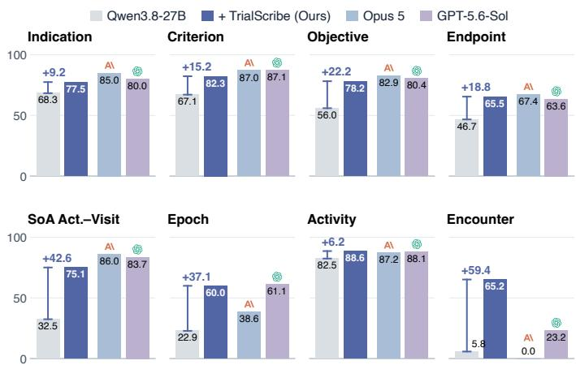

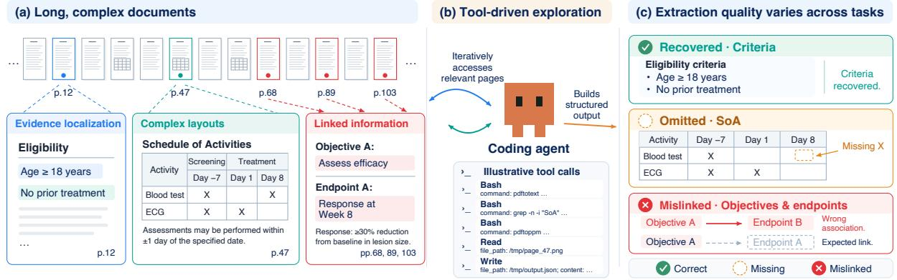

<table><tr><td rowspan=1 colspan=1>Activity</td><td rowspan=1 colspan=1>Day -7</td><td rowspan=1 colspan=1>Day 1</td><td rowspan=1 colspan=1>Day 8</td></tr><tr><td rowspan=1 colspan=1>Blood test</td><td rowspan=1 colspan=1>X</td><td rowspan=1 colspan=1></td><td rowspan=1 colspan=1></td></tr><tr><td rowspan=1 colspan=1>ECG</td><td rowspan=1 colspan=1>X</td><td rowspan=1 colspan=1>X</td><td rowspan=1 colspan=1></td></tr></table>

(d) Overall score vs. cost  
(e) TrialScribe lifts an open-weight model to proprietary agents  
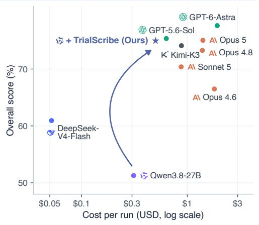  
Figure 1: Overview of this study. (a–c) Coding agents must localize evidence, interpret complex layouts, and link information across long protocols; output quality varies across tasks. (d) Overall score on TRIALPD-BENCH against average cost per run. (e) TRIALSCRIBE with Qwen3.8-27B versus the base model, Opus 5, and GPT-5.6-Sol.

## study requirements.

In this paper, we study how reliably coding agents handle long-document tasks, using clinical trial protocol digitization as a testbed (Figure 1). Beyond final-answer performance, our evaluation protocol measures evidence recall from agent traces, agent behavior including vision use, tool errors, and interaction turns, and cost. Our contributions are as follows:

• We construct TRIALPD-BENCH, an expertannotated benchmark of 150 complete protocol PDFs (median 122 pages) spanning four task categories: disease indication, eligibility criteria, objectives and endpoints, and schedule of activities. Each task requires locating evidence scattered across the full document and producing structured output that follows a USDM-derived schema.

• We evaluate nine proprietary and open-weight models in five coding-agent harnesses. Even the strongest agents leave substantial errors, reaching at most 67.4% endpoint F1 and 23.2% encounter recall. Agents usually reach the required evidence pages but fail in the last mile of reading and structuring it. Agents with similar accuracy can also differ several-fold in cost.

• We develop TRIALSCRIBE, a domain-specific harness that equips a locally served model with task skills and a verification loop. TRIALSCRIBE improves Qwen3.8-27B by 6.2-59.4 points across eight metrics, enabling it to match or surpass proprietary models such as GPT-5.6-Sol.

## 2 TRIALPD-BENCH: Evaluating Coding Agents on Protocol Digitization

## 2.1 Task Definition

We formulate clinical trial protocol digitization as extracting information from a protocol PDF into structured JSON output. The task-specific output schemas are derived from Unified Study Definitions Model (USDM) v4.0 (CDISC). CDISC’s (Clinical Data Interchange Standards Consortium)

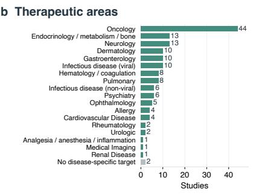

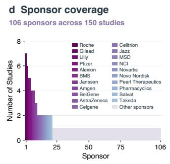

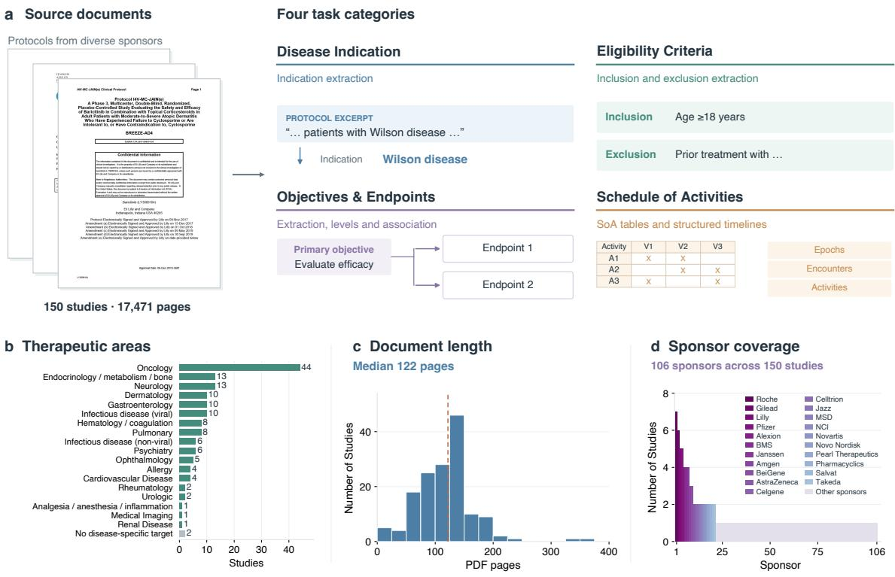

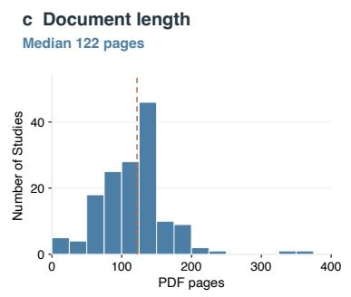  
Figure 2: Overview of TRIALPD-BENCH. (a) Source documents and the four task categories. The corpus comprises 150 unique studies, using one representative document per NCT identifier. (b) Coverage of therapeutic areas. (c) Document-length distribution, with a median of 122 pages marked by the dashed line. (d) Study counts across 106 sponsors.

USDM is an established standard to represent protocol documents into a structured machine-readable data. The output schemas cover selected portions relevant to four extraction tasks: disease indication, eligibility criteria, objectives and endpoints, and schedule of activities. Given a protocol document D and the output schema $S _ { t }$ for task t, an extraction system f produces $\hat { Y } _ { t } = f ( D , S _ { t } )$ , where $\hat { Y } _ { t }$ denotes the predicted JSON output. The objective is to recover the relevant information in D accurately and completely while conforming to the fields and structure specified by $S _ { t }$

## 2.2 Benchmark Construction

We construct TRIALPD-BENCH from clinical trial source documents associated with 150 unique NCT (National Clinical Trial) identifiers. (1) Disease indication extraction identifies the disease or condition investigated in the study. (2) Eligibility criteria extraction recovers participant inclusion and exclusion criteria. (3) Objectives and endpoints extraction identifies study objectives and their associated endpoints, together with their respective levels. (4) Schedule of activities (SoA) includes SoA table extraction and structured timeline extraction: the former locates the SoA tables in the full protocol and recovers their activity-visit structure, while the latter extracts study epochs, encounters, and activities. Reference outputs were produced by five experts in the clinical trial domain (Appendix C.3). We hold out the protocols used to develop TRIALSCRIBE (§4) as a development split and report all results on the remaining test split.

## 2.3 Overview and Statistics

Figure 2 summarizes the task categories and composition of the corpus, which comprises clinical trial source documents from ClinicalTrials.gov (U.S. National Library of Medicine), covering 18 therapeutic areas and 106 sponsors. Across these sponsors, the documents vary in section organization and table structure. For example, SoA tables may appear near the beginning of a protocol or in appendices, with different arrangements of study periods, visit windows, multi-level headers, and footnotes. This structural variation requires extraction systems to interpret information beyond fixed page positions or table layouts. In this dataset, protocol documents have a median length of 122 pages, with 98 documents (65.3%) containing at least 100 pages, and depending on the task, up to 31.5% of PDFs have task-relevant content that is missing from or garbled in the text layer and must be read from rendered pages (Appendix F.4). Table 1 reports the sample size and reference annotations of each task.

<table><tr><td rowspan="2">Task</td><td rowspan="2"></td><td colspan="3">Evidence pages</td><td rowspan="2">Reference annotations</td><td rowspan="2">Main metrics</td></tr><tr><td>Samples Mean</td><td>Median</td><td>p90</td></tr><tr><td>Q Disease indication</td><td>40</td><td>1.00</td><td>1</td><td></td><td>41 indication descriptions; 1-2 per sample</td><td>Indication F1</td></tr><tr><td>Eligibility criteria</td><td>134</td><td>4.32</td><td>4</td><td>7</td><td>3,974 criteria: 1,337 inclusion and 2,637 exclusion</td><td>Eligibility criteria F1</td></tr><tr><td>©Objectives and endpoints</td><td>89</td><td>3.17</td><td>3</td><td>5</td><td>665 objectives and 1,484 endpoints; 60 objectives without endpoints</td><td>Objective, endpoint, and objective-linked endpoint F1</td></tr><tr><td>田 SoA tables</td><td>37</td><td>1.89</td><td></td><td>4</td><td>70 tables; 10 protocols with multiple SoA pages</td><td>Activity-Visit and sub/sup F1</td></tr><tr><td>曲 Structured timelines</td><td>3</td><td>6.33</td><td>8</td><td>8</td><td>14 epochs; 69 encounters; 115 activities</td><td>Epoch accuracy; Activity and Encounter recall</td></tr></table>

Table 1: Task-level sample sizes and annotation statistics on the test split, excluding the development protocols of Appendix H.1. For every task, the input is the full protocol PDF. Evidence pages is the number of PDF pages per sample that contain the evidence needed for the reference annotations; p90 is the 90th percentile.

## 2.4 Evaluation Metrics

We evaluate coding agents along four dimensions: (1) Final-answer Performance, using each task’s scoring metrics to assess extraction quality; (2) Evidence Recall, using page recall to measure coverage of required evidence pages in observable agent traces; (3) Agent Behavior, measured by vision use rate on cases requiring visual recovery, average tool execution errors, and average agent response turns; and (4) Resource Usage, measured by average cost per run in USD. Detailed task specifications and evaluation metrics are provided in Appendix D.

## 2.5 Experimental Setup

We use Harbor (Harbor Framework Team, 2026) to run coding agents in containerized task environments. Each environment provides the source document, task instructions, and output requirements. Agents write their extracted results to a designated output directory, which is then used for evaluation against reference annotations withheld during task execution.

We evaluate nine models, each paired with a coding-agent harness: GPT-5.6-Sol and GPT-6- Astra with Codex (OpenAI); Opus 4.6, Opus 4.8, Opus 5, and Sonnet 5 with Claude Code (Anthropic); Kimi-K3 with Kimi Code (Moonshot AI); DeepSeek-V4-Flash with DeepSeek Harness (DeepSeek-AI); and the open-weight

Qwen3.8-27B with Pi harness (Earendil Works).

## 2.6 Main Results

Table 2 reports final-answer performance and evidence recall for all coding agents. Tables 3 and 4 report agent behavior, and Table 5 reports the average cost per run.

Finding 1: Task difficulty varies widely, and even the strongest coding agents do not fully solve protocol digitization. Frontier agents largely handle tasks that mainly require locating and transcribing contiguous text or tables. The best agent reaches 87.8% F1 on eligibility criteria, 86.8% Activity-Visit F1 on SoA tables, 85.0% indication F1, and 84.9% objective F1. Components that require linking information across sections or mapping it onto the study design are considerably harder. The best endpoint F1 is 67.4% and the best objective-linked endpoint F1 is 58.7%, both well below objective F1. On structured timelines, agents recover activities with up to 91.1% recall, yet epoch accuracy peaks at 73.3% and encounter recall at 23.2%, and the three Opus agents recover no reference encounter. The gaps between models also depend on the task. On eligibility criteria, seven agents lie within 1.4 points of each other (86.4– 87.8%), whereas Activity-Visit F1 on SoA tables ranges from 32.5% to 86.8%. Apart from timeline activity recall, no final-answer metric exceeds 88%. Because extracted study definitions feed directly into downstream trial systems, the remaining errors are consequential. Directly deploying current frontier coding agents therefore does not yet provide complete and reliable protocol digitization, and the largest gaps lie in the relational components of a protocol rather than in its surface content.

<table><tr><td></td><td colspan="2">Indication</td><td colspan="2">Criteria</td><td colspan="4">Objectives &amp; endpoints</td><td colspan="4">SoA Tables</td><td colspan="4">Timeline</td></tr><tr><td>Model</td><td>F1</td><td>ER</td><td>F1</td><td>ER</td><td>Obj</td><td>End</td><td>Link</td><td>ER</td><td>Sched.</td><td>Sub/sup</td><td></td><td>ER</td><td>Epoch</td><td>Enc. Act.</td><td></td><td>ER</td></tr><tr><td>GPT-6-Astra</td><td>82.5</td><td>95.0</td><td>87.8</td><td>91.6</td><td>82.2</td><td>65.0</td><td>58.1</td><td>89.6</td><td>86.8</td><td>84.5</td><td>84.8</td><td></td><td>73.3</td><td>20.3</td><td>91.1</td><td>98.3</td></tr><tr><td>S GPT-5.6-Sol</td><td>80.0</td><td>92.5</td><td>87.1</td><td>94.9</td><td>80.4</td><td>63.6</td><td>54.7</td><td>88.7</td><td>83.7</td><td></td><td>81.0</td><td>93.6</td><td>61.1</td><td>23.2</td><td>88.1</td><td>100.0</td></tr><tr><td>AI Opus 5</td><td>85.0</td><td>92.5</td><td>87.0</td><td>97.3</td><td>82.9</td><td>67.4</td><td>58.7</td><td>90.1</td><td>86.0</td><td>83.9</td><td></td><td>89.6</td><td>38.6</td><td>0.0</td><td>87.2</td><td>98.4</td></tr><tr><td>AI Opus 4.8</td><td>72.5</td><td>97.5</td><td>87.2</td><td>96.4</td><td>82.7</td><td>66.9</td><td>58.5</td><td>90.8</td><td>81.4</td><td></td><td>78.0</td><td>88.3</td><td>64.4</td><td>0.0</td><td>82.5</td><td>100.0</td></tr><tr><td>A\ Opus 4.6</td><td>67.5</td><td>100.0</td><td>86.8</td><td>97.5</td><td>80.6</td><td>60.6</td><td>49.6</td><td>94.1</td><td>54.7</td><td></td><td>53.4</td><td>96.0</td><td>61.1</td><td>0.0</td><td>85.3</td><td>100.0</td></tr><tr><td>AI Sonnet 5</td><td>75.0</td><td>100.0</td><td>86.4</td><td>93.4</td><td>82.8</td><td>63.9</td><td>54.2</td><td>87.5</td><td>74.7</td><td></td><td>71.8</td><td>95.7</td><td>50.6</td><td>8.7</td><td>59.2</td><td>100.0</td></tr><tr><td>K Kimi-K3</td><td>80.0</td><td>87.5</td><td>86.9</td><td>89.5</td><td>84.9</td><td>64.6</td><td>56.4</td><td>72.4</td><td>83.9</td><td></td><td>82.0</td><td>87.9</td><td>61.1</td><td>21.7</td><td>50.2</td><td>100.0</td></tr><tr><td>DeepSeek-V4-Flash Q</td><td>75.0</td><td>85.0</td><td>80.2</td><td>79.7</td><td>63.3</td><td>58.5</td><td>36.8</td><td>72.7</td><td>47.5</td><td></td><td>54.4</td><td>77.9</td><td>48.5</td><td>2.9</td><td>72.2</td><td>100.0</td></tr><tr><td>女 Qwen3.8-27B</td><td>68.3</td><td>85.0</td><td>67.1</td><td>89.2</td><td>56.0</td><td>46.7</td><td>32.1</td><td>75.1</td><td>32.5</td><td></td><td>42.5</td><td>80.2</td><td>22.9</td><td>5.8</td><td>82.5</td><td>98.6</td></tr></table>

Table 2: Main results (%) of coding agents on TRIALPD-BENCH. Each task reports its final-answer metrics followed by evidence recall (ER), the recall of the required evidence pages visited in the agent trace. Obj/End/Link: objective, endpoint, and objective-linked endpoint F1; Sched. and Sub/sup: Activity-Visit F1 (scheduling marks) and Sub/sup F1; Epoch: epoch type positional accuracy; Enc.: encounter recall; Act.: activity recall.
<table><tr><td></td><td colspan="5">Tool errors per run</td><td colspan="5">Turns per run</td></tr><tr><td>Model</td><td>Ind.</td><td>Crit.</td><td>O&amp;E</td><td>SoA</td><td>TL</td><td>Ind.</td><td>Crit.</td><td>O&amp;E</td><td>SoA</td><td>TL</td></tr><tr><td>GPT-6-Astra</td><td>0.17</td><td>0.69</td><td>0.78</td><td>1.05</td><td>1.33</td><td>4.9</td><td>10.6</td><td>11.5</td><td>16.0</td><td>27.3</td></tr><tr><td>GPT-5.6-Sol</td><td>0.68</td><td>1.71</td><td>1.90</td><td>0.62</td><td>2.33</td><td>7.1</td><td>15.9</td><td>15.3</td><td>19.5</td><td>20.3</td></tr><tr><td>AI Opus 5</td><td>1.18</td><td>0.27</td><td>1.37</td><td>1.92</td><td>0.67</td><td>7.6</td><td>14.2</td><td>15.6</td><td>44.7</td><td>18.7</td></tr><tr><td>AI Opus 4.8</td><td>0.28</td><td>0.21</td><td>0.65</td><td>1.95</td><td>0.67</td><td>4.7</td><td>12.2</td><td>14.2</td><td>43.2</td><td>15.0</td></tr><tr><td>AI Opus 4.6</td><td>0.00</td><td>0.62</td><td>0.94</td><td>0.27</td><td>0.00</td><td>4.1</td><td>12.1</td><td>7.1</td><td>19.7</td><td>6.7</td></tr><tr><td>AI Sonnet 5</td><td>0.15</td><td>0.60</td><td>1.52</td><td>2.19</td><td>2.67</td><td>5.4</td><td>17.4</td><td>21.1</td><td>69.4</td><td>29.3</td></tr><tr><td>K Kimi-K3</td><td>0.25</td><td>0.28</td><td>1.03</td><td>1.16</td><td>2.67</td><td>7.0</td><td>15.1</td><td>18.4</td><td>33.6</td><td>16.0</td></tr><tr><td> DeepSeek-V4-Flash</td><td>1.25</td><td>1.33</td><td>2.64</td><td>5.69</td><td>3.00</td><td>10.4</td><td>26.8</td><td>25.2</td><td>64.2</td><td>34.7</td></tr><tr><td>Qwen3.8-27B</td><td>0.95</td><td>1.81</td><td>4.96</td><td>4.73</td><td>1.33</td><td>12.8</td><td>25.3</td><td>43.4</td><td>48.2</td><td>25.7</td></tr></table>

Table 3: Agent behavior per task: average number of tool execution errors and agent response turns per run. Ind.: indication; Crit.: eligibility criteria; O&E: objectives and endpoints; SoA: SoA tables; TL: structured timeline.

<table><tr><td rowspan="2">Model</td><td colspan="4">Vision use (%)</td></tr><tr><td>Ind.</td><td>Crit.</td><td>O&amp;E</td><td>SoA</td></tr><tr><td>GPT-6-Astra</td><td>100.0</td><td>100.0</td><td>100.0</td><td>100.0</td></tr><tr><td>GPT-5.6-Sol</td><td>71.4</td><td>97.5</td><td>92.9</td><td>100.0</td></tr><tr><td>AI Opus 5</td><td>85.7</td><td>100.0</td><td>67.9</td><td>100.0</td></tr><tr><td>A\ Opus 4.8</td><td>85.7</td><td>100.0</td><td>85.7</td><td>100.0</td></tr><tr><td>A\ Opus 4.6</td><td>100.0</td><td>100.0</td><td>85.7</td><td>100.0</td></tr><tr><td>AI Sonnet 5</td><td>100.0</td><td>100.0</td><td>82.1</td><td>100.0</td></tr><tr><td>KKimi-K3</td><td>71.4</td><td>97.5</td><td>82.1</td><td>100.0</td></tr><tr><td>Q DeepSeek-V4-Flash</td><td>42.9</td><td>72.5</td><td>64.3</td><td>75.0</td></tr><tr><td>女 Qwen3.8-27B</td><td>71.4</td><td>70.0</td><td>46.4</td><td>62.5</td></tr></table>

Table 4: Vision use (%): the share of vision-required cases in which the agent obtains an image or OCR of a relevant hard page. Structured timeline has no visionrequired protocol. Task abbreviations as in Table 3.

Finding 2: Locating the evidence is not the main bottleneck, and high evidence recall does not translate into accurate extraction. Agents generally reach the pages that contain the required evidence. Except for Kimi-K3 on objectives and endpoints (72.4%), the seven frontier agents visit at least 84.8% of the required evidence pages on every task. Final-answer performance, however, does not follow evidence recall. The clearest case is structured timelines, where every agent visits at least 98.3% of the evidence pages, yet encounter recall stays at or below 23.2%. Across models, visiting more evidence pages does not yield better extraction. Opus 4.6 has the highest SoA evidence recall of any agent (96.0%) but reaches only 54.7%

<table><tr><td rowspan="3">Model</td><td colspan="4">Cost per run (USD)</td></tr><tr><td>Ind.</td><td>Crit.</td><td>O&amp;E</td><td>SoA TL</td></tr><tr><td>0.32</td><td>1.35</td><td>1.07</td><td>2.13 5.59</td></tr><tr><td>GPT-6-Astra GPT-5.6-Sol</td><td>0.14</td><td>0.50</td><td>0.48</td><td>0.85 1.35</td></tr><tr><td>AI Opus 5</td><td>0.21</td><td>0.73</td><td>0.75</td><td>2.93 3.08</td></tr><tr><td>AI Opus 4.8</td><td>0.12</td><td>0.71</td><td>0.89</td><td>4.12 1.61</td></tr><tr><td>AI Opus 4.6</td><td>0.13</td><td>0.83</td><td>1.16</td><td>4.49 3.06</td></tr><tr><td>AI Sonnet 5</td><td>0.08</td><td>0.40</td><td>0.52</td><td>2.44 1.30</td></tr><tr><td>KKimi-K3</td><td>0.11</td><td>0.44</td><td>0.63</td><td></td></tr><tr><td> DeepSeek-V4-Flash</td><td>0.01</td><td></td><td></td><td>2.55 0.92</td></tr><tr><td></td><td></td><td>0.04</td><td>0.04</td><td>0.08 0.11</td></tr><tr><td>Qwen3.8-27B</td><td>0.04</td><td>0.20</td><td>0.46</td><td>0.46 0.25</td></tr></table>

Table 5: Average cost per run in USD. Task abbreviations as in Table 3.

Activity-Visit F1, whereas GPT-6-Astra has the lowest among frontier agents (84.8%) and achieves the best score (86.8%). Similarly, Opus 4.6 and Sonnet 5 visit every indication evidence page yet reach 67.5% and 75.0% F1, below Opus 5 at 85.0% with 92.5% evidence recall. Across the seven frontier agents, the ranking by evidence recall does not track the ranking by final-answer performance. The main bottleneck therefore lies after localization: agents must read the evidence faithfully and reconstruct its structure, which we analyze in §3.2.

Finding 3: Tool errors and interaction turns scale with task complexity. Agent behavior varies systematically across tasks (Table 3). Averaged over the nine agents, indication extraction takes 7.1 turns and incurs 0.55 tool errors per run, whereas SoA table extraction takes 39.8 turns and incurs 2.18 errors, a 5.6-fold and 4.0-fold increase, respectively. The average number of turns rises from indication (7.1) to eligibility criteria (16.6), objectives and endpoints (19.1), structured timelines (21.5), and SoA tables (39.8). This order follows the structural complexity of the output. Weaker models amplify this effect. DeepSeek-V4-Flash and Qwen3.8-27B incur 2.64–5.69 tool errors per run on objectives and endpoints and on SoA tables, compared with at most 2.19 for the frontier agents. They also obtain visual evidence less often when it is required (42.9–75.0%, Table 4), whereas every frontier agent does so in at least 67.9% of such cases and in all SoA cases. Longer trajectories do not produce better answers. On SoA tables, Sonnet 5 takes 69.4 turns to reach 74.7% Activity-Visit F1, while GPT-6-Astra reaches 86.8% in 16.0 turns. Turns and errors therefore indicate task difficulty and execution reliability rather than extraction quality.

Finding 4: Similar final-answer performance can come at very different costs. Because agents differ in both trajectory length and token price, comparable accuracy can carry very different costs (Table 5). On eligibility criteria, the seven frontier agents lie within 1.4 F1 points of each other, while the cost per run ranges from \$0.40 (Sonnet 5) to \$1.35 (GPT-6-Astra), a 3.4-fold difference. Kimi-K3 (86.9%, \$0.44) and GPT-5.6-Sol (87.1%, \$0.50) are both within one point of the best agent at about a third of its cost. On SoA tables, GPT-5.6-Sol reaches 83.7% Activity-Visit F1 at \$0.85 per run, within 3.1 points of GPT-6-Astra at 40% of its cost (\$2.13). In contrast, Opus 4.6 is the most expensive agent on this task (\$4.49) yet scores only 54.7%.

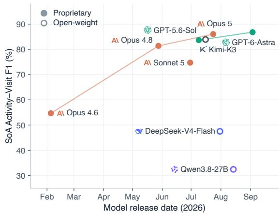  
Figure 3: SoA Activity-Visit F1 on complete protocols (Table 2) against model release date. Lines connect models of the same family; hollow markers denote openweight models.

On objectives and endpoints, Kimi-K3 attains the highest objective F1 (84.9%) at \$0.63 per run, below GPT-6-Astra (\$1.07) and Opus 4.6 (\$1.16). DeepSeek-V4-Flash marks the low-cost extreme: it reaches 80.2% criteria F1 at \$0.04 per run, 34 times cheaper than GPT-6-Astra. Cost is thus not a proxy for quality. For tasks on which frontier agents perform similarly, substantially cheaper configurations can be chosen with little loss in performance.

## Takeaways.

• Frontier coding agents reliably locate protocol evidence and recover much of its surface content, but still fall short on relational structure such as endpoint linkage and study timelines.

• Turns and tool errors vary with the task and peak on SoA tables, but within a task, longer trajectories are not associated with higher accuracy.

• When agents perform similarly, cheaper configurations can deliver comparable accuracy.

## 3 Further Analysis

This section examines how agent performance changes across model releases and where agents fail. Appendix F reports further analyses, including comparisons with OCR and documentunderstanding models and with a RAG pipeline, eligibility criteria by category, and results by PDF text accessibility.

## 3.1 Performance across Model Releases

We analyze how SoA table extraction performance changes across model releases, plotting documentlevel Activity-Visit F1 against each model’s release date (Figure 3). Performance improves quickly within model families: Opus rises from 54.7% for Opus 4.6 (February 2026) to 86.0% for Opus 5 (July 2026). Since July, frontier agents have clustered between 83.7% and 86.8%, still short of full accuracy. Open-weight models released in the same period diverge: Kimi-K3 (83.9%) matches proprietary agents, whereas DeepSeek-V4-Flash (47.5%) and Qwen3.8-27B (32.5%) fall far behind.

## 3.2 Failure Analysis

To understand where coding agents fail, we classify each failing agent run, defined as a run with at least one detected defect. These failures fall mainly into five categories: transcription fidelity, longdocument localization and coverage, relational structure reconstruction, domain concept grounding, and execution reliability. As Figure 4a shows, the dominant failure category differs markedly across tasks.

For eligibility criteria, transcription fidelity accounts for 88.0% of failing runs: agents locate and read the eligibility section but do not reproduce it exactly. These deviations can change the clinical meaning. Among near-verbatim transcriptions, 167 alter a comparison operator and 308 alter a number, for example rendering “≥ 100 meters” as “> 100 meters” (Figure 4b). For indication extraction, domain concept grounding is the largest category (51.7%), reflecting failures to identify the condition under study. DeepSeek-V4-Flash, for example, returns “Non-Valvular Atrial Fibrillation” for a study whose indication is recurrent embolic stroke. For objectives and endpoints, localization and coverage account for a substantial share (26.7%), because endpoints are distributed across the synopsis, main text, and tables. For SoA tables, relational structure accounts for 58.9% of failing runs, most often because agents reconstruct the table but place scheduling marks in the wrong cells; a single misresolved merged cell can shift every subsequent mark on a page. Most of the remaining failing runs (37.5%) are localization failures, in which agents miss the annotated SoA pages.

Structured timeline extraction is dominated by domain concept grounding (65.2%): agents often identify the right visits but do not describe them with the expected encounter categories. Although the task instruction explicitly asks agents to follow USDM v4.0, they do not apply its controlled terminology, suggesting that agents recognize the standard but lack knowledge of its detailed specifications. Execution reliability, by contrast, accounts for at most 3.6% of failing runs in any task: the nine agents almost always produce usable output, and their errors lie in its content.

## 4 TRIALSCRIBE: A Domain-Specific Harness for Protocol Digitization

Our analysis points to two practical obstacles. First, protocols are often confidential, which favors compact open-weight models (e.g., Qwen3.8-27B) that run locally in private environments, yet these models fall behind proprietary agents (§3.1). Second, most failures arise after the evidence is found, from unfaithful transcription, misplaced structure, and unfamiliar domain conventions (§3.2). We therefore introduce TRIALSCRIBE, a domain-specific harness layer that equips an existing coding agent with task skills, which supply domain knowledge and output conventions, and a verification loop, which audits the output against the source. We examine whether TRIALSCRIBE allows a locally served open-weight model to match proprietary coding agents.

## 4.1 Design

Task skills. For each task, TRIALSCRIBE provides a skill, a SKILL.md file placed in the agent’s environment and registered with the harness. The agent reads it at the start of the task and then decides when and how to apply its guidance and tools as it works. Each skill encodes the domain knowledge and working procedures that the task requires: how protocols typically organize and cross-reference the relevant information, which conventions determine a correct output, and which checks confirm that the output is complete and faithful to the source.

Verification loop. After the agent writes a draft, a fresh agent session audits it against the protocol with read-only access to both the protocol and the candidate output. The auditor reports concrete errors together with their source pages and suggested corrections, and a gold-free gate checks the report for schema validity and internal consistency. If errors remain, the agent applies minimal sourcesupported fixes, and the revised output is audited again, for at most two rounds. For SoA table extraction, the agent instead verifies its output within its own session (Appendix H.3).

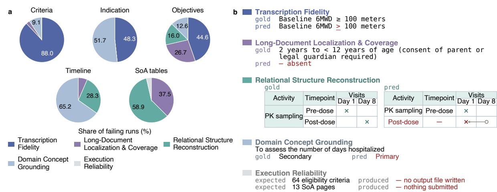  
Figure 4: Failure analysis across protocol digitization tasks. (a) Each pie shows the distribution of failure categories among failing runs within one task; labels indicate shares of at least 8%. (b) Illustrative examples of the five main failure categories, with incorrect or missing predictions highlighted in red.

## 4.2 Results

We instantiate TRIALSCRIBE with Qwen3.8-27B and Pi harness, served locally on two NVIDIA A100 GPUs.

TRIALSCRIBE narrows the gap between a locally served agent and proprietary coding agents. As Figure 1(e) shows, TRIALSCRIBE improves Qwen3.8-27B on every evaluated task, e.g., 15.2% on eligibility criteria F1, 22.2% on objective F1, 18.8% on endpoint F1, and by 37.1% on epoch accuracy, 6.2% on activity recall, and 59.4% on encounter recall. With TRIALSCRIBE, the local model surpasses GPT-5.6-Sol on endpoint extraction (65.5% vs. 63.6%) and comes within 1.9% of Opus-5 on endpoints. On timeline extraction, it exceeds both proprietary agents on activity recall (88.6% vs. 88.1% and 87.2%) and encounter recall (65.2% vs. 23.2% and 0.0%), and trails GPT-5.6- Sol on epoch accuracy (60.0% vs. 61.1%).

Verification helps most where transcription fidelity dominates. Comparing the draft and final outputs of the same runs, we find that verification raises eligibility criteria F1 from 72.2% to 82.3%, objective F1 from 73.2% to 78.2%, and endpoint F1 from 62.0% to 65.5%, but leaves indication F1 unchanged at 77.5%. This pattern mirrors the failure profiles in Figure 4: eligibility criteria fail mainly through transcription errors that a sourcegrounded audit can detect.

Structural and standard-specific gaps remain, but they are likely to narrow as open-weight models improve. On SoA tables, TRIALSCRIBE reaches 75.1% Activity-Visit F1 and 78.6% Sub/- sup F1, but still trails GPT-5.6-Sol and Opus 5 in

Activity-Visit F1 (75.1% vs. 83.7% and 86.0%), suggesting that reconstructing complex table structure remains limited by the underlying model. Nevertheless, open-weight models have improved rapidly (Edwards and Emberson, 2026), and because TRIALSCRIBE does not rely on a particular model, it can be applied directly to stronger ones, which we expect to close the remaining gaps.

## 5 Related Work

Prior work on protocol digitization structures eligibility criteria for cohort queries (Kang et al., 2017; Yuan et al., 2019; Park et al., 2024) or interprets schedule-of-activities tables (Dhuliawala et al., 2018; Kumar et al., 2024), mostly on registry text; Babaeipour et al. (2026) cover all four categories with a RAG system on 23 unreleased protocols. Document parsers (Cui et al., 2025a; Poznanski et al., 2025) and benchmarks (Ouyang et al., 2025; Zhang et al., 2026) evaluate layout recovery and schema-guided extraction, while coding agents (Wang et al., 2024; Yang et al., 2024; Soni et al., 2026) and agent skills (Li et al., 2026) increasingly reach beyond software engineering. See Appendix B for more details.

## 6 Conclusion

We introduce TRIALPD-BENCH and find that even the strongest coding agents usually locate the required evidence but fail in the last mile of transcribing and structuring it. We further develop TRIALSCRIBE, which enables a locally served open-weight model to match or surpass proprietary agents such as GPT-5.6-Sol.

## Limitations

We use clinical trial protocol digitization as a testbed for studying coding agents on longdocument tasks, so our findings are bounded by this setting. At the same time, the properties that make protocols challenging, namely their length, heterogeneous layouts, complex tables, and information distributed across sections, are shared by many other long documents, such as regulatory filings, contracts, and technical specifications. We therefore expect some of our findings, in particular that agents usually locate the required evidence but lose accuracy when transcribing and structuring it, to be informative beyond this setting.

Moreover, structured timeline extraction remains challenging for current coding agents, and our evaluation of this task includes only three protocols. The structured timeline also underlies many downstream tasks, such as main and sub timeline extraction, which are beyond the scope of this paper.

## Ethics Statement

All protocol documents in TRIALPD-BENCH are publicly available on ClinicalTrials.gov, and we use them as released without collecting any additional data. The reference annotations were produced by the authors; no external annotators were recruited or compensated, and the work involves no humansubject research. We do not foresee significant ethical risks from this work.

## References

Anthropic. Claude code. https://claude.com/ product/claude-code. Accessed: 2026-09-12.

Ramtin Babaeipour, François Charest, and Madison Wright. 2026. Ai-assisted protocol information extraction for improved accuracy and efficiency in clinical trial workflows. Journal ofBiomedical Informatics, page 105036.

Shuai Bai, Yuxuan Cai, Ruizhe Chen, Keqin Chen, Xionghui Chen, Zesen Cheng, Lianghao Deng, Wei Ding, Chang Gao, Chunjiang Ge, et al. 2025. Qwen3- vl technical report. arXiv preprint arXiv:2511.21631.

Mary Regina Boland, Samson W Tu, Simona Carini, Ida Sim, and Chunhua Weng. 2012. Elixr-time: a temporal knowledge representation for clinical research eligibility criteria. AMIA summits on translational science proceedings, 2012:71.

CDISC. Unified Study Definitions Model (USDM). Accessed: 2026-09-12.

An-Wen Chan, Isabelle Boutron, Sally Hopewell, David Moher, Kenneth F Schulz, Gary S Collins, Ruth Tunn, Rakesh Aggarwal, Michael Berkwits, Jesse A Berlin, et al. 2025. Spirit 2025 statement: updated guideline for protocols of randomised trials. The Lancet, 405(10491):e19–e27.

Miao Chen, Ganhui Lan, Fang Du, and Victor Lobanov. 2020. Joint learning with pre-trained transformer on named entity recognition and relation extraction tasks for clinical analytics. In Proceedings of the 3rd Clinical Natural Language Processing Workshop, pages 234–242.

Cheng Cui, Ting Sun, Suyin Liang, Tingquan Gao, Zelun Zhang, Jiaxuan Liu, Xueqing Wang, Changda Zhou, Hongen Liu, Manhui Lin, Yue Zhang, Yubo Zhang, Handong Zheng, Jing Zhang, Jun Zhang, Yi Liu, Dianhai Yu, and Yanjun Ma. 2025a. Paddleocr-vl: Boosting multilingual document parsing via a 0.9b ultra-compact vision-language model. Preprint, arXiv:2510.14528.

Cheng Cui, Ting Sun, Manhui Lin, Tingquan Gao, Yubo Zhang, Jiaxuan Liu, Xueqing Wang, Zelun Zhang, Changda Zhou, Hongen Liu, et al. 2025b. Paddleocr 3.0 technical report. arXiv preprint arXiv:2507.05595.

Surabhi Datta, Kyeryoung Lee, Hunki Paek, Frank J Manion, Nneka Ofoegbu, Jingcheng Du, Ying Li, Liang-Chin Huang, Jingqi Wang, Bin Lin, et al. 2024. Autocriteria: a generalizable clinical trial eligibility criteria extraction system powered by large language models. Journal ofthe American Medical Informatics Association, 31(2):375–385.

DeepSeek-AI. Deepseek harness. https://github. com/deepseek-ai/deepseek-harness. Accessed: 2026-09-23.

Murtaza Dhuliawala, Nicholas Fay, Daniel Gruen, and Amar Das. 2018. What happens when? interpreting schedule of activity tables in clinical trial documents. In Proceedings ofthe 2018 ACM International Conference on Bioinformatics, Computational Biology, and Health Informatics, pages 301–306.

Nicholas J Dobbins, Tony Mullen, Özlem Uzuner, and Meliha Yetisgen. 2022. The leaf clinical trials corpus: a new resource for query generation from clinical trial eligibility criteria. Scientific Data, 9(1):490.

Earendil Works. pi coding agent. https://github. com/earendil-works/pi. Accessed: 2026-09-23.

Jack Edwards and Luke Emberson. 2026. Open models lag state-of-the-art closed models by 4 months. https://epoch.ai/data-insights/ open-closed-eci-gap. Epoch AI. Accessed: 2026- 09-24.

Harbor Framework Team. 2026. Harbor: A framework for evaluating and optimizing agents and models in container environments.

Vojtech Huser, Chandan Sastry, Matthew Breymaier, Asma Idriss, and James J Cimino. 2015. Standardizing data exchange for clinical research protocols and case report forms: An assessment of the suitability of the clinical data interchange standards consortium (cdisc) operational data model (odm). Journal of biomedical informatics, 57:88–99.

Lan Jiang, Colby J Vorland, Xiangji Ying, Andrew W Brown, Joe D Menke, Gibong Hong, Mengfei Lan, Evan Mayo-Wilson, and Halil Kilicoglu. 2025. Spirit-consort-tm: a corpus for assessing transparency of clinical trial protocol and results publications. Scientific Data, 12(1):355.

Tian Kang, Shaodian Zhang, Youlan Tang, Gregory W Hruby, Alexander Rusanov, Noémie Elhadad, and Chunhua Weng. 2017. Eliie: An open-source information extraction system for clinical trial eligibility criteria. Journal ofthe American Medical Informatics Association, 24(6):1062–1071.

Bhawesh Kumar, Jonathan Amar, Eric Yang, Nan Li, et al. 2024. Selective fine-tuning on llm-labeled data may reduce reliance on human annotation: A case study using schedule-of-event table detection. In Machine Learningfor Healthcare Conference. PMLR.

Fabrício Kury, Alex Butler, Chi Yuan, Li-heng Fu, Yingcheng Sun, Hao Liu, Ida Sim, Simona Carini, and Chunhua Weng. 2020. Chia, a large annotated corpus of clinical trial eligibility criteria. Scientific data, 7(1):281.

LandingAI. 2026. Landingai - agentic apis for intelligent document processing. https://landing.ai/. Accessed: 2026-09-14.

Xiangyi Li, Yimin Liu, Wenbo Chen, Bingran You, Zonglin Di, Yifeng He, Shenghan Zheng, Kyoung Whan Choe, Jiankai Sun, Shuyi Wang, et al. 2026. Skillsbench: Benchmarking how well agent skills work across diverse tasks. arXiv preprint arXiv:2602.12670.

Xiong Liu, Greg L Hersch, Iya Khalil, and Murthy V Devarakonda. 2021. Clinical trial information extraction with bert. In ICHI, pages 505–506.

Thomas Lyttelton, Maxim Massenkoff, and Nathan Wilmers. 2026. Coding agents in the social sciences.

Bohan Lyu, Yucheng Yang, Siqiao Huang, Jiaru Zhang, Qixin Xu, Xinghan Li, Xinyang Han, Yicheng Zhang, Huaqing Zhang, Runhan Huang, et al. 2026. Mls-bench: A holistic and rigorous assessment of ai systems on building better ai. arXiv preprint arXiv:2605.08678.

Aman Madaan, Niket Tandon, Prakhar Gupta, Skyler Hallinan, Luyu Gao, Sarah Wiegreffe, Uri Alon, Nouha Dziri, Shrimai Prabhumoye, Yiming Yang, et al. 2023. Self-refine: Iterative refinement with self-feedback. Advances in neural information processing systems, 36:46534–46594.

Mistral AI Team. 2025. Mistral ocr. https://mistral. ai/news/mistral-ocr/. Accessed: 2026-09-14.

Moonshot AI. Kimi code cli. https://github.com/ MoonshotAI/kimi-code. Accessed: 2026-09-23.

Xuying Ning, Katherine Tieu, Dongqi Fu, Tianxin Wei, Zihao Li, Yuanchen Bei, Jiaru Zou, Mengting Ai, Zhining Liu, Ting-Wei Li, et al. 2026. Code as agent harness. arXiv preprint arXiv:2605.18747.

OpenAI. Introducing codex. https://openai.com/ index/introducing-codex/. Accessed: 2026-09- 12.

Linke Ouyang, Yuan Qu, Hongbin Zhou, Jiawei Zhu, Rui Zhang, Qunshu Lin, Bin Wang, Zhiyuan Zhao, Man Jiang, Xiaomeng Zhao, et al. 2025. Omnidocbench: Benchmarking diverse pdf document parsing with comprehensive annotations. In 2025 IEEE/CVF Conference on Computer Vision and Pattern Recognition (CVPR), pages 24838–24848. IEEE.

Jimyung Park, Yilu Fang, Casey Ta, Gongbo Zhang, Betina Idnay, Fangyi Chen, David Feng, Rebecca Shyu, Emily R Gordon, Matthew Spotnitz, et al. 2024. Criteria2query 3.0: Leveraging generative large language models for clinical trial eligibility query generation. Journal of biomedical informatics, 154:104649.

Jake Poznanski, Luca Soldaini, and Kyle Lo. 2025. olmocr 2: Unit test rewards for document ocr. arXiv preprint arXiv:2510.19817.

Bo Qiao, Liqun Li, Xu Zhang, Shilin He, Yu Kang, Chaoyun Zhang, Fangkai Yang, Hang Dong, Jue Zhang, Lu Wang, et al. 2023. Taskweaver: A code-first agent framework. arXiv preprint arXiv:2311.17541.

Andrew Richardson and Patrick Genyn. 2025. Clinical trial schedule of activities specification using fast healthcare interoperability resources definitional resources: Mixed methods study. JMIR Medical Informatics, 13:e71430.

Noah Shinn, Federico Cassano, Ashwin Gopinath, Karthik Narasimhan, and Shunyu Yao. 2023. Reflexion: Language agents with verbal reinforcement learning. Advances in neural information processing systems, 36:8634–8652.

Brandon Smock, Rohith Pesala, and Robin Abraham. 2022. Pubtables-1m: Towards comprehensive table extraction from unstructured documents. In 2022 IEEE/CVF Conference on Computer Vision and Pattern Recognition (CVPR), pages 4624–4632. IEEE.

Aditya Bharat Soni, Boxuan Li, Xingyao Wang, Valerie Chen, and Graham Neubig. 2026. Coding agents with multimodal browsing are generalist problem solvers. In Findings of the Association for Computational Linguistics: EACL 2026, pages 6052–6069.

Li Sun, Liu He, Shuyue Jia, Yangfan He, and Chenyu You. 2025. Docagent: An agentic framework for multi-modal long-context document understanding. In Proceedings of the 2025 Conference on Empirical Methods in Natural Language Processing, pages 17712–17727.

Said Taghadouini, Adrien Cavaillès, and Baptiste Aubertin. 2026. Lightonocr: A 1b end-to-end multilingual vision-language model for state-of-the-art ocr. arXiv preprint arXiv:2601.14251.

U.S. Food and Drug Administration. Spectrum of Diseases/Conditions. Therapeutic areas in Written Requests as of December 31, 2019. Accessed: 2026-09- 13.

U.S. National Library of Medicine. Clinicaltrials.gov. https://clinicaltrials.gov/. Accessed: 2026- 09-13.

Xiaoqiu Wang, Yizhe Chi, Wenyi Li, Deyao Hong, Zhihan Shan, Mingju Gao, Kaisen Yang, Youjie Zheng, Calvin Xiao, and Qinhuai Na. 2026a. Pptbench: Can coding agents reconstruct the visual world through structured, editable slides. arXiv preprint arXiv:2609.29718.

Xingyao Wang, Yangyi Chen, Lifan Yuan, Yizhe Zhang, Yunzhu Li, Hao Peng, and Heng Ji. 2024. Executable code actions elicit better llm agents. In International Conference on Machine Learning, pages 50208–50232. PMLR.

Yuru Wang, Lejun Cheng, Yuxin Zuo, Sihang Zeng, Bingxiang He, Che Jiang, Junlin Yang, Yuchong Wang, Kaikai Zhao, Weifeng Huang, et al. 2026b. Naturebench: Can coding agents match the published sota of nature-family papers? arXiv preprint arXiv:2606.24530.

Jaime Yan. 2026. Clinagent: Ai-assisted methodology for clinical trial data processing and statistical programming. Biology Methods and Protocols, 11(1):bpag032.

John Yang, Carlos Jimenez, Alexander Wettig, Kilian Lieret, Shunyu Yao, Karthik Narasimhan, and Ofir Press. 2024. Swe-agent: Agent-computer interfaces enable automated software engineering. Advances in Neural Information Processing Systems, 37:50528– 50652.

Chi Yuan, Patrick B Ryan, Casey Ta, Yixuan Guo, Ziran Li, Jill Hardin, Rupa Makadia, Peng Jin, Ning Shang, Tian Kang, et al. 2019. Criteria2query: a natural language interface to clinical databases for cohort definition. Journal ofthe American Medical Informatics Association, 26(4):294–305.

Boyang Zhang, Adrian Lyjak, Eli Stewart, Zhaoqi Li, and Simon Suo. 2026. Extractbench: A benchmark for schema-guided enterprise document extraction. arXiv preprint arXiv:2607.29677.

Lianmin Zheng, Liangsheng Yin, Zhiqiang Xie, Chuyue Sun, Jeff Huang, Cody H Yu, Shiyi Cao, Christos Kozyrakis, Ion Stoica, Joseph E Gonzalez, et al. 2024. Sglang: Efficient execution of structured language model programs. Advances in neural information processing systems, 37:62557–62583.

Appendix Contents   
A Background 12   
A.1 Coding Agents 12   
B Additional Related Work 12   
C Benchmark Details 13   
C.1 Comparison with Prior Work 13   
C.2 Corpus Construction 13   
C.3 Annotation Process 13   
D Tasks and Evaluation Metrics 14   
D.1 Indication Extraction 15   
D.2 Eligibility Criteria Extraction . 15   
D.3 Objectives and Endpoints Extraction 15   
D.4 Schedule of Activities Table Ex  
traction 16   
D.5 Structured Timeline Extraction 17   
E Experimental Details 17   
E.1 Coding Agents 17   
E.2 RAG Baseline 17   
E.3 OCR and Document-  
Understanding Baselines 18   
E.4 Task Instructions 18   
F Additional Analyses 18   
F.1 Comparison with OCR and   
Document-Understanding Models 18   
F.2 Comparison with a RAG Pipeline 18   
F.3 Eligibility Criteria by Category . . 19   
F.4 Task-Level Results by PDF Text   
Accessibility . 19   
F.5 Full Numerical Results 20   
G Failure Analysis Details 20   
G.1 Failure Taxonomy . 20   
G.2 Per-Model Failure Profiles 20   
G.3 Additional Examples 20   
H TRIALSCRIBE Details 20   
H.1 Development Protocols 20   
H.2 Task Skills . 21   
H.3 Verification Loop 24   
H.4 Ablation of Skills and Verification 33   
H.5 SoA Table Extraction Case Study . 33   
Future Work 33   
J Use of AI Assistants 33   
K Data Sources and Licenses 33

## A Background

## A.1 Coding Agents

A coding agent combines a language model with an agent harness. The model interprets task instructions, reasons over the available context, and generates code or tool calls. The harness is the surrounding software infrastructure that manages instructions and context, provides tool interfaces, and coordinates interaction with the execution environment. Typical tools support file access, search, edit, and code execution, while the harness manages the execution loop and associated controls.

These components operate through an iterative interaction loop: the model selects an action, the harness executes the corresponding tool call and returns its result. The model then uses this feedback to determine subsequent actions. This process continues until the agent produces a final response or an execution limit is reached. The resulting behavior depends on both the underlying model and the harness that provides the operational layer for the model.

## B Additional Related Work

Clinical Trial Protocol Digitization. Research on protocol digitization spans semantic parsing, supervised extraction, and LLM-based methods. EliIE (Kang et al., 2017) and Criteria2Query (Yuan et al., 2019) transform eligibility text into structured representations for clinical database querying, while BERT-based approaches learn clinically relevant entities and relations (Chen et al., 2020; Liu et al., 2021). Chia (Kury et al., 2020) and LCT (Dobbins et al., 2022) provide annotated registry eligibility text for developing these capabilities. AutoCriteria (Datta et al., 2024) and Criteria2Query 3.0 (Park et al., 2024) subsequently introduce LLMs for criteria extraction and query generation. Beyond eligibility, Dhuliawala et al. (2018) interpret schedule-of-activities tables through structural and semantic analysis, and Kumar et al. (2024) study schedule-of-event table detection. Babaeipour et al. (2026) address broader extraction from complete protocol PDFs through a RAG system. Our work complements these approaches by evaluating general-purpose coding agents across multiple protocol extraction tasks and diagnosing their remaining failures.

Document Understanding and Structured Extraction. Document understanding research addresses the recovery of text, layout, and tabular structure from heterogeneous documents. PubTables-1M (Smock et al., 2022) supports table detection and structure recognition, while OmniDocBench (Ouyang et al., 2025) evaluates document parsing across diverse layouts and content types. Recent models, including PaddleOCR-VL (Cui et al., 2025a) and olmOCR 2 (Poznanski et al., 2025), advance these parsing capabilities. At the document-processing level, DocAgent (Sun et al., 2025) combines interactive navigation with evidence review. ExtractBench (Zhang et al., 2026) further evaluates schema-guided enterprise extraction, including coding agents. Our benchmark focuses on clinical protocol requirements, evaluating document recovery, the application of domain knowledge, and the extraction of study concepts and relationships, including activity-visit associations and objective-endpoint links.

Coding Agents and Domain Support. CodeAct (Wang et al., 2024) and SWE-agent (Yang et al., 2024) demonstrate the importance of executable actions and agent-computer interfaces for interactive problem solving. OpenHands-Versa (Soni et al., 2026) further investigates how coding agents equipped with general tools transfer across software engineering, research, and browsing tasks. Domain support is explored through plugins and examples in TaskWeaver (Qiao et al., 2023), and through clinical programming skills in ClinAgent (Yan, 2026). SkillsBench (Li et al., 2026) evaluates the benefits of curated skills across domains, while Self-Refine (Madaan et al., 2023) and Reflexion (Shinn et al., 2023) investigate feedback-guided revision and adaptation. Building on these directions, we examine coding-agent reliability in clinical trial protocol digitization and introduce TRIALSCRIBE, which combines domain skills with a verification loop.

## C Benchmark Details

## C.1 Comparison with Prior Work

Table 6 compares TRIALPD-BENCH with prior datasets and systems for clinical trial protocol digitization. Existing resources mostly target a single information type, typically eligibility criteria, and often use registry or publication text rather than complete protocol documents. The system of Babaeipour et al. (2026) covers all four task categories from protocol PDFs but evaluates 23 protocols and does not release its data.

TRIALPD-BENCH covers all four categories on 150 complete protocol PDFs.

## C.2 Corpus Construction

Source documents. The corpus consists of clinical trial protocol documents associated with 150 unique NCT identifiers on ClinicalTrials.gov (U.S. National Library of Medicine). Each task uses the subset of studies for which reference annotations are available, so a study can contribute to several tasks (Table 1).

Document statistics. The 150 representative documents contain 17,471 pages in total, with a median of 122 pages and a range of 2 to 368 pages. Ninety-eight documents (65.3%) contain at least 100 pages, five contain at least 200 pages, and five contain fewer than 20 pages. Sixteen documents (10.7%) have no extractable text layer, so their content can be recovered only from rendered pages or OCR.

Therapeutic areas and sponsors. We categorize each study by its primary indication using therapeutic-area categories adapted from the FDA’s Spectrum of Diseases/Conditions (U.S. Food and Drug Administration). Assignments follow the principal studied indication and trial intent rather than exclusions, drug mechanism, or sponsor; tumor-directed therapy, including hematologic malignancy, maps to Oncology, and prevention trials map to the disease being prevented. The 150 studies populate 18 FDA categories, and two healthyvolunteer studies without a disease-specific target are reported separately. Sponsor names are taken from registry metadata; after merging duplicate spellings of the same sponsor name, the corpus contains 106 sponsor labels.

## C.3 Annotation Process

Annotators and workflow. Reference annotations were produced by five experts in the clinical trial domain. Each task was annotated and reviewed separately, on its own set of protocols, so the number of instances differs across tasks (Table 1). For each protocol and task, Sonnet-4.6 running in Claude Code first produced a draft extraction from the source PDF, which served only as a starting point. An expert then checked every field of the draft against the PDF, corrected errors, added missing items, and removed unsupported ones. Verbatim fields were taken from the PDF text, or read from the rendered page when the text layer was missing or corrupted, and no draft text was kept without being checked against the source. The lead annotator then reviewed each annotated protocol against the PDF and made the final decision whenever the annotation needed to be changed. This process was used for all tasks except the epochs, encounters, and activities of structured timeline extraction, whose references are taken from the official USDM example studies published by CDISC (CDISC).

<table><tr><td>Work</td><td>Input</td><td>Size (unit)</td><td>Disease indication</td><td>Eligibility criteria</td><td>Objectives &amp; endpoints</td><td>Schedule of activities</td><td>Open source</td></tr><tr><td>Chia (Kury et al., 2020)</td><td>Registry text</td><td>1,000 trials</td><td>x</td><td>√</td><td>x</td><td>x</td><td>√</td></tr><tr><td>LCT (Dobbins et al., 2022)</td><td>Registry text</td><td>1,006 trials</td><td>x</td><td>√</td><td>X</td><td>X</td><td>√</td></tr><tr><td>AutoCriteria (Datta et al., 2024)</td><td>Registry text/XML</td><td>180 trials</td><td>x</td><td>√</td><td>X</td><td>x</td><td>x</td></tr><tr><td>Kumar et al. (Kumar et al., 2024)</td><td>Protocol PDFs</td><td>91 protocols</td><td>x</td><td>x</td><td>X</td><td>△</td><td>x</td></tr><tr><td>SPIRIT-CONSORT-TM (Jiang et al., 2025)</td><td>Publication text</td><td>200 publications</td><td>△</td><td>△</td><td>△</td><td>△</td><td>√</td></tr><tr><td>Babaeipour et al. (Babaeipour et al., 2026)</td><td>Protocol PDFs</td><td>23 protocols</td><td>√</td><td>√</td><td>√</td><td>√</td><td>X</td></tr><tr><td>TRIALPD-BENCH (Ours)</td><td>Protocol PDFs</td><td>150 protocols</td><td>√</td><td>√</td><td>√</td><td>√</td><td>√</td></tr></table>

Table 6: Comparison with prior datasets and systems for clinical trial protocol digitization. ✓ indicates explicit coverage, △ partial or related-task coverage, and ✗ no reported coverage.

Guidelines. Each task has its own annotation guideline. Table 7 lists the steps that annotators followed: general steps that familiarize the annotator with the study, performed for every protocol, followed by the steps of the task being annotated. The rules below define a correct annotation.

• Indication. Record the disease or condition under study in the protocol’s own wording, keeping disease-defining qualifiers such as stage, severity, or biomarker status and omitting enrolment wording such as “patients with”. Distinct diseases are separate entries, whereas a single disease with several qualifiers is one entry.

• Eligibility criteria. Use the detailed eligibility section rather than the synopsis, and include cohort-specific criteria. Each top-level numbered criterion is one item, with its sub-items and any laboratory-threshold table kept inside it. Text is transcribed verbatim, including thresholds, units, and comparison symbols.

• Objectives and endpoints. Record every objective with its level, normalized to primary, secondary, or exploratory, and nest under it the endpoints that measure it. An objective without a stated endpoint receives none.

• Schedule of Activities. Record a mark for every activity-visit cell, resolving merged cells and multi-level visit headers. Footnote markers are kept as superscripts on the row, cell, or visit they

belong to.

## D Tasks and Evaluation Metrics

This appendix specifies the inputs, required outputs, and evaluation metrics for each task. Table 1 summarizes the available task instances and reference annotations. Counts refer to task instances rather than additional unique studies: a source document can contribute to multiple tasks. Each agent is run once per task instance, and all reported scores are means over task instances unless stated otherwise.

Evaluation notation. Let G and $\hat { G }$ denote the reference and predicted items for one task instance, with sizes n and nˆ. For exact matching over multisets, let $c _ { G } ( k )$ and $c _ { \hat { G } } ( \boldsymbol k )$ be the multiplicities of comparison key k. The number of matched items is

$$
T = \sum _ { k } \operatorname* { m i n } \{ c _ { G } ( k ) , c _ { \hat { G } } ( k ) \} .\tag{1}
$$

For sets, each multiplicity is at most one. With nonempty reference and prediction, precision, recall, and F1 are

$$
P = \frac { T } { \hat { n } } , \qquad R = \frac { T } { n } , \qquad F _ { 1 } = \frac { 2 T } { n + \hat { n } } .\tag{2}
$$

An empty prediction against a nonempty reference receives F1 of zero. Task-specific conventions for empty references are stated below. Text comparisons first apply the task-specific normalization described below, which removes formatting differences such as case, whitespace, and markup. Matching remains exact after normalization; it does not use a language-model judge or accept arbitrary paraphrases. Unless stated otherwise, a metric s is aggregated as the unweighted mean of its instance-level scores, $\bar { s } = N ^ { - 1 } \bar { \sum _ { i = 1 } ^ { N } } s _ { i }$ . Timeline Encounter recall instead pools counts across documents. Timeline Activity and Encounter matching use the semantic procedures specified below rather than the exact matching used for the text-extraction tasks.

<table><tr><td>Step Section</td><td>Action</td><td>Notes</td></tr><tr><td colspan="3">General (all tasks)</td></tr><tr><td>1 Title page</td><td>Extract titles</td><td>At least the brief title</td></tr><tr><td>2 Title page 3</td><td>Extract identifiers</td><td>Internal and NCT identifiers</td></tr><tr><td>Title page</td><td>Read the therapeutic area</td><td>Preferably codeable</td></tr><tr><td>4 Title page</td><td>Read the interventions</td><td></td></tr><tr><td colspan="3">Indication 1</td></tr><tr><td>Title page, synopsis</td><td>Identify the indication</td><td></td></tr><tr><td colspan="3">Eligibility criteria</td></tr><tr><td>1 Eligibility criteria</td><td>Read the inclusion criteria</td><td></td></tr><tr><td>2 Eligibility criteria</td><td>Read the exclusion criteria</td><td></td></tr><tr><td colspan="3">Objectives and endpoints</td></tr><tr><td>1 Objectives and endpoints</td><td>Read the objectives</td><td></td></tr><tr><td>2 Objectives and endpoints</td><td>Read the endpoints of each objective</td><td></td></tr><tr><td colspan="3">Schedule of Activities</td></tr><tr><td>1 Study evaluations</td><td>Browse the expected activities</td><td></td></tr><tr><td>2 Schedule of Activities</td><td>Evaluate the planned encounters</td><td>Count first, then name</td></tr><tr><td>3 Schedule of Activities</td><td>Evaluate the planned activities</td><td>Reconcile with the study evaluations</td></tr><tr><td>4 Schedule of Activities</td><td>Evaluate the activities at each encounter</td><td></td></tr><tr><td>5 Schedule of Activities</td><td>Review the footnotes</td><td>Look for key items such as timepoints</td></tr></table>

Table 7: Annotation steps. The general steps were performed for every protocol, before the steps of the task being annotated.

## D.1 Indication Extraction

Input. The complete source PDF.

Output. A JSON object with a descriptions array listing the diseases or conditions investigated in the study. Each description uses the protocol’s wording, including disease qualifiers. Distinct diseases in a multi-cohort study are separate entries, whereas qualifiers of one disease remain part of the same entry.

Metrics. The metric is the F1 score. Descriptions are normalized and matched one to one. Let $M _ { \mathrm { i n d } }$ be the resulting matching. The score is

$$
F _ { \mathrm { i n d } } = \frac { 2 | M _ { \mathrm { i n d } } | } { | G | + | \hat { G } | } .\tag{3}
$$

Both sides empty receive a score of one; only one side empty receives F1 of zero.

## D.2 Eligibility Criteria Extraction

Input. The complete source PDF.

Output. A JSON object with a criteria array. Each criterion has a category (Inclusion or Exclusion) and its details in text. A document that states no eligibility criteria requires an empty array.

Metrics. The comparison key is (category, text). Categories are compared case-insensitively after whitespace normalization. Before matching, text normalization removes HTML tags, decodes HTML entities, lowercases text, collapses whitespace, and strips trailing punctuation. Matching uses the multiset matching in Equation 1, preserving repeated criteria. The F1 score is

$$
F _ { \mathrm { c r i t } } = { \left\{ \begin{array} { l l } { 1 , } & { n = 0 , \ { \hat { n } } = 0 , } \\ { 2 T / ( n + { \hat { n } } ) , } & { { \mathrm { o t h e r w i s e } } . } \end{array} \right. }\tag{4}
$$

A nonempty prediction against an empty reference therefore scores zero. The same convention applies to per-category F1.

Category diagnostics. Inclusion and exclusion F1 are also computed separately. To distinguish extraction from classification errors, criteria are aligned on normalized text alone and category accuracy is computed over those matched pairs:

$$
A _ { \mathrm { c a t } } = \frac { 1 } { | M _ { \mathrm { t e x t } } | } \sum _ { ( g , p ) \in M _ { \mathrm { t e x t } } } \mathbf { 1 } [ c _ { g } = c _ { p } ] .\tag{5}
$$

The model-level accuracy averages $A _ { \mathrm { { c a t } } }$ over the instances with at least one text-matched pair. Results are reported in Appendix F.3.

## D.3 Objectives and Endpoints Extraction Input. The complete source PDF.

Output. A JSON object with an objectives array. Each objective contains objectiveText, objectiveLevel, and a nested endpoints array. Each endpoint contains endpointText and endpointLevel. Levels are normalized to primary, secondary, or exploratory. Endpoints must remain associated with the objective they address; an objective without a stated endpoint receives an empty array.

Metrics. We evaluate both objective recovery and endpoint association. For an objective $^ { O , }$ let $\ell _ { o }$ and $t _ { o }$ denote its normalized level and text. For an endpoint $e ,$ let $\ell _ { e }$ and $t _ { e }$ denote its level and text, and let $o ( e )$ be its parent objective. The three comparison keys are

$$
k _ { \mathrm { o b j } } ( o ) = ( \ell _ { o } , t _ { o } ) ,\tag{6}
$$

$$
k _ { \mathrm { e n d } } ( e ) = ( \ell _ { e } , t _ { e } ) ,\tag{7}
$$

$$
k _ { \mathrm { a t t } } ( e ) = ( t _ { o ( e ) } , \ell _ { e } , t _ { e } ) .\tag{8}
$$

After field normalization, we compute multiset F1 for each key type, giving objective F1 $F _ { \mathrm { o b j } }$ , endpoint F1 $F _ { \mathrm { e n d } }$ , and objective-linked endpoint F1 $F _ { \mathrm { a t t } }$ , which are reported separately. Consequently, recovering an endpoint under the wrong objective fails the association metric even when its text is correct. Before comparison, text fields are normalized by stripping HTML tags, decoding entities, lowercasing text, collapsing whitespace, and removing trailing punctuation.

## D.4 Schedule of Activities Table Extraction

Track 1: page-level extraction. The input is a single PDF page containing an SoA table. The system transcribes the table into HTML, preserving activity labels, visit headers, cell contents, merged cells, and footnote markers. The Harbor output specification additionally requests surrounding page text and the footnote block as Markdown in the same output file. Scheduling marks such as ticks are represented as X, and superscript markers are retained using . This track contains 86 page samples from 40 NCT identifiers, with one reference table per sample. The scorer extracts 5,001 distinct activity-visit pairs across these samples, with a median of 52 and a range of 3-239 per sample.

Track 2: document-level extraction. The input is a complete protocol PDF. The system must locate all SoA pages, recover their tables, and declare their source PDF page numbers in the output, for example using data-pages attributes. This track contains 37 protocols and 70 reference tables; 10 protocols have multiple SoA pages, and the number of annotated SoA pages ranges from 1 to 13 per protocol. It includes only protocols for which the reference covers all SoA pages. The task therefore adds page localization to table transcription, while using the same table-content metrics as Track 1.

Activity–visit relations. Each scheduling mark defines a pair $( a , v )$ between an activity and a visit. The evaluator expands merged cells, combines hierarchical visit headers, and normalizes labels before forming the pair sets X and $\hat { X }$ . Normalization standardizes case, spacing, selected punctuation, and equivalent typographic forms; it does not perform semantic paraphrase matching. The Activity-Visit F1 is

$$
F _ { X } = \frac { 2 | X \cap \hat { X } | } { | X | + | \hat { X } | } .\tag{9}
$$

A scheduling mark assigned to the wrong visit counts as an incorrect relation. Duplicate identical pairs within an output are counted once.

Footnote attachment. SoA tables use superscript or subscript markers, such as “Hematologya” $\mathrm { o r } \ ^ { 6 6 } \mathrm { X } ^ { c 9 }$ , to link an activity row, a single cell, or a visit column to a footnote below the table. Sub/sup F1 checks whether each marker is attached to the right place, not only whether it appears. A marker on an activity label is recorded as a pair $( a , m )$ of the activity a and the marker m; a marker inside a cell is recorded as a triple $( a , v , m )$ that also includes the visit $v ;$ and a marker on a visit header is recorded as $( * , v , m )$ , with a placeholder ∗ in place of the activity. With A and Aˆ the resulting sets for the reference and the prediction,

$$
F _ { A } = \frac { 2 | A \cap \hat { A } | } { | A | + | \hat { A } | } .\tag{10}
$$

A marker that is recovered but attached to a different row, cell, or visit therefore does not count. Markers are recognized from / tags and Unicode superscript and subscript characters; a marker written as plain text next to a label is not counted. For both Activity-Visit F1 and Sub/sup F1, two empty sets score one, while a single empty side scores zero.

Fixed-gold-page aggregation. Document-level extraction uses every annotated SoA page, not only pages successfully located by a method. For protocol $i = 1 , \ldots , N$ , let $L _ { i }$ be its gold page set and $f _ { i p }$ the Activity-Visit or Sub/sup F1 for page p, with $f _ { i p } = 0$ when that page is not recovered. The reported extraction metric is

$$
\bar { F } = \frac { 1 } { N } \sum _ { i = 1 } ^ { N } \frac { 1 } { | L _ { i } | } \sum _ { p \in L _ { i } } f _ { i p } .\tag{11}
$$

Thus, a protocol with no recovered gold page scores zero and remains in the denominator.

## D.5 Structured Timeline Extraction

Input. The complete source PDF.

Output. A JSON object listing the study’s epochs, encounters, and activities.

• Epoch: type, with epochs listed in study order.

• Encounter: label and description, which identify the visit, and type and contactModes.

• Activity: label.

Epoch accuracy. Let $g _ { 1 } , \ldots , g _ { n }$ and $p _ { 1 } , \ldots , p _ { m }$ be the ordered reference and predicted epoch types. Types are case-folded, trimmed, and whitespacenormalized. Positional accuracy is

$$
A _ { \mathrm { e p o c h } } = \frac { \sum _ { j = 1 } ^ { \operatorname* { m i n } ( n , m ) } \delta ( g _ { j } , p _ { j } ) } { \operatorname* { m a x } ( n , m ) } .\tag{12}
$$

Here $\delta ( g , p ) = 1 $ only when both types are nonmissing and equal, and is zero otherwise. Missing types retain their positions, and there is no sequence realignment or synonym mapping, so an extra or omitted epoch shifts every later comparison. In the following example, one inserted epoch leaves only the first position matching, giving $A _ { \mathrm { e p o c h } } = 1 / \operatorname* { m a x } ( 3 , 4 ) = 0 . 2 5$

<table><tr><td>Position</td><td>1</td><td>2</td><td>3</td><td>4</td></tr><tr><td>Reference Screening Treatment Follow-up</td><td></td><td></td><td></td><td></td></tr><tr><td>Prediction Screening</td><td></td><td>Run-in</td><td>Treatment Follow-up</td><td></td></tr><tr><td>Match</td><td>√</td><td>X</td><td>X</td><td>x</td></tr></table>

Scores are averaged over all three documents, with failed extraction scored zero.

Activity recall. For study $i ~ = ~ 1 , \dots , N$ , let $G _ { i } ^ { \mathrm { a c t i v i t y } }$ and $\hat { G } _ { i } ^ { \mathrm { a c t i v i t y } }$ be the reference and predicted activity labels. We use Opus-5 with Claude Code as an agentic matcher: given the two label lists, it identifies the reference and predicted labels that denote the same clinical activity. From these pairs, we compute a maximum-cardinality one-to-one matching $M _ { i } ,$ in which each reference and each predicted activity is used at most once. The reported recall is

$$
R _ { \mathrm { a c t i v i t y } } = \frac { 1 } { N } \sum _ { i = 1 } ^ { N } \frac { \lvert \boldsymbol { M } _ { i } \rvert } { \lvert \boldsymbol { G } _ { i } ^ { \mathrm { a c t i v i t y } } \rvert } .\tag{13}
$$

A predicted activity with a blank label cannot be matched, and a failed extraction scores zero.

Encounter recall. For study i, let $G _ { i } ^ { \mathrm { e n c } }$ and $\hat { G } _ { i } ^ { \mathrm { e n c } }$ be the reference and predicted encounters. The same agentic matcher first proposes pairs referring to the same visit using encounter labels, descriptions, and explicit timing context. A deterministic maximum-cardinality one-to-one matching is then computed before any attribute is checked. Let $M _ { i } ^ { \mathrm { e n c } }$ denote this matching, whose elements are pairs $( g , p )$ with $g \in G _ { i } ^ { \mathrm { e n c } }$ and $p \ \in \ { \hat { G } } _ { i } ^ { \mathrm { e n c } }$ . A matched pair counts as a recovered encounter only when the two encounters also agree on two additional attributes, the encounter type and the contact modes. Let $C ( g , p ) = 1$ if g and p agree on both attributes, and 0 otherwise. We report

$$
R _ { \mathrm { e n c } } = \frac { \sum _ { i = 1 } ^ { N } \sum _ { ( g , p ) \in M _ { i } ^ { \mathrm { e n c } } } C ( g , p ) } { \sum _ { i = 1 } ^ { N } | G _ { i } ^ { \mathrm { e n c } } | } .\tag{14}
$$

Unmatched gold visits and failed extractions contribute zero correct matches. Type uses case- and whitespace-normalized equality; contact modes use normalized unordered sets. This metric measures recovered visits with correct attributes.

## E Experimental Details

## E.1 Coding Agents

Table 8 lists the evaluated models and harnesses. In addition to the nine models reported in the main text, we also evaluate GPT-4o with Codex, whose results are reported only in the appendix. Each task instance runs in an isolated container that contains the source PDF, the task instruction, and an output directory; reference annotations are never mounted. Qwen3.8-27B is served locally with SGLang (Zheng et al., 2024), with a 131,072-token context window and a maximum output of 16,384 tokens.

## E.2 RAG Baseline

The RAG baseline follows the protocol information extraction system of Babaeipour et al. (2026). The generator is the same model that is evaluated as a coding agent. For retrieval, we use text-embedding-3-large.

<table><tr><td>Model</td><td>Model identifier</td><td>Harness</td></tr><tr><td>GPT-40</td><td>gpt-4o</td><td>Codex</td></tr><tr><td>GPT-5.6-Sol</td><td>gpt-5.6-sol</td><td>Codex</td></tr><tr><td>GPT-6-Astra</td><td>gpt-6-astra</td><td>Codex</td></tr><tr><td>Opus 4.6</td><td>claude-opus-4-6</td><td>Claude Code</td></tr><tr><td>Opus 4.8</td><td>claude-opus-4-8</td><td>Claude Code</td></tr><tr><td>Opus 5</td><td>claude-opus-5</td><td>Claude Code</td></tr><tr><td>Sonnet 5</td><td>claude-sonnet-5</td><td>Claude Code</td></tr><tr><td>Kimi-K3</td><td>Kimi-K3</td><td>Kimi Code</td></tr><tr><td></td><td>DeepSeek-V4-Flash deepseek-v4-flash-0731 DeepSeek Harness</td><td></td></tr><tr><td>Qwen3.8-27B</td><td>Qwen/Qwen3.8-27B</td><td>pi</td></tr></table>

Table 8: Evaluated models and coding-agent harnesses. GPT-4o is reported only in the appendix.

## E.3 OCR and Document-Understanding Baselines

We evaluate eight OCR and documentunderstanding baselines: Mistral OCR (Mistral AI Team, 2025), LightOnOCR-2-1B (Taghadouini et al., 2026), LandingAI (LandingAI, 2026), olmOCR-2-7B (Poznanski et al., 2025), PaddleOCR (Cui et al., 2025b), PaddleOCR-VL (Cui et al., 2025a), and the 2B and 4B variants of Qwen3-VL (Bai et al., 2025).

The eight OCR and document-understanding baselines process the same 86 single-page SoA inputs as the page-level task. Their raw table outputs are scored with the same evaluator. Because Sub/- sup F1 requires footnote markers to be encoded as superscripts or subscripts, baselines that emit plain text, such as Mistral OCR, score low on this metric even when their Activity-Visit F1 is high.

## E.4 Task Instructions

Each task instruction specifies the input file, the output path and format, and the conventions that define a correct output, such as verbatim transcription, one item per numbered criterion, or nesting endpoints under the objective they belong to. For page-level SoA extraction, a separate specification file defines the HTML format; for timeline extraction, a JSON schema following USDM v4.0 defines the output. The instructions do not prescribe how the agent should process the document.

## F Additional Analyses

## F.1 Comparison with OCR and Document-Understanding Models

We compare coding agents with the eight OCR and document-understanding baselines of Appendix E.3 on page-level SoA extraction (Figure 5).

Coding agents outperform specialist OCR and document-understanding models on SoA table extraction. On page-level SoA extraction (Figure 5a), the six strongest agents reach 84.3- 90.0% Activity-Visit F1, exceeding the best specialist baseline, Mistral OCR, at 71.7%. The advantage extends to footnote markers (Figure 5b), where the best agent reaches 85.3% Sub/sup F1, compared with 70.8% for the strongest baseline, LightOnOCR-2-1B. Coding agents also handle the additional localization required at the document level: for five of the six strongest agents, documentlevel Activity-Visit F1 (Table 18) remains within 5 points of the page-level score. General-purpose coding agents can therefore both find SoA tables in complete protocols and transcribe them more accurately than models designed specifically for document parsing.

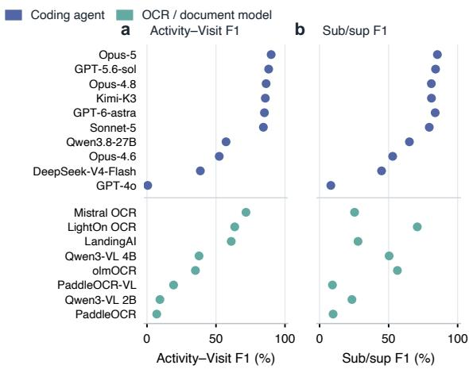  
Figure 5: Page-level SoA extraction, comparing coding agents with OCR and document-understanding baselines using (a) Activity-Visit F1 and (b) Sub/sup F1. Activity-Visit F1 measures the recovery of scheduling associations between activities and visits, usually represented by X marks in SoA table cells. Sub/sup F1 measures the recovery of subscript and superscript footnote markers.

## F.2 Comparison with a RAG Pipeline

Each model is deployed both as a coding agent and as the generator of the RAG pipeline (Appendix E.2).

Coding agents substantially outperform a RAG pipeline on the protocol digitization tasks in TRIALPD-BENCH. Coding agents outperform RAG with the same model on disease indication (Figure 6a), eligibility criteria (Figure 6b), objectives and endpoints (Figure 6c), and SoA table extraction (Table 18). For nine of the ten models, agents improve eligibility criteria F1 by 14.3- 55.9% and endpoint F1 by 4.7-28.9%; among these nine, indication F1 also improves for all but Opus

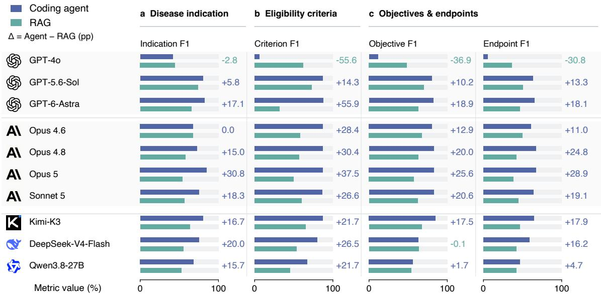  
Figure 6: Comparison of coding agents and the RAG baseline across (a) disease indication, (b) eligibility criteria, and (c) objectives and endpoints. Bars show F1 scores (%), and annotations report the difference between the coding agent and RAG for each model in percentage points $( \Delta = \mathrm { A g e n t } - \mathrm { R A G } )$ . Positive values favor coding agents.

4.6, which ties. The gap is largest for SoA table extraction, where the six strongest agents (GPT-5.6-Sol, GPT-6-Astra, Opus 4.8, Opus 5, Sonnet 5, and Kimi-K3) reach 74.7-86.8% Activity-Visit F1, whereas RAG with the same models reaches only 19.8-51.5%. One possible explanation is that a predefined pipeline determines in advance how documents are parsed and presented to the model, which may limit its generalization and flexibility across protocols and tasks, whereas coding agents can choose and adjust their document-processing strategy for each protocol and task.

## F.3 Eligibility Criteria by Category

Table 9 reports inclusion and exclusion F1. Category accuracy is at least 99.5% for every agent and RAG model, so criteria that are recovered are almost never filed under the wrong category, and the loss in criterion F1 comes from extraction rather than classification.

## F.4 Task-Level Results by PDF Text Accessibility

Tables 10–15 report coding-agent results separately for each task, with each metric grouped into all PDFs, text-sufficient PDFs, and vision-required PDFs.

We divide the PDFs of each task into these two groups by whether the content needed for that task can be read from the PDF’s native text layer. Only the pages that hold this content are examined, such as the eligibility section for criteria extraction or the SoA page for table extraction. If native text extraction with Poppler and PyMuPDF recovers the content, the PDF is text-sufficient. If the content is scanned, garbled by encoding errors, or otherwise missing from the text layer, so that it can be read only from rendered pages or by OCR, the PDF is vision-required. Scans, encoding failures, mixed documents, and redactions were reviewed manually. Blank pages, scanned signatures, and other pages outside the task content do not affect the division, and model outputs and scores are not used. As a result, the same protocol can be text-sufficient for one task and vision-required for another. Visionrequired describes the PDF, not the model: an agent can still read such content with OCR tools even if its language model does not accept images.

<table><tr><td rowspan="2">Model</td><td colspan="2">Inclusion F1</td><td colspan="2">Exclusion F1</td></tr><tr><td>Agent</td><td>RAG</td><td>Agent</td><td>RAG</td></tr><tr><td>GPT-40</td><td>9.4</td><td>58.6</td><td>4.7</td><td>64.2</td></tr><tr><td>GPT-5.6-Sol</td><td>81.8</td><td>67.6</td><td>90.9</td><td>77.1</td></tr><tr><td>GPT-6-Astra</td><td>81.7</td><td>29.8</td><td>91.0</td><td>34.5</td></tr><tr><td>Opus 4.6</td><td>81.9</td><td>53.8</td><td>89.5</td><td>62.4</td></tr><tr><td>Opus 4.8</td><td>82.1</td><td>52.1</td><td>90.0</td><td>60.7</td></tr><tr><td>Opus 5</td><td>82.2</td><td>46.0</td><td>90.5</td><td>52.9</td></tr><tr><td>Sonnet 5</td><td>81.2</td><td>54.0</td><td>89.1</td><td>64.4</td></tr><tr><td>Kimi-K3</td><td>81.7</td><td>59.1</td><td>90.0</td><td>69.8</td></tr><tr><td>DeepSeek-V4-Flash</td><td>74.2</td><td>47.5</td><td>85.5</td><td>58.3</td></tr><tr><td>Qwen3.8-27B</td><td>63.3</td><td>41.1</td><td>69.2</td><td>48.2</td></tr></table>

Table 9: Eligibility criteria F1 (%) by category for coding agents and RAG.

Task coverage. The all/text/vision sample counts are 40/33/7 for indication, 134/94/40 for eligibility criteria, 89/61/28 for objectives and endpoints, 86/61/25 for page-level SoA extraction, 37/29/8 for document-level SoA extraction, and 3/3/0 for structured timeline extraction. In SoA Track 1 each sample is a single PDF page, whereas in SoA Track 2 each sample is a whole protocol.

Scores and aggregation. Indication and criteria tables report F1. Objectives and endpoints include objective F1, endpoint F1, and objective-linked endpoint F1. SoA tables report Activity-Visit F1 and Sub/sup F1. Document-level extraction uses the fixed set of gold SoA pages: a missing page contributes zero, and scores are averaged first within each protocol and then across protocols. Timeline reports Epoch type positional accuracy, semantic Activity recall, and Encounter recall. For Encounter recall, a reference visit counts as recovered only when a matched prediction also has the correct type and contact modes. Encounter recall pools correct visits and gold visits across documents; other reported metrics are macro-averaged over task instances. Failed or missing outputs remain in their prescribed denominators. A dash denotes an empty cohort, not zero performance. Cohort sizes in table headers count PDFs, including for Encounter recall, whose metric denominator counts gold encounters.

## F.5 Full Numerical Results

Tables 16 and 17 report the exact scores plotted in Figures 6 and 5, respectively. Tables 18 and 19 report the document-level SoA and structured timeline results of coding agents and RAG.

## G Failure Analysis Details

## G.1 Failure Taxonomy

We define a failing run as a coding-agent run with at least one detected defect, regardless of its score. Defects are detected automatically by comparing each prediction with the reference annotations using Opus-5. The five main types of failure are:

• Transcription fidelity: a matching item exists in the prediction, but its text differs from the reference, for example through paraphrase, truncation, or changed operators and numbers.

• Long-document localization and coverage: no similar item exists anywhere in the prediction, indicating that the relevant content was not found.

• Relational structure reconstruction: the content is present but placed incorrectly, such as SoA marks in the wrong cells, endpoints under the wrong objective, or incorrect epoch order.

• Domain concept grounding: the prediction selects a different entity, category, or level than the one requested, such as an incorrect encounter attribute.

• Execution reliability: the run produces no usable output, such as a missing, empty, or unparseable file.

Figure 4 shows the profile pooled over the nine main-text agents.

## G.2 Per-Model Failure Profiles

Figure 7 shows the failure profile of each coding agent. GPT-4o differs from the other agents: execution reliability is its largest failure category in five of the six tasks. The remaining agents show broadly similar profiles within each task and differ more in how often they fail than in which categories dominate.

## G.3 Additional Examples

Table 20 lists additional failures from each category.

## H TRIALSCRIBE Details

## H.1 Development Protocols

The skills and audit checklists of TRIALSCRIBE were developed on a small set of protocols per task:

• Indication (8): NCT00874614, NCT00942578, NCT02264574, NCT02320149, NCT02354586, NCT02436668, NCT02709512, NCT04573309.

• Eligibility criteria (8): NCT02320149, NCT03439670, NCT03732820, NCT04770753, NCT04896008, NCT05042362, NCT05523895, NCT05740566.

• Objectives and endpoints (8): NCT00874614, NCT02320149, NCT02727660, NCT03214380, NCT03439670, NCT03470922, NCT03732820, NCT03962543.

• SoA Tables (1): NCT04573309.

• Structured timeline (2): NCT00874614, NCT00942578.

These protocols form the development split and are excluded from the test split, on which all results in this paper are reported.

Table 10: Study indication. Agent results (%); higher is better. Each metric reports all PDFs, text-sufficient PDFs, and vision-required PDFs.
<table><tr><td rowspan="2">Agent</td><td colspan="3">Indication F1</td></tr><tr><td>All n = 40</td><td>Text n = 33</td><td>Vision n = 7</td></tr><tr><td>GPT-40</td><td>41.7</td><td>44.4</td><td>28.6</td></tr><tr><td>GPT-5.6-Sol</td><td>80.0</td><td>84.8</td><td>57.1</td></tr><tr><td>GPT-6-Astra</td><td>82.5</td><td>87.9</td><td>57.1</td></tr><tr><td>Opus 4.6</td><td>67.5</td><td>69.7</td><td>57.1</td></tr><tr><td>Opus 4.8</td><td>72.5</td><td>72.7</td><td>71.4</td></tr><tr><td>Opus 5</td><td>85.0</td><td>87.9</td><td>71.4</td></tr><tr><td>Sonnet 5</td><td>75.0</td><td>78.8</td><td>57.1</td></tr><tr><td>Kimi-K3</td><td>80.0</td><td>81.8</td><td>71.4</td></tr><tr><td>DeepSeek-V4-Flash</td><td>75.0</td><td>72.7</td><td>85.7</td></tr><tr><td>Qwen3.8-27B</td><td>68.3</td><td>71.7</td><td>52.4</td></tr></table>

— denotes an empty cohort, not zero performance. All = all PDFs; Text = text-sufficient; Vision = vision-required. The labels describe task-relevant PDF text accessibility. Failed/missing outputs remain in the source metric denominator.

Table 11: Eligibility criteria. Agent results (%); higher is better. Each metric reports all PDFs, text-sufficient PDFs, and vision-required PDFs.
<table><tr><td rowspan="2">Agent</td><td colspan="3">Criterion F1</td></tr><tr><td>All n = 134</td><td>Text n = 94</td><td>Vision n = 40</td></tr><tr><td>GPT-40 GPT-5.6-Sol</td><td>6.2 87.1</td><td>7.7 88.2</td><td>2.7 84.4</td></tr><tr><td>GPT-6-Astra</td><td>87.8</td><td>89.1</td><td>84.6</td></tr><tr><td>Opus 4.6</td><td>86.8</td><td>88.5</td><td>82.9</td></tr><tr><td>Opus 4.8 Opus 5</td><td>87.2</td><td>88.9</td><td>83.0</td></tr><tr><td>Sonnet 5</td><td>87.0</td><td>88.4</td><td>83.7</td></tr><tr><td></td><td>86.4</td><td>87.6</td><td>83.6</td></tr><tr><td>Kimi-K3</td><td>86.9</td><td>88.7</td><td>82.7</td></tr><tr><td>DeepSeek-V4-Flash</td><td>80.2</td><td>85.0</td><td>68.9</td></tr><tr><td>Qwen3.8-27B</td><td>67.1</td><td>77.1</td><td>43.8</td></tr></table>

denotes an empty cohort, not zero performance. All = all PDFs; Text = text-sufficient; Vision = vision-required. The labels describe task-relevant PDF text accessibility. Failed/missing outputs remain in the source metric denominator.

## H.2 Task Skills

Tables 21-26 are illustrations of the skills.

## H.2.1 Indication Extraction

The indication skill (Table 21) targets the disease being treated or prevented rather than the enrolled population. It covers four points.

• Source selection. The agent collects candidate wording from three locations, the full title, an explicit indication field in the synopsis, and the primary objective, and decides among them by what each states. A dedicated indication field is preferred when it agrees with the trial purpose, and a shorter title may not remove a diseasedefining qualifier. Substudy cohorts, amendment history, and background examples are excluded, and for prevention trials the prevented disease is taken.

• Span normalization. The output is the disease noun phrase: enrolment boilerplate such as “treatment of” or “patients with” and age wording are removed, while disease-defining stage, severity, histology, resistance, and biomarkers are kept. Eligibility restrictions that follow the disease in a title are not appended.

• Verbatim copying and entry count. The phrase is copied with its original spelling, case, and abbreviations, without expansion. A combined phrase that names one diagnostic population stays one entry; it is split only when the protocol states separate indications, and alternatives are never listed to hedge.

## H.2.2 Eligibility Criteria Extraction

The criteria skill (Table 22) aims at a complete, verbatim list. It covers five points.

• Locating the section. The agent finds the detailed eligibility section rather than the synopsis or table of contents, identifies where the inclusion and exclusion lists start and end, and follows continuation pages and cohort-specific sections, checking the page after each apparent end of a list.

Table 12: Objectives and endpoints. Agent results (%); higher is better. Each metric reports all PDFs, text-sufficient PDFs, and vision-required PDFs.
<table><tr><td rowspan="3">Agent</td><td colspan="3"></td><td colspan="3"></td><td colspan="3">Objective-linked endpoint F1</td></tr><tr><td>All</td><td>Objective F1 Text</td><td>Vision</td><td>All</td><td>Endpoint F1 Text</td><td>Vision</td><td>All</td><td>Text</td><td>Vision</td></tr><tr><td> $n = 8 9$ </td><td>n = 61</td><td> $n = 2 8$ </td><td> $n = 8 9$ </td><td> $n = 6 1$ </td><td> $n = 2 8$ </td><td>n = 89</td><td> $n = 6 1$ </td><td>n = 28</td></tr><tr><td>GPT-40</td><td>11.4</td><td>16.6</td><td>0.0</td><td>5.6</td><td>8.0</td><td>0.4</td><td>2.7</td><td>3.9</td><td>0.0</td></tr><tr><td>GPT-5.6-Sol</td><td>80.4</td><td>82.1</td><td>76.6</td><td>63.6</td><td>64.4</td><td>61.7</td><td>54.7</td><td>56.6</td><td>50.6</td></tr><tr><td>GPT-6-Astra</td><td>82.2</td><td>84.5</td><td>77.0</td><td>65.0</td><td>67.7</td><td>59.2</td><td>58.1</td><td>61.4</td><td>50.8</td></tr><tr><td>Opus 4.6</td><td>80.6</td><td>82.7</td><td>75.9</td><td>60.6</td><td>61.7</td><td>58.2</td><td>49.6</td><td>50.1</td><td>48.7</td></tr><tr><td>Opus 4.8</td><td>82.7</td><td>86.2</td><td>75.1</td><td>66.9</td><td>67.1</td><td>66.4</td><td>58.5</td><td>62.2</td><td>50.5</td></tr><tr><td>Opus 5</td><td>82.9</td><td>88.0</td><td>71.9</td><td>67.4</td><td>69.1</td><td>63.6</td><td>58.7</td><td>63.7</td><td>47.8</td></tr><tr><td>Sonnet 5</td><td>82.8</td><td>84.2</td><td>79.7</td><td>63.9</td><td>64.9</td><td>61.6</td><td>54.2</td><td>56.9</td><td>48.4</td></tr><tr><td>Kimi-K3</td><td>84.9</td><td>85.0</td><td>84.7</td><td>64.6</td><td>64.0</td><td>65.8</td><td>56.4</td><td>55.7</td><td>58.0</td></tr><tr><td>DeepSeek-V4-Flash</td><td>63.3</td><td>64.6</td><td>60.4</td><td>58.5</td><td>59.9</td><td>55.5</td><td>36.8</td><td>39.3</td><td>31.4</td></tr><tr><td>Qwen3.8-27B</td><td>56.0</td><td>67.1</td><td>31.8</td><td>46.7</td><td>54.8</td><td>29.1</td><td>32.1</td><td>39.5</td><td>16.0</td></tr></table>

denotes an empty cohort, not zero performance. All = all PDFs; Text = text-sufficient; Vision = vision-required. The labels describe task-relevant PDF text accessibility. Failed/missing outputs remain in the source metric denominator.

Table 13: SoA page extraction. Agent results (%); higher is better. Each metric reports all PDFs, text-sufficient PDFs, and vision-required PDFs.
<table><tr><td>Agent</td><td colspan="3">Activity-Visit F1</td><td colspan="3">Sub/sup F1</td></tr><tr><td></td><td>All  $n = 8 6$ </td><td>Text  $n = 6 1$ </td><td>Vision  $n = 2 5$ </td><td>All  $n = 8 6$ </td><td>Text  $n = 6 1$ </td><td>Vision  $n = 2 5$ </td></tr><tr><td>GPT-40</td><td>0.5</td><td>0.0</td><td>1.9</td><td>8.1</td><td>10.5</td><td>2.4</td></tr><tr><td>GPT-5.6-Sol</td><td>88.2</td><td>86.9</td><td>91.3</td><td>84.0</td><td>80.7</td><td>92.0</td></tr><tr><td>GPT-6-Astra</td><td>85.1</td><td>83.2</td><td>89.8</td><td>83.7</td><td>80.3</td><td>92.2</td></tr><tr><td>Opus 4.6</td><td>52.4</td><td>47.5</td><td>64.3</td><td>52.9</td><td>47.6</td><td>65.9</td></tr><tr><td>Opus 4.8</td><td>86.3</td><td>84.7</td><td>90.4</td><td>81.0</td><td>78.9</td><td>86.0</td></tr><tr><td>Opus 5</td><td>90.0</td><td>88.7</td><td>93.0</td><td>85.3</td><td>83.1</td><td>90.8</td></tr><tr><td>Sonnet 5</td><td>84.3</td><td>82.6</td><td>88.6</td><td>79.5</td><td>77.4</td><td>84.5</td></tr><tr><td>Kimi-K3</td><td>85.7</td><td>82.9</td><td>92.8</td><td>81.0</td><td>78.4</td><td>87.5</td></tr><tr><td>DeepSeek-V4-Flash</td><td>38.7</td><td>50.4</td><td>10.1</td><td>44.9</td><td>58.9</td><td>10.6</td></tr><tr><td>Qwen3.8-27B</td><td>57.3</td><td>54.0</td><td>65.2</td><td>65.1</td><td>61.0</td><td>75.1</td></tr></table>

— denotes an empty cohort, not zero performance. All = all PDFs; Text = text-sufficient; Vision = vision-required. The labels describe task-relevant PDF text accessibility. Failed/missing outputs remain in the source metric denominator.

• Source inventory. Before extraction, the agent records the section pages and the printed numbering and counts per category and cohort, so that the output can later be checked against counts taken from the source.

• Granularity. Each top-level numbered criterion becomes one item. Sub-items, qualifications, and tables stay inside their parent criterion, and separately numbered criteria are not merged.

• Verbatim text and encoding. Criterion text is built from exact source spans in code rather than retyped, with running headers, footers, and top-level numbers removed but units, inequalities, exceptions, and printed dashes preserved. Paragraphs, sub-lists, and tables are encoded in

HTML. Pages whose text layer loses characters or symbols are checked visually, and an empty text layer is not taken as evidence that no criteria exist.

## H.2.3 Objectives and Endpoints Extraction

The objectives skill (Table 23) centers on attaching each endpoint to the right objective. It covers five points.

• Two inventories. Objectives and endpoints are often defined in different sections, so the agent builds an inventory of each, compares the synopsis with the detailed definitions, and records each endpoint with its proposed parent objective and the evidence for that link.

• List boundaries. A page break does not end a list. For each endpoint subsection, the agent reads until the next heading of the same or a higher level and records the first and last items and the heading that closes the list.

Table 14: SoA document extraction. Agent results (%); higher is better. Each metric reports all PDFs, text-sufficient PDFs, and vision-required PDFs.
<table><tr><td>Agent</td><td colspan="3">Activity–Visit F1</td><td colspan="3">Sub/sup F1</td></tr><tr><td></td><td>All  $n = 3 7$ </td><td>Text  $n = 2 9$ </td><td>Vision  $n = 8$ </td><td>All  $n = 3 7$ </td><td>Text  $n = 2 9$ </td><td>Vision  $n = 8$ </td></tr><tr><td>GPT-40</td><td>2.1</td><td>2.7</td><td>0.0</td><td>3.1</td><td>2.3</td><td>5.9</td></tr><tr><td>GPT-5.6-Sol</td><td>83.7</td><td>84.6</td><td>80.4</td><td>81.0</td><td>79.5</td><td>86.3</td></tr><tr><td>GPT-6-Astra</td><td>86.8</td><td>88.0</td><td>82.4</td><td>84.5</td><td>83.7</td><td>87.1</td></tr><tr><td>Opus 4.6</td><td>54.7</td><td>56.1</td><td>49.6</td><td>53.4</td><td>54.4</td><td>49.6</td></tr><tr><td>Opus 4.8</td><td>81.4</td><td>82.0</td><td>79.2</td><td>78.0</td><td>78.1</td><td>77.7</td></tr><tr><td>Opus 5</td><td>86.0</td><td>86.4</td><td>84.9</td><td>83.9</td><td>83.1</td><td>86.7</td></tr><tr><td>Sonnet 5</td><td>74.7</td><td>77.0</td><td>66.4</td><td>71.8</td><td>72.0</td><td>71.3</td></tr><tr><td>Kimi-K3</td><td>83.9</td><td>84.9</td><td>80.3</td><td>82.0</td><td>82.1</td><td>81.8</td></tr><tr><td>DeepSeek-V4-Flash</td><td>47.5</td><td>56.3</td><td>15.5</td><td>54.4</td><td>61.3</td><td>29.5</td></tr><tr><td>Qwen3.8-27B</td><td>32.5</td><td>34.0</td><td>26.9</td><td>42.5</td><td>44.5</td><td>35.3</td></tr></table>

denotes an empty cohort, not zero performance. All = all PDFs; Text = text-sufficient; Vision = vision-required. The labels describe task-relevant PDF text accessibility. Failed/missing outputs remain in the source metric denominator.

Table 15: Structured timeline. Agent results (%); higher is better. Each metric reports all PDFs, text-sufficient PDFs, and vision-required PDFs
<table><tr><td rowspan="2">Agent</td><td colspan="3">Epoch accuracy</td><td colspan="3">Activity recall</td><td colspan="3">Encounter recall</td></tr><tr><td>All  $n = 3$ </td><td>Text  $n = 3$ </td><td>Vision n = 0</td><td>All  $n = 3$ </td><td>Text  $n = 3$ </td><td>Vision n = 0</td><td>All  $n = 3$ </td><td>Text n = 3</td><td>Vision n = 0</td></tr><tr><td>GPT-40</td><td>0.0</td><td>0.0</td><td></td><td>0.0</td><td>0.0</td><td></td><td>0.0</td><td>0.0</td><td></td></tr><tr><td>GPT-5.6-Sol</td><td>61.1</td><td>61.1</td><td></td><td>88.1</td><td>88.1</td><td></td><td>23.2</td><td>23.2</td><td></td></tr><tr><td>GPT-6-Astra</td><td>73.3</td><td>73.3</td><td></td><td>91.1</td><td>91.1</td><td></td><td>20.3</td><td>20.3</td><td></td></tr><tr><td>Opus 4.6</td><td>61.1</td><td>61.1</td><td></td><td>85.3</td><td>85.3</td><td></td><td>0.0</td><td>0.0</td><td></td></tr><tr><td>Opus 4.8</td><td>64.4</td><td>64.4</td><td></td><td>82.5</td><td>82.5</td><td></td><td>0.0</td><td>0.0</td><td></td></tr><tr><td>Opus 5</td><td>38.6</td><td>38.6</td><td></td><td>87.2</td><td>87.2</td><td></td><td>0.0</td><td>0.0</td><td></td></tr><tr><td>Sonnet 5</td><td>50.6</td><td>50.6</td><td></td><td>59.2</td><td>59.2</td><td></td><td>8.7</td><td>8.7</td><td></td></tr><tr><td>Kimi-K3</td><td>61.1</td><td>61.1</td><td></td><td>50.2</td><td>50.2</td><td></td><td>21.7</td><td>21.7</td><td></td></tr><tr><td>DeepSeek-V4-Flash</td><td>48.5</td><td>48.5</td><td></td><td>72.2</td><td>72.2</td><td></td><td>2.9</td><td>2.9</td><td></td></tr><tr><td>Qwen3.8-27B</td><td>22.9</td><td>22.9</td><td></td><td>82.5</td><td>82.5</td><td></td><td>5.8</td><td>5.8</td><td></td></tr></table>

— denotes an empty cohort, not zero performance. All = all PDFs; Text = text-sufficient; Vision = vision-required. The labels describe task-relevant PDF text accessibility. Failed/missing outputs remain in the source metric denominator. Encounter recall counts a matched visit as recovered only when its type and contact modes are also correct. Encounter recall pools gold encounters, while Epoch accuracy and Activity recall are averaged over documents.

• Field conventions. Objective and endpoint texts are copied as complete sentences, levels are normalized to primary, secondary, or exploratory, and each endpoint’s level is read from its own heading rather than inherited from its objective.

• Attachment. Endpoints are linked through explicit table rows or cross-references when available, and otherwise by matching the measurement, clinical domain, population, comparison, and time frame to each objective, never by list position. An endpoint may appear under several objectives when the protocol says so, and an objective may have none.

## H.2.4 SoA Table Extraction

For SoA table extraction, a skill file (Tables 24 and 25) defines the workflow, and a PDFprocessing skill supplies extraction patterns. The file covers three points.

• Triage. A triage script first measures the page and selects one of three routes: a usable text layer, a text layer that exists but is unusable, or no text layer.

• Reading routes. With a usable text layer, the table is parsed with pdfplumber following the PDF skill. With an unusable text layer, the grid may be taken from the text layer, but every character is read from the rendered page. Without a text layer, the table is built from the rendered page alone.

• Fix loop. The agent runs a structural checker on its HTML until it reports no problems, such as rows that do not fill the grid, and then reads each visit column header back against the rendered page to confirm the number, order, and levels of the visit columns. Header cells that already match the page are not rewritten, because a single dropped footnote marker changes the identity of every column beneath it.

<table><tr><td rowspan="2">Model</td><td colspan="2">Indication F1</td><td colspan="2">Criterion F1</td><td colspan="2">Objective F1</td><td colspan="2">Endpoint F1</td><td colspan="2">Linked endpoint F1</td></tr><tr><td>Agent</td><td>RAG</td><td>Agent</td><td>RAG</td><td>Agent</td><td>RAG</td><td>Agent</td><td>RAG</td><td>Agent</td><td>RAG</td></tr><tr><td>GPT-40</td><td>41.7</td><td>44.5</td><td>6.2</td><td>61.9</td><td>11.4</td><td>48.3</td><td>5.6</td><td>36.4</td><td>2.7</td><td>20.0</td></tr><tr><td>GPT-5.6-Sol</td><td>80.0</td><td>74.2</td><td>87.1</td><td>72.8</td><td>80.4</td><td>70.2</td><td>63.6</td><td>50.3</td><td>54.7</td><td>45.0</td></tr><tr><td>GPT-6-Astra</td><td>82.5</td><td>65.4</td><td>87.8</td><td>31.9</td><td>82.2</td><td>63.3</td><td>65.0</td><td>46.9</td><td>58.1</td><td>41.7</td></tr><tr><td>Opus 4.6</td><td>67.5</td><td>67.5</td><td>86.8</td><td>58.4</td><td>80.6</td><td>67.7</td><td>60.6</td><td>49.5</td><td>49.6</td><td>37.3</td></tr><tr><td>Opus 4.8</td><td>72.5</td><td>57.5</td><td>87.2</td><td>56.7</td><td>82.7</td><td>62.8</td><td>66.9</td><td>42.1</td><td>58.5</td><td>33.4</td></tr><tr><td>Opus 5</td><td>85.0</td><td>54.2</td><td>87.0</td><td>49.5</td><td>82.9</td><td>57.3</td><td>67.4</td><td>38.5</td><td>58.7</td><td>29.9</td></tr><tr><td>Sonnet 5</td><td>75.0</td><td>56.7</td><td>86.4</td><td>59.8</td><td>82.8</td><td>62.2</td><td>63.9</td><td>44.7</td><td>54.2</td><td>31.3</td></tr><tr><td>Kimi-K3</td><td>80.0</td><td>63.3</td><td>86.9</td><td>65.3</td><td>84.9</td><td>67.4</td><td>64.6</td><td>46.7</td><td>56.4</td><td>37.2</td></tr><tr><td>DeepSeek-V4-Flash</td><td>75.0</td><td>55.0</td><td>80.2</td><td>53.7</td><td>63.3</td><td>63.4</td><td>58.5</td><td>42.3</td><td>36.8</td><td>35.2</td></tr><tr><td>Qwen3.8-27B</td><td>68.3</td><td>52.7</td><td>67.1</td><td>45.5</td><td>56.0</td><td>54.3</td><td>46.7</td><td>42.0</td><td>32.1</td><td>27.5</td></tr></table>

Table 16: Coding-agent and RAG results (%) on disease indication, eligibility criteria, and objectives and endpoints, corresponding to Figure 6. Linked endpoint F1 is the objective-linked endpoint F1 defined in Appendix D.3; it is reported here but not plotted.

<table><tr><td>Method Activity-Visit F1 Sub/sup F1</td></tr><tr><td>Coding agents</td></tr><tr><td>GPT-40 0.5 8.1</td></tr><tr><td>GPT-5.6-Sol 88.2 84.0</td></tr><tr><td>GPT-6-Astra 85.1 83.7</td></tr><tr><td>Opus 4.6 52.4 52.9</td></tr><tr><td>Opus 4.8 86.3 81.0</td></tr><tr><td>Opus 5 90.0 85.3</td></tr><tr><td>Sonnet 5 84.3 79.5</td></tr><tr><td>Kimi-K3 85.7 81.0</td></tr><tr><td>DeepSeek-V4-Flash 38.7 44.9</td></tr><tr><td>Qwen3.8-27B 57.3 65.1</td></tr><tr><td>OCR and document-understanding baselines</td></tr><tr><td>Mistral OCR 71.7 25.3</td></tr><tr><td>LightOnOCR-2-1B 63.6 70.8</td></tr><tr><td>LandingAI 61.1 27.8</td></tr><tr><td>olmOCR-2-7B 35.1 56.4</td></tr><tr><td>PaddleOCR 7.1 9.8</td></tr><tr><td>PaddleOCR-VL 19.3 9.3</td></tr><tr><td>Qwen3-VL-2B 9.4 23.4</td></tr><tr><td>Qwen3-VL-4B 37.7 50.4</td></tr></table>

Table 17: Page-level SoA extraction results (%) on the 86 single-page inputs, corresponding to Figure 5a-b.

## H.2.5 Structured Timeline Extraction

For structured timeline extraction, an integrated timeline skill (Table 26) is supported by a reference note on USDM v4.0. The timeline skill covers four points.

• Source inventory. The agent first inventories stages, contacts and activity rows with their pages and quotations in a sidecar source map, and treats missing evidence as null rather than a guessed default.

• Epochs. Stages are recorded in study order with a source-supported classification. A visit, an arm or a residence setting is not a stage, and distinct stages are not merged because their types coincide.

<table><tr><td></td><td colspan="2">Activity-Visit F1</td></tr><tr><td>Model</td><td>Agent</td><td>RAG</td></tr><tr><td>GPT-40</td><td>2.1</td><td>4.7</td></tr><tr><td>GPT-5.6-Sol</td><td>83.7</td><td>44.0</td></tr><tr><td>GPT-6-Astra</td><td>86.8</td><td>51.5</td></tr><tr><td>Opus 4.6</td><td>54.7</td><td>33.5</td></tr><tr><td>Opus 4.8</td><td>81.4</td><td>19.8</td></tr><tr><td>Opus 5</td><td>86.0</td><td>31.7</td></tr><tr><td>Sonnet 5</td><td>74.7</td><td>25.0</td></tr><tr><td>Kimi-K3</td><td>83.9</td><td>27.1</td></tr><tr><td>DeepSeek-V4-Flash</td><td>47.5</td><td>15.8</td></tr><tr><td>Qwen3.8-27B</td><td>32.5</td><td>16.7</td></tr></table>

Table 18: Document-level SoA extraction results (%) on the 37 protocols. Activity-Visit F1 averages all annotated SoA pages within each protocol, with missing pages scored zero, and then across protocols.

• Encounters. An encounter is a planned participant contact. Daily contacts in an inpatient period are expanded into day-specific records, and telephone components tied to a numbered visit keep both contact modes.

• Activities and timing. Activity definitions are reused across visits and source groupings are preserved. Timing keeps its direction, start/end relationship and window, and refers to existing encounter names.

## H.3 Verification Loop

The harness runs the verification loop after every draft. Each phase runs in a new agent session: the draft phase writes the candidate output, and the audit phase receives the protocol and the candidate with read-only access and follows the audit checklist in the task skill. The auditor writes a structured report containing a pass or fail verdict, concrete content issues with the affected output field, the problem, a source-supported correction, and the relevant pages, the source sections it checked, short quotes from the source as evidence, and any unresolved uncertainties.

<table><tr><td></td><td colspan="2">Epoch accuracy</td><td colspan="2">Activity recall</td><td colspan="2">Encounter recall</td></tr><tr><td>Model</td><td>Agent</td><td>RAG</td><td>Agent</td><td>RAG</td><td>Agent</td><td>RAG</td></tr><tr><td>GPT-40</td><td>0.0</td><td>6.7</td><td>0.0</td><td>3.7</td><td>0.0</td><td>0.0</td></tr><tr><td>GPT-5.6-Sol</td><td>61.1</td><td>61.1</td><td>88.1</td><td>54.9</td><td>23.2</td><td>40.6</td></tr><tr><td>GPT-6-Astra</td><td>73.3</td><td>67.8</td><td>91.1</td><td>46.0</td><td>20.3</td><td>0.0</td></tr><tr><td>Opus 4.6</td><td>61.1</td><td>49.4</td><td>85.3</td><td>83.3</td><td>0.0</td><td>0.0</td></tr><tr><td>Opus 4.8</td><td>64.4</td><td>61.1</td><td>82.5</td><td>80.3</td><td>0.0</td><td>0.0</td></tr><tr><td>Opus 5</td><td>38.6</td><td>61.1</td><td>87.2</td><td>87.2</td><td>0.0</td><td>0.0</td></tr><tr><td>Sonnet 5</td><td>50.6</td><td>45.9</td><td>59.2</td><td>25.2</td><td>8.7</td><td>0.0</td></tr><tr><td>Kimi-K3</td><td>61.1</td><td>57.4</td><td>50.2</td><td>81.6</td><td>21.7</td><td>27.5</td></tr><tr><td>DeepSeek-V4-Flash</td><td>48.5</td><td>61.1</td><td>72.2</td><td>82.5</td><td>2.9</td><td>13.0</td></tr><tr><td>Qwen3.8-27B</td><td>22.9</td><td>30.0</td><td>82.5</td><td>53.1</td><td>5.8</td><td>30.4</td></tr></table>

Table 19: Structured timeline extraction results (%) on the three official example protocols. Encounter recall counts a matched visit as recovered only when its type and contact modes are also correct (Appendix D.5).
<table><tr><td>Category</td><td>Task</td><td>Reference</td><td>Prediction</td></tr><tr><td>Transcription fidelity</td><td>Criteria</td><td>Disease duration of more than 10 years in participants with an EDSS≤2.0 at screening</td><td>Disease duration of more than 10 years in participants with an EDSS&lt;2.0 at screening</td></tr><tr><td>Transcription fidelity</td><td>Endpoints</td><td>The cumulative change in EDSS scores measured in area under the concentration-time curve (AUC) by Week 96</td><td>The cumulative change in EDSS scores, measured in AUC by Week 96</td></tr><tr><td>Localization and coverage</td><td>Objectives</td><td>To evaluate progression-free survival (PFS)</td><td>Missing; 9 of the 11 reference objectives are omitted</td></tr><tr><td>Relational structure</td><td>Objectives</td><td>Endpoint “The change in low-contrast visual acuity from baseline to Weeks 48 and 96&quot; under the exploratory objective</td><td>The same endpoint attached to a different objective</td></tr><tr><td>Domain grounding Indication</td><td></td><td>Relapsed/Refractory Hematologic Malignancies</td><td>relapsed/refractory Multiple Myeloma (MM)</td></tr><tr><td>Execution reliability</td><td>Criteria</td><td></td><td>No output file written</td></tr></table>

Table 20: Additional failure examples.

A gold-free gate then checks the report for schema validity and internal consistency: the report must be well formed, a failing verdict must list concrete issues, a passing verdict must list none, the checked pages must exist in the document, and the report must refer to the candidate. The gate also checks that the candidate follows the task schema. Evidence quotes that cannot be found in the PDF text layer raise a warning without blocking the output. If errors remain, the agent applies minimal source-supported fixes in a new session: it reads the audit feedback, rechecks the source pages, corrects only the reported content or schema errors, and leaves supported text unchanged. The revised output is then audited again, for at most two rounds. An incomplete report triggers one repeated audit. For SoA table extraction, verification instead runs within the agent’s current session: the agent repeatedly checks its HTML table against the rendered page and revises it until the checks pass (Figure 10).

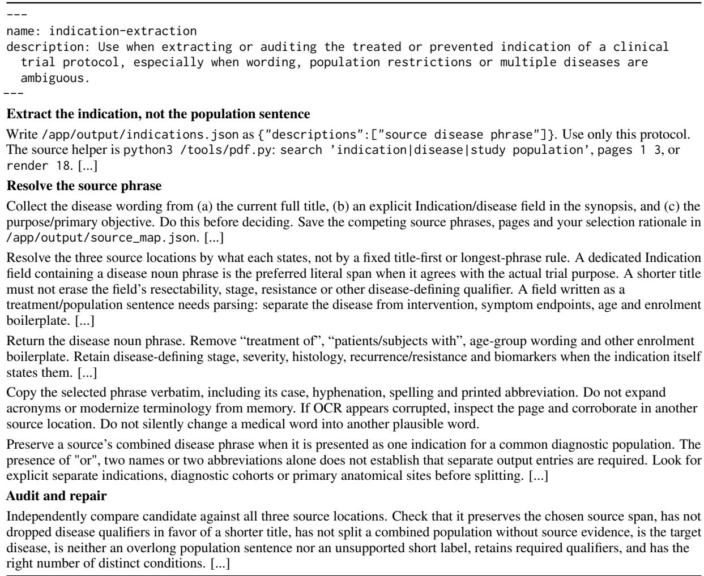  
Table 21: The TRIALSCRIBE skill for indication extraction (abridged).

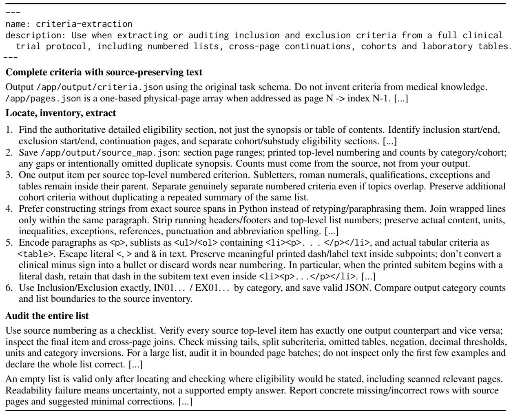  
Table 22: The TRIALSCRIBE skill for eligibility criteria extraction (abridged).

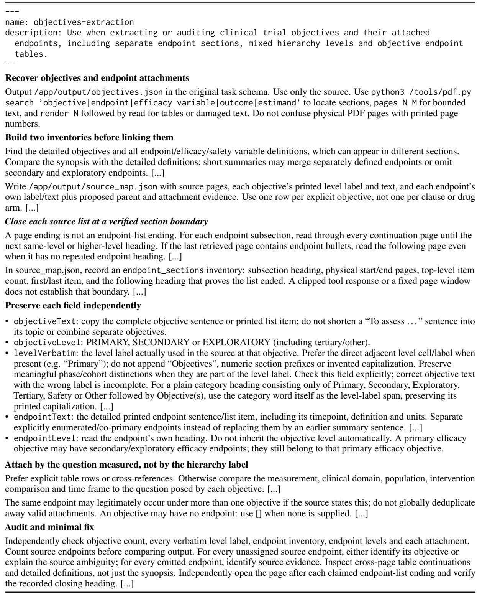  
Table 23: The TRIALSCRIBE skill for objectives and endpoints extraction (abridged).

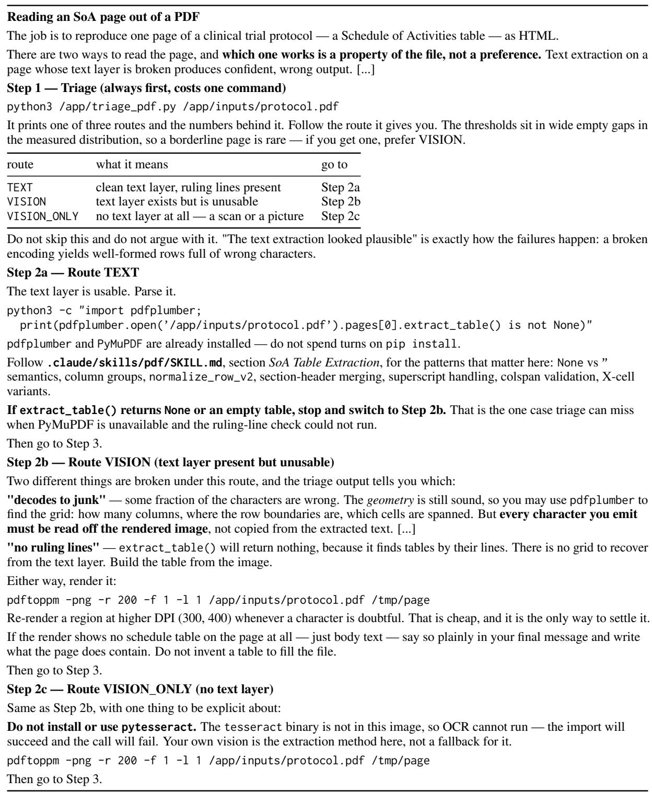  
Table 24: The TRIALSCRIBE skill file for SoA table extraction (part 1 of 2): triage and reading routes.

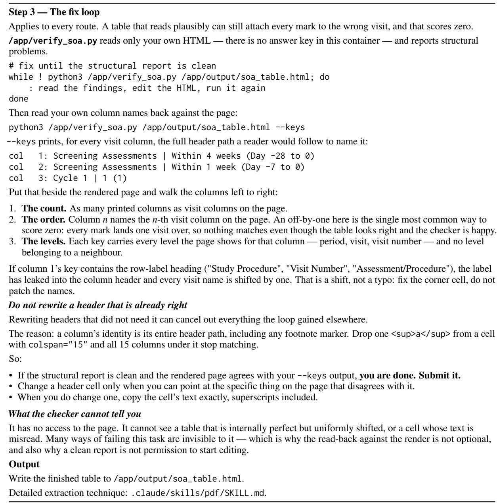  
Table 25: The TRIALSCRIBE skill file for SoA table extraction (part 2 of 2): the fix loop.

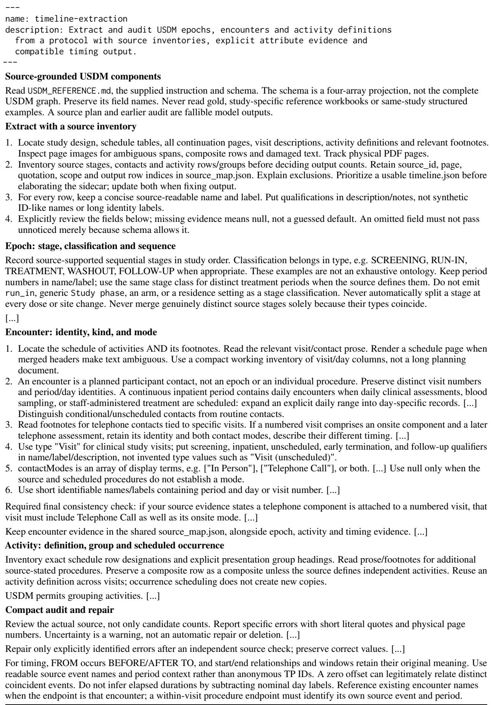  
Table 26: The TRIALSCRIBE skill for structured timeline extraction (abridged; omitted passages are marked [...]).

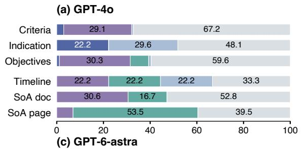

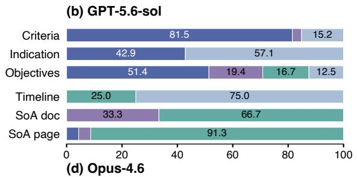

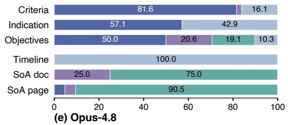

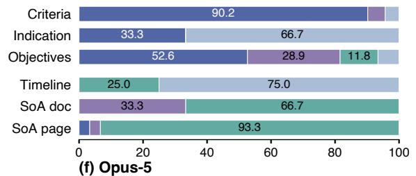

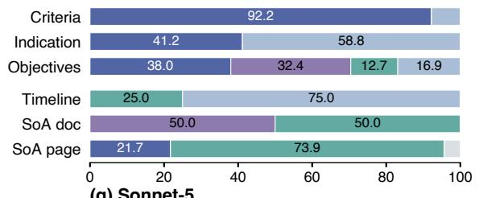

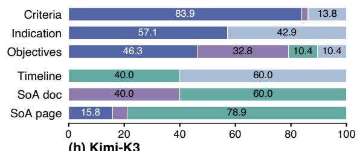

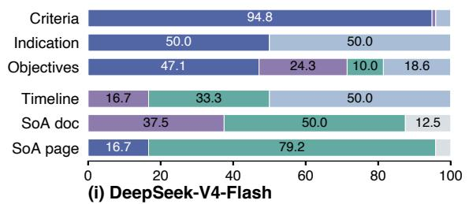

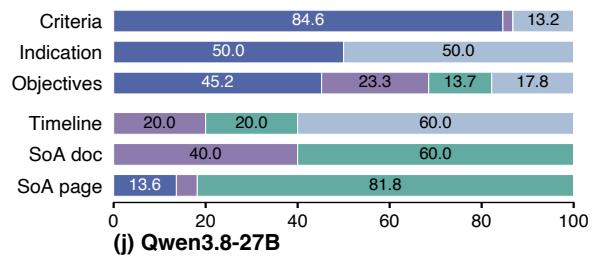

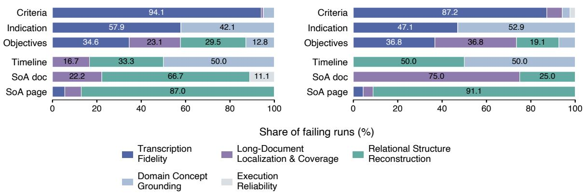  
Figure 7: Failure profiles of ten coding agents, the nine main-text agents and $\mathrm { G P T - } 4 0 .$ across six extraction tasks. Each bar shows the distribution of dominant failure categories among failing runs for a model and task, normalized to 100%. These profiles describe failure composition rather than failure rates.

## H.4 Ablation of Skills and Verification

We ablate the two components of TRIALSCRIBE, the task skills and the verification loop, on 40 eligibility-criteria protocols randomly sampled from the test split, with Qwen3.8-27B. We compare four configurations: the base coding agent, skills only, verification only, and the full TRIALSCRIBE. As Table 27 shows, each component improves criterion F1 on its own, by 2.6 points for skills and 7.7 points for verification, and combining them gives the largest gain, 14.5 points over the base agent. Verification adds more when the skills are present (11.9 vs. 7.7 points).

<table><tr><td>Configuration</td><td>Skills</td><td>Verification</td><td>Criterion F1 (%)</td></tr><tr><td>Base agent</td><td>x</td><td>x</td><td>65.4</td></tr><tr><td>Skills only</td><td>√</td><td>x</td><td>68.0</td></tr><tr><td>Verification only</td><td>x</td><td>√</td><td>73.1</td></tr><tr><td>TRIALSCRIBE</td><td>√</td><td>√</td><td>79.9</td></tr></table>

Table 27: Ablation of the task skills and the verification loop on eligibility-criteria protocols, with Qwen3.8- 27B.

## H.5 SoA Table Extraction Case Study

We present a case study on the two-page Schedule of Activities. Figure 8 shows the source pages and the TRIALSCRIBE output; Figure 9 shows the output of six OCR and document-understanding baselines on the same pages, and Figure 10 shows how the output changes over successive verification passes. In the annotated outputs, green cells are correctly placed scheduling marks, red cells are marks absent from the reference, and pink cells are reference marks that are missing.

## I Future Work

Beyond SoA tables, protocols contain many other types of tables that downstream clinical systems rely on. Table 28 lists common examples. Extending TRIALPD-BENCH and TRIALSCRIBE to these table types is a natural direction for future work.

## J Use of AI Assistants

We used AI assistants to polish the writing of this paper.

## K Data Sources and Licenses

The protocol documents in TRIALPD-BENCH are publicly posted on ClinicalTrials.gov (U.S. National Library of Medicine), the trial registry of the U.S. National Library of Medicine (NLM), where sponsors upload protocols as part of results reporting. We do not redistribute the protocol PDFs. Instead, we release the NCT identifier and the ClinicalTrials.gov URL of each document, so that users obtain the documents directly from the registry. The structured timeline references are taken from the USDM example studies published by CDISC (CDISC), which we use as released and credit to CDISC. Our reference annotations and code are released under the Creative Commons Attribution 4.0 (CC BY 4.0) license.

<table><tr><td>Table type</td><td>What it describes</td></tr><tr><td>PK sampling</td><td>PK samples relative to dosing</td></tr><tr><td>PD sampling/assessment</td><td>Pharmacodynamic measurements</td></tr><tr><td>Laboratory assessment</td><td>Hematology, chemistry, urinalysis, etc.</td></tr><tr><td>Safety assessment</td><td>AEs, vitals, ECG, physical exam, etc.</td></tr><tr><td>Efficacy assessment</td><td>Tumor assessments, disease scores, etc.</td></tr><tr><td>Study treatment/dosing Randomization/stratification</td><td>Dose, schedule, route, cycles Arms, cohorts, strata</td></tr><tr><td>Visit/assessment window</td><td>Target dates and allowable windows</td></tr><tr><td>Sample/specimen</td><td>Blood, urine, tissue, storage,</td></tr><tr><td>Imaging/scan schedule</td><td>processing CT, MRI, PET, or other imaging</td></tr><tr><td>Dose modification</td><td>Rules for interruption, reduction, or discontinuation</td></tr><tr><td>Stopping/discontinuation rules</td><td>Treatment or study discontinuation criteria</td></tr></table>

Table 28: Other common protocol table types beyond those covered in TRIALPD-BENCH.

Correct Match (TP)Hallucinated X (FP)Missing X (FN)
<table><tr><td rowspan="2">Study Procedures</td><td colspan="2">Screening C-Pb</td><td colspan="10"></td><td colspan="7"></td><td colspan="7">UNS EOS or ET</td></tr><tr><td colspan="2">Screening C-I</td><td colspan="2">Inpatient Period 1</td><td colspan="8"></td><td colspan="8">Inpatient Period 2</td><td colspan="2"></td><td></td></tr><tr><td></td><td>-21</td><td>-8</td><td></td><td></td><td></td><td></td><td>1 2.3 4.7 8 9</td><td></td><td></td><td></td><td>OPc 10-22</td><td>23</td><td></td><td></td><td></td><td>24 25 26-28 29 30-35 36 37-38 39</td><td></td><td></td><td></td><td></td><td></td><td></td><td>40</td><td></td><td>EOS</td></tr><tr><td>Days</td><td>30</td><td></td><td></td><td>-5</td><td>-1</td><td></td><td></td><td></td><td></td><td></td><td></td><td></td><td></td><td></td><td></td><td></td><td></td><td></td><td></td><td></td><td></td><td></td><td></td><td></td><td>Day 54+/-2</td></tr><tr><td>Eligibility</td><td></td><td></td><td></td><td></td><td></td><td></td><td></td><td></td><td></td><td></td><td></td><td></td><td></td><td></td><td></td><td></td><td></td><td></td><td></td><td></td><td></td><td></td><td></td><td></td><td></td></tr><tr><td>Informed consent</td><td>X</td><td></td><td></td><td></td><td></td><td></td><td></td><td></td><td></td><td></td><td></td><td></td><td></td><td></td><td></td><td></td><td></td><td></td><td></td><td></td><td></td><td></td><td></td><td></td><td></td></tr><tr><td>Admit to unit</td><td></td><td></td><td>X</td><td></td><td></td><td></td><td></td><td></td><td></td><td></td><td></td><td></td><td>X</td><td></td><td></td><td></td><td></td><td></td><td></td><td></td><td></td><td></td><td></td><td></td><td></td></tr><tr><td>Discharge from unif</td><td></td><td></td><td></td><td></td><td></td><td></td><td></td><td></td><td></td><td></td><td></td><td>X8</td><td></td><td></td><td></td><td></td><td></td><td></td><td></td><td></td><td></td><td></td><td></td><td></td><td></td></tr><tr><td>Outpatient visit or phone call</td><td></td><td></td><td>X</td><td></td><td></td><td></td><td></td><td></td><td></td><td></td><td></td><td></td><td></td><td></td><td></td><td></td><td></td><td></td><td></td><td></td><td></td><td></td><td></td><td></td><td></td></tr><tr><td>Discuss/document</td><td></td><td></td><td>X</td><td></td><td></td><td></td><td></td><td></td><td></td><td></td><td>X</td><td></td><td></td><td></td><td></td><td></td><td></td><td></td><td></td><td></td><td></td><td></td><td></td><td></td><td>X</td></tr><tr><td>contraception</td><td>X</td><td></td><td></td><td></td><td></td><td></td><td></td><td></td><td></td><td></td><td></td><td></td><td></td><td></td><td></td><td></td><td></td><td></td><td></td><td></td><td></td><td></td><td></td><td></td><td></td></tr><tr><td>(post-menopousal females Follicle-stimulating hormone</td><td>X</td><td></td><td></td><td></td><td></td><td></td><td></td><td></td><td></td><td></td><td></td><td></td><td></td><td></td><td></td><td></td><td></td><td></td><td></td><td></td><td></td><td></td><td></td><td></td><td></td></tr><tr><td>(only²)</td><td></td><td></td><td></td><td></td><td></td><td></td><td></td><td></td><td></td><td></td><td></td><td></td><td></td><td></td><td></td><td></td><td></td><td></td><td></td><td></td><td></td><td></td><td></td><td></td><td></td></tr><tr><td>Alcohol test</td><td>×x×</td><td></td><td>x</td><td></td><td></td><td></td><td></td><td></td><td></td><td></td><td></td><td></td><td></td><td></td><td></td><td></td><td></td><td></td><td></td><td></td><td></td><td></td><td></td><td></td><td></td></tr><tr><td>HIV. bepatitis B and C screen Urine drag screen</td><td></td><td></td><td></td><td></td><td></td><td></td><td></td><td></td><td></td><td></td><td></td><td></td><td></td><td></td><td></td><td></td><td></td><td></td><td></td><td></td><td></td><td></td><td></td><td></td><td></td></tr><tr><td>Study Administration</td><td></td><td></td><td></td><td></td><td></td><td></td><td></td><td></td><td></td><td></td><td></td><td></td><td></td><td></td><td></td><td></td><td></td><td></td><td></td><td></td><td></td><td></td><td></td><td></td><td></td></tr><tr><td>Medical history/demographics</td><td>xxxxx</td><td></td><td></td><td></td><td></td><td></td><td></td><td></td><td></td><td></td><td></td><td></td><td></td><td></td><td></td><td></td><td></td><td></td><td></td><td></td><td></td><td></td><td></td><td></td><td></td></tr><tr><td>WD history</td><td></td><td></td><td></td><td></td><td></td><td></td><td></td><td></td><td></td><td></td><td></td><td></td><td></td><td></td><td></td><td></td><td></td><td></td><td></td><td></td><td></td><td></td><td></td><td></td><td></td></tr><tr><td>Prior WD treatment</td><td></td><td></td><td></td><td></td><td></td></table>

(a) Source page 14.

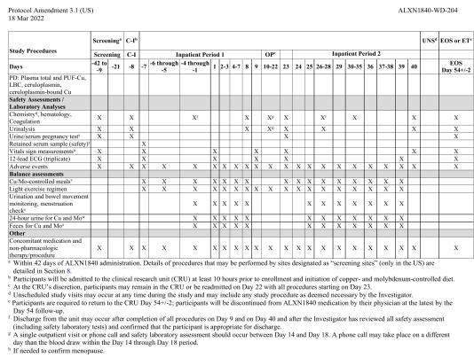

(b) Source page 15.

<table><tr><td>Study Procedures</td><td>Screening* Screening -42 to -9 -21</td><td>C-1b C-1 -8 -7 -6/-5</td><td></td><td>Inpatient Period 1 -4 to -1</td><td>1</td><td>2-3</td><td>4-7 8 9</td><td></td><td>OPc 10-22</td><td>23 24 25</td><td></td><td></td><td>Inpatient Period 2</td><td></td><td></td><td></td><td></td><td></td><td></td></tr><tr><td>ELIGIBILITY</td><td></td><td></td><td></td><td></td><td></td><td></td><td></td><td></td><td></td><td></td><td></td><td></td><td>30-35</td><td>37-38</td><td></td><td></td><td></td><td>UNS</td><td>EOS 54±2</td></tr><tr><td></td><td>x</td><td></td><td></td><td></td><td></td><td></td><td></td><td></td><td></td><td></td><td></td><td></td><td></td><td></td><td></td><td></td><td></td><td></td><td></td></tr><tr><td>Admit to unit</td><td></td><td>x</td><td></td><td></td><td></td><td></td><td></td><td></td><td></td><td></td><td></td><td></td><td></td><td></td><td></td><td></td><td></td><td></td><td></td></tr><tr><td>Discharge from unit</td><td></td><td></td><td></td><td></td><td></td><td></td><td></td><td></td><td>x</td><td></td><td></td><td></td><td></td><td></td><td></td><td>x</td><td></td><td></td><td></td></tr><tr><td>Outpatient visit or phone call</td><td></td><td></td><td></td><td></td><td></td><td></td><td></td><td></td><td></td><td></td><td></td><td></td><td></td><td></td><td></td><td></td><td></td><td></td><td></td></tr><tr><td>Inclusion/exclusion</td><td>x</td><td>x</td><td></td><td></td><td></td><td></td><td></td><td></td><td></td><td></td><td></td><td></td><td></td><td></td><td></td><td></td><td></td><td></td><td></td></tr><tr><td>Discuss/document contraception</td><td>x</td><td>x</td><td></td><td></td><td></td><td></td><td></td><td></td><td>x</td><td></td><td></td><td></td><td></td><td></td><td></td><td></td><td></td><td></td><td>x</td></tr><tr><td>FSH (post-menopausal only)</td><td>x</td><td></td><td></td><td></td><td></td><td></td><td></td><td></td><td></td><td></td><td></td><td></td><td></td><td></td><td></td><td></td><td></td><td></td><td></td></tr><tr><td>Alcohol test</td><td>x</td><td>+</td><td></td><td></td><td></td><td></td><td></td><td></td><td></td><td></td><td></td><td></td><td></td><td></td><td></td><td></td><td></td><td></td><td></td></tr><tr><td>Urine drug screen</td><td>x</td><td>x</td><td></td><td></td><td></td><td></td><td></td><td></td><td></td><td></td><td></td><td></td><td></td><td></td><td></td><td></td><td></td><td></td><td></td></tr><tr><td>HIV, hepatitis B and C screen</td><td>x</td><td></td><td></td><td></td><td></td><td></td><td></td><td></td><td></td><td></td><td></td><td></td><td></td><td></td><td></td><td></td><td></td><td></td><td></td></tr><tr><td>STUDY ADMINISTRATION</td><td></td><td></td><td></td><td></td><td></td><td></td><td></td><td></td><td></td><td></td><td></td><td></td><td></td><td></td><td></td><td></td><td></td><td></td><td></td></tr><tr><td>Medical history/demographics</td><td>x</td><td></td><td></td><td></td><td></td><td></td><td></td><td></td><td></td><td></td><td></td><td></td><td></td><td></td><td></td><td></td><td></td><td></td><td></td></tr><tr><td>WD history</td><td>x</td><td></td><td></td><td></td><td></td><td></td><td></td><td></td><td></td><td></td><td></td><td></td><td></td><td></td><td></td><td></td><td></td><td></td><td></td></tr><tr><td>Prior WD treatment</td><td>x</td><td></td><td></td><td></td><td></td><td></td><td></td><td></td><td></td><td></td><td></td><td></td><td></td><td></td><td></td><td></td><td></td><td></td><td></td></tr><tr><td>Physical examination</td><td>x</td><td>x</td><td></td><td></td><td></td><td></td><td></td><td></td><td></td><td>x</td><td></td><td></td><td></td><td></td><td></td><td></td><td></td><td></td><td>x</td></tr><tr><td>Height&#x27;, weight, and BMI</td><td>x</td><td>x</td><td></td><td></td><td></td><td></td><td></td><td></td><td></td><td>x</td><td></td><td></td><td></td><td></td><td></td><td>x</td><td></td><td></td><td></td></tr><tr><td>ENROLLMENT</td><td></td><td></td><td></td><td></td><td></td><td></td><td></td><td></td><td></td><td></td><td></td><td></td><td></td><td></td><td></td><td></td><td></td><td></td><td></td></tr><tr><td>Enrollment/inclusion</td><td></td><td></td><td>x</td><td></td><td></td><td></td><td></td><td></td><td></td><td></td><td></td><td></td><td></td><td></td><td></td><td></td><td></td><td></td><td></td></tr><tr><td>Discontinue chelation therapy</td><td></td><td>x</td><td>x</td><td></td><td>x</td><td></td><td></td><td>x</td><td></td><td>x</td><td>x</td><td>x</td><td>x</td><td>x</td><td>x</td><td>x</td><td></td><td></td><td>x</td></tr><tr><td>Discontinue zinc therapy</td><td></td><td>x</td><td></td><td>X</td><td>x</td><td></td><td>X</td><td>x</td><td></td><td>X</td><td>X X</td><td>X</td><td>X</td><td>X</td><td>x</td><td>X</td><td></td><td></td><td>x</td></tr><tr><td>ADMINISTRATION OF STUDY INTERVENTION ALXN1840 15 mg/day</td><td></td><td></td><td></td><td></td><td></td><td>x</td><td>X</td><td>x</td><td></td><td>X</td><td>X</td><td>X</td></table>

(c) TRIALSCRIBE output for both pages, compared with the reference.  
Figure 8: SoA table extraction case study: source pages and the TRIALSCRIBE output.

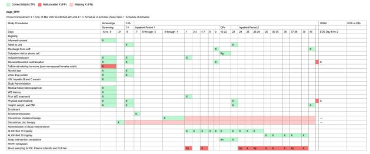

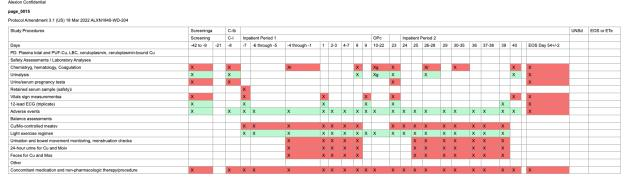

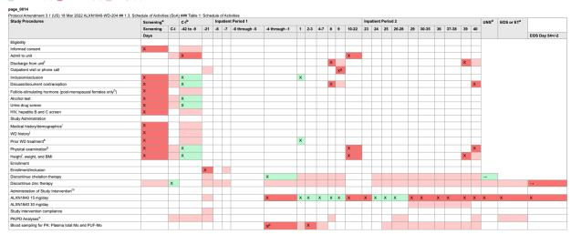

(a) Mistral OCR.  
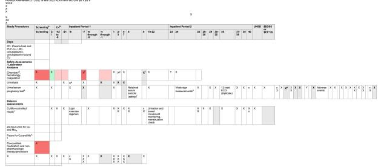

(b) LightOnOCR.  
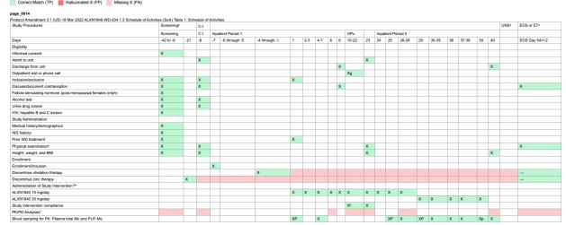

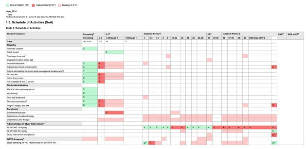

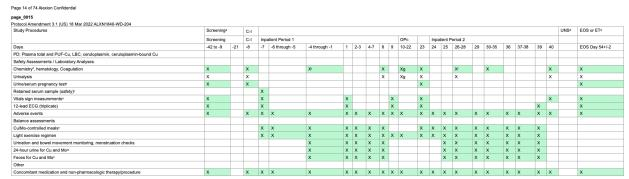

(c) LandingAI.  
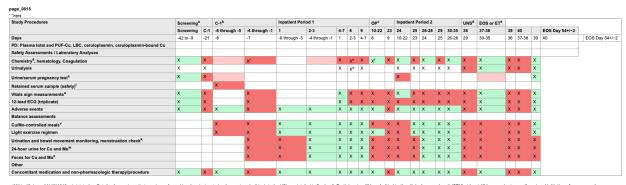

(d) Qwen3-VL-4B.  
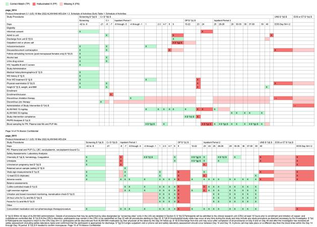  
(e) PaddleOCR-VL.  
(f) olmOCR.  
Figure 9: SoA table extraction case study: OCR and document-understanding baselines on the same pages, annotated against the reference.

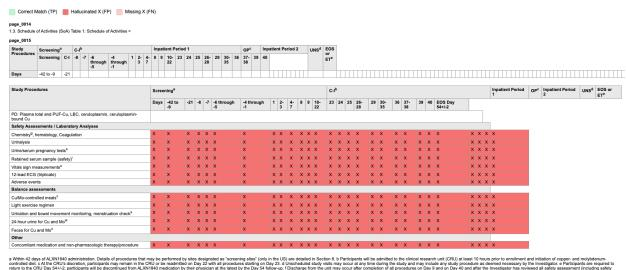

<table><tr><td></td><td rowspan=1 colspan=1>Screeninga</td><td rowspan=1 colspan=1>None</td><td rowspan=1 colspan=1>C-lb</td><td rowspan=1 colspan=1></td><td rowspan=1 colspan=1>None</td><td rowspan=1 colspan=1>None</td><td rowspan=1 colspan=1>None</td><td rowspan=1 colspan=1>None</td><td rowspan=1 colspan=1>None</td><td rowspan=1 colspan=1>None</td><td rowspan=1 colspan=1>None</td><td rowspan=1 colspan=1>None</td><td rowspan=1 colspan=1>None</td><td rowspan=1 colspan=1>None</td></tr><tr><td rowspan=1 colspan=1>None</td><td rowspan=1 colspan=1>Screening</td><td rowspan=1 colspan=1>None</td><td rowspan=1 colspan=1>C-1</td><td rowspan=1 colspan=1>Inpatient Period 1</td><td rowspan=1 colspan=1>None</td><td rowspan=1 colspan=1>None</td><td rowspan=1 colspan=1>None</td><td rowspan=1 colspan=1>None</td><td rowspan=1 colspan=1>None</td><td rowspan=1 colspan=1>None</td><td rowspan=1 colspan=1>None</td><td rowspan=1 colspan=1>OPc</td><td rowspan=1 colspan=1></td><td rowspan=1 colspan=1>Inpat</td></tr><tr><td rowspan=1 colspan=1>Days</td><td rowspan=1 colspan=1>-42 to-9</td><td rowspan=1 colspan=1>-21</td><td rowspan=1 colspan=1>-8</td><td rowspan=1 colspan=1>-7</td><td rowspan=1 colspan=1>-6 through-5</td><td rowspan=1 colspan=1>-4 through-1</td><td rowspan=1 colspan=1>1</td><td rowspan=1 colspan=1>2-3</td><td rowspan=1 colspan=1>4-7</td><td rowspan=1 colspan=1>8</td><td rowspan=1 colspan=1>9</td><td rowspan=1 colspan=1>10-22</td><td rowspan=1 colspan=1>23</td><td rowspan=1 colspan=1>24</td></tr><tr><td rowspan=1 colspan=1>Eligibility</td><td rowspan=1 colspan=1></td><td rowspan=1 colspan=1></td><td rowspan=1 colspan=1></td><td rowspan=1 colspan=1></td><td rowspan=1 colspan=1></td><td rowspan=1 colspan=1></td><td rowspan=1 colspan=1></td><td rowspan=1 colspan=1></td><td rowspan=1 colspan=1></td><td rowspan=1 colspan=1></td><td rowspan=1 colspan=1></td><td rowspan=1 colspan=1></td><td rowspan=1 colspan=1></td><td rowspan=1 colspan=1></td></tr><tr><td rowspan=1 colspan=1>Informed consent</td><td rowspan=1 colspan=1>x</td><td rowspan=1 colspan=1></td><td rowspan=1 colspan=1></td><td rowspan=1 colspan=1></td><td rowspan=1 colspan=1></td><td rowspan=1 colspan=1></td><td rowspan=1 colspan=1></td><td rowspan=1 colspan=1></td><td rowspan=1 colspan=1></td><td rowspan=1 colspan=1></td><td rowspan=1 colspan=1></td><td rowspan=1 colspan=1></td><td rowspan=1 colspan=1></td><td rowspan=1 colspan=1></td></tr><tr><td rowspan=1 colspan=1>Admit to unit</td><td rowspan=1 colspan=1></td><td rowspan=1 colspan=1></td><td rowspan=1 colspan=1>x</td><td rowspan=1 colspan=1></td><td rowspan=1 colspan=1></td><td rowspan=1 colspan=1></td><td rowspan=1 colspan=1></td><td rowspan=1 colspan=1></td><td rowspan=1 colspan=1></td><td rowspan=1 colspan=1></td><td rowspan=1 colspan=1></td><td rowspan=1 colspan=1></td><td rowspan=1 colspan=1>x</td><td rowspan=1 colspan=1></td></tr><tr><td rowspan=1 colspan=1>Discharge from unitf</td><td rowspan=1 colspan=1></td><td rowspan=1 colspan=1></td><td rowspan=1 colspan=1></td><td rowspan=1 colspan=1></td><td rowspan=1 colspan=1></td><td rowspan=1 colspan=1></td><td rowspan=1 colspan=1></td><td rowspan=1 colspan=1></td><td rowspan=1 colspan=1></td><td rowspan=1 colspan=1></td><td rowspan=1 colspan=1>x</td><td rowspan=1 colspan=1></td><td rowspan=1 colspan=1></td><td rowspan=1 colspan=1></td></tr><tr><td rowspan=1 colspan=1>Inclusion/exclusion</td><td rowspan=1 colspan=1>x</td><td rowspan=1 colspan=1></td><td rowspan=1 colspan=1>x</td><td rowspan=1 colspan=1></td><td rowspan=1 colspan=1></td><td rowspan=1 colspan=1></td><td rowspan=1 colspan=1>x</td><td rowspan=1 colspan=1></td><td rowspan=1 colspan=1></td><td rowspan=1 colspan=1></td><td rowspan=1 colspan=1></td><td rowspan=1 colspan=1></td><td rowspan=1 colspan=1></td><td rowspan=1 colspan=1></td></tr><tr><td rowspan=1 colspan=1>Discuss/documentcontraception</td><td rowspan=1 colspan=1>x</td><td rowspan=1 colspan=1></td><td rowspan=1 colspan=1>x</td><td rowspan=1 colspan=1></td><td rowspan=1 colspan=1></td><td rowspan=1 colspan=1></td><td rowspan=1 colspan=1></td><td rowspan=1 colspan=1></td><td rowspan=1 colspan=1></td><td rowspan=1 colspan=1></td><td rowspan=1 colspan=1>x</td><td rowspan=1 colspan=1></td><td rowspan=1 colspan=1></td><td rowspan=1 colspan=1></td></tr><tr><td rowspan=1 colspan=1>Follicle-stimulating hormone(post-menopausal femalesonlyh)</td><td rowspan=1 colspan=1>x</td><td rowspan=1 colspan=1></td><td rowspan=1 colspan=1></td><td rowspan=1 colspan=1></td><td rowspan=1 colspan=1></td><td rowspan=1 colspan=1></td><td rowspan=1 colspan=1></td><td rowspan=1 colspan=1></td><td rowspan=1 colspan=1></td><td rowspan=1 colspan=1></td><td rowspan=1 colspan=1></td><td rowspan=1 colspan=1></td><td rowspan=1 colspan=1></td><td rowspan=1 colspan=1></td></tr><tr><td rowspan=1 colspan=1>Alcohol test</td><td rowspan=1 colspan=1>x</td><td rowspan=1 colspan=1></td><td rowspan=1 colspan=1>x</td><td rowspan=1 colspan=1></td><td rowspan=1 colspan=1></td><td rowspan=1 colspan=1></td><td rowspan=1 colspan=1></td><td rowspan=1 colspan=1></td><td rowspan=1 colspan=1></td><td rowspan=1 colspan=1></td><td rowspan=1 colspan=1></td><td rowspan=1 colspan=1></td><td rowspan=1 colspan=1></td><td rowspan=1 colspan=1></td></tr><tr><td rowspan=1 colspan=1>Urine drug screen</td><td rowspan=1 colspan=1>x</td><td rowspan=1 colspan=1></td><td rowspan=1 colspan=1>x</td><td rowspan=1 colspan=1></td><td rowspan=1 colspan=1></td><td rowspan=1 colspan=1></td><td rowspan=1 colspan=1></td><td rowspan=1 colspan=1></td><td rowspan=1 colspan=1></td><td rowspan=1 colspan=1></td><td rowspan=1 colspan=1></td><td rowspan=1 colspan=1></td><td rowspan=1 colspan=1></td><td rowspan=1 colspan=1></td></tr><tr><td rowspan=1 colspan=1>HIV, hepatitis B and C screen</td><td rowspan=1 colspan=1>x</td><td rowspan=1 colspan=1></td><td rowspan=1 colspan=1></td><td rowspan=1 colspan=1></td><td rowspan=1 colspan=1></td><td rowspan=1 colspan=1></td><td rowspan=1 colspan=1></td><td rowspan=1 colspan=1></td><td rowspan=1 colspan=1></td><td rowspan=1 colspan=1></td><td rowspan=1 colspan=1></td><td rowspan=1 colspan=1></td><td rowspan=1 colspan=1></td><td rowspan=1 colspan=1></td></tr></table>

(a) Pass 1: direct text-layer extraction. Merged cells appear as empty placeholders (“None”), footnote markers are fused into the text (“Screeninga”), and multi-row labels are broken.

<table><tr><td rowspan=1 colspan=1>Study Procedures</td><td rowspan=1 colspan=1>Screeninga</td><td rowspan=1 colspan=1></td><td rowspan=1 colspan=1>C-lb</td><td rowspan=1 colspan=1></td><td rowspan=1 colspan=1></td><td rowspan=1 colspan=1></td><td rowspan=1 colspan=1></td><td rowspan=1 colspan=1></td><td rowspan=1 colspan=1></td><td rowspan=1 colspan=1></td><td rowspan=1 colspan=1></td><td rowspan=1 colspan=1></td></tr><tr><td rowspan=1 colspan=1></td><td rowspan=1 colspan=1>Screening</td><td rowspan=1 colspan=1></td><td rowspan=1 colspan=1>C-I</td><td rowspan=1 colspan=1>Inpatient Period 1</td><td rowspan=1 colspan=1></td><td rowspan=1 colspan=1></td><td rowspan=1 colspan=1></td><td rowspan=1 colspan=1></td><td rowspan=1 colspan=1></td><td rowspan=1 colspan=1></td><td rowspan=1 colspan=1></td><td rowspan=1 colspan=1>OPc</td></tr><tr><td rowspan=1 colspan=1>Days</td><td rowspan=1 colspan=1>-42 to -9</td><td rowspan=1 colspan=1>-21</td><td rowspan=1 colspan=1>-8</td><td rowspan=1 colspan=1>-7</td><td rowspan=1 colspan=1>-6 through -5</td><td rowspan=1 colspan=1>-4 through -1</td><td rowspan=1 colspan=1>1</td><td rowspan=1 colspan=1>2-3</td><td rowspan=1 colspan=1>4-7</td><td rowspan=1 colspan=1>8</td><td rowspan=1 colspan=1>9</td><td rowspan=1 colspan=1>10-22</td></tr><tr><td rowspan=1 colspan=1>Eligibility</td><td rowspan=1 colspan=1></td><td rowspan=1 colspan=1></td><td rowspan=1 colspan=1></td><td rowspan=1 colspan=1></td><td rowspan=1 colspan=1></td><td rowspan=1 colspan=1></td><td rowspan=1 colspan=1></td><td rowspan=1 colspan=1></td><td rowspan=1 colspan=1></td><td rowspan=1 colspan=1></td><td rowspan=1 colspan=1></td><td rowspan=1 colspan=1></td></tr><tr><td rowspan=1 colspan=1>Informed consent</td><td rowspan=1 colspan=1>x</td><td rowspan=1 colspan=1></td><td rowspan=1 colspan=1></td><td rowspan=1 colspan=1></td><td rowspan=1 colspan=1></td><td rowspan=1 colspan=1></td><td rowspan=1 colspan=1></td><td rowspan=1 colspan=1></td><td rowspan=1 colspan=1></td><td rowspan=1 colspan=1></td><td rowspan=1 colspan=1></td><td rowspan=1 colspan=1></td></tr><tr><td rowspan=1 colspan=1>Discharge from unitf</td><td rowspan=1 colspan=1></td><td rowspan=1 colspan=1></td><td rowspan=1 colspan=1></td><td rowspan=1 colspan=1></td><td rowspan=1 colspan=1></td><td rowspan=1 colspan=1></td><td rowspan=1 colspan=1></td><td rowspan=1 colspan=1></td><td rowspan=1 colspan=1></td><td rowspan=1 colspan=1></td><td rowspan=1 colspan=1>x</td><td rowspan=1 colspan=1></td></tr><tr><td rowspan=1 colspan=1>Outpatient visit or phone call</td><td rowspan=1 colspan=1></td><td rowspan=1 colspan=1></td><td rowspan=1 colspan=1></td><td rowspan=1 colspan=1></td><td rowspan=1 colspan=1></td><td rowspan=1 colspan=1></td><td rowspan=1 colspan=1></td><td rowspan=1 colspan=1></td><td rowspan=1 colspan=1></td><td rowspan=1 colspan=1></td><td rowspan=1 colspan=1></td><td rowspan=1 colspan=1>xg</td></tr><tr><td rowspan=1 colspan=1>Inclusion/exclusion</td><td rowspan=1 colspan=1>x</td><td rowspan=1 colspan=1></td><td rowspan=1 colspan=1>x</td><td rowspan=1 colspan=1></td><td rowspan=1 colspan=1></td><td rowspan=1 colspan=1></td><td rowspan=1 colspan=1>x</td><td rowspan=1 colspan=1></td><td rowspan=1 colspan=1></td><td rowspan=1 colspan=1></td><td rowspan=1 colspan=1></td><td rowspan=1 colspan=1></td></tr><tr><td rowspan=1 colspan=1>Discuss/document contraception</td><td rowspan=1 colspan=1>x</td><td rowspan=1 colspan=1></td><td rowspan=1 colspan=1>x</td><td rowspan=1 colspan=1></td><td rowspan=1 colspan=1></td><td rowspan=1 colspan=1></td><td rowspan=1 colspan=1></td><td rowspan=1 colspan=1></td><td rowspan=1 colspan=1></td><td rowspan=1 colspan=1></td><td rowspan=1 colspan=1>x</td><td rowspan=1 colspan=1></td></tr><tr><td rowspan=1 colspan=1>Alcohol test</td><td rowspan=1 colspan=1>x</td><td rowspan=1 colspan=1></td><td rowspan=1 colspan=1>x</td><td rowspan=1 colspan=1></td><td rowspan=1 colspan=1></td><td rowspan=1 colspan=1></td><td rowspan=1 colspan=1></td><td rowspan=1 colspan=1></td><td rowspan=1 colspan=1></td><td rowspan=1 colspan=1></td><td rowspan=1 colspan=1></td><td rowspan=1 colspan=1></td></tr><tr><td rowspan=1 colspan=1>Urine drug screen</td><td rowspan=1 colspan=1>x</td><td rowspan=1 colspan=1></td><td rowspan=1 colspan=1>x</td><td rowspan=1 colspan=1></td><td rowspan=1 colspan=1></td><td rowspan=1 colspan=1></td><td rowspan=1 colspan=1></td><td rowspan=1 colspan=1></td><td rowspan=1 colspan=1></td><td rowspan=1 colspan=1></td><td rowspan=1 colspan=1></td><td rowspan=1 colspan=1></td></tr><tr><td rowspan=1 colspan=1>HIV, hepatitis B and C screen</td><td rowspan=1 colspan=1>x</td><td rowspan=1 colspan=1></td><td rowspan=1 colspan=1></td><td rowspan=1 colspan=1></td><td rowspan=1 colspan=1></td><td rowspan=1 colspan=1></td><td rowspan=1 colspan=1></td><td rowspan=1 colspan=1></td><td rowspan=1 colspan=1></td><td rowspan=1 colspan=1></td><td rowspan=1 colspan=1></td><td rowspan=1 colspan=1></td></tr></table>

(b) Pass 2: structural correction. Merged cells are resolved, broken labels are joined, and empty continuation rows are removed; footnote markers are still inline.

<table><tr><td rowspan=3 colspan=1>Study Procedures</td><td rowspan=1 colspan=2>Screeninga</td><td rowspan=1 colspan=4>C-1b</td><td rowspan=1 colspan=6>Inpatient Period 1</td></tr><tr><td rowspan=1 colspan=1>Screening</td><td rowspan=1 colspan=1></td><td rowspan=1 colspan=1>C-I</td><td rowspan=1 colspan=3>Inpatient Period 1</td><td rowspan=1 colspan=6></td></tr><tr><td rowspan=1 colspan=1>-42 to -9</td><td rowspan=1 colspan=1>-21</td><td rowspan=1 colspan=1>-8</td><td rowspan=1 colspan=1>-7</td><td rowspan=1 colspan=1>-6 through -5</td><td rowspan=1 colspan=1>-4 through -1</td><td rowspan=1 colspan=2>1 2-3</td><td rowspan=1 colspan=1>4-7</td><td rowspan=1 colspan=1>8</td><td rowspan=1 colspan=1>9</td><td rowspan=1 colspan=1>10-22</td></tr><tr><td rowspan=1 colspan=1>Eligibility</td><td rowspan=1 colspan=1></td><td rowspan=1 colspan=1></td><td rowspan=1 colspan=1></td><td rowspan=1 colspan=1></td><td rowspan=1 colspan=1></td><td rowspan=1 colspan=1></td><td rowspan=1 colspan=2></td><td rowspan=1 colspan=1></td><td rowspan=1 colspan=1></td><td rowspan=1 colspan=1></td><td rowspan=1 colspan=1></td></tr><tr><td rowspan=1 colspan=1>Informed consent</td><td rowspan=1 colspan=1>x</td><td rowspan=1 colspan=1></td><td rowspan=1 colspan=1></td><td rowspan=1 colspan=1></td><td rowspan=1 colspan=1></td><td rowspan=1 colspan=1></td><td rowspan=1 colspan=1></td><td rowspan=1 colspan=1></td><td rowspan=1 colspan=1></td><td rowspan=1 colspan=1></td><td rowspan=1 colspan=1></td><td rowspan=1 colspan=1></td></tr><tr><td rowspan=1 colspan=1>Discharge from unitf</td><td rowspan=1 colspan=1></td><td rowspan=1 colspan=1></td><td rowspan=1 colspan=1></td><td rowspan=1 colspan=1></td><td rowspan=1 colspan=1></td><td rowspan=1 colspan=1></td><td rowspan=1 colspan=1></td><td rowspan=1 colspan=1></td><td rowspan=1 colspan=1></td><td rowspan=1 colspan=1></td><td rowspan=1 colspan=1>X</td><td rowspan=1 colspan=1></td></tr><tr><td rowspan=1 colspan=1>Outpatient visit or phone call</td><td rowspan=1 colspan=1></td><td rowspan=1 colspan=1></td><td rowspan=1 colspan=1></td><td rowspan=1 colspan=1></td><td rowspan=1 colspan=1></td><td rowspan=1 colspan=1></td><td rowspan=1 colspan=1></td><td rowspan=1 colspan=1></td><td rowspan=1 colspan=1></td><td rowspan=1 colspan=1></td><td rowspan=1 colspan=1></td><td rowspan=1 colspan=1>x9</td></tr><tr><td rowspan=1 colspan=1>Inclusion/exclusion</td><td rowspan=1 colspan=1>x</td><td rowspan=1 colspan=1></td><td rowspan=1 colspan=1>x</td><td rowspan=1 colspan=1></td><td rowspan=1 colspan=1></td><td rowspan=1 colspan=1></td><td rowspan=1 colspan=1>x</td><td rowspan=1 colspan=1></td><td rowspan=1 colspan=1></td><td rowspan=1 colspan=1></td><td rowspan=1 colspan=1></td><td rowspan=1 colspan=1></td></tr><tr><td rowspan=1 colspan=1>Discuss/document contraception</td><td rowspan=1 colspan=1>x</td><td rowspan=1 colspan=1></td><td rowspan=1 colspan=1>x</td><td rowspan=1 colspan=1></td><td rowspan=1 colspan=1></td><td rowspan=1 colspan=1></td><td rowspan=1 colspan=1></td><td rowspan=1 colspan=1></td><td rowspan=1 colspan=1></td><td rowspan=1 colspan=1></td><td rowspan=1 colspan=1>x</td><td rowspan=1 colspan=1></td></tr><tr><td rowspan=1 colspan=1>Follicle-stimulating hormone (post-menopausal females onlyh)</td><td rowspan=1 colspan=1>x</td><td rowspan=1 colspan=1></td><td rowspan=1 colspan=1></td><td rowspan=1 colspan=1></td><td rowspan=1 colspan=1></td><td rowspan=1 colspan=1></td><td rowspan=1 colspan=1></td><td rowspan=1 colspan=1></td><td rowspan=1 colspan=1></td><td rowspan=1 colspan=1></td><td rowspan=1 colspan=1></td><td rowspan=1 colspan=1></td></tr><tr><td rowspan=1 colspan=1>Alcohol test</td><td rowspan=1 colspan=1>x</td><td rowspan=1 colspan=1></td><td rowspan=1 colspan=1>x</td><td rowspan=1 colspan=1></td><td rowspan=1 colspan=1></td><td rowspan=1 colspan=1></td><td rowspan=1 colspan=1></td><td rowspan=1 colspan=1></td><td rowspan=1 colspan=1></td><td rowspan=1 colspan=1></td><td rowspan=1 colspan=1></td><td rowspan=1 colspan=1></td></tr><tr><td rowspan=1 colspan=1>Urine drug screen</td><td rowspan=1 colspan=1>x</td><td rowspan=1 colspan=1></td><td rowspan=1 colspan=1>x</td><td rowspan=1 colspan=1></td><td rowspan=1 colspan=1></td><td rowspan=1 colspan=1></td><td rowspan=1 colspan=1></td><td rowspan=1 colspan=1></td><td rowspan=1 colspan=1></td><td rowspan=1 colspan=1></td><td rowspan=1 colspan=1></td><td rowspan=1 colspan=1></td></tr><tr><td rowspan=1 colspan=1>HIV, hepatitis B and C screen</td><td rowspan=1 colspan=1>x</td><td rowspan=1 colspan=1></td><td rowspan=1 colspan=1></td><td rowspan=1 colspan=1></td><td rowspan=1 colspan=1></td><td rowspan=1 colspan=1></td><td rowspan=1 colspan=1></td><td rowspan=1 colspan=1></td><td rowspan=1 colspan=1></td><td rowspan=1 colspan=1></td><td rowspan=1 colspan=1></td><td rowspan=1 colspan=1></td></tr></table>

(c) Pass 3: footnote markers are separated as superscripts, header spans are resolved, and section headers are identified.

<table><tr><td rowspan=2 colspan=1>Study Procedures</td><td rowspan=2 colspan=2>ScreeningaScreening-42 to -9 -21</td><td rowspan=1 colspan=1>C-|b</td><td rowspan=2 colspan=5>-7 -6/-5  -4 to -1  1 2-3</td><td rowspan=2 colspan=8>OPo</td></tr><tr><td rowspan=1 colspan=1>C-I-8</td><td rowspan=1 colspan=1></td><td rowspan=1 colspan=1></td><td rowspan=1 colspan=2></td><td rowspan=1 colspan=1></td></tr><tr><td rowspan=1 colspan=1>ELIGIBILITY</td><td rowspan=1 colspan=1></td><td rowspan=1 colspan=1></td><td rowspan=1 colspan=1></td><td rowspan=1 colspan=1></td><td rowspan=1 colspan=1></td><td rowspan=1 colspan=1></td><td rowspan=1 colspan=1></td><td rowspan=1 colspan=1></td><td rowspan=1 colspan=1></td><td rowspan=1 colspan=1></td><td rowspan=1 colspan=1></td><td rowspan=1 colspan=1></td><td rowspan=1 colspan=1></td><td rowspan=1 colspan=1></td><td rowspan=1 colspan=1></td><td rowspan=1 colspan=1></td></tr><tr><td rowspan=1 colspan=1>Informed consent</td><td rowspan=1 colspan=1>x</td><td rowspan=1 colspan=1></td><td rowspan=1 colspan=1></td><td rowspan=1 colspan=1></td><td rowspan=1 colspan=1></td><td rowspan=1 colspan=1></td><td rowspan=1 colspan=1></td><td rowspan=1 colspan=1></td><td rowspan=1 colspan=1></td><td rowspan=1 colspan=1></td><td rowspan=1 colspan=1></td><td rowspan=1 colspan=1></td><td rowspan=1 colspan=1></td><td rowspan=1 colspan=1></td><td rowspan=1 colspan=1></td><td rowspan=1 colspan=1></td></tr><tr><td rowspan=1 colspan=1>Admit to unit</td><td rowspan=1 colspan=1></td><td rowspan=1 colspan=1></td><td rowspan=1 colspan=1>x</td><td rowspan=1 colspan=1></td><td rowspan=1 colspan=1></td><td rowspan=1 colspan=1></td><td rowspan=1 colspan=1></td><td rowspan=1 colspan=1></td><td rowspan=1 colspan=1></td><td rowspan=1 colspan=1></td><td rowspan=1 colspan=1></td><td rowspan=1 colspan=1></td><td rowspan=1 colspan=1>x</td><td rowspan=1 colspan=1></td><td rowspan=1 colspan=1></td><td rowspan=1 colspan=1></td></tr><tr><td rowspan=1 colspan=1>Discharge from unit</td><td rowspan=1 colspan=1></td><td rowspan=1 colspan=1></td><td rowspan=1 colspan=1></td><td rowspan=1 colspan=1></td><td rowspan=1 colspan=1></td><td rowspan=1 colspan=1></td><td rowspan=1 colspan=1></td><td rowspan=1 colspan=1></td><td rowspan=1 colspan=1></td><td rowspan=1 colspan=1></td><td rowspan=1 colspan=1>X</td><td rowspan=1 colspan=1></td><td rowspan=1 colspan=1></td><td rowspan=1 colspan=1></td><td rowspan=1 colspan=1></td><td rowspan=1 colspan=1></td></tr><tr><td rowspan=1 colspan=1>Outpatient visit or phone call</td><td rowspan=1 colspan=1></td><td rowspan=1 colspan=1></td><td rowspan=1 colspan=1></td><td rowspan=1 colspan=1></td><td rowspan=1 colspan=1></td><td rowspan=1 colspan=1></td><td rowspan=1 colspan=1></td><td rowspan=1 colspan=1></td><td rowspan=1 colspan=1></td><td rowspan=1 colspan=1></td><td rowspan=1 colspan=1></td><td rowspan=1 colspan=1>X9</td><td rowspan=1 colspan=1></td><td rowspan=1 colspan=1></td><td rowspan=1 colspan=1></td><td rowspan=1 colspan=1></td></tr><tr><td rowspan=1 colspan=1>Inclusion/exclusion</td><td rowspan=1 colspan=1>x</td><td rowspan=1 colspan=1></td><td rowspan=1 colspan=1>x</td><td rowspan=1 colspan=1></td><td rowspan=1 colspan=1></td><td rowspan=1 colspan=1></td><td rowspan=1 colspan=1>X</td><td rowspan=1 colspan=1></td><td rowspan=1 colspan=1></td><td rowspan=1 colspan=1></td><td rowspan=1 colspan=1></td><td rowspan=1 colspan=1></td><td rowspan=1 colspan=1></td><td rowspan=1 colspan=1></td><td rowspan=1 colspan=1></td><td rowspan=1 colspan=1></td></tr><tr><td rowspan=1 colspan=1>Discuss/document contraception</td><td rowspan=1 colspan=1>x</td><td rowspan=1 colspan=1></td><td rowspan=1 colspan=1>x</td><td rowspan=1 colspan=1></td><td rowspan=1 colspan=1></td><td rowspan=1 colspan=1></td><td rowspan=1 colspan=1></td><td rowspan=1 colspan=1></td><td rowspan=1 colspan=1></td><td rowspan=1 colspan=1></td><td rowspan=1 colspan=1>x</td><td rowspan=1 colspan=1></td><td rowspan=1 colspan=1></td><td rowspan=1 colspan=1></td><td rowspan=1 colspan=1></td><td rowspan=1 colspan=1></td></tr><tr><td rowspan=1 colspan=1>FSH (post-menopausal only)</td><td rowspan=1 colspan=1>X</td><td rowspan=1 colspan=1></td><td rowspan=1 colspan=1></td><td rowspan=1 colspan=1></td><td rowspan=1 colspan=1></td><td rowspan=1 colspan=1></td><td rowspan=1 colspan=1></td><td rowspan=1 colspan=1></td><td rowspan=1 colspan=1></td><td rowspan=1 colspan=1></td><td rowspan=1 colspan=1></td><td rowspan=1 colspan=1></td><td rowspan=1 colspan=1></td><td rowspan=1 colspan=1></td><td rowspan=1 colspan=1></td><td rowspan=1 colspan=1></td></tr><tr><td rowspan=1 colspan=1>Alcohol test</td><td rowspan=1 colspan=1>X</td><td rowspan=1 colspan=1></td><td rowspan=1 colspan=1>X</td><td rowspan=1 colspan=1></td><td rowspan=1 colspan=1></td><td rowspan=1 colspan=1></td><td rowspan=1 colspan=1></td><td rowspan=1 colspan=1></td><td rowspan=1 colspan=1></td><td rowspan=1 colspan=1></td><td rowspan=1 colspan=1></td><td rowspan=1 colspan=1></td><td rowspan=1 colspan=1></td><td rowspan=1 colspan=1></td><td rowspan=1 colspan=1></td><td rowspan=1 colspan=1></td></tr><tr><td rowspan=1 colspan=1>Urine drug screen</td><td rowspan=1 colspan=1>x</td><td rowspan=1 colspan=1></td><td rowspan=1 colspan=1>x</td><td rowspan=1 colspan=1></td><td rowspan=1 colspan=1></td><td rowspan=1 colspan=1></td><td rowspan=1 colspan=1></td><td rowspan=1 colspan=1></td><td rowspan=1 colspan=1></td><td rowspan=1 colspan=1></td><td rowspan=1 colspan=1></td><td rowspan=1 colspan=1></td><td rowspan=1 colspan=1></td><td rowspan=1 colspan=1></td><td rowspan=1 colspan=1></td><td rowspan=1 colspan=1></td></tr><tr><td rowspan=1 colspan=1>HIV, hepatitis B and C screen</td><td rowspan=1 colspan=1>x</td><td rowspan=1 colspan=1></td><td rowspan=1 colspan=1></td><td rowspan=1 colspan=1></td><td rowspan=1 colspan=1></td><td rowspan=1 colspan=1></td><td rowspan=1 colspan=1></td><td rowspan=1 colspan=1></td><td rowspan=1 colspan=1></td><td rowspan=1 colspan=1></td><td rowspan=1 colspan=1></td><td rowspan=1 colspan=1></td><td rowspan=1 colspan=1></td><td rowspan=1 colspan=1></td><td rowspan=1 colspan=1></td><td rowspan=1 colspan=1></td></tr></table>

(d) Pass 4: final output after visual verification against the source page; colors distinguish visit periods and mark variants.  
Figure 10: SoA table extraction case study of TRIALSCRIBE.