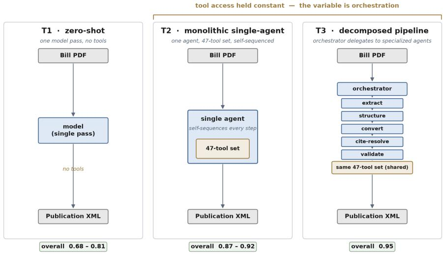
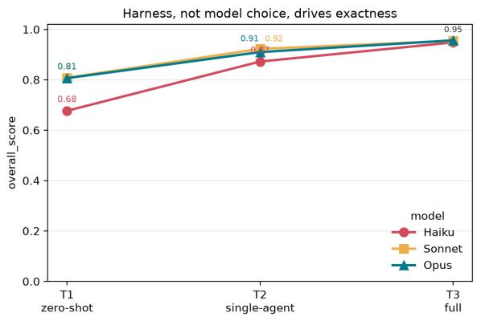
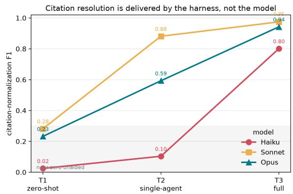
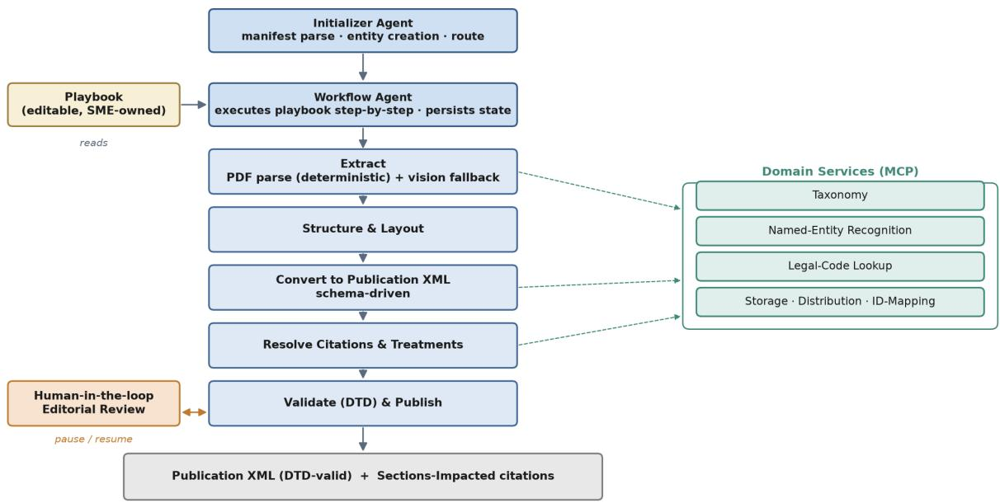
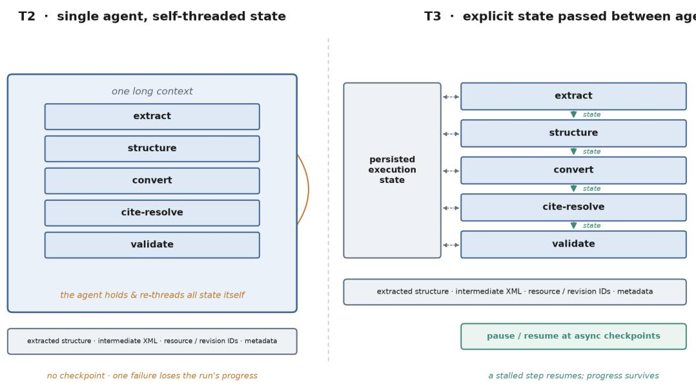
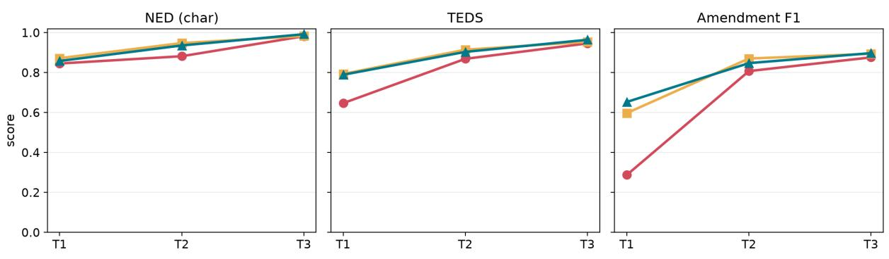
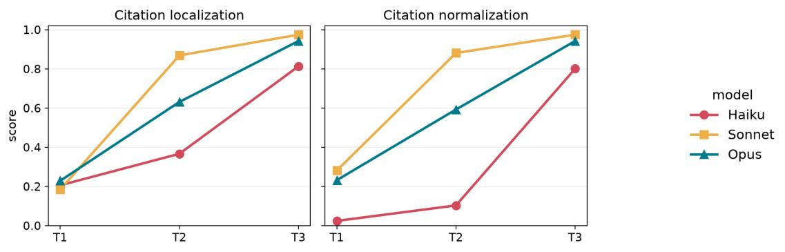
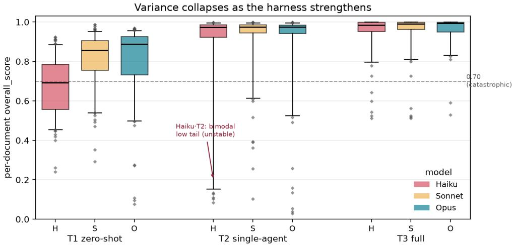

# A Strong Harness Narrows the Model Gap: A Comparative Evaluation for Legislative Document-to-XML Conversion

Palvika Bansal<sup>\*</sup>, Rittika Jindal<sup>\*</sup>, and Ruichong “Alex” Wang

Thomson Reuters Technology

{palvika.bansal, rittika.jindal, alex.wang}@thomsonreuters.com

## Abstract

Legal-content reproduction requires matching the source exactly in section hierarchy, verbatim text, citations, and amendment spans; a dropped citation or mislabeled amendment carries into the products lawyers rely on. We report an industrial pipeline converting U.S. state legislation into strict, schema-constrained XML, and hypothesize that its accuracy comes from harness engineering, the deterministic tooling built around a model, more than the model itself. Our controlled ablation crosses three harnesses (zero-shot, a single tool-using agent, and a decomposed multi-agent pipeline) with three Claude models on 153 gold bills from two jurisdictions. The harness narrows the model gap: the weakest model in the full pipeline beats the strongest model alone (0.948 versus 0.806, paired bootstrap p less than 0.001). Because the two agentic harnesses share identical tools, their gap comes from orchestration: decomposition plus the persisted state and per-agent context it brings. Across four scored dimensions, the model spread at zero-shot (0.68 to 0.81) narrows to 0.95 at the full pipeline; the residual sits almost entirely in citation normalization, where the canonical identifier is retrieved from an external authority rather than generated from the weights, so a deterministic lookup tool supplies the exactness that a larger model does not.

## 1 Introduction

Most legal-NLP benchmarks reward understanding. Classification, retrieval, judgment prediction, and summarization all ask whether a system recovers the meaning or the right label, and a paraphrase that keeps the substance usually counts as correct. Reproduction is a different problem. Once a bill becomes a product that lawyers rely on, the output has to match the source down to the surface: sections and subsections in the right order, the bill text verbatim, citations in canonical form, the struck and inserted spans of an amendment placed where they belong, and the metadata that indexes it downstream. A dropped citation or a mislabeled amendment is an error that travels into the products lawyers put in front of clients, wherever in the document it happens to sit. What we are after is exact reproduction, not a high average.

A large enough model might be expected to clear this bar on its own. It does not. In the zero-shot condition (T1), even the strongest model we tested falls short: Opus reaches only 0.806 overall and barely resolves jurisdiction-specific citations (normalization 0.232). The shortfall is not obviously something a larger model fixes. A model has no way to know a jurisdiction’s normalized statutory identifiers from pre-training, since that mapping lives in an external authority rather than in the weights, and making the model larger does little to close the gap.

Our working hypothesis is that exactness here owes more to harness engineering, the orchestration, tools, and deterministic constraints assembled around the model, than to the model itself. To test it we cross three harnesses with three models (§4): T1 runs the model zero-shot with no harness, T2 hands a single agent the full tool set and asks it to self-sequence the conversion, and T3 is the decomposed harness modeled on the production system, splitting that same tool set across specialized agents. Because T2 and T3 share tools exactly, whatever separates them should reflect orchestration—decomposition together with the persisted state and per-agent context it brings—not a wider action space.

We make four contributions. (1) A deployed harness: a playbook-driven, multi-agent pipeline that converts U.S. state legislation into schemaconstrained publication XML and runs in production at a legal-content publisher (§4). (2) A controlled model×harness ablation that holds tool access constant between the single-agent (T2) and decomposed (T3) harnesses, which lets us attribute the gain to orchestration—decomposition, the persisted state it introduces, and per-agent context isolation—rather than to a larger action space (§6). (3) A dimension-resolved error analysis showing the residual error is not spread evenly but settles in the legally load-bearing dimensions, citations and amendments, and on the harder jurisdiction (§6). Handing the citation-lookup tool to a single agent at T2 does not appear to be enough on its own: only the stronger models invoke it well (normalization 0.88 and 0.59 for Sonnet and Opus against Haiku’s 0.10), and the weakest recovers only once T3 gives it a dedicated citation agent (0.80, §6.3). (4) An evaluation built for legaldocument transformation: we decompose correctness into four dimensions, pairing standard document measures (character-level normalized edit distance (NED) and tree-edit similarity) with two domain measures, exact amendment-span matching and a citation score split into localization and normalization. That split is what localizes the residual to citation normalization, which no model in our study resolves unaided (§5).

## 2 Related Work

Long-document structure and schema generation. Systems that convert raw documents into structured markup, such as the OCR-free parsers Nougat (Blecher et al., 2024) and GOT-OCR (Wei et al., 2024), are judged with the fidelity metrics we also use: normalized edit distance (Levenshtein, 1966) and Tree-Edit-Distance Similarity (Zhong et al., 2020), codified by OmniDocBench (Ouyang et al., 2025). A closer benchmark, ParseBench (Zhang et al., 2026a), finds no method consistently strong across dimensions, so general-purpose parsing is not yet solved even before any legal requirement enters. None of this work, though, scores against a schema with legalsemantic markup such as amendment spans and resolved citations, at our largest documents’ scale (§3), or as a function of system architecture. Our schema also differs from the legislative-markup standards USLM<sup>1</sup> and Akoma Ntoso<sup>2</sup> (the OASIS LegalDocML standard), since we evaluate against a fixed, confidential in-house schema. Grammarconstrained decoding (Geng et al., 2023) is related but separate: it guarantees well-formed output at inference time, which is not the same as measuring a full pipeline’s fidelity once assembled.

Agentic harnesses and evaluation. Our T3 pipeline draws on now-standard agentic patterns: reasoning interleaved with tool calls (Yao et al., 2023; Schick et al., 2023) and role-specialized agents (Wu et al., 2024; Hong et al., 2024). Benchmarks for such systems (Liu et al., 2024; Jimenez et al., 2024; Zhou et al., 2024) tend to score task completion and usually vary tool access and decomposition together, so a gain from adding agents is hard to separate from adding tools. A more recent line names the surrounding infrastructure the harness and argues it, not the base model, often decides whether a capability becomes a finished task. Harness-Bench (Yao et al., 2026) reports capability at the model×harness level, while Zhang et al. (2026b) argue comparisons stay uninterpretable unless the harness is disclosed and held fixed. We add a domain instance under conditions that line has not jointly imposed. We grade against a hard exactness bar rather than completion, so the claim that the harness matters is tested where being almost right already counts as failure. And our T2-versus-T3 contrast is the fixed-harness comparison Zhang et al. (2026b) ask for, tools held identical while decomposition varies, which lets the gain read as orchestration rather than a larger action space.

Legal informatics. Applied legal NLP tends to grade a coarser correctness. Benchmarks like LegalBench (Guha et al., 2023) and CUAD (Hendrycks et al., 2021) score classification, extraction, and QA on label accuracy or span F<sub>1</sub>, tolerating a near-miss that a legal-publishing task cannot: a clause classifier that mislabels one clause in twenty is still useful, but a bill-compilation system that drops one amendment span in twenty misstates an intended change to the law. Work on statutory citation processing (Darji et al., 2026) has treated resolution as a standalone extraction task. We measure it instead as one dimension of a full pipeline, split into localization and normalization (§5). Exact reproduction of a structured legal document remains comparatively understudied relative to the effort it absorbs.

## 3 Task and Dataset

The task is to convert a legislative bill PDF into structured XML that reproduces the bill exactly, down to its section hierarchy, verbatim text, statutory citations, and amendment spans, and that validates against a fixed publication schema.

Source material. Our inputs are the legislative PDFs that state legislatures publish, here from the Idaho Legislature<sup>3</sup> and the New Jersey Legislature.<sup>4</sup> They bring all the difficulty of real legal typography: running headers and footers, margins, multi-column layouts, and footnotes. Amendatory bills add inline formatting on top of this, underline for inserted material and strikethrough for deleted material, which has to be recovered exactly rather than approximately. Text frequently spills across page and column boundaries, so getting the reading order right means reassembling content across physical breaks. Appendix A works a real public Idaho bill through the full PDF→XML pipeline as an example.

Target schema. The output has to validate against a strict publication XML schema constrained by a DTD (Document Type Definition), which we keep confidential. It encodes the section hierarchy (title, chapter, section, subsection, with typed paragraph containers), the verbatim bill text, citations resolved to existing statutory identifiers, amendment markup as typed inline elements for added and deleted material, and metadata for indexing. Validity is all-or-nothing, since a single misplaced element can invalidate the whole document. Appendix A shows this amendment markup worked through on a real bill.

Dataset. The gold set holds 153 expert-produced documents, 103 from Idaho and 50 from New Jersey, spanning the bill revision lifecycle (asintroduced, engrossed, adopted, and amendedsubstituted versions). Sizes range widely but skew small. The median document has about 130 body nodes (roughly 5.8K characters) and a nearly constant tree depth of 8, since the schema hierarchy is shallow. The tail runs long, out to two New Jersey budget bills large enough to strain the evaluation itself: SB 2025 at 40,944 structural nodes and AB 4700 at 8,229,<sup>5</sup> both past the node cap of the tree-edit-similarity scorer (§5). Appendix Table 5 gives the full size distribution by jurisdiction. The two jurisdictions differ in kind. Idaho is a fairly stable baseline, whereas New Jersey is harder across the board, with larger bills, heavier revision lifecycles, and more involved citation patterns. That matters, because New Jersey is where the harness’s advantage over the model turns out to be widest (§6).

## 4 Harness Engineering: Three Levels of Scaffolding

By harness we mean the deterministic engineering built around the model: typed tools, schema validation, per-jurisdiction configuration, and structural boundaries that fix what the model produces at each step. The three harnesses add this scaffolding in increasing amounts, none in T1, tools in T2, tools plus decomposition in T3 (Figure 1), and the paper’s question is how much exactness each layer contributes.

T1: no harness, the zero-shot baseline. T1 is the model with no harness at all: we give it the source document in one pass and ask for the publication XML directly, with no tools, retrieval, or intermediate steps. This is the floor the other harnesses build on. Because it has no legal-code lookup, T1 also cannot resolve a citation to its canonical identifier, a limitation that dominates the results.

T2: a monolithic harness, the single-agent baseline. T2 adds tools but not decomposition, a harness, but an undifferentiated one. It gives one agent the complete tool set, the same 47 tools the production pipeline uses, and asks that single agent to sequence the whole conversion itself (extract, structure, convert, resolve citations, validate) in one context with no sub-agents. T2 is the pivotal control: it shares the model, tools, and data with T3 at constant tool access, so the T2→T3 gap isolates orchestration rather than a larger action space. We use that term for three coupled changes T3 introduces together: decomposition into specialized agents, the persisted checkpointed state that decomposition makes possible, and the smaller separate context each specialist works in, whereas T2 threads everything through one long context.

  
Figure 1: The three harnesses, all starting from the same bill PDF and ending at the same publication XML. Because tool access is held constant between T2 and T3, the difference between them isolates orchestration: decomposition, the persisted state it enables, and the per-agent context it creates.

T3: a decomposed harness, modeled on the production pipeline. T3 mirrors the deployed system’s architecture, with one simplification for experimental control: every agent runs the same model, whereas the deployed system mixes a stronger orchestrator with lighter task agents (see the Limitations section). It separates workflow definition from execution. An editable naturallanguage playbook, which subject-matter experts change without touching code, is read by a generic workflow agent that hands each step to a specialized task agent: document extraction, structure and auxiliary-artifact construction, statute-impact extraction, XML conversion, citation resolution and footnoting, validation. Each agent therefore works on a narrow, well-typed subproblem with a small context and action set. The tool set is identical to T2’s; only the orchestration differs. Both harnesses carry state between steps (extracted structure, intermediate XML, resource and revision identifiers, metadata), and how each handles it is where the weaker model becomes unstable in T2 (§6). Appendix C gives the full pipeline and the T2-vs-T3 state-handling contrast.

What each harness is given. Table 1 sets out the inputs. All three tiers receive the bill as a native PDF, the same target-format XML templates, and the same per-jurisdiction conversion rules; T1 carries these in a single hand-authored instruction, while T2 and T3 load them at run time. The rule we held to is that only the harness may vary across tiers, never the knowledge, so a capability T2 and

<table><tr><td></td><td>T1</td><td>T2</td><td>T3</td></tr><tr><td>Bill PDF (native)</td><td>yes</td><td>yes</td><td>yes</td></tr><tr><td>XML templates</td><td>yes</td><td>yes</td><td>yes</td></tr><tr><td>Jurisdiction rules</td><td>yes</td><td>yes</td><td>yes</td></tr><tr><td>Step-ordered playbook</td><td>none</td><td>9 steps</td><td>21 steps</td></tr><tr><td>Tools</td><td>none</td><td>47</td><td>17</td></tr><tr><td>Sub-agents</td><td>none</td><td>none</td><td>7</td></tr><tr><td>Persisted state</td><td>none</td><td>none</td><td>yes</td></tr></table>

Table 1: What each harness receives. Rows above the middle rule are knowledge and are held constant; rows below it are harness. T2 and T3 reach the same underlying tools: T2 calls the 47 leaf tools directly, while T3 reaches those same 47 leaves through 17 composite orchestrator tools—the counts differ in exposure, not in access. The step counts differ because T2’s playbook stops at the scored artifact, while T3’s continues into the publication stages that follow it.

T3 reach through a tool is written out in prose for T1 rather than withheld. What T1 cannot be given this way is anything requiring an external lookup or an intermediate artifact. T2 additionally receives a nine-step playbook covering the same conversion work T3’s playbook describes, so the step ordering and per-step guidance are not what separates them.

Tool ecosystem. Agents reach backend capability over the Model Context Protocol (MCP). One structural property of it matters for the ablation: MCP is a typed request/response interface with no shared memory across the boundary. That is exactly what lets us hand the same tool set, unchanged, to both T2 and T3, the invariant the T2-vs-T3 comparison rests on. Six MCP-backed services back the pipeline: storage, taxonomy, ID-mapping, NER, a codes service, and distribution, each detailed in Appendix C. One is load-bearing here: the codes service’s statute\_lookup\_batch tool returns each citation’s canonical, jurisdiction-specific identifier in a single round-trip.

The deterministic/model boundary. The harness computes deterministically whatever needs no reasoning and leaves the model only interpretation, and that split is why exactness is a harness property. The codes lookup is the clearest case: citation resolution is a harness rather than a model capability, because the canonical identifier is retrieved from an authoritative source, not generated from the weights (§6.3). Steps that need no reasoning, such as splitting and converting PDF pages, validating schema, and generating typed elements from templates, likewise call local deterministic functions, so what remains for the model is only the part that genuinely requires interpretation.

## 5 Evaluation Framework

A single aggregate similarity score cannot distinguish “reads almost the same” from “cites the wrong law,” and for this task that distinction is the entire point. The errors that matter tend to be small ones: a section renumbered, a struck word left standing, a citation resolved to the wrong statute. Any of them can still change what a bill proposes to do. Because a bill is only a proposed change, such an error does not corrupt the enacted statute. Its cost lands downstream instead, in how the change gets reported, since acting on a misstated bill can be costly even when the error never reaches the session law. Passing schema validation does not certify any of this: it confirms the document is well-formed and structurally complete (§3), not that its content is right, which is why validity and content correctness have to be scored separately. We therefore break correctness into four independent evaluation dimensions, each scored separately: Textual Integrity (the body reproduced without omission, hallucination, or mutation); Layout Topology (the section/subsection/paragraph hierarchy reconstructed as the correct XML tree); Legislative Mutations (inline added.material/deleted.material spans marking exactly which words a bill inserts or strikes); and Citation Fidelity (statutory cross-references localized in the text and resolved to the canonical identifier).

Textual integrity: normalized edit distance. We compute a length-normalized Levenshtein distance over the document body alone (excluding front matter and identifier fields). Both sides first pass through a normalization function $\phi$ that collapses whitespace, standardizes quotes and dashes. For this metric only, ϕ also folds case, since a heading’s capitalization is really an artifact of how the source PDF renders it:

$$
\operatorname { N E D } _ { \operatorname { c h a r } } ( G , P ) = 1 - { \frac { \operatorname { L e v } ( \phi ( G ) , \phi ( P ) ) } { \operatorname { m a x } ( | \phi ( G ) | , | \phi ( P ) | ) } } .\tag{1}
$$

Read plainly, the score is the share of the document that comes out unaltered: 1.0 means the two texts are identical once normalized, and 0.9 means roughly a tenth of the characters would have to be inserted, deleted or changed to turn one into the other. We report the word-level variant as well, but the composite uses the character-level one, which tends to catch small textual drops that word-level tokenization can hide. Within amendment and citation matching, by contrast, case is not folded: a legal mutation or a statute identifier is not a rendering artifact.

Layout topology: tree-edit similarity. For structure, we treat the assembled XML as a labeled tree, keeping tags but not text, and score it with Tree-Edit-Distance Similarity (TEDS), a normalized tree-edit distance computed by APTED (Pawlik and Augsten, 2016) under unit costs:

$$
\mathrm { T E D S } ( T _ { G } , T _ { P } ) = 1 - \frac { \mathrm { T E D } ( T _ { G } , T _ { P } ) } { \operatorname* { m a x } ( | T _ { G } | , | T _ { P } | ) } .\tag{2}
$$

Read plainly, this ignores the words entirely and compares only the shape of the document—which sections hold which subsections and paragraphs— so it asks whether the bill was filed into the right structural skeleton, however well or badly the text inside it reads. When either document body is empty or unparseable, we leave TEDS undefined rather than setting it to zero. A missing output should not be quietly recorded as “completely wrong” in a measure whose job is to compare two documents that are both actually present.

Legislative mutations: amendment exactmatch. We score amendment spans by exact multiset match rather than any fuzzy overlap. From gold and prediction we take every added.material/deleted.material span, normalize its text with $\phi$ (this time case-preserving), and treat the two sides as multisets of (tag, ϕ(text)) pairs, which gives ${ \mathrm { T P } } = | G \cap P | , { \mathrm { F P } } = | P - G |$ and $\mathrm { F N } = | G - P | .$ . A document with nothing to mark is not penalized for marking nothing: an empty prediction against an empty gold set counts as a full true negative. We report micro $F _ { 1 }$ over the documents whose gold actually contains spans, the variant shown in Table 2. The composite instead uses an all-documents variant, where a correctly empty document contributes as the true negative just described.

Amendment span placement. Matching amendment spans as (tag, ϕ(text)) multisets makes the measure above position-blind: a correctly worded span placed in the wrong location still matches, and in a document that repeats a sentence the wrong occurrence could be marked. To bound the effect, we re-scored with each span’s preceding in-paragraph context appended to the match key. Of the spans the reported metric credits, 88.1% also agree on context, so at most 11.9% could be mislocated— an upper bound, since an unrelated edit elsewhere in the same paragraph also breaks the context key. Adding the context requirement lowers mean amendment $F _ { 1 }$ by 0.082, 0.085 and 0.094 at T1, T2 and T3 respectively— nearly the same penalty at every level of scaffolding—so position-blindness does not differentially favor any harness, and the ordering in $\ S 6$ is unchanged.

Citation fidelity: localization vs. normalization. Citations use the same multiset-F machinery, split into two independent signals over cite.query nodes. Localization asks whether the system found and tagged the citation text inside the node at all. Normalization asks whether the citations it did find were resolved to the correct canonical identifier, matching on that identifier rather than on the visible text. The two fail separately: a system may localize perfectly yet resolve nothing, and §6 shows this split is where the model-versus-harness distinction is sharpest. Collapsing them into one $F _ { 1 }$ would score a found-but-unresolved citation the same as one never found. We report micro $F _ { 1 }$ as the headline. One caveat: because a match requires the citation to be wrapped in cite.query, localization partly reflects harness-supplied schema-tagging competence, not citation-finding on its own. Two consequences follow from matching multisets. Repeated citations are counted rather than collapsed: if a statute is cited k times in the gold document, the prediction must carry k matching instances, and any surplus or shortfall scores as a false positive or false negative like any other. Unresolved citations are handled differently by the two signals. A span the system tagged but left unresolved still counts as found for localization, since it was in fact located; it contributes no identifier to normalization, so there it is a miss against the gold identifier rather than being excused. A citation the gold itself leaves unresolved is dropped from both sides and is not required of the system.

Composite. We fold text and structure into a single headline number, the unweighted mean of character-level NED, TEDS, and amendment $F _ { 1 }$

$$
\begin{array} { r } { \mathrm { O v e r a l l } = \frac { 1 } { 3 } \left( \mathrm { N E D } _ { \mathrm { c h a r } } + \mathrm { T E D S } + \mathrm { A m e n d . } \ F _ { 1 } \right) . } \end{array}\tag{3}
$$

Citation localization and normalization stay out of this composite and are reported on their own, since averaging them in would let near-perfect text and structure mask a citation failure. TEDS is worst-case cubic in the number of nodes, so we cap it at 4,000 nodes and leave TEDS, and with it Overall, unscored for the two largest and hardest documents (Appendix Table 6). Those two drop out of the composite, though every other dimension is still computed for them. Unparseable files and output-integrity failures, whether a truncated or an over-generated output, are recorded as a distinct class rather than allowed to abort the cell. In the event every output we scored parsed as well-formed XML and none was rejected as malformed.

Statistical testing. Every cell mean in §6 carries a 95% confidence interval from a bootstrap over that cell’s scored documents (10,000 resamples, fixed seed). For the comparisons our claims rest on, such as Haiku·T3 against Opus·T1 or Sonnet against Opus within a tier, we run a paired bootstrap over documents scored in both arms, matched by identity, and report a two-sided p-value on the mean difference. We prefer this to a chi-squared test, since our scores are continuous on [0, 1] rather than pass/fail counts and binning them would discard information the bootstrap keeps. This captures variance across the document sample, not run-to-run variance, as each cell is a single run. We leave the p-values uncorrected, but the confirmatory comparisons form a small pre-specified family of about six, and every effect we rely on reaches $p \leq 0 . 0 0 4$ , below a Bonferroni threshold for that size $( \alpha / 6 \approx 0 . 0 0 8 )$ . The one contrast that misses significance, Sonnet against Opus at T2 $( p = 0 . 3 9 )$

  
Figure 2: Overall exactness rises with the harness for every model. Unaided, the models spread widely, but inside the full system they converge.

we decline to interpret.

## 6 Experimental Results

Each harness was run on the same 153-document cohort across the three models: 459 attempted runs per harness, the full two-jurisdiction cohort of §3.<sup>6</sup> Cells are scored over the runs that yielded a scorable document.

## 6.1 The staircase: harness dominates model

Table 2 reports every dimension and the headline Overall score for all nine cells, plotted in Figure 2. The staircase is clean and monotonic for every model, and the model gap shrinks at every step. Moving Haiku from zero-shot to the full system raises Overall from 0.677 to 0.948, whereas moving from Haiku to Opus at zero-shot raises it only from 0.677 to 0.806: the harness lifts more than the model does. Unaided, the models span 0.677–0.807, and in the full system 0.946–0.954. The comparison the ablation isolates holds under a paired test: Sonnet·T3 (0.954) and Opus·T3 (0.946) stay close, and both clearly exceed Opus·T1 (0.806, paired bootstrap $\Delta = + 0 . 1 2 0 , p < 0 . 0 0 1$ $n ~ = ~ 1 2 4 )$ . Even Haiku·T3 (0.948) beats the strongest model zero-shot $( \Delta \ = \ + 0 . 1 1 7 , \ p \ <$ 0.001, n = 133).

  
Figure 3: Citation normalization is near-zero for every model unaided and is delivered by the harness. The stronger models resolve citations as soon as they have the tool (T2). The weakest model does not, and reaches parity only under full decomposition (T3).

One result complicates the “Haiku < Sonnet < Opus” ranking. At T2, Sonnet’s Overall (0.922) edges out Opus’s (0.910), a gap a paired bootstrap cannot distinguish from noise $( p = 0 . 3 9 ,$ $n = 1 5 1 )$ . What is robust is the dimension underneath. The gap is almost entirely in citations, where Sonnet resolves far better than Opus at T2 (localization 0.869 vs. 0.631, normalization 0.881 vs. 0.593, at $p = 0 . 0 0 4$ and $p < 0 . 0 0 1 , n = 7 4 )$ while structure and text are near-tied, so the composite dilutes a 24-to-29-point (on the 0–1 scale) citation gap below significance. The reversal is specific to T2, so tier alone does not predict which model best exploits a harness. The model axis reads as weak (Haiku) versus strong (Sonnet and Opus, trading the lead) rather than a clean three-point ranking.

## 6.2 Per-dimension: what the harness fixes

The composite hides structure. Across the five dimensions (Table 2, Appendix Figure 6) the split is clear: text and structure are close to solved once any tool-using harness is present, with NED and TEDS at .95–.99 by T3 and much banked at T2, while amendments improve mostly on the T1→T2 jump before flattening. Citations are the sharpest story, treated next.

## 6.3 Citation resolution is a harness property

The sharpest split in the model×harness interaction shows up here (Figure 3). Haiku goes from nearzero (T1 .024) to resolving citations only once the harness is fully decomposed (T2 .103, T3 .801), whereas Sonnet and Opus resolve well as soon as they have the lookup tool at all (T2 cite-norm .881 and .593, up from T1 .282 and .232). The same tool gives the strong models a large jump and the weak one almost none until decomposition is added. We read that as the dedicated citation agent substituting for a capability Haiku lacks rather than merely adding one, though the measurement shows only the gap, not its cause. Localization is separable from normalization, not its easier half: at T1 Sonnet localizes worse than Haiku (.185 vs. .206) yet normalizes far better once a citation is found (.282 vs. .024). Since T1 has no lookup tool by construction, its near-zero normalization floor is not the finding. What matters is how unevenly that floor is escaped once the tool arrives, and only for the model that also gets a dedicated agent.

<table><tr><td></td><td></td><td></td><td colspan="3">Structure &amp; text</td><td colspan="2">Citations</td></tr><tr><td>Model</td><td>Harness</td><td>Overall ↑</td><td>NED ↑</td><td>TEDS↑</td><td>Amend.  $F _ { 1 } \uparrow$ </td><td>Local. ↑</td><td>Norm. ↑</td></tr><tr><td rowspan="3">Haiku 4.5</td><td>T1</td><td>0.677 [.654,.700]</td><td>0.846</td><td>0.647</td><td>0.288</td><td>0.206</td><td>0.024</td></tr><tr><td>T2</td><td>0.872 [.816,.921]</td><td>0.882</td><td>0.869</td><td>0.808</td><td>0.367</td><td>0.103</td></tr><tr><td>T3</td><td>0.948 [.932,.963]</td><td>0.982</td><td>0.946</td><td>0.876</td><td>0.813</td><td>0.801</td></tr><tr><td rowspan="3">Sonnet 4.6</td><td>T1</td><td>0.807 [.785,.829]</td><td>0.872</td><td>0.794</td><td>0.598</td><td>0.185</td><td>0.282</td></tr><tr><td>T2</td><td>0.922 [.899,.943]</td><td>0.948</td><td>0.915</td><td>0.871</td><td>0.869</td><td>0.881</td></tr><tr><td>T3</td><td>0.954 [.937,.969]</td><td>0.983</td><td>0.954</td><td>0.892</td><td>0.954</td><td>0.954</td></tr><tr><td rowspan="3">Opus 4.6</td><td>T1</td><td>0.806 [.778,.834]</td><td>0.858</td><td>0.789</td><td>0.653</td><td>0.229</td><td>0.232</td></tr><tr><td>T2</td><td>0.910 [.879,.937]</td><td>0.936</td><td>0.904</td><td>0.847</td><td>0.631</td><td>0.593</td></tr><tr><td>T3</td><td>0.946 [.916,.970]</td><td>0.985</td><td>0.955</td><td>0.898</td><td>0.943</td><td>0.943</td></tr></table>

Table 2: Main results: per-dimension and composite exactness for all nine model×harness cells, pooled across both jurisdictions (micro $F _ { 1 }$ for citations and amendments, higher is better throughout). Every model climbs monotonically from the zero-shot baseline (T1) to the full pipeline (T3), and the full-pipeline rows are shaded. Overall is the unweighted mean of NED, TEDS, and amendment $F _ { 1 }$ . The two citation columns are reported separately and excluded from it (§5). Because it averages per document over a slightly different population than its displayed columns, Overall need not equal their row-wise mean (see footnote). Bracketed ranges beneath Overall are 95% bootstrap confidence intervals (§5).<sup>7</sup>

To characterize what is left, we diffed predicted against gold cite.query resolutions for every T3 output with imperfect normalization (32 of 167 outputs containing at least one cite.query node, pooled across the three T3 models, detailed in Appendix Table 7). The dominant mode is a dropped subset. Most citations resolve, but a group is silently omitted, typically those in a statutory title the resolution step never reaches (NJ SB 3587). Rarer are granularity errors (ID SB 1023), lookup misses (ID SB 1142), and one over-expansion outlier that alone inflates Idaho’s raw residual (ID SB 1008). The dominant modes look coveragelimited rather than reasoning-limited: they are what we would expect when the codes service returns no identifier, the same per-jurisdiction dependency we flag as a generalization risk (see the Limitations section).

<table><tr><td>Harness</td><td>Pooled std ↓</td><td>Low-score (&lt; 0.70) ↓</td></tr><tr><td>T1</td><td>0.167</td><td>31%</td></tr><tr><td>T2</td><td>0.188</td><td>8%</td></tr><tr><td>T3</td><td>0.099</td><td>4%</td></tr></table>

Table 3: Pooled variance and rate of low-scoring documents (< 0.70), by harness. The full pipeline (T3) both tightens the distribution and shrinks the tail.

## 6.4 Reliability: the tail collapses

Means understate the case for the harness. What matters is how often it produces a badly wrong document, and any inaccuracy is costly whether or not it is substantive, so the risk to manage is the low-scoring tail, not the average. Table 3 reports the pooled variance and the rate of low-scoring documents (< 0.70) by harness. Variance is nonmonotonic: T2 is the widest, not the narrowest, before the full pipeline collapses it. At T1 the low-score rate splits sharply by model (52% Haiku, 23% Opus, 19% Sonnet), then falls, pooled across models, to 8% at T2 and 4% at T3. Haiku·T2 is the single most unstable cell (std 0.248). That is the measurement; our explanation for it is that a weak model asked to self-sequence is erratic, and that what steadies it is orchestration rather than a stronger model. The per-document distribution behind these statistics appears in Appendix Figure 7.

<table><tr><td></td><td colspan="3">Idaho</td><td colspan="3">New Jersey</td></tr><tr><td>Harness</td><td>Haiku</td><td>Sonnet</td><td>Opus</td><td>Haiku</td><td>Sonnet</td><td>Opus</td></tr><tr><td>T1</td><td>0.695</td><td>0.833</td><td>0.860</td><td>0.636</td><td>0.754</td><td>0.697</td></tr><tr><td>T2</td><td>0.917</td><td>0.972</td><td>0.964</td><td>0.783</td><td>0.816</td><td>0.798</td></tr><tr><td>T3</td><td>0.974</td><td>0.977</td><td>0.976</td><td>0.879</td><td>0.871</td><td>0.809</td></tr></table>

Table 4: Overall score by jurisdiction and harness; New Jersey is harder under every harness, yet the harness’s advantage over the unaided model is wider there, not narrower. Full-pipeline (T3) cells shaded. Each cell averages over its own scored documents, so the jurisdiction columns combine into Table 2’s Overall weighted by those counts, not by the cohort totals.

Before the final numbers, we sanity-checked every output for integrity and re-ran flagged cases to tell transient errors from stable failures. This caught 7 of 459 T1 attempts (1.5%) and 21 of 459 T2 attempts (4.6%), concentrated on the largest New Jersey bills, and repeated runs reproduced them, so we record them as stable properties of the harness rather than transient noise. That T2 fails more often than T1 is the observation; the explanation we offer is that it asks one model to self-sequence extraction, conversion, lookups, and validation in a single context, spending output and context budget on orchestration. The failures run both ways. AB 3678 (302k gold chars) truncates to ≈4.7k at T2, while AB 4878 over-generates to ≈2.1× gold for all three models identically. T3, sharing the same tool access, avoids both.

## 6.5 Cross-jurisdictional stress testing

New Jersey is harder under every harness and for every model (Table 4). More importantly, the thesis holds more strongly on the harder jurisdiction: the gap between Sonnet in the full system and Opus unaided (Sonnet·T3 − Opus·T1) is +0.117 on Idaho and +0.174 on New Jersey. Were the harness’s advantage merely an artifact of Idaho being easy, that gap should shrink on the harder cohort, but it widens. The two New Jersey budget bills make the point (gold trees of 8,229 and 40,944 nodes): at zero-shot the model abandons both, while the full pipeline reconstructs them to near-solved scores, both past the TEDS node cap (per-bill numbers in Appendix Table 6).

## 7 Conclusion

We asked whether exactness here is bought with a bigger model or a better harness, and our experiments lean firmly toward the harness. Scores climb a clean staircase, and the weakest model in the full pipeline beats the strongest model unaided (Haiku·T3 0.948 against Opus·T1 0.806). Because T2 and T3 keep tools constant, the further climb comes from orchestration—decomposition, the state persistence it brings, and per-agent context— not from more tooling. The pipeline also draws very different models together, tightens the distribution, thins the low-scoring tail, and supplies the dimension that carries the most legal weight, citation normalization, which no model reaches unaided. The reason is specific: a citation’s canonical identifier comes from a lookup against an external authority, not from the weights, so a deterministic tool plus the decomposition that reliably invokes it delivers what a larger model alone does not (§6.3). Every result here comes from a single model family (Claude Haiku 4.5, Sonnet 4.6 and Opus 4.6); whether the harness effect transfers to other model families is untested, and we leave it to future work.

What remains is small and specific: citation exactness and the harder New Jersey documents, where the last bit of accuracy still tracks the model. A larger model is an unlikely fix: the identifier has to be retrieved from an external authority, not generated. The residual is also the part of the task carrying the most legal risk, where being almost right is not good enough. This is where human judgment belongs: expert review is a permanent part of the architecture, not a temporary crutch. Because the residual is concentrated and identifiable, it can be routed, with the system auto-publishing what it has solved and surfacing the citation and amendment decisions that carry legal weight for an editor to confirm. The chief open problem is confidence estimates calibrated well enough to drive that routing. The same pattern likely holds wherever an exactness bar meets an external source of truth that pretraining cannot supply, as in medical coding or regulatory tagging: wire that lookup in as a deterministic tool, decompose so it is reliably invoked, and route the residual to expert review.

## Limitations

What we score. We score the pre-review XML, captured after the pipeline’s automated validation step but before the editorial-review gate (Appendix C): the system’s final unaided output, not the human-corrected artifact that reaches publication. The T3 cells also use a uniform model across every agent, whereas the deployed system is mixed (a stronger orchestrator with lighter task agents); this is the controlled condition, not the production one.

Generalization. We study two jurisdictions. Nothing in the harness is jurisdiction-specific by construction: formatting, citation conventions, and schema mappings enter as per-jurisdiction configuration (§4) rather than code, so the architecture is intended to generalize to the remaining U.S. states. Having tested only two, we read these results as a two-jurisdiction, single-model-family case study. Four concrete risks could break the claim elsewhere: amendment conventions other than strikethrough/underline; citation and sectionnumbering formats each needing their own normalization mapping; source-PDF digitization worse than Idaho’s or New Jersey’s; and codes-lookup coverage that may not yet exist for a new state. All results use Claude-family models (Haiku 4.5, Sonnet 4.6, Opus 4.6); whether the harness effect holds for other model families is untested and left to future work.

One document type. We convert legislative bills under a single publication schema. Treaties, judgments, and regulatory codes demand the same exactness but carry their own conventions and their own notions of what an amendment or a citation is, and we have not tested them. We expect the finding to transfer, since it turns on wiring an external authority in as a deterministic tool rather than anything bill-specific, but that is an expectation, not a result.

What the T2–T3 contrast isolates. The comparison holds tool access fixed, but not everything else. Alongside decomposition, T3 adds persisted, checkpointed state that T2 lacks (Appendix C) and gives each specialized agent its own small context, whereas T2 re-threads every intermediate result through one long context. These three travel together by construction, so we read the T2→T3 gain as orchestration rather than decomposition alone; ablations separating them are left to future work.

What we do not measure. We report no tokens, latency or dollar cost per setting: the ablation runs were not instrumented for per-run usage accounting, and the figures cannot be recovered from the artifacts we kept. The one indication we can give is a configuration bound, not a measurement: the single-agent tier needed a far higher per-run request ceiling than the orchestrator, since its request count grows with bill length. We report no schemavalidity rate either, because DTD validation runs in the downstream publish step rather than on the pre-review artifact we score and so sits outside our scorer suite. Both a cost-per-document comparison and a uniform validity rate across the nine cells are left to future work.

Metrics and gold set. The reported cells score output-integrity failures—truncated or overgenerated outputs (§6)—as produced rather than setting them aside, on the view that a harness which truncates a document has failed the task. The consequence is that the T1 and T2 deficits blend conversion quality with output robustness, and we do not report the two components separately; the counts are small and concentrated (7 of 459 at T1, 21 of 459 at T2). Our metrics are exactness proxies: high scores are necessary for legal correctness but not sufficient. The gold set comes from a legacy production system—unrelated in architecture, prompts, and tooling to the pipeline evaluated here—then corrected by a subject-matter expert against the source bill; sharing no lineage with any of the three tiers, it advantages none differentially. Because that correction is a single-SME review, we report neither inter-annotator agreement nor a human-performance ceiling; both would require a second expert.

Reproducibility. The gold set is proprietary and the DTD is confidential, so we name the mitigations we do have. The source inputs are public government documents (the Idaho and New Jersey legislatures, §3) and every bill we single out is cited by its public number, so each example’s PDF side is independently retrievable; Appendix A works one public bill end to end. All scorers are standard and deterministic (Levenshtein NED, APTED tree-edit similarity, multiset F<sub>1</sub>) run with a fixed seed (§5), and the three models are pinned by exact API snapshot (§6; for the 4.6 generation the dateless identifier is the pinned snapshot, not an evergreen alias). Running the harness on a public document-parsing benchmark would give our text and structure dimensions an external anchor, and we leave that to future work.

Baselines. All our baselines are LLM-based: T1 is a zero-shot LLM floor, not a tuned non-LLM parser such as an OCR-plus-rules pipeline or the document-AI systems we cite, so our results show the harness lifts a weak LLM to exactness, not that it outperforms a competent deterministic parser; benchmarking such a parser on this data is left to future work.

## Ethical Considerations

The system operates where errors can carry legal consequences, so our results are as much a caution as an endorsement of automation. The residual error concentrates in the dimensions that carry legal meaning, citations and amendments, which is exactly where over-trust would do the most harm. Human review of those decisions is therefore not an optional refinement but a requirement for responsible deployment. The evaluation uses expertproduced gold and involves no personal data.

## References

Lukas Blecher, Guillem Cucurull, Thomas Scialom, and Robert Stojnic. 2024. Nougat: Neural optical understanding for academic documents. In International Conference on Learning Representations (ICLR).

Harshil Darji, Martin Heckelmann, Christina Kratsch, and Gerard de Melo. 2026. Bundesrecht: An open library and corpus for german statutory reference processing. arXiv preprint arXiv:2605.31338.

Saibo Geng, Martin Josifoski, Maxime Peyrard, and Robert West. 2023. Grammar-constrained decoding for structured NLP tasks without finetuning. In Proceedings of the 2023 Conference on Empirical Methods in Natural Language Processing (EMNLP).

Neel Guha, Julian Nyarko, Daniel E Ho, Christopher Ré, Adam Chilton, et al. 2023. LegalBench: A collaboratively built benchmark for measuring legal reasoning in large language models. In Advances in Neural Information Processing Systems (NeurIPS) Datasets and Benchmarks Track.

Dan Hendrycks, Collin Burns, Anya Chen, and Spencer Ball. 2021. CUAD: An expert-annotated NLP dataset for legal contract review. In Advances in Neural Information Processing Systems (NeurIPS) Datasets and Benchmarks Track.

Sirui Hong, Mingchen Zhuge, Jiaqi Chen, Xiawu Zheng, Yuheng Cheng, Ceyao Zhang, Jinlin Wang, Zili Wang, Steven Ka Shing Yau, Zijuan Lin, Liyang Zhou, Chenyu Ran, Lingfeng Xiao, Chenglin Wu, and Jürgen Schmidhuber. 2024. MetaGPT: Meta programming for a multi-agent collaborative framework. In International Conference on Learning Representations (ICLR).

Carlos E Jimenez, John Yang, Alexander Wettig, Shunyu Yao, Kexin Pei, Ofir Press, and Karthik

Narasimhan. 2024. SWE-bench: Can language models resolve real-world GitHub issues? In International Conference on Learning Representations (ICLR).

Vladimir I Levenshtein. 1966. Binary codes capable of correcting deletions, insertions, and reversals. Soviet Physics Doklady, 10(8):707–710.

Xiao Liu, Hao Yu, Hanchen Zhang, Yifan Xu, Xuanyu Lei, Hanyu Lai, Yu Gu, Hangliang Ding, Kaiwen Men, Kejuan Yang, Shudan Zhang, Xiang Deng, Aohan Zeng, Zhengxiao Du, Chenhui Zhang, Sheng Shen, Tianjun Zhang, Yu Su, Huan Sun, and 3 others. 2024. AgentBench: Evaluating LLMs as agents. In International Conference on Learning Representations (ICLR).

Linke Ouyang et al. 2025. OmniDocBench: Benchmarking diverse PDF document parsing with comprehensive annotations. In IEEE/CVF Conference on Computer Vision and Pattern Recognition (CVPR).

Mateusz Pawlik and Nikolaus Augsten. 2016. Tree edit distance: Robust and memory-efficient. Information Systems, 56:157–173.

Timo Schick, Jane Dwivedi-Yu, Roberto Dessì, Roberta Raileanu, Maria Lomeli, et al. 2023. Toolformer: Language models can teach themselves to use tools. In Advances in Neural Information Processing Systems (NeurIPS).

Haoran Wei, Chenglong Liu, Jinyue Chen, Jia Wang, Lingyu Kong, Yanming Xu, Zheng Ge, Liang Zhao, Jianjian Sun, Yuang Peng, Chunrui Han, and Xiangyu Zhang. 2024. General OCR theory: Towards OCR-2.0 via a unified end-to-end model. arXiv preprint arXiv:2409.01704.

Qingyun Wu, Gagan Bansal, Jieyu Zhang, Yiran Wu, Beibin Li, Erkang Zhu, Li Jiang, Xiaoyun Zhang, Shaokun Zhang, Jiale Liu, Ahmed Hassan Awadallah, Ryen W White, Doug Burger, and Chi Wang. 2024. AutoGen: Enabling next-gen LLM applications via multi-agent conversation. In Conference on Language Modeling (COLM).

Shunyu Yao, Jeffrey Zhao, Dian Yu, Nan Du, Izhak Shafran, Karthik Narasimhan, and Yuan Cao. 2023. ReAct: Synergizing reasoning and acting in language models. In International Conference on Learning Representations (ICLR).

Yilun Yao, Xinyu Tan, Chao-Hsuan Liu, Yaoming Li, Zhengyang Wang, Wenhan Yu, Zhewen Tan, Yuxuan Tian, Guangxiang Zhao, Lin Sun, Xiangzheng Zhang, and Tong Yang. 2026. Harness-bench: Measuring harness effects across models in realistic agent workflows. arXiv preprint arXiv:2605.27922.

Boyang Zhang, Sebastián G Acosta, Preston Carlson, Sacha Bron, Pierre-Loïc Doulcet, Daniel B Ospina, and Simon Suo. 2026a. ParseBench: A document parsing benchmark for AI agents. arXiv preprint arXiv:2604.08538.

Yunbei Zhang, Janet Wang, Yingqiang Ge, Weijie Xu, Jihun Hamm, and Chandan K Reddy. 2026b. Stop comparing LLM agents without disclosing the harness. arXiv preprint arXiv:2605.23950.

Xu Zhong, Elaheh ShafieiBavani, and Antonio Jimeno Yepes. 2020. Image-based table recognition: data, model, and evaluation. In European Conference on Computer Vision (ECCV).

Shuyan Zhou, Frank F Xu, Hao Zhu, Xuhui Zhou, Robert Lo, et al. 2024. WebArena: A realistic web environment for building autonomous agents. In International Conference on Learning Representations (ICLR).

## A Worked PDF→XML Example

Bills are public government works; the excerpt below is from Idaho House Bill No. 66 (2025),<sup>8</sup> which amends Idaho Code § 72-713. It shows the amendatory structure the pipeline has to recover, with strikethrough for deleted material and underline for inserted material, alongside a representative fragment of the publication XML (element names are stand-ins, since the schema vocabulary is confidential). In that fragment the inserted and struck spans become typed inline elements, and the statutory reference becomes a resolved cite.query.

SECTION 1. That Section 72-713, Idaho Code, be, and the   
same is hereby amended to read as follows:   
72-713. NOTICE OF HEARINGS -- SERVICE. (1) The commission   
shall give at least ten (10) days’ written notice . . .   
either by personal service or by registered or certified   
mail email or certified mail.

Source PDF text (Idaho HB 66, § 72-713): strikethrough marks deleted material, underline marks inserted material.

```xml
<section num="72-713">
<heading>NOTICE OF HEARINGS -- SERVICE</heading>
<para>The commission shall give at least ten (10)
days' written notice ... either by personal
service or by
<deleted.material>registered or certified
mail</deleted.material>
<added.material>email or certified
mail</added.material>.
<cite.query resolved="ID-CODE-72-713">Section
72-713, Idaho Code</cite.query>
</para>
</section>
```  
Listing 1: Representative publication-XML fragment for the clause above; element names are stand-ins for the confidential schema vocabulary.

How the measures read this example. The four dimensions of §5—five measures, once citations are split—each score a different part of the fragment above. Textual integrity compares the running words of the paragraph, “The commission shall give at least ten (10) days’ written notice . . . ”, against the gold text character by character, and penalizes a dropped “(10)” or a changed “ten”. Layout topology ignores those words and checks only the shape: a section holding a heading and a para, in that order. Legislative mutations checks the two inline spans, requiring deleted.material to carry exactly “registered or certified mail” and added.material exactly “email or certified mail”; swapping the two tags, or dropping either span, counts as a miss even though every word is still present on the page. Citation fidelity splits in two here: localization asks whether “Section 72- 713, Idaho Code” was found and wrapped in a cite.query at all, and normalization asks whether the resolved attribute carries the correct statutory identifier—the step no model completed unaided (§6.3).

<table><tr><td rowspan="2">Cohort</td><td rowspan="2"></td><td colspan="3">Body nodes</td><td colspan="2">Length (chars)</td></tr><tr><td>n</td><td>med p90</td><td>max</td><td>med</td><td>p90 max</td></tr><tr><td>All</td><td>153</td><td>130</td><td>652</td><td></td><td>40,944 5.8K 42K  1.16M</td><td></td></tr><tr><td>Idaho</td><td>103</td><td>97</td><td>366</td><td>1,955</td><td>4.0K 23K</td><td>42K</td></tr><tr><td>New Jersey</td><td>50</td><td>187</td><td></td><td></td><td>1,744 40,944 9.4K 74K1.16M</td><td></td></tr></table>

Table 5: Corpus size distribution over the 153-document gold set (103 Idaho, 50 New Jersey). Documents vary in breadth, not depth. XML tree depth is 8 for nearly all documents (max 9), fixed by the shallow schema hierarchy, so we report body-node and character-length distributions. New Jersey is larger than Idaho at every percentile. “Length” is the character count of the bill body (K/M denote thousands/millions).

## B Corpus Size Distribution

Table 5 gives the size of the 153-document gold set (§3) broken down by jurisdiction, putting numbers to the “skews small, long right tail” shape noted there. Most documents are small, and two New Jersey budget bills sit at the far end.

## C Production Pipeline and State Handling

This section lays out the deployed T3 harness from §4. It covers the domain services the agents call, the six-stage pipeline (Figure 4), and the statehandling contrast between the two agentic harnesses (Figure 5) that §6 and the Limitations section point to.

Domain services. The pipeline calls six MCPbacked services (§4):

• storage, which handles state persistence, rendition reads and saves, and revision cloning.

• taxonomy, which supplies jurisdiction, session, and measure-type metadata.

• ID-mapping, which aligns identifiers across years and versions.

• NER, for named-entity linking.

• a codes service, whose statute\_lookup\_batch tool returns each citation’s canonical, jurisdiction-specific identifier in one round-trip.

• distribution, which hands the validated document to the publish step.

## D Per-Dimension and Reliability Detail

Why Overall is not the row mean. Table 2’s Overall column is computed per document and then macro-averaged, while each displayed column pools over a slightly different set of documents, so the two need not agree. The gap is widest at zero-shot, where documents with no amendment spans—scored as true negatives in the alldocuments variant—are most common: naively averaging Haiku 4.5 T1’s displayed columns gives 0.594 against the reported 0.677. The denominator mismatch accounts for every row’s gap; none of it is a computation error.

These two figures expand the aggregate results of §6. Figure 6 breaks the composite into its five constituent dimensions, and Figure 7 shows the per-document score distribution that sits behind the pooled reliability statistics in Table 3.

## E Stress Bills and Citation-Residual Detail

This section gives the per-document detail behind two results from §6. The first is the collapse-andrecovery of the two largest New Jersey budget bills (Table 6). The second is a qualitative taxonomy of the T3 citation-normalization residual (Table 7, §6.3).

<table><tr><td>Bill</td><td>Harness</td><td>Gold</td><td>Pred</td><td>NED Amend.</td><td> $F _ { 1 }$ </td></tr><tr><td>SB_2025</td><td>T1</td><td>40,944</td><td>1,087</td><td>0.10</td><td>0.00</td></tr><tr><td>SB_2025</td><td>T3</td><td>40,944</td><td>22,239</td><td>0.87</td><td>0.92</td></tr><tr><td>AB_4700</td><td>T1</td><td>8,229</td><td>334</td><td>0.12</td><td>0.00</td></tr><tr><td>AB_4700</td><td>T3</td><td>8,229</td><td>22,146</td><td>0.95</td><td>0.97</td></tr></table>

Table 6: Stress-bill collapse and recovery, T1 vs. T3, both scored on Sonnet, the only model with a completed run on these two documents (so the pattern is not verified to generalize to Haiku or Opus). TEDS is unscored under the node cap, but every scorable dimension moves from abandoned to solved. Predicted node counts exceed gold at T3 because the pipeline’s serialization further subdivides interior structure, such as clause, citation, and amendment spans, into more atomic XML nodes than the gold annotation uses. NED and amendment $F _ { 1 }$ score character- and span-level content rather than node count, so this inflation does not by itself depress those scores.

<table><tr><td>Failure mode</td><td>Docs</td><td>Example</td></tr><tr><td>Dropped / partial subset</td><td>23</td><td>NJ SB 3587</td></tr><tr><td>Granularity / neighbor id</td><td>3</td><td>ID SB 1023</td></tr><tr><td>Lookup miss (left unresolved)</td><td>2</td><td>ID SB 1142</td></tr><tr><td>Range over-expansion</td><td>1</td><td>ID SB 1008</td></tr><tr><td>Localization text-capture artifact</td><td>3</td><td>NJAB 5729</td></tr></table>

Table 7: Qualitative taxonomy of the T3 citationnormalization residual: the 32 of 167 outputs containing at least one cite.query node (pooled across the three T3 models) with any imperfect resolution, grouped by failure mode with a representative bill and assigned from a diff of predicted against gold cite.query resolutions (§6.3). The dropped-subset and lookup-miss modes are coverage-limited, meaning the codes service returns no identifier. The range over-expansion is a single Idaho outlier that on its own inflates that jurisdiction’s raw residual. The final row is not a resolution error: the identifier resolves correctly, but the captured visible span differs from gold.

  
Figure 4: The T3 harness, modeled on the production pipeline (the most-scaffolded harness in Figure 1). The ablation runs it with a single uniform model across every agent, unlike the deployed system’s mixed configuration (see the Limitations section). An initializer routes each input to the workflow agent, which reads an editable playbook and runs a six-stage task-agent spine (document extraction, structure and auxiliary-artifact construction, statute-impact extraction, XML conversion, citation resolution and footnoting, validation). The initializer and these six stage agents are the seven sub-agents counted in Table 1. Stages call domain services for storage, taxonomy, ID-mapping, NER, codes lookup, and distribution, and editorial review gates publication after validation. T2 exposes this same tool set to a single agent, and T1 uses none of it.

  
Figure 5: State handling in the two agentic harnesses. In T2 (left) a single agent holds and re-threads all intermediate state inside one long context with no checkpoint, so a failure loses the run’s progress. In T3 (right) state is passed explicitly between agents through a persisted execution store, so a run can pause and resume at asynchronous checkpoints and a stalled step recovers.

Text and structure flatten out early; citations need the full pipeline  


  
Figure 6: The five dimensions across the nine cells (exact values in Table 2). Text and structure (NED, TEDS) are already high at T1 and flatten quickly; amendments improve mostly on the T1→T2 jump; citations are the one dimension that stays low until the full pipeline, and the one where Haiku visibly lags Sonnet and Opus.

  
Figure 7: Per-document Overall score distribution across the nine configurations, the variability behind the pooled statistics in Table 3. Variance is non-monotonic: the single-agent harness (T2) is the widest, and only the full pipeline (T3) collapses both the spread and the low-scoring left tail.