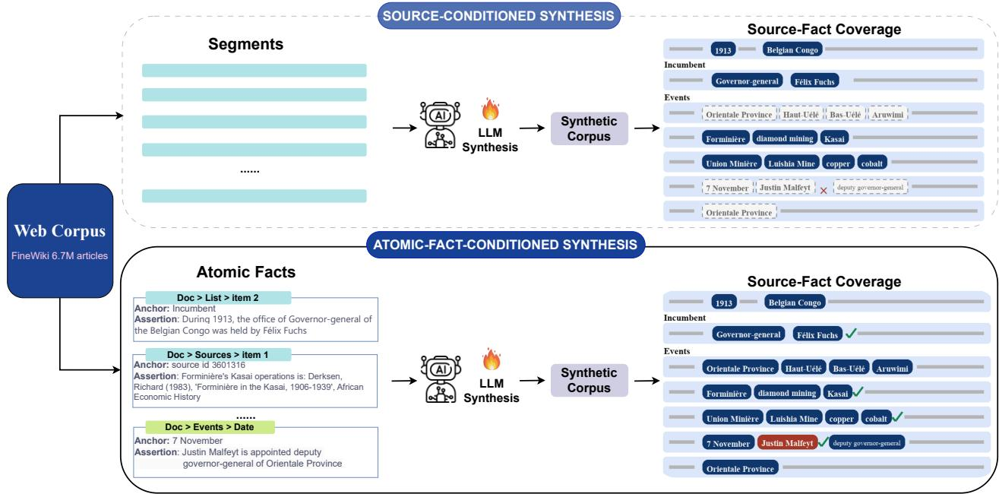
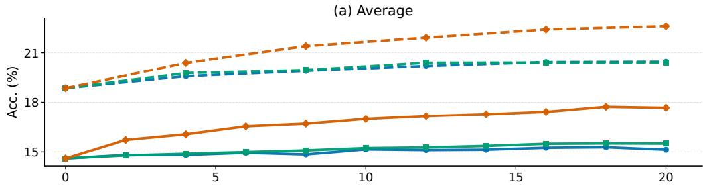
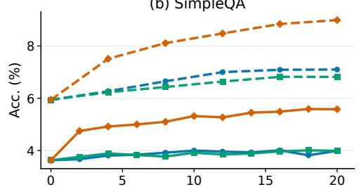
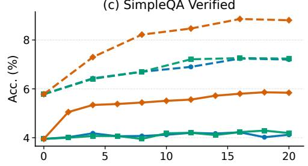
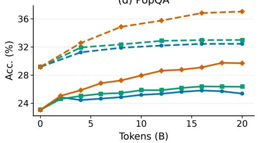
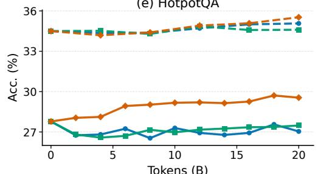

# AFCS: Atomic-Fact-Conditioned Synthesis for Factual Knowledge Pretraining

Yunhao Wang, Feng Zhang, Tinghao Yu, Xing Wu, Jiang Zhou

Hunyuan Team, Tencent

{luciuswang,jayzhang}@tencent.com

Abstract. Synthetic data is increasingly used in language-model pretraining. Existing knowledge-corpus synthesis pipelines, including WRAP and Nemotron-CC, usually take a source passage or document segment as input and generate rewritten or QA-style samples from that text. This can improve surface form and prompt diversity, but it does not explicitly require fine-grained source facts—especially secondary entities, list/table entries, and precise temporal attributes—to appear in the synthesized corpus. We propose AFCS (Atomic Fact-Conditioned Synthesis), a pipeline that first extracts source-supported atomic facts and then uses each retained fact to drive generation. AFCS uses structure-aware extraction over the document tree, source-grounded verification, local context expansion, and multiformat generation. In continued-pretraining experiments with OLMo-3-7B and a 32B base on the same FineWiki source corpus, AFCS outperforms WRAP and Nemotron-CC on SimpleQA, SimpleQA Verified, PopQA, and HotpotQA. Granularity ablations show that fact-level synthesis improves over chunk-level, paragraph-level, and entity-level synthesis; and a 100B-token mid-training integration improves factual benchmarks and raises the 12-task general benchmark average by +1.09.

## 1 Introduction

Synthetic data has become a common component of recent language-model pretraining recipes. WRAP and Nemotron-CC transform source passages or document segments into rewritten, QA-style, and knowledge-focused outputs (Maini et al., 2024; Su et al., 2025). Broader pretraining recipes also incorporate synthetic textbooks, question–answer pairs, instructions, exercises, and structured reasoning data (Abdin et al., 2024; Yang et al., 2025a). Together, these approaches expose knowledge through diverse textual forms during pretraining.

Most knowledge-corpus synthesis methods take a source text unit as input. WRAP rewrites a source passage into multiple styles (Maini et al., 2024), while Nemotron-CC applies a multi-prompt mixture to document segments (Su et al., 2025). These methods difer in output format, but they share a common interface: a passage, segment, or document is given to the generator, which then produces synthetic samples from that input.

This work studies a fact-coverage issue that arises under this interface. Source-conditioned generation often preserves salient entities and headline events, but may omit secondary entities, list entries, table rows, and fine-grained dates. We treat this as a data-construction problem rather than as a ground-truth coverage metric: diagnostic extraction and matching are used to identify recurring omission patterns, while the continued-pretraining experiments provide the main evidence for whether the resulting synthetic data improves model behavior.

We propose Atomic-Fact-Conditioned Synthesis (AFCS). AFCS changes the driver of data synthesis. Instead of using a source text unit alone as the generation prompt, AFCS first extracts source-supported atomic facts, expands the local context when needed, and generates samples conditioned on retained facts selected for synthesis. AFCS targets explicit fact coverage in the synthetic corpus; its efect on model behavior is evaluated through downstream continued-pretraining experiments.

Our contributions are as follows:

1. We show that source-conditioned knowledge-corpus synthesis can omit many fine-grained facts that are present in the source, especially for secondary entities, list/table entries, and fine-grained temporal attributes.

2. We introduce AFCS as a coverage-oriented data-construction interface that turns extracted, source-supported assertions into explicit generation targets through structure-aware extraction, source-grounded verification, local context expansion, and multi-format generation.

3. We evaluate AFCS on OLMo-3-7B (Team OLMo et al., 2025) and a 32B base using the same FineWiki source corpus (Penedo, 2025) as the baselines. AFCS improves middle- and long-tail factual recall on PopQA.

4. Through granularity and mechanism ablations, we show that fact-level conditioning outperforms coarser units; targeted mechanism contrasts yield results consistent with benefits from broader fact coverage, repeated realizations per fact, and multi-format generation.

## 2 Related Work

Synthetic-data pretraining and web-corpus refinement. Continued pretraining on domainspecific corpora is a standard way to adapt language models (Gururangan et al., 2020). Recent pretraining recipes increasingly use synthetic data to improve the presentation of raw text: WRAP paraphrasing rewrites web passages into cleaner QA or expository forms (Maini et al., 2024), Nemotron-CC applies a multi-prompt mixture to Common Crawl segments (Su et al., 2025), and other systems use genre reformulation and active reading (Hao et al., 2025; Lin et al., 2025). Web-corpus construction work such as FineWeb and DCLM studies filtering, deduplication, and source-quality trade-ofs at scale (Penedo et al., 2024; Li et al., 2024). These works focus on source quality, surface form, and corpus-scale construction. AFCS addresses a narrower interface question: for a fixed source corpus, how should source facts be selected as synthetic-data targets before they are realized in text?

Source-conditioned rewriting versus fact-conditioned synthesis. Most existing synthesis pipelines condition generation on a passage, document segment, or whole article. Prompt diversity can broaden the forms in which a document is studied, and structure-preserving paraphrasing can maintain label fidelity, but the generator still decides which source facts to mention. Active Reading similarly broadens document-conditioned study through model-proposed strategies including paraphrasing, knowledge linking, active recall, and analogical reasoning (Lin et al., 2025). These approaches increase the diversity of views or actions applied to a source document, but they do not make source-fact selection explicit before generation. This creates a fact-selection bottleneck: salient entities and headline events are likely to be preserved, while secondary entities, list entries, table rows, and precise dates may be omitted. AFCS changes this interface by extracting source-grounded facts before generation and assigning generation attempts to those facts. The distinction is not the use of QA or rewriting formats, but whether fact selection remains implicit in a source-text prompt or is made explicit before surface realization.

Entity-, relation-, and graph-conditioned synthesis. Web structure can provide intermediate signals for pretraining: Hyperlink-induced pretraining (Zhou et al., 2022) uses hyperlink topology to construct pseudo query–passage pairs for retrieval. For synthetic continued pretraining, EntiGraph (Yang et al., 2025b) extracts entities and synthesizes from entity pairs or triples; Synthesize-on-Graph (SoG) (Ma et al., 2025) builds a context graph and uses graph traversal followed by secondary sampling to construct cross-document generation contexts; Synthetic Bootstrapped Pretraining (Yang et al., 2025c) learns inter-document relations and synthesizes new corpora from those relations. Structured methods based on entities, attributes, relations, or graphs can represent many of the same facts targeted by AFCS, especially when qualifiers, reification, or schema extensions are allowed. We therefore do not view the distinction as one of theoretical representational capacity. Rather, AFCS makes fact selection explicit and source-local: each extracted, source-supported assertion is treated as a generation target, with its target value and evidence span available for realization. The anchor of such an assertion need not be a canonical entity; it can also be a table row, list item, section context, date, numerical value, or descriptive span. Several AFCS assertions encode negation, evidential absence, conditionality, or full-clause values that are not naturally represented as a single canonical entity–relation edge (Appendix B). Entity- or graph-conditioned methods typically provide entities, attributes, profiles, relation edges, or graph paths as synthesis context, leaving the generator or graph-walk procedure to determine which facts are ultimately realized in text. Our matched-budget entity-level ablation provides one comparison with a coarser conditioning unit and yields lower scores than conditioning on explicit fact-value assertions in our setting. In diferent knowledge-injection settings, Mecklenburg et al.’s fact-based scaling pipeline (Mecklenburg et al., 2024) constructs QA pairs from extracted atomic facts, while Knowledge-Instruct (Ovadia et al., 2025) constructs instruction data from entity-anchored facts.

Factual knowledge evaluation. SimpleQA evaluates short, fact-seeking questions with a single verifiable answer (Wei et al., 2024). We use factual QA benchmarks to compare model behavior before and after continued pretraining. Broad benchmarks such as MMLU measure general knowledge and reasoning across many domains (Hendrycks et al., 2021). In this work, SimpleQA and SimpleQA Verified (Wei et al., 2024; Haas et al., 2025), PopQA (Mallen et al., 2023), and HotpotQA (Yang et al., 2018) measure factual QA behavior, while a separate source-fact coverage diagnostic evaluates the synthetic corpus and the 12-task mid-training suite checks broader capability compatibility. This separation is important because explicit source-fact coverage does not automatically imply that every covered fact is stored or retrieved by the trained model.

Knowledge editing and retrieval. ROME (Meng et al., 2022) edits individual factual associations, while MEMIT (Meng et al., 2023) directly edits many factual memories in model parameters; neither is a corpus-scale pretraining method. RAG (Lewis et al., 2020) combines parametric generation with an external non-parametric memory at inference time, while REPLUG (Shi et al., 2024) motivates retrieval as access to the long tail of knowledge that a parametric model may not represent. AFCS instead changes the pretraining corpus, while retrieval-augmented methods remain complementary for deployment-time access to external evidence.

## 3 Problem Formulation: Source-Fact Coverage

## 3.1 Atomic Facts

Let $\mathcal { D } = \{ d _ { 1 } , \ldots , d _ { N } \}$ be a knowledge corpus. For a source unit d, let ${ \mathcal { F } } ( d ) = \{ f _ { 1 } , \ldots , f _ { n _ { d } } \}$ denote the atomic facts expressed in that unit. We use atomic fact to mean a minimal source-supported assertion that can be verified against a local evidence span. The unit is not required to be centered on a canonical entity or to correspond to a canonical entity–relation edge. Some records are anchored by named entities, while others are anchored by a table row, list item, section context, date, numerical value, or descriptive span. In implementation, records are stored in a subject–predicate–value-like form for convenience, but the subject can be a local anchor rather than a canonical entity, and the predicate or value may contain free-form natural language. Each record contains a target value and a source span that supports it. Appendix B gives examples of assertions that use this notation but are not intended as canonical KG triples.

A synthesis algorithm maps either a source unit or an extracted fact set to training samples. We say a sample covers a fact when it explicitly states the fact value with enough local context to identify the relevant entity or attribute. This notion describes the source-fact selection problem; the paper’s main model-performance claims are based on downstream continued-pretraining results, with coverage reported separately as a data-side diagnostic.

## 3.2 Source-Conditioned Synthesis

Prior synthesis methods can be organized by their conditioning unit. WRAP (Maini et al., 2024) produces prompted rewrites from source passages or paragraph-level examples, including QA-style and stylistic paraphrase outputs. Nemotron-CC (Su et al., 2025) defines five prompt types for document segments with prompt-specific token limits, including knowledge extraction, distillation, diverse QA pairs, knowledge lists, and Wikipedia-style rewriting.

These pipelines can produce fluent and diverse text, but they do not directly specify which fine-grained source facts must be expressed. The generator receives a source unit and produces synthetic samples from it. We call this family source-conditioned synthesis. AFCS instead uses atomic-fact-conditioned synthesis: an extractor first identifies atomic facts, and generation is conditioned on retained facts selected for synthesis, with source context available for realization.

## 3.3 Omission Patterns

We separate missing source evidence from omissions introduced by synthesis; the SimpleQA Verified source-availability funnel is reported in Appendix F. The main text focuses on source facts that are present in the corpus but are not explicitly realized by source-conditioned synthesis.

Author inspection of 200 uncovered facts from the source-conditioned pipeline shows three recurring omission patterns. First, secondary entities—including people, organizations, and locations mentioned relatively infrequently within an article—are often omitted. Second, list- and table-embedded facts are under-covered: a QA generator may ask about an award as a whole while omitting individual year–recipient rows. Third, temporal facts are often coarsened, for example from month/day precision to year-level statements.

  
Figure 1: AFCS pipeline and source-fact coverage. Source-conditioned synthesis (top) segments the web corpus and asks an LLM to synthesize from each segment, so the generated corpus tends to preserve salient facts while under-covering fine-grained facts in lists, tables, and secondary mentions. Atomic-fact-conditioned synthesis (bottom) first extracts structure-aware atomic facts from the same source corpus and then conditions generation on source-anchored assertion cards. Each card marks the local anchor (e.g., a document scope, list item, table row, or date cell), the natural-language assertion, and the highlighted value structure (e.g., a role binding, multi-element set, compound clause, or bibliographic record). These cards are generation targets rather than canonical entity–relation KG triples.

## 4 Method: AFCS

AFCS is an atomic-fact-conditioned synthesis pipeline (Figure 1). It extracts source-supported atomic facts, expands local context where needed, and generates training samples conditioned on extracted facts. This shifts fact selection upstream to extraction and verification, rather than leaving it entirely to the generator’s preference for salient source content.

## 4.1 Atomic Fact Extraction

Wikipedia pages have a natural document tree, including title, sections, paragraphs, lists, tables, and infoboxes. AFCS uses this structure during extraction. Tables, lists, numeric-heavy content, and prose are processed with separate prompt templates (Appendix D). Extraction statistics and author-checked precision/recall are reported in Appendix A.

As defined in §3.1, an atomic fact is a source-supported assertion with a target value and local evidence span, not necessarily a canonical entity-centered record. AFCS represents dates, numerical attributes, aliases, list entries, table rows, and descriptive properties as typed atomic facts, without requiring a strict tuple schema. An AFCS unit is assertion-centric rather than entity-centric: it contains the statement to be realized, its target value, and the local evidence span used for verification and realization. Thus, entity attributes are not merely exposed as part of an entity profile; each attribute-value assertion can become an independent synthesis target. The same representation also covers non-canonical assertions such as evidential absence, conditional statements, causal explanations, reported speech, and full-clause values. When a fact depends on nearby context, AFCS expands the visible context around the focal span. When the fact spans related sections, those sections are opened while unrelated sections remain closed. The synthesis unit remains the extracted assertion or evidence span rather than the whole article.

## 4.2 Source-Grounded Verification

The extracted records are checked against their source spans before synthesis. This step filters out records whose values are judged unsupported by the verifier and preserves the source ofset used for later context expansion. The verifier is not intended to produce a complete factual database. Its role is to reduce unsupported facts before they are amplified into multiple synthetic samples.

## 4.3 Multi-Format Generation

For each retained fact f selected for synthesis and its local context ctx(f), AFCS generates comple mentary natural-language samples. All formats are driven by the extracted fact rather than by an unconstrained source-text prompt:

• Summary: contextual summaries that preserve nearby factual relations and ordering.

• Rewrite: paraphrases in alternative registers while preserving the same factual sequence.

• Continuation: continuations from a local prefix that must include the target fact.

• QA: answer-guided question generation. The value of the extracted fact is supplied as the target answer, and the generator writes natural questions whose answer is that value.

The sample-count and token-volume distribution across formats is reported in Appendix C.

## 4.4 Corpus-Scale Construction

We instantiate AFCS on approximately 6.7M FineWiki articles. Structure-aware extraction produces 312.7M atomic facts, with 34.9% from prose, 29.2% from tables or infoboxes, 19.6% from numeric attributes, and 16.3% from lists. The resulting AFCS corpus contains 142M natural-language synthesized samples across four formats. On a 500-article author-checked subset, extracted facts reach 94.1% precision and 87.6% recall; recall on list- and table-embedded facts is 82.4%, compared with 48.7% for a single-pass non-structure-aware extractor. These statistics characterize the scale and extraction quality of AFCS; comparative source-fact coverage is evaluated separately in Section 5.3.

Reproducibility details. The AFCS extractor, source-grounded verifier, and synthetic-sample generator use the same instruction-tuned generator checkpoint, Qwen3-30B-A3B, served with vLLM. Extraction and verification use deterministic decoding (temperature 0), while multi-format generation uses temperature 0.7 with prompt-specific maximum output lengths. We filter records rejected by the source-grounded verifier and remove degenerate or condition-leaking generations. QA samples are deduplicated by exact question match, by fact id with at most two retained questions per fact, and by character-trigram overlap; multi-format outputs are deduplicated first by input span and then by output text. The final corpus contains 142M synthetic samples; the main 7B and 32B comparisons consume 20B packed training tokens from the corresponding synthetic corpus, and the mid-training integration uses 5B AFCS tokens. Data generation is a one-time ofline inference cost separate from continued-pretraining compute.

Table 1: Compared methods. Gen. tok. counts generated tokens before packing; Train tok. is the matched continued-pretraining budget after packing, with corpora reshufled/reused as needed. All runs use the same base model, source corpus, optimizer, and LR schedule.
<table><tr><td>Method</td><td>Data type</td><td>Gen. tok.</td><td>Train tok.</td><td>Mode</td></tr><tr><td>WRAP</td><td>4-prompt mix</td><td>16.6B</td><td>20B</td><td>source-cond.</td></tr><tr><td>Nemotron-CC</td><td>5-prompt mix</td><td>18.7B</td><td>20B</td><td>source-cond.</td></tr><tr><td>AFCS</td><td>multi-format</td><td>19.3B</td><td>20B</td><td>atomic-fact-cond.</td></tr></table>

## 5 Experiments

## 5.1 Experimental Setup

Base model and training recipe. All 7B methods continue training from OLMo-3-7B (Team OLMo et al., 2025) (stage 1, step 1.4M), with optimizer state restored from the base checkpoint. We use AdamW $( \beta _ { 1 } { = } 0 . 9 , \beta _ { 2 } { = } 0 . 9 5 )$ , peak learning rate $2 . 0 7 \times 1 0 ^ { - 5 }$ , linear decay to 0, batch size 2M tokens, and sequence length 8192. Before packing, training samples are globally shufled and then concatenated into fixed-length windows. Runs use the actual synthesized corpora produced by each method, with generated-token counts reported in Table 1; all main comparisons use a matched 20B-token continued-pretraining budget.

Compared methods. All methods use the same FineWiki source corpus and the same base training recipe. Our WRAP baseline applies the four WRAP style prompts to each source passage or paragraph-level example (Maini et al., 2024). Our Nemotron-CC baseline reruns on FineWiki the five prompt types defined by Nemotron-CC (Su et al., 2025). AFCS uses multi-format samples generated from extracted atomic facts. For the granularity ablations, chunk- and paragraph-level synthesis use the same generator with only the conditioning unit changed, while the entity-level baseline first extracts canonical subject–predicate–value triples and then conditions generation on both the extracted triple and its corresponding source context.

Evaluation. We evaluate with SimpleQA, SimpleQA Verified, PopQA, and HotpotQA using few-shot in-context learning and judge-based accuracy; the benchmark sources are cited in Section 2. Few-shot ICL is a standard way to evaluate pretrained base models without task-specific finetuning; here it probes factual acquisition and recoverability after continued pretraining. The specific prompting, inference, judging, sampling, and scoring settings are provided in Appendix G.

## 5.2 Overall Factual QA Performance

Across 7B and 32B scales, AFCS obtains the best results among the synthetic-data methods on all four factual benchmarks (Table 2). At 7B, it improves over the base by +2.00 on SimpleQA, +2.22 on SimpleQA Verified, +6.74 on PopQA, and +2.04 on HotpotQA. At 32B, the corresponding gains over the base are +3.17, +3.30, +8.05, and +0.90. The largest gains appear on PopQA, consistent with improved factual recall in this setting. Figure 2 shows that the advantage persists throughout training when progress is aligned by consumed tokens. FineWiki Raw controls at both model scales are reported in Appendix H.

Table 2: Main factual benchmark results for synthetic-data methods at 7B and 32B scale. Tokens denotes continued-pretraining tokens; Base is evaluated before continued pretraining. Values are judge-based accuracies (%).
<table><tr><td>Model</td><td>Size</td><td>Tokens</td><td>SimpleQA</td><td>SimpleQA Verified</td><td>PopQA</td><td>HotpotQA</td></tr><tr><td>Base</td><td>7B</td><td></td><td>3.63</td><td>3.95</td><td>23.06</td><td>27.78</td></tr><tr><td>WRAP</td><td>7B</td><td>20B</td><td>3.99</td><td>4.22</td><td>25.74</td><td>27.08</td></tr><tr><td>Nemotron-CC</td><td>7B</td><td>20B</td><td>3.99</td><td>4.16</td><td>26.42</td><td>27.40</td></tr><tr><td>AFCS</td><td>7B</td><td>20B</td><td>5.63</td><td>6.17</td><td>29.80</td><td>29.82</td></tr><tr><td>Base</td><td>32B</td><td></td><td>5.94</td><td>5.78</td><td>29.17</td><td>34.50</td></tr><tr><td>WRAP</td><td>32B</td><td>20B</td><td>7.10</td><td>7.20</td><td>32.46</td><td>35.07</td></tr><tr><td>Nemotron-CC</td><td>32B</td><td>20B</td><td>6.82</td><td>7.24</td><td>33.01</td><td>34.60</td></tr><tr><td>AFCS</td><td>32B</td><td>20B</td><td>9.11</td><td>9.08</td><td>37.22</td><td>35.40</td></tr></table>

Table 3: Source-fact coverage (%) by document fact density and for the fact types highlighted in the omission analysis.
<table><tr><td>Breakdown</td><td>Group</td><td>AFCS</td><td>WRAP</td><td>Nemo.</td><td>Chunk</td><td>Para.</td><td>Entity</td></tr><tr><td rowspan="3">Facts/doc</td><td>1-19</td><td>90.3</td><td>82.2</td><td>83.5</td><td>80.4</td><td>77.3</td><td>70.3</td></tr><tr><td>20-99</td><td>88.9</td><td>82.6</td><td>84.6</td><td>78.9</td><td>73.3</td><td>65.2</td></tr><tr><td>100+</td><td>82.5</td><td>61.2</td><td>66.5</td><td>68.8</td><td>69.6</td><td>58.4</td></tr><tr><td rowspan="3">Fact type</td><td>List/table</td><td>82.3</td><td>72.9</td><td>78.8</td><td>70.9</td><td>70.0</td><td>53.5</td></tr><tr><td>Secondary entity</td><td>83.6</td><td>73.4</td><td>79.9</td><td>70.5</td><td>69.6</td><td>52.0</td></tr><tr><td>Fine-grained temporal</td><td>80.8</td><td>72.5</td><td>78.1</td><td>69.8</td><td>69.5</td><td>53.4</td></tr></table>

## 5.3 Explicit Source-Fact Coverage

We additionally measure whether sampled source-supported facts are explicitly realized in the synthetic outputs derived from the same document. Under this data-side diagnostic, AFCS reaches 85.1% source-fact coverage, compared with 73.0% for WRAP and 77.0% for Nemotron-CC. Table 3 reports the breakdowns by document fact density and by the fact types highlighted in the omission analysis; the evaluation protocol, aggregation rule, and natural prose-only subset are provided in Appendix E. This diagnostic characterizes the synthetic corpus; it does not imply that every covered fact is acquired or retrieved by the trained model.

## 5.4 Component Ablations

We ablate synthesis granularity and the mechanisms within AFCS on the 7B last checkpoint. The conditioning-unit block compares fact-level conditioning against coarser alternatives using the shared model and training/evaluation setup. In the entity variant, extraction is explicitly constrained to canonical subject–predicate–value triples; generation then receives the triple together with its source context, providing a matched-budget entity/triple-conditioned comparison with an alternative representation unit. We also adapt EntiGraph relation synthesis (Yang et al., 2025b) and the fact-to-

(b) SimpleQA  
  
(d) PopQA

(c) SimpleQA Verified  
  
(e) HotpotQA

  
Tokens (B)  
Figure 2: Training dynamics across factual QA benchmarks. The x-axis is aligned by consumed training tokens: 1k steps correspond to 2B tokens for 7B models and 4B tokens for 32B models. Solid lines denote 7B models and dashed lines denote 32B models. AFCS maintains consistent gains over source-conditioned baselines across the average score and individual factual QA benchmarks.

QA pipeline of Mecklenburg et al. (2024) under the same 20B-token CPT budget and evaluation setup. The mechanism block provides matched-budget contrasts for output format, per-fact amplification, and fact coverage.

Among the matched comparisons, fact-level AFCS is strongest, improving over chunk-level synthesis $\mathrm { b y + 1 . 4 2 / + 1 . 3 7 / + 2 . 3 7 / + 0 . 8 8 }$ on SimpleQA, SimpleQA Verified, PopQA, and HotpotQA. AFCS also remains above the adapted EntiGraph and Fact-QA baselines. The full multi-format mixture outperforms AFCS-QA in this setup. AFCS-QA in turn improves over 1 $\mathrm { Q A } ~ /$ fact and Half facts, consistent with benefits from repeated realizations per fact and broader fact coverage, respectively.

Matched-budget mechanism contrasts. The mechanism rows in Table 4 use the same CPT token budget. The 1 QA / fact variant retains all facts but limits each fact to one QA realization, while Half facts retains 50% of the facts and assigns the retained facts a correspondingly larger share of QA samples. These comparisons vary per-fact amplification and source-fact breadth while keeping the overall training budget aligned.

Table 4: Granularity, adapted-baseline, and mechanism comparisons at 7B scale under the same 20B-token CPT budget. Values are percentages; SQA-V denotes SimpleQA Verified. Fact (AFCS) is the full multi-format mixture, and $\mathrm { w / o }$ verification removes source-grounded verification from it. AFCS-QA retains all facts with multiple QA realizations; 1 QA / fact reduces per-fact amplification; Half facts retains 50% of the facts.
<table><tr><td>Block</td><td>Variant</td><td>SQA</td><td>SQA-V</td><td>PopQA</td><td>Hotpot</td></tr><tr><td>Reference</td><td>Base</td><td>3.63</td><td>3.95</td><td>23.06</td><td>27.78</td></tr><tr><td rowspan="4">Unit</td><td>Fact (AFCS)</td><td>5.63</td><td>6.17</td><td>29.80</td><td>29.82</td></tr><tr><td>Chunk</td><td>4.21</td><td>4.80</td><td>27.43</td><td>28.94</td></tr><tr><td>Paragraph</td><td>4.52</td><td>5.10</td><td>26.35</td><td>27.61</td></tr><tr><td>Entity/triple</td><td>3.85</td><td>4.30</td><td>25.10</td><td>27.20</td></tr><tr><td rowspan="2">Baseline</td><td>EntiGraph</td><td>3.91</td><td>4.56</td><td>23.53</td><td>26.56</td></tr><tr><td>Fact-QA</td><td>4.82</td><td>5.31</td><td>25.34</td><td>28.98</td></tr><tr><td rowspan="4">Mechanism</td><td>w/o verification</td><td>5.49</td><td>6.00</td><td>29.77</td><td>29.60</td></tr><tr><td>AFCS-QA</td><td>5.32</td><td>6.00</td><td>27.03</td><td>29.14</td></tr><tr><td>1 QA / fact</td><td>4.90</td><td>5.55</td><td>25.72</td><td>28.22</td></tr><tr><td>Half facts</td><td>4.77</td><td>5.52</td><td>24.84</td><td>27.60</td></tr></table>

Table 5: SimpleQA Verified pass@k (%).
<table><tr><td>Scale</td><td>Model</td><td>@1</td><td>@8</td><td>@16</td><td>@32</td><td>@64</td></tr><tr><td rowspan="2">7B</td><td>Base WRAP</td><td>3.95 4.22</td><td>13.52 15.73</td><td>18.28 21.78</td><td>23.75 28.26</td><td>29.60 34.50</td></tr><tr><td>Nemotron AFCS</td><td>4.16</td><td>15.50</td><td>21.51</td><td>27.99</td><td>34.40</td></tr><tr><td rowspan="4">32B</td><td>Base</td><td>6.17 5.78</td><td>18.96 18.05</td><td>24.94 23.57</td><td>31.28 29.47</td><td>37.50 35.30</td></tr><tr><td>WRAP</td><td>7.20</td><td>21.39</td><td>27.50</td><td>33.68</td><td>39.60</td></tr><tr><td>Nemotron</td><td>7.24</td><td>21.53</td><td>27.89</td><td>34.57</td><td>40.90</td></tr><tr><td>AFCS</td><td>9.08</td><td>24.16</td><td>30.91</td><td>37.95</td><td>44.30</td></tr></table>

Table 6: PopQA judge-based accuracy (%) by monthly page-view bucket.
<table><tr><td>Scale</td><td>Views</td><td></td><td>N Base</td><td>WRAP</td><td>Nemo. AFCS</td><td></td></tr><tr><td rowspan="3">7B</td><td>0-100</td><td>1,399</td><td>25.1</td><td>32.5</td><td>32.5</td><td>38.2</td></tr><tr><td>100-1K</td><td>5,791</td><td>11.6</td><td>14.7</td><td>14.7</td><td>20.6</td></tr><tr><td>1K-10K 10K+</td><td>4,259 2,807</td><td>19.6 50.6</td><td>22.0 48.7</td><td>23.7 51.1</td><td>26.1 49.9</td></tr><tr><td rowspan="4">32B</td><td>0-100</td><td>1,399</td><td>28.6</td><td>32.6</td><td>34.2</td><td>40.3</td></tr><tr><td>100-1K</td><td>5,791</td><td>16.0</td><td>19.0</td><td>19.6</td><td>26.6</td></tr><tr><td>1K-10K</td><td>4,259</td><td>29.0</td><td>33.1</td><td>33.4</td><td>36.8</td></tr><tr><td>10K+</td><td>2,807</td><td>56.7</td><td>59.1</td><td>59.3</td><td>58.1</td></tr></table>

Removing source-grounded verification changes AFCS from 5.63/6.17/29.80/29.82 to 5.49/6.00/29.77/ 29.60 on SimpleQA, SimpleQA Verified, PopQA, and HotpotQA, respectively. These diferences are smaller than the granularity contrasts in Table 4; verification provides modest gains in this setup.

On SimpleQA Verified, AFCS is consistently strongest for pass@k at both 7B and 32B scale (Table 5). Here, pass@k is the proportion of questions for which at least one of k generated answers is correct. Pass@1 measures deterministic single-answer accuracy, while larger k values measure whether a correct answer is recoverable across multiple sampled generations; these results provide model-side evidence complementary to the data-side coverage diagnostic.

## 5.5 Popularity-Stratified PopQA Analysis

We stratify PopQA by entity monthly page views and apply the same judge-based scoring protocol used for the aggregate result (Table 6).

Table 7: Integrating AFCS into OLMo-3-7B 100B-token mid-training. Values are percentages; SQA-V denotes SimpleQA Verified.
<table><tr><td>Model</td><td>Data</td><td>SQA</td><td>SQA-V</td><td>PopQA</td><td>Hotpot</td><td>12-task</td></tr><tr><td>Base</td><td></td><td>3.63</td><td>3.95</td><td>23.06</td><td>27.78</td><td>57.79</td></tr><tr><td>Midtrain</td><td>100B gen.</td><td>3.68</td><td>4.02</td><td>23.18</td><td>28.07</td><td>68.24</td></tr><tr><td>Mid.+AFCS</td><td>95B gen.+5B AFCS</td><td>4.36</td><td>4.69</td><td>26.06</td><td>32.14</td><td>69.33</td></tr></table>

AFCS gains are largest on rare and middle-tail entities: over WRAP, it improves by $+ 5 . 7 / + 5 . 9$ points in the two lowest buckets at 7B and by $+ 7 . 7 / + 7 . 6$ points at 32B. In the 10K+ bucket, methods are close, suggesting that prompt diversity remains competitive for popular entities.

## 5.6 Scaling to 32B

We rerun the main synthesis variants on a 32B base with the same FineWiki source corpus and matched training recipe. AFCS remains strongest among the synthetic-data methods on all four metrics, with the largest 32B gain on PopQA (+8.05 over Base, +4.76 over WRAP, and +4.21 over Nemotron-CC).

Setup. The 32B continued-pretraining runs use the same FineWiki source corpus and the same 20B-token budget as the 7B runs (§5.1); peak LR is rescaled to 6.9% of the 32B stage-1 peak following the base recipe, batch size 4M tokens, sequence length 8192, AdamW $( \beta _ { 1 } { = } 0 . 9 , \beta _ { 2 } { = } 0 . 9 5 )$ , linear decay to 0. We compare AFCS, WRAP, and Nemotron-CC.

## 5.7 Integration with OLMo-3 Mid-Training Data

We test whether AFCS can be integrated into a 100B-token mid-training mixture by replacing 5B general tokens with AFCS data and evaluating both factual QA and the 12-task general suite (Table 7).

Replacing 5B general tokens with AFCS improves SimpleQA, SimpleQA Verified, PopQA, HotpotQA, and the 12-task average by $+ 0 . 6 8 / + 0 . 6 7 / + 2 . 8 8 / + 4 . 0 7 / + 1 . 0 9$ , respectively.

Per-benchmark results in Appendix I, Table 16, show gains on SQuAD v2, WikiTableQuestions, TriviaQA, PIQA, and HellaSwag; five of the twelve tasks decrease by 0.33–2.80 points. Overall, the reported 12-task average increases by +1.09.

## 6 Discussion

## 6.1 Why Synthesis Granularity Matters

The granularity rows in Table 4 show that fact-level conditioning is more efective than chunk-level, paragraph-level, or entity-level synthesis. Coarser units preserve local context, but they again leave the generator to select which fine-grained facts to express. Entity-level synthesis narrows the topic but still does not specify the relation or attribute that must be covered. Atomic facts provide a smaller and more explicit conditioning unit, making the target value directly visible while retaining enough source context for fluent realization.

## 6.2 Source-Conditioned Baselines

The comparison with WRAP and Nemotron-CC indicates that prompt diversity alone does not fully address fact selection. WRAP targets surface-form variation but yields smaller PopQA gains in our setup. Nemotron-CC performs well on average and on some popularity buckets, yet it still conditions generation on document segments rather than extracted facts. AFCS difers by making the target fact explicit before generation. The largest gains appear in the rare and middle-frequency PopQA buckets.

## 6.3 Coverage, Acquisition, and Scope

Explicit source-fact coverage is a property of the synthesized corpus, whereas factual QA and pass@k measure model-side acquisition and recoverability after continued pretraining. The higher coverage and pass@k observed for AFCS provide consistent but indirect evidence across these two levels; they are not a one-to-one measurement that each covered fact is stored and retrieved. Accordingly, we interpret the corpus-coverage and model-performance measures as complementary rather than as establishing a causal link.

## 7 Conclusion

We studied a coverage failure mode in knowledge-corpus synthesis: when generation is conditioned on a source passage or document segment, fine-grained facts present in the source may be omitted from the synthetic corpus. AFCS mitigates this issue by extracting atomic facts and using retained facts as generation targets. On FineWiki, AFCS improves factual QA performance at 7B and is strongest on middle-tail PopQA entities. Matched-budget granularity ablations show that fact-level conditioning outperforms coarser units, while targeted mechanism contrasts yield results consistent with benefits from broader fact coverage, repeated realizations per fact, and multi-format generation. The 32B results show that AFCS remains strongest among the synthetic-data methods across SimpleQA, SimpleQA Verified, PopQA, and HotpotQA. In a 100B-token OLMo-3 mid-training integration, AFCS improves factual QA benchmarks and raises the 12-task general benchmark average to 69.33. Future work includes stronger extraction verification, multilingual extension, and combining atomic-fact-conditioned synthesis with corpus filtering and retrieval.

## Limitations

• Extractor dependence. AFCS depends on an LLM extractor and verifier. We report precision and recall on an author-checked subset, but residual extraction errors can propagate to synthetic samples.

• Coverage versus learning. Explicit presence in the synthetic corpus does not guarantee that the trained model stores or retrieves a fact.

• Scale. We evaluate 7B and 32B models. Whether the same trends persist at larger model scales remains open.

• Domain. All experiments use English Wikipedia. Generalization to other languages and domains such as scientific literature, legal text, or code is untested.

• Cost. AFCS requires structure-aware extraction, verification, and multi-format generation. This is a one-time data-construction cost and incurs additional ofline inference at the multi-million-article scale.

• Retrieval scope. AFCS changes pretraining data to improve parametric factual knowledge and does not compare against retrieval-augmented systems. The two approaches address diferent deployment trade-ofs and may be combined in future work.

## Ethics Statement

Our training corpus is English Wikipedia, a publicly licensed knowledge resource. Atomic facts and synthesized samples inherit Wikipedia’s existing biases toward over-represented regions, languages, and demographic groups. AFCS may amplify facts present in the source corpus, including those biases. We do not perform additional debiasing or fact-checking beyond Wikipedia’s editorial process and our source-grounded verification step. Synthesized samples may still contain unsupported surface phrasing and should be used for pretraining research rather than as a standalone factual reference.

## References

Marah Abdin, Jyoti Aneja, Harkirat Behl, Sébastien Bubeck, Ronen Eldan, Suriya Gunasekar, Michael Harrison, Russell J. Hewett, Mojan Javaheripi, Piero Kaufmann, James R. Lee, Yin Tat Lee, Yuanzhi Li, Weishung Liu, Caio C. T. Mendes, Anh Nguyen, Eric Price, Gustavo de Rosa, Olli Saarikivi, et al. Phi-4 technical report. arXiv preprint arXiv:2412.08905, 2024.

Yonatan Bisk, Rowan Zellers, Ronan Le Bras, Jianfeng Gao, and Yejin Choi. PIQA: Reasoning about physical commonsense in natural language. In Proceedings of the AAAI Conference on Artificial Intelligence, volume 34, pages 7432–7439, 2020.

Peter Clark, Isaac Cowhey, Oren Etzioni, Tushar Khot, Ashish Sabharwal, Carissa Schoenick, and Oyvind Tafjord. Think you have solved question answering? try ARC, the AI2 reasoning challenge. arXiv preprint arXiv:1803.05457, 2018.

Karl Cobbe, Vineet Kosaraju, Mohammad Bavarian, Mark Chen, Heewoo Jun, Lukasz Kaiser, Matthias Plappert, Jerry Tworek, Jacob Hilton, Reiichiro Nakano, Christopher Hesse, and John Schulman. Training verifiers to solve math word problems. arXiv preprint arXiv:2110.14168, 2021.

Dheeru Dua, Yizhong Wang, Pradeep Dasigi, Gabriel Stanovsky, Sameer Singh, and Matt Gardner. DROP: A reading comprehension benchmark requiring discrete reasoning over paragraphs. In Proceedings of the 2019 Conference of the North American Chapter of the Association for Computational Linguistics: Human Language Technologies, Volume 1, pages 2368–2378. Association for Computational Linguistics, 2019.

Aryo Pradipta Gema, Joshua Ong Jun Leang, Giwon Hong, Alessio Devoto, Alberto Carlo Maria Mancino, Rohit Saxena, Xuanli He, Yu Zhao, Xiaotang Du, Mohammad Reza Ghasemi Madani, Claire Barale, Robert McHardy, Joshua Harris, Jean Kaddour, Emile van Krieken, and Pasquale Minervini. Are we done with MMLU? arXiv preprint arXiv:2406.04127, 2024.

Suchin Gururangan, Ana Marasović, Swabha Swayamdipta, Kyle Lo, Iz Beltagy, Doug Downey, and Noah A. Smith. Don’t stop pretraining: Adapt language models to domains and tasks. In Proceedings of the 58th Annual Meeting of the Association for Computational Linguistics (ACL), pages 8342–8360, 2020.

Lukas Haas, Gal Yona, Giovanni D’Antonio, Sasha Goldshtein, and Dipanjan Das. SimpleQA Verified: A reliable factuality benchmark to measure parametric knowledge. arXiv preprint arXiv:2509.07968, 2025.

Xintong Hao, Ruijie Zhu, Ge Zhang, Ke Shen, and Chenggang Li. Reformulation for pretraining data augmentation. arXiv preprint arXiv:2502.04235, 2025. Introduces Massive Genre-Audience (MGA) reformulation.

Dan Hendrycks, Collin Burns, Steven Basart, Andy Zou, Mantas Mazeika, Dawn Song, and Jacob Steinhardt. Measuring massive multitask language understanding. In Proceedings of the International Conference on Learning Representations (ICLR), 2021.

Mandar Joshi, Eunsol Choi, Daniel Weld, and Luke Zettlemoyer. TriviaQA: A large scale distantly supervised challenge dataset for reading comprehension. In Proceedings of the 55th Annual Meeting of the Association for Computational Linguistics (Volume 1: Long Papers), pages 1601–1611. Association for Computational Linguistics, 2017.

Patrick Lewis, Ethan Perez, Aleksandra Piktus, Fabio Petroni, Vladimir Karpukhin, Naman Goyal, Heinrich Küttler, Mike Lewis, Wen-tau Yih, Tim Rocktäschel, Sebastian Riedel, and Douwe Kiela. Retrievalaugmented generation for knowledge-intensive NLP tasks. In Advances in Neural Information Processing Systems (NeurIPS), 2020.

Jefrey Li, Alex Fang, Georgios Smyrnis, Maor Ivgi, Matt Jordan, Samir Gadre, Hritik Bansal, Etash Guha, Sedrick Keh, Kushal Arora, Saurabh Garg, Rui Xin, Niklas Muennighof, Reinhard Heckel, Jean Mercat, Mayee Chen, Suchin Gururangan, Mitchell Wortsman, Alon Albalak, et al. DataComp-LM: In search of the next generation of training sets for language models. In Advances in Neural Information Processing Systems, volume 37, pages 14200–14282, 2024.

Jessy Lin, Vincent-Pierre Berges, Xilun Chen, Wen-Tau Yih, Gargi Ghosh, and Barlas Oğuz. Learning facts at scale with active reading. arXiv preprint arXiv:2508.09494, 2025.

Shengjie Ma, Xuhui Jiang, Chengjin Xu, Cehao Yang, Liyu Zhang, and Jian Guo. Synthesize-on-graph: Knowledgeable synthetic data generation for continued pre-training of large language models. arXiv preprint arXiv:2505.00979v3, 2025. Version 3.

Pratyush Maini, Skyler Seto, He Bai, David Grangier, Yizhe Zhang, and Navdeep Jaitly. Rephrasing the web: A recipe for compute and data-eficient language modeling. In Proceedings of the 62nd Annual Meeting of the Association for Computational Linguistics (Volume 1: Long Papers), pages 14044–14072. Association for Computational Linguistics, 2024.

Alex Mallen, Akari Asai, Victor Zhong, Rajarshi Das, Daniel Khashabi, and Hannaneh Hajishirzi. When not to trust language models: Investigating efectiveness of parametric and non-parametric memories. In Proceedings of the 61st Annual Meeting of the Association for Computational Linguistics (Volume 1: Long Papers), pages 9802–9822. Association for Computational Linguistics, 2023.

Nick Mecklenburg, Yiyou Lin, Xiaoxiao Li, Daniel Holstein, Leonardo O. Nunes, Sara Malvar, Bruno Silva, Ranveer Chandra, Vijay Aski, Pavan Kumar Reddy Yannam, Tolga Aktas, and Todd Hendry. Injecting new knowledge into Large Language Models via supervised fine-tuning. arXiv preprint arXiv:2404.00213, 2024.

Kevin Meng, David Bau, Alex Andonian, and Yonatan Belinkov. Locating and editing factual associations in GPT. In Advances in Neural Information Processing Systems (NeurIPS), 2022.

Kevin Meng, Arnab Sen Sharma, Alex Andonian, Yonatan Belinkov, and David Bau. Mass-editing memory in a transformer. In Proceedings of the International Conference on Learning Representations (ICLR), 2023.

Todor Mihaylov, Peter Clark, Tushar Khot, and Ashish Sabharwal. Can a suit of armor conduct electricity? a new dataset for open book question answering. In Proceedings of the 2018 Conference on Empirical Methods in Natural Language Processing, pages 2381–2391. Association for Computational Linguistics, 2018.

OpenAI. gpt-oss-120b & gpt-oss-20b model card. arXiv preprint arXiv:2508.10925, 2025.

Oded Ovadia, Meni Brief, Rachel Lemberg, and Eitam Sheetrit. Knowledge-Instruct: Efective continual pre-training from limited data using instructions. arXiv preprint arXiv:2504.05571, 2025.

Panupong Pasupat and Percy Liang. Compositional semantic parsing on semi-structured tables. In Proceedings of the 53rd Annual Meeting of the Association for Computational Linguistics and the 7th International Joint Conference on Natural Language Processing (Volume 1: Long Papers), pages 1470–1480. Association for Computational Linguistics, 2015.

Guilherme Penedo. FineWiki. https://huggingface.co/datasets/HuggingFaceFW/finewiki, 2025. Source: Wikimedia Enterprise Snapshot API. Text licensed under CC BY-SA 4.0 with attribution to Wikipedia contributors.

Guilherme Penedo, Hynek Kydlíček, Loubna Ben Allal, Anton Lozhkov, Margaret Mitchell, Colin Rafel, Leandro von Werra, and Thomas Wolf. The FineWeb datasets: Decanting the web for the finest text data at scale. In Advances in Neural Information Processing Systems, volume 37, pages 30811–30849, 2024.

Pranav Rajpurkar, Robin Jia, and Percy Liang. Know what you don’t know: Unanswerable questions for SQuAD. In Proceedings of the 56th Annual Meeting of the Association for Computational Linguistics (Volume 2: Short Papers), pages 784–789. Association for Computational Linguistics, 2018.

Keisuke Sakaguchi, Ronan Le Bras, Chandra Bhagavatula, and Yejin Choi. WinoGrande: An adversarial winograd schema challenge at scale. In Proceedings of the AAAI Conference on Artificial Intelligence, volume 34, pages 8732–8740, 2020.

Weijia Shi, Sewon Min, Michihiro Yasunaga, Minjoon Seo, Richard James, Mike Lewis, Luke Zettlemoyer, and Wen-tau Yih. REPLUG: Retrieval-augmented black-box language models. In Proceedings of the 2024 Conference of the North American Chapter of the Association for Computational Linguistics: Human Language Technologies (Volume 1: Long Papers), pages 8371–8384. Association for Computational Linguistics, 2024.

Dan Su, Kezhi Kong, Ying Lin, Joseph Jennings, Brandon Norick, Markus Kliegl, Mostofa Patwary, Mohammad Shoeybi, and Bryan Catanzaro. Nemotron-CC: Transforming Common Crawl into a refined long-horizon pretraining dataset. In Proceedings of the 63rd Annual Meeting of the Association for Computational Linguistics (Volume 1: Long Papers), pages 2459–2475. Association for Computational Linguistics, 2025.

Alon Talmor, Jonathan Herzig, Nicholas Lourie, and Jonathan Berant. CommonsenseQA: A question answering challenge targeting commonsense knowledge. In Proceedings of the 2019 Conference of the North American Chapter of the Association for Computational Linguistics: Human Language Technologies, Volume 1, pages 4149–4158. Association for Computational Linguistics, 2019.

Team OLMo, Allyson Ettinger, Amanda Bertsch, Bailey Kuehl, David Graham, David Heineman, Dirk Groeneveld, Faeze Brahman, Finbarr Timbers, Hamish Ivison, Jacob Morrison, Jake Poznanski, Kyle Lo, Luca Soldaini, Matt Jordan, Mayee Chen, Michael Noukhovitch, Nathan Lambert, Pete Walsh, et al. OLMo 3. arXiv preprint arXiv:2512.13961, 2025.

Jason Wei, Nguyen Karina, Hyung Won Chung, Yunxin Joy Jiao, Spencer Papay, Amelia Glaese, John Schulman, and William Fedus. Measuring short-form factuality in large language models. arXiv preprint arXiv:2411.04368, 2024.

An Yang, Anfeng Li, Baosong Yang, Beichen Zhang, Binyuan Hui, Bo Zheng, Bowen Yu, Chang Gao, Chengen Huang, Chenxu Lv, Chujie Zheng, Dayiheng Liu, Fan Zhou, Fei Huang, Feng Hu, Hao Ge, Haoran Wei, Huan Lin, Jialong Tang, et al. Qwen3 technical report. arXiv preprint arXiv:2505.09388, 2025a.

Zhilin Yang, Peng Qi, Saizheng Zhang, Yoshua Bengio, William W. Cohen, Ruslan Salakhutdinov, and Christopher D. Manning. HotpotQA: A dataset for diverse, explainable multi-hop question answering. In Proceedings of the 2018 Conference on Empirical Methods in Natural Language Processing, pages 2369–2380. Association for Computational Linguistics, 2018.

Zitong Yang, Neil Band, Shuangping Li, Emmanuel Candès, and Tatsunori Hashimoto. Synthetic continued pretraining. In The Thirteenth International Conference on Learning Representations, 2025b. Oral; EntiGraph.

Zitong Yang, Aonan Zhang, Hong Liu, Tatsunori Hashimoto, Emmanuel Candès, Chong Wang, and Ruoming Pang. Synthetic bootstrapped pretraining. arXiv preprint arXiv:2509.15248, 2025c.

Rowan Zellers, Ari Holtzman, Yonatan Bisk, Ali Farhadi, and Yejin Choi. HellaSwag: Can a machine really finish your sentence? In Proceedings of the 57th Annual Meeting of the Association for Computational Linguistics, pages 4791–4800. Association for Computational Linguistics, 2019.

Jiawei Zhou, Xiaoguang Li, Lifeng Shang, Lan Luo, Ke Zhan, Enrui Hu, Xinyu Zhang, Hao Jiang, Zhao Cao, Fan Yu, Xin Jiang, Qun Liu, and Lei Chen. Hyperlink-induced pre-training for passage retrieval in open-domain question answering. In Proceedings of the 60th Annual Meeting of the Association for Computational Linguistics (Volume 1: Long Papers), pages 7135–7146. Association for Computational Linguistics, 2022.

Pipeline scale. We process approximately 6.7M FineWiki articles. After section segmentation, structure-aware extraction yields the following per-article fact counts:

Table 8: Atomic-fact extraction statistics over the FineWiki training corpus.
<table><tr><td>Statistic</td><td>Value</td></tr><tr><td>Articles processed Sections processed</td><td>~6.7M</td></tr><tr><td>Total atomic facts extracted</td><td>78.4M</td></tr><tr><td>Mean facts / article</td><td>312.7M 46.7</td></tr><tr><td>Median facts / article</td><td>18</td></tr><tr><td>P5 / P95 facts article</td><td>3/92</td></tr><tr><td>% facts from prose</td><td></td></tr><tr><td>% facts from tables / infoboxes</td><td>34.9</td></tr><tr><td></td><td>29.2</td></tr><tr><td>% facts from numeric attributes</td><td>19.6</td></tr><tr><td>% facts from lists</td><td>16.3</td></tr></table>

Extraction quality. On a 500-article author-checked subset, we report:

• Precision (extracted facts that are correct & verifiable in source): 94.1%

• Recall (verifiable atomic facts in source that are extracted): 87.6%

• Recall on list-/table-embedded facts specifically: 82.4% (vs. 48.7% for a single-pass non-structureaware extractor)

## Appendix B. Examples of Non-Canonical Atomic Assertions

Table 9 illustrates why the subject–predicate–value notation used by AFCS should not be read as a canonical KG triple schema. These examples can often be encoded in richer graph form using reification, qualifiers, or custom schemas, but they are not naturally represented as a single entity– relation edge. AFCS uses them directly as source-local generation targets, preserving the local evidence span and target value without requiring corpus-level schema canonicalization.

## Appendix C. Synthesized Sample Statistics

Composition. The 142M natural-language AFCS training samples decompose as shown in Table 10.

Length distributions (tokens per sample). Table 11 reports per-sample token-length percentiles by format.

Source-article length. Source articles have median 612 tokens, P5/P95 of 84 / 4,812 tokens. Article length correlates only weakly with per-article fact count (r = 0.41) because fact density varies sharply between prose-heavy biographies and table-heavy list articles.

Table 9: Examples of AFCS atomic assertions that are source-local generation targets rather than canonical KG triples. The notation is compact, but the predicate and value may include negation, attribution, causality, conditionals, or full clauses.
<table><tr><td>Local anchor</td><td>Extracted source-supported assertion</td><td>Why it is non-canonical</td></tr><tr><td>Giovanni Boccaccio</td><td>observed that no history of Hippo&#x27;s ancestry or place of birth survived, other than from &quot;books of the ancients&quot;</td><td>evidential absence and reported observation, not a positive entity attribute</td></tr><tr><td>Edzard Ernst</td><td>wrote that zero balancing did not appear to have evidence published for its efficacy</td><td>negation plus attribution to a source</td></tr><tr><td>Ng Sui</td><td>trained in mainland China because equipment in Hong Kong was not up to standard and training time was insufficient</td><td>causal explanation with an embedded comparison</td></tr><tr><td>Nuclear industry</td><td>where wastewater discharges to rivers with drinking-water abstraction, harmful or long-half-life radioisotopes such as tritium</td><td>conditional process statement with a full-clause value</td></tr><tr><td>Segre theorem</td><td>form part of routine monitoring states that for any point in a convex hull that is not a vertex, at least four curve points have osculating planes passing through it</td><td>mathematical assertion whose anchor is a theorem, not a named-entity relation</td></tr><tr><td>List of power pop artists and songs</td><td>includes power pop songs by artists whose main music genre is not power pop</td><td>list-scope assertion anchored by a document section</td></tr></table>

Table 10: Sample-count and token-volume distribution by natural-language format.
<table><tr><td>Format</td><td>Samples</td><td>% Tokens %</td></tr><tr><td>Summary</td><td>84M 59.2</td><td>52.0</td></tr><tr><td>QA (answer-guided)</td><td>33M 23.2</td><td>11.7</td></tr><tr><td>Continuation</td><td>17M 12.0</td><td>21.4</td></tr><tr><td>Rewrite</td><td>8M</td><td>5.6 15.0</td></tr><tr><td>Total</td><td>142M</td><td>100 100</td></tr></table>

Table 11: Per-sample token-length percentiles by format.
<table><tr><td>Format</td><td>P5</td><td>P25</td><td>med</td><td>P75</td><td>P95</td></tr><tr><td>Summary</td><td>60</td><td>92</td><td>128</td><td>184</td><td>312</td></tr><tr><td>QA</td><td>14</td><td>22</td><td>31</td><td>44</td><td>78</td></tr><tr><td>Continuation</td><td>84</td><td>156</td><td>248</td><td>392</td><td>712</td></tr><tr><td>Rewrite</td><td>96</td><td>184</td><td>296</td><td>488</td><td>944</td></tr></table>

## Appendix D. Extraction, Verification, and Synthesis Prompt Templates

We list the core prompt templates used for atomic-fact extraction, verification, and synthesis. Extraction templates take {title} and {document\_chunk} as inputs; subsequent stages additionally receive structured {atomic\_facts}.

Atomic-fact extraction (structure-aware). AFCS uses separate table, list, numeric, and prose extractor prompts. Braces in the templates denote runtime substitutions; repetitive in-prompt examples are omitted for space.

Generic no-structure mode. The no\_struct ablation replaces the four structure-specific prompts with a single generic extractor. It is distinct from the natural prose-only document subset reported in Table 12.

AFCS answer-guided QA synthesis. The QA instruction is adapted from the QA-style prompt of WRAP (Maini et al., 2024), with the additional constraint that the answer is fixed to the value of an extracted fact rather than chosen by the generator.

Summary, Rewrite, and Continuation. The concrete multi-format prompt is used for the AFCS non-QA formats.

Granularity baselines. Chunk- and paragraph-level baselines call the same generator templates with the source chunk or paragraph as the conditioning input. The entity-level baseline uses a separate extractor prompt that explicitly asks for canonical subject–predicate–value triples only; its generator receives both the extracted triple and the corresponding local source context. This design provides an entity/triple-conditioned comparison, while AFCS conditions on source-anchored fact records that may include table rows, list items, dates, quantities, or full-clause values.

Fact-QA baseline construction. We adapt the two-stage passage-to-fact-to-QA structure of Mecklenburg et al. (2024), including up to ten QA pairs per fact, optional SKIP for facts that are too broad or insuficiently specific, top-p 0.95, and exact-match question deduplication. In our implementation, Qwen3-30B-A3B performs both stages with temperature 0.7 and a maximum of 1,500 output tokens per stage; exact duplicate questions are removed during packing. The prompt templates are reproduced below.

## Table extractor

Extract structured facts from this document. Output a JSON array only. The document is about: {title}. Each fact is one object: {“subj”:“...”, “pred”:“...”, “val”:“...”, “source\_span”:“...”}.

## Rules

\- Process every data row, including the final rows of long tables. For scorecard or statistics tables, extract every meaningful numeric column for every row.

\- For tables with three or more columns, use multi-direction extraction: rotate which meaningful column is the answer value and place the remaining columns in the subject or predicate as context. Always retain the most natural direction; add reverse directions for entity names, people, places, awards, teams, years, and dates, but not for purely numeric attributes whose reverse direction is unnatural.

\- For cast or crew entries, extract both actor-to-character and character-to-actor directions.

\- Also capture dense structured records expressed without explicit table markup, including entity attributes, biographical details, events, and discography items.

- Preserve the exact supporting text in source\_span; keep val concise. Return at most 500 facts.   
Start with [ and end with ]; output no other text.

<document>{document\_chunk}</document>

## List extractor

Extract list, award, and rank items from the document. Output a JSON array only. The document is about: {title}. Each entry is one object: {“subj”:“...”, “pred”:“qualifier”, “val”:“entry name”, “source\_span”:“...”}.

## Rules

\- Set subj to the entity described by the list, not to a generic category label such as “Awards” or “Works.” Produce one object per entry and per applicable direction; never merge entries.

\- For award/year lists, extract applicable recipient, year, and award-name directions so that each meaningful field can serve as the answer. Process every year, including early historical entries.

\- For cast or crew lists, extract every member in both actor-to-character and character-to-actor directions.

\- In Recognition, Awards, and Honors sections, extract all year–prize pairs and the corresponding recipient direction. Skip section headers and vague entries.

\- Preserve the exact supporting text in source\_span. Return at most 500 facts. Start with [ and end with ]; output no other text.

<document>{document\_chunk}</document>

## Numeric extractor

Extract all dates, counts, measurements, rankings, codes, and product specifications from the document. The document is about: {title}. For each item, output {“subj”:“...”, “pred”:“... “val”:“...”, “source\_span”:“...”}.

## Rules

\- Use the specific entity described by the number, date, or code as subj. Prefer exact, question-answerable values and skip approximate or vague numbers.

\- Extract years from recognition, award, and honor lists even when they appear in list format.

\- For month–year and full-date mentions, emit both the full-granularity value and the year; for year-only mentions, emit one fact. Preserve exact counts and measurements without embedding explanatory phrases in val.

\- Include secondary-event dates such as publication, appointment, certification, release, performance, competition, interview, statement, and speech dates.

\- Include product codes, model identifiers, standards, serial or edition numbers, and exact small counts. Output only a valid JSON array.

<document>{document\_chunk}</document>

## Prose extractor

Extract (subject, predicate, value) facts from the document prose. The document is about: {title}. Focus on entity relationships, biographical details, events, and attributions. For each fact, output subj, pred, val (the answer), and source\_span (exact supporting text). Output only a JSON array and aim for completeness.

## Rules

\- Use a specific named entity as subj; never use vague references such as “the author” or “the subject.” Prefer facts that support specific, unambiguous questions rather than general descriptions.

\- Pay particular attention to appointment or nomination, competition or defeat, creation or authorship, replacement or succession, marriage or partnership, aliases, membership, event locations, requesters or initiators, education, and dated interviews or statements.

\- For role portrayals, extract both actor-to-character and character-to-actor directions. For passive constructions such as “X was appointed by Y,” set subj=X, pred=“appointed by,” and val=Y.

<document>{document\_chunk}</document>

## Generic no-structure mode

Extract all factual information from the document as (subject, predicate, value) facts. The document is about: {title}. Be comprehensive: include entities, dates, numbers, list items, and table values. For each fact, output subj, pred, val, and the exact source\_span. Use a specific named entity as the subject and focus on facts that can form specific, unambiguous questions. Output only a JSON array.

<document>{document\_chunk}</document>

## Source-grounded verifier

You will receive a source context and an extracted fact record: (anchor, predicate\_or\_attribute, value, span). Decide whether the value is directly supported by the source context.

## Requirements

\- Use only the provided context.

\- If supported, output {"verdict":"SUPPORTED", "normalized\_value":"..."}.

\- If unsupported, output {"verdict":"UNSUPPORTED", "reason":"..."}.

\- If the context is insufficient, output {"verdict":"NOT\_FOUND"}.

## Output

Return JSON only.

## AFCS answer-guided QA synthesis

For EACH fact below, generate 1–2 question–answer pairs. The answer is fixed to the value of the extracted fact. Use the local source context as primary evidence, including the source span and any section-level breadcrumb needed to make the question specific.

## Rules

1. The question must be answerable from the local context or the document.

2. Write natural questions; avoid overly formal forms such as “Presupposing that ...”.

3. Do not create tautological QA where the question merely restates the answer.

4. Match question type to answer type: person names use Who; dates/years use When or What year;   
numbers use How many or How much; places use Where.

5. For list or table facts, include the year, row, position, institution, award, or other qualifier needed to identify the exact row/item.

6. Preserve temporal granularity: if the answer is a full date, ask for the full date; if it is month plus year, ask for month and year; if it is a year, include enough event context to avoid ambiguity.

3. continuation: {“fact\_id”:“...”, “output\_type”:“continuation”, “prefix”:“...”,   
“continuation”:“...”}.

Output   
Return JSON only: [{“fact\_id”:“...”, “question”:“...”, “answer”:“...”}].

7. If several facts in the batch have similar predicates but different answers, make each question discriminative by adding the subject name or another distinguishing qualifier.

8. Do not include the answer verbatim inside the question.

## AFCS multi-format synthesis

For each fact below, generate ONE training data sample in the best non-QA format. Use the document context and the fact fields subj, pred, val, fact\_type, and local\_context.

## Available formats

1. summary: {“fact\_id”:“...”, “output\_type”:“summary”, “input\_text”:“...”,   
“summary”:“...”}.

2. rewrite: {“fact\_id”:“...”, “output\_type”:“rewrite”, “original”:“...”, “rewritten”:“...   
“style”:“simplified|formal|paraphrase”}.

## Output

Return JSON only. Each output must express the target fact and remain supported by the provided local context.

## Fact-QA stage 1: passage-to-fact

Please break down the following snippet from the Wikipedia article titled “[THEME]” into atomic facts.

Goal 1: The atomic facts should be as simple as possible, if it’s compound sentence, break down one more time.

Goal 2: For clarity, avoid using pronouns like “it”, “he”, “she”, “this”, “that” etc., and instead use the full names or titles.

[PASSAGE]

1.

## Fact-QA stage 2: fact-to-QA

Write 10 pairs of questions and answers probing the facts and statistics of a given sentence about [THEME].

Consider first generating questions and answers that are very relevant and explicit to the fact, then paraphrase those questions and answers to reach the desired 10 Q&A pairs.

If the fact is too broad or not specific enough to [THEME], you may reply with SKIP and be done.

## EXAMPLE:

FACT: 14 million viewers tuned in to the opening game of the series.

1. Q: How many viewers watched the first game? A: 14 million people watched the first game of the series.

EXAMPLE:   
FACT: The rose is red.   
SKIP   
FACT: [FACT]   
1.

## Appendix E. Source-Fact Coverage Evaluation

Protocol and sampling. We use gpt-oss-120b (OpenAI, 2025) as the coverage judge. For each evaluated source-supported fact, the judge receives the synthetic data derived from the corresponding source document and determines whether the fact is explicitly covered. The diagnostic is run on 600K data instances; each instance pairs a reference fact with the method-specific synthetic outputs derived from the same source document. Each reference fact is represented by its subject, relation, value, source sentence, and section path.

Judge and aggregation. A fact is marked as covered only when the exact claim, including its value, precision, and attribution, is recoverable from the synthetic text. Coverage is the proportion of evaluated facts judged covered. An author review of 100 judgments gives 96% agreement with the automatic judge. This metric evaluates explicit coverage in the synthetic corpus rather than model acquisition.

Natural prose-only subset. We identify 3,102,410 documents indexed by this diagnostic as natural prose-only sources and recompute coverage within this subset. This is a subset analysis rather than a rerun that removes structure from the same documents. AFCS remains above WRAP and Nemotron-CC within the prose-only subset, including the fact-dense group.

Table 12: Source-fact coverage (%) on the natural prose-only subset. The all-document AFCS column is included as a reference, not as a structure-removal intervention.
<table><tr><td>Facts/doc</td><td>AFCS (prose)</td><td>AFCS (all)</td><td>WRAP (prose)</td><td>Nemo. (prose)</td></tr><tr><td>1-19</td><td>89.1</td><td>90.3</td><td>82.2</td><td>83.5</td></tr><tr><td>20-99</td><td>88.3</td><td>88.9</td><td>82.6</td><td>84.6</td></tr><tr><td>100+</td><td>79.6</td><td>82.5</td><td>61.2</td><td>66.5</td></tr></table>

Coverage-judge prompt. The system and user messages are reproduced verbatim below; %%CTX%% and %%FACTS%% are the runtime placeholders for the document-specific synthetic text and numbered fact blocks.

## Coverage-judge prompt

System: You are a precise fact-checking assistant.

User: You are a STRICT fact-checking judge. You are given SYNTHETIC TEXT rewritten/derived from a Wikipedia article, and a NUMBERED LIST of atomic facts drawn from that same article.

Each fact is shown as subject / relation / value, plus the original source sentence it came from (and its section). Treat these together as ONE assertion—the claim the source sentence makes. Judge whether that whole claim is covered; do NOT just match the subject/relation/value strings as separate slots. The source sentence tells you what the claim actually means (the raw subject/relation/value may be terse or awkwardly worded—rely on the source sentence to understand the true assertion).

Decide COVERED only when the SYNTHETIC TEXT would let a reader RECOVER THE EXACT CLAIM. Apply these rules strictly:

COVERED requires ALL of:

1. The specific value (the who/what/when/how-much of the claim) is EXPLICITLY present in the synthetic text—not implied, not inferable, not "close".

2. It is UNAMBIGUOUSLY ATTRIBUTED to the right entity/attribute, so a reader can tell this value belongs to THIS claim and not something adjacent.

3. Numbers, dates, scores, percentages, quantities, and proper names match EXACTLY. No rounding, no approximation, no unit/precision loss.

NOT COVERED (be strict—when in doubt, choose NOT COVERED) if ANY of:

\- the value is missing, only alluded to, or requires inference/world-knowledge to reconstruct;

\- ANY loss of precision: a full date rendered as year-only (or vice-versa); an exact number/score/percentage rendered as "several"/"many"/"about"/rounded/a range; a specific award/item/rank/table-row replaced by its general category;

\- the entity is mentioned but this particular attribute/value is not;

\- the value only appears inside a bare structured fragment or list with no context tying it to the entity (a value that merely "shows up" among enumerated items does NOT count unless the text clearly asserts it OF the entity);

\- the attribution is uncertain or could plausibly belong to a different entity.

Paraphrasing and reordering are fine ONLY if the exact value and its attribution both survive. SYNTHETIC TEXT:

11 11 11   
%%CTX%%   
11 11 11   
FACTS:   
%%FACTS%%   
Output a JSON array, one object per fact, SAME ORDER, using the Fact number as id:   
[{"id":1,"covered":true},{"id":2,"covered":false}, ...]

## Appendix F. Source-Availability Funnel

To distinguish missing source evidence from omissions introduced by synthesis, we instrument SimpleQA Verified as a source-availability probe against the FineWiki training corpus. Table 13 reports whether the corresponding source article is present and whether the answer is verifiably present in that article. This diagnostic is separate from the downstream training results in the main text.

Table 13: Source-availability funnel for SimpleQA Verified against FineWiki. Gap A contains questions whose source article is not found in the corpus; Gap B contains questions whose article is found but whose target answer is not verifiably present in that article.
<table><tr><td>Level</td><td>Count</td><td>%</td></tr><tr><td>L1: All questions</td><td>1,000</td><td>100</td></tr><tr><td>L2: Source article in corpus</td><td>776</td><td>77.6</td></tr><tr><td>L3: Answer verifiably in article</td><td>555</td><td>55.5</td></tr><tr><td>Gap A: no article (L1−L2)</td><td>224</td><td>22.4</td></tr><tr><td>Gap B: article but answer absent (L2-L3)</td><td>221</td><td>22.1</td></tr></table>

## Appendix G. Benchmark and Evaluation Details

Factual benchmark protocol. For SimpleQA, SimpleQA Verified, PopQA, and HotpotQA, we use a 5-shot prompt with the format Question: ...\n Answer: .... We do not use retrieval. Each benchmark is evaluated with the same three-stage pipeline:

1. Inference: the model generates an answer under the specified decoding setting.

2. Judge: Qwen2.5-7B-Instruct assigns one of CORRECT, INCORRECT, or NOT\_ATTEMPTED.

3. Score: accuracy is the proportion of examples judged CORRECT; INCORRECT and NOT\_ATTEMPTED are both counted as non-correct.

For pass@1, we use temperature 0 and greedy decoding. For sampled pass@k with k > 1, we use temperature 0.6 and top-p = 0.95; a question is counted as correct if any of the k sampled answers is judged CORRECT. Table 5 reports k ∈ {1, 8, 16, 32, 64} on SimpleQA Verified.

Judge prompt. We use the SimpleQA-style grader template with gold aliases and model predictions as inputs, and constrain the judge to output one of CORRECT, INCORRECT, or NOT\_ATTEMPTED.

Judge audit. We stratify sampled benchmark-judge decisions by model size, method, and judge label, and the authors manually review 500 examples. The automatic judge agrees with the author review on 493/500 examples (98.6%).

Bootstrap uncertainty. Table 14 reports accuracy with bootstrap standard errors. Paired bootstrap tests show that the 7B AFCS gains over both WRAP and Nemotron-CC are significant on all four factual benchmarks (p < 0.001).

General benchmark suite. The 12-task mid-training suite comprises ARC (Clark et al., 2018), MMLU-Redux (Gema et al., 2024), SQuAD v2 (Rajpurkar et al., 2018), DROP (Dua et al., 2019), OpenBookQA (Mihaylov et al., 2018), CommonsenseQA (Talmor et al., 2019), WinoGrande (Sakaguchi et al., 2020), PIQA (Bisk et al., 2020), HellaSwag (Zellers et al., 2019), GSM8K (Cobbe et al., 2021), WikiTableQuestions (Pasupat and Liang, 2015), and TriviaQA (Joshi et al., 2017). Scores follow the evaluation harness used in the OLMo-3 mid-training comparison and are reported on a 0–100 scale; SQuAD v2 and DROP use their F1-based scores.

Compute. The 7B pretraining runs use 64 H20 GPUs; one 20B-token run takes ∼36 hours. Each 32B run uses 256 H20 GPUs for ∼48 hours; total compute is ∼5× a 7B run. Synthesis is run separately on an inference cluster.

Table 14: Factual benchmark accuracy (%) with bootstrap standard error. SQA and SQA-V denote SimpleQA and SimpleQA Verified.
<table><tr><td>Model</td><td>Size</td><td>SQA</td><td>SQA-V</td><td>PopQA</td><td>Hotpot</td></tr><tr><td>Base</td><td>7B</td><td> $3 . 6 3 { \pm } 0 . 1 7$ </td><td> $3 . 9 5 { \pm } 0 . 3 5 $ </td><td> $2 3 . 0 6 { \pm } 0 . 2 0 $ </td><td> $2 7 . 7 8 { \pm } 0 . 2 2$ </td></tr><tr><td>WRAP</td><td>7B</td><td> $3 . 9 9 { \pm } 0 . 1 5 $ </td><td> $4 . 2 2 { \pm } 0 . 3 7 $ </td><td> $2 5 . 7 4 { \pm } 0 . 1 9$ </td><td> $2 7 . 0 8 { \pm } 0 . 2 1 $ </td></tr><tr><td>Nemotron-CC</td><td>7B</td><td> $3 . 9 9 \pm 0 . 2 2 $ </td><td> $4 . 1 6 { \pm } 0 . 3 9$ </td><td> $2 6 . 4 2 { \pm } 0 . 2 0 $ </td><td> $2 7 . 4 0 { \pm } 0 . 2 2$ </td></tr><tr><td>AFCS</td><td>7B</td><td> ${ \bf 5 . 6 3 \pm 0 . 3 0 }$ </td><td> ${ \bf 6 . 1 7 \pm 0 . 3 3 }$ </td><td> $\mathbf { 2 9 . 8 0 { \scriptstyle \pm 0 . 2 1 } }$ </td><td> $\mathbf { 2 9 . 8 2 \pm 0 . 2 5 }$ </td></tr><tr><td>Base</td><td>32B</td><td> $5 . 9 4 { \pm } 0 . 3 5 $ </td><td> $5 . 7 8 { \pm } 0 . 3 6$ </td><td>29.17±0.21</td><td> $3 4 . 5 0 { \pm } 0 . 2 4 $ </td></tr><tr><td>WRAP</td><td>32B</td><td> $7 . 1 0 { \pm } 0 . 3 3$ </td><td> $7 . 2 0 { \pm } 0 . 3 8 $ </td><td> $3 2 . 4 6 { \pm } 0 . 2 1$ </td><td> $3 5 . 0 7 { \scriptstyle \pm 0 . 2 5 }$ </td></tr><tr><td>Nemotron-CC</td><td>32B</td><td> $6 . 8 2 { \pm } 0 . 3 5 $ </td><td> $7 . 2 4 { \pm } 0 . 4 4$ </td><td> $3 3 . 0 1 { \pm } 0 . 1 8$ </td><td> $3 4 . 6 0 { \pm } 0 . 2 4 $ </td></tr><tr><td>AFCS</td><td>32B</td><td> $\mathbf { 9 . 1 1 \pm 0 . 2 8 }$ </td><td> $\mathbf { 9 . 0 8 { \pm 0 . 4 1 } }$ </td><td> $\mathbf { 3 7 . 2 2 } 2 { \pm } \mathbf { 0 . 2 0 }$ </td><td> $\mathbf { 3 5 . 4 0 { \pm } 0 . 2 5 }$ </td></tr></table>

## Appendix H. FineWiki Raw Controls

Table 15: AFCS versus continued pretraining on raw FineWiki. SQA and SQA-V denote SimpleQA and SimpleQA Verified; values are judge-based accuracies (%).
<table><tr><td>Model</td><td>Size</td><td>SQA</td><td>SQA-V</td><td>PopQA</td><td>Hotpot</td></tr><tr><td rowspan="2">FineWiki Raw AFCS</td><td>7B</td><td>3.90</td><td>4.90</td><td>25.23</td><td>28.26</td></tr><tr><td>7B</td><td>5.63</td><td>6.17</td><td>29.80</td><td>29.82</td></tr><tr><td rowspan="2">FineWiki Raw AFCS</td><td>32B</td><td>6.97</td><td>7.26</td><td>31.96</td><td>35.29</td></tr><tr><td>32B</td><td>9.11</td><td>9.08</td><td>37.22</td><td>35.40</td></tr></table>

Table 15 directly compares AFCS with continued pretraining on the raw FineWiki source corpus at both scales. AFCS improves all four factual benchmarks; at 32B, the HotpotQA margin is 0.11 points (35.40 vs. 35.29).

## Appendix I. Mid-Training Evaluation Benchmarks

Table 16: Per-benchmark breakdown for 100B-token mid-training integration. Mid. denotes the 100B general mid-training baseline.
<table><tr><td>Category</td><td>Benchmark</td><td>Base Mid.</td><td>AFCS</td></tr><tr><td rowspan="2">Gen. Know.</td><td>ARC</td><td>77.47</td><td>84.98 85.24</td></tr><tr><td>MMLU Redux</td><td>60.30</td><td>65.30 66.12</td></tr><tr><td rowspan="2">Read. Comp.</td><td>SQuAD v2</td><td>42.27</td><td>48.59 52.96</td></tr><tr><td>DROP</td><td>40.51</td><td>66.51 65.93</td></tr><tr><td rowspan="2">Reasoning</td><td>OpenBookQA</td><td>76.40</td><td>85.20 82.40</td></tr><tr><td>CSQA</td><td>72.15</td><td>74.20 73.87</td></tr><tr><td rowspan="3">Lang. Und.</td><td>WinoGrande</td><td>53.28</td><td>65.11 64.72</td></tr><tr><td>PIQA</td><td>73.99</td><td>74.54 76.50</td></tr><tr><td>HellaSwag</td><td>59.83</td><td>70.15 76.41</td></tr><tr><td>Math</td><td>GSM8K</td><td>38.36</td><td>79.53 79.08</td></tr><tr><td rowspan="2">Table/Trivia</td><td>WikiTableQ</td><td>36.55</td><td>43.74 45.79</td></tr><tr><td>TriviaQA</td><td>62.42</td><td>61.01 62.95</td></tr><tr><td colspan="2">Average</td><td>57.79</td><td>68.24 69.33</td></tr></table>

The 12 general benchmarks used in Section 5.7 cover general knowledge, reading comprehension, reasoning, language understanding, math, table understanding, and trivia-style QA. Table 16 reports each benchmark’s evaluation-harness score on a 0–100 scale; SQuAD v2 and DROP use F1-based scores.